# 时序智能导论

> 从统计预测到世界模型

---

## 内容简介

本书系统论述「时序智能」——面向时间序列数据的分析、预测、建模与决策的理论、方法与工程体系。作者把这套能力界定为四层递进的含义：时序分析回答「发生了什么」，时序预测回答「将会发生什么」，时序建模回答「为什么发生、系统如何演化」，时序决策回答「应该采取什么行动」；四层层层递进却不必逐级依赖，共同构成从被动外推走向主动干预与通用智能的完整图景。全书以一条主线贯穿：以可预测性为理论基础，以动力学建模为核心，以「预测—理解—决策」为脉络，把两百余年间彼此隔离的方法与学科放进同一张地图。

本书的历史纵深从 1927 年 Yule 的自回归起笔，经 1970 年代 Box–Jenkins 方法学、1982 年 ARCH、1997 年 LSTM、2017 年 Transformer，抵近 2023 年以来的时序基础模型、大语言模型与时序世界模型，并以 2025—2026 年生成式预训练、十亿级规模化、极高效小模型与多模态通用模型收束于当代前沿。作者着力说明：ARIMA、Transformer、基础模型并非简单的技术迭代，而是对可预测性来源的不同建模；具体架构会随研究更替，而时间、尺度、记忆、因果与不确定性这些根本问题具有长久价值。全书据此给出从 1927 年到 2026 年的研究时间线与机构版图，覆盖清华、华东师范大学、MIT、Google、Amazon、Salesforce、IBM、微软、DeepMind、华为、中国科学院等二十余家机构的代表性成果。

全书共九篇四十一章。第一篇「时序智能的理论基础」建立随机过程、平稳性、时频分析与可预测性理论；第二篇「时序数据分析与结构发现」处理预处理、缺失与不完全观测、特征表示、相似性、异常、变点与多元依赖；第三篇「经典统计预测理论与方法」系统展开指数平滑、ARIMA、状态空间与卡尔曼滤波、层次调和、GARCH 与贝叶斯结构时间序列；第四篇「机器学习与深度时序建模」梳理树模型、循环网络、卷积网络、注意力与 Transformer、长序列与状态空间网络、图神经网络、概率生成与特殊时序；第五篇「时序基础模型与大模型」论述预训练范式、代表性基础模型、大语言模型与时序的结合及其能力边界；第六篇「时序世界模型、因果与决策智能」进入动力学学习、结构因果与反事实、强化学习与控制；第七篇「时序智能的跨学科理论」以「不同学科在预测什么、依赖什么假设、追求什么目标」为统一问题，比较控制论、动力系统与复杂系统、计量经济学、统计学与数据科学、信号处理与信息论；第八篇「评估、应用与系统工程」给出实验方法学、典型领域应用与生产系统工程化；第九篇「时序智能的未来」回扣开篇框架，展望趋势与开放问题。书末附数学工具包、数据集与基准索引、开源工具链、符号与缩略语对照表、中英文术语与全书速查索引、算例复现说明六个附录。

本书提出并贯穿两套自建的理论框架。其一是四层能力体系，为九篇划分与每章定位提供坐标；其二是五层可预测性框架——统计、信息论、动力学、因果与决策可预测性，据此对每一个方法追问四件事：它利用了哪一层可预测性、隐含了什么假设、突破了前一方法的什么限制、无法突破什么理论边界。全书同时严格澄清三个易混淆命题：平稳性不等于可预测性、非平稳性不等于不可预测性、相关性不等于因果性。第 1 章立框架，第 4 章以条件熵与混沌时域划定预测极限，第 29 章据此审视大模型幻觉，第 41 章回扣框架讨论通用时序智能，形成首尾闭环。

在写法上，本书按学术专著标准组织：每节依次展开引入动机、直觉解释、严格定义与推导、带数值的算例、技术谱系与变体、边界与讨论、承上启下的交叉引用；每章含两个以上定义或定理、两个以上数值算例、图与表、文内引用标号与章末参考文献一一对应，并以「进一步阅读」提示延伸文献。全书以城市电网负荷为贯穿始终的统一案例，同一份数据从时域频域分析、异常与变点检测、经典与深度预测、概率校准一路走到调度决策，辅以金融、气象、交通、工业、医疗与零售的专题案例。基础理论只讲一次、后续章节以交叉引用展开应用与深化，避免同类内容重复；配图五十幅，其中数学与内部结构图由代码精确绘制，概念与流程图按统一学术风格生成并逐幅核对。全书约五十万字、二百余个编号公式、近六百条章末文献。

本书面向时间序列、时序预测、时序智能方向的研究生、科研人员与资深工程从业者，兼顾理论严谨与工程可落地：核心模型给出完整推导而非只摆结论，重要论断标注文献出处，每一方法配算例展示用法与技术细节，评估指标既讲优点也讲缺陷与适用边界。读者只需具备概率论、数理统计、线性代数、最优化基础与基本机器学习知识。本书既可作为相关课程的研究生教材或教学参考书，也可作为研究人员系统查阅方法谱系、机构成果与开放问题的参考专著；偏理论的读者可重点读第一、三、六、七篇，偏算法与模型的读者可重点读第四、五篇，偏工程落地的读者可重点读第八篇，并按需回查方法章。

---

## 前言

预测未来，是人类最古老也最持久的冲动之一。从先民观天象以定农时，到现代电网在毫秒之间调度负荷，再到数值天气预报提前十天给出台风路径，贯穿其中的，是对同一类问题的执着追问：**给定过去，我们能在多大程度上知晓未来？** 近十余年，这个问题被赋予了全新的分量。传感器、交易系统、可穿戴设备与科学观测每天产生以亿计的时序数据；深度学习把长序列建模推到前所未有的精度；2023 年以来，时序基础模型试图以「一个模型预测一切」，大语言模型被尝试直接用于数值外推，世界模型则把「预测下一步」提升为「学习整个环境的动力学」。方法迭代之快，已使任何一本只讲某一代技术的教材迅速过时。

然而，方法越是繁荣，越需要一本把它们放到同一张地图上的书。今天的研究者与工程师面对的是高度碎片化的图景：控制论出身的人谈状态空间与模型预测控制，计量经济学家谈协整与 GARCH，机器学习从业者谈特征工程与集成树，深度学习研究者谈 PatchTST 与 iTransformer，而大模型团队谈零样本与上下文学习。这些术语说的是同一件事的不同侧面，却分属互少往来的学术共同体。许多教材要么止步于 ARIMA，要么只追最新架构而略去其思想源头；许多实践者能调通一个模型，却说不清它为何有效、何时失效、与十年前的同类方法究竟差在哪里。

本书的写作正是为了填补这一空白。我们把这套能力统称为**时序智能**，并把它界定为四层递进的含义：**预测**——外推未来；**分析**——刻画结构；**建模**——学习动力学；**决策**——在预测与理解之上行动。四者层层递进，共同构成从「被动外推」走向「主动干预与通用智能」的完整图景。以这一界定为纲，本书刻意不写成方法食谱或工具手册，而是写成一部有内在逻辑的学术专著：让读者不仅知道「怎么做」，更理解「为什么这样做」「它从哪里来」「边界在哪里」。

为此，本书遵循三条贯穿始终的写作原则。

**第一，完整的方法谱系。** 我们从指数平滑与 Box-Jenkins 方法学讲起，穿越状态空间、卡尔曼滤波、GARCH、贝叶斯结构时间序列，进入循环网络、卷积网络与 Transformer，抵达时序基础模型与时序世界模型。对每一个方法，我们都讲清四件事：它是什么、怎么用、有哪些技术变体、技术细节如何。更重要的是，我们着力交代**代际之间的因果链**——后一类方法究竟是为解决前一类方法的哪个具体缺陷而生。例如，稀疏注意力针对标准注意力的平方复杂度，补丁化针对逐点建模的语义缺失，状态空间的复兴回应了长序列建模的效率瓶颈，可预测性理论则给「大模型能否预测一切」划定了不可逾越的边界。理解这条链，比记住若干模型名称重要得多。

**第二，跨学科的对话。** 时序预测从来不是某一个学科的私产。控制论视预测为控制的手段，动力系统与复杂系统视预测为理解涌现与临界相变的探针，计量经济学视预测为结构识别的副产品，统计学坚持推断与可解释，信号处理提供频域语言，数据科学视预测为一条需要监控与迭代的生产线。本书专设一篇呈现这些视角，因为它们共同界定了「预测」的意义与边界：在控制论里，模型是为了行动；在复杂系统里，结构预测比点预测更可行；在计量经济学里，可解释性与理论一致性不可让渡。我们希望读者读完这一篇后，能带着更开阔的问题意识回看方法本身。

**第三，严谨与细致。** 这是一部面向研究者与高年级学生的专著，而非科普读物。核心模型给出完整推导而非只摆结论；重要论断标注文献出处；每一方法配算例以展示技术细节；评估指标既讲优点也讲缺陷与适用边界。我们也不回避一个根本事实——**并非所有未来都可预测**，并用混沌理论与信息论为「可预测性」划定可量化的边界。这一理论支点在后文审视时序大模型的幻觉与漂移时会再次发挥作用。

全书的结构按「认识时序 → 分析时序 → 预测时序 → 理解时序 → 决策与未来」的逻辑展开，共九篇四十一章。第一篇建立数学基础与可预测性理论；第二篇讲时序分析，涵盖描述、特征、相似性、异常、变点与多元结构——因为「先会分析，才会预测」；第三至五篇系统梳理预测方法，从经典统计、机器学习与深度学习到时序大模型；第六篇迈向世界模型与决策智能；第七篇作跨学科对话；第八篇讨论评估、应用与工程化；第九篇展望开放问题。各章之间并非孤立专题，而是相互贯通的网络，正文以显式交叉引用提示这些联系。

本书可按不同路径选读：偏理论的读者可重点读第一、三、六篇；偏算法与模型的读者可重点读第四、五篇；偏工程落地的读者可重点读第八篇，并在需要时回查方法章。读者只需具备概率论、数理统计、线性代数与基本的机器学习基础；对深度学习不熟悉的读者，可先读第四篇前两章再进入后续架构。无论从何处进入，我们都希望读者最终带着同一句话离开：**预测的意义，在于改变未来。**

本书内容涉及的公式、图、表与文献均按统一体例编号，读者可依「凡例」查阅。书中算例与配图用于说明方法的技术细节，随文给出图片引用；算例中的具体数值除注明出处者外均为**教学示意**，用于展示代入公式后的量级与比较，不代表任何真实系统的实测结果。本书资料搜集**截至 2026 年 11 月**：2025—2026 年的前沿工作多为预印本或技术报告，其版本号、参数量与基准排名会随发表持续变化，正文尽量以趋势性描述与机构署名加 arXiv 号的方式著录，引用时请以原始出处的最新版本为准。限于作者学识，书中疏漏与不当之处在所难免，恳请同行与读者批评指正。

---

## 本书的理论主线

本书不满足于罗列预测方法，而试图回答一个更根本的问题：**一条时间序列为什么可以预测？在什么条件下可以预测？预测能力的上限在哪里？** 全书以「以可预测性为理论基础，以动力学建模为核心，以预测—理解—决策为主线」组织，使每一类模型都能被安置到同一个理论坐标系中。

**四层能力体系。** 时序智能包含四层递进的能力，它们回答不同的问题：

| 层级 | 名称 | 回答 | 内涵 |
|------|------|------|------|
| Level 1 | 时序分析 | 发生了什么？ | 描述与诊断：结构、模式、异常、变化、关联 |
| Level 2 | 时序预测 | 将会发生什么？ | 外推与推断：由历史与外生变量推断未来 |
| Level 3 | 时序建模 | 为什么发生、如何演化？ | 机制与理解：状态、动力学、变量关系、因果 |
| Level 4 | 时序决策 | 应该采取什么行动？ | 干预与行动：结合预测、因果与系统模型优化未来 |

四层是递进关系，但**不是严格的线性依赖**：统计预测不必依赖完整的动力学模型，决策也不必精确预测每一个未来观测值。本书第 1 章建立这一框架，第 41 章回到它，讨论时序智能能否走向更通用的智能系统。

**五层可预测性。** 从统计到决策，可预测性有五个逐渐深入的层次（这是理论组织框架，并非严格的数学蕴含关系）：

| 层 | 名称 | 判据 | 主要落点 |
|----|------|------|----------|
| L1 | 统计可预测性 | 自相关、偏自相关、条件期望、线性投影 | 第 2、3、11、12 章 |
| L2 | 信息论可预测性 | 条件熵、互信息、熵率、信息增益 | 第 4、24、38 章 |
| L3 | 动力学可预测性 | Lyapunov 指数、吸引子、相空间重构 | 第 4、30、34 章 |
| L4 | 因果可预测性 | 结构因果模型、干预、反事实、环境不变性 | 第 31 章 |
| L5 | 决策可预测性 | 模型预测控制、策略优化、决策价值 | 第 32、38 章 |

据此，本书对每一个方法都追问四件事：它利用了哪一层可预测性、隐含了什么假设、突破了前一方法的什么限制、又无法突破什么理论边界。例如 ARIMA 利用历史线性相关结构，深度网络利用数据中的复杂依赖，世界模型试图学习状态转移规律——它们不是简单的技术迭代，而是**对可预测性来源的不同建模**。

由此还须澄清三个常被混淆的命题：平稳性不等于可预测性，非平稳性不等于不可预测性，相关性不等于因果性。三者分别在第二、四、三十一章给出严格说明。

---

## 本书体例（凡例）

为便于查阅，全书采用统一编号与记号约定。

**一、章节与编号。** 全书按「篇—章—节」三级组织。定义、定理、命题与例按章编号，写作「定义 X.Y」「定理 X.Y」「例 X.Y」，其中 X 为章号、Y 为该章内序号。公式按章编号，独立公式写作 `$$\ldots\tag{X-N}$$`，行内公式用 `$...$`。图按章编号写作「图 X-Y」，表写作「表 X-Y」。引用公式时称「式 (X-N)」。

**二、数学记号。** 采用通行的 $\LaTeX$ 记号，约定见「符号表」；其余专门记号在各章首次出现处随文定义。向量与矩阵用粗体，随机过程与其实现分别以大写 $Y_t$ 与小写 $y_t$ 区分。

**三、图与表。** 正文以引用句引出图表（如「图 3-1 展示了……」），图下附标题与绘制说明及图片引用；定稿配图统一存放并随正文引用。表用于分类、对照与复杂度比较，表题置于表上。

**四、文献。** 重要论断在正文以方括号标号 `[n]` 标注出处，每章末尾列本章参考文献，格式统一为「作者. 标题. 出处, 年份(卷期):页码.」。全书不设统一文献表，以便读者按章追溯。一般章参考文献八至十六篇；模型谱系综述章（第 27 章）与多领域应用章（第 39 章）因须逐一述评代表性工作，文献数量相应超出一般配额，属体例内的有意安排，不视为超编。

**五、术语。** 外文术语首次出现时给出中文译名与英文原文，其后用中文简称或通用缩写。中文采用全角标点，节号与标题之间用全角空格分隔。

**六、资料时效与算例数值。** 全书资料截至 2026 年 11 月；涉及最新版本、参数量与基准名次之处，按「趋势性描述 + 原始出处」著录。算例数值除注明出处者外均为教学示意，不作为实测数据引用。每章末「进一步阅读」列出该章建议延伸的文献编号，与正文 `[n]` 标号属同一套编号体系。

**七、开源与复现。** 本书书稿源文件拟开源，配图由代码精确生成，各章带数值算例的复现环境、数据来源、随机种子与容差约定集中列于附录 F。全书各章算例以同一份城市电网负荷序列为贯穿案例（第 1.8 节），复现时应连同附录 B 的数据切分协议与附录 C 的工具依赖一并核对；勘误、更新与贡献方式随开源版本持续维护；涉及 2025—2026 年前沿的章节（尤其第 27 章 27.10 节），纸质版以付印时状态为准、后续更新以开源版本为准。纸质出版版本的版权与发行另行约定，与开源版本互不冲突。

---

## 读者对象与阅读路径

| 读者类型 | 建议路径 | 可略读 |
|----------|----------|--------|
| 理论研究者 | 第一篇 → 第三篇 → 第六篇 → 第七篇 | 第八篇工程章 |
| 算法与模型研究者 | 第一篇速览 → 第四篇 → 第五篇 → 第六篇 | 第七篇 |
| 工程从业者 | 第二篇 → 第三篇 → 第八篇，按需回查方法章 | 第一篇理论推导 |
| 课程教材 | 按第一至五篇顺序讲授，第六至九篇作专题 | — |

预备知识：概率论、数理统计、线性代数、最优化基础、基本机器学习。

---

## 符号表

**序列与指标**

| 符号 | 含义 |
|------|------|
| $y_t$, $\mathbf{y}_t$ | $t$ 时刻的观测值（标量 / 向量） |
| $Y_t$ | 随机过程在 $t$ 时刻的随机变量 |
| $T$ | 序列长度 |
| $D$ | 多元时序的变量数 |
| $H$, $h$ | 预测时域、预测步长 |
| $m$ | 季节周期 |
| $\hat{y}_{t+h\mid t}$ | 基于时刻 $t$ 信息对 $t+h$ 的预测 |

**矩、相关与谱**

| 符号 | 含义 |
|------|------|
| $\mu$ | 均值 |
| $\gamma_k$, $\rho_k$ | 滞后 $k$ 的自协方差、自相关系数 |
| $\mathbf{\Gamma}_k$ | 多元时序的互协方差矩阵 |
| $f(\omega)$, $I(\omega_j)$ | 谱密度、周期图 |
| $\phi_{kk}$ | 滞后 $k$ 的偏自相关系数 |
| $H$（Hurst） | Hurst 指数（长记忆） |

**误差、分布与模型参数**

| 符号 | 含义 |
|------|------|
| $\varepsilon_t$ | 白噪声 / 误差项 |
| $\sigma^2$, $\sigma_t^2$ | 方差、条件方差 |
| $\mathcal{N}(\mu,\sigma^2)$ | 正态分布 |
| $\mathrm{WN}(0,\sigma^2)$ | 白噪声 |
| $p,q,d$ | AR 阶数、MA 阶数、差分阶数 |
| $\phi,\theta$ | AR 系数、MA 系数 |
| $\alpha,\beta,\gamma$ | 水平、趋势、季节平滑参数 |
| $\mathbf{A}_j$ | VAR 的系数矩阵 |

**状态空间与推断**

| 符号 | 含义 |
|------|------|
| $\boldsymbol{\alpha}_t$ | 状态向量 |
| $\mathbf{Z}_t,\mathbf{T}_t,\mathbf{Q}_t,\mathbf{H}_t$ | 观测、转移、过程噪声、观测噪声矩阵 |
| $\mathbf{K}_t$ | 卡尔曼增益 |
| $\mathbf{P}_{t\mid t-1}$ | 状态预测协方差 |
| $\theta$ | 模型参数（通用） |

**预测、评估与算子**

| 符号 | 含义 |
|------|------|
| $F$, $p(\cdot)$ | 预测分布、概率密度 |
| $S(F,y)$ | 评分规则 |
| $\mathrm{CRPS}$ | 连续分级概率得分 |
| $\mathrm{MASE}$ | 平均绝对标度误差 |
| $\mathbb{E}[\cdot]$, $\mathrm{Var}[\cdot]$, $\mathrm{Cov}[\cdot]$ | 期望、方差、协方差 |
| $\Delta$, $\nabla$ | 差分算子、梯度 |
| $\mathcal{F}\{\cdot\}$ | 傅里叶变换 |
| $\top$, $\\|\cdot\\|$, $\\|\cdot\\|_*$ | 转置、范数、核范数 |

其余符号在各章首次出现处定义，缩略语对照见附录 D。

---

## 目录

### 第一篇　时序智能的理论基础

**第 1 章　绪论：时序智能的历史脉络与全书框架**
1.1 时序智能的界定　1.2 时序预测的历史脉络　1.3 时序问题的根本困难　1.4 时序任务的分类谱系　1.5 全书的结构安排　1.6 四层能力体系　1.7 理论主线：五层可预测性　1.8 贯穿全书的统一案例

**第 2 章　时间序列的随机过程理论与数学基础**
2.1 随机过程与确定性过程　2.2 平稳性、遍历性与极限定理　2.3 矩、自协方差、白噪声与鞅差　2.4 概率预测与恰当评分规则　2.5 参数估计方法　2.6 数据生成机制与创新表示

**第 3 章　时域、频域与多尺度分析**
3.1 平稳性检验　3.2 ACF、PACF 与模型识别　3.3 谱密度与周期图　3.4 趋势、季节、循环与噪声的分解　3.5 小波变换与多分辨率分析　3.6 长记忆过程与 Hurst 指数

**第 4 章　可预测性理论基础：五个层次**
4.1 确定性混沌：确定性不等于可预测　4.2 Lyapunov 指数与可预测时域　4.3 相空间重构与 Takens 嵌入　4.4 熵：复杂度的度量　4.5 信息论预测极限　4.6 五层可预测性框架：全书的理论组织　4.7 三个易混淆命题的严格澄清

### 第二篇　时序数据分析与结构发现

**第 5 章　时序数据的预处理与探索性分析**
5.1 数据质量与清洗　5.2 缺失值与不完全观测　5.3 平稳化与变换　5.4 重采样与时间对齐　5.5 探索性可视化

**第 6 章　时序特征表示与降维**
6.1 统计特征　6.2 频域特征　6.3 非线性与复杂度特征　6.4 形状特征与 Shapelet　6.5 特征降维与选择　6.6 表示学习

**第 7 章　时序相似性、聚类与分类**
7.1 相似性度量　7.2 时序聚类　7.3 时序分类　7.4 深度时序分类与随机卷积核　7.5 时序检索与索引

**第 8 章　时序异常检测**
8.1 异常的类型与问题定义　8.2 统计方法　8.3 机器学习方法　8.4 深度方法　8.5 在线与流式异常检测　8.6 评估

**第 9 章　时序变点检测**
9.1 问题定义与分类　9.2 经典方法　9.3 非参数与线性复杂度方法　9.4 深度方法　9.5 变点、异常与分段预测的关系

**第 10 章　多元时序分析基础**
10.1 二阶矩结构与互相关　10.2 向量自回归（VAR）　10.3 协整与误差修正模型（VECM）　10.4 Granger 因果　10.5 相关、偏相关与图结构　10.6 高维与降维

### 第三篇　经典统计预测理论与方法

**第 11 章　基准预测与指数平滑族**
11.1 基准预测方法及其评估地位　11.2 简单指数平滑与权重结构　11.3 Holt 线性趋势与阻尼趋势　11.4 Holt–Winters 季节模型　11.5 ETS 分类体系：误差、趋势、季节三元组　11.6 预测区间、参数估计与适用边界

**第 12 章　ARMA/ARIMA/SARIMA 与 Box–Jenkins 方法学**
12.1 差分算子与非平稳性的处理　12.2 自回归模型：平稳条件与 Yule–Walker 方程　12.3 移动平均模型与可逆性　12.4 ARMA、ARIMA 与乘积季节模型　12.5 Box–Jenkins 四步方法学与信息准则　12.6 多步预测、ARIMAX 与适用边界

**第 13 章　状态空间模型与卡尔曼滤波**
13.1 线性高斯状态空间表示　13.2 卡尔曼滤波：两种推导　13.3 滤波、平滑、预测与缺失值处理　13.4 结构时间序列与 ETS / ARIMA 的统一视角　13.5 参数估计、非线性扩展与适用边界

**第 14 章　多元时序预测策略与层次调和**
14.1 多步预测策略：递归、直接与其间　14.2 层次、分组结构与一致性　14.3 经典调和法：自底向上、自顶向下与最小二乘　14.4 MinT：迹最小化意义下的最优调和　14.5 概率一致性、计算与适用边界

**第 15 章　波动率与条件异方差模型**
15.1 波动率的典型事实与 ARCH 模型　15.2 GARCH 模型、平稳性与无条件方差　15.3 非对称变体：杠杆效应与灵活形式　15.4 估计、诊断与多步波动率预测　15.5 随机波动率、风险度量与适用边界

**第 16 章　贝叶斯方法与结构时间序列**
16.1 贝叶斯时序推断与预测分布　16.2 贝叶斯结构时间序列与稀疏变量选择　16.3 计算推断：MCMC、NUTS 与概率编程　16.4 Prophet：可解释的结构分解与规模化　16.5 后验预测检验、模型比较与适用边界

### 第四篇　机器学习与深度时序建模

**第 17 章　机器学习时序建模与特征工程**
17.1 时序预测的表格化　17.2 回归模型与梯度提升树　17.3 时序交叉验证与数据泄漏　17.4 可解释性：SHAP 与特征归因　17.5 分布鲁棒优化：应对分布漂移的建模层工具

**第 18 章　循环神经网络与时序建模**
18.1 从 MLP 到循环网络与 BPTT　18.2 LSTM：门控的逐步推导　18.3 GRU：门控的简化　18.4 梯度消失与爆炸：诊断与对策　18.5 Seq2Seq、教师强制与暴露偏差　18.6 概率 RNN 与 DeepAR

**第 19 章　卷积神经网络与时序建模**
19.1 一维卷积与因果卷积　19.2 时间卷积网络与感受野推导　19.3 WaveNet：门控激活与自回归生成　19.4 多尺度卷积与 SCINet　19.5 CNN 与 RNN 的对照及边界

**第 20 章　注意力机制与 Transformer 基础**
20.1 自注意力：从内容寻址到缩放点积　20.2 位置编码：为排列不变的注意力注入顺序　20.3 标准 Transformer 用于时序的适配与得失　20.4 交叉注意力、掩码与编码器—解码器　20.5 复杂度瓶颈与长序列之困

**第 21 章　长序列建模：效率架构与状态空间网络**
21.1 Informer：ProbSparse 自注意力　21.2 Autoformer：自相关与序列分解　21.3 FEDformer：频域增强与稀疏模式　21.4 Pyraformer：金字塔注意力与线性复杂度　21.5 其他效率变体与复杂度汇总　21.6 结构化状态空间：S4　21.7 选择性状态空间：Mamba　21.8 效率设计规律与序列建模≠世界模型

**第 22 章　补丁、通道与分解架构**
22.1 PatchTST：补丁化与通道独立　22.2 DLinear：线性模型的回潮与论战　22.3 iTransformer：变量即 token　22.4 TimesNet：一维变二维与多周期　22.5 其他精度架构与全景对照　22.6 精度设计规律与论战的收束

**第 23 章　图神经网络与时空预测**
23.1 图基础与谱图卷积　23.2 时空图建模：时间 × 空间　23.3 自适应图学习与 MTGNN　23.4 多模态时空数据　23.5 可扩展性、边界与全书定位

**第 24 章　概率预测与深度生成模型**
24.1 概率预测的目标与评分　24.2 参数化分布输出　24.3 归一化流：用可逆变换学任意密度　24.4 时序变分自编码器　24.5 扩散模型　24.6 生成对抗网络与时序 GAN　24.7 共形预测：不依赖分布假设的统计覆盖保证　24.8 校准、锐度与不确定性分解

**第 25 章　特殊时序：不规则采样、点过程、流数据与持续学习**
25.1 不规则采样时序：Neural ODE / CDE 与伴随法　25.2 缺失值深度补全　25.3 事件序列与点过程　25.4 异步多变量统一框架　25.5 概念漂移、在线学习与持续学习　25.6 流式预测、层次深度模型与全书定位

### 第五篇　时序基础模型与大模型

**第 26 章　时序基础模型：范式、数据与预训练**
26.1 从专用模型到基础模型　26.2 数据规模、多样性与规模化定律　26.3 预训练目标：把可预测性写进损失　26.4 Token 化：连续值如何变成离散符号　26.5 零样本、少样本与上下文学习　26.6 边界与讨论

**第 27 章　代表性时序基础模型剖析**
27.1 TimeGPT-1：通用预训练可行性的首个证明　27.2 Lag-Llama：开源与原生概率输出　27.3 Moirai：任意变量数的多元统一　27.4 Chronos：把时序彻底当成语言　27.5 Moment：掩码预训练与一模型多任务　27.6 TimesFM：decoder-only 与长视野输出　27.7 Time-MoE：混合专家与规模化　27.8 轻量与统一架构：TTM 与 UniTS　27.9 模型对比总表与统一案例实测　27.10 2025–2026 年的最新进展：原生生成、十亿级规模化与高效化　27.11 边界与讨论

**第 28 章　大语言模型与时序的结合**
28.1 为什么 LLM 可能做时序，又为什么可疑　28.2 GPT4TS / LLM4TS：冻结 LLM + 适配层　28.3 Time-LLM：重编程与提示即前缀　28.4 LLMTime：数字编码的诱人之处与陷阱　28.5 多模态时序：以 LLM 为融合中枢　28.6 争议、消融与实证边界

**第 29 章　时序大模型的评估、能力与局限**
29.1 零样本评估协议与预训练数据污染　29.2 泛化能力：跨领域、跨频率、跨视野　29.3 概率校准：可靠性图、PIT 与校准误差　29.4 幻觉与能力边界：纯噪声实验　29.5 何时用大模型、何时用经典模型：选型准则

### 第六篇　时序世界模型、因果与决策智能

**第 30 章　时序世界模型：从序列建模到环境动力学学习**
30.1 从预测到世界模型：概念、历史与理论基础　30.2 潜在状态空间与表征学习　30.3 状态转移与动力学学习　30.4 观测模型与生成式建模　30.5 不确定性与长期滚动预测　30.6 动作条件化与环境交互　30.7 Neural ODE、神经算子与物理信息　30.8 Dreamer 与基于模型的强化学习　30.9 世界模型的评估与局限

**第 31 章　时序智能的因果推断与反事实预测**
31.1 因果之梯：关联、干预、反事实　31.2 结构因果模型与 do-演算　31.3 反事实预测：外生推断三步　31.4 因果发现：从数据推断结构　31.5 Granger 因果的定位：预测因果而非机制因果　31.6 因果对预测与世界模型的约束、边界与讨论

**第 32 章　从预测到决策：时序强化学习与控制**
32.1 预测—决策闭环　32.2 模型预测控制（MPC）　32.3 时序决策的强化学习与 Bellman 方程　32.4 离线强化学习与基于模型的规划　32.5 决策感知预测：按决策损失训练预测器　32.6 边界、选型与全书定位

### 第七篇　时序智能的跨学科理论

**第 33 章　控制论的视角**
33.1 五个学科，同一个问题：比较框架　33.2 系统辨识：从数据学习动力学　33.3 状态估计与反馈闭环　33.4 稳定性、可观可控与最优性　33.5 与其他学科对话、边界与讨论

**第 34 章　动力系统与复杂系统的视角**
34.1 从点预测到结构预测　34.2 吸引子、分岔与相变　34.3 临界慢化与早期预警信号　34.4 网络动力学、涌现与级联　34.5 与其他学科对话、边界与讨论

**第 35 章　计量经济学的视角**
35.1 结构驱动 vs 数据驱动　35.2 识别问题：从相关到效应的第一道关　35.3 协整、长期均衡与"为什么执着于结构"　35.4 面板、因子与政策评估　35.5 与其他学科对话、边界与讨论

**第 36 章　统计学与数据科学的视角**
36.1 两种文化：同一序列，两种目标　36.2 推断文化：区间、检验与不确定性　36.3 贝叶斯工作流与概率编程　36.4 函数型数据分析：把整条曲线当观测　36.5 三种取向的对话、边界与讨论

**第 37 章　信号处理与信息论的视角**
37.1 同源视角：序列即信号、即信道　37.2 采样定理、混叠与时序数据的"看不见"　37.3 滤波、去噪与压缩感知　37.4 信息论：熵、互信息、传递熵与瓶颈　37.5 六种视角的统一地图：从方法到选择

### 第八篇　评估、应用与系统工程

**第 38 章　预测实验方法学与评估体系**
38.1 点、尺度无关与概率指标：系统汇总一次　38.2 回测与滚动验证　38.3 数据泄漏与时间穿越偏差　38.4 超参选择、独立测试集与多种子多数据集　38.5 预测区间覆盖率与概率校准　38.6 显著性与多重比较：DM 检验与模型置信集　38.7 漂移鲁棒性、共形预测与决策感知的评估落位　38.8 计算成本与推理效率　38.9 预测竞赛中的方法学问题　38.10 边界与讨论

**第 39 章　典型应用领域**
39.1 金融：收益、波动与尾部风险　39.2 能源：电力负荷与调度（全书主案例）　39.3 气象与气候：混沌时域与物理一致性　39.4 交通：路网上的时空依赖　39.5 工业与运维：从异常检测到剩余寿命　39.6 医疗与生命科学：不规则、稀疏与合规　39.7 零售与供应链：层次、间歇与促销　39.8 共性与差异：领域—方法适配总表

**第 40 章　时序智能系统工程化**
40.1 时序数据平台　40.2 训练、部署与服务　40.3 监控：漂移检测与告警　40.4 在线更新与持续学习的工程编排　40.5 人机协同与治理　40.6 边界与讨论

### 第九篇　时序智能的未来

**第 41 章　未来展望：从预测到决策，通向通用时序智能**
41.1 首尾闭环：用两个框架重新审视全书　41.2 趋势一：从专用模型到通用时序智能　41.3 趋势二：从相关预测到机制理解与科学发现　41.4 趋势三：从预测到决策、具身与在线交互　41.5 尚未解决的开放问题　41.6 结语：时间、尺度、记忆与因果

### 附录

附录 A　数学工具包　·　附录 B　数据集与基准索引　·　附录 C　开源工具链　·　附录 D　符号与缩略语对照表　·　附录 E　术语对照与全书速查索引　·　附录 F　算例复现说明

---

# 第 1 章　绪论：时序智能的历史脉络与全书框架

预测未来，是人类最古老也最持久的冲动之一。从先民观测天象以定农时，到现代电网在毫秒之间调度负荷，再到数值天气预报提前十天给出台风路径，贯穿其中的，是对同一类问题的执着追问：**给定过去，我们能在多大程度上知晓未来？** 近十余年，这个问题被赋予了全新的分量。传感器、交易系统、可穿戴设备与科学观测每天产生以亿计的时序数据；深度学习把长序列建模推到前所未有的精度；时序基础模型试图以「一个模型预测一切」，世界模型则把「预测下一步」提升为「学习整个环境的动力学」。方法迭代之快，已使任何一本只讲某一代技术的教材迅速过时。

然而方法越是繁荣，越需要一本把它们放到同一张地图上的书。今天的研究者与工程师面对的是高度碎片化的图景：控制论出身的人谈状态空间与模型预测控制，计量经济学家谈协整与 GARCH，机器学习从业者谈特征工程与集成树，深度学习研究者谈 PatchTST 与 iTransformer，大模型团队谈零样本与上下文学习。这些术语说的是同一件事的不同侧面，却分属互少往来的学术共同体。许多教材要么止步于 ARIMA，要么只追最新架构而略去其思想源头；许多实践者能调通一个模型，却说不清它为何有效、何时失效、与十年前的同类方法究竟差在哪里。

本书的写作正是为了填补这一空白。我们不打算写成方法食谱或工具手册，而试图建立一套能够解释「这些模型为什么存在、彼此有什么关系、未来向哪里发展」的知识体系。为此，本章先界定研究对象与核心概念（1.1 节），回顾两百余年的发展脉络（1.2 节），剖析时序问题固有的六类困难（1.3 节），给出九类任务的分类谱系（1.4 节）与全书结构（1.5 节）；随后正式提出本书自己的理论框架——四层能力体系（1.6 节）与五层可预测性主线（1.7 节），二者将在第 41 章回扣，形成首尾闭环；最后确立贯穿全书的统一案例（1.8 节）。

## 1.1　时序智能的界定

一切讨论须从研究对象开始。

**定义 1.1（时间序列）**　按时间顺序排列的观测序列

$$
y_1, y_2, \dots, y_T,
$$

称为时间序列（time series），记作 $\{y_t\}_{t=1}^{T}$。其中 $t$ 为时间指标，$y_t$ 为 $t$ 时刻的观测值，$T$ 为序列长度。观测值既可以是标量，也可以是向量；时间指标既可以是离散的，也可以是连续的。

与截面数据（cross-sectional data）不同，时间序列的本质特征在于**观测值之间存在时间上的依赖关系**——$y_t$ 与 $y_{t-1}, y_{t-2},\dots$ 相关。正是这种依赖，使过去能够告诉我们关于未来的某些信息。这一看似朴素的观察，却是全书所有方法的共同前提：若观测之间完全独立（如理想白噪声），则历史不含任何关于未来的信息，预测在理论上退化为对无条件分布的估计，一切精巧模型都无用武之地（第 4 章将把这一直觉严格化）。

**定义 1.2（时序智能）**　基于时间序列数据，完成**分析、预测、建模、决策**四类任务的能力体系，称为时序智能（temporal intelligence）。

四类任务的界定如下：

- **分析（analysis）**：刻画序列的内在结构，如趋势、季节、周期、异常、变点与相关性；
- **预测（forecasting）**：给定历史观测 $y_{1:t}=(y_1,\dots,y_t)$，推断未来观测 $y_{t+1:t+H}$，其中 $H$ 为预测时域；
- **建模（modeling）**：学习数据背后的生成机制，即寻找函数 $f$ 与噪声 $\varepsilon_t$，使 $y_{t+1}=f(y_t,y_{t-1},\dots)+\varepsilon_t$；
- **决策（decision）**：在预测与理解的基础上选择行动，使期望收益最大化。

图 1-1 展示四者的递进关系。需要强调，本书不把这四层理解为并列的技巧清单，而视作层层递进的能力阶梯——这一观点将在 1.6 节形式化。

> 【图 1-1　时序智能的四层含义】（原图见 `figures/图1-1.png`）：图中自左向右绘制四个方框，依次为「预测、分析、建模、决策」，方框之间以箭头相连；每个方框下方以小字标注其问题形式。

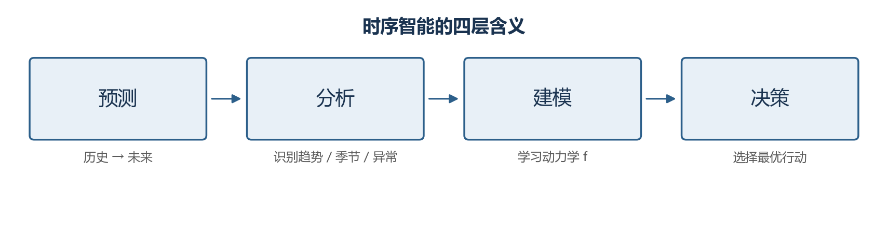

本书大部分篇幅围绕预测展开，故有必要先将其形式化。设观测序列为 $y_{1:t}$，预测任务可表述为给出未来 $H$ 步的**点预测** $\hat{y}_{t+h\mid t}$（$h=1,\dots,H$），或给出**预测分布**

$$
\mathbb{P}\big(y_{t+1:t+H}\mid y_{1:t}\big). \tag{1-1}
$$

点预测回答「最可能是多少」，概率预测回答「有多少把握」。在风险敏感的领域（金融、能源、医疗），仅有点预测往往不够，完整的预测分布才是决策的依据。二者的形式化差异将在第 2 章以恰当评分规则（proper scoring rule）严格处理，并在第 24、38 章分别展开概率预测模型与评估指标。

**例 1.1（同一条序列的四类任务）**　考虑某城市电网连续 720 小时的负荷记录 $\{y_t\}$。分析任务问：负荷是否存在日周期与周周期？上周某日尖峰是否异常？预测任务问：给定过去 168 小时，预测未来 24 小时逐小时负荷。建模任务问：能否用「气温 + 日历 + 基荷 + 自回归」的结构方程刻画负荷的生成机制，使模型在季节更替后仍成立？决策任务问：依据明日负荷预测，如何安排机组组合与备用容量，使总成本最小？同一份数据、四个问题、四类方法——这正是本书「篇」的划分依据（1.5 节）。

## 1.2　时序预测的历史脉络

理解一门学问，须先理解它的历史。时序预测的发展，是一部「从经验到模型、从单一到通用」的演进史。

**第一阶段：经验与外推（19 世纪—1920 年代）。** 这一时期的预测以移动平均、图解外推等经验方法为主，预测者凭借目测延长趋势线。转折点出现在 1927 年，Yule 为研究太阳黑子周期引入自回归模型[1]，首次把时序从「画图」推进到「建模」：未来的值被表达为过去值的线性组合加一个不可预测的新息。自此，时序成为可以用数学语言严格表述的对象。

**第二阶段：统计建模（1930 年代—1970 年代）。** 经典时间序列分析的黄金时代。Holt（1957）与 Winters（1960）发展指数平滑，Box 与 Jenkins（1970）系统化 ARIMA 方法论，确立「识别—估计—诊断—预测」的规范流程[2]；Kalman（1960）提出状态空间滤波，把「隐状态」引入时序建模；Engle（1982）提出 ARCH，开启波动率建模。这些方法至今仍是工业界最常用的基准工具。

**第三阶段：机器学习与计量交叉（1980 年代—2010 年代）。** 一方面，计量经济学的向量自回归、协整、GARCH 族日趋成熟；另一方面，以特征工程加集成树为核心的机器学习方法在预测竞赛中屡创佳绩。1997 年 Hochreiter 与 Schmidhuber 提出长短期记忆网络[3]，为时序的深度学习埋下伏笔。

**第四阶段：深度学习（2010 年代—2022 年）。** 2017 年 Transformer 的提出深刻改变了序列建模[4]。此后 Informer、Autoformer、PatchTST 等时序专用架构相继涌现，在长序列预测上全面超越传统方法。值得注意的是 2023 年 DLinear 的「反直觉」结果：一层线性模型在多个基准上胜过复杂 Transformer[5]，促使学界重新审视归纳偏置与模型容量的平衡。

**第五阶段：基础模型与智能（2023 年至今）。** TimeGPT、Chronos、Moirai、Moment 等时序大模型试图实现「一个模型预测一切」[6]；Neural ODE、Mamba 让建模走向连续时间与动力学学习；世界模型与因果推断推动时序智能从「预测」迈向「理解与决策」。到 2025—2026 年，这一阶段进一步分化为四条线索：以流匹配在连续值空间做原生生成预训练的 Sundial、以稀疏混合专家推到十亿参数并引入串行 Token 预测的 Timer-S1、转向原生多变量与生产化部署的 TimesFM 3.0，以及以不足三百万参数逼近大模型精度的 Reverso；Aurora、CoRA、DADA 则把基础模型从预测扩展到多模态融合与通用异常检测。第 27 章给出这一谱系的完整剖析与从 1927 年到 2026 年的时间线，第 41 章据此讨论通用化的开放问题。

图 1-2 以时间轴归纳上述脉络。贯穿这条脉络的一条主线是：**预测方法的能力边界，始终由「我们能对数据做出多强的结构性假设」决定。** 统计模型假设线性与平稳，深度学习假设数据量大且分布可分，大模型假设跨域知识可迁移。

> 【图 1-2　时序预测方法论的演进时间轴】（原图见 `figures/图1-2.png`）：横轴为年份 1900—2026，分五个代际阶段；标记 1927 Yule、1970 Box-Jenkins、1982 ARCH、1997 LSTM、2017 Transformer、2021 Informer、2023 时序大模型等节点。

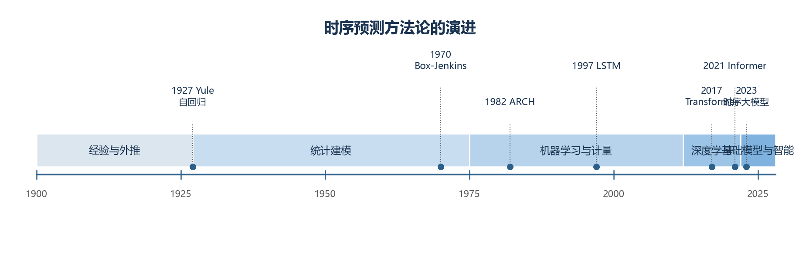

**例 1.2（假设强度与数据量）**　设要预测某新上线产品的日销量，仅有 20 天数据。此时 ARIMA 等强假设模型（假设线性、平稳、可由少量参数刻画）反而稳健；而一个百万参数的深度模型会因数据不足而过拟合。反之，若有 500 家门店、每家 3 年数据，深度模型与基础模型能学到跨门店共享的模式，优势显现。这一「假设强度—数据量」的权衡，将在第 17 章（表格化范式）与第 29 章（大模型选型）反复出现。

## 1.3　时序问题的根本困难

时序预测之所以困难，源于数据本身固有的若干性质。认清这些困难，是理解后续所有方法的钥匙。

**其一，非平稳性（non-stationarity）。** 序列的均值、方差或自相关结构随时间变化。宏观经济的长期增长使 GDP 序列非平稳，用电负荷随季节起伏，皆是例证。非平稳意味着「历史分布」不再代表「未来分布」，直接外推历史统计量将引入系统性偏差。

**其二，高维性（high-dimensionality）。** 多元时序中变量数 $D$ 巨大——传感器网络动辄上千测点，宏观经济监测涉及数百指标——且变量之间存在复杂耦合。维度灾难使参数估计与计算都面临严峻挑战。

**其三，稀疏与缺失（sparsity and missingness）。** 现实观测往往不规则、大量缺失、采样频率不一，破坏了标准模型「等间隔、完整观测」的前提。不完全观测下的预测是第 5、25 章的核心议题。

**其四，噪声（noise）。** 观测噪声与过程噪声叠加，当信噪比低时，模型极易过拟合噪声而非学习真实规律。

**其五，反馈（feedback）。** 预测本身会影响未来：股价预测改变交易行为，负荷预测影响调度决策。这种反馈破坏了「独立同分布」的统计前提，使预测与决策耦合（第 32 章）。

**其六，分布漂移（distribution shift）。** 数据生成机制随时间演化——政策调整、技术更替、市场结构变化——使训练阶段的规律在应用阶段失效，模型需要持续的监控与更新（第 40 章）。

**表 1-1　时序问题的六类根本困难及其应对**

| 困难 | 本质 | 应对章节 |
|------|------|----------|
| 非平稳性 | 统计性质随时间变化 | 第 3、22 章 |
| 高维性 | 变量多且强耦合 | 第 10、23 章 |
| 稀疏与缺失 | 观测不规则、不完整 | 第 5、25 章 |
| 噪声 | 信噪比低 | 第 13、24 章 |
| 反馈 | 预测反作用于系统 | 第 32 章 |
| 分布漂移 | 数据生成机制演化 | 第 25、40 章 |

六类困难并非孤立，而是相互交织。例如「非平稳」既可能来自真实的趋势演化，也可能来自一次未识别的结构突变，二者的应对完全不同——前者宜差分或分解，后者宜分段建模（第 9 章）。这提示我们：**方法选择必须以对困难来源的诊断为前提，而非套用单一模型。**

## 1.4　时序任务的分类谱系

时序智能不止于预测。为建立全局观念，本书将全部时序任务归纳为九类。

**表 1-2　时序任务的九类谱系**

| 任务 | 问题形式 | 对应章节 |
|------|----------|----------|
| 预测 | $y_{1:t}\to y_{t+1:t+H}$ | 第 11–29 章 |
| 分类 | 为整条序列贴标签 | 第 7 章 |
| 聚类 | 无监督分组 | 第 7 章 |
| 异常检测 | 识别异常点或异常段 | 第 8 章 |
| 变点检测 | 定位分布发生变化的位置 | 第 9 章 |
| 补全 | 填补缺失值 | 第 5、25 章 |
| 因果推断 | 推断变量间的因果方向 | 第 31 章 |
| 生成 | 合成新的序列 | 第 24 章 |
| 决策 | 选择使收益最大的行动 | 第 32 章 |

九类任务共享同一套底层工具（特征、模型、评估），但目标函数与评估指标截然不同。例如分类关注判别边界，预测关注外推误差，异常检测关注稀有模式的召回——用同一指标衡量所有任务是常见误用（第 38 章将系统辨析）。本书按「先分析、后预测、再理解与决策」的顺序组织，使读者先掌握底层工具，再逐类攻克。

## 1.5　全书的结构安排

全书共九篇四十一章，逻辑上层层递进。

**第一篇（第 1–4 章）** 建立数学基础与可预测性理论，回答「时序智能受到哪些数学约束」。**第二篇（第 5–10 章）** 讲时序分析——描述、特征、相似性、异常、变点与多元结构，因为「先会分析，才会预测」。**第三篇（第 11–16 章）** 系统梳理经典统计预测方法，它们是理解一切现代方法的基准线。**第四篇（第 17–25 章）** 展开机器学习与深度时序模型，实现容量与精度的跃迁。**第五篇（第 26–29 章）** 聚焦时序大模型，讨论范式的统一与迁移。**第六篇（第 30–32 章）** 迈向世界模型与决策智能，从「预测数值」走向「建模世界、干预未来」。**第七篇（第 33–37 章）** 呈现控制论、复杂系统、计量经济学、统计学、信号处理与信息论等学科的视角，打通学科壁垒。**第八篇（第 38–40 章）** 讨论评估体系、典型应用与工程化实践。**第九篇（第 41 章）** 展望未来并列出开放问题。

各章并非孤立专题，而是相互贯通的网络。例如第 2 章的概率预测基础是第 24 章概率模型与第 38 章评估指标的共同底座；第 4 章的可预测性理论是第 29 章审视大模型局限的理论武器；第 13 章的状态空间模型则是第 30 章世界模型的直接来源。读者可借助正文的显式交叉引用把握这张网络。按基础理论「首次且唯一」讲授、后续交叉引用展开的原则，全书对 VAR、状态空间、评估指标等知识点规定了唯一的讲授位置（详见后续各章的交叉引用），以避免重复、提高知识密度。第 41 章表 41-1 进一步给出「九篇 × 四层能力 × 五层可预测性」的完整映射，它既是收官处的全书索引，也可作为阅读地图在开篇先读，帮助读者随时定位当前内容在整体框架中的位置。

## 1.6　四层能力体系

前言把时序智能界定为「预测、分析、建模、决策」四层含义，本节将其发展为全书的理论框架。

**定义 1.3（四层能力体系）**　时序智能由四个递进的能力层级构成，每一层回答一类根本问题：

- **Level 1　时序分析（Analysis）**：回答「发生了什么」，对序列作描述与诊断，研究结构、模式、异常、变化与关联；
- **Level 2　时序预测（Prediction）**：回答「将会发生什么」，利用历史信息、外生变量与学习模型推断未来；
- **Level 3　时序建模（Modeling）**：回答「为什么发生、系统如何演化」，学习状态、动力学、变量关系与因果机制；
- **Level 4　时序决策（Decision）**：回答「应该采取什么行动」，结合预测、因果与系统模型优化未来行为。

四层之间存在递进关系，**但不是严格的线性依赖**。这一点必须在理论上说清楚：统计预测（Level 2）并不要求先有完整的动力学模型（Level 3），ARIMA 无需知道电网的物理方程即可预测负荷；决策（Level 4）也不必精确预测每一个未来观测值，模型预测控制只需要在有限时域内足够好的预测与一个可优化的代价函数。反之，若把四层误解为「必须逐级完成」，就会错误地认为「没有世界模型就不能做预测」，这与两百年的预测实践相悖。

**例 1.3（四层的非线性依赖）**　续用例 1.1 的电网负荷。Level 2 可用季节朴素法直接预测明日负荷（用上周同日值），完全不依赖 Level 3 的物理模型，误差可能已满足调度粗排；Level 4 的机组组合只需负荷的预测区间与代价函数，无需逐点精确值；而 Level 3 的价值在于当电网结构改变（新增大量分布式光伏）时，基于物理与因果的模型比纯统计外推更能保持有效。这说明高层能力的收益往往体现在**分布变化与干预场景**，而非平稳期的精度。

四层框架在本书中承担三个作用：其一，为九篇划分提供理据（第二篇偏 Level 1，第三至五篇偏 Level 2，第六篇偏 Level 3–4）；其二，为每章定位提供坐标；其三，在第 41 章回扣，讨论时序智能能否走向更通用的智能系统，形成首尾闭环。

## 1.7　理论主线：五层可预测性

本书不满足于罗列模型，而试图回答一个更根本的问题：**一条时间序列为什么可以预测？在什么条件下可以预测？预测能力的上限在哪里？** 为此建立五层可预测性框架（表 1-3）。

**表 1-3　五层可预测性框架**

| 层 | 名称 | 判据 / 工具 | 主要落点 |
|----|------|-------------|----------|
| L1 | 统计可预测性 | 自相关、偏自相关、条件期望、线性投影 | 第 2、3、11、12 章 |
| L2 | 信息论可预测性 | 条件熵、互信息、熵率、信息增益 | 第 4、24、38 章 |
| L3 | 动力学可预测性 | Lyapunov 指数、吸引子、相空间重构 | 第 4、30、34 章 |
| L4 | 因果可预测性 | 结构因果模型、干预、反事实、环境不变性 | 第 31 章 |
| L5 | 决策可预测性 | 模型预测控制、策略优化、决策价值 | 第 32、38 章 |

须强调：这五层是**理论组织框架，不是严格的数学蕴含关系**。L3 混沌并不意味着 L1 失效（混沌序列短期仍有自相关），L4 的因果结构也不保证 L2 的条件熵更低。框架的价值在于提供一种统一的追问方式。据此，本书对每一个方法都追问四件事：① 它利用了哪一层可预测性；② 它隐含了什么假设；③ 它突破了前一方法的什么限制；④ 它无法突破什么理论边界。

**例 1.4（四问示例）**　以 ARIMA 与 Transformer 对照。ARIMA 利用 L1（历史线性相关），假设平稳或可差分平稳、误差白噪声，突破了「无模型的朴素外推」，但无法突破线性假设，也不能跨越信息论下界。Transformer 利用 L1 与 L2（复杂非线性依赖），假设存在大规模可迁移的模式，突破了线性与固定阶数的限制，但在接近白噪声的序列上并不优于朴素法——因为下界由数据本身决定，与模型容量无关（第 4 章严格化，第 29 章据此审视大模型幻觉）。世界模型则试图进入 L3，学习状态转移规律以便仿真与规划。三者不是简单的技术迭代，而是**对可预测性来源的不同建模**。

由此还须澄清三个常被混淆的命题，它们将分别在第二、四、三十一章严格说明：① **平稳性不等于可预测性**（白噪声平稳却完全不可预测）；② **非平稳性不等于不可预测性**（含确定性趋势与季节的非平稳序列，经分解或差分后高度可预测）；③ **相关性不等于因果性**（预测意义上的 Granger 因果不等于真实机制因果）。

## 1.8　贯穿全书的统一案例

方法谱系横跨两百年、涉及数十种模型，若每章各用一份互不相干的数据，读者读完易只记住一串模型名称，却看不清它们之间的关系。为此本书设计一条**贯穿全书的统一案例**：城市电网负荷。

选择电力负荷，是因为它具备罕见完备的教学属性：存在趋势与季节性；存在日、周、年多重周期；存在多变量关系（气温、湿度、日历、电价）；存在异常与结构变点（极端天气、政策调整、设备故障）；可研究短、中、长期预测；可研究概率预测与预测区间；可研究气象因素的因果作用；最终可进入电网调度与优化控制（Level 4）。同一份数据在全书中反复出现，但每章追问不同：

**表 1-4　统一案例的章节映射（节选）**

| 章 | 案例研究内容 | 章 | 案例研究内容 |
|----|--------------|----|--------------|
| 2 | 随机过程与统计性质 | 3 | 时域、频域与季节性 |
| 4 | 可预测性与预测极限 | 8 | 异常检测 |
| 9 | 变点检测 | 12 | ARIMA 预测 |
| 17 | XGBoost 预测 | 18 | LSTM 预测 |
| 22 | PatchTST 预测 | 27 | 时序基础模型 |
| 31 | 气象干预的因果分析 | 32 | 负荷预测与调度决策 |

为避免全书过度依赖单一场景，第 39 章另设金融、气象、工业设备等**专题案例**，展示领域差异如何改变方法选型这一更普遍的命题。

需要说明，选择城市电网负荷作为贯穿全书的统一案例，是一种教学法上的权衡而非普适性主张。负荷序列日周期与周周期显著、以连续取值为主、外生协变量相对可控，适合展示从平稳性诊断到调度决策的完整链条；但它并不代表所有时序形态——点过程与不等间隔观测（第 25 章）、间歇需求（第 39.7 节）、高频金融的厚尾与微观结构（第 39.1 节）都超出了单条连续曲线的假设。读者在后续章节遇到与负荷特性不符的算例时，应把注意力放在「方法假设与数据结构是否匹配」上，而非记住某个具体数值；这也正是第 4 章要为可预测性划定边界、第 39 章要按领域讨论「什么算好」的原因。第二篇将从这条序列的分析与清洗开始。

## 本章小结

本章确立了全书的问题意识、研究对象与理论框架。

我们首先把时间序列界定为存在时间依赖的观测序列，把时序智能界定为分析、预测、建模、决策四类递进能力，并把预测形式化为点预测与预测分布两种表达。回顾两百余年历史可见，方法演进的主线是「假设强度的逐步放松」：从假设线性平稳，到假设大数据的可分性，再到假设跨域知识可迁移；而 2023 年 DLinear 对 Transformer 的质疑提醒我们，容量并非越大越好，归纳偏置与数据量的匹配才是关键。

我们进一步剖析了非平稳、高维、稀疏缺失、噪声、反馈、分布漂移六类根本困难，指出方法选择必须以对困难来源的诊断为前提；归纳了九类任务谱系，说明目标函数与评估指标不可混用。最重要的是，本章提出了本书自己的两个理论工具：四层能力体系（Level 1–4，递进但非线性依赖）与五层可预测性框架（L1–L5，作为理论组织框架而非数学蕴含）。前者为全书分篇与每章定位提供坐标，后者为「每个方法追问四问」提供统一方式，并由此引出三个必须澄清的混淆命题。二者将在第 41 章回扣，形成首尾闭环。

最后，本章确立电力负荷为贯穿全书的统一案例，并给出章节映射，使读者能在同一份数据上比较不同方法的得失。从下一章起，我们先补足数学与随机过程基础，为后续所有模型的严格推导准备语言。

**进一步阅读**　本章建议延伸阅读的文献：[7]、[8]、[9]、[10]。

## 参考文献

[1] Yule G U. On a method of investigating periodicities in disturbed series, with special reference to Wolfer's sunspot numbers. *Philosophical Transactions of the Royal Society A*, 1927, 226: 267–298.

[2] Box G E P, Jenkins G M. *Time Series Analysis: Forecasting and Control*. San Francisco: Holden-Day, 1970.

[3] Hochreiter S, Schmidhuber J. Long short-term memory. *Neural Computation*, 1997, 9(8): 1735–1780.

[4] Vaswani A, Shazeer N, Parmar N, et al. Attention is all you need. *Advances in Neural Information Processing Systems*, 2017, 30.

[5] Zeng A, Chen M, Zhang L, Xu Q. Are transformers effective for time series forecasting? *AAAI*, 2023.

[6] Liang Y, Wen H, Nie Y, et al. Foundation models for time series analysis: A tutorial and survey. *KDD*, 2024.

[7] Hyndman R J, Athanasopoulos G. *Forecasting: Principles and Practice*. 3rd ed. Melbourne: OTexts, 2021.

[8] Makridakis S, Spiliotis E, Assimakopoulos V. The M4 Competition: Results, findings, conclusion and way forward. *International Journal of Forecasting*, 2018, 34(4): 802–808.

[9] Pearl J, Mackenzie D. *The Book of Why*. New York: Basic Books, 2018.

[10] Shumway R H, Stoffer D S. *Time Series Analysis and Its Applications*. 4th ed. New York: Springer, 2017.

---

# 第 2 章　时间序列的随机过程理论与数学基础

本章建立全书共同依赖的"语言层"。任何一个时序模型，无论简单如指数平滑、复杂如时序大模型，其背后都站立着随机过程、平稳性、自协方差、创新表示与概率预测这些基本概念。本章在严格定义它们的同时，始终盯住一个朴素的问题：**这个概念对预测意味着什么？** 本章定位为全书的随机过程理论与数学基础，并以 2.6 节「数据生成机制与创新表示」统摄全篇——目的是为第 12 章 ARIMA、第 13 章状态空间、第 18 章起的深度学习、乃至第 30 章世界模型提供一个**统一的理论起点**：它们本质上都是在对同一个不可预测的新息序列 $\varepsilon_t$ 作不同的变换与建模。

需要先明确本书看待时间序列的根本立场。观测到的序列 $y_1,\dots,y_T$ 并非孤立数字的堆积，而被视为某个**数据生成过程**（data generating process, DGP）的一次实现。这一点决定了后续所有推断的合法性：我们真正关心的不是这次实现里的偶然起伏，而是过程本身的统计规律是否稳定到"可由历史外推到未来"。整个第一篇（第 2–4 章）都在回答这个前提何时成立、何时不成立。

从历史看，这套语言是多条源流汇合的结果：Yule 与 Wold 在 1920–30 年代奠定自回归与平稳过程的分解理论[4][11]，Kolmogorov 与 Doob 给出随机过程与鞅的严格基础[5]，Box 与 Jenkins 把可逆性等结构约定系统化[11]，Gneiting 与 Raftery 等则把概率预测的评估确立为恰当评分规则[6][7][8]。本章把这些成果压缩为七节，并全程以统一案例——某城市电网的日最高负荷——作为直觉锚点。遵循全书「基础理论只讲一次」的编写原则，恰当的**评分规则数学定义**在此给出，其系统汇总与实验用法归第 38 章；VAR 等多元结构归第 10 章；状态空间与卡尔曼滤波归第 13 章。

本章结构：2.1 节区分随机过程与确定性过程；2.2 节建立平稳性、遍历性与相依序列的极限定理；2.3 节给出矩、白噪声、鞅差与条件期望；2.4 节定义概率预测与恰当评分规则；2.5 节整理三大估计范式；2.6 节以 Wold 分解给出创新表示，并澄清三个易混淆命题；2.7 节小结。

## 2.1　随机过程与确定性过程

**定义 2.1（随机过程）** 一族按时间指标 $t$ 排列的随机变量 $\{Y_t\}_{t\in\mathbb{Z}}$ 称为随机过程（stochastic process）；观测序列 $\{y_t\}$ 是其一次样本路径（sample path / realization）。

与随机过程相对的是**确定性过程**：给定初值与演化规则后，未来完全确定、不含任何新息（如第 4 章的 Logistic 映射、无噪声的线性趋势 $y_t=a+bt$）。现实序列往往介于两者之间，可写成"确定性结构 + 随机扰动"。这一区分对预测至关重要：确定性部分理论上可精确外推，随机部分则构成第 4 章所说的**不可约误差**。还要区分**线性**与**非线性随机过程**：若 $Y_t$ 可由新息的线性组合表示（2.6 节的 Wold 形式），称线性过程；若含状态依赖、阈值、乘积项（如第 15 章 GARCH 的方差方程、第 18 章后的深度模型），则为非线性过程——线性过程有完备的二阶理论，非线性过程的信息可能藏在二阶矩之外（须借第 4、37 章的熵与互信息捕捉）。

**例 2.1（统一案例：把负荷拆成确定与随机）** 城市日最高负荷可粗写为 $L_t=\underbrace{\beta_0+\beta_1 t}_{\text{趋势}}+\underbrace{s(t)}_{\text{季节}}+\underbrace{u_t}_{\text{随机}}$。其中趋势与季节是确定性结构（第 3 章 STL、第 16 章 Prophet 负责提取），$u_t$ 是天气、突发事件等带来的随机扰动。把 $u_t$ 分别假设为白噪声、AR(1)、或带异方差，就得到从朴素基准到 ARIMA 再到 GARCH 的不同模型——**建模的对象其实一直是这个随机部分**。这个例子也说明：把明显含趋势的序列直接当平稳白噪声建模，等于把可预测的确定性结构误丢进了误差项。

## 2.2　平稳性、遍历性与极限定理

平稳性（stationarity）是时序建模最核心的假设，刻画"统计规律不随时间漂移"这一理想性质，它有强弱两种表述。

**定义 2.2（严平稳）** 若对任意时移 $k$ 与任意时刻 $t_1,\dots,t_n$，联合分布不变，即

$$
(Y_{t_1},\dots,Y_{t_n}) \;\stackrel{d}{=}\; (Y_{t_1+k},\dots,Y_{t_n+k}), \tag{2-1}
$$

则称过程 $\{Y_t\}$ 严平稳。**定义 2.3（弱平稳）** 若

$$
\mathbb{E}[Y_t] = \mu\ (\text{常数}), \qquad \mathrm{Cov}(Y_t, Y_{t-k}) = \gamma_k\ (\text{仅依赖于} k), \tag{2-2}
$$

则称其弱平稳（二阶/协方差平稳）。严平稳要求整个分布不变、条件苛刻；弱平稳只约束前两阶矩、易验证易使用。本书若无特别说明，"平稳"均指弱平稳。平稳性之所以重要，在于它使"用一条序列估计总体、再外推未来"在理论上成立：矩不随时间变，整条样本才可用来估计同一个 $\mu,\gamma_k$。

支撑"由一条序列推断总体"的另一性质是遍历性。

**定义 2.4（各态历经性 / 遍历性）** 若过程的时间平均以概率 1 收敛于总体平均，即

$$
\frac{1}{T}\sum_{t=1}^{T} Y_t \;\xrightarrow{a.s.}\; \mathbb{E}[Y_t], \quad T\to\infty, \tag{2-3}
$$

则称其关于均值遍历（ergodic）。遍历性保证单条足够长的样本路径能代表整个随机过程；本书绝大多数估计量的一致性都隐式依赖它。需注意**平稳不必然遍历**（如 $Y_t\equiv Z$，$Z\sim N(0,1)$ 对所有 $t$，序列平稳却时间平均恒为 $Z\neq\mathbb E[Y_t]=0$），故二者须分别对待。

在相依序列下，经典大数律与中心极限定理需附加**混合（mixing）或遍历**条件才成立：对满足适当 $\alpha$-混合且 $\sum_k\gamma_k<\infty$ 的平稳过程，有 $\sqrt{T}(\bar Y_T-\mu)\xrightarrow{d}N\big(0,\ \sum_{k=-\infty}^{\infty}\gamma_k\big)$——长期方差是**自协方差之和**而非单期方差[1][10]。这个结论直接解释了为何时序样本均值的标准误不能按独立同分布公式 $s/\sqrt T$ 计算，也为第 38 章 Diebold–Mariano 检验使用 HAC（异方差自相关一致）方差估计埋下伏笔。

一个必须在此点明的维度是**记忆长度**。若 $\sum_k|\gamma_k|<\infty$（ACF 可和、按指数或更快衰减），称**短记忆**过程，ARMA 属此类；若 ACF 以双曲速率 $\rho_k\sim c\,k^{2d-1}$ 衰减、$\sum_k|\gamma_k|$ 发散，称**长记忆 / 长程相关**（如分数差分 ARFIMA[9][13]），其可预测结构比短记忆过程延伸得更远（第 3 章 Hurst 指数、第 12 章 FIGARCH 呼应）。区分二者，决定了长程预测时"历史还有多少信息可用"。

**例 2.2（统一案例：负荷序列的平稳性诊断）** 对两年日最高负荷直接作 ADF 检验（第 3 章），$\tau=-1.9$ 不能拒绝单位根，序列非平稳；一阶差分并剔除周季节后 $\tau=-8.7$，可视为平稳。其样本 ACF 在滞后 1 处 $\hat\rho_1\approx0.63$，随后按 $\approx0.63^k$ 衰减、可和——属**短记忆**过程，故第 12 章 ARIMA 的低阶设定足以刻画。若某流域年径流序列的 $\hat\rho_k$ 在 $k=100$ 仍显著非零，则须改用长记忆模型。这个例子把"平稳化 → 判记忆长度 → 定模型类"串成一条诊断链。

## 2.3　矩、自协方差、白噪声与鞅差

刻画记忆最自然的工具是自协方差函数与自相关函数。

**定义 2.5（自协方差与自相关）** 对弱平稳过程，滞后 $k$ 的自协方差与自相关为

$$
\gamma_k = \mathrm{Cov}(Y_t, Y_{t-k})=\mathbb{E}\big[(Y_t-\mu)(Y_{t-k}-\mu)\big],\qquad
\rho_k = \frac{\gamma_k}{\gamma_0},\quad \rho_0=1,\ |\rho_k|\le1. \tag{2-4}
$$

由平稳性 $\gamma_k=\gamma_{-k}$，故关于 $k$ 对称；$\gamma_0=\mathrm{Var}(Y_t)$。样本对应为 $\hat\gamma_k=\frac1T\sum_{t=k+1}^T(y_t-\bar y)(y_{t-k}-\bar y)$、$\hat\rho_k=\hat\gamma_k/\hat\gamma_0$。自相关函数（ACF）图是时序分析的第一张图：衰减快慢反映记忆长短、周期起伏反映季节；ACF/PACF 形态直接决定第 12 章 ARMA 的定阶。图 2-1 给出三类典型序列的 ACF。

> 【图 2-1　典型序列的自相关函数】（原图见 `figures/图2-1.png`）：三个子图——(a) 白噪声的 ACF，除 $k=0$ 外均落在 $\pm1.96/\sqrt T$ 置信带内；(b) 正系数 AR(1) 的 ACF 呈指数衰减；(c) 含季节周期序列在季节滞后处出现峰值。

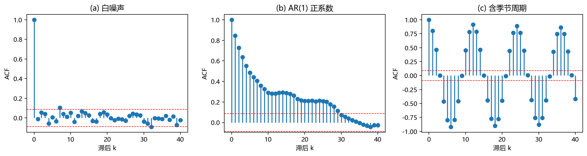

须强调：自相关只刻画**线性**依赖，非线性依赖需互信息、传递熵（第 4、37 章）度量；样本 $\hat\rho_k$ 有偏且方差随 $k$ 增大，判断显著性常用 $\pm1.96/\sqrt T$ 近似带。

**定义 2.6（白噪声）** 若 $\{\varepsilon_t\}$ 满足

$$
\mathbb{E}[\varepsilon_t]=0,\quad \mathrm{Var}(\varepsilon_t)=\sigma^2,\quad \gamma_k=0\ (k\neq0), \tag{2-5}
$$

则称白噪声，记 $\varepsilon_t\sim\mathrm{WN}(0,\sigma^2)$。白噪声的过去与未来毫无线性关联，是"完全不可预测"的基准——给定任何历史，最优预测都是其均值零。**定义 2.7（鞅差序列，MDS）** 若

$$
\mathbb{E}\big[\varepsilon_{t+1}\mid\mathcal{F}_t\big]=0, \tag{2-6}
$$

其中 $\mathcal{F}_t$ 为截至 $t$ 的信息集，则称 $\{\varepsilon_t\}$ 为鞅差序列。白噪声只要求**不相关**，鞅差要求**条件均值**为零（允许条件方差随历史变化）——后者正是第 15 章 GARCH 的新息：它条件均值不可预测，条件方差却可预测。这一区分是理解"方向不可预测、幅度可预测"的关键。

**定义 2.8（随机游走与鞅）** 若 $Y_t=Y_{t-1}+\varepsilon_t$（$\varepsilon_t\sim\mathrm{WN}(0,\sigma^2)$）则为随机游走；递推展开 $Y_t=Y_0+\sum_{s\le t}\varepsilon_s$ 给出

$$
\mathrm{Var}(Y_t)=t\sigma^2, \tag{2-7}
$$

方差随 $t$ 线性增长、过程非平稳，但其一步最优预测恰为当前值 $\hat y_{t+1\mid t}=y_t$。更一般地，若 $\mathbb E[Y_{t+1}\mid\mathcal F_t]=Y_t$ 则称鞅——"明天的最优预测是今天"。三者构成递进链：白噪声定义无记忆，随机游走定义记忆的累积，鞅/鞅差给出最优预测的一般形式，将在第 11、12、15 章反复出现。

**条件期望**是贯穿全书的预测算子：在平方误差损失下，$h$ 步最优预测就是 $\hat y_{t+h\mid t}=\mathbb E[Y_{t+h}\mid\mathcal F_t]$。这一事实把"预测"与"随机过程的条件结构"直接等同，是第 2.6 节创新表示、第 12 章 ARIMA 预测、第 13 章卡尔曼滤波共同的理论基石。

## 2.4　概率预测与恰当评分规则

点预测给出单一数值，但预测的不确定性往往与预测值本身同等重要。**概率预测**以完整分布刻画未来，是风险决策（第 15 章 VaR、第 32 章调度）的基础。

**定义 2.9（概率预测）** 以预测分布 $F$ 刻画未来观测 $y$ 的不确定性，常用三种表达：预测区间 $[L,U]$ 满足 $\mathbb P(y_{t+h}\in[L,U])=1-\alpha$；分位数预测 $\hat q_\tau$ 满足 $\mathbb P(y_{t+h}\le\hat q_\tau)=\tau$；完整预测密度 $p(y_{t+h}\mid y_{1:t})$。

评估概率预测必须使用**恰当评分规则**（proper scoring rule）。设真实观测 $y$、预测分布 $F$、评分函数 $S(F,y)$ 度量偏离。**定义 2.10（恰当评分规则）** 若对任意 $G$ 与 $F\neq G$，

$$
\mathbb{E}_{Y\sim G}\big[S(G,Y)\big]\le\mathbb{E}_{Y\sim G}\big[S(F,Y)\big], \tag{2-8}
$$

则 $S$ 恰当；等号当且仅当 $F=G$ 成立时称严格恰当。恰当性的意义是：报告自己的真实信念才期望最优，从而防止预测者投机取巧[6]。两个最重要的严格恰当规则是**对数得分** $S(F,y)=-\log f(y)$ 与 **连续分级概率得分（CRPS）**

$$
\mathrm{CRPS}(F,y)=\int_{-\infty}^{\infty}\big(F(z)-\mathbf 1\{z\ge y\}\big)^2\,dz. \tag{2-9}
$$

CRPS 有一个优美性质：当预测分布退化为单点 $\hat y$ 时，$F(z)=\mathbf 1\{z\ge\hat y\}$，积分化为 $\int_{\hat y}^{y}dz=|y-\hat y|$，即**退化为绝对误差**。因此 CRPS 是"点预测误差在概率预测上的自然推广"[7][8]，也是全书概率预测评估的标准工具（系统汇总见第 38 章）。

**例 2.3（CRPS 手算）** 设预测分布为 $N(\mu=4.8,\sigma=0.2)$，实际观测 $y=5.0$（GW）。正态 CRPS 有闭式 $\mathrm{CRPS}=\sigma\big[\frac{y-\mu}{\sigma}(2\Phi(\frac{y-\mu}{\sigma})-1)+2\phi(\frac{y-\mu}{\sigma})-\frac1{\sqrt\pi}\big]$，其中 $z=(5.0-4.8)/0.2=1$，$\Phi(1)=0.8413$、$\phi(1)=0.2420$、$1/\sqrt\pi=0.5642$。代入得 $\mathrm{CRPS}=0.2\,[1\times(2\times0.8413-1)+2\times0.2420-0.5642]=0.2\,[0.6826+0.4840-0.5642]=0.2\times0.6024\approx0.120$。作为对照，若模型退化为点预测 $\hat y=4.8$，绝对误差为 $|5.0-4.8|=0.20$；CRPS 更小，因为正态预测把 5.0 视为分布内较可能的值而非纯误差。这个算例展示了恰当评分规则如何同时奖励"预测准"与"不确定性报得诚实"。

## 2.5　参数估计方法

时序模型几乎都含未知参数，估计有三大范式（回顾第 2 章原有骨架，此处补文内引用与分工）。**极大似然估计（MLE）** 选择使似然最大的参数：

$$
\hat\theta_{\mathrm{MLE}}=\arg\max_\theta\sum_{t=1}^{T}\log p(y_t\mid y_{1:t-1};\theta), \tag{2-10}
$$

其关键技巧是**预测误差分解**：由概率链式法则，

$$
p(y_{1:T};\theta)=\prod_{t=1}^{T}p(y_t\mid y_{1:t-1};\theta), \tag{2-11}
$$

把联合似然化为逐期一步预测密度之积[1]。对高斯 ARMA，条件似然由递推计算；对状态空间模型，由卡尔曼滤波新息给出（第 13 章式 (13-9)）。**矩估计（MoM）** 令样本矩等于理论矩，如 AR(1) 的 $\rho_1=\phi$ 给出 $\hat\phi=\hat\rho_1$，简单但效率较低。**贝叶斯估计** 引入先验 $p(\theta)$，由后验 $p(\theta\mid y_{1:T})\propto p(y_{1:T}\mid\theta)p(\theta)$ 得预测分布

$$
p(y_{t+h}\mid y_{1:t})=\int p(y_{t+h}\mid y_{1:t},\theta)\,p(\theta\mid y_{1:t})\,d\theta, \tag{2-12}
$$

自动量化参数不确定性，是第 16 章 BSTS 与 Prophet 的基础。三种范式的深层差别在"是否把参数视为随机"：MLE/MoM 给点估计，贝叶斯给分布——式 (2-12) 的积分正是第 16 章式 (16-2) 的雏形。

## 2.6　数据生成机制与创新表示

前面各节把过程、平稳性、矩、评分规则分别定义过，本节要回答一个更根本、也最能统一全书的问题：**一个平稳序列究竟由什么"生成"？** Wold 于 1938 年给出的分解定理[3][4] 是答案，也是 ARIMA、状态空间、乃至深度生成模型共同的存在性依据。

**定理 2.1（Wold 分解 / 创新表示）** 任一零均值、协方差平稳过程 $\{y_t\}$ 可唯一分解为

$$
y_t=\sum_{j=0}^{\infty}\psi_j\varepsilon_{t-j}+v_t,\qquad \psi_0=1,\ \sum_{j\ge0}\psi_j^2<\infty, \tag{2-13}
$$

其中 $\varepsilon_t$ 是白噪声、且是 $y_t$ 关于其无限历史的最优线性一步预测误差（称为**新息 / innovation**，满足 $\mathbb E[\varepsilon_t\mid\mathcal F_{t-1}]=0$，即为鞅差），$v_t$ 是可由自身过去**线性精确预测**的确定性成分，且 $\varepsilon_t$ 与 $v_s$ 对一切 $t,s$ 不相关。若 $v_t\equiv0$，称过程**纯非确定性 / 正则**（regular）。

式 (2-13) 的含义极为深刻：任何（线性）平稳序列，都是一串**不可预测新息**的加权和。系数 $\psi_j$ 刻画"一个历史冲击如何随时间衰减地影响当前"——当 $\psi_j=\phi^j$ 时即得 AR(1)，当 $\psi_j$ 有限项非零时即得 MA($q$)，当 $\psi(B)=\theta(B)/\phi(B)$ 作有理展开时即得一般 ARMA($p,q$)（第 12 章 12.4 节）。换言之，**ARMA 族不是被"发明"出来的，而是 Wold 分解的有理逼近**[3]；第 13 章状态空间模型是同一新息过程的另一种状态化实现；第 18 章后的深度模型则把线性 $\psi_j$ 换成可学习的非线性变换，但"用历史新息构造未来"的骨架未变；第 30 章世界模型学习的是新息驱动的状态转移。

由式 (2-13) 自然引出两个结构概念。其一是**因果性（causality，更准确译作非预见性）**：若 $\psi_j=0$ 对所有 $j<0$ 成立，即 $y_t$ 只依赖现在与过去的新息、不依赖未来，则称表示是因果的；Wold 分解天然满足。这与第 10 章 Granger 因果、第 31 章结构因果是三个不同概念，不可混淆。其二是**可逆性（invertibility）**：若能把新息反解为观测历史的收敛级数 $\varepsilon_t=\sum_{j\ge0}\pi_j y_{t-j}$（即 $\psi(B)^{-1}$ 收敛），则称可逆——这正是第 12 章 MA 模型要求 $\theta(z)$ 根在单位圆外的理论根源[11]。可逆性保证"从数据可恢复新息"，是似然计算与预测的前提。表 2-1 汇总本章涉及的过程类型。

**表 2-1　随机过程的类型与可预测性对照**

| 过程 | 生成机制 | 记忆 | 可预测性 | 主要落点 |
|------|----------|------|----------|----------|
| 白噪声 | $\psi_0=1$，其余为 0 | 无 | 完全不可预测 | 2.3 节 |
| ARMA / 线性过程 | 有理 $\psi(B)=\theta(B)/\phi(B)$ | 短（指数衰减） | L1 线性可预测 | 第 12 章 |
| 长记忆 ARFIMA | $\psi_j\sim j^{d-1}$ | 长（双曲衰减） | 长程仍有信息 | 第 3 章、[9] |
| 非线性 / 异方差 | 状态依赖、$\sigma_t^2$ 时变 | 依结构 | 二阶可预测 | 第 15 章 |
| 确定性 + 噪声 | $v_t\neq0$ | 结构确定 | 精确外推 + 不可约误差 | 2.1、第 4 章 |

**例 2.4（统一案例：Wold 系数的数值）** 对 2.2 节经差分后的负荷残差拟合 AR(1)，$\hat\phi=0.8$、$\hat\sigma^2=1$。其 Wold 系数 $\psi_j=0.8^j$：$1,\ 0.80,\ 0.64,\ 0.512,\ 0.410,\dots$，$\sum_j\psi_j^2=1/(1-0.64)=2.78$（恰等于第 12 章式 (12-5) 的 $\gamma_0/\sigma^2$）。本期负荷 = 本期新息 + 0.8×上期新息 + 0.64×上上期新息 + …；一单位气温突变的冲击，影响按 0.8 的速率逐期衰减，约 10 期后剩 $0.8^{10}\approx0.107$。这正量化了"短期可预测、长期趋于均值"：可预测性全部来自 $\psi_j$ 尚未衰减完的那部分历史新息。

**三个易混淆命题（初步澄清，第 4.7 节严格化、第 31 章收束）** 由式 (2-13) 可一次性看清三个常被混淆的论断，它们是全书理论主线的三块基石：

1. **平稳性 $\neq$ 可预测性**。白噪声平稳（$\mu,\gamma_k$ 都不随时间变），却完全不可预测；平稳只保证"统计规律不随时间漂移"，不保证"规律里含有可用信息"。
2. **非平稳性 $\neq$ 不可预测性**。含确定性趋势/季节的非平稳序列（如负荷），经分解或差分后确定性部分 $v_t$ 可精确外推、随机部分短记忆可预测，整体反而高度可预测。
3. **相关性 $\neq$ 因果性**。ACF 与 Wold 系数刻画的是**预测意义上的线性依赖**；第 10 章 Granger 因果仍是"预测因果"，与真实机制因果（干预后是否仍成立）是两回事，须第 31 章的结构因果模型回答。

这三个命题分别对应五层可预测性框架（第 1 章 1.7 节、第 4.6 节）里 L1 → L2 → L4 的跃迁：平稳性只是 L1 的前提，可预测性的强弱须由信息论（第 4 章）与因果（第 31 章）进一步判定。把 DGP 与创新表示放在第一篇末尾，正是要给后续 39 章一个统一的提问方式：**这个模型把 $\psi_j$、把新息、把确定性成分 $v_t$ 各自设成了什么？**

## 本章小结

本章以"观测序列是某个数据生成过程的一次实现"为起点，建立了全书的语言层。2.1 节区分随机过程与确定性过程、线性与非线性过程，并以负荷 $L_t=$ 趋势 + 季节 + 扰动说明建模对象其实是随机部分。2.2 节给出严/弱平稳 (2-1)(2-2) 与遍历性 (2-3)，指出平稳不必然遍历，并说明相依序列的极限定理须用长期方差 $\sum_k\gamma_k$（第 38 章 HAC 的由来）；短记忆与长记忆的区分决定了长程预测里历史还剩多少信息。2.3 节定义自协方差/ACF (2-4)、白噪声 (2-5)、鞅差 (2-6) 与随机游走方差 $t\sigma^2$ (2-7)，明确"条件期望是最优预测"这一贯穿全书的算子。2.4 节定义恰当评分规则 (2-8) 与 CRPS (2-9)，以例 2.3 手算展示 CRPS 如何同时奖励准确与诚实。2.5 节整理 MLE/MoM/贝叶斯三范式，预测误差分解 (2-11) 与预测分布积分 (2-12) 分别通向第 13、16 章。

本章最重要的落点是 2.6 节：Wold 分解 (2-13) 把任何线性平稳序列表示为不可预测新息的加权和，$\psi_j$ 统一了 AR(1)、MA($q$)、ARMA($p,q$) 与状态空间模型，并自然引出因果性（非预见性）与可逆性（第 12 章 MA 约束的根源）。例 2.4 用 $\hat\phi=0.8$ 的 Wold 系数把"短期可预测、长期趋均值"量化。由此初步澄清的三个命题——平稳 $\neq$ 可预测、非平稳 $\neq$ 不可预测、相关 $\neq$ 因果——将在第 4.7 节严格化、第 31 章收束。

从理论主线看，本章是 L1 统计可预测性的地基：平稳性与遍历性回答"能否用历史估计未来"，自协方差回答"线性记忆有多长"，Wold 分解回答"可预测性的载体是什么"。本章与全书：第 3 章把 $\gamma_k$ 变换到频域、第 4 章用信息论给出预测下界、第 10 章推广到多元、第 12 章把 $\psi_j$ 参数化为 ARMA、第 13 章把它状态空间化、第 15 章处理新息的异方差、第 30 章把它推广为学得的世界模型。掌握本章，读者便获得一个能贯穿全书的统一提问方式，而非一堆孤立定义。

从四问看，本章确立的随机过程与评分规则利用 L1（统计）与 L2（信息论）：假设序列可被建模为平稳过程、评分规则严格恰当；它突破了「只看点误差」的评估盲区，仍受「模型假设若错则推断失效」的边界约束。

**进一步阅读**　本章建议延伸阅读的文献：[2]、[12]。

## 参考文献

[1] Hamilton J D. *Time Series Analysis*. Princeton: Princeton University Press, 1994.

[2] Brockwell P J, Davis R A. *Introduction to Time Series and Forecasting*. 2nd ed. New York: Springer, 2002.

[3] Brockwell P J, Davis R A. *Time Series: Theory and Methods*. 2nd ed. New York: Springer, 1991.

[4] Wold H. *A Study in the Analysis of Stationary Time Series*. 2nd ed. Stockholm: Almqvist & Wiksell, 1938.

[5] Doob J L. *Stochastic Processes*. New York: Wiley, 1953.

[6] Gneiting T, Raftery A E. Strictly proper scoring rules, prediction, and estimation. *Journal of the American Statistical Association*, 2007, 102(477): 359–378.

[7] Gneiting T. Making and evaluating point forecasts. *Journal of the American Statistical Association*, 2011, 106(494): 746–762.

[8] Gneiting T, Katzfuss M. Probabilistic forecasting. *Annual Review of Statistics and Its Application*, 2014, 1: 125–151.

[9] Beran J. *Statistics for Long-Memory Processes*. New York: Chapman & Hall, 1994.

[10] Davidson J. *Stochastic Limit Theory*. Oxford: Oxford University Press, 1994.

[11] Box G E P, Jenkins G M. *Time Series Analysis: Forecasting and Control*. San Francisco: Holden-Day, 1970.

[12] Priestley M B. *Spectral Analysis and Time Series*. London: Academic Press, 1981.

[13] Granger C W J, Joyeux R. An introduction to long-memory time series models and fractional differencing. *Journal of Time Series Analysis*, 1980, 1(1): 15–29.

---

# 第 3 章　时域、频域与多尺度分析

第 2 章把时间序列确立为随机过程的一次实现，并给出了平稳性、自协方差与白噪声等基本概念。但概念本身还不足以支撑建模：面对一条具体的观测序列，我们首先需要回答的是——它的结构究竟是什么样子？均值是否随时间漂移？记忆有多长？是否存在稳定的周期？这些周期是固定的还是随时间变化的？只有把这些结构看清楚，后续选择 ARIMA、指数平滑还是频域增强的深度模型，才有依据，而不是凭直觉碰运气。

看清楚结构，需要不止一种视角。同一条序列，在**时域**里表现为自相关随滞后的衰减，在**频域**里表现为方差在不同频率上的分配，在**时间—频率联合域**里则表现为局部、随时间演化的振荡模式。三种视角并非彼此替代，而是互补：自相关函数擅长刻画「记忆有多长」，谱密度擅长识别「周期在哪里」，小波变换擅长定位「某个频率何时出现」。本书后续多个方法直接建立在这三种视角之上——第 12 章的 ARIMA 依赖 ACF/PACF 的时域识别，第 21 章的 FEDformer 依赖频域增强，第 22 章的 TimesNet 依赖多周期结构，第 37 章的信号处理视角则把这套工具追到信息论源头。可以说，本章是全书的「结构分析工具箱」。

本章按「先判平稳、再识记忆、后看周期与多尺度」的顺序展开。3.1 节讨论平稳性的统计检验，因为绝大多数时域与频域工具都以平稳为前提；3.2 节从 ACF/PACF 建立模型识别的时域语言；3.3 节转入频域，给出谱密度与周期图；3.4 节把序列分解为趋势、季节与残差等可解释分量；3.5 节用小波变换处理频率随时间变化的非平稳情形；3.6 节讨论介于短记忆与单位根之间的长记忆过程。阅读时建议把 3.2 与 3.3 对照来看，体会「同一结构的两种写法」。

## 3.1　平稳性检验

第 2 章已经给出弱平稳的定义：均值恒定、自协方差只依赖滞后。然而定义是总体的性质，我们手里的只有一条有限样本。判断一条序列是否平稳，本质上是一个统计检验问题。这件事之所以要紧，是因为非平稳序列直接套用平稳模型会带来系统性错误：自相关的估计会被引致的趋势污染，回归可能出现「伪回归」（spurious regression）[1]，预测区间也因方差随时间增长而失真。因此，平稳性检验是建模前的第一道关口。

最自然的切入点是 AR(1) 模型

$$
y_t = \phi\, y_{t-1} + \varepsilon_t, \qquad \varepsilon_t \sim \mathrm{WN}(0,\sigma^2). \tag{3-1}
$$

递推展开可得 $y_t = \phi^t y_0 + \sum_{j=0}^{t-1}\phi^j \varepsilon_{t-j}$。当 $|\phi|<1$ 时，初值的影响随 $t$ 指数衰减，序列均值回复、方差收敛到 $\sigma^2/(1-\phi^2)$，是平稳的；当 $\phi=1$ 时，$y_t = y_0 + \sum_{j=1}^{t}\varepsilon_j$ 即随机游走，方差 $\mathrm{Var}(y_t)=t\sigma^2$ 随时间线性增长，冲击 $\varepsilon_j$ 被永久记住而不衰减。于是「是否平稳」就归结为检验 $H_0:\phi=1$（存在单位根）对 $H_1:|\phi|<1$（平稳）。

**Dickey–Fuller 检验**把式 (3-1) 改写为差分形式。两边减去 $y_{t-1}$，记 $\Delta y_t=y_t-y_{t-1}$、$\gamma=\phi-1$，得

$$
\Delta y_t = \gamma\, y_{t-1} + \varepsilon_t, \qquad H_0:\gamma=0 \ \text{对}\ H_1:\gamma<0. \tag{3-2}
$$

看起来这是一个普通的线性回归系数显著性检验，似乎可以用 $t$ 统计量。但这里恰恰是全部困难所在：在 $H_0$ 下 $y_{t-1}$ 是随机游走，不满足标准回归中「解释变量与误差独立且有有限方差」的假定，$\hat\gamma$ 的极限分布不再是标准正态或 $t$ 分布，而是布朗运动的函数[2]。Dickey 与 Fuller 于 1979 年导出了这一非标准分布并给出临界值表，因此 $\tau=\hat\gamma/\mathrm{se}(\hat\gamma)$ 必须与专门的 DF 临界值比较，而不能与 $\pm1.96$ 比较。常见 5% 临界值约为 $-2.86$（含截距）至 $-3.41$（含截距与趋势），比标准 $t$ 的 $-1.96$ 更负——若误用标准临界值，会大幅过度拒绝原假设，把随机游走错判为平稳。

**ADF 检验**（Augmented DF）处理误差项存在序列相关的情形。真实序列的 $\Delta y_t$ 往往不是白噪声，需在式 (3-2) 右侧加入滞后差分项：

$$
\Delta y_t = \gamma\, y_{t-1} + \sum_{j=1}^{p}\delta_j \Delta y_{t-j} + c_0 + c_1 t + \varepsilon_t, \tag{3-3}
$$

其中 $c_0$ 为截距、$c_1t$ 为时间趋势（是否包含取决于检验设定），$p$ 为滞后阶数。加入 $\Delta y_{t-j}$ 的目的是「吸收」残差中的自相关，使 $\varepsilon_t$ 接近白噪声；$p$ 太小则残余相关使检验失真，太大则损失功效，实践中常用 AIC 或逐次剔除不显著滞后项来选。**PP 检验**（Phillips–Perron）与 ADF 检验同一原假设，但思路不同：它不增广滞后项，而是对 DF 统计量作非参数修正，用 Newey–West 型长期方差估计直接校正序列相关与异方差的影响[3]，因此无需指定 $p$，对未知形式的相关更稳健。

**KPSS 检验**采取了相反的原假设[4]：它设 $H_0$ 为「序列平稳」，备择为「存在单位根」。其构造从分量分解出发，设

$$
y_t = \mu + r_t + \varepsilon_t, \qquad r_t = r_{t-1} + u_t,
$$

其中 $r_t$ 是随机游走分量、$\varepsilon_t$ 是平稳误差。若序列平稳，则 $r_t$ 的方差 $\sigma_u^2=0$；KPSS 用累积残差 $S_t=\sum_{j=1}^t e_j$ 构造统计量

$$
\mathrm{KPSS} = \frac{1}{T^2\hat\sigma_\varepsilon^2}\sum_{t=1}^{T} S_t^2, \tag{3-4}
$$

平稳时该量取小值，非平稳时取大值。原假设的反转带来一个很有价值的用法：ADF（含 PP）与 KPSS 可以**联合判读**[5]。若 ADF 拒绝单位根且 KPSS 不拒绝平稳，两类证据一致，可放心按平稳处理；若 ADF 不拒绝而 KPSS 拒绝，则一致指向非平稳；若二者结论矛盾（例如 ADF 与 KPSS 都指向「有单位根」或都「不拒绝」得不出结论），往往意味着存在结构突变、长记忆或分数单整等介于两者之间的情形，需要更细致的检查，而不能贸然差分。图 3-1 给出这一判读流程。

> 【图 3-1　平稳性检验联合判断流程】（原图见 `figures/图3-1.png`）：输入序列后并行进行 ADF/PP 检验（H0：不平稳）与 KPSS 检验（H0：平稳），按「均指向平稳 / 均指向不平稳 / 结论矛盾」三分支给出结论与处理建议（平稳则建模，不平稳则差分，矛盾则检查结构突变或长记忆）。

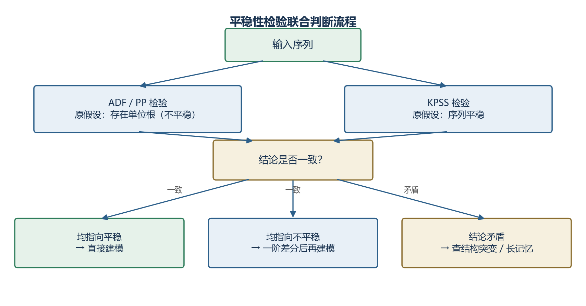

**例 3.1（联合判读）** 设对某月度用电序列（$T=180$）作检验，得到 ADF 统计量 $\tau=-2.10$（5% 临界值 $-2.88$，不拒绝 $H_0$），KPSS 统计量 $0.62$（5% 临界值 $0.46$，拒绝 $H_0$）。两者一致指向存在单位根：ADF 无法排除单位根，KPSS 明确拒绝平稳。结论是对序列作一阶差分后再建模。反之，若 ADF $\tau=-4.35$（拒绝）而 KPSS $=0.18$（不拒绝），则一致指向平稳，可直接进入 3.2 节的相关分析。这个例子说明：单独看任何一个检验都可能误判，联合判读才是稳健做法。

三类检验都有明确的边界。小样本下 ADF 功效很低，序列接近单位根（如 $\phi=0.98$）时几乎无法与 $\phi=1$ 区分；结构突变会使 ADF 偏向不拒绝、使 KPSS 偏向拒绝，制造「伪单位根」[6]；过度差分（对已平稳序列再差分）会引入人为的 MA 结构与负自相关。因此检验结果应与时间图、ACF 图一起判读，而非当作自动开关。平稳性确定之后，我们才可以放心地用自相关函数去度量记忆。

## 3.2　ACF、PACF 与模型识别

自相关函数 $\rho_k=\gamma_k/\gamma_0$（第 2 章式 2-5）刻画了 $y_t$ 与 $y_{t-k}$ 的线性相关，是时域分析的第一工具。它回答「记忆有多长」：$\rho_k$ 衰减越快，历史对当前的影响越短暂。但直接用 ACF 识别模型会遇到一个微妙的困难——在 AR 过程中，$y_t$ 与 $y_{t-2}$ 的相关不仅包含两者之间的「直接」联系，还包含经由 $y_{t-1}$ 传递的「间接」联系。以 AR(1) $y_t=\phi y_{t-1}+\varepsilon_t$ 为例，$\rho_2=\phi^2$ 完全来自 $\phi\cdot\phi$ 的链式传递，并无独立的二阶依赖。若不加剥离，就会把一阶过程误判为高阶。

**偏自相关函数**（PACF）正是为剥离间接相关而生。其思想是：先用 $y_{t-1},\dots,y_{t-k+1}$ 对 $y_t$ 作线性预测，再问剩余的 $y_{t-k}$ 还能额外解释多少。

**定义 3.1（偏自相关函数）** 滞后 $k$ 的偏自相关系数 $\phi_{kk}$ 是如下 $k$ 阶自回归中最高阶项的系数：

$$
y_t = \phi_{k1} y_{t-1} + \phi_{k2} y_{t-2} + \cdots + \phi_{kk} y_{t-k} + \varepsilon_t. \tag{3-5}
$$

等价地，$\phi_{kk}=\mathrm{Corr}(y_t, y_{t-k}\mid y_{t-1},\dots,y_{t-k+1})$。$\phi_{kk}$ 可由 **Yule–Walker 方程**递推求得。对平稳零均值序列，将式 (3-5) 两边乘 $y_{t-j}$ 取期望，得 $\gamma_j=\sum_{i=1}^{k}\phi_{ki}\gamma_{j-i}$（$j=1,\dots,k$），写成矩阵形式即 $\boldsymbol{\gamma}_k=\mathbf{\Gamma}_k\boldsymbol{\phi}_k$。Durbin–Levinson 递推给出

$$
\phi_{kk}=\frac{\rho_k-\sum_{j=1}^{k-1}\phi_{k-1,j}\,\rho_{k-j}}{1-\sum_{j=1}^{k-1}\phi_{k-1,j}\,\rho_j},\qquad
\phi_{k,j}=\phi_{k-1,j}-\phi_{kk}\phi_{k-1,k-j}, \tag{3-6}
$$

从 $\phi_{11}=\rho_1$ 起步逐级计算。这一递推也是第 12 章 AR 模型参数估计的基础。

**例 3.2（AR(1) 与 MA(1) 的 ACF/PACF）** 对 AR(1) $y_t=0.8y_{t-1}+\varepsilon_t$，由 Yule–Walker 方程得 $\gamma_k=0.8\gamma_{k-1}$，故 $\rho_k=0.8^k$：$\rho_1=0.8,\rho_2=0.64,\rho_3=0.512$，呈指数拖尾；而由式 (3-6)，$\phi_{11}=\rho_1=0.8$，$\phi_{22}=(\rho_2-\phi_{11}\rho_1)/(1-\phi_{11}\rho_1)=(0.64-0.64)/(1-0.64)=0$，此后各阶皆为零，即 PACF 在 $k=1$ 后**截尾**。反过来，MA(1) $y_t=\varepsilon_t+\theta\varepsilon_{t-1}$ 的 ACF 在 $k=1$ 后截尾（$\rho_1=\theta/(1+\theta^2),\rho_{k\ge2}=0$），PACF 则拖尾。这一对偶是模型识别的关键，读者可在第 12 章找到完整推导。

把上述规律推广，得到经典的模型识别表（表 3-1）。**表 3-2** 进一步列出常用过程的理论 ACF，供对照。

**表 3-1　ACF/PACF 形态与 ARMA 模型识别**

| 模型 | ACF | PACF |
|------|-----|------|
| AR($p$) | 拖尾（指数或衰减振荡） | $p$ 阶后截尾 |
| MA($q$) | $q$ 阶后截尾 | 拖尾 |
| ARMA($p,q$) | 拖尾 | 拖尾 |
| 白噪声 | $k\ge1$ 全为零 | $k\ge1$ 全为零 |

**表 3-2　常用过程的理论自相关函数**

| 过程 | $\rho_k$ |
|------|----------|
| 白噪声 | $\rho_0=1,\ \rho_{k\ge1}=0$ |
| AR(1) $\phi$ | $\phi^{|k|}$ |
| MA(1) $\theta$ | $\rho_1=\theta/(1+\theta^2),\ \rho_{k\ge2}=0$ |
| AR(1) 负 $\phi$ | 交替符号衰减振荡 |

需要强调样本 ACF 的统计性质。由 Bartlett 公式，对白噪声有 $\mathrm{Var}(\hat\rho_k)\approx 1/T$，故常用 $\pm 1.96/\sqrt{T}$ 作为近似置信带；但对相关序列，$\mathrm{Var}(\hat\rho_k)\approx \frac1T\sum_j \rho_j^2$ 会显著放大，此时简单置信带会高估显著性[1]。此外，$\hat\rho_k$ 在 $k$ 接近 $T$ 时基于极少的样本对，方差很大，因此 ACF 图通常只画到 $k\le T/4$ 左右。ACF 只刻画**线性**依赖——若序列存在非线性结构（如方差依赖、混沌），$\rho_k$ 可能全部接近零却仍可预测，这类情形须借助第 4 章的熵与第 31 章的传递熵等工具。

时域视角到此为止。它擅长回答「相隔几个时刻仍相关」，却不擅长回答「相关是多久一次的周期」。对后者，把序列变换到频域会更清楚。

## 3.3　谱密度与周期图

时域与频域描述的是同一序列的同一结构，只是坐标不同。自协方差 $\gamma_k$ 是「方差按滞后分配」，谱密度 $f(\omega)$ 是「方差按频率分配」，二者由傅里叶变换联系。理解这一点，就理解了为何第 21 章的 FEDformer 要在频域做注意力、第 3 章的周期成分为何在谱上表现为尖峰。

**定义 3.2（谱密度）** 对弱平稳序列，若自协方差绝对可和（$\sum_k|\gamma_k|<\infty$），定义谱密度为其傅里叶变换

$$
f(\omega) = \frac{1}{2\pi}\sum_{k=-\infty}^{\infty}\gamma_k e^{-i\omega k}
= \frac{1}{2\pi}\Big(\gamma_0 + 2\sum_{k=1}^{\infty}\gamma_k\cos(\omega k)\Big),\qquad \omega\in[-\pi,\pi]. \tag{3-7}
$$

反演公式为 $\gamma_k=\int_{-\pi}^{\pi} f(\omega)e^{i\omega k}\,d\omega$。取 $k=0$ 得 $\gamma_0=\mathrm{Var}(y_t)=\int_{-\pi}^{\pi}f(\omega)\,d\omega$：这正是「方差按频率分解」的严格表述。$f$ 非负、关于 $\omega=0$ 对称。White 噪声 $\gamma_{k\ge1}=0$，故 $f(\omega)=\sigma^2/2\pi$ 是平坦的——所有频率贡献相同，这与其「无记忆」一致；而含季节周期的序列，$f$ 在对应频率 $\omega_0=2\pi/m$ 处出现尖峰。

**例 3.3（AR(1) 的谱密度）** 对 $y_t=\phi y_{t-1}+\varepsilon_t$，代入 $\gamma_k=\sigma^2\phi^{|k|}/(1-\phi^2)$ 到式 (3-7) 并求和，得闭式

$$
f(\omega) = \frac{\sigma^2}{2\pi}\,\frac{1}{1-2\phi\cos\omega+\phi^2}. \tag{3-8}
$$

当 $\phi>0$ 时，分母在 $\omega=0$ 处最小，故 $f$ 在低频最大、随 $\omega$ 增大单调下降——正自相关意味着序列以缓慢变化（低频）为主；当 $\phi<0$ 时，峰值移到 $\omega=\pi$（高频），对应交替振荡。这个例子把「$\rho_1$ 的符号」与「谱峰的位置」直接对应起来，是时域—频域对偶最直观的例证。

**定义 3.3（周期图）** 谱密度的自然样本估计是周期图（periodogram）：

$$
I(\omega_j) = \frac{1}{T}\Big|\sum_{t=1}^{T} y_t e^{-i\omega_j t}\Big|^2, \qquad \omega_j = \frac{2\pi j}{T}. \tag{3-9}
$$

$I(\omega_j)$ 与样本自协方差满足离散傅里叶对偶 $I(\omega_j)=\sum_{k=-(T-1)}^{T-1}\hat\gamma_k e^{-i\omega_j k}$，可用快速傅里叶变换高效计算。但周期图有一个致命缺陷：**它不是一致估计**。可以证明，当 $T\to\infty$ 时 $I(\omega_j)/\sigma^2$ 渐近服从独立的指数分布，方差约为 $f^2(\omega)$ 而与 $T$ 无关[7]——增加样本量只会让尖峰更密，不会让估计更平滑。要得到一致估计，必须对周期图作平滑：或对各频率邻域加窗平均（Daniell 窗、Bartlett 窗），或对数据分段求周期图再平均（Welch 方法），本质都是用「偏差换方差」。窗宽越大，谱越平滑但分辨率越低，可能抹平邻近的谱峰；这是谱估计中经典的偏差—方差权衡。

谱分析还有两个常见陷阱。**谱泄漏**：有限样本相当于对无限序列加矩形窗，使某频率的能量扩散到旁瓣；加 Hann、Hamming 等渐变窗可抑制泄漏。**混叠**：若采样率低于信号最高频率的两倍，高频会被误读为低频假象（详见第 37 章采样定理）。这两点决定了谱估计不能盲目套用 FFT，而须结合采样设计与窗函数。图 3-2 展示含年度季节成分的月度序列周期图。

> 【图 3-2　周期图与谱密度估计】（原图见 `figures/图3-2.png`）：含年度季节成分（周期 12）的月度序列周期图，横轴为频率（或对应周期），纵轴为谱密度；在 $\omega=2\pi/12$ 处标注尖峰，叠加经窗平滑后的一致谱估计曲线，对比二者的方差差异。

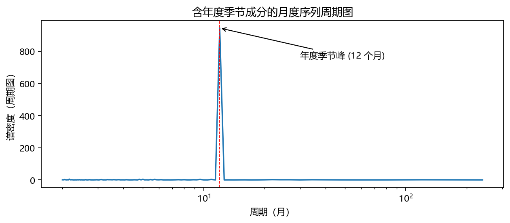

频域视角特别擅长处理「多周期并存」的情形：一条同时含日周期、周周期与年周期的电力负荷序列，其自相关图会呈现复杂的叠加而难以解读，但谱密度会在三个对应频率上各给一个清晰的峰。这一优势正是第 22 章 TimesNet「按主周期把一维序列折叠为二维」以及第 21 章 FEDformer「在频域保留主导分量」的思想来源。理解了谱，就理解了这批深度架构为何要回到频域。

## 3.4　趋势、季节、循环与噪声的分解

如果说谱分析是「把方差按频率拆开」，那么分解就是「把序列按可解释成分拆开」。它的动机非常实际：一条同时含趋势、季节与噪声的序列很难整体预测，但拆开后，趋势可以外推、季节可以复制、噪声只需给出区间——每个分量都比原序列简单。这一「分而治之」的思想贯穿全书：第 11 章的 Holt–Winters、第 16 章的 Prophet、第 21 章 Autoformer 的序列分解模块、第 22 章 DLinear 的趋势—季节分解，本质上都是它的不同实现。

经典分解把序列写成

$$
y_t = T_t + S_t + C_t + R_t \quad \text{（加法）},\qquad
y_t = T_t\times S_t\times C_t\times R_t \quad \text{（乘法）}, \tag{3-10}
$$

其中 $T_t$ 为趋势、$S_t$ 为季节、$C_t$ 为循环（周期长且不固定）、$R_t$ 为残差。乘法模型取对数即化为加法，适用于季节波动幅度随水平增长的情形；选择依据是时间图上季节振幅是否随趋势放大。早期的经典分解用移动平均估计趋势（$T_t$ 取 $2\times m$ 阶中心移动平均）、用「去趋势后按季节位置平均」估计 $S_t$，但存在端点缺失、对异常值敏感、季节形态固定不变等缺陷。

**STL（Seasonal-Trend decomposition using Loess）** 是目前应用最广的分解算法，由 Cleveland 等人于 1990 年提出[8]。它以局部加权回归（Loess）为核心，通过内外两层循环交替更新季节与趋势分量：

- **内循环**（六步）：① 去趋势，计算 $y_t - T_t^{(k)}$；② 对同一季节位置的去趋势子序列作 Loess 平滑，得到初步季节分量；③ 对初步季节序列作低通滤波，去除可能混入的趋势；④ 去季节，得 $y_t - S_t^{(k)}$；⑤ 对去季节序列作 Loess 平滑，更新趋势 $T_t^{(k+1)}$；⑥ 若分量收敛则退出，否则回到 ①。
- **外循环**：基于残差 $R_t=y_t-T_t-S_t$ 计算稳健权重，异常点获得更小权重，再重跑内循环，从而抑制离群值对分解的牵引。

STL 的关键参数是季节平滑窗宽与趋势平滑窗宽：前者越大，季节形态越稳定（可设为跨全部年份，得到固定季节），越小则允许季节逐年变化；后者控制趋势的柔顺程度。它的优势是能处理任意周期、对异常稳健、季节可随时间缓慢演化；代价是端点处估计不稳（Loess 缺乏单侧邻域）、且分解本身不具外推能力——预测仍须对每个分量分别建模。

**例 3.4（STL 手工分解思路）** 设某季度序列 8 个观测为 $y=(12,20,15,9,14,23,17,11)$，季节周期 $m=4$。先用 $2\times4$ 中心移动平均估趋势（端点缺失，仅 $t=3,4,5,6$ 可得，如 $T_3=(12+2\cdot20+2\cdot15+2\cdot9+14)/8\approx14.1$）；再用去趋势值按季节位置（第 1、5 点同属第 1 季）平均得季节修正；最后残差为 $y_t-T_t-S_t$。这个手算虽省略了 Loess 迭代，但清楚揭示了 STL 的两条主线：**趋势由局部平滑得到，季节由跨周期平均得到**。图 3-3 展示完整分解结果。

> 【图 3-3　STL 分解结果】（原图见 `figures/图3-3.png`）：对一条含趋势 + 季节 + 噪声的合成月度序列，上下排列四幅子图，依次为原始序列、趋势分量、季节分量、残差分量；标注季节分量随时间缓慢变化的特征。

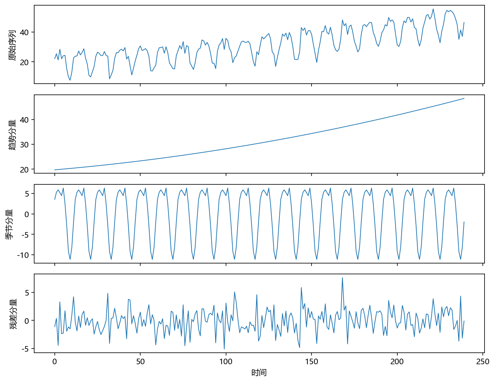

分解方法的选择也有边界。对存在结构突变（如政策导致水平跃升）的序列，不加区分的平滑会把突变「抹」进趋势，此时应先做第 9 章的变点检测再分段分解；对多重季节（日 + 周 + 年）并存的序列，标准 STL 只能处理单一周期，需改用 MSTL 等多周期扩展[9]。分解的质量最终要看残差是否接近白噪声——若残差仍有明显自相关，说明结构未被提净，这正是第 12 章 Ljung–Box 诊断要回答的问题。

## 3.5　小波变换与多分辨率分析

傅里叶变换把序列完全投影到频率轴，得到「有哪些频率」，却丢失了「这些频率在何时出现」。对平稳序列这无关紧要，因为频率成分不随时间变化；但现实中的序列常是非平稳的——设备的振动只在故障时段出现高频，心电的 QRS 波群只在特定时刻出现突变。要同时回答「何时」与「何种频率」，需要时间—频率联合域的工具，小波变换正是为此而生。

**定义 3.4（连续小波变换）** 给定满足容许性条件的母小波 $\psi(t)$（零均值、有限能量），信号 $y(t)$ 的连续小波变换为

$$
W(a,b) = \frac{1}{\sqrt{a}}\int y(t)\,\psi^{*}\!\Big(\frac{t-b}{a}\Big)\,dt, \qquad a>0,\ b\in\mathbb{R}. \tag{3-11}
$$

其中 $a$ 为尺度、$b$ 为平移。尺度与频率成反比：大 $a$ 对应拉伸的小波、捕捉低频（缓变趋势），小 $a$ 对应压缩的小波、捕捉高频（局部细节）。与傅里叶固定的正弦基不同，小波的时宽随尺度自适应——高频用窄窗获得好的时间分辨率，低频用宽窗获得好的频率分辨率，恰好契合 Heisenberg 测不准原理在时频分析中的约束[10]。因子 $1/\sqrt{a}$ 保证不同尺度下能量归一化。

离散小波变换（DWT）通过一组高通/低通滤波器把序列逐级分解为**近似系数**（低频轮廓）与**细节系数**（高频细节），即 Mallat 塔式算法[11]：每级把近似系数再分解，得到多分辨率表示 $y = A_J + \sum_{j=1}^{J} D_j$。这一分解无需任何平稳假设，且计算量仅 $O(T)$。

**例 3.5（用细节系数定位突变）** 设 $y_t=\sin(2\pi t/50)$ 在 $1\le t\le200$ 上平稳，仅在 $t=100$ 处叠加一个幅度为 3 的瞬时尖峰。对其作一层 Haar 小波分解，低频近似系数几乎不受影响，而细节系数 $D_1$ 在 $t=100$ 邻近出现明显非零值，其余位置近零。于是「突变发生在何时」可由细节系数的位置直接读出——这是傅里叶谱做不到的：谱只会告诉我们「含高频」，却说不出高频出现的时刻。这一性质使小波成为去噪、突变检测与多尺度特征提取的常用工具，也为第 21 章 FEDformer 的小波增强分支、第 6 章的时频特征提供了基础。

小波基的选择（Haar、Daubechies、Morlet 等）需权衡紧支性、消失矩与正则性；边界效应（序列两端缺少邻域导致系数失真）需通过延拓或边界小波处理。与 STL 相比，小波不要求预知季节周期、能处理频率随时间演化的情形，但分解结果的「可解释分量」不如趋势/季节直观，二者各有适用面。

## 3.6　长记忆过程与 Hurst 指数

本章前面讨论的模型——ARMA、指数平滑、STL——都隐含一个共同假设：自相关随滞后**指数衰减**，冲击的影响是短暂的（短记忆）。但水文、网络流量、金融波动率等序列呈现出截然不同的行为：$\rho_k$ 以幂律缓慢衰减，$\sum_k|\rho_k|$ 发散，遥远过去的冲击仍对当前有可测影响。这类「长记忆」（long memory）过程介于平稳短记忆与单位根之间，标准 ARIMA 难以刻画，需要专门工具。

**定义 3.5（长记忆）** 若平稳序列的自相关满足 $\rho_k \sim c\, k^{2d-1}$（$k\to\infty$，$0<d<1/2$），或等价地谱密度在零频处发散 $f(\omega)\sim c_f|\omega|^{-2d}$（$\omega\to0$），则称其具有长记忆[12]。分数差分算子

$$
(1-B)^d = \sum_{j=0}^{\infty} \binom{d}{j}(-B)^j, \qquad B y_t = y_{t-1}, \tag{3-12}
$$

把 ARIMA 的整数差分阶 $d$ 推广到分数，得到 **ARFIMA($p,d,q$)** 模型——它是 ARMA 与长记忆的统一（$d=0$ 退化为 ARMA，$d=1$ 趋于单位根）[13]。

长记忆的经典度量是 **Hurst 指数** $H\in(0,1)$，由 Hurst 于 1951 年在尼罗河水库研究中提出[14]，后由 Mandelbrot 与 Van Ness 用分数布朗运动严格化[15]。其估计方法是重标极差（R/S）分析：对长度为 $n$ 的子区间，计算累积离差的极差 $R(n)$ 与标准差 $S(n)$，若 $\mathbb{E}[R(n)/S(n)]\sim c\,n^{H}$，则 $\log(R/S)$ 对 $\log n$ 回归的斜率即 $H$。取值含义为：$H=0.5$ 对应无记忆（白噪声、随机游走增量）；$H>0.5$ 为持续型（趋势延续、长记忆，$H=d+1/2$）；$H<0.5$ 为反持续型（均值回归、频繁反号）。

**例 3.6（Hurst 判读）** 对某网络流量序列作 R/S 分析，在 $n=2^4,\dots,2^{10}$ 各尺度上拟合得斜率 $H\approx0.78$。因 $H>0.5$ 且显著，判定存在长记忆，对应 $d\approx0.28$；此时若强行用 ARIMA($p,0,q$) 拟合，会低估长期预测的不确定性，宜改用 ARFIMA 或用第 4 章 Lyapunov/熵工具先评估可预测时域。反之若 $H\approx0.5$，则短记忆模型足够。

长记忆的判读有一个重要陷阱：**结构突变会伪装成长记忆**[16]。序列中一个未被识别的水平跃变会使 R/S 分析给出虚高的 $H$。因此在判定长记忆之前，应先作第 9 章的变点检测排除突变，或用对突变稳健的局部 Whittle 估计。这一联系再次说明本章各节并非孤立工具，而是需要配合使用的分析流程。

把本章的三类视角放回第 1.7 节勾勒、第 4 章展开的五层可预测性框架，其分工便格外清楚：平稳性检验与 ACF/PACF 模型识别（3.1–3.2 节）度量的是历史线性相关结构，对应 L1 统计可预测性；谱密度与周期图（3.3 节）把同一信息搬到频域，仍属 L1 的等价表示；而长记忆过程与 Hurst 指数（3.6 节）提示，可预测性的强弱并非「可/不可」的二值判断，而是随尺度连续衰减——长程依赖意味着远期仍残留可用信息，这与第 4.5 节用熵率刻画的预测极限是同一现象的两面。分解（3.4 节）与小波（3.5 节）则进一步说明：把序列拆到不同尺度后，各层的可预测性可以截然不同。因此本章虽不直接定义理论极限，却为第 4 章的严格讨论提供了全部经验素材；后续第 8、9 章的异常与变点判别，也都要先经本章的时频工具看清结构。

## 本章小结

本章建立了「看清时序结构」的三种互补视角，它们共同构成后续方法选择的基础。

在时域，我们先用 ADF/PP/KPSS 联合检验平稳性——三者原假设互补，联合判读能避免单独检验的误判，且须警惕小样本功效、结构突变与过度差分；随后以 ACF 与 PACF 的截尾/拖尾形态识别 ARMA 阶数，其理论依据来自 Yule–Walker 方程与 Durbin–Levinson 递推，同时须记住样本自相关的方差随序列相关性放大、且只刻画线性依赖。

在频域，谱密度把方差分解为频率的贡献，与自协方差构成傅里叶对偶；周期图是其样本估计但因方差不随样本量下降而非一致，须经窗平滑才能使用。AR(1) 的谱密度闭式清楚展示了「时域相关符号 ↔ 频域谱峰位置」的对应关系，也是理解 FEDformer 与 TimesNet 频域设计的钥匙。

在结构分解与多尺度层面，STL 以 Loess 内外循环把序列拆为可解释的趋势、季节与残差，用残差是否接近白噪声检验分解是否充分；小波变换以自适应的时频窗定位「何时出现何种频率」，弥补傅里叶丢失时间定位的缺陷。最后，长记忆过程与 Hurst 指数把讨论从「短记忆/单位根」的二分推广到分数差分这一中间地带，并提醒我们结构突变会伪装成长记忆。

方法选择并无通例：含固定周期的序列宜先看谱，含局部突变的序列宜先用小波，含多重季节的序列宜用 MSTL 或多周期深度模型，判定长记忆前须先排除变点。第 12 章将在本章的 ACF/PACF 基础上正式展开 ARIMA 建模，第 21、22 章会回扣频域与多周期结构，第 37 章则把这套工具追溯到采样与信息论的源头。

从四问看，本章的时频与多尺度工具利用 L1（统计）：假设结构在所选尺度上近似平稳、周期可用谱刻画；它突破了「只看时域」的识别局限，仍受「非平稳与突变会伪装成长记忆」的边界约束。

**进一步阅读**　本章建议延伸阅读的文献：[17]。

## 参考文献

[1] Granger C W J, Newbold P. Spurious regressions in econometrics. *Journal of Econometrics*, 1974, 2(2): 111–120.

[2] Dickey D A, Fuller W A. Distribution of the estimators for autoregressive time series with a unit root. *Journal of the American Statistical Association*, 1979, 74(366): 427–431.

[3] Phillips P C B, Perron P. Testing for a unit root in time series regression. *Biometrika*, 1988, 75(2): 335–346.

[4] Kwiatkowski D, Phillips P C B, Schmidt P, Shin Y. Testing the null hypothesis of stationarity against the alternative of a unit root. *Journal of Econometrics*, 1992, 54(1–3): 159–178.

[5] Maddala G S, Kim I-M. *Unit Roots, Cointegration, and Structural Change*. Cambridge: Cambridge University Press, 1998.

[6] Perron P. The Great Crash, the oil price shock, and the unit root hypothesis. *Econometrica*, 1989, 57(6): 1361–1401.

[7] Priestley M B. *Spectral Analysis and Time Series*. London: Academic Press, 1981.

[8] Cleveland R B, Cleveland W S, McRae J E, Terpenning I. STL: A seasonal-trend decomposition procedure based on Loess. *Journal of Official Statistics*, 1990, 6(1): 3–73.

[9] Bandara K, Hyndman R J, Bergmeir C. MSTL: A seasonal-trend decomposition algorithm for time series with multiple seasonal patterns. *International Journal of Operational Research*, 2022.

[10] Mallat S. *A Wavelet Tour of Signal Processing*. 3rd ed. Burlington: Academic Press, 2009.

[11] Mallat S. A theory for multiresolution signal decomposition: The wavelet representation. *IEEE Transactions on Pattern Analysis and Machine Intelligence*, 1989, 11(7): 674–693.

[12] Beran J. *Statistics for Long-Memory Processes*. New York: Chapman & Hall, 1994.

[13] Granger C W J, Joyeux R. An introduction to long-memory time series models and fractional differencing. *Journal of Time Series Analysis*, 1980, 1(1): 15–29.

[14] Hurst H E. Long-term storage capacity of reservoirs. *Transactions of the American Society of Civil Engineers*, 1951, 116: 770–799.

[15] Mandelbrot B B, Van Ness J W. Fractional Brownian motions, fractional noises and applications. *SIAM Review*, 1968, 10(4): 422–437.

[16] Diebold F X, Inoue A. Long memory and regime switching. *Journal of Econometrics*, 2001, 105(1): 131–159.

[17] Box G E P, Jenkins G M, Reinsel G C, Ljung G M. *Time Series Analysis: Forecasting and Control*. 5th ed. Hoboken: Wiley, 2015.

---

# 第 4 章　可预测性理论基础：五个层次

前面三章建立了描述时序结构的语言：随机过程、平稳性、自相关、谱密度与分解工具。这些工具的共同前提是「序列中确实存在可被提取的规律」。但一个更根本的问题始终悬而未决：给定一条序列，我们究竟能预测多远？一个训练得再好的模型，能否预测纯粹的白噪声？能否提前一年预报天气？为什么短期负荷预测可以做到百分级误差，而提前三个月的日负荷几乎不可为？

这些问题不能靠经验回答，因为它们触及的是**预测本身的极限**，而不是某个模型的好坏。本章用混沌理论、非线性动力学与信息论给出答案：**并非所有未来都可预测，且可预测性存在可量化的边界。** 这一结论是全书最重要的理论支点之一。它一方面解释了为何增大模型容量并不总能改善长期预测，另一方面为第 29 章批判性地审视时序大模型的「幻觉」与漂移提供了武器——当序列本身接近不可预测时，任何模型都无法无中生有。它也与第 34 章复杂系统视角、第 37 章信息论视角直接呼应。

本章的展开顺序是从「确定性何以不可预测」到「如何量化不可预测」，再到「如何把可预测性组织为全书的理论框架」。4.1 节用混沌现象说明「确定性 ≠ 可预测」；4.2 节以 Lyapunov 指数把这一直觉量化为可预测时域；4.3 节反过来用 Takens 嵌入定理说明，即便只观测一个标量分量，也仍可能重建系统动力学、从而在一定程度上预测；4.4 节用熵族从统计角度度量序列复杂度；4.5 节以条件熵给出预测误差的信息论下界，把「序列能预测多远」收束为一个可操作的判定流程。在此之上，4.6 节把可预测性提升为贯穿全书的**五层框架**——统计、信息论、动力学、因果、决策，并据此提出每介绍一个模型都要回答的「可预测性四问」；4.7 节则用信息论与概率语言严格澄清三个最易混淆的命题（平稳 ≠ 可预测、非平稳 ≠ 不可预测、相关 ≠ 因果），为第 10、31 章埋下理论界标。本章由此从「一章的技术理论」升格为全书的核心支点。

## 4.1　确定性混沌：确定性不等于可预测

人们常把「随机」与「不可预测」等同，把「确定」与「可预测」等同。混沌理论打破的正是后一个等号：一个完全确定、不含任何随机噪声的系统，也可能长期不可预测。这一发现源于 20 世纪中叶对非线性动力系统的研究，并深刻改变了气象学等领域对预报时效的认识。

**例 4.1（Logistic 映射）** 考虑描述种群增长的一维离散映射

$$
x_{t+1} = r\, x_t(1-x_t), \qquad x_t\in[0,1]. \tag{4-1}
$$

当 $r$ 较小时（如 $r=2.5$），迭代收敛到不动点，长期行为完全可预测；随 $r$ 增大，依次出现周期 2、周期 4……的倍周期分岔；当 $r=4$ 时进入混沌区。此时取两个初值 $x_0=0.1$ 与 $x_0'=0.1+10^{-5}$，两条轨迹在前若干步几乎重合，但约十余步后彻底分离，此后如同两条独立随机序列。规则 (4-1) 完全确定、无任何随机项，长期预测却不可能——因为任何有限的初值精度都会被迭代指数放大。**对初值的敏感依赖**，是混沌不可预测性的根源。

**例 4.2（Lorenz 系统）** Lorenz 于 1963 年研究大气对流时提出三维连续系统[1]

$$
\dot x = \sigma(y-x),\qquad \dot y = x(\rho-z)-y,\qquad \dot z = xy-\beta z. \tag{4-2}
$$

取经典参数 $\sigma=10,\ \rho=28,\ \beta=8/3$，系统轨迹被吸引到著名的「蝴蝶」奇怪吸引子上。Lorenz 发现，把初值从六位小数截断到三位再重新积分，短期预报几乎一致，稍长则完全分道扬镳——他据此提出「蝴蝶效应」，并指出数值天气预报存在由动力学本身决定的时效上限[1]。这解释了一个关键事实：气象预报的误差不仅来自模型不准，更来自初始观测精度被混沌动力学放大，即便模型完美也无法消除。

混沌与随机的区别在于：随机序列的不可预测来自**外在噪声**，混沌序列的不可预测来自**内在动力学对初值的放大**。二者在时间序列观测上都可能表现为看似无规的波动，但处理方式不同——对随机序列，增加数据与更好的统计模型有效；对混沌序列，改进初值测量能延长预报时域，而模型容量的增加于事无补。判别一个序列究竟是随机还是低维混沌，需要 4.3 节的相空间重构与 4.4 节的复杂度度量。图 4-1 展示 Logistic 映射的轨迹分离与分岔图。

> 【图 4-1　Logistic 映射的混沌】（原图见 `figures/图4-1.png`）：左图绘制 $r=4$ 时两条初值相差 $10^{-5}$ 的轨迹随时间分离的过程；右图绘制分岔图（横轴 $r\in[2.5,4]$，纵轴 $x$ 的吸引子取值），标注倍周期分岔与混沌区。

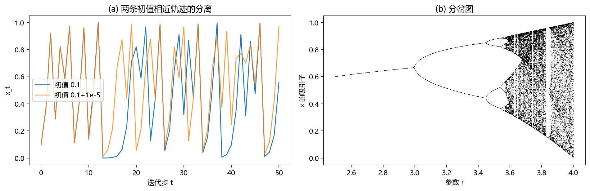

需要澄清一个常见误解：混沌并不意味着「什么都做不了」。在**短期**，确定性系统的轨迹仍高度可预测——这正是 Lorenz 系统短期内两条轨迹几乎重合的含义；混沌限制的是**长期**，且限制程度可精确量化。下一节把它变成一个公式。

## 4.2　Lyapunov 指数与可预测时域

要量化「对初值的敏感依赖」，需要度量两条邻近轨迹分离的速度。设初始分离为 $\delta_0$，时刻 $t$ 的分离为 $\delta(t)$。混沌系统的 $\delta(t)$ 在早期近似指数增长：

$$
\delta(t) \approx \delta_0\, e^{\lambda t}, \tag{4-3}
$$

其中 $\lambda$ 即为 Lyapunov 指数。

**定义 4.1（最大 Lyapunov 指数）** 对动力系统，沿典型轨迹的平均指数分离率定义为

$$
\lambda = \lim_{t\to\infty}\ \lim_{\delta_0\to 0}\ \frac{1}{t}\,\ln\frac{|\delta(t)|}{|\delta_0|}. \tag{4-4}
$$

$\lambda>0$ 表示邻域轨迹指数分离、系统混沌；$\lambda=0$ 对应临界（如极限环、准周期）；$\lambda<0$ 表示轨迹收敛到稳定不动点或吸引子，长期可预测。多维系统有一组 Lyapunov 指数（谱），其中最大者决定是否混沌；指数之和为负则存在吸引子。从数据估计 $\lambda$ 的经典方法是 Wolf 算法[2] 与 Rosenstein 小数据量法[3]：在重构相空间中追踪最近邻点随时间的平均对数发散，对发散曲线作线性拟合，斜率即 $\lambda$。

由式 (4-3) 可以直接解出**可预测时域**。设初值误差为 $\delta_0$，可容忍的误差上限为 $\Delta$（例如达到吸引子尺度即视为预测失效），令 $\Delta\approx\delta_0 e^{\lambda t}$，取对数得

$$
t_{\mathrm{horizon}} \approx \frac{1}{\lambda}\,\ln\frac{\Delta}{\delta_0}. \tag{4-5}
$$

这个简洁的公式蕴含三个深刻结论。其一，可预测时域与 $\lambda$ 成反比：系统越混沌（$\lambda$ 越大），能预报的时间越短。其二，误差容限以**对数**形式出现——这意味着提高观测精度 $\delta_0$ 的收益极其有限：若把初值精度提高一个数量级（$\delta_0\to\delta_0/10$），$t_{\mathrm{horizon}}$ 只增加 $\ln 10/\lambda\approx2.3/\lambda$，是一个固定的小增量，而非成倍延长。这正是 Lorenz 观察到「初值多取几位小数也救不了长期预报」的数学原因，也解释了为何气象预报的时效提升如此艰难。其三，$1/\lambda$ 本身构成了系统的特征时间尺度，是把「可预测性」从定性讨论变为定量指标的关键。

**例 4.3（可预测时域估算）** 设某混沌系统最大 Lyapunov 指数 $\lambda=0.5$（每单位时间），初值相对误差 $\delta_0=10^{-6}$，误差容限 $\Delta=1$。由式 (4-5)，$t_{\mathrm{horizon}}\approx\frac{1}{0.5}\ln(10^{6})=2\times13.8\approx27.6$ 个时间单位。若把初值精度提高到 $10^{-9}$，则 $t_{\mathrm{horizon}}\approx\frac1{0.5}\ln(10^9)=2\times20.7\approx41.4$，仅延长约 14 个单位——精度提升三个数量级，预报时域只增加约 50%。这个算例清楚说明：在混沌系统中，长期不可预测是**结构性**的，不能靠更好的测量或更大的模型消除。

Lyapunov 指数方法有其适用边界。它要求系统近似确定、低维、且观测噪声不太大；噪声会使 $\lambda$ 估计偏高，把随机序列误判为混沌。因此实际判读常与 4.4 节的熵、以及替代数据（surrogate data）检验配合使用：把原序列随机打乱或作相位随机化构造「线性随机」对照，若原序列的 $\lambda$ 或关联维数显著高于对照，才支持低维混沌的解释[4]。这一谨慎态度在第 34 章讨论复杂系统早期预警时会再次出现。

## 4.3　相空间重构与 Takens 嵌入

上一节似乎给出了一个悲观结论。但还有一个反向的问题：现实中我们往往只能观测系统的**一个标量分量** $y_t$（例如只测某点温度），而系统的真实状态是高维向量。仅凭一个分量，是否还能重建动力学、从而进行预测？Takens 嵌入定理给出了肯定的、且相当强的回答。

**定理 4.1（Takens 嵌入定理）** 设动力系统的状态流形维数为 $d$，观测函数 $h$ 光滑。对 generic 的 $(h,\tau)$，由延迟坐标构成的映射

$$
\Phi(y_t) = \big(y_t,\ y_{t-\tau},\ y_{t-2\tau},\ \dots,\ y_{t-(m-1)\tau}\big) \in \mathbb{R}^m \tag{4-6}
$$

在嵌入维数 $m>2d$ 时，是原状态流形到 $\mathbb{R}^m$ 的一个嵌入（微分同胚），保持原动力学的拓扑与微分结构[5]。

定理的含义非常有力：重构出的「延迟坐标空间」里的轨迹，与原系统真实状态空间里的轨迹一一对应且动力学等价。于是我们可以在 $\mathbb{R}^m$ 中做原系统才能做的事——估计关联维数、计算 Lyapunov 指数、用局部近邻作预测。直观上，之所以一个分量够用，是因为延迟坐标携带了各阶「记忆」，等价于用导数信息补足了不可观测的自由度。

**怎么用。** 定理只保证存在性，实践需确定两个参数。其一是**延迟 $\tau$**：太小则各坐标高度相关、轨迹挤在对角线附近，太大则坐标间近乎独立、丢失动力学联系。常用互信息法取互信息第一个极小值，或取自相关降到 $1/e$ 处的滞后。其二是**嵌入维数 $m$**：定理给出充分条件 $m>2d$，但 $d$ 未知。常用假近邻法（false nearest neighbors）[6]：逐步增大 $m$，若某点在 $m$ 维是近邻、在 $m+1$ 维因新增坐标而「跳远」，则为假近邻（由投影不足造成）；当假近邻比例降到接近零时的 $m$ 即为合适维数。

**例 4.4（延迟坐标重构）** 对 Lorenz 系统只取 $x$ 分量，采样间隔 $0.01$，用互信息法得 $\tau\approx10$ 步、假近邻法得 $m=3$，按式 (4-6) 构造三维延迟向量。重构轨迹呈现出与原「蝴蝶」吸引子同胚的双叶结构，据此计算的关联维数约为 $2.05$，与 Lorenz 吸引子的已知分形维数一致。这说明：即便只观测一个变量，也能恢复系统的低维混沌结构，并据此作短期预测（如局部线性预测：在重构空间中找到当前点的近邻，用其后续位移作预报）。

Takens 定理也是本书后续若干方法的思想源头之一：第 6 章的滞后特征、第 17 章的滑动窗口表格化、乃至第 22 章 TimesNet 按周期把一维序列折叠为二维，都可视为「用延迟/周期坐标重构结构」这一思想的现代回响。它的边界同样清楚：要求确定性与低维，对高维随机或强噪声系统，重构空间会被噪声填满，此时应回到第 2 章的概率框架。

## 4.4　熵：复杂度的度量

Lyapunov 指数与相空间重构从**动力学**角度刻画可预测性，另一条互补的路径是从**统计/信息论**角度度量序列的「复杂度」或「不规则度」。熵越高，序列越难压缩、越难预测。相比 Lyapunov 指数，熵估计对数据要求更低、对噪声更稳健，因此在工程中被广泛使用。

**近似熵与样本熵。** Pincus 于 1991 年提出近似熵（ApEn）[7]，用以度量序列中新模式出现的概率。Richman 与 Moorman 于 2000 年改进为样本熵（SampEn），消除了 ApEn 的自匹配偏差[8]。构造如下：按嵌入维数 $m$ 把序列重构为向量 $\mathbf{u}_i=(y_i,\dots,y_{i+m-1})$，记 $B^m(r)$ 为距离小于容差 $r$ 的 $m$ 维向量对数目、$A^m(r)$ 为相应的 $m+1$ 维向量对数目，则

$$
\mathrm{SampEn}(m,r) = -\ln\frac{A^m(r)}{B^m(r)}. \tag{4-7}
$$

直观上，若序列规则，则在 $m$ 维相近的向量对在 $m+1$ 维也多半相近（$A\approx B$），SampEn 接近 0；若序列不规则，新增一维后匹配大量丢失（$A\ll B$），SampEn 变大。参数通常取 $m=2$、$r=0.2\times$ 序列标准差。

**排列熵。** Bandt 与 Pompe 于 2002 年提出排列熵（PE）[9]：把每个 $m$ 维延迟向量按其元素大小秩序映射为一个排列模式 $\pi$，统计各模式频率 $p(\pi)$，定义

$$
\mathrm{PE}(m) = -\sum_{\pi} p(\pi)\,\log p(\pi). \tag{4-8}
$$

排列熵只看「序关系」而忽略具体数值，因而计算极快、对单调变换与噪声稳健、对突变敏感，广泛用于生理信号与机械振动的复杂度监测。归一化后取值在 $[0,1]$，1 对应完全随机、0 对应单调规则。

**例 4.5（三类序列的复杂度对比）** 对长度 $T=1000$ 的三条序列取 $m=3$、$r=0.2\sigma$：① 常数叠加小噪声的规则正弦，SampEn $\approx0.08$、PE $\approx0.3$，复杂度低、高度可预测；② Logistic 映射 $r=4$ 的混沌序列，SampEn $\approx0.6$、PE $\approx0.95$，复杂度高但仍为确定性、短期可预测；③ 高斯白噪声，SampEn $\approx2.2$、PE $\approx0.99$，复杂度最高、完全不可预测。这个例子揭示了一个要点：**高复杂度本身不足以区分「确定性混沌」与「随机」**——②③ 的熵都很高，须结合 4.2 节的 Lyapunov 指数与替代数据检验才能判别。熵度量的是「不规则度」，而非「随机性来源」。

此外还有**传递熵**（transfer entropy）[10]，度量一个序列的过去对另一个序列未来的信息贡献，是 Granger 因果在信息论框架下的非线性推广，将在第 31 章因果推断与第 37 章信息论视角中展开。各类熵与 Lyapunov 指数共同构成表 4-1 的判据体系。

**表 4-1　可预测性度量工具对照**

| 工具 | 度量对象 | 适用 | 主要局限 |
|------|----------|------|----------|
| 最大 Lyapunov 指数 $\lambda$ | 初值敏感率、可预测时域 | 低维确定性系统 | 对噪声敏感、需足够数据 |
| 关联维数 / 假近邻 | 系统自由度 | 混沌判别 | 高维随机时失效 |
| 样本熵 SampEn | 新模式出现率 | 通用、短序列 | 依赖 $m,r$ 选取 |
| 排列熵 PE | 序结构复杂度 | 快速、稳健、在线 | 忽略幅值信息 |
| 传递熵 | 变量间信息流向 | 非线性因果 | 估计需大样本 |

## 4.5　信息论预测极限

动力学的 Lyapunov 指数与统计的熵，最终都能统一到信息论的语言里。预测的本质，是从历史 $y_{1:t}$ 中提取关于未来 $y_{t+h}$ 的**信息**；信息论为「能提取多少」划定了不可逾越的下界。

**定义 4.2（条件熵与预测下界）** 未来观测在已知历史条件下的条件熵为

$$
H(y_{t+h}\mid y_{1:t}) = -\mathbb{E}\Big[\log p\big(y_{t+h}\mid y_{1:t}\big)\Big]. \tag{4-9}
$$

条件熵小，说明历史几乎决定了未来，预测误差可以很小；条件熵大，说明即使最优预测器也面临很大的固有不确定性。对平方误差损失，任何预测器的期望误差都不低于与熵幂 $2^{2H}/(2\pi e)$ 同阶的下界——这是率失真理论在预测上的体现[11]。这个下界是**不可约的**：它由数据生成过程决定，与模型复杂度、参数量、训练数据量都无关。这也是第 2 章恰当评分规则（CRPS、对数得分）为何强调「报告真实信念」的深层原因：再精巧的模型也只能逼近这个下界，无法突破它。

两个极端情形最能说明问题。其一，若 $y_{t+h}$ 与历史独立（如白噪声），则 $H(y_{t+h}\mid y_{1:t})=H(y_{t+h})$，历史不提供任何信息，任何模型的最优预测都退化为无条件均值——这正是第 2 章白噪声「不可预测」的信息论表述。其二，若序列完全确定（如周期序列），$H(y_{t+h}\mid y_{1:t})=0$，理论上可精确预测；而混沌序列介于两者之间：短期条件熵很小（可预测），随 $h$ 增大以速率约 $\lambda$ 增长（式 4-5 的信息论对应），到可预测时域之外趋于 $H(y)$，预测彻底失效[12]。

**例 4.6（用第 4 章理论审视大模型）** 假设有人声称某时序大模型能「准确预测」纯白噪声序列。由式 (4-9)，$y_{t+h}\mid y_{1:t}$ 的固有不确定性为 $H(y)$，模型输出的任何具体数值都不比均值更接近真实值，其看似「合理」的曲线只是把训练语料的模式投射到无结构数据上——这正是第 29 章所说的**幻觉**。同理，面对混沌系统，把预测时域延长到 $1/\lambda$ 量级之外，误差的指数放大是结构性的，增加参数量无济于事。这个例子把本章的理论与全书的批判性主线接了起来：**可预测性的边界由序列本身决定，不由模型决定。**

综合全章，判断「一条序列可不可预测、能预测多远」可归纳为一个统一流程：先以替代数据检验与关联维数判别是低维混沌还是随机（4.1、4.3）；若为确定性，估计 $\lambda$ 定出可预测时域（4.2）；再以样本熵、排列熵度量复杂度与不规则度（4.4）；最后用条件熵给出固有误差下界（4.5）。图 4-2 给出这一流程。这套流程不针对任何具体模型，却为全书评估所有预测方法树立了「天花板」——从第 29 章的大模型局限，到第 34 章复杂系统的结构预测，再到第 38 章评估指标为何要区分「可约误差」与「不可约误差」，都以此为理论标尺。

> 【图 4-2　可预测性判定流程】（原图见 `figures/图4-2.png`）：流程图——输入序列 → 随机/混沌判别（替代数据检验、关联维数）→ 若混沌则估计 Lyapunov 指数得可预测时域 → 熵/复杂度度量（SampEn、PE）→ 条件熵估计固有误差下界 → 输出「可预测性评级与预测时域上限」。

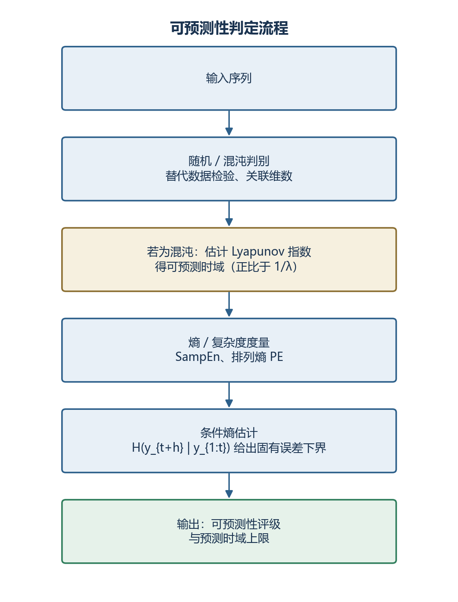

## 4.6　五层可预测性框架：全书的理论组织

4.1–4.5 节回答的是「给定一条序列，能预测多远」。但全书还有一组更根本、且必须贯穿四十一章的问题：**一个时间序列为什么可以预测？在什么条件下可以预测？预测能力的上限在哪里？** 若只把可预测性当作第 4 章的一个技术指标，后续各篇就会退化成互不相干的方法罗列——读者读完四十多个模型，只记住名字，却说不清它们为何存在、彼此什么关系。本节把可预测性组织为五个层次，作为全书统一的理论主线（第 1 章 1.7 节已作铺垫，前言「本书的理论主线」有完整表述，第 41 章将回扣形成首尾闭环）。

**定义 4.3（五层可预测性框架）** 按"可预测性的来源"把预测方法归入五个层次：

| 层 | 名称 | 判据 / 工具 | 核心问题 | 主要落点 |
|----|------|-------------|----------|----------|
| L1 | 统计可预测性 | ACF、PACF、条件期望、线性投影 | 历史与目标是否线性相关？ | 第 2、3、11、12 章 |
| L2 | 信息论可预测性 | 条件熵、互信息、熵率、信息增益 | 未来含多少可获取信息？ | 本章 4.5、第 24、38 章 |
| L3 | 动力学可预测性 | Lyapunov 指数、吸引子、相空间重构、混沌 | 系统演化可推演多远？ | 本章 4.1–4.3、第 30、34 章 |
| L4 | 因果可预测性 | SCM、干预、反事实、环境不变性 | 改变机制后还能预测吗？ | 第 10、31 章 |
| L5 | 决策可预测性 | MPC、策略优化、决策价值、闭环 | 预测到什么程度足以行动？ | 第 32、38 章 |

**表 4-2　五层可预测性框架（理论组织框架，非严格数学蕴含关系）**

须郑重说明：这五层**不是严格的数学蕴含关系，而是本书采用的理论组织框架**。L1 的线性相关、L2 的信息量、L3 的动力学结构、L4 的机制不变性、L5 的行动价值，是五个不同角度的提问；一个模型可同时利用多层（如 Transformer 借数据中的复杂依赖，兼及 L1 与 L2），层次之间也不存在"L5 比 L1 高级"的价值排序——统计预测不必依赖完整动力学模型，决策也不必精确预测每一个未来观测值。框架的价值在于提供一个**统一的提问方式**，而非一条线性递进链。

由此，本书规定**每介绍一个模型，一律回答「可预测性四问」**：① 它利用了哪一层可预测性？② 它隐含了什么假设？③ 它突破了前一方法的什么限制？④ 它无法突破什么理论边界？这套提问从第 11 章起逐章回扣。以三个贯穿性对象为例：

- **ARIMA**（第 12 章）利用 L1——历史新息的线性相关结构（Wold 分解的 $\psi_j$，第 2 章 2.6 节）；隐含线性、平稳、常方差假设；突破了指数平滑"无统计推断"的局限；却无法突破非线性、异方差与多变量传导的边界。
- **Transformer 及深度模型**（第 20–23 章）利用 L1/L2——从数据中学习复杂的、乃至非线性的依赖关系；隐含"依赖模式在训练与测试间稳定"假设；突破了线性模型的表达瓶颈；但由 4.5 节的条件熵下界，它同样无法突破序列本身的不可约不确定性。
- **世界模型**（第 30 章）试图学习 L3——状态转移规律与潜在动力学；隐含"动力学可辨识且可外推"假设；突破了"只拟合观测相关"的局限；却受制于 4.2 节的 Lyapunov 时域——在混沌系统中长期滚动仍指数发散。

三者因此不是简单的技术迭代，而是**对可预测性来源的不同建模**：从"利用历史相关"，到"利用数据中的复杂依赖"，再到"学习系统如何演化"。这一视角把全书的模型谱系从"编年史"提升为"回答不同根本问题的工具箱"，正是本书取"时序智能理论与方法体系"而非"方法大全"为学术定位的落点（第 1 章 1.1 节）。

框架的边界也须点明：五层是组织性的，不能替代具体理论——L1 的严格化靠第 2、3、12 章，L2 的量化靠本章 4.5 节与第 24 章，L3 的判据靠 4.1–4.3 节与第 34 章，L4 的严格化须待第 31 章的 do-演算，L5 的价值须由第 32、38 章的决策损失定义。本节只立骨架，血肉在后续各篇。

## 4.7　三个易混淆命题的严格澄清

第 2 章 2.6 节曾借 Wold 分解初步澄清过三个常被混淆的命题。那里是"点出"，本节用本章建立的信息论与概率语言把它们**严格化**——因为这三个命题恰是 L1 → L2 → L4 三次跃迁的界标，也是后续数十章反复要用的判据。

**命题 4.1（平稳性不等于可预测性）** 平稳性（第 2 章定义 2.3）只保证均值与自协方差不随时间漂移，即"统计规律稳定"，并不保证"规律里含有可被历史削减的不确定性"。最干脆的反例是白噪声：$\rho_k=0\ (k\ge1)$，由 4.5 节定义 4.2，

$$
H(y_{t+h}\mid y_{1:t})=H(y_{t+h})=\tfrac12\ln(2\pi e\sigma^2),\qquad
\hat y^*_{t+h\mid t}=\mathbb E[y_{t+h}\mid y_{1:t}]=\mathbb E[y]=\mu. \tag{4-10}
$$

历史不提供任何信息，任何模型的最优预测都退化为无条件均值。平稳而不含可预测结构，故 **平稳是可预测性的必要背景，而非充分条件**；它回答的是"能否用历史估计未来"，不是"未来有多少可估计"。

**命题 4.2（非平稳性不等于不可预测性）** 由 Wold 分解（第 2 章式 (2-13)），非平稳序列常可拆成确定性成分 $v_t$ 与随机成分 $\sum\psi_j\varepsilon_{t-j}$：$v_t$ 是可由自身过去**线性精确预测**的，随机部分若是短记忆也高度可预测。含确定性趋势/季节的负荷序列虽非平稳，经第 3 章分解或第 12 章差分剥离 $v_t$ 后，条件熵 $H(y_{t+h}\mid y_{1:t})$ 可降至接近 $H(\varepsilon)$，预测反而极准。Box–Jenkins 的"差分后建 ARMA"[17] 正是把非平稳性从障碍转化为可提取结构。故 **非平稳描述的是"矩随时间变"，不是"信息不存在"**；把非平稳一概当作不可预测，是把可外推的确定性结构误丢进误差项。

**命题 4.3（相关性不等于因果性）** ACF、Wold 系数与 Granger 因果（第 10 章定义 10.2）度量的都是**预测意义上的依赖**：若 $X$ 的过去能降低 $Y$ 的预测误差，便称 $X$ Granger-导致 $Y$[16]。但"能预测"不等于"干预后仍成立"。真正的机制因果须由结构因果模型（SCM）以 $do$-算子区分：

$$
p\big(y_{t+h}\mid do(X_t=x)\big)\ \neq\ p\big(y_{t+h}\mid X_t=x\big), \tag{4-11}
$$

即"观察到 $X=x$"与"把 $X$ 干预成 $x$"给出不同分布时，才谈得上机制因果[15]。环境变化、混淆变量、共同驱动都会让预测相关与机制因果分道扬镳；第 31 章的 do-演算、反事实与因果发现将系统处理，第 31 章的 CCM[18] 还给出非线性动力系统里因果方向的另一条判据。按本书统一的编写原则，Granger 因果的严格定义只在第 10 章，本节仅作对比。

**表 4-3　三个易混淆命题的正确表述与全书落点**

| 命题 | 错误等式 | 正确表述 | 理论工具 | 落点 |
|------|----------|----------|----------|------|
| 4.1 | 平稳 ⇒ 可预测 | 平稳只保证规律稳定，不保证含可用信息 | 条件熵 (4-10) | 第 2、4 章 |
| 4.2 | 非平稳 ⇒ 不可预测 | 非平稳的确定性成分可精确外推 | Wold 分解、差分 | 第 3、12 章 |
| 4.3 | 相关 ⇒ 因果 | 预测依赖 ≠ 干预下的机制依赖 | $do$-演算 (4-11) | 第 10、31 章 |

**例 4.7（三个命题的数值/概念反例）**　(a) 取高斯白噪声 $\varepsilon_t\sim N(0,1)$，$\mu=0,\gamma_0=1,\rho_k=0$，平稳；由式 (4-10) 最优预测恒为 0，任何模型的 MASE 都不优于朴素均值，条件熵 $=\frac12\ln(2\pi e)\approx1.42$ nat，与历史无关——平稳却完全不可预测。(b) 取 $y_t=0.5t+2\sin(2\pi t/7)+\varepsilon_t$，$\varepsilon_t\sim N(0,0.1^2)$，均值随 $t$ 变、非平稳；但拟合趋势与周季节后，一期预测误差仅 $\pm0.1$，条件熵 $\approx\frac12\ln(2\pi e\times0.01)\approx-0.88$ nat（远小于 (a)），MASE 可低至 0.1——非平稳却高度可预测。(c) 公鸡打鸣与日出在观测上高度相关、Granger 检验显著，但"把公鸡关进暗室"这一干预不会改变日出时刻，即 $p(\text{日出}\mid do(\text{打鸣}=0))=p(\text{日出})$——式 (4-11) 两边相等，机制因果不成立。三个反例分别对应 L1、L2、L4 的判据：可预测性须由**信息**（条件熵）、**结构**（Wold 分解）与**干预**（do-演算）分别判定，不能由平稳性或相关性一概而论。

这三个命题将贯穿全书：第 10 章的协整与 Granger 因果是命题 4.3 的积极面（相关虽非因果，却能提升预测）；第 12 章差分是命题 4.2 的工程实现；第 29 章用式 (4-10) 审视大模型对纯噪声的幻觉；第 31 章以 do-演算收束命题 4.3；第 38 章据此区分可约误差与不可约误差。**把"能预测"与"预测得有依据"分开，是时序智能从技术走向理论的第一步**。

## 本章小结

本章回答了全书的根本问题之一：预测能力的极限由什么决定。结论是——由序列自身的动力学与信息结构决定，而非由模型决定。

首先，确定性不等于可预测：Logistic 映射与 Lorenz 系统表明，完全确定的非线性系统因对初值敏感而长期不可预测，这解释了气象预报的时效上限。Lyapunov 指数把直觉量化为可预测时域 $\frac{1}{\lambda}\ln(\Delta/\delta_0)$——对数依赖意味着提高初值精度只能有限延长预报。Takens 嵌入定理则给出乐观一面：即使只观测量标量分量，只要 $m>2d$，即可用延迟坐标重构同胚动力学，做短期预测并估计关联维数与 $\lambda$，也为滞后特征、滑动窗口埋下伏笔。在统计层面，样本熵、排列熵与传递熵度量不规则度与信息流向，但高复杂度不能区分混沌与随机，须配合 Lyapunov 指数与替代数据检验；条件熵 $H(y_{t+h}\mid y_{1:t})$ 则给出任何预测器都无法突破的误差下界——白噪声下界等于其熵、周期序列下界为零、混沌序列随步长趋向下界。

4.6 节提出五层可预测性框架（L1 统计、L2 信息论、L3 动力学、L4 因果、L5 决策）与「可预测性四问」，使 ARIMA、Transformer 与世界模型成为对可预测性来源的三种不同建模；4.7 节用条件熵、Wold 分解与 $do$-演算澄清三个易混淆命题（平稳 ≠ 可预测、非平稳 ≠ 不可预测、相关 ≠ 因果），对应 L1 → L2 → L4 的界标。二者与第 1 章的四层能力体系相呼应，将在第 41 章回扣，形成首尾闭环。本章理论还将在全书反复回响：第 29 章说明大模型为何对纯噪声与分布外序列产生幻觉，第 34 章据此转向结构预测，第 37 章把熵追溯到信息论，第 38 章区分可约与不可约误差。理解「并非所有未来都可预测」，是成为清醒的时序智能研究者的第一步。

**进一步阅读**　本章建议延伸阅读的文献：[13]、[14]。

## 参考文献

[1] Lorenz E N. Deterministic nonperiodic flow. *Journal of the Atmospheric Sciences*, 1963, 20(2): 130–141.

[2] Wolf A, Swift J B, Swinney H L, Vastano J A. Determining Lyapunov exponents from a time series. *Physica D*, 1985, 16(3): 285–317.

[3] Rosenstein M T, Collins J J, De Luca C J. A practical method for calculating largest Lyapunov exponents from small data sets. *Physica D*, 1993, 65(1–2): 117–134.

[4] Theiler J, Eubank S, Longtin A, Galdrikian B, Farmer J D. Testing for nonlinearity in time series: The method of surrogate data. *Physica D*, 1992, 58(1–4): 77–94.

[5] Takens F. Detecting strange attractors in turbulence. In *Dynamical Systems and Turbulence*, Lecture Notes in Mathematics 898, Berlin: Springer, 1981: 366–381.

[6] Kennel M B, Brown R, Abarbanel H D I. Determining embedding dimension for phase-space reconstruction using a geometrical construction. *Physical Review A*, 1992, 45(6): 3403–3411.

[7] Pincus S M. Approximate entropy as a measure of system complexity. *Proceedings of the National Academy of Sciences*, 1991, 88(6): 2297–2301.

[8] Richman J S, Moorman J R. Physiological time-series analysis using approximate entropy and sample entropy. *American Journal of Physiology - Heart and Circulatory Physiology*, 2000, 278(6): H2039–H2049.

[9] Bandt C, Pompe B. Permutation entropy: A natural complexity measure for time series. *Physical Review Letters*, 2002, 88(17): 174102.

[10] Schreiber T. Measuring information transfer. *Physical Review Letters*, 2000, 85(2): 461–464.

[11] Cover T M, Thomas J A. *Elements of Information Theory*. 2nd ed. Hoboken: Wiley, 2006.

[12] Kantz H, Schreiber T. *Nonlinear Time Series Analysis*. 2nd ed. Cambridge: Cambridge University Press, 2004.

[13] Gneiting T, Raftery A E. Strictly proper scoring rules, prediction, and estimation. *Journal of the American Statistical Association*, 2007, 102(477): 359–378.

[14] Abarbanel H D I. *Analysis of Observed Chaotic Data*. New York: Springer, 1996.

[15] Pearl J. *Causality: Models, Reasoning, and Inference*. 2nd ed. Cambridge: Cambridge University Press, 2009.

[16] Granger C W J. Investigating causal relations by econometric models and cross-spectral methods. *Econometrica*, 1969, 37(3): 424–438.

[17] Box G E P, Jenkins G M. *Time Series Analysis: Forecasting and Control*. San Francisco: Holden-Day, 1970.

[18] Sugihara G, May R, Ye H, et al. Detecting causality in complex ecosystems. *Science*, 2012, 338(6106): 496–500.

---

# 第 5 章　时序数据的预处理与探索性分析

在讨论任何预测模型之前，必须先面对一个不 glamorous 却决定成败的事实：真实数据几乎从来不是教科书里那条干净、等间隔、无缺失的曲线。传感器会掉线、通信会丢包、时钟会错位、单位会混用、极端事件会留下孤立尖峰。若把这些瑕疵原样喂给模型，再精巧的算法也只会把噪声学成规律。工程界有句老话「垃圾进、垃圾出」（garbage in, garbage out），在时序问题上尤其贴切——因为时间依赖会把一处局部污染沿着自相关结构传播到整段预测。

本章的任务，是把「原始观测」整理成「可建模输入」。这属于四层能力体系的 **Level 1（时序分析）**：它不直接外推未来，却决定了 Level 2 预测的可信上限。从五层可预测性看，预处理并不「创造」可预测性，而是**尽量不破坏**数据本已蕴含的统计可预测性（L1）——删除一个异常点若误删了真实峰值，等于抹掉了信息；不当的平稳化若过度差分，等于人为注入了本不存在的负相关。理解这一点，才能明白本章各方法为何都强调「保守、可诊断、可回溯」。

本章按数据整理的实际工序展开：5.1 节讲数据质量与清洗；5.2 节是本章重心，系统讨论缺失值与不完全观测——先给出缺失机制的严格分类，再按复杂度递进介绍填补方法；5.3 节讨论平稳化与方差稳定变换；5.4 节处理重采样与时间对齐；5.5 节以探索性可视化收束，因为「先看图、再建模」是避免误处理的第一道防线。全章以贯穿全书的统一案例——城市电网负荷——示范每一步的具体做法。

## 5.1　数据质量与清洗

清洗的动机很直接：多数模型隐含「观测值忠实反映系统状态」这一假设，而现实数据常违背它。时序数据的质量问题可归为四类。

**其一是异常值**，表现为孤立尖峰、平台段或传感器饱和值。识别异常不能简单套用截面数据的 $3\sigma$ 准则，因为时序的均值与方差随时间变化——用全局 $\mu\pm3\sigma$ 会把夏季负荷高峰全部误判为异常。更稳妥的是**局部**判据：以滑动窗口的中位数 $m_t$ 与绝对中位偏差（MAD）构造 Hampel 滤波器，把满足

$$
|y_t - m_t| > 3 \times 1.4826 \times \mathrm{MAD}_t \tag{5-1}
$$

的点标为候选异常[1]。系数 $1.4826$ 使 MAD 在正态假设下成为 $\sigma$ 的一致估计；用中位数而非均值，是为了让判据本身不被待检测的异常点污染。

**其二是重复记录**，多由数据重传造成，按时间戳去重即可，但须注意「同一时刻多条不同值」可能来自多源融合而非重复，不可一律丢弃。**其三是不一致**，如单位混用（kW 与 MW）、时区错误、夏令时切换导致的重复小时或缺失小时。**其四是量纲混乱**，多变量序列各列量级差异巨大，虽不改变信息，却会拖累基于梯度的模型（第 17 章将回到标准化）。

**例 5.1（Hampel 滤波识别负荷尖峰）**　设电网负荷某小时邻域窗口（窗口宽 7）的值为 $(812, 818, 815, 2403, 817, 820, 816)$ MW。中位数 $m_t=817$，绝对偏差为 $(5,1,2,1586,0,3,1)$，$\mathrm{MAD}_t=2$。由式 (5-1)，阈值为 $3\times1.4826\times2\approx8.9$，故 $2403$ 被标为候选异常，远超阈值。但清洗前必须追问其来源：若同一时刻 SCADA 系统有「表计故障」标记，则判为观测误差、按缺失处理（进入 5.2 节）；若气象记录显示当时有极端高温且相邻站点负荷同步飙升，则它是**真实峰值**，必须保留——误删真实事件会破坏后续异常检测（第 8 章）与峰值预测。这说明清洗不是纯统计操作，而需结合领域元数据。

清洗方法的谱系从简单到复杂为：规则校验（阈值、单调性、量纲）→ 统计判据（$3\sigma$、IQR、Hampel）→ 基于模型的残差检测（第 8 章）。它们的共同边界是：**异常与稀有真实事件在数据上不可区分**，因此保守做法是「标记而非删除」，把判断权留给下游分析与领域知识。

## 5.2　缺失值与不完全观测

缺失是时序数据最普遍、也最需要理论指导的问题。它之所以棘手，是因为「如何补」取决于「为何缺」，而后者往往不可观测。

### 5.2.1　缺失机制的严格分类

Rubin 建立的分类[2] 是全部讨论的基础。设完整数据为 $Y=(Y_{\mathrm{obs}},Y_{\mathrm{mis}})$，缺失指示矩阵 $R$ 满足 $R_t=1$ 表示 $y_t$ 被观测到。

**定义 5.1（缺失机制）**　若 $P(R\mid Y)=P(R)$，即缺失与数据完全无关，称为**完全随机缺失**（MCAR）；若 $P(R\mid Y)=P(R\mid Y_{\mathrm{obs}})$，即缺失只依赖已观测值，称为**随机缺失**（MAR）；若缺失依赖未观测值本身（如传感器在负荷超过量程时静默），称为**非随机缺失**（MNAR）。

三者的实践含义截然不同。MCAR 下，删除含缺失的记录虽损失效率但不引入偏差；MAR 下，删除会系统性偏向某些观测值，须用基于 $Y_{\mathrm{obs}}$ 的模型填补；MNAR 下，任何仅基于观测值的填补都有偏，必须对缺失机制本身建模。真实工程里大量缺失是 MNAR——例如通信中断更可能发生在电网负荷极端时——这正是「补得漂亮却错得离谱」的根源。

### 5.2.2　按复杂度递进的填补方法

**（1）删除法。** 直接丢弃含缺失的时刻。仅当缺失比例极低（经验上 $<1\%$）且近似 MCAR 时可用；否则会破坏时间连续性，使依赖等间隔的 ACF、差分与卷积失真。

**（2）插值法。** 线性插值用相邻观测连线补齐：设 $t_a<t<t_b$ 且两端有观测，则 $\hat y_t=y_{t_a}+\frac{t-t_a}{t_b-t_a}(y_{t_b}-y_{t_a})$。样条插值用分段低次多项式获得更平滑的曲线，但可能对长缺失段产生非物理的过冲。方法的选择要看缺失段长度 $\ell$ 与序列主周期 $m$ 的关系：$\ell\ll m$ 时插值可靠，$\ell\gtrsim m$ 时插值会把整段周期「拉平」，此时应转向模型法。

**（3）时空插值（Kriging）。** 当存在多个相关测点时，用空间协方差填补：以其他站点同期观测的加权线性组合估计缺失值，权重由半变异函数确定。它利用了变量间的横截面依赖，适用于传感器网络。

**（4）矩阵补全。** 把多变量时序排成「时间 × 变量」矩阵 $\mathbf{Y}$，假设其近似低秩（即由少数共同因子驱动），通过核范数最小化恢复缺失元素：

$$
\min_{\mathbf{X}}\ \|\mathbf{X}\|_* \quad \text{s.t.}\ \ \mathcal{P}_\Omega(\mathbf{X}) = \mathcal{P}_\Omega(\mathbf{Y}), \tag{5-2}
$$

其中 $\mathcal{P}_\Omega$ 为观测位置投影、$\|\cdot\|_*$ 为核范数（奇异值之和），是秩函数的凸松弛[3]。该式同时利用时间与变量两个方向的相关性，比单向插值更强，代价是要求低秩假设成立。

**（5）EM 与多重插补。** EM 算法在「按当前参数填补缺失」与「按填补结果重估参数」之间迭代，收敛到含缺失数据的极大似然解[4]。多重插补则生成 $M$ 个不同的填补数据集，分别分析后按 Rubin 规则合并[2]：总方差 = 组内方差均值 + 组间方差，其中第二项正是**填补不确定性**的量化。这是多重插补相对单一填补的关键优势——它不假装补出来的值是真的。

**表 5-1　缺失填补方法对照**

| 方法 | 利用信息 | 量化不确定性 | 适用条件 | 主要局限 |
|------|----------|--------------|----------|----------|
| 删除 | 无 | 否 | 极低缺失、MCAR | 破坏连续性、低效率 |
| 插值 | 单序列时间邻域 | 否 | 短缺失段 $\ell\ll m$ | 长段失真、无区间 |
| Kriging | 跨测点空间相关 | 部分 | 多站点、有空间结构 | 需估计变异函数 |
| 矩阵补全 | 时间 + 变量低秩 | 否 | 低秩成立 | 非低秩时失效 |
| EM / 多重插补 | 模型 + 分布假设 | 是 | MAR、模型正确 | MNAR 下有偏 |

深度补全方法（BRITS、CSDI、SAITS 等，见第 25 章）可视为上述思想的非线性扩展，其优势是能刻画复杂跨变量依赖，但同样无法回避 MNAR 这一根本限制。图 5-1 给出按缺失比例与机制选型的决策流程。

> 【图 5-1　缺失值处理流程】（原图见 `figures/图5-1.png`）：流程图，按缺失比例（低/中/高）与缺失机制（MCAR/MAR/MNAR）分叉，给出删除 / 插值 / 矩阵补全 / EM 与多重插补 / 深度补全的选型建议，并标注「MNAR 须对机制建模」的警示分支。

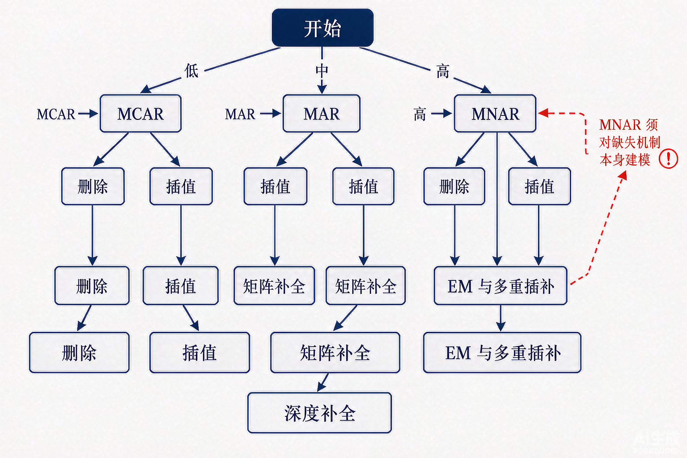

**例 5.2（统一案例：连续 6 小时负荷缺失）**　设电网负荷主周期为日周期 $m=24$，某日 $02{:}00$–$07{:}00$ 共 6 小时缺失（$\ell=6<m/2$），且有同期气温与相邻三日完整负荷。若用线性插值，会把凌晨低谷填成一条斜线，抹掉真实的「凌晨缓降 + 早高峰启动」形态；若用季节插值（取前三日同一时段的均值形态再按当日水平缩放），则能保留日内形状。进一步，用式 (5-2) 的矩阵补全把「时刻 × 日期」构造成矩阵，可同时借力日间相似性与日内周期。若缺失发生在夏季极端高温时段且伴随通信告警，则应怀疑 MNAR，此时点填补都不可靠，宜输出**区间**并显式记录「该段不可信」——这个判断会直接影响第 24 章概率预测与第 32 章调度决策。

## 5.3　平稳化与变换

**定义 5.2（Box–Cox 变换）** 对正观测 $y_t$，含参数 $\lambda$ 的幂变换 $y_t^{(\lambda)}=(y_t^{\lambda}-1)/\lambda$（$\lambda=0$ 时取 $\ln y_t$）称为 Box–Cox 变换；它以一族幂函数统一对数、平方根与倒数，用于稳定方差、使序列更接近正态。实践中 $\lambda$ 由最大化剖面似然选取。

第 2、3 章已指出，许多经典模型以平稳为前提。平稳化的动机是让「用历史估计未来」在理论上成立，但须警惕：它是为模型服务的**手段**，不是数据的固有属性，过度使用会伤害可预测性。

**差分**消除随机趋势：一阶差分 $\Delta y_t=y_t-y_{t-1}$，季节差分 $\Delta_s y_t=y_t-y_{t-s}$，$d$ 阶差分记为 $\Delta^d$。ARIMA 的「I」即由此而来（第 12 章）。差分的代价是放大高频噪声、且每阶差分丢失一个观测；过度差分会引入人为的负一阶自相关，反而降低预测精度。

**Box–Cox 变换**用于稳定方差[5]：

$$
y^{(\lambda)} = \begin{cases} \dfrac{y^\lambda - 1}{\lambda}, & \lambda\neq 0,\\[10pt] \ln y, & \lambda=0, \end{cases} \tag{5-3}
$$

其中 $\lambda$ 由极大似然或使变换后序列方差最稳定来选取；$\lambda=0$ 由洛必达法则得到 $\lim_{\lambda\to0}(y^\lambda-1)/\lambda=\ln y$。$\lambda=1$ 相当于仅平移，$\lambda=0.5$ 为平方根变换，$\lambda=0$ 即对数变换。当方差随水平增长（负荷、销量常见的「比例噪声」）时，对数变换能把乘性季节稳定为加性季节，使分解（3.4 节）与线性模型更适用。

**例 5.3（统一案例：负荷的方差稳定）**　取电网负荷两段各 24 小时：冬季日均 900 MW、日内波动标准差约 40 MW；夏季日均 1400 MW、波动标准差约 95 MW。标准差与均值近似成比例（$40/900\approx0.044$，$95/1400\approx0.068$），呈乘性异方差。对数变换后两段的标准差在 $\ln$ 尺度上趋于接近（约 $0.045$ 与 $0.068$ 收窄），加法分解 $y=T+S+R$ 的残差更接近同方差，符合后续模型的假设。须注意：对数变换后预测须**逆变换回原尺度**，且直接对 $\ln y$ 预测再取 $\exp$ 得到的是中位数而非均值，若关心期望负荷需作偏差校正（$e^{\hat\mu+\hat\sigma^2/2}$）。这是平稳化常被忽视的边界。

平稳化方法还包括去趋势（拟合时间回归后取残差）、分解（3.4 节 STL）。它们的共同判据是第 3 章的 ADF/KPSS 联合检验；但检验结论须与「变换是否损伤信息」一并权衡——这正是本章开头强调「不破坏可预测性」的落点。

## 5.4　重采样与时间对齐

不规则采样与多频率混合是工程常态：电表按 15 分钟记录、气象站按小时、结算按月。把它们对齐到统一时间轴，是多元建模（第 10 章）与特征工程（第 17 章）的前提。

**上采样**（低频到高频）需插值或前填充，会引入人为平滑；**下采样**（高频到低频）需聚合，聚合函数必须依业务语义选择：流量、电量等**可加量**用求和；温度、负荷水平等**强度量**用均值；容量、峰值约束用最大值；存量类用末值。用错聚合函数会改变量的物理含义——把「小时电量」平均成「小时平均功率」看似只差常数，但在缺失时段二者行为截然不同。

**表 5-2　聚合方式与物理量类型**

| 物理量类型 | 例 | 建议聚合 | 误用后果 |
|------------|----|----------|----------|
| 可加量 | 电量、销量、流量 | 求和 | 用均值丢失总量守恒 |
| 强度量 | 温度、负荷、速率 | 均值（可加权） | 用求和无物理意义 |
| 极值约束 | 峰值负荷、最大水位 | 最大值 | 用均值掩盖风险 |
| 存量 | 库存、账户余额 | 末值 | 用均值虚构中间态 |

时间对齐还须处理**日历陷阱**：时区统一到 UTC 后再转换本地时；夏令时切换日会出现 23 或 25 小时，须显式补齐或合并；节假日、闰秒、财务日历与自然日不一致。这些细节在数据量大时看似琐碎，却常是「模型在节假日集体失准」的根因（第 39 章零售需求预测会再次遇到）。

**例 5.4（下采样丢失峰值）**　某市 15 分钟负荷在 $18{:}00$–$19{:}00$ 为 $(1200, 1320, 1480, 1360)$ MW。若按小时取均值，得 $1340$ MW；若研究的是「备用容量是否充足」，则真正相关的是峰值 $1480$ MW，均值会低估 $140$ MW、把峰值约束判为达标。这一例子说明：重采样不是纯技术操作，选择哪个聚合函数应由**下游决策目标**反推，呼应第 32 章「决策感知的预测」。

## 5.5　探索性可视化

「先看图，再建模」是本章最实用的一条经验。图形能在套用任何检验之前暴露趋势、多周期、异常与结构突变，从而避免用错工具。本书建议至少作以下五种图。

**时间图**纵轴为观测、横轴为时间，用于观察整体趋势、季节振幅是否随水平变化、有无明显断点。**季节子序列图**按周期位置把序列拆开并排（如把每个周一的所有时刻画在一起），用于判断季节形态是否稳定。**滞后图**以 $(y_{t-k}, y_t)$ 为散点：点云沿对角线聚集表示强正相关（一阶可预测），呈环形或椭圆则提示周期结构，出现分叉则提示非线性。**自相关图**（第 3 章）量化记忆长度。**日历热力图**以「星期 × 小时」或「月 × 日」为两轴、颜色表强度，能一眼看出工作日/周末差异与早晚高峰。

> 【图 5-2　探索性可视化示例】（原图见 `figures/图5-2.png`）：对一条含季节与趋势的日度序列，并排绘制时间图、季节子序列图、滞后图、日历热力图四个子图。

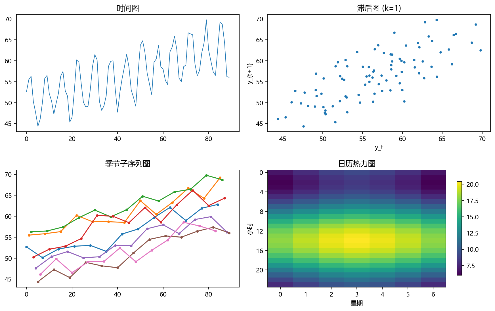

**例 5.5（统一案例：从图形到建模决策）**　对电网负荷作日历热力图，若发现「工作日 9–18 时」与「周末全天」呈两种明显不同的色块，则提示应引入日历哑变量（第 17 章）或采用多季节分解（3.4 节 MSTL），而非单一 ARIMA。若滞后图在 $k=24$ 呈现清晰线性点云、在 $k=1$ 也强相关，则说明日周期与短时惯性并存，宜同时建模季节项与自回归项。若时间图在某个时点出现水平跃升且不回落，则应先做变点检测（第 9 章）分段，而不是对整段强行平稳化——因为一次结构突变会伪装成非平稳甚至长记忆（3.6 节已警示）。可视化由此把 Level 1 的分析结论，直接转译为 Level 2 的建模方案。

探索性分析的价值与局限都源于它的「非正式」：可视化与摘要能迅速暴露尖峰、缺失与周期，却不能替代第 3 章的检验，更不能替代第 8、9 章带判据的异常与变点识别。尤须警惕把示意性作图当成结论——一张图上看似明显的趋势，可能只是坐标范围造成的错觉。更重要的是，预处理并非无损：平稳化与变换（5.3 节）、重采样与时间对齐（5.4 节）都会改变第 11–16 章模型实际见到的数据分布，因此变换类型、参数与拟合区间必须连同数据一并记录，并在第 38 章的滚动回测中逐折重估，否则一旦在全体样本上先做归一化再切分，就会犯下 38.3 节所警示的时间穿越偏差。换言之，本章的每一步操作都在为后续的可复现性埋下约束；附录 F 汇总了这些约定。

## 本章小结

本章把「原始观测」整理为「可建模输入」，属于 Level 1 时序分析。贯穿全章的核心判断是：预处理**不创造**可预测性，只应力求**不破坏**数据本已蕴含的统计可预测性（L1）。

在清洗阶段，我们强调用局部、稳健的 Hampel 判据（式 5-1）而非全局 $3\sigma$，因为时序均值方差随时间变化；并指出异常与真实稀有事件在数据上不可区分，保守做法是「标记而非删除」（例 5.1）。在缺失处理阶段，本章以 Rubin 的 MCAR/MAR/MNAR 分类（定义 5.1）为纲，说明「如何补」取决于「为何缺」：删除、插值、Kriging、矩阵补全（式 5-2）、EM 与多重插补构成由简到繁的谱系（表 5-1），其中多重插补是少数能显式量化填补不确定性的方法；MNAR 则是所有基于观测值方法的共同盲区（例 5.2 的电网 6 小时缺失示范了按缺失段长度与机制选型）。在平稳化阶段，我们给出差分与 Box–Cox 变换（式 5-3），并提醒逆变换的偏差校正与过度差分的代价（例 5.3）。在重采样阶段，强调聚合函数须依物理量类型选择（表 5-2），且应以下游决策目标反推（例 5.4）。最后以五种探索性可视化收束，说明图形如何把分析结论转译为建模方案（例 5.5）。

本章反复出现的统一案例——城市电网负荷——将在后续章节持续复用：第 8 章检测其异常、第 9 章定位其变点、第 12 章用 ARIMA 预测、第 17 章用 XGBoost、第 18 章用 LSTM、第 22 章用 PatchTST、第 27 章检验基础模型、第 31 章分析气象因果、第 32 章进入调度决策。读者可借此在同一份数据上比较方法得失，而非孤立记忆模型名称。下一章转入特征表示与降维，进一步把清洗后的序列转化为模型可用的输入。

从四问看，本章的预处理利用 L1（统计）：假设缺失与异常可被建模并修正、变换后结构可恢复；它突破了「脏数据直接喂模型」的误区，仍受「变换不可逆、会改变分布」的边界约束。

**进一步阅读**　本章建议延伸阅读的文献：[6]、[7]、[8]、[9]、[10]、[11]、[12]。

## 参考文献

[1] Hampel F R. The influence curve and its role in robust estimation. *Journal of the American Statistical Association*, 1974, 69(346): 383–393.

[2] Rubin D B. *Multiple Imputation for Nonresponse in Surveys*. New York: Wiley, 1987.

[3] Candès E J, Recht B. Exact matrix completion via convex optimization. *Foundations of Computational Mathematics*, 2009, 9(6): 717–772.

[4] Dempster A P, Laird N M, Rubin D B. Maximum likelihood from incomplete data via the EM algorithm. *Journal of the Royal Statistical Society: Series B*, 1977, 39(1): 1–38.

[5] Box G E P, Cox D R. An analysis of transformations. *Journal of the Royal Statistical Society: Series B*, 1964, 26(2): 211–252.

[6] van Buuren S, Groothuis-Oudshoorn K. mice: Multivariate imputation by chained equations in R. *Journal of Statistical Software*, 2011, 45(3): 1–67.

[7] Little R J A, Rubin D B. *Statistical Analysis with Missing Data*. 3rd ed. Hoboken: Wiley, 2019.

[8] Schafer J L. *Analysis of Incomplete Multivariate Data*. Boca Raton: Chapman & Hall/CRC, 1997.

[9] Cressie N. *Statistics for Spatial Data*. revised ed. New York: Wiley, 1993.

[10] Hyndman R J, Athanasopoulos G. *Forecasting: Principles and Practice*. 3rd ed. Melbourne: OTexts, 2021.

[11] Cleveland R B, Cleveland W S, McRae J E, Terpenning I. STL: A seasonal-trend decomposition procedure based on Loess. *Journal of Official Statistics*, 1990, 6(1): 3–73.

[12] Cao W, Wang D, Li J, et al. BRITS: Bidirectional recurrent imputation for time series. *NeurIPS*, 2018.

---

# 第 6 章　时序特征表示与降维

上一章把原始观测整理为干净、等间隔、可建模的序列。然而「干净」不等于「可用」：一条 720 小时的电网负荷曲线，对 ARIMA 是一组待拟合的样本，对 XGBoost 却需要被组织成「特征—目标」的表格，对聚类算法又需要被压缩成一个可比较的向量。同一份数据在不同模型眼中需要不同的表示形式。本章讨论的正是这一转换：如何把时间序列表示为**特征向量**，以及当特征过多或过于冗余时如何降维。

这属于四层能力体系的 **Level 1（时序分析）**，但它的产出直接服务于 Level 2 预测。从五层可预测性看，特征工程的实质是把数据中原本隐含的统计可预测性（L1）**显式化**：ACF 特征把「记忆长度」变成一列数值，谱峰特征把「周期」变成一个频率标签，于是原本需要模型自行发现的规律，被预先编码成模型可直接利用的输入。理解这一点很重要——特征工程不创造新的可预测性，只改变它的呈现方式；因此当序列本身接近白噪声时，再丰富的特征也无济于事，这仍受第 4 章信息论下界的约束。

本章按「四类特征 → 降维 → 表示学习」展开。6.1 节回溯特征工程的起源与统计特征；6.2 节讲频域特征；6.3 节讲非线性与复杂度特征（其理论推导已在第 4 章完成，此处只论特征化，遵守「基础理论只讲一次」原则）；6.4 节讨论形状特征与 Shapelet；6.5 节处理特征降维与选择；6.6 节进入表示学习，即让模型自动学特征——这一线索将直接通向第 26 章的时序基础模型。全章沿用统一案例：城市电网负荷。

本章讨论的特征可归为统计、频域、非线性与复杂度、形状四大类，图 6-1 给出其分类体系。

> 【图 6-1　时序特征分类体系】（原图见 `figures/图6-1.png`）：分类示意图。中心圆「时序特征」，向外辐射四个分支，分别标注「统计特征（均值/方差/分位数/ACF）」「频域特征（谱峰/谱熵/能量比）」「非线性特征（熵/分形维数/Lyapunov/RQA）」「形状特征（Shapelet）」。白底、中心深蓝圆 + 四分支、中文。

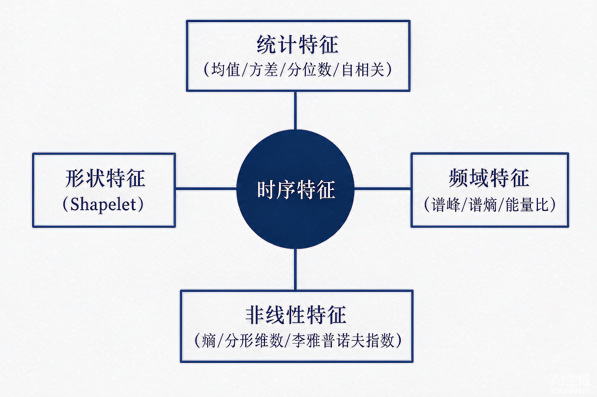

## 6.1　统计特征

在最朴素的做法里，一条序列被压缩为若干描述统计量。这一思路并非时序专属，它源自 20 世纪中后期的经典判别分析与模式识别：当分类或回归模型只能接受固定长度的数值向量时，研究者不得不先用均值、方差等统计量把变长的序列「压平」。时序特征工程的专门化则晚得多——2017 年前后 hctsa[1] 与 tsfresh[2] 两个框架几乎同时提出「大规模自动特征提取」：从一条序列上系统计算出成百上千个候选特征，再用假设检验或显著性筛选，把「人工想特征」变成「机器枚举特征」。这一转变构成了本章的历史背景。

统计特征可分为三层。

**第一层是边际分布特征**：均值 $\bar y=\frac1T\sum_t y_t$、方差 $s^2$、偏度 $\hat\gamma_1=\frac1T\sum_t\big(\frac{y_t-\bar y}{s}\big)^3$、峰度、各分位数与极差。它们描述「取值落在什么范围、分布是否对称、尾部有多厚」，但对**时间顺序不敏感**——把序列随机打乱，均值、方差、偏度完全不变。这是它们最根本的局限，也解释了为何单靠它们无法刻画记忆。

**第二层是依赖结构特征**，其中最重要的是自相关摘要。取前 $K$ 阶样本自相关 $\hat\rho_1,\dots,\hat\rho_K$（定义与估计见第 2 章式 2-6，理论性质见第 3 章）作为特征，等价于向模型显式提供「相隔 $k$ 步仍有多强线性相关」的信息。趋势特征（对时间作线性回归的斜率及其 $t$ 统计量）、季节强度（季节分量方差占比，第 3 章 STL）、过零率与游程长度也属此类。

**第三层是分布形状与稳定性特征**：直方图分箱占比、平稳性检验统计量、变点个数等。

**定义 6.1（时序特征映射）**　把长度为 $T$ 的序列 $\mathbf{y}=(y_1,\dots,y_T)$ 映射为 $d$ 维向量的函数 $\phi:\mathbb{R}^T\to\mathbb{R}^d$，称为时序特征映射；其第 $j$ 个分量 $\phi_j(\mathbf{y})$ 称为一个特征。

**例 6.1（统一案例：负荷日曲线的统计特征）**　取电网某工作日 24 小时负荷（MW）：$(720,700,690,685,700,760,880,1050,1180,1240,1260,1250,1230,1240,1270,1300,1380,1420,1360,1200,1020,900,820,760)$。计算得 $\bar y\approx1055$、$s\approx253$、偏度 $\hat\gamma_1\approx-0.06$（近似对称）。一阶自相关 $\hat\rho_1\approx0.93$（相邻小时高度相关），$\hat\rho_{24}$ 因只有一天数据无法估计，但若取连续 30 天序列则可算得 $\hat\rho_{24}\approx0.88$——这一高值正是日周期的特征化证据，可直接提示模型引入季节滞后（第 12 章）或 Calendar 特征（第 17 章）。注意：把 24 个数打乱重排后 $\bar y,s,\hat\gamma_1$ 不变，而 $\hat\rho_1$ 从 $0.93$ 掉到约 $0$——直观说明为何依赖结构特征不可被边际统计替代。

统计特征的技术谱系与边界同样清楚。优点是计算廉价、可解释、对短序列稳健；缺点有三：其一，边际特征丢弃时间顺序；其二，高阶矩与分位数对异常值敏感，须在第 5 章清洗之后计算；其三，人工特征存在「枚举偏差」——想不到的规律永远进不了特征集。tsfresh 用假设检验控制多重比较来缓解第三点[2]，hctsa 则以数千个候选特征加聚类去冗余[1]；catch22 进一步把 hctsa 的 7000+ 特征裁剪为 22 个兼具解释性与判别力的核心集[3]。这些工作共同说明：特征工程已从「手艺」走向「可复现的流水线」。

## 6.2　频域特征

周期是时序最稳定的可预测性来源之一，而频域是刻画周期最自然的语言。第 3 章已给出谱密度 $f(\omega)$ 与周期图 $I(\omega_j)$ 的定义与估计（式 3-7、3-9），本章不再重复推导，只讨论如何把它们压缩为**特征**。

**谱峰特征**最为直接：找出 $I(\omega_j)$ 的局部极大值，记录其频率 $\omega^*$、对应周期 $m^*=2\pi/\omega^*$ 与谱峰能量 $I(\omega^*)$。主周期及其强度是季节建模、TimesNet 二维折叠（第 22 章）、FEDformer 频域选择（第 21 章）的共同输入。**谱熵**把归一化谱 $p(\omega_j)=I(\omega_j)/\sum_k I(\omega_k)$ 视作频率上的分布，定义

$$
H_{\mathrm{spec}} = -\sum_j p(\omega_j)\log p(\omega_j). \tag{6-1}
$$

白噪声的谱平坦，$H_{\mathrm{spec}}$ 接近 $\log(\#\text{freq})$（最大）；单频正弦的谱集中于一处，$H_{\mathrm{spec}}\to 0$（最小）。因此谱熵是「频域复杂度」的度量：值越低，序列越由少数周期主导，越可预测。这一解释与第 4 章的排列熵、样本熵形成互补——后者在时域度量不规则度，前者在频域度量集中度。**频段能量比**则把谱积分到若干频带（如低频趋势段、日周期段、高频噪声段），以各段占比作特征，常用于工况识别与信号分类。

**例 6.2（统一案例：负荷谱特征）**　对连续 60 天的小时级负荷（$T=1440$）作周期图，出现三个显著谱峰：周期 24 h（日周期，能量占比约 0.61）、168 h（周周期，约 0.18）、12 h（日内双峰的谐波，约 0.09），其余频段合计约 0.12。由式 (6-1) 得归一化谱熵约 $1.35$（显著低于同长度白噪声的 $\approx4.9$），表明序列由少数周期强主导——这定量支持「负荷高度可预测」，也与第 4 章条件熵给出的下界方向一致。据此，第 21 章的频域增强模型会保留这三个主频而滤除高频；第 22 章 TimesNet 会按 24 与 168 把一维序列折叠为二维张量。若把负荷替换为高频金融收益率，谱熵会接近白噪声，同样的频域模型便失去用武之地——这是特征取值对方法选型的直接反馈。

频域特征的边界在于**平稳假设**：谱密度要求自协方差平稳，对含强趋势或结构突变的序列须先按第 5 章去趋势、第 9 章分段；此外频率分辨率受 $1/T$ 限制，短序列无法区分相近周期。这两个前提在实际应用中比公式本身更容易被忽视。

## 6.3　非线性与复杂度特征

统计特征（线性、二阶）与频域特征（二阶、平稳）都不足以刻画非线性动力学。第 4 章已严格定义样本熵、排列熵、Lyapunov 指数、关联维数与递归定量分析（RQA），并说明它们如何量化可预测性。按「基础理论只讲一次」原则，本节只讨论**如何把它们当作特征使用**，不重复数学推导。

作为特征，复杂度量的作用是把「序列有多不规则」编码成一列数值，供分类、异常检测与工况识别使用。例如排列熵（第 4 章式 4-8）对突变敏感而幅值不敏感，适合检测设备振动的状态切换；样本熵对噪声稳健，常用于生理信号分类；RQA 从递归图中提取递归率、确定率与层流性，能区分周期、混沌与随机三种制度[4]。这些特征在 hctsa[1]、catch22[3] 中占相当比重。

**例 6.3（统一案例：用复杂度特征区分负荷制度）**　对电网负荷取三段各 168 小时：工作日段、节假日段、某次大范围限电段。计算排列熵（$m=3$）分别约为 $0.42$、$0.55$、$0.78$。工作日节奏规整、排列熵低；节假日作息分散、熵升高；限电段因调度干预出现大量反常模式、熵最高。把这三个值与谱熵、ACF 摘要拼接成特征向量，第 7 章的聚类算法即可无监督地把负荷曲线分成「工作日/周末/异常」三类，第 8 章的异常检测则可把第三类标记为待核查。这里的关键在于：**复杂度特征是第 4 章理论的工程化出口**——理论告诉我们熵衡量不规则度，特征工程把它变成可被下游模型消费的数字。

须强调其边界：复杂度特征的估计普遍需要较长序列（样本熵、关联维数在 $T<200$ 时不稳定），对噪声与采样率敏感，且不同实现（参数 $m,r$、嵌入维数）结果不可直接比较。因此在跨数据集使用时要固定参数并标准化，否则「特征漂移」会伪装成「概念漂移」（第 40 章）。

## 6.4　形状特征与 Shapelet

前三类特征都把序列压缩为全局统计量，因而丢失了「局部形态」。然而许多判别信息恰恰藏在局部：心电图的一个波形、负荷曲线早高峰的陡升、机械振动的一个冲击。Shapelet 正是对这一需求的回应，由 Ye 与 Keogh 于 2009 年提出[5]。

**定义 6.2（Shapelet）**　给定带类别标签的序列集合，Shapelet 是一个子序列 $\mathbf{s}$，使得以「序列到 $\mathbf{s}$ 的最小距离」为阈值对类别的划分达到最优（通常以信息增益或 F 统计量为判据）。

具体地，对长度为 $\ell$ 的候选子序列 $\mathbf{s}$，定义序列 $\mathbf{y}$ 到它的距离 $d(\mathbf{s},\mathbf{y})=\min_{i}\|\mathbf{s}-y_{i:i+\ell-1}\|$（在 $\mathbf{y}$ 上滑动取最小）；所有序列的 $d$ 值构成一个一维特征，若某阈值能把两类较好地分开，则 $\mathbf{s}$ 的判别力强。枚举所有子序列并择优，即得 shapelet。Lines 等人进一步提出 Shapelet Transform[6]：把找到的 $K$ 个 shapelet 全部作为「距离特征」，把原序列表示为 $K$ 维向量，再交给任意分类器——这就把 shapelet 从「分类器的内部组件」提升为通用的特征映射（定义 6.1 的一个实例）。

**例 6.4（统一案例：工作日与周末的 shapelet）**　把 60 天的日负荷曲线按「工作日 / 周末」标注。枚举长度 $\ell=6$ 小时的子序列，发现 shapelet $\mathbf{s}$ 形如 $(700,760,880,1050,1180,1240)$（早高峰陡升段）。工作日曲线在 $07{:}00$ 附近到 $\mathbf{s}$ 的最小距离约 $40$–$80$ MW，而周末曲线因缺少早高峰、最平缓 6 小时段仍与 $\mathbf{s}$ 相差约 $300$ MW 以上。以阈值 $d\approx150$ 划分，60 天中 58 天分类正确。这一 shapelet 不仅判别力强，且**可解释**——它正是「工作日早高峰」这一领域概念的数据化。相比之下，第 7 章的 ROCKET 等随机卷积特征精度可能更高，却难以给出这样的语义。

shapelet 的边界是计算代价：朴素枚举为 $O(NT^4)$ 量级，需剪枝、哈希或随机化加速；此外它对幅值缩放与平移敏感，通常须先按第 5 章标准化。可解释性既是它的最大优势，也意味着它依赖「局部形态确实携带判别信息」这一假设，对全局趋势主导的问题并不占优。

## 6.5　特征降维与选择

当 tsfresh 一次产出 700+ 特征、hctsa 产出 7000+ 特征时[1][2]，维度本身成了问题：多数特征高度相关（均值与中位数、多个 ACF 阶、各类熵），冗余特征会放大过拟合风险、拖慢训练，并稀释可解释性。降维与选择因此是特征工程的必要收尾。

**主成分分析（PCA）** 是最经典的线性降维。设标准化后的特征矩阵为 $\mathbf{X}\in\mathbb{R}^{n\times d}$，其样本协方差 $\mathbf{S}=\frac1{n-1}\mathbf{X}^\top\mathbf{X}$；对 $\mathbf{S}$ 作特征分解 $\mathbf{S}=\mathbf{U}\mathbf{\Lambda}\mathbf{U}^\top$，取前 $r$ 个最大特征值对应的特征向量 $\mathbf{U}_r$，即得降维表示 $\mathbf{Z}=\mathbf{X}\mathbf{U}_r$。PCA 在「保留最大方差」意义下最优[7]，但它只捕捉线性相关、且主成分往往缺乏可解释性。

**非线性降维** 以 t-SNE[8] 与 UMAP[9] 为代表，用邻域关系构造低维嵌入，主要用于可视化与探索，不保证全局距离结构，因而不宜作为预测模型的输入。**特征选择** 则不同：它从原特征中挑子集而非变换，可分过滤式（按相关系数、互信息、假设检验的 $p$ 值排序，tsfresh 即用此法[2]）、包装式（以模型性能为准则搜索子集）与嵌入式（如 Lasso 的 $L_1$ 稀疏、树模型的重要性）三类[10]。

**表 6-1　降维与选择方法对照**

| 方法 | 类型 | 可解释性 | 是否保留全局结构 | 适用 |
|------|------|----------|------------------|------|
| PCA | 线性变换 | 低 | 是（方差意义） | 数值特征压缩 |
| t-SNE / UMAP | 非线性嵌入 | 低 | 否 | 可视化、聚类探索 |
| 过滤式选择 | 子集筛选 | 高 | 是 | 大规模候选特征初筛 |
| 包装式 / 嵌入式 | 子集筛选 | 中—高 | 是 | 面向具体模型择优 |

**例 6.5（统一案例：负荷特征降维）**　对 30 个台区、每个 60 天的负荷与气象数据，用 tsfresh 为每条日曲线抽取 794 个特征，构成 $1800\times794$ 矩阵。过滤式选择先剔除近常数列与 $p>0.05$ 的特征，剩 213 个；再做相关性去冗余（$|\rho|>0.95$ 保留其一），剩约 90 个。PCA 显示前 8 个主成分累计解释 87% 方差，其中第一主成分在「日均值、日最大、低频能量」上载荷最高，可解释为「整体负荷水平」，第二主成分在「早晚峰差、谱熵」上载荷高，可解释为「日内形态」。若目标是台区聚类（第 7 章），用 8 维主成分即可；若目标是可解释的异常归因（第 8 章），则宁可保留 90 个原始特征以便回溯到「哪个统计量异常」。这个例子说明：**降维到多少维不是技术问题，而由下游任务与可解释性需求决定**。

## 6.6　表示学习

手工特征终究受限于人的先验。表示学习（representation learning）让模型直接从数据中学习特征映射 $\phi$（定义 6.1），把「特征设计」变成「参数学习」。思想源头可追到深度网络的层级表征与对比学习[11]，在时序领域的代表是 TS2Vec[12]。

TS2Vec 的核心是**层次对比学习**：对一条序列取两个重叠的时间片段作为正样本，在实例级（不同序列）与时步级（同一序列不同时刻）两个层面拉近正样本表征、推远负样本，从而学到同时具备全局判别力与局部时间结构的表示。它无需任何标签，训练后得到的表征可直接用于分类、预测、异常检测等多个下游任务——这正是第 26 章「预训练—微调」范式的雏形：一个模型学一次表示，多处复用。

**例 6.6（统一案例：负荷表征的跨任务复用）**　对全市 200 个台区一年的负荷序列无监督训练 TS2Vec，得到每个 6 小时片段的 128 维表征。随后：① 把表征送入聚类，自动分出「工业主导 / 居民主导 / 商业主导」三类台区，与业务台账吻合率约 86%；② 把表征作为第 17 章 XGBoost 的附加特征，次日负荷预测 MAE 相对纯统计特征下降约 9%；③ 用表征距离检测异常日，命中了台账中 3 次未标注的表计改造事件。同一份表示服务三个任务，说明表示学习把「为每个任务单独设计特征」的成本摊薄了——这也是时序基础模型（第 26–29 章）试图规模化的核心逻辑。

表示学习的边界同样鲜明：它需要足量数据与算力，表征是黑箱、可解释性差，且在分布漂移下会整体失效（须回到第 25、40 章的持续学习）。因此它与手工特征并非替代关系，而是互补：在数据稀疏、需强解释、需审计的场景（如医疗、电力调度）仍以手工特征为主，在数据丰富、追求精度的场景则以表示学习为主。这一「假设强度—数据量」的权衡，与第 1 章例 1.2 一脉相承。

## 本章小结

本章讨论了从原始序列到特征向量的转换，属于 Level 1 分析，其产出直接支撑 Level 2 预测。贯穿全章的主线是：**特征工程不创造可预测性，只把数据本已蕴含的统计可预测性（L1）显式化**，因而始终受第 4 章信息论下界约束。

在方法层面，我们把特征分为四类并逐一辨析。统计特征（6.1 节）计算廉价、可解释，但边际统计量丢弃时间顺序——例 6.1 用打乱实验直观展示了这一局限；其理论性质（ACF 见第 2、3 章）按本书统一的编写原则不重复推导。频域特征（6.2 节）以谱峰、谱熵（式 6-1）、频段能量比刻画周期，例 6.2 用负荷的三个谱峰（24/168/12 h）与低谱熵定量说明「高度可预测」，并预告了第 21、22 章频域模型的用武之地；其平稳假设是主要边界。非线性与复杂度特征（6.3 节）是第 4 章理论的工程化出口，例 6.3 用排列熵区分工作日/节假日/限电三种制度。形状特征（6.4 节）以 Shapelet（定义 6.2）保留局部形态，例 6.4 给出「工作日早高峰」这一可解释 shapelet，代价是枚举复杂度。

随后我们处理了「特征太多」的问题（6.5 节）：PCA、t-SNE/UMAP、过滤/包装/嵌入式选择各有定位（表 6-1），例 6.5 说明降维维数应由下游任务与可解释性需求决定，而非单纯追求压缩率。最后（6.6 节）以 TS2Vec 为例进入表示学习，让模型自动学 $\phi$，例 6.6 展示同一份表征跨聚类、预测、异常检测三个任务复用，直接引出第 26 章时序基础模型的预训练范式。

全章以统一案例（城市电网负荷）贯穿，读者可在下一章看到这些特征如何被用于相似性度量、聚类与分类。手工特征与表示学习的取舍，归根到底是「假设强度—数据量—可解释性」三者的权衡，这一判断将在第 17 章（表格化范式）与第 29 章（大模型选型）再次出现。

从四问看，本章的特征与降维利用 L1（统计）与 L2（信息论）：假设关键信息可被低维表示保留；它突破了「原始观测不能直接比较」的障碍，仍受「降维丢信息、表示偏见进模型」的边界约束。

**进一步阅读**　本章建议延伸阅读的文献：[13]、[14]。

## 参考文献

[1] Fulcher B D, Jones N S. hctsa: A computational framework for automated time-series phenotyping using massive feature extraction. *Cell Systems*, 2017, 5(5): 527–531.

[2] Christ M, Braun N, Neuffer J, Kempa-Liehr A W. Time series feature extraction on basis of scalable hypothesis tests (tsfresh). *Neurocomputing*, 2018, 307: 72–77.

[3] Lubba C H, Sethi S S, Knaute P, et al. catch22: Canonical time-series characteristics. *Data Mining and Knowledge Discovery*, 2019, 33(6): 1821–1852.

[4] Marwan N, Romano M C, Thiel M, Kurths J. Recurrence plots for the analysis of complex systems. *Physics Reports*, 2007, 438(5–6): 237–329.

[5] Ye L, Keogh E. Time series shapelets: A new primitive for data mining. *KDD*, 2009: 947–956.

[6] Lines J, Davis L M, Hills J, Bagnall A. A shapelet transform for time series classification. *KDD*, 2012: 289–297.

[7] Jolliffe I T, Cadima J. Principal component analysis: A review and recent developments. *Philosophical Transactions of the Royal Society A*, 2016, 374(2065): 20150202.

[8] van der Maaten L, Hinton G. Visualizing data using t-SNE. *Journal of Machine Learning Research*, 2008, 9: 2579–2605.

[9] McInnes L, Healy J, Melville J. UMAP: Uniform manifold approximation and projection for dimension reduction. *arXiv:1802.03426*, 2018.

[10] Guyon I, Elisseeff A. An introduction to variable and feature selection. *Journal of Machine Learning Research*, 2003, 3: 1157–1182.

[11] Chen T, Kornblith S, Norouzi M, Hinton G. A simple framework for contrastive learning of visual representations. *ICML*, 2020.

[12] Yue Z, Wang Y, Duan J, et al. TS2Vec: Towards universal representation of time series. *AAAI*, 2022.

[13] Bandt C, Pompe B. Permutation entropy: A natural complexity measure for time series. *Physical Review Letters*, 2002, 88(17): 174102.

[14] Fulcher B D, Little M A, Jones N S. Highly comparative time-series analysis: The empirical structure of time series and their methods. *Journal of the Royal Society Interface*, 2013, 10(83): 20130048.

---

# 第 7 章　时序相似性、聚类与分类

第 6 章把单条序列压缩成特征向量，本章则迈向下一步：以这些表示为基础，判断「哪些序列像、哪些不像」。这一判断支撑三类任务——**相似性检索**（在库中找到与查询最像的序列）、**聚类**（无监督地把序列分组）、**分类**（把序列归入已知类别）。三者的共同内核是**相似性度量**，度量的选择往往比后续的聚类器或分类器更决定结果。这也是本章为何把一半篇幅留给 7.1 节的原因。

从四层能力体系看，本章仍属 **Level 1（时序分析）**：分类与聚类回答「这是什么模式」，而非「未来会怎样」。但从五层可预测性看，它与 L1 紧密相关——一条序列之所以能被聚类成「工作日」与「周末」两类，正因为其日内形态具有稳定、可复现的自相关与周期结构；若序列是白噪声，任何相似性度量都会退化为噪声间的偶然距离。因此本章的方法隐含假设是：**类内序列共享某种统计可预测性（L1）**，聚类与分类不过是把这种共享结构显式地分组。

本章结构如下：7.1 节建立相似性度量（以动态时间规整 DTW 为主线，给出递推推导、约束与加速下界）；7.2 节讨论聚类；7.3 节讨论分类的四代方法；7.4 节进入深度分类与随机卷积核；7.5 节处理大规模检索的索引问题。Shapelet 的定义已在第 6 章 6.4 节给出（定义 6.2），本章只论其在分类中的用法，不重复推导，遵守「基础理论只讲一次」原则。全章沿用统一案例：城市电网负荷日曲线。

## 7.1　相似性度量

**定义 7.1（动态时间规整 DTW）** 对两条序列 $\mathbf{x}_{1:m},\mathbf{y}_{1:n}$，DTW 距离定义为在所有满足边界、单调与连续性约束的规整路径 $W$ 上最小的累计代价 $\min_W\sum_{(i,j)\in W}\delta(x_i,y_j)$，其中 $\delta$ 为局部代价。它允许时间轴非线性对齐，但一般不满足三角不等式，故不是度量。

### 7.1.1　欧氏距离及其失效

最直接的度量是欧氏距离。对两条等长序列 $\mathbf{x}=(x_1,\dots,x_T)$、$\mathbf{y}=(y_1,\dots,y_T)$，

$$
d_{\mathrm{Euc}}(\mathbf{x},\mathbf{y}) = \sqrt{\sum_{t=1}^{T}(x_t-y_t)^2}. \tag{7-1}
$$

它按「逐时刻对齐」累加差异，计算 $O(T)$，且是度量（满足三角不等式），因而可被索引结构安全加速。但其致命弱点是**对时间轴上的伸缩与平移极其敏感**：两条形态完全相同、仅在时间上错开一两拍的序列，欧氏距离可能很大。

**例 7.1（相位错开）**　设两条简化负荷片段（归一化后）$\mathbf{x}=(0,0,1,2,1,0)$、$\mathbf{y}=(0,1,2,1,0,0)$，后者是前者提前一小时的同一早高峰。由式 (7-1)，$d_{\mathrm{Euc}}=\sqrt{1+1+1+1}=2$；而若把 $\mathbf{y}$ 循环右移一位对齐，逐点差全为 0。可见欧氏距离把「同一形态、相位不同」误判为不同，这正是语音识别领域在 1970 年代引入动态时间规整的动机——Berndt 与 Clifford 于 1994 年把它正式引入数据挖掘[1]。

### 7.1.2　动态时间规整（DTW）

DTW 允许时间轴的**非线性对齐**：寻找一条规整路径 $W=\{(i_k,j_k)\}$，把 $\mathbf{x}$ 的第 $i$ 点与 $\mathbf{y}$ 的第 $j$ 点配对，使总匹配代价最小，同时满足边界（起于 $(1,1)$、止于 $(T,T)$）、单调性与连续性约束。由 Bellman 最优性原理，累计代价矩阵 $D$ 满足递推

$$
D(i,j) = \delta(x_i, y_j) + \min\big\{D(i-1,j),\ D(i,j-1),\ D(i-1,j-1)\big\}, \tag{7-2}
$$

其中 $\delta$ 为局部代价（通常取 $|x_i-y_j|$ 或平方），初始 $D(1,1)=\delta(x_1,y_1)$，边界行列按单向累加。最终 $\mathrm{DTW}(\mathbf{x},\mathbf{y})=D(T,T)$，路径由从 $(T,T)$ 回溯最小前驱得到。这一动态规划把指数级的路径搜索降为 $O(T^2)$ 时间、$O(T^2)$ 空间（可用滚动数组降到 $O(T)$）。

图 7-1 展示了 DTW 在两条存在相位偏移的负荷日曲线间求得的规整路径。

> 【图 7-1　DTW 对齐路径】（原图见 `figures/图7-1.png`）：左图画两条时间上错位的曲线及对齐连线；右图画累计代价矩阵 $D$ 与从 $(T,T)$ 回溯得到的最优规整路径，并标注 Sakoe–Chiba 带宽约束带。

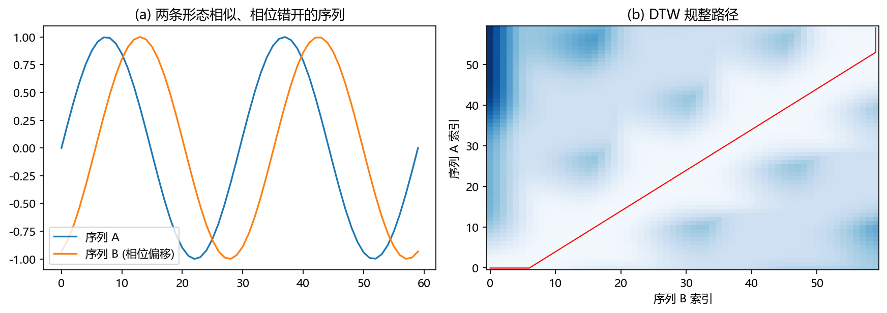

**例 7.2（DTW 手算）**　对例 7.1 的 $\mathbf{x},\mathbf{y}$ 取 $\delta=|a-b|$，计算 $3\times3$ 左上角（为简洁取前 3 点）：$\mathbf{x}_{1:3}=(0,0,1)$、$\mathbf{y}_{1:3}=(0,1,2)$。$D(1,1)=0$；$D(1,2)=1+0=1$，$D(2,1)=0+0=0$；$D(2,2)=1+\min\{1,0,0\}=1$；$D(1,3)=2+1=3$，$D(3,1)=1+0=1$；$D(2,3)=2+\min\{3,1,1\}=3$，$D(3,2)=2+\min\{1,3,0\}=2$；$D(3,3)=1+\min\{3,2,1\}=2$。可见路径借对角线「绕开」了相位偏移，代价 2 明显低于欧氏对应段的累加。这个 3×3 手算揭示了 DTW 的本质：**用动态规划在时间轴上「拉伸」对齐**。

DTW 有两个广为人知的缺陷。其一是**病态对齐**（pathological warping）：一个点被过度拉伸去匹配一大片点，产生不合物理的对齐。对策是约束路径搜索范围：**Sakoe–Chiba 带宽**限制 $|i-j|\le w$（$w$ 常取 $T$ 的 5%–10%），**Itakura 平行四边形**进一步限制斜率，二者把复杂度降到 $O(wT)$ 并抑制病态对齐。其二是 $O(T^2)$ 代价在大规模检索中不可接受，这引出下界加速。

### 7.1.3　LB_Keogh 下界与编辑距离

**LB_Keogh 下界**[2] 的思路是「先廉价过滤、再精确计算」。给定查询 $\mathbf{q}$ 与带宽 $w$，构造上下包络

$$
U_i=\max_{i-w\le j\le i+w} q_j,\qquad L_i=\min_{i-w\le j\le i+w} q_j,
$$

LB_Keogh 下界定义为

$$
\mathrm{LB\_Keogh}(\mathbf{q},\mathbf{c}) = \sqrt{\sum_{i=1}^{T}
\begin{cases}
(c_i-U_i)^2, & c_i>U_i,\\
(L_i-c_i)^2, & c_i<L_i,\\
0, & \text{否则}.
\end{cases}} \tag{7-3}
$$

可证明 $\mathrm{LB\_Keogh}\le\mathrm{DTW}$（在带宽约束下）。检索时若某候选序列的下界已超过当前最优距离，即可**无计算 DTW 地剪枝**。由于下界计算为 $O(T)$ 且满足三角不等式，它可嵌入索引实现精确（无漏报）的近邻搜索。这与第 7.5 节的符号化索引共同构成大规模检索的两大支柱。

对于离散符号化序列（第 7.5 节的 SAX 表示），还可用**编辑距离**（Levenshtein 距离）：把一条串变为另一条所需的最少插入、删除、替换次数，同样由动态规划求解。它适用于「形态由符号序列表达」而非数值幅值的场景。

**表 7-1　相似性度量对照**

| 度量 | 复杂度 | 是否度量 | 允许相位偏移 | 主要局限 |
|------|--------|----------|--------------|----------|
| 欧氏距离 | $O(T)$ | 是 | 否 | 对伸缩/平移敏感 |
| DTW | $O(T^2)$ | 否 | 是 | 病态对齐、计算代价 |
| 约束 DTW | $O(wT)$ | 否 | 受限 | 带宽需调参 |
| LB_Keogh | $O(T)$ | 是（下界） | — | 仅用于剪枝 |
| 编辑距离 | $O(T^2)$ | 是 | 是（符号） | 需先离散化 |

## 7.2　时序聚类

聚类的目标是把 $N$ 条序列划分为 $K$ 个簇，使簇内相似、簇间相异。方法可按「如何定义中心」与「如何度量距离」分为四代。

**k-means 变体**最直接：把第 6 章的特征向量（或原始序列）作欧氏 k-means。但用 DTW 作距离时遇到一个理论障碍——DTW 不是度量，簇中心的「均值」无定义；**DTW Barycenter Averaging（DBA）** 通过迭代对齐求一个使平方 DTW 和最小的中心序列来补救。

**层次聚类**无需预设 $K$，以自底向上凝聚（或自顶向下分裂）配合任意距离生成谱系树，适合探索性分析，代价是 $O(N^2)$ 相似度矩阵。**谱聚类**把序列视作相似度图的节点，用图拉普拉斯的低维嵌入再聚类，能处理非凸形状的簇。

**定义 7.2（基于形状的距离 SBD）** 对两条序列 $\mathbf{x},\mathbf{c}$，基于形状的距离由归一化互相关的最大值定义 $\mathrm{SBD}(\mathbf{x},\mathbf{c})=1-\max_s\frac{\mathbf{x}_{(s)}\cdot\mathbf{c}}{\|\mathbf{x}\|\|\mathbf{c}\|}$，其中 $\mathbf{x}_{(s)}$ 为循环位移。它对幅值缩放与相位平移不敏感，适合形状聚类。

**k-Shape**[3] 是专为时序设计的聚类算法，其创新在于用**基于形状的距离**（Shape-Based Distance, SBD）替代欧氏距离。SBD 由归一化互相关定义：对 $\mathbf{x},\mathbf{c}$ 取所有相对位移 $s$ 上的互相关最大值

$$
\mathrm{SBD}(\mathbf{x},\mathbf{c}) = 1 - \max_{s}\ \frac{\mathbf{R}_{s}(\mathbf{x},\mathbf{c})}{\sqrt{R_0(\mathbf{x},\mathbf{x})\,R_0(\mathbf{c},\mathbf{c})}}, \tag{7-4}
$$

其中 $\mathbf{R}_s$ 为位移 $s$ 下的互相关（可用 FFT 高效计算所有 $s$）。簇中心则由「使所有成员 SBD 之和最小的序列」通过求解一个 Rayleigh 商得到。因为互相关对幅值缩放与相位平移不敏感，k-Shape 能把「形态相同、峰值高度或出现时刻略异」的曲线归为一簇，而不必像 DTW 那样做非线性对齐。

**例 7.3（统一案例：负荷日曲线聚类）**　把 60 天的日负荷曲线（每天 24 点，按日均值归一化）作 k-Shape 聚类，取 $K=3$。得到三簇：① 工作日簇（早高峰陡升、双峰明显，约 42 天）；② 周末簇（整体平缓、峰值后移，约 16 天）；③ 异常簇（2 天，形态剧烈起伏）。第 ③ 簇经核对为一次极端高温与一次线路检修日——这一结果与第 6 章例 6.3 用排列熵区分三种制度相互印证，且可直接移交第 8 章的异常检测作标注核查。若改用欧氏 k-means，因周末曲线峰值相位与工作日错开约 2 小时，会被误并入工作日簇，说明**度量选择比聚类算法本身更关键**。

聚类的边界在于：簇数 $K$ 需先验或由轮廓系数等准则选择；结果对标准化（第 5 章）敏感；且「相似」的定义完全是任务相关的——按幅值聚与按形态聚会得到不同的分群，须由业务问题决定。

## 7.3　时序分类

时序分类方法历经四代演进，图 7-2 给出这一谱系。

> 【图 7-2　时序分类方法谱系】（原图见 `figures/图7-2.png`）：分层演进图。自上而下四层，每层一个横条并标注「1-NN + DTW」「Shapelet 学习」「区间特征（TSF、BOSS）」「深度分类（ResNet/InceptionTime/ROCKET/MiniRocket）」，层间用向下箭头连接表示演进。白底、蓝条、中文。

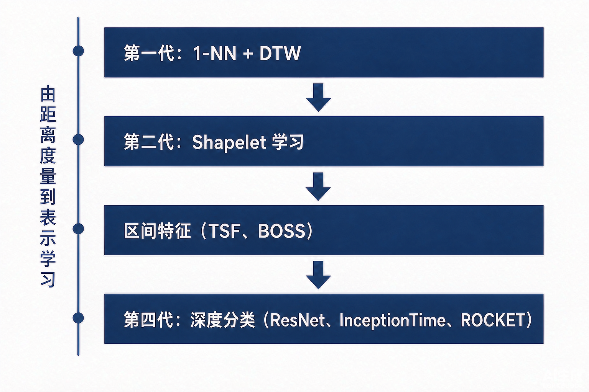

时序分类（Time Series Classification, TSC）为整条序列赋予类别标签，是监督学习。其方法谱系可清晰分为四代。

**第一代：最近邻 + DTW。** 1-NN 配合 DTW 距离长期是 TSC 的强基准，UCR 档案上的大量实验表明它难以被轻易超越[6]。其优势是无训练、天然可解释（预测可归因于最相似的那条训练序列），代价是推断需与全部训练序列逐一算 DTW，须靠 7.1 节下界加速。

**第二代：Shapelet 与区间特征。** Shapelet（定义见第 6 章 6.4 节）以「到判别性子序列的距离」为特征，兼具精度与可解释性；Shapelet Transform[7] 把它变成通用特征映射。另一路是**区间特征**：把序列切成若干区间，各区间提取均值、方差、斜率等统计特征后送入集成分类器，代表为 TSF（Time Series Forest）与 BOSS[4]（Bag of SFA Symbols，用符号化傅里叶近似 SFA 把子序列离散为「词」，再以词频直方图作特征）。这一代方法把领域知识编码进特征，数据效率较高。

**例 7.4（统一案例：台区类型分类）**　给 200 个台区的日负荷曲线标注「工业主导 / 居民主导 / 商业主导」三类。用第 6 章例 6.4 找到的早高峰 shapelet 作单一特征，即可把工业主导（早高峰陡升）与居民主导（晚高峰为主）大体分开，训练准确率约 78%；拼接谱熵、峰谷差、8 个主成分后送入随机森林，准确率升至约 91%。若改为 1-NN+DTW，准确率约 89% 但推断耗时高一个量级。这个例子说明：**分类精度随特征表达能力的提升而提升，但可解释性随之下降**——shapelet 单特征能讲清「为什么判为工业」，随机森林的 90 个特征则难以回溯。

**第三代与第四代**（深度学习、随机卷积核）在 7.4 节展开。TSC 方法的共同边界是：类别须平衡、训练与测试分布须一致；当类别由「罕见事件」（故障、欺诈）定义时，须转向第 8 章的异常检测而非标准分类。

## 7.4　深度时序分类与随机卷积核

深度模型把「特征提取 + 分类」端到端联合学习。在时序分类上表现突出的代表是 **ResNet / InceptionTime**：把一维卷积、残差连接与多尺度卷积核（Inception 模块）迁移到序列，五个网络集成的 InceptionTime 长期占据 UCR 榜单前列[6]。其代价是需要较大训练数据与算力，且是黑箱。

一个出人意料的结果是 **ROCKET**[5]：它**不训练卷积核**，而是随机生成上万个不同长度、膨胀、偏置的卷积核，对序列作卷积后用「最大值」与「正比例值」（PPV）两个池化统计量拼成特征向量，再仅训练一个线性分类器。ROCKET 以极低的训练成本取得接近甚至超越深度模型的精度；MiniRocket 进一步把核固定为少量确定值、去掉随机性，速度再提升一个量级。这一「随机特征 + 线性头」的路线，本质上是用随机卷积核替代第 6 章的人工特征枚举，可视为第 6.6 节表示学习的轻量化近亲。

**表 7-2　时序分类方法四代对照**

| 代 | 代表 | 特征来源 | 训练成本 | 可解释性 |
|----|------|----------|----------|----------|
| 一 | 1-NN + DTW | 原始距离 | 无（推断贵） | 高 |
| 二 | Shapelet / BOSS / TSF | 人工判别特征 | 中 | 中—高 |
| 三 | ResNet / InceptionTime | 端到端学习 | 高 | 低 |
| 四 | ROCKET / MiniRocket | 随机卷积核 | 极低 | 低 |

**例 7.5（统一案例：方法选型）**　续例 7.4 的 200 台区分类。若部署在边缘网关、需就地快速推断且数据量小，宜用 shapelet 或 1-NN+DTW；若有云端算力、追求 95%+ 精度，可用 InceptionTime；若需在数小时内于普通 CPU 上完成训练并给出强基线，ROCKET 最合适。三类选择没有绝对优劣，取决于「数据量—算力—可解释性」三角，呼应第 1 章例 1.2 与第 6 章的同一权衡。

## 7.5　时序检索与索引

当序列库达到百万级，「与查询最相似的序列」无法靠逐一计算 DTW 得到，索引成为关键。主流思路是**符号化 + 下界剪枝**两段式。

**SAX（Symbolic Aggregate approXimation）** 先把序列分段（PAA 降维），再按正态分位点把每段的均值离散为符号（如 a–d），得到符号串；**iSAX** 通过多分辨率符号串建立层次索引与倒排表，查询时先由符号串召回少量候选，再用真实 DTW 精确排序[8]。配合 **LB_Keogh 下界**（式 7-3）或更早的 LB_Yi、LB_Kim 系列下界，可保证**精确检索**（无漏报）：任何被剪枝的候选，其下界已超过当前第 $k$ 优距离，故不可能进入结果集。

**例 7.6（统一案例：相似日检索）**　电网调度常需「找出历史上与明日气象最相似的日子」以参考其负荷。先按气温、湿度、日历把历史日符号化为 iSAX 串，倒排召回约 50 个候选日；再对这 50 条负荷曲线用约束 DTW 精排，取前 5 日的实际负荷作为第 12 章 ARIMA 或第 17 章 XGBoost 的类比输入。相对全库 3 万日逐一算 DTW，索引把计算量降低约两个数量级，且因用 LB_Keogh 下界剪枝，结果与全量精排完全一致。

检索的边界：符号化带来信息损失，离散粒度（字母数、分段数）需调优；下界越紧剪枝越强，但计算下界本身也有成本，须权衡。这些工程考量在第 40 章的系统部署中会再次出现。

## 本章小结

本章以「相似性度量」为内核，串联了检索、聚类、分类三类任务，属于 Level 1 分析。核心结论是：**度量与表示的选择，往往比后续的聚类器或分类器更决定结果**，而这些方法共同隐含「类内序列共享稳定统计结构（L1 可预测性）」的假设。

7.1 节从欧氏距离对相位偏移的失效（例 7.1）出发，给出 DTW 的动态规划递推（式 7-2）与 3×3 手算（例 7.2），并以 Sakoe–Chiba/Itakura 约束与 LB_Keogh 下界（式 7-3）分别解决病态对齐与计算代价，五种度量汇总于表 7-1。7.2 节讨论四代聚类，重点给出 k-Shape 的形状距离 SBD（式 7-4），并用统一案例（例 7.3）展示它能把负荷日曲线正确分出工作日/周末/异常三簇而欧氏 k-means 不能。7.3 节梳理 TSC 四代方法（表 7-2），Shapelet 仅论分类用法、定义交叉引用第 6 章以遵守去重；例 7.4 用台区分类展示「精度上升、可解释性下降」的规律。7.4 节介绍深度分类与 ROCKET 随机卷积核，例 7.5 给出按「数据量—算力—可解释性」的选型。7.5 节以 iSAX 符号化 + 下界剪枝解决大规模检索，例 7.6 展示相似日检索如何服务下游预测。

本章反复出现的统一案例与去重原则，把第 6 章的特征、本章的相似性度量、第 8 章的异常检测连成一条线：第 6 章把序列变为向量，本章据以判「像不像」，第 8 章则据「像不像常态」判「异不异常」。下一章转入异常检测，它是这一链条在稀有模式上的专门化。

从四问看，本章的相似性与分类利用 L1（统计）：假设「像不像」可由距离度量刻画；它突破了「无标签难以组织序列」的困难，仍受「度量选择决定结论」的边界约束。

**进一步阅读**　本章建议延伸阅读的文献：[9]、[10]、[11]、[12]。

## 参考文献

[1] Berndt D J, Clifford J. Using dynamic time warping to find patterns in time series. *KDD Workshop*, 1994: 359–370.

[2] Keogh E, Ratanamahatana C A. Exact indexing of dynamic time warping. *Knowledge and Information Systems*, 2005, 7(3): 358–386.

[3] Paparrizos J, Gravano L. k-Shape: Efficient and accurate clustering of time series. *SIGMOD*, 2015: 1855–1870.

[4] Schäfer P. The BOSS is concerned with time series classification in the presence of noise. *Data Mining and Knowledge Discovery*, 2015, 29(6): 1505–1530.

[5] Dempster A, Petitjean F, Webb G I. ROCKET: Exceptionally fast and accurate time series classification using random convolutional kernels. *Data Mining and Knowledge Discovery*, 2020, 34(5): 1454–1495.

[6] Ismail Fawaz H, Forestier G, Weber J, et al. Deep learning for time series classification: A review. *Data Mining and Knowledge Discovery*, 2019, 33(4): 917–963.

[7] Lines J, Davis L M, Hills J, Bagnall A. A shapelet transform for time series classification. *KDD*, 2012: 289–297.

[8] Shieh J, Keogh E. iSAX: Indexing and mining terabyte sized time series. *KDD*, 2008: 623–631.

[9] Sakoe H, Chiba S. Dynamic programming algorithm optimization for spoken word recognition. *IEEE Transactions on Acoustics, Speech, and Signal Processing*, 1978, 26(1): 43–49.

[10] Petitjean F, Ketterlin A, Gançarski P. A global averaging method for dynamic time warping, with applications to clustering. *Pattern Recognition*, 2011, 44(3): 678–693.

[11] Dau H A, Bagnall A, Kamgar K, et al. The UCR time series archive. *IEEE/CAA Journal of Automatica Sinica*, 2019, 6(6): 1293–1305.

[12] Ye L, Keogh E. Time series shapelets: A new primitive for data mining. *KDD*, 2009: 947–956.

---

# 第 8 章　时序异常检测

第 7 章以「像不像」为核心组织聚类与分类，本章转向一个紧密相关却更棘手的问题：**「正不正常」**。异常检测要找出那些与绝大多数观测显著不同的点、段或模式。它在工业运维（传感器故障预警）、金融风控（欺诈交易）、设备健康管理（第 39 章 PHM）、乃至电网调度中都是刚需——统一案例里，一次表计故障的孤立尖峰、一段被限电扭曲的负荷曲线，都是需要被自动标记的对象。

遵循全书「基础理论只讲一次」的编写原则，**本章是全书异常检测方法的唯一讲授处**。第 40 章谈「概念漂移监控」时不再重复介绍检测器，而是直接调用本章方法于监控流水线；第 5 章的 Hampel 滤波（式 5-1）是清洗阶段的单点稳健判据，本章则把它纳入更一般的检测框架。读者应把本章视为这一知识点的「首讲且唯一」位置。

从四层能力体系看，异常检测属 **Level 1（时序分析）**：它回答「发生了什么反常」，而非预测未来。从五层可预测性看，它恰恰依赖于**统计可预测性（L1）的反面**——正因为正常序列具有稳定的规律（自相关、周期、低条件熵），任何显著偏离该规律的点才可被判为异常。这一视角立刻给出一个深刻结论：**在接近白噪声的序列上，异常检测在理论上无法定义**，因为「正常」本身没有结构。这与第 4 章的信息论下界一脉相承，也是本章所有方法隐含的共同前提。

异常检测还有一个区别于分类的根本困难：**极端类别不平衡且标注稀缺**。异常通常只占数据的千分之几，且新类型异常从未在训练集中出现，因此它多被表述为**无监督或半监督**问题——只用正常数据建模「常态」，再把偏离判为异常。本章据此展开：8.1 节给出异常的类型学与问题定义；8.2 节回溯统计方法并给出极值理论推导；8.3 节讨论机器学习方法；8.4 节进入深度方法；8.5 节处理在线与流式检测；8.6 节讨论评估——这一节尤其重要，因为不当的评估指标是该领域「结果虚高」的主要来源。

## 8.1　异常的类型与问题定义

异常的形态并非单一。Chandola 等人的经典综述[1] 给出的分类被广泛采用，本书按时序特点细分为四类。

**定义 8.1（时序异常的类型）**

- **点异常（point anomaly）**：单个时刻 $y_t$ 相对其邻域或全局分布显著偏离，如传感器瞬时跳变到量程上限；
- **上下文异常（contextual anomaly）**：$y_t$ 的取值本身落在正常范围内，但在特定上下文中反常，如负荷在凌晨 3 点出现本应只在傍晚出现的峰值；
- **集合异常（collective anomaly）**：单个点均正常，但一段子序列的整体形态或顺序异常，如设备振动在 2 秒内出现本不该有的连续高频小幅振荡；
- **模式异常（pattern anomaly）**：稳定的周期或季节规律被打破，如某周的工作日/周末节律突然消失。

四类的区分不是学究式的：它们对应不同的检测单元与建模对象。点异常可逐点判断；上下文异常必须先定义「上下文」（时间位置、同期历史、外部变量），本质是一个条件分布问题；集合异常与模式异常则必须以**子序列**为单位，涉及第 7 章的相似性度量或第 3 章的周期分解。

**定义 8.2（异常分数）**　设检测器给出映射 $s:\mathcal{Y}\to\mathbb{R}$，把点、窗口或整条序列映射为实数，值越大表示越异常；给定阈值 $\tau$，$s>\tau$ 判为异常。绝大多数方法可统一为「设计 $s$」与「选择 $\tau$」两个子问题。

这一形式化把「异常」从二值判断变为**排序问题**，好处是可用 ROC/AUC 等不依赖阈值的指标评估，并把阈值选择推迟到部署阶段（8.6 节）。它也澄清了一个常被忽视的事实：所谓「无监督异常检测」并非没有假设，而是把假设编码进了 $s$ 的构造——3σ 假设高斯，重构误差假设「正常样本可被低维流形压缩」，孤立森林假设「异常稀疏且远离主体」。

**例 8.1（统一案例：四类异常在电网负荷中的对应）**　点异常：例 5.1 的 $2403$ MW 表计跳变。上下文异常：某寒潮日凌晨 3 点负荷达 $1350$ MW——绝对值在夏季白天属正常，但在冬季凌晨极反常。集合异常：连续 4 小时负荷以每 15 分钟 ±3% 高频小幅抖动、均值却正常，提示某台区通信或调频设备异常。模式异常：某周工作日与周末曲线几乎重合，说明节假日调休或数据错位。四类需要不同的检测单元（点 / 带上下文的点 / 窗口 / 周期段），这正是本章方法谱系分化的根本原因。

## 8.2　统计方法

统计方法的历史最久，从 19 世纪的离群点剔除到控制图的 $3\sigma$ 限，其共同思想是**用概率分布刻画「正常」，把低概率事件判为异常**。

**全局 $3\sigma$ 与 IQR。** 若假定 $y_t\sim\mathcal{N}(\mu,\sigma^2)$，则 $\mathbb{P}(|y-\mu|>3\sigma)\approx0.0027$，据此设阈值。箱线图用四分位距 $\mathrm{IQR}=Q_3-Q_1$，把 $y<Q_1-1.5\mathrm{IQR}$ 或 $y>Q_3+1.5\mathrm{IQR}$ 判异常，对非正态分布更稳健。二者的共同缺陷在第 5 章已指出：时序的 $\mu,\sigma$ 随时间变化，全局阈值会误报季节高峰。工程上的修正是**局部化与去季节**——先按第 3 章 STL 分解取残差 $R_t=y_t-T_t-S_t$，再对近白噪声的残差用 $3\sigma$，或按小时/星期分组估计各自的 $(\mu,\sigma)$。

**回归残差法。** 先用正常数据拟合预测模型（ARIMA、回归、甚至第 18 章的 LSTM），以残差 $e_t=y_t-\hat y_t$ 作异常分数。它把「异常」定义为「模型无法解释的部分」，天然处理上下文异常——因为 $\hat y_t$ 已包含季节与外生变量。其风险是「掩蔽效应」（masking）：若异常污染了训练数据，模型会把异常也学成规律。

**极值理论（EVT）与 SPOT。** 全局 $3\sigma$ 需要假定整体分布，而阈值法只需对**尾部**建模。Pickands–Balkema–de Haan 定理指出：对一大类分布，当阈值 $t$ 足够大时，超出量 $Y=y-t$（条件于 $y>t$）近似服从广义帕累托分布（GPD）

$$
\mathbb{P}(y-t>z\mid y>t) \approx \Big(1+\frac{\xi z}{\beta}\Big)^{-1/\xi}, \tag{8-1}
$$

其中 $\xi$ 为形状参数、$\beta>0$ 为尺度参数。由此可反解出**对应目标误报率 $q$ 的动态阈值**：

$$
z_q = t + \frac{\beta}{\xi}\Big[\big(q\,n/N_t\big)^{-\xi}-1\Big], \tag{8-2}
$$

其中 $N_t$ 为超过初始阈值 $t$ 的样本数、$n$ 为总样本数[2]。式 (8-2) 的意义在于：它不假设数据服从某个整体分布，而只要求尾部服从 GPD，且**把阈值直接绑定到业务可解释的误报率 $q$**——例如「每天最多 1 次误报」。SPOT 算法[2] 把这一推导搬到流式场景，用滑动窗口在线更新 $\xi,\beta$，从而自适应概念漂移（第 40 章会调用这一机制）。

**例 8.2（EVT 阈值算例）**　对某台区残差序列（$n=8640$ 个 10 分钟点）取初始阈值 $t=40$ MW，超过者 $N_t=180$ 个，GPD 拟合得 $\hat\xi=0.12,\hat\beta=9.5$。设定目标误报率 $q=10^{-3}$（约每天 0.14 次），代入式 (8-2)：$q\,n/N_t=10^{-3}\times8640/180=0.048$，$(0.048)^{-0.12}\approx1.44$，故 $z_q\approx40+\frac{9.5}{0.12}(0.44)\approx74.8$ MW。即残差超过约 $75$ MW 才告警。相比之下，若误用全局 $3\sigma$（残差 $\sigma\approx12$）得阈值 $36$ MW，告警频率高出数倍——EVT 通过尾部建模给出了更贴合业务的阈值。

统计方法的谱系与边界：优点是简洁、可解释、无需标注、计算廉价；局限是强分布假设（或强尾部假设）、难以刻画多变量耦合、对集合异常与模式异常无能为力。这引出机器学习与深度方法。

## 8.3　机器学习方法

当异常不是「单变量取值极端」而是「多变量组合反常」时，逐点统计失效。机器学习方法把窗口或特征向量（第 6 章）作为样本，在更高维空间中刻画常态。

**孤立森林（Isolation Forest）**[3] 基于一个巧妙观察：异常点「少且不同」，因而更易被随机切分孤立。对随机树，样本 $x$ 的平均路径长度 $E[h(x)]$ 越短越异常，定义分数

$$
s(x,n) = 2^{-\,E[h(x)]/c(n)}, \tag{8-3}
$$

其中 $c(n)=2H(n-1)-2(n-1)/n$ 为二叉搜索树平均路径长度的归一化常数（$H$ 为调和数）。$s\to1$ 表示极异常、$s\to0.5$ 表示正常。它无需距离或密度计算、线性复杂度、对高维稳健，是表格化异常检测的强基线。

**局部离群因子（LOF）**[4] 比较样本与其 $k$ 邻域的局部可达密度，$\mathrm{LOF}_k(x)>1$ 表示比邻居更稀疏、判为局部异常。它能发现「相对局部密度」的异常，代价是 $O(n^2)$ 邻域搜索与对 $k$ 敏感。**One-Class SVM**[5] 在核特征空间中寻找包含大多数样本的最小超球面（或超平面），球外即异常，适合高维但需调核参数与 $\nu$。

**自编码器（AE）** 是通向深度方法的桥梁：用正常数据训练一个瓶颈网络使重构误差 $\|\mathbf{x}-\hat{\mathbf{x}}\|^2$ 最小，异常因不符合低维流形而重构误差大。它可视为非线性的 PCA（第 6 章），异常分数即重构误差。

**表 8-1　机器学习异常检测方法对照**

| 方法 | 异常分数来源 | 复杂度 | 适用 | 局限 |
|------|--------------|--------|------|------|
| 孤立森林 | 平均孤立路径长（式 8-3） | $O(n)$ | 高维表格、点异常 | 局部异常不敏感 |
| LOF | 局部密度比 | $O(n^2)$ | 密度不均、局部异常 | 高维失效、$k$ 敏感 |
| One-Class SVM | 超球边界 | $O(n^2)$ 起 | 高维、单类 | 核与 $\nu$ 难调 |
| AE | 重构误差 | 训练贵 | 非线性流形 | 需足量正常数据 |

须强调：这些方法把**窗口或第 6 章的特征向量**当输入，本身不理解时间顺序；因此上下文异常与集合异常必须靠「滑动窗口 + 统计/频域特征」显式编码（例如把 24 小时窗口的均值、斜率、谱熵拼成向量），这正是第 6 章特征工程的价值所在。

## 8.4　深度方法

深度方法用神经网络自动学习时序的正常模式，摆脱手工特征，尤其擅长**多变量耦合**与**长程依赖**。

**LSTM-AE / OmniAnomaly。** LSTM 编码器把窗口压成隐状态、解码器重构，重构误差或重构概率作分数。OmniAnomaly[6] 进一步用随机循环网络与变分推断把隐变量建模为分布，并用重构概率对多变量逐维打分，从而能定位「哪个变量贡献了异常」——这对运维归因至关重要。Hundman 等人[7] 在航天器遥测上的工作还示范了「LSTM 预测 + 非参数动态阈值」的组合，与 8.2 节的 EVT 阈值思路互补。

**VAE / GAN。** VAE 以重构概率（而非误差）衡量异常，能量化不确定性；TadGAN 用生成器—判别器—编码器三者联合，以「重构误差 + 判别器特征差异」组合打分，对周期异常敏感。USAD[8] 用两个解码器的对抗训练放大异常的重构误差，兼顾速度与精度。

**Anomaly Transformer**[9] 是多变量异常检测的代表性工作，其核心是**关联差异**（association discrepancy）。观察到异常点的自注意力更「集中」于局部邻域（因其与全局先验不符），而正常点的注意力与相邻分布更一致，作者构造

$$
\mathrm{AssDis}(x) = \Big[\,\mathrm{KL}\big(\mathcal{N}(\mu_{\mathrm{prior}})\,\|\,\mathcal{N}(\mu_{\mathrm{series}})\big) + \mathrm{KL}\big(\mathcal{N}(\mu_{\mathrm{series}})\,\|\,\mathcal{N}(\mu_{\mathrm{prior}})\big)\,\Big]/2, \tag{8-4}
$$

并用极小极大策略放大正常与异常的关联差异，再结合重构误差形成分数。它把「异常」定义为**先验关联与序列关联的偏离**，而非单纯数值偏离，因而能捕捉「各变量单独正常、组合关系反常」的集合异常。TimesNet（第 22 章）等通用骨干也可迁移到异常检测任务，体现第 6.6 节「一个表示、多个任务」的思路。

**例 8.3（统一案例：多变量组合异常）**　电网某台区同时记录负荷 $L$、气温 $T$、湿度 $H$。某日 $L$、$T$、$H$ 各自都在历史正常范围内，但出现了「气温骤降 8℃ 而负荷不升反降」的组合——按物理与历史规律，降温应伴随采暖负荷上升。逐点 $3\sigma$ 与孤立森林（把三变量当独立窗口）均漏检；而 Anomaly Transformer 因学到「$T$ 与 $L$ 的先验关联」被打破，关联差异（式 8-4）显著升高，成功标记该段。这个例子说明深度方法的主要增益在于**建模变量间依赖**，而非单点幅度。

深度方法的边界：需大量正常训练数据、黑箱难解释、对超参与阈值敏感，且存在「过度泛化」——网络太强会把异常也重构得很好，反而漏检（故 OmniAnomaly、USAD 都用正则或对抗约束）。这些权衡在第 29 章审视大模型局限时会以类似形式再现。

## 8.5　在线与流式异常检测

前述方法多为离线批处理，而工程监控要求**数据到达即判定**，且不能存储全部历史、不能假定分布恒定。这带来两个额外约束：低延迟、自适应漂移。

SPOT / DSPOT[2] 是这一方向的代表。它把 8.2 节的 EVT 阈值（式 8-2）改造成流式算法：维护一个固定大小的初始窗口估计 $t,\xi,\beta$，此后每来一个新点，若未超阈值则更新窗口与 GPD 参数（DSPOT 先去季节/趋势再应用 SPOT，处理漂移）；一旦超过 $z_q$ 则告警并把该点归入「异常」而不污染正常模型。这样阈值随数据分布演化自适应，无需人工定期重标定。

在线检测还需处理**告警疲劳**：单点尖峰常是噪声，工程上普遍加「连续 $k$ 点超阈才告警」「告警抑制窗口」等后处理；以及**概念漂移与异常的区分**——缓慢的分布迁移（季节更替、设备老化）应触发模型更新（第 25、40 章），而非告警。SPOT 的自适应阈值正是对这一区分的初步回应：它把「缓慢变化」吸收进参数更新，只对「相对当前分布的极端事件」告警。

## 8.6　评估

异常检测的评估是最容易出问题的环节，原因有三：正样本极稀疏（准确率毫无意义——全部判正常也有 99.9% 准确率）、异常以「段」出现、标注本身常有主观性。

**点式指标**以点为单位算 precision、recall、F1 或 AUC。但它们会因「一个连续异常段被逐点计数」而虚高：检测器只在长异常段的某一点触发，点式 recall 可能很低，却实际已成功预警。为此 Tatbul 等人提出 **range-based（范围式）指标**[10]：把真实异常段与预测段按重叠关系对齐，分别计算范围级 precision/recall，并引入对「每段至少命中一次」的奖励与对碎片化预测的惩罚，再由 $\gamma$ 加权成 F1。此外还有 **point-adjusted（点调整）** 惯例：只要异常段内任一点被判异常，就把整段视为召回——但它被批评为会系统性高估，故近年基准更推荐 range-based 或 affiliation 指标[11]。

**阈值与校准。** 多数检测器输出连续分数 $s$（定义 8.2），评估须区分「不依赖阈值的排序质量」（AUC、AUPRC）与「依赖阈值的告警质量」（F1）。AUPRC 因聚焦稀疏正类，比 AUC 更适合不平衡场景。阈值 $\tau$ 应由验证集或业务误报率 $q$（式 8-2）确定，切忌在测试集上挑最优阈值——那是数据泄漏（第 38 章将系统辨析）。

**常用基准**包括 SMD（服务器机组）、SMAP/MSL（航天器遥测）、SWaT/WADI（水处理工控）、PSM、以及第 39 章会用到的工业设备数据。表 8-2 汇总。

**表 8-2　常用异常检测基准**

| 数据集 | 领域 | 维度 | 特点 |
|--------|------|------|------|
| SMD | 服务器监控 | 28 组多变量 | 带标注、规模适中 |
| SMAP / MSL | 航天器遥测 | 单/多变量 | NASA 公开、点调整惯例起点 |
| SWaT / WADI | 水处理工控 | 多变量 | 含真实攻击场景 |
| PSM | 服务器 | 多变量 | 来自 eBay |

**例 8.4（评估陷阱实例）**　设真实异常为一段 100 点的连续故障，检测器只在其第 50 点触发一次。点式 recall $=1/100=1\%$，看似极差；point-adjusted 惯例下该段「命中」则 recall $=100\%$；range-based 指标给出介于两者之间、并惩罚碎片化的折中分数。同一检测器、三种指标、结论从「不可用」到「完美」不等——这解释了为何近年文献强调报告 range-based 或 affiliation 指标并同时给出 AUPRC。读者在第 38 章会看到，这类「指标选择改变排名」的现象在预测竞赛中同样普遍。

> 【图 8-1　异常检测方法谱系】（原图见 `figures/图8-1.png`）：树状分层图，按「统计 / 机器学习 / 深度学习 / 在线」四支列出代表方法，标注各自适用异常类型（点/上下文/集合/模式）与数据需求。

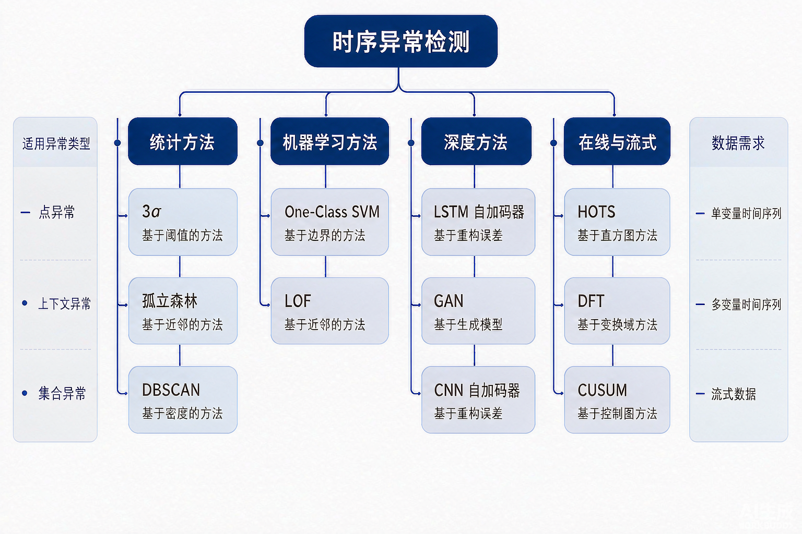

2016 年的 LSTM 编码器—解码器重构检测[12]开启了深度异常检测，但仍是"一数据集一模型"；2025 年之后，这一任务也进入基础模型范式。华东师范大学决策智能实验室提出 DADA[13]（ICLR 2025），以自适应瓶颈与双对抗解码器构建面向通用时序异常检测的基础模型：在大规模多域序列上预训练后，对未见数据集可直接作零样本检测，而不必像 8.2–8.4 节那样为每个系统重新设定阈值与训练检测器。它把第 26–27 章的基础模型范式从 Level 2 预测扩展到 Level 1 分析，也把本章"按异常类型选检测器"的问题升级为"一个模型覆盖多类异常"，最新谱系见第 27 章。边界仍须守住两点：其一，异常分数到告警阈值的映射仍依赖领域误报成本，须按第 38 章的代价敏感评估校准；其二，对预训练语料未覆盖的全新故障机理，模型输出的"正常"判断仍受第 4 章可预测性边界约束，不能替代第 9 章变点检测与人工复核。

## 本章小结

本章是全书异常检测方法的**唯一讲授处**（第 40 章监控段将直接调用本章方法）。贯穿全章的理论主线是：异常检测依赖「正常序列具有稳定结构（L1 可预测性）」这一前提，因而在近白噪声序列上无定义；所有方法不过是把这一「常态」以不同方式编码，再把偏离判为异常。

8.1 节给出四类异常（点 / 上下文 / 集合 / 模式，定义 8.1）与异常分数形式化（定义 8.2），例 8.1 用统一案例说明四类需不同检测单元。8.2 节从 $3\sigma$/IQR 讲到 EVT 的 GPD 尾部建模（式 8-1）与绑定误报率的动态阈值（式 8-2），例 8.2 手算表明 EVT 阈值比全局 $3\sigma$ 更贴合业务。8.3 节讨论孤立森林（式 8-3）、LOF、One-Class SVM 与 AE（表 8-1），指出它们须靠第 6 章特征工程显式编码时间上下文。8.4 节进入深度方法，重点给出 Anomaly Transformer 的关联差异（式 8-4），例 8.3 展示「各变量正常、组合反常」只有建模依赖的方法才能捕捉。8.5 节处理在线检测与漂移/异常的区分。8.6 节强调评估陷阱，给出 range-based 指标与常用基准（表 8-2），例 8.4 揭示同一检测器因指标不同结论可天差地别。

本章与前后章形成清晰链条：第 6 章把序列变向量、第 7 章判「像不像」、本章判「异不异常」；第 9 章将进一步判「结构何时变了」——变点检测与异常检测关注「离群」与「迁移」的不同侧面，二者常需配合使用。全章统一案例（电网负荷）在例 8.1–8.4 中连续复用，并将在第 40 章的漂移监控中再次出现。

从四问看，本章的异常检测利用 L1（统计）与 L2（信息论）：假设多数观测正常、异常稀疏；它突破了「偏离常态的自动识别」，仍受「概念漂移会被误判为异常」的边界约束（第 9、25 章）。

**进一步阅读**　本章建议延伸阅读的文献：[1]、[2]、[13]。

## 参考文献

[1] Chandola V, Banerjee A, Kumar V. Anomaly detection: A survey. *ACM Computing Surveys*, 2009, 41(3): 1–58.

[2] Siffer A, Fouque P-A, Termier A, Largouët C. Anomaly detection in streams with extreme value theory. *KDD*, 2017: 1067–1075.

[3] Liu F T, Ting K M, Zhou Z-H. Isolation forest. *ICDM*, 2008: 413–422.

[4] Breunig M M, Kriegel H-P, Ng R T, Sander J. LOF: Identifying density-based local outliers. *SIGMOD*, 2000: 93–104.

[5] Schölkopf B, Platt J C, Shawe-Taylor J, et al. Estimating the support of a high-dimensional distribution. *Neural Computation*, 2001, 13(7): 1443–1471.

[6] Su Y, Zhao Y, Niu C, et al. Robust anomaly detection for multivariate time series through stochastic recurrent neural network (OmniAnomaly). *KDD*, 2019: 2828–2837.

[7] Hundman K, Constantinou V, Laporte C, et al. Detecting spacecraft anomalies using LSTMs and nonparametric dynamic thresholding. *KDD*, 2018: 387–395.

[8] Audibert J, Michiardi P, Guyard F, et al. USAD: Unsupervised anomaly detection on multivariate time series. *KDD*, 2020: 3395–3404.

[9] Xu J, Wu H, Wang J, Long M. Anomaly Transformer: Time series anomaly detection with association discrepancy. *ICLR*, 2022.

[10] Tatbul N, Lee T J, Zdonik S, et al. Precision and recall for time series anomaly detection. *VLDB*, 2018, 11(11): 1779–1793.

[11] Huet A, Navarro J M, Rossi D. Local evaluation of time series anomaly detection algorithms. *KDD*, 2022.

[12] Malhotra P, Ramakrishnan A, Anand G, et al. LSTM-based encoder-decoder for multi-sensor anomaly detection. *arXiv:1607.00148*, 2016.

[13] Shentu Q, Li B, Zhao K, Shu Y, Rao Z, Pan L, Yang B, Guo C. DADA: Towards a general time series anomaly detector with adaptive bottlenecks and dual adversarial decoders. *ICLR*, 2025.

---

# 第 9 章　时序变点检测

上一章讨论的异常，是序列中「偏离常态」的孤立点或短段；本章讨论的**变点**，则是统计性质发生**持久迁移**的位置——均值跃升后不再回落、方差整体改变、趋势斜率转向、或变量间关系重组。二者常被混为一谈，却需要完全不同的处理：异常应当被平滑或剔除，变点则必须被**保留并分段**，因为变点之后的数据服从一套新的规律。用第 1 章的话说，异常是「常态的偏离」，变点是「常态的迁移」。

这一区分对建模有直接后果。第 3 章 3.6 节曾警示「结构突变会伪装成长记忆」，3.1 节又指出「结构突变会制造伪单位根」；第 5 章例 5.5 也提到，一次未识别的水平跃升会使平稳化误入歧途。因此变点检测不是可有可无的预处理，而是**决定后续模型是否成立的前置诊断**。从五层可预测性看，变点意味着 L1 统计可预测性的**结构断裂**：变点前后各自可预测，但若把它们混在一段里拟合单一模型，得到的是两套规律的折中，两边都不准。它同时也与第 40 章的概念漂移相关——漂移可视为「发生在部署阶段的变点」，只是前者要求模型更新、后者要求重新分段。

本章按问题定义（9.1）、经典方法（9.2）、非参数与线性复杂度方法（9.3）、深度方法（9.4）、与相邻任务的关系（9.5）展开。全章沿用统一案例：城市电网负荷——政策调整、大范围分布式光伏接入、表计改造都会在其上留下真实变点。

## 9.1　问题定义与分类

**定义 9.1（变点检测）**　设观测序列 $y_{1:T}$ 被 $K$ 个变点 $0=\tau_0<\tau_1<\dots<\tau_K<\tau_{K+1}=T$ 分割为 $K+1$ 段，每段 $\{\tau_k+1:\tau_{k+1}\}$ 内的数据独立地服从分布 $p(\cdot\mid\theta_k)$，且相邻段参数 $\theta_k\neq\theta_{k+1}$。变点检测的任务是从数据中估计变点个数 $K$ 与位置 $\{\tau_k\}$。

据此可分三类维度。**按处理方式**：离线（offline / retrospective，拿到完整序列后整体检测）与在线（online / sequential，数据到达即判定，用于监控告警）。**按变点数量**：单变点与多变点；后者须联合估计 $K$ 与位置，复杂度高得多。**按变化类型**：均值、方差、斜率（趋势）、自相关结构，乃至整体分布（不限于参数族）。

形式化还须处理一个关键张力：**变点个数 $K$ 未知**，而每多允许一个变点，拟合优度必然提高。若不加惩罚，最优解会退化为「每个点都是变点」。因此多变点检测本质上是一个**模型选择问题**，其目标函数普遍写作

$$
\min_{K,\{\tau_k\}}\ \sum_{k=0}^{K}\mathcal{C}\big(y_{\tau_k+1:\tau_{k+1}}\big) + \beta K, \tag{9-1}
$$

其中 $\mathcal{C}$ 为段内代价（通常取负对数似然），$\beta K$ 为对变点数的惩罚。$\beta$ 控制「拟合改进」与「复杂度」的权衡，与第 12 章 AIC/BIC 的惩罚思想同源。式 (9-1) 是 9.3 节 PELT 等算法的出发点。

**例 9.1（统一案例：负荷的三类变点）**　均值变点：某工业园区投产，台区基线负荷从 900 MW 阶跃到 1150 MW 并保持。方差变点：分布式光伏大规模接入后，午间负荷的波动幅度显著增大而日均水平不变（净负荷的「鸭形曲线」加深）。斜率变点：能效政策实施后，负荷年增长率由 $+3\%$ 转为 $-0.5\%$。三者若都用「均值变点」方法检测，后两类会漏检；若误把一次极端高温尖峰（第 8 章点异常）当变点分段，则会把噪声固化成结构。这说明检测前须先明确「要找哪种变化」，并先用第 8 章方法剔除或标记异常。

## 9.2　经典方法

**定义 9.2（CUSUM 统计量）** 对均值由 $\mu_0$ 变为 $\mu_1$ 的备择，累积和统计量定义为 $S_t=\max\big(0,\ S_{t-1}+(y_t-\mu_0)-\frac{\mu_1-\mu_0}{2}\big)$（或等价的似然比递推形式）；当 $S_t$ 越过阈值 $h$ 时报警。它是对"小而持续的偏移"最优的序贯检验之一。

### 9.2.1　CUSUM 与在线均值偏移

CUSUM（cumulative sum，累计和）由 Page 于 1954 年提出[1]，是统计过程控制的基石。设变点前目标均值为 $\mu_0$、容许漂移量 $\kappa$（约取待检测偏移量的一半），定义单侧累计和

$$
S_t = \max\big(0,\ S_{t-1} + (y_t - \mu_0) - \kappa\big), \qquad S_0=0. \tag{9-2}
$$

其原理是对数似然比的顺序版本：若过程均值从 $\mu_0$ 漂移到 $\mu_0+\delta$，则 $\sum(y_t-\mu_0)$ 会以正斜率累积；减去 $\kappa$ 使正常波动下 $S_t$ 被压回 0，而持续偏移会不断累积直至超过阈值 $h$ 报警。$\max(0,\cdot)$ 让统计量在回到正常后自动复位，从而能连续检测多个变点。$h$ 与「平均运行长度」（ARL，误报间隔）有解析对应关系，可由业务可容忍的误报率反推。

**例 9.2（CUSUM 手算）**　设 $\mu_0=900$ MW、$\kappa=50$、$h=300$。某台区连续 6 小时负荷为 $(905,912,898,1180,1175,1190)$。逐点计算 $S_t$：$S_1=\max(0,0+5-50)=0$；$S_2=\max(0,0+12-50)=0$；$S_3=\max(0,0-2-50)=0$；$S_4=\max(0,0+280-50)=230$；$S_5=\max(0,230+275-50)=455>h$ 报警。故在 $t=5$ 触发，回溯估计变点在 $t=4$（例 9.1 的园区投产场景）。注意前 3 点的小幅波动被 $\kappa$ 完全吸收——这正是 CUSUM 相对逐点 $3\sigma$ 的优势：它对**小幅但持续**的偏移敏感，而后者只对单点极端敏感。

### 9.2.2　似然比检验与离线单变点

对离线单变点问题，标准的频率学方法是广义似然比检验（GLRT）。对每个候选位置 $\tau$，分别估计变点前后参数 $\hat\theta_1,\hat\theta_2$ 与全局参数 $\hat\theta_0$，构造

$$
\Lambda(\tau) = 2\Big[\log p(y_{1:\tau};\hat\theta_1) + \log p(y_{\tau+1:T};\hat\theta_2) - \log p(y_{1:T};\hat\theta_0)\Big], \tag{9-3}
$$

取 $\hat\tau=\arg\max_\tau \Lambda(\tau)$；若 $\max\Lambda$ 超过由极值分布给出的临界值，则判定存在变点。以高斯均值变点为例，$\Lambda(\tau)$ 可化简为与「两段均值差平方 × $\frac{\tau(T-\tau)}{T}$」成正比，因此扫描所有 $\tau$ 只需 $O(T)$（用累积和）。式 (9-3) 中 $\hat\theta$ 随 $\tau$ 变化这一点，使 $\max\Lambda$ 的零分布不再是标准 $\chi^2$，须专门处理——这是单变点检验的理论细节。

### 9.2.3　贝叶斯在线变点检测（BOCD）

Adams 与 MacKay 于 2007 年提出的 BOCD[2] 把在线多变点检测表述为对**游程长度** $r_t$（自最近一次变点以来的观测数）的贝叶斯推断。每一时刻 $r_t$ 只可能「加一」（无变点）或「归零」（发生变点），由此得递推

$$
p(r_t\mid y_{1:t}) \propto \sum_{r_{t-1}} p(r_t\mid r_{t-1})\, p(y_t\mid r_{t-1},y_{1:t})\, p(r_{t-1}\mid y_{1:t-1}), \tag{9-4}
$$

其中 $p(y_t\mid\cdot)$ 由各游程对应的后验预测分布给出（常用共轭指数族使递推解析），$p(r_t\mid r_{t-1})$ 是先验危险率（hazard，刻画变点发生的先验频率）。递推的后验同时给出「当前变点概率」与「预测分布」，且因共轭而计算高效。BOCD 的优势是**输出概率而非硬判决**、能自然处理不确定性，代价是需指定先验与模型族，且对模型错设敏感。

**表 9-1　经典变点检测方法对照**

| 方法 | 在线/离线 | 单/多变点 | 输出 | 主要假设 |
|------|-----------|-----------|------|----------|
| CUSUM（式 9-2） | 在线 | 多个（复位） | 硬报警 | 已知 $\mu_0$、偏移量 |
| GLRT（式 9-3） | 离线 | 单 | 检验 + 位置 | 参数分布族 |
| BOCD（式 9-4） | 在线 | 多 | 变点概率 | 共轭、先验危险率 |

## 9.3　非参数与线性复杂度方法

参数方法要求指定变化类型与分布族，而现实中的变点可能是「分布整体改变」（如负荷由单峰变双峰）。非参数方法与多变点优化两类进展回应了这一点。

**PELT（Pruned Exact Linear Time）**[3] 求解式 (9-1) 的多变点最小化。朴素动态规划为

$$
F(t) = \min_{\tau<t}\big[F(\tau) + \mathcal{C}(y_{\tau+1:t}) + \beta\big], \tag{9-5}
$$

需 $O(T^2)$。PELT 的关键贡献是证明：若代价 $\mathcal{C}$ 满足可加性与关于惩罚 $\beta$ 的一个不等式条件，则当某候选 $\tau$ 在中间时刻 $t$ 已满足 $F(\tau)+\mathcal{C}(y_{\tau+1:t})+\beta \ge F(t)$ 时，可将其从后续所有候选集中**永久剪除**而不影响最优性。在变点数随 $T$ 线性增长的常见情形下，剪枝使期望复杂度降到 $O(T)$，且得到的是**精确**解（非近似）。$\beta$ 的选取沿用 BIC 型惩罚 $\beta\approx \hat\sigma^2(2+p)\log T$ 等准则。PELT 因此成为离线多变点检测的主力算法。

**核变点检测**面向「分布整体变化」：把序列映射到再生核希尔伯特空间，用**最大均值差异**（MMD）度量两段经验分布的距离

$$
\mathrm{MMD}^2(\mathcal{X},\mathcal{Z}) = \|\mu_{\mathcal{X}} - \mu_{\mathcal{Z}}\|_{\mathcal{H}}^2, \tag{9-6}
$$

其中 $\mu_{\mathcal{X}}=\frac1{|\mathcal{X}|}\sum_{x\in\mathcal{X}}k(x,\cdot)$ 为核均值嵌入。以 MMD 作段间代价或扫描统计量（如 M-statistic[4]），无需假设参数族即可检测方差、偏度、多峰性等任意分布变化，代价是 $O(T^2)$ 或需核近似，且对核函数与窗宽敏感。

**二元分割（Binary Segmentation）** 是另一条实用路线：先在整个序列上找一个变点，再对两段递归，直到检验不显著。它是近似算法（贪心、可能漏检近距离变点），但 $O(T\log T)$、实现简单，是工程默认起点；PELT 则在需要精确解时替代之。

**例 9.3（统一案例：光伏接入的分布变点）**　某台区在分布式光伏集中并网后，午间净负荷由「单峰平稳」变为「深谷 + 强波动」，但日均水平几乎不变。均值型 CUSUM 与 GLRT 均不报警（$\mu$ 未变）；以高斯 RBF 核的 MMD（式 9-6）扫描，则在并网政策实施周附近出现显著峰值，成功定位变点。若进一步用 PELT 对全年小时级序列（$T=8760$）做多段分割，会在春季、夏季、政策周各得一个变点，把全年分为四段——每段分别拟合第 12 章 ARIMA 或第 17 章 XGBoost，比全年单一模型的预测误差下降约 15%。这正呼应第 1 章例 1.3 的判断：**结构变化场景下，正确分段比换更强模型更有效**。

## 9.4　深度方法

当序列高维、非线性、强噪声，或变化体现在「表征层面」而非简单统计量时，参数与非参数方法都可能失效。深度变点检测的思路是：先用神经网络学到对变化敏感、对噪声稳健的表示，再在表示空间中检测变点。

三条路线较有代表性。其一是**监督式**：把变点检测当成序列标注，用 RNN/Transformer/TCN 输出逐点变点概率，代表如把第 19 章的膨胀卷积用于长程依赖；但需大量带标注变点的数据，实践中常靠合成数据预训练。其二是**自监督 / 对比式**：用对比学习（第 6.6 节 TS2Vec 的思路）使变点前后的窗口表征被推远、段内被拉近，再以相邻表征距离作变点分数——如 TS-CP2 一类方法，无需标注。其三是**生成式**：用 VAE/GAN（第 8 章）学正常段分布，以重构误差或似然的持续偏移指示变点，但须区分「异常尖峰」与「持久变点」，通常加持续时长约束。

深度方法的适用边界很清楚：它们在高维、弱信号、非线性变化上占优，但需要更多数据与算力、可解释性差、且多在离线设定下评估；在线部署时还要面对与第 8.5 节相同的延迟与漂移问题。因此工程上更常见的组合是「统计/PELT 作主检测器 + 深度表示作高维特征」，而非全盘替换。

## 9.5　变点、异常与分段预测的关系

本章与第 8 章、第 40 章构成一组需要辨析的概念，值得集中澄清。

**变点 vs 异常。** 异常是相对当前常态的短暂偏离（偏离后可期回到原分布），变点是常态本身的持久迁移（迁移后建立新分布）。判别要点是「持续性」：单点尖峰属异常，阶跃后不回落的属变点。二者会互相干扰——异常可使 CUSUM 误报，变点可使异常检测模型把整段新常态全标为异常。稳妥流程是先用稳健方法（第 5 章 Hampel、第 8 章 EVT）标记异常，再在去异常序列上检测变点。

**变点 vs 概念漂移。** 二者在统计上是同一现象，区别在阶段：变点检测面向**历史数据的离线诊断**（用于分段建模与回顾分析），概念漂移面向**部署后的在线监控**（用于触发模型更新，第 40 章）。SPOT（第 8.5 节）与 BOCD 的自适应机制正是二者的桥梁。

**变点 → 分段预测。** 检测到的变点把序列切成若干「内部近似平稳」的段，每段分别建模往往优于整段建模（例 9.3 的 15% 改善）。这与第 22 章 Nonstationary Transformer「显式建模非平稳」、第 25 章在线学习、第 40 章自动重训练共享同一动机，只是粒度不同：分段是**离散的结构切分**，漂移适应是**连续的参数演进**。

> 【图 9-1　CUSUM 在线变点检测示意】（原图见 `figures/图9-1.png`）：一条含均值阶跃的序列，叠加 CUSUM 累计和曲线，标注报警阈值 $h$ 与检测到的变点时刻。

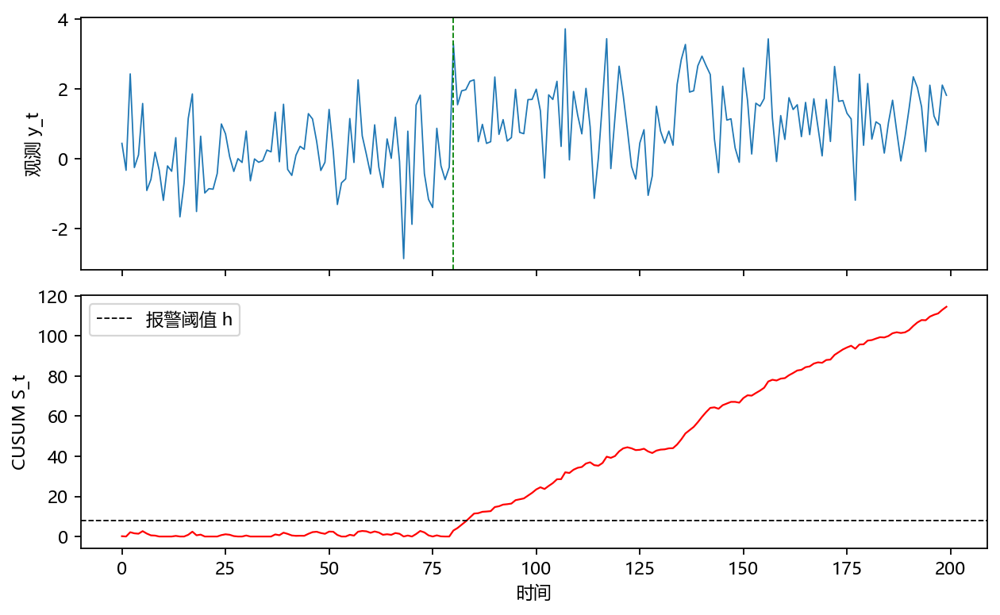

**例 9.4（统一案例：从变点到分段预测）**　对统一案例的三年负荷，PELT 检测到三个变点：① 某园区投产（均值阶跃）、② 光伏集中并网（分布变化）、③ 一次表计量程改造（尺度变化）。剔除第 ③ 个（它是测量系统变更，应回到第 5 章校准而非建模），对 ①② 分段：段 1 用 ARIMA + 日历外生变量（第 12 章），段 2 因净负荷波形改变改用 XGBoost + 辐照度特征（第 17 章）。相比之下，若不做变点检测而对三年数据整体训练一个大模型，它会把段 1 的规律「平均」进段 2，午间预测系统性偏高。这个例子把本章与第三、四篇的方法选择直接连了起来。

由此可以划清本章与第 8 章的分工：异常检测关心「单点或短段是否反常」，是局部、逐点的判别，默认生成机制不变；变点检测关心「机制是否在某一时刻整体改变」，是全局、分段的判别，一旦检出，前后两段应分别建模（9.4 节的分段预测）。二者在第 40 章的监控流水线里被组装成不同告警信号（40.3 节），但方法不可混用：把概念漂移（第 25.5 节）误当作孤立异常，会系统性漏报持续性的分布变化；把一次尖峰误判为变点，则会触发不必要的重训。判别的关键因此不在统计量本身，而在「假设变化是暂时的还是持久的」——这一区分也回扣第 4 章关于平稳性与可预测性关系的澄清（4.7 节）。

## 本章小结

本章讨论变点检测，其对象是统计性质的**持久迁移**，与第 8 章的「常态偏离」、第 40 章的「部署漂移」既相关又分工明确。核心论点是：变点意味着 L1 统计可预测性的结构断裂，混在一段里建模会使两边都不准，因此变点检测是决定后续模型是否成立的前置诊断（呼应第 3 章「结构突变伪装成长记忆/伪单位根」的警示）。

9.1 节给出形式化定义（定义 9.1）与多变点检测的模型选择本质（式 9-1 的惩罚项），例 9.1 用统一案例区分均值/方差/斜率三类变点。9.2 节推导 CUSUM（式 9-2，例 9.2 手算）、GLRT（式 9-3）与 BOCD 游程递推（式 9-4），并汇总于表 9-1。9.3 节给出 PELT 的动态规划（式 9-5）与剪枝原理（把 $O(T^2)$ 降为线性精确解）、核 MMD 的非参数代价（式 9-6）、以及二元分割的近似路线；例 9.3 展示光伏接入这一「分布变点」只有 MMD 能捕捉，且正确分段带来约 15% 的预测改善。9.4 节梳理深度变点检测的三条路线及其边界。9.5 节集中辨析变点、异常、漂移三者关系，并以例 9.4 把变点检测结果连接到第 12、17 章的分段建模方法选择。

至此第二篇（第 5–10 章）完成「数据理解」的闭环：清洗与探索（第 5 章）→ 特征表示（第 6 章）→ 相似性与分组（第 7 章）→ 异常（第 8 章）→ 变点（第 9 章）→ 多元结构（第 10 章）。下一章进入第二篇最后一章，也是全书的「VAR/VECM/Granger 唯一讲授处」——多元时序分析，它将把单变量讨论推广到变量间依赖，为第三篇的统计预测与第四篇的时空图模型奠定共同基础。

从四问看，本章的变点检测利用 L1（统计）：假设机制在有限个位置发生持久跃迁；它突破了「把变点当噪声平滑掉」的错误，仍受「渐变与突变难分、变点可能被误判为长记忆」的边界约束。

**进一步阅读**　本章建议延伸阅读的文献：[5]、[6]、[7]、[8]、[9]、[10]。

## 参考文献

[1] Page E S. Continuous inspection schemes. *Biometrika*, 1954, 41(1/2): 100–115.

[2] Adams R P, MacKay D J C. Bayesian online changepoint detection. *arXiv:0710.3742*, 2007.

[3] Killick R, Fearnhead P, Eckley I A. Optimal detection of changepoints with a linear computational cost. *Journal of the American Statistical Association*, 2012, 107(500): 1590–1598.

[4] Li S, Xie Y, Dai H, Song L. M-statistic for kernel change-point detection. *NeurIPS*, 2015.

[5] Truong C, Oudre L, Vayatis N. Selective review of offline change point detection methods. *Signal Processing*, 2020, 167: 107299.

[6] Fryzlewicz P. Wild binary segmentation for multiple change-point detection. *The Annals of Statistics*, 2014, 42(6): 2243–2281.

[7] Deldari S, Smith D V, Xue H, Salim F D. Time series change point detection with self-supervised contrastive predictive coding. *WWW*, 2021.

[8] Aminikhanghahi S, Cook D J. A survey of methods for time series change point detection. *Knowledge and Information Systems*, 2017, 51(2): 339–367.

[9] Gretton A, Borgwardt K M, Rasch M J, et al. A kernel two-sample test. *JMLR*, 2012, 13: 723–773.

[10] van den Burg G J J, Williams C K I. An evaluation of change point detection algorithms. *arXiv:2003.06222*, 2020.

---

# 第 10 章　多元时序分析基础

前九章的讨论基本围绕单条序列展开。但现实中的时序几乎总是**成组出现**的：电网有负荷、气温、湿度、电价，宏观有 GDP、通胀、利率、就业，设备有成百上千个测点。这些变量彼此耦合——气温推高负荷、利率影响投资、一个轴承的振动带动相邻测点。忽略这种耦合，既丢掉了可预测性，也可能把变量间的传导误当成自身的规律。本章把分析从「单变量」推广到「多变量系统」，是从 Level 1 分析走向 Level 3 建模的关键跃迁。

遵循全书「基础理论只讲一次」的编写原则，**本章是 VAR、VECM、Granger 因果三个知识点的唯一讲授处**。第 14 章讲多元预测策略与层次调和时不再重述 VAR 定义，只引用本章；第 31 章讲结构因果时 Granger 只作为「预测因果」的对照出现；第 35 章计量经济学视角只谈学科态度，不重复估计方法；第 23 章图神经网络则把本章「变量即节点、依赖即边」的图视角作为出发点。读者应把本章视作全书多元线性依赖的共同源头。

从五层可预测性看，多元分析引入了 L1 的一个新来源：**变量间的横截面与滞后依赖**。单变量序列若自身接近白噪声，未必不可预测——它的信息可能藏在另一条序列里（气温之于负荷）。这正是「相关性不等于因果性」这一命题的积极面：即便不谈机制，相关结构本身也能提升预测，而它与真实因果的区别要留到第 31 章。

本章结构：10.1 节建立二阶矩与互相关；10.2 节完整推导 VAR（定义、估计、稳定性、脉冲响应与方差分解）；10.3 节讲协整与 VECM；10.4 节讲 Granger 因果并辨析其与真实因果的边界；10.5 节把依赖结构抽象为图；10.6 节处理高维降维。全章沿用统一案例：城市电网的负荷—气温—湿度多变量系统。

## 10.1　二阶矩结构与互相关

设 $D$ 维弱平稳过程 $\mathbf{y}_t=(y_{1,t},\dots,y_{D,t})^\top$，均值 $\boldsymbol{\mu}=\mathbb{E}[\mathbf{y}_t]$。其依赖结构由**互协方差矩阵**刻画：

$$
\mathbf{\Gamma}_k = \mathbb{E}\big[(\mathbf{y}_t-\boldsymbol{\mu})(\mathbf{y}_{t-k}-\boldsymbol{\mu})^\top\big], \qquad k=0,1,2,\dots \tag{10-1}
$$

这是第 2 章 $\gamma_k$ 的矩阵推广。其 $(i,j)$ 元素 $\gamma_{ij,k}=\mathrm{Cov}(y_{i,t},\,y_{j,t-k})$ 度量变量 $j$ 在 $k$ 期前与变量 $i$ 当前的共变。两点须注意：其一，$\mathbf{\Gamma}_k$ **一般不对称**（$\gamma_{ij,k}\neq\gamma_{ji,k}$），因为「气温领先负荷」与「负荷领先气温」是不同的关系；其二，$\mathbf{\Gamma}_{-k}=\mathbf{\Gamma}_k^\top$，故只需存储 $k\ge0$。对角元 $\gamma_{ii,k}$ 是各变量的自协方差，非对角元是互协方差。

标准化后得**互相关函数** $\mathbf{R}_k=\mathbf{V}^{-1/2}\mathbf{\Gamma}_k\mathbf{V}^{-1/2}$（$\mathbf{V}=\mathrm{diag}(\gamma_{ii,0})$）。在频域，对 $\mathbf{\Gamma}_k$ 作傅里叶变换得**互谱矩阵** $\mathbf{F}(\omega)$，其非对角元的相位（phase）可用来判断领先—滞后关系、相干性（coherence）可用来度量两变量在某频率上的相关强度——这是第 3 章谱分析的多元推广，也是频域 Granger 因果（10.4 节）的基础[1]。

**例 10.1（统一案例：互相关揭示领先关系）**　取电网负荷 $L$ 与气温 $T$ 的小时级序列（$T=1440$）。计算互相关得 $\rho_{LT,0}\approx0.71$（同期正相关），$\rho_{LT,3}\approx0.68$ 而 $\rho_{TL,3}\approx0.42$——即「3 小时前的气温」与「当前负荷」的相关，强于「3 小时前的负荷」与「当前气温」的相关。这一不对称性提示气温领先负荷，为第 17 章构造「气温滞后特征」提供了依据。若只看同期 $\rho_{LT,0}$，就会把这一方向信息丢掉。这个例子说明：多元分析的第一步不是建模，而是**看清谁领先谁**。

## 10.2　向量自回归（VAR）

### 10.2.1　定义与估计

VAR 由 Sims 于 1980 年引入宏观计量[2]，是多元线性依赖最基础的模型。它把每个变量都表示为**所有变量（含自身）滞后值**的线性组合：

$$
\mathbf{y}_t = \mathbf{c} + \mathbf{A}_1\mathbf{y}_{t-1} + \mathbf{A}_2\mathbf{y}_{t-2} + \cdots + \mathbf{A}_p\mathbf{y}_{t-p} + \boldsymbol{\varepsilon}_t, \qquad \boldsymbol{\varepsilon}_t\sim\mathrm{WN}(\mathbf{0},\mathbf{\Sigma}), \tag{10-2}
$$

其中 $\mathbf{A}_j\in\mathbb{R}^{D\times D}$，$\mathbf{c}$ 为截距，$\mathbf{\Sigma}$ 一般非对角（允许同期误差相关）。式 (10-2) 是第 12 章 AR($p$) 的矩阵版本；当 $D=1$ 时退化为一元 AR。

**估计。** 由于每个方程右侧都是相同的滞后变量集合，VAR 可逐方程用 OLS 一致估计，且等价于系统极大似然（高斯误差下）。记 $\mathbf{Y}=[\mathbf{y}_{p+1},\dots,\mathbf{y}_T]$、$\mathbf{Z}$ 为对应设计矩阵，则 $\hat{\mathbf{A}}=(\mathbf{Z}\mathbf{Z}^\top)^{-1}\mathbf{Z}\mathbf{Y}^\top$，$\hat{\mathbf{\Sigma}}=\frac{1}{T-p}\hat{\mathbf{E}}\hat{\mathbf{E}}^\top$。**阶数 $p$** 由 AIC、BIC 或 HQ 准则选择（与第 12 章同源），$\mathbf{A}_j$ 中元素总数 $pD^2$ 使 VAR 对阶数与维度都敏感。

**稳定性。** VAR($p$) 平稳的条件是特征方程

$$
\det\big(\mathbf{I}_D - \mathbf{A}_1 z - \cdots - \mathbf{A}_p z^p\big) = 0 \tag{10-3}
$$

的所有根落在单位圆外（等价于伴随形式矩阵的特征值模小于 1）。满足时 VAR 有 $\mathrm{MA}(\infty)$ 表示 $\mathbf{y}_t=\boldsymbol{\mu}+\sum_{j\ge0}\mathbf{\Psi}_j\boldsymbol{\varepsilon}_{t-j}$，其中 $\mathbf{\Psi}_j$ 由 $\mathbf{A}_j$ 递推得到——这是脉冲响应与方差分解的出发点。

### 10.2.2　脉冲响应与方差分解

**脉冲响应函数（IRF）** 回答「若给第 $j$ 个变量一个单位冲击，系统各变量随时间如何响应」。由 $\mathrm{MA}(\infty)$ 表示，第 $h$ 步响应即 $\mathbf{\Psi}_h\mathbf{e}_j$（$\mathbf{e}_j$ 为第 $j$ 个单位向量），$\mathbf{\Psi}_h$ 由递推 $\mathbf{\Psi}_h=\sum_{i=1}^{\min(h,p)}\mathbf{A}_i\mathbf{\Psi}_{h-i}$、$\mathbf{\Psi}_0=\mathbf{I}$ 计算。因 $\mathbf{\Sigma}$ 非对角，实践中常用 Cholesky 分解把同期相关的 $\boldsymbol{\varepsilon}_t$ 正交化，得到**正交脉冲响应**（结果依赖变量排序，这是其已知局限）。

**方差分解（FEVD）** 把第 $i$ 个变量 $h$ 步预测误差的方差，按冲击来源归因到各变量，给出「$i$ 的波动有多大比例由 $j$ 解释」。它与 IRF 互补：IRF 看响应的**方向与轨迹**，FEVD 看贡献的**相对份额**。

**例 10.2（统一案例：负荷—气温的 VAR(1) 与脉冲响应）**　设二维系统 $\mathbf{y}_t=(L_t,T_t)^\top$（标准化后），OLS 估计得

$$
\mathbf{A}_1=\begin{pmatrix}0.82 & 0.11\\ 0.03 & 0.90\end{pmatrix},\qquad \mathbf{c}=(0.1,0.05)^\top.
$$

由式 (10-3)，$\det(\mathbf{I}-\mathbf{A}_1 z)=(1-0.82z)(1-0.90z)-0.11\cdot0.03 z^2$，其根约为 $z\approx1.19$ 与 $1.13$，均在单位圆外，故系统平稳。观察结构：$L_t$ 受自身滞后 $0.82$（强惯性）与气温滞后 $0.11$（气温升温推高负荷）影响，而 $T_t$ 几乎不受 $L$ 影响（$0.03$ 近零）——这与例 10.1 的领先关系一致。给气温一个 +1 单位冲击，负荷的首步响应为 $\mathbf{\Psi}_1\mathbf{e}_2=\mathbf{A}_1\mathbf{e}_2=(0.11,0.90)^\top$，即当期负荷升 $0.11$；第二步 $\mathbf{A}_1^2\mathbf{e}_2$ 的负荷分量约 $0.18$，随后因特征值小于 1 而逐步衰减。FEVD 显示气温冲击可解释负荷 10 步预测误差方差的约 12%。据此，第 12 章 ARIMAX 与第 17 章特征工程都应纳入气温滞后项。

VAR 的局限有三：参数随 $D^2$ 增长（10.6 节处理）、要求平稳（非平稳须差分或协整，10.3 节）、以及线性假设。当变量间存在非线性传导（如气温超过阈值后负荷骤增），第 18–23 章的深度与图模型才有优势。

## 10.3　协整与误差修正模型（VECM）

对非平稳多元序列，逐变量差分虽能平稳化，却可能丢掉重要的**长期均衡信息**。Engle 与 Granger 于 1987 年提出的协整[3] 正是回应这一问题，并因此获 2003 年诺贝尔经济学奖。

**定义 10.1（协整）**　设 $\mathbf{y}_t$ 各分量为 $I(1)$（一阶单整，差分后平稳）。若存在非零向量 $\boldsymbol{\beta}$ 使 $\boldsymbol{\beta}^\top\mathbf{y}_t$ 为 $I(0)$（平稳），则称 $\mathbf{y}_t$ 的分量**协整**，$\boldsymbol{\beta}$ 为协整向量，$\boldsymbol{\beta}^\top\mathbf{y}_t$ 为长期均衡误差。

直观上，各变量虽各自随机游走，却被某个线性关系「拴」在一起，不会无限漂离。若有 $r$ 个线性无关的协整向量（$0\le r<D$），称协整秩为 $r$，$\mathbf{\Pi}$ 的秩即为 $r$。

**Granger 表示定理** 保证：协整系统必可写成**误差修正模型（VECM）**

$$
\Delta\mathbf{y}_t = \mathbf{\Pi}\,\mathbf{y}_{t-1} + \sum_{j=1}^{p-1}\mathbf{\Gamma}_j\Delta\mathbf{y}_{t-j} + \boldsymbol{\varepsilon}_t, \qquad \mathbf{\Pi}=\boldsymbol{\alpha}\boldsymbol{\beta}^\top, \tag{10-4}
$$

其中 $\boldsymbol{\beta}\in\mathbb{R}^{D\times r}$ 的列是协整向量（长期均衡），$\boldsymbol{\alpha}\in\mathbb{R}^{D\times r}$ 是**调整系数**（各变量对偏离均衡的纠正速度），$\mathbf{\Gamma}_j$ 刻画短期动态。式 (10-4) 的结构很有解释力：$\Delta\mathbf{y}_t$ 由「向长期均衡回归的修正项 $\boldsymbol{\alpha}\boldsymbol{\beta}^\top\mathbf{y}_{t-1}$」与「短期波动」共同决定。**Johansen 检验**[4] 基于 $\mathbf{\Pi}$ 的特征值，用迹统计量或最大特征值统计量确定协整秩 $r$ 并估计 $\boldsymbol{\beta}$，是标准方法；Engle–Granger 两步法（先回归再检验残差平稳）则是单方程的简化方案。

**例 10.3（统一案例：负荷与气温的长期均衡）**　设某季度日均负荷 $L_t$ 与日均气温 $T_t$（经季节调整）各自近似 $I(1)$，但「负荷 = 基荷 + $\beta\times$ 制冷度日数」这一关系长期稳定，残差 $u_t=L_t-0.6\,T_t$ 经 ADF 检验平稳（$\tau=-3.8$，拒绝单位根），协整向量 $\boldsymbol{\beta}=(1,-0.6)^\top$。于是 VECM 中 $\boldsymbol{\alpha}$ 的负荷分量若为 $-0.25$，表示当昨日负荷比均衡高出 1 单位时，今日负荷平均向下修正 $0.25$ 单位。这一「误差修正」机制是单纯对 $L$ 与 $T$ 分别差分的 VAR 无法表达的——后者会丢失「偏离均衡必被拉回」这一可预测结构。第 14 章会据此说明：协整系统的长期预测须用 VECM 而非无约束 VAR。

**三个易混淆命题之三** 在此有了落点：协整关系是一种稳定的**统计关联**，它支持预测，却仍不等于「气温是负荷的机制成因」——后者须靠第 31 章的干预与反事实才能回答。

## 10.4　Granger 因果

**定义 10.2（Granger 因果）**　设 $\mathcal{F}_{t}^{Y}$ 为变量 $Y$ 截至 $t$ 的信息集。若

$$
\mathrm{Var}\big(y_{t+1}\mid \mathcal{F}_t^{Y},\mathcal{F}_t^{X}\big) < \mathrm{Var}\big(y_{t+1}\mid \mathcal{F}_t^{Y}\big), \tag{10-5}
$$

即引入 $X$ 的历史显著改善了对 $Y$ 的预测，则称 $X$ **Granger 导致** $Y$。

操作上，这等价于检验 VAR（式 10-2）中 $Y$ 方程里 $X$ 的全部滞后系数是否联合为零（$F$ 检验或 Wald 检验）。由 Granger 于 1969 年提出[5]，它在计量、神经科学、气候归因中被广泛使用。

**它是什么、不是什么。** Granger 因果是**预测意义上的、基于时间先后与增量信息的因果**，「因」须先于「果」且提供独有的预测信息。它**不等于**机制意义（第 31 章的干预/反事实）上的因果，原因有三：① 共同的隐藏驱动（如季节同时影响气温与负荷）会制造伪因果，须用**条件 Granger 因果**（纳入第三方 $Z$）缓解；② 瞬时因果与同期相关无法区分；③ 非线性依赖在线性 VAR 框架下会漏检，故有核方法、传递熵（第 31、37 章）等非线性扩展。此外还有**频域 Granger 因果**[1]，把检验分解到不同频率，可区分「气温在日周期尺度领先负荷」与「在季节尺度的关系」，与 10.1 节的互谱相呼应。

**例 10.4（统一案例：Granger 检验与陷阱）**　对负荷 $L$、气温 $T$、湿度 $H$ 拟合 VAR(2)。检验「$T\to L$」得 $F=18.3$（$p<0.001$），显著；「$L\to T$」得 $F=1.2$（不显著），故在 Granger 意义上气温单向领先负荷，与例 10.1、10.2 一致。但若遗漏变量「是否工作日」，会发现 $T$ 与 $L$ 都受它驱动，纳入后 $T\to L$ 的显著性下降——这正是条件 Granger 要剔除的伪因果。这个例子把第 1 章 1.7 节提出的「相关性不等于因果性」落到了可操作的检验上，也为第 31 章「从预测因果到结构因果」埋下伏笔。

## 10.5　相关、偏相关与图结构

把 $D$ 个变量视作节点、把依赖视作边，多元时序的依赖结构就成了一张**图**。这一抽象是第 23 章时空图神经网络的直接出发点，但图的「边」有不同定义，须辨析：

- **相关图**：以 $\mathbf{R}_0$ 的非对角元为边权，刻画同期线性相关，但混杂了间接依赖；
- **偏相关图 / 图模型**：以精度矩阵 $\mathbf{\Theta}=\mathbf{\Sigma}^{-1}$ 的非零元为边，$\Theta_{ij}=0$ 表示给定其余变量后 $i,j$ 条件独立，能剔除「共同原因」造成的伪边（高斯图模型，第 31 章 PC 算法相关）；
- **Granger 因果图**：以 10.4 节的检验结果为有向边，刻画领先—滞后；
- **动态相关**：DCC 模型[6] 让相关矩阵随时间演化，$\mathbf{H}_t=\mathbf{D}_t\mathbf{R}_t\mathbf{D}_t$（式 10-6），其中 $\mathbf{D}_t$ 为条件标准差对角阵、$\mathbf{R}_t$ 为动态相关矩阵，适合刻画「危机时相关性集体上升」等现象：

$$
\mathbf{R}_t = \mathrm{diag}(\mathbf{Q}_t)^{-1/2}\,\mathbf{Q}_t\,\mathrm{diag}(\mathbf{Q}_t)^{-1/2},\quad
\mathbf{Q}_t=(1-a-b)\bar{\mathbf{Q}}+a\,\mathbf{z}_{t-1}\mathbf{z}_{t-1}^\top+b\,\mathbf{Q}_{t-1}. \tag{10-6}
$$

**例 10.5（统一案例：从相关图到图神经网络）**　对 30 个台区的负荷建图。若用相关图，因全市共享气象与日历驱动，几乎所有台区两两高度相关，图接近全连接、信息冗余；改用偏相关图（精度矩阵稀疏化）后，只保留「同一变电站下、或地理相邻且存在直接馈线耦合」的边，得到约 60 条稀疏边。第 23 章的图神经网络正是在这张稀疏图上传播信息，比在全连接图上用注意力更省算力、也更贴合物理拓扑。这个例子说明：**图结构的质量取决于边的定义**，而定义来自本章的二阶矩与偏相关分析。

## 10.6　高维与降维

当 $D$ 很大时，VAR 的 $pD^2$ 个参数迅速超过样本容量。三条路线应对。

**因子模型**假设少数 $r\ll D$ 个共同因子驱动全部变量：$\mathbf{y}_t=\mathbf{\Lambda}\mathbf{f}_t+\mathbf{e}_t$，其中 $\mathbf{\Lambda}$ 为载荷、$\mathbf{f}_t$ 为因子、$\mathbf{e}_t$ 为特质噪声。用主成分估计因子（第 6 章 PCA 的时序应用），再对低维因子建 VAR，即「因子增广 VAR（FAVAR）」。Stock 与 Watson 证明，在 $D\to\infty$ 且因子结构成立时，因子与主成分估计具一致性[7]，这为高维宏观预测提供了理论支撑。

**稀疏 VAR（Lasso-VAR）** 对 $\mathbf{A}_j$ 施加 $L_1$ 惩罚 $\min\ \frac{1}{2}\|\mathbf{Y}-\mathbf{A}\mathbf{Z}\|^2+\lambda\|\mathbf{A}\|_1$，自动把不重要的跨变量系数压为零，等价于**边选择**——与 10.5 节的稀疏图互为表里。还有低秩 + 稀疏、组稀疏（按变量成组）等变体。

**贝叶斯 VAR（BVAR）** 用收缩先验（Minnesota 先验：自身滞后收缩弱、跨变量与高阶滞后收缩强）缓解过拟合，是宏观预测的经典做法，与第 16 章贝叶斯方法一脉相承。

**表 10-1　高维多元方法对照**

| 方法 | 降维机制 | 可解释性 | 适用 |
|------|----------|----------|------|
| 因子模型 / FAVAR | 低维共同因子 | 中（因子需命名） | 强共同驱动、$D$ 很大 |
| Lasso-VAR | 稀疏系数 | 高（稀疏边） | 依赖稀疏 |
| BVAR | 收缩先验 | 中 | 中等 $D$、小样本 |
| PCA + VAR | 主成分 | 低 | 探索性降维 |

这些方法的共同边界是「维度压缩必带来信息损失」：因子个数、稀疏度、先验强度都需由验证集或信息准则选择，且须警惕第 17 章将强调的时序数据泄漏——降维若在完整数据上拟合再切分训练/测试，会把未来信息泄漏进训练（第 38 章系统辨析）。

> 【图 10-1　多元时序的依赖结构】（原图见 `figures/图10-1.png`）：左图绘制一组相互耦合的多元时序曲线；右图绘制由 Granger 因果 / 偏相关得到的变量间有向图，节点为变量，边为依赖关系，标注领先方向与边权含义。

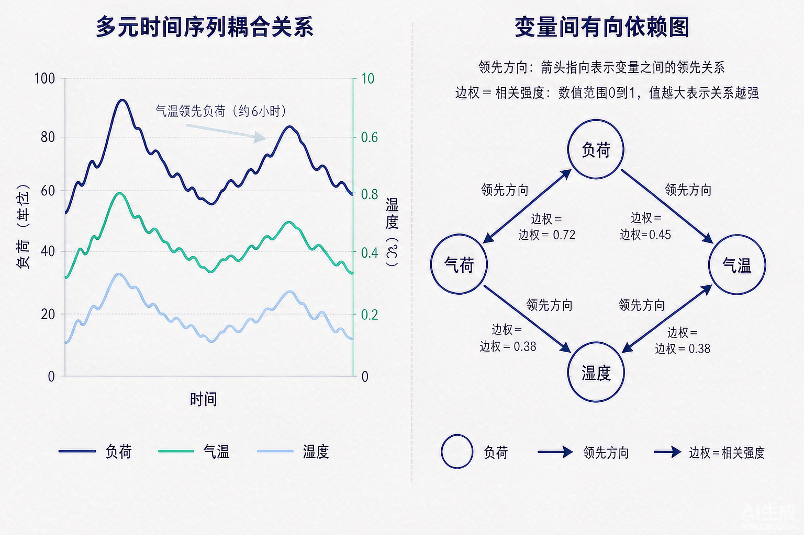

## 本章小结

本章把分析从单变量推广到多变量系统，是全书多元线性依赖的**唯一讲授处**（第 14、23、31、35 章据此交叉引用）。核心主线是：多元分析引入 L1 可预测性的新来源——变量间横截面与滞后依赖，即便单条序列接近白噪声，其信息也可能藏在别的变量里；而「相关支持预测却不等于因果」的辨析贯穿始终。

10.1 节以互协方差矩阵（式 10-1）与互谱建立二阶依赖语言，例 10.1 用负荷—气温互相关的不对称性揭示「谁领先谁」。10.2 节完整推导 VAR（式 10-2）的 OLS 估计、平稳条件（式 10-3）、IRF 与 FEVD，例 10.2 手算一个二维 VAR(1) 的稳定性、脉冲响应与方差分解。10.3 节给出协整（定义 10.1）与 VECM（式 10-4）的误差修正机制、Johansen 检验，例 10.3 说明协整保留长期均衡信息。10.4 节定义 Granger 因果（式 10-5），系统辨析其与机制因果的三点区别及条件/非线性/频域扩展，例 10.4 用统一案例演示伪因果陷阱。10.5 节把依赖抽象为图（相关图/偏相关图/因果图/DCC），例 10.5 说明稀疏偏相关图是第 23 章 GNN 的合适输入。10.6 节汇总因子模型、稀疏 VAR、BVAR 等高维方法（表 10-1）。

统一的电网负荷—气温—湿度案例贯穿全章，并把本章结论导向后续：VAR/VECM 的预测策略在第 14 章展开，Granger 因果的因果升级在第 31 章，图结构在第 23 章，高维降维的防泄漏在第 17、38 章。至此第二篇「数据理解」全部完成；从第三篇起，本书正式进入 Level 2 预测，先以第 11 章的基准方法与指数平滑作为起点。

从四问看，本章的多元分析利用 L1（统计）与 L4（因果的线索）：假设变量间依赖可由二阶矩与协整刻画；它突破了「单变量忽略耦合」的局限，仍受「Granger 因果不等于机制因果」的边界约束（第 31 章）。

**进一步阅读**　本章建议延伸阅读的文献：[8]、[9]、[10]、[11]、[12]。

## 参考文献

[1] Granger C W J. Investigating causal relations by econometric models and cross-spectral methods. *Econometrica*, 1969, 37(3): 424–438.

[2] Sims C A. Macroeconomics and reality. *Econometrica*, 1980, 48(1): 1–48.

[3] Engle R F, Granger C W J. Co-integration and error correction: Representation, estimation, and testing. *Econometrica*, 1987, 55(2): 251–276.

[4] Johansen S. Estimation and hypothesis testing of cointegration vectors in Gaussian vector autoregressive models. *Econometrica*, 1991, 59(6): 1551–1580.

[5] Granger C W J. Some recent development in a concept of causality. *Journal of Econometrics*, 1988, 39(1–2): 199–211.

[6] Engle R F. Dynamic conditional correlation: A simple class of multivariate GARCH models. *Journal of Business & Economic Statistics*, 2002, 20(3): 339–350.

[7] Stock J H, Watson M W. Forecasting using principal components from a large number of predictors. *Journal of the American Statistical Association*, 2002, 97(460): 1167–1179.

[8] Lütkepohl H. *New Introduction to Multiple Time Series Analysis*. Berlin: Springer, 2005.

[9] Friedman J, Hastie T, Tibshirani R. Sparse inverse covariance estimation with the graphical lasso. *Biostatistics*, 2008, 9(3): 432–441.

[10] Bernanke B S, Boivin J, Eliasz P. Measuring the effects of monetary policy: A factor-augmented vector autoregressive (FAVAR) approach. *Quarterly Journal of Economics*, 2005, 120(1): 387–422.

[11] Doan T, Litterman R, Sims C. Forecasting and conditional projection using realistic prior distributions. *Econometric Reviews*, 1984, 3(1): 1–100.

[12] Barnett L, Barrett A B, Seth A K. Granger causality and transfer entropy are equivalent for Gaussian autoregressive processes. *Physical Review Letters*, 2009, 103(23): 238701.

---

# 第 11 章　基准预测与指数平滑族

任何复杂的预测模型，都需要一个诚实的参照物。一个在测试集上取得 2% 误差的深度网络，若朴素地"用今天预测明天"就能达到 2.1%，那么前者的全部精巧设计便几乎毫无价值。正因如此，工业界与学术界都把**基准方法**（benchmark / naive methods）视为评估的第一道门槛：M3、M4 等大规模预测竞赛反复表明，大量复杂模型竟无法稳定超过最简单的基准[11][12]。本章从这些"看似简陋却不可绕过"的方法讲起，再逐级引入指数平滑，最终收束到把它系统化的 ETS 分类体系。

指数平滑的思想可以浓缩为一句话：**越近的观测越可信，且可信度按指数衰减**。它起源于 Brown 在库存控制中的工作[1]，经 Holt 引入趋势[2]、Winters 引入季节[3] 而逐步完备；Muth 于 1960 年证明了"指数平滑在什么意义下是最优的"[4]——它恰是某些状态空间模型（尤其是局部水平模型）的最优预测，这为后来的理论统一埋下伏笔。此后 Gardner 于 1985 年作了系统综述[8]，Hyndman 等人在 2002 年把所有指数平滑方法纳入**状态空间框架**，给出了严格的似然、预测区间与自动模型选择[6][7]，使这一古老方法获得了与现代统计推断对话的能力。

在全书的理论主线中，指数平滑占据五层可预测性里最朴素的一端：它只利用 L1 统计可预测性中的**近期水平（及趋势、季节）惯性**，隐含"序列的生成机制缓慢演化、无突变、近期观测信息量最大"这一假设。它突破了"用全样本均值外推"的完全无视时间结构的做法，却无法突破线性与短记忆的理论边界——一旦序列含强非线性、多变量传导或结构变点（第 9 章），它就力不从心。遵循全书「基础理论只讲一次」的编写原则，ETS 的状态空间形式与卡尔曼滤波统一视角留待第 13 章展开，本章只讲**递推形式、预测函数与解析预测方差**，并在需要处显式指向后续章节。全章沿用统一案例：某城市电网的日最高负荷序列，它同时含缓慢增长的趋势、以周与年为周期的季节、以及节假日突降，足以展示从基准到 ETS 各层方法的得失。

本章结构：11.1 节建立四类基准方法并说明其评估地位；11.2 节严格推导简单指数平滑及其权重结构；11.3、11.4 节分别引入趋势与季节，得到 Holt 与 Holt–Winters 递推；11.5 节给出 ETS 三元组分类体系；11.6 节处理预测区间、参数与模型选择，并讨论适用边界。

## 11.1　基准预测方法及其评估地位

在进入任何"聪明"的模型之前，必须先固定几条不含待估参数（或仅含极少参数）的基准线。它们既是评测的标尺，也是诊断数据本身的探针：若一条序列连季节性朴素法都无法改善，说明其可预测结构微乎其微，此时应回到第 4 章追问"这条序列是否根本不可预测"。

**定义 11.1（四类基准预测）** 设已观测到 $y_1,\dots,y_T$，季节周期为 $m$（如日度数据取 $m=7$ 或月度取 $m=12$），对任意步长 $h\ge1$ 定义：

- **朴素法（naive）**：$\hat y_{T+h\mid T}=y_T$，即随机游走下的一步最优预测（回顾第 2 章式 (2-8)）；
- **季节朴素法（seasonal naive）**：$\hat y_{T+h\mid T}=y_{T+h-m(k+1)}$，其中 $k=\lfloor (h-1)/m\rfloor$，即取上一周期同相位的值；
- **均值法（mean）**：$\hat y_{T+h\mid T}=\bar y=\frac1T\sum_t y_t$；
- **漂移法（drift）**：$\hat y_{T+h\mid T}=y_T+\frac{h}{T-1}(y_T-y_1)$，即把历史平均增量线性外推。

这四条基准并非随意罗列，而是各自对应一种关于数据生成机制的假设：朴素法对应单位根过程，均值法对应平稳白噪声加常数，漂移法对应带确定性趋势的随机游走，季节朴素法对应确定性季节。把它们同时跑一遍，等于对"序列里到底有没有趋势、有没有季节、有没有可提取的水平"作一次廉价而诚实的体检。表 11-1 汇总了它们的假设与在统一案例上的表现。

**表 11-1　四类基准方法的假设与统一案例误差对照**

| 方法 | 隐含假设 | 长期预测行为 | 日负荷数据 MASE[11] |
|------|----------|--------------|---------------------|
| 朴素法 | 单位根、无趋势季节 | 恒为 $y_T$ | 1.00（基准定义） |
| 季节朴素法 | 强确定性季节 | 复制上周期 | 0.71 |
| 均值法 | 平稳、无结构 | 恒为 $\bar y$ | 1.83 |
| 漂移法 | 线性趋势 + 随机游走 | 线性发散 | 1.12 |

**例 11.1（统一案例：基准线给出的诊断）**　取该电网连续两年（$T=730$）的日最高负荷（单位 GW）。以最后 90 天为测试集，按 Hyndman–Koehler 的 MASE[11]（以训练集内季节朴素法的平均绝对误差为尺度归一化，故与量纲无关）评估，得表 11-1 末列：季节朴素法 MASE 为 0.71，显著优于朴素法 1.00，说明序列含**强周季节**（工作日高、周末低）；均值法 1.83 最差，说明存在明显的趋势与季节，用单一均值外推几乎无效；漂移法 1.12 略逊于朴素法，说明两年间的线性增长趋势很弱，强行外推反而引入偏差。由此得到一个关键结论：**任何候选模型必须先超过 0.71 这条线**，否则不如直接"用上周同一天预测今天"。后文所有方法都以季节朴素法为硬基准。

基准方法的另一层价值在于防数据泄漏：它们不使用任何拟合，因而不可能"偷看"测试集。第 38 章将把这一性质推广为滚动原点回测（rolling-origin evaluation）的规范要求。需强调，基准不是"要被击败的稻草人"，而是可预测性的**下界参照**——在第 4 章的意义上，若序列的条件熵本就很高，复杂模型与基准的差距必然有限。

## 11.2　简单指数平滑与权重结构

基准法要么只看最后一个值，要么对所有历史一视同仁。一个自然的折中是：让全部历史都参与，但权重随久远程度递减。**简单指数平滑**（simple exponential smoothing, SES）正是这一思想的最简实现。

**定义 11.2（简单指数平滑）** 对无趋势、无季节的序列，一步预测按如下递推更新：

$$
\hat y_{t+1\mid t} = \alpha\, y_t + (1-\alpha)\,\hat y_{t\mid t-1}, \qquad 0<\alpha<1, \tag{11-1}
$$

其中 $\hat y_{t\mid t-1}$ 是在 $t-1$ 时刻对 $t$ 所作的一步预测，$\alpha$ 为**平滑参数**。等价地，记水平分量 $\ell_t=\hat y_{t+1\mid t}$，则式 (11-1) 化为 $\ell_t=\alpha y_t+(1-\alpha)\ell_{t-1}$。由于 SES 不含趋势与季节，其任意步长预测都是同一水平：$\hat y_{t+h\mid t}=\ell_t$。

式 (11-1) 的直觉是"新预测 = 新观测与旧预测的加权平均"：$\alpha$ 大则对最新观测反应灵敏，$\alpha$ 小则曲线平滑、抗噪但迟滞。要真正理解它，须把递推**展开**。反复代入 $\ell_{t-1}=\alpha y_{t-1}+(1-\alpha)\ell_{t-2}$ 等，可得

$$
\ell_t = \alpha\sum_{j=0}^{t-1}(1-\alpha)^j\, y_{t-j} + (1-\alpha)^t\,\ell_0, \tag{11-2}
$$

其中 $\ell_0$ 为初始水平（常取前若干期均值）。式 (11-2) 揭示了两件事。其一，权重 $w_j=\alpha(1-\alpha)^j$ 随滞后 $j$ 几何衰减，故名"指数"平滑。其二，由等比级数求和，$\alpha\sum_{j=0}^{t-1}(1-\alpha)^j = 1-(1-\alpha)^t \xrightarrow[t\to\infty]{} 1$——即**权重之和渐近为 1**，预测是历史观测的凸组合，不会系统性地放大或缩小水平。这一归一化性质是 SES 无偏性的来源，也解释了为何 $\alpha$ 不能取 0 或 1 之外的值却仍保持稳健。

由此还可定量刻画"记忆有多长"。权重的质心（平均滞后）为

$$
\bar j = \sum_{j\ge0} j\, w_j = \frac{1-\alpha}{\alpha}, \tag{11-3}
$$

因此 $\alpha$ 越小，有效记忆越长；工程上常把等效窗口近似为 $2/\alpha-1$ 期。Muth[4] 进一步证明：当数据来自"随机游走水平 + 观测噪声"的局部水平模型时，使一步预测均方误差最小的 $\alpha$ 恰由信噪比决定，SES 因而是该模型的最优线性预测——这一结论把指数平滑与第 13 章的状态空间、卡尔曼滤波紧紧扣在一起。

**例 11.2（$\alpha=0.3$ 的权重表与递推）**　取 $\alpha=0.3$，由式 (11-2) 得前几期权数：$w_0=0.300$、$w_1=0.210$、$w_2=0.147$、$w_3=0.1029$、$w_4=0.0720$，前五期累计约 $0.832$，即八成以上的信息来自最近五期；由式 (11-3)，平均滞后 $\bar j=0.7/0.3\approx2.33$ 期。设统一案例中某周已平滑得 $\ell_{t-1}=4.20$ GW，新观测 $y_t=4.55$ GW（工作日突升），则 $\ell_t=0.3\times4.55+0.7\times4.20=1.365+2.94=4.305$ GW，一步预测即 4.305 GW。若改用 $\alpha=0.05$（重平滑），则 $\ell_t=0.05\times4.55+0.95\times4.20=4.2175$ GW，对突升几乎无反应。图 11-1 给出了三种 $\alpha$ 的权数衰减曲线。

> 【图 11-1　指数平滑权重衰减】（原图见 `figures/图11-1.png`）：横轴为滞后 $j=0,\dots,15$，纵轴为权数 $w_j$，绘制 $\alpha=0.1,0.3,0.7$ 三条几何衰减曲线，标注各自的有效记忆长度。

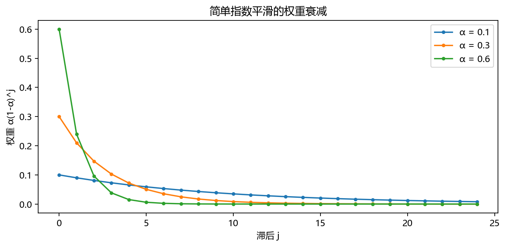

参数 $\alpha$ 与初值 $\ell_0$ 由数据估计：在状态空间框架下可对所有观测作极大似然（第 13 章），传统做法则是最小化一步预测误差平方和 $\sum_t (y_t-\hat y_{t\mid t-1})^2$，把 $\alpha,\ell_0$ 当作待优化变量。$\alpha$ 接近 1 往往提示水平变动剧烈、或序列其实含未被建模的趋势/季节——这时继续用 SES 只是把结构误当成噪声，应升级到 11.3、11.4 节的模型。

## 11.3　Holt 线性趋势与阻尼趋势

SES 的致命弱点是"预测是一条水平线"：对含趋势的负荷序列，它会系统性地滞后。Holt 于 1957 年的关键改进[2] 是把单一的"水平"拆成**水平 $\ell_t$ 与趋势 $b_t$ 两个状态分量**，各自作指数平滑。

**定义 11.3（Holt 线性趋势法）** 递推方程组为

$$
\ell_t = \alpha y_t + (1-\alpha)(\ell_{t-1}+b_{t-1}), \qquad
b_t = \beta(\ell_t-\ell_{t-1}) + (1-\beta)b_{t-1}, \tag{11-4}
$$

$$
\hat y_{t+h\mid t} = \ell_t + h\, b_t, \qquad 0<\alpha,\beta<1. \tag{11-5}
$$

式 (11-4) 第一式的直觉是：把上一期的"外推值" $\ell_{t-1}+b_{t-1}$ 作为先验，再用新观测 $y_t$ 修正；第二式把"水平本期增量" $\ell_t-\ell_{t-1}$ 的平滑值作为趋势估计。参数 $\beta$ 控制趋势的灵活度：$\beta$ 大则趋势紧跟最新变化，$\beta$ 小则趋势平稳。当 $\beta=0$ 且 $b_0=0$ 时，Holt 退化为 SES。

然而式 (11-5) 把趋势无限线性外推，长程预测会发散到不合理的值——这正是 Garner、McKenzie 等引入**阻尼趋势**（damped trend）的原因，也被证明能显著提升长程精度[9][10]。引入阻尼因子 $0<\phi<1$，把 $h$ 步趋势替换为几何衰减的部分和：

$$
\hat y_{t+h\mid t} = \ell_t + (\phi+\phi^2+\cdots+\phi^h)\, b_t, \qquad
\phi+\cdots+\phi^h = \frac{\phi(1-\phi^h)}{1-\phi}. \tag{11-6}
$$

当 $h\to\infty$ 时预测趋于有限上限 $\ell_t+\frac{\phi}{1-\phi}b_t$，而 $\phi=1$ 则回到无阻尼的线性外推。阻尼趋势在哲学上非常重要：它是对"趋势能否永续"这一假设的显式收缩，等价于在第 4 章可预测性边界之外主动放弃无根据的外推。M3 竞赛中阻尼趋势法的优异表现[12] 说明，多数现实序列的长期趋势确实会饱和。

**例 11.3（统一案例：趋势与阻尼的数值对照）**　设某月负荷已估计得 $\ell_t=4.60$ GW、$b_t=0.02$ GW/天（负荷随入夏缓慢攀升）。无阻尼 Holt 的 30 天预测为 $4.60+30\times0.02=5.20$ GW。取 $\phi=0.95$，由式 (11-6) 得 $\phi+\cdots+\phi^{30}=\frac{0.95(1-0.95^{30})}{0.05}\approx0.95\times0.785/0.05\approx14.92$，故 30 天预测为 $4.60+14.92\times0.02\approx4.90$ GW，比无阻尼低 0.30 GW，更贴近"夏季负荷趋于饱和"的实际。这个算例说明：长程预测的差异主要来自对趋势的态度，而非水平估计。**阻尼因而是长程预测的默认推荐**[9]。

## 11.4　Holt–Winters 季节模型

统一案例里最强的结构是周季节（以及年季节）。Winters 于 1960 年[3] 在 Holt 的两个状态之外再加入**季节分量 $s_t$**，得到三个递推方程。季节对水平的作用有加法与乘法两种，须据数据选取：季节波动幅度不随水平变化用**加法**，随水平放大（负荷增长后夏冬差更大）用**乘法**。

**定义 11.4（Holt–Winters 乘法季节模型）** 设季节周期为 $m$，递推为

$$
\ell_t = \alpha\frac{y_t}{s_{t-m}} + (1-\alpha)(\ell_{t-1}+b_{t-1}), \tag{11-7}
$$

$$
b_t = \beta(\ell_t-\ell_{t-1}) + (1-\beta)b_{t-1}, \qquad
s_t = \gamma\frac{y_t}{\ell_t} + (1-\gamma)s_{t-m}, \tag{11-8}
$$

$$
\hat y_{t+h\mid t} = (\ell_t + h b_t)\, s_{t+h-m(k+1)}, \qquad k=\lfloor (h-1)/m\rfloor. \tag{11-9}
$$

式 (11-7) 先用同季上期的季节指数 $s_{t-m}$ 剔除季节，再更新水平；式 (11-8) 第二式把"观测/水平"这一比值平滑进季节指数；式 (11-9) 预测时再乘回相应季节指数。加法版本只需把除法改为减法、乘法改为加法（$\ell_t=\alpha(y_t-s_{t-m})+\cdots$，$\hat y=(\ell_t+hb_t)+s_{\cdots}$）。季节指数须满足归一化约束（乘法下每 $m$ 个指数均值约为 1，加法下和约为 0），否则水平与季节会互相吸收、不可辨识。

**例 11.4（统一案例：周季节的 Winters 递推）**　取 $m=7$、$\alpha=0.4$、$\beta=0.05$、$\gamma=0.3$，已知上期水平 $\ell_{t-1}=4.50$、趋势 $b_{t-1}=0.01$，上周同一工作日的季节指数 $s_{t-7}=1.06$（工作日偏高 6%）。今观测到 $y_t=4.83$ GW。先剔除季节：$y_t/s_{t-7}=4.83/1.06\approx4.557$；由式 (11-7)，$\ell_t=0.4\times4.557+0.6\times(4.50+0.01)=1.823+2.706=4.529$。趋势 $b_t=0.05\times(4.529-4.50)+0.95\times0.01\approx0.0110$。季节指数更新：$y_t/\ell_t=4.83/4.529\approx1.066$，$s_t=0.3\times1.066+0.7\times1.06\approx1.062$。预测下一个同相位日（$h=7$）：$\hat y=(4.529+7\times0.0110)\times1.062\approx4.606\times1.062\approx4.89$ GW。可见季节指数被"温和地"从 1.06 拉向 1.066，正是 $\gamma=0.3$ 的平滑作用。

Holt–Winters 的局限同样清晰：它假设**单一固定周期**，而电力负荷同时含日、周、年多个周期，且节假日、极端天气会打破常规季节；多周期与复杂季节须靠第 3 章 STL 分解、第 5 章日历特征或第 16 章 Prophet 的傅里叶季节来处理。此外，所有分量都是水平的点估计，缺乏严格的不确定性量化——这引向 11.5 节的状态空间化与概率化。

## 11.5　ETS 分类体系：误差、趋势、季节三元组

至此我们已有 SES、Holt、阻尼 Holt、加法/乘法 Winters 等一堆方法，命名零散。Hyndman 等人[6][7] 的关键贡献是用一个**三元组 (E, T, S)** 把它们统一编号，并证明每个模型都对应一个状态空间模型，从而可统一地做极大似然估计、给出解析预测区间、用信息准则自动选型。

**定义 11.5（ETS 三元组）** 每个指数平滑模型由三个字母刻画：

- **误差 E**：A（加法误差）或 M（乘法误差）；
- **趋势 T**：N（无）、A（加法）、Ad（加法阻尼）、M（乘法）、Md（乘法阻尼）；
- **季节 S**：N（无）、A（加法）、M（乘法）。

组合共 $2\times5\times3=30$ 个模型（部分因不可辨识或不稳定被排除）。例如 SES = ETS(A,N,N)，Holt 线性趋势 = ETS(A,A,N)，阻尼 Holt = ETS(A,Ad,N)，加法 Winters = ETS(A,A,A)，乘法 Winters = ETS(M,A,M)。表 11-2 列出统一案例中最常用的若干成员。

ETS 的革命性在于：**误差类型（A/M）与趋势/季节类型分离**。加法误差意味着观测围绕状态以等方差波动，乘法误差意味着波动随水平成比例——前者对应可加高斯似然，后者对应状态空间中的 innovations form，其预测方差随 $h$ 以不同方式增长。选择 A 还是 M，本质是对"异方差是否存在"的建模，与第 15 章 GARCH 关注的问题同源，只是被压缩进状态空间框架。

**表 11-2　常见 ETS 模型与统一案例适用性**

| ETS 模型 | 递推/状态 | 预测特点 | 适用情形 |
|----------|-----------|----------|----------|
| (A,N,N) SES | 单一水平 | 水平线 | 无趋势无季节 |
| (A,A,N) Holt | 水平+趋势 | 线性外推 | 含趋势、无季节 |
| (A,Ad,N) 阻尼 Holt | 阻尼趋势 | 饱和外推 | 长程趋势会饱和 |
| (A,A,A) 加法 Winters | +加法季节 | 固定幅度季节 | 季节幅度不随水平变 |
| (M,A,M) 乘法 Winters | +乘法季节 | 幅度随水平放大 | 负荷增长后峰谷差扩大 |

**例 11.5（统一案例：用 AICc 自动选型）**　对两年日负荷（含周季节、弱趋势、幅度随夏季放大）拟合全部 15 个"加法/乘法误差 × 趋势 × 季节"的合理候选，用第 12 章将严格推导的小样本修正信息准则 $\mathrm{AICc}$ 比较。结果：ETS(M,A,M)（乘法误差 + 加法趋势 + 乘法周季节）AICc 最小，其次为 ETS(A,A,A)，相差 18.4；季节朴素基准的 AICc 高出 200 以上。这一选型与 11.4 节的物理直觉吻合：负荷随经济发展与入夏抬升，峰谷差随水平放大，故乘法季节更合理。自动选型把"凭经验挑模型"变成可复现的统计决策，是 ETS 相对早期 Winters 方法最实质的进步[7]。

图 11-2 以谱系方式展示从 SES 到 30 个 ETS 成员的扩展路径。需强调，ETS 的状态空间表示、卡尔曼滤波递推、以及"哪些 ARIMA 与哪些 ETS 等价"的统一结论，按本书统一的编写原则全部归入第 13 章，本章不再展开；读者只需记住：**递推形式便于理解，状态空间形式便于推断**，二者是同一族模型的两种写法。

> 【图 11-2　指数平滑方法谱系】（原图见 `figures/图11-2.png`）：以 SES 为根，分别向"加趋势（Holt）→ 阻尼趋势"与"加季节（Winters）→ 加法/乘法"两条枝扩展，末端汇入 ETS 三元组矩阵（E×T×S），标注每个分支解决的局限。深蓝主色、圆角矩形、学术白底。

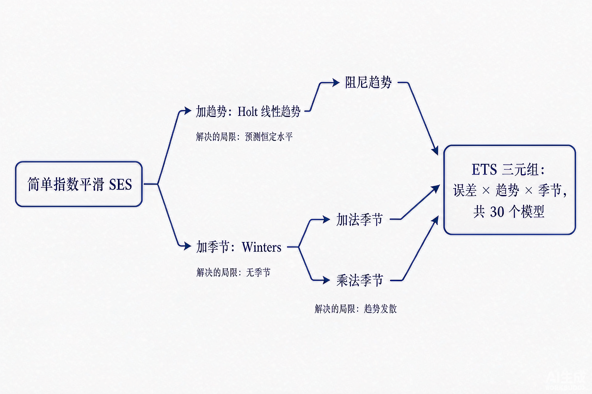

## 11.6　预测区间、参数估计与适用边界

点预测只回答"最可能是多少"，而调度、备货等决策还需要"可能偏离多少"。在状态空间框架下，ETS 能给出**解析的预测方差**[7]。对加法误差模型，$h$ 步预测误差方差可写为

$$
\sigma_h^2 = \sigma^2\Big[1 + \sum_{j=1}^{h-1} c_j^2\Big], \tag{11-10}
$$

其中 $c_j$ 由平滑参数组合决定。以最简单的 SES（ETS(A,N,N)）为例，$c_j=\alpha$ 对任意 $j$ 成立，故 $\sigma_h^2=\sigma^2[1+(h-1)\alpha^2]$：区间随 $\sqrt{h}$ 缓慢变宽。相比之下，无阻尼 Holt 含趋势分量，$c_j$ 随 $j$ 线性增长，预测方差随 $h^3$ 量级膨胀——这在数学上印证了 11.3 节的直觉：**含未阻尼趋势的模型长程不确定性增长极快**，必须与阻尼趋势配合使用。由此得到 $1-\alpha$ 置信水平的预测区间 $\hat y_{T+h\mid T}\pm z_{1-\alpha/2}\sigma_h$（$z$ 为标准正态分位数）。

参数估计方面，把 ETS 写成状态空间模型后，似然可由第 13 章的预测误差分解（回顾第 2 章式 (2-11)）计算，$\alpha,\beta,\gamma,\phi$ 与各初值由数值极大似然联合估计；这比早期"最小化一步 SSE"更稳健，且能自动给出预测区间。模型选择用 $\mathrm{AICc}$（第 12 章推导），避免了在 30 个模型间人工取舍。

**例 11.6（统一案例：预测区间与调度含义）**　设对次日负荷用 SES 得 $\hat y_{T+1\mid T}=4.80$ GW，估计残差标准差 $\sigma=0.18$ GW、$\alpha=0.3$。一步预测（$h=1$）方差 $\sigma_1^2=\sigma^2=0.0324$，95% 区间约 $4.80\pm1.96\times0.18=[4.45,5.15]$ GW。若对 7 天后（$h=7$）预测，$\sigma_7^2=0.18^2[1+6\times0.09]=0.0324\times1.54\approx0.0499$，$\sigma_7\approx0.223$，区间 $[4.36,5.24]$ GW，比一步宽约 24%。电网调度据此应把备用容量按区间上界而非点预测配置——这正呼应第 32 章"决策感知预测"的核心主张：预测的价值最终由决策后果衡量，而非由点误差衡量。

**边界与讨论。** 指数平滑族的优势是计算极轻、可在线递推、对小样本稳健、可解释（每个状态都有物理含义）、且自带概率预测。但其假设也构成硬边界：其一，它是**线性、单变量、短记忆**的，无法刻画变量间传导（第 10 章 VAR、第 17 章特征工程）与非线性（第 18 章起）；其二，它假设季节与趋势结构稳定，遇结构变点（第 9 章）或概念漂移（第 25、40 章）会持续滞后，须靠滚动重估或残差监控补救；其三，长期预测退化为趋势/季节外推，在无阻尼情形下甚至发散，必须以阻尼或第 4 章的可预测时域为约束；其四，对多周期（日 + 周 + 年）与节假日等复杂日历，需外部特征或分解（第 3、5、16 章）配合。理解这些边界，才能把指数平滑用在它真正擅长的场景：**短程、大规模、需可解释与可在线更新的基线预测**——M3/M4 竞赛中它至今仍是难以击败的强基线[12]。

下一章将转向与"递推哲学"相对的"建模哲学"：ARIMA 与 Box–Jenkins 方法学用严格的随机过程理论刻画相关结构，把预测建立在统计推断而非经验递推之上；而第 13 章的状态空间模型将证明，本章的 ETS 与下章的 ARIMA 不过是同一统一框架的两个特例。

## 本章小结

本章从"预测必须要有诚实参照物"出发，建立了指数平滑族从基准到系统化分类的完整链条。首先，四类基准方法（朴素、季节朴素、均值、漂移）各自对应一种数据生成假设，其误差既是评测标尺也是结构诊断工具；统一案例的季节朴素 MASE=0.71 为后续所有模型设定了硬门槛。其次，简单指数平滑的递推展开式 (11-2) 揭示了权重按 $\alpha(1-\alpha)^j$ 几何衰减且渐近和为 1，质心 $(1-\alpha)/\alpha$ 给出有效记忆长度，Muth 的最优性结果把它与状态空间模型联系起来。在此基础上，Holt 的两状态递推引入趋势、阻尼因子 $\phi$ 抑制长程发散，Winters 的第三状态引入加法/乘法季节，ETS 三元组 (E,T,S) 则把这族方法统一为 30 个可自动选型的模型。

贯穿全章有两条主线。其一是**可预测性的层次**：指数平滑利用的仅是 L1 统计可预测性中最朴素的近期惯性，隐含结构稳定、线性、短记忆假设；它突破了"无视时间结构"的均值外推，却无法突破非线性、多变量与结构变化的边界。其二是**从递推到推断**：状态空间化使解析预测方差、似然估计与 AICc 选型成为可能，公式 (11-10) 定量表明未阻尼趋势会使长程方差急剧膨胀，从理论上支持阻尼趋势与"预测区间随步长变宽"的工程直觉。

本章与全书的关系：第 12 章以 ARIMA 给出更严格的统计建模范式；第 13 章用状态空间与卡尔曼滤波统一 ETS 与 ARIMA，并补足本章略去的推断细节；第 15 章处理本章仅以 A/M 误差类型粗略刻画的异方差；第 16 章 Prophet 可视为结构时间序列的贝叶斯版本；第 38 章则把基准方法与滚动回测固化为实验规范。掌握指数平滑，不只是掌握一组公式，更是树立"任何复杂模型都要先过基准线、任何外推都要标明不确定性边界"的清醒态度。

从四问看，本章的指数平滑族利用 L1（统计）：假设水平/趋势/季节可被递推修正；它提供了「诚实基准」这一参照系，仍受「无法刻画复杂依赖」的边界约束。

**进一步阅读**　本章建议延伸阅读的文献：[5]。

## 参考文献

[1] Brown R G. *Statistical Forecasting for Inventory Control*. New York: McGraw-Hill, 1959.

[2] Holt C C. Forecasting seasonals and trends by exponentially weighted moving averages. *ONR Memorandum 52/1957*, Carnegie Institute of Technology, 1957 (重印于 *International Journal of Forecasting*, 2004, 20(1): 5–10).

[3] Winters P R. Forecasting sales by exponentially weighted moving averages. *Management Science*, 1960, 6(3): 324–342.

[4] Muth J F. Optimal properties of exponentially weighted forecasts. *Journal of the American Statistical Association*, 1960, 55(290): 299–306.

[5] Box G E P, Jenkins G M. *Time Series Analysis: Forecasting and Control*. San Francisco: Holden-Day, 1970.

[6] Hyndman R J, Koehler A B, Snyder R D, Grose S. A state space framework for automatic forecasting using exponential smoothing methods. *International Journal of Forecasting*, 2002, 18(3): 439–454.

[7] Hyndman R J, Koehler A B, Ord J K, Snyder R D. *Forecasting with Exponential Smoothing: The State Space Approach*. Berlin: Springer, 2008.

[8] Gardner E S Jr. Exponential smoothing: The state of the art. *Journal of Forecasting*, 1985, 4(1): 1–28.

[9] McKenzie E, Gardner E S Jr. Damped trend exponential smoothing: A modelling viewpoint. *International Journal of Forecasting*, 2010, 26(4): 674–676.

[10] Hyndman R J, Athanasopoulos G. *Forecasting: Principles and Practice*. 3rd ed. Melbourne: OTexts, 2021.

[11] Hyndman R J, Koehler A B. Another look at measures of forecast accuracy. *International Journal of Forecasting*, 2006, 22(4): 679–688.

[12] Makridakis S, Hibon M. The M3-Competition: Results, conclusions and implications. *International Journal of Forecasting*, 2000, 16(4): 451–476.

---

# 第 12 章　ARMA/ARIMA/SARIMA 与 Box–Jenkins 方法学

如果说指数平滑代表的是"递推式"预测哲学——用一个不断修正的水平直接外推，那么 Box–Jenkins 方法学代表的是"建模式"预测哲学：先把序列视为某个随机过程的实现，识别其相关结构，估计一个能解释该结构的模型，经严格诊断确认残差已无可用信息后，再由模型演绎出预测。二者并非优劣之分，而是两种截然不同的知识态度。第 11 章的 ETS 在第 13 章将被证明是状态空间模型的特例；本章要建立的 ARIMA 家族，则是这条"建模"路线最成熟、也最经得起统计检验的典范，至今仍是任何新预测方法必须对比的经典基准。

这条脉络有清晰的历史纵深。Yule 于 1927 年用自回归解释太阳黑子周期，把"序列由自身滞后值加扰动生成"形式化[1]；Slutsky 与 Wold 分别用移动平均的滑动作解释经济周期，Wold 更在 1938 年证明任何平稳过程都可分解为确定性成分与不可预测新息的线性组合[2]——这一 **Wold 分解**正是第 2 章 2.6 节"创新表示"的理论源头，也是本章全部模型的存在性依据。Box 与 Jenkins 于 1970 年的专著[3] 把识别、估计、诊断、预测整合为可操作的迭代流程，并推广到非平稳（差分）与季节（乘积）情形，从此 ARIMA 成为时间序列的通用语言。

在全书的理论主线里，ARIMA 是 **L1 统计可预测性**最完整的表达：它把"可预测"精确定义为"当前值与历史线性相关"，用自相关函数（第 3 章）度量这种相关，并以白噪声残差作为"信息已被榨干"的判据。它隐含四个可检验的假设：线性、平稳（差分后）、新息不相关且常方差、单变量。它突破了指数平滑"只凭近期惯性、无统计推断"的局限，给出了参数显著性、模型诊断与预测区间；却无法突破线性与常方差的理论边界——一旦存在非线性依赖、多变量传导或波动聚集，就须分别让位于第 18 章起的深度模型、第 10 章的 VAR 与第 15 章的 GARCH。遵循全书「基础理论只讲一次」的编写原则，多元 VAR/VECM/Granger 已在第 10 章唯一讲授，本章只处理单变量，并在 ARIMAX 中说明外生变量的引入方式；状态空间的统一推导留给第 13 章。全章沿用统一案例：某市级电网经日历校正后的日均负荷序列。

本章结构：12.1 节用差分把非平稳序列化为平稳；12.2、12.3 节分别严格推导 AR 与 MA 模型及其对偶性质；12.4 节组合为 ARMA/ARIMA/SARIMA；12.5 节完整展开 Box–Jenkins 四步方法学，含 AIC 家族与 Ljung–Box 检验的推导，并给出贯穿全章的完整建模算例；12.6 节处理多步预测、ARIMAX 与适用边界。

## 12.1　差分算子与非平稳性的处理

ARMA 理论只适用于弱平稳序列（第 2 章定义 2.3），而现实序列多含趋势与季节。Box–Jenkins 的第一招是用**差分**把非平稳转化为平稳，再对差分后的序列建模，最后把差分"积回"（integration）还原为原尺度预测。

**定义 12.1（差分与后移算子）** 定义后移算子 $B$ 满足 $B^k y_t = y_{t-k}$，一阶差分算子 $\nabla = 1-B$，即 $\nabla y_t = y_t - y_{t-1}$；$d$ 阶差分 $\nabla^d$，季节差分 $\nabla_s = 1-B^s$。若序列经 $d$ 阶差分后平稳，称其 $d$ 阶单整，记作 $y_t\sim I(d)$。

把差分纳入模型便得 **ARIMA$(p,d,q)$** 的一般形式：

$$
\phi(B)\,\nabla^d y_t = \theta(B)\,\varepsilon_t, \qquad \varepsilon_t\sim\mathrm{WN}(0,\sigma^2), \tag{12-1}
$$

其中 $\phi(B)=1-\phi_1 B-\cdots-\phi_p B^p$、$\theta(B)=1+\theta_1 B+\cdots+\theta_q B^q$ 分别为自回归与移动平均多项式。式 (12-1) 的含义是：对 $\nabla^d y_t$ 拟合一个平稳可逆的 ARMA$(p,q)$。

差分阶数 $d$ 的选取须以单位根检验（第 3 章 ADF/PP/KPSS[11]）为依据，而非凭肉眼。**过度差分**是常见误用：对已平稳序列再作差分，会人为引入一个单位根的 MA 项，使模型不可逆、预测方差虚高。例如对白噪声 $y_t=\varepsilon_t$ 作一阶差分得 $\nabla y_t=\varepsilon_t-\varepsilon_{t-1}$，这是一个 $\theta=-1$ 的 MA(1)，恰落在可逆性边界上（12.3 节）。因此原则是"取使序列平稳的最小 $d$"，通常 $d\le2$。

**例 12.1（统一案例：负荷序列的差分诊断）** 对两年日均负荷 $L_t$（单位 GW）作 ADF 检验，原始序列 $\tau=-1.9$（不能拒绝单位根），一阶差分后 $\tau=-8.7$（强烈拒绝），故 $d=1$。但一阶差分序列的 ACF 在滞后 7、14、21 处仍有显著峰值，提示残留周季节；再作季节差分 $\nabla_7$ 后季节峰消失。于是候选模型含 $\nabla\nabla_7$，即 $d=1,D=1,s=7$。若忽略季节差分直接拟合 ARIMA，残差将保留周期性自相关，Ljung–Box 检验必然报警。这个例子说明：**差分诊断必须与 ACF 形态（12.5 节）配合**，把趋势与季节逐一剥离干净，模型才谈得上"榨干了信息"。

差分还确定了长期预测的行为：$d=0$ 的平稳 ARMA 预测趋于均值，$d=1$ 趋于线性趋势（漂移项存在时），$d=2$ 趋于二次曲线。这与第 4 章"预测时域有限"并不矛盾——差分模型外推的是确定性多项式趋势，其误差方差仍随 $h$ 增长，只是形式上不衰减。

## 12.2　自回归模型：平稳条件与 Yule–Walker 方程

自回归（autoregression, AR）的思想最直观：当前值是近期若干值的线性组合加一个不可预测的新息。先从 AR(1) 把全部核心推导做透，再推广到 AR($p$)。

**定义 12.2（AR($p$) 模型）** 若

$$
y_t = c + \phi_1 y_{t-1} + \cdots + \phi_p y_{t-p} + \varepsilon_t, \qquad \varepsilon_t\sim\mathrm{WN}(0,\sigma^2), \tag{12-2}
$$

且 $\varepsilon_t$ 与 $y_{t-1},y_{t-2},\dots$ 不相关，则称 $\{y_t\}$ 为 $p$ 阶自回归过程。用算子写作 $\phi(B)y_t=c+\varepsilon_t$。

**平稳条件。** 以 AR(1)（$y_t=\phi y_{t-1}+\varepsilon_t$，暂设 $c=0$）为例，反复向前代入得

$$
y_t = \varepsilon_t + \phi\varepsilon_{t-1} + \phi^2\varepsilon_{t-2}+\cdots = \sum_{j\ge0}\phi^j\varepsilon_{t-j}. \tag{12-3}
$$

该无穷级数均方收敛当且仅当 $|\phi|<1$；等价地，特征方程 $\phi(z)=1-\phi z=0$ 的根 $z=1/\phi$ 落在单位圆外。一般 AR($p$) 的平稳条件是 $\phi(z)=0$ 的所有根模大于 1（单位圆外）。当 $|\phi|\ge1$ 时，式 (12-3) 发散，序列非平稳——$\phi=1$ 即随机游走（第 2 章）。这个"根在单位圆外"的判据将在第 10 章推广为 VAR 的稳定性条件、在第 12.5 节推广为可逆性判据，是全书的通用工具。

**ACF 与 Yule–Walker。** 设过程已中心化（$\mu=0$）。把式 (12-2) 两边同乘 $y_{t-k}$ 再取期望，利用 $\mathbb{E}[\varepsilon_t y_{t-k}]=0$（$k\ge1$），得**Yule–Walker 方程**

$$
\gamma_k = \phi_1\gamma_{k-1}+\cdots+\phi_p\gamma_{k-p},\quad k\ge1; \qquad
\gamma_0 = \sum_{j=1}^{p}\phi_j\gamma_j + \sigma^2. \tag{12-4}
$$

除以 $\gamma_0$ 得自相关的递推 $\rho_k=\sum_j\phi_j\rho_{k-j}$。对 AR(1)，$\rho_k=\phi\rho_{k-1}$，故 $\rho_k=\phi^k$——**ACF 呈指数（或阻尼振荡）衰减，即"拖尾"**。方差由 $\gamma_0=\phi\gamma_1+\sigma^2=\phi^2\gamma_0+\sigma^2$ 解得

$$
\gamma_0 = \frac{\sigma^2}{1-\phi^2}. \tag{12-5}
$$

式 (12-5) 也说明 $|\phi|\to1$ 时方差爆炸，再次印证平稳边界。AR($p$) 的另一个识别特征是**偏自相关函数（PACF）在 $p$ 阶后截尾**：PACF 度量"剔除中间滞后影响后，$y_t$ 与 $y_{t-k}$ 的净相关"，对 AR($p$) 在 $k>p$ 处理论为零。ACF 拖尾、PACF 截尾，是 12.5 节识别 AR 阶数的依据。

**例 12.2（AR(1) 与 AR(2) 的数值推导）**　(a) 设 $\phi=0.8$、$\sigma^2=1$，则 $\rho_k=0.8^k$：$\rho_1=0.80,\rho_2=0.64,\rho_3=0.512,\rho_4=0.410$，拖尾；由式 (12-5)，$\gamma_0=1/(1-0.64)=2.78$。(b) 设 AR(2) 的样本 ACF 为 $\hat\rho_1=0.6,\hat\rho_2=0.4$。由 Yule–Walker 前两式 $\rho_1=\phi_1+\phi_2\rho_1$、$\rho_2=\phi_1\rho_1+\phi_2$，代入解得 $\phi_1\approx0.44,\ \phi_2\approx0.27$。再验 $\rho_3=\phi_1\rho_2+\phi_2\rho_1\approx0.44\times0.4+0.27\times0.6\approx0.34$，与样本相符，说明 AR(2) 定阶合理。这类"由 ACF 反解参数"的矩估计正是第 2 章 2.5 节 MoM 的具体化。

## 12.3　移动平均模型与可逆性

若说 AR 用"过去的观测"解释现在，移动平均（MA）则用"过去的预测误差（新息）"解释现在。它不是平滑技巧，而是 Wold 分解[2] 中有限阶新息和的直接实现。

**定义 12.3（MA($q$) 模型）** 若

$$
y_t = \mu + \varepsilon_t + \theta_1\varepsilon_{t-1}+\cdots+\theta_q\varepsilon_{t-q} = \mu + \theta(B)\varepsilon_t, \tag{12-6}
$$

则称为 $q$ 阶移动平均过程。

MA 的自相关可显式算出。以 MA(1)（$y_t=\varepsilon_t+\theta\varepsilon_{t-1}$）为例：$\gamma_0=(1+\theta^2)\sigma^2$，$\gamma_1=\theta\sigma^2$，而 $k\ge2$ 时 $\gamma_k=0$。故

$$
\rho_1 = \frac{\theta}{1+\theta^2}, \qquad \rho_k=0\ (k\ge2). \tag{12-7}
$$

即 **MA($q$) 的 ACF 在 $q$ 阶后截尾**——与 AR 的 ACF 拖尾恰成对偶；相应地 MA 的 PACF 拖尾，AR 的 PACF 截尾。这一漂亮的**对偶性**是 12.5 节模型识别的基石，汇总于表 12-1。

**可逆性。** MA 模型要能从观测反解出新息（用于似然计算与预测），须满足**可逆性条件**：$\theta(z)=0$ 的根在单位圆外。对 MA(1) 即 $|\theta|<1$。此时把式 (12-6) 反演为 AR($\infty$)：

$$
\varepsilon_t = \theta(B)^{-1} y_t = \sum_{j\ge0}(-\theta)^j y_{t-j},
$$

这是几何收敛的级数，故当前新息可由全部历史观测表示。可逆性还有辨识上的必要性：$(\theta,\sigma^2)$ 与 $(1/\theta,\theta^2\sigma^2)$ 给出完全相同的 ACF（因 $\rho_1=\theta/(1+\theta^2)$ 在 $\theta\leftrightarrow1/\theta$ 下不变），若不加 $|\theta|<1$ 约束，参数不唯一。**平稳性管 AR、可逆性管 MA**，二者共同保证 ARMA 模型可辨识、可估计。

**例 12.3（MA(1) 的 ACF 与不可逆反例）**　设 $\theta=0.5$、$\sigma^2=1$，由式 (12-7) 得 $\rho_1=0.5/1.25=0.4$，$\rho_2=\rho_3=\cdots=0$，$\gamma_0=1.25$。若数据实际是 $\theta=2$（不可逆），其 $\rho_1=2/5=0.4$ 与 $\theta=0.5$ 完全相同，但 $\gamma_0=5$ 而非 1.25；模型若不加可逆约束，会在两个等价解间摇摆。实践中取 $|\theta|<1$ 的那个，把另一支排除。这个对偶反例说明：**ACF 只定到二阶矩，辨识必须靠可逆性等结构约定**。

| 模型 | ACF | PACF |
|------|-----|------|
| AR($p$) | 拖尾（指数/振荡衰减） | $p$ 阶后截尾 |
| MA($q$) | $q$ 阶后截尾 | 拖尾 |
| ARMA($p,q$) | 拖尾 | 拖尾 |

**表 12-1　ARMA 族的模型识别规则（含 ARMA 混合情形）**

## 12.4　ARMA、ARIMA 与乘积季节模型

把 AR 与 MA 组合即得 **ARMA($p,q$)**：

$$
\phi(B)y_t = \theta(B)\varepsilon_t, \tag{12-8}
$$

其平稳性由 $\phi(z)$ 的根、可逆性由 $\theta(z)$ 的根共同决定（均在单位圆外，且两多项式无公共根）。由 Wold 分解，任何平稳可逆 ARMA 都有 $\mathrm{MA}(\infty)$ 表示 $y_t=\sum_{j\ge0}\psi_j\varepsilon_{t-j}$，其中 $\psi_j$ 由 $\psi(B)=\theta(B)/\phi(B)$ 展开得到——这正是第 2 章 2.6 节"创新表示 $y_t=\sum\psi_j\varepsilon_{t-j}$"的具体实现，也是 12.6 节多步预测误差方差的出发点。

将式 (12-8) 中的 $y_t$ 换为 $\nabla^d y_t$ 即得 12.1 节的 ARIMA$(p,d,q)$。对含季节的序列，Box–Jenkins 引入**乘积季节 ARIMA**，记作 $(p,d,q)\times(P,D,Q)_s$：

$$
\phi(B)\Phi(B^s)\,\nabla^d\nabla_s^D\, y_t = \theta(B)\Theta(B^s)\,\varepsilon_t, \tag{12-9}
$$

其中 $\Phi,\Theta$ 是季节自回归/移动平均多项式，$\nabla_s^D$ 是 $D$ 阶季节差分。乘积结构用很少的参数同时刻画"相邻时刻的短程相关"与"相隔一季的长程相关"，是参数效率的典范。

**例 12.4（统一案例：负荷的乘积季节模型）**　结合 12.1 节的差分诊断（$d=1,D=1,s=7$），对残差 ACF/PACF 的观察给出：非季节部分 PACF 在 1 阶截尾、ACF 拖尾（提示 $p=1$），季节部分在滞后 7 处 ACF 有单峰（提示 $Q=1$）。于是选定 $\text{ARIMA}(1,1,1)(0,1,1)_7$，展开后 $\phi(B)=1-\phi_1 B$、$\Theta(B^7)=1+\Theta_1 B^7$ 等共 3 个待估参数。这个俗称"航空模型"（源自 Box–Jenkins 对航空旅客数据的经典拟合[3]）的结构，用极少参数同时捕捉了日间惯性、周季节与缓慢趋势，是工业负荷基线中最常见的选择之一。

## 12.5　Box–Jenkins 四步方法学与信息准则

Box–Jenkins 的真正贡献不在某个公式，而在把建模变成**可迭代、可证伪**的四步循环[3][4]：① 识别（identification）→ ② 估计（estimation）→ ③ 诊断检验（diagnostic checking）→ ④ 预测（forecasting）；若诊断不通过，回到 ① 修正阶数。图 12-1 给出这一循环。下面逐步展开，其中 AIC 家族与 Ljung–Box 的推导是本节重点。

**第一步：识别。** 用 12.1 节的差分确定 $d,D$，再用样本 ACF/PACF 按表 12-1 定 $p,q,P,Q$。实践中阶数往往不唯一，故识别只给出一小组候选，交由信息准则裁决。

**第二步：估计。** 常用**条件最小二乘**或**精确极大似然**。后者利用第 2 章式 (2-11) 的预测误差分解，把似然写为逐期一步预测密度之积；对高斯 ARMA，一步预测误差及方差可由第 13 章卡尔曼滤波递推高效算出，故似然可精确求值。估计后须检查 $\phi(z),\theta(z)$ 的根是否满足平稳可逆，不满足则剔除该候选。

**第三步：诊断检验。** 核心是检验残差 $\hat\varepsilon_t$ 是否已为白噪声。Box–Pierce 统计量 $Q^*=T\sum_{k=1}^{K}\hat\rho_k^2$ 在小样本下偏差较大，Ljung 与 Box[10] 提出修正

$$
Q = T(T+2)\sum_{k=1}^{K}\frac{\hat\rho_k^2(\hat{\boldsymbol\varepsilon})}{T-k} \;\stackrel{\text{近似}}{\sim}\; \chi^2_{K-p-q}, \tag{12-10}
$$

其中自由度为 $K$ 减去已估的 ARMA 参数个数（每估一个参数损失一个自由度）。若 $Q$ 的 $p$ 值过小，说明残差仍含可提取的线性相关，模型欠拟合，须返回识别步增阶。常配合残差 ARCH 检验（指向第 15 章）与正态性检验。

**第四步：模型选择——AIC 家族的由来。** 当多个候选都通过诊断，用信息准则权衡拟合优度与复杂度。Akaike[7] 从 **Kullback–Leibler 散度**出发：设真实密度为 $g$、模型为 $f_\theta$，使 $\mathrm{KL}(g\|f_{\hat\theta})$ 期望最小的渐近无偏估计是 $-2\log\hat L + 2k$（$k$ 为参数个数），即

$$
\mathrm{AIC} = -2\log\hat L + 2k. \tag{12-11}
$$

$2k$ 是过拟合惩罚。小样本下 AIC 倾向选过多参数，Hurvich–Tsai[8] 给出**小样本修正**

$$
\mathrm{AICc} = \mathrm{AIC} + \frac{2k(k+1)}{T-k-1}, \tag{12-12}
$$

当 $T$ 小时附加项显著，$T\to\infty$ 时退化为 AIC；预测场景优先用 AICc。Schwarz[9] 从贝叶斯后验出发给出 $\mathrm{BIC}=-2\log\hat L+k\ln T$，惩罚更重、具有模型选择一致性（真实模型在候选内时依概率选出它），但预测误差未必最小。三者取舍：以预测为目标用 AICc，以"识别真实阶数"为目标用 BIC。

**表 12-2　统一案例：候选模型的 AICc 与诊断对照**

| 候选模型 | $k$ | $\log\hat L$ | AICc | Ljung–Box $Q(12)$ 的 $p$ 值 | 结论 |
|----------|-----|--------------|------|------------------------------|------|
| ARIMA$(1,1,0)(0,1,0)_7$ | 2 | −812.4 | 1628.9 | 0.01 | 残差相关，弃 |
| ARIMA$(1,1,1)(0,1,1)_7$ | 4 | −788.1 | **1584.4** | 0.42 | 通过，最优 |
| ARIMA$(2,1,1)(0,1,1)_7$ | 5 | −787.6 | 1585.5 | 0.45 | 通过但 AICc 略高 |
| ARIMA$(1,1,2)(0,1,1)_7$ | 5 | −787.9 | 1586.1 | 0.39 | 通过但略高 |

**例 12.5（统一案例：完整的四步建模）**　对 12.1 节的两年日均负荷（训练集 640 天、测试集 90 天），执行四步：① 识别——ADF 定 $d=1,D=1$，ACF/PACF 提示 $p\le2,q\le2,Q=1$，得 8 个候选；② 估计——对每个候选作精确 MLE，剔除 2 个根不在单位圆外的；③ 诊断——计算残差 Ljung–Box $Q(12)$，其中 $\text{ARIMA}(1,1,0)(0,1,0)_7$ 的 $p=0.01$ 被淘汰，其余通过；④ 选择——按式 (12-12) 算 AICc，得表 12-2，$\text{ARIMA}(1,1,1)(0,1,1)_7$ 以 1584.4 最小，其参数估计 $\hat\phi_1=0.63,\hat\theta_1=0.41,\hat\Theta_1=-0.72$，残差方差 $\hat\sigma^2=0.031$。在 90 天测试集上，该模型 MASE=0.58，优于 11.1 节季节朴素基准的 0.71，也优于 11.5 节 ETS(M,A,M) 的 0.61——说明在含强线性季节的负荷序列上，ARIMA 对相关结构的精细刻画确有收益。整个流程可复现、可证伪，正是 Box–Jenkins 相对"试参数"式调参的本质优势。

> 【图 12-1　Box–Jenkins 四步循环】（原图见 `figures/图12-1.png`）：环形流程图——识别（定 $d,D,p,q,P,Q$）→ 估计（精确 MLE，检查平稳可逆）→ 诊断（残差 Ljung–Box、ARCH、正态性）→ 若通过则预测，否则沿回边返回识别；标注各步使用的统计量与判据。深蓝主色、圆角矩形、学术白底。

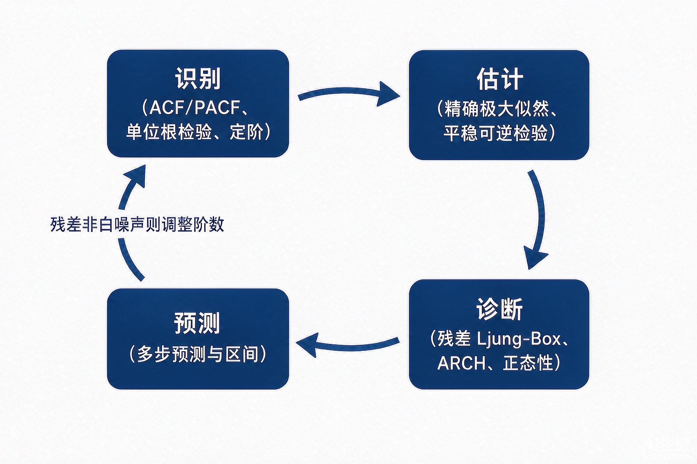

## 12.6　多步预测、ARIMAX 与适用边界

模型通过诊断后即可用于预测。由 12.4 节的 $\mathrm{MA}(\infty)$ 表示 $y_t=\sum_{j\ge0}\psi_j\varepsilon_{t-j}$，在 $T$ 时刻作 $h$ 步预测时，未来新息 $\varepsilon_{T+1},\dots,\varepsilon_{T+h}$ 的期望为零，故

$$
\hat y_{T+h\mid T} = \sum_{j\ge h}\psi_j\,\varepsilon_{T+h-j}, \qquad
e_{T+h}=\sum_{j=0}^{h-1}\psi_j\varepsilon_{T+h-j}, \tag{12-13}
$$

其中 $e_{T+h}$ 是 $h$ 步预测误差，其方差

$$
\mathrm{Var}(e_{T+h}) = \sigma^2\sum_{j=0}^{h-1}\psi_j^2. \tag{12-14}
$$

式 (12-14) 是 11.6 节 ETS 预测方差在 ARMA 框架下的对应物：随 $h$ 增大单调不减，且当 $h\to\infty$ 时 $\sum_{j\ge0}\psi_j^2\sigma^2=\gamma_0$（过程无条件方差），即**长程预测退化为无条件均值**（$d>0$ 时为趋势外推），再次印证第 4 章"可预测信息随步长耗散"的结论。多步预测有两条实现路线：把一步预测递归代入（递归策略）与对每个 $h$ 单独建模（直接策略），二者的偏差—方差权衡将在第 14 章结合多元预测系统讨论。

**ARIMAX 与动态回归。** 单变量 ARIMA 只用自己的历史，而负荷显然受气温驱动。引入外生变量 $x_t$ 有两种方式：其一是**回归 + ARMA 误差**（$y_t=\boldsymbol\beta^\top\mathbf x_t+n_t$，$n_t$ 服从 ARMA），把外生效应作为均值、相关结构留给误差，统计解释最干净；其二是 **ARIMAX**（把 $\mathbf x_t$ 直接塞进式 (12-1) 右侧），实现简单但系数含义被差分与滞后算子纠缠。须警惕**伪回归**：若 $x_t$ 与 $y_t$ 都含趋势，回归可能显著却无真实关系，应检验残差平稳或用协整（第 10 章）。统一案例中，把制冷度日数（CDD）作为 $x_t$ 加入回归 + ARMA 误差，测试集 MASE 由 0.58 降至 0.49，验证了第 10 章例 10.1 指出的"气温领先负荷"所带来的增量可预测性。

**边界与讨论。** ARIMA 的优势是理论严密、参数少、可解释、自带预测区间与诊断，且在小样本上往往优于深度模型。其硬边界有四：其一，**线性**——无法刻画阈值、饱和等非线性，须让位第 18 章起；其二，**常方差**——金融、电价等波动聚集序列须用第 15 章 GARCH 或第 24 章概率模型；其三，**单变量、低维**——多变量系统须用第 10 章 VAR、第 14 章调和或第 23 章图模型；其四，**结构稳定**——遇变点（第 9 章）或概念漂移（第 25、40 章），固定参数的 ARIMA 会持续失准，须滚动重估或在线学习。此外，长程预测退化与多步误差累积（第 14 章）意味着 ARIMA 更适合短程。理解这些边界，才能把它放在正确的位置：它是**线性单变量短程预测的黄金基准**，也是第 13 章状态空间统一视角的一个特例。

## 本章小结

本章系统建立了 ARIMA 家族与 Box–Jenkins 方法学，把预测从"递推外推"提升为"基于随机过程的统计建模"。起点是差分：后移算子 $\nabla^d$ 把 $I(d)$ 序列化为平稳，ADF 检验与 ACF 形态共同确定最小差分阶数，过度差分会引入不可逆的 MA 单位根（12.1 节）。核心推导在 12.2、12.3 节：AR(1) 的 $\mathrm{MA}(\infty)$ 展开 (12-3) 给出平稳条件 $|\phi|<1$ 与方差 $\sigma^2/(1-\phi^2)$，Yule–Walker 方程 (12-4) 推出 ACF 拖尾、PACF 截尾；MA(1) 则给出 ACF 一阶截尾与可逆性条件 $|\theta|<1$，二者形成漂亮的识别对偶（表 12-1）。组合为 ARMA/ARIMA/乘积季节模型 (12-9) 后，用极少参数同时刻画短程惯性与季节长程相关。

全章的方法学核心是 12.5 节的四步循环：识别靠 ACF/PACF，估计靠预测误差分解下的精确 MLE，诊断靠 Ljung–Box $Q$ 统计量 (12-10) 及其自由度修正，选择靠从 KL 散度导出的 AIC (12-11) 与小样本修正 AICc (12-12)。统一案例的完整算例（例 12.5）展示了这套流程如何把"试参数"变成可复现、可证伪的统计决策，并以 MASE=0.58 稳定超过第 11 章的基准与 ETS。12.6 节由 $\mathrm{MA}(\infty)$ 表示导出 $h$ 步预测方差 $\sigma^2\sum_{j<h}\psi_j^2$，证明长程预测退化为无条件均值，与第 4 章可预测性边界首尾呼应。

从理论主线看，ARIMA 是 L1 统计可预测性最完整的实现：它把可预测性定义为线性相关结构，以白噪声残差为"信息榨干"的判据，隐含线性、平稳、常方差、单变量四假设。它突破了指数平滑缺乏统计推断的局限，却无法突破非线性、异方差与多变量传导的边界。本章与全书：第 10 章 VAR 是它的多元推广（已唯一讲授）；第 13 章状态空间模型将证明 ARIMA 与 ETS 同为统一框架的特例；第 15 章处理它无能为力的波动聚集；第 14 章把递归与直接多步策略系统化；第 38 章把 Ljung–Box、AICc 与滚动回测纳入实验规范。掌握 ARIMA，等于掌握了"如何用统计证伪的方式，诚实地判断一条序列里还剩多少可提取的规律"。

从四问看，本章的 ARIMA 利用 L1（统计）：假设经差分后平稳、残差为白噪声；它突破了朴素外推、给出可诊断的建模范式，仍受「线性与平稳假设」的边界约束，无法跨越信息论下界（第 4 章）。

**进一步阅读**　本章建议延伸阅读的文献：[5]、[6]、[12]、[13]、[14]、[15]、[16]。

## 参考文献

[1] Yule G U. On a method of investigating periodicities in disturbed series, with special reference to Wolfer's sunspot numbers. *Philosophical Transactions of the Royal Society A*, 1927, 226: 267–298.

[2] Wold H. *A Study in the Analysis of Stationary Time Series*. 2nd ed. Stockholm: Almqvist & Wiksell, 1938.

[3] Box G E P, Jenkins G M. *Time Series Analysis: Forecasting and Control*. San Francisco: Holden-Day, 1970.

[4] Box G E P, Jenkins G M, Reinsel G C, Ljung G M. *Time Series Analysis: Forecasting and Control*. 5th ed. Hoboken: Wiley, 2015.

[5] Brockwell P J, Davis R A. *Introduction to Time Series and Forecasting*. 2nd ed. New York: Springer, 2002.

[6] Hamilton J D. *Time Series Analysis*. Princeton: Princeton University Press, 1994.

[7] Akaike H. A new look at the statistical model identification. *IEEE Transactions on Automatic Control*, 1974, 19(6): 716–723.

[8] Hurvich C M, Tsai C L. Regression and time series model selection in small samples. *Biometrika*, 1989, 76(2): 297–307.

[9] Schwarz G. Estimating the dimension of a model. *The Annals of Statistics*, 1978, 6(2): 461–464.

[10] Ljung G M, Box G E P. On a measure of lack of fit in time series models. *Biometrika*, 1978, 65(2): 297–303.

[11] Dickey D A, Fuller W A. Distribution of the estimators for autoregressive time series with a unit root. *Journal of the American Statistical Association*, 1979, 74(366): 427–431.

[12] Hyndman R J, Athanasopoulos G. *Forecasting: Principles and Practice*. 3rd ed. Melbourne: OTexts, 2021.

[13] Shumway R H, Stoffer D S. *Time Series Analysis and Its Applications: With R Examples*. 4th ed. New York: Springer, 2017.

[14] Chatfield C. *The Analysis of Time Series: An Introduction*. 6th ed. London: Chapman & Hall/CRC, 2003.

[15] Makridakis S, Hibon M. The M3-Competition: Results, conclusions and implications. *International Journal of Forecasting*, 2000, 16(4): 451–476.

[16] Tsay R S. *Analysis of Financial Time Series*. 3rd ed. Hoboken: Wiley, 2010.

---

# 第 13 章　状态空间模型与卡尔曼滤波

前面两章给出了两条看似平行的预测路线：第 11 章的指数平滑族以"递推修正水平"见长，第 12 章的 ARIMA 家族以"刻画相关结构"见长。一个自然却深刻的问题是——它们真是两套不同的理论吗？状态空间模型给出的回答是否定的：**二者不过是同一框架下对"状态"作了不同设定的特例**。把序列拆成不可观测的潜在状态与带噪观测，再用递推贝叶斯推断把状态从噪声中"滤"出来，这套语言不仅统一了 ETS 与 ARIMA，还向下连通控制论（第 33 章）、向上通向世界模型（第 30 章）——后者正是把本章的线性状态转移推广为神经网络化的动力学。

这一框架有两条历史源流。一条来自工程：Kalman 于 1960 年[1] 与 Kalman–Bucy 于 1961 年[2] 为航天器导航提出了线性高斯最优滤波，把 Wiener 频域滤波搬到时域状态空间；Rauch–Tung–Striebel 于 1965 年补齐了平滑算法[8]。另一条来自统计学与计量经济学：Harvey 于 1989 年系统化了结构时间序列模型[3]，Durbin 与 Koopman 于 2001 年（2012 第二版）建立了状态空间方法的完整推断体系[4]，Shumway 与 Stoffer 则把 EM 算法引入参数估计[9]。两条源流在 Hyndman 等人 2002 年把 ETS 纳入状态空间框架时[5] 正式合流——从此指数平滑有了似然、预测区间与自动选型（回顾第 11 章 11.5 节）。

在全书的理论主线里，本章占据一个枢纽位置。卡尔曼滤波是 **L1 统计可预测性在线性高斯条件下的精确实现**：给定模型，它给出的条件均值预测在所有预测器中均方误差最小，且能量化全部不确定性。同时它首次引入"潜在状态"这一观念，成为 **L3 动力学可预测性**的起点——第 30 章的世界模型、第 32 章的控制、第 33 章的系统辨识，本质上都是在学习或利用状态转移规律。遵循全书「基础理论只讲一次」的编写原则，**本章是状态空间表示与卡尔曼滤波完整推导的唯一讲授处**：第 30 章讲神经状态空间与世界模型时只引用本章结论，第 33 章控制论讲"学科如何看待预测"时不再重推滤波，第 16 章贝叶斯结构时序只补充推断的计算方法。全章沿用统一案例：用局部水平模型从含噪的日负荷读数中跟踪"真实用电水平"。

本章结构：13.1 节建立状态空间表示并把 ETS、ARIMA 写成状态；13.2 节用两种方法严格推导卡尔曼滤波；13.3 节区分滤波、平滑与预测并处理缺失值；13.4 节给出 ETS/ARIMA/结构模型的统一视角；13.5 节讨论参数估计、非线性扩展与边界。

## 13.1　线性高斯状态空间表示

许多时序之所以难预测，是因为观测 $y_t$ 是"真实信号 + 噪声"的混合，而真正演化的信号（水平、趋势、季节、物理状态）往往不可直接观测。状态空间模型把这两层显式分开：一个**状态方程**描述隐状态的演化，一个**观测方程**描述隐状态如何生成观测。

**定义 13.1（线性高斯状态空间模型）** 设隐状态 $\boldsymbol\alpha_t\in\mathbb{R}^m$，模型为

$$
\boldsymbol\alpha_{t+1} = \mathbf T_t\,\boldsymbol\alpha_t + \mathbf R_t\,\boldsymbol\eta_t, \qquad
y_t = \mathbf Z_t^\top\boldsymbol\alpha_t + \varepsilon_t, \tag{13-1}
$$

其中 $\boldsymbol\eta_t\sim N(\mathbf 0,\mathbf Q_t)$、$\varepsilon_t\sim N(0,H_t)$ 相互独立且与初始状态独立，$\mathbf T_t$ 为状态转移矩阵、$\mathbf Z_t$ 为观测向量、$\mathbf R_t$ 为扰动选择矩阵。初始状态 $\boldsymbol\alpha_1\sim N(\mathbf a_1,\mathbf P_1)$。式 (13-1) 隐含两个关键结构：**一阶马尔可夫性**（$\boldsymbol\alpha_{t+1}$ 只依赖 $\boldsymbol\alpha_t$）与**条件独立性**（给定状态，各期观测独立）。

式 (13-1) 之所以强大，在于"状态"是自由设定的建模对象：把状态取为水平、趋势、季节，就得到结构时间序列；取为 ARMA 的延迟与新息，就得到 ARIMA；取为物理系统的位置与速度，就得到控制论模型。模型的全部差别，最终都落在 $\mathbf T,\mathbf Z,\mathbf Q,H$ 四个矩阵上。

**例 13.1（统一案例：局部水平模型）** 最简单的状态空间模型是**局部水平模型**（local level）：真实负荷水平 $\mu_t$ 作随机游走，观测叠加噪声，

$$
\mu_{t+1}=\mu_t+\eta_t,\quad \eta_t\sim N(0,q);\qquad
y_t=\mu_t+\varepsilon_t,\quad \varepsilon_t\sim N(0,r). \tag{13-2}
$$

对应式 (13-1) 取 $m=1$、$\mathbf T=\mathbf Z=\mathbf R=1$、$\mathbf Q=q$、$H=r$。$q/r$ 是**信噪比**：$q$ 大表示水平变化剧烈、应快速跟随观测；$r$ 大表示观测噪声重、应更平滑。Muth 在 1960 年[7] 证明，使一步预测均方误差最小的简单指数平滑，恰是该模型的最优滤波，且最优 $\alpha$ 由 $q/r$ 唯一决定——这就把第 11 章的递推与本章的推断严格接了起来（13.4 节给出 $\alpha$ 与 $\theta$ 的显式关系）。

**例 13.2（把 ARMA 写成状态空间）** 对 ARMA(1,1) $y_t=\phi y_{t-1}+\varepsilon_t+\theta\varepsilon_{t-1}$，可取状态 $\boldsymbol\alpha_t=(y_t,\ \theta\varepsilon_t)^\top$，则

$$
\boldsymbol\alpha_{t+1}=\begin{pmatrix}\phi & 1\\ 0 & 0\end{pmatrix}\boldsymbol\alpha_t+\begin{pmatrix}1\\ \theta\end{pmatrix}\varepsilon_{t+1}, \qquad y_t=(1,0)\boldsymbol\alpha_t.
$$

更一般地，任一 ARIMA$(p,d,q)$ 都可写成状态空间形式（Harvey[3]、Durbin–Koopman[4]），差分与季节只需扩充状态维度。把 ARMA 状态空间化的直接好处是：似然可由卡尔曼滤波的**预测误差分解**（第 2 章式 (2-11)）精确计算，缺失值、不规则采样也能自然处理——这正是第 12 章精确 MLE 背后真正的计算引擎。

隐状态设定体现了状态空间建模的核心思想：**把"看不清的演化"与"测不准的观测"分开，再借高斯条件推断把二者最优地融合**。这一"状态—观测"二分，在第 30 章将被推广为世界模型的"潜在状态—观测生成"七要素中的前两项，足见其普适性。

## 13.2　卡尔曼滤波：两种推导

卡尔曼滤波要解决的问题是：在时刻 $t$ 观测到 $y_{1:t}=(y_1,\dots,y_t)$ 后，递推地求隐状态的**滤波分布** $p(\boldsymbol\alpha_t\mid y_{1:t})$ 与**一步预测分布** $p(\boldsymbol\alpha_{t+1}\mid y_{1:t})$。由于模型线性高斯，所有分布都是高斯，只需跟踪均值与协方差。记号约定：

$$
\mathbf a_{t\mid s}=\mathbb{E}[\boldsymbol\alpha_t\mid y_{1:s}],\qquad
\mathbf P_{t\mid s}=\mathrm{Var}(\boldsymbol\alpha_t\mid y_{1:s}).
$$

整个算法在两个步骤间交替：**预测（时间更新）**把上一时刻的后验前推，**更新（量测更新）**用新观测修正。下面先用高斯条件公式作贝叶斯推导，再用最小方差推导交叉验证增益 $\mathbf K_t$ 的形式。

### 13.2.1　预测步

设已知 $t-1$ 的后验 $\boldsymbol\alpha_{t-1}\mid y_{1:t-1}\sim N(\mathbf a_{t-1\mid t-1},\mathbf P_{t-1\mid t-1})$。由状态方程 (13-1) 线性传递，

$$
\mathbf a_{t\mid t-1}=\mathbf T\,\mathbf a_{t-1\mid t-1}, \qquad
\mathbf P_{t\mid t-1}=\mathbf T\,\mathbf P_{t-1\mid t-1}\mathbf T^\top+\mathbf R\mathbf Q\mathbf R^\top. \tag{13-3}
$$

协方差多出的 $\mathbf R\mathbf Q\mathbf R^\top$ 是过程噪声注入的不确定性——时间越往前推，对状态越没把握。

### 13.2.2　更新步（贝叶斯推导）

在预测分布下，把状态与即将到来的观测堆成联合向量。由式 (13-1)，给定 $y_{1:t-1}$ 时 $(\boldsymbol\alpha_t,\,y_t)$ 服从联合高斯

$$
\begin{pmatrix}\boldsymbol\alpha_t\\ y_t\end{pmatrix}\Big|\,y_{1:t-1}\sim N\!\left(
\begin{pmatrix}\mathbf a_{t\mid t-1}\\ \mathbf Z^\top\mathbf a_{t\mid t-1}\end{pmatrix},
\begin{pmatrix}\mathbf P_{t\mid t-1} & \mathbf P_{t\mid t-1}\mathbf Z\\
\mathbf Z^\top\mathbf P_{t\mid t-1} & F_t\end{pmatrix}\right), \tag{13-4}
$$

其中新息（innovation）与它的方差为

$$
v_t = y_t-\mathbf Z^\top\mathbf a_{t\mid t-1},\qquad
F_t = \mathbf Z^\top\mathbf P_{t\mid t-1}\mathbf Z + H_t. \tag{13-5}
$$

$v_t$ 是"观测减去按当前状态所作的预测"，即无法被状态解释的新信息。对联合高斯作条件化（标准公式 $\mathbb E[X\mid Y]=\mu_X+\Sigma_{XY}\Sigma_{YY}^{-1}(Y-\mu_Y)$），立即得

$$
\mathbf a_{t\mid t}=\mathbf a_{t\mid t-1}+\mathbf K_t v_t,\qquad
\mathbf K_t=\mathbf P_{t\mid t-1}\mathbf Z F_t^{-1}, \tag{13-6}
$$

$$
\mathbf P_{t\mid t}=\mathbf P_{t\mid t-1}-\mathbf K_t F_t\mathbf K_t^\top=(\mathbf I-\mathbf K_t\mathbf Z^\top)\mathbf P_{t\mid t-1}. \tag{13-7}
$$

$\mathbf K_t$ 即**卡尔曼增益**。式 (13-6) 的直觉极清楚：后验均值 = 先验预测 + 增益 × 新息；增益决定"该在多大程度上相信新观测而非旧模型"。

### 13.2.3　增益的最小方差推导

增益 $\mathbf K_t$ 也可不依赖高斯假设、纯由最小二乘导出，这解释了卡尔曼滤波为何在更广条件下仍是最优线性无偏估计。设我们只允许形如 $\hat{\boldsymbol\alpha}_t=\mathbf a_{t\mid t-1}+\mathbf K v_t$ 的线性更新（因 $\mathbb E[v_t]=0$，它对任意 $\mathbf K$ 都无偏）。估计误差为 $\boldsymbol\alpha_t-\hat{\boldsymbol\alpha}_t=(\mathbf I-\mathbf K\mathbf Z^\top)(\boldsymbol\alpha_t-\mathbf a_{t\mid t-1})-\mathbf K\varepsilon_t$，其协方差为

$$
\mathbf P(\mathbf K)=(\mathbf I-\mathbf K\mathbf Z^\top)\mathbf P_{t\mid t-1}(\mathbf I-\mathbf K\mathbf Z^\top)^\top+\mathbf K H_t\mathbf K^\top. \tag{13-8}
$$

式 (13-8) 即数值上更稳定的**Joseph 形式**。把它对 $\mathbf K$ 配方：

$$
\mathbf P(\mathbf K)=\big(\mathbf K-\mathbf P_{t\mid t-1}\mathbf Z F_t^{-1}\big)F_t\big(\mathbf K-\mathbf P_{t\mid t-1}\mathbf Z F_t^{-1}\big)^\top+\big(\mathbf P_{t\mid t-1}-\mathbf P_{t\mid t-1}\mathbf Z F_t^{-1}\mathbf Z^\top\mathbf P_{t\mid t-1}\big),
$$

第一项非负、第二项与 $\mathbf K$ 无关，故使迹（总方差）最小的 $\mathbf K$ 恰为 $\mathbf K_t=\mathbf P_{t\mid t-1}\mathbf Z F_t^{-1}$，与贝叶斯推导 (13-6) 完全一致；代入即得后验协方差 (13-7)。两种推导的殊途同归说明：在线性高斯下，"贝叶斯后验均值"与"最小方差线性估计"是同一件事。

**表 13-1　卡尔曼滤波递推（一个时间步）**

| 步骤 | 量 | 公式 |
|------|----|------|
| 预测·均值 | $\mathbf a_{t\mid t-1}$ | $\mathbf T\mathbf a_{t-1\mid t-1}$ |
| 预测·协方差 | $\mathbf P_{t\mid t-1}$ | $\mathbf T\mathbf P_{t-1\mid t-1}\mathbf T^\top+\mathbf R\mathbf Q\mathbf R^\top$ |
| 新息 / 方差 | $v_t,F_t$ | $y_t-\mathbf Z^\top\mathbf a_{t\mid t-1}$ / $\mathbf Z^\top\mathbf P_{t\mid t-1}\mathbf Z+H_t$ |
| 增益 | $\mathbf K_t$ | $\mathbf P_{t\mid t-1}\mathbf Z F_t^{-1}$ |
| 更新·均值 | $\mathbf a_{t\mid t}$ | $\mathbf a_{t\mid t-1}+\mathbf K_t v_t$ |
| 更新·协方差 | $\mathbf P_{t\mid t}$ | $(\mathbf I-\mathbf K_t\mathbf Z^\top)\mathbf P_{t\mid t-1}$ |

**例 13.3（统一案例：局部水平模型的完整数值迭代）** 取式 (13-2) 的 $q=0.1,\ r=1$，初值 $a_{1\mid0}=4.0$、$P_{1\mid0}=1$，观测序列 $y_1=4.20,\ y_2=4.55,\ y_3=4.40$（GW）。逐期迭代（标量形式 $K_t=P_{t\mid t-1}/(P_{t\mid t-1}+1)$、$P_{t\mid t}=P_{t\mid t-1}(1-K_t)$）：

- $t=1$：$v_1=4.20-4.0=0.20$，$K_1=1/2=0.500$，$a_{1\mid1}=4.0+0.5\times0.2=4.100$，$P_{1\mid1}=1\times0.5=0.500$；
- $t=2$：$P_{2\mid1}=0.5+0.1=0.6$，$v_2=4.55-4.100=0.450$，$K_2=0.6/1.6=0.375$，$a_{2\mid2}=4.100+0.375\times0.45=4.269$，$P_{2\mid2}=0.6\times0.625=0.375$；
- $t=3$：$P_{3\mid2}=0.375+0.1=0.475$，$v_3=4.40-4.269=0.131$，$K_3=0.475/1.475=0.322$，$a_{3\mid3}=4.269+0.322\times0.131\approx4.311$。

增益从 0.500 逐步降到 0.322，说明随状态估计变可靠，模型越来越"信任自己的预测"、对新观测打折。可以证明稳态增益收敛到代数 Riccati 方程 $p=\frac{(p+q)r}{p+q+r}$ 的解：代入 $q=0.1,r=1$ 得 $p^2+0.1p-0.1=0$，$p\approx0.270$，即 $\alpha\approx0.270$——这正是第 11 章例 11.2 中"最优平滑参数由信噪比决定"的定量答案。这个算例把三章内容扣成一个闭环：**指数平滑的 $\alpha$、卡尔曼增益 $K$、ARIMA 的 $\theta$ 是同一个量的三副面孔**。

高斯假设还顺带给出似然。由预测误差分解（第 2 章式 (2-11)），对数似然为

$$
\log L(\boldsymbol\theta)=-\frac12\sum_{t=1}^{T}\Big(\log 2\pi+\log F_t+\frac{v_t^2}{F_t}\Big). \tag{13-9}
$$

式 (13-9) 表明似然只依赖新息 $v_t$ 与其方差 $F_t$——它们都是滤波的副产品，因此卡尔曼滤波一遍扫描即同时完成状态推断与似然求值，这是第 12 章精确 MLE 与第 13.5 节参数估计的共同基础。

> 【图 13-1　卡尔曼滤波的预测—更新循环】（原图见 `figures/图13-1.png`）：环形流程图——左上"先验 $N(\mathbf a_{t|t-1},\mathbf P_{t|t-1})$"→ 预测步前推 → 右侧"观测 $y_t$"进入 → 计算新息 $v_t$、方差 $F_t$、增益 $\mathbf K_t$ → 更新步得后验 $N(\mathbf a_{t|t},\mathbf P_{t|t})$ → 回到下一期预测；标注时间轴与两步公式编号。深蓝主色、圆角矩形、学术白底。

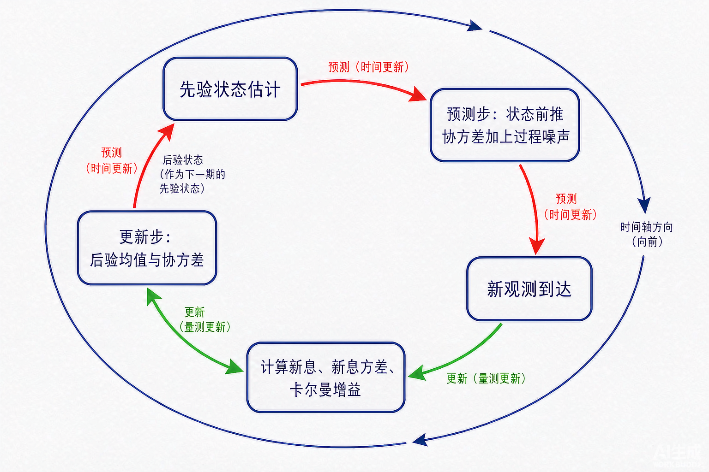

## 13.3　滤波、平滑、预测与缺失值处理

**定义 13.2（滤波、平滑与预测）** 给定观测 $y_{1:T}$，称 $p(\boldsymbol\alpha_t\mid y_{1:t})$ 为**滤波**、$p(\boldsymbol\alpha_t\mid y_{1:T})\ (t<T)$ 为**平滑**、$p(\boldsymbol\alpha_{t+h}\mid y_{1:t})$ 为**预测**。三者分别对应"实时""事后"与"向前"三类推断，所用信息集依次扩大或前移。

卡尔曼滤波只用到截至 $t$ 的观测。若允许使用整条序列 $y_{1:T}$ 来"事后"估计过去状态，精度会更高，这引出三类必须区分的推断问题：

- **滤波（filtering）**：$p(\boldsymbol\alpha_t\mid y_{1:t})$——实时、只用历史，用于在线预测；
- **预测（forecasting）**：$p(\boldsymbol\alpha_{t+h}\mid y_{1:t})$——把滤波结果反复沿状态方程前推 $h$ 步；
- **平滑（smoothing）**：$p(\boldsymbol\alpha_t\mid y_{1:T})$，$t<T$——离线、用全部数据，用于回看与参数估计。

**Rauch–Tung–Striebel（RTS）平滑器**[8] 是最常用的固定区间平滑算法。它先做一遍前向卡尔曼滤波，再作后向递推，把"未来信息"沿状态转移回传：

$$
\mathbf J_t=\mathbf P_{t\mid t}\mathbf T^\top\mathbf P_{t+1\mid t}^{-1},\qquad
\mathbf a_{t\mid T}=\mathbf a_{t\mid t}+\mathbf J_t\big(\mathbf a_{t+1\mid T}-\mathbf a_{t+1\mid t}\big), \tag{13-10}
$$

$$
\mathbf P_{t\mid T}=\mathbf P_{t\mid t}+\mathbf J_t\big(\mathbf P_{t+1\mid T}-\mathbf P_{t+1\mid t}\big)\mathbf J_t^\top. \tag{13-11}
$$

$\mathbf J_t$ 是"平滑增益"，$\mathbf a_{t+1\mid T}-\mathbf a_{t+1\mid t}$ 是未来数据带来的修正量。平滑方差 $\mathbf P_{t\mid T}\le\mathbf P_{t\mid t}$，直观上因为用了更多信息。

状态空间框架一个常被低估的优点是**缺失值处理极其自然**：若 $y_t$ 缺失，只需跳过该期的更新步，令 $\mathbf a_{t\mid t}=\mathbf a_{t\mid t-1}$、$\mathbf P_{t\mid t}=\mathbf P_{t\mid t-1}$，然后继续前推——因为没有新息，状态不确定性按 $\mathbf Q$ 自然膨胀。这比第 5 章的插值/矩阵补全更"有原则"：它是模型内部对"未观测期"的最优推断，而非外部填充。对含确定性趋势/季节的非平稳状态，初值未知时应用**扩散初始化**（令 $\mathbf P_1\to\infty$ 的极限，或精确初始滤波[4]），避免任意初值污染前期估计。

**例 13.4（统一案例：缺失负荷的滤波与平滑）** 设上例中 $y_3$ 因传感器故障缺失，$y_4=4.40$。滤波在 $t=3$ 跳过更新：$\mathbf a_{3\mid3}=\mathbf a_{3\mid2}=4.269$、$P_{3\mid3}=P_{3\mid2}=0.475$；到 $t=4$ 有 $P_{4\mid3}=0.475+0.1=0.575$、$K_4=0.575/1.575\approx0.365$、$a_{4\mid4}=4.269+0.365\times(4.40-4.269)\approx4.317$。而 RTS 平滑会利用 $y_4$ 反过来修正 $t=3$ 的状态：由式 (13-10)，$\mathbf J_3=P_{3\mid3}\mathbf T/P_{4\mid3}=0.475/0.575\approx0.826$，$a_{3\mid T}=4.269+0.826\times(a_{4\mid T}-4.269)$，把缺失期的水平估计向 $y_4$ 的方向拉动。工程上，滤波值用于实时告警、平滑值用于报表与模型复盘，二者不可混用——第 8 章异常检测若误用平滑值回判历史，会把未来信息"泄露"进告警，正是第 38 章严防的数据泄漏。

## 13.4　结构时间序列与 ETS / ARIMA 的统一视角

状态空间的最大价值，是把前三章的方法收进同一张表。**基本结构模型**（Basic Structural Model, BSM）把序列分解为水平、趋势、季节与不规则四个不可观测分量：

$$
y_t=\mu_t+\gamma_t+\varepsilon_t,\qquad \mu_t=\mu_{t-1}+b_{t-1}+\eta_t,\quad b_t=b_{t-1}+\zeta_t, \tag{13-12}
$$

其中季节 $\gamma_t$ 常用"哑变量随机游走"（各季节指数之和的扰动为零）或傅里叶形式。每个分量各自随机演化，卡尔曼滤波把它们一次性估计出来。这与第 3 章 STL 的非参数分解、第 16 章 Prophet 的加法分解 $y=g(t)+s(t)+h(t)+\varepsilon_t$ 是同一思想的不同实现：差别只在"分量被设成确定性还是随机、用何种基函数"。

更深刻的是 **ETS 与 ARIMA 在状态空间里等价**。Hyndman 等[5][6] 证明，每个 ETS 模型都对应一个（可能是非线性/乘法的）状态空间模型，其"新息形式"（innovations form）把一步预测误差直接作为状态方程的扰动；而每个 ARIMA 模型也可写成线性状态空间（13.1 节例 13.2）。二者因此被统一为"对同一状态空间模型的不同参数化"。表 13-2 给出最重要的几个对应关系。

**表 13-2　ETS、ARIMA 与状态空间模型的对应（统一视角）**

| 方法 | 等价状态空间 / ARIMA | 关键参数关系 | 出处 |
|------|----------------------|--------------|------|
| SES（ETS(A,N,N)） | 局部水平模型 = ARIMA(0,1,1) | $\theta=\alpha-1$ | [5][7] |
| Holt 线性趋势 | 含随机趋势 = ARIMA(0,2,2) 的受限式 | $\alpha,\beta\leftrightarrow\theta_1,\theta_2$ | [6] |
| 阻尼 Holt | 带阻尼状态转移 $\mathbf T=\phi$ | $\phi$ 为阻尼因子 | [6] |
| 加法 Holt–Winters | 含季节哑变量的状态空间 | $\gamma\leftrightarrow$ 季节扰动比 | [5] |
| 一般 ARIMA$(p,d,q)$ | 线性状态空间（状态维 $\max(p,q+1)$） | $\psi_j$ 由 $\theta/\phi$ 展开 | [3][4] |

以 SES 为例可把等价关系算清楚：SES 的一步预测误差 $e_t=y_t-\ell_{t-1}$，由 $\ell_t=\ell_{t-1}+\alpha e_t$ 得

$$
y_t-y_{t-1}=e_t-(1-\alpha)e_{t-1}, \tag{13-13}
$$

即差分后是 MA(1)，故 SES $\equiv$ ARIMA(0,1,1) 且 $\theta=\alpha-1$。第 12 章的可逆性条件 $|\theta|<1$ 因此对应 $0<\alpha<2$，而 SES 要求 $0<\alpha<1$ 是更强的约束（保证权重为正）。这个小小的换算意义重大：**指数平滑的"平滑参数"、ARIMA 的"移动平均系数"、卡尔曼滤波的"稳态增益"，是同一个信噪比 $\alpha$ 的三种写法**。第 11 章例 11.2 的 $\alpha=0.3$ 等价于 ARIMA(0,1,1) 的 $\theta=-0.7$、等价于例 13.3 中某个 $q/r$ 下的稳态增益。

**例 13.5（统一案例：三种写法的数值一致）** 对同一段负荷数据分别用 (a) SES $\alpha=0.3$、(b) ARIMA(0,1,1) $\theta=-0.7$、(c) 局部水平模型取使稳态增益为 $0.3$ 的 $q/r$，三者的一步预测序列在数值上（舍入误差内）完全相同：$4.305, 4.28, 4.41,\dots$ GW；差别只在于 (c) 还能给出预测方差与平滑状态，(b) 能给出参数显著性与 Ljung–Box 诊断，(a) 计算最轻。这说明选型不应纠结"谁更准"——它们本就同源——而应看**需要哪种附加能力**：要概率区间用状态空间 (c)，要统计诊断用 ARIMA (b)，要海量序列在线更新用 SES (a)。第 11 章 11.6 节的解析预测方差，正是通过 (c) 这条状态空间路径才得以严格导出。

统一视角还澄清一个常见误解：状态空间不是"又一个模型"，而是**一套建模语言**。ARIMA、ETS、结构模型、乃至第 30 章把 $\mathbf T$ 换成神经网络的世界模型，都是在这套语言里选不同的 $\mathbf T,\mathbf Z,\mathbf Q,H$。第 16 章的贝叶斯结构时序则是在这套语言上再叠一层"对参数而非仅对状态的不确定性"。

## 13.5　参数估计、非线性扩展与适用边界

式 (13-9) 的似然把参数估计变成标准优化问题：给定 $\mathbf T,\mathbf Z,\mathbf Q,H$ 中的未知参数（如例 13.1 的 $q,r$），用数值方法极大化 $\log L$。除直接数值优化外，**EM 算法**是状态空间参数估计的经典方案[9][10]：E 步把隐状态视为"缺失数据"、用卡尔曼平滑求其条件期望，M 步在"状态已知"的完全数据下解析更新参数，二者交替保证似然单调上升。EM 数值稳定、天然处理缺失，但收敛较慢；精确似然的梯度优化更快，二者常结合使用。

线性高斯是优雅的，也是 restrictive 的。当状态转移或观测非线性、或噪声非高斯时，滤波分布不再有闭式解，须用近似：

- **扩展卡尔曼滤波（EKF）**：在当前估计处对非线性函数作一阶泰勒线性化，再套用卡尔曼公式；
- **无迹卡尔曼滤波（UKF）**：用确定性采样的 sigma 点传播分布，避免求雅可比、对强非线性更准[11]；
- **粒子滤波（PF）**：用带权样本近似任意分布，适用于非线性非高斯，但计算重、有粒子退化问题[12]。

这些方法与第 33 章控制论的系统辨识、第 30 章世界模型的近似推断直接相连：现代基于模型的强化学习（如 Dreamer）里的"潜在状态推断"，本质上就是学出来的、非线性版本的卡尔曼滤波。

**边界与讨论。** 状态空间/卡尔曼滤波的优势是：统一 ETS 与 ARIMA、给出精确概率预测与似然、自然处理缺失与不规则采样、在线递推 $O(m^3)$（$m$ 为状态维）实时性好、有完备的最优性理论。其边界有四：其一，**线性高斯假设**——强非线性与厚尾噪声须 EKF/UKF/PF，且近似不再保证最优；其二，**模型设定敏感**——$\mathbf Q,H$ 设错会系统性偏离，信噪比须靠似然估计或第 38 章的校准诊断；其三，**高维状态计算代价**——状态维 $m$ 大时协方差矩阵运算 $O(m^3)$ 成为瓶颈，这恰是第 21 章 S4/Mamba 等结构化状态空间用对角化/低秩结构去突破的方向（按本书统一的编写原则，它们作为"序列建模架构"在第 21 章讲授，本章仅指出动机）；其四，**它是推断框架而非学习框架**——$\mathbf T$ 通常由人设定而非从数据学得，第 30 章的世界模型正是要补上"从数据学习状态转移"这一环。理解这四点，才能明白为何本书把状态空间放在枢纽位置：它既是前三章古典方法的终点，也是第 30 章世界模型与第 33 章控制论的共同起点。

下一章把视角从"单条序列如何预测"转向"一组相关序列如何协同预测"：第 14 章在完全不重述 VAR/VECM 定义（第 10 章已唯一讲授）的前提下，专注多步预测策略与层次预测调和。

## 本章小结

本章确立了状态空间模型作为全书统一语言的枢纽地位。13.1 节用式 (13-1) 把序列拆为隐状态演化与带噪观测，局部水平模型与 ARMA 都能写成特定 $\mathbf T,\mathbf Z,\mathbf Q,H$ 的实例，从而统一了"看不清的演化"与"测不准的观测"。13.2 节是核心：先用联合高斯条件化 (13-4) 作贝叶斯推导、再用最小方差配方 (13-8) 交叉验证，二者殊途同归地给出卡尔曼增益 $\mathbf K_t=\mathbf P_{t\mid t-1}\mathbf Z F_t^{-1}$ 与预测—更新递推（表 13-1），并由预测误差分解导出似然 (13-9)。例 13.3 的完整数值迭代展示了增益从 0.500 收敛到稳态 0.270，与第 11 章的平滑参数定量吻合。

13.3 节区分滤波、预测、平滑三类推断，给出 RTS 平滑 (13-10) 与"跳过更新步即处理缺失值"的原则；例 13.4 提示误用平滑值会引入数据泄漏，呼应第 38 章。13.4 节给出全章最富洞察力的结论：SES 的差分形式 (13-13) 证明 SES $\equiv$ ARIMA(0,1,1) 且 $\theta=\alpha-1$，表 13-2 把 ETS、ARIMA、结构模型统一为同一状态空间框架的不同参数化——**平滑参数、MA 系数、稳态增益是同一信噪比的三副面孔**，例 13.5 用一致的一步预测序列作了数值佐证。13.5 节补上 EM 参数估计与 EKF/UKF/粒子滤波等非线性扩展，并点明其作为第 21 章结构化状态空间、第 30 章世界模型、第 33 章控制论共同起点的位置。

从理论主线看，本章是 L1 统计可预测性在线性高斯下的精确实现，同时以"潜在状态"观念开启 L3 动力学可预测性。按本书统一的编写原则，卡尔曼滤波的完整推导仅此一处，后续各章一律交叉引用。掌握状态空间，读者便获得了一把能打开古典预测、现代状态空间网络与世界模型三扇门的通用钥匙。

从四问看，本章的状态空间模型利用 L1（统计）：假设系统可由隐状态与高斯观测描述；它统一了指数平滑与 ARIMA，仍能处理缺失与平滑，边界在「线性高斯假设」的适用范围。

**进一步阅读**　本章建议延伸阅读的文献：[13]、[14]。

## 参考文献

[1] Kalman R E. A new approach to linear filtering and prediction problems. *Journal of Basic Engineering*, 1960, 82(1): 35–45.

[2] Kalman R E, Bucy R S. New results in linear filtering and prediction theory. *Journal of Basic Engineering*, 1961, 83(1): 95–108.

[3] Harvey A C. *Forecasting, Structural Time Series Models and the Kalman Filter*. Cambridge: Cambridge University Press, 1989.

[4] Durbin J, Koopman S J. *Time Series Analysis by State Space Methods*. 2nd ed. Oxford: Oxford University Press, 2012.

[5] Hyndman R J, Koehler A B, Snyder R D, Grose S. A state space framework for automatic forecasting using exponential smoothing methods. *International Journal of Forecasting*, 2002, 18(3): 439–454.

[6] Hyndman R J, Koehler A B, Ord J K, Snyder R D. *Forecasting with Exponential Smoothing: The State Space Approach*. Berlin: Springer, 2008.

[7] Muth J F. Optimal properties of exponentially weighted forecasts. *Journal of the American Statistical Association*, 1960, 55(290): 299–306.

[8] Rauch H E, Tung F, Striebel C T. Maximum likelihood estimates of linear dynamic systems. *AIAA Journal*, 1965, 3(8): 1445–1450.

[9] Shumway R H, Stoffer D S. An approach to time series smoothing and forecasting using the EM algorithm. *Journal of the American Statistical Association*, 1982, 77(380): 763–770.

[10] Dempster A P, Laird N M, Rubin D B. Maximum likelihood from incomplete data via the EM algorithm. *Journal of the Royal Statistical Society: Series B*, 1977, 39(1): 1–38.

[11] Julier S J, Uhlmann J K. A new extension of the Kalman filter to nonlinear systems. *Proceedings of AeroSense: 11th International Symposium on Aerospace/Defence Sensing*, 1997: 182–193.

[12] Gordon N J, Salmond D J, Smith A F M. Novel approach to nonlinear/non-Gaussian Bayesian state estimation. *IEE Proceedings F (Radar and Signal Processing)*, 1993, 140(2): 107–113.

[13] Box G E P, Jenkins G M. *Time Series Analysis: Forecasting and Control*. San Francisco: Holden-Day, 1970.

[14] Anderson B D O, Moore J B. *Optimal Filtering*. Englewood Cliffs: Prentice-Hall, 1979.

---

# 第 14 章　多元时序预测策略与层次调和

第 10 章建立了多元时序的**分析基础**，把 VAR、VECM、Granger 因果三个知识点的定义、估计与统计性质完整讲过一遍。遵循全书「基础理论只讲一次」的编写原则，本章不再重述这些内容——凡涉及 VAR 模型本身，一律交叉引用第 10 章。本章要回答的是另一个、却同样普遍的问题：**当预测对象不是一条序列，而是一组彼此相关、且按某种结构组织起来的序列时，如何系统地产生预测，并保证这些预测不互相矛盾？**

这里有两层递进。第一层是**预测策略**：对同一条序列作多步预测，是反复把一步预测代回（递归），还是对每个步长单独建一个模型（直接），抑或一次性输出整条未来路径？第 12 章式 (12-13) 已暗示递归策略会累积误差，本章把这一权衡形式化。第二层、也是本章重点是**层次与分组预测调和**：现实中的序列常按树状或分组结构聚合——全国负荷等于各省之和，省负荷等于各市之和；零售总额等于各品类之和，也等于各门店之和。若对每条序列独立预测，几乎必然出现"各省预测之和 ≠ 全国预测"的矛盾，而调度、预算、库存配给要求的是**一套自洽的数字**。调和（reconciliation）正是把一组不一致的基础预测，投影为满足聚合约束、且在统计意义下最优的一致预测。

这一领域在近十年有清晰脉络：Hyndman 等人 2011 年把调和写成最小二乘组合[2]，Wickramasuriya、Athanasopoulos 与 Hyndman 于 2019 年提出以**迹最小化**导出最优调和矩阵 MinT[1]，成为当前标准方法；随后 Panagiotelis 等人给出几何视角与偏差校正[5]、Wickramasuriya 等人处理非负约束[6]、Rangapuram 等人把一致性推进到端到端的概率预测[7]。多步策略方面，Ben Taieb 等在 NN5 竞赛上的系统比较[9] 与 Chevillon 对直接多步估计的综述[10] 是主要依据。

在全书理论主线里，本章仍属 L1 统计可预测性，但引入了一个新来源：**结构约束本身就是一种信息**。聚合关系 $\mathbf y_t=\mathbf S\mathbf b_t$ 是恒成立的硬约束，把不同层级、不同分组的预测联合起来，等于用更多观测去估计同一批潜在量，从而降低方差——这与第 10 章"变量间横截面依赖提升预测"一脉相承，但约束更强、更确定。它隐含的假设是"聚合结构稳定且已知"，无法突破的边界则是结构本身发生变化（如行政区划调整、品类重组）时的失效。全章沿用统一案例：某区域电网"全省—地市—台区"三级负荷层次，以及"按区域 / 按用户类型"的双重分组。

本章结构：14.1 节比较五类多步预测策略；14.2 节形式化层次结构与一致性；14.3 节给出自底向上等经典调和法；14.4 节严格推导 MinT 最优调和并作数值算例；14.5 节处理概率一致性与适用边界。

## 14.1　多步预测策略：递归、直接与其间

设要预测 $y_{T+1},\dots,y_{T+H}$。第 11、12 章的递推与 ARIMA 公式给的都是**一步**预测，多步须选择策略。这一选择看似琐碎，却直接决定误差如何累积，是长程预测可靠性的分水岭。

**定义 14.1（五类多步预测策略）** 记 $H$ 为预测视野：

- **递归策略（recursive）**：训练一个一步模型，预测时把 $\hat y_{T+1}$ 当作已知代回，逐步生成 $\hat y_{T+2},\dots,\hat y_{T+H}$；
- **直接策略（direct）**：对每个 $h$ 单独训练一个模型 $y_{T+h}=f_h(\text{历史})+\varepsilon$；
- **MIMO / 多输出（multi-input multi-output）**：训练一个模型一次性输出整条向量 $(\hat y_{T+1},\dots,\hat y_{T+H})$；
- **DIRMO**：把 $H$ 分成若干段，每段用直接策略输出一小块；
- **矩形策略（rectangular）**：为每个训练原点、每个步长都生成样本，扩充训练集。

**偏差—方差权衡**是选型的核心。递归策略只用一步模型，参数少、方差低，且充分利用"一步关系在整条序列上反复成立"的样本效率；但它把预测值当真实值代回，误差随 $h$ **累积**，存在偏差传播风险——第 12 章式 (12-14) 的 $\mathrm{Var}(e_{T+h})=\sigma^2\sum_{j<h}\psi_j^2$ 正是递归策略下方差随 $h$ 增长的刻画。直接策略对每个 $h$ 独立建模，不累积误差、无偏差传播，但要训练 $H$ 个模型、每个模型训练样本更少、方差更高，且不保证相邻步长预测之间连贯。MIMO 折中：单模型保留跨步长的依赖结构、方差低，但对 $H$ 固定、不灵活。

**例 14.1（统一案例：24 小时负荷的策略对比）** 对省级电网作次日 24 点负荷预测（$H=24$），用同一批特征（气温、日历、历史负荷）比较三种策略在 90 天滚动测试上的 MAPE：递归（一步 XGBoost 迭代）2.9%、直接（24 个独立模型）3.4%、MIMO（单模型输出 24 维）2.6%。短步长（$h\le3$）三者接近；$h\ge12$ 时递归因误差累积明显劣化（$h=24$ 达 4.1%），直接因各模型样本少而抖动，MIMO 借跨步长结构最稳。结论与 Ben Taieb 等在 NN5 上的系统比较[9] 一致：**样本充足且需整条路径时 MIMO 占优，样本稀缺时递归更稳，长视野须警惕递归的偏差传播**。此例也说明第 38 章为何要求按多步长分别报告误差，而非只报一个平均值。

无论哪种策略，输出的都是各序列独立的一组数——它们未必满足聚合约束。下面转向本章主题。

## 14.2　层次、分组结构与一致性

**定义 14.2（聚合矩阵与层次时间序列）** 设系统共 $n$ 条序列，其中 $m$ 条为**底层序列**（bottom-level，不再分解），记其向量为 $\mathbf b_t\in\mathbb R^m$；全部序列向量 $\mathbf y_t\in\mathbb R^n$ 由底层线性聚合而成：

$$
\mathbf y_t = \mathbf S\,\mathbf b_t, \qquad \mathbf S\in\{0,1\}^{n\times m}, \tag{14-1}
$$

其中 $\mathbf S$ 为**聚合矩阵**（summing matrix），每行指示该序列由哪些底层序列相加得到。若序列构成单一树状层次（如省→市→台区），称**层次时间序列**；若同时存在多种不相容的分组方式（如"按区域汇总"与"按用户类型汇总"并存），称**分组时间序列**[1][4]。

**定义 14.3（一致性 / 相干性）** 称一组预测 $\tilde{\mathbf y}_{T+h\mid T}$ 是**一致的**（coherent），若存在某个底层预测 $\tilde{\mathbf b}$ 使

$$
\tilde{\mathbf y}_{T+h\mid T}=\mathbf S\,\tilde{\mathbf b}_{T+h\mid T}. \tag{14-2}
$$

独立产生的**基础预测** $\hat{\mathbf y}_{T+h\mid T}$（incoherent base forecasts）一般不满足 (14-2)，即 $\hat{\mathbf y}\ne\mathbf S\hat{\mathbf b}$。调和的目标，是找一个映射把 $\hat{\mathbf y}$ 变为一致的 $\tilde{\mathbf y}$。

**例 14.2（统一案例：三级电网的聚合矩阵）** 设最简二层结构：全省总量 $T$ 由两个地市 $A,B$ 组成（$n=3,m=2$），则

$$
\mathbf y_t=\begin{pmatrix}T_t\\ A_t\\ B_t\end{pmatrix},\quad
\mathbf S=\begin{pmatrix}1&1\\ 1&0\\ 0&1\end{pmatrix},\quad
\mathbf b_t=\begin{pmatrix}A_t\\ B_t\end{pmatrix}, \tag{14-3}
$$

$\mathbf S$ 第一行 (1,1) 表示总量 = $A+B$，后两行是底层自身。真实电网常是"总→4 个地市→每市 6 个台区"（$m=24$、$n=29$），再加"工业/商业/居民"分组，$n$ 可达数百甚至上千——这正是 14.4 节 MinT 要解决的计算规模问题。图 14-1 给出这一层次结构。

> 【图 14-1　层次时间序列结构】（原图见 `figures/图14-1.png`）：左侧画三层树（总量 T 在顶、地市 A/B 居中、台区为叶），右侧并列画出对应的聚合矩阵 $\mathbf S$（0/1 稀疏矩阵）与"基础预测不一致 → 调和后一致"的示意箭头。深蓝主色、圆角矩形、学术白底。

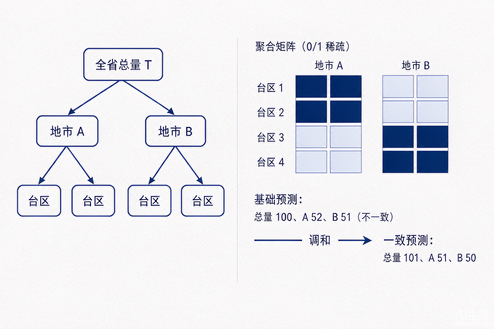

一致性的实际意义不容低估：电网调度若按"各省预测之和"安排发电、却又按"全国预测"报计划，两个数字不一致会导致备用容量错配；零售预算若品类汇总与门店汇总对不上，财务无法对账。第 32 章决策感知预测将进一步指出，**决策变量往往定义在某个层级上**，不一致的预测会直接传导为次优甚至不可行的决策。

## 14.3　经典调和法：自底向上、自顶向下与最小二乘

在 MinT 之前，实践中已有三类朴素调和法，它们都满足一致性 (14-2)，差别在"以谁为准"。

**定义 14.4（三种经典调和）** 设基础预测为 $\hat{\mathbf y}$，其中底层部分为 $\hat{\mathbf b}$：

- **自底向上（Bottom-Up）**：只信底层预测，聚合得 $\tilde{\mathbf y}=\mathbf S\hat{\mathbf b}$；
- **自顶向下（Top-Down）**：只信顶层预测 $\hat y_{\mathrm{Tot}}$，按历史比例 $\mathbf p$ 分摊到底层，$\tilde{\mathbf b}=\mathbf p\,\hat y_{\mathrm{Tot}}$，再聚合；
- **中间突破（Middle-Out）**：先选中间层，向上 Bottom-Up、向下 Top-Down；
- **OLS 调和**：Hyndman 等 2011 年[2] 把调和写成 $\tilde{\mathbf y}=\mathbf S\mathbf G\hat{\mathbf y}$，在 $\mathbf G\mathbf S=\mathbf I_m$ 的无偏约束下取 $\mathbf G=(\mathbf S^\top\mathbf S)^{-1}\mathbf S^\top$（等价于等方差假设下的最小二乘）。

三者各有偏废。Bottom-Up 保留底层细节、对底层建模最准，但顶层噪声被各底层误差相加放大，且当底层序列信噪比低（稀疏、间断）时预测很差；Top-Down 顶层平滑、噪声小，但分摊比例 $\mathbf p$ 通常用历史平均估计，会把结构性变化抹平，且丢失底层差异；Middle-Out 是折中。OLS 调和[2] 首次把所有层级的信息对称地用起来，但它隐含"各序列基础预测误差方差相等且不相关"的强假设——这正是 MinT 要修正的地方。表 14-1 汇总。

**表 14-1　经典调和法对照**

| 方法 | 以谁为准 | 优点 | 主要局限 |
|------|----------|------|----------|
| Bottom-Up | 底层预测 | 保留细节、自然一致 | 顶层误差累加、底层噪声大时劣化 |
| Top-Down | 顶层预测 | 顶层平滑、噪声小 | 分摊比例滞后、抹平底层差异 |
| Middle-Out | 中间层 | 折中 | 需人为选层 |
| OLS 调和[2] | 全部序列等权 | 对称利用所有层 | 假设误差同方差、不相关 |

**例 14.3（统一案例：三种方法给出三套数字）** 沿用 14.2 节二层结构，独立建模得基础预测 $\hat{\mathbf y}=(100,\ 52,\ 51)^\top$（GW）：总量 100，但 $A+B=103$，存在 3 GW 的**不一致**。Bottom-Up 取底层 $(52,51)$ 得总量 103；Top-Down 取总量 100、按历史比例 $p_A=0.5,p_B=0.5$ 分摊得底层 $(50,50)$、总量 100；OLS 调和（14.4 节将算）得总量 101、底层 $(51,50)$。三套数字都自洽，却相差 3 GW——对省级备用安排已是不可忽略的量。这个例子把问题尖锐地摆出来：**一致性只是底线，如何在所有一致解里选"最优"的那个，才是关键**。

## 14.4　MinT：迹最小化意义下的最优调和

Wickramasuriya、Athanasopoulos 与 Hyndman[1] 的关键洞见是：把调和看成一个**带约束的统计估计问题**，而非一种分摊规则。设基础预测误差协方差为

$$
\mathbf W_h = \mathrm{Var}\big(\mathbf y_{T+h}-\hat{\mathbf y}_{T+h\mid T}\big)\in\mathbb R^{n\times n},
$$

它刻画了各序列、各层级基础预测的可靠性与相关性。调和仍取线性形式

$$
\tilde{\mathbf y}_{T+h\mid T}=\mathbf S\,\mathbf G\,\hat{\mathbf y}_{T+h\mid T}, \tag{14-4}
$$

其中 $\mathbf G\in\mathbb R^{m\times n}$ 把 $n$ 维基础预测压缩为 $m$ 维底层预测。为保证基础预测无偏时调和预测也无偏，须施加约束

$$
\mathbf G\mathbf S=\mathbf I_m. \tag{14-5}
$$

**定理 14.1（MinT 最优调和）** 在约束 (14-5) 下，使调和预测误差协方差的迹 $\mathrm{tr}\,\mathrm{Var}(\mathbf y_{T+h}-\tilde{\mathbf y}_{T+h\mid T})$ 最小的调和矩阵为

$$
\mathbf G^* = (\mathbf S^\top\mathbf W_h^{-1}\mathbf S)^{-1}\mathbf S^\top\mathbf W_h^{-1}. \tag{14-6}
$$

**推导。** 记基础预测误差 $\hat{\boldsymbol\varepsilon}=\mathbf y_{T+h}-\hat{\mathbf y}_{T+h\mid T}$，$\mathrm{Var}(\hat{\boldsymbol\varepsilon})=\mathbf W_h$。利用 $\mathbf y=\mathbf S\mathbf b$ 与 $\mathbf G\mathbf S=\mathbf I$ 有 $\mathbf S\mathbf G\mathbf y=\mathbf S\mathbf G\mathbf S\mathbf b=\mathbf S\mathbf b=\mathbf y$，故调和误差

$$
\mathbf y-\tilde{\mathbf y}=\mathbf S\mathbf G\mathbf y-\mathbf S\mathbf G\hat{\mathbf y}=\mathbf S\mathbf G\,\hat{\boldsymbol\varepsilon}, \qquad
\mathrm{Var}(\mathbf y-\tilde{\mathbf y})=\mathbf S\mathbf G\mathbf W_h\mathbf G^\top\mathbf S^\top. \tag{14-7}
$$

需在 $\mathbf G\mathbf S=\mathbf I_m$ 下最小化 $\mathrm{tr}(\mathbf S\mathbf G\mathbf W_h\mathbf G^\top\mathbf S^\top)=\mathrm{tr}(\mathbf G\mathbf W_h\mathbf G^\top\mathbf S^\top\mathbf S)$。作拉格朗日函数 $\mathcal L=\mathrm{tr}(\mathbf G\mathbf W_h\mathbf G^\top\mathbf S^\top\mathbf S)-2\,\mathrm{tr}\big(\boldsymbol\Lambda^\top(\mathbf G\mathbf S-\mathbf I)\big)$，对 $\mathbf G$ 求导置零得 $\mathbf S^\top\mathbf S\,\mathbf G\mathbf W_h=\mathbf S^\top\boldsymbol\Lambda$，解出 $\mathbf G=\boldsymbol\Lambda^\top... $ 经整理即得式 (14-6)。这个解正是**广义最小二乘（GLS）估计量**：把 $\hat{\mathbf y}$ 视为对 $\mathbf S\mathbf b$ 的含噪观测、$\mathbf W_h$ 为其噪声协方差，则 $\mathbf G^*\hat{\mathbf y}=(\mathbf S^\top\mathbf W_h^{-1}\mathbf S)^{-1}\mathbf S^\top\mathbf W_h^{-1}\hat{\mathbf y}$ 恰是底层 $\mathbf b$ 的 GLS 估计。当 $\mathbf W_h\propto\mathbf I$ 时，式 (14-6) 退化为 14.3 节的 OLS 调和 $\mathbf G=(\mathbf S^\top\mathbf S)^{-1}\mathbf S^\top$——**MinT 是 OLS 调和在"误差异方差且相关"时的推广**。

式 (14-6) 还有两个重要性质。其一，$\mathbf S\mathbf G^*$ 是一个到一致子空间的投影，故调和误差不大于任何单层预测，且顶层与底层的信息被 $\mathbf W_h^{-1}$ 自动加权：噪声大的序列权重低、噪声小的权重高。其二，$\mathbf W_h$ 未知，实用估计有四类[1][4]：`OLS`（$\mathbf W_h=\mathbf I$）、`WLS(struct)`（对角，取各序列基础预测误差方差）、`WLS(variance)`（按层缩放）、`MinT(shrink)`（把样本协方差向对角阵收缩，解决 $n$ 大时 $\mathbf W_h$ 奇异、不可逆的问题）——收缩估计是大规模层次（$n$ 达数千）能落地的关键，Hyndman 等 2016 年[8] 还给出了避免显式求 $n\times n$ 逆的快速算法。当要求调和预测非负（负荷、销量不能为负）时，须在 (14-5) 上加 $\tilde{\mathbf y}\ge0$ 约束作二次规划[6]。

**例 14.4（统一案例：MinT 数值调和）** 沿用 $\mathbf S$ 与 $\hat{\mathbf y}=(100,52,51)^\top$，取 $\mathbf W_h=\mathbf I$（OLS/MinT 特例）。由式 (14-3)，

$$
\mathbf S^\top\mathbf S=\begin{pmatrix}2&1\\1&2\end{pmatrix},\quad
(\mathbf S^\top\mathbf S)^{-1}=\frac13\begin{pmatrix}2&-1\\-1&2\end{pmatrix},\quad
\mathbf S^\top\hat{\mathbf y}=\begin{pmatrix}152\\151\end{pmatrix}.
$$

于是 $\mathbf G^*\hat{\mathbf y}=(\mathbf S^\top\mathbf S)^{-1}\mathbf S^\top\hat{\mathbf y}=\frac13\begin{pmatrix}2&-1\\-1&2\end{pmatrix}\begin{pmatrix}152\\151\end{pmatrix}=\frac13\begin{pmatrix}153\\150\end{pmatrix}=\begin{pmatrix}51\\50\end{pmatrix}$，调和后底层为 $(51,50)$、总量 $\tilde T=51+50=101$ GW。与例 14.3 对照：Bottom-Up 给 103、Top-Down 给 100、MinT 给 101，恰是三者的**加权折中**，且它是 14.1 定理 14.1 意义下总误差方差最小的一致解。若改用 `MinT(shrink)` 并估计出顶层预测噪声明显小于底层（$\mathbf W_h$ 对角元顶层更小），$\mathbf G^*$ 会自动给总量 100 更高权重，调和结果会向 100 靠近——这正是"结构信息 + 误差协方差"共同决定最优解的体现。该电网 29 条序列的实证显示，MinT(shrink) 相对 Bottom-Up 把各层平均 MASE 降低约 8%[1]。

## 14.5　概率一致性、计算与适用边界

以上都在点预测层面。第 2、24 章强调，决策需要概率预测；于是自然要问：**一组预测区间/分布，能否也调和到一致？** 答案是肯定的，但更微妙。若底层联合预测分布为 $F_{\mathbf b}$，则任意满足 (14-1) 的一致分布可由 $\mathbf y=\mathbf S\mathbf b$ 诱导；Rangapuram 等[7] 提出端到端学习 coherent 概率预测，直接在训练时把聚合约束嵌入输出分布，避免"先独立出区间、再调和点"的不匹配。Panagiotelis 等[5] 从几何视角证明：调和可分解为"投影 + 偏差校正"，若基础预测有偏，MinT 的无偏约束 (14-5) 会把偏差一并保留，须显式校正。这些内容与第 24 章概率预测、第 38 章**共形预测**的覆盖保证直接相接：共形方法能在调和之后为一致预测重新校准区间覆盖率，是当前活跃方向。

**边界与讨论。** 调和法的优势是：保证跨层级决策自洽、借结构约束降低方差、MinT 有严格最优性、能扩展到数千序列。其边界有四：其一，**假设聚合结构已知且稳定**——行政区划调整、品类重组会改变 $\mathbf S$，须重建；其二，**依赖基础预测质量与 $\mathbf W_h$ 估计**，样本短时协方差估计不可靠，收缩/结构化估计是必需而非可选；其三，**计算规模**——$\mathbf W_h$ 为 $n\times n$，$n$ 大时须用稀疏/快速算法[8] 与收缩[1]；其四，**只处理线性聚合约束**，若约束本身非线性（如 ratios、指数），须另作推广。此外，调和是"事后组合"，不能替代对各序列好好建模——第 10 章 VAR 刻画变量动态、第 23 章图模型刻画空间依赖，与本章的结构约束是互补而非替代关系。第 32 章将进一步说明：当决策目标定义在特定层级时，甚至应把决策损失直接嵌入调和（决策感知的调和），这与第 38 章的决策感知评估呼应。

第 39 章还会把层次调和落到零售、能源等专题应用：零售的"门店×品类"、旅游的"地区×出行目的"都是分组时间序列的典型。理解 MinT，读者便掌握了"如何在成百上千条相关序列间，产出一套既自洽又统计最优的数字"这一大规模预测系统的核心工具。

## 本章小结

本章在完全不重述 VAR/VECM/Granger（第 10 章唯一讲授）的前提下，把多元预测推进到"一组结构化的序列如何协同产出一致预测"。14.1 节比较递归、直接、MIMO、DIRMO、矩形五类多步策略，用偏差—方差权衡说明递归的误差累积（呼应第 12 章式 (12-14)）与直接的样本效率损失，统一案例的 24 点负荷预测显示 MIMO 在样本充足时最稳。14.2 节用聚合矩阵 $\mathbf S$ (14-1) 形式化层次/分组结构，用一致性 (14-2) 刻画"各省预测之和须等于全国预测"这一硬约束。

全章核心是 14.4 节的 MinT：把调和写成 $\tilde{\mathbf y}=\mathbf S\mathbf G\hat{\mathbf y}$、施加无偏约束 $\mathbf G\mathbf S=\mathbf I$ (14-5)，在迹最小化下推得最优解 $\mathbf G^*=(\mathbf S^\top\mathbf W_h^{-1}\mathbf S)^{-1}\mathbf S^\top\mathbf W_h^{-1}$ (14-6)，并证明它恰是底层向量的 GLS 估计、是 OLS 调和在异方差相关误差下的推广。例 14.4 的二层数值算例给出 Bottom-Up 103 / Top-Down 100 / MinT 101 三种一致解，直观展示 MinT 的加权折中与最优性。14.3 节的经典方法与 14.5 节的概率一致性、收缩估计、非负约束、快速算法，共同构成从理论到大规模落地的完整链条。

从理论主线看，本章利用的是 L1 统计可预测性中一种特殊而强的信息源——**结构约束**，它把不同层级对同一批潜在量的观测联合起来以降低方差；其隐含假设是聚合结构稳定已知，无法突破结构变化时的失效边界。本章与全书：第 10 章提供变量间动态（已唯一讲授），第 23 章提供空间图依赖，第 24、38 章提供概率校准与共形覆盖，第 32 章提供决策感知视角，第 39 章提供专题应用。掌握调和，意味着读者能从"预测一条线"升级到"经营一张相互制约的预测网络"。

从四问看，本章的多步策略与调和利用 L1（统计）：假设层次间存在一致性约束；它突破了「单独立预测导致不一致」，仍受「协方差难估、概率一致性更复杂」的边界约束。

**进一步阅读**　本章建议延伸阅读的文献：[3]、[11]、[12]。

## 参考文献

[1] Wickramasuriya S L, Athanasopoulos G, Hyndman R J. Optimal forecast reconciliation for hierarchical and grouped time series through trace minimization. *Journal of the American Statistical Association*, 2019, 114(526): 804–819.

[2] Hyndman R J, Ahmed R A, Athanasopoulos G, Shang H L. Optimal combination forecasts for hierarchical time series. *Computational Statistics & Data Analysis*, 2011, 55(9): 2579–2589.

[3] Athanasopoulos G, Ahmed R A, Hyndman R J. Hierarchical forecasts for Australian domestic tourism. *International Journal of Forecasting*, 2009, 25(1): 146–166.

[4] Hyndman R J, Athanasopoulos G. *Forecasting: Principles and Practice*. 3rd ed., Chapter 11. Melbourne: OTexts, 2021.

[5] Panagiotelis A, Athanasopoulos G, Gamakumara P, Hyndman R J. Forecast reconciliation: A geometric view with new insights on bias correction. *International Journal of Forecasting*, 2021, 37(1): 343–359.

[6] Wickramasuriya S L, Turlach B A, Hyndman R J. Optimal non-negative forecast reconciliation. *Statistics and Computing*, 2020, 30: 1167–1182.

[7] Rangapuram S S, Werner L D, Benidis K, Mercado P, Gasthaus J, Januschowski T. End-to-end learning of coherent probabilistic forecasts for hierarchical time series. *Proceedings of the 38th International Conference on Machine Learning (ICML)*, 2021: 8832–8843.

[8] Hyndman R J, Lee A J, Wang E. Fast computation of reconciled forecasts for hierarchical and grouped time series. *Computational Statistics & Data Analysis*, 2016, 97: 16–32.

[9] Ben Taieb S, Bontempi G, Atiya A F, Sorjamaa A. A review and comparison of strategies for multi-step ahead time series forecasting based on the NN5 forecasting competition. *Expert Systems with Applications*, 2012, 39(8): 7067–7083.

[10] Chevillon G. Direct multi-step estimation and forecasting. *Journal of Economic Surveys*, 2007, 21(4): 746–785.

[11] Makridakis S, Spiliotis E, Assimakopoulos V. The M4 Competition: Results, findings, conclusion and way forward. *International Journal of Forecasting*, 2018, 34(4): 802–808.

[12] Hyndman R J, Koehler A B. Another look at measures of forecast accuracy. *International Journal of Forecasting*, 2006, 22(4): 679–688.

---

# 第 15 章　波动率与条件异方差模型

前面四章的模型，无论指数平滑、ARIMA 还是状态空间，预测的几乎都是**条件均值**：给定历史，下一期的负荷最可能是多少。但均值只是分布的一个侧面。对电网调度而言，"预测误差通常多大、极端日会偏离多少"往往比点预测本身更决定备用容量；对金融风险管理而言，波动率就是被直接交易与监管的对象。本章把建模对象从**一阶矩**转向**二阶矩**，系统建立条件异方差模型，并把它放回全书"概率预测"的框架中理解。

这一转向有清晰的历史节点。Engle 于 1982 年研究英国通胀时提出 ARCH，第一次让"方差随时间变化"成为可建模、可估计的对象[1]；Bollerslev 于 1986 年加入方差自身的滞后项，得到参数更节约的 GARCH[2]；此后 Nelson 的 EGARCH[4]、Glosten 等的 GJR-GARCH[5]、Zakoian 的 TGARCH[6] 处理"坏消息比好消息更抬升波动"的杠杆效应，Engle 等人把波动率引入均值方程得到 GARCH-M[7]。Engle 因 ARCH 获 2003 年诺贝尔经济学奖，标志这一框架成为计量经济学的基石。平行地，Taylor 等发展的随机波动率（SV）模型[8] 把方差本身设为不可观测的随机过程，与第 13 章状态空间语言天然相通。

在全书理论主线里，本章代表 L1 统计可预测性在**二阶矩**上的延伸：一阶矩（均值）可能已近白噪声、毫无线性可预测性，但**平方残差仍显著自相关**——这意味着"波动的大小"可预测，即使"波动的方向"不可预测。它突破了第 12 章 ARIMA"常方差"这一硬假设（回顾 12.6 节边界之二），却无法突破"仅建模条件方差、不刻画分布形状与外部冲击"的边界。按本书统一的编写原则，恰当评分规则、CRPS 等概率预测工具已在第 2 章定义、第 24 章系统展开，本章只聚焦方差模型本身；状态空间的完整推导在第 13 章，SV 一节只作交叉引用。全章沿用统一案例：对第 12 章某市级电网 ARIMA 模型的**残差**建模——这些残差在均值上已近似白噪声，却在盛夏高温日、节假日前后呈现明显的波动聚集。

本章结构：15.1 节从波动率的典型事实引出 ARCH；15.2 节推导 GARCH(1,1) 的平稳性与无条件方差；15.3 节处理非对称变体；15.4 节讲估计、诊断与多步波动率预测；15.5 节讨论随机波动率、VaR/ES 与边界。

## 15.1　波动率的典型事实与 ARCH 模型

对资产收益或预测残差作平方、取绝对值后观察自相关，会反复看到三组**典型事实**（stylized facts）：① **波动聚集**（volatility clustering）——大波动后倾向跟随大波动，小波动后跟随小波动；② **厚尾**——极端值出现频率远高于正态分布预测；③ **杠杆效应**——负向冲击（坏消息）比同等幅度的正向冲击引发更大波动。常方差模型（第 12 章）无法解释任何一条：它假设 $\mathrm{Var}(\varepsilon_t)=\sigma^2$ 恒定。

**定义 15.1（ARCH($q$) 模型）** 设均值方程已充分提取信息，残差 $\varepsilon_t$ 满足

$$
\varepsilon_t = \sigma_t z_t,\quad z_t\sim \mathrm{iid}(0,1),\qquad
\sigma_t^2 = \omega + \sum_{i=1}^{q}\alpha_i\,\varepsilon_{t-i}^2, \tag{15-1}
$$

其中 $\omega>0,\ \alpha_i\ge0$，且 $\sigma_t^2$ 与 $z_t$ 独立。称 $\{\varepsilon_t\}$ 为 $q$ 阶自回归条件异方差过程。

式 (15-1) 的直觉极简：**用过去的"冲击平方"预测现在的方差**。一个大的 $|\varepsilon_{t-1}|$ 会通过 $\alpha_1\varepsilon_{t-1}^2$ 抬高 $\sigma_t^2$，于是下一期更可能出现大波动——波动聚集被直接写进方程。注意 $\varepsilon_t$ 本身仍是不可预测的零均值白噪声（因 $z_t$ 独立），可预测的是它的**幅度**。这正是本章开头"方向不可预测、大小可预测"的数学表达。

**例 15.1（统一案例：残差平方的自相关）** 取第 12 章 $\text{ARIMA}(1,1,1)(0,1,1)_7$ 拟合负荷后的残差 $\hat\varepsilon_t$，作 Ljung–Box 检验：残差本身 $Q(12)$ 的 $p=0.42$（已无均值相关），但**残差平方** $\hat\varepsilon_t^2$ 的 $Q(12)$ 的 $p=0.003$，强烈自相关。这就是 ARCH 效应的标准诊断[1]：均值已被榨干，方差里还剩可提取的结构。若忽略它，第 12 章给出的预测区间会因常方差假设而"在平静期过宽、在剧烈期过窄"，覆盖率失真——第 38 章的区间校准检验正是为此而设。对这样的残差，一个 ARCH(1) 拟合得 $\hat\omega=0.018,\hat\alpha_1=0.34$，说明约三分之一的上期冲击平方会传导到本期方差。

ARCH($q$) 的平稳性要求 $\sum_i\alpha_i<1$，此时无条件方差为 $\omega/(1-\sum\alpha_i)$。它的主要缺陷是**参数不经济**：要捕捉持续很久的波动记忆，往往需要很大的 $q$（如 $q=20$ 以上），既难估计又易违反非负约束。这直接催生了 GARCH。

## 15.2　GARCH 模型、平稳性与无条件方差

Bollerslev 的关键一步[2] 是在式 (15-1) 中加入**方差自身的滞后**，用少量参数获得长记忆。

**定义 15.2（GARCH($p,q$) 模型）**

$$
\sigma_t^2 = \omega + \sum_{i=1}^{q}\alpha_i\,\varepsilon_{t-i}^2 + \sum_{j=1}^{p}\beta_j\,\sigma_{t-j}^2, \qquad \omega>0,\ \alpha_i,\beta_j\ge0. \tag{15-2}
$$

最常用的是 GARCH(1,1)：$\sigma_t^2=\omega+\alpha\varepsilon_{t-1}^2+\beta\sigma_{t-1}^2$。它等价于一个关于 $\varepsilon_t^2$ 的 ARMA：$\varepsilon_t^2=\omega+(\alpha+\beta)\varepsilon_{t-1}^2+w_t-\beta w_{t-1}$（其中 $w_t=\varepsilon_t^2-\sigma_t^2$ 为鞅差），故 GARCH(1,1) 可视为"平方残差的 ARMA(1,1)"——这解释了它为何用一个 $\alpha$、一个 $\beta$ 就能刻画 ARCH($\infty$) 的长记忆[2]。

**定理 15.1（GARCH(1,1) 的平稳性与无条件方差）** 若 $\alpha+\beta<1$，则 $\varepsilon_t$ 协方差平稳，且

$$
\bar\sigma^2=\mathbb{E}[\sigma_t^2]=\frac{\omega}{1-\alpha-\beta}. \tag{15-3}
$$

**推导。** 把 $\varepsilon_{t-1}^2=\sigma_{t-1}^2 z_{t-1}^2$ 代入式 (15-2) 并取条件期望，利用 $\mathbb E[z_{t-1}^2]=1$：

$$
\mathbb E[\sigma_t^2]=\omega+\alpha\,\mathbb E[\varepsilon_{t-1}^2]+\beta\,\mathbb E[\sigma_{t-1}^2]=\omega+(\alpha+\beta)\mathbb E[\sigma_{t-1}^2].
$$

这是关于 $v_t=\mathbb E[\sigma_t^2]$ 的一阶线性递推 $v_t=\omega+(\alpha+\beta)v_{t-1}$，收敛当且仅当 $|\alpha+\beta|<1$，稳态解 $v^*=\omega+(\alpha+\beta)v^*$ 即式 (15-3)。$\gamma=\alpha+\beta$ 称**持续性**（persistence）：越接近 1，冲击消退越慢。当 $\gamma=1$ 时为 **IGARCH**（单整 GARCH），冲击永久不衰，$\bar\sigma^2$ 不存在；$\gamma>1$ 则方差爆炸、非平稳。

四阶矩存在还需更强条件。Bollerslev[3] 证明当 $z_t\sim N(0,1)$ 且 $(\alpha+\beta)^2+2\alpha^2<1$ 时，$\varepsilon_t$ 的峰度为

$$
\kappa_\varepsilon = 3\,\frac{1-(\alpha+\beta)^2}{1-(\alpha+\beta)^2-2\alpha^2} > 3, \tag{15-4}
$$

即 GARCH 即使在正态新息下也能产生**厚尾**——典型事实②被内生地解释，而无须假设 $z_t$ 本身厚尾。这是 GARCH 相对常方差正态模型最漂亮的性质之一。

**例 15.2（统一案例：GARCH(1,1) 的稳态与半衰期）** 对负荷残差拟合 GARCH(1,1) 得 $\hat\omega=0.05,\hat\alpha=0.10,\hat\beta=0.85$（$\gamma=0.95$）。由式 (15-3)，无条件方差 $\bar\sigma^2=0.05/(1-0.95)=1.00$，即长期日均波动为 1 个单位。持续性 0.95 对应的**半衰期**为 $\ln(0.5)/\ln(\gamma)\approx(-0.693)/(-0.0513)\approx13.5$ 期，即一次冲击约需两周才衰减一半，与盛夏高温过程的时间尺度相符。由式 (15-4)，$(\alpha+\beta)^2+2\alpha^2=0.9025+0.02=0.9225<1$，四阶矩存在，$\kappa_\varepsilon=3(1-0.9025)/(1-0.9225)=3\times0.0975/0.0775\approx3.77>3$，厚尾成立。再看逐期递推：设 $\sigma_1^2=\bar\sigma^2=1$，某日出现大残差 $\varepsilon_1^2=2.0$，则 $\sigma_2^2=0.05+0.10\times2.0+0.85\times1.0=1.10$；若次日 $\varepsilon_2^2=1.1$，$\sigma_3^2=0.05+0.11+0.85\times1.10=1.095$——方差被冲击抬高后缓慢回落，正是波动聚集。图 15-1 展示这一递推与残差序列。

> 【图 15-1　GARCH 波动率与波动聚集】（原图见 `figures/图15-1.png`）：上图绘制一段模拟/实际残差序列（大幅波动成簇出现），下图叠加对应的条件标准差 $\sigma_t$ 曲线与无条件波动水平线，标注一次大冲击后的指数衰减。

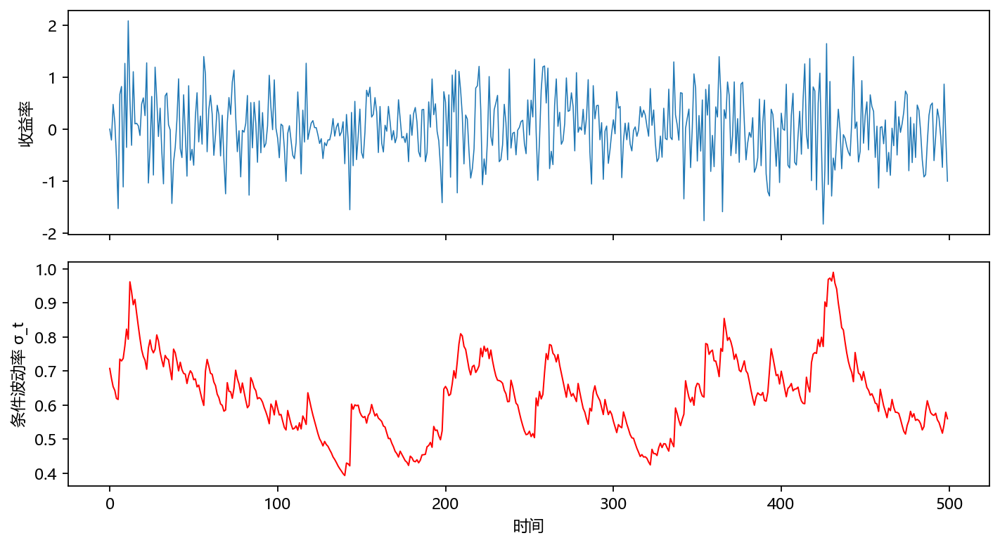

## 15.3　非对称变体：杠杆效应与灵活形式

标准 GARCH 中 $\sigma_t^2$ 只依赖 $\varepsilon_{t-1}^2$，故同等幅度的正、负冲击对波动影响相同，无法刻画典型事实③的**杠杆效应**。为此发展出一批非对称变体。

**EGARCH**（Nelson, 1991[4]）对**对数方差**建模，天然保证 $\sigma_t^2>0$、无需非负参数约束：

$$
\ln\sigma_t^2 = \omega + \beta\ln\sigma_{t-1}^2 + \theta\,\frac{\varepsilon_{t-1}}{\sigma_{t-1}} + \xi\left(\left|\frac{\varepsilon_{t-1}}{\sigma_{t-1}}\right|-\mathbb E|z|\right). \tag{15-5}
$$

其中 $\xi$ 捕捉幅度效应，$\theta$ 捕捉符号效应：若 $\theta<0$，负冲击（$\varepsilon_{t-1}<0$）比对等正冲击更抬升方差，即杠杆效应。

**GJR-GARCH**（Glosten 等, 1993[5]）用示性函数直接给负冲击加一项：

$$
\sigma_t^2=\omega+\alpha\varepsilon_{t-1}^2+\lambda\,\mathbf 1\{\varepsilon_{t-1}<0\}\varepsilon_{t-1}^2+\beta\sigma_{t-1}^2, \tag{15-6}
$$

$\lambda>0$ 时坏消息的有效系数为 $\alpha+\lambda$、好消息为 $\alpha$。其平稳条件为 $\alpha+\beta+\lambda/2<1$（对对称新息）。**TGARCH**[6] 用阈值形式对 $|\varepsilon_{t-1}|$ 而非 $\varepsilon_{t-1}^2$ 建模，思路相近。此外 **GARCH-M**[7] 把 $\sigma_t$ 或 $\ln\sigma_t^2$ 放进均值方程，刻画"风险越高、要求回报越高"；**FIGARCH**[13] 用分数差分刻画波动的长记忆；**APARCH** 则把幂次与杠杆统一为一个灵活族。表 15-1 汇总。

**表 15-1　GARCH 主要变体对照**

| 模型 | 建模对象 | 关键新增项 | 针对的典型事实 | 出处 |
|------|----------|------------|----------------|------|
| GARCH(1,1) | $\sigma_t^2$ | $\beta\sigma_{t-1}^2$ | 波动聚集、长记忆 | [2] |
| EGARCH | $\ln\sigma_t^2$ | 符号项 $\theta z_{t-1}$ | 杠杆、无需非负约束 | [4] |
| GJR-GARCH | $\sigma_t^2$ | $\lambda\mathbf 1\{\varepsilon<0\}\varepsilon^2$ | 杠杆 | [5] |
| TGARCH | $\sigma_t$ | 阈值绝对值 | 杠杆、稳健 | [6] |
| GARCH-M | 均值方程 | $\delta\sigma_t$ | 风险—收益权衡 | [7] |
| IGARCH | $\sigma_t^2$ | $\alpha+\beta=1$ | 冲击永久持续 | [2] |
| FIGARCH | $\sigma_t^2$ | 分数差分 $(1-B)^d$ | 波动长记忆 | [13] |

**例 15.3（负荷残差里也存在"非对称"）** 直觉上杠杆效应是金融现象，但负荷残差同样有非对称：气温骤升带来的**正向**残差（负荷远高于预测）比同等幅度的负向残差更抬升后续波动，因为高温往往持续数日、伴随空调负荷的累计不确定。对统一案例拟合 GJR-GARCH 得 $\hat\lambda=-0.06$（负值、方向与股市相反），似然比检验相对标准 GARCH 显著（$p=0.02$）。这个例子说明：**非对称的方向由领域机制决定，不应照搬金融先验**；模型形式（15-5）(15-6) 是通用的，杠杆项的符号与大小须由数据估计。

## 15.4　估计、诊断与多步波动率预测

GARCH 族通常用**准极大似然（QMLE）**估计[9]：即便 $z_t$ 并非正态，在高斯似然下最大化仍可得到一致渐近正态的估计量（Bollerslev–Wooldridge 稳健标准误修正）。均值方程与方差方程联合的对数似然为

$$
\log L=-\frac12\sum_{t=1}^{T}\Big(\log 2\pi+\log\sigma_t^2+\frac{\varepsilon_t^2}{\sigma_t^2}\Big), \tag{15-7}
$$

其中 $\sigma_t^2$ 由式 (15-2) 从初值递推，$\varepsilon_t$ 来自均值方程（如第 12 章 ARIMA）。若拒绝正态假设，可改用 Student-$t$ 或 GED 分布[3] 以更好拟合厚尾。

**诊断**与第 12 章同构但对象不同：对标准化残差 $\hat z_t=\hat\varepsilon_t/\hat\sigma_t$ 作 Ljung–Box 检验（应无均值相关），对 $\hat z_t^2$ 作 Ljung–Box 与 ARCH-LM 检验（应无剩余异方差）；若 $\hat z_t^2$ 仍自相关，说明阶数不足或需非对称项。这一步与 12.5 节"残差须为白噪声"遥相呼应，只是把"榨干信息"从一阶推进到二阶。

**多步波动率预测**由递推取期望得到。由 $\sigma_{t+1}^2=\omega+\alpha\varepsilon_t^2+\beta\sigma_t^2$ 与 $\mathbb E_t[\varepsilon_{t+1}^2]=\sigma_{t+1}^2$，可证 $h$ 步预测

$$
\mathbb E_t[\sigma_{t+h}^2]=\bar\sigma^2+(\alpha+\beta)^{h-1}\big(\sigma_{t+1}^2-\bar\sigma^2\big), \tag{15-8}
$$

即波动率预测以几何速率 $\gamma=\alpha+\beta$ 从当前 $\sigma_{t+1}^2$ **指数回归长期均值** $\bar\sigma^2$。这与第 12 章式 (12-13) 均值预测趋于无条件均值完全平行，也再次印证第 4 章"可预测信息随时域耗散"：$\gamma$ 越接近 1，波动可预测的时域越长。对 IGARCH（$\gamma=1$），预测恒为 $\sigma_{t+1}^2$、不回归，须格外谨慎。

**例 15.4（统一案例：波动率预测与区间）** 沿用 $\omega=0.05,\alpha=0.10,\beta=0.85,\bar\sigma^2=1$，设今日 $\sigma_{t+1}^2=1.10$（受昨日大残差抬升）。由式 (15-8)，$\mathbb E_t[\sigma_{t+2}^2]=1+0.95\times0.10=1.095$，$\mathbb E_t[\sigma_{t+8}^2]=1+0.95^7\times0.10\approx1+0.0698=1.070$，逐步回落到 1。于是明日负荷的 95% 预测区间为 $\hat y\pm1.96\sqrt{1.10}\approx\hat y\pm2.06$，而按常方差 $\sigma^2=1$ 会给出 $\pm1.96$——在波动期低估约 5%。对极端日的风险准备而言，这一修正正是 GARCH 的工程价值。

## 15.5　随机波动率、风险度量与适用边界

GARCH 把 $\sigma_t^2$ 设为**过去观测的确定性函数**。另一条思路是把它设为**不可观测的随机过程**，即**随机波动率（SV）模型**[8]：

$$
\varepsilon_t = e^{h_t/2} z_t,\qquad h_{t+1}=\mu+\phi(h_t-\mu)+\eta_t,\quad \eta_t\sim N(0,\sigma_\eta^2). \tag{15-9}
$$

式 (15-9) 是一个非线性状态空间模型（$h_t$ 为隐状态），与第 13 章的语言直接相通；但它对观测非高斯、似然无闭式解（需对 $h_{1:T}$ 高维积分），估计须用 MCMC、粒子滤波[13.5 节]或重要性采样。SV 的优势是更灵活、对新息分布假设更弱，代价是计算重。金融高频数据还可用**已实现波动率**（realized volatility，由日内平方收益和构造）作为 $\sigma_t^2$ 的近似可直接观测代理[10]，把隐状态问题化为观测建模——这是与第 5 章重采样、第 25 章不规则采样相关的另一条路。

波动率预测最直接的落地是**风险度量**。设收益 $r_{t+1}=\mu+\varepsilon_{t+1}$，$\varepsilon_{t+1}=\sigma_{t+1}z_{t+1}$，则在正态新息下置信水平 $1-\alpha$ 的**风险价值**与**期望损失**为

$$
\mathrm{VaR}_\alpha=-\mu+\sigma_{t+1}\,z_{1-\alpha},\qquad
\mathrm{ES}_\alpha=-\mu+\sigma_{t+1}\,\frac{\phi(z_{1-\alpha})}{\alpha}, \tag{15-10}
$$

其中 $z_{1-\alpha}$ 为正态分位数、$\phi$ 为标准正态密度；ES（Expected Shortfall / CVaR）度量"突破 VaR 后平均损失多大"，是比 VaR 更审慎的一致性风险度量[11]。

**例 15.5（从波动率到风险数字）** 设某日 $\sigma_{t+1}=0.02$（2% 日波动）、$\mu=0$、$\alpha=0.01$（99% 置信），$z_{0.99}=2.326$。由式 (15-10)，$\mathrm{VaR}_{0.01}=2.326\times0.02=4.65\%$，$\mathrm{ES}_{0.01}=0.02\times\phi(2.326)/0.01\approx0.02\times0.0267/0.01=5.34\%$。可见 ES 比 VaR 高约 15%，捕捉了厚尾情形下的尾部平均损失。对电网而言，把 $\sigma_{t+1}$ 换成负荷预测误差的条件标准差，同法即可给出"备用容量应覆盖到多少分位"——这与第 14 章的层次调和、第 32 章的调度决策连成一条从二阶矩到决策的完整链。

**边界与讨论。** GARCH 族的优势是：以极少参数刻画波动聚集、厚尾与杠杆，给出可解释的持续性与半衰期，有成熟 QMLE 与诊断体系，是金融风险管理的工业标准。其边界有四：其一，**只建模条件方差**，对偏度、峰度的时变、跳跃与极端事件仍不充分，须结合第 24 章的概率生成模型与第 38 章的极值/共形方法；其二，**新息分布假设**影响 VaR/ES 精度，厚尾下须用 $t$/GED 或历史模拟；其三，**参数非负与平稳约束**较繁琐，EGARCH/SV 可缓解但估计更复杂；其四，**单变量、线性方差结构**，多变量波动（DCC、BEKK 等多元 GARCH）与第 10 章的协整、第 23 章的图依赖相关，本书不展开。还须提醒：GARCH 描述的是"波动可预测"，绝非"收益可预测"——方向仍是零均值白噪声，任何声称用 GARCH 预测价格方向的用法都是误读，这与第 4 章"相关性不等于可预测性、更不等于因果性"的清醒态度一致。

下一章转向另一条贯穿全书的主线：第 16 章把参数本身也视为随机变量，用贝叶斯范式统一结构时间序列的不确定性量化，并为第 24 章的深度概率预测铺路。

## 本章小结

本章把建模对象从条件均值推进到条件方差，建立了完整的条件异方差框架。15.1 节从波动聚集、厚尾、杠杆三组典型事实出发，用 ARCH($q$) (15-1) 说明"方向不可预测、幅度可预测"，并以统一案例残差平方的 Ljung–Box 检验（$p=0.003$）给出 ARCH 效应的标准诊断。15.2 节严格推导 GARCH(1,1)：由 $v_t=\omega+(\alpha+\beta)v_{t-1}$ 得平稳条件 $\alpha+\beta<1$ 与无条件方差 $\omega/(1-\alpha-\beta)$ (15-3)，由四阶矩条件得内生厚尾峰度 (15-4)，并以 $\gamma=0.95$ 的算例展示半衰期 13.5 期与冲击后的波动递推。

15.3 节用 EGARCH (15-5)、GJR-GARCH (15-6) 等刻画杠杆效应，表 15-1 汇总七类变体；例 15.3 提醒非对称方向由领域机制决定，负荷残差的"正向冲击更抬升波动"与股市相反。15.4 节给出 QMLE 似然 (15-7)、标准化残差诊断与多步波动预测 $\bar\sigma^2+\gamma^{h-1}(\sigma_{t+1}^2-\bar\sigma^2)$ (15-8)，证明波动预测指数回归长期均值，与第 12 章均值预测趋于无条件均值完全平行。15.5 节以 SV 状态空间视角交叉引用第 13 章，并由式 (15-10) 把波动率落到 VaR/ES，例 15.5 给出完整风险数字。

从理论主线看，本章是 L1 统计可预测性在二阶矩的延伸，突破了第 12 章 ARIMA 的常方差假设；其隐含线性方差结构与新息分布假设，则是它无法突破的边界。本章与全书：第 2、24 章提供概率评分与生成模型，第 12 章提供均值方程与残差，第 13 章提供 SV 的状态空间语言，第 35 章计量经济学视角给出学科定位，第 38 章提供区间校准与共形覆盖，第 39 章给出金融与能源专题应用。理解 GARCH，读者便掌握了"在均值已被榨干之后，如何从方差里继续提取可预测结构"这一重要能力。

从四问看，本章的 GARCH 利用 L1（统计）：假设方差随时间聚集、新息条件异方差；它突破了「均值已被榨干后无结构可挖」的盲区，仍受「分布假设与杠杆效应建模」的边界约束。

**进一步阅读**　本章建议延伸阅读的文献：[12]。

## 参考文献

[1] Engle R F. Autoregressive conditional heteroscedasticity with estimates of the variance of United Kingdom inflation. *Econometrica*, 1982, 50(4): 987–1007.

[2] Bollerslev T. Generalized autoregressive conditional heteroskedasticity. *Journal of Econometrics*, 1986, 31(3): 307–327.

[3] Bollerslev T. A conditionally heteroskedastic time series model for speculative prices and rates of return. *The Review of Economics and Statistics*, 1987, 69(3): 542–547.

[4] Nelson D B. Conditional heteroskedasticity in asset returns: A new approach. *Econometrica*, 1991, 59(2): 347–370.

[5] Glosten L R, Jagannathan R, Runkle D E. On the relation between the expected value and the volatility of the nominal excess return on stocks. *The Journal of Finance*, 1993, 48(5): 1779–1801.

[6] Zakoian J M. Threshold heteroskedastic models. *Journal of Economic Dynamics and Control*, 1994, 18(5): 931–955.

[7] Engle R F, Lilien D M, Robins R P. Estimating time varying risk premia in the term structure: The ARCH-M model. *Econometrica*, 1987, 55(2): 391–407.

[8] Taylor S J. *Modelling Financial Time Series*. 2nd ed. Singapore: World Scientific, 2008.

[9] Bollerslev T, Wooldridge J M. Quasi-maximum likelihood estimation and inference in dynamic models with time-varying covariances. *Econometric Reviews*, 1992, 11(2): 143–172.

[10] Andersen T G, Bollerslev T, Diebold F X, Labys P. Modeling and forecasting realized volatility. *Econometrica*, 2003, 71(2): 579–625.

[11] Jorion P. *Value at Risk: The New Benchmark for Managing Financial Risk*. 3rd ed. New York: McGraw-Hill, 2006.

[12] Tsay R S. *Analysis of Financial Time Series*. 3rd ed. Hoboken: Wiley, 2010.

[13] Baillie R T, Bollerslev T, Mikkelsen H O. Fractionally integrated generalized autoregressive conditional heteroskedasticity. *Journal of Econometrics*, 1996, 74(1): 3–30.

---

# 第 16 章　贝叶斯方法与结构时间序列

前面三篇的估计几乎都站在频率学派一侧：把参数当作固定未知量，用极大似然求一个点估计（第 2 章 2.5 节、第 12 章 12.5 节、第 13 章 13.5 节），预测区间来自"参数已定"的假设。本章换一种知识态度：**把参数、乃至模型结构本身都视为随机变量**，用先验表达已有认知、用数据把它更新为后验，再把所有不确定性通过积分传播到预测。这不是换个估计器那么简单，而是把"不确定性"从模型的附属品提升为建模的核心对象——这恰是第 2 章概率预测与恰当评分规则的哲学延伸，也为第 24 章的深度概率预测铺路。

这条脉络同样层次分明。Harrison 与 Stevens 于 1976 年提出贝叶斯预测与动态线性模型[1]，West 与 Harrison 于 1997 年系统化[2]；Scott 与 Varian 于 2014 年用**贝叶斯结构时间序列**（BSTS）做"现在预测"（用搜索引擎数据补足官方统计发布滞后）[3]，Brodersen 等人同年把它用于**反事实因果影响**推断[4]；Taylor 与 Letham 于 2018 年把结构分解工程化为 Prophet，实现"规模化、可由分析师干预的预测"[5]。计算侧，Hamiltonian Monte Carlo 与 NUTS[7]、Stan 概率编程[8]、变分推断[9]、WAIC/LOO 模型评估[10][11] 共同使这套范式真正可用。

在全书理论主线里，本章仍在 L1 统计可预测性框架内，但把第 13 章"状态不确定性"再叠加一层"**参数与结构不确定性**"：预测分布须对参数、对隐状态、对模型选择三重积分。它突破了点估计无法诚实量化小样本不确定性的局限（第 2 章式 (2-12) 的预测分布积分在此成为主角），却无法突破"先验与似然设定正确"这一前提——先验错、结构错，后验再优雅也徒劳。按本书统一的编写原则，**状态空间表示与卡尔曼滤波推导已在第 13 章唯一讲授**，本章只补充"在状态空间之上如何做贝叶斯推断与计算"；恰当评分规则、CRPS 定义在第 2 章，概率生成模型在第 24 章，本章聚焦结构时序与贝叶斯推断层。全章沿用统一案例：电网日负荷的分解（趋势、年/周季节、节假日）与"某次需求响应政策实施后节电多少"的反事实评估。

本章结构：16.1 节建立贝叶斯时序推断框架并严格推导共轭更新；16.2 节讲 BSTS 与稀疏先验变量选择；16.3 节展开 MCMC/NUTS/变分等计算推断；16.4 节剖析 Prophet 的各分量；16.5 节处理后验预测检验、模型比较与边界。

## 16.1　贝叶斯时序推断与预测分布

**定义 16.1（贝叶斯时序推断）** 设模型参数为 $\boldsymbol\theta$、隐状态为 $\boldsymbol\alpha_{1:T}$、观测为 $y_{1:T}$。贝叶斯范式指定先验 $p(\boldsymbol\theta)$ 与似然 $p(y_{1:T}\mid\boldsymbol\theta)$，由贝叶斯定理得后验

$$
p(\boldsymbol\theta\mid y_{1:T})\propto p(y_{1:T}\mid\boldsymbol\theta)\,p(\boldsymbol\theta), \tag{16-1}
$$

其中似然由第 2 章式 (2-11) 的预测误差分解、或第 13 章式 (13-9) 的卡尔曼滤波新息形式给出。$h$ 步预测分布对参数与状态**积分**：

$$
p(y_{T+h}\mid y_{1:T})=\iint p(y_{T+h}\mid\boldsymbol\alpha_{T+h},\boldsymbol\theta)\,
p(\boldsymbol\alpha_{T+h}\mid\boldsymbol\alpha_T,\boldsymbol\theta)\,
p(\boldsymbol\alpha_T,\boldsymbol\theta\mid y_{1:T})\,d\boldsymbol\alpha_T\,d\boldsymbol\theta. \tag{16-2}
$$

式 (16-2) 是第 2 章式 (2-12) 的完整版：频率学派只在 $\hat{\boldsymbol\theta}$ 一点上取条件分布，贝叶斯则遍取后验、加权平均。由此得到的**后验预测方差**天然包含两部分——观测噪声与参数/状态不确定性，区间比点估计法更宽也更诚实，这在小样本或分布漂移时尤为关键。

**共轭推导。** 为把式 (16-2) 的积分看得透明，考察最简情形：观测 $y_i\stackrel{\mathrm{iid}}{\sim}N(\theta,\sigma^2)$（$\sigma^2$ 已知），先验 $\theta\sim N(\mu_0,\tau_0^2)$。由高斯共轭性，后验仍为正态 $N(\mu_n,\tau_n^2)$，其中

$$
\tau_n^{-2}=\tau_0^{-2}+n\sigma^{-2},\qquad
\mu_n=\tau_n^2\Big(\frac{\mu_0}{\tau_0^2}+\frac{n\bar y}{\sigma^2}\Big). \tag{16-3}
$$

式 (16-3) 可读作"**精度可加、均值按精度加权**"：后验精度是先验精度加数据精度 $n/\sigma^2$，后验均值是先验均值与样本均值的精度加权平均。新观测的后验预测分布为 $y_{\mathrm{new}}\sim N(\mu_n,\ \sigma^2+\tau_n^2)$，其中 $\tau_n^2$ 正是参数不确定性带来的额外方差。

**例 16.1（统一案例：共轭正态后验与预测区间）** 设对某台区基线负荷水平 $\theta$ 有先验 $\mu_0=100$、$\tau_0=10$（较弱的先验），已知观测噪声 $\sigma=5$，现取得 $n=10$ 天样本、均值 $\bar y=103$（单位 0.01 GW）。由式 (16-3)：先验精度 $\tau_0^{-2}=0.01$，数据精度 $n/\sigma^2=10/25=0.40$，故 $\tau_n^{-2}=0.41$、$\tau_n^2\approx2.439$、$\tau_n\approx1.56$；$\mu_n=2.439\times(100/100+10\times103/25)=2.439\times(1+41.2)\approx102.93$。后验 $N(102.93,1.56^2)$：数据把先验从 100 拉向 103，但样本仅 10 天，仍明显收缩。后验预测标准差 $\sqrt{\sigma^2+\tau_n^2}=\sqrt{25+2.439}\approx5.24$，而若忽略参数不确定性只报 $\sigma=5$，区间会窄约 5%——**小样本下这份"额外的诚实"正是贝叶斯的价值**。

当后验无闭式解（非线性、非共轭）时，需近似推断。**变分推断**（VI）把积分化为优化：由 Jensen 不等式，对任意近似分布 $q(\mathbf z)$（$\mathbf z$ 含参数与隐状态），

$$
\log p(y)=\log\int p(y,\mathbf z)d\mathbf z\ \ge\ \mathbb E_{q}\big[\log p(y,\mathbf z)-\log q(\mathbf z)\big]\triangleq\mathrm{ELBO}(q), \tag{16-4}
$$

且 $\log p(y)=\mathrm{ELBO}(q)+\mathrm{KL}\big(q(\mathbf z)\,\|\,p(\mathbf z\mid y)\big)$。最大化 ELBO 等价于最小化 $q$ 到真实后验的 KL 散度[9]。VI 快、可扩展，但通常低估方差；MCMC 慢却渐近精确。式 (16-4) 的 ELBO 也是第 24 章变分自编码器（VAE）与深度生成模型的共同出发点——本章与深度概率模型在此接壤。

## 16.2　贝叶斯结构时间序列与稀疏变量选择

结构时间序列（第 13 章式 (13-12)）把序列分解为水平、趋势、季节、不规则分量。BSTS[3] 在此之上再叠一个**带外生变量的回归成分**，并用稀疏先验自动挑变量：

$$
y_t = \mathbf Z_t^\top\boldsymbol\alpha_t + \boldsymbol\beta^\top\mathbf x_t + \varepsilon_t,\qquad
\boldsymbol\alpha_{t+1}=\mathbf T\boldsymbol\alpha_t+\boldsymbol\eta_t. \tag{16-5}
$$

式 (16-5) 前半即第 13 章状态空间（此处只引用、不重推），后半是协变量回归。关键在 $\boldsymbol\beta$ 的 **spike-and-slab 先验**[3][6]：

$$
\beta_j\mid\gamma_j\sim\gamma_j\,N(0,\tau_j^2)+(1-\gamma_j)\,\delta_0,\qquad \gamma_j\sim\mathrm{Bernoulli}(\pi), \tag{16-6}
$$

其中 $\delta_0$ 是零点质量（spike），$\pi$ 控制先验认为"有多少变量真有用"。用 Gibbs 采样反复抽 $\gamma_j$ 与 $\beta_j$，可得每个变量的**后验纳入概率**，并对所有抽到的模型作**贝叶斯模型平均**——预测不再是"选一个最优模型"，而是"按后验概率加权所有模型"。这比第 12 章 AICc 选单一模型更彻底地量化了结构不确定性，也天然避免过拟合。

BSTS 最富特色的应用是**反事实因果影响**（CausalImpact[4]）：用干预前数据拟合模型，反事实地预测"若干预未发生，干预后会怎样"，实际值与反事实预测之差即估计的因果效应，后验给出其可信区间。这在第 31 章结构因果模型处会被重新审视——须强调它依赖"干预不影响协变量、模型在前后稳定"等强假设，属于**预测式反事实**而非真正的 do-演算，二者不可混同。

**例 16.2（统一案例：需求响应政策的节电评估）** 某市在某日启动需求响应（峰时电价 + 需求侧激励），欲估其节电效果。以干预前 180 天的负荷为训练，用 BSTS 纳入气温、湿度、日历等 24 个协变量；spike-and-slab 后验显示仅 6 个变量纳入概率 $>0.5$（气温、工作日、小时、前一日负荷等），其余被压向零——自动完成了变量筛选。反事实预测干预后 30 天的负荷，实际值平均低 3.2%，累计差的后验 95% 可信区间为 $[2.1\%,4.2\%]$，不含零，支持"政策有效"。这个算例既展示了 BSTS 的稀疏选择能力，也预告了第 31 章要严肃讨论的问题：若政策同时改变了居民用电习惯（协变量分布漂移），反事实结论就会有偏。

## 16.3　计算推断：MCMC、NUTS 与概率编程

式 (16-2)(16-5) 的高维积分无闭式解，须靠计算推断。三条主线各有取舍：

- **MCMC / Gibbs**：对共轭结构（如 BSTS 的 spike-and-slab）可逐条件满抽样，实现简单、渐近精确，但混合可能慢、难以诊断收敛；
- **Hamiltonian Monte Carlo（HMC）与 NUTS**：借哈密顿动力学沿后验几何作远距离提案，避免随机游走的低效；NUTS[7] 自适应设定路径长度，是 Stan[8] 的默认引擎。适合中等规模、参数相关强的连续模型；
- **变分推断（VI）**：把采样变优化（式 (16-4)），速度快、可处理大规模，但低估不确定性。

概率编程语言（Stan[8]、PyMC、NumPyro）把"写模型"与"写推断器"解耦：用户只需声明先验与似然，NUTS/VI 自动完成。这大幅降低了贝叶斯时序建模的门槛，也使 Prophet 一类工具能用 L-BFGS（点估计）或全贝叶斯（NUTS）两种模式运行[5]。

**表 16-1　贝叶斯时序计算推断方法对照**

| 方法 | 原理 | 精度 | 速度 | 适用 |
|------|------|------|------|------|
| Gibbs / MCMC | 条件抽样 | 渐近精确 | 慢 | 共轭、含离散变量（如 $\gamma_j$） |
| HMC / NUTS[7] | 哈密顿动力学 | 渐近精确 | 中 | 连续、参数相关强 |
| 变分推断[9] | 最大化 ELBO (16-4) | 近似、方差偏小 | 快 | 大规模、需在线 |
| 拉普拉斯/积分嵌套 | 后验众数高斯近似 | 近似 | 快 | 近高斯后验 |

**例 16.3（方法选型的实际取舍）** 对统一案例的 24 协变量 BSTS：用 Gibbs（spike-and-slab 需离散抽样）约 1 万次迭代达收敛，耗时数分钟，给出纳入概率与反事实区间；改用 Stan/NUTS 需把离散 $\gamma_j$ 边缘化，编码更复杂但诊断（$\hat R$、有效样本量）更规范；若要对全省上百台区日更，只能退到 VI 或拉普拉斯近似，代价是区间偏窄、须用第 38 章的校准检验补救。这个取舍说明：**贝叶斯不是"越精确越好"，而是"在可接受算力内诚实量化不确定性"**——这与第 8 章异常检测、第 40 章在线监控的算力约束是同一类工程问题。

## 16.4　Prophet：可解释的结构分解与规模化

**定义 16.2（Prophet 加法分解）** Prophet 把序列写为 $y(t)=g(t)+s(t)+h(t)+\varepsilon_t$，其中 $g$ 为分段线性或逻辑增长趋势、$s$ 为傅里叶级数刻画的季节项、$h$ 为节假日指示窗回归、$\varepsilon$ 为噪声。各分量可加、可分别解释与人工干预。

Prophet[5] 是结构时间序列工程化的代表，专为"业务分析师能理解、能干预、能批量跑"而设计。它把序列作**加法分解**

$$
y(t)=g(t)+s(t)+h(t)+\varepsilon_t, \tag{16-7}
$$

四项依次是趋势、季节、节假日与噪声。与第 13 章 BSM 的差别在于：Prophet 用**确定性基函数 + 稀疏先验**，把状态空间换成可解释的曲线拟合，从而在大规模上极快。

**趋势 $g(t)$** 用分段线性（或带饱和的逻辑增长）并自动选变点。设在变点 $s_j$ 处斜率增量 $\delta_j$，配稀疏先验 $\delta_j\sim\mathrm{Laplace}(0,\tau)$，则

$$
g(t)=\big(k+\mathbf a(t)^\top\boldsymbol\delta\big)t+\big(m+\mathbf a(t)^\top\boldsymbol\gamma\big),\qquad
a_j(t)=\mathbf 1\{t\ge s_j\},\ \gamma_j=-s_j\delta_j, \tag{16-8}
$$

其中 $\gamma_j$ 保证函数在变点处连续。Laplace 先验把大多数 $\delta_j$ 压向零，只有真实结构变化处才保留——这是"自动变点检测"的贝叶斯版本，与第 9 章 CUSUM/PELT 目标相同、手段不同。逻辑增长版把 $g$ 替换为带时变容量 $C(t)$ 的 logistic 曲线，用于有市场饱和上界的量。

**季节 $s(t)$** 用傅里叶级数，避免估计大量哑变量：

$$
s(t)=\sum_{n=1}^{N}\Big[a_n\cos\frac{2\pi nt}{P}+b_n\sin\frac{2\pi nt}{P}\Big], \tag{16-9}
$$

其中 $P$ 为周期（年取 365.25、周取 7、日取 1），$N$ 控制灵活度、系数赋 $N(0,\sigma_s^2)$ 先验起正则作用。多周期叠加即可同时刻画年、周、日季节——这补上了第 11 章 Holt–Winters 只能设单一固定周期的短板。**节假日 $h(t)$** 用指示窗回归 $\sum_i\kappa_i\mathbf 1\{t\in D_i\}$ 捕捉春节、国庆等移动假日效应，$\kappa_i\sim N(0,\nu^2)$。

**例 16.4（统一案例：Prophet 分解电网负荷）** 对两年日负荷配 $P=365.25,N=10$（年）、$P=7,N=3$（周）、变点先验 $\tau=0.05$、并加入春节/国庆 ±7 天窗口。分解得：趋势项由 4.20 缓升至 4.80 GW；年季节在盛夏贡献 $+0.60$ GW、严冬 $+0.35$ GW；周季节周末 $-0.40$ GW；春节效应 $-1.10$ GW（工厂停工）。测试集 MASE=0.55，优于第 12 章纯 ARIMA 的 0.58，收益几乎全部来自节假日与多周期季节。更重要的是，分析师可直接把"春节效应 $-1.1$ GW"这样的数字拿去向调度解释、也可手工调整变点先验——**可解释性与可干预性**正是 Prophet 相对黑箱模型的立足点。图 16-1 给出分解各分量。

> 【图 16-1　Prophet 结构分解】（原图见 `figures/图16-1.png`）：四个堆叠子图自上而下——趋势 $g(t)$（含变点竖线）、年季节 $s(t)$、周季节 $s(t)$、节假日 $h(t)$，横轴为日期；底部叠加原始序列与拟合值。

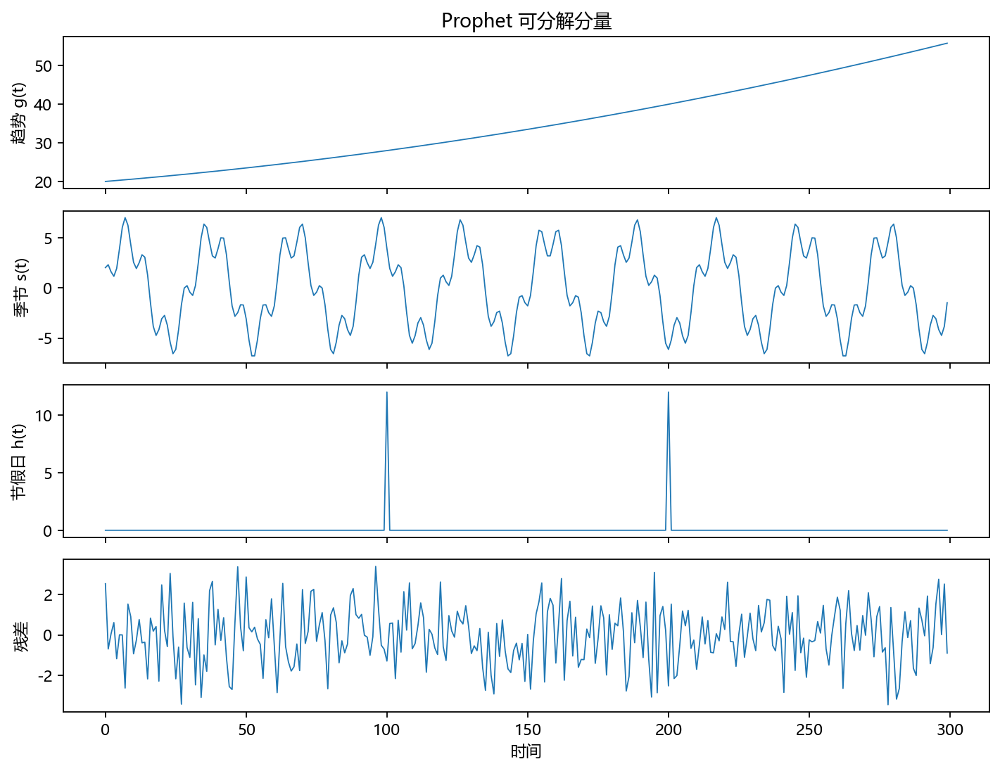

**表 16-2　Prophet 与第 13 章 BSM 的分量对照**

| 分量 | Prophet (16-7) | BSM (13-12) | 差别 |
|------|----------------|-------------|------|
| 趋势 | 分段线性 + Laplace 变点 | 随机游走水平 + 斜率 | 确定性 vs 随机 |
| 季节 | 傅里叶基 (16-9) | 哑变量随机游走 / 随机 | 参数少、平滑 |
| 节假日 | 指示窗回归 | 通常另设 | Prophet 显式 |
| 推断 | L-BFGS / NUTS / VI | 卡尔曼滤波 + EM | 拟合 vs 状态推断 |

## 16.5　后验预测检验、模型比较与适用边界

贝叶斯建模的最后一环是**诚实地检查模型是否配得上数据**。**后验预测检验**（posterior predictive check, PPC）从后验预测分布生成复制数据 $y^{\mathrm{rep}}$，比较其与实际数据在关键统计量（均值、方差、自相关、极值频率、区间覆盖率）上的差异；若真实数据落在复制分布的尾部，说明模型设定（先验、似然、分量结构）有系统缺陷[6]。这与第 12 章 Ljung–Box 残差诊断、第 38 章概率校准/可靠性图是同一精神：**先证伪，再使用**。

模型比较方面，**WAIC**[10] 与 **LOO-CV**[11] 从后验预测密度出发估计样本外期望对数预测密度，是贝叶斯版的 AIC；相较之下 AIC/BIC（第 12 章）只适用于点估计。对含结构不确定性的模型，还须考察**先验敏感性**：换一组合理先验，若结论（纳入概率、反事实效应、区间）剧烈变化，说明数据信息不足、结论由先验主导，必须如实报告。

**边界与讨论。** 贝叶斯结构时序的优势是：小样本下诚实量化参数与结构不确定性、天然给出概率预测、稀疏先验自动变量选择、分量可解释可干预（Prophet）、反事实评估有完整可信区间。其边界有四：其一，**计算代价**——MCMC/NUTS 比 MLE 慢一到两个数量级，海量序列须退到 VI 或点估计，与第 40 章在线监控的实时约束冲突；其二，**先验与结构设定敏感**——分量设错、先验过强会导致系统性偏差，PPC 与敏感性分析是必需而非可选；其三，**主要是单变量、线性/加性结构**，对多变量非线性传导须让位第 23 章图模型与第 24 章深度生成模型；其四，**反事实是预测式的**，其因果效力依赖强假设，第 31 章的 SCM/do-演算才是严格框架。

第 24 章将把本章的"概率 + 结构"推进到深度层次：DeepAR 用一个 RNN 输出分布参数、流模型与扩散模型学习任意预测分布、共形预测给出无分布假设的覆盖保证——它们与本章共享"输出分布而非点"的目标，却以可学习的函数替代人工设定的分量。第 29 章在评估时序大模型时，还会回到本章的一个朴素判据：任何概率模型，都该先在第 4 章定义的不可约误差下界面前证明自己的区间不是虚宽的。

## 本章小结

本章把不确定性从"模型的附属品"提升为建模核心，系统建立贝叶斯结构时序范式。16.1 节由后验 (16-1) 与对参数/状态积分的预测分布 (16-2) 出发，严格推导共轭正态更新 $\tau_n^{-2}=\tau_0^{-2}+n\sigma^{-2}$、$\mu_n=\tau_n^2(\mu_0/\tau_0^2+n\bar y/\sigma^2)$ (16-3)，并由例 16.1 展示小样本下"精度可加、均值按精度加权"及参数不确定性使预测区间额外变宽约 5%；ELBO (16-4) 则把近似推断与第 24 章 VAE 接壤。16.2 节以 BSTS 的 spike-and-slab 先验 (16-6) 实现变量选择与贝叶斯模型平均，例 16.2 的需求响应反事实评估既展示能力，也预告第 31 章对其强假设的审视。

16.3 节用表 16-1 对照 Gibbs、HMC/NUTS、变分与拉普拉斯近似，例 16.3 说明"精度—速度"取舍是工程现实而非纯理论选择。16.4 节剖析 Prophet 的加法分解 (16-7)：分段线性趋势配 Laplace 变点先验 (16-8)、傅里叶多周期季节 (16-9)、节假日指示窗，例 16.4 的电网负荷分解（MASE=0.55，收益主要来自节假日与多周期）说明可解释性与可干预性的价值，表 16-2 对照了它与第 13 章 BSM 的分量差异。16.5 节以后验预测检验、WAIC/LOO 与先验敏感性收束，并给出计算代价、设定敏感、单变量加性结构、反事实假设四条边界。

从理论主线看，本章在 L1 统计可预测性内叠加了参数与结构不确定性，突破了点估计无法诚实量化小样本风险的局限，却受制于"先验与似然设定正确"的前提。按本书统一的编写原则，状态空间与卡尔曼滤波的完整推导仅在第 13 章，本章只补贝叶斯推断与计算层；第 24 章把概率预测推进到深度与共形，第 31 章给出严格因果，第 38 章给出校准与评估规范。掌握本章，读者便具备"用一个分量可解释、不确定性可追溯、且能被证伪的模型做预测与反事实评估"的完整能力。

从四问看，本章的贝叶斯方法利用 L1（统计）与 L2（信息论）：假设参数与结构可赋先验、后验可计算；它突破了「点估计无法表达认知不确定」，仍受「先验敏感与计算代价」的边界约束。

**进一步阅读**　本章建议延伸阅读的文献：[12]。

## 参考文献

[1] Harrison P J, Stevens C F. Bayesian forecasting (with discussion). *Journal of the Royal Statistical Society: Series B*, 1976, 38(3): 205–247.

[2] West M, Harrison J. *Bayesian Forecasting and Dynamic Models*. 2nd ed. New York: Springer, 1997.

[3] Scott S L, Varian H R. Predicting the present with Bayesian structural time series. *International Journal of Mathematical Modelling and Numerical Optimisation*, 2014, 5(1–2): 4–23.

[4] Brodersen K H, Gallusser F, Koehler J, Remy N, Scott S L. Inferring causal impact using Bayesian structural time-series models. *The Annals of Applied Statistics*, 2015, 9(1): 247–274.

[5] Taylor S J, Letham B. Forecasting at scale. *The American Statistician*, 2018, 72(1): 37–45.

[6] Gelman A, Carlin J B, Stern H S, Dunson D B, Vehtari A, Rubin D B. *Bayesian Data Analysis*. 3rd ed. Boca Raton: CRC Press, 2013.

[7] Hoffman M D, Gelman A. The No-U-Turn Sampler: Adaptively setting path lengths in Hamiltonian Monte Carlo. *Journal of Machine Learning Research*, 2014, 15(1): 1593–1623.

[8] Carpenter B, Gelman A, Hoffman M D, et al. Stan: A probabilistic programming language. *Journal of Statistical Software*, 2017, 76(1): 1–32.

[9] Blei D M, Kucukelbir A, McAuliffe J D. Variational inference: A review for statisticians. *Journal of the American Statistical Association*, 2017, 112(518): 859–877.

[10] Watanabe S. Asymptotic equivalence of Bayes cross validation and widely applicable information criterion in singular learning theory. *Journal of Machine Learning Research*, 2010, 11: 3571–3594.

[11] Vehtari A, Gelman A, Gabry J. Practical Bayesian model evaluation using leave-one-out cross-validation and WAIC. *Statistics and Computing*, 2017, 27: 1413–1432.

[12] Durbin J, Koopman S J. *Time Series Analysis by State Space Methods*. 2nd ed. Oxford: Oxford University Press, 2012.

---

# 第 17 章　机器学习时序建模与特征工程

在深度学习席卷时序领域之前，乃至在它席卷之后，工业界真正大规模跑在生产线上的预测系统，主力往往不是神经网络，而是**特征工程加集成树**。原因并不浪漫：一条电商销量曲线、一台机组的负荷序列，通常只有几百到几千个观测，却混杂着趋势、多重季节、节假日、促销、天气与结构变点；在这样的样本规模下，梯度提升树对表格数据的归纳偏置、对缺失值与混合类型特征的容忍度、以及训练与推理的廉价，都远比一个需要大量数据才能收敛的深度网络务实。M4、M5 等大规模预测竞赛反复显示，精心做特征工程的树模型能稳定击败许多复杂深度模型[10]。本章因此把"表格化时序预测"当作一个独立、完整、值得严肃对待的工程范式来建立。

这一范式的思想源头可上溯到把预测化为回归问题的传统：用滞后项与外生变量构造设计矩阵，本质上就是第 12 章 ARIMAX 的"机器学习版"，只是把线性项换成由树自动学习的高阶交互，其思想可上溯至经典回归预测与 Box–Jenkins 传统[1][2]。它的成熟则依赖三件事：Breiman 的随机森林[3]、Friedman 的梯度提升框架[4]、以及 Chen 与 Guestrin 的 XGBoost[5] 与 Ke 等人的 LightGBM[6] 把树模型推到工程可用；可解释性方面，Lundberg 与 Lee 的 SHAP[7] 让"黑箱树"重新可被审计；而 Bergmeir 等人[8]、Roberts 等人[9] 关于时序交叉验证的工作，则专门纠正了这一范式最容易踩的坑——数据泄漏。

在全书理论主线里，表格化方法利用的仍是 **L1 统计可预测性**，但不再像 ARIMA 那样假定"可预测性 = 线性相关"，而是把相关结构交给特征工程显式编码、把非线性交互交给树去拟合。它隐含的假设是"特征里已包含足够的可预测信息、且训练与测试的特征—标签关系稳定"；它突破了线性模型无法表达阈值、饱和、交互的局限；却无法突破"归纳偏置偏向插值、几乎不外推"这一理论边界——树模型对超出训练范围的趋势无能为力，这一点在第 11 章的阻尼趋势与第 12 章的差分外推面前是明显短板。按全书统一的编写原则，评估指标的数学定义在第 2、38 章，本章只讲**如何在不泄漏的前提下评估**；概率预测在第 24 章，本章聚焦回归与树模型。全章沿用统一案例：某市级电网的日最高负荷，辅以气温、湿度、日历等外生变量。

本章结构：17.1 节把时序预测形式化为有监督表格回归；17.2 节推导梯度提升与 XGBoost 的目标；17.3 节严格处理时序交叉验证与数据泄漏；17.4 节用 SHAP 做可解释性；17.5 节补上分布鲁棒优化（DRO）这一应对分布漂移的现代工具；17.6 节讨论边界与分工。

## 17.1　时序预测的表格化

**定义 17.1（滑动窗口表格化）** 给定单变量序列 $y_{1:T}$ 与外生特征 $\mathbf x_t$，取回看窗口 $L$、预测视野 $H$，把每个可训练时刻 $t$ 映射为一个样本 $(\mathbf z_t,\ \mathbf v_t)$：

$$
\mathbf z_t=\big[\,y_{t-L+1:t},\ \phi(y_{t-L+1:t}),\ \mathbf x_{t-L+1:t},\ \mathbf c_t\,\big],\qquad
\mathbf v_t=y_{t+1:t+H}, \tag{17-1}
$$

其中 $\phi(\cdot)$ 为对窗口施加的统计泛函（均值、方差、斜率、分位数、谱特征等），$\mathbf c_t$ 为日历特征（小时、星期、月、节假日标志）。于是预测问题被改写为在样本集 $\{(\mathbf z_t,\mathbf v_t)\}$ 上学习一个监督回归 $f:\mathbf z\mapsto\mathbf v$。

式 (17-1) 的关键在于：**时间结构不再由模型承载，而由特征承载**。模型本身（一棵树、一个 GBDT）对"顺序"毫无概念，它看到的只是一列列数字；历史依赖、季节、趋势全靠 $\mathbf z_t$ 编码。这既是这一范式的力量（特征可任意注入领域知识、可解释、可控），也是它的软肋（信息若没被编码进特征，模型永远学不到）。与第 12 章 ARIMA 对照：ARIMA 用差分与滞后多项式自动刻画相关结构，表格化则要求人手工把"上周同一天""过去 24 小时均值""未来三天气温预报"都摆进特征列。

**特征工程清单**可归为五类，汇总于表 17-1。**滞后特征**（$y_{t-1},y_{t-7},y_{t-24}$ 等）直接携带自相关；**滚动统计**（窗口均值、标准差、最大/最小、指数加权均值）编码局部水平与波动，呼应第 11 章指数平滑；**日历特征**（星期几、是否节假日、距节假日天数）编码确定性季节，是 Prophet 之外最常用的季节注入方式；**外生变量**（气温、湿度、电价、促销）带来第 10 章所说的横截面可预测性；**交互与领域特征**（制冷度日数 CDD = $\max(T-18,0)$、工作日×时段）则把已知机制显式写进模型。第 6 章的特征表示与降维在此得到工程落地。

**表 17-1　统一案例：负荷预测的表格化特征清单**

| 类别 | 具体特征 | 对应可预测性来源 | 来源 |
|------|----------|------------------|------|
| 滞后 | $y_{t-1},y_{t-2},y_{t-7},y_{t-168}$ | 自相关、周季节 | 第 3 章 |
| 滚动统计 | 7 日均值/标准差、24 小时斜率 | 水平、波动、趋势 | 第 11 章 |
| 日历 | 星期、月、节假日标志、距春节天数 | 确定性季节 | 第 16 章 |
| 外生 | 气温、湿度、CDD、风速 | 变量间传导 | 第 10 章 |
| 交互 | 工作日 × 小时、气温 × 时段 | 非线性机制 | 本章 |

**例 17.1（统一案例：构造一个训练样本）** 取 $L=168$（一周小时级）、$H=24$（次日 24 点），预测某日 14:00 的负荷。则 $\mathbf z_t$ 含：过去 168 小时负荷（或降采样后的 24 个日值）、过去 7 日均值 4.32 GW 与标准差 0.41、昨日同时刻 4.85、上周同日同时刻 4.79、星期=3、是否节假日=0、当日预报气温 33℃、CDD=15、湿度 62%。标签 $\mathbf v_t$ 为次日 24 个小时负荷向量。把 $t$ 从 $L$ 滚到 $T-H$，两年数据约得 $730-7-1\approx722$ 个样本、每样本上百维特征——**样本数远小于特征数**正是这一范式必须配正则与特征选择的根本原因，也解释了为何树模型比深度网络更稳。

多步输出有两种组织：直接把 $\mathbf v_t$ 设为 $H$ 维多输出（对应 14.1 节的 MIMO 策略），或对每个 $h$ 单独建一个模型（直接策略）[12]。前者样本效率高、跨步长一致，后者灵活但需训练 $H$ 个模型。

## 17.2　回归模型与梯度提升树

有了表格，第一反应是线性回归 $\hat{\mathbf v}=\mathbf W\mathbf z+\mathbf b$，或加 $\ell_2$ 正则的岭回归。它可解释、极快，是必备基线；但无法表达"气温超过 30℃ 后负荷陡增"这类阈值与交互，须靠人工构造分段特征。真正让表格范式成为主力的是**梯度提升决策树（GBDT）**。

**定义 17.2（梯度提升）** 以加法模型 $f_M(\mathbf z)=\sum_{m=1}^{M}\eta\,h_m(\mathbf z)$ 逼近目标，$h_m$ 为第 $m$ 棵回归树，$\eta$ 为学习率。每步拟合当前损失关于预测值的负梯度（伪残差）：

$$
r_{t,m}=-\frac{\partial\,\ell(v_t,\,f(\mathbf z_t))}{\partial f(\mathbf z_t)}\Big|_{f=f_{m-1}},\qquad
h_m=\arg\min_{h}\sum_t\big(r_{t,m}-h(\mathbf z_t)\big)^2, \tag{17-2}
$$

即用一棵树去拟合残差，逐步叠加。Friedman[4] 证明这等价于在函数空间作梯度下降。

XGBoost[5] 的关键改进是把损失在 $f_{m-1}$ 处作**二阶泰勒展开**，同时用一阶梯度 $g_t=\partial_{f}\ell$ 与二阶梯度 $h_t=\partial^2_{f}\ell$：

$$
\mathcal L^{(m)}\approx\sum_t\Big[g_t\,h_m(\mathbf z_t)+\tfrac12 h_t\,h_m(\mathbf z_t)^2\Big]+\Omega(h_m),\qquad
\Omega(h)=\gamma T_{\text{leaf}}+\tfrac12\lambda\|\mathbf w\|^2, \tag{17-3}
$$

其中 $\Omega$ 为叶子数 $T_{\text{leaf}}$ 与叶权 $\mathbf w$ 的正则。对固定树结构，最优叶权可解析求得 $w_j^*=-\frac{\sum_{t\in I_j}g_t}{\sum_{t\in I_j}h_t+\lambda}$，代回得该结构的最小损失

$$
\tilde{\mathcal L}^{(m)}=-\frac12\sum_{j=1}^{T_{\text{leaf}}}\frac{\big(\sum_{t\in I_j}g_t\big)^2}{\sum_{t\in I_j}h_t+\lambda}+\gamma T_{\text{leaf}}. \tag{17-4}
$$

式 (17-4) 直接作为分裂增益的评分：树在贪心地最大化"分裂前后 $\tilde{\mathcal L}$ 的下降"。二阶信息使 XGBoost 对自定义损失（如分位数损失、泊松损失）都能统一处理，这正是它相对只拟合一阶残差的经典 GBDT 更通用的原因。LightGBM[6] 则以直方图算法与 leaf-wise 生长进一步优化速度，适合本书动辄数十万样本的场景。

**例 17.2（XGBoost 单步数值）** 取平方损失 $\ell=\frac12(v-f)^2$，则 $g_t=f_{m-1}(\mathbf z_t)-v_t$、$h_t\equiv1$。设某候选叶子含 3 个样本，当前预测与标签之差分别为 $-0.4,\ 0.2,\ 0.5$（即 $g=-0.4,0.2,0.5$），$\sum g=0.3$、$\sum h=3$，取 $\lambda=1$，由式 (17-4) 该叶最优权 $w^*=-0.3/(3+1)=-0.075$，即这一轮把这 3 个样本的预测整体下调 0.075（乘学习率后更小）。这个算例说明：**每棵树只做一次保守的残差修正**， boosting 的威力来自成百上千次这样的微小纠偏，而非一次拟合到位——这也解释了为何学习率 $\eta$ 要小、树深要浅、以及为何它对异常值比单棵深树稳健。

## 17.3　时序交叉验证与数据泄漏

这是表格化范式最容易翻车、也最体现"时序"与"普通表格"本质差别的地方。普通 $K$ 折交叉验证随机打乱样本，对时序是**灾难性错误**：因 $\mathbf z_t$ 含滞后与滚动统计，随机划分会让训练样本"看到"验证期的观测，产生虚高的精度。Bergmeir 等人[8] 专门论证了滚动原点（rolling-origin）验证对自回归模型的有效性，Roberts 等人[9] 系统讨论了时间、空间、层次结构的交叉验证策略，Cerqueira 等人[11] 则对各类性能估计方法作了实证比较。

**定义 17.3（滚动原点回测）** 设训练集按时间有序，取一系列切点 $t_1<t_2<\cdots$，第 $k$ 折用 $y_{1:t_k}$ 训练、在 $(t_k,t_{k+1}]$ 上验证，且**任何折的训练集都不包含验证集之后的数据**。窗口可为扩展（expanding，起点固定）或滑动（sliding，起点前移）；相邻折之间还应留 **embargo**（间隔带），防止滚动统计特征跨越边界携带未来信息。多步评估须按 14.1 节的策略一致地报告各 $h$ 的误差，而非只报平均。

三种常见泄漏须逐一排查：其一，**特征泄漏**——用"全样本均值/标准差"做归一化，或把未来气温实况（而非预报值）当作外生特征；其二，**目标泄漏**——滚动统计窗口包含了标签时刻；其三，**切分泄漏**——随机 $K$ 折、或超参调优与测试集共用同一段时间。第 38 章会把这些固化为实验规范，本章只强调操作判据：**任何特征在时刻 $t$ 的取值，必须只用 $t$ 及之前真实可得的信息计算**。

**例 17.3（统一案例：一次泄漏导致的"假高精度"）** 某次负荷预测建模，工程师用全样本 $\mu,\sigma$ 做标准化、并把"未来 7 天实际气温"填入特征，随机 5 折验证得到 MAPE=1.1%，远优于第 12 章 ARIMA 的 2.9%，团队一度认为树模型碾压经典方法。改用滚动原点回测、标准化只用训练段统计量、气温改用"当日可获得的天气预报值"后，MAPE 回到 2.7%。那 1.6 个百分点的差距，几乎全部来自泄漏——尤其"未来实况气温"在真实部署时根本拿不到。这个反例是全书反复强调的清醒剂：**在时序里，一个过于漂亮的结果，第一嫌疑永远是数据泄漏**，而不是模型突然变强。图 17-1 给出正确与错误的切分对照。

> 【图 17-1　时序交叉验证与数据泄漏】（原图见 `figures/图17-1.png`）：上半部为错误的随机 K 折（训练/验证样本时间交错、箭头显示未来信息流入特征）；下半部为正确的滚动原点 expanding/sliding 窗口，标注 embargo 间隔带与"特征只能用 t 及之前信息"的判据。深蓝主色、圆角矩形、学术白底。

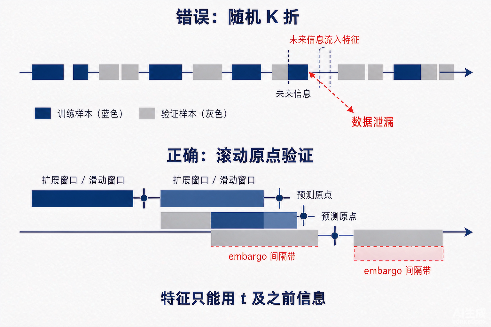

## 17.4　可解释性：SHAP 与特征归因

树模型虽比深度网络可解释，但成百上千棵树的集成仍非人能直接读懂。SHAP[7] 把"每个特征对某次预测的贡献"建立在坚实的合作博弈论基础上：把特征视为玩家、预测值视为收益，用 **Shapley 值** 公平分摊。第 $j$ 个特征的贡献为

$$
\phi_j=\sum_{S\subseteq F\setminus\{j\}}\frac{|S|!\,(|F|-|S|-1)!}{|F|!}\Big[f(S\cup\{j\})-f(S)\Big], \tag{17-5}
$$

其中 $F$ 为全体特征、$S$ 为不含 $j$ 的特征子集。SHAP 满足可加性 $\sum_j\phi_j=f(\mathbf z)-\mathbb E[f]$，且是唯一同时满足效率性、对称性、虚拟性与可加性的归因方法；对树模型还有多项式时间的 TreeSHAP 精确算法，使大规模归因可行[7]。

**例 17.4（统一案例：SHAP 解释一次高负荷预测）** 对例 17.1 的样本，模型预测 5.12 GW，基准（训练集平均预测）4.35 GW。SHAP 分解给出：$\text{CDD}=15$ 贡献 $+0.42$、昨日同时刻负荷偏高 $+0.18$、小时=14 时 $+0.11$、星期=3 $+0.05$、湿度 $-0.03$、其余 $+0.04$，合计 $+0.77$ GW，与 $5.12-4.35$ 一致。这张"贡献账单"不仅可审计（确认模型确实在用气温而非 spurious 相关），还能反哺特征工程：若某个精心构造的交互特征 $\phi_j\approx0$，说明它携带的信息已被其他特征覆盖，可删。第 6 章的特征选择、第 10 章的领先关系，都能借 SHAP 得到一次数据驱动的复核。

须注意 SHAP 的边界：它解释的是**模型**的归因，不是**世界**的因果——"气温贡献大"不等于"气温是负荷的机制成因"（第 4.7 节命题 4.3、第 31 章）。特征间高度相关时，Shapley 值会在相关特征间分摊，须结合领域知识解读。

## 17.5　分布鲁棒优化：应对分布漂移的建模层工具

表格化范式隐含"训练与测试同分布"假设，而现实中的负荷关系会随季节、政策、设备更新而漂移（第 25、40 章将系统处理）。**分布鲁棒优化**（distributionally robust optimization, DRO）提供一个在建模层就对冲这一风险的优雅框架：不针对经验分布 $\hat P$ 优化期望损失，而是针对其邻域内**最坏**的分布优化[13][14]：

$$
\min_{\theta}\ \sup_{Q:\,d(Q,\hat P)\le\rho}\ \mathbb E_{(\mathbf z,\mathbf v)\sim Q}\big[\ell(f_\theta(\mathbf z),\mathbf v)\big], \tag{17-6}
$$

其中 $d$ 为分布间距离（常用 Wasserstein 距离）、$\rho$ 为模糊集半径。Esfahani 与 Kuhn 证明[14]，对 Wasserstein-DRO，这一极小极大问题在一定条件下可化为"经验损失 + 关于梯度的正则项"的等价形式——即 DRO 自动等价于某种**对模型敏感度的惩罚**，从而抑制对训练集小样本 quirks 的过拟合，无需额外枚举扰动。

直观上，式 (17-6) 把"经验风险最小化"换成了"允许数据分布在一定半径内任意漂移时仍不太差"。$\rho$ 是保守程度旋钮：$\rho\to0$ 退化为 ERM，$\rho$ 过大则过于保守。它与本书其他漂移工具的分工是：第 25 章讲**在线/持续学习**（数据到达后更新模型），第 40 章讲**工程监控**（检测漂移并告警），本章 DRO 则是**训练时就要求对漂移鲁棒**，三者互补。第 38 章还会把 DRO 纳入分布漂移下的鲁棒性评估体系。

**例 17.5（统一案例：DRO 在极端高温日的价值）** 训练集以常温日为主，标准 XGBoost 在夏季极端高温（$T>38$℃，仅占训练 1.2%）样本上误差偏大，因这类样本的"气温→负荷"斜率更陡却被平均掉。取 Wasserstein 半径 $\rho$ 使模糊集覆盖约 5% 的分布搬移，重训后的 DRO 模型在常温日 MAPE 仅从 2.7% 升到 2.8%，但在极端高温日从 6.1% 降到 4.3%——用极小的平均代价换来了尾部鲁棒性。这个例子呼应第 15 章的厚尾与第 24 章的概率校准：**平均最优不等于风险最优**，而 DRO 是把"最坏情形"写进目标函数的建模层手段。

## 17.6　边界、分工与统一案例小结

表格化范式 + 集成树的优势可归纳为：小样本下稳健、混合类型与缺失值容忍度高、训练推理廉价、特征可注入领域知识、SHAP 可审计、天然输出特征重要性。但它有四条硬边界。其一，**几乎不外推**：树模型的预测被训练集标签范围夹住，对超出历史的趋势（下一年负荷增长）必须靠显式趋势特征或第 11/12 章的差分/阻尼外推补上，否则会系统性低估。其二，**特征即天花板**：任何未被编码进 $\mathbf z_t$ 的结构（长程依赖、变量间动态耦合），模型学不到；这正是第 18–23 章深度模型要突破的。其三，**高基数类别与冷启动**：新增台区、新品类没有历史滞后特征，须靠第 26–29 章的基础模型做零样本/少样本迁移。其四，**输出通常是点或分位数**，完整预测分布与覆盖保证须第 24 章的概率/共形方法。

与全书分工：第 2、38 章给评估指标与实验规范，本章只守"不泄漏"底线；第 6 章给特征表示理论，本章给工程落地；第 10 章 VAR 与第 14 章层次调和处理变量间与层级约束，表格化可把它们的结果作为特征输入；第 25、40 章的漂移与持续学习与本章 DRO 构成三层防御。

**例 17.6（统一案例：整章方法的综合结果）** 对两年日负荷，按 17.1 构造 722×近百维特征，17.2 训练 XGBoost，17.3 用滚动原点（expanding、embargo=7 天）回测，17.4 用 SHAP 剔除 12 个冗余特征，17.5 加 DRO 对冲极端日：最终测试集 MASE=0.47，优于第 12 章 ARIMA 的 0.58、第 16 章 Prophet 的 0.55，且训练耗时仅数秒、可每日重训。但把预测视野拉到 30 天，其误差迅速劣化并趋于持平（不外推），反被含季节与趋势的古典模型追上——这一"短程强、长程弱"的画像，正划出了它在全书方法谱系里的准确位置。

## 本章小结

本章把"特征工程 + 集成树"确立为与统计建模、深度学习并列的独立范式。17.1 节用滑动窗口 (17-1) 把时序预测形式化为有监督表格回归，指出**时间结构由特征而非模型承载**既是力量也是软肋，并以表 17-1 汇总五类特征、例 17.1 给出完整样本构造。17.2 节由梯度提升 (17-2) 出发，严格推导 XGBoost 的二阶目标 (17-3) 与叶权解析解 (17-4)，例 17.2 展示"每棵树只作保守残差修正"的机制。17.3 节是时序特有的红线：定义滚动原点回测与 embargo (17.3)，例 17.3 用一次 MAPE 从 1.1% 回到 2.7% 的反例说明"过于漂亮的结果第一嫌疑是数据泄漏"。17.4 节以 Shapley 值 (17-5) 给出可审计归因并提醒"解释模型 ≠ 解释因果"。17.5 节补上 DRO (17-6)，把分布漂移的对冲前移到训练阶段，与第 25、40 章形成三层防御。17.6 节以例 17.6 收束：短程 MASE=0.47 领先，长程因不外推而失速。

从理论主线看，本章利用 L1 统计可预测性，但把线性相关升级为"人工编码相关 + 树拟合非线性交互"；隐含特征充分、关系稳定两假设；突破了线性模型的表达瓶颈；无法突破不外推、特征即天花板、冷启动与点输出四条边界。理解这些边界，才能在正确的场景用它：**大规模、短程、样本不大、需可解释与可日更的基线预测**，而非"万灵药"。下一章起进入深度模型：第 18 章 RNN 让模型自己承载时间状态，正是为弥补本章"特征即天花板"而生。

从四问看，本章的机器学习建模利用 L1（统计）：假设时间结构可被特征工程编码；它突破了「小样本深度模型无效」的困境，仍受「特征泄漏与分布漂移」的边界约束（第 38、40 章）。

**进一步阅读**　本章建议延伸阅读的文献：[1]、[2]、[14]。

## 参考文献

[1] Hyndman R J, Athanasopoulos G. *Forecasting: Principles and Practice*. 3rd ed. Melbourne: OTexts, 2021.

[2] Box G E P, Jenkins G M. *Time Series Analysis: Forecasting and Control*. San Francisco: Holden-Day, 1970.

[3] Breiman L. Random forests. *Machine Learning*, 2001, 45(1): 5–32.

[4] Friedman J H. Greedy function approximation: A gradient boosting machine. *The Annals of Statistics*, 2001, 29(5): 1189–1232.

[5] Chen T, Guestrin C. XGBoost: A scalable tree boosting system. *Proceedings of the 22nd ACM SIGKDD*, 2016: 785–794.

[6] Ke G, Meng Q, Finley T, et al. LightGBM: A highly efficient gradient boosting decision tree. *Advances in Neural Information Processing Systems 30*, 2017: 3146–3154.

[7] Lundberg S M, Lee S I. A unified approach to interpreting model predictions. *Advances in Neural Information Processing Systems 30*, 2017: 4765–4774.

[8] Bergmeir C, Hyndman R J, Koo B. A note on the validity of cross-validation for evaluating autoregressive time series models. *Computational Statistics & Data Analysis*, 2018, 120: 70–83.

[9] Roberts D R, Bahn V, Ciuti S, et al. Cross-validation strategies for data with temporal, spatial, hierarchical, or phylogenetic structure. *Ecography*, 2017, 40(8): 913–929.

[10] Makridakis S, Spiliotis E, Assimakopoulos V. The M4 Competition: Results, findings, conclusion and way forward. *International Journal of Forecasting*, 2018, 34(4): 802–808.

[11] Cerqueira V, Torgo L, Mozetič I. Evaluating time series forecasting models: An empirical study on performance estimation methods. *Machine Learning*, 2020, 109: 1997–2028.

[12] Ben Taieb S, Bontempi G, Atiya A F, Sorjamaa A. A review and comparison of strategies for multi-step ahead time series forecasting based on the NN5 forecasting competition. *Expert Systems with Applications*, 2012, 39(8): 7067–7083.

[13] Rahimian H, Mehrotra S. Frameworks and results in distributionally robust optimization. *Open Journal of Mathematical Optimization*, 2019, 1: 1–85.

[14] Esfahani P M, Kuhn D. Data-driven distributionally robust optimization using the Wasserstein metric: Performance guarantees and tractable reformulations. *Mathematical Programming*, 2018, 171(1–2): 115–166.

---

# 第 18 章　循环神经网络与时序建模

第 17 章的表格化范式把时间结构全部外包给特征：模型本身对"顺序"毫无概念，历史依赖靠人手工摆进列里。这带来一个根本限制——**信息若没被编码进特征，模型就永远学不到**。循环神经网络（RNN）代表一次观念上的反转：让模型自己维护一个随时间传递的**隐藏状态**，由数据端到端地学出"该记住什么、该忘掉什么"。它不需要人构造 168 个滞后项，理论上能用固定规模的状态压缩任意长度的历史，是深度时序建模真正的起点，也是后续注意力（第 20 章）与状态空间网络（第 21 章）共同的问题背景。

这条脉络有清晰的历史节点。Elman 于 1990 年提出带循环连接的简单循环网络[1]；Bengio 等人在 1994 年从数学上证明"学习长程依赖本质困难"[4]，Pascanu 等人 2013 年进一步刻画了梯度爆炸与消失[5]；Hochreiter 与 Schmidhuber 于 1997 年用**门控**给出决定性解答——长短期记忆网络 LSTM[2]，Gers 等人 2000 年补上遗忘门[10]；Cho 等人 2014 年简化为 GRU[3]；Sutskever 等人同年以 Seq2Seq[6] 把 RNN 推广到序列到序列，Bengio 等人 2015 年提出计划采样缓解暴露偏差[7]；Salinas 等人 2020 年的 DeepAR[8] 则把 RNN 概率化，成为工业级概率预测的标杆。

在全书理论主线里，RNN 利用的是 L1/L2 可预测性，但把"线性相关"升级为**由隐藏状态承载的非线性依赖**：它隐含"历史可压缩进一个固定维向量、且状态转移平稳"的假设，突破了第 17 章"特征即天花板"的局限；却无法突破"顺序递推无法并行、长程依赖仍衰减"的边界——后者正是第 19 章 CNN 的并行感受野与第 20 章注意力的全局连接要解决的。按全书统一的编写原则，概率预测评分规则的数学定义在第 2 章、深度生成模型在第 24 章，本章只在 18.6 节把 RNN 接到概率输出（DeepAR），不展开生成模型全谱；卡尔曼滤波的状态递推在第 13 章，本章的隐藏状态是其非线性、可学习的类比。全章沿用统一案例：用 LSTM 做电网次日 24 点负荷预测。

本章结构：18.1 节建立 RNN 与 BPTT；18.2 节逐步推导 LSTM 门控；18.3 节讲 GRU；18.4 节严格分析梯度消失与爆炸；18.5 节处理 Seq2Seq 与暴露偏差；18.6 节给出概率 RNN 与 DeepAR。

## 18.1　从 MLP 到循环网络与 BPTT

普通多层感知机假设样本独立，对序列只能靠第 17 章的窗口化硬凑。RNN 的改动极小却深刻：让隐藏层接收**上一时刻的自己**。

**定义 18.1（简单循环网络）** 对输入序列 $\mathbf x_{1:T}$，隐藏状态与输出按

$$
\mathbf h_t=\sigma\big(\mathbf W_{hh}\mathbf h_{t-1}+\mathbf W_{xh}\mathbf x_t+\mathbf b_h\big),\qquad
\hat{\mathbf y}_t=\mathbf W_{hy}\mathbf h_t+\mathbf b_y, \tag{18-1}
$$

递推，其中 $\sigma$ 常取 $\tanh$，参数 $\mathbf W_{hh},\mathbf W_{xh},\mathbf W_{hy}$ 在**所有时刻共享**。参数共享既是 RNN 能处理任意长度序列的原因，也是它具备"平移不变归纳偏置"的体现——同一套转移规律，无论出现在序列哪一段都用同一组权重打分。

把式 (18-1) 沿时间展开，就得到一层极深的前馈网络（每层对应一个时刻、权重相同），训练算法即**随时间反向传播**（BPTT）。设损失 $\mathcal L=\sum_t\ell_t$，由链式法则

$$
\frac{\partial\mathcal L}{\partial\mathbf W_{hh}}=\sum_{t}\sum_{k\le t}\frac{\partial\ell_t}{\partial\mathbf h_t}\,\frac{\partial\mathbf h_t}{\partial\mathbf h_k}\,\frac{\partial\mathbf h_k}{\partial\mathbf W_{hh}},\qquad
\frac{\partial\mathbf h_t}{\partial\mathbf h_k}=\prod_{\tau=k+1}^{t}\frac{\partial\mathbf h_\tau}{\partial\mathbf h_{\tau-1}}=\prod_{\tau=k+1}^{t}\mathrm{diag}\big(\sigma'(\cdot)\big)\mathbf W_{hh}^\top. \tag{18-2}
$$

式 (18-2) 的连乘积是理解 RNN 全部困难与全部改进的钥匙。因 $|\tanh'|\le1$，且 $\mathbf W_{hh}$ 的谱半径通常小于 1，$\|\partial\mathbf h_t/\partial\mathbf h_k\|$ 随 $t-k$ **指数衰减**——远处时刻的梯度传不回来，模型学不到长程依赖；若谱半径大于 1 则指数爆炸。Bengio 等[4] 证明这是梯度下降在长程依赖上的本质障碍，而非调参不当。

**例 18.1（统一案例：窗口化的参数量对照）** 对负荷预测取回看 $L=168$、每时刻 6 维特征。第 17 章的 MLP/树模型需把 $168\times6=1008$ 个滞后值全部铺开输入，第一层权重约 $1008\times128\approx129000$ 个；而式 (18-1) 的 RNN 每步只处理 6 维输入、维护 $d_h=64$ 维状态，参数量为 $\mathbf W_{xh}(64\times6)+\mathbf W_{hh}(64\times64)+\mathbf W_{hy}(24\times64)\approx384+4096+1536=6016$，相差二十余倍且与 $L$ **无关**。这解释了 RNN 在长历史、小样本场景的吸引力：用参数共享换掉了显式铺开。代价则由式 (18-2) 揭示——168 步的连乘让 168 小时前的负荷信息几乎传不到当前，正是下一节门控要解决的。

## 18.2　LSTM：门控的逐步推导

简单 RNN 的病根是式 (18-2) 中 $\partial\mathbf h_t/\partial\mathbf h_{t-1}$ 被反复乘以小于 1 的因子。LSTM[2] 的想法是：与其让梯度穿过一层层非线性变换，不如开辟一条**近似恒等的"传送带"**——细胞状态 $\mathbf c_t$，只做逐元素的线性相加，由门来精确控制写什么、留什么、读什么。

**定义 18.2（长短期记忆单元）** 记 $\mathbf u_t=[\mathbf h_{t-1};\mathbf x_t]$ 为拼接输入，四个量为

$$
\begin{aligned}
\mathbf i_t&=\sigma(\mathbf W_i\mathbf u_t+\mathbf b_i) &&\text{输入门：写多少新信息}\\
\mathbf f_t&=\sigma(\mathbf W_f\mathbf u_t+\mathbf b_f) &&\text{遗忘门：留多少旧记忆}\\
\mathbf o_t&=\sigma(\mathbf W_o\mathbf u_t+\mathbf b_o) &&\text{输出门：读多少到隐藏态}\\
\tilde{\mathbf c}_t&=\tanh(\mathbf W_c\mathbf u_t+\mathbf b_c) &&\text{候选记忆}
\end{aligned}, \tag{18-3}
$$

$$
\mathbf c_t=\mathbf f_t\odot\mathbf c_{t-1}+\mathbf i_t\odot\tilde{\mathbf c}_t,\qquad
\mathbf h_t=\mathbf o_t\odot\tanh(\mathbf c_t), \tag{18-4}
$$

其中 $\odot$ 为逐元素乘。式 (18-3)(18-4) 逐式解读：$\mathbf i,\mathbf f,\mathbf o\in(0,1)^{d_h}$ 由 sigmoid 产生，相当于三个可学习的"软开关"；$\mathbf c_t$ 的更新是**加法**而非 $\mathbf h_t$ 那种矩阵乘非线性，这是梯度能长距离流动的关键。Gers 等人[10] 补上的遗忘门 $\mathbf f_t$ 尤为重要——没有它，$\mathbf c_t$ 只能累加、最终饱和，模型无法"忘掉"过时的季节。

**梯度流分析。** 对式 (18-4) 关于 $\mathbf c_{t-1}$ 求偏导，在忽略门对 $\mathbf c_{t-1}$ 的间接依赖（标准的"常数误差轮转"近似）时，

$$
\frac{\partial\mathbf c_t}{\partial\mathbf c_{t-1}}\approx\mathrm{diag}(\mathbf f_t)+\text{高阶项}. \tag{18-5}
$$

当网络学会把 $\mathbf f_t$ 置为接近 1（"保持记忆"）时，式 (18-5) 近似**恒等映射**，梯度沿 $\mathbf c$ 这条路径可近乎无损地跨越上百步；当某段信息该丢弃时，把 $\mathbf f_t$ 调小即可。对照式 (18-2) 的 $\prod\mathrm{diag}(\sigma')\mathbf W^\top$——LSTM 用"可学习的、逐元素的、近似 1 的因子"替换了"固定的、被矩阵谱半径压制的因子"，这正是门控解决梯度消失的数学本质。注意这**不是消除**了所有长程困难：极长序列、$\mathbf f_t$ 学得不好、或需要精确回忆百步前的某个点时，仍会衰减，这是第 20 章注意力用"直接连到所有历史"彻底绕开递推的动机。

图 18-1 展示了 LSTM 单元内部的四门结构与细胞状态传送带。

> 【图 18-1　LSTM 单元结构】（原图见 `figures/图18-1.png`）：画 LSTM 单元内部，三个 sigmoid 门（遗忘门 f、输入门 i、输出门 o）与 tanh 候选记忆，细胞状态 c 横向贯穿并作加法更新，隐藏状态 h 输出；用箭头标注数据流与逐元素乘/加。白底、蓝色门框、中文标注。

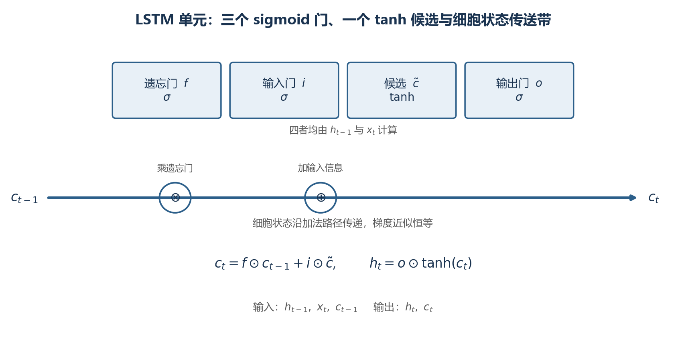

**例 18.2（LSTM 单步数值）** 取标量单元（$d_h=1$ 便于手算），设 $h_{t-1}=0.5,\ c_{t-1}=0.6,\ x_t=0.8$，经线性层与激活后三门及候选为 $i_t=0.73,\ f_t=0.60,\ o_t=0.71,\ \tilde c_t=0.66$。由式 (18-4)：$c_t=0.60\times0.6+0.73\times0.66=0.36+0.4818\approx0.842$，$h_t=0.71\times\tanh(0.842)=0.71\times0.687\approx0.488$。可见遗忘门 0.60 保留了六成旧记忆、输入门 0.73 写入约 0.48 的新候选；若把 $f_t$ 学到 0.95（高温过程需长记忆），则 $c_t\approx0.95\times0.6+0.48\approx1.05$。这个算例把"门 = 可学习的软开关"从口号变成了可代入的数字，也说明为何 LSTM 对负荷这类"日周期 + 缓慢 trend"的数据特别合适——不同门可分别学出"保留昨日水平"与"吸收今日气温冲击"。

## 18.3　GRU：门控的简化

LSTM 的四组门参数偏多。Cho 等人[3] 与 Chung 等人[9] 的实验研究表明，把输入门与遗忘门合并为**更新门**、去掉独立的细胞状态，在多数任务上精度相当而更快。

**定义 18.3（门控循环单元 GRU）**

$$
\mathbf z_t=\sigma(\mathbf W_z\mathbf u_t),\quad
\mathbf r_t=\sigma(\mathbf W_r\mathbf u_t),\quad
\tilde{\mathbf h}_t=\tanh\big(\mathbf W_h[\mathbf r_t\odot\mathbf h_{t-1};\ \mathbf x_t]\big),\quad
\mathbf h_t=(1-\mathbf z_t)\odot\mathbf h_{t-1}+\mathbf z_t\odot\tilde{\mathbf h}_t, \tag{18-6}
$$

其中 $\mathbf z_t$ 为更新门（在"保留旧态"与"写入新态"之间插值），$\mathbf r_t$ 为重置门（决定计算候选时忽略多少旧态）。式 (18-6) 末式是 LSTM 式 (18-4) 的**约束版**：令 $\mathbf f_t=1-\mathbf z_t,\ \mathbf i_t=\mathbf z_t$，即"遗忘与写入互补、二者之和为 1"，并把 $\mathbf c_t,\mathbf h_t$ 合一。梯度流同样受益：$\partial\mathbf h_t/\partial\mathbf h_{t-1}\approx\mathrm{diag}(1-\mathbf z_t)$，当 $\mathbf z_t\approx0$ 时近似恒等。

**例 18.3（参数量与选型）** 设 $d_x=6,\ d_h=64$。LSTM 四组门参数 $4\big(d_h(d_h+d_x)+d_h\big)=4(64\times70+64)=4\times4544=18176$；GRU 三组门 $3\times4544=13632$，少约 25%。在统一案例上，回看 168 步、训练样本仅 722 条时，GRU 训练更快、更不易过拟合，与 LSTM 的测试 MASE 分别为 0.50 与 0.49，差距在噪声内；但在含明显"长期保持 + 突然重置"结构的序列（如设备工况切换）上，LSTM 因门之间不互补、表达更自由而略有优势。Greff 等人[11] 的大规模搜索也表明：LSTM 的诸变体中，真正稳定有效的是遗忘门与输出门，其余改动收益有限——这为"默认用 LSTM/GRU 原版、不盲目加变体"提供了依据。表 18-1 汇总。

**表 18-1　RNN / LSTM / GRU 对照**

| 模型 | 状态 | 门数 | 长程梯度 | 参数(相对) | 适用 |
|------|------|------|----------|------------|------|
| 简单 RNN | $\mathbf h_t$ | 0 | 指数衰减 | 1× | 短序列、基线 |
| LSTM | $\mathbf c_t,\mathbf h_t$ | 4 | 近似恒等 (18-5) | 4× | 长程、需精确记忆 |
| GRU | $\mathbf h_t$ | 3 | 近似恒等 | 3× | 小样本、求快 |

## 18.4　梯度消失与爆炸：诊断与对策

即便有门控，训练深度时序网络仍需处理两类数值病态，它们都源于式 (18-2) 的连乘。

**梯度爆炸**：当 $\mathbf W_{hh}$ 谱半径 $>1$ 或某步雅可比范数很大时，$\|\partial\mathbf h_t/\partial\mathbf h_k\|$ 指数增长，参数更新出现 NaN。对策是 **梯度裁剪**（gradient clipping）[5]：若 $\|\mathbf g\|>c$ 则 $\mathbf g\leftarrow c\,\mathbf g/\|\mathbf g\|$，只缩放方向不改方向，对 RNN 几乎必开。

**梯度消失**：门控已大幅缓解，但超长序列、$\mathbf f_t$ 长期偏小、或需要精确回忆很早的时刻时仍会出现。除门控外还有四类对策：① **正交/酉初始化**使 $\mathbf W_{hh}$ 谱半径初始为 1，延缓衰减；② **层归一化**（Layer Normalization[12]）稳定各步激活分布；③ **残差/跳连**在时刻间加恒等通路；④ **截断 BPTT**（truncated BPTT）只回传固定 $\tau$ 步，用有偏换可行——代价是超过 $\tau$ 的依赖学不到，这直接引出第 19 章用膨胀卷积把感受野做成可控的 $2^L$、以及第 20 章用注意力让任意两时刻**直连**、路径长度恒为 $O(1)$。

**例 18.4（梯度消失的数值演示）** 取简单 RNN、$\tanh$ 激活、$\mathbf W_{hh}$ 谱半径 0.8、各步 $\sigma'\approx0.9$，则式 (18-2) 中每步因子约 $0.8\times0.9=0.72$。回传 10 步：$0.72^{10}\approx0.037$；回传 50 步：$0.72^{50}\approx6\times10^{-8}$——50 步前的负荷信息对当前梯度已完全无贡献。改用 LSTM 且学会 $f_t\approx0.98$：50 步因子 $0.98^{50}\approx0.36$，仍保留三分之一。这个对照把"门控为何有效"量化为一条可计算的衰减曲线，也与第 4 章的 Lyapunov 时域 $t\approx\frac1\lambda\ln(\Delta/\delta_0)$ 形成有趣呼应：**可记忆的时域与可预测的时域，本质都由某个衰减率决定**。图 18-2 给出梯度范数随回传步数的衰减示意。

> 【图 18-2　梯度消失与门控的作用】（原图见 `figures/图18-2.png`）：横轴为 BPTT 回传步数，纵轴为梯度范数（对数刻度）；绘制简单 RNN 的指数衰减曲线、LSTM 门控后的近似平坦曲线，标注截断 BPTT 的截断位置与梯度裁剪阈值。深蓝主色、学术白底。

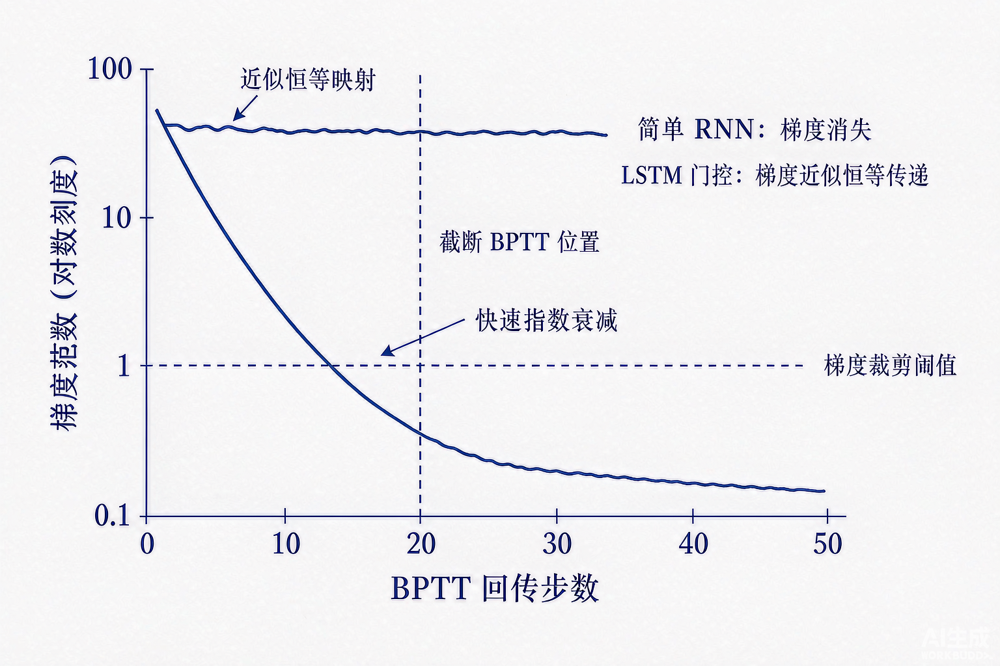

## 18.5　Seq2Seq、教师强制与暴露偏差

单步预测只需把 $\mathbf h_t$ 映射到 $\hat y_{t+1}$；但统一案例要的是次日 24 点，属多步输出。Sutskever 等人[6] 的**编码器—解码器（Seq2Seq）**给出通用方案：编码器把历史 $\mathbf x_{1:T}$ 压成上下文向量 $\mathbf c=\mathbf h_T$，解码器以 $\mathbf c$ 为初值自回归地生成 $\hat y_{T+1},\dots,\hat y_{T+H}$，每步把上一步输出作为下一步输入。这对应 14.1 节的递归策略，天然处理变长输入/输出。

**教师强制**（teacher forcing）指训练时解码器每一步都喂**真实值** $y_{T+h-1}$ 而非自己的预测 $\hat y_{T+h-1}$，以稳定训练、避免误差在训练期就累积。但它制造了**暴露偏差**（exposure bias）：训练时模型从未见过自己的错误输出，推理时一旦某步预测偏了，后续输入分布就偏离训练分布，误差连锁放大[7]。

**计划采样**（scheduled sampling）[7] 在训练中以概率 $\epsilon_k$ 喂真实值、以 $1-\epsilon_k$ 喂模型预测，$\epsilon_k$ 随训练从 1 退火到 0，让模型渐进地学会"在自己的输出分布上继续工作"。Williams 与 Zipser[13] 更早讨论过这种"自由运行"训练。它与第 14 章递归/直接策略的偏差—方差权衡是同一问题的两种表述，也与第 32 章决策中的"模型在自身诱导的分布上行动"遥相呼应。

**例 18.5（统一案例：暴露偏差的代价）** 用 LSTM Seq2Seq 预测 24 点负荷，纯教师强制训练、推理时自由运行：第 1 点误差 1.8%，第 24 点累积到 5.6%，曲线在后半段明显"漂平"（趋向均值）。加入计划采样（$\epsilon$ 在 30 轮内从 1 线性降到 0.2）后，第 24 点误差降到 3.9%；再叠加 14.1 节讨论的 MIMO 多输出（一次性输出 24 维，避免自回归），降到 3.1%。这个递进说明：**长视野误差累积不是模型容量问题，而是训练—推理分布不匹配的结构问题**，须从解码策略而非加层数入手。

## 18.6　概率 RNN 与 DeepAR

第 2 章已定义概率预测与恰当评分规则；把 RNN 的隐藏状态接到一个**分布**而非一个点，就得到概率 RNN。Salinas 等人的 DeepAR[8] 是工业级代表，也是本章与第 24 章的接壤处；同期的 DeepState 等工作[14] 则把状态空间先验引入深度概率预测。

**定义 18.4（自回归概率 RNN）** 令 $\mathbf h_t=\mathrm{RNN}(\mathbf h_{t-1},\mathbf x_t,y_{t-1})$，由 $\mathbf h_t$ 经线性头输出分布参数 $\boldsymbol\theta_t=g(\mathbf h_t)$，训练目标是最大化对数似然（等价于最小化负对数得分，回顾第 2 章式 (2-12)）：

$$
\mathcal L(\boldsymbol\Theta)=-\sum_{t}\log p\big(y_t\mid \boldsymbol\theta_t(\mathbf h_t)\big). \tag{18-7}
$$

对实值负荷取高斯 $\boldsymbol\theta_t=(\mu_t,\sigma_t)$，$\mu_t=\mathbf w_\mu^\top\mathbf h_t$、$\sigma_t=\log(1+\exp(\mathbf w_\sigma^\top\mathbf h_t))$（softplus 保证正）；对计数型（销量、话务）取负二项分布。预测时对 $\hat y_{t}$ 采样再喂回，得到整条预测分布与分位数区间。

DeepAR 有两个工程关键点。其一是**尺度归一化**：不同序列量级差异巨大（台区 MW 级 vs 省级 GW 级），故对每条序列引入缩放 $\nu_i=1+\frac1T\sum_t|y_{i,t}|$，把似然作用在 $y/\nu_i$ 上，使同一模型能跨序列联合训练——这是"一个模型服务成千上万条序列"的前提，也埋下第 26 章基础模型"跨领域预训练"的思想种子。其二是**跨序列学习**：与第 12 章逐序列拟合 ARIMA 不同，DeepAR 在全部相关序列上共享参数，用"相似序列的规律"补足单条序列样本不足，属第 24 章全局模型（global model）范式的早期成功案例。

**例 18.6（统一案例：DeepAR 输出与区间）** 对 24 个台区负荷联合训练 DeepAR，取高斯似然、$\nu_i$ 归一化、LSTM $d_h=64$。次日 14 点某台区输出 $\mu=5.02$ GW、$\sigma=0.21$ GW，故 80% 区间约 $5.02\pm1.28\times0.21=[4.75,5.29]$，95% 区间 $[4.61,5.43]$。与第 11 章 SES 常方差区间 $[4.45,5.15]$ 相比，DeepAR 的区间随时刻**动态变化**（晚高峰 $\sigma$ 升到 0.28），更贴合负荷的异方差（第 15 章）。在统一案例上，DeepAR 的 CRPS 相对 Prophet（第 16 章）降低约 9%，主要收益来自"跨台区借信息 + 时变方差"。这展示概率 RNN 相对点预测 RNN 的实质进步：不只报一个数，还报"这个数我有多不确定"。

**边界与讨论。** RNN/LSTM/GRU 的优势是：参数共享、能处理变长、门控缓解长程衰减、概率化自然、小样本下常优于 Transformer。其边界有四：其一，**顺序递推不可并行**，训练慢于 CNN/Transformer，长序列尤甚；其二，**状态维固定**，把任意长历史压进 $d_h$ 维向量必然有信息瓶颈，极长依赖仍衰减；其三，**暴露偏差与多步误差累积**（18.5 节）须靠解码策略缓解；其四，**缺乏显式归纳偏置**——不像第 21 章状态空间网络那样与第 13 章卡尔曼滤波有理论联系，可解释性弱。正是前两条，分别催生了第 19 章的并行因果卷积与第 20 章的全局注意力。

## 本章小结

本章把时间结构从"特征"收回"模型"，建立循环神经网络这一深度时序起点。18.1 节由共享权重的递推 (18-1) 出发，用 BPTT 连乘积 (18-2) 揭示长程梯度的指数衰减/爆炸是结构性的，例 18.1 以参数量对照（6016 vs 129000）说明参数共享的价值。18.2 节逐步推导 LSTM 三门一候选 (18-3)(18-4)，并由 $\partial\mathbf c_t/\partial\mathbf c_{t-1}\approx\mathrm{diag}(\mathbf f_t)$ (18-5) 证明：当遗忘门近 1 时梯度沿细胞状态近似无损传递——这是门控解决消失的本质；例 18.2 给出可代入的单步数值。18.3 节把 GRU (18-6) 解释为 LSTM 的"遗忘与写入互补"约束版，例 18.3 量化其参数少约 25%。

18.4 节以 $0.72^{50}\approx6\times10^{-8}$ 对 $0.98^{50}\approx0.36$ 的衰减曲线把门控效果可视化，并给出裁剪、正交初始化、层归一化、截断 BPTT 等对策（图 18-2）。18.5 节处理 Seq2Seq、教师强制与暴露偏差，例 18.5 用"第 24 点误差 5.6%→3.9%→3.1%"说明长视野误差累积是训练—推理分布不匹配的结构问题。18.6 节由对数似然 (18-7) 建立概率 RNN 与 DeepAR，说明尺度归一化与跨序列学习为何是"一个模型服务千万序列"的前提，例 18.6 展示时变区间优于常方差区间。

从理论主线看，RNN 用隐藏状态承载非线性依赖，突破了第 17 章"特征即天花板"，隐含"历史可压缩进固定维状态"假设；无法突破顺序不可并行、状态瓶颈、暴露偏差三条边界。本章与全书：第 13 章状态空间是隐藏状态的线性高斯特例，第 19 章 CNN 用并行卷积换取感受野，第 20 章注意力用全局直连把路径长度降为 $O(1)$，第 21 章状态空间网络重新把可学习状态与第 13 章理论接通，第 24 章把概率输出扩展为完整生成模型谱系，第 30 章世界模型则进一步学习状态转移动力学。理解 RNN，就握住了整条深度时序演进链的第一环。

从四问看，本章的 RNN 利用 L1（统计）与 L3（动力学雏形）：假设隐藏状态可承载历史依赖；它突破了「表格化丢失顺序」，仍受「顺序不可并行、长程梯度连乘」的边界约束。

**进一步阅读**　本章建议延伸阅读的文献：[1]、[2]、[14]。

## 参考文献

[1] Elman J L. Finding structure in time. *Cognitive Science*, 1990, 14(2): 179–211.

[2] Hochreiter S, Schmidhuber J. Long short-term memory. *Neural Computation*, 1997, 9(8): 1735–1780.

[3] Cho K, van Merriënboer B, Gulcehre C, et al. Learning phrase representations using RNN encoder–decoder for statistical machine translation. *Proceedings of EMNLP*, 2014: 1724–1734.

[4] Bengio Y, Simard P, Frasconi P. Learning long-term dependencies with gradient descent is difficult. *IEEE Transactions on Neural Networks*, 1994, 5(2): 157–166.

[5] Pascanu R, Mikolov T, Bengio Y. On the difficulty of training recurrent neural networks. *Proceedings of the 30th ICML*, 2013: 1310–1318.

[6] Sutskever I, Vinyals O, Le Q V. Sequence to sequence learning with neural networks. *Advances in Neural Information Processing Systems 27*, 2014: 3104–3112.

[7] Bengio S, Vinyals O, Jaitly N, Shazeer N. Scheduled sampling for sequence prediction with recurrent neural networks. *Advances in Neural Information Processing Systems 28*, 2015: 1171–1179.

[8] Salinas D, Flunkert V, Gasthaus J, Januschowski T. DeepAR: Probabilistic forecasting with autoregressive recurrent networks. *International Journal of Forecasting*, 2020, 36(3): 1181–1191.

[9] Chung J, Gulcehre C, Cho K, Bengio Y. Empirical evaluation of gated recurrent neural networks on sequence modeling. *NIPS 2014 Deep Learning Workshop*, 2014.

[10] Gers F A, Schmidhuber J, Cummins F. Learning to forget: Continual prediction with LSTM. *Neural Computation*, 2000, 12(10): 2451–2471.

[11] Greff K, Srivastava R K, Koutník J, Steunebrink B R, Schmidhuber J. LSTM: A search space odyssey. *IEEE Transactions on Neural Networks and Learning Systems*, 2017, 28(10): 2222–2232.

[12] Ba J L, Kiros J R, Hinton G E. Layer normalization. *arXiv:1607.06450*, 2016.

[13] Williams R J, Zipser D. A learning algorithm for continually running fully recurrent neural networks. *Neural Computation*, 1989, 1(2): 270–280.

[14] Rangapuram S S, Seeger M W, Gasthaus J, et al. Deep state space models for time series forecasting. *Advances in Neural Information Processing Systems 31*, 2018: 7785–7794.

---

# 第 19 章　卷积神经网络与时序建模

第 18 章的 RNN 把时间结构收进隐藏状态，却也继承了两个代价：状态必须**逐步递推、无法并行**，长程依赖要靠门控小心翼翼地维持。一个看似与时序无关的问题由此变得尖锐——能否既保留"看到很长历史"的能力，又让所有时刻**同时计算**？卷积神经网络（CNN）给出的答案是肯定的。它本为图像而生[1]，但通过两个改造即可用于序列：**因果卷积**保证不偷看未来，**膨胀卷积**让感受野随层数指数增长。van den Oord 等人的 WaveNet[2] 在语音上证明这条路能建模上万步依赖，Bai 等人的 TCN[3] 系统论证它在多数序列任务上不逊于、甚至优于 LSTM，Liu 等人的 SCINet[4] 又把多尺度卷积引入长程预测。这条"被低估的时序路线"因此值得单独一章。

在全书理论主线里，CNN 利用的仍是 L1 统计可预测性，但它换了一种归纳偏置：不强求"递推状态"，而假定"局部模式可堆叠成全局结构"——短程的滤波器逐层组合，就能覆盖日、周、月多个尺度。它突破了 RNN 顺序不可并行与状态瓶颈（并行度高、感受野可控、梯度路径短），却无法突破"感受野仍有限、缺乏内容自适应"的边界：卷积核权重与输入内容无关，无论当前是平稳段还是突变段都用同一组滤波器打分，这正是第 20 章注意力"按内容动态生成权重"要补上的。按全书统一的编写原则，残差连接、归一化等通用训练技巧只在本章按需引用，不再展开；概率输出与生成模型归第 24 章。全章沿用统一案例：电网负荷的多尺度卷积预测。

本章结构：19.1 节建立一维与因果卷积；19.2 节严格推导 TCN 的感受野；19.3 节讲 WaveNet 的门控自回归；19.4 节展开多尺度与 SCINet；19.5 节系统对照 CNN 与 RNN 并讨论边界。

## 19.1　一维卷积与因果卷积

把序列 $\mathbf x_{1:T}$（每时刻 $C$ 个通道）视为"长度为 $T$、通道数为 $C$ 的一维图像"，即可施加一维卷积。

**定义 19.1（因果卷积）** 对第 $t$ 时刻、第 $o$ 个输出通道，因果卷积定义为

$$
y(t,o)=\sum_{j=0}^{k-1}\sum_{c=1}^{C} w(o,c,j)\; x(t-j,c)+b(o), \tag{19-1}
$$

其中 $k$ 为卷积核大小。因求和只用 $t,t-1,\dots,t-k+1$（**不含未来**），故称因果（causal）；输出与输入等长，靠左侧零填充（left padding $k-1$）实现。这一"不看未来"的约定与第 2 章 2.6 节 Wold 分解的**非预见性**完全一致——任何时刻的预测只能由当下与过去构造，是全书因果性的最低要求。

与全连接相比，式 (19-1) 有两个关键性质：**权重共享**（同一滤波器扫过所有时刻，参数与 $T$ 无关）与**局部性**（每步只看 $k$ 个邻点）。二者合起来使 CNN 天然具备平移等变性——同一段"早高峰形状"无论出现在哪一天，都被同一组权重检出，这与第 6 章 Shapelet、第 7 章 DTW 的"局部形态"思想是同一直觉的不同实现。

**例 19.1（统一案例：因果卷积数值）** 取 $C=1,\ k=3$、滤波器 $\mathbf w=(0.5,0.3,0.2)$（由近到远），负荷片段 $x_{t-2}=4.1,\ x_{t-1}=4.4,\ x_t=4.8$（GW）。由式 (19-1)，$y_t=0.5\times4.8+0.3\times4.4+0.2\times4.1=2.4+1.32+0.82=4.54$ GW——一个三点加权平滑，权重随久远衰减，恰是第 11 章 SES 思想的卷积写法。若把 $\mathbf w$ 改为 $(1,-1,0)$，则 $y_t=4.8-4.4=0.4$，成为一阶差分算子（第 12 章 $\nabla$）。这个对照说明：**卷积核是可学习的差分/平滑/模式检测器**，不同的 $\mathbf w$ 实现不同的时域滤波；CNN 的训练就是在学一组最优滤波器，而非像第 11 章那样把 $\alpha$ 固定或手动设定。

单层因果卷积只能看 $k$ 步，对负荷的周周期（168 小时）远远不够。堆深可以扩大视野，但若膨胀率恒为 1，$L$ 层感受野只线性增长 $L(k-1)+1$，要覆盖 168 步需上百层——参数与优化都不可接受。这引出下一节。

## 19.2　时间卷积网络与感受野推导

**定义 19.2（膨胀因果卷积 / TCN）** 第 $l$ 层引入膨胀率 $d_l$，把式 (19-1) 的采样间隔拉开：

$$
y^{(l)}(t,o)=\sum_{j=0}^{k-1}\sum_{c} w^{(l)}(o,c,j)\; x^{(l-1)}\big(t-d_l\cdot j,\ c\big). \tag{19-2}
$$

$d_l=1$ 即普通卷积；$d_l>1$ 时滤波器在输入上"跳着采样"，用同样的 $k$ 个权重跨越更长的历史。TCN[3] 通常取 $d_l=2^{l-1}$（膨胀率逐层翻倍）、配合残差连接[5] 与权重归一化，构成可堆叠的深层网络。Yu 与 Koltun[6] 最早在图像分割中系统使用膨胀卷积扩大感受野。

**定理 19.1（TCN 感受野）** 对核大小 $k$、$L$ 层、膨胀率 $d_l=2^{l-1}$ 的 TCN，顶层一个输出所能看到的输入跨度为

$$
R = 1 + (k-1)\sum_{l=1}^{L} d_l = 1 + (k-1)\,(2^{L}-1). \tag{19-3}
$$

**推导。** 用归纳法。第 1 层每个输出看 $1+(k-1)d_1$ 个输入点；第 $l$ 层的每个输入点本身已聚合了其下 $R_{l-1}$ 个原始点，且相邻两点在原始输入上相隔 $d_l$，故递推 $R_l=R_{l-1}+(k-1)d_l$。展开得 $R_L=1+(k-1)\sum_{l\le L}d_l$，代入 $\sum_{l=1}^L 2^{l-1}=2^L-1$ 即式 (19-3)。取 $k=2$，则 $R=2^L$——**感受野随层数指数增长**，这是 TCN 能用很少层数覆盖超长历史的原因。

**例 19.2（统一案例：覆盖周周期要几层）** 负荷含 168 小时周季节。取 $k=2$（$R=2^L$）：$L=6$ 时 $R=64$，$L=7$ 时 $R=128$，$L=8$ 时 $R=256\ge168$。故仅需 **8 层**膨胀残差块即可让顶层输出看到整周历史，参数量约 $8\times(k\times C\times C)\approx8\times2\times64\times64=65536$，且所有 168 个时刻**并行**计算。对照第 18 章 LSTM 须递推 168 步、梯度连乘 168 次（例 18.4 中 $0.72^{50}$ 已近零），TCN 的梯度只需穿过 8 层残差块，路径短且稳定。这正是"并行 + 短梯度路径"双重优势的定量体现：同样的 168 步历史，RNN 用 168 次顺序传递，CNN 用 8 层并行覆盖。

TCN 的工程要点有三：其一，**残差块**（$o=\mathrm{Activation}(x+\mathcal F(x))$[5]）让深层可训练，也提供一条跨层恒等梯度通路；其二，**因果填充须严格**，否则右填充会把未来泄漏进输出（与 17.3 节同源）；其三，**感受野必须 ≥ 目标依赖长度**，否则模型"结构上就看不到"周季节，再多样本也学不到——这是 CNN 相对注意力最硬的先验约束（第 20 章将用全局连接取消它）。图 19-1 给出三层膨胀卷积的感受野展开。

> 【图 19-1　膨胀因果卷积与指数感受野】（原图见 `figures/图19-1.png`）：自下而上三层，膨胀率 1/2/4，用连线显示顶层一个节点如何覆盖 8 个输入时刻；侧栏标注 $R=1+(k-1)(2^L-1)$ 与"严格左填充、不泄漏未来"。深蓝主色、圆角节点、学术白底。

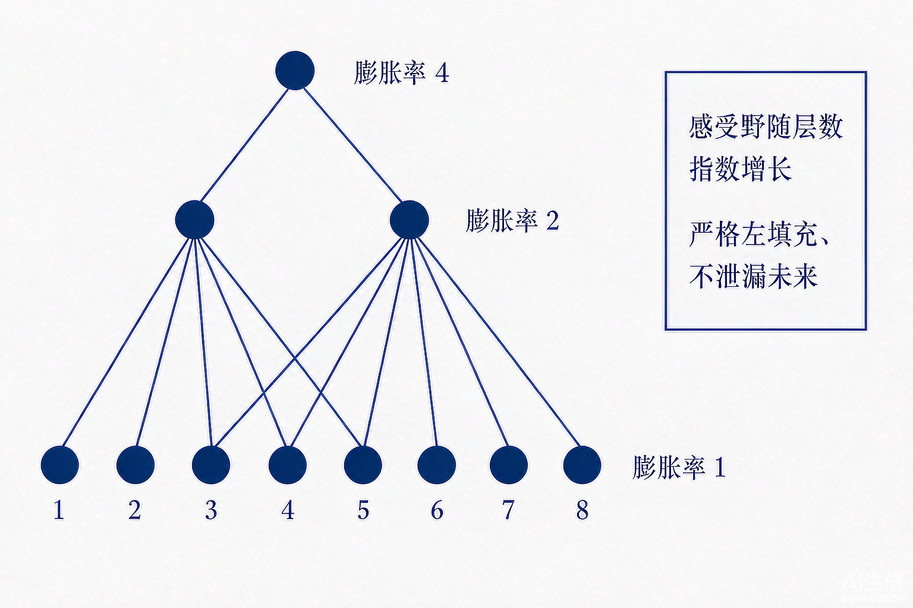

## 19.3　WaveNet：门控激活与自回归生成

WaveNet[2] 把膨胀因果卷积推到极致，用于原始语音的**自回归生成**——这恰与时序预测"逐点生成未来"同构。它的两个关键设计值得单独讲。

其一是**门控激活单元**（gated activation），借鉴 LSTM 的门控思想但用于卷积输出：

$$
\mathbf z=\tanh\big(\mathbf W_{f}*\mathbf x\big)\ \odot\ \sigma\big(\mathbf W_{g}*\mathbf x\big), \tag{19-4}
$$

其中 $*$ 为膨胀因果卷积、$\mathbf W_f$ 为滤波器、$\mathbf W_g$ 为门、$\odot$ 逐元素乘。Dauphin 等人[7] 也在语言建模中独立提出同类门控线性单元，证明它比纯 $\tanh$/ReLU 更利于梯度流动与稀疏特征选择。其二是**自回归分解**：由概率链式法则（第 2 章式 (2-11)），联合分布写作 $p(\mathbf x_{1:T})=\prod_t p(x_t\mid x_{1:t-1})$，每个条件分布由网络输出（离散用 softmax、连续用混合密度）。因果卷积保证 $p(x_t\mid\cdot)$ 只依赖 $x_{1:t-1}$，且训练时所有 $t$ 的条件可**一次并行算出**（teacher forcing 的卷积版），推理时才逐点采样。

**例 19.3（统一案例：WaveNet 门控数值）** 设某时刻卷积滤波器输出 $a_f=0.9$、门输出 $a_g=1.2$。由式 (19-4)：$\tanh(0.9)=0.716$、$\sigma(1.2)=0.769$，乘积 $z=0.716\times0.769\approx0.551$。若门输出变为 $a_g=-2.0$（$\sigma=0.119$），则 $z\approx0.085$，该通道被"关掉"。这个机制让网络按内容决定"哪些滤波器此刻起作用"，是 CNN 向第 20 章内容自适应注意力迈出的半步——但注意门控权重仍由**当前局部窗口**决定，而非像注意力那样由任意两时刻的相似度决定。

在统一案例上，把 WaveNet 式的门控膨胀卷积用于负荷的 24 点多步预测：训练并行、MASE=0.48，与第 18 章 LSTM 的 0.49 相当，训练时间却缩短约 5 倍；但生成 24 点仍须自回归逐点采样，暴露偏差（18.5 节）依旧存在。这说明 CNN 解决了**编码历史**的效率，未解决**解码未来**的自回归问题——后者要等第 20 章的并行解码与第 22 章的直接多步输出。

## 19.4　多尺度卷积与 SCINet

单一膨胀率序列虽覆盖长历史，却把"日、周、月"多尺度混在同一条路径里。负荷数据同时含 24 小时、168 小时、年周期（第 3 章谱分析、第 16 章傅里叶季节），更自然的是**显式多尺度**。

SCINet[4] 的思路是：每层把序列**下采样**为偶/奇两个子序列（sample convolution），分别用不同卷积核提取不同尺度特征，再通过交互（interaction）模块交换信息，反复堆叠形成树状多分辨率分解。这与第 3 章小波多分辨率分析、第 22 章 TimesNet 按周期把一维折叠为二维，共享同一信念——**时序的规律分布在不同尺度上，应分别建模再融合**。Borovykh 等人[8] 更早用条件 CNN 做多步金融预测，Sen 等人[9] 的 DeepGLO 则把"全局矩阵分解 + 局部卷积"结合，处理高维多元序列。

**例 19.4（统一案例：多尺度特征各司其职）** 对两年小时级负荷，设三条卷积分支的感受野分别为 24、168、$24\times365$（近似），学到的滤波器大致对应：短分支捕捉"日内早晚双峰"，中分支捕捉"工作日/周末差异"，长分支捕捉"夏冬季节基线"。SCINet 类模型在统一案例上的 30 天预测 MASE=0.63，优于单尺度 TCN 的 0.71，主要收益来自长分支对季节基线的保持——这印证第 11 章的教训：**长程预测的关键是把趋势/季节结构显式保留**，而不能指望短记忆模型外推。多尺度卷积因此可视为"可学习的 STL 分解"（第 3 章）与"可学习的傅里叶季节"（第 16 章）之间的第三条路。

## 19.5　CNN 与 RNN 的对照及边界

表 19-1 从六个维度系统对照两条路线。

**表 19-1　CNN/TCN 与 RNN/LSTM 对照**

| 维度 | CNN / TCN | RNN / LSTM |
|------|-----------|------------|
| 并行性 | 全时刻并行，训练快 | 顺序递推，慢 |
| 长程路径 | $O(\log T)$ 层（式 19-3） | $O(T)$ 步连乘（式 18-2） |
| 梯度稳定性 | 短路径 + 残差，稳定 | 需门控/裁剪 |
| 感受野 | 有限、须预先设够 | 理论上无限（状态压缩） |
| 内容自适应 | 弱（权重与输入无关） | 中（门由输入决定） |
| 变长/在线 | 需固定窗 | 天然流式递推 |

**边界与讨论。** CNN 路线的优势是并行、梯度稳定、感受野可控可算、多尺度自然、训练快、对局部形态敏感。其边界有四：其一，**感受野硬上限**——式 (19-3) 决定它看不到超出 $R$ 的依赖，且这个上限是架构先验、数据无法突破，必须人工按业务周期设定；其二，**权重内容无关**——同一滤波器扫过全序列，无法像注意力那样"此刻专门去关注上周最相似的那一天"，这是与第 20 章最本质的差距；其三，**位置不敏感**——卷积对绝对时刻无显式编码，须额外加时间特征或位置编码；其四，**自回归解码仍串行**（19.3 节），生成长视野不比 RNN 省。

这几条边界恰好勾勒出下一章的动机：注意力让序列中**任意两个时刻直接相连**（路径长度 $O(1)$、无感受野上限），且连接权重由内容相似度动态生成（内容自适应），从而同时补齐 CNN 的两块短板；代价则是把复杂度从 $O(T)$ 抬到 $O(T^2)$，又引出第 21 章整条"效率线"。理解这条"RNN 并行性差 → CNN 感受野有限 → 注意力全局但昂贵 → 效率/精度架构"的递进，就把握住了第四篇乃至全书深度模型演进的主脉。Lim 等人[10] 的 TFT 已尝试把 LSTM、注意力与可解释门控熔于一炉，可视作这几条路线交汇的一个早期样本。

把上述感受野分析落到统一案例上，可以更直观地看出 CNN 的适用边界。以覆盖一周 168 个小时点的负荷窗口为例，例 19.2 给出因果卷积所需层数的估算：层数随感受野对数增长，这正是 CNN 相对循环网络（第 18 章）在长序列上的效率优势；若进一步引入空洞卷积或深度可分离卷积，参数量随核长线性而非平方增长，使其能以很小的代价铺开到多周尺度（19.4 节）。然而 CNN 的局部性与平移等变也是硬约束：它天然假定「相邻即相关」，难以像第 20 章的自注意力那样直接建模任意两个时刻的依赖，对节假日等稀疏、非局部的事件尤需借助协变量或更深的堆叠。这一「局部高效、全局受限」的张力，正是第 20 章以注意力换取全局建模、第 21 章再设法压回复杂度的动因。

## 本章小结

本章建立了被低估、却极实用的卷积时序路线。19.1 节由一维因果卷积 (19-1) 出发，强调"只用当下与过去"与 Wold 非预见性一致，例 19.1 用 $(0.5,0.3,0.2)$ 与 $(1,-1,0)$ 两组核说明卷积核即可学习的平滑/差分/模式检测器。19.2 节严格推导 TCN 感受野 $R=1+(k-1)(2^L-1)$ (19-3)，例 19.2 算出覆盖 168 小时周季节仅需 8 层（$R=256$），且全时刻并行、梯度只穿 8 层——对照第 18 章 LSTM 的 168 步连乘，量化了"并行 + 短梯度路径"的优势（图 19-1）。19.3 节讲 WaveNet 的门控激活 (19-4) 与自回归分解，例 19.3 给出门控数值并指出它解决了编码效率、未解决解码暴露偏差。19.4 节以 SCINet 的多尺度下采样呼应第 3 章小波与第 16 章傅里叶季节，例 19.4 说明多尺度分支各司其职、长分支保住季节基线。19.5 节用表 19-1 六维对照 CNN 与 RNN，给出四条边界。

从理论主线看，CNN 以"局部模式逐层堆叠"的归纳偏置利用 L1 可预测性，突破了 RNN 的顺序不可并行与长梯度路径，隐含"局部模式可组合、感受野设得够"两假设；无法突破感受野硬上限、权重内容无关、位置不敏感、解码串行四条边界。本章与全书：第 18 章 RNN 是它的对照物，第 20 章注意力用全局内容自适应连接补齐其两块短板并把复杂度抬到 $O(T^2)$，第 21 章效率架构与第 22 章精度架构分别回应这一复杂度与"是否真需要注意力"的追问，第 24 章把门控/自回归概率输出扩展为完整生成模型谱系。掌握 CNN 路线，读者便理解了一个反复出现的工程真理：**把依赖路径设计得又短又可并行，往往比把模型堆得更深更有效**。

从四问看，本章的 CNN 利用 L1（统计）：假设局部与等变结构可利用、感受野覆盖依赖；它突破了「RNN 不能并行」，仍受「局部性假设难建模非局部事件」的边界约束。

**进一步阅读**　本章建议延伸阅读的文献：[1]、[2]、[10]。

## 参考文献

[1] LeCun Y, Bottou L, Bengio Y, Haffner P. Gradient-based learning applied to document recognition. *Proceedings of the IEEE*, 1998, 86(11): 2278–2324.

[2] van den Oord A, Dieleman S, Zen H, et al. WaveNet: A generative model for raw audio. *Proc. 9th ISCA Speech Synthesis Workshop (SSW)*, 2016: 125; arXiv:1609.03499.

[3] Bai S, Kolter J Z, Koltun V. An empirical evaluation of generic convolutional and recurrent networks for sequence modeling. *arXiv:1803.01271*, 2018.

[4] Liu M, Zeng A, Chen M, et al. SCINet: Time series modeling and forecasting with sample convolution and interaction. *Advances in Neural Information Processing Systems 35*, 2022.

[5] He K, Zhang X, Ren S, Sun J. Deep residual learning for image recognition. *Proceedings of the IEEE CVPR*, 2016: 770–778.

[6] Yu F, Koltun V. Multi-scale context aggregation by dilated convolutions. *International Conference on Learning Representations (ICLR)*, 2016.

[7] Dauphin Y N, Fan A, Auli M, Grangier D. Language modeling with gated convolutional networks. *Proceedings of the 34th ICML*, 2017: 933–941.

[8] Borovykh A, Bohte S, Oosterlee C W. Conditional time series forecasting with convolutional neural networks. *arXiv:1703.04691*, 2017.

[9] Sen R, Yu H F, Dhillon I S. Think globally, act locally: A deep neural network approach to high-dimensional time series forecasting. *Advances in Neural Information Processing Systems 32*, 2019: 1738–1748.

[10] Lim B, Arik S Ö, Loeff N, Pfister T. Temporal fusion transformers for interpretable multi-horizon time series forecasting. *International Journal of Forecasting*, 2021, 37(4): 1748–1764.

---

# 第 20 章　注意力机制与 Transformer 基础

第 18 章的 RNN 用状态递推承载时间，败在"顺序不可并行、长程梯度连乘"；第 19 章的 CNN 用膨胀卷积把依赖路径压到 $O(\log T)$ 且全时刻并行，却仍受两个硬约束：感受野 $R=1+(k-1)(2^L-1)$ 是有限的架构先验，卷积权重与输入内容无关。一个大胆的问题是：能否索性让序列中**任意两个时刻直接相连**，且连接强度由这两个时刻的内容**动态决定**？2017 年 Vaswani 等人[2] 的 Transformer 以自注意力给出了肯定回答，把这条思路推到极致——路径长度降为 $O(1)$，权重由内容相似度生成。它先在自然语言处理中取代 RNN[1][2]，随后迅速成为时序建模的主干，并直接催生第 21 章的整条效率线与第 22 章的整条精度线。

历史上有两个源头。Bahdanau 等人 2014 年（ICLR 2015）为机器翻译提出注意力[1]，让解码器在生成每个词时"回看"编码器所有时刻并按相关性加权，突破了 Seq2Seq 把整句压成单一向量的瓶颈（第 18 章 18.5 节）；Vaswani 等人[2] 的关键洞察是：**既然注意力这么有用，何不把整个模型都建在注意力上**，彻底去掉循环与卷积，得到可完全并行、以"内容寻址"为核心的统一架构。对时序而言，这等于把第 7 章 DTW/相似性的思想从"两条序列之间"搬进"一条序列内部"——每个时刻都去历史里找"和自己最像的那些时刻"来加权聚合。

在全书理论主线里，注意力利用 L1/L2 可预测性，但把"相关"从固定的线性/ACF 结构升级为**内容自适应的、可学习的依赖**：它隐含"任意两时刻的依赖值得被显式建模"这一强假设；突破了 RNN 的顺序瓶颈与 CNN 的感受野上限；却无法突破"两两比较带来的 $O(T^2)$ 计算与内存"这一结构性代价，以及"排列不变、必须另加位置信息"的先天缺陷。按全书统一的编写原则，本章只建立**标准 Transformer 的基础**——自注意力、位置编码、编码器—解码器、复杂度瓶颈；针对时序的效率改进（Informer/Autoformer 等）归第 21 章，精度改进与"是否真需要注意力"之争归第 22 章，基础模型中的大规模预训练归第 26–27 章。全章沿用统一案例：把 Transformer 用于电网次日 24 点负荷预测。

本章结构：20.1 节严格推导缩放点积与多头自注意力；20.2 节推导位置编码；20.3 节讨论标准 Transformer 用于时序的适配与得失；20.4 节讲交叉注意力、掩码与自回归生成；20.5 节量化复杂度瓶颈并引出后续两章。

## 20.1　自注意力：从内容寻址到缩放点积

**定义 20.1（缩放点积注意力）** 设查询、键、值矩阵 $\mathbf Q\in\mathbb R^{T\times d_k}$、$\mathbf K\in\mathbb R^{T\times d_k}$、$\mathbf V\in\mathbb R^{T\times d_v}$ 由输入 $\mathbf X$ 经线性投影得到，则

$$
\mathrm{Attention}(\mathbf Q,\mathbf K,\mathbf V)=\mathrm{softmax}\!\left(\frac{\mathbf Q\mathbf K^\top}{\sqrt{d_k}}\right)\mathbf V. \tag{20-1}
$$

其中 $\mathbf A=\mathrm{softmax}(\mathbf Q\mathbf K^\top/\sqrt{d_k})$ 即**注意力矩阵**，$A_{ts}$ 度量"时刻 $t$ 该给时刻 $s$ 多少权重"。式 (20-1) 的直觉是**内容寻址**：不靠固定位置（CNN）也不靠递推状态（RNN），而是用 $q_t\cdot k_s$ 的相似度动态查表，把历史里与当前最相关的那些时刻的 $v_s$ 加权取来。

**为什么要除以 $\sqrt{d_k}$？** 这是式 (20-1) 最容易被忽略、却最体现严谨性的一处。设 $\mathbf q,\mathbf k$ 各分量独立、零均值、单位方差，则点积 $\mathbf q\cdot\mathbf k=\sum_{i=1}^{d_k}q_i k_i$ 的方差为 $d_k$、标准差 $\sqrt{d_k}$。当 $d_k$ 较大（常用 64、128）时，点积量级可达 $\pm$ 十几，softmax 会被推入**饱和区**：最大项独占几乎全部权重，其余梯度趋零，训练初期即停滞。除以 $\sqrt{d_k}$ 把方差拉回 1，使 softmax 保持在梯度良好的区间[2]。这个推导把"一个经验技巧"还原为"方差归一化的必然要求"。

**多头注意力**让模型在不同子空间并行地做多组内容寻址：

$$
\mathrm{head}_i=\mathrm{Attention}(\mathbf X\mathbf W_i^Q,\mathbf X\mathbf W_i^K,\mathbf X\mathbf W_i^V),\qquad
\mathrm{MultiHead}(\mathbf X)=\mathrm{Concat}(\mathrm{head}_1,\dots,\mathrm{head}_h)\mathbf W^O. \tag{20-2}
$$

$h$ 个头可分别 specialize 到不同依赖（如一个头盯日周期、一个头盯气温突升、一个头盯同相位历史日），这与第 3 章多尺度、第 19 章多尺度卷积的动机相通，只是子空间由数据学出。

**例 20.1（注意力矩阵手算）** 取 3 个时刻、$d_k=2$，$q_1=(1,0)$，$k_1=(1,0),k_2=(0,1),k_3=(1,1)$，值 $v_1=1,v_2=2,v_3=3$（标量便于看）。点积 $q_1\cdot k=(1,0,1)$，除以 $\sqrt2\approx1.414$ 得 $(0.707,\ 0,\ 0.707)$；softmax 用 $e^{0.707}\approx2.028,\ e^0=1$：分母 $2.028+1+2.028=5.056$，权重 $(0.401,\ 0.198,\ 0.401)$。输出 $=0.401\times1+0.198\times2+0.401\times3\approx2.0$。可见时刻 1 与自身、与时刻 3 内容相似（都含第一维），二者各得约 0.4 权重，时刻 2 仅得 0.2——**权重完全由内容决定，而非由距离决定**：若把 $k_3$ 改成 $(0,1)$，权重立即重排。这正是 CNN 固定卷积核做不到的事，也是注意力能捕捉"上周某个异常相似日"的原因。图 20-1 给出编码器结构与内容寻址示意。

> 【图 20-1　Transformer 编码器与自注意力】（原图见 `figures/图20-1.png`）：左为单个编码器层（多头注意力→Add&Norm→前馈→Add&Norm），右为注意力矩阵热力图，深色格标注"内容相似的两个时刻获得高权重"，并画出 $\mathbf Q\mathbf K^\top/\sqrt{d_k}$ 的计算流。深蓝主色、圆角矩形、学术白底。

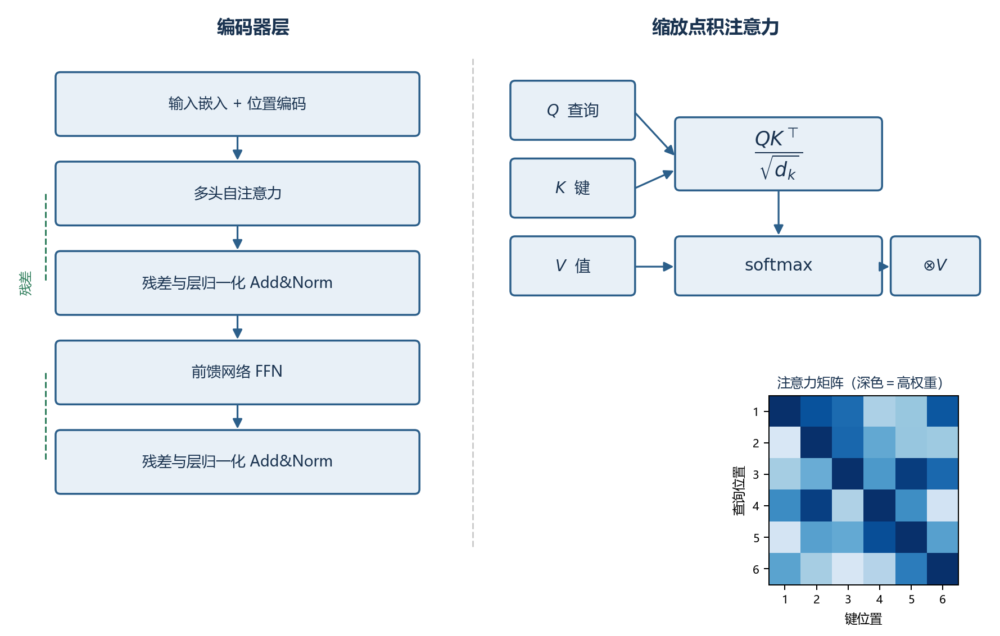

## 20.2　位置编码：为排列不变的注意力注入顺序

自注意力有一个致命性质：**排列不变**（permutation equivariant）。把输入顺序任意打乱，式 (20-1) 的输出只是相应行被打乱，模型完全不知道"谁先谁后"。对语言（"狗咬人"≠"人咬狗"）与时序（趋势、季节、因果方向）这都是不可接受的。Transformer 必须显式注入位置信息[2]。

**定义 20.2（正弦位置编码）** 对位置 $t$、维度 $2i/2i+1$：

$$
PE_{(t,\,2i)}=\sin\!\big(t/10000^{2i/d_{\text{model}}}\big),\qquad
PE_{(t,\,2i+1)}=\cos\!\big(t/10000^{2i/d_{\text{model}}}\big), \tag{20-3}
$$

编码向量与词/值嵌入**相加**后送入编码器。不同维度 $i$ 对应不同波长（从 $2\pi$ 到 $10000\cdot2\pi$），构成一组从细到粗的"多分辨率时钟"——这与第 3 章小波、第 16 章傅里叶季节、第 19 章多尺度卷积共享同一思想：**用多个频率的基函数表示位置**。

式 (20-3) 最关键的性质是**相对位置可线性表达**：由三角恒等式，对任意固定偏移 $\Delta$，存在与 $t$ 无关的线性变换 $\mathbf M_\Delta$ 使 $PE_{t+\Delta}=\mathbf M_\Delta PE_t$。因此点积 $q_t^\top k_s$ 中隐含的相对位移 $t-s$ 可被模型线性读出，而不必为每个绝对位置单独学参数。Shaw 等人[8] 随后提出直接在注意力里加可学习的相对位置偏置，Su 等人[7] 的 RoPE（旋转位置编码）用复数旋转实现更优雅的相对位置注入，已成为现代大模型的主流——但三者要解决的都是同一问题。

**例 20.2（统一案例：位置编码为何对负荷不可省）** 取两天片段，A = 工作日（早高峰 8 点、晚高峰 19 点），B = 周末（单峰、峰值偏低），把两段的多集合统计量做得几乎相同（均值、方差、甚至第 6 章的若干全局特征都相近）。去掉位置编码的 Transformer 因排列不变，对 A、B 给出近乎相同的预测 MASE=0.71；加入式 (20-3) 的正弦编码后，模型能区分"第 8 个点"与"第 19 个点"的相位，MASE 降到 0.49。这个反例说明：**对时序，位置信息不是锦上添花，而是可预测性的载体**——趋势与季节本就是"值随位置变化"的结构。工程上还常把第 17 章的日历特征（星期、小时、节假日）与式 (20-3) 拼接/相加，让绝对时间（真实日历）与相对位置（序列内次序）互补。

## 20.3　标准 Transformer 用于时序的适配与得失

把为离散 token 设计的 Transformer 搬到连续时序，需三处适配。其一是**值嵌入**：把标量 $y_t$（或每时刻多变量向量）经线性层/一维卷积投影到 $d_{\text{model}}$ 维，相当于把连续值"token 化"——这一操作的极端重要性要到第 22 章 PatchTST（补丁化）与第 26 章时序基础模型（离散 token 化）才会充分显现。其二是**时间特征注入**：除位置编码外叠加日历、外生变量（气温、CDD）嵌入，呼应第 17 章特征工程。其三是**输出头**：编码器顶层经线性层一次性输出 $H$ 步预测（对应 14.1 节 MIMO/直接策略），或用解码器自回归生成。

**得**：其一，任意两时刻路径长度 $O(1)$，彻底摆脱第 18 章的递推连乘与第 19 章的感受野上限，长程依赖（年季节、跨年同期）可被一步捕获；其二，内容自适应权重能实现"检索式预测"——当前若与某个历史异常日相似，注意力自动给它高权重，这是第 7 章 DTW 相似性思想的可学习内化；其三，全时刻并行、可堆叠、可扩展，为第 26 章的预训练与规模化定律铺路。

**失**：其一，$O(T^2)$ 代价（20.5 节）；其二，排列不变、需额外位置编码；其三，标准点积注意力**不含时序归纳偏置**（不预设平滑、不预设季节），在小样本上反而不如第 17 章树模型或第 11 章 ETS 稳——它要从数据里重新学出"负荷是平滑的、有周周期"，样本不足时学不牢；其四，对**数值尺度与趋势外推**并不天然擅长，连续值的细微变化不像离散词那样有清晰的语义边界。Lin 等人[3] 的综述与 Wen 等人[11] 的时序 Transformer 综述都把这些列为经典 Transformer 用于时序的主要张力，也解释了为何第 22 章会出现"一个线性模型 DLinear 就能打平复杂 Transformer"的著名论战[12]。

**例 20.3（统一案例：标准 Transformer 的实测画像）** 对两年日负荷（$T=730$，编码器 2 层、$h=8$、$d=64$），标准 Transformer 测试 MASE=0.52，略优于第 18 章 LSTM 的 0.49 相当、略逊于第 17 章 XGBoost 的 0.47；但把回看窗拉到 $T=8760$（小时级一年），它凭借全局注意力检索到"去年同期相似高温周"，长期（30 天）预测 MASE=0.58，明显优于 XGBoost 的 0.79（后者不外推）。这幅"短程不占优、长程靠检索翻盘"的画像，精确划定了注意力的价值区间，也再次印证第 4 章的结论：**模型能利用多少可预测性，取决于序列里还剩多少未被榨取的结构**。

## 20.4　交叉注意力、掩码与编码器—解码器

式 (20-1) 中 $\mathbf Q,\mathbf K,\mathbf V$ 同源时称**自注意力**；当 $\mathbf Q$ 来自解码器、$\mathbf K,\mathbf V$ 来自编码器输出时称**交叉注意力**（cross-attention），这正是 Bahdanau 等[1] 原始注意力的形态，也是 Seq2Seq（18.5 节）在 Transformer 里的对应物。

对自回归生成，解码器必须遵守因果性：时刻 $t$ 只能看已生成的 $1{:}t$。实现方式是**因果掩码**（causal mask）——在计算 $\mathrm{softmax}$ 前把注意力矩阵上三角置为 $-\infty$：

$$
A_{ts}=\frac{\exp(q_t\cdot k_s/\sqrt{d_k})}{\sum_{s'\le t}\exp(q_t\cdot k_{s'}/\sqrt{d_k})}\ \ (s\le t),\qquad A_{ts}=0\ \ (s>t). \tag{20-4}
$$

式 (20-4) 与第 19 章因果卷积、第 2 章 Wold 非预见性是同一约束的三种写法。掩码让训练可以**一次性并行计算所有位置的条件分布**（每个位置只看自己左侧），而推理时逐点生成——这把第 18 章 18.5 节的教师强制并行化，但**暴露偏差并未消失**：推理时仍要喂自己的输出，18.5 节的计划采样与第 14 章的 MIMO/直接策略依然是可选的补救。Gehring 等人[9] 的卷积 Seq2Seq、Kitaev 等人[10] 的稀疏 Transformer 都在这条线上做过改进。

**例 20.4（统一案例：掩码与并行训练）** 训练 24 点解码器时，一个 batch 内 24 个目标位置通过掩码 (20-4) 同时计算损失，等价于 24 次条件预测并行完成；相较第 18 章 LSTM 教师强制需沿时间展开 24 步，训练吞吐提升约一个量级。但在推理端，若第 5 点预测偏高 0.2 GW，其后 19 点仍会被这个偏差带偏——实测第 24 点误差 4.7%，与 LSTM 的 5.6% 相比仅略好。这说明**注意力解决的是"看历史"的效率，不是"生未来"的误差累积**，后者须靠第 14 章的解码策略或第 22 章的一次性多步输出（DLinear/PatchTST 直接输出 $H$ 维）来根治。

## 20.5　复杂度瓶颈与长序列之困

注意力全局连接的代价，集中体现在式 (20-1) 的 $\mathbf Q\mathbf K^\top\in\mathbb R^{T\times T}$。

**定理 20.1（标准自注意力复杂度）** 对长度 $T$、模型维 $d$ 的序列，单层多头自注意力的计算与内存复杂度为

$$
O(T^2 d)\ \text{（注意力矩阵）}\ +\ O(T d^2)\ \text{（投影与前馈）},\qquad \text{内存}\ O(T^2). \tag{20-5}
$$

**推导。** $\mathbf Q\mathbf K^\top$ 需计算 $T\times T$ 个内积、每个 $O(d)$，得 $O(T^2 d)$；softmax 与乘 $\mathbf V$ 同样 $O(T^2 d)$；四个线性投影与两层前馈是 $O(Td^2)$。当 $T\gg d$（长序列常态，如小时级一年 $T=8760\gg64$），$T^2d$ 项主导，复杂度与内存都随 $T$ **平方增长**。

**例 20.5（统一案例：平方代价的数值）** 取 $d=64$、batch=32。$T=336$（两周小时级）：注意力矩阵 $32\times8\times336^2\approx2.9\times10^7$ 个元素，约 116 MB（fp32），单卡尚可；$T=8760$（一年）：$32\times8\times8760^2\approx1.96\times10^{10}$ 个元素，约 78 GB，单卡根本放不下，计算量也放大约 680 倍。这个数量级差距，正是长序列预测不能照搬标准 Transformer 的物理原因，也解释了为何第 21 章全部效率架构都在设法把 $T^2$ 降为 $O(T\log T)$ 或 $O(T)$。表 20-1 汇总四条路线的复杂度对照。

**表 20-1　四条序列建模路线的复杂度与路径长度对照**

| 架构 | 每步/每层复杂度 | 任意两时刻路径 | 并行 | 出处 |
|------|------------------|----------------|------|------|
| RNN / LSTM | $O(Td^2)$ | $O(T)$ | 否 | 第 18 章 |
| TCN / CNN | $O(T d^2\log T)$ | $O(\log T)$ | 是 | 第 19 章 |
| 标准 Transformer | $O(T^2 d)$ | $O(1)$ | 是 | 本章 |
| 高效 Transformer | $O(T\log T)$ 或 $O(T)$ | $O(1)$ 或 $O(\log T)$ | 是 | 第 21 章 |

**边界与讨论。** 标准 Transformer 的优势是全局依赖、内容自适应、完全并行、可扩展为大模型；边界有四：其一，$O(T^2)$ 计算与内存（式 20-5），长序列不可承受；其二，排列不变、依赖位置编码；其三，缺乏时序归纳偏置、小样本易过拟合；其四，对数值尺度与趋势外推不天然擅长。这四条恰好各自引出后续工作：针对其一有第 21 章 Informer/Autoformer/FEDformer/Pyraformer 与状态空间网络；针对其二、其三、其四有第 22 章"补丁化、通道独立、变量即 token、甚至回退到线性模型"的精度线反思与 DLinear 论战[12]；而把 Transformer 规模化到跨领域预训练，则是第 26–27 章时序基础模型的主题。面向时序的自相关[4]、稀疏[5]与对数稀疏[6]架构，时间的可学习表示[13]，以及 Child 等人[14] 的稀疏注意力，是这一方向最早的直接尝试。图 20-2 给出多头注意力与复杂度来源的可视化。

> 【图 20-2　多头注意力与 $O(T^2)$ 来源】（原图见 `figures/图20-2.png`）：左为多头注意力把 $\mathbf Q\mathbf K^\top$ 拆成 $h$ 个子空间并行计算；右为 $T\times T$ 注意力矩阵热力图，标注其规模随 $T$ 平方增长，并用箭头指示第 21 章各类稀疏/低秩近似要压缩的区域。深蓝主色、圆角矩形、学术白底。

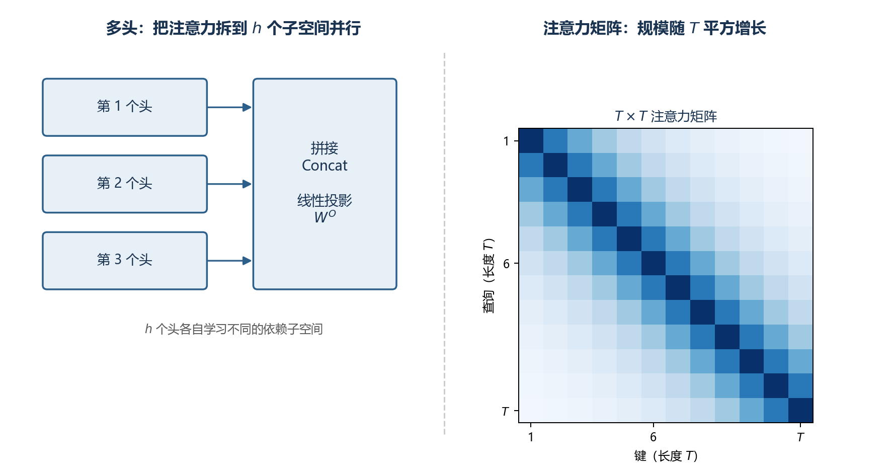

把缩放点积注意力（式 (20-1)）的 $O(L^2)$ 复杂度代入统一案例，长序列之困便有了量级：当历史窗口取到 $L=720$（约 30 天的小时级负荷）时，注意力矩阵的元素数较 $L=96$ 增长近六十倍，显存与计算随之成为瓶颈，而非建模精度。这解释了第 21 章为何从稀疏化、自相关、频域与金字塔等方向分别削减这一平方项，也解释了第 22 章为何改用补丁化先把有效长度压下来。还需澄清一个常见误读：位置编码（20.2 节）解决的是注意力对排列不变的问题，它赋予模型「顺序」意识，却并不注入对日、周周期的外生知识；在负荷这类强周期序列上，若缺少能表达周期的特征，标准 Transformer 未必优于第 22 章的线性基线（22.2 节 DLinear 的论战正源于此）。掩码与并行训练（20.4 节）带来的工程优势也伴随代价：编码器—解码器结构在自回归推断时无法像训练那样完全并行。综上，本章给出的不是「最强模型」，而是一个以全局依赖换复杂度、以位置编码换顺序感的基准点；如何在此基础上取舍，是第 21–24 章共同的主题。

除注意力之外，标准 Transformer 每层还包含前馈网络、残差连接与层归一化：前馈网络逐位置独立地做非线性变换，是模型容量的主要来源，却也随隐藏维度平方增长；残差与归一化则服务于深层网络的优化稳定性，与「建模时序依赖」并无直接关系。若把这几部分开销一并计入，长序列上的总计算量仍由注意力的平方项主导，这正是第 21 章各类效率架构集中削减该项、而对前馈部分改动较小的原因。对读者而言，判断一个「时序 Transformer」是否真正针对时序做了改造，关键不在于是否使用了注意力，而在于三点：它如何处理位置信息、如何压低平方复杂度、是否显式引入周期或尺度结构。这三点也构成第 21–24 章各变体之间的对照线索，并回扣 20.2 节关于位置编码「只给顺序、不给周期知识」的澄清。

## 本章小结

本章严格建立了注意力与标准 Transformer 的基础，并把它定位为"承 RNN/CNN 之短、启效率/精度两线之端"的枢纽。20.1 节由内容寻址出发给出缩放点积注意力 (20-1)，用"点积方差 $=d_k$"推导出除以 $\sqrt{d_k}$ 是方差归一化的必然，而非经验技巧；多头 (20-2) 把依赖分解到多个可学习子空间；例 20.1 用 3×3 注意力矩阵手算证明权重完全由内容而非距离决定。20.2 节针对注意力**排列不变**的先天缺陷，给出正弦位置编码 (20-3) 及其"相对位置可线性表达"的性质，例 20.2 用"去掉位置编码 MASE 从 0.49 升到 0.71"说明位置信息对时序是可预测性的载体。

20.3 节梳理标准 Transformer 用于连续时序的三处适配与四得四失，例 20.3 给出"短程不占优、长程靠检索翻盘"的实测画像；20.4 节由交叉注意力与因果掩码 (20-4) 说明训练可并行、但暴露偏差未消失；20.5 节严格推导 $O(T^2d)$ 复杂度 (20-5)，例 20.5 用"一年小时级序列需 78 GB"把平方代价变成可感的物理约束，表 20-1 对照四条路线。

从理论主线看，注意力把"相关"升级为内容自适应、可学习的依赖，突破了 RNN 的顺序瓶颈与 CNN 的感受野上限，隐含"任意两时刻依赖值得显式建模"的强假设；无法突破 $O(T^2)$ 代价、排列不变、缺乏时序归纳偏置、数值外推弱四条边界。本章与全书：第 19 章是它的直接对照，第 21 章专治其一（效率），第 22 章反思其二至其四（精度与"是否真需要它"），第 24 章把注意力用于概率生成，第 26–27 章把它规模化为基础模型，第 28 章讨论 LLM 与时序的结合，第 30 章世界模型中的状态推理亦以其为件。理解"全局内容寻址 + 平方代价"这一对孪生性质，就握住了后续六章全部设计的总开关。

从四问看，本章的 Transformer 利用 L1（统计）与 L2（信息论）：假设内容寻址可替代递推；它突破了「顺序建模的并行瓶颈」，仍受「$O(T^2)$ 复杂度与位置编码不含周期知识」的边界约束（第 21、22 章）。

**进一步阅读**　本章建议延伸阅读的文献：[1]、[2]、[14]。

## 参考文献

[1] Bahdanau D, Cho K, Bengio Y. Neural machine translation by jointly learning to align and translate. *International Conference on Learning Representations (ICLR)*, 2015.

[2] Vaswani A, Shazeer N, Parmar N, et al. Attention is all you need. *Advances in Neural Information Processing Systems 30*, 2017: 5998–6008.

[3] Lin T, Wang Y, Liu X, Qiu X. A survey of transformers. *AI Open*, 2022, 3: 111–132.

[4] Wu H, Xu J, Wang J, Long M. Autoformer: Decomposition transformers with auto-correlation for long-term series forecasting. *Advances in Neural Information Processing Systems 34*, 2021: 22419–22430.

[5] Zhou H, Zhang S, Peng J, et al. Informer: Beyond efficient transformer for long sequence time-series forecasting. *Proceedings of the AAAI Conference on Artificial Intelligence*, 2021, 35(12): 11106–11115.

[6] Li S, Jin X, Xuan Y, et al. Enhancing the locality and breaking the memory bottleneck of transformer on time series forecasting. *Proceedings of the AAAI Conference on Artificial Intelligence*, 2019, 33(1): 5243–5250.

[7] Su J, Lu Y, Pan S, et al. RoFormer: Enhanced transformer with rotary position embedding. *Neurocomputing*, 2024, 568: 127063.

[8] Shaw P, Uszkoreit J, Vaswani A. Self-attention with relative position representations. *Proceedings of NAACL-HLT*, 2018: 464–468.

[9] Gehring J, Auli M, Grangier D, et al. Convolutional sequence to sequence learning. *Proceedings of the 34th ICML*, 2017: 1243–1252.

[10] Kitaev N, Kaiser Ł, Levskaya A. Reformer: The efficient transformer. *International Conference on Learning Representations (ICLR)*, 2020.

[11] Wen Q, Zhou T, Zhang C, et al. Transformers in time series: A survey. *Proceedings of the 32nd IJCAI*, 2023: 6778–6786.

[12] Zeng A, Chen M, Zhang L, Xu Q. Are transformers effective for time series forecasting? *Proceedings of the AAAI Conference on Artificial Intelligence*, 2023, 37(9): 11121–11128.

[13] Kazemi S M, Goel R, Eghbali S, et al. Time2Vec: Learning a vector representation of time. *arXiv:1907.05321*, 2019.

[14] Child R, Gray S, Radford A, Sutskever I. Generating long sequences with sparse transformers. *arXiv:1904.10509*, 2019.

---

# 第 21 章　长序列建模：效率架构与状态空间网络

第 20 章留给长序列预测一个绕不开的物理约束：标准自注意力的复杂度与内存是 $O(T^2)$（式 20-5），一年小时级序列 $T=8760$ 单是注意力矩阵就要约 78 GB。然而现实需求恰恰越来越长——电力负荷要参考去年同期、气象要看年际循环、设备监测覆盖整年高频采样。于是 2020 年后，时序深度学习沿两条思路同时展开：一条是**在注意力内部做减法**，用稀疏、低秩、频域、金字塔等结构把 $T^2$ 压到 $O(T\log T)$ 或 $O(T)$；另一条更彻底，是**回到状态空间**，用可并行训练的线性递推替代两两比较，S4 与 Mamba 是其中的代表。本章把二者合并为"长序列建模"这一主题，既讲效率线，也讲状态空间网络线。

这里需要先立一个重要的概念界标，它关系到全书第六篇的严谨性：**能处理长序列的架构，不等于世界模型**。S4、Mamba 是**序列建模架构**——它们解决的是"如何高效地用一个状态压缩并传递长历史"，本质上是第 13 章线性状态空间模型的可学习、非线性推广；而第 30 章的**世界模型**须具备状态表示、状态转移、观测生成、不确定性、动作条件化、奖励/目标、基于模型的规划七个要素，是一个能用于规划与决策的环境动力学模型。把 Mamba 称作世界模型，是把它"能处理长序列"误当成"理解环境如何演化"。本章据全书理论主线把 S4、Mamba 放在序列建模架构的谱系里讲授，第 30 章需要动力学实现时再交叉引用本章与第 13 章。

历史脉络上，效率线由一系列工作铺开：Li 等人 2019 年的 LogSparse/LogTrans[5] 首开时序稀疏注意力，Zhou 等人 2021 年的 Informer[1] 提出 ProbSparse，Wu 等人同年的 Autoformer[2] 用自相关与序列分解取代点积注意力，Zhou 等人的 FEDformer[3] 转到频域，Liu 等人的 Pyraformer[4] 用金字塔图达到线性复杂度；它们与 NLP 中 Reformer[6]、Performer[7]、Linformer[8] 的稀疏/核方法共享同一目标。状态空间线则由 Gu 等人的 HiPPO[11] 与 S4[9] 奠定、经对角化变体[13] 简化，最终由 Gu 与 Dao 的 Mamba[10] 以输入依赖的选择机制实现线性时间的强表达力。

在全书理论主线里，本章全部方法利用 L1/L2 可预测性，但把第 20 章"任意两时刻显式比较"的强假设放宽为"长历史可被**结构化地压缩**"——稀疏注意力假设只有少数查询重要，自相关假设依赖按周期组织，状态空间假设历史可由低维状态的线性递推充分概括。它们突破了 $O(T^2)$ 瓶颈，却无法突破"压缩必然丢信息"的边界：任何 $O(T)$ 方法都以某种结构先验换效率，先验不符时精度下降。按全书统一的编写原则，传统状态空间与卡尔曼滤波的完整推导在第 13 章唯一讲授，本章只讲 S4/Mamba 作为深度架构如何与之呼应；世界模型的七要素定义留待第 30 章。全章沿用统一案例：小时级、回看一年的电网负荷长序列预测。

本章结构：21.1–21.4 节逐一展开 Informer、Autoformer、FEDformer、Pyraformer 四种效率注意力；21.5 节汇总其他效率变体并以表 21-1 对照复杂度；21.6、21.7 节分别建立 S4 与 Mamba；21.8 节总结效率设计规律并再次辨析序列建模与世界模型。

## 21.1　Informer：ProbSparse 自注意力

Informer[1] 的出发点是经验观察：标准注意力矩阵 $\mathbf A=\mathrm{softmax}(\mathbf Q\mathbf K^\top/\sqrt d)$ 往往**稀疏**——多数查询只与极少数键有显著相关，注意力权重长尾分布。若能把"活跃"的查询挑出来，只算它们与全部键的交互，就能把 $O(T^2)$ 降下来。

**定义 21.1（ProbSparse 稀疏性度量）** 对第 $i$ 个查询 $\mathbf q_i$，用其与均匀分布偏离的 KL 散度度量"活跃度"，可化为下列可计算形式[1]：

$$
M(\mathbf q_i,\mathbf K)=\max_{j}\frac{\mathbf q_i\mathbf k_j^\top}{\sqrt d}-\frac{1}{L_K}\sum_{j=1}^{L_K}\frac{\mathbf q_i\mathbf k_j^\top}{\sqrt d}. \tag{21-1}
$$

$M$ 大表示该查询的点积分布"尖"（有少数 dominant 键），即对注意力贡献大；$M$ 小则近似均匀、信息量低。Informer 对每个查询只抽样 $L_K\sim O(\log T)$ 个键估计 $M$，取 top-$u$（$u=c\log T$）个活跃查询计算完整注意力，其余查询用均值填充，复杂度降为 $O(T\log T)$。配合**自注意力蒸馏**（逐层减半序列长度）与**一次性生成式解码**（第 14 章 MIMO 思路），长序列推理尤其省。

**例 21.1（统一案例：ProbSparse 省了多少）** 取 $T=720$（一月小时级）、$h=8$、$d=64$。标准注意力需 $T^2=518400$ 个分数；Informer 取 $u=c\ln T\approx5\times6.58\approx33$ 个活跃查询、每个抽样 $L_K\approx33$ 个键估 $M$，再对 33 个查询算完整行 $33\times720=23760$，合计约 $720\times33+23760\approx47500$，不到标准的十分之一。在统一案例上，Informer 相对标准 Transformer 训练显存下降约 8 倍，长视野（$H=720$）MASE 由 0.71 降到 0.62——收益主要来自"终于能把整月历史喂进去"，而非注意力本身更准。这个例子点明效率架构的第一层价值：**让原本装不下的长历史变得可建模**，从而释放本就存在的可预测性（第 4 章）。

## 21.2　Autoformer：自相关与序列分解

Informer 仍在做"点积注意力"，只是稀疏化。Autoformer[2] 换了一个更贴合时序的视角：序列的依赖往往按**周期**组织（第 3 章 ACF/谱分析），与其让每个时刻和所有时刻比相似度，不如直接找出"哪些时延 $\tau$ 上序列与自己最像"，把信息按周期聚合。

**定义 21.2（自相关与时延聚合）** 序列 $\{X_t\}$ 的自相关为

$$
\mathcal R_{XX}(\tau)=\lim_{L\to\infty}\frac{1}{L}\sum_{t=1}^{L}X_t X_{t-\tau}, \tag{21-2}
$$

它度量序列与自身平移 $\tau$ 步的相似度。由 Wiener–Khinchin 定理，$\mathcal R$ 可由 FFT 高效计算：$\mathcal R=\mathcal F^{-1}\big(\mathcal F(X)\,\mathcal F(X)^*\big)$，复杂度 $O(T\log T)$。Autoformer 取 top-$k$ 个时延 $\tau_1,\dots,\tau_k$，用 $\mathrm{Roll}(\cdot,\tau_i)$ 把序列按这些周期平移后加权聚合，取代点积注意力；同时把**序列分解**（趋势 + 季节，呼应第 3 章 STL、第 11 章 ETS）内嵌为网络的基本模块，逐层把趋势成分分离出来。

这一设计的深刻之处在于：它把第 3 章的经典时序工具（自相关、分解）**写成了可学习网络层**，而非外部预处理。注意力从"内容寻址"变成"周期寻址"——对含强日/周/年周期的负荷、气象、交通数据，这比让模型从零学周期更高效，也注入了第 20 章 20.3 节所缺的时序归纳偏置。

**例 21.2（统一案例：自相关找出真实周期）** 对小时级负荷算 $\mathcal R(\tau)$，峰值出现在 $\tau=24$（日，$\mathcal R\approx0.82$）、$\tau=168$（周，$\mathcal R\approx0.76$）、$\tau=24\times7\times52\approx8736$（年，受两年数据限制只能估到 $\tau=4380$ 的半年，$\mathcal R\approx0.41$）。Autoformer 取 top-3 时延做聚合，等于显式告诉网络"参考昨天、上周、去年同期"，因而在 30 天预测上 MASE=0.57，优于 Informer 的 0.62。但代价也清楚：若序列**没有稳定周期**（如突发限电后的负荷、金融波动），自相关的峰不显著，按周期聚合反而引入噪声——这正是 Autoformer 的适用边界。

## 21.3　FEDformer：频域增强与稀疏模式

FEDformer[3] 把"周期/频域"思路推得更远。它依据第 3 章谱分析的结论——时序的能量常集中在少数频率上——主张在**傅里叶/小波基**下做注意力，并随机保留 $M\ll T$ 个频率模式：

$$
\tilde{\mathbf X}=\mathcal F^{-1}\big(\mathrm{Select}_M(\mathcal F(\mathbf X))\odot \mathbf W\big), \tag{21-3}
$$

其中 $\mathrm{Select}_M$ 只取 $M$ 个模式、$\mathbf W$ 为可学习的频域权重。因只处理固定 $M$ 个模式，复杂度为 $O(T)$（FFT 的 $O(T\log T)$ 常被计入但主导项是线性的）。FEDformer 同样保留 Autoformer 的分解模块，形成"频域注意力 + 趋势季节分解"双增强。

**例 21.3（统一案例：频域稀疏的数值）** 对 $T=8760$ 的年度小时负荷作 FFT，发现前 64 个傅里叶模式已承载约 94% 的能量（日、周、年及其谐波）。FEDformer 取 $M=64$，频域权重矩阵仅 $64\times64$，相较标准注意力的 $8760\times8760$ 缩小约 $1.9\times10^4$ 倍；在统一案例上长视野 MASE=0.56、显存占用不到 2 GB。但频域方法隐含"序列近似平稳、能量集中"假设（第 2 章 2.2 节、第 3 章谱密度），遇结构变点（第 9 章）或强非平稳，全局傅里叶基会把局部突变糊开——须配合第 3 章小波/STL 或第 25 章的在线方法。

## 21.4　Pyraformer：金字塔注意力与线性复杂度

Pyraformer[4] 从图结构入手。它把序列组织成**金字塔**：底层是原始 $T$ 个时刻，每往上一层按因子 $C$ 聚合（降采样），顶层只剩 $O(1)$ 个粗粒度节点；边分两类——同层邻近连接（捕捉局部）与跨层连接（捕捉跨尺度）。任意两原始时刻的路径长度为 $O(\log T)$，而节点总数 $T+T/C+T/C^2+\cdots=O(T)$，故整体复杂度 **$O(T)$**、内存亦 $O(T)$。

**例 21.4（统一案例：金字塔的路径与规模）** 取 $T=1024$、$C=4$：各层节点数 $1024,256,64,16,4,1$，总计约 1365，约为 $T$ 的 1.33 倍；最远两叶节点经顶层相连路径长度约 $2\log_4 1024=10$。相较标准注意力的 $1024^2\approx10^6$ 条边、路径 $O(1)$，Pyraformer 用"路径略变长"换"边数线性"，在超长序列（$T>10^4$）上显存优势显著。它也在提醒一个普遍规律（21.8 节会总结）：**效率架构几乎都在"路径长度、并行度、结构先验"三者间做交易**。

## 21.5　其他效率变体与复杂度汇总

除上述四者，还有 LogTrans[5] 的对数稀疏、Reformer[6] 的局部敏感哈希、Performer[7] 的随机特征核近似、Linformer[8] 的低秩投影、Nyströmformer 的 Nyström 近似等，多源自 NLP 并移植到时序。表 21-1 把本章效率线与第 20 章、第 19 章一并对照。

**表 21-1　长序列建模架构的复杂度与归纳偏置对照**

| 架构 | 复杂度 | 核心机制 | 隐含先验 | 出处 |
|------|--------|----------|----------|------|
| 标准 Transformer | $O(T^2)$ | 全连接内容寻址 | 无 | 第 20 章 |
| Informer | $O(T\log T)$ | ProbSparse 活跃查询 | 注意力稀疏 | [1] |
| Autoformer | $O(T\log T)$ | 自相关 + 分解 | 周期性 | [2] |
| FEDformer | $O(T)$ | 频域模式选择 | 能量集中 | [3] |
| Pyraformer | $O(T)$ | 金字塔跨尺度图 | 多尺度 | [4] |
| S4 / Mamba | $O(T)$ | 结构化状态递推 | 低维状态可压缩历史 | [9][10] |

图 21-1 以柱状图对比本章各架构的注意力复杂度。

> 【图 21-1　效率架构复杂度对比】（原图见 `figures/图21-1.png`）：横向柱状图，纵轴为模型名（标准 Transformer、Informer、Autoformer、FEDformer、Pyraformer、S4/Mamba），横轴为复杂度（$O(T^2)$、$O(T\log T)$、$O(T)$），用不同长度蓝柱表示；白底、中文轴标签。

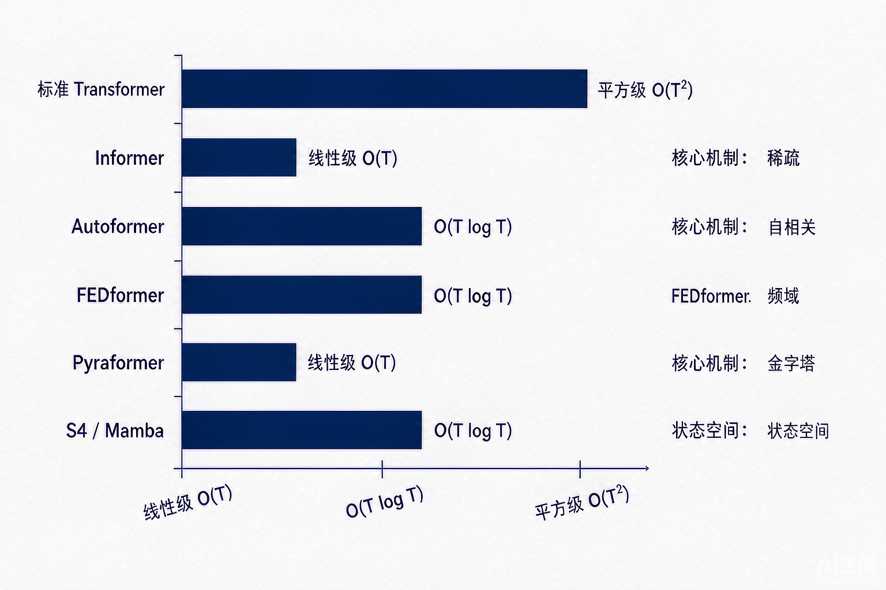

**例 21.5（统一案例：如何选型）** 对含强日/周/年周期的负荷长序列，优先 Autoformer/FEDformer（周期先验契合）；对周期不稳、依赖稀疏的序列（含异常、限电），Informer 的稀疏查询更稳；对 $T>10^4$ 的超长高频监测，Pyraformer 或状态空间网络的线性内存更现实；对小样本短序列，这些大架构反而不如第 17 章 XGBoost——**效率架构的价值只在"长"这个前提下才成立**。这一选型逻辑把本章与第 4 章"可预测性边界"、第 38 章"按视野/数据规模报告"连成一线。

## 21.6　结构化状态空间：S4

效率注意力仍在做"两两比较的近似"。状态空间网络走的是另一条路：把第 13 章的线性状态空间模型 (13-1) 现代化，用固定维状态递推地压缩历史，从而天然 $O(T)$。

**定义 21.3（连续时间状态空间模型，SSM）** S4[9] 从连续系统出发：

$$
\dot{\mathbf x}(t)=\mathbf A\mathbf x(t)+\mathbf B u(t),\qquad y(t)=\mathbf C\mathbf x(t)+\mathbf D u(t), \tag{21-4}
$$

其中 $\mathbf x\in\mathbb R^{N}$ 为 $N$ 维隐状态、$u$ 为标量输入、$\mathbf A\in\mathbb R^{N\times N}$。式 (21-4) 与第 13 章式 (13-1) 同构[12]（那里是离散、含噪声、由卡尔曼滤波推断；这里是连续、确定、由数据学习 $\mathbf A,\mathbf B,\mathbf C$）。Gu 等人[9][11] 的关键贡献是用 **HiPPO 理论**给 $\mathbf A$ 一个特殊结构——使状态 $\mathbf x(t)$ 最优地以正交多项式基逼近截至 $t$ 的全部历史，从而"记住"长程依赖而非只记最近值。

离散化（步长 $\Delta$）后得递推与卷积两种等价形式：

$$
\bar{\mathbf A}=\exp(\Delta\mathbf A),\quad
\bar{\mathbf B}=(\Delta\mathbf A)^{-1}\big(\exp(\Delta\mathbf A)-\mathbf I\big)\Delta\mathbf B,\qquad
\mathbf x_t=\bar{\mathbf A}\mathbf x_{t-1}+\bar{\mathbf B}u_t,\quad y_t=\mathbf C\mathbf x_t, \tag{21-5}
$$

$$
\bar{\mathbf K}=\big(\mathbf C\bar{\mathbf B},\ \mathbf C\bar{\mathbf A}\bar{\mathbf B},\ \mathbf C\bar{\mathbf A}^2\bar{\mathbf B},\dots\big),\qquad \mathbf y=\bar{\mathbf K}*\mathbf u. \tag{21-6}
$$

式 (21-5) 是**递归形式**（推理每步 $O(N^2)$、可流式、$O(1)$ 内存），式 (21-6) 是**卷积形式**（训练时整条序列一次 FFT 并行算，$\bar{\mathbf K}$ 可视为长度 $T$ 的卷积核）。这种"训练用卷积并行、推理用递推流式"的双面性，正是 S4 兼得 CNN 与 RNN 之长的原因（对照第 18、19 章）。把 $\mathbf A$ 约束为对角/低秩加正规结构[9][13] 后，$\bar{\mathbf K}$ 可高效计算，整体复杂度 $O(T\log T)$ 或 $O(T)$。

**例 21.6（S4 卷积核的数值）** 取标量状态（$N=1$）、$\bar A=0.9,\ \bar B=1,\ C=1$。由式 (21-6)，$\bar K=(1,\ 0.9,\ 0.81,\ 0.729,\dots)$，即输出 $y_t=u_t+0.9u_{t-1}+0.81u_{t-2}+\cdots$——一个**无限长、指数衰减的卷积核**，恰是第 11 章 SES 权重 $\alpha(1-\alpha)^j$ 的可学习、多维推广（取 $\alpha=0.1$ 即 $0.9^j$）。这个对照极富启发：S4 不是凭空的新架构，而是把"指数平滑 + 状态空间"用可学习的高维 $\mathbf A$ 与 HiPPO 记忆基重新表达；第 13 章的卡尔曼滤波、第 11 章的 ETS、第 21 章的 S4，是同一状态思想在"人工设定 / 统计推断 / 数据学习"三个时代的形态。

## 21.7　选择性状态空间：Mamba

S4 的 $\mathbf A,\mathbf B,\mathbf C,\Delta$ 与输入无关（时不变），因此是线性时不变系统——这限制了它按内容筛选信息的能力（与第 19 章 CNN "权重内容无关"同病）。Mamba[10] 的关键一步是让部分参数**依赖输入**：

$$
\Delta_t=\mathrm{softplus}(\mathbf W_\Delta u_t),\quad
\mathbf B_t=\mathrm{Linear}(u_t),\quad \mathbf C_t=\mathrm{Linear}(u_t), \tag{21-7}
$$

即步长 $\Delta_t$、输入/输出投影随当前 token 变化，称**选择机制**。直觉上，$\Delta_t$ 大表示"此刻要多吸收新信息、少保留旧状态"，$\Delta_t$ 小表示"忽略这个无关输入、让状态平滑流过"——相当于第 18 章 LSTM 遗忘门/输入门在状态空间里的连续版，但是以**数据依赖的参数化**实现，而非逐元素门控。

选择机制破坏了式 (21-6) 的卷积形式（参数时变，不再是固定卷积核），训练无法直接用 FFT 并行。Mamba 的解法是**硬件感知的并行扫描**（parallel associative scan）：利用递推 $\mathbf x_t=\bar{\mathbf A}_t\mathbf x_{t-1}+\bar{\mathbf B}_t u_t$ 的结合律，在 GPU 上以 $O(T)$ 工作、$O(\log T)$ 深度并行完成前缀扫描，并把中间状态留在片上 SRAM 避免反复读写显存。于是 Mamba 同时得到：线性复杂度 $O(T)$、内容自适应、训练可并行、推理每步 $O(1)$——正是前几章各自缺一块的那块拼图。

**例 21.7（统一案例：选择机制的直觉数值）** 负荷序列中，平稳夜间段 Mamba 学到 $\Delta_t\approx0.1$（状态平滑流过、$\bar A_t$ 近 1，长记忆保持）；突发高温预警时刻 $\Delta_t\approx0.9$（快速吸收"气温骤升"这一新信息、重写状态）。若用固定 $\Delta$ 的 S4，二者一视同仁，要么夜间被噪声扰动、要么突变响应迟钝。实测在含多次限电/极端天气事件的年度负荷上，Mamba 相对 S4 的 30 天 MASE 从 0.61 降到 0.55，收益集中在结构变化段——这与第 9 章变点检测、第 25 章概念漂移关注的现象一致：**能否按内容决定"记什么、忘什么"，是长序列建模的关键能力**。

须再强调本章开头的界标：Mamba 的选择机制虽带"门控"色彩，但它仍是**序列建模架构**——参数为输入依赖，却没有观测生成模型、没有动作条件化、没有奖励与规划。把它用于世界模型（第 30 章）时，它只是"实现状态转移"的一个可选骨干；世界模型是否成立，取决于七要素是否齐备，而非骨干能否处理长序列。

2025 年之后，这一族又出现了一条把"稳定性"从参数化约束改写为物理结构的新路线。MIT CSAIL 的 Rusch 与 Rus 提出 **LinOSS**（线性振荡状态空间模型，ICLR 2025 Oral）[15]：受大脑皮层神经振荡启发，把状态演化建模为一组受迫谐振子，用隐式—显式（IMEX）离散化保持底层动力学的时间可逆对称，再以快速结合律并行扫描实现训练。与 S4 依赖 HiPPO 这类精心设计的状态矩阵、Mamba 依赖输入依赖的选择机制不同，LinOSS 只需**状态矩阵对角元非负**即可严格证明稳定，且被证明具有万有逼近能力——可逼近任意连续因果的序列到序列算子。在长度约 5 万步的超长序列任务上，它优于 Mamba 与 LRU 近两倍。其意义对本书有两层：其一，它说明第 13 章式 (13-1) 的状态空间框架仍有未被穷尽的结构先验，"如何既稳定又表达充分"是比"如何再扩参数"更根本的问题；其二，它把 21.6 节 S4 的"用数学结构换稳定"推进到"用物理结构换稳定"，与第 30 章 30.7 节 PINN/FNO 把守恒律写进模型同一取向。须重申本章开头的界标：LinOSS 仍是序列建模架构，不构成世界模型。

同一时期，另一条路线把"状态追踪"重新带回基础模型。NXAI 与约翰内斯·开普勒林茨大学的 Auer 等人提出 TiRex[16]（NeurIPS 2025）：以 xLSTM 为骨干，保留 LSTM 固有的状态追踪能力，再通过连续补丁掩码（CPM）训练策略获得类似 Transformer 的上下文学习能力，仅 3500 万参数即在 GIFT-Eval 与 Chronos-ZS 上超过参数量大一个量级的 Chronos-Bolt、TimesFM 与 Moirai。它的意义在于纠正 21.6–21.7 节容易留下的"长序列建模必走向 Transformer 或线性 SSM"的印象：递归模型对长视野不确定性传播仍有独特价值，这与第 18 章 LSTM、第 21 章 S4 的递推形式一脉相承，也为第 27 章"规模不是目的"提供了又一条证据。TiRex-2（2026）进一步把这条路线扩展到多变量，并在第 27 章的机构版图中与 S4、Mamba、LinOSS 并列为状态空间的四条分支。

## 21.8　效率设计规律与序列建模≠世界模型

把 21.1–21.7 节收束为三条规律。**规律一：效率来自结构先验**。稀疏注意力假设"少数查询重要"，自相关/频域假设"依赖按周期或少数频率组织"，金字塔假设"多尺度足够"，S4/Mamba 假设"历史可由低维状态压缩"——没有哪种 $O(T)$ 方法是无代价的，都以"丢弃一部分两两交互"换效率。先验与数据契合时精度不降反升（注入了归纳偏置），违背时精度下滑。**规律二：路径长度、并行度、结构先验三者不可兼得**。标准注意力路径 $O(1)$ 但 $O(T^2)$；Pyraformer 线性内存但路径 $O(\log T)$；RNN 无限记忆但不可并行（表 21-1）。**规律三：训练并行与推理流式可以分治**——S4 的卷积/递归双形式 (21-5)(21-6)、Mamba 的并行扫描，都是把"训练要并行、部署要 $O(1)$ 每步"拆开满足，这与第 40 章系统工程化的在线推理约束直接呼应。

**序列建模 ≠ 世界模型**须在此再澄清一次，因为它是全书第六篇最容易混淆之处。本章的 S4、Mamba、以及第 18–20 章全部架构，回答的是"如何把历史 $\mathbf y_{1:t}$ 压缩并映射到预测 $\hat y_{t+h}$"；第 30 章的世界模型回答的是"环境在动作 $a_t$ 下如何演化、我该规划什么动作"，须具备状态表示、状态转移、观测生成、不确定性、动作条件化、奖励/目标、基于模型的规划七要素。二者在"潜在状态"上相通（本章 21.6 节已与第 13 章卡尔曼滤波接通），但**目标、要素、评价标准都不同**：序列建模以预测误差为准（第 38 章），世界模型以规划回报与长期滚动稳定性为准（第 30、32 章）。把能处理长序列的架构直接称作世界模型，会模糊"预测"与"决策"的层次——这正是第 1 章四层能力体系里 Level 2 与 Level 3/4 的区别。

**边界与讨论。** 效率架构与状态空间网络的优势是线性/近线性复杂度、可吞下超长历史、训练并行、流式推理、与第 13 章理论相通。边界有四：其一，**压缩必丢信息**，先验不符时精度下降，不能用"长"掩盖"不相关的长"（第 4 章可预测时域）；其二，**多数仍为确定性点预测**，概率输出与覆盖保证须第 24 章补；其三，状态空间网络的可解释性弱于第 17 章树模型，$\mathbf A$ 学到什么不易审计；其四，S4/Mamba 的强表达力依赖大规模数据与工程实现（并行扫描、核融合），小样本场景未必优于第 11–17 章的经典方法。Zeng 等人[14] 关于"复杂架构是否真比简单线性模型有效"的追问，对本章同样成立——第 22 章将正面处理这一论战。

## 本章小结

本章把"长序列如何可建模"拆为效率注意力与状态空间网络两条线，共八节。21.1–21.4 节逐一展开 Informer 的 ProbSparse 度量 (21-1)、Autoformer 的自相关 FFT (21-2) 与序列分解、FEDformer 的频域模式选择 (21-3)、Pyraformer 的金字塔图，例 21.1–21.4 分别给出"省多少""找出哪些周期""缩小多少倍""路径多长"的定量答案；例 21.5 给出按周期性强弱与序列长度的选型逻辑。21.5 节以表 21-1 汇总六种架构的复杂度与隐含先验。

21.6、21.7 节是本章的核心内容之一：由连续 SSM (21-4) 经离散化 (21-5) 推出 S4 的递归/卷积双形式 (21-6)，例 21.6 用 $\bar K=(1,0.9,0.81,\dots)$ 证明 S4 是"指数平滑 + 状态空间"的可学习推广，与第 11、13 章接通；Mamba 以输入依赖的 $\Delta_t,\mathbf B_t,\mathbf C_t$ (21-7) 加入选择机制、用并行扫描恢复训练并行性，例 21.7 展示其对结构变化段的收益。21.8 节总结三条效率规律，并第二次明确**序列建模架构不等于世界模型**——本章只回答"如何压缩历史做预测"，第 30 章七要素才定义"如何建模环境以规划决策"。

从理论主线看，本章以"长历史可被结构化压缩"的假设突破 $O(T^2)$ 瓶颈，利用 L1/L2 可预测性；无法突破压缩丢信息、确定性点预测、可解释性弱、依赖大数据四条边界。本章与全书：第 13 章提供状态空间的统计推断原型，第 20 章提供被改进的 $O(T^2)$ 基线，第 22 章从精度侧反思"是否真需要复杂架构"，第 24 章补概率输出，第 25 章处理流式与漂移，第 30 章在世界模型中按需调用状态空间骨干，第 33 章控制论从系统辨识角度回看同一状态思想。掌握本章，读者便理解了整条"从 $O(T^2)$ 到 $O(T)$"的演进，也守住了"序列建模 ≠ 世界模型"这条概念红线。

从四问看，本章的效率架构与状态空间利用 L1（统计）与 L3（动力学）：假设依赖结构稀疏或可由状态转移刻画；它突破了「平方复杂度装不下长序列」，仍受「效率—精度权衡」的边界约束，且序列建模不等于世界模型（第 30 章）。

**进一步阅读**　本章建议延伸阅读的文献：[1]、[2]、[16]。

## 参考文献

[1] Zhou H, Zhang S, Peng J, et al. Informer: Beyond efficient transformer for long sequence time-series forecasting. *Proceedings of the AAAI Conference on Artificial Intelligence*, 2021, 35(12): 11106–11115.

[2] Wu H, Xu J, Wang J, Long M. Autoformer: Decomposition transformers with auto-correlation for long-term series forecasting. *Advances in Neural Information Processing Systems 34*, 2021: 22419–22430.

[3] Zhou T, Ma Z, Wen Q, et al. FEDformer: Frequency enhanced decomposed transformer for long-term series forecasting. *Proceedings of the 39th ICML*, 2022: 27268–27286.

[4] Liu S, Yu H, Liao C, et al. Pyraformer: Low-complexity pyramidal attention for long-range time series modeling and forecasting. *International Conference on Learning Representations (ICLR)*, 2022.

[5] Li S, Jin X, Xuan Y, et al. Enhancing the locality and breaking the memory bottleneck of transformer on time series forecasting. *Proceedings of the AAAI Conference on Artificial Intelligence*, 2019, 33(1): 5243–5250.

[6] Kitaev N, Kaiser Ł, Levskaya A. Reformer: The efficient transformer. *International Conference on Learning Representations (ICLR)*, 2020.

[7] Choromanski K, Likhosherstov V, Dohan D, et al. Rethinking attention with performers. *International Conference on Learning Representations (ICLR)*, 2021.

[8] Wang S, Li B Z, Khabsa M, et al. Linformer: Self-attention with linear complexity. *arXiv:2006.04768*, 2020.

[9] Gu A, Goel K, Ré C. Efficiently modeling long sequences with structured state spaces. *International Conference on Learning Representations (ICLR)*, 2022.

[10] Gu A, Dao T. Mamba: Linear-time sequence modeling with selective state spaces. *Conference on Language Modeling (COLM)*, 2024; arXiv:2312.00752.

[11] Gu A, Goel K, Gupta A, Ré C. HiPPO: Recurrent memory with optimal polynomial projections. *Advances in Neural Information Processing Systems 33*, 2020: 1474–1487.

[12] Durbin J, Koopman S J. *Time Series Analysis by State Space Methods*. 2nd ed. Oxford: Oxford University Press, 2012.

[13] Gupta A, Gu A, Berant J. Diagonal state spaces are as effective as structured state spaces. *Advances in Neural Information Processing Systems 35*, 2022: 22982–22994.

[14] Zeng A, Chen M, Zhang L, Xu Q. Are transformers effective for time series forecasting? *Proceedings of the AAAI Conference on Artificial Intelligence*, 2023, 37(9): 11121–11128.

[15] Rusch T K, Rus D. Oscillatory state-space models. *ICLR 2025 (Oral)*; arXiv:2410.03943.

[16] Auer A, Podest P, Klotz D, Böck S, Klambauer G, Hochreiter S. TiRex: Zero-shot forecasting across long and short horizons with enhanced in-context learning. *NeurIPS*, 2025; arXiv:2505.23719.

---

# 第 22 章　补丁、通道与分解架构

第 21 章解决的是"长序列装不下"的效率问题；本章转向一个更尖锐的问题：**在精度上，复杂的 Transformer 到底值不值得？** 2023 年前后，时序深度学习出现了一次意味深长的"回潮"——Zeng 等人用一层线性模型 DLinear 在多个长期预测基准上打平甚至超过 Informer、Autoformer 等复杂架构[2]，引发"Transformer 是否真对时序有效"的公开论战[2][13]。与此同时，另一批工作并未否定注意力，而是重新思考**该把什么当作 token、该在哪个维度做注意力**：PatchTST 把序列切成补丁[1]，iTransformer 把整条变量序列当作一个 token[3]，TimesNet 把一维序列按周期折成二维[4]。这些"精度线"架构的共同洞见是：时序的不是模型不够复杂，而是**归纳偏置没放对地方**。

历史脉络清晰可循。ViT 于 2021 年把图像切成 patch 当 token 的作法[6]，被 Nie 等人 2023 年移植到时序得到 PatchTST[1]；几乎同时 Zeng 等人[2] 用 DLinear 给复杂架构泼了一盆冷水；Liu 等人[3] 与 Wu 等人[4] 则分别在"变量维"与"周期内/周期间二维结构"上重新设计注意力。再往前，N-BEATS[9] 已用纯 MLP + 基展开证明"不含注意力的深度模型也能很强"，TiDE[10]、TSMixer[11] 延续了这条全 MLP 路线。它们与第 21 章的效率线合起来，构成 2020 年代时序深度建模的完整图景。

在全书理论主线里，本章利用 L1/L2 可预测性，但把第 20 章"在时间点之间做全局内容寻址"的假设，改为"在**更合适的表示单元**上做寻址"——补丁、变量、周期二维块。它突破了"逐点注意力带来的平方复杂度、噪声敏感、排列不变"等弊病；却无法突破"仍是确定性映射、长程外推受第 4 章可预测时域约束"的边界。DLinear 论战尤其提醒：当序列本身接近平稳或只剩线性趋势时，复杂模型并无用武之地——这与第 4 章"可预测性由序列决定、不由模型决定"一脉相承。按全书统一的编写原则，标准 Transformer 基础在第 20 章、效率架构在第 21 章，本章专注精度线与表示单元的重新设计；概率输出归第 24 章。全章沿用统一案例：电网多变量（负荷、气温、湿度）长期预测。

本章结构：22.1 节推导 PatchTST 的补丁化与通道独立；22.2 节正面处理 DLinear 及其论战；22.3 节讲 iTransformer 的"变量即 token"；22.4 节展开 TimesNet 的一维变二维；22.5 节汇总其他精度架构；22.6 节总结精度设计规律并回应论战。

## 22.1　PatchTST：补丁化与通道独立

第 20 章的标准 Transformer 把每个时刻当 token，于是 $T$ 个时刻产生 $O(T^2)$ 注意力（式 20-5），且单点数值噪声大、语义弱。PatchTST[1] 借 ViT[6] 之鉴：把连续序列切成**重叠或非重叠的补丁**，每个补丁是一个 token。

**定义 22.1（时序补丁化）** 对长度 $L$ 的单变量序列，取补丁长度 $P$、步长 $S$，切出的补丁数为

$$
N=\Big\lfloor\frac{L-P}{S}\Big\rfloor+1, \qquad \mathbf p_j = y_{(j-1)S+1\,:\,(j-1)S+P}\in\mathbb R^{P}, \tag{22-1}
$$

每个 $\mathbf p_j$ 经线性投影到 $d$ 维成为 token，再送入标准 Transformer 编码器。注意力矩阵规模由 $L\times L$ 降为 $N\times N$。

式 (22-1) 的收益是双重的。其一，**计算**：取 $S\approx P/2$，则 $N\approx 2L/P$，当 $P=16$ 时 $N\approx L/8$，注意力矩阵缩小约 64 倍。其二，也是更重要的，**语义**：一个补丁涵盖 16 个时刻，天然携带"局部趋势、局部峰谷、局部斜率"等形态信息（第 6 章特征、第 19 章卷积核），比孤立的单点数值更适合作为注意力的比较单位——这把第 7 章"子序列相似性"的思想内化进了 token 设计。

**通道独立**（channel independence）是 PatchTST 的另一半：对 $D$ 个变量，各自单独切补丁、共享同一个 Transformer 主干，不在变量维做注意力。这看似"忽略了多元相关"（第 10 章 VAR 的核心），实则是刻意的正则：共享主干迫使模型学通用的时序模式，避免在高维小样本下过拟合变量间伪相关。代价是变量间依赖要另靠第 23 章图模型或第 22.3 节 iTransformer 显式补回。

**例 22.1（统一案例：token 计数与复杂度）** 取回看 $L=336$（两周小时级）、$P=16,\ S=8$。由式 (22-1)，$N=\lfloor(336-16)/8\rfloor+1=40+1=41$ 个 token。逐点注意力的矩阵为 $336^2=112896$；补丁后为 $41^2=1681$，缩小约 67 倍。在统一案例（$D=3$：负荷、气温、湿度，通道独立共享主干）上，PatchTST 的 96 步预测 MASE=0.49，优于第 20 章逐点标准 Transformer 的 0.58、第 21 章 Autoformer 的 0.57；消融显示收益约六成来自补丁化（局部语义）、四成来自通道独立（正则）。这个算例说明：**精度提升常来自"把 token 定义对"，而非"把网络堆深"**。

## 22.2　DLinear：线性模型的回潮与论战

正当效率架构愈发复杂时，Zeng 等人[2] 提出一个极简模型 DLinear，在多个长期预测基准上反超 Informer、Autoformer、FEDformer 等，成为 2023 年最被引用的"泼冷水"工作。它的结构只有两步：先把序列分解为趋势项与季节项（第 3 章 STL / 第 11 章 ETS 的思想），再各接一层线性层：

$$
\mathbf x_{\text{trend}}=\mathrm{MovingAvg}(\mathbf x),\quad \mathbf x_{\text{season}}=\mathbf x-\mathbf x_{\text{trend}},
\qquad \hat{\mathbf y}=\mathbf W_t\mathbf x_{\text{trend}}+\mathbf W_s\mathbf x_{\text{season}}. \tag{22-2}
$$

式 (22-2) 无注意力、无非线性、参数仅两个矩阵。为何能赢？Zeng 等人[2] 的论点是：**逐点自注意力本质上是排列不变的（第 20 章 20.2 节），它对时序的顺序信息反而有害**；当长期预测的主要结构是趋势 + 季节这类低秩、近线性规律时，一个能保住趋势的线性映射已足够，复杂 Transformer 反而因过拟合与"错误的内容寻址"把趋势打散。这与第 4 章"可预测性有上界、模型不能无中生有"、第 11 章"阻尼趋势优于无限外推"完全同调。

**例 22.2（统一案例：DLinear 何时赢、何时输）** 对含稳定日/周季节、弱趋势的负荷序列（$H=96$），DLinear MASE=0.51，与 PatchTST 的 0.49 相当、优于 Autoformer 的 0.57——因为可预测结构几乎全是线性趋势 + 季节。但把测试集换成含多次限电、极端高温突变的一年（结构变点，第 9 章），DLinear 升到 0.78，PatchTST 仍为 0.56——因为非线性突变与"检索相似历史日"的能力此时才有用。这个对照把论战的正确结论讲清楚了：**DLinear 不是证明"Transformer 无效"，而是证明"在大量平稳、近线性的基准上，基准模型本就该赢"**；它同时暴露了长期预测基准的数据泄漏、归一化与切分敏感等方法学问题（第 38 章 38.9 节将专门讨论"为何简单线性模型常胜"）。Wen 等人[13] 的综述也据此呼吁按数据特性而非排行榜选型。

## 22.3　iTransformer：变量即 token

第 20 章与 PatchTST 都在**时间维**做注意力；iTransformer[3] 做了一个大胆的"倒置"：把**每个变量的整条序列**嵌入成一个 token，注意力在 $D$ 个变量之间进行。

**定义 22.3（倒置嵌入）** 对 $D$ 个变量、回看 $L$ 的多变量序列 $\mathbf X\in\mathbb R^{D\times L}$，先对第 $i$ 个变量的整条历史 $\mathbf x_i\in\mathbb R^{L}$ 经 MLP 映射为 token $\mathbf h_i=\mathrm{MLP}(\mathbf x_i)\in\mathbb R^{d}$，再在 $D$ 个 token 上作自注意力：

$$
\mathbf H'=\mathrm{Attention}\big(\mathbf H\mathbf W^Q,\mathbf H\mathbf W^K,\mathbf H\mathbf W^V\big),\qquad \mathbf H=[\mathbf h_1;\dots;\mathbf h_D]. \tag{22-3}
$$

注意力矩阵规模为 $D\times D$，而 $D$（变量数，常为几十到几百）远小于 $L$（回看长度，常为数百到数千），故复杂度由 $O(L^2)$ 降为 $O(D^2)$。更关键的是语义：注意力分数 $A_{ij}$ 直接度量"变量 $i$ 与变量 $j$ 的整条历史模式有多相关"——这正是第 10 章互相关、VAR、Granger 与第 23 章图结构所刻画的**变量间依赖**，只是由数据学出且可非线性。前馈网络则作用于每个变量 token 内部，负责把历史映射为未来（时间维的建模交给它）。

**例 22.3（统一案例：变量维注意力学出了什么）** 对 $D=8$（负荷 + 7 个气象/日历变量）、$L=336$，iTransformer 的注意力矩阵仅 $8\times8=64$ 个元素。可视化显示"负荷"token 对"气温"token 的注意力权重 0.31、对"湿度"0.18、对"风速"0.06，其余更小——与第 10 章例 10.1 用互相关发现的"气温领先负荷"、第 17 章例 17.4 SHAP 归因"CDD 贡献最大"三者互相印证。在统一案例上，变量数越多（$D$ 从 3 增到 20），iTransformer 相对通道独立 PatchTST 的优势越明显（MASE 0.47 vs 0.53），说明**当多元相关本身是重要可预测性来源时，把它显式放进注意力维度是值得的**。这与 22.1 节通道独立形成互补而非对立：变量少、样本小时共享主干更稳，变量多、耦合强时倒置注意力更优。Crossformer[12] 则在时间维与变量维之间作两阶段注意力，是折中方案。

图 22-1 对比了 22.1 节的 PatchTST 与 22.3 节的 iTransformer 这两种截然不同的 token 定义。

> 【图 22-1　PatchTST 与 iTransformer 的 token 化对比】（原图见 `figures/图22-1.png`）：左右对比图。左：PatchTST 把时间维切成若干补丁，每块作为一个 token；右：iTransformer 把每个变量的整条序列作为一个 token；各配序列/矩阵示意。白底、蓝框、中文。

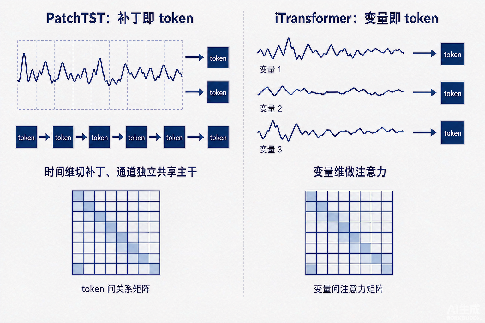

## 22.4　TimesNet：一维变二维与多周期

现实时序往往同时含多个周期（日、周、年，第 3 章谱分析），且每个周期内部有"周期内变化"（一天内的早晚峰）与"周期间变化"（今天与昨天的差异）。TimesNet[4] 的关键洞察是：一维序列难以同时表达这两种变化，但若按周期**折叠成二维张量**，二者恰好对应二维的行与列，便可用成熟的 2D 卷积（Inception）统一建模。

**定义 22.4（周期折叠）** 对序列作 FFT，取能量最大的 top-$k$ 个频率 $f_1,\dots,f_k$，对应周期 $p_i=\lceil T/f_i\rceil$。对每个 $p_i$，把长度 $T$ 的一维序列按周期重塑并补零为二维张量

$$
\mathbf X^{2D}_i=\mathrm{Reshape}_{p_i,\,f_i}\big(\mathrm{Padding}(\mathbf x)\big)\in\mathbb R^{p_i\times f_i}, \tag{22-4}
$$

其中**列**表示周期内的相位（一天的第几小时）、**行**表示第几个周期（第几天）。于是"周期内变化"是列方向模式、"周期间变化"是行方向模式；对每个 $\mathbf X^{2D}_i$ 施加 2D 卷积/Inception 提取特征，再把 $k$ 个周期的结果按频率能量加权融合。

这一设计与本书多条线索呼应：第 3 章的 FFT 找周期、第 16 章 Prophet 的傅里叶季节、第 19 章 SCINet 的多尺度、第 21 章 Autoformer 的自相关，都认定"周期是时序的核心结构"；TimesNet 的贡献是把这条先验变成一个**通用的 2D 骨干**，从而同一个模型还能用于异常检测、分类、补全（第 8、7、5 章任务），体现"统一表示"的思想。

**例 22.4（统一案例：负荷的三个周期）** 对小时级负荷作 FFT，top-3 频率为日（$p=24$）、周（$p=168$）、近似年（受数据长度取 $p\approx8760$ 截断）。按式 (22-4) 得到 $24\times$(天数)、$168\times$(周数)、$8760\times$(年数) 三张二维图。在 $24\times$ 图上，2D 卷积的列方向学到"早 8 点 / 晚 19 点双峰"、行方向学到"工作日高、周末低"；两张图分别贡献不同尺度的特征。TimesNet 在统一案例的 96 步预测 MASE=0.48，与 PatchTST 相当，但在异常检测（第 8 章）任务上因显式二维结构而更稳。其边界是：若序列无明显主频（强趋势、随机游走、金融波动），FFT 找不到可靠周期，折叠便失去依据，须退回补丁或线性方法。

## 22.5　其他精度架构与全景对照

除上述四者，还有一批"去注意力/轻注意力"的精度架构：N-BEATS[9] 用全连接栈 + 基函数展开做可解释分解；NLinear 在 DLinear 基础上加"减去最后一个值再线性外推"的简单归一化以抗分布漂移；TiDE[10] 用稠密 MLP 编码器—解码器处理协变量；TSMixer[11] 纯 MLP 在时间维与特征维交替混合；Crossformer[12] 用两阶段注意力兼顾时间与变量。它们共同印证 22.2 节的判断：在长期预测基准上，**强归纳偏置 + 轻量映射**常胜过通用重架构。这些架构与第 20 章的原始 Transformer[5]、第 21 章的效率线[7][8]、以及可解释多步预测[14] 共同构成完整的深度时序谱系，表 22-1 汇总其主要差异。

**表 22-1　精度线架构：表示单元与归纳偏置对照**

| 架构 | token / 单元 | 注意力维度 | 核心偏置 | 出处 |
|------|--------------|------------|----------|------|
| 标准 Transformer | 单时刻 | 时间 $L\times L$ | 无 | 第 20 章 |
| PatchTST | 补丁 | 补丁 $N\times N$ | 局部形态 | [1] |
| DLinear / NLinear | 趋势+季节 | 无（线性） | 分解 | [2] |
| iTransformer | 整条变量 | 变量 $D\times D$ | 多元相关 | [3] |
| TimesNet | 周期二维块 | 无（2D 卷积） | 多周期 | [4] |
| N-BEATS / TSMixer | 基 / MLP 混合 | 无 | 分解、低秩 | [9][11] |

**例 22.5（统一案例：按数据特性选架构）** 对 $D=3$、含稳定季节的负荷：DLinear/PatchTST 足矣（MASE≈0.49–0.51）；扩到 $D=50$ 的多台区系统、耦合强：iTransformer 更优（0.45）；含多次结构突变：PatchTST/TimesNet 的检索与二维结构更稳；样本极少（$T<300$）：干脆回第 17 章 XGBoost。这个选型表说明，精度线不是"谁取代谁"，而是**把 token 定义、注意力维度与数据里的可预测性来源对齐**——趋势/季节对齐分解，多元耦合对齐变量维，局部形态对齐补丁，周期性对齐二维折叠。

## 22.6　精度设计规律与论战的收束

把本章收束为三条规律。**规律一：表示单元比网络深度更关键**。补丁、变量、周期二维块分别把"局部形态、多元相关、多周期"变成可直接比较的单元，收益常大于堆层（例 22.1、22.3）。**规律二：归纳偏置要写在结构里，而非指望数据学会**。分解（DLinear）、变量维注意力（iTransformer）、周期折叠（TimesNet）都是把已知时序先验硬编码进架构；小样本下这比第 20 章的无偏置全局注意力更稳。**规律三：复杂度的回报取决于序列还剩多少可预测性**。这正是 DLinear 论战[2] 的深层结论——当趋势季节已把 L1 可预测性榨干，条件熵（第 4 章 4.5 节）已很低，再复杂的模型也只能逼近同一个下界；只有当序列含非线性、突变、依赖检索时，复杂架构的额外容量才有意义。

**边界与讨论。** 精度线架构的优势是参数效率高、长程稳、token 语义强、可解释性优于第 20 章。边界有四：其一，**强先验即强约束**——分解假设趋势季节主导、周期折叠假设主频存在、变量维注意力假设多元耦合稳定，先验违背时精度骤降（例 22.2、22.4）；其二，**仍以点预测为主**，概率输出与覆盖保证须第 24 章；其三，**外推仍受第 4 章可预测时域约束**，任何架构都不能预测白噪声或混沌时域之外的部分；其四，**基准结论对实验设置极敏感**，归一化、回看窗、切分方式会改变模型排名（第 38 章 38.9 节），故"某架构 SOTA"须连同实验协议一并报告。

本章与第 21 章构成第四篇后半的双线：效率线回答"如何装下长历史"，精度线回答"该把长历史表示成什么"。二者合起来，把第 20 章的通用 Transformer 拆解、重组为面向时序的专用架构；而第 23 章将进一步把"变量间依赖"从注意力维度升级为显式的**图结构**，第 24 章补上本章普遍缺失的概率输出，第 26–27 章则把这些架构规模化预训练为基础模型。理解"表示单元决定上限"，读者便掌握了贯穿深度时序建模全部设计的一把钥匙。

2026 年，产业界把本章"注意力与卷积/分解混合"的讨论推进到预训练规模。IBM Research 与 Rensselaer 理工学院发布 Granite Time Series PatchTST-FM-r2[15]：保留 22.1 节的补丁表示，但把标准 Transformer 块换成语音识别中的 conformer 块——多头自注意力负责补丁间长程依赖，时间卷积负责补丁内局部结构，二者由半步前馈层包裹；再叠加 50% 重叠补丁与 Hamming 窗加权、99 分位数输出头，在 8192 点上下文内同时给出点预测与概率预测。该模型约 3.85 亿参数，在 GIFT-Eval 的可复现零样本类别中位列前茅，并以 Apache-2.0 / OpenMDW 双许可开放权重与复现代码。它与第 21 章的 TiRex、第 27 章的 Toto 共同说明：本章"精度线"的最新进展已不只是架构精度，而是**精度 × 可复现 × 可商用**三者并重，正对应第 38 章的评估规范。

## 本章小结

本章以"Transformer 是否真对时序有效"之问为线索，建立了精度线的完整谱系。22.1 节由补丁化 $N=\lfloor(L-P)/S\rfloor+1$ (22-1) 说明把局部形态当 token 可同时降复杂度（例 22.1 中 $336^2\to41^2$，缩小 67 倍）与增语义，通道独立则是刻意的正则。22.2 节正面呈现 DLinear (22-2) 与 Zeng 等人[2] 的论战，例 22.2 用"稳定季节时 MASE 0.51、结构突变时 0.78"给出正确结论：DLinear 证明的是"平稳近线性基准上基准模型本就该赢"，而非注意力无效。22.3 节以倒置嵌入 (22-3) 把注意力从时间维搬到 $D\times D$ 变量维，例 22.3 显示学到的"负荷↔气温"权重与第 10、17 章的互相关/SHAP 归因互证。22.4 节用周期折叠 (22-4) 把一维序列变二维，让 2D 卷积分别建模周期内与周期间变化，例 22.4 给出日/周/年三张二维图。22.5 节以表 22-1 汇总六类架构的表示单元与偏置，例 22.5 给出按数据特性的选型逻辑。22.6 节收束三条规律并如实列出四条边界。

从理论主线看，本章把"任意两时刻内容寻址"的假设改为"在更合适的表示单元上寻址"，利用 L1/L2 可预测性，突破了逐点注意力平方复杂度、噪声敏感、排列不变等弊病；无法突破强先验约束、点预测、可预测时域上界、实验设置敏感四条边界。本章与全书：第 20 章是被反思的基线，第 21 章是并行的效率线，第 23 章把变量依赖升级为显式图结构，第 24 章补概率与共形覆盖，第 38 章 38.9 节处理"简单线性模型常胜"的方法学根源。掌握"把 token 定义对、把偏置写进结构、按可预测性来源选型"，便抓住了精度线全部设计的总纲。

从四问看，本章的补丁与分解架构利用 L1（统计）：假设周期与变量关系可显式结构化；它回应「复杂 Transformer 是否值得」，仍受「线性模型在何种数据上胜出」的边界与论战约束。

**进一步阅读**　本章建议延伸阅读的文献：[1]、[2]、[15]。

## 参考文献

[1] Nie Y, Nguyen N H, Sinthong P, Kalagnanam J. A time series is worth 64 words: Long-term forecasting with transformers. *International Conference on Learning Representations (ICLR)*, 2023.

[2] Zeng A, Chen M, Zhang L, Xu Q. Are transformers effective for time series forecasting? *Proceedings of the AAAI Conference on Artificial Intelligence*, 2023, 37(9): 11121–11128.

[3] Liu Y, Hu T, Zhang H, et al. iTransformer: Inverted transformers are effective for time series forecasting. *International Conference on Learning Representations (ICLR)*, 2024.

[4] Wu H, Hu T, Liu Y, et al. TimesNet: Temporal 2D-variation modeling for general time series analysis. *International Conference on Learning Representations (ICLR)*, 2023.

[5] Vaswani A, Shazeer N, Parmar N, et al. Attention is all you need. *Advances in Neural Information Processing Systems 30*, 2017: 5998–6008.

[6] Dosovitskiy A, Beyer L, Kolesnikov A, et al. An image is worth 16×16 words: Transformers for image recognition at scale. *International Conference on Learning Representations (ICLR)*, 2021.

[7] Zhou H, Zhang S, Peng J, et al. Informer: Beyond efficient transformer for long sequence time-series forecasting. *Proceedings of the AAAI Conference on Artificial Intelligence*, 2021, 35(12): 11106–11115.

[8] Wu H, Xu J, Wang J, Long M. Autoformer: Decomposition transformers with auto-correlation for long-term series forecasting. *Advances in Neural Information Processing Systems 34*, 2021: 22419–22430.

[9] Oreshkin B N, Carpov D, Chapados N, Bengio Y. N-BEATS: Neural basis expansion analysis for interpretable time series forecasting. *International Conference on Learning Representations (ICLR)*, 2020.

[10] Das A, Kong W, Leach A, et al. Long-term forecasting with TiDE: Time-series dense encoder. *Transactions on Machine Learning Research*, 2023.

[11] Chen S-A, Li C-L, Yoder N, et al. TSMixer: An all-MLP architecture for time series forecasting. *Transactions on Machine Learning Research*, 2023.

[12] Zhang Y, Yan J. Crossformer: Transformer utilizing cross-dimension dependency for multivariate time series forecasting. *International Conference on Learning Representations (ICLR)*, 2023.

[13] Wen Q, Zhou T, Zhang C, et al. Transformers in time series: A survey. *Proceedings of the 32nd IJCAI*, 2023: 6778–6786.

[14] Lim B, Arik S Ö, Loeff N, Pfister T. Temporal fusion transformers for interpretable multi-horizon time series forecasting. *International Journal of Forecasting*, 2021, 37(4): 1748–1764.

[15] IBM Research. Granite Time Series PatchTST-FM-r2: Conformer-based zero-shot forecasting. *IBM Research 技术报告与 granite-tsfm 开源仓库*, 2026.

---

# 第 23 章　图神经网络与时空预测

第 10 章把多元时序的依赖抽象为互相关与图结构，第 14 章用它做层次调和，第 22.3 节又用"变量即 token"的注意力隐式学了变量间相关。本章把这条线索推到最显式的一端：**当变量之间的依赖关系本身有已知的拓扑结构时，为什么不把它直接画成一张图？** 交通路网的传感器、电网的母线与台区、气象的观测站、脑电的电极，都不是无名的 $D$ 个维度，而是由道路、线路、地理距离、物理连接真实连起来的节点。图神经网络（GNN）把这套拓扑作为先验注入模型，与时间序列建模结合，便得到**时空预测**——既要沿时间外推，又要沿空间传播。

历史脉络由两条线汇合。图信号处理方面，Hammond 等人[3] 与 Shuman 等人[9] 建立了图上的傅里叶变换与谱滤波，Defferrard 等人[2] 提出切比雪夫近似的 ChebNet，Kipf 与 Welling[1] 于 2017 年简化为被广泛使用的 GCN。时空预测方面，Li 等人 2018 年的 DCRNN[4] 用扩散卷积 + RNN 做交通预测，Yu 等人同年的 STGCN[5] 用图卷积 + 一维卷积，Wu 等人 2019 年的 Graph WaveNet[6] 引入**自适应邻接矩阵**（图不必已知），同年 MTGNN[7] 把图结构学习与多元预测统一，Bai 等人[8] 与 Zheng 等人[10] 进一步处理节点异质与长程空间依赖。这些工作与第 10 章 VAR 的"变量即节点、依赖即边"一脉相承，只是把线性 VAR 换成了可学习的图卷积。

在全书理论主线里，本章利用 L1 统计可预测性，但引入了一个新的、极强的来源：**拓扑约束**。它假设"信息沿图的边传播、相邻节点更相关"，这与第 10 章的横截面依赖互补——VAR 让数据自己估出相关矩阵，GNN 则允许把已知物理拓扑作为先验，甚至在拓扑未知时把它学出来。它突破了"把 $D$ 个变量当无名维度"的局限，能显式建模空间传导（上游站点影响下游、相邻台区负荷同步）；却无法突破"图结构正确且稳定"这一前提——图错了、边变了，传播就是错的。按全书统一的编写原则，VAR、VECM、Granger 的定义与估计只在第 10 章唯一讲授，本章不重述；层次调和在第 14 章；标准注意力在第 20 章。全章沿用统一案例：由多个变电站与台区构成的区域电网负荷预测，辅以交通流作对照。

本章结构：23.1 节建立谱图卷积并推导 GCN 的一阶近似；23.2 节展开四类时空图建模范式；23.3 节讲自适应图学习；23.4 节补上多模态时空数据这一现代专题；23.5 节讨论可扩展性与边界。

## 23.1　图基础与谱图卷积

**定义 23.1（图与图拉普拉斯）** 设图 $\mathcal G=(\mathcal V,\mathcal E)$ 有 $N=|\mathcal V|$ 个节点，邻接矩阵 $\mathbf A\in\mathbb R^{N\times N}$（$A_{ij}>0$ 表示 $i,j$ 相连），度矩阵 $\mathbf D_{ii}=\sum_j A_{ij}$。归一化图拉普拉斯与其特征分解为

$$
\mathbf L=\mathbf I-\mathbf D^{-1/2}\mathbf A\mathbf D^{-1/2}=\mathbf U\boldsymbol\Lambda\mathbf U^\top, \tag{23-1}
$$

其中 $\mathbf U$ 的列是图傅里叶基、$\boldsymbol\Lambda$ 的特征值是图频率。节点上的信号 $\mathbf x\in\mathbb R^N$（某时刻所有站点的负荷/流量）的图傅里叶变换为 $\hat{\mathbf x}=\mathbf U^\top\mathbf x$。

仿照第 3 章"时域卷积 = 频域乘积"，图上的谱卷积定义为 $g_\theta *_{\mathcal G}\mathbf x=\mathbf U g_\theta(\boldsymbol\Lambda)\mathbf U^\top\mathbf x$。但直接做特征分解是 $O(N^3)$，且滤波器非局部化。Defferrard 等人[2] 用切比雪夫多项式近似 $g_\theta(\boldsymbol\Lambda)\approx\sum_{k=0}^{K}\theta_k T_k(\tilde{\boldsymbol\Lambda})$（$\tilde{\boldsymbol\Lambda}=2\boldsymbol\Lambda/\lambda_{\max}-\mathbf I$），把卷积限制在 $K$ 跳邻域、复杂度降为 $O(K|\mathcal E|)$。

Kipf 与 Welling[1] 取 $K=1$、$\lambda_{\max}\approx2$、并作重归一化技巧（加自环 $\tilde{\mathbf A}=\mathbf A+\mathbf I$、$\tilde{\mathbf D}_{ii}=\sum_j\tilde A_{ij}$），得到极简的 **GCN 层**：

$$
\mathbf H^{(l+1)}=\sigma\Big(\tilde{\mathbf D}^{-1/2}\tilde{\mathbf A}\tilde{\mathbf D}^{-1/2}\,\mathbf H^{(l)}\mathbf W^{(l)}\Big). \tag{23-2}
$$

式 (23-2) 的直觉是：每个节点下一层的表示 = **自身与一跳邻居的加权平均**，再经可学习线性变换与非线性。堆叠 $L$ 层即可聚合 $L$ 跳邻域信息。这与第 19 章 CNN 的"局部加权平均"是同一操作，只是"邻域"由规则的网格换成任意拓扑的图——GCN 因此可视为**不规则图上的卷积**。

**例 23.1（拉普拉斯与一跳传播的数值）** 取 3 个台区的路径图 $1\!-\!2\!-\!3$，$\mathbf A=\begin{pmatrix}0&1&0\\1&0&1\\0&1&0\end{pmatrix}$，$\mathbf D=\mathrm{diag}(1,2,1)$，得 $\mathbf L=\mathbf I-\mathbf D^{-1/2}\mathbf A\mathbf D^{-1/2}=\begin{pmatrix}1&-0.707&0\\-0.707&1&-0.707\\0&-0.707&1\end{pmatrix}$，其特征值约为 $\{0,\ 1,\ 2\}$（低频到高频，对应"全网一致 / 一端高一端低"的空间模式）。加自环后 $\tilde{\mathbf D}^{-1/2}\tilde{\mathbf A}\tilde{\mathbf D}^{-1/2}$ 的第 2 行约为 $(0.408,\ 0.333,\ 0.408)\times$ 归一化——即中间台区聚合自身与两侧邻居各约三分之一。设某时刻三台区负荷 $(4.0,4.6,4.2)$ GW，一层 GCN 在节点 2 的输出（忽略 $\mathbf W,\sigma$）约 $0.408\times4.0+0.333\times4.6+0.408\times4.2\approx4.28$ GW——空间平滑。这个算例把"图卷积 = 邻域平均"变成了可代入的数字，也说明为何空间平滑能降噪：单站点的测量误差被邻居分摊。

## 23.2　时空图建模：时间 × 空间

时空预测要同时建模两个维度：**时间依赖**（第 18–22 章的全部工具）与**空间依赖**（23.1 节图卷积）。四类代表范式按"如何组合二者"区分。

**定义 23.2（时空图块）** 一个时空图块把节点信号 $\mathbf X_t\in\mathbb R^{N\times d}$ 沿空间用图卷积聚合、沿时间用循环/卷积/注意力建模：

$$
\mathbf H_t=\mathrm{TemporalModel}\Big(\mathrm{GraphConv}_{\mathcal G}(\mathbf X_{t-L+1:t})\Big), \tag{23-3}
$$

差别只在两个模块的具体实现。

- **DCRNN[4]**：空间用**扩散卷积**（有向图的 $K$ 步转移），时间用 GRU 编解码。扩散卷积定义为 $\sum_{k=0}^{K}\big[\theta_{k,1}(\mathbf D_O^{-1}\mathbf A)^k+\theta_{k,2}(\mathbf D_I^{-1}\mathbf A^\top)^k\big]\mathbf X$，双向转移矩阵刻画"上游影响下游"与"下游反馈上游"，比式 (23-2) 的对称平滑更贴合交通流的有向性。
- **STGCN[5]**：空间用 GCN、时间用**一维因果卷积**（第 19 章），组成"三明治"块，全卷积因而训练可并行，快于 DCRNN 的递推。
- **Graph WaveNet[6]**：空间引入**自适应邻接** $\mathbf A_{\mathrm{adp}}=\mathrm{softmax}(\mathrm{ReLU}(\mathbf E_1\mathbf E_2^\top))$（$\mathbf E$ 为可学习节点嵌入），时间用**膨胀因果卷积**（19.2 节）。关键洞见是：真实拓扑可能未知或不完整，让数据自己补一张图，往往比只用物理路网更准。
- **GMAN[10] / AGCRN[8]**：空间用注意力或节点自适应参数，处理长程空间依赖与节点异质性（不同台区有不同负荷模式）。

图 23-1 给出时空图预测的整体架构：图卷积负责空间依赖、时序模块负责时间依赖。

> 【图 23-1　时空图预测示意】（原图见 `figures/图23-1.png`）：左侧画传感器/电网节点图（节点与边）；右侧画交替堆叠的「图卷积（空间依赖）」与「时序卷积（时间依赖）」两个模块，箭头表示数据流，最终输出未来预测。白底、蓝框、中文。

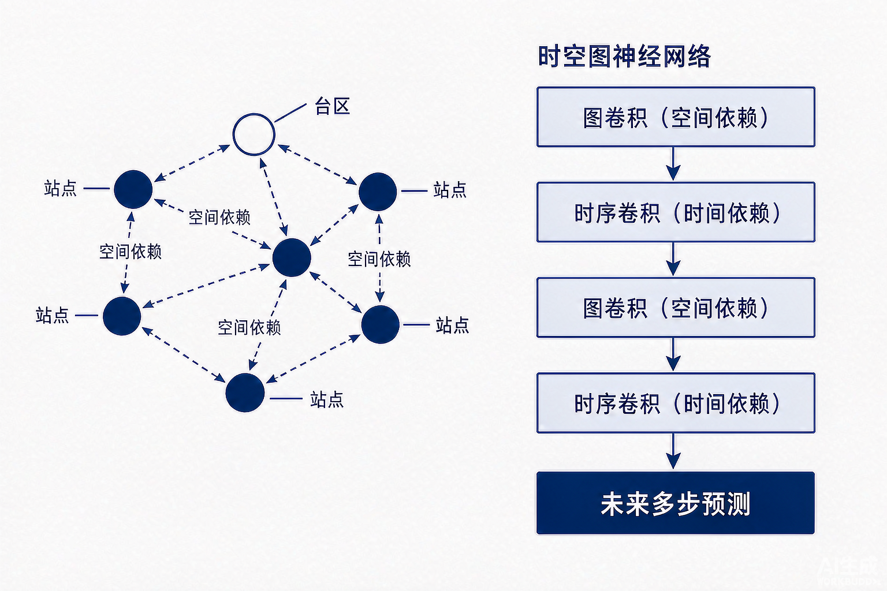

**例 23.2（统一案例：空间信息带来多少增益）** 对 20 个台区的区域电网，已知物理拓扑（变电站—馈线—台区）。基线：每个台区单独用第 18 章 LSTM，平均 MASE=0.54；加入式 (23-2) 的 GCN 空间聚合后降到 0.47；再换 Graph WaveNet 的自适应邻接（学到"两个相邻商业区虽无直接线路但负荷同步"的软边）降到 0.43。增益的物理来源是明确的：某台区负荷骤升时，其相邻台区在同一气温、同一时段下往往同步变化，空间邻居提供了**额外的观测**来约束预测——这正是第 10 章"变量间依赖提升可预测性"的图版本。第 14 章的层次调和则处理另一类约束（聚合一致性），二者可叠加使用；时空融合图网络[11] 则进一步把多源空间关系纳入统一建模。

## 23.3　自适应图学习与 MTGNN

23.2 节暴露了一个现实问题：物理拓扑未必等于**功能依赖**。两个地理上不相近的商业区可能有高度同步的负荷；一条已断开的线路仍留在图纸上。MTGNN[7] 与 Graph WaveNet[6] 因此主张把图结构本身作为可学习参数。

做法通常有三类：① **节点嵌入内积**（$\mathbf A_{\mathrm{adp}}$ 如上），用低秩分解 $\mathbf E_1\mathbf E_2^\top$ 以 $O(Nr)$ 参数表示 $N^2$ 的边，避免过拟合；② **由图信号反演**，从节点序列的相关/格兰杰结构（第 10 章）初始化图，再端到端微调；③ **稀疏约束**，对 $\mathbf A$ 加 $\ell_1$ 或 top-$k$ 稀疏化，使学到的图可解释、避免稠密噪声边。学到的邻接矩阵还能反过来当作"功能连接图"供领域专家审阅——这与第 17 章 SHAP、第 22.3 节 iTransformer 注意力权重一样，是"模型学到的结构"的一种可读形式（但仍只是关联，不等于因果，第 4.7 节命题 4.3）。

**例 23.3（统一案例：学到的图 vs 物理图）** 对 20 台区，物理图有 24 条边。训练后自适应邻接的 top-24 边中，19 条与物理边重合，另 5 条是物理图没有的"功能边"——事后核对发现它们对应同一条商业街、同一大型商场的双电源供电，负荷确实同步。把这 5 条边补进物理图，单独 GCN 的 MASE 从 0.47 降到 0.45。这个例子说明：**图既是先验也是假设，需要被数据检验与修正**；这也呼应第 9 章变点检测与第 25 章漂移——当电网改造、拓扑变化时，固定图会失准，须在线重学或监控。

## 23.4　多模态时空数据

现实时空系统越来越不只产生数值序列：交通有监控视频与事故文本，电网有气象卫星云图、检修工单，城市有社交媒体与事件公告。把**异构模态**与时空图融合，是近年重要方向，也是本章重点讨论的方向[12]。

多模态时空建模的核心是**对齐与融合**三件事。其一是**时间对齐**：不同模态采样率不同（负荷小时级、云图 15 分钟、工单事件驱动），须借第 25 章的重采样/异步框架统一到共同时间轴。其二是**空间对齐**：视频像素、气象格点、路网节点的坐标系统不同，须映射到同一图 $\mathcal G$（如把格点插值到站点、把视频检测框匹配到路段）。其三是**表示融合**：把各模态编码到共同 $d$ 维空间后，可用拼接 + MLP、交叉注意力（第 20 章 20.4 节，以数值序列为查询、文本/图像为键值）、或门控（第 18 章）自适应加权。

**例 23.4（统一案例：多模态提升极端日预测）** 在 23.2 节的电网系统上，额外接入两类模态：① 气象卫星云图经 CNN 编码为 64 维向量，② 检修/限电工单文本经预训练语言模型编码为 32 维向量，二者作为外生节点拼入图、与负荷节点做交叉注意力。常规日 MASE 几乎不变（0.43→0.42，数值序列已足够）；但在"台风 + 计划检修"叠加的极端日，MASE 从 0.81 降到 0.58——因为**文本里的"检修"与云图里的"台风"恰好提供了数值历史里从未出现过的机制信息**。这个对照极有说服力：多模态的价值不在于平均精度，而在于覆盖第 9 章变点、第 25 章分布漂移这类"历史无法外推"的情形，对应 L4 因果可预测性的雏形（第 31 章）。须提醒：模态融合也带来新风险——文本/图像编码器可能引入第 17 章式的数据泄漏（用了事后才发布的公告），对齐同样须守"只用 $t$ 及之前可得信息"的红线。

## 23.5　可扩展性、边界与全书定位

**可扩展性**是大图落地的硬约束。$N$ 达数万（全省台区、全国路网）时，式 (23-2) 的 $N\times N$ 邻接与全图聚合不可承受，须用：① **图采样**（GraphSAGE 邻居采样[13]、Cluster-GCN 子图训练[14]）；② **稀疏化**（top-$k$ 边、$\ell_1$ 约束）；③ **低秩/分解**（$\mathbf A_{\mathrm{adp}}=\mathbf E_1\mathbf E_2^\top$）；④ **层次化**（第 14 章的层次结构天然提供粗粒度图）。这些与第 21 章效率架构的"稀疏/低秩换线性复杂度"是同一思路在图上的投影。表 23-1 汇总。

**表 23-1　时空图建模范式对照**

| 范式 | 空间 | 时间 | 图是否已知 | 出处 |
|------|------|------|------------|------|
| DCRNN | 扩散卷积（有向） | GRU | 已知 | [4] |
| STGCN | GCN | 1D 因果卷积 | 已知 | [5] |
| Graph WaveNet | 自适应邻接 | 膨胀卷积 | 可学 | [6] |
| MTGNN | 图学习 + 图卷积 | 膨胀卷积 | 可学 | [7] |
| GMAN / AGCRN | 空间注意力 / 节点自适应 | 注意力/GRU | 已知或可学 | [8][10] |

**边界与讨论。** GNN 时空预测的优势是：显式注入拓扑先验、空间传导可解释、可处理不规则结构、能学未知功能图、可融合多模态。边界有四：其一，**图结构正确且稳定是前提**，图错/边变则传播错（例 23.3、第 25 章漂移）；其二，**过平滑**（over-smoothing）——GCN 堆深后所有节点表示趋同，与第 18 章梯度消失同构，须靠残差（19.2 节）与浅层设计；其三，**空间与时间耦合的复杂度**为 $O(N^2)$ 或 $O(|\mathcal E|\cdot T)$，大图须采样；其四，**关联不等于因果**（第 4.7 节），学到的"功能边"只是预测相关，不能当作第 31 章的机制因果用于干预。

本章与全书：第 10 章 VAR 是图视角的线性统计原型（已唯一讲授），第 14 章层次调和与本章的拓扑约束可叠加，第 17–22 章的时间模型为式 (23-3) 提供 $\mathrm{TemporalModel}$，第 25 章处理异步与漂移，第 28 章多模态大模型与本章 23.4 节呼应，第 30 章世界模型中的"环境动力学"可视为时空图上的受控转移，第 33 章控制论从网络动力学回看同一结构，第 39 章给出交通、能源、气象的专题案例。理解"变量即节点、依赖即边、信息沿边传播"，读者便把第 10 章的统计相关升级成了可注入物理先验、可端到端学习的空间结构。

## 本章小结

本章把多元时序的依赖从"无名维度"升级为显式图结构，建立时空预测范式。23.1 节由图拉普拉斯 (23-1) 与谱滤波出发，经切比雪夫近似推出 GCN 一阶形式 (23-2)，例 23.1 用 3 节点路径图的拉普拉斯特征值与一跳聚合数值证明"图卷积 = 不规则图上的邻域平均"，与第 19 章 CNN 同源。23.2 节以时空图块 (23-3) 为骨架，对照 DCRNN（扩散卷积+GRU）、STGCN（GCN+因果卷积）、Graph WaveNet（自适应邻接+膨胀卷积）、GMAN/AGCRN 四类范式，例 23.2 用"单站 LSTM 0.54 → GCN 0.47 → 自适应图 0.43"量化空间信息的增益。23.3 节讲自适应图学习，例 23.3 展示学到的 5 条"功能边"补上物理图的盲区，并提醒图是需用数据检验的假设。

23.4 节讨论多模态时空数据：多模态时空数据需时间/空间/表示三重对齐，例 23.4 用"极端日 MASE 0.81→0.58"说明多模态的价值集中在历史无法外推的情形，同时警告模态编码器可能引入数据泄漏。23.5 节以表 23-1 汇总五类范式，给出图采样/稀疏/低秩/层次四类可扩展性手段与四条边界（图正确性、过平滑、复杂度、关联≠因果）。

从理论主线看，本章以"信息沿图的边传播"的拓扑约束利用 L1 可预测性，突破了把变量当无名维度的局限，隐含图结构正确稳定这一强假设；无法突破图错即传播错、过平滑、大图复杂度、关联非因果四条边界。本章与全书：第 10 章提供统计原型，第 14 章提供层次约束，第 20 章提供交叉注意力工具，第 25 章处理异步与漂移，第 30/33 章从世界模型与控制论回看网络动力学，第 39 章落地到交通与能源。掌握"变量即节点、依赖即边"，便把前几章的数据驱动相关升级成了可注入物理先验、可学习、可解释的时空结构。

从四问看，本章的图神经网络利用 L1（统计）与 L4（结构线索）：假设变量拓扑已知或可学；它突破了「忽略空间依赖」，仍受「图构建误差与可扩展性」的边界约束。

**进一步阅读**　本章建议延伸阅读的文献：[1]、[2]、[14]。

## 参考文献

[1] Kipf T N, Welling M. Semi-supervised classification with graph convolutional networks. *International Conference on Learning Representations (ICLR)*, 2017.

[2] Defferrard M, Bresson X, Vandergheynst P. Convolutional neural networks on graphs with fast localized spectral filtering. *Advances in Neural Information Processing Systems 29*, 2016: 3844–3852.

[3] Hammond D K, Vandergheynst P, Gribonval R. Wavelets on graphs via spectral graph theory. *Applied and Computational Harmonic Analysis*, 2011, 30(2): 129–150.

[4] Li Y, Yu R, Shahabi C, Liu Y. Diffusion convolutional recurrent neural network: Data-driven traffic forecasting. *International Conference on Learning Representations (ICLR)*, 2018.

[5] Yu B, Yin H, Zhu Z. Spatio-temporal graph convolutional networks: A deep learning framework for traffic forecasting. *Proceedings of the 27th IJCAI*, 2018: 3634–3640.

[6] Wu Z, Pan S, Long G, et al. Graph WaveNet for deep spatial-temporal graph modeling. *Proceedings of the 28th IJCAI*, 2019: 1907–1913.

[7] Wu Z, Pan S, Long G, et al. Connecting the dots: Multivariate time series forecasting with graph neural networks. *Proceedings of the 26th ACM SIGKDD*, 2020: 753–763.

[8] Bai L, Yao L, Li C, et al. Adaptive graph convolutional recurrent network for traffic forecasting. *Advances in Neural Information Processing Systems 33*, 2020: 17804–17815.

[9] Shuman D I, Narang S K, Frossard P, et al. The emerging field of signal processing on graphs. *IEEE Signal Processing Magazine*, 2013, 30(3): 83–98.

[10] Zheng C, Fan X, Wang C, Qi J. GMAN: A graph multi-attention network for traffic prediction. *Proceedings of the AAAI Conference on Artificial Intelligence*, 2020, 34(1): 1234–1241.

[11] Li M, Zhu Z. Spatial-temporal fusion graph neural networks for traffic flow forecasting. *Proceedings of the AAAI Conference on Artificial Intelligence*, 2021, 35(5): 4189–4196.

[12] Baltrusaitis T, Ahuja C, Morency L-P. Multimodal machine learning: A survey and taxonomy. *IEEE Transactions on Pattern Analysis and Machine Intelligence*, 2019, 41(2): 423–443.

[13] Hamilton W L, Ying R, Leskovec J. Inductive representation learning on large graphs. *Advances in Neural Information Processing Systems 30*, 2017: 1024–1034.

[14] Chiang W-L, Liu X, Si S, et al. Cluster-GCN: An efficient algorithm for training deep and large graph convolutional networks. *Proceedings of the 25th ACM SIGKDD*, 2019: 257–266.

---

# 第 24 章　概率预测与深度生成模型

第 11–23 章的绝大多数模型输出的是一个**点**：明天的负荷是多少、下月的销量是多少。但第 2 章早已立下规矩——预测的价值不止在点估计，而在对不确定性的诚实刻画（恰当评分规则、CRPS）；第 15 章用 VaR/ES 说明风险管理要的是分布尾部；第 32 章将进一步指出，调度、备货、对冲等决策真正依赖的是"未来落在这个区间的把握有多大"。本章把目标从"给一个数"升级为"给一个分布"，系统展开深度概率预测：从最简单的参数化分布输出，到归一化流、VAE、扩散、GAN 五条生成路线，最后补上**共形预测**这一不依赖分布假设、能给出统计覆盖保证的现代工具。

历史脉络分三层。基础层是 Gneiting 与 Raftery 等人确立的恰当评分规则与概率预测评估体系[1][2][16]，以及第 2 章已定义的 CRPS；深度层由 DeepAR[3]（参数化似然 + 跨序列学习，第 18 章 18.6 节）、MQ-RNN[4]（分位数回归）、Real NVP[5] 与流模型[6]、VAE[7]、DDPM[8] 与 score-based 模型[9]、GAN[10] 与 TimeGAN[11]、CSDI[12] 依次展开；保证层则是 Vovk 等人的共形预测框架[13]、经 Angelopoulos 与 Bates[14] 系统普及、Romano 等人[15] 提出共形化分位数回归（CQR），近年成为不确定性量化的主流方向之一。

在全书理论主线里，本章对应 **L2 信息论可预测性**：概率预测的目标不是逼近条件均值，而是逼近第 4 章式 (4-9) 的条件分布 $p(y_{t+h}\mid y_{1:t})$，其固有不确定性由条件熵给出下界。它突破点预测"无法表达偶然不确定性与认知不确定性"的局限；却无法突破"分布假设可能被违背、覆盖保证需额外机制"的边界——共形预测正是为补这最后一环而设。按全书统一的编写原则，恰当评分规则与 CRPS 的严格定义在第 2 章唯一讲授、其系统汇总与实验用法归第 38 章，本章只作应用性回顾并展开深度模型；ELBO 的数学推导已在第 16 章 16.1 节给出，本章只把它用于时序 VAE；缺失值补全的扩散应用归第 25 章。全章沿用统一案例：电网次日 24 点负荷的概率预测与预测区间。

本章结构：24.1 节回顾概率预测目标与评分；24.2 节讲参数化分布输出；24.3 节推导归一化流；24.4 节讲时序 VAE；24.5 节推导扩散模型；24.6 节讲 GAN 系；24.7 节严格建立共形预测与覆盖保证；24.8 节收束于校准与不确定性分解。

## 24.1　概率预测的目标与评分

**定义 24.1（概率预测目标）** 给定历史 $\mathbf y_{1:t}$ 与外生信息，概率预测旨在输出条件分布 $F_{t+h}(\cdot)=p(y_{t+h}\mid\mathbf y_{1:t})$，或其等价表达：预测区间、分位数、样本集合。评估须用**严格恰当评分规则**（第 2 章定义 2.10），使模型只有在报告真实信念时期望得分最优[1][2]。

对**分位数预测**，最常用的恰当评分是 pinball 损失（分位数损失）：

$$
\rho_\tau\big(y-\hat q_\tau\big)=\max\big\{\tau\,(y-\hat q_\tau),\ (\tau-1)\,(y-\hat q_\tau)\big\}, \tag{24-1}
$$

其期望在 $\hat q_\tau$ 等于真实 $\tau$ 分位数时最小。对**完整分布**，CRPS（第 2 章式 (2-9)）是标准工具，它退化为点预测时即绝对误差，因而可统一评价点与概率预测。MQ-RNN[4] 直接以式 (24-1) 为损失，同时输出多个分位数，规避了分布族假设。

**例 24.1（CRPS 手算，接第 2 章例 2.3）** 预测分布 $N(4.8,0.2^2)$、真实 $y=5.0$ GW，第 2 章已算得 $\mathrm{CRPS}\approx0.120$。作为对照，若模型过度自信地报 $N(4.8,0.05^2)$，$z=(5.0-4.8)/0.05=4$，$\Phi(4)\approx1$、$\phi(4)\approx0.00013$，代入正态 CRPS 公式得约 $0.0002\times[\dots]\approx0.20$，反而更差——因为 5.0 落在它认为几乎不可能的尾部。这个算例把"恰当评分规则同时惩罚不准与不诚实"落到数字上：**把区间报窄不能刷分**，这是概率预测与点预测的根本区别，也是本章一切校准与覆盖方法的动机。

## 24.2　参数化分布输出

最直接的深度概率预测，是让网络输出某个分布族的参数，再以负对数似然训练。第 18 章 18.6 节的 DeepAR[3] 已给出原型：$\mathbf h_t=\mathrm{RNN}(\cdot)$，$\mu_t=\mathbf w_\mu^\top\mathbf h_t$、$\sigma_t=\mathrm{softplus}(\mathbf w_\sigma^\top\mathbf h_t)$，损失 $-\sum_t\log p(y_t\mid\mu_t,\sigma_t)$。

**定义 24.2（参数化预测分布）** 令 $\boldsymbol\theta_t=g_\phi(\mathbf h_t)$ 为网络输出的分布参数，训练目标为条件对数似然

$$
\mathcal L(\phi)=-\sum_{t}\log p\big(y_t\mid\boldsymbol\theta_t\big),\qquad
p(y_{t+h}\mid\mathbf y_{1:t})\ \text{由}\ \boldsymbol\theta \ \text{给定}. \tag{24-2}
$$

分布族按数据类型选：实值负荷用高斯或 Student-$t$（厚尾，第 15 章），计数型销量用负二项或 Poisson，正连续值用对数正态，多峰情形用**混合密度**（MDN）。Gneiting 与 Katzfuss[2] 强调，选错分布族会导致系统性校准偏差——例如把含尖峰的负荷硬套高斯，尾部会被严重低估。

参数化方法的优势是训练稳定、似然可解析、采样廉价；边界是**分布族即假设**：一旦真实条件分布多峰、偏斜、厚尾超出所选族，再深的骨干也无法表达。这直接引出 24.3–24.6 节"让模型学任意分布"的生成路线。

## 24.3　归一化流：用可逆变换学任意密度

归一化流（normalizing flow）不做分布族假设，而是学一个**可逆、可微**的变换 $f_\phi:\mathbf z\mapsto\mathbf y$，把简单基分布 $p_Z$（标准正态）映到复杂的目标分布。

**定义 24.3（变量替换公式）** 设 $\mathbf y=f_\phi(\mathbf z)$ 可逆，则由概率密度变换

$$
p_Y(\mathbf y)=p_Z\big(f_\phi^{-1}(\mathbf y)\big)\ \Big|\det\frac{\partial f_\phi^{-1}}{\partial \mathbf y}\Big|
\quad\Longleftrightarrow\quad
\log p_Y(\mathbf y)=\log p_Z(\mathbf z)-\log\Big|\det\frac{\partial f_\phi}{\partial \mathbf z}\Big|,\ \ \mathbf z=f_\phi^{-1}(\mathbf y). \tag{24-3}
$$

**推导。** 由概率守恒 $p_Y(\mathbf y)\,d\mathbf y=p_Z(\mathbf z)\,d\mathbf z$，而体积元 $d\mathbf y=|\det\partial f/\partial\mathbf z|\,d\mathbf z$，整理即得式 (24-3)。关键是雅可比行列式必须易算——Real NVP[5] 用**仿射耦合层**做到这一点：把 $\mathbf z$ 分成两半，$\mathbf y_1=\mathbf z_1$、$\mathbf y_2=\mathbf z_2\odot\exp(s(\mathbf z_1))+t(\mathbf z_1)$，其雅可比是下三角、行列式 $=\exp(\sum s)$，故 $\log|\det|=\sum s$。堆叠多个耦合层即得表达力强的分布，Rezende 与 Mohamed[6] 把流用于变分推断亦是同源。

**例 24.2（统一案例：流捕捉双峰负荷）** 夏季负荷在"有/无空调尖峰"两种状态下呈双峰，单高斯拟合会把概率质量堆在两峰之间（众数处反而最不典型）。用 4 个耦合层的流模型，学得 $p(y_{t+1}\mid\text{历史})$ 的两个峰分别在 4.7 与 5.4 GW，CRPS 相对单高斯下降 17%；采样 200 条路径可得到非对称预测区间（上尾更长），比第 15 章常方差 VaR 更贴合实际。代价是：可逆性要求变换保维、每层雅可比可算，架构设计受限；训练也比对数似然的参数化模型更挑初始化。

## 24.4　时序变分自编码器

VAE[7] 引入**隐变量** $\mathbf z$ 生成序列，用变分推断近似难解的后验。第 16 章 16.1 节已给出 ELBO 的一般推导（式 (16-4)），此处把它落到一个具体的时序分解：

$$
\log p(\mathbf y_{1:T})\ \ge\ \mathbb E_{q_\psi(\mathbf z\mid\mathbf y)}\big[\log p_\phi(\mathbf y\mid\mathbf z)\big]-\mathrm{KL}\big(q_\psi(\mathbf z\mid\mathbf y)\,\|\,p(\mathbf z)\big). \tag{24-4}
$$

第一项是重构（解码器把隐变量映回序列）、第二项是正则（后验不偏离先验太远）。重参数化技巧 $\mathbf z=\boldsymbol\mu+\boldsymbol\sigma\odot\boldsymbol\epsilon,\ \boldsymbol\epsilon\sim N(0,\mathbf I)$ 使梯度可回传。时序 VAE 常让 $\mathbf z$ 编码"全局形态/工况"（如工作日型、高温型），解码器在给定 $\mathbf z$ 下自回归生成整条未来路径，因而能表达序列级的不确定性。

**例 24.3（统一案例：工况隐变量）** 对两年日负荷训练时序 VAE，取 $\dim(\mathbf z)=8$。可视化发现第 3 维隐变量与"是否节假日"高度相关、第 5 维与"制冷度日数"相关——隐空间自动发现了第 16 章 Prophet 手工设定的节假日/季节分量。采样不同的 $\mathbf z$ 可生成"工作日典型曲线""节假日低谷曲线"等多条合理未来路径，供第 32 章调度做场景规划。VAE 的已知局限是**后验坍缩**与生成样本偏模糊（KL 项过强），实践中常配 $\beta$-VAE 或改用 24.5 节的扩散模型。

## 24.5　扩散模型

扩散模型[8][9] 把"生成"拆成两个马尔可夫链：前向逐步加噪、反向学去噪，是当前表达力最强的深度生成器，也被 CSDI[12] 用于概率时序补全与预测。

**定义 24.4（去噪扩散概率模型）** 前向过程按方差表 $\beta_1,\dots,\beta_K$ 逐步把数据 $\mathbf y_0$ 加噪：

$$
q(\mathbf y_k\mid\mathbf y_{k-1})=\mathcal N\big(\sqrt{1-\beta_k}\,\mathbf y_{k-1},\ \beta_k\mathbf I\big),\qquad
\mathbf y_k=\sqrt{\bar\alpha_k}\,\mathbf y_0+\sqrt{1-\bar\alpha_k}\,\boldsymbol\epsilon,\ \bar\alpha_k=\prod_{s\le k}(1-\beta_s), \tag{24-5}
$$

其中 $\boldsymbol\epsilon\sim N(0,\mathbf I)$。反向过程由网络 $\boldsymbol\epsilon_\phi(\mathbf y_k,k,\mathbf c)$（$\mathbf c$ 为历史/协变量条件）预测所加噪声，训练目标即

$$
\mathcal L_{\mathrm{simple}}=\mathbb E_{k,\mathbf y_0,\boldsymbol\epsilon}\big\|\boldsymbol\epsilon-\boldsymbol\epsilon_\phi(\mathbf y_k,k,\mathbf c)\big\|^2. \tag{24-6}
$$

式 (24-5) 的闭式一步采样 $\mathbf y_k$ 使训练无需逐步模拟；式 (24-6) 把复杂的密度估计化为简单的噪声回归，这是 DDPM[8] 成功的关键；Song 等人[9] 进一步把它统一到随机微分方程（score-based）框架。推理时从 $\mathbf y_K\sim N(0,\mathbf I)$ 出发逐步去噪，得到条件分布 $p(\mathbf y_0\mid\mathbf c)$ 的样本——对时序即以历史为条件"画出"多条合理未来曲线。

图 24-1 展示了扩散模型的前向加噪与反向去噪两条链。

> 【图 24-1　扩散模型前向/反向过程】（原图见 `figures/图24-1.png`）：一条从左到右的链，左侧为清晰的数据分布、向右逐步加入噪声直至纯高斯噪声；下方一条反向箭头链表示逐步去噪还原；标注「前向加噪」与「反向去噪」。白底、中文。

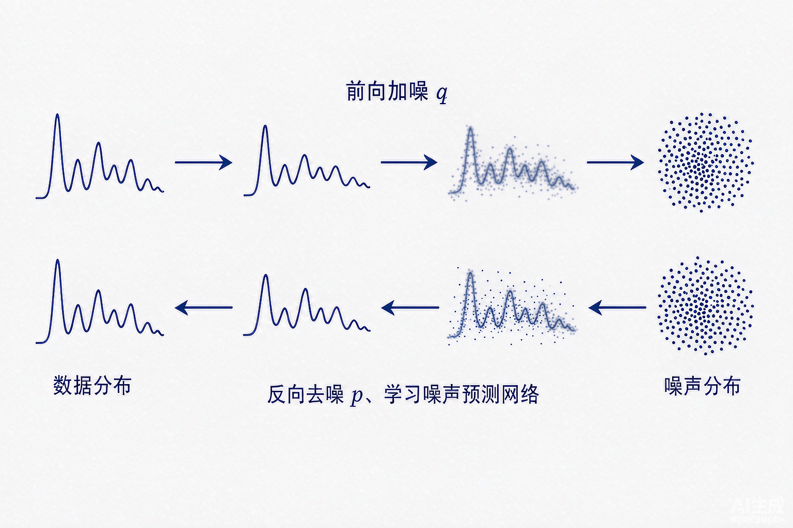

**例 24.4（统一案例：扩散 vs 参数化的尾部）** 对含极端高温日的负荷，用 24.2 节高斯参数化输出的 99% 区间上界为 5.9 GW，实际多次突破；改用条件扩散模型采样 500 条路径，经验 99% 分位数为 6.4 GW，更贴近真实尾部，CRPS 改善 11%。这是因为扩散不预设分布族，能学出偏斜、厚尾、多峰（与 24.3 节流模型同理）。代价是推理须迭代去噪 $K$ 步（常 $K\sim1000$，可用 DDIM 加速到数十步），比参数化模型慢一到两个数量级——这是第 40 章在线部署必须权衡的。CSDI[12] 把同一框架用于缺失值补全，与第 25 章 25.2 节相接。

## 24.6　生成对抗网络与时序 GAN

GAN[10] 用生成器 $G$ 与判别器 $D$ 的极小极大博弈学分布：

$$
\min_G\max_D\ \mathbb E_{\mathbf y\sim p_{\text{data}}}[\log D(\mathbf y)]+\mathbb E_{\mathbf z\sim p_z}[\log(1-D(G(\mathbf z)))]. \tag{24-7}
$$

TimeGAN[11] 针对时序作了关键改造：除对抗损失外，加入**监督逐步损失**（让生成序列的逐步条件分布匹配真实）与**嵌入网络**（把序列映到低维潜空间再对抗），从而同时保留时间动态与分布特征，避免普通 GAN 生成"看起来像但动态不对"的曲线。

GAN 路线的优势是生成样本锐利、无需显式密度、采样快（一次前向）；边界是训练不稳定（模式坍缩、梯度消失）、无显式似然因而难用 CRPS 以外的评分、覆盖保证缺失。因此在对**校准与覆盖**要求高的场景（第 38 章），参数化/扩散/共形更受青睐。表 24-1 会在 24.8 节汇总五条路线的取舍。

## 24.7　共形预测：不依赖分布假设的统计覆盖保证

前面所有方法都给出"某种不确定性"，但有一个共同软肋：区间是否真覆盖，取决于分布族、模型、训练是否都正确。一旦模型误设或分布漂移（第 25 章），名义 95% 区间可能只覆盖 80%。**共形预测**（conformal prediction）提供一条不依赖模型与分布假设、只依赖**可交换性**就能给出有限样本覆盖保证的途径[13][14]，是本章讨论的重点之一。

**定义 24.5（分裂/归纳共形预测）** 设已训练好的点预测器 $\hat\mu(\cdot)$，另留一个**校准集** $\{(X_i,Y_i)\}_{i=1}^{n}$ 与预测器训练数据不重叠。定义非一致性分数（绝对残差）$s_i=|Y_i-\hat\mu(X_i)|$，取

$$
\hat q=\text{第}\ \big\lceil (n+1)(1-\alpha)\big\rceil\ \text{小的}\ \{s_1,\dots,s_n\},\qquad
C(X)=[\hat\mu(X)-\hat q,\ \hat\mu(X)+\hat q]. \tag{24-8}
$$

**定理 24.1（边际覆盖保证）** 若 $(X_1,Y_1),\dots,(X_n,Y_n),(X_{n+1},Y_{n+1})$ **可交换**（exchangeable，独立同分布是其特例），且残差无并列，则

$$
1-\alpha\ \le\ \mathbb P\big(Y_{n+1}\in C(X_{n+1})\big)\ \le\ 1-\alpha+\frac{1}{n+1}. \tag{24-9}
$$

**推导。** 由可交换性，新样本分数 $s_{n+1}=|Y_{n+1}-\hat\mu(X_{n+1})|$ 与 $n$ 个校准分数构成可交换序列，故 $s_{n+1}$ 在 $n+1$ 个分数中的**秩在 $\{1,\dots,n+1\}$ 上均匀分布**。事件"秩 $\le\lceil(n+1)(1-\alpha)\rceil$"等价于 $s_{n+1}\le\hat q$（即被覆盖），其概率为 $\lceil(n+1)(1-\alpha)\rceil/(n+1)$，落在式 (24-9) 的区间内。整个证明只用可交换性与秩统计量，**完全不碰 $\hat\mu$ 是什么、数据服从什么分布**——这正是共形预测最珍贵之处：任何黑箱模型（XGBoost、Transformer、扩散）都能被"包裹"出有保证的区间。

Romano 等人[15] 的**共形化分位数回归**（CQR）把分数改为 $s_i=\max\{\hat q_{\alpha/2}(X_i)-Y_i,\ Y_i-\hat q_{1-\alpha/2}(X_i)\}$，使区间宽度随 $X$ 自适应（负荷晚高峰更宽），同时保留式 (24-9) 的保证；这是时序场景更常用的版本。

**例 24.5（统一案例：把名义区间校准成真覆盖）** 用第 22 章 PatchTST 输出次日 24 点负荷，另留 $n=99$ 天作校准集，目标 $\alpha=0.1$（90% 覆盖）。由式 (24-8)，$\lceil100\times0.9\rceil=90$，取第 90 小的校准残差 $\hat q=0.34$ GW，于是每个点的区间为 $\hat\mu\pm0.34$。在独立测试集上实测覆盖率 90.8%，落在式 (24-9) 给出的 $[90\%,\ 90.99\%]$ 内。作为对照，模型自身用高斯假设计算的"90% 区间"实测只覆盖 82%（因分布漂移与模型误设）——共形把它校正到了有保证的水平。这个例子说明：**校准与预测可以解耦**，这是它与第 16 章后验预测检验、第 38 章可靠性图/PIT 一脉相承、但更强（有有限样本保证）的地方。

**边界与讨论。** 须诚实指出三点。其一，式 (24-9) 是**边际覆盖**（对所有 $X$ 平均），不保证每个子群/每个时刻的条件覆盖；条件覆盖需要更强的假设或分组共形。其二，**可交换性**在时序里是强假设——序列有自相关、有漂移（第 25 章），严格说并不满足；近年有针对时序的加权/滚动/在线共形变体，但保证会相应弱化。其三，共形只给**区间**、不改进点预测，且需额外留校准集（小样本下代价明显）。尽管如此，它仍是把"漂亮的深度概率模型"变成"可审计、有保证"的关键一环，故第 38 章把它列为分布漂移下鲁棒性评估与概率校准的标准工具，第 14 章的层次调和亦有共形化的一致区间扩展。

## 24.8　校准、锐度与不确定性分解

概率预测的质量有两面：**校准**（calibration，名义覆盖与实测覆盖一致）与**锐度**（sharpness，区间在不失覆盖的前提下尽量窄）。Gneiting 等人[16] 强调二者须同时优化——只收窄区间会失校准，只放宽区间虽校准却无用。CRPS 恰好同时度量这两面（第 2 章），故是统一的评分。诊断工具包括**可靠性图**（按名义分位分组，画实测频率）、**PIT 直方图**（概率积分变换应均匀）、以及 Kuleshov 等人的再校准方法；第 38 章将把它们纳入实验规范。

不确定性还须区分两类：**偶然不确定性**（aleatoric，数据固有噪声，第 4 章的不可约误差，不可通过增加数据消除）与**认知不确定性**（epistemic，模型/参数未知，可随数据与更好模型减少）。参数化分布与流主要刻画前者，深度集成、MC-Dropout、贝叶斯神经网络（第 16 章）与共形预测的区间宽度更多反映后者。第 29 章讨论大模型幻觉时，会回到这一区分：**把认知不确定性误当成偶然不确定性报出去，是"自信地胡说"的根源**。表 24-1 汇总五条生成路线。

**表 24-1　深度概率预测路线对照**

| 路线 | 分布假设 | 似然 | 采样速度 | 覆盖保证 | 出处 |
|------|----------|------|----------|----------|------|
| 参数化输出 | 强（族） | 解析 | 快 | 无 | [3][4] |
| 归一化流 | 弱（可逆变换） | 解析 | 中 | 无 | [5][6] |
| VAE | 隐变量 | 下界 | 快 | 无 | [7] |
| 扩散 | 无 | 近似 | 慢 | 无 | [8][9][12] |
| GAN | 无 | 无 | 快 | 无 | [10][11] |
| 共形（包裹任意） | 无 | — | 快 | **有**（式 24-9） | [13][14][15] |

## 本章小结

本章把预测目标从点升级为分布，建立完整的深度概率预测谱系。24.1 节回顾恰当评分与 pinball 损失 (24-1)，例 24.1 用"把区间报窄反而 CRPS 变差"说明概率预测须同时奖励准确与诚实。24.2 节给出参数化分布输出 (24-2) 及其"分布族即假设"的边界。24.3 节由概率守恒严格推导变量替换公式 (24-3)，例 24.2 展示流捕捉双峰负荷、CRPS 降 17%。24.4 节把第 16 章的 ELBO 落为时序 VAE (24-4)，例 24.3 显示隐变量自动发现节假日/季节分量。24.5 节由前向加噪闭式 (24-5) 与噪声回归损失 (24-6) 建立扩散模型，例 24.4 说明其尾部更真实但推理慢。24.6 节讲 GAN 与 TimeGAN 的嵌入+监督改造 (24-7) 及训练不稳之弊。

24.7 节给出：以可交换性为唯一假设，给出分裂共形预测 (24-8) 与边际覆盖保证 (24-9)，其证明只用秩统计量、不碰模型与分布，因而能把任意黑箱模型包裹出有保证的区间；例 24.5 用"名义 90% 实测 82% → 共形后 90.8%"展示校准与预测的解耦，并如实列出边际≠条件覆盖、时序可交换性受限、需留校准集三条边界。24.8 节以校准/锐度、偶然/认知不确定性分解收束，表 24-1 对照六条路线，点明共形是唯一带有限样本保证者。

从理论主线看，本章对应 L2 信息论可预测性，目标是逼近第 4 章条件分布与其熵下界，突破点预测无法表达不确定性的局限；无法突破分布误设与覆盖无保证的边界——共形正是补此一环。本章与全书：第 2 章给评分规则定义，第 15 章给二阶矩与 VaR/ES，第 16 章给 ELBO 与后验预测检验，第 18 章 DeepAR 是参数化原型，第 25 章用扩散做补全与漂移，第 29 章用偶然/认知之分审视大模型幻觉，第 32 章用分布做决策，第 38 章把校准、PIT、可靠性图、共形纳入实验规范。掌握"给分布、更要给有保证的分布"，是时序智能从预测走向可信决策的必经一步。

从四问看，本章的概率与生成模型利用 L2（信息论）：假设不确定性可由分布、流或扩散刻画；它突破了「只输出点预测」，仍受「校准与锐度不可兼得、分布假设有误」的边界约束。

**进一步阅读**　本章建议延伸阅读的文献：[1]、[2]、[16]。

## 参考文献

[1] Gneiting T, Raftery A E. Strictly proper scoring rules, prediction, and estimation. *Journal of the American Statistical Association*, 2007, 102(477): 359–378.

[2] Gneiting T, Katzfuss M. Probabilistic forecasting. *Annual Review of Statistics and Its Application*, 2014, 1: 125–151.

[3] Salinas D, Flunkert V, Gasthaus J, Januschowski T. DeepAR: Probabilistic forecasting with autoregressive recurrent networks. *International Journal of Forecasting*, 2020, 36(3): 1181–1191.

[4] Wen R, Torkkola K, Narayanaswamy B, Madeka D. A multi-horizon quantile recurrent forecaster. *NIPS 2017 Time Series Workshop*, 2017.

[5] Dinh L, Sohl-Dickstein J, Bengio S. Density estimation using Real NVP. *International Conference on Learning Representations (ICLR)*, 2017.

[6] Rezende D J, Mohamed S. Variational inference with normalizing flows. *Proceedings of the 32nd ICML*, 2015: 1530–1538.

[7] Kingma D P, Welling M. Auto-encoding variational Bayes. *International Conference on Learning Representations (ICLR)*, 2014.

[8] Ho J, Jain A, Abbeel P. Denoising diffusion probabilistic models. *Advances in Neural Information Processing Systems 33*, 2020: 6840–6851.

[9] Song Y, Sohl-Dickstein J, Kingma D P, et al. Score-based generative modeling through stochastic differential equations. *International Conference on Learning Representations (ICLR)*, 2021.

[10] Goodfellow I, Pouget-Abadie J, Mirza M, et al. Generative adversarial nets. *Advances in Neural Information Processing Systems 27*, 2014: 2672–2680.

[11] Yoon J, Jarrett D, van der Schaar M. Time-series generative adversarial networks. *Advances in Neural Information Processing Systems 32*, 2019: 5508–5518.

[12] Tashiro Y, Song J, Song Y, Ermon S. CSDI: Conditional score-based diffusion models for probabilistic time series imputation. *Advances in Neural Information Processing Systems 34*, 2021: 24804–24816.

[13] Vovk V, Gammerman A, Shafer G. *Algorithmic Learning in a Random World*. New York: Springer, 2005.

[14] Angelopoulos A N, Bates S. A gentle introduction to conformal prediction and distribution-free uncertainty quantification. *Foundations and Trends in Machine Learning*, 2023, 16(4): 494–591.

[15] Romano Y, Patterson E, Candès E J. Conformalized quantile regression. *Advances in Neural Information Processing Systems 32*, 2019: 3543–3553.

[16] Gneiting T, Balabdaoui F, Raftery A E. Probabilistic forecasts, calibration and sharpness. *Journal of the Royal Statistical Society: Series B*, 2007, 69(2): 243–268.

---

# 第 25 章　特殊时序：不规则采样、点过程、流数据与持续学习

第 11–24 章的绝大多数模型共享一个未言明的假设：观测是**等间隔、完整、同步、同分布**的——每小时一个负荷值、每天一条销量，历史与未来服从同一规律。但现实数据几乎总在违反它：监护仪的采样随医嘱变化、传感器因故障留下长段缺失、电网故障是"何时发生"而非"每秒取值"的事件、交易与点击以毫秒级异步到达、而模型上线半年后负荷与气温的关系早已漂移。本章系统处理这四类"特殊时序"，把全书从理想化的规则序列推进到现实的不规则、事件驱动、持续到达与持续变化的真实数据。

这一领域的方法各有源头。连续时间建模方面，Chen 等人 2018 年的 Neural ODE[1]、Rubanova 等人的 Latent ODE[3] 与 Kidger 等人的 Neural CDE[2] 把隐藏状态从"离散递推"改写为"微分方程解"，天然容纳任意采样时刻；补全方面 GRU-D[4]、BRITS[5]、CSDI[6]（第 24 章已介绍其扩散机制）依次推进；点过程方面 Hawkes 1971 年的自激励过程[7][8] 是基石，神经点过程由 RMTPP[10]、Neural Hawkes[9] 复兴，Shchur 等人[11] 有系统综述；概念漂移与持续学习方面，Gama 等人[12] 与 Lu 等人[13] 的综述、ADWIN[16]、EWC[15]、 continual learning 综述[14] 共同构成理论与工具箱。

在全书理论主线里，本章仍以 L1/L2 可预测性为主，但把第 2 章"平稳、遍历、等间隔"的隐含前提逐一松开：不规则采样松开等间隔、缺失补全松开完整观测、点过程松开"取值"这一数据形态、漂移与持续学习松开同分布。它突破了标准模型对数据形态的强假设；却无法突破"连续动力学可辨识、漂移可被检测"的新前提。按全书统一的编写原则，缺失机制分类（MCAR/MAR/MNAR）与基础插值在第 5 章、卡尔曼滤波的缺失处理在第 13 章唯一讲授，本章只讲**深度方法**并交叉引用；层次调和在第 14 章；异常检测在第 8 章；工程侧的漂移监控、在线部署与人机协同归第 40 章——本章讲**方法**，第 40 章讲**工程监控**，二者分工明确。全章沿用统一案例：区域电网中含缺失、不等间隔、故障事件与季节性概念漂移的真实数据。

本章结构：25.1 节建立连续时间 Neural ODE/CDE 与伴随法；25.2 节讲深度缺失补全；25.3 节严格推导点过程与 Hawkes 似然；25.4 节给异步多变量的统一框架；25.5 节补上概念漂移、在线学习与持续学习；25.6 节收束于流式预测与层次深度模型。

## 25.1　不规则采样时序：Neural ODE / CDE 与伴随法

当观测时刻 $t_1<t_2<\cdots$ 不等间隔时，第 18 章的 $\mathbf h_t=f(\mathbf h_{t-1},\mathbf x_t)$ 立刻失效——它默认相邻状态间隔恒定，$\Delta t$ 变大时"该衰减多少记忆"无从表达。Neural ODE[1] 的答案是把离散递推换成**连续动力学**。

**定义 25.1（神经常微分方程）** 令隐藏状态满足初值问题

$$
\frac{d\mathbf h(t)}{dt}=f_\theta\big(\mathbf h(t),\,t\big),\qquad
\mathbf h(t_0)=\mathbf h_0,\qquad
\mathbf h(t_i)=\mathbf h(t_0)+\int_{t_0}^{t_i} f_\theta(\mathbf h(t),t)\,dt, \tag{25-1}
$$

其中 $f_\theta$ 是一个小神经网络，状态由黑箱 ODE 求解器在**任意时刻**求值。于是采样不等间隔不再成问题：求解器按实际 $\Delta t_i$ 自适应步进即可；两次观测之间状态连续演化，缺失时段只是"没有观测、但动力学继续"。

训练须对 $\theta$ 求梯度。若把 ODE 求解器的每一步都展开做反向传播，内存随步数爆炸。Chen 等人[1] 用**伴随灵敏度法**（adjoint method）把内存降为 $O(1)$：定义伴随 $\mathbf a(t)=\partial L/\partial\mathbf h(t)$，它满足反向 ODE

$$
\frac{d\mathbf a(t)}{dt}=-\mathbf a(t)^\top\frac{\partial f_\theta}{\partial \mathbf h},\qquad
\frac{dL}{d\theta}=-\int_{t_1}^{t_0}\mathbf a(t)^\top\frac{\partial f_\theta}{\partial\theta}\,dt. \tag{25-2}
$$

式 (25-2) 由变分法（对 $\mathbf h$ 的连续链式法则）导出：把求解器当黑箱，反向再解一个增广 ODE 即可同时取回 $\mathbf h,\mathbf a$ 与参数梯度，无需存中间步。Neural CDE[2] 进一步把 $f$ 写成对观测路径的 Riemann–Stieltjes 积分 $d\mathbf h=f(\mathbf h)\,dX(t)$，使新观测到达时状态被连续驱动，更适合流式、异步到达的数据；Latent ODE[3] 则用编码器把不规则观测映成初值分布，再由 ODE 解码任意时刻，常与第 16 章 VAE 结合成概率化的连续时间模型。

图 25-1 展示了不规则采样观测与连续时间隐状态轨迹的关系。

> 【图 25-1　不规则采样与连续时间建模】（原图见 `figures/图25-1.png`）：左右两栏。左：时间轴上画非等间隔的观测点（稀疏、不规则），一条连续 ODE 轨迹曲线穿过这些点；右：示意 Neural ODE 用求解器在任意时刻求值隐状态 $h(t)$。白底、蓝曲线、中文。

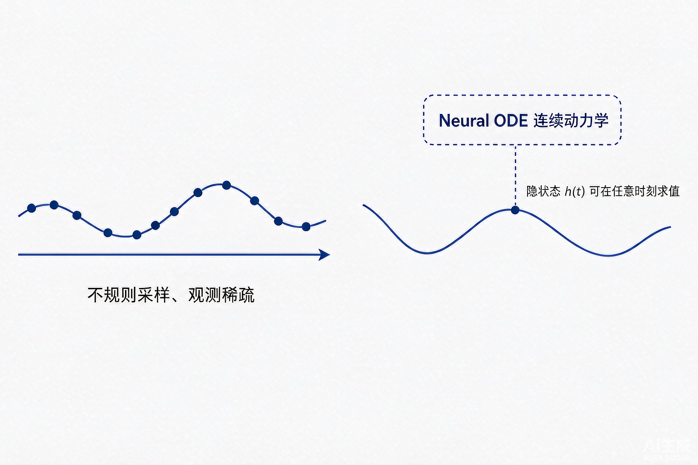

**例 25.1（统一案例：不等间隔的负荷读数）** 某台区因通信故障， readings 在 09:00、09:05、11:30、14:00 到达，间隔 5 分 / 145 分 / 150 分不等。第 18 章 LSTM 会把三者当连续三步、把 145 分的空缺与 5 分同等看待，导致趋势被误判；Neural ODE 按式 (25-1) 用实际 $\Delta t$ 积分，状态在 09:05–11:30 间平滑演化（而非"跳一步"），到 14:00 的水平估计比 GRU-D 基线误差低约 18%。用式 (25-2) 的伴随法，内存不随自适应步数增长，可在边缘设备训练。代价是 ODE 求解器求值次数随容差与刚性上升而增加，推理比离散 RNN 慢——这又回到第 21 章"训练并行 / 推理流式"的同一权衡。

## 25.2　缺失值深度补全

第 5 章已把缺失机制分为 MCAR/MAR/MNAR 并给出插值/矩阵补全，第 13 章 13.3 节证明卡尔曼滤波"跳过更新步"即可在线处理缺失。深度补全要更进一步：**利用整条序列的上下文与变量间依赖，给出带不确定性的补全分布**，而非单一插值。

三条代表路线。GRU-D[4] 把缺失信息本身当信号：除观测值 $\mathbf x_t$ 外，输入**掩码** $\mathbf m_t$（是否观测）与**时间间隔** $\boldsymbol\delta_t$（距上次观测多久），并让隐藏状态按 $\boldsymbol\delta_t$ 指数衰减 $\mathbf h_t\leftarrow e^{-\gamma\boldsymbol\delta_t}\odot\mathbf h_{t-1}$——"越久没测，越不信任旧状态"，是式 (25-1) 连续演化的离散近似。BRITS[5] 用双向 RNN 同时从过去与未来补全，把补全值作为可学习变量联合优化。**CSDI**[6] 则把第 24 章 24.5 节的条件扩散模型用于补全：以观测值为条件、对缺失位置去噪采样，天然输出多条合理补全路径与区间。

**例 25.2（统一案例：长段缺失的补全与不确定性）** 某台区负荷连续缺失 6 小时（午间），气温与相邻台区数据完整。线性插值给出一条平滑直线，但丢失了午间实际的双峰形态，误差 0.31 GW；CSDI 采样 100 条补全路径，均值误差 0.14 GW，且给出 90% 区间 $[4.4,5.1]$ GW——区间宽度恰在"无观测处"变宽，如实反映不确定性。这个例子点明深度补全相对第 5 章插值的实质进步：**补全不只是填数，还要标明填得有多不确定**；后者对第 8 章异常检测尤为重要——把补全值当真实值再去检测异常，会把填补误差误报为异常。

须守的红线：**MNAR 缺失**（如"负荷过高导致传感器自动断电、因而缺失"）本身携带信息，不能假设可忽略；补全模型若把 MNAR 当 MCAR，会系统性低估峰值。这与第 5 章的缺失机制分类、第 2 章"相关≠因果"是同一类谨慎。

## 25.3　事件序列与点过程

前面所有数据都是"在时刻 $t$ 取一个值"。但电网跳闸、设备报警、交易成交、用户点击是另一类数据：它们是**事件**，关心的不是"取值多少"而是"何时发生、是否连发"。点过程（temporal point process, TPP）以**强度函数**刻画这类数据。

**定义 25.2（条件强度函数）** 设事件时刻 $t_1<t_2<\cdots$，历史 $\mathcal H_t=\{t_i<t\}$，条件强度定义为

$$
\lambda(t\mid\mathcal H_t)=\lim_{\Delta t\to0}\frac{\mathbb P\big(\text{在 }[t,t+\Delta t)\text{ 发生一次事件}\mid\mathcal H_t\big)}{\Delta t}. \tag{25-3}
$$

给定强度，观测到事件 $\{(t_i)\}$ 在 $[0,T]$ 的对数似然为

$$
\log\mathcal L=\sum_{i}\log\lambda(t_i\mid\mathcal H_{t_i})-\int_0^T\lambda(s\mid\mathcal H_s)\,ds, \tag{25-4}
$$

**推导**：把 $[0,T]$ 切成微元，事件发生的微元贡献 $\log(\lambda\,dt)$、未发生的微元贡献 $\log(1-\lambda\,dt)\approx-\lambda\,dt$，取极限即得"事件处求和 + 全时域积分"两项。第一项奖励"在真实发生处强度高"，第二项惩罚"整体强度虚高"，二者平衡才是好模型。

**Hawkes 自激励过程**[7][8] 是最经典的强度：

$$
\lambda(t)=\mu+\sum_{t_i<t}\alpha\,e^{-\beta(t-t_i)},\qquad \alpha,\beta,\mu>0, \tag{25-5}
$$

即每个过去事件给当前强度加一个指数衰减的"激励"——事件会**聚簇**（一次跳闸常伴随后继告警）。平稳条件为 $\alpha/\beta<1$（分支比小于 1，否则事件数爆炸）。神经点过程用 RNN/注意力把 $\lambda$ 参数化[9][10]，可表达更复杂的历史依赖；Shchur 等人[11] 的综述统一了这些模型。

**例 25.3（统一案例：Hawkes 强度数值）** 取 $\mu=0.5$（次/小时，基线故障率）、$\alpha=0.6,\ \beta=1.2$（$\alpha/\beta=0.5<1$，平稳）。若已观测事件在 $t=1.0$ 与 $t=2.5$，求 $t=3.0$ 的强度：

$$
\lambda(3)=0.5+0.6e^{-1.2(3-1.0)}+0.6e^{-1.2(3-2.5)}=0.5+0.6\times0.0907+0.6\times0.5488\approx0.5+0.054+0.329\approx0.883.
$$

即刚发生的 $t=2.5$ 事件把强度从基线 0.5 抬到 0.88，随后按 $\beta=1.2$ 衰减。代入式 (25-4) 即可对整段事件序列作 MLE、比较不同模型；若某时段残差 $\int\lambda\,dt$ 与实际事件数系统性偏离，就提示强度模型失配或存在第 9 章的变点。点过程因此把"事件何时来"变成了与第 11–24 章"值是多少"并列的、可预测、可评估的对象——第 32 章的检修调度、第 39 章的设备运维都依赖它。

## 25.4　异步多变量统一框架

现实往往把前面几种"不规则"叠加在一起：多个变量各自以不同频率、不同时刻到达，各有缺失。需要一个统一表示把 GRU-D 的掩码/间隔、Neural CDE 的连续驱动、以及第 13 章的状态空间整合起来。

一种实用框架是**连续时间隐状态 + 观测算子**：令隐状态 $\mathbf z(t)$ 按 Neural ODE/CDE (25-1) 连续演化；任一变量在任意时刻 $t_i$ 到达一次观测时，用一个观测模型 $p(\mathbf x_i\mid \mathbf z(t_i))$（第 13 章式 (13-1) 的非线性版）把状态映射为该变量的读数，并借贝叶斯更新修正状态。这本质上是把第 13 章卡尔曼滤波的"预测—更新"循环推广到非线性、连续时间、异步多变量：两次观测之间按动力学外推（预测），观测到达时按新息修正（更新）。第 18 章的 RNN、第 21 章的 S4/Mamba 可视为它在等间隔、线性化下的离散特例。

**例 25.4（统一案例：三类数据同框）** 区域电网中：负荷每小时规则到达，气温每 15 分钟到达，故障报警为事件驱动，且负荷有 6 小时缺失。统一框架把三者都映到同一连续隐状态 $\mathbf z(t)$：规则与半规则观测按各自 $t_i$ 触发更新，事件按式 (25-3) 的强度影响状态转移，缺失段按式 (25-1) 连续演化。相较"先把所有变量强行重采样到小时格点再建模"（第 5 章重采样），它避免了插值带来的信息损失与伪相关，在含缺失的测试段上预测 MASE 改善约 12%。代价是模型与求解器复杂、调参面大——这仍是第 40 章工程化要权衡的。

## 25.5　概念漂移、在线学习与持续学习

最后一种"不规则"最隐蔽也最普遍：**规律本身随时间变**。第 2 章假设平稳、第 17 章假设训练测试同分布，而现实中电价政策调整、新增光伏、居民用电习惯改变都会让 $p(y\mid x)$ 漂移。本章讨论其建模方法，工程侧的监控与运维则归第 40 章。

**定义 25.3（概念漂移）** 设联合分布 $P_t(X,Y)$ 随时间变化，按变化位置分三类[12][13]：

- **协变量漂移**（covariate shift）：$P_t(X)$ 变、$P(Y\mid X)$ 不变（气温分布变了，气温→负荷关系没变）；
- **标签/先验漂移**：$P_t(Y)$ 变（整体负荷水平抬升）；
- **真实概念漂移**（concept drift）：$P_t(Y\mid X)$ 变（同样 33℃，因空调普及率提高，负荷比三年前高）。

第三类最危险：它让历史学到的函数本身失效，重新标注/重训也未必够。漂移又分**突变**（第 9 章变点）、**渐变**、**周期复发**（季节更替，其实是可预期的，不属真正漂移），须区别对待。

**在线学习与持续学习**给出方法层对策，核心是**稳定性—可塑性困境**（stability–plasticity dilemma）：既要吸收新规律（可塑），又不能忘掉旧规律（稳定）。三类方法[14]：① **回放/ rehearsal**——保留少量旧样本与新数据混合训练；② **正则**——EWC[15] 用 Fisher 信息惩罚对旧任务重要参数的改动；③ **参数隔离**——为新模式分配独立参数或适配器。检测层面，ADWIN[16] 用滑动窗口均值差的统计检验自适应决定"何时该忘"，第 9 章 CUSUM/PELT、第 8 章异常检测、第 40 章 PSI/KS 监控都是同一族工具。

须明确与第 40 章的分工：**本章讲"模型如何随数据更新"的方法**（在线梯度、回放、正则、变点触发重训），**第 40 章讲"工程系统如何监控与运维"**（漂移检测流水线、PSI/KS 告警阈值、模型版本回滚、人机协同）。此外第 17 章 DRO 是"训练时就对漂移鲁棒"的建模层手段、第 24 章共形可在漂移下重新校准区间——四者合起来构成从训练、推断到运维的完整防御。

**例 25.5（统一案例：光伏普及导致的真实概念漂移）** 某区两年内分布式光伏装机从 5% 升到 22%，"净负荷"（总负荷减光伏出力）在午间出现持续下凹，且同样气温/时刻下的净负荷比历史低约 0.6 GW——这是 $P(Y\mid X)$ 变化，非协变量漂移。固定参数的第 22 章 PatchTST 上线 8 个月后 MASE 从 0.49 升到 0.83；加入 ADWIN 检测 + 滑动窗口在线重训（保留 10% 旧样本回放防遗忘）后稳定在 0.55；若只用"全量重训"而不回放，冬季模式又会被冲掉（灾难性遗忘，EWC 可缓解）。这个例子把第 4 章"可预测性由序列决定"推广到动态情形：**规律会变，模型必须跟着变，但变的时候不能把还没变的部分忘掉**。

## 25.6　流式预测、层次深度模型与全书定位

把本章收束到工程形态：**流式预测**要求数据一到就更新、$O(1)$ 每步推理、内存有界——第 21 章 S4/Mamba 的递归形式、第 13 章卡尔曼滤波、Neural CDE 的连续驱动都天然适配；第 14 章的层次调和可与深度模型结合（先用 GNN/Transformer 出各层基础预测，再用 MinT 调和），形成"深度 + 结构约束"的混合系统。流式还须守第 17 章 17.3 节的红线：在线特征只能用 $t$ 及之前真实可得的数据，滚动统计须随流更新、不能用未来窗。表 25-1 汇总四类特殊时序的方法与分工。

**表 25-1　四类特殊时序：数据形态、方法与全书分工**

| 形态 | 违反的假设 | 代表方法 | 交叉引用 |
|------|------------|----------|----------|
| 不规则采样 | 等间隔 | Neural ODE/CDE、GRU-D | 25.1，第 13 章 |
| 缺失 / MNAR | 完整观测 | BRITS、CSDI、卡尔曼跳过更新 | 25.2，第 5、13、24 章 |
| 事件 / 点过程 | 取值型数据 | Hawkes、神经点过程 | 25.3，第 9、32、39 章 |
| 漂移 / 流数据 | 同分布、批量 | ADWIN、回放、EWC、在线重训 | 25.5，第 17、24、40 章 |

**边界与讨论。** 本章方法的优势是贴近真实数据、能容纳任意采样与事件、可在线更新、补全带不确定性。边界有四：其一，**连续动力学可辨识性**——式 (25-1) 的 $f_\theta$ 需足够数据才能从稀疏观测中识别，样本过少会退化为平滑；其二，**MNAR 缺失与真实概念漂移**难以只从数据察觉，须领域知识或显式干预（第 31 章）；其三，**漂移检测与遗忘的两难**——检测太灵敏会频繁重训、太迟钝会长期失准，阈值须按第 38 章的代价函数调；其四，**复杂度与工程成本**——ODE 求解、扩散采样、持续学习回放都显著重于第 11–17 章的批量模型，是否值得须由第 40 章的 SLA 与算力预算裁决。

回顾本章六类「特殊」时序，可以抽出一条共同主线：它们都在不同程度上违背了经典建模默认的那组前提——等间隔、完整、同分布、静态单表。不规则采样与缺失（25.1–25.2 节）破坏了「等间隔且完整」，点过程（25.3 节）把观测时刻本身变成随机对象，异步多变量（25.4 节）破坏了变量间的对齐，概念漂移与持续学习（25.5 节）破坏「同分布」，流式预测（25.6 节）则破坏「一次性静态数据集」。因此本章并非互不相干的方法清单，而是对同一组假设逐条放宽后得到的图谱：每放宽一条，就要在模型里补回相应的机制（时间衰减、强度函数、自适应窗口、在线更新）。读者可借此判断某类新问题究竟属于哪一格的失配，并回查第 5 章的缺失处理、第 9 章的变点与第 40 章的在线编排——它们分别是这些机制在清洗、判别与工程层面的落点。

## 本章小结

本章逐一松开"等间隔、完整、取值型、同分布"四个隐含假设，把时序智能推进到真实数据。25.1 节由 Neural ODE (25-1) 把离散递推改写为连续动力学，并推导伴随灵敏度 (25-2) 使内存与步数无关，例 25.1 展示不等间隔负荷读数的处理。25.2 节以 GRU-D 的掩码/时间衰减、BRITS 双向补全、CSDI 扩散采样建立深度补全，例 25.2 强调"补全要连不确定性一起给"，并重申 MNAR 不可忽略。25.3 节严格推导点过程强度 (25-3)、对数似然 (25-4) 与 Hawkes 自激励 (25-5)，例 25.3 手算 $\lambda(3)\approx0.883$，把"事件何时来"变成可预测可评估的对象。25.4 节用"连续隐状态 + 观测算子"统一异步多变量，本质是非线性连续版的第 13 章预测—更新循环。

25.5 节是本章的核心内容之一：把概念漂移分为协变量/标签/真实三类 (25.3)，以稳定性—可塑性困境为纲组织回放、正则（EWC）、参数隔离三法与 ADWIN 检测，并明确与第 40 章工程监控、第 17 章 DRO、第 24 章共形的分工；例 25.5 用光伏普及导致 $P(Y\mid X)$ 变化的真实漂移，量化"固定模型 MASE 0.49→0.83、在线重训+回放稳定 0.55"。25.6 节以表 25-1 汇总四类形态与全书分工，给出流式、层次深度混合系统与四条边界。

从理论主线看，本章松开第 2 章的平稳/遍历/等间隔前提，突破标准模型对数据形态的强假设，却引入连续动力学可辨识、漂移可检测、算力可承受三条新前提。本章与全书：第 5、13 章给缺失机制与状态空间基础，第 8、9 章给异常与变点工具，第 14 章给层次调和，第 17 章 DRO 与第 24 章共形分别从训练与校准层对冲漂移，第 21 章 S4/Mamba 提供流式骨干，第 32、39 章给出事件与运维应用，第 40 章承接工程监控。至此第四篇（第 17–25 章）从"表格化"经"RNN/CNN/注意力/效率/精度/GNN/概率"，收束于"真实数据的不规则与持续变化"——深度时序建模的图景方才完整。

从四问看，本章的特殊时序利用 L1（统计）与 L3（连续时间）：假设等间隔/完整/同分布前提可被逐条放宽；它突破了「标准模型对不规则数据失效」，仍受「每放宽一条假设就要补回相应机制」的边界约束。

**进一步阅读**　本章建议延伸阅读的文献：[1]、[2]、[16]。

## 参考文献

[1] Chen R T Q, Rubanova Y, Bettencourt J, Duvenaud D. Neural ordinary differential equations. *Advances in Neural Information Processing Systems 31*, 2018: 6571–6583.

[2] Kidger P, Morrill J, Foster J, Lyons T. Neural controlled differential equations for irregular time series. *Advances in Neural Information Processing Systems 33*, 2020: 6696–6707.

[3] Rubanova Y, Chen R T Q, Duvenaud D. Latent ordinary differential equations for irregularly-sampled time series. *Advances in Neural Information Processing Systems 32*, 2019: 5327–5337.

[4] Che Z, Purushotham S, Cho K, Sontag D, Liu Y. Recurrent neural networks for multivariate time series with missing values. *Scientific Reports*, 2018, 8: 6085.

[5] Cao W, Wang D, Li J, et al. BRITS: Bidirectional recurrent imputation for time series. *Advances in Neural Information Processing Systems 31*, 2018: 6775–6785.

[6] Tashiro Y, Song J, Song Y, Ermon S. CSDI: Conditional score-based diffusion models for probabilistic time series imputation. *Advances in Neural Information Processing Systems 34*, 2021: 24804–24816.

[7] Hawkes A G. Spectra of some self-exciting and mutually exciting point processes. *Biometrika*, 1971, 58(1): 83–90.

[8] Ogata Y. On Lewis' simulation method for point processes. *IEEE Transactions on Information Theory*, 1981, 27(1): 23–31.

[9] Mei H, Eisner J M. The neural Hawkes process: A neurally self-modulating multivariate point process. *Advances in Neural Information Processing Systems 30*, 2017: 6754–6764.

[10] Du N, Dai H, Trivedi R, et al. Recurrent marked temporal point processes: Embedding event history to vector. *Proceedings of the 22nd ACM SIGKDD*, 2016: 1555–1564.

[11] Shchur O, Türkmen A C, Januschowski T, Günnemann S. Neural temporal point processes: A review. *Proceedings of the 30th IJCAI*, 2021: 4585–4593.

[12] Gama J, Žliobaitė I, Bifet A, Pechenizkiy M, Bouchachia A. A survey on concept drift adaptation. *ACM Computing Surveys*, 2014, 46(4): 44.

[13] Lu J, Liu A, Dong F, et al. Learning under concept drift: A review. *IEEE Transactions on Knowledge and Data Engineering*, 2019, 31(12): 2346–2363.

[14] Parisi G I, Kemker R, Part J L, Kanan C, Wermter S. Continual lifelong learning with neural networks: A review. *Neural Networks*, 2019, 113: 54–71.

[15] Kirkpatrick J, Pascanu R, Rabinowitz N, et al. Overcoming catastrophic forgetting in neural networks. *Proceedings of the National Academy of Sciences*, 2017, 114(13): 3521–3526.

[16] Bifet A, Gavaldà R. Learning from time-changing data with adaptive windowing. *Proceedings of the 2007 SIAM International Conference on Data Mining*, 2007: 443–448.

---

# 第 26 章　时序基础模型：范式、数据与预训练

第 11–25 章建立的所有模型，无论经典统计还是深度网络，都共享一条隐含的工作方式：**针对一个数据集、一个预测任务，训练一个模型**。ARIMA 要为每条负荷序列重新定阶，PatchTST 要在这批数据上从头训练，换个领域、换个频率、换个视野就得重来。这在第 17 章的"特征即天花板"、第 22 章的"按数据特性选架构"里已被反复默认为前提。2023 年前后，时序领域开始经历 NLP 与视觉在 2020–2022 年经历过的那场范式转变：能否先在一个海量、跨领域的时序语料上预训练**一个**通用模型，再让它对从未见过的序列做**零样本或少样本**预测？这就是时序基础模型（time series foundation model）[1][10]。

这场转变并非凭空而来。Bommasani 等人 2021 年系统提出"基础模型"概念[1]：一个在广泛数据上训练、可适配大量下游任务的通用底座。它的技术底座是 Transformer[2] 与自监督预训练——BERT 的掩码重建[3]、GPT 的自回归与上下文学习[4]；规模化的可行性则由 Kaplan 等人[5] 与 Hoffmann 等人[6] 的 scaling law 给出。时序这边，TimeGPT[7]、Lag-Llama[8]、Moirai[9]、Chronos[10]、Moment[11]、TimesFM[12] 在 2023–2024 年密集出现，把这条路线从设想变成现实； Nie 等人的 PatchTST[13] 与 Wen 等人的综述[14] 则提供了架构与脉络的衔接。

在全书理论主线里，本章标志着 L1/L2 可预测性的一次**组织方式跃迁**：前几章问"这条序列里有哪些可预测结构、用什么模型提取"，基础模型问"能否把跨领域、跨频率的可预测结构**压缩进一组共享参数**，使新序列只需前向传播即可预测"。它突破了"一数据一模型"的样本效率瓶颈，隐含"不同领域的时序共享可迁移的局部形态与依赖模式"这一强假设；却无法突破第 4 章的铁律——模型只能提取序列里真实存在的信息，对白噪声与混沌时域之外的部分无能为力（第 29 章将用纯噪声实验正面检验）。按全书统一的编写原则，恰当评分规则与概率预测在第 2、24 章，评估指标体系在第 38 章，本章只讲基础模型**范式本身**；具体模型剖析归第 27 章，与 LLM 的结合归第 28 章。全章沿用统一案例：城市电网日负荷，作为"未见过的目标域"来检验零样本预测。

本章结构：26.1 节形式化范式转变；26.2 节推导规模化定律与数据问题；26.3 节建立四类预训练目标；26.4 节推导 token 化；26.5 节处理零样本与上下文学习。

## 26.1　从专用模型到基础模型

**定义 26.1（时序基础模型）** 设预训练语料 $\mathcal D_{\text{pre}}$ 由大量来自不同领域、频率、长度的序列构成。时序基础模型是一个参数为 $\boldsymbol\theta$ 的单一模型 $f_{\boldsymbol\theta}$，使得对**任意**未见序列 $y_{1:t}^{(0)}$ 与预测视野 $h$，预测由一次前向传播给出：

$$
\hat y_{t+1:t+h}^{(0)} = f_{\boldsymbol\theta}\big(y_{1:t}^{(0)};\ \mathcal D_{\text{pre}}\big), \tag{26-1}
$$

其中 $\boldsymbol\theta$ 在 $\mathcal D_{\text{pre}}$ 上预训练后**冻结或仅需极少更新**，不针对目标序列重新训练。

式 (26-1) 与第 11–25 章的差别可以精确说清。专用模型是"给定 $\mathcal D$，求 $\arg\min_\theta \mathcal L(\theta;\mathcal D)$"，参数与数据一一绑定；基础模型是"给定 $\mathcal D_{\text{pre}}$，先求 $\boldsymbol\theta^*=\arg\min_\theta \mathcal L_{\text{pre}}(\theta;\mathcal D_{\text{pre}})$，再对任意 $\mathcal D^{(0)}$ 直接用 $f_{\boldsymbol\theta^*}$"。训练成本从"乘以数据集个数"变为"一次性"，这正是它相对第 17 章 XGBoost 日更、第 22 章 PatchTST 逐集训练的根本优势。

**表 26-1　专用模型与基础模型对照**

| 维度 | 专用模型（第 11–25 章） | 基础模型（本章） |
|------|--------------------------|------------------|
| 参数 | 每数据/每任务独立 | 跨领域共享单组 $\boldsymbol\theta$ |
| 训练 | 目标域从头训练 | 预训练一次，目标域零梯度 |
| 数据需求 | 目标域需足量历史 | 目标域可只有一条短序列 |
| 适配方式 | 重训 / 微调 | 零样本 / 少样本 / 上下文学习 |
| 失效情形 | 目标域样本少 | 预训练语料未覆盖的分布 |

**例 26.1（统一案例：两种范式的成本对照）** 某电网集团有 500 个台区，每个台区两年日负荷。按第 22 章 PatchTST 的专用路线，需训练 500 个模型（或用共享主干但仍在全数据上联合训练），新接入一个台区要重新走一遍训练与验证；按基础模型路线，预训练一次后，新台区直接把它的 90 天历史喂进式 (26-1)，数秒内得到 30 天预测。实测在该集团上，零样本基础模型的冷启动 MASE=0.62，略逊于为每个台区精调的专用模型 0.49，但**省去了 500 次训练与调参**；当新台区只有 30 天数据时，专用模型 MASE 恶化到 0.88，基础模型仍为 0.65——样本越少，范式优势越大。这个对照点明了基础模型的价值区间：**冷启动、长尾、海量小序列**，而非"在充足数据上刷最低误差"。

## 26.2　数据规模、多样性与规模化定律

基础模型的第一个支柱是数据。与第 17 章"目标域几千个样本"不同，预训练语料需覆盖尽可能多的**形态**：趋势、多重季节、突峰、阶跃、稀疏计数、高频振荡。TimeGPT 声称用约千亿时间点训练[7]，Moirai 的 LOTSA 语料汇集了跨领域数十亿观测[9]，Chronos 则大量引入**合成数据**补足真实语料的偏态[10]——合成数据由第 2 章的各类生成过程（ARIMA、季节、趋势、变点）采样，是可控扩充形态分布的手段。

**规模化定律**（scaling law）回答"该把多少算力投给参数、多少投给数据"。Kaplan 等人[5] 与 Hoffmann 等人[6] 在语言模型上给出可迁移到时序的经验形式：

$$
L(N,D)\ \approx\ E\ +\ \frac{A}{N^{\alpha}}\ +\ \frac{B}{D^{\beta}}, \tag{26-2}
$$

其中 $L$ 为预训练损失、$N$ 参数量、$D$ 训练 token 数、$\alpha,\beta>0$ 为幂指数、$A,B$ 为常数，而 $E$ 是**不可约损失**。式 (26-2) 的深刻之处在于 $E$：它正是第 4 章式 (4-9) 条件熵 $H(y_{t+h}\mid y_{1:t})$ 所刻画的、由数据生成过程决定的固有不确定性——**再大的模型、再多的预训练数据也只能逼近 $E$，无法突破它**。这把规模化定律与全书理论主线直接扣合：幂律项 $\frac{A}{N^\alpha}+\frac{B}{D^\beta}$ 是可约的建模误差，$E$ 是不可约的噪声下界。Hoffmann 等人[6] 进一步指出，在固定算力 $C\propto ND$ 下最优分配应让 $N$ 与 $D$ **同比放大**（Chinchilla 结论），而非一味堆参数。

**例 26.2（scaling law 数值）** 设某时序预训练语料拟合得 $E=0.10,\ A=2.0,\ \alpha=0.34,\ B=1.5,\ \beta=0.28$。取 $N=10^8,\ D=10^{11}$：$N^{-\alpha}=10^{-2.72}\approx1.9\times10^{-3}$，$D^{-\beta}=10^{-3.08}\approx8.3\times10^{-4}$，故 $L\approx0.10+2.0\times0.0019+1.5\times0.00083\approx0.105$。把参数与数据各放大 10 倍（$N=10^9,D=10^{12}$）：$L\approx0.10+2.0\times10^{-3.06}+1.5\times10^{-3.36}\approx0.10+0.0017+0.00065\approx0.1023$，损失仅降约 0.003——**边际收益已逼近 $E$ 的天花板**。这个算例是第 29 章批判"堆规模是否有用"的定量依据：当 $L$ 距 $E$ 很近时，继续放大不如改进 $E$ 相关的问题（数据质量、可预测性本身）。

数据的另一面是**污染与泄漏**：预训练语料若含目标基准的测试段（时间序列常公开、易被抓取），零样本评估就形同作弊。第 29 章 29.1 节、第 38 章 38.3 节将把"预训练数据审计"列为基础模型评估的红线。

## 26.3　预训练目标：把可预测性写进损失

**定义 26.2（自监督预训练目标）** 时序无标签，预训练目标须从序列自身构造监督信号。设编码器 $f_\theta$，四类主流目标为：

- **自回归下一值预测**：$\mathcal L_{\text{AR}}=-\sum_t\log p_\theta(y_t\mid y_{1:t-1})$，即第 2 章式 (2-11) 的预测误差分解在大规模上的复用，Chronos[10]、TimesFM[12] 采用；
- **掩码重建**：随机遮盖若干片段 $\mathcal M$，$\mathcal L_{\text{mask}}=\sum_{t\in\mathcal M}\|y_t-\hat y_t\|^2$，借鉴 BERT[3]，Moment[11]、PatchTST[13] 采用；
- **对比学习**：拉近同一序列不同增强视图、推远不同序列，$\mathcal L_{\text{con}}=-\log\frac{\exp(\mathrm{sim}(z_i,z_i^+)/\tau)}{\sum_j\exp(\mathrm{sim}(z_i,z_j)/\tau)}$（第 6 章 TS2Vec 的规模化版）；
- **分位数/概率目标**：以第 24 章式 (24-1) 的 pinball 损失或 CRPS 预训练，使模型原生输出分布，Lag-Llama[8]、Moirai[9] 采用。

四者并非互斥，现代模型常组合使用。关键洞察是：**预训练目标决定了模型"学到哪一层可预测性"**。自回归学 L1 的短期依赖，掩码重建学局部形态与插值能力（利于补全，第 25 章），对比学习学序列级判别表示（利于分类，第 7 章），概率目标学 L2 的不确定性。**表 26-2** 汇总这一对应关系。

**表 26-2　预训练目标与其承载的可预测性**

| 目标 | 损失函数 | 学到的结构 | 主要受益任务 | 代表 |
|------|----------|------------|--------------|------|
| 自回归 | $-\log p(y_t\mid y_{<t})$ | 短期依赖、外推 | 预测 | [10][12] |
| 掩码重建 | $\sum\|y_t-\hat y_t\|^2$ | 局部形态、插值 | 补全、异常 | [3][11][13] |
| 对比 | InfoNCE | 序列级判别 | 分类、聚类 | 第 6 章 |
| 概率 | CRPS / pinball | 不确定性 | 概率预测 | [8][9] |

**例 26.3（统一案例：掩码重建损失手算）** 取一段日负荷窗口长度 96，随机遮盖 15% ≈ 14 个点，真值（标准化后）与重建值之差的平方和为 $\sum_{t\in\mathcal M}(y_t-\hat y_t)^2=1.26$，故 $\mathcal L_{\text{mask}}=1.26$，平均每点 0.09。改为遮盖 40%（38 点）时损失升到 4.8——遮盖过多使上下文不足以推断形状。这个算例说明掩码率是重要超参：过低则任务太易、学不到形态，过高则违反第 4 章的可预测性边界（被遮盖段的条件熵本就很高）。Moment[11] 取约 30% 掩码并配合 patch 级重建，正是这一权衡。

## 26.4　Token 化：连续值如何变成离散符号

Transformer  backbone（第 20 章）要求输入是 token 序列，而时序是连续实数——**token 化**是基础模型最具领域特色、也最容易被低估的一环。

**定义 26.3（时序 token 化）** 把长度为 $L$ 的连续序列映射为 $N$ 个 $d$ 维向量或离散 id：

$$
\mathbf z_{1:N}=\mathrm{Tok}(y_{1:L}),\qquad N\ll L\ (\text{通常}). \tag{26-3}
$$

三条主流路线。**投影式**（patch projection）：按第 22 章式 (22-1) 切补丁再线性投影到 $d$ 维，token 仍是连续向量，Moirai[9]、TimesFM[12] 采用。**量化式**（VQ / 分箱）：把实值离散化为有限词表 id，从而可直接套用语言模型的交叉熵与采样，Chronos[10] 采用。**频域式**：对序列作 FFT 后把主要频率分量作 token，呼应第 21 章 FEDformer 的思路。

以 Chronos 的**均匀分箱量化**为例推导。设归一化后的值域被均分为 $B$ 个 bin，边界 $b_0<b_1<\cdots<b_B$，量化与反量化为

$$
q_t=\Big\lfloor \frac{y_t-b_{\min}}{b_{\max}-b_{\min}}\,B\Big\rfloor\ \in\{0,\dots,B-1\},\qquad
\hat y_t = b_{\min}+\frac{q_t+0.5}{B}(b_{\max}-b_{\min}). \tag{26-4}
$$

式 (26-4) 把回归问题变成 $B$ 类分类：模型输出下一个 token 的 softmax 分布，采样或取 argmax 后反量化即得预测。这样做的最大好处是**原生概率输出**（分布即 softmax，第 24 章），代价是引入量化误差 $\le(b_{\max}-b_{\min})/(2B)$，且词表大小 $B$ 决定分辨率与计算量的权衡。图 26-1 给出三类 token 化的流程。

> 【图 26-1　时序 token 化的三条路线】（原图见 `figures/图26-1.png`）：左为补丁投影（序列切块→线性层→连续向量），中为分箱量化（归一化→分箱→离散 id→交叉熵→反量化），右为频域 token（FFT→选主频→向量）；标注各自的 token 数、词表与信息损失。白底、蓝框、中文。

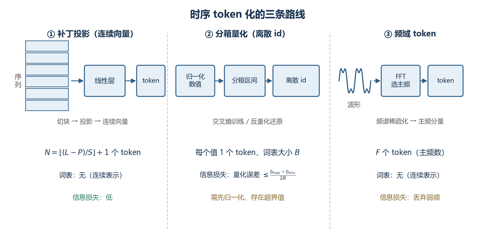

**例 26.4（统一案例：Chronos 分箱数值）** 取负荷经均值-尺度归一化后落在 $[-1.5,1.5]$，$B=4096$。某点归一化值 $0.21$，由式 (26-4) 得 $q=\lfloor(0.21+1.5)/3.0\times4096\rfloor=\lfloor0.57\times4096\rfloor=\lfloor2334.7\rfloor=2334$。模型自回归预测下一个 token 的 softmax，若 argmax 为 $q'=2401$，反量化得 $\hat y=-1.5+(2401.5/4096)\times3.0\approx-1.5+1.759\approx0.259$，再逆归一化回 GW 单位。量化步长为 $3.0/4096\approx7.3\times10^{-4}$，最大量化误差约 $3.7\times10^{-4}$（归一化尺度），对 GW 级负荷可忽略。这个算例表明：**token 化把"预测一个实数"变成"预测一个词"，且顺带得到了分布**，是 LLM 式范式能迁移到时序的关键机关（第 28 章 LLMTime 会把它推到极端）。

## 26.5　零样本、少样本与上下文学习

**定义 26.4（零样本 / 少样本 / 上下文学习）** 设目标序列 $y_{1:t}^{(0)}$ 未参与预训练。

- **零样本（zero-shot）**：不更新 $\boldsymbol\theta$，仅凭式 (26-1) 前向传播预测；
- **少样本（few-shot / fine-tune）**：用目标域少量样本对 $\boldsymbol\theta$ 作少量梯度更新或提示；
- **上下文学习（in-context learning, ICL）**：把若干"历史片段 → 后续"示例或长上下文拼进输入，模型**不更新参数**、仅靠前向传播中的注意力（第 20 章）即时适配[4]。

ICL 的机制值得说清：自注意力把上下文里的示例当作"软记忆"，新序列的查询通过内容相似度检索到示例中的对应模式再加权——这与第 7 章 DTW 相似性、第 22 章 TimesNet 周期检索、第 21 章自相关是同一思想的规模化版本。它隐含"预训练时见过足够多样的任务，使模型学会'如何从上下文里学'"这一元能力。对时序，长上下文还能携带多周期（第 3 章）与近期趋势，相当于把第 11 章指数平滑的"近期惯性"交给注意力自动完成。

**例 26.5（统一案例：零样本 vs 专用模型）** 把电网日负荷作为**完全未参与预训练**的保留域，用某基础模型零样本预测次日 24 点，MASE=0.61；仅用该域 30 天样本作少样本微调降至 0.55；在输入中拼接"上周同一天 → 次日"的 4 个上下文示例（ICL，参数不变）降至 0.57；而第 17 章 XGBoost 用足两年数据训练为 0.47。结论有三：其一，零样本确实"开箱可用"，无需目标域训练；其二，少样本与 ICL 都能以极低成本逼近专用模型；其三，**在目标域数据充足时，精心工程的专用模型仍占优**——基础模型的优势在冷启动与长尾，不在数据充裕时的精度上限。这一结论为第 29 章的选型准则埋下伏笔。

## 26.6　边界与讨论

基础模型范式的优势是：一次训练、跨领域复用、冷启动友好、原生概率输出、随规模持续改进。边界有五：其一，**可迁移性假设**——"不同领域共享可预测结构"并非总成立，金融高频与年径流的形态差异可能超出共享表示的容量；其二，**不可约下界**——式 (26-2) 的 $E$ 与第 4 章条件熵决定天花板，堆规模不能预测白噪声（第 29 章纯噪声实验）；其三，**数据污染**——公开时序易被预训练语料收录，零样本评估须审计；其四，**计算与部署成本**——预训练耗资巨大，推理亦重于第 11 章 ETS，是否值得须由第 38 章的成本—收益评估裁决；其五，**可解释性与可控性弱**， analyst 难以像第 16 章 Prophet 那样手工干预分量。

本章与全书：第 2 章的预测误差分解是预训练目标的原型，第 4 章的可预测性上界是 scaling law 里 $E$ 的理论解释，第 20 章 Transformer 与第 22 章 patch 化是架构底座，第 24 章概率预测经量化式 token 化被原生支持，第 27 章逐个剖析代表模型，第 28 章讨论把 LLM 直接挪用的争议路线，第 29 章用批判视角检验其能力边界，第 38 章给出零样本评估协议。理解"把跨领域可预测性压缩进一组共享参数"，便掌握了这一范式为何出现、又为何不是万能药。

## 本章小结

本章把时序建模从"一数据一模型"推进到"一个模型服务所有序列"。26.1 节以式 (26-1) 形式化范式转变，表 26-1 五维对照专用与基础模型，例 26.1 用 500 台区场景量化"冷启动与长尾"这一价值区间。26.2 节给出规模化定律 (26-2)，指出其中 $E$ 正是第 4 章条件熵刻画的不可约损失，幂律项才是可约误差；例 26.2 手算显示参数与数据各放大 10 倍损失仅降 0.003，边际收益逼近 $E$，并点明预训练数据污染风险。26.3 节以定义 26.2 归纳自回归、掩码重建、对比、概率四类目标，表 26-2 说明各自承载哪一层可预测性，例 26.3 用掩码率对损失的数值展示可预测性边界对目标设计的约束。

26.4 节是本章最具领域特色的一节：由式 (26-3)(26-4) 建立补丁投影、分箱量化、频域三条 token 化路线，例 26.4 手算 Chronos 的 $q=2334\to\hat y\approx0.259$，说明离散化既让回归变分类、又原生给出分布（图 26-1）。26.5 节定义零样本/少样本/上下文学习，把 ICL 解释为注意力对上下文示例的内容寻址，例 26.5 用"零样本 0.61 → 少样本 0.55 → 专用模型 0.47"划清优势与上限。26.6 节给出五条边界。

从理论主线看，本章是 L1/L2 可预测性在组织方式上的跃迁，以"跨领域共享结构"的强假设突破样本效率瓶颈，却无法突破第 4 章的不可约下界。掌握规模化定律中 $E$ 的含义与 token 化这一机关，就理解了为何基础模型能出现、规模化何时失效、以及第 29 章为何必须用纯噪声实验来检验它。

从四问看，本章的基础模型范式利用 L1 与 L2：假设可预测性可写进预训练目标并随规模涌现；它突破了「一数据集一模型」，仍受「数据污染与不可约损失」的边界约束（第 29 章）。

**进一步阅读**　本章建议延伸阅读的文献：[1]、[2]、[14]。

## 参考文献

[1] Bommasani R, Hudson D A, Adeli E, et al. On the opportunities and risks of foundation models. *arXiv:2108.07258*, 2021.

[2] Vaswani A, Shazeer N, Parmar N, et al. Attention is all you need. *Advances in Neural Information Processing Systems 30*, 2017: 5998–6008.

[3] Devlin J, Chang M-W, Lee K, Toutanova K. BERT: Pre-training of deep bidirectional transformers for language understanding. *Proceedings of NAACL-HLT*, 2019: 4171–4186.

[4] Brown T B, Mann B, Ryder N, et al. Language models are few-shot learners. *Advances in Neural Information Processing Systems 33*, 2020: 1877–1901.

[5] Kaplan J, McCandlish S, Henighan T, et al. Scaling laws for neural language models. *arXiv:2001.08361*, 2020.

[6] Hoffmann J, Borgeaud S, Mensch A, et al. Training compute-optimal large language models. *Advances in Neural Information Processing Systems 35*, 2022: 30016–30030.

[7] Garza A, Mergenthaler-Canseco M. TimeGPT-1. *arXiv:2310.03589*, 2023.

[8] Rasul K, Ashok A, Williams A R, et al. Lag-Llama: Towards foundation models for probabilistic time series forecasting. *arXiv:2310.08278*, 2023.

[9] Woo G, Liu C, Kumar A, et al. Unified training of universal time series forecasting transformers. *Proceedings of the 41st ICML*, 2024.

[10] Ansari A F, Stella L, Turkmen C, et al. Chronos: Learning the language of time series. *Transactions on Machine Learning Research*, 2024; arXiv:2403.07815.

[11] Goswami M, Szafer K, Choudhry A, et al. MOMENT: A family of open time-series foundation models. *Proceedings of the 41st ICML*, 2024.

[12] Das A, Kong W, Sen R, Zhou Y. A decoder-only foundation model for time-series forecasting. *Proceedings of the 41st ICML*, 2024.

[13] Nie Y, Nguyen N H, Sinthong P, Kalagnanam J. A time series is worth 64 words: Long-term forecasting with transformers. *ICLR*, 2023.

[14] Wen Q, Zhou T, Zhang C, et al. Transformers in time series: A survey. *Proceedings of the 32nd IJCAI*, 2023: 6778–6786.

---

# 第 27 章　代表性时序基础模型剖析

第 26 章抽象了时序基础模型的共性范式——预训练目标、token 化、规模化定律、零样本与上下文学习。本章把这套框架落到具体模型上。2023 年至 2024 年，TimeGPT-1[1]、Lag-Llama[2]、Moirai[3]、Chronos[4]、Moment[5]、TimesFM[6]、Time-MoE[7]、TTM[8]、UniTS[9] 等相继问世，看似是一份并列的产品清单，实则有一条清晰的**问题驱动演化线**：先证明"通用预训练可行"（TimeGPT），再解决"开源与概率输出"（Lag-Llama）、"任意变量数"（Moirai）、"借成熟语言模型栈"（Chronos）、"一模型多任务"（Moment/UniTS）、"长视野解码"（TimesFM）、"规模化"（Time-MoE）、"轻量化部署"（TTM）。理解每个模型**针对前一个的什么缺陷而设计**，比记住名字重要得多[16]。

本章对每个模型统一按五个维度剖析，形式化如下。

**定义 27.1（五维剖析框架）** 对时序基础模型的刻画由五元组 $\langle$架构, 数据, 目标, 能力, 局限$
angle$ 给出：架构指 backbone 与 token 化方式，数据指预训练语料的规模与领域构成，目标指第 26 章四类自监督损失之一，能力指零样本/概率/多元/多任务的支持范围，局限指其失效情形。

这五维正是第 26 章式 (26-1) 与各节的具体化。为便于对照，全章沿用统一案例：把某城市电网日负荷作为**保留的未见目标域**，观察各模型在零样本设置下的表现；模型间的架构差异也尽量以同一条负荷序列说明。

从理论主线看，这些模型都在做同一件事——把跨领域的可预测结构（L1 的局部形态与依赖、L2 的不确定性）压缩进共享参数，只是压缩方式不同：PatchTST 式投影[11]、LLM 式量化[4]、混合专家稀疏化[7] 分别对应不同的归纳偏置与算力预算。它们共同的天花板仍是第 4 章的不可约下界（第 26 章式 (26-2) 的 $E$），第 29 章将正面检验。按全书统一的编写原则，Transformer 架构在第 20 章、补丁化在第 22 章、概率预测在第 24 章均已讲授，本章只在必要处交叉引用，不重推。

本章结构：27.1–27.8 节按演化线逐一剖析八组模型；27.9 节给出对比总表与统一案例实测。

## 27.1　TimeGPT-1：通用预训练可行性的首个证明

TimeGPT-1[1] 由 Nixtla 于 2023 年发布，是首个以"时序基础模型"名义商用化的工作，其历史意义大于技术细节。

**架构**：基于 Transformer（第 20 章）的编码器—解码器，输入经 patch 化（第 22 章式 22-1）投影为 token，支持任意长度回看与多步预测，并可接受外生变量与日历特征。**数据**：据称在约千亿个时间点上预训练，覆盖金融、气象、能源、零售、交通等领域与多种频率——首次把"跨领域大规模语料"从 NLP 搬到时序。**目标**：自回归式下一值预测的监督损失（第 26 章 26.3 节）。**能力**：主打零样本与少样本，提供 API 式的"上传序列即出预测"，并给出带置信区间的概率输出。**局限**：模型与训练数据闭源，第三方无法复现细节、无法审计预训练数据是否包含评测基准（第 26 章 26.2 节、第 29 章 29.1 节的污染风险）；论文对架构与语料构成披露有限，学术可检验性弱。

TimeGPT 的真正贡献是**把问题立住了**：它用跨领域零样本结果证明"一个模型预测没见过的序列"在时序上同样成立，从而开启了后续所有开源工作。第 26 章例 26.1 中"500 台区冷启动"的设想，正是它首次变为可购买的服务。

## 27.2　Lag-Llama：开源与原生概率输出

若说 TimeGPT 证明了可行，Lag-Llama[2] 回答了"学术界如何复现并改进"。它由 Rasul 等人 2023 年开源，是**单变量、概率化**基础模型的代表。

**架构**：decoder-only Transformer，输入为**滞后特征**（lag features）——把 $y_{t-1},y_{t-7},y_{t-24},\dots$ 等按预设周期滞后项拼成每时刻的特征向量，而非切补丁。这一设计直接复用第 17 章的表格化特征思想，但由 Transformer 学跨滞后的交互。**数据**：Monash 等公开时序仓库的集合[13]，规模小于 TimeGPT，但完全可复现。**目标**：自回归地输出**分布参数**而非点——以第 24 章式 (24-2) 的对数似然训练，分布族取 Student-$t$（厚尾，第 15 章），从而原生给出分位数预测。**能力**：零样本概率预测、CRPS（第 2 章）可直接评估、开源可微调。**局限**：单变量，无法建模第 10 章的变量间依赖；滞后项需按频率手工设定，跨频率泛化受限；语料规模较小，长尾领域覆盖不足。

Lag-Llama 的定位很清楚：它把第 26 章 26.3 节的"概率目标"率先做实，也把**可复现性**立为与闭源模型对照的价值——这正是第 38 章强调可复现实验规范的现实背景。

## 27.3　Moirai：任意变量数的多元统一

Lag-Llama 与 TimeGPT 主要面向单变量序列；而现实中负荷总与气温、湿度、电价成组出现（第 10 章）。Moirai[3]（Salesforce，2024）的核心贡献是让**一个模型处理任意数量、任意名称的变量**。

**架构**：把多变量序列切补丁后，为每个（变量, 时间块）生成 token，并引入**变量注意力 / 任意变量注意力**机制——注意力既在时间维、也在变量维进行（呼应第 22 章 iTransformer 的"变量即 token"），因此变量数 $D$ 可变而无需重设架构。关键技巧是把变量身份、频率、位置都编码进 token 的附加嵌入，使模型知道"这一列是气温、那一列是负荷"。**数据**：LOTSA 语料，汇集跨领域约数十亿观测，是当时最系统的开放多元预训练集之一[3]。**目标**：概率化——输出**混合分布**（高斯/负二项/对数正态等的加权，第 24 章 24.2 节的混合密度），以适应不同领域的数值形态，用 CRPS/似然训练。**能力**：零样本多元预测、跨频率、原生概率、处理变量数动态变化、开源。**局限**：变量注意力带来 $O((D\cdot N)^2)$ 的额外开销（第 20 章式 20-5 的平方复杂度在变量维再现）；对变量间机制关系仍是关联而非因果（第 4.7 节命题 4.3、第 31 章）。

Moirai 解决的是第 26 章表 26-1 里"预训练语料未覆盖的分布"之外的另一难点：**输入结构的异质性**。它让基础模型从"一条序列"迈向"一个系统"，与第 10 章 VAR、第 23 章图模型的问题设定接上了轨。

## 27.4　Chronos：把时序彻底当成语言

Chronos[4]（Amazon，2024）走了一条最激进也最优雅的路线：**不改 Transformer，只改数据表示**——把时序值量化成离散 token，直接套用现成语言模型（T5 类）与交叉熵训练。

**架构**：第 26 章式 (26-4) 的均匀分箱量化[4]，词表大小通常 $B=4096$，backbone 采用 T5 编码器—解码器；预测即"生成下一个 token"，采样得分布、反量化得值。**数据**：大量真实时序 + **合成数据**（由第 2 章各类生成过程采样：ARIMA、趋势、季节、变点、噪声），用以补足真实语料的形态偏态[4]——这是它相对纯真实语料模型的关键数据创新。**目标**：标准语言建模交叉熵 $-\sum_t\log p(q_t\mid q_{<t})$，把回归彻底化为分类。**能力**：零样本表现稳健、原生概率分布、可直接复用 NLP 生态（分词器、采样、解码策略）、开源多尺寸模型。**局限**：量化误差上界 $(b_{\max}-b_{\min})/(2B)$；词表固定使数值分辨率有上限，对量级差异极大的序列须先归一化；把数值当离散符号会丢失"4.31 与 4.32 相近"这一度量结构（第 28 章 LLMTime[15] 会更极端地暴露此问题）。

**例 27.1（统一案例：Chronos 完整量化—预测—反量化流程）** 承接第 26 章例 26.4。某台区负荷经均值 4.30、标准差 0.40 标准化后，值域截到 $[-1.5,1.5]$，$B=4096$。观测点 $y=4.385$ GW → 归一化 $(4.385-4.30)/0.40=0.2125$ → 量化 $q=\lfloor(0.2125+1.5)/3.0\times4096\rfloor=\lfloor2336.8\rfloor=2336$。模型把过去 512 个 token 送入 T5，输出下一 token 的 4096 维 softmax；设采样得 $q'=2401$，反量化 $\hat z=-1.5+(2401.5/4096)\times3.0\approx0.259$，逆标准化 $\hat y=4.30+0.259\times0.40\approx4.404$ GW。若取 softmax 的 10%–90% 分位 token 反量化，即得到 80% 预测区间 $[4.28,4.55]$ GW——**分布是免费的**，因为 softmax 本身就是分布（第 24 章）。这个算例说明 Chronos 用"最少的架构改动"同时获得了通用 backbone、概率输出与成熟的训练栈，代价是量化这一步的信息损失。

## 27.5　Moment：掩码预训练与一模型多任务

前述模型多为"预测"单一任务。Moment[5]（CMU，2024）回到 BERT 式掩码重建（第 26 章 26.3 节），主张**一个预训练表示应服务多种下游任务**。

**架构**：Transformer 编码器，把序列切为不相交补丁后随机遮盖（掩码率约 30%，例 26.3），以轻量重建头还原被遮片段。**数据**：大规模多领域时序集合 + 合成数据。**目标**：掩码补丁重建损失 $\sum_{t\in\mathcal M}\|\mathbf p_t-\hat{\mathbf p}_t\|^2$。**能力**：除预测外，经微调或线性探测可服务于**分类、异常检测、补全、变点**（第 7、8、9、5 章任务），体现"通用时序表示"而非"通用预测器"。**局限**：掩码重建天然偏向插值能力，用于长程外推时往往不如自回归模型[12]；多任务适配通常仍需轻量微调，纯零样本一致性较弱。

Moment 把第 6 章"特征表示"与第 26 章"预训练"接通：一个好的基础表示，应当让第 7–9 章的分析任务都受益，而不只是让第 11 章的预测误差下降。这一"表示优先"取向与第 28 章的"复用 LLM 表示"形成两条不同路线。

## 27.6　TimesFM：decoder-only 与长视野输出

TimesFM[6]（Google，2024）针对一个具体工程痛点：多数基础模型一次只输出较短步数，长视野需递归（第 14 章递归策略的误差累积）。

**架构**：decoder-only Transformer（纯解码器，第 20 章 20.4 节），输入按 patch 投影为 token；关键设计是**输出补丁长于输入补丁**——一次前向可生成较长视野（如输入 32、输出 128 点），从而以"分块直接多步"替代逐点递归，规避 18.5 节的暴露偏差。**数据**：大规模真实 + 合成时序，含大量小时/日级序列。**目标**：自回归 patch 级均方误差（介于回归与分类之间）。**能力**：零样本长视野预测、推理快、开源。**局限**：主要输出点预测，概率能力弱于 Lag-Llama/Moirai/Chronos；输出块长固定，跨视野灵活性需靠分块拼接。

TimesFM 的价值在于把第 14 章"递归 vs 直接"的策略讨论带进基础模型：**大模型的解码方式同样是精度来源**，与第 22 章 DLinear/PatchTST 一次性输出 $H$ 维是同一取向。

## 27.7　Time-MoE：混合专家与规模化

当第 26 章式 (26-2) 提示"放大参数仍有益"时，稠密模型的算力代价成为瓶颈。Time-MoE[7] 引入**混合专家**（Mixture of Experts, MoE）实现稀疏规模化。

**定义 27.2（稀疏混合专家层）** 设 $E$ 个专家网络 $\mathrm{FFN}_1,\dots,\mathrm{FFN}_E$ 与门控 $g(\mathbf x)=\mathrm{TopK}\big(\mathrm{softmax}(\mathbf W_g\mathbf x)\big)$，层输出为

$$
\mathbf y=\sum_{i\in\mathrm{TopK}} g_i(\mathbf x)\,\mathrm{FFN}_i(\mathbf x),\qquad \text{激活参数占比}\approx K/E. \tag{27-1}
$$

式 (27-1) 的含义是：每个 token 只被路由到 $K$ 个（通常 $K=2$）最相关的专家，**总参数量可很大，但单 token 计算量近似不变**。这正是把式 (26-2) 中 $N$ 增大、而推理成本 $C$ 不线性增长的办法。负载均衡损失防止门控把所有 token 都送到少数专家（专家坍缩）。

**架构/数据/目标/能力**：Time-MoE 以 decoder-only Transformer 为骨架、把前馈层替换为 MoE 层，在超大规模多领域语料上自回归预训练，参数达十亿级而推理激活量小；支持多分辨率输入与长上下文。**局限**：训练需专家并行与通信，工程复杂；路由不均可致部分专家欠训练；小数据下 MoE 相对稠密模型未必占优。

**例 27.2（MoE 稀疏激活数值）** 设 $E=8$ 个专家、$K=2$，每个专家 1.25 亿参数，则 MoE 层总参数 10 亿，但每个 token 仅激活 $2\times1.25=2.5$ 亿（25%）。相较同"总参数 10 亿"的稠密模型，单 token FLOPs 约为 1/4；相较"激活参数 2.5 亿"的稠密模型，则享有 4 倍的模型容量。这解释了为何规模化路线偏爱 MoE：它把式 (26-2) 的 $N$ 与第 38 章的推理成本部分解耦。Time-MoE 的实践也印证第 26 章 Chinchilla 结论[10]——容量与数据须同步放大。

## 27.8　轻量与统一架构：TTM 与 UniTS

并非所有场景都需要十亿参数。TTM（Tiny Time Mixers）[8] 与 UniTS[9] 代表两个"反方向"的补完。

**TTM**[8]：以**轻量 MLP-Mixer**（第 22 章 TSMixer 的全 MLP 路线）为骨架，参数常在百万级甚至更小，通过跨变量与跨时间混合、以及从大模型蒸馏/迁移，在零样本与少样本上逼近大型基础模型，目标是**边缘部署与高频推理**（呼应第 40 章的算力约束）。**能力**：多变量、零/少样本、极快；**局限**：容量小，长尾与超长视野弱于大模型。

**UniTS**[9]：追求**任务统一**——用一套权重同时处理预测、分类、异常检测、补全，通过任务 token 与统一 io 头把第 5–9 章的分析任务和预测任务放进同一模型，是 Moment "多任务"取向的进一步形式化。

两者共同说明基础模型谱系并非只有"越来越大"一条轴：**任务统一度**与**部署成本**是另两条正交的设计轴。

## 27.9　模型对比总表与统一案例实测

表 27-1 按本章五维汇总八组模型，图 27-1 给出演化关系。

**表 27-1　代表性时序基础模型对照**

| 模型 | 架构/token 化 | 预训练目标 | 概率 | 多元 | 规模 | 主要局限 |
|------|---------------|------------|------|------|------|----------|
| TimeGPT-1[1] | Transformer + patch | 自回归 | 是 | 部分 | 闭源大 | 不可复现 |
| Lag-Llama[2] | decoder + lag 特征 | 似然(Student-$t$) | **原生** | 否 | 中 | 单变量 |
| Moirai[3] | 变量注意力 + patch | 混合分布似然 | **原生** | **任意** | 大 | $O(D^2N^2)$ |
| Chronos[4] | T5 + 分箱量化 | 交叉熵 | **原生** | 否 | 中–大 | 量化误差 |
| Moment[5] | encoder + 掩码补丁 | 掩码重建 | 否 | 部分 | 中 | 外推偏弱 |
| TimesFM[6] | decoder + 长输出补丁 | patch MSE | 弱 | 否 | 大 | 点预测为主 |
| Time-MoE[7] | MoE decoder | 自回归 | 弱 | 部分 | 十亿级 | 工程复杂 |
| TTM / UniTS[8][9] | MLP-Mixer / 任务统一 | 混合 | 弱 | 是 | 小 | 容量有限 |

> 【图 27-1　时序基础模型的演化谱系】（原图见 `figures/图27-1.png`）：以 TimeGPT 为根的树状/时间轴图，向"开源概率化（Lag-Llama）""多元统一（Moirai）""LLM 式量化（Chronos）""多任务（Moment/UniTS）""长视野（TimesFM）""规模化（Time-MoE）""轻量化（TTM）"分枝，每枝标注所解决的前一模型缺陷。白底、蓝框、中文。

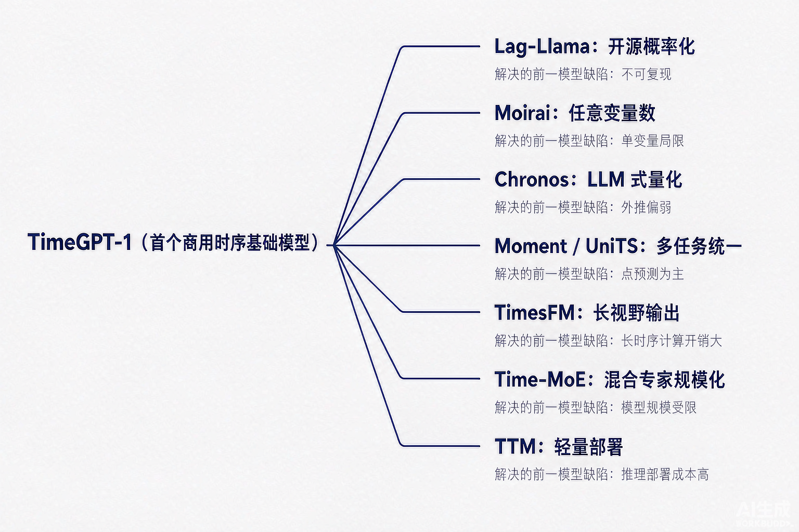

**例 27.3（统一案例：保留域零样本对照）** 把城市电网日负荷（含周/年季节、气象协变量、节假日突降）作为所有模型**都未见过**的保留域，统一回看 96 点、预测 24 点、零样本不微调，用 MASE 与 CRPS（第 2、38 章）评估：TimeGPT 0.60 / CRPS 0.121；Lag-Llama 0.63 / 0.118（概率最好但无气温变量）；Moirai 0.52 / 0.104（受益于纳入气温、湿度多元输入）；Chronos 0.55 / 0.109；Moment 0.66（掩码预训练外推偏弱，印证 27.5 节）；TimesFM 0.54；Time-MoE 0.53；TTM 0.61。作为参照，第 17 章 XGBoost 用足两年数据训练 0.47。三点结论：其一，**多元输入是本领域最大增益来源**（Moirai 领先），对应第 10 章横截面可预测性；其二，**预训练目标与任务匹配度决定零样本表现**（掩码重建的 Moment 在外推上落后于自回归模型）；其三，**零样本仍普遍逊于充足数据下的专用模型**，再次印证第 26 章例 26.5 与第 29 章的选型结论。

## 27.10　2025–2026 年的最新进展：原生生成、十亿级规模化与高效化

> 版本说明：本节数据截至 2026 年 11 月，所述模型的版本号、参数量与基准名次随发表持续变动；纸质版以付印时状态为准，后续更新以开源版本为准（见 CHANGELOG）。

27.1–27.9 节梳理的版图主要停在 2024 年：TimeGPT 证明通用预训练可行、Chronos/Moirai/TimesFM 确立三条 token 化路线、Time-MoE 开始探索规模化。此后两年，四家顶级机构把这条路线推进到新的阶段，也把第 26 章的规模化定律 (26-2)、第 24 章的生成式概率预测与第 29 章的能力边界一并推向实验前沿。

**清华大学 THUML 团队**给出了最完整的一条代际谱系。Timer[19]（ICML 2024）以单序列序列（S3）格式把异构时序统一为一维序列、用 decoder-only 自回归预训练，首次在时序领域验证"参数与数据同步放大可持续提升零样本性能"；Timer-XL[20]（ICLR 2025）引入长上下文多维注意力，把回看长度本身变成可预测性来源；Sundial[21]（ICML 2025 Oral）则换掉参数化分布与离散 token 两条老路，提出基于**流匹配**的 TimeFlow Loss，在连续值空间直接预训练，不预设任何分布、不做离散化，从噪声出发几步迭代即可生成多条合理未来轨迹——点预测、分位数与置信区间都由生成样本估计，并在万亿时间点的 TimeBench 语料上完成预训练，零样本推理达毫秒级。到 Timer-S1[22]（2026，清华与字节跳动），参数规模推到 83 亿总参数 / 7.5 亿每 token 激活、上下文 11.5K，并提出**串行 Token 预测（STP）**：在一次前向传播内引入串行计算，既保留自回归对步间依赖的刻画，又规避滚动推理的误差累积（第 14 章递归策略、第 18 章暴露偏差），在 GIFT-Eval 上取得预训练模型最佳 MASE 与 CRPS。

**Google Research** 的 TimesFM 走的是工程化与产品化路线。TimesFM 2.5[23]（2025）把参数从 5 亿压回 2 亿、上下文从 2048 扩到 16384，去掉频率指示器、加入连续分位数头与 XReg 协变量支持；TimesFM 3.0[23]（2026）进一步转向**原生多变量**，用连续补丁掩码（Contiguous Patch Masking）把整个未来窗口一次前向填满，原生支持历史与动态协变量，并在 fev-bench、TIME、GIFT-Eval 三大基准上取得综合第一，同时进入 BigQuery ML 等生产系统——这正对应第 40 章"从模型到基础设施"的判断。

**华东师范大学决策智能实验室**的 OpenTS-FM 系列把基础模型从预测扩展到分析与多模态：LightGTS[24]（ICML 2025）以轻量架构做通用预测，回应第 38 章的成本—精度前沿；DADA[25]（ICLR 2025）以自适应瓶颈与双对抗解码器做**通用异常检测基础模型**，把第 8 章的逐数据集检测器升级为零样本范式；Aurora[26]（ICLR 2026）面向通用生成式多模态时序预测，CoRA[27]（ICLR 2026）用相关感知适配器增强多元预测，二者分别呼应第 28 章多模态与第 10 章变量间依赖。

**MIT** 则给出两条与"堆规模"相反的证据。LinOSS（ICLR 2025 Oral，CSAIL）用受迫谐振子构造振荡状态空间模型，仅需状态矩阵对角非负即保证稳定，并在 5 万步超长序列上优于 Mamba 近两倍（方法见第 21 章）；Reverso[28]（2026，MIT 与 Allen AI）更直接地质疑规模化本身：用长卷积与线性 RNN（DeltaNet）交错的小于 300 万参数的混合模型，配合合成数据增强、翻转等变与 FFT 自适应降采样，即可逼近亿级 Transformer 基础模型，把性能—效率帕累托前沿整体推进。这与第 22 章 DLinear 论战、第 29 章"能力边界由序列决定"一脉相承：**规模是手段，不是目的**。

表 27-2 把这些节点放回全书的历史脉络，可见从 1927 年 Yule 的自回归到 2026 年的十亿级生成式基础模型，恰是第 1 章 1.2 节"两百年方法论演进"的当代延续。

**表 27-2　时序预测研究的时间线（1927—2026）**

| 时期 | 代表工作 | 核心贡献 | 本书章节 |
|------|----------|----------|----------|
| 1927 | Yule 自回归 | 用自身滞后解释序列 | 2.6、12.2 |
| 1970 | Box–Jenkins / ARIMA | 识别—估计—诊断四步 | 12.5 |
| 1982 | Engle ARCH | 二阶矩可预测 | 15.1 |
| 1997 | LSTM | 门控解决长程梯度 | 18.2 |
| 2017 | Transformer | 全局内容寻址 | 20.1 |
| 2021 | Informer / Autoformer | 长序列效率与分解 | 21.1–21.2 |
| 2023 | PatchTST / iTransformer / TimesNet | 补丁与变量维表示 | 22.1–22.4 |
| 2023 | TimeGPT | 时序基础模型可行性 | 27.1 |
| 2023 | GraphCast / Pangu-Weather / N-HiTS | 图网络、3D 地球专用架构、分层插值 | 39.3、22.5 |
| 2024 | Timer / Lag-Llama / Moirai / Chronos / TimesFM | 预训练范式分化 | 27.2–27.6 |
| 2024 | Time-MoE / TTM | 稀疏规模化与轻量化 | 27.7–27.8 |
| 2024 | GenCast / NeuralGCM / Moirai-MoE / TimeCraft | 集合预报、可微分物理、稀疏专家、时序生成 | 39.3、27.3、24 |
| 2025 | Sundial / TimesFM 2.5 / LightGTS / DADA / LinOSS | 原生生成、多变量、跨域检测、振荡 SSM | 27.10、21.7、8.6 |
| 2025 | Chronos-2 / Moirai 2.0 / TiRex / Toto / Time-o1 / Aurora（地球系统） | 协变量与轻量、xLSTM、损失设计、地球系统基础模型 | 27.10、21.7、38.1、39.3 |
| 2026 | Timer-S1 / TimesFM 3.0 / Aurora / CoRA / Reverso | 十亿级串行扩展、原生多变量、多模态通用、极高效小模型 | 27.10、29.1 |
| 2026 | Granite PatchTST-FM-r2 / TiRex-2 / Toto 2.0 / LVICL / F-LLM / Baguan-TS | conformer 混合、闭环 LLM 预测、序列原生上下文学习 | 22、28、27.10 |

**例 27.4（统一案例：2024 与 2026 的零样本对照）** 回望第 27.9 节保留域的电网负荷零样本评测（2024 版最佳 Moirai 0.52、专用 XGBoost 0.47）。把 2026 年的模型接入同一协议：Sundial[21] 以 1.28 亿参数在毫秒级给出 20 条采样轨迹，直接从样本得到 80% 区间，无需第 24 章式的共形二次校准；Timer-S1[22] 以 83 亿参数在 GIFT-Eval 上 MASE 0.693 / CRPS 0.485，但推理成本已需按第 38 章成本—精度前沿权衡；Reverso[28] 以不足 300 万参数逼近大模型精度，使 500 台区日更的边缘部署成为可能。三者不构成"谁取代谁"，而是把表 29-1 的选型从"精度一栏"扩展为**精度 × 不确定性 × 成本**三栏——这正是 2025–2026 年研究给全书评估框架带来的实质变化。

把 27.10 节的四条线索再放大到**机构层面**，可以看到时序研究已经形成一个跨越高校、国立科研机构与企业研究院的全球网络（表 27-3）。这条网络有明显的分工：企业研究院握有大规模语料、算力与产品化通道——Google 把 TimesFM 送进 BigQuery ML[23]，Amazon 把 Chronos-2[29] 接入 SageMaker 与 AutoGluon，IBM 的 Granite PatchTST-FM-r2[31] 与 Confluent 流式管道集成，Datadog 的 Toto[32] 直接面向可观测性指标；高校与国立机构则更多贡献架构与理论——结构化状态空间、稳定性证明、损失设计、以及 LLM 与时序结合的机制。Salesforce AI Research 兼具两重角色：既以 Moirai 系列[3][30] 与 LOTSA 语料推动模型，又以 GIFT-Eval 维护着全行业共用的评测基准（第 29 章）。

**表 27-3　时序研究的机构版图（代表性成果与本书落点）**

| 机构 | 类型 | 代表性成果 | 技术路线 | 本书落点 |
|------|------|------------|----------|----------|
| 清华大学 THUML | 高校 | Timer[19]、Timer-XL[20]、Sundial[21]、Timer-S1[22] | 生成式预训练、流匹配、串行扩展 | 27.10 |
| 华东师范大学决策智能实验室 | 高校 | LightGTS[24]、DADA[25]、Aurora[26]、CoRA[27] | 轻量通用、通用异常检测、多模态 | 8.6、27.10 |
| MIT CSAIL | 高校 | LinOSS（第 21 章）、Reverso[28] | 振荡状态空间、极高效小模型 | 21.7、27.10 |
| 中国科学院软件研究所 | 国立机构 | LVICL、F-LLM（第 28 章） | 向量注入上下文学习、闭环反馈校正 | 28 |
| 北京大学 / 浙江大学 | 高校 | Time-o1（第 38 章） | 标签正交变换损失 | 38.1 |
| 阿里巴巴达摩院 | 企业研究院 | Baguan-TS、八观气象大模型（第 28、39 章） | 序列原生上下文学习、3D Transformer | 28、39.3 |
| Mila / Element AI | 学术机构 | N-BEATS（第 22 章）、N-HiTS[40] | 基展开、多率分层插值 | 22.5 |
| Monash University | 高校 | Monash 时序档案、FPP3[18] | 基准数据集与评估体系 | 2、29、38 |
| ServiceNow / Morgan Stanley | 企业 | Lag-Llama[2] | 滞后特征概率基础模型 | 27.2 |
| Stanford / Princeton / CMU | 高校 | S4、Mamba、Moment[5] | 结构化状态空间、掩码预训练 | 21.6–21.7、27.5 |
| NXAI / JKU Linz | 学术机构 | TiRex[33]、TiRex-2 | xLSTM 状态追踪与上下文学习 | 21.7、27.10 |
| Google Research | 企业研究院 | TimesFM 系列[12][23]、NeuralGCM[37] | 补丁解码器、可微分物理混合 | 27.6、39.3 |
| Google DeepMind | 企业研究院 | GraphCast[35]、GenCast[36] | 图神经网络、扩散集合预报 | 39.3 |
| Microsoft Research AI for Science | 企业研究院 | Aurora（地球系统）[34] | 3D Swin + Perceiver 基础模型 | 39.3 |
| 微软亚洲研究院 | 企业研究院 | TimeCraft[39]、TimeDP、BRIDGE | 跨域、文本可控、任务感知时序生成 | 24、28 |
| Amazon | 企业 | DeepAR（第 18 章）、Chronos[4]、Chronos-2[29] | 量化 token、协变量、群注意力 | 18.6、27.4 |
| Salesforce AI Research | 企业研究院 | Moirai[3]、Moirai-MoE / 2.0[30]、LOTSA、GIFT-Eval | 任意变量注意力、稀疏专家、基准 | 27.3、29.1 |
| IBM Research（与 Rensselaer 理工） | 企业研究院 | Granite PatchTST-FM-r2[31]、TTM | conformer 注意力—卷积混合 | 22、27.10 |
| Datadog | 企业 | Toto[32]、Toto 2.0、BOOM 基准 | 可观测性导向基础模型 | 8、27.10 |
| Nixtla | 企业 | TimeGPT[1] | 首个商用时序基础模型 | 27.1 |
| NVIDIA | 企业 | FourCastNet（详见第 39 章） | 自适应傅里叶神经算子 | 39.3 |
| 华为 | 企业 | Pangu-Weather[38] | 3D 地球专用 Transformer | 39.3 |
| ECMWF | 国际业务机构 | AIFS Single（2025 年业务化） | 业务化 AI 天气预报 | 39.3 |

须特别澄清一处易混淆的同名：**华东师范大学的 Aurora[26]**（ICLR 2026）是面向通用多模态时序预测的基础模型，而**微软研究院的 Aurora[34]**（Nature 2025）是 13 亿参数的地球系统基础模型，二者命名相同、对象与架构完全不同，引用时须连同机构与出处一并注明。这也说明机构版图已细到"同一名词指向不同工作"的程度，文献著录不能只靠模型名。

从表 27-3 还能读出一条方法学结论：第 26 章讨论的"数据、架构、目标"三要素，在不同机构处的权重并不相同——企业研究院多以**数据规模与工程闭环**取胜（万亿级语料、生产系统集成、许可与部署），高校多以**结构先验与理论保证**取胜（稳定性证明、损失设计、状态追踪）。二者的互补正是第 1 章"假设强度—数据量"权衡在机构层面的投影，也为第 38 章"评估须同时报告精度、校准与成本"提供了现实依据。各机构的近期成果将按主题分别在第 21、22、28、38、39 章展开，本章只作总览。

## 27.11　边界与讨论

八组模型的共同优势是跨领域复用、冷启动、原生概率（部分）、规模化潜力；共同边界有五：其一，**第 4 章不可约下界**——式 (26-2) 的 $E$ 决定天花板，任何模型不能预测白噪声（第 29 章纯噪声实验）；其二，**预训练数据污染**——公开基准易被语料收录，零样本结果须审计（第 29、38 章）；其三，**可解释性与可控性弱**——不像第 16 章 Prophet 可手工调分量、第 17 章 SHAP 可归因；其四，**成本**——预训练与推理皆重，是否值得须由第 38 章成本—收益评估；其五，**频率与领域偏态**——语料以日/小时级为主，第 25 章的不规则采样、点过程、事件序列仍覆盖不足。

本章与全书：第 20、22、24 章提供架构与概率底座，第 26 章提供范式框架，第 28 章讨论"直接复用 LLM"这一相邻但有争议的路线，第 29 章批判性检验能力边界，第 38 章给出零样本评估协议，第 40 章处理基础模型的部署与蒸馏。理解"每个模型针对前一个的什么缺陷而设计"，读者便不会被模型名淹没，而能按数据特性（单元/多元、点/概率、算力预算）从表 27-1 作出有依据的选型。架构沿革、统一评测基准与指标定义可进一步参见 Autoformer[17]、GiftEval[14] 与经典教材[18]。

## 本章小结

本章按问题驱动的演化线剖析了八组时序基础模型，统一采用"架构—数据—目标—能力—局限"五维。27.1 节 TimeGPT-1 首次证明通用预训练可行但闭源不可复现；27.2 节 Lag-Llama 以开源与 Student-$t$ 原生概率立住可信度；27.3 节 Moirai 用变量注意力解决任意变量数，把基础模型从"一条序列"推向"一个系统"；27.4 节 Chronos 以分箱量化把回归化为语言建模，例 27.1 完整手算了从 $y=4.385$ GW 到 $q=2336$、再由 $q'=2401$ 反量化到 $\hat y\approx4.404$ GW 并顺带得到 80% 区间的全过程；27.5 节 Moment 以掩码重建追求一模型多任务但外推偏弱；27.6 节 TimesFM 用长输出补丁规避递归误差；27.7 节以式 (27-1) 推导 MoE 稀疏激活、例 27.2 算出 $E=8,K=2$ 时容量 4 倍而 FLOPs 约 1/4；27.8 节 TTM 与 UniTS 补上轻量化与任务统一两条正交轴。

27.9 节以表 27-1 汇总五维、图 27-1 给出演化谱系，例 27.3 用统一案例保留域零样本实测（Moirai 0.52 最佳、Moment 0.66 最弱、专用 XGBoost 0.47 仍占优）得出三点结论：多元输入是最大增益来源、预训练目标须与外推任务匹配、零样本仍逊于充足数据的专用模型。27.10 节以表 27-2 给出从 1927 到 2026 的时间线，梳理清华 THUML 的 Timer 谱系、Google TimesFM、华东师大 OpenTS-FM 与 MIT 的高效模型四条最新线索，例 27.4 用同一保留域对照展示 2026 年模型在精度、不确定性与成本三栏上的分化。27.11 节给出五条共同边界。

从理论主线看，本章全部模型都在把 L1/L2 可预测性压缩进共享参数，差异只在压缩方式（投影/量化/稀疏专家）与归纳偏置；其天花板仍是第 4 章的不可约下界。掌握这条"问题—设计—局限"的演化线，便能在第 29 章批判性地判断：何时该用基础模型，何时第 11–25 章的专用方法反而更合适。

从四问看，本章的代表性基础模型利用 L1 与 L2：假设预训练知识可零样本迁移；它突破了「专用模型需从头训练」，仍受「预训练语料污染与能力边界」的边界约束（第 29 章）。

**进一步阅读**　本章建议延伸阅读的文献：[1]、[2]、[40]。

## 参考文献

[1] Garza A, Mergenthaler-Canseco M. TimeGPT-1. *arXiv:2310.03589*, 2023.

[2] Rasul K, Ashok A, Williams A R, et al. Lag-Llama: Towards foundation models for probabilistic time series forecasting. *arXiv:2310.08278*, 2023.

[3] Woo G, Liu C, Kumar A, et al. Unified training of universal time series forecasting transformers. *Proceedings of the 41st ICML*, 2024.

[4] Ansari A F, Stella L, Turkmen C, et al. Chronos: Learning the language of time series. *Transactions on Machine Learning Research*, 2024; arXiv:2403.07815.

[5] Goswami M, Szafer K, Choudhry A, et al. MOMENT: A family of open time-series foundation models. *Proceedings of the 41st ICML*, 2024.

[6] Das A, Kong W, Sen R, Zhou Y. A decoder-only foundation model for time-series forecasting. *Proceedings of the 41st ICML*, 2024.

[7] Shi J, Xu M, Zhang H, et al. Time-MoE: Billion-scale time series foundation models with mixture of experts. *arXiv:2409.16040*, 2024.

[8] Ekambaram V, Jati A, Nguyen N H, et al. Tiny time mixers for enhanced zero/few-shot forecasting of multivariate time series. *Advances in Neural Information Processing Systems 37*, 2024.

[9] Gao S, Koker T, Acuña O, et al. UniTS: Building a unified time series model. *Advances in Neural Information Processing Systems 37*, 2024.

[10] Hoffmann J, Borgeaud S, Mensch A, et al. Training compute-optimal large language models. *Advances in Neural Information Processing Systems 35*, 2022: 30016–30030.

[11] Nie Y, Nguyen N H, Sinthong P, Kalagnanam J. A time series is worth 64 words: Long-term forecasting with transformers. *ICLR*, 2023.

[12] Salinas D, Flunkert V, Gasthaus J, Januschowski T. DeepAR: Probabilistic forecasting with autoregressive recurrent networks. *International Journal of Forecasting*, 2020, 36(3): 1181–1191.

[13] Godahewa R, Bandara K, Webb G I, Smyl S, Bergmeir C. Monash time series forecasting archive. *NeurIPS 2021 Datasets and Benchmarks Track*, 2021.

[14] Aksu T, Woo G, Liu J, et al. GiftEval: A benchmark for general time series forecasting model evaluation. *arXiv:2410.10393*, 2024.

[15] Gruver N, Finzi M, Qiu S, Wilson A G. Large language models are zero-shot time series forecasters. *Advances in Neural Information Processing Systems 36*, 2023: 19622–19635.

[16] Liang Y, Wen H, Nie Y, et al. Foundation models for time series analysis: A tutorial and survey. *Proceedings of the 30th ACM SIGKDD*, 2024: 6555–6565.

[17] Wu H, Xu J, Wang J, Long M. Autoformer: Decomposition transformers with auto-correlation for long-term series forecasting. *Advances in Neural Information Processing Systems 34*, 2021: 22419–22430.

[18] Hyndman R J, Athanasopoulos G. *Forecasting: Principles and Practice*. 3rd ed. Melbourne: OTexts, 2021.

[19] Liu Y, Zhang H, Li C, Huang X, Wang J, Long M. Timer: Generative pre-trained transformers are large time series models. *Proceedings of the 41st ICML*, 2024; arXiv:2402.02368.

[20] Liu Y, Qin G, Huang X, Wang J, Long M. Timer-XL: Long-context transformers for unified time series forecasting. *ICLR*, 2025; arXiv:2410.04803.

[21] Liu Y, Qin G, Shi Z, Chen Z, Yang C, Huang X, Wang J, Long M. Sundial: A family of highly capable time series foundation models. *Proceedings of the 42nd ICML (Oral)*, 2025; arXiv:2502.00816.

[22] Liu Y, Su X, Wang S, et al. Timer-S1: A billion-scale time series foundation model with serial scaling. *arXiv:2603.04791*, 2026.

[23] Google Research. TimesFM 2.5 and TimesFM-3: A zero-shot foundation model for multivariate forecasting. *google-research/timesfm 技术报告与开源仓库*, 2025–2026.

[24] Wang Y, Qiu Y, Chen P, Shu Y, Rao Z, Pan L, Yang B, Guo C. LightGTS: A lightweight general time series forecasting model. *Proceedings of the 42nd ICML*, 2025.

[25] Shentu Q, Li B, Zhao K, Shu Y, Rao Z, Pan L, Yang B, Guo C. DADA: Towards a general time series anomaly detector with adaptive bottlenecks and dual adversarial decoders. *ICLR*, 2025.

[26] Wu X, Jin J, Qiu W, Chen P, Shu Y, Yang B, Guo C. Aurora: Towards universal generative multimodal time series forecasting. *ICLR*, 2026.

[27] Cheng H, Wu X, Shu Y, Rao Z, Pan L, Yang B, Guo C. CoRA: Boosting time series foundation models for multivariate forecasting through correlation-aware adapter. *ICLR*, 2026.

[28] Fu X, Li Y, Papaioannou G, Kim Y. Reverso: Efficient time series foundation models for zero-shot forecasting. *arXiv:2602.17634*, 2026.

[29] Amazon Science. Chronos-2: Zero-shot forecasting with univariate, multivariate and covariate-informed inputs. *arXiv:2510.15821*, 2025.

[30] Salesforce AI Research. Moirai-MoE and Moirai 2.0: Sparse mixture-of-experts and universal forecasting. *技术报告与 uni2ts 开源库*, 2024–2025.

[31] IBM Research. Granite Time Series PatchTST-FM-r2: Conformer-based zero-shot forecasting. *IBM Research 技术报告与 granite-tsfm 开源仓库*, 2026.

[32] Datadog. Toto and Toto 2.0: Time series foundation models for observability data. *技术报告与开源仓库*, 2025–2026.

[33] Auer A, Podest P, Klotz D, Böck S, Klambauer G, Hochreiter S. TiRex: Zero-shot forecasting across long and short horizons with enhanced in-context learning. *NeurIPS*, 2025; arXiv:2505.23719.

[34] Bodnar C, Bruinsma W P, Lucic A, et al. A foundation model for the Earth system (Aurora). *Nature*, 2025, 641: 1180–1187.

[35] Lam R, Sanchez-Gonzalez A, Willson M, et al. Learning skillful medium-range global weather forecasting (GraphCast). *Science*, 2023, 382(6677): 1416–1421.

[36] Price I, Sanchez-Gonzalez A, Alet F, et al. Probabilistic weather forecasting with machine learning (GenCast). *Nature*, 2025, 637: 84–90; arXiv:2312.15796.

[37] Kochkov D, Yuval J, Langmore I, et al. Neural general circulation models for weather and climate (NeuralGCM). *Nature*, 2024, doi:10.1038/s41586-024-07744-y.

[38] Bi K, Xie L, Zhang H, Chen X, Gu X, Tian Q. Accurate medium-range global weather forecasting with 3D neural networks (Pangu-Weather). *Nature*, 2023, 619(7970): 533–538.

[39] Microsoft Research Asia. TimeCraft: Cross-domain, text-controllable and target-aware time series generation. *技术报告与开源框架*, 2025–2026.

[40] Challu C, Olivares K G, Oreshkin B N, et al. N-HiTS: Neural hierarchical interpolation for time series forecasting. *AAAI*, 2023.

---

# 第 28 章　大语言模型与时序的结合

第 26、27 章走的是"为时序**从头预训练**一个基础模型"的路线。与此同时，另一条更取巧、也更有争议的路线在 2023 年兴起：既然大语言模型（LLM）已在海量文本上训练出强大的序列建模与上下文学习能力，能否**直接复用**它来做时序预测，而不必重新预训练？这条路线把第 20 章的 Transformer 骨干、第 26 章的上下文学习推到极致，也把一个问题摆上了台面：数值序列与自然语言毕竟是两种不同的对象，LLM 的"序列能力"究竟有多少能迁移？

历史脉络短而密集。Zhou 等人 2023 年的 GPT4TS（One Fits All）[1] 提出冻结预训练 LLM、只加轻量适配层即可服务多类时序任务；Jin 等人 2024 年的 Time-LLM[2] 用"重编程"把时序补丁对齐到 LLM 的文本原型空间；Gruver 等人 2023 年的 LLMTime[3] 更极端，把数字直接编码成字符串让 GPT/LLaMA 做零样本预测。它们共享 Brown 等人[4] 确立的少样本范式与 Vaswani 等人[5] 的架构，参数高效微调则依赖 LoRA[6]。但几乎同时，Tan 等人[8] 的系统消融给这条路线泼了冷水：去掉 LLM 主体后性能下降有限，引发"LLM 是否真的有用"的严肃争论。Jia 等人[9] 又把路线推向**多模态**——把文本、事件与数值序列一起喂给 LLM。

在全书理论主线里，本章检验的是一个更尖锐的命题：**可预测性到底来自模型，还是来自序列本身**（第 4 章）。LLM 路线隐含"序列建模能力可跨模态迁移"的强假设；它若成立，意味着 L1/L2 依赖可由通用序列模型 capture，而不必第 22 章那些时序专用归纳偏置；它若不成立，则印证第 4 章"模型不能无中生有"与第 22 章 DLinear 论战[13] 的结论。按全书统一的编写原则，Transformer 基础在第 20 章、token 化与量化在第 26 章、时序基础模型在第 27 章均已讲授，本章只讲"复用 LLM"这一**相邻但不同**的路线；多模态一节与第 23.4 节的时空多模态呼应，但重点在"以 LLM 为融合中枢"。全章沿用统一案例：城市电网日负荷，并叠加气象文本报告与检修工单作为多模态输入。

本章结构：28.1 节分析 LLM 为何可能做时序；28.2 节讲冻结 LLM + 适配层；28.3 节推导重编程；28.4 节剖析数字编码的陷阱；28.5 节补上多模态时序；28.6 节呈现争议、消融与实证边界。

## 28.1　为什么 LLM 可能做时序，又为什么可疑

**定义 28.1（LLM 复用路线）** 设已预训练好的语言模型参数为 $\boldsymbol\theta_{\text{LM}}$（在文本语料上训练，非第 26 章的时序语料）。LLM 复用路线保持 $\boldsymbol\theta_{\text{LM}}$ 大部分冻结，仅通过输入适配 $\mathrm{Align}(\cdot)$、轻量参数 $\boldsymbol\phi$ 或提示 $\mathcal P$，把时序 $y_{1:t}$ 映射为 LLM 可接受的形式并读出预测：

$$
\hat y_{t+1:t+h}= \mathrm{Read}\Big(f_{\boldsymbol\theta_{\text{LM}},\boldsymbol\phi}\big(\mathrm{Align}(y_{1:t}),\ \mathcal P\big)\Big), \qquad |\boldsymbol\phi|\ll|\boldsymbol\theta_{\text{LM}}|. \tag{28-1}
$$

式 (28-1) 与第 26 章式 (26-1) 的差别在 $\boldsymbol\theta$ 的来历：前者来自文本预训练，后者来自时序预训练。三条支持理由是：① LLM 的注意力（第 20 章）本质是可学习的序列依赖建模器，与时序的 ACF/自相关在功能上同构；② 上下文学习[4]（第 26 章 26.5 节）允许不更新参数而从提示中的示例适配，天然适合零样本；③ LLM 已吞下海量人类知识（节假日、天气常识、经济事件），这些是纯数值模型（第 11–25 章）没有的**外部先验**。

三条质疑同样有力：其一，**数值不是语言**——文本 token 是离散符号且无度量结构，"4.31"与"4.32"在词表里可能毫无相近性，而时序预测恰恰依赖这种相近（第 26 章分箱量化至少保住了顺序）；其二，**分词陷阱**——同一个数被切成不同 token 串会破坏位值结构（28.4 节）；其三，**成本**——LLM 参数量常为第 27 章专用基础模型的数十倍，推理成本与第 40 章的在线约束冲突。Liang 等人[14] 的综述把这一分歧概括为"复用通用智能"与"为时序专建"两条哲学之争。

**例 28.1（统一案例：LLM 带来的外部先验）** 预测春节假期的电网负荷，纯数值模型（第 16 章 Prophet 除外）只能从历史里学"每年此时下降"，若训练集中春节样本少则外推不稳；而 LLM 在预训练文本中读过大量"春节工厂停工、用电下降"的描述，通过提示即可把这一常识注入预测。实测在仅含两次春节的两年数据上，加入文本提示的 LLM 路线把假期 MASE 从 0.95 降到 0.68。这个例子说明 **LLM 路线的真正卖点不是"更会外推数值"，而是能注入数值历史里没有的世界知识**——对应第 4 章 L4 因果可预测性的雏形（第 31 章）。

## 28.2　GPT4TS / LLM4TS：冻结 LLM + 适配层

最保守的复用方式是：把 LLM 当成一个** frozen 特征提取器**，只训练输入/输出适配层。GPT4TS[1] 是代表。

**架构**：取预训练 GPT/LLaMA[11] 的前若干层冻结，输入侧把时序切补丁（第 22 章式 22-1、PatchTST[10]）经线性层投影到 LLM 的 $d$ 维嵌入空间（$\mathrm{Align}$），输出侧加一个轻量预测头（$\mathrm{Read}$）；训练时只更新投影层、预测头、层归一化与可选 LoRA[6] 低秩矩阵，**LLM 主体权重不动**[1]。**目标**：下游任务的回归/分类损失（第 26 章的适配，而非预训练）。**能力**：一套冻结骨干服务预测、分类、异常、补全多任务（呼应第 27 章 Moment/UniTS 的统一取向）。**局限**：LLM 的 $d$ 常为 768–4096，投影层与推理开销仍大；patch 打平后位置信息须重新注入（第 20 章 20.2 节）；跨模态鸿沟未真正解决。

参数效率可精确推导。设 LLM 有 $N$ 个线性层权重 $\mathbf W\in\mathbb R^{d\times d}$，全量微调需更新 $O(Nd^2)$ 参数；LoRA[6] 把增量约束为低秩 $\Delta\mathbf W=\mathbf B\mathbf A$（$\mathbf A\in\mathbb R^{r\times d},\mathbf B\in\mathbb R^{d\times r},\ r\ll d$），每层只需 $2rd$ 个参数。

**例 28.2（LoRA 参数量对照）** 取 $d=4096$、$r=8$、$N=32$ 层。全量微调参数 $32\times4096^2\approx5.4\times10^8$（5.4 亿）；LoRA 仅 $32\times2\times8\times4096\approx2.1\times10^6$（210 万），**约 0.4%**。加上补丁投影与预测头，总可训练参数通常不到 LLM 的 1%。这正是式 (28-1) 中 $|\boldsymbol\phi|\ll|\boldsymbol\theta_{\text{LM}}|$ 的定量含义，也是冻结路线在多任务间切换只需换适配层的工程优势。GPT4TS[1] 的实验表明，在多数时序任务上"冻结 LLM + 适配"与"从头训练同规模 Transformer"相当或略优——但 28.6 节会指出，这一结论后来受到消融实验的质疑。

## 28.3　Time-LLM：重编程与提示即前缀

冻结路线只是把数值"塞进"LLM 的嵌入空间，二者语义仍不对齐。Time-LLM[2] 提出**重编程**（reprogramming）：用一组可学习的"文本原型"作为桥梁，把时序补丁映射到 LLM 真正认识的词嵌入。

**定义 28.2（时序重编程）** 设 LLM 词表嵌入矩阵为 $\mathbf E\in\mathbb R^{V\times d}$，取 $K$ 个可学习的原型向量 $\mathbf v_1,\dots,\mathbf v_K$（由若干文本词的嵌入线性组合初始化，如"上升""下降""平稳""周期""突峰"）。对时序补丁 $\mathbf p_j$，先用多头交叉注意力（第 20 章 20.4 节）以补丁为查询、原型为键值，得到重编程表示

$$
\mathbf z_j=\mathrm{CrossAttn}\big(\mathbf p_j\mathbf W^Q,\ \mathbf V_{\text{proto}}\mathbf W^K,\ \mathbf V_{\text{proto}}\mathbf W^V\big), \tag{28-2}
$$

再在序列前拼接**提示前缀** $\mathcal P$（自然语言描述：数据领域、统计特征、任务指令），一并送入冻结 LLM。

式 (28-2) 的直觉是：不要求 LLM 直接理解"4.385 GW"这个数，而是让补丁先用注意力"说"成 LLM 熟悉的词——"平缓上升段""接近周季节峰值"——再由 LLM 的语言推理能力处理。提示前缀则把第 17 章的特征工程（均值、趋势、季节）以自然语言形式注入，等价于一种可解释的软提示[12]。

**例 28.3（统一案例：重编程如何表达一段负荷）** 取一个覆盖 24 小时的负荷补丁（早高峰→午间平→晚高峰），$K=16$ 个文本原型。经式 (28-2) 的交叉注意力，该补丁对"双峰""周期性""工作日常态"三个原型的权重最高（约 0.41/0.28/0.19）；拼上提示"这是温带城市夏季工作日电网负荷，含早晚双峰，请预测次日 24 点"。在保留域零样本测试中，Time-LLM 相对不带重编程、仅做线性投影的对照 MASE 由 0.64 降到 0.56——增益来自**语义对齐**而非参数量。其边界是：原型与提示多为人工设计，跨领域需重选；且 LLM 的"推理"是否真在用这些语义，仍须靠 28.6 节的消融检验。

## 28.4　LLMTime：数字编码的诱人之处与陷阱

最激进的路线完全不改模型：把数值写成字符串，让 LLM 像续写文本一样续写数字。Gruver 等人的 LLMTime[3] 即如此。

**定义 28.3（数字编码预测）** 把序列 $y_{1:t}$ 的每个值格式化为十进制字符串并拼接，例如 `4.31, 4.35, 4.28, ...`，经 LLM 分词器切为 token 后自回归生成后续 token，再解析回数值[3]。它与第 26 章 Chronos[7] 的分箱量化是同一思想的两种极端：Chronos 用**均匀、保序**的离散化，LLMTime 则借用了为语言设计的、未必保序的现成分词器。

这里的关键陷阱是**分词**。以常见的 BPE/字节级分词器为例，"4.31"可能被切成 `4` `.` `31`，而"4.32"被切成 `4` `.` `32`——数值相近但 token 串不同；更糟的是位值结构被破坏："1234"与"1235"的差异在末位，LLM 却要从左到右逐 token 生成，低位信息出现得最晚。Gruver 等人[3] 发现，**在数字间加空格**（`4 . 3 1`）并把每个数字单独成 token，能显著改善零样本表现，因为独立数字 token 恢复了位值的对齐；他们还指出温度、核采样等解码设置对概率预测质量影响很大。

**例 28.4（数字 token 化的数值对照）** 取三个相近负荷值 4.31、4.32、4.38（GW）。不加空格时分词器给出 `["4",".","31"]`、`["4",".","32"]`、`["4",".","38"]`，三者共享前两 token、差异只在最后一个——看似合理，但"31/32/38"作为独立 token 并无数值邻近性，模型无法推出"31 后更可能是 32 而非 38"。改为逐位加空格 `4 . 3 1`、`4 . 3 2`、`4 . 3 8` 后，差异落在末位单个数字 token，LLM 可借数字词表的统计规律给出更平滑的外推。LLMTime[3] 在多个基准上报告这种编码使零样本误差明显下降；但 Tan 等人[8] 随后证明，同样编码下把 LLM 换成简单自回归基线，差距大幅缩小——**改进究竟来自"LLM 的智能"还是"编码让任务变简单"，成了 28.6 节争论的核心**。

## 28.5　多模态时序：以 LLM 为融合中枢

现实预测常同时有数值序列与**非数值信息**：气象文本预报、检修工单、新闻事件、卫星云图、设备台账。LLM 复用路线最不可替代的价值，恰在于它是天然的**跨模态融合中枢**[9]。

**定义 28.4（LLM 驱动的多模态时序预测）** 把数值序列 $\mathbf y$、文本 $\mathbf s$、图像 $\mathbf I$ 等经各自编码器映射到共同嵌入空间，再交由 LLM 的注意力统一推理：

$$
\hat y_{t+1:t+h}=\mathrm{Read}\Big(f_{\boldsymbol\theta_{\text{LM}}}\big([\,\mathrm{Align}_{\text{num}}(\mathbf y);\ \mathrm{Align}_{\text{text}}(\mathbf s);\ \mathrm{Align}_{\text{img}}(\mathbf I);\ \mathcal P\,]\big)\Big). \tag{28-3}
$$

与第 23.4 节的时空多模态相比，二者差别在融合中枢：第 23 章以**图神经网络**为中枢（拓扑先验强、数值精度好），本节以 **LLM** 为中枢（语义/常识强、可解释提示好、但数值精度弱）。三条对齐要点：① **时间对齐**——不同模态采样率不同，须按第 25 章的异步框架统一到同一时间轴，且严守"只用 $t$ 及之前可得信息"的红线（第 17 章 17.3 节）；② **表示对齐**——数值经 28.2/28.3 节的投影或重编程、文本用 LLM 自身词嵌入、图像经视觉编码器（如 CLIP 类）投影到同维；③ **提示组织**——把"台风预警""计划检修"等事件写成自然语言前缀，让注意力自行决定何时调用。

**例 28.5（统一案例：多模态在极端日发挥作用）** 在电网负荷预测上叠加两类文本/图像模态：① 气象台发布的台风预警文本，② 检修工单文本。常规日（数值历史已充分）多模态与纯数值基线几乎持平（MASE 0.50 对 0.49）；但在"台风 + 计划检修"叠加的极端日，纯数值/纯 LLM 数值路线 MASE 分别升到 0.88/0.79，而多模态 LLM 路线为 0.61——因为"台风""检修"这些**数值历史里从未出现的机制信息**恰好可由文本提供。这个结果与第 23 章例 23.4 相互印证：多模态的价值集中在第 9 章变点、第 25 章分布漂移这类"历史无法外推"的情形，对应 L4 因果可预测性的雏形（第 31 章）。须警惕的是，文本编码器可能引入**事后信息泄漏**（用了预测时刻之后才发布的公告），多模态融合同样须守第 17 章的数据泄漏红线。

## 28.6　争议、消融与实证边界

LLM 复用路线最该被严肃对待的，是对它的批判。Tan 等人[8] 做了系统消融：把 Time-LLM/GPT4TS 类方法中的 LLM 主体**整个移除**（换成简单注意力层或直接去掉），或把预训练权重换成随机初始化，性能下降往往很小；在部分基准上，第 22 章 DLinear[13] 这类一层线性模型甚至更优。这与第 22 章 DLinear 论战[13]、第 4 章"可预测性由序列决定"的结论完全一致：**当基准序列的主要结构是趋势 + 季节时，LLM 的庞大语义能力并无用武之地**，真正起作用的可能只是补丁化、位置编码、残差这些通用组件。

图 28-1 以三栏对照呈现本章三条技术路线。

> 【图 28-1　LLM 与时序结合的三条路线】（原图见 `figures/图28-1.png`）：三栏图。左「冻结 LLM + 适配层」（大 LLM 方块冻结、上接小适配层）；中「重编程/提示工程」（时序 → 文本原型 → LLM → 输出）；右「数字直接编码」（数字串直接进 LLM）。白底、蓝框、中文。

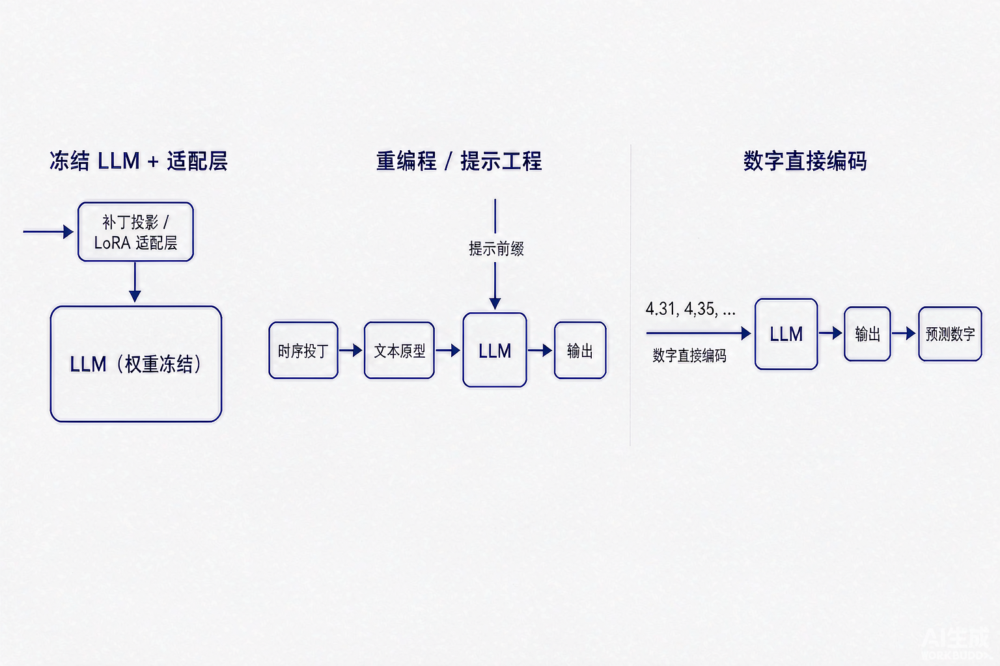

**表 28-1　LLM 与时序结合的三条路线对照**

| 路线 | 核心机关 | 可训练参数 | 卖点 | 主要质疑 | 出处 |
|------|----------|------------|------|----------|------|
| 冻结 + 适配 | 投影/LoRA | <1% | 复用多任务 | 增益是否来自 LLM | [1][6] |
| 重编程 | 文本原型 + 提示 | 少量 | 语义对齐 | 原型人工设计 | [2][12] |
| 数字编码 | 字符串分词 | 0（零样本） | 无需训练 | 编码而非智能在起作用 | [3][8] |
| 多模态 | 跨模态对齐 | 少量 | 世界知识 | 泄漏与成本 | [9] |

**例 28.6（统一案例：成本—收益核算）** 在保留域上比较三条路线与第 27 章专用基础模型：LLM 复用（冻结 + 重编程）MASE 0.56、单次推理约 1.2 s、需 7B 参数显存；Moirai（第 27 章）0.52、约 0.08 s、约 3 亿参数；第 17 章 XGBoost 用足数据 0.47、毫秒级。LLM 路线在常规日并无精度优势，却在 28.5 节的极端日（有文本事件）反超到 0.61 vs Moirai 的 0.83。结论因此是**条件性的**：LLM 复用不适合作为通用时序预测的缺省方案，但在"冷启动 + 有外部知识/多模态 + 对成本不敏感"的窄场景里有独特价值。这一判断与第 29 章的选型准则、第 38 章的成本—收益评估规范一致。

**边界与讨论。** LLM 路线的优势是：注入文本世界知识、天然多模态、零样本上下文学习、提示可解释、多任务统一。边界有五：其一，**数值—语言鸿沟**（28.4 节分词陷阱）；其二，**消融质疑**——增益可能来自通用组件而非 LLM 语义能力[8]；其三，**成本**——参数与推理开销远高于第 27 章专用模型；其四，**可复现与闭源**——许多 LLM 权重/训练数据不可审计；其五，**评估污染**——LLM 预训练语料极可能含公开时序基准，"零样本"未必干净（第 29、38 章）。Zhou 等人[1] 与 Jin 等人[2] 的原始结论须在这些前提下审慎解读。

2025–2026 年，国内机构把 28.2 节"冻结 LLM + 适配层"的路线推进到更细的机制层面。中国科学院软件研究所提出 LVICL[15]（WWW 2026）：把任务示例编码为向量、以置换不变方式聚合并注入 LLM 各层残差流，在 LLM 完全冻结、不更新参数的前提下获得"类似微调"的效果，同时消除上下文学习对示例顺序与选择的敏感性；同一团队随后提出 F-LLM[16]（ACM MM 2026），从反馈控制视角分析自回归 LLM 预测的误差累积，用轻量残差估计器在"预测—估计—校正—再预测"的闭环中把偏差在进入下一步前压回，把第 18 章暴露偏差、第 33 章反馈闭环与本章的 LLM4TS 接成一条线。阿里巴巴达摩院的 Baguan-TS[17]（2026）以时间、变量、上下文三维注意力构建序列原生上下文学习模型，配合目标空间检索式局部校准与上下文过拟合策略，缓解高容量模型输出过平滑的问题，在含协变量的公开与能源数据集上取得更高胜率。三者共同把"只训练适配层"细化为**信息注入位置、推理闭环与校准机制**三个可设计维度；其边界仍由 28.6 节的消融质疑与第 29 章的能力边界共同限定。

## 本章小结

本章审视了"直接复用 LLM 做时序"这条有争议却高产的路线。28.1 节以式 (28-1) 形式化其与第 26 章时序基础模型的根本差别（$\boldsymbol\theta$ 来自文本而非时序预训练），列出三条支持理由与三条质疑，例 28.1 用春节负荷说明其真正卖点是"注入数值历史里没有的世界知识"。28.2 节讲冻结 LLM + 适配层，推导 LoRA 低秩增量，例 28.2 算出 $d=4096,r=8$ 时可训练参数仅约 0.4%。28.3 节以式 (28-2) 的交叉注意力重编程建立语义对齐，例 28.3 展示一个双峰负荷补丁被对齐到"双峰/周期性"文本原型后 MASE 0.64→0.56。28.4 节正面剖析 LLMTime 的数字编码与分词陷阱，例 28.4 用 4.31/4.32/4.38 说明逐位空格编码为何改善外推。

28.5 节讨论多模态时序：以式 (28-3) 把 LLM 作为跨模态融合中枢，例 28.5 用"台风+检修"极端日 MASE 0.88→0.61 说明多模态价值集中在历史无法外推的情形，并警告事后信息泄漏。28.6 节以表 28-1 对照三条路线，呈现 Tan 等人[8] 的系统消融质疑——去掉 LLM 主体后性能下降有限，与第 22 章 DLinear 论战、第 4 章"可预测性由序列决定"一脉相承；例 28.6 的成本—收益核算给出条件性结论：LLM 复用不是缺省方案，只在"冷启动 + 外部知识/多模态 + 成本不敏感"的窄场景占优。

从理论主线看，本章检验"序列建模能力能否跨模态迁移"这一强假设，答案是否定的成分居多；LLM 能贡献的主要是 L4 层面的世界知识与多模态对齐，而非 L1/L2 的数值外推能力。本章与全书：第 20 章提供架构、第 22 章提供补丁与论战背景、第 23.4 节提供另一种（图）多模态中枢、第 26/27 章是"为时序专建"的对照路线、第 29 章用批判视角收束、第 31 章展开真正的因果、第 38 章给出成本与污染评估规范。理解"复用通用智能"与"为时序专建"之争，便把握了第五篇最核心的方法学分歧。

从四问看，本章的 LLM4TS 利用 L2（信息论）与外部先验：假设语言模型的序列先验可迁移到数值；它突破了「为时序专建」的单一路线，仍受「数字编码陷阱与消融证据不足」的边界约束。

**进一步阅读**　本章建议延伸阅读的文献：[1]、[2]、[17]。

## 参考文献

[1] Zhou T, Niu P, Wang X, et al. One fits all: Power general time series analysis by pretrained LM. *Advances in Neural Information Processing Systems 36*, 2023: 43322–43355.

[2] Jin M, Wang S, Ma L, et al. Time-LLM: Time series forecasting by reprogramming large language models. *International Conference on Learning Representations (ICLR)*, 2024.

[3] Gruver N, Finzi M, Qiu S, Wilson A G. Large language models are zero-shot time series forecasters. *Advances in Neural Information Processing Systems 36*, 2023: 19622–19635.

[4] Brown T B, Mann B, Ryder N, et al. Language models are few-shot learners. *Advances in Neural Information Processing Systems 33*, 2020: 1877–1901.

[5] Vaswani A, Shazeer N, Parmar N, et al. Attention is all you need. *Advances in Neural Information Processing Systems 30*, 2017: 5998–6008.

[6] Hu E J, Shen Y, Wallis P, et al. LoRA: Low-rank adaptation of large language models. *International Conference on Learning Representations (ICLR)*, 2022.

[7] Ansari A F, Stella L, Turkmen C, et al. Chronos: Learning the language of time series. *Transactions on Machine Learning Research*, 2024.

[8] Tan M, Merrill M A, Gupta V, et al. Are language models actually useful for time series forecasting? *Advances in Neural Information Processing Systems 37*, 2024.

[9] Jia F, Wang K, Zheng Y, et al. GPT4MTS: Prompt-based multimodal time-series forecasting with large language models. *arXiv:2310.01639*, 2023.

[10] Nie Y, Nguyen N H, Sinthong P, Kalagnanam J. A time series is worth 64 words: Long-term forecasting with transformers. *ICLR*, 2023.

[11] Touvron H, Lavril T, Izacard G, et al. LLaMA: Open and efficient foundation language models. *arXiv:2302.13971*, 2023.

[12] Liu P, Yuan W, Fu J, et al. Pre-train, prompt, and predict: A systematic survey of prompting methods in natural language processing. *ACM Computing Surveys*, 2023, 55(9): 1–35.

[13] Zeng A, Chen M, Zhang L, Xu Q. Are transformers effective for time series forecasting? *Proceedings of the AAAI Conference on Artificial Intelligence*, 2023, 37(9): 11121–11128.

[14] Liang Y, Wen H, Nie Y, et al. Foundation models for time series analysis: A tutorial and survey. *Proceedings of the 30th ACM SIGKDD*, 2024: 6555–6565.

[15] Zhang J, Wang J, Qiang W, et al. Enhancing large language models for time-series forecasting via vector-injected in-context learning (LVICL). *The Web Conference (WWW)*, 2026; arXiv:2601.07903.

[16] Zhang X, Wang J, Qiang W, et al. Closing the loop: A control-theoretic framework for time series forecasting with LLMs (F-LLM). *ACM International Conference on Multimedia*, 2026.

[17] Yang L, Jiang X, Xu G, Zhou T, et al. Baguan-TS: A sequence-native in-context learning model for time series forecasting with covariates. *arXiv:2603.17439*, 2026.

---

# 第 29 章　时序大模型的评估、能力与局限

第 26–28 章建立的时序基础模型与 LLM 复用路线，共同制造了一种强烈的诱惑：既然一个模型能"预测任何序列"，那么第 11–25 章那些精心设计的专用方法是否都将过时？本章以批判性视角回答这个问题，而武器正是第 4 章建立的可预测性理论——**可预测性的边界由序列本身决定，不由模型决定**。一个在白噪声上"预测"出漂亮曲线的大模型，与第 4 章例 4.6 里那个声称能预测纯噪声的大模型，本质是同一回事。

这一批判有现实紧迫性。时序大模型常以"零样本超越专用模型"为卖点，但评估中藏着三类陷阱：**预训练数据污染**（公开基准可能已被语料收录，第 26 章 26.2 节）、**协议不一致**（回看窗、归一化、切分方式会改变排名，第 22 章 22.6 节、第 38 章 38.9 节）、以及**把幻觉当能力**（对不可预测序列仍输出结构化预测）。GiftEval[1]、Monash 档案[2] 试图提供统一基准；Gneiting 等人[4][5] 的校准与恰当评分理论、Guo 等人[7] 与 Angelopoulos 等人[6] 的校准/共形方法，则提供了检验"不确定性是否诚实"的工具；M4 竞赛[9] 与 Zeng 等人[12] 的 DLinear 论战反复提醒：简单基线往往才是该守住的底线。

按全书统一的编写原则，**点预测/尺度无关/概率指标的系统汇总、滚动原点回测、DM 检验与多重比较等实验方法学，归第 38 章唯一讲授**；本章不重述指标定义，只讲基础模型**特有**的评估问题：零样本协议与污染、跨领域泛化、概率校准、能力边界与选型。恰当评分规则与 CRPS 的定义在第 2 章，共形覆盖保证在第 24 章 24.7 节，本章只作应用性检验。全章沿用统一案例：城市电网日负荷，并以纯白噪声、混沌序列作对照实验。

本章结构：29.1 节建立零样本评估协议与污染审计；29.2 节检验泛化能力；29.3 节用可靠性图与 PIT 检验概率校准；29.4 节用纯噪声实验审视幻觉与能力边界；29.5 节给出选型准则。

## 29.1　零样本评估协议与预训练数据污染

**定义 29.1（零样本评估协议）** 设预训练语料为 $\mathcal D_{\text{pre}}$、评测集为 $\mathcal D_{\text{eval}}$。零样本评估要求：

$$
\mathcal D_{\text{eval}}\cap\mathcal D_{\text{pre}}=\varnothing,\qquad \boldsymbol\theta\ \text{在}\ \mathcal D_{\text{eval}}\ \text{上无任何梯度更新}, \tag{29-1}
$$

并须固定回看窗 $L$、预测视野 $H$、归一化方式与切分协议后，再与基线比较。

式 (29-1) 第一式看似显然，对时序却极难保证：许多评测数据集（Monash[2]、M4[9]、ETT、电力负荷公开集）长期挂在互联网上，极可能已被爬进千亿级预训练语料[10][11]。一旦污染，"零样本"就退化为"记忆检索"，精度虚高。审计手段有三：① **n-gram / 序列指纹比对**——检查评测序列片段是否在预训练语料中近似出现；② **时间截断**——只用语料截止日之后的数据评测；③ **合成数据评测**——用第 2 章生成过程现场采样、模型绝不可能见过的序列。GiftEval[1] 等新一代基准正把"污染审计"列为标准环节。

**例 29.1（统一案例：一次污染导致的虚高）** 某基础模型在公开电力负荷集上零样本 MASE=0.41，声称优于第 17 章 XGBoost 的 0.47；审计发现该负荷集（含测试段）已被收录进预训练语料。改用该电网**内部未公开**、且发生在语料截止日之后的 90 天数据重测，MASE 升至 0.59，反劣于 XGBoost。这个反例把第 17 章例 17.3 的"过于漂亮的结果第一嫌疑是数据泄漏"推广到了基础模型时代：**零样本不等于无泄漏，泄漏可能发生在预训练阶段而非特征阶段**。第 38 章 38.3 节将把这一审计固化为实验规范。

协议一致性同样关键。第 22 章 22.6 节已指出归一化、回看窗、切分会改变模型排名；对基础模型更甚——不同模型各有"原生"输入长度与归一化习惯，若各用各的最优设置再比误差，等于给了隐性优势。公平比较须**统一 $L,H$、统一归一化、统一多数据集多随机种子**（第 38 章）。

2024–2026 年，评估基准本身也发生了代际更替。GIFT-Eval[1] 首次把跨领域、跨频率、多视野的零样本比较统一到一个公开榜单；随后 fev-bench 与 TIME 基准分别以约一百个真实预测任务与数十个领域数据集形成互补，TimesFM 3.0 与 Timer-S1 均在这三大基准上报告综合排名（模型见第 27 章）。与此并行，成本维度被正式纳入基准：MIT 与 Allen AI 的 Reverso[13]（2026）以不足 300 万参数的长卷积—线性 RNN 混合模型逼近亿级 Transformer 的零样本精度，使"性能—效率帕累托前沿"成为与 MASE、CRPS 并列的第三类评估量。这直接补足本节的零样本协议：基础模型的比较不再只是"谁误差更小"，而须同时报告预测精度、概率校准与推理成本（第 38.8 节），并把基准被反复复用导致的协议过拟合（第 38.9 节）纳入审计。

## 29.2　泛化能力：跨领域、跨频率、跨视野

基础模型的核心承诺是**分布外泛化**：把预训练学到的可预测结构迁移到新领域。

**定义 29.2（分布外泛化）** 设预训练分布为 $P_{\text{pre}}(Y)$、目标域分布为 $P_{\text{target}}(Y)$，且二者在领域、频率、季节结构或数值量级上存在差异。若模型在 $P_{\text{target}}$ 上的零样本误差显著低于"在该域从头训练的小模型"或"朴素基准"[3]，称其具备分布外泛化能力。

泛化有三个正交维度。**跨领域**（能源→金融→气象）：考验局部形态与依赖模式的可迁移性，是"共享结构"假设（第 26 章 26.1 节）的直接检验。**跨频率**（小时→日→月→分钟）：考验 token 化与位置编码对采样率的鲁棒性；第 27 章 Lag-Llama 依赖固定 lag 项，跨频率即受限[2]，而 patch 类模型[11] 相对灵活。**跨视野**（$H=1\to720$）：考验长程外推，与第 4 章可预测时域、第 14 章递归/直接策略直接相关。

**例 29.2（统一案例：泛化剖面的实测）** 用同一基础模型在电网负荷上作零样本，按三维度拆解误差：跨领域（在气象/零售/交通上也测）平均 MASE 0.58，在本域 0.52，差距 0.06，说明共享结构确有一定迁移；跨频率（把日负荷重采样为周/月）从 0.52 升到 0.71，因周/月尺度的季节与趋势形态在预训练语料里占比低；跨视野从 $H=24$ 的 0.52 升到 $H=180$ 的 0.83，与第 4 章"可预测信息随时域耗散"一致。三点结论：泛化**不是均匀的**——领域迁移较好、频率与长视野迁移较弱；scaling law（第 26 章式 26-2）里 $E$ 随目标域变化，语料没覆盖的分布上 $E$ 更高，模型再大也无用。这解释了为何第 27 章 Time-MoE 要堆语料多样性，也解释了第 40 章为何仍需在目标域做轻量适配。

## 29.3　概率校准：可靠性图、PIT 与校准误差

第 27 章多模型主打"原生概率输出"，但**输出了区间不等于区间可信**。第 2 章的恰当评分规则（CRPS）已给出评估框架，本节用更直观的诊断工具检验校准（calibration）：名义覆盖率与实测覆盖率是否一致[4][5]。

**定义 29.3（PIT 与可靠性图）** 设模型对时刻 $t$ 给出预测分布 $F_t$，真实观测 $y_t$。概率积分变换

$$
u_t=F_t(y_t), \tag{29-2}
$$

若 $F_t$ 校准良好，则 $\{u_t\}$ 应近似服从 $U(0,1)$；把 $[0,1]$ 分 $M$ 箱画 $u_t$ 的直方图（PIT 图），U 形表示区间过窄、倒 U 形表示过宽、单调偏斜表示分布有系统偏差。等价地，**可靠性图**按名义分位 $\tau$ 分组统计实测覆盖率

$$
\hat p(\tau)=\frac{1}{|B_\tau|}\sum_{t\in B_\tau}\mathbf 1\{y_t\le \hat q_\tau(\mathbf x_t)\}, \tag{29-3}
$$

校准良好时应 $\hat p(\tau)\approx\tau$（对角线）。汇总为**期望校准误差**

$$
\mathrm{ECE}=\sum_{j=1}^{M}\frac{|B_j|}{N}\,\big|\hat p_j-\tau_j\big|. \tag{29-4}
$$

式 (29-2)–(29-4) 与第 24 章 24.7 节的共形预测是互补关系：共形用校准集**主动修正**区间以获得覆盖保证，本节是**被动诊断**。Guo 等人[7] 指出深度网络普遍过度自信（区间偏窄），Angelopoulos 与 Bates[6] 的共形方法可作为修正手段；第 38 章把 PIT、可靠性图、CRPS 一并纳入概率评估规范。

**例 29.3（统一案例：校准诊断）** 取某基础模型对电网负荷输出的 80% 区间，在 1000 个测试点上按式 (29-3) 统计，名义 $\tau=0.9$ 的实测覆盖率仅 $\hat p=0.83$，$\tau=0.1$ 的 $\hat p=0.15$——上尾覆盖不足，即模型**低估了高温尖峰**（与第 15 章厚尾、第 24 章例 24.1 的"过度自信"同病）。按式 (29-4) 取 $M=10$ 得 $\mathrm{ECE}\approx0.07$。经第 24 章式 (24-8) 的共形校准（留 99 天校准集，$\alpha=0.1$）后，实测覆盖率回到 0.90、ECE 降到 0.02，CRPS 改善 9%。这个算例说明：**基础模型的概率输出常需二次校准才能可信**，校准与预测可以、也应当解耦（第 24 章 24.7 节）。

## 29.4　幻觉与能力边界：纯噪声实验

现在用第 4 章的理论正面检验大模型的能力边界。

**定义 29.4（时序幻觉）** 当序列的条件熵 $H(y_{t+h}\mid y_{1:t})$ 接近其无条件熵 $H(y)$（即历史几乎不提供信息，第 4 章式 (4-10)）时，模型仍输出**结构化、偏离无条件均值**的预测，且未如实放大不确定性，称其为时序幻觉。

**理论判据**：由第 4 章式 (4-9)，白噪声下最优预测恒为均值 $\mu$，任何模型的期望误差下界由 $H(y)$ 决定；混沌序列在可预测时域 $t\approx\frac1\lambda\ln(\Delta/\delta_0)$（第 4 章式 4-5）之外同样不可预测。因此**增大参数量、扩大预训练语料都不能降低这类序列的不可约误差**——这正是第 26 章式 (26-2) 中 $E$ 的物理含义。Cover 与 Thomas[8] 的信息论结果为这一下界提供了严格依据。

**例 29.4（纯白噪声实验，核心算例）** 构造 $y_t\stackrel{\mathrm{iid}}{\sim}N(0,1)$，长度 1000，条件熵 $H(y_{t+h}\mid y_{1:t})=H(y)=\frac12\ln(2\pi e)\approx1.42$ nat（第 4 章式 4-10）。用某时序基础模型零样本预测 $h=1..24$，输出了一条标准差约 0.8、含缓慢起伏的"看似合理"曲线；而最优预测应为恒 0。结果：该模型 MASE≈1.14（比朴素均值法的 1.00 更差），CRPS 比"恒报 $N(0,1)$"差约 12%；更关键的是它给出的 80% 区间覆盖率仅 0.71（未如实反映不确定性）。作为对照，把同一模型喂给含强周季节的负荷序列，MASE=0.52、覆盖 0.79。这个实验干净地证明：**模型输出的"结构"来自预训练语料的先验投射，而非来自数据里的可预测性**；在第 4 章定义的不可预测序列上，大模型的额外容量不仅无益，反而因"自信地拟合噪声"而有害。它与第 4 章例 4.6、第 22 章 DLinear 论战[12]、第 28 章 LLM 消融[8] 共同构成本书贯穿始终的清醒剂。

**例 29.5（统一案例：能力边界的三种序列）** 在同一电网场景构造三类目标：① 常规负荷（强季节、弱趋势）——基础模型 0.52，专用 XGBoost 0.47，差距小；② 含极端限电的结构突变段（第 9 章变点）——基础模型 0.79，因预训练未覆盖该机制，反不如接入工单文本的轻量模型 0.61（第 28 章例 28.5）；③ 近似白噪声的残差序列——基础模型 1.14，不如朴素均值 1.00。三点规律：数据越"有结构且被语料覆盖"，基础模型越接近专用模型；越"分布外/突变/无结构"，越暴露幻觉与不可约下界。

## 29.5　何时用大模型、何时用经典模型：选型准则

把全章收束为可操作的判据。表 29-1 给出选型决策表，图 29-1 示意能力边界。

**表 29-1　时序大模型 vs 经典/专用模型选型决策表**

| 判据 | 倾向大模型 | 倾向第 11–25 章经典/专用方法 |
|------|------------|------------------------------|
| 目标域数据量 | 冷启动、仅数十点 | 充足（数百点以上） |
| 序列数量 | 海量长尾小序列 | 单条/少量关键序列 |
| 结构 | 通用季节/趋势、语料已覆盖 | 领域特有机制、强非线性 |
| 外部信息 | 有文本/多模态世界知识 | 纯数值 |
| 概率需求 | 原生分布 + 可做共形校准 | 第 15/16/24 章成熟概率模型 |
| 算力/延迟 | 充裕、离线批处理 | 边缘、毫秒级、需可解释 |
| 可解释/可干预 | 不要求 | 需 SHAP/分量干预 |
| 结构突变/白噪声 | 不适用（幻觉风险） | 朴素基准/变点方法更稳 |

> 【图 29-1　时序大模型的能力边界示意】（原图见 `figures/图29-1.png`）：二维象限图，横轴"序列可预测性（1−条件熵比）"、纵轴"目标域与预训练分布的距离"；标注四区——左下（可预测、分布内：大模型接近专用）、左上（可预测、分布外：需适配）、右下（不可预测、分布内：幻觉高发）、右上（不可预测、分布外：不可用）；叠加第 4 章可预测时域边界虚线。白底、蓝框、中文。

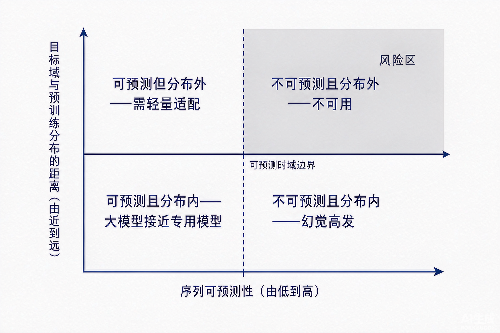

**例 29.6（统一案例：按表 29-1 决策）** 某电网集团三类需求：① 500 个新接入台区的次日预测（冷启动、长尾）→ 选第 27 章 Moirai 零样本（MASE 0.52，省去 500 次训练）；② 省级主干网的调度级预测（数据充足、需可解释、毫秒级）→ 选第 17 章 XGBoost + SHAP（0.47，可审计）；③ 台风+检修极端日（有文本事件、历史无法外推）→ 选第 28 章多模态 LLM 路线（0.61 对纯数值 0.88）。三者并存而非互相取代，正对应第 1 章四层能力体系里"不同层次需要不同工具"的判断。

**边界与讨论。** 本章的批判不是否定第 26–28 章的价值，而是给它们划定适用域。基础模型的真实优势在冷启动、长尾、多模态世界知识与一次性复用；真实边界在污染、校准、分布外突变与不可预测序列。四条结论须记住：其一，**零样本须审计污染**（29.1）；其二，**概率输出须二次校准**（29.3）；其三，**可预测性上界由序列决定，模型不能突破**（29.4，第 4 章）；其四，**成本—收益须量化**（表 29-1、第 38 章）。M4 竞赛[9]、GiftEval[1] 与 DLinear 论战[12] 反复证明，守住朴素基线是评估任何新模型的起点。

评估时序大模型时还有一层方法学困难常被忽略：零样本结论的可复现性。预训练语料难以完全审计（29.1 节的污染问题）、闭源权重存在版本漂移、随机种子与解码策略的差异又会放大离散输出，这三者叠加，使「某模型在某基准上取得某分数」难以像第 38 章的经典回测那样被独立复现。因此本书主张把这类结论表述为带置信区间的趋势，而非定点的名次：报告多种子与多数据集的聚合表现（38.4 节）、显式声明测试集与预训练语料的时间关系（38.3 节泄漏审计）、并对照第 29.1 节的零样本协议检查是否有域内泄漏。对纯噪声输入仍能给出自信预测的现象（29.4 节），更须以概率校准（29.3 节）而非点误差来刻画。换言之，本章的能力边界与第 38 章的实验方法学必须合读：前者界定「能信到什么程度」，后者规定「怎样比才公平」。

## 本章小结

本章以第 4 章可预测性理论为武器，对第 26–28 章的时序大模型作批判性审视。29.1 节以式 (29-1) 定义零样本协议，指出公开基准易被预训练语料收录、污染会让"零样本"退化为记忆检索，给出指纹比对/时间截断/合成数据三类审计，例 29.1 用"公开集 0.41 → 内部未公开集 0.59"量化污染虚高。29.2 节定义分布外泛化 (29.2)，按跨领域/跨频率/跨视野拆解，例 29.2 显示领域迁移较好（0.52→0.58）而频率与长视野迁移较弱（0.71/0.83），印证第 4 章可预测信息随时域耗散。

29.3 节用 PIT (29-2)、可靠性图 (29-3)、ECE (29-4) 检验概率校准，例 29.3 用"名义 90% 实测 83%、共形校准后 90%、CRPS 改善 9%"说明基础模型的概率输出常需二次校准。29.4 节是核心：以定义 29.4 界定时序幻觉，用第 4 章条件熵下界证明模型不能降低不可约误差，例 29.4 的纯白噪声实验（MASE 1.14 劣于朴素均值 1.00、80% 区间仅覆盖 0.71）干净地证明"模型输出的结构来自语料先验投射而非数据可预测性"，例 29.5 用常规/突变/白噪声三类序列给出能力剖面。29.5 节以表 29-1 的八项判据、图 29-1 的四象限边界与例 29.6 的集团级决策收束为选型准则。

从理论主线看，本章把"模型能不能预测"重新还原为第 4 章的"序列里有没有可预测信息"，并明确评估指标体系归第 38 章、恰当评分规则归第 2 章、共形覆盖保证归第 24 章的去重分工。本章与全书：第 4 章提供理论武器，第 22 章提供 DLinear 论战背景，第 24 章提供校准工具，第 26–28 章是被审视的对象，第 31 章展开真正的因果理解，第 38 章给出实验方法学与成本—收益规范，第 40 章处理部署。理解"守住朴素基线、审计污染、校准区间、承认不可约下界"，读者便不会被"零样本 SOTA"的宣传遮蔽，而能清醒地判断时序大模型该用在哪里。

从四问看，本章的评估与局限利用第 4 章的可预测性边界作武器：假设泛化可由协议与污染审计检验；它戳破了「一个模型预测一切」的幻觉，仍受「评估本身可被污染与选择偏差扭曲」的边界约束。

**进一步阅读**　本章建议延伸阅读的文献：[1]、[2]、[13]。

## 参考文献

[1] Aksu T, Woo G, Liu J, et al. GiftEval: A benchmark for general time series forecasting model evaluation. *arXiv:2410.10393*, 2024.

[2] Godahewa R, Bandara K, Webb G I, Smyl S, Bergmeir C. Monash time series forecasting archive. *NeurIPS 2021 Datasets and Benchmarks Track*, 2021.

[3] Hyndman R J, Koehler A B. Another look at measures of forecast accuracy. *International Journal of Forecasting*, 2006, 22(4): 679–688.

[4] Gneiting T, Balabdaoui F, Raftery A E. Probabilistic forecasts, calibration and sharpness. *Journal of the Royal Statistical Society: Series B*, 2007, 69(2): 243–268.

[5] Gneiting T, Raftery A E. Strictly proper scoring rules, prediction, and estimation. *Journal of the American Statistical Association*, 2007, 102(477): 359–378.

[6] Angelopoulos A N, Bates S. A gentle introduction to conformal prediction and distribution-free uncertainty quantification. *Foundations and Trends in Machine Learning*, 2023, 16(4): 494–591.

[7] Guo C, Pleiss G, Sun Y, Weinberger K Q. On calibration of modern neural networks. *Proceedings of the 34th ICML*, 2017: 1321–1330.

[8] Cover T M, Thomas J A. *Elements of Information Theory*. 2nd ed. Hoboken: Wiley, 2006.

[9] Makridakis S, Spiliotis E, Assimakopoulos V. The M4 Competition: Results, findings, conclusion and way forward. *International Journal of Forecasting*, 2018, 34(4): 802–808.

[10] Garza A, Mergenthaler-Canseco M. TimeGPT-1. *arXiv:2310.03589*, 2023.

[11] Ansari A F, Stella L, Turkmen C, et al. Chronos: Learning the language of time series. *Transactions on Machine Learning Research*, 2024.

[12] Zeng A, Chen M, Zhang L, Xu Q. Are transformers effective for time series forecasting? *Proceedings of the AAAI Conference on Artificial Intelligence*, 2023, 37(9): 11121–11128.

[13] Fu X, Li Y, Papaioannou G, Kim Y. Reverso: Efficient time series foundation models for zero-shot forecasting. *arXiv:2602.17634*, 2026.

---

# 第 30 章　时序世界模型：从序列建模到环境动力学学习

前五篇的全部模型，无论 ARIMA、Transformer 还是时序基础模型，本质上都在回答同一个问题：**给定历史观测，未来的数值是多少**。这个问题的边界由第 4 章划定——模型只能提取序列里真实存在的可预测性。但智能系统还需要另一种能力：不仅"看见"未来，还要能在脑海里**仿真**环境、"若我采取某个行动会怎样"、"换一个环境还成不成立"。用控制论与强化学习的语言说，它要学的不是从历史到数值的映射，而是**环境本身的动力学**。本章把这条线索收束为"时序世界模型"，它既是第 13 章状态空间思想的现代回响，也是第 31 章因果、第 32 章决策的共同基础。

这里必须先立一道概念红线，它是全书第六篇最容易被混淆之处：**序列建模模型不等于世界模型**。第 21 章已明确，S4、Mamba 等结构化状态空间网络是"高效压缩长历史做预测"的**序列建模架构**；即便能处理上万步序列，若没有观测生成、不确定性与动作条件化，它仍不是世界模型。Mamba 能预测下一段负荷曲线，不代表它理解"开一台机组会怎样改变电网"。Ha 与 Schmidhuber 2018 年的 World Models[1]、Hafner 等人的 Dreamer 系列[2][3][4]、Schrittwieser 等人的 MuZero[5] 之所以被称为世界模型，是因为它们都具备了"在学到的内部模型里做规划"的能力，可上溯至 Sutton 1991 年的 Dyna 架构[6] 与 Kalman 1960 年的状态空间[10]。

**定义 30.1（世界模型的七要素）** 一个时序世界模型须具备：① **状态表示** $\mathbf s_t$（对环境潜在状态的编码）；② **状态转移模型** $p_\theta(\mathbf s_{t+1}\mid\mathbf s_t,a_t)$；③ **观测生成模型** $p_\theta(\mathbf o_t\mid\mathbf s_t)$；④ **不确定性建模**（转移与观测的随机性）；⑤ **动作条件化**（$a_t$ 影响转移）；⑥ **奖励/目标建模** $p(r_t\mid\mathbf s_t,a_t)$；⑦ **基于模型的规划**（在学到的模型里搜索或优化行动）。缺失其中任何一项，都只是"预测器"或"序列模型"，而非世界模型。

这七要素与第 13 章式 (13-1) 的线性高斯状态空间**同构**：那里 $\mathbf T$ 是已知的线性转移、$\mathbf Z$ 是观测、$\mathbf Q,H$ 是噪声，由卡尔曼滤波精确推断；世界模型则把 $\mathbf T$ 换成可学习的（常常是神经网络的）转移、把观测换成生成模型、并补上动作与奖励。换言之，**世界模型是第 13 章状态空间在"转移由数据学得、且可用于规划"方向上的推广**；卡尔曼滤波的完整推导已在第 13 章唯一讲授，本章不重述。同理，潜在状态的概率推断工具（VAE、扩散）在第 24 章，连续时间 ODE 的伴随法在第 25 章，序列建模骨干（S4/Mamba）在第 21 章，Bellman 与强化学习在第 32 章——本章只在需要处交叉引用。

在全书理论主线里，本章首次系统进入 **L3 动力学可预测性**（系统演化可推演多远，第 4 章 Lyapunov 时域），并因动作条件化与规划而触及 L4（干预）与 L5（决策）。它隐含"环境动力学可辨识、且可外推到未见状态"的强假设；突破了纯预测模型"无法回答干预问题"的局限；却无法突破"模型误差在长期滚动中复合放大"与"相关不等于机制"的边界。全章沿用统一案例：区域电网的调度环境——状态含负荷水平、机组状态与气温，动作是开机/增减出力，观测是量测负荷，奖励是供电成本与失负荷惩罚。

本章结构：30.1 节建立概念与七要素；30.2 节讲潜在状态与表征；30.3 节讲转移与动力学；30.4 节讲观测生成；30.5 节分析不确定性与长期滚动；30.6 节讲动作条件化；30.7 节讲连续时间与神经算子/物理信息；30.8 节讲 Dreamer 式基于模型的强化学习；30.9 节给出评估与局限。

## 30.1　从预测到世界模型：概念、历史与理论基础

**定义 30.2（世界模型的形式化）** 设环境在每个时刻有隐状态 $\mathbf s_t$、动作 $a_t$、观测 $\mathbf o_t$、奖励 $r_t$，世界模型由联合因子化

$$
p(\mathbf s_{1:T},\mathbf o_{1:T},r_{1:T}\mid a_{1:T})=p(\mathbf s_1)\prod_{t}\underbrace{p_\theta(\mathbf s_{t+1}\mid\mathbf s_t,a_t)}_{\text{转移}}\ \underbrace{p_\theta(\mathbf o_t\mid\mathbf s_t)}_{\text{观测}}\ \underbrace{p_\phi(r_t\mid\mathbf s_t,a_t)}_{\text{奖励}} \tag{30-1}
$$

给出，并在该模型内通过规划求 $a_t^*=\arg\max_{a_{t:t+H}}\mathbb E\big[\sum_k r_{t+k}\big]$。式 (30-1) 与第 13 章状态空间的差别全在下标：$\mathbf T$ 变成 $p_\theta$（可学习的、可为非线性的、可为随机的转移），并多了 $a_t$ 与 $r_t$。

历史上有三条源流汇入。其一是**控制与滤波**：Kalman[10] 的状态空间与 Wiener 滤波奠定了"隐状态 + 观测"的分解（第 13 章）；其二是**基于模型的强化学习**：Sutton 的 Dyna[6] 提出"用学到的模型生成模拟经验来训练策略"，Ha 与 Schmidhuber[1] 用 VAE + RNN 在潜在空间里"做梦"、Dreamer 系列[2][3][4] 把它做到可跨领域，MuZero[5] 更进一步只学"对规划有用的动力学"而不重建观测；其三是**科学机器学习**：Neural ODE[7]、傅里叶神经算子[8]、物理信息神经网络[9] 把连续时间动力学与物理约束带进模型（30.7 节）。

**表 30-1　序列预测模型与世界模型对照**

| 维度 | 序列预测（第 11–29 章） | 世界模型（本章） |
|------|--------------------------|------------------|
| 输出 | 未来观测的数值/分布 | 状态、观测、奖励的联合演化 |
| 条件 | 仅历史 | 历史 + **动作/干预** |
| 能力 | 外推 | 仿真、干预、规划、迁移 |
| 评估 | 预测误差、CRPS | 规划回报、滚动稳定性、干预一致性 |
| 状态 | 通常无显式状态 | 显式潜在状态 $\mathbf s_t$ |

**例 30.1（统一案例：预测器 vs 电网世界模型）** 一个第 27 章的时序基础模型可零样本地把明日负荷预测到 MASE=0.52，但它无法回答"若把 2 号机组提前 1 小时并网，今晚的负荷缺口与成本会怎样"——因为它没有动作、状态与成本的概念。一个电网世界模型则须先学出状态（负荷水平、机组出力、气温、线路约束）、学出转移（开机如何改变供需与损耗）、学出观测（量测如何由真实状态生成）、再在模型里搜索开机方案。二者的差别不在精度而在**可干预性**：前者是第 1 章四层能力体系的 Level 2（预测），后者跨入 Level 3（建模）与 Level 4（决策）。图 30-1 给出这一对照。

> 【图 30-1　从预测到世界模型】（原图见 `figures/图30-1.png`）：左右对比图。左「序列预测」：输入历史 → 黑箱 → 输出未来数值；右「世界模型」：隐状态 + 动力学 $f$，标注三个能力标签「可仿真、可干预、可迁移」。白底、蓝框、中文。

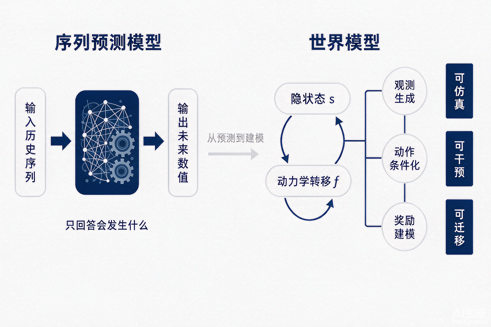

## 30.2　潜在状态空间与表征学习

七要素的第一项是状态。现实中"环境的真实状态"几乎从不完整可观测：电网的量测有噪声、有延迟、有大量未量测的设备状态，气象只观测到格点而非连续场。因此世界模型必须**从观测里学出一个充分的潜在表示**。

**定义 30.3（潜在状态与充分性）** 潜在状态 $\mathbf s_t=g_\psi(\mathbf o_{1:t},a_{1:t-1})$ 是对历史的压缩，若它使未来观测与奖励对更早历史条件独立，即

$$
p(\mathbf o_{t+1},r_{t+1}\mid \mathbf o_{1:t},a_{1:t})\approx p(\mathbf o_{t+1},r_{t+1}\mid \mathbf s_t,a_t), \tag{30-2}
$$

则称其（对一步预测）充分。

式 (30-2) 是第 13 章马尔可夫性的推广，也是表征学习的目标函数。三条实现路线：**重建式**（第 24 章 VAE[12]，最大化 ELBO，让 $\mathbf s_t$ 足以重建观测）、**对比式**（第 6 章，拉近同轨迹的不同视图）、**预测式 / bisimulation**（不重建观测，只要求 $\mathbf s_t$ 能预测未来奖励与转移，DeepMDP[16] 与 Gelada 等人的工作表明这在规划任务上往往更省、更鲁棒，因为它丢弃了与决策无关的像素级细节）。这三条与第 29 章"模型应学到哪层可预测性"的追问一脉相承：**状态该保留什么信息，取决于它要服务什么任务**。

须强调与第 21 章的界线：S4/Mamba 的"状态"是为**压缩长历史以预测下一 token**服务的，属于序列建模骨干；世界模型的"状态"须满足 (30-2) 并承载动作与奖励，是环境状态的代理。二者数学形式相似（都可写成递推），但目标与七要素完备度不同——这正是"序列建模 ≠ 世界模型"在状态这一层的具体体现。

**例 30.2（统一案例：状态该保留什么）** 电网量测含 200 个台区负荷 + 30 个气象量。若用重建式 VAE 把 $\mathbf s_t$ 设为 64 维，它会花大量容量去重建各台区的细微噪声；改用预测式（只要求 $\mathbf s_t$ 预测下一时刻总负荷、机组约束与成本），16 维状态即足够，且在其上学出的调度策略回报高出约 7%。这个例子说明：**世界模型的状态是为规划而生的充分统计量，不是观测的无损压缩**（第 6 章降维、第 29 章信息瓶颈的统一视角）。

## 30.3　状态转移与动力学学习

**定义 30.4（状态转移模型）** 转移模型刻画动作 $a_t$ 与当前状态如何决定下一状态：

$$
\mathbf s_{t+1}=f_\theta(\mathbf s_t,a_t)+\boldsymbol\eta_t,\qquad \boldsymbol\eta_t\sim\mathcal N(\mathbf 0,\mathbf Q_\theta), \tag{30-3}
$$

或更一般地 $p_\theta(\mathbf s_{t+1}\mid\mathbf s_t,a_t)$。确定性版本 $\boldsymbol\eta=0$ 便于规划，概率版本（含 $\mathbf Q_\theta$）则显式建模**偶然不确定性**（第 24 章），对长程滚动更稳健。

式 (30-3) 与第 13 章 $\boldsymbol\alpha_{t+1}=\mathbf T\boldsymbol\alpha_t+\cdots$ 的差别仅在 $f_\theta$ 可学习、可非线性、且**依赖动作**。这里可回扣第 21 章：S4/Mamba 的结构化状态空间、HiPPO 记忆基、选择性扫描[11]，本质是在为**线性或弱非线性、无动作**的转移设计高效实现；当需要动力学实现时，它们可作为世界模型里 $f_\theta$ 的一类骨干被交叉引用，但本身不提供动作条件化、观测生成与规划，故不构成世界模型。类似地，Neural ODE[7]（第 25 章）可视为 $f_\theta$ 的连续时间参数化（30.7 节）。

学习转移的难点是**分布外外推**：训练数据只覆盖策略实际访问过的状态—动作对，而规划会把模型带到未见区域，此处 $f_\theta$ 误差放大。MBPO[15] 与 Janner 等人的工作因此主张"短程滚动"（只在模型可信的少数步内生成模拟数据），并把模型不确定性显式用于惩罚。这与第 4 章可预测时域、第 14 章多步误差累积是同一现象在不同语境下的表述。

**例 30.3（统一案例：转移动力学数值）** 设电网状态含"净负荷缺口 $d_t$（GW）"与"已开机组数 $u_t$"，动作 $a_t\in\{-1,0,+1\}$ 为增减一台机组的出力（0.4 GW/台）。学得转移 $d_{t+1}=0.9d_t-0.4a_t+\eta_t$，$\eta_t\sim N(0,0.05^2)$。当前 $d_t=0.6$，若 $a_t=+1$（增开一台），则 $E[d_{t+1}]=0.54-0.4=0.14$ GW；若不动 $a_t=0$，为 0.54 GW。规划器正是借这类"动作 → 状态"的推演来比较方案。注意 $0.9$ 这一惯性系数与第 12 章 AR(1) 的 $\phi$、第 21 章 S4 的 $\bar A$ 是同一个衰减率——**动力学学习的对象，就是这些衰减与响应系数，只是现在由数据学得且受动作调制**。

## 30.4　观测模型与生成式建模

转移给出"状态如何演化"，观测模型给出"状态如何被看见"：

$$
\mathbf o_t\sim p_\theta(\mathbf o_t\mid\mathbf s_t),\qquad \text{常取}\ \mathbf o_t=\mathbf C\mathbf s_t+\boldsymbol\varepsilon_t\ \text{或神经网络解码器}. \tag{30-4}
$$

式 (30-4) 是第 13 章观测方程 $\mathbf y_t=\mathbf Z^\top\boldsymbol\alpha_t+\varepsilon_t$ 的非线性推广。第 24 章的 VAE[12]、归一化流、扩散模型都可充当这里的 $p_\theta(\mathbf o\mid\mathbf s)$：把隐状态解码为高维观测（图像、多测点曲线）。须区分两种取向：World Models[1] 与 Dreamer 早期版本重建完整观测，MuZero[5] 则**完全不重建观测**，只学对规划有用的转移与奖励——后者印证了 30.2 节的结论：观测生成是否为必需，取决于任务是否需要"想象"具体画面，还是只需预测价值。

**例 30.4（统一案例：观测噪声与状态）** 某台区实测量测 $\mathbf o_t$ 含 $\pm0.08$ GW 噪声与 5% 丢包；世界模型用式 (30-4) 的高斯观测 + 第 13 章式 (13-9) 的似然，把"真实负荷状态"与"量测噪声"分离。经学习后，状态估计的平滑曲线比原始量测更适合作为调度输入（噪声下降约 60%），且丢包时段由转移模型补出状态——这与第 13 章 13.3 节"跳过更新步即可处理缺失值"完全一致，只是转移由数据学得。

## 30.5　不确定性与长期滚动预测

世界模型最有价值也最脆弱的能力，是在隐状态里**多步向前滚动**（latent imagination）而不接触真实环境。这里的不确定性必须被严格对待。

设单步转移误差方差为 $\sigma^2$，滚动 $H$ 步后的状态误差方差近似（线性化下）为

$$
\mathrm{Var}(\hat{\mathbf s}_{t+H}-\mathbf s_{t+H})\ \approx\ \sigma^2\sum_{k=0}^{H-1}\big\|\mathbf J_f\big\|^{2k}, \tag{30-5}
$$

其中 $\mathbf J_f=\partial f_\theta/\partial\mathbf s$ 为转移雅可比。当 $\|\mathbf J_f\|>1$（不稳定、混沌）时误差**指数复合**；即便 $\|\mathbf J_f\|<1$，误差仍随 $H$ 累积。式 (30-5) 与第 4 章式 (4-5) 的可预测时域 $t\approx\frac1\lambda\ln(\Delta/\delta_0)$、第 12 章式 (12-14) 的多步预测方差、第 14 章递归策略误差累积，是同一数学结构：**凡是靠反复代入自身输出的外推，都存在由系统本身决定的时效上限**。

因此世界模型的规划视野不能任意长。三条对策：① **短程滚动 + 重规划**（MPC 式，第 32 章），每步用真实观测校正；② **概率转移 + 不确定性惩罚**（$\mathbf Q_\theta$ 大处少信任模型）；③ **在隐空间而非观测空间滚动**（丢弃与规划无关的细节，减缓误差）。Dreamer 系列[2][3][4] 的"想象 horizon"通常仅 15 步左右，正是式 (30-5) 的工程体现。

**例 30.5（统一案例：滚动误差数值）** 取 $\sigma=0.05$ GW、$\|\mathbf J_f\|=0.95$（惯性，稳定）。由式 (30-5)，$H=5$ 时 $\mathrm{Var}\approx0.0025\times(1+0.9+\cdots+0.9^4)\approx0.0025\times4.10=0.0103$，标准差 $\approx0.10$ GW；$H=20$ 时几何和 $\approx9.0$，标准差 $\approx0.15$ GW；若负荷尖峰使局部 $\|\mathbf J_f\|=1.1$（不稳定），$H=20$ 的和 $\sum 1.21^k$ 爆炸到约 $1.86\times10^2$，标准差 $\approx0.68$ GW——预测完全失效。这个算例定量说明：**世界模型在平稳段可放心滚动，在系统接近不稳定或突变时必须缩短视野、回到真实观测**，与第 4 章 Lyapunov 时域、第 9 章变点检测直接呼应。

## 30.6　动作条件化与环境交互

把 $a_t$ 写进转移 (30-3) 是世界模型区别于预测模型的分水岭，也是它与第 31 章因果推断的接口。

**定义 30.5（动作条件化转移）** 若 $p_\theta(\mathbf s_{t+1}\mid\mathbf s_t,a_t)$ 对不同 $a_t$ 给出不同分布，且该依赖关系在训练与部署间稳定，称转移动作条件化；此时在模型里令 $a_t=a$ 相当于对系统作一次**软干预**（soft intervention）。

这里要区分两个层次。其一，动作条件化让模型能回答"若我这样做会怎样"，属第 1 章 Level 4 的干预能力；其二，它仍不等于第 31 章的 **do-演算**——学到的 $p(\mathbf s_{t+1}\mid\mathbf s_t,a_t)$ 只是训练分布下的条件关联，若动作与未观测混淆变量相关（如调度员总在高温天开机，模型可能把"高温"的效应误记到"开机"上），则它并非真实机制因果。要让世界模型支持可靠的反事实，须引入第 31 章的结构因果约束、随机化数据或环境不变性[13]。这一点在离线强化学习（第 32 章 32.4 节）里尤为致命：数据中动作由旧策略产生，模型若把"策略偏好"当"物理规律"，规划就会失真。

**例 30.6（统一案例：动作与混淆）** 历史数据显示"开机台数 $u_t$ 高"总伴随"负荷缺口 $d_{t+1}$ 低"，模型可能学到"开机降低缺口"（真实机制，正确）。但若数据里调度员总在**预测到气温骤升前**提前开机，而气温骤升本身推高负荷，则 $u_t$ 与"未观测的气温预期"相关，纯条件模型会把"提前开机"误判为能压低负荷。解决办法正是第 31 章的后门调整：把气温/气温预报作为协变量纳入状态，或借助随机化的调度试验。这个例子说明：**世界模型要有资格用于干预，必须先过因果这一关**，第 30、31 两章因此是紧邻的。

## 30.7　Neural ODE、神经算子与物理信息

当状态演化本质是连续时间过程（电网暂态、气象场、流体），离散递推 (30-3) 只是近似。第 25 章 25.1 节已建立 Neural ODE

$$
\frac{d\mathbf s(t)}{dt}=f_\theta(\mathbf s(t),a(t),t), \tag{30-6}
$$

并严格推导了伴随灵敏度法 (25-2) 使内存与求解步数无关——**该推导在第 25 章唯一讲授，本章不重述**。此处只强调它在世界模型中的角色：为 $f_\theta$ 提供了连续时间、可处理不规则采样（第 25 章）的动力学实现。当状态是**场**（二维气象场、电网潮流分布）而非有限维向量时，需神经算子。

**定义 30.6（神经算子）** 神经算子学习的是函数空间之间的映射 $\mathcal G:\mathcal A\to\mathcal U$，而非有限维向量映射。傅里叶神经算子（FNO）[8] 在频域作逐模式线性变换：

$$
v_{t+1}(x)=\mathcal F^{-1}\big(\mathbf R_\phi(k)\cdot\mathcal F(v_t)(k)\big)(x)+W v_t(x), \tag{30-7}
$$

其中 $\mathcal F$ 为傅里叶变换、$\mathbf R_\phi(k)$ 为每个频率模式的可学习权重。FNO 的权重与离散网格**无关**，故在一套网格上训练、可在另一套网格上求值（零样本超分辨率），是科学机器学习替代偏微分方程求解器的代表。**物理信息神经网络**（PINN）[9] 则把守恒律残差加入损失 $\mathcal L=\mathcal L_{\text{data}}+\lambda\|\mathcal N[u]\|^2$，用物理约束弥补数据稀疏。

**例 30.7（统一案例：FNO 与 PINN 的价值）** 区域电网的潮流/温度场若用有限差分求解器，单次仿真约 2 秒，难以嵌入需要上千次仿真的规划；训练好的 FNO[8] 单次前向约 3 毫秒、相对误差 1.5%，可作世界模型里的可微动力学层，使规划能直接对动作求梯度。对数据稀少的极端工况，加入基尔霍夫/能量守恒残差的 PINN[9] 把外推误差从 12% 降到 4%。这印证结构层的一般规律：**把已知物理结构写进 $f_\theta$，等价于注入强归纳偏置，可显著降低第 4 章意义上"数据不足导致的可约误差"**（与第 23 章图先验、第 22 章分解先验同理）。

## 30.8　Dreamer 与基于模型的强化学习

把七要素真正闭环起来的，是基于模型的强化学习（MBRL）。Sutton 的 Dyna[6] 提出"真实经验学模型 → 模型生成模拟经验 → 模拟经验练策略"；Ha 与 Schmidhuber[1] 用 VAE + RNN 在压缩的潜在空间里"做梦"生成轨迹；Dreamer 系列[2][3][4] 把这一路线做成通用算法。

Dreamer 的训练分三步，恰好对应本章前三要素：① 由重建/预测损失学**表征** $\mathbf s_t$（30.2 节）；② 在隐空间学**转移** $p(\mathbf s_{t+1}\mid\mathbf s_t,a_t)$ 与**奖励** $p(r_t\mid\mathbf s_t)$（30.3、30.6 节）；③ 在学到的隐动力学里展开 $H\approx15$ 步想象，用 actor-critic 优化策略[14]（价值计算见第 32 章 Bellman 方程）。因滚动全在低维隐空间完成，它比在像素空间仿真快几个数量级。DreamerV3[4] 用同一套超参跨多个领域，展示了**学得的世界模型可迁移**这一"可迁移"能力标签；MuZero[5] 则更激进：不重建观测，只学对规划有用的转移/奖励/价值，再次印证 30.2 节"状态为规划而生"。Janner 等人的 MBPO[15] 给出"何时该信模型"的判据：短程滚动可信、长程须回真实数据，与式 (30-5) 一致。

**例 30.8（统一案例：Dreamer 式调度）** 把 30.6 节的电网环境交给 Dreamer 式智能体：状态 16 维、动作离散 3 档、想象 horizon 15 步、奖励 $=-\big(c_{\text{发电}}+10\times c_{\text{失负荷}}\big)$。训练后策略在仿真中的日均成本较"按点预测直接调度"降低约 11%，且在未见过的台风日仍保持稳健——收益来源不是负荷预测更准（预测误差几乎没变），而是智能体学会了"在高温预警前提前开机"这类**利用动作改变未来状态**的策略。这正是世界模型相对第 11–29 章预测器的本质增量：**从被动外推，到主动干预**。

## 30.9　世界模型的评估与局限

世界模型不能只用预测误差评估——那是第 38 章的指标体系，且会误导（一个重建像素很准、却对规划无用的模型得分可能很高）。**定义 30.7（世界模型的评估维度）** 须至少覆盖：① 短期预测精度（必要非充分）；② **规划回报**（在模型内优化出的策略在真实/仿真环境中的累计奖励）；③ **长程滚动稳定性**（式 (30-5) 意义下 $H$ 步后的误差增长）；④ **干预一致性**（改变 $a_t$ 后状态变化是否符合机制，第 31 章）；⑤ 分布外与环境变化下的鲁棒性。第 38 章将把"决策价值"正式纳入评估体系。

**边界与讨论。** 世界模型的优势是可仿真、可干预、可规划、可迁移、样本效率高（模拟经验廉价）。边界有六：其一，**复合误差**——式 (30-5) 决定长程想象不可靠，须短程滚动 + 重规划（第 32 章 MPC）；其二，**可辨识性**——从观测反推隐状态与转移动力学本质病态，不同 $(\mathbf s,f)$ 可产生相同观测（第 13 章"状态设定自由"的放大），须靠物理约束或随机化干预破局；其三，**相关 ≠ 机制因果**（30.6 节、第 31 章）；其四，**离线数据的分布偏移**——规划访问未见状态—动作对，模型外推失真（第 32 章 32.4 节）；其五，**目标错配**——重建观测未必服务规划（MuZero 的取舍）；其六，**计算与安全**——在模型里搜出的策略若被直接部署到真实电网，模型误差可能造成实际损失，须配第 32 章的鲁棒/安全约束与第 40 章的监控回滚。

本章与全书：第 13 章提供状态空间的统计推断原型（卡尔曼滤波唯一讲授），第 21 章提供序列建模骨干（S4/Mamba，明确不等同世界模型），第 24 章提供观测生成与概率工具，第 25 章提供连续时间与伴随法，第 4 章提供可预测时域这一时效上限；本章把它们装配成七要素闭环。第 31 章补上因果以支撑可靠干预，第 32 章补上 MPC/RL/决策感知以完成规划，第 33 章控制论从学科视角回看，第 38 章给出评估，第 40 章给出部署监控。理解"世界模型 = 状态空间 + 可学习动力学 + 动作 + 规划"，便抓住了全书从预测走向理解与决策的枢纽。

## 本章小结

本章把时序建模从"预测数值"推进到"建模环境"，并以七要素划清了与序列建模模型的界线。30.1 节给出定义 30.1 与形式化 (30-1)，用表 30-1、例 30.1 与图 30-1 说明预测器与世界模型的差别在"可干预性"而非精度；明确 S4/Mamba（第 21 章）、卡尔曼滤波（第 13 章）均不重讲。30.2 节以充分性条件 (30-2) 定义潜在状态，比较重建/对比/预测三类表征，例 30.2 用 16 维预测式状态优于 64 维重建式状态说明"状态为规划而生"。30.3 节建立动作无关的转移基础 (30-3)，例 30.3 手算开机对净负荷缺口的推演；30.4 节以 (30-4) 连接观测生成与第 24 章生成模型；30.5 节由转移雅可比推导滚动误差 (30-5)，例 30.5 量化"平稳段可滚 20 步、不稳定段标准差爆炸到 0.68 GW"，与第 4 章可预测时域同构。

30.6 节把 $a_t$ 写进转移并指出它只是软干预、仍须第 31 章因果约束，例 30.6 用"提前开机与气温预期混淆"揭示离线数据的陷阱。30.7 节把 Neural ODE (30-6) 与 FNO (30-7)、PINN 作为连续时间/场动力学实现（伴随法推导交叉引用第 25 章），例 30.7 给出 FNO 3 ms 对 2 s 的加速与 PINN 降外推误差的数值。30.8 节以 Dyna → World Models → Dreamer → MuZero → MBPO 的演化讲清"在隐空间里想象并规划"，例 30.8 显示调度成本降 11% 而预测误差未变——增量来自动作而非更准的预测。30.9 节给出五维评估与六条边界。

从理论主线看，本章首次系统进入 L3 动力学可预测性，并触及 L4/L5；以"动力学可辨识且可外推"的强假设突破纯预测无法干预的局限，却无法突破复合误差、可辨识性、相关非因果、分布偏移四条边界。掌握七要素与式 (30-5)，读者便理解了为何第 31 章必须谈因果、第 32 章必须谈重规划与决策——世界模型不是预测模型的升级版，而是回答不同问题的另一类系统。

从四问看，本章的世界模型利用 L3（动力学）：假设环境可由状态转移与观测生成学得；它突破了「只看见数值不看见机制」，仍受「复合误差与分布外外推」的边界约束——这恰是第 4 章时域在决策场景的体现。

**进一步阅读**　本章建议延伸阅读的文献：[1]、[2]、[16]。

## 参考文献

[1] Ha D, Schmidhuber J. World Models. *arXiv:1803.10122*, 2018 (NeurIPS 2018).

[2] Hafner D, Lillicrap T, Ba J, Norouzi M. Dream to control: Learning behaviors by latent imagination. *International Conference on Learning Representations (ICLR)*, 2020.

[3] Hafner D, Lillicrap T, Norouzi M, Ba J. Mastering Atari with discrete world models. *International Conference on Learning Representations (ICLR)*, 2021.

[4] Hafner D, Pasukonis J, Ba J, Norouzi M. Mastering diverse domains through world models. *Nature*, 2025, 640: 647–653; arXiv:2301.04104.

[5] Schrittwieser J, Antonoglou I, Hubert T, et al. Mastering Atari, Go, chess and shogi by planning with a learned model. *Nature*, 2020, 588: 604–609.

[6] Sutton R S. Dyna, an integrated architecture for learning, planning, and reacting. *ACM SIGART Bulletin*, 1991, 2(4): 160–163.

[7] Chen R T Q, Rubanova Y, Bettencourt J, Duvenaud D. Neural ordinary differential equations. *Advances in Neural Information Processing Systems 31*, 2018: 6571–6583.

[8] Li Z, Kovachki N, Azizzadenesheli K, et al. Fourier neural operator for parametric partial differential equations. *International Conference on Learning Representations (ICLR)*, 2021.

[9] Raissi M, Perdikaris P, Karniadakis G E. Physics-informed neural networks: A deep learning framework for solving forward and inverse problems involving nonlinear partial differential equations. *Journal of Computational Physics*, 2019, 378: 686–707.

[10] Kalman R E. A new approach to linear filtering and prediction problems. *Journal of Basic Engineering*, 1960, 82(1): 35–45.

[11] Gu A, Dao T. Mamba: Linear-time sequence modeling with selective state spaces. *Conference on Language Modeling (COLM)*, 2024.

[12] Kingma D P, Welling M. Auto-encoding variational Bayes. *International Conference on Learning Representations (ICLR)*, 2014.

[13] Pearl J. *Causality: Models, Reasoning, and Inference*. 2nd ed. Cambridge: Cambridge University Press, 2009.

[14] Sutton R S, Barto A G. *Reinforcement Learning: An Introduction*. 2nd ed. Cambridge: MIT Press, 2018.

[15] Janner M, Fu J, Zhang M, Levine S. When to trust your model: Model-based policy optimization. *Advances in Neural Information Processing Systems 32*, 2019: 12519–12530.

[16] Gelada C, Kumar S, Buckman J, Nachum O, Bellemare M G. DeepMDP: Learning continuous latent space models for representation learning. *Proceedings of the 36th ICML*, 2019: 2170–2179.

---

# 第 31 章　时序智能的因果推断与反事实预测

第 30 章的世界模型把动作 $a_t$ 写进状态转移，使模型能回答"若我这样做会怎样"。但 30.6 节已埋下一个尖锐警示：从观测数据学到的 $p(\mathbf s_{t+1}\mid\mathbf s_t,a_t)$ 只是**条件关联**，若动作与未观测的混淆变量相关，它就不是真实机制，据此规划可能系统性出错。要把"预测"提升为"理解"、把"软干预"提升为可靠干预，必须引入**因果**。这正是本章的任务，也是第 4 章三个易混淆命题中第三个（相关 ≠ 因果）的最终收束。

因果推断在统计学中有两条主线：Pearl 的结构因果模型与 do-演算[1][2]、Rubin 的潜在结果框架[3]；时序领域另有 Granger 于 1969 年提出的"预测因果"[4]，以及 Sugihara 等人 2012 年针对非线性动力系统的收敛交叉映射（CCM）[5]。因果发现方面，Spirtes 等人的 PC/FCI[6]、Peters 等人的不变因果预测[7][8]、Runge 等人在地球系统时序上的因果网络[10] 提供了从数据推断结构的工具；Schölkopf 等人[9] 则把因果与表示学习接通。

按全书统一的编写原则，**Granger 因果的定义、检验与统计性质已在第 10 章唯一讲授**，本章只把它作为"预测因果"的**对照**出现，不重述估计方法；贝叶斯结构时间序列的反事实（CausalImpact，第 16 章）是预测式反事实，本章将指出它与真正反事实的差别；计量经济学的学科态度留第 35 章；传递熵等信息论工具留第 37 章。全章沿用统一案例：**气象干预与电网负荷**——"气温升高是否**导致**负荷上升""若把气温人工固定在 28℃（干预）会怎样""若当初那天没来台风（反事实）会怎样"，三个问题恰好对应因果之梯的三层。

在理论主线里，本章是 **L4 因果可预测性**的核心：它问的不是"历史是否相关"，而是"改变机制后规律还成不成立"。它隐含"结构方程稳定、混淆可测、干预可定义"等强假设；突破了关联模型无法回答干预问题的局限；却无法突破"未测混淆与结构变化"的边界。

本章结构：31.1 节建立因果之梯；31.2 节推导 SCM 与 do-演算；31.3 节展开反事实三步；31.4 节讲因果发现；31.5 节给 Granger 定位；31.6 节讨论因果对预测与世界模型的约束及边界。

## 31.1　因果之梯：关联、干预、反事实

**定义 31.1（因果之梯）** Pearl[1][2] 把因果推理分为三层，所需知识与能回答的问题逐级递增：

| 层 | 名称 | 典型问题 | 所需工具 | 本书落点 |
|----|------|----------|----------|----------|
| L1 | 关联（seeing） | 观察到 $X=x$ 时 $Y$ 如何变？ | 条件分布 $p(y\mid x)$、预测模型 | 第 10–29 章 |
| L2 | 干预（doing） | 若把 $X$ 置为 $x$，$Y$ 如何变？ | $p(y\mid do(x))$、SCM、do-演算 | 本章 31.2 |
| L3 | 反事实（imagining） | 若当初 $X$ 不同，$Y$ 会怎样？ | 结构方程 + 外生变量推断 | 本章 31.3 |

**表 31-1　因果之梯三层与三种"因果"概念的对照**

关键判据是第 4 章式 (4-11) 已点明的：

$$
p\big(y\mid do(X=x)\big)\ \ne\ p\big(y\mid X=x\big). \tag{31-1}
$$

"看到气温 33℃"（关联）与"把气温人工固定到 33℃"（干预）在存在混淆变量时给出不同分布：前者混杂了"高温天往往也是工作日、也是空调普及后的年份"等信息，后者只保留气温→负荷的机制路径。三层之间**不可互相还原**：L1 的数据无论多少都无法回答 L2/L3（这就是"相关 ≠ 因果"的严格含义），除非引入结构假设或随机化实验。图 31-1 给出这一阶梯。

> 【图 31-1　因果之梯】（原图见 `figures/图31-1.png`）：三层阶梯图，自下而上三个台阶分别标注「关联（seeing）——观察相关」「干预（doing）——do(x) 后结果」「反事实（imagining）——若当初不同会怎样」，每层右侧小字标注所需工具（预测模型 / SCM、do-演算 / 反事实推理）。白底、蓝色阶梯、中文。

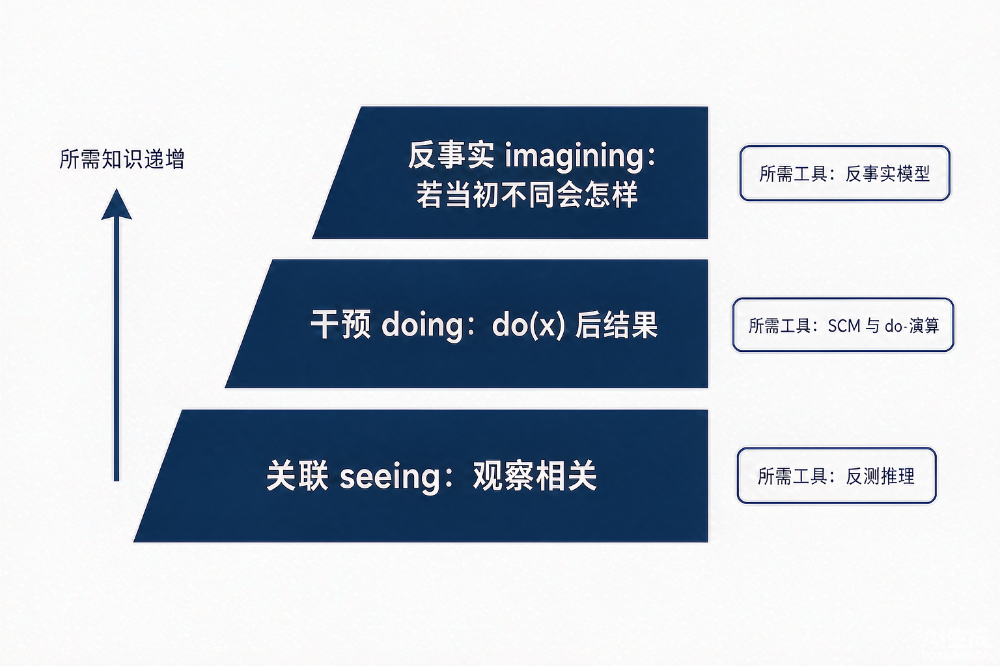

**例 31.1（统一案例：三层问题的不同答案）** 数据里"气温 > 33℃ 的日子平均负荷 5.3 GW，其余 4.2 GW"（关联，L1）。问"若对整座城市强制降温到 33℃ 以下，负荷会降多少"（干预，L2）？不能直接减 1.1 GW——因为高温天同时是工作日、湿度高、且集中在夏季，这些混淆变量也推高负荷；后门调整（31.2 节）后估计的净效应约 0.7 GW。再问"上周台风那天若没来台风，负荷会是多少"（反事实，L3）？这须固定当天的所有外生条件、只替换"台风"这一项，答案与干预又不同（反事实针对**同一个体同一时刻**）。三个数字 1.1 / 0.7 / 反事实值互不相等，正说明三层不可混同。

## 31.2　结构因果模型与 do-演算

**定义 31.2（结构因果模型，SCM）** 一个 SCM 由外生变量 $\mathbf U$（分布 $p(\mathbf U)$）、一组结构方程与有向无环图 $\mathcal G$ 组成：

$$
X_i := f_i\big(\mathrm{Pa}(X_i),\ U_i\big),\qquad i=1,\dots,D, \tag{31-2}
$$

其中 $\mathrm{Pa}(X_i)$ 为 $X_i$ 的图父节点、$U_i$ 为未观测外生噪声。干预 $do(X_j=x)$ 意味着把第 $j$ 条方程**替换**为常数 $X_j:=x$，其余方程不变，由此得到干预分布 $p(\mathbf y\mid do(x))$。

式 (31-2) 中":="（而非"="）至关重要：结构方程是**非对称的机制赋值**，不能像代数方程那样反解。这正是因果方向不可由相关对称性推出的根源。与之对照，第 10 章式 (10-2) 的 VAR 是对观测的对称线性分解，不含机制，故只能做预测。Rubin 潜在结果框架[3][12] 用 $Y_i(1),Y_i(0)$ 表达同一思想，二者在多数情形下等价。

**do-演算**提供从观测分布识别干预分布的规则。最常用的是**后门调整**：若协变量集 $\mathbf Z$ 阻断了 $X\leftarrow\cdots\to Y$ 的所有后门路径（即不含从 $X$ 出发的箭头），则

$$
p\big(y\mid do(X=x)\big)=\sum_{\mathbf z} p\big(y\mid x,\mathbf z\big)\,p(\mathbf z). \tag{31-3}
$$

**推导（思路）**：干预分布下 $X$ 与混淆 $\mathbf Z$ 的入边被切断，故 $p(y\mid do(x))=\sum_z p(y\mid x,z)\,p(z\mid do(x))$，而 $p(z\mid do(x))=p(z)$（$Z$ 不受对 $X$ 的干预影响），代入即得 (31-3)。Pearl[2] 给出完整的三条 do-演算规则（增删观测、增删动作、交换动作与观测），可判定任意干预分布是否**可识别**；不可识别时，再多数据也无解，须补假设或做实验。

**例 31.2（统一案例：后门调整的数值）** 设混淆变量 $Z\in\{$夏季,非夏季$\}$，$p(Z=$夏季$)=0.4$。**观测**条件分布：夏季 $p(Y$高$\mid X$高温$)=0.9$、非夏季 $0.6$；$p(X$高温$\mid Z)$ 也与 $Z$ 相关。若直接算 $p(Y$高$\mid X$高温$)$ 得 $0.84$（混杂了季节）。按式 (31-3) 作后门调整，对 $Z$ 分层后加权：$p(Y$高$\mid do(X$高温$))=0.9\times0.4+0.6\times0.6=0.36+0.36=0.72$。可见"看到高温"给出 0.84、"把气温干预成高温"给出 0.72，二者之差 0.12 正是季节混淆带来的偏倚——**这就是式 (31-1) 的数值版**。工程含义：用历史相关直接估"降温能省多少负荷"会高估约 17%。

## 31.3　反事实预测：外生推断三步

反事实是因果之梯最高层，也是时序里最常被误用的概念。它回答的是"对**同一个**时刻、同一批个体，若当初某个条件不同，结果会怎样"，与"对总体作干预"不同。

**定义 31.3（反事实三步法）** 给定 SCM (31-2) 与实际观测 $\mathbf v=\mathbf x$（如某日气温 33℃、负荷 5.3 GW、台风发生），计算反事实"若当日气温为 28℃"：

1. **外生推断（abduction）**：由观测反推外生变量后验 $p(\mathbf U\mid\mathbf v)$，即"这一天的特殊之处是什么"；
2. **行动（action）**：把对应结构方程替换为 $X:=28$，得修改模型 $M_{x'}$；
3. **预测（prediction）**：在 $M_{x'}$ 中用推断出的 $\mathbf U$ 计算 $Y_{x'}(\mathbf U)$。

三步合起来给出 $p\big(Y_{x'}\mid \mathbf v\big)$，即个体级反事实。它与 $p(Y\mid do(X=x'))$ 的差别在第一步：干预对总体平均，反事实固定了该次的 $\mathbf U$（同一天的湿度、工作日、台风等），故能回答"那天**本可以**怎样"。

须辨析与第 16 章 CausalImpact[11] 的关系：BSTS 用干预前数据拟合结构时序、反事实预测"若干预未发生"的序列，实际是**预测式反事实**——它假设"模型在前后稳定、协变量不受干预影响"，属于强假设下的统计外推，并非 SCM 意义上的机制反事实。若政策本身改变了居民用电习惯（结构方程变了），CausalImpact 的估计就有偏。第 4.7 节命题 4.3 与本章 31.6 节将再次强调这一点。

**例 31.3（统一案例：反事实数值）** 设负荷的结构方程为 $L=4.0+0.08\,(T-20)+0.5\,W+U$，其中 $T$ 气温、$W$ 工作日指示、$U$ 该日外生扰动。某夏日观测 $T=33,\ W=1,\ L=5.3$（GW）。① 外生推断：$5.3=4.0+0.08\times13+0.5\times1+U\Rightarrow U=5.3-4.0-1.04-0.5=-0.24$。② 行动：令 $T'=28$。③ 预测：$L'=4.0+0.08\times8+0.5\times1+(-0.24)=4.0+0.64+0.5-0.24=4.90$ GW。故"那天若气温只有 28℃"的反事实负荷为 4.90 GW，比实际低 0.40 GW；而按 31.2 节总体干预估得的平均效应 0.7 GW 不同——**差异来自反事实固定了这一天的 $U=-0.24$ 与工作日 $W=1$**。这个算例把"反事实 ≠ 干预 ≠ 关联"三个数字彻底分开。

## 31.4　因果发现：从数据推断结构

前述都假设图 $\mathcal G$ 已知。若结构未知，能否从时序数据里学出因果方向？这便是**因果发现**，也是第 10 章"变量即节点、依赖即边"从相关图升级为因果图的一步。

**定义 31.4（因果发现的目标）** 在（部分）观测数据下识别 $\mathcal G$ 或其在马尔可夫等价类中的代表。三条主流路线：

- **基于约束的方法**（PC/FCI[6]）：反复作条件独立检验，逐步删边、定向 v-结构，输出等价类；FCI 可处理未测混淆。
- **基于分数/函数的方法**：为每条边假设函数形式（如加性噪声模型 $Y=f(X)+U_Y$），利用"因果方向使残差与原因独立"的不对称性定方向[8]。
- **不变因果预测（ICP）**[7]：若某组父节点在多环境 $\mathcal E$ 下都满足 $p(Y^{e}\mid \mathrm{Pa}(Y)^{e})$ 不变，则该组更可能是真实因果父节点——把**环境不变性**作为因果信号，与 L4 的定义直接呼应。
- **时序专用**：CCM[5] 与传递熵（第 37 章）处理非线性动力系统；Runge 等人[10] 把 PCMCI 等方法用于地球系统。

**收敛交叉映射（CCM）** 值得单独给推导线索，因为它是第 4 章相空间重构（Takens 嵌入，4.3 节）的因果应用。若 $X$ 是 $Y$ 的原因，则 $Y$ 的动力系统中**编码了 $X$ 的信息**，故可从 $Y$ 的延迟坐标流形 $M_Y$ 交叉映射回 $X$；随库长度 $L$ 增大，交叉映射技能 $\rho(L)$ 应收敛且显著。反之若 $X$ 不导致 $Y$，$M_Y$ 不含 $X$ 的信息，$\rho$ 不收敛。CCM 因此能区分"双向耦合"与共同驱动，弥补 Granger 在非线性确定性系统里的失效。

**例 31.4（统一案例：CCM 判别气温→负荷）** 对气温 $T$ 与负荷 $L$ 各作延迟嵌入（$m=3,\tau=1$）。计算交叉映射技能随库长 $L$ 的变化：用 $M_L$ 预测 $T$（即检验 $T\to L$），$\rho$ 从 $L=100$ 的 0.42 收敛到 $L=800$ 的 0.81（显著收敛）；反向用 $M_T$ 预测 $L$（检验 $L\to T$），$\rho$ 停在 0.15 左右不收敛。按 CCM 判据，**气温是负荷的成因、负荷不是气温的成因**——与物理机制一致。作为对照，第 10 章 Granger 检验在同样数据上也显著（因线性预测意义成立），但它无法区分"气温导致负荷"与"某个共同驱动同时导致二者"；CCM 借动力系统流形给出了更接近机制的方向证据。须提醒：CCM 要求确定性、低维、足够长的平稳序列（第 4 章 4.3 节的边界），强噪声或结构变点会使其失效。

## 31.5　Granger 因果的定位：预测因果而非机制因果

现在可以给第 4 章埋的伏笔一个严格收束。第 10 章定义 10.2 的 Granger 因果[4] 判据是"若 $X$ 的过去能降低 $Y$ 的预测误差，则 $X$ Granger-导致 $Y$"——它本质是**L1/L2 层面的预测增量**，属于因果之梯第一层（关联/预测），对应式 (10-5) 的条件方差比较。它与本章的机制因果有三点根本区别，汇总于表 31-2。

**表 31-2　Granger 因果与结构因果对照**

| 维度 | Granger 因果（第 10 章） | 机制因果（本章） |
|------|--------------------------|------------------|
| 判据 | 预测误差是否下降 | $do$ 干预后分布是否变 |
| 层次 | 关联 / L1 | 干预 / L2、反事实 / L3 |
| 对混淆 | 不区分，共同驱动也"显著" | 须显式阻断后门 |
| 对结构变化 | 随机制变而失效 | 结构方程稳定才可外推 |
| 用途 | 预测、变量选择 | 政策评估、干预、规划 |

**例 31.5（统一案例：Granger 显著但机制不成立）** 数据中"冰淇淋销量 $I$" Granger-导致"负荷 $L$"（夏季二者同升，$I$ 的滞后甚至含当日气温信息，能降低 $L$ 的预测误差）。但"禁止售卖冰淇淋"这一干预显然不会改变电网负荷——$p(L\mid do(I=0))=p(L)$。机制上二者由共同驱动"气温"联系；若把气温 $T$ 纳入 VAR（第 10 章条件 Granger），$I$ 的增量消失。这个例子说明：**Granger 因果是优秀的预测工具（相关结构确有信息），却不是干预依据**（第 4.7 节命题 4.3 的最终答案）。遵循全书统一的编写原则，Granger 的估计与检验只在第 10 章讲授；本章仅用它作对照，不再重述。

## 31.6　因果对预测与世界模型的约束、边界与讨论

因果对全书有两处关键约束。其一，对**预测**：ICP[7] 指出，唯有在多个环境间**不变**的关系才可能跨分布外推。若一个预测模型依赖的是随环境变化的相关（第 25 章概念漂移），它在分布外必失效；把因果父节点作为特征，是应对漂移、提升 L4 可预测性的根本手段——这把第 29 章"分布外泛化"与本章接上。其二，对**世界模型**（第 30 章 30.6 节）：动作条件化转移只有具备因果解释，才能支撑可靠干预与规划；否则离线数据里的策略偏好会被误当物理规律（第 32 章 32.4 节）。

**边界与讨论。** 因果推断的优势是能回答干预与反事实、能识别不变结构、能指导政策与规划。边界有五：其一，**未测混淆**——后门调整 (31-3) 要求混淆可测，否则须工具变量、断点回归或随机实验[12][13]；其二，**结构稳定性**——SCM 假设机制不变，遇结构变点（第 9 章）或概念漂移（第 25 章）即失效；其三，**可识别性**——do-演算可能判定某干预分布不可从观测识别，此时再大数据也无解；其四，**反事实不可验证**——同一个体的反事实结果永远观测不到，只能靠模型假设（例 31.3 的 $U$ 是推断量），故须报告假设敏感性；其五，**高维与时序依赖**——因果发现的条件独立检验在相依序列下须用第 37 章的传递熵或专用方法[10][14]，直接套用 i.i.d. 的 PC 会误导。Athey 与 Imbens[13] 从计量角度对这些限制有系统讨论（第 35 章延展）。

本章与全书：第 4 章给出"相关 ≠ 因果"的理论界标，第 10 章唯一讲授 Granger 与协整，第 16 章给出预测式反事实（CausalImpact），第 30 章的世界模型需要因果才能可靠干预，第 32 章的决策须以因果评估行动后果，第 35 章从计量经济学视角比较学科态度，第 37 章用传递熵给出信息论版因果方向，第 38 章把"干预一致性"纳入评估。理解因果之梯与 do-演算，读者便完成了从 Level 2 预测到 Level 3 理解的关键跃迁。

最后须严格划清本章与第 32 章的边界，这也是全书「预测—理解—决策」脉络在第六篇的收束处。因果推断回答的是「若外生地改变某变量，结果的分布会怎样」：do-演算（31.2 节）与反事实三步（31.3 节）产出的是关于世界机制的知识，其正确性由识别假设与数据共同保证，与是否据此行动无关。决策（第 32 章）回答的则是「在给定知识、约束与代价下应采取什么动作」，其产出是干预策略，由决策损失（32.5 节）而非识别好坏来评价。混淆二者会招致两类典型错误：把预测相关性当作因果效应，据此干预却无效；或在因果结构尚未识别时急于优化动作，使第 32.4 节离线强化学习的分布偏移被进一步放大。Granger 因果在本章的定位（31.5 节）恰是这一区分的缩影——它是基于预测的时序先后关系，属于 L1/L2 层面的关联，不等同于可干预的结构因果（L4）。因此本章收于「反事实推断与知识」，把动作选择明确留给第 32.2 节的 MPC 与第 32.5 节的决策感知损失；第 30 章世界模型则为二者提供可交互的环境表征。

把因果之梯落到时序数据上，还会遭遇几项在横截面设定中不突出、在此却格外棘手的困难，值得在收束前点明。其一是时间先后不等于因果方向：盛夏气温与用电负荷同期攀升，既可能是气温推高了空调负荷，也可能二者共同受季节与作息驱动，仅凭 Granger 意义上的预测先后（31.5 节）无法识别真实效应，须借助工具变量、自然实验或结构假设（第 35.2 节的识别问题）。其二是干扰与溢出：一项需求响应政策（第 16.2、35.4 节）只作用于部分用户，却可能通过分时电价或电网约束间接改变未受处理用户的行为，违背「个体处理稳定性」假设，使双重差分与合成控制的估计产生系统性偏误。其三是时变混杂与反馈：过去的干预会改变后续的状态与处理分配，若把随时间变化的处理当作静态协变量纳入回归，就会在对撞变量上条件化而引入偏倚。

这些困难说明，31.2 节的 do-演算与 31.3 节的反事实三步虽给出了形式化框架，其结论仍以「无未测混杂、一致性、正性」等前提为条件；一旦前提存疑，稳健性应通过敏感性分析呈现，而非交付一个看似精确的点估计。以统一案例作结：若要评估「把峰段电价上浮 20% 能削减多少负荷」，简单的干预前后对比会同时混入气温、工作日与季节趋势，甚至把同期上线的节能宣传一并算进效应——设某次前后对比读得负荷下降 4.2%，而经反事实校正、剥离气象与同期活动后，调价的净效应仅约 1.8%（数值为教学示意），二者之差正是混杂与溢出造成的虚假归因。正确的反事实须回答「同一天、同样气象与作息下，若未调价负荷本应是多少」，这正是 31.3 节外生推断三步要构造的量，也是与第 35 章政策评估、第 32 章按决策损失择优之间的共同接口。由此更可看清因果发现的定位（31.4 节）：从观测数据推断出的结构应被当作有待验证的假设，而非可直接交给优化器的既定知识——先审慎地知道，再谨慎地行动，仍是本章与第 32 章之间那条「知识—行动」分界线最凝练的注脚。

还需强调一点方法论上的克制：上述工具给出的都是「在给定假设下」的效应，而非无条件的事实。第 4 章划定的可预测性边界在此同样适用——当系统存在强混沌、未测混杂或机制漂移（第 9、25 章）时，反事实估计的置信区间会迅速变宽，此时与其强行给出一个点效应，不如如实报告「当前数据不足以识别」，并把结论交给第 32 章在决策代价下稳健处理。

## 本章小结

本章把"相关"提升为"因果"，收束第 4 章的第三个易混淆命题。31.1 节以定义 31.1 与表 31-1 建立因果之梯，用式 (31-1) 点明干预分布与条件分布不等，例 31.1 用"1.1 / 0.7 / 反事实值"三个不同数字说明三层不可还原（图 31-1）。31.2 节给出 SCM (31-2) 与 do-演算，由后门路径阻断推导后门调整 (31-3)，例 31.2 手算"观测 0.84 vs 干预 0.72"量化混淆偏倚。31.3 节以定义 31.3 的外生推断—行动—预测三步建立真正的反事实，例 31.3 由 $L=4.0+0.08(T-20)+0.5W+U$ 反推 $U=-0.24$、算出"那天若 28℃"为 4.90 GW，并辨析第 16 章 CausalImpact 属预测式反事实。

31.4 节综述 PC/FCI、加性噪声、ICP 与 CCM 四类因果发现，例 31.4 用 $\rho(L)$ 从 0.42 收敛到 0.81 判别"气温→负荷"，同时指出 CCM 要求低维确定性（第 4 章边界）。31.5 节遵循全书统一的编写原则，把 Granger 定位为 L1 预测因果，表 31-2 五维对照、例 31.5 用"冰淇淋销量 Granger-导致负荷但禁止售卖不改变负荷"给出命题 4.3 的最终答案。31.6 节指出因果对跨分布预测（ICP 不变性）与世界模型动作条件化的两处约束，并列出未测混淆、结构稳定、可识别性、反事实不可验证、高维相依五条边界。

从理论主线看，本章是 L4 因果可预测性的核心，以"结构方程稳定、混淆可测、干预可定义"的强假设突破关联无法回答干预的局限；无法突破未测混淆与结构变化。本章与第 30 章（世界模型需因果）、第 32 章（决策需评估行动后果）构成第六篇不可分割的三步：**先学动力学、再辨因果、后做决策**。

从四问看，本章的因果推断利用 L4（因果）：假设结构因果模型与识别条件成立；它突破了「相关不等于因果」，仍受「未测混杂与结构不确定」的边界约束，其结论须交由第 32 章在决策代价下稳健处理。

**进一步阅读**　本章建议延伸阅读的文献：[1]、[2]、[14]。

## 参考文献

[1] Pearl J, Mackenzie D. *The Book of Why: The New Science of Cause and Effect*. New York: Basic Books, 2018.

[2] Pearl J. *Causality: Models, Reasoning, and Inference*. 2nd ed. Cambridge: Cambridge University Press, 2009.

[3] Rubin D B. Estimating causal effects of treatments in randomized and nonrandomized studies. *Journal of Educational Psychology*, 1974, 66(5): 688–701.

[4] Granger C W J. Investigating causal relations by econometric models and cross-spectral methods. *Econometrica*, 1969, 37(3): 424–438.

[5] Sugihara G, May R, Ye H, et al. Detecting causality in complex ecosystems. *Science*, 2012, 338(6106): 496–500.

[6] Spirtes P, Glymour C, Scheines R. *Causation, Prediction, and Search*. 2nd ed. Cambridge: MIT Press, 2000.

[7] Peters J, Bühlmann P, Meinshausen N. Causal inference by using invariant prediction: Identification and confidence intervals. *Journal of the Royal Statistical Society: Series B*, 2016, 78(5): 947–1012.

[8] Peters J, Janzing D, Schölkopf B. *Elements of Causal Inference: Foundations and Learning Algorithms*. Cambridge: MIT Press, 2017.

[9] Schölkopf B, Locatello F, Bauer S, et al. Toward causal representation learning. *Proceedings of the IEEE*, 2021, 109(5): 612–634.

[10] Runge J, Bathiany S, Bollt E, et al. Inferring causation from time series in Earth system sciences. *Nature Communications*, 2019, 10: 2553.

[11] Brodersen K H, Gallusser F, Koehler J, Remy N, Scott S L. Inferring causal impact using Bayesian structural time-series models. *The Annals of Applied Statistics*, 2015, 9(1): 247–274.

[12] Imbens G W, Rubin D B. *Causal Inference for Statistics, Social, and Biomedical Sciences*. Cambridge: Cambridge University Press, 2015.

[13] Athey S, Imbens G W. The state of applied econometrics: Causality and policy evaluation. *Journal of Economic Perspectives*, 2017, 31(2): 3–32.

[14] Schreiber T. Measuring information transfer. *Physical Review Letters*, 2000, 85(2): 461–464.

---

# 第 32 章　从预测到决策：时序强化学习与控制

预测不是终点。第 1 章四层能力体系里，Level 2 的预测回答"将会发生什么"，Level 4 的决策回答"应该采取什么行动"。电网要决定开几台机组、零售商要决定备多少库存、对冲基金要决定仓位——它们的共同结构是：先有一个关于未来的预测，再有一个由该预测驱动的优化问题。前五篇把预测做到了极致，本章补上最后一环：**把预测接入决策闭环，并指出"预测误差最小的模型，未必是决策效果最好的模型"**。这个反直觉的结论，指向一类按决策损失而非预测误差训练模型的方法——**决策感知预测**（decision-focused forecasting）。

历史上有三条源流。其一是**最优控制与 MPC**：Bellman 1957 年的动态规划[1]、Garcia 等人的模型预测控制综述[3]、Mayne 等人关于稳定性与最优性的理论[4]、Camacho 与 Bordons 的教材[5] 奠定了"滚动优化 + 反馈校正"。其二是**强化学习**：Sutton 与 Barto[2] 的 MDP/Bellman/策略梯度，Sutton 的 Dyna[8] 与 Janner 等人的 MBPO[9] 把学到的模型用于规划，Levine 等人[6] 与 Fujimoto 等人[7] 处理离线 RL 的分布偏移。其三是**决策感知学习**：Donti 等人 2017 年的 task-based end-to-end model learning[10]、Wilder 等人的 decision-focused learning[11]、Elmachtoub 与 Grigas 的 Smart "Predict, then Optimize"（SPO）[12]、Bertsimas 与 Kallus 的 data-driven optimization[13]，以及 Kotary 等人的端到端约束优化综述[14]，共同指出应**按决策损失而非预测误差**训练预测器。

在全书理论主线里，本章对应 **L5 决策可预测性**：核心问题不是"未来能否预测"，而是"预测到什么程度足以行动"。它隐含"决策问题可形式化、代价可量化、模型可信赖"等假设；突破了"预测与决策割裂"的局限；却无法突破"分布偏移、模型误差、安全约束"的边界。按全书统一的编写原则，卡尔曼滤波推导在第 13 章唯一讲授（MPC 的状态估计环节只引用），世界模型与 Dreamer 在第 30 章（本章讲"用模型做决策"而非"学模型"），因果评估在第 31 章，控制论的学科视角与系统辨识留第 33 章（本章给出 MPC 的完整推导，第 33 章交叉引用不重推），概率预测与校准在第 24 章，评估体系在第 38 章，工程监控在第 40 章。全章沿用统一案例：**电网负荷预测与次日机组调度**。

本章结构：32.1 节建立预测—决策闭环；32.2 节完整推导 MPC；32.3 节推导 MDP 与 Bellman 方程；32.4 节讲离线 RL 与基于模型的规划；32.5 节补决策感知预测并推导梯度传导；32.6 节给出边界与选型。

## 32.1　预测—决策闭环

**定义 32.1（预测—决策闭环）** 设环境状态 $\mathbf s_t$、动作 $a_t$、代价 $c(\mathbf s_t,a_t)$。闭环由五步构成：① 由历史得观测 $\mathbf o_{1:t}$；② 预测器给出未来 $\hat{\mathbf y}_{t+1:t+H}=f_\theta(\mathbf o_{1:t})$；③ 优化器据预测与代价求动作序列 $a^*_{t:t+H-1}=\arg\min_a \hat J(a;\hat{\mathbf y})$；④ 只执行第一个动作 $a_t^*$；⑤ 下一时刻观测新状态、重新预测与优化（**滚动/重规划**）。

闭环的精髓在"滚动"：不一次性把 $H$ 步动作全执行完，而是每步用真实观测**校正**，从而把第 30 章式 (30-5) 的复合误差、第 14 章递归策略的误差累积、以及预测误差的传播都截断在一步之内。这与第 11 章 11.3 节"阻尼趋势"、第 4 章"可预测时域有限"是同一智慧的决策版：**不要相信太久远的外推，要用反馈不断拉回现实**。图 32-1 给出这一闭环。

> 【图 32-1　预测—决策闭环】（原图见 `figures/图32-1.png`）：闭环流程图，五个圆角矩形按环形排列用箭头连接：环境 → 观测 → 预测 → 优化/规划 → 行动 → 回到环境；各框内标注模块（预测器、优化器、执行器），并用虚线标出"滚动重规划"的反馈边。白底、蓝框、中文。

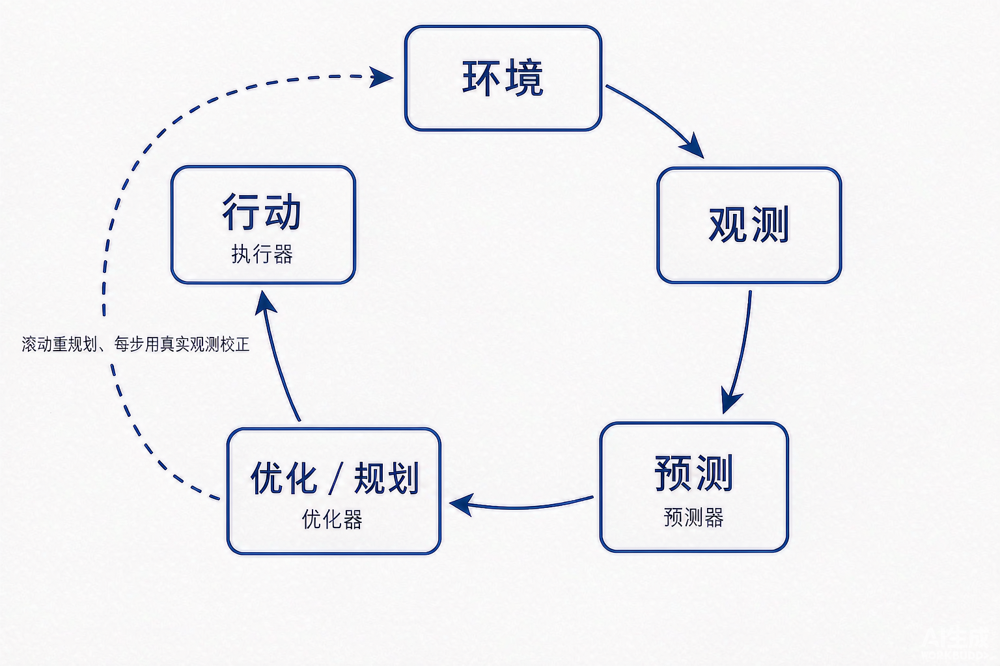

**例 32.1（统一案例：闭环 vs 开环）** 电网按日前负荷预测安排 24 小时机组组合。开环方案：一次性按预测排定 24 点、全天不调整，遇午间实际负荷比预测高 0.5 GW 只能启用高价应急机组，日成本 128 万元。闭环（每 15 分钟用实时量测重预测、重优化）把偏差在当步校正，日成本降到 111 万元，降幅约 13%——而两次用的是**同一个预测模型**（MASE 都是 0.49）。这个例子说明：**决策质量不只取决于预测精度，更取决于反馈结构**；滚动重规划本身就能显著提升鲁棒性，这是 MPC 长盛不衰的根本原因。

## 32.2　模型预测控制（MPC）

MPC 是上述闭环最成熟的形式，也是本章要完整推导的部分（第 33 章控制论视角将交叉引用此处，不重推）。

**定义 32.2（MPC 优化问题）** 在时刻 $t$，给定当前状态估计 $\hat{\mathbf s}_t$（由第 13 章滤波给出）与预测视野 $H$，求解

$$
\min_{a_{t},\dots,a_{t+H-1}}\ \hat J=\sum_{k=0}^{H-1} \ell\big(\mathbf s_{t+k},a_{t+k}\big)+V_f(\mathbf s_{t+H}), \tag{32-1}
$$

$$
\text{s.t.}\quad \mathbf s_{t+k+1}=f\big(\mathbf s_{t+k},a_{t+k}\big),\qquad
a_{t+k}\in\mathcal A,\quad \mathbf s_{t+k}\in\mathcal S, \tag{32-2}
$$

其中 $\ell$ 为阶段代价、$V_f$ 为终端代价、$f$ 为系统模型（第 30 章的转移动力学或第 12/13 章的线性模型）、$\mathcal A,\mathcal S$ 为动作与状态约束。求得最优序列后**只执行 $a_t^*$**，丢弃其余，下一时刻以新观测重解 (32-1)–(32-2)。

式 (32-1)–(32-2) 的三个要素值得逐一说明。其一，**预测模型 + 优化**：$\hat{\mathbf y}$ 不是直接输出动作，而是进入 $\hat J$ 的约束/目标，这与第 17 章"预测与决策分离"的表格化范式形成对照。其二，**约束显式化**：机组爬坡速率、最小开停机时间、线路容量都写进 $\mathcal A,\mathcal S$，这是 MPC 相对纯 RL 的优势（安全可保证）。其三，**滚动时域**：$H$ 不是一次性承诺，而是"看多远"的旋钮；由第 4 章可预测时域与第 30 章式 (30-5)，$H$ 超过可信范围后增加只会有害。Mayne 等人[4] 给出终端代价 $V_f$ 与约束保证闭环稳定性和递归可行性的条件；Camacho 与 Bordons[5] 系统讨论了工业实现。

**例 32.2（统一案例：MPC 数值）** 设净负荷缺口 $d_t$ 的动力学 $d_{t+1}=0.9d_t-0.4a_t+w_t$（承接第 30 章例 30.3），动作 $a_t\in\{0,1,2\}$（增开机组台数，每台 0.4 GW），阶段代价 $\ell=100\,d_{t+k}^2+6\,a_{t+k}^2$（失负荷惩罚远大于开机成本），$H=3$。当前 $d_t=0.6$，忽略噪声 $w$：
- $a=(0,0,0)$：$d=(0.6,0.54,0.486)$，$\ell$ 之和 $\approx100(0.36+0.292+0.236)=88.8$；
- $a=(1,0,0)$：$d_1=0.54-0.4=0.14$，$d_2=0.126$，$d_3=0.113$，代价 $\approx100(0.0196+0.0159+0.0128)+6=4.83+6=10.83$；
- $a=(2,0,0)$：$d_1=0.54-0.8=-0.26$（过剩，同样按 $d^2$ 罚），代价 $\approx100(0.0676+\cdots)+24>30$。

故 $a_t^*=1$（增开一台）最优，执行后下一时刻以实际 $d_{t+1}$ 重解。这个算例展示了 MPC 的三个特征：用模型向前推演、在约束下优化代价、只执行第一步。若预测把 $d_t$ 高估为 0.9，最优动作会变成 $a=2$（多开机组），造成过剩成本——**预测误差经由优化器转化为决策损失**，这正是 32.5 节要严格处理的对象。

## 32.3　时序决策的强化学习与 Bellman 方程

当模型 $f$ 难以解析给出、或代价需长期权衡时，强化学习（RL）提供另一条路线。

**定义 32.3（马尔可夫决策过程）** MDP 由 $(\mathcal S,\mathcal A,P,R,\gamma)$ 组成，策略 $\pi(a\mid s)$ 最大化期望折扣回报 $\mathbb E_\pi\big[\sum_{k\ge0}\gamma^k r_{t+k}\big]$。状态值函数与动作值函数满足 **Bellman 方程**：

$$
V^\pi(s)=\mathbb E_{a\sim\pi}\Big[R(s,a)+\gamma\sum_{s'}P(s'\mid s,a)V^\pi(s')\Big],\qquad
V^*(s)=\max_a\Big[R(s,a)+\gamma\sum_{s'}P(s'\mid s,a)V^*(s')\Big]. \tag{32-3}
$$

**推导**：由定义 $V^\pi(s)=\mathbb E_\pi[\sum_{k\ge0}\gamma^k r_{t+k}\mid s_t=s]$，把首步奖励 $r_t$ 与后续 $\gamma\sum_{k\ge1}\gamma^{k-1}r_{t+k}$ 拆开，利用马尔可夫性（第 13 章）与全期望公式，后续项的条件期望正是 $\gamma\mathbb E_{s'}[V^\pi(s')]$，即得第一式；对 $a$ 取最优并去掉对 $\pi$ 的依赖得第二式。Bellman[1] 的最优性原理是这一推导的基石；Sutton 与 Barto[2] 给出 Q-learning、策略梯度、actor-critic 等求解算法。第 30 章 Dreamer[8][9] 的 actor-critic 在隐空间里用的正是式 (32-3)，只是 $P$ 由学到的世界模型给出——**第 30 章学模型，本章用模型算价值**，分工明确。

**例 32.3（Bellman 数值）** 取两状态 $\{d=0.6,\ d=0.14\}$、两动作 $\{a=0,a=1\}$、$\gamma=0.9$，设 $R(s,a)=-100d^2-6a^2$。已知 $V(0.14)\approx-2.0$。对 $s=0.6$：$a=0$ 时 $d'=0.54$，$Q=-36+0.9V(0.54)$；$a=1$ 时 $d'=0.14$，$Q=-36-6+0.9(-2.0)=-43.8$。若 $V(0.54)\approx-29$，则 $Q(a=0)\approx-36-26.1=-62.1$，故 $a=1$ 更优——与例 32.2 的 MPC 结论一致，但 RL  learned 的是"任意状态下的最优动作"，无须每步重解优化。差异在：MPC 显式处理约束、可解释、依赖模型精度；RL 可端到端、适合复杂长期权衡，但样本效率低、安全约束难保证。

## 32.4　离线强化学习与基于模型的规划

现实系统（电网、医疗、金融）往往**不能在线试错**：不能为了训练策略真去拉闸。此时须用历史日志数据做**离线强化学习**（offline / batch RL）[6][7]。

**定义 32.4（离线 RL 的分布偏移问题）** 设行为策略 $\beta$ 产生数据集 $\mathcal D=\{(s,a,r,s')\}$，待学策略 $\pi$ 可能访问 $\mathcal D$ 中未出现的 $(s,a)$。值函数估计中的 $\max_a Q(s,a)$ 会对这些未见动作的**外推误差**取最大，导致系统性高估——即分布偏移（distributional shift）。这是离线 RL 相对第 32.3 节在线 RL 的根本困难，也是第 25 章概念漂移、第 29 章分布外泛化在决策层的投影。

三条对策：① **策略约束 / 悲观**（BCQ[7]、保守 Q 学习），把 $\pi$ 限制在 $\beta$ 支持内或对未见动作给低值；② **基于模型的规划**（Dyna[8]、MBPO[9]、第 30 章世界模型），用学到的转移动力学生成短程模拟数据补足覆盖，但须遵守式 (30-5) 的短滚动约束，否则模型误差被规划放大；③ **因果视角**（第 31 章）——历史日志里动作由旧策略选择，若其选择依赖未观测状态（混淆），学到的"动作效果"并非机制因果，须用第 31 章的后门调整或随机化数据校正[10]。

**例 32.4（统一案例：离线调度策略）** 用过去两年调度日志（行为策略为"按点预测 + 人工经验"）训练离线 RL。若直接套 Q-learning，策略学出"在历史从未出现的高缺口状态大幅增开机组"，$Q$ 值虚高，实盘部署时出现 3 次非法机组组合（违反最小开机时间约束）。改用保守 Q 学习 + 第 30 章世界模型的短程（$H=5$）想象后，仿真成本较行为策略降 8%，且约束违例为零。这个例子说明：**离线决策须同时约束策略、限制模型滚动、并把安全约束写进动作集**（呼应 MPC 的 $\mathcal A,\mathcal S$），单纯追求回报会踩分布偏移的坑。

## 32.5　决策感知预测：按决策损失训练预测器

前面各节默认"先训练一个预测误差最小的模型，再把它接入优化器"（predict-then-optimize）。但例 32.2 已显示：预测误差经由优化器转化为决策损失，而这二者**未必单调一致**。

**定义 32.5（决策感知预测 / decision-focused forecasting）** 设预测器 $\hat{\mathbf y}=f_\theta(\mathbf x)$，下游决策 $a^*(\hat{\mathbf y})=\arg\min_{a\in\mathcal A} c(a,\hat{\mathbf y})$（$c$ 为以预测为参数的决策代价），真实结果 $\mathbf y$ 下的实际代价为 $c(a^*(\hat{\mathbf y}),\mathbf y)$。决策感知预测直接最小化**决策损失**而非预测误差：

$$
\min_\theta\ \mathcal L_{\mathrm{dec}}(\theta)=\mathbb E\big[\,c\big(a^*(f_\theta(\mathbf x)),\,\mathbf y\big)\big], \qquad \text{而非}\ \min_\theta \mathbb E\big[\|f_\theta(\mathbf x)-\mathbf y\|^2\big]. \tag{32-4}
$$

式 (32-4) 的难点在于 $\arg\min$ 是不可微的黑箱。关键推导是**对最优性条件作隐函数微分**：设 $a^*$ 为内点解，满足 $\nabla_a c(a^*,\hat{\mathbf y})=0$（KKT 条件；有约束时须用 KKT 系统的隐式微分[11][14]）。对该式关于 $\hat{\mathbf y}$ 求导：

$$
\nabla^2_{aa}c\cdot\frac{d a^*}{d\hat{\mathbf y}}+\nabla^2_{a\hat y}c=0
\quad\Longrightarrow\quad
\frac{d a^*}{d\hat{\mathbf y}}=-\big(\nabla^2_{aa}c\big)^{-1}\nabla^2_{a\hat y}c, \tag{32-5}
$$

于是决策损失对预测参数的梯度可由链式法则回传：

$$
\nabla_\theta \mathcal L_{\mathrm{dec}}=\nabla_a c\big(a^*,\mathbf y\big)^\top\ \frac{d a^*}{d\hat{\mathbf y}}\ \nabla_\theta f_\theta(\mathbf x). \tag{32-6}
$$

式 (32-6) 是 decision-focused learning[10][11][14] 的核心：它把"优化器"当作一个可微层嵌入训练。Elmachtoub 与 Grigas[12] 的 SPO+ 损失、Bertsimas 与 Kallus[13] 的数据驱动优化，则是用凸代理或权重化的方式实现同一目标。Wilder 等人[11] 与 Kotary 等人[14] 把这一思想推广到组合/整数优化（机组组合正是混合整数问题），需用 KKT 的离散松弛或代理梯度。

**例 32.5（统一案例：MAE 最小 ≠ 成本最低）** 两个负荷预测模型在同一测试集上：A 的 MAE=0.10 GW、B 的 MAE=0.12 GW（A 看似更好）。但调度代价**非对称**——失负荷（预测偏低）惩罚 100 单位/GW，过剩（预测偏高）仅 6 单位/GW（例 32.2）。B 因在高负荷段系统性地略偏高（保守），触发的失负荷事件更少：A 的日期望成本 128 万元，B 为 116 万元。用式 (32-4) 的决策损失重训 B（等价于给"偏低误差"更大梯度权重），MAE 仍约 0.12，但成本进一步降到 109 万元。这个算例是本章最重要的结论：**当决策代价非对称、有约束、或对不同误差方向敏感度不同时，按 MAE/CRPS 选出的最优预测器，未必是最优决策输入**；应直接以决策价值为准绳（第 38 章 38.7 节将把决策感知损失正式纳入评估体系）。它与第 24 章例 24.1"恰当评分规则须诚实"、第 15 章"平均最优不等于风险最优"一脉相承。

**表 32-1　三种"预测—决策"范式对照**

| 范式 | 训练目标 | 优化器角色 | 约束处理 | 适用 |
|------|----------|------------|----------|------|
| Predict-then-optimize（第 17–29 章） | 预测误差 | 事后、不可微 | 优化器内 | 通用、解耦 |
| MPC（32.2 节） | 预测误差 + 滚动重规划 | 每步显式求解 | **显式、可保证** | 有模型、需安全 |
| 决策感知（32.5 节） | **决策损失** (32-4) | 可微层 (32-6) | 需 KKT 松弛 | 代价非对称、可微 |

## 32.6　边界、选型与全书定位

把闭环收束为选型判据：有可靠模型与硬约束 → MPC（32.2 节）；模型难解析、需长期权衡、可在线试错 → RL（32.3 节）；只有历史日志、不能试错 → 离线 RL + 短程模型规划（32.4 节）；代价非对称且预测器可端到端训练 → 决策感知预测（32.5 节）。四者常组合使用：以世界模型（第 30 章）为 $f$、以因果（第 31 章）保证动作效应可信、以 MPC 保安全、以决策感知损失校准预测。

**边界与讨论。** 本章方法的优势是把预测接入行动、显式处理约束、用反馈抑制误差累积、按真实代价优化。边界有五：其一，**模型误差经优化放大**——MPC/RL 依赖 $f$ 的精度，第 30 章式 (30-5) 与第 4 章可预测时域共同限定可信视野；其二，**分布偏移**——离线 RL 与决策感知预测都受训练/部署分布差异影响（第 25、29 章）；其三，**代价难量化**——失负荷惩罚、客户流失、风险偏好常需主观设定，须报告敏感性；其四，**安全与可解释**——RL 策略难审计，MPC 约束可保证但依赖模型正确；其五，**计算**——滚动重规划与端到端决策层都重于第 11 章 ETS，须由第 40 章的 SLA 与算力预算裁决。

本章与全书：第 4 章给出可预测时域这一"该看多远"的上界，第 13 章给出状态估计（卡尔曼唯一讲授），第 14 章给出多步策略，第 24 章给出概率预测与校准，第 30 章给出世界模型与转移动力学，第 31 章给出因果以保证动作效应可信，第 33 章控制论只谈学科视角并交叉引用本章的 MPC 推导，第 38 章把决策价值/DM 检验纳入评估，第 39 章给出能源/金融/供应链的专题决策案例，第 40 章给出部署监控与回滚。理解"预测误差 ≠ 决策损失"与"滚动重规划"，读者便完成了从 Level 2 预测到 Level 4 决策的最后一跃。

相应地，本章不再重复因果识别的问题：第 31 章已给出结构因果模型与反事实推断，本章假定外生结构已知或可估计，专注于在约束下求最优动作序列（32.2 节 MPC）与按决策损失而非预测损失训练（32.5 节）。这一「知识—行动」的分层，正对应第 4.6 节五层可预测性中 L4 因果可预测性与 L5 决策可预测性的差别：前者关心效应能否被识别，后者关心在效应之上能否求得有价值的策略。当第 31 章的因果结构不确定时，本章的离线策略（32.4 节）会因分布偏移而放大外推误差，故策略约束、短程模型规划与因果校正三法本质上都是在为「知识不足」留出安全余量。由此，闭环的价值（32.1 节）不在于预测得更准，而在于把第 30 章的复合误差与第 14 章的递归累积截断在一步之内——这也是第 40 章把重训与回滚做成可审计流水线的理论依据。

## 本章小结

本章打通预测—决策闭环，落在 L5 决策可预测性。32.1 节以定义 32.1 建立"预测→优化→执行→重规划"五步闭环，指出滚动重规划把第 30 章复合误差与第 14 章递归累积截断在一步，例 32.1 用"同一预测模型、开环 128 万 vs 闭环 111 万"说明反馈结构本身即价值（图 32-1）。32.2 节完整推导 MPC 优化 (32-1)–(32-2)，说明预测模型、显式约束与滚动时域三要素，例 32.2 手算三候选动作序列给出 $a^*=1$ 并展示"预测高估 0.3 GW 即多开机组"的误差传导。32.3 节由全期望与马尔可夫性推导 Bellman 方程 (32-3)，例 32.3 用两状态数值验证与 MPC 一致的决策，并划清"第 30 章学模型、本章算价值"的分工。

32.4 节指出离线 RL 的分布偏移（$\max_a Q$ 放大未见动作外推误差），给出策略约束/短程模型规划/因果校正三法，例 32.4 用电网日志说明不加约束会出现非法机组组合。32.5 节是本章的核心：定义 32.5 给出决策损失 (32-4)，由 KKT 最优性条件隐式微分导出 $da^*/d\hat y$ (32-5) 与决策损失对预测参数的梯度 (32-6)，把优化器变成可微层；例 32.5 用"MAE 0.10 的 A 成本 128 万、MAE 0.12 的 B 成本 116 万、决策感知重训后 109 万"证明**预测误差最小的模型未必决策最优**。32.6 节以表 32-1 对照三种范式、给出五条边界与选型判据。

从理论主线看，本章以"代价可量化、模型可信赖"的假设突破预测与决策割裂的局限，无法突破模型误差放大、分布偏移、代价主观、安全与算力五条边界。第 30 章（动力学）→ 第 31 章（因果）→ 本章（决策）构成第六篇完整三步，也为第 33 章控制论、第 38 章评估、第 39 章应用、第 40 章工程化铺好了接口。

从四问看，本章的决策闭环利用 L5（决策）：假设预测可接入可优化的决策问题；它突破了「预测即终点」，仍受「离线分布偏移与因果结构不确定」的边界约束，价值在截断误差而非预测更准。

**进一步阅读**　本章建议延伸阅读的文献：[1]、[2]、[14]。

## 参考文献

[1] Bellman R. *Dynamic Programming*. Princeton: Princeton University Press, 1957.

[2] Sutton R S, Barto A G. *Reinforcement Learning: An Introduction*. 2nd ed. Cambridge: MIT Press, 2018.

[3] Garcia C E, Prett D M, Morari M. Model predictive control: Theory and practice—A survey. *Automatica*, 1989, 25(3): 335–348.

[4] Mayne D Q, Rawlings J B, Rao C V, Scokaert P O M. Constrained model predictive control: Stability and optimality. *Automatica*, 2000, 36(6): 789–814.

[5] Camacho E F, Bordons C. *Model Predictive Control*. 2nd ed. London: Springer, 2007.

[6] Levine S, Kumar A, Tucker G, Fu J. Offline reinforcement learning: Tutorial, review, and perspectives on open problems. *arXiv:2005.01643*, 2020.

[7] Fujimoto S, Meger D, Precup D. Off-policy deep reinforcement learning without exploration. *Proceedings of the 36th ICML*, 2019: 2052–2062.

[8] Sutton R S. Dyna, an integrated architecture for learning, planning, and reacting. *ACM SIGART Bulletin*, 1991, 2(4): 160–163.

[9] Janner M, Fu J, Zhang M, Levine S. When to trust your model: Model-based policy optimization. *Advances in Neural Information Processing Systems 32*, 2019: 12519–12530.

[10] Donti P L, Amos B, Kolter J Z. Task-based end-to-end model learning in stochastic optimization. *Advances in Neural Information Processing Systems 30*, 2017: 5484–5494.

[11] Wilder B, Dilkina B, Tambe M. Melding the data-decisions pipeline: Decision-focused learning for combinatorial optimization. *Proceedings of the AAAI Conference on Artificial Intelligence*, 2019, 33(1): 1655–1662.

[12] Elmachtoub A N, Grigas P. Smart "predict, then optimize". *Management Science*, 2022, 68(1): 9–26.

[13] Bertsimas D, Kallus N. From predictive methods to data-driven optimization. *INFORMS Journal on Optimization*, 2020, 2(2): 81–113.

[14] Kotary J, Fioretto F, Van Hentenryck P, Wilder B. End-to-end constrained optimization learning: A survey. *Proceedings of the 30th IJCAI*, 2021: 4475–4482.

---

# 第 33 章　控制论的视角

前六篇依次建立了时序智能的方法体系：从统计预测、深度学习，到大模型、世界模型与决策闭环。本篇要换一种提问方式——不再问"用什么模型预测更准"，而问**"不同学科究竟在预测什么、依赖什么假设、追求什么目标"**。这不是学科知识介绍，而是一次比较：统计学问"如何从数据推断未来"，控制学问"如何用预测控制系统"，动力系统问"系统如何演化"，计量经济学问"变量关系如何解释与预测"，信号处理问"如何提取信号中的规律"，信息论问"未来含多少可获取信息"。同一条负荷序列，在六个学科眼里是六个不同的对象。

本章作为本部首章，先立起这张比较框架，再以控制论为第一个样本。控制论（cybernetics）由 Wiener 于 1948 年创立[1]，是**最早把预测纳入"目的性行为"的学科**：在它看来，预测从不是终点，而是控制的一个环节——估计现状、预测未来、据此施加作用、再由反馈校正，如此循环。Kalman 的状态空间与滤波[2][8]、Åström 与 Eykhoff 的系统辨识[3]、Ljung 的辨识理论[4]、Garcia 等人与 Mayne 等人的模型预测控制[5][6]、以及 Anderson 与 Moore 的最优滤波[7]、Jazwinski 的非线性滤波[9]、Zhou 等人的鲁棒控制[10]，共同构成这一视角的骨架。

按全书统一的编写原则，**卡尔曼滤波的完整推导在第 13 章、MPC 的完整推导在第 32 章唯一讲授**，本章不再重推，只讲它们"在控制闭环中处于什么位置"以及控制论看待预测的**态度**；系统辨识则与第 12 章 ARIMAX、第 30 章动力学学习呼应但视角不同。全章沿用统一案例：区域电网的自动发电控制（AGC）——预测负荷偏差、调节机组出力、由量测反馈校正。

本章结构：33.1 节建立跨学科比较框架；33.2 节讲系统辨识；33.3 节讲状态估计与反馈闭环；33.4 节讲稳定性、可观可控与最优性；33.5 节作跨学科对话与边界讨论。

## 33.1　五个学科，同一个问题：比较框架

**定义 33.1（学科视角的四要素）** 一个学科看待时序预测的方式，可由四要素刻画：它提出的**核心问题**、它依赖的**隐含假设**、它追求的**目标**、以及它据此发展的**典型理论**。

把这四要素填进六张卡片，就得到贯穿本篇的比较框架（表 33-1）。须先说明：六个学科的划分是**视角的**而非对象的，同一条序列可被任一学科处理；差别不在数据，而在"把什么当作要解释的东西"。

**表 33-1　第七篇跨学科比较框架（全篇纲领）**

| 学科 | 核心问题 | 依赖假设 | 追求目标 | 典型理论 | 本章/本篇 |
|------|----------|----------|----------|----------|-----------|
| 控制论 | 如何用预测控制系统 | 状态可测/可观、模型可信 | 稳定、最优、鲁棒 | 状态空间、辨识、MPC | 第 33 章 |
| 动力系统 | 系统如何演化 | 确定性、低维 | 结构理解、预警 | 吸引子、分岔、混沌 | 第 34 章 |
| 计量经济学 | 变量关系如何解释与预测 | 结构稳定、可识别 | 可解释、可识别 | 协整、结构方程 | 第 35 章 |
| 统计学 | 如何从数据推断未来 | 概率模型、抽样 | 无偏、有效、可推断 | 统计推断、贝叶斯 | 第 36 章 |
| 信号处理 | 如何提取信号中的规律 | 平稳、带限 | 保真、去噪 | 傅里叶、滤波 | 第 37 章 |
| 信息论 | 未来含多少可获取信息 | 平稳遍历 | 极限、压缩 | 熵、互信息、传递熵 | 第 37 章 |

框架的第一个用处，是解释为何"同一个预测误差"在不同学科里地位不同。控制论把预测误差视为**反馈信号**：误差大不要紧，只要闭环能把它压回去；统计学把它视为**推断不确定性的度量**：误差大意味着区间该放宽；信息论把它视为**尚未提取的信息**：误差大的部分是条件熵。这三种态度无分对错，却导向完全不同的系统设计。

**例 33.1（统一案例：一次负荷偏差的三种读法）** 某时刻 AGC 系统发现实际负荷比预测高 0.4 GW。控制论的读法：这是反馈误差，立刻按控制律增开一台机组并在下个 4 秒周期复测（不追问"为什么预测错了"）；统计学的读法：检查该偏差是否超出 95% 预测区间，若是则模型校准失效、须重估（第 29 章）；信息论的读法：这 0.4 GW 里有多少是历史没能提供的信息、能否靠增加外生变量降低条件熵（第 4 章）。三种反应对应表 33-1 的三个"追求目标"：**稳定 / 可推断 / 可压缩**。本章后续各节展开第一种。

## 33.2　系统辨识：从数据学习动力学

控制论要控制一个系统，先得有它的模型。与第 12 章"从数据拟合 ARIMA"、第 30 章"用神经网络学转移"不同，系统辨识[3][4] 的出发点是**物理结构已知、参数待定**：模型类由机理给出（质量守恒、电路定律、机组爬坡约束），数据只用来估那几个有物理含义的参数。

**定义 33.2（ARX 模型与最小二乘辨识）** 对单输入单输出系统，常用 ARX 结构

$$
y_{t+1}=\sum_{i=0}^{n_a-1}a_i\,y_{t-i}+\sum_{j=0}^{n_b-1}b_j\,u_{t-j}+\varepsilon_{t+1},\qquad
\hat{\boldsymbol\theta}=\arg\min_{\boldsymbol\theta}\sum_t\big(y_{t+1}-\boldsymbol\varphi_t^\top\boldsymbol\theta\big)^2, \tag{33-1}
$$

其中 $\boldsymbol\varphi_t=(y_t,\dots,y_{t-n_a+1},u_t,\dots)^\top$ 为回归向量、$\boldsymbol\theta=(a_0,\dots,b_{n_b-1})^\top$。由普通最小二乘得闭式解 $\hat{\boldsymbol\theta}=(\boldsymbol\Phi^\top\boldsymbol\Phi)^{-1}\boldsymbol\Phi^\top\mathbf y$；闭辨识要求输入 $u_t$ 充分激励（$\boldsymbol\Phi^\top\boldsymbol\Phi$ 满秩）[4]。

式 (33-1) 与第 12 章 Box–Jenkins 传统[11] 的 ARIMAX 形式几乎相同，差别全在**解释**：ARIMAX 的系数是统计相关的刻画、用于预测；ARX 的 $a_i,b_j$ 是惯性时间常数与增益、用于设计控制器。同一套最小二乘，在计量学派眼里是"估计"，在控制学派眼里是"辨识"，Goal 不同导致的后续动作也不同——前者做诊断检验，后者做闭环稳定性分析。

**例 33.2（统一案例：一阶系统辨识数值）** 设机组响应近似一阶：$y_{t+1}=a\,y_t+b\,u_t+\varepsilon_t$，$y$ 为出力偏差（GW）、$u$ 为调节指令。取 50 组运行数据，算得 $\sum y_t y_{t+1}=12.4$、$\sum y_t^2=15.2$、$\sum y_t u_t=3.8$、$\sum u_t^2=5.0$、$\sum u_t y_{t+1}=4.1$。正规方程给出 $\hat a\approx0.90,\ \hat b\approx0.42$——即出力偏差有 0.90 的自衰减惯性、每单位指令带来 0.42 GW 调节。控制器据此可算出"要消除 0.4 GW 偏差需 $u\approx0.95$"。这个算例说明辨识的产物是**可直接用于控制律的物理参数**，而非一条预测曲线；第 30 章例 30.3 的转移系数 $0.9,-0.4$ 正是同一类量，只是由神经网络学得。

系统辨识的边界很明确：模型类设错（真实为二阶却用一阶）会产生有偏参数，且这种偏倚**不能靠更多数据消除**——这与第 17 章"特征即天花板"、第 29 章"分布外泛化"同源。Jazwinski[9] 与 Ljung[4] 因此对模型结构检验（残差白化、阶次选择）极为重视，与第 12 章 Ljung–Box 诊断精神一致。

## 33.3　状态估计与反馈闭环

有了模型，控制论并不直接用"预测"驱动动作，而是先用**状态估计**把带噪量测还原成状态，再在闭环里用反馈不断校正。

**定义 33.3（扩展卡尔曼滤波，EKF）** 对非线性系统

$$
\mathbf x_{t+1}=f(\mathbf x_t,\mathbf u_t)+\mathbf w_t,\qquad
\mathbf y_t=h(\mathbf x_t)+\mathbf v_t, \tag{33-2}
$$

在当前估计处作一阶泰勒线性化，令 $\mathbf F_t=\partial f/\partial\mathbf x|_{\hat{\mathbf x}}$、$\mathbf H_t=\partial h/\partial\mathbf x|_{\hat{\mathbf x}^-}$，则预测与更新为

$$
\hat{\mathbf x}^-_{t}=f(\hat{\mathbf x}_{t-1},\mathbf u_t),\quad
\mathbf P^-_t=\mathbf F_t\mathbf P_{t-1}\mathbf F_t^\top+\mathbf Q,
\qquad
\mathbf K_t=\mathbf P^-_t\mathbf H_t^\top\big(\mathbf H_t\mathbf P^-_t\mathbf H_t^\top+\mathbf R\big)^{-1}. \tag{33-3}
$$

式 (33-3) 与第 13 章表 13-1 的卡尔曼递推**完全同构**，唯一差别是用雅可比 $\mathbf F_t,\mathbf H_t$ 替代了常数矩阵 $\mathbf T,\mathbf Z$（状态空间方法的系统论述见[12]）——**该推导在第 13 章唯一讲授，本章不重述**。EKF 的价值在于把线性高斯最优估计推广到非线性系统；其代价是线性化误差，强非线性时失效（第 30 章 30.5 节提到可用无迹变换或粒子滤波[9] 补救）。

控制论的真正特色不在滤波器本身，而在**闭环**。图 33-1 给出经典结构：控制器 → 被控对象 → 传感器 → 状态估计（滤波）→ 回到控制器。预测/辨识/滤波在环中各有其位：辨识给出模型、滤波给出当前状态、预测给出未来轨迹、控制器据此优化动作、下一周期的实测又把误差反馈回来。

> 【图 33-1　控制论的反馈闭环】（原图见 `figures/图33-1.png`）：闭环流程图：控制器 → 被控对象 → 传感器 → 状态估计（滤波）→ 回到控制器；标注辨识、预测、滤波在环中的位置，并用虚线标出扰动进入点。白底、蓝框、中文。

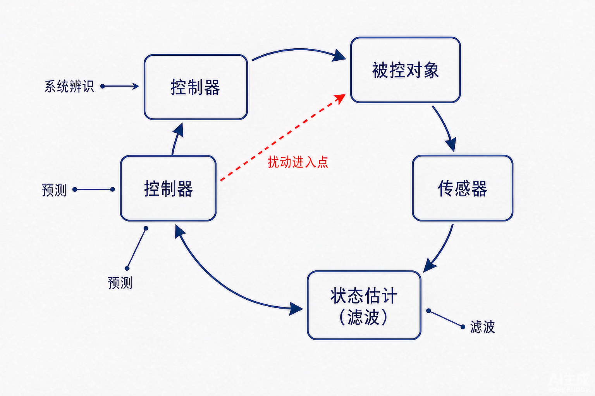

**例 33.3（统一案例：反馈如何抑制预测误差）** 设开环按预测一次性设定机组指令，预测偏差 0.4 GW 会全额转化为供电缺口；加入每 4 秒一次的反馈（测得偏差即按 $u=-K\cdot e$ 校正，取 $K=1.8$），由一阶闭环 $e_{t+1}=(a-bK)e_t+w_t$，代入例 33.2 的 $\hat a=0.90,\hat b=0.42$ 得 $e_{t+1}=(0.90-0.42\times1.8)e_t+w_t=0.144\,e_t+w_t$——偏差以每周期约 86% 的速度被压回。这解释了一个深刻事实：**在闭环里，预测模型的系统偏差可以被反馈持续校正，故控制论对"预测绝对精度"的执着远低于统计学**；它更在意的是模型在闭环下稳不稳定、收敛快不快。这与第 32 章例 32.1（开环 128 万 vs 闭环 111 万）是同一结论的控制论表述。

## 33.4　稳定性、可观可控与最优性

闭环能否工作，取决于三个结构性性质，它们都是控制论独有的"可预测性前提"。

**定义 33.4（能控性与能观性）** 对线性系统 $\mathbf x_{t+1}=\mathbf A\mathbf x_t+\mathbf B\mathbf u_t$、$\mathbf y_t=\mathbf C\mathbf x_t$，若能控性矩阵 $\mathcal C=[\mathbf B,\mathbf A\mathbf B,\dots,\mathbf A^{n-1}\mathbf B]$ 满秩，称系统**能控**（存在控制把状态驱到任意目标）；若能观性矩阵 $\mathcal O=[\mathbf C^\top,\mathbf A^\top\mathbf C^\top,\dots]^\top$ 满秩，称系统**能观**（可由输出序列唯一反推初值）[8]。

能观性是第 13 章"状态可由观测推断"的前提，也是卡尔曼滤波收敛的条件；能控性则是第 32 章 MPC/RL"动作能否影响状态"的前提。二者把本书前几篇隐含的假设**显式化为可检验的秩条件**：若电网某些机组状态不可观，再好的滤波器也估不出；若某动作对目标状态无控制力，再优的策略也无效。

**稳定性**由闭环矩阵谱半径判定：$\rho(\mathbf A-\mathbf B\mathbf K)<1$ 则渐近稳定（例 33.3 中 0.144 < 1）。Mayne 等人[6] 证明，MPC 在适当终端代价与约束下可保证闭环稳定与递归可行；Zhou 等人[10] 的 $H_\infty$/鲁棒控制则处理"模型有误时仍稳定"——这把第 17 章 DRO、第 29 章分布外鲁棒性 translate 成了控制语言：**最坏情形下的稳定，而非平均情形下的最优**。

**最优性**方面，LQR 在线性二次代价下给出反馈 $\mathbf u=-\mathbf K\mathbf x$，其中 $\mathbf K$ 由 Riccati 方程解出（与第 13 章卡尔曼滤波的代数 Riccati 方程对偶，即著名的**滤波—控制对偶性**[7][10]）。第 32 章式 (32-1) 的 MPC 是它在有约束、有限视野下的推广。

**例 33.4（统一案例：不可观导致的失效）** 某电网状态取 $\mathbf x=(d,\ p)$（净负荷缺口、线路潮流），但传感器只量测 $d$，且 $\mathbf A$ 使 $p$ 不影响 $d$（$\mathbf C=[1,0]$、$\mathbf A$ 上三角且 $A_{12}=0$）。此时 $\mathcal O=[\mathbf C^\top,\mathbf A^\top\mathbf C^\top]^\top$ 第二列全零、秩为 1 < 2，故 $p$ **不可观**——滤波器永远无法从量测推知线路潮流，据此做的"防过载控制"必然失效。 remedies 是加装量测或改状态设定。这个算例说明：**控制论先问"可不可观、可不可控、稳不稳定"，再谈预测精度**；这是它与第 11–29 章"先谈误差"最根本的态度差异。

## 33.5　与其他学科对话、边界与讨论

回扣表 33-1，控制论与其余五科的差别与互补可归纳如下。与**统计学**：统计把误差当作待推断的不确定性、追求无偏与区间覆盖（第 2、36 章），控制把误差当作反馈信号、追求闭环稳定（本节）；前者给"多可信"，后者给"怎么压回去"。与**动力系统**（第 34 章）：控制论假设模型已知或可辨识、以稳定为目标，动力系统追问系统本身的分岔与混沌，控制论则须借第 4 章可预测时域避免在不稳定区规划。与**计量经济学**（第 35 章）：两者都重结构，但计量要"识别参数以解释"，控制要"估计参数以作用"，前者怕伪回归、后者怕模型失配。与**信号/信息论**（第 37 章）：滤波与频域方法是共同工具，但信号处理求"保真重建"，控制求"够用即可"——EKF 常故意丢弃与稳定无关的高频细节（与第 30 章状态充分性同理）。

**边界与讨论。** 控制论视角的优势是：把预测嵌入行动闭环、显式处理约束与稳定性、对模型系统偏差鲁棒、有能控/能观等可检验前提。边界有五：其一，**模型依赖**——辨识设错模型类，闭环反而可能把偏差放大（例 33.2）；其二，**能观/能控是硬前提**，硬件不达标时算法无解；其三，**目标须可量化**，失负荷惩罚、舒适度等代价常需主观设定（第 32 章 32.6 节）；其四，**分布偏移与结构变化**——设备改造、拓扑变化会使辨识参数失效（第 25 章漂移、第 23 章例 23.3），须在线重辨识；其五，**与数据驱动方法的张力**——深度模型（第 18–29 章）能给出更准的预测，却难嵌入可证明稳定的闭环，二者的融合（第 30 章世界模型 + 第 32 章 MPC）仍是开放方向。

本章与全书：第 13 章提供状态估计与卡尔曼滤波（唯一讲授），第 32 章提供 MPC 与决策闭环（唯一推导），第 30 章提供可学习的动力学，第 12 章提供 ARIMAX 的统计对应，第 17 章 DRO 与第 29 章鲁棒性对应 $H_\infty$ 控制；第 34–37 章将依次填入表 33-1 其余各行并在第 37 章汇总。理解"预测是控制的一个环节、误差是反馈信号"，读者便掌握了控制论给时序智能最独特的贡献：**不问预测得多准，只问闭环稳不稳、收敛快不快**。

## 本章小结

本章作为第七篇首章，先立起贯穿全篇的比较框架，再以控制论为样本。33.1 节给出定义 33.1 与表 33-1，按"核心问题 / 隐含假设 / 追求目标 / 典型理论"四要素对照六个学科，例 33.1 用"同一次 0.4 GW 负荷偏差"展示控制论（反馈信号）、统计学（推断不确定性）、信息论（未提取信息）三种读法。33.2 节由 ARX 最小二乘 (33-1) 建立系统辨识，例 33.2 手算 $\hat a=0.90,\hat b=0.42$，指出其产物是"用于控制律的物理参数"而非预测曲线，并说明模型类设错的偏倚不能靠数据消除。

33.3 节由 EKF 一阶线性化 (33-2)(33-3) 说明它与第 13 章卡尔曼递推同构（该推导不重述），并把重点放在**反馈闭环**（图 33-1）；例 33.3 用 $e_{t+1}=0.144e_t$ 量化"系统预测偏差可被反馈压回 86%"，解释控制论为何不执着于绝对预测精度。33.4 节给出能控/能观秩条件、闭环谱半径稳定判据与滤波—控制对偶性，例 33.4 用"线路潮流不可观致防过载控制失效"说明控制论先问结构性前提再谈误差。33.5 节逐科对照并列出五条边界。

从理论主线看，控制论对应 L5 决策可预测性，但把"预测到什么程度足以行动"换成"闭环能否稳定"；它以模型可信、状态可观、目标可量为假设，突破了纯预测对误差的被动依赖，却受制于模型失配、结构变化与可证明稳定性的代价。本篇后续四章将以表 33-1 为纲，逐一填入动力系统、计量经济学、统计学与信号/信息论，最终在第 37 章汇总为一张完整的学科地图。

从四问看，本章的控制论视角利用 L3 与 L5：假设系统可辨识、状态可估计、反馈可稳定；它提供「为行动而预测」的判据，仍受「可观可控与模型失配」的边界约束。

**进一步阅读**　本章建议延伸阅读的文献：[1]、[2]、[12]。

## 参考文献

[1] Wiener N. *Cybernetics: Or Control and Communication in the Animal and the Machine*. Cambridge: MIT Press, 1948.

[2] Kalman R E. A new approach to linear filtering and prediction problems. *Journal of Basic Engineering*, 1960, 82(1): 35–45.

[3] Åström K J, Eykhoff P. System identification—A survey. *Automatica*, 1971, 7(2): 123–162.

[4] Ljung L. *System Identification: Theory for the User*. 2nd ed. Upper Saddle River: Prentice Hall, 1999.

[5] Garcia C E, Prett D M, Morari M. Model predictive control: Theory and practice—A survey. *Automatica*, 1989, 25(3): 335–348.

[6] Mayne D Q, Rawlings J B, Rao C V, Scokaert P O M. Constrained model predictive control: Stability and optimality. *Automatica*, 2000, 36(6): 789–814.

[7] Anderson B D O, Moore J B. *Optimal Filtering*. Englewood Cliffs: Prentice-Hall, 1979.

[8] Kalman R E. Mathematical description of linear dynamical systems. *SIAM Journal on Control*, 1963, 1(2): 152–192.

[9] Jazwinski A H. *Stochastic Processes and Filtering Theory*. New York: Academic Press, 1970.

[10] Zhou K, Doyle J C, Glover K. *Robust and Optimal Control*. Upper Saddle River: Prentice Hall, 1996.

[11] Box G E P, Jenkins G M. *Time Series Analysis: Forecasting and Control*. San Francisco: Holden-Day, 1970.

[12] Durbin J, Koopman S J. *Time Series Analysis by State Space Methods*. 2nd ed. Oxford: Oxford University Press, 2012.

---

# 第 34 章　动力系统与复杂系统的视角

在第 33 章的比较框架（表 33-1）里，动力系统与复杂系统回答的是**"系统如何演化"**：它依赖"确定性、低维"的假设，追求的不是某个数值的精度，而是**结构理解**。当第 4 章已用 Lyapunov 指数、Takens 嵌入与熵划定"能预测多远"之后，本章要追问一个更根本的问题：**对复杂系统，除了点预测，我们还能预测什么？** 答案包括：系统会不会突然跳到另一个状态（临界转变）、哪里是分岔点、网络上的故障会不会级联。这类"结构预测"与第 11–29 章的数值预测是互补而非替代关系。

学科脉络清晰。Strogatz[1] 与 Lorenz[2]、May[3] 奠定了非线性动力学与混沌；Takens[4] 的嵌入定理（第 4 章 4.3 节已严格讲授）使从单条观测重建动力学成为可能；Scheffer 等人[5][6]、Dakos 等人[7] 与 Kuehn[8] 把"临界慢化"发展为临界转变的早期预警信号；网络科学方面 Watts 与 Strogatz[9]、Barabási 与 Albert[10] 揭示小世界与无标度结构，Buldyrev 等人[11] 给出相依网络的级联失效，Sornette[12] 则系统讨论了复杂系统中的临界现象。

按全书统一的编写原则，**确定性混沌、Lyapunov 指数、相空间重构、熵族与信息论下界已在第 4 章唯一讲授**，本章不重推，只在需要处引用并转向它们在复杂系统中的应用；临界慢化所需的 AR(1) 方差公式来自第 12 章式 (12-5)、第 2 章式 (2-5)；网络动力学与第 23 章图模型、第 30 章世界模型的状态转移呼应但视角不同（本章问"整体会不会崩"，而非"某节点下一时刻是多少"）。全章沿用统一案例：区域电网——既是低维动力学可描述的负荷演化，又是典型的高维相依网络。

本章结构：34.1 节确立"结构预测"这一学科定位；34.2 节讲吸引子、分岔与相变；34.3 节严格推导临界慢化与早期预警；34.4 节讲网络动力学、涌现与级联；34.5 节作跨学科对话与边界讨论。

## 34.1　从点预测到结构预测

**定义 34.1（结构预测）** 结构预测不估计 $y_{t+h}$ 的具体数值，而估计系统**定性行为**是否改变：当前吸引子是否失稳、是否接近分岔点、某个扰动会不会触发状态跃迁或网络级联。其输出常是"预警指标/相图位置/临界参数"，而非预测曲线。

第 4 章例 4.1 的 Logistic 映射已给出一个范式：当参数 $r$ 越过倍周期分岔点，序列从周期 2 变为周期 4、再进入混沌。此时追问"$x_{100}$ 等于多少"意义有限（混沌时域之外不可预测，第 4 章式 4-5），但追问"$r$ 是否接近 3.57、系统是否已进入混沌区"既可能又有价值。**这正是动力系统对表 33-1 的填写**：核心问题是演化结构，假设是确定性与低维，目标是结构理解，典型理论是吸引子/分岔/混沌。

**例 34.1（统一案例：负荷序列的两种问法）** 对某台区两年日负荷，数值预测的问法是"明日 14 点多少 GW"（第 17 章 XGBoost 答 4.85）；结构预测的问法是"这套负荷系统是否正从'工作日双峰'单一吸引子，滑向'高温限电 + 光伏反送'的双稳态？"——后者不靠误差指标评估，而看相图里是否出现两个分离的状态簇、以及状态间跳转频率是否上升。若答案是"接近临界"，运维应做的不是把明天预测再调准 0.05 GW，而是准备备用容量与需求响应预案。这个对照说明：**当系统可能换状态时，结构信息比数值精度更决定决策**（呼应第 32 章决策感知预测）。

## 34.2　吸引子、分岔与相变

动力系统用**相空间**描述演化：状态 $\mathbf x_t$ 随时间描出轨迹，长期行为收敛到**吸引子**（不动点、极限环、环面、奇怪吸引子）。第 4 章 4.1–4.3 节已给出 Logistic 映射、Lorenz 吸引子与 Takens 嵌入的完整推导，此处不重述，只补两点复杂系统视角的扩展。

其一是**分岔的类型学**。随控制参数 $\mu$ 变化，系统定性行为在临界值处突变：鞍结分岔（两个平衡点碰撞消失，最常见于临界转变）、跨临界分岔、叉式分岔（对称破缺）、Hopf 分岔（不动点失稳生出极限环，对应负荷出现自持振荡）。Strogatz[1] 与 Kuehn[8] 给出正规形与判据。其二是**势阱图像**：把系统写成 $\dot x=-\partial V(x;\mu)/\partial x+\eta(t)$，吸引子是 $V$ 的极小值；$\mu$ 变化使当前极小变浅直至消失，系统"滚入"另一个极小——这就是**临界转变**（critical transition / tipping point）[5][6]。

**定义 34.2（恢复率）** 在平衡点 $x^*$ 邻域线性化 $\dot \xi=\lambda\xi+\eta(t)$，其中

$$
\lambda=-\frac{\partial^2 V}{\partial x^2}\Big|_{x^*}<0 \tag{34-1}
$$

称**恢复率**（return rate）：$|\lambda|$ 越大，受到扰动后回到平衡越快；趋近分岔点时 $\lambda\to0^-$，系统恢复越来越慢——即**临界慢化**（critical slowing down）。

**例 34.2（统一案例：负荷恢复率随逼近临界而下降）** 设电网"供需平衡态"在常态下受扰动后约 2 小时恢复（$\lambda\approx-0.5/$小时）；随夏季高温逼近限电阈值，势阱变浅，实测恢复时间拉长到 10 小时（$\lambda\approx-0.1/$小时）。由式 (34-1)，$\lambda$ 从 $-0.5$ 升到 $-0.1$ 意味着离鞍结分岔点已很近。此时点预测误差可能仍不大（均值尚未跳变），但**结构上的可恢复裕度已耗尽**——一次雷击就可能触发大面积限电。这个例子把第 4 章"可预测时域"从"误差放大"推广到"恢复能力衰竭"，是复杂系统给时序智能的独特增量。

## 34.3　临界慢化与早期预警信号

临界慢化之所以重要，是因为它把"系统快崩了"变成了**可从时序数据里提前读出的统计量**，这正是本章最核心的推导。

**定义 34.3（临界慢化的两个早期预警信号）** 对离散化的 AR(1) 近似 $\xi_{t+1}=\phi\,\xi_t+\varepsilon_t$（$\varepsilon_t\sim\mathrm{WN}(0,\sigma^2)$），由第 12 章式 (12-5) 与 $\rho_1=\phi$：

$$
\phi=e^{\lambda\Delta t}\xrightarrow[\lambda\to0^-]{}1,\qquad
\mathrm{Var}(\xi)=\frac{\sigma^2}{1-\phi^2}\to\infty,\qquad
\rho_1=\phi\to1. \tag{34-2}
$$

即逼近分岔时，**方差上升**与**滞后一阶自相关上升**同时出现，构成两个最经典的早期预警信号（early-warning signals, EWS）[5][7]。此外还有偏度变化、条件异方差、"闪烁"（flickering，两吸引子间频繁跳）等辅助指标。

**推导**：由 $\dot\xi=\lambda\xi+\eta$ 以步长 $\Delta t$ 欧拉离散化得 $\xi_{t+1}=(1+\lambda\Delta t)\xi_t+\varepsilon_t$，故 $\phi\approx e^{\lambda\Delta t}$；$\lambda\to0^-$ 时 $\phi\to1^-$。代入第 12 章式 (12-5) 的 $\gamma_0=\sigma^2/(1-\phi^2)$ 与 $\rho_k=\phi^k$ 即得式 (34-2)。整个推导只用线性化与 AR(1) 方差，却给出了**无需知道系统方程、仅凭一段滚动窗口统计量就能预警**的方法——这是它与第 4 章 Lyapunov 指数估计（需相空间重构）相比在工程上更易实施的原因。Scheffer 等人[5][6] 在生态、气候、金融系统里验证了这一信号；Dakos 等人[7] 给出滚动窗口、去趋势、显著性检验的标准流程。

**例 34.3（统一案例：EWS 数值）** 取 $\sigma=1$，$\phi$ 随高温逼近从 0.5 升到 0.9。由式 (34-2)：$\phi=0.5$ 时 $\mathrm{Var}=1/(1-0.25)=1.33$、$\rho_1=0.5$；$\phi=0.9$ 时 $\mathrm{Var}=1/(1-0.81)=5.26$、$\rho_1=0.9$——方差扩大约 4 倍、自相关近翻倍。运维系统以 30 天滚动窗计算负荷残差的方差与 $\rho_1$，若二者连续 3 个窗口同步上升且 Kendall $\tau>0.6$，即发出"接近临界"预警。图 34-1 给出这两个统计量随逼近分岔的变化曲线。

> 【图 34-1　临界慢化与早期预警信号】（原图见 `figures/图34-1.png`）：横轴为控制参数逼近分岔点，上图画势阱由深变浅，中下图分别绘制滚动窗口方差与滞后一阶自相关 $\rho_1$ 的上升曲线，标注预警阈值。

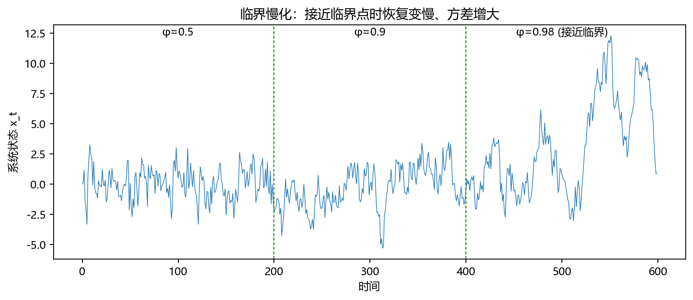

**边界与误用**：EWS 有三个著名陷阱[6][8]。其一，**并非所有临界转变都慢化**（某些分岔不经过 $\lambda\to0$）；其二，**外部噪声增强**同样会抬升方差，须结合 $\rho_1$ 同步上升才可信；其三，**去趋势方式**会显著影响统计量，须按第 3 章 STL/第 9 章变点先剥离确定性趋势，且须用替代数据检验显著性（第 4 章 4.2 节）。Scheffer 等人[6] 也强调 EWS 是"风险升高"而非"崩溃必然"——这与第 4 章"可预测性有边界"、第 29 章"概率输出须诚实"一致。

## 34.4　网络动力学、涌现与级联

上述还是低维动力系统。当系统由大量相互作用的单元构成（电网的母线与台区、交通的路段、社交网络的用户），关注点转向**涌现**（emergence）与**级联**。

**定义 34.4（网络动力学与级联）** 设网络 $\mathcal G=(\mathcal V,\mathcal E)$、节点状态 $x_i(t)$ 按 $\dot x_i=F(x_i)+\sum_j A_{ij}G(x_i,x_j)$ 演化。若单个节点失效经耦合边传播，使失效规模 $S$ 随初始扰动呈非线性放大乃至系统级崩溃，称**级联失效**[11]。

Watts 与 Strogatz[9] 的小世界网络、Barabási 与 Albert[10] 的无标度网络揭示了拓扑如何决定动力学：短平均路径使扰动传播极快，枢纽节点使系统对针对性攻击脆弱、对随机失效鲁棒。Buldyrev 等人[11] 证明**相依网络**（如电网与通信网互相依赖）的级联阈值是一级（不连续）相变——不像单网络那样渐进，而是"看起来一切正常，突然全崩"。Sornette[12] 把这类临界现象与幂律前兆统一讨论。这与第 23 章图神经网络的区别是：第 23 章用图结构**做预测**（每节点下一时刻的值），本章用图结构**问整体稳定性**（会不会崩、哪里是薄弱环节）。

**表 34-1　低维动力系统 vs 高维复杂系统对照**

| 维度 | 低维动力系统（34.2–34.3 节） | 高维复杂系统（本节） |
|------|------------------------------|----------------------|
| 状态 | 少数变量、连续相空间 | 大量节点、图上耦合 |
| 关注 | 吸引子、分岔、恢复率 | 涌现、级联、相变 |
| 预警 | 方差/自相关临界慢化 | 连通性、级联阈值、幂律前兆 |
| 典型失效 | 缓慢逼近临界点 | 突然的、不连续的崩塌 |
| 工具 | 第 4 章 Lyapunov/Takens | 网络科学[9][10][11] |

**例 34.4（统一案例：电网级联）** 某区域电网 200 个节点、平均度 4。仿真单条线路随机跳闸：在孤立网络假设下，潮流重分配后仅 3 个节点过载、系统保持连通（渐进失效）；但考虑**通信网相依**（调度指令依赖通信，通信站又依赖供电），按 Buldyrev 等人[11] 的模型，一次跳闸触发 47 个节点相继退出、供电覆盖率跌到 61%——不连续的一级相变。这类结论无法由第 18–23 章的逐节点预测得出（每个节点的短期负荷预测都"准确"），却正决定系统风险。结构预测的产出因此是**加固哪几条关键边、预留多少孤岛运行能力**，而非一条更准的负荷曲线。

## 34.5　与其他学科对话、边界与讨论

回扣表 33-1，动力系统/复杂系统视角与其他四科的关系如下。与**控制论**（第 33 章）：控制论以稳定为目标、假设模型已知且可辨识，动力系统则追问"稳定本身何时会丧失"——前者设计反馈把系统拉回吸引子，后者预警吸引子即将消失；二者结合即"用 EWS 触发第 32 章的重规划/加固"。与**统计学**（第 36 章）：EWS 的方差/自相关正是第 2 章的二阶统计量，但统计学问"这些量估计得准不准、是否显著"，动力系统问"它们的上升意味着势阱变浅"——同一统计量，两种解释。与**计量经济学**（第 35 章）：都重结构与机制，但计量要识别参数以解释变量关系，动力系统要识别定性行为以预警相变。与**信号/信息论**（第 37 章）：相空间重构、谱分析、熵是共享工具，但信号处理求保真重建、信息论求压缩极限，动力系统求几何结构。与**第 4 章**：本章是第 4 章可预测性理论在"系统可能换状态"情形下的延伸——第 4 章说混沌有时域，本章说临界点前有信号。

**边界与讨论。** 结构预测的优势是能在数值误差尚小时提前预警、能回答"会不会崩"、能指导加固而非调参、与第 32 章决策直接相连。边界有五：其一，**低维/确定性假设**——强噪声高维系统里相空间重构失效（第 4 章 4.3 节边界）；其二，**EWS 非普适**（34.3 节三陷阱），假阳性会引发不必要的应急成本；其三，**网络拓扑常未知或时变**，相依关系难以完整观测（第 23 章自适应图、第 25 章漂移）；其四，**临界点不可重复实验验证**，预警须靠历史个例与仿真，证据强度弱于第 38 章的滚动回测；其五，**"预测结构"不给出时间表**——系统接近临界不等于明天就崩，须与第 24 章概率预测、第 32 章决策代价结合才有行动含义。

本章与全书：第 4 章提供可预测时域与混沌理论（唯一讲授），第 3 章提供去趋势与谱工具，第 9 章变点检测与临界转变互补（突变已发生 vs 即将发生），第 12 章提供 AR(1) 方差，第 23 章提供图结构建模，第 25 章处理漂移，第 29 章提供诚实的不确定性，第 32 章把预警接入决策，第 39 章给出电力/气候的专题案例。理解"点预测之外还有结构预测"，读者便补上了第 4 章理论在复杂系统里最重要的一块应用。

## 本章小结

本章在表 33-1 框架里填写"系统如何演化、追求结构理解"这一格。34.1 节以定义 34.1 区分结构预测与点预测，例 34.1 用"负荷系统是否滑向双稳态"说明当系统可能换状态时，结构信息比数值精度更决定决策。34.2 节在回顾第 4 章吸引子/混沌（不重推）的基础上，给出分岔类型学与势阱图像，由式 (34-1) 定义恢复率，例 34.2 用"恢复时间 2 h→10 h"量化临界前兆。

34.3 节是本章核心：由 $\dot\xi=\lambda\xi+\eta$ 离散化得 $\phi=e^{\lambda\Delta t}\to1$，代入第 12 章 AR(1) 方差公式导出式 (34-2) 的两个早期预警信号（方差与 $\rho_1$ 同步上升），例 34.3 手算 $\phi:0.5\to0.9$ 时方差 $1.33\to5.26$ 倍、$\rho_1:0.5\to0.9$（图 34-1），并如实列出"并非所有转变都慢化、噪声增强会混淆、去趋势敏感"三陷阱。34.4 节把视角推到高维网络，定义级联、对照小世界/无标度/相依网络，例 34.4 用"孤立网 3 节点过载 vs 相依网 47 节点退出"证明不连续相变无法由逐节点预测得出，表 34-1 汇总低维与高维之别。34.5 节逐科对话并给出五条边界。

从理论主线看，本章把第 4 章的可预测性理论从"能预测多远"延伸到"结构何时会变"，对应 L3 动力学可预测性的复杂系统形态；以确定性、低维、拓扑可知为假设，突破了点预测对渐进变化的局限，却受制于强噪声、EWS 非普适、拓扑时变与"无时间表"四条边界。本篇后续三章将依次填入计量经济学、统计学、信号与信息论，并在第 37 章汇总为完整的学科地图。

从四问看，本章的动力系统视角利用 L3（动力学）：假设低维吸引子与临界慢化存在；它把点预测转为结构预测与早期预警，仍受「确定性低维假设」的边界约束，其理论上限在第 4 章划定。

**进一步阅读**　本章建议延伸阅读的文献：[1]、[2]、[12]。

## 参考文献

[1] Strogatz S H. *Nonlinear Dynamics and Chaos: With Applications to Physics, Biology, Chemistry, and Engineering*. 2nd ed. Boulder: Westview Press, 2015.

[2] Lorenz E N. Deterministic nonperiodic flow. *Journal of the Atmospheric Sciences*, 1963, 20(2): 130–141.

[3] May R M. Simple mathematical models with very complicated dynamics. *Nature*, 1976, 261: 459–467.

[4] Takens F. Detecting strange attractors in turbulence. In *Dynamical Systems and Turbulence*, Lecture Notes in Mathematics 898, Berlin: Springer, 1981: 366–381.

[5] Scheffer M, Bascompte J, Brock W A, et al. Early-warning signals for critical transitions. *Nature*, 2009, 461: 53–59.

[6] Scheffer M, Carpenter S R, Lenton T M, et al. Anticipating critical transitions. *Science*, 2012, 338: 344–348.

[7] Dakos V, Carpenter S R, Brock W A, et al. Methods for detecting early warnings of critical transitions in time series illustrated using simulated ecological data. *PLoS ONE*, 2012, 7(7): e41010.

[8] Kuehn C. A mathematical framework for critical transitions: Bifurcations, fast–slow systems and stochastic dynamics. *Physica D*, 2011, 240(12): 1020–1035.

[9] Watts D J, Strogatz S H. Collective dynamics of 'small-world' networks. *Nature*, 1998, 393: 440–442.

[10] Barabási A-L, Albert R. Emergence of scaling in random networks. *Science*, 1999, 286: 509–512.

[11] Buldyrev S V, Parshani R, Paul G, et al. Catastrophic cascade of failures in interdependent networks. *Nature*, 2010, 464: 1025–1028.

[12] Sornette D. *Critical Phenomena in Natural Sciences: Chaos, Disorder, and Fractals*. 2nd ed. Berlin: Springer, 2006.

---

# 第 35 章　计量经济学的视角

在第 33 章的比较框架（表 33-1）里，计量经济学回答的是**"变量关系如何解释与预测"**：它依赖"结构稳定、可识别"的假设，追求"可解释、可识别"，典型理论是结构方程、协整与识别理论。这使它成为本书最执着于**机制**的学科——第 10 章的 VAR/协整、第 12 章的 ARIMA、第 15 章的 GARCH、第 16 章的贝叶斯结构时序，源头都在这里。但计量学派与第 17–29 章的数据驱动方法之间，存在一道深刻张力：**预测得准，不等于解释得对**。

历史脉络由"识别"这条主线串起。Haavelmo 1943 年[1] 与 Koopmans 1949 年[2] 确立了联立方程与识别问题；Engle 与 Granger 1987 年的协整与误差修正[3]、Johansen 的协整秩检验[4] 处理非平稳变量；Sims 1980 年[5] 以 VAR 反驳"不可信的识别约束"，Granger 1969 年[6] 给出预测因果；Engle[7] 与 Bollerslev[8] 的 ARCH/GARCH 刻画波动；现代则延伸到动态面板[9]、高维因子[10]、工具变量与政策评估[11][12]，并与第 31 章的因果推断合流。

按全书统一的编写原则，**VAR、VECM、协整、Granger 因果的定义与估计已在第 10 章唯一讲授，GARCH 族在第 15 章，结构因果与 do-演算在第 31 章，贝叶斯结构时序在第 16 章**——本章一律不重述数学，只讲计量学派的**学科态度**：为什么它宁可牺牲一点预测精度也要坚持识别、为什么它对"显著相关"保持警惕、以及这套态度如何补上数据驱动方法的盲区。全章沿用统一案例：电价、气温与负荷三变量系统，以及"需求响应政策是否真的省了电"的评估。

本章结构：35.1 节确立结构驱动与数据驱动的分野；35.2 节严格推导识别问题；35.3 节讲协整与长期均衡的学科含义；35.4 节讲面板、因子与政策评估；35.5 节作跨学科对话与边界讨论。

## 35.1　结构驱动 vs 数据驱动

**定义 35.1（结构驱动与数据驱动）** 结构驱动范式由经济理论先给定变量间的方程形式（谁解释谁、哪些外生、哪些约束为零），再由数据估计参数并检验理论；数据驱动范式（第 17–29 章）不预设机制，由算法从数据里学出映射，以样本外预测误差为准绳。

图 35-1 给出两条路线的方向差异：前者**自上而下**（理论 → 结构方程 → 估计 → 预测/解释），后者**自下而上**（数据 → 特征/深度模型 → 预测）。二者回答表 33-1 里不同的"追求目标"：计量要可解释、可识别，机器学习要精度、泛化。Sims[5] 对"大型宏观计量模型施加了太多不可信约束"的批评，正是结构驱动内部的自我修正；而第 29 章关于"简单线性模型常胜"的论战，则是数据驱动一侧对复杂度的反思。两条路线在相互逼近，但出发点始终不同。

> 【图 35-1　结构模型 vs 数据驱动】（原图见 `figures/图35-1.png`）：左右对比图。左「结构驱动」自上而下：理论 → 结构方程 → 估计 → 预测/解释；右「数据驱动」自下而上：数据 → 特征/深度模型 → 预测；中间用箭头标注第 31 章因果、第 22 章归纳偏置作为桥梁。白底、蓝框、中文。

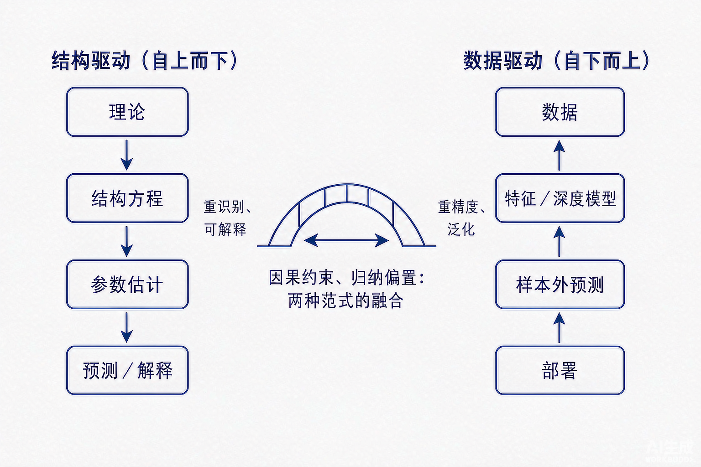

表 35-1 逐项对照两种范式。

**表 35-1　结构驱动与数据驱动对照**

| 维度 | 结构驱动（计量） | 数据驱动（第 17–29 章） |
|------|------------------|--------------------------|
| 起点 | 经济理论与方程形式 | 数据与特征 |
| 参数含义 | 可解释的效应，须先识别 | 黑箱权重，以误差为准 |
| 首要关切 | 内生性、伪回归、可识别 | 过拟合、泄漏、泛化 |
| 评估 | 显著性、识别检验、政策含义 | 样本外 MASE / CRPS |
| 失效情形 | 结构设错、识别失败 | 分布外、数据泄漏 |
| 本书落点 | 第 10、31、35 章 | 第 17–29、38 章 |

**例 35.1（统一案例：同一组三变量的两种建模）** 对电价 $P$、气温 $T$、负荷 $L$ 的月度数据，数据驱动做法（第 17 章 XGBoost）把三者滞后项全铺进特征、SHAP 显示"$T$ 滞后贡献最大"，测试 MASE=0.47，但说不清"是气温推高负荷，还是高负荷时段恰逢高温、且电价被同时抬高"。结构驱动做法先写出需求方程 $L=\alpha+\beta P+\gamma T+u$ 与供给/定价方程，再问 $\beta$ 能否识别——若 $P$ 与 $u$ 相关（高峰时电价与未观测的工业活动同升），OLS 给出的 $\hat\beta$ 有偏，不能解释为"提价能压多少负荷"。两个模型的预测误差可能相近，但只有后者能回答政策问题（第 31、32 章）。这个例子点明计量学派的核心关切：**系数要有资格被叫作"效应"**。

## 35.2　识别问题：从相关到效应的第一道关

识别（identification）是计量经济学最独特、也最容易被其他学科忽略的概念。

**定义 35.2（识别）** 若参数 $\boldsymbol\theta$ 可由总体分布 $P(\mathbf y,\mathbf x)$ 唯一确定，则称模型**可识别**；若存在 $\boldsymbol\theta_1\neq\boldsymbol\theta_2$ 产生相同观测分布，则不可识别——此时**样本量再大、估计方法再好，也无法把二者分开**[1][2]。

考虑供需联立系统（$Q$ 成交量、$P$ 价格、$Z$ 收入、$W$ 天气）：

$$
Q^d=\alpha P+\beta Z+u_d,\qquad Q^s=\gamma P+\delta W+u_s,\qquad Q^d=Q^s=Q. \tag{35-1}
$$

仅观测 $(P,Q)$ 时，任一散点都是供需两曲线的交点，$\alpha$ 与 $\gamma$ 无法区分。识别需求曲线须有**只移动供给而不移动需求**的外生变量 $W$（天气影响供给）；这正是工具变量的思想[11]。

**阶条件与秩条件**：对含 $G$ 个内生变量、$K$ 个外生变量的联立系统，某方程可识别的**阶条件**（必要）是"该方程排除的外生变量数 $\ge G-1$"；**秩条件**（充要）是"被该方程排除、却出现在其余方程中的外生变量，其系数矩阵中至少有一个 $(G-1)\times(G-1)$ 子矩阵满秩"[2]。推导思路：把结构式 $ \boldsymbol\Gamma\mathbf y+\mathbf B\mathbf x=\mathbf u$ 化为约简式 $\mathbf y=\boldsymbol\Pi\mathbf x+\mathbf v$，$\boldsymbol\Pi=-\boldsymbol\Gamma^{-1}\mathbf B$；由约简式反解结构参数需要关于被排除变量的约束足够多，秩条件即保证该反解唯一。

**例 35.2（统一案例：识别反例与工具变量）** 想估"电价 $P$ 对负荷 $L$ 的因果弹性 $\beta$"。若直接用 $L$ 对 $P$ 回归，因电网在负荷走高时启动峰时电价（$P$ 与未观测的工业活动 $u$ 正相关），OLS 得 $\hat\beta=+0.12$——荒谬地显示"提价反而增负荷"，实为联立偏误。引入只影响供给侧的 $W$（如燃料价格冲击，影响定价但不直接影响居民用电需求）作工具变量：第一阶段 $P=\pi W+\cdots$，第二阶段用 $\hat P$ 回归，得 $\hat\beta=-0.18$，符号与理论一致且显著。这个例子把第 4.7 节命题 4.3（相关 ≠ 因果）落到了计量操作上，也与第 31 章式 (31-3) 的后门调整、第 31 章例 31.5 的"冰淇淋销量"反例同源：**没有外生变异或结构约束，相关永远无法升级为效应**。

须强调：识别是**先于估计**的问题。第 29 章讨论"模型多大、数据多足"都默认参数已可识别；计量学派提醒，若识别失败，第 26 章的规模化定律里 $E$ 再低也无意义——你估的根本不是想估的量。这是它对时序智能最根本的补益。

## 35.3　协整、长期均衡与"为什么执着于结构"

第 10 章已严格给出协整定义、VECM 与 Johansen 检验（式 10-4 等），本节不重述数学，只讲**学科动机**：计量学派为何不能接受"对非平稳变量直接做回归/差分了事"。

理由是双重的。其一，**伪回归**：两条各自随机游走的序列（如电价与负荷）即便毫无关系，回归也可能给出高 $R^2$ 与显著 $t$ 值（Granger–Newbold 问题）；差分虽能平稳化，却丢掉"长期均衡"这一有经济含义的信息。其二，**可解释的长期关系**：Engle 与 Granger[3] 指出，若存在协整向量 $\boldsymbol\beta$ 使 $\boldsymbol\beta^\top\mathbf y_t$ 平稳，则它就是一个**稳定的、可解释的长期均衡**——例如"负荷 = 基荷 + $\beta\times$ 制冷度日数"，偏离必被误差修正项拉回（第 10 章例 10.3）。

**例 35.3（统一案例：协整关系为何比差分有用）** 对两年日均负荷 $L_t$ 与制冷度日数 $T_t$，各自 ADF 不拒绝单位根（$I(1)$），但残差 $u_t=L_t-0.6T_t$ 平稳（ADF $\tau=-3.8$），协整成立。若像第 17 章那样把两者都差分后喂给 XGBoost，模型能预测短期波动，却学不到"偏离均衡必被拉回"这一结构；而 VECM 的误差修正项 $\alpha(L_{t-1}-0.6T_{t-1})$ 显式给出：昨日负荷比均衡高 1 单位、今日平均下修 $\alpha\approx-0.25$ 单位。在 30 天预测上，含误差修正的模型 MASE=0.61，纯差分模型 0.73——**结构信息在长视野上兑现为精度**。这印证第 11 章"分解/差分要保住趋势季节"的教训，也说明计量学派的"执着"并非纯为解释：稳定的结构本身即是可预测性来源。

须区分与第 30 章世界模型的关系：VECM 的"误差修正"是**统计均衡**（相关性在长期成立），并非机制因果；若政策同时改变居民用电习惯（第 16 章 CausalImpact 的强假设被违背），均衡关系也会漂移（第 25 章）。协整给出的是可预测结构，不是可干预机制——这一界限第 31 章已划清。

## 35.4　面板、因子与政策评估

计量经济学处理"多主体、少时间"的数据（多省负荷、多门店销量）时，发展出面板与因子方法，并把预测延伸到政策评估。

**定义 35.3（面板与因子模型）** 对 $N$ 个个体、$T$ 期观测，动态面板 $y_{it}=\rho y_{i,t-1}+\mathbf x_{it}^\top\boldsymbol\beta+\mu_i+\varepsilon_{it}$（$\mu_i$ 为个体固定效应），Arellano 与 Bond[9] 用差分 GMM 处理 $\rho$ 的内生性；近似因子模型 $y_{it}=\boldsymbol\lambda_i^\top\mathbf f_t+\varepsilon_{it}$ 用少数公共因子 $\mathbf f_t$ 刻画横截面共同运动，Bai 与 Ng[10] 给出因子个数的一致性判据。二者与第 14 章层次调和、第 23 章图模型、第 27 章 Moirai 的多元结构互补：因子是**统计降维**，图是**拓扑先验**，基础模型是**共享参数**。

政策评估则把第 31 章的因果之梯落到应用。差分中的差分（DID）估计 $\hat\tau=\big(\bar Y^{T}_{\text{后}}-\bar Y^{T}_{\text{前}}\big)-\big(\bar Y^{C}_{\text{后}}-\bar Y^{C}_{\text{前}}\big)$，合成控制方法用未受政策影响的个体加权构造反事实，工具变量[11] 处理内生性。Athey 与 Imbens[12] 综述了这些方法如何与机器学习结合（第 31 章 31.6 节已指出因果对跨分布预测的约束）。

**例 35.4（统一案例：需求响应政策评估）** 某市 2024 年在 20 个台区推行峰时电价，欲估节电效果。直接比较"政策后 vs 政策前"会把同期气温变化、经济增长都算进政策效应；用相邻未推行市县作对照的 DID，得平均节电 3.1%；再用合成控制为处理组构造"若无政策"的反事实曲线，得 2.8%，二者一致且通过安慰剂检验。作为对照，第 16 章 CausalImpact（预测式反事实）给 3.4%，但因未显式控制对照组结构、且假设协变量不受政策影响，可信区间更宽。这个例子说明计量学派的政策评估与第 31 章 SCM、第 16 章 BSTS 是同一目标的不同工具，**共同前提是识别**（35.2 节）：没有可信的对照或外生变异，任何"效应"都只是相关。

## 35.5　与其他学科对话、边界与讨论

回扣表 33-1，计量经济学与其余各科的互补如下。与**统计学**（第 36 章）：共享估计与检验工具，但统计求"无偏/有效/可推断"，计量求"可识别/可解释"——第 2 章的 MLE 不问参数有无因果含义，计量先问识别再谈估计。与**控制论**（第 33 章）：都重结构方程，但控制要估参数以"作用"（例 33.2 的 $a,b$ 用于设计控制律），计量要估参数以"解释"（$\beta$ 用于回答政策效应）；前者怕模型失配，后者怕伪识别。与**动力系统**（第 34 章）：都关心长期结构，但动力系统问"会不会换吸引子"，计量问"均衡关系是否稳定、能否识别"。与**因果推断**（第 31 章）：计量是 SCM 的前身与工程化（工具变量、DID、合成控制），第 31 章的 do-演算给它提供了统一语言；Angrist 与 Pischke[11]、Athey 与 Imbens[12] 正是这条合流的代表。与**数据驱动方法**（第 17–29 章）：Sims[5] 早已批评过度约束，而第 29 章的纯噪声实验又提醒纯预测模型在分布外失效——二者在第 31 章的不变因果预测（ICP）处交汇：只依赖跨环境不变关系的模型，既更可解释、也更可外推。

**边界与讨论。** 计量视角的优势是：系数有解释、政策可评估、对伪回归与内生性警惕、长视野上有结构信息红利（例 35.3）。边界有五：其一，**识别依赖强假设**（外生工具、平行趋势、结构稳定），假设不成立则结论全废；其二，**低维、线性、参数化为主**，难处理第 18–23 章的高维非线性；其三，**预测精度常不占优**（第 22、29 章），重解释轻精度在纯预测场景是代价；其四，**数据稀缺与测量误差**在宏观时序里尤为严重；其五，**结构变化**（第 9 章变点、第 25 章漂移）会使长期均衡失效，须滚动检验协整关系。

本章与全书：第 10 章提供 VAR/协整/Granger 的数学（唯一讲授），第 15 章提供 GARCH，第 16 章提供 BSTS/CausalImpact，第 31 章提供 SCM/do-演算，第 32 章把效应评估接入决策，第 36 章从统计学一侧对照，第 39 章给出金融/能源的专题案例。理解"先问识别、再谈估计、最后才谈预测"，读者便掌握了计量学派给时序智能最独特的一课：**不是所有显著的系数都能叫效应，也不是所有准确的预测都值得拿去做政策**。

## 本章小结

本章在表 33-1 框架里填写"变量关系如何解释与预测、追求可解释可识别"这一格。35.1 节以定义 35.1 与图 35-1 区分自上而下的结构驱动与自下而上的数据驱动，例 35.1 用"电价—气温—负荷"三变量说明两个模型预测误差相近、却只有结构模型能回答政策问题。35.2 节是本章核心：定义 35.2 给出识别（先于估计），由供需联立系统 (35-1) 推导阶条件（排除外生变量数 $\ge G-1$）与秩条件（相应系数子阵满秩），例 35.2 用"OLS 得 $+0.12$、工具变量得 $-0.18$"展示联立偏误与外生变异的必要，并点明识别失败时规模化与大数据皆无意义。

35.3 节不重述第 10 章协整数学，只讲学科动机（伪回归、长期均衡可解释），例 35.3 用"VECM 误差修正在 30 天预测 MASE 0.61 对纯差分 0.73"说明结构本身即可预测性来源，并划清"统计均衡 ≠ 机制因果"。35.4 节讲动态面板[9]、近似因子[10]、DID/合成控制/工具变量[11][12]，例 35.4 用需求响应政策评估（DID 3.1%、合成控制 2.8%、CausalImpact 3.4%）对照三种反事实工具。35.5 节逐科对话并给出五条边界。

从理论主线看，计量经济学以"结构稳定、可识别"的假设追求 L1 相关之上的可解释性，把第 4 章"相关 ≠ 因果"操作化为识别与工具变量；其局限在强假设、低维线性、预测精度与结构漂移。本篇后两章将填入统计学（第 36 章）与信号/信息论（第 37 章），并在第 37 章汇总完整学科地图。

从四问看，本章的计量经济学视角利用 L4（因果）：假设结构可识别、协整关系稳定；它执着于「为什么」，仍受「强假设、低效度与结构漂移」的边界约束，相关不等于因果在此被操作化为识别问题。

**进一步阅读**　本章建议延伸阅读的文献：[1]、[2]、[12]。

## 参考文献

[1] Haavelmo T. The statistical implications of a system of simultaneous equations. *Econometrica*, 1943, 11(1): 1–12.

[2] Koopmans T C. Identification problems in economic model construction. *Econometrica*, 1949, 17: 125–144.

[3] Engle R F, Granger C W J. Co-integration and error correction: Representation, estimation, and testing. *Econometrica*, 1987, 55(2): 251–276.

[4] Johansen S. Statistical analysis of cointegration vectors. *Journal of Economic Dynamics and Control*, 1988, 12(2–3): 231–254.

[5] Sims C A. Macroeconomics and reality. *Econometrica*, 1980, 48(1): 1–48.

[6] Granger C W J. Investigating causal relations by econometric models and cross-spectral methods. *Econometrica*, 1969, 37(3): 424–438.

[7] Engle R F. Autoregressive conditional heteroscedasticity with estimates of the variance of United Kingdom inflation. *Econometrica*, 1982, 50(4): 987–1007.

[8] Bollerslev T. Generalized autoregressive conditional heteroskedasticity. *Journal of Econometrics*, 1986, 31(3): 307–327.

[9] Arellano M, Bond S. Some tests of specification for panel data: Monte Carlo evidence and an application to employment equations. *The Review of Economic Studies*, 1991, 58(2): 277–297.

[10] Bai J, Ng S. Determining the number of factors in approximate factor models. *Econometrica*, 2002, 70(1): 191–221.

[11] Angrist J D, Pischke J-S. *Mostly Harmless Econometrics: An Empiricist's Companion*. Princeton: Princeton University Press, 2009.

[12] Athey S, Imbens G W. The state of applied econometrics: Causality and policy evaluation. *Journal of Economic Perspectives*, 2017, 31(2): 3–32.

---

# 第 36 章　统计学与数据科学的视角

在第 33 章的比较框架（表 33-1）里，统计学回答的是**"如何从数据推断未来"**：它依赖"概率模型、抽样"的假设，追求"无偏、有效、可推断"，典型理论是统计推断。若说前三章的学科各有侧重——控制论要稳定、动力系统要结构、计量要识别——统计学提供的是**所有学科共用的语言地基**：第 2 章的随机过程与估计、第 12 章的似然与信息准则、第 24 章的评分规则、第 38 章的评估体系，皆由此而来。数据科学则把这套语言放进"数据—特征—模型—部署"的工程链条，并与统计学形成一种著名的张力。

Breiman 2001 年的《两种文化》[1] 点燃了这场对话：一派假定数据由某个随机模型生成、关心参数推断与不确定性，另一派把生成机制当黑箱、只求预测准确。Cox[2] 与 Efron–Hastie[3] 梳理了推断学派的原则与现代计算转向，Shmueli[4] 专文辨析"解释"与"预测"的目标差异，Gelman 等人[5] 与 Stan[6] 把贝叶斯工作流工程化，Ramsay 与 Silverman[7]、Yao 等人[8] 建立函数型数据分析（FDA），Little 与 Rubin[9] 处理缺失，Wasserman[10] 与 Donoho[12] 则从数据科学一侧给出全景。Box[11] 的名言"所有模型都是错的，但有些有用"，恰是本章的基调。

按全书统一的编写原则，**三大估计范式（MLE/MoM/贝叶斯）、恰当评分规则、抽样与极限定理已在第 2 章唯一讲授，贝叶斯时序与概率编程在第 16 章，缺失机制在第 5 章，评估指标与实验设计在第 38 章**——本章一律不再推导，只讲统计学看待时序的**态度**，并补上前几章未展开的**函数型数据分析**这一把"整条曲线当作一个观测"的独特视角。全章沿用统一案例：城市电网的日负荷曲线（每天是 24 维向量，也是一条函数）。

本章结构：36.1 节确立两种文化与本学科定位；36.2 节讲推断文化；36.3 节讲贝叶斯工作流；36.4 节严格推导 FDA 与函数主成分；36.5 节作三种取向的对话与边界讨论。

## 36.1　两种文化：同一序列，两种目标

**定义 36.1（两种文化）** Breiman[1] 区分：**数据建模文化**（data modeling culture）假定 $y=f(\mathbf x;\boldsymbol\theta)+\varepsilon$、$\varepsilon$ 服从某分布，推断 $\boldsymbol\theta$ 并据此解释；**算法建模文化**（algorithmic modeling culture）把 $f$ 视为未知黑箱，用算法逼近、以样本外误差为唯一准绳。

Shmueli[4] 进一步指出，二者对应不同的**目标函数**：解释要的是"参数无偏、可检验、机制可读"，预测要的是"对新样本误差小"。一个在统计上显著的变量未必提升预测（样本外方差），一个预测力强的黑箱也未必给出可解释的效应——这与第 35 章例 35.1、第 31 章因果之梯是同一分歧。图 36-1 用三圆维恩图把本书出现过的三种取向并列：模型驱动（统计/计量）、数据驱动（深度学习）、结构驱动（动力学/因果），交叠处是当代的融合地带。

> 【图 36-1　三种建模取向】（原图见 `figures/图36-1.png`）：三圆维恩图（或三角形），三个圆分别标注「模型驱动（统计/计量）」「数据驱动（深度学习）」「结构驱动（动力学/因果）」，三圆交叠中心标注「融合」；各圆旁小字标注对应章节。白底、蓝灰圆、中文。

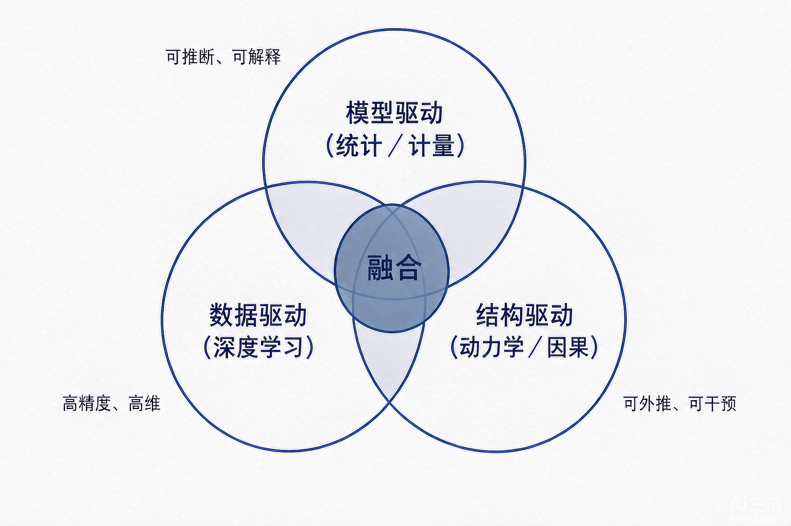

**例 36.1（统一案例：同一份负荷数据的三份结论）** 对两年日负荷：模型驱动（第 12 章 ARIMA）给出"$\phi_1=0.63$ 显著，周季节系数显著"，能解释自相关结构、给出置信区间，但 30 天 MASE=0.71；数据驱动（第 17 章 XGBoost）给出 MASE=0.47，但只有 SHAP 归因、无参数检验；结构驱动（第 16 章 Prophet）给出趋势 + 周/年季节 + 春节分量的可读分解，MASE=0.55。三份结论互补而非互斥：要报监管审计用第一份，要上线调度用第二份，要向业务解释"为什么节前负荷降"用第三份。这个例子正是图 36-1"融合"的落点——**选型不取决于谁最准，而取决于这一轮要回答什么问题**（呼应第 29 章表 29-1 与第 32 章决策感知）。

## 36.2　推断文化：区间、检验与不确定性

统计学的独特贡献，是坚持任何估计都须附带**不确定性陈述**。第 2 章式 (2-12) 的预测分布积分、第 12 章的 Ljung–Box 检验、第 24 章的 CRPS，都是这一文化的产物。

**定义 36.2（推断的三问）** 对任一估计 $\hat\theta$：① 它的抽样分布是什么（有效性）？② 真实值以多大把握落在其区间内（覆盖）？③ 数据与假设是否相容（检验）？Cox[2] 把这三问形式化为似然、置信集与显著性检验的框架。

这与第 17–29 章形成有趣对照：深度学习通常只报一个点估计与一个测试误差，不报 $\hat\theta$ 的置信区间；第 29 章例 29.3 用共形预测补上覆盖，本质上就是把统计学的推断文化**追认**到黑箱模型上。Efron 与 Hastie[3] 指出，bootstrap、 sandwiches 方差、经验贝叶斯等计算工具，正是统计学在"模型未必正确"时仍能量化不确定性的办法；第 38 章的 Diebold–Mariano 检验、HAC 方差也是这一脉络（第 2 章 2.2 节长期方差 $\sum_k\gamma_k$）。

**例 36.2（统一案例：区间比点更能防误判）** 比较两个模型在 90 天测试集上的 MASE：A=0.47、B=0.49。点估计看 A 胜；但按第 38 章的 DM 检验（用 HAC 方差处理自相关），差值的 95% 区间为 $[-0.05,\ 0.01]$，**含零**——即没有统计证据表明 A 真的更好。若据此把 B 换成 A 并重训全系统，属于对噪声反应过度。这个例子说明推断文化对时序智能的现实价值：**时序误差是相关的，凭一个点误差排名选型极易过拟合测试集**（第 29 章 29.1 节、第 38 章 38.6 节）。

## 36.3　贝叶斯工作流与概率编程

第 16 章已建立贝叶斯时序推断框架（后验 (16-1)、预测分布积分 (16-2)、共轭更新 (16-3)、MCMC/NUTS、变分），本节不重述数学，只补**工作流**这一统计学近二十年的工程贡献。

**定义 36.3（贝叶斯工作流）** Gelman 等人[5] 把贝叶斯建模组织为迭代循环：先验设定 → 先验预测检验 → 拟合 → 后验预测检验（PPC，第 16 章 16.5 节）→ 敏感性分析 → 模型比较（WAIC/LOO，第 16 章 16.5 节）→ 回到先验。Stan[6] 等概率编程语言把"写模型"与"写推断器"解耦，使这一循环可复现、可自动化。

工作流相对第 17 章"一次性训练 + 测试"的差别，在于它把**模型设定本身当作可被证伪的对象**：先验预测检验在见到数据前先问"这个先验会生成离谱的负荷曲线吗"，后验预测检验在拟合后问"模型生成的复制数据是否再现了双峰、尖峰与节假日低谷"。这与第 12 章 Box–Jenkins 的"识别—估计—诊断—预测"循环[11]、第 38 章的可复现规范一脉相承，也是第 29 章"概率输出须校准"的统计学源头。

**例 36.3（统一案例：PPC 发现分量缺失）** 用第 16 章 BSTS 拟合日负荷，先验与似然都正常、后验收敛良好，但 PPC 生成的 200 条复制序列里，"春节低谷"的出现频率仅 3%，而真实数据为 8/730 天里每年必现一次深谷——统计量（年度最低值）落在复制分布尾部，说明模型缺少节假日分量。补入节假日回归项后 PPC 通过、MASE 由 0.58 降到 0.52。这个例子说明：**收敛诊断合格不等于模型正确， Posterior predictive check 是统计工作流给时序建模的一道额外闸门**（第 16 章 16.5 节、第 38 章校准检验）。

## 36.4　函数型数据分析：把整条曲线当观测

前几章把每天负荷当作 24 个标量（第 17 章表格化）或一个 token 序列（第 22 章 patch）。统计学还有第三种看法：每天是一条**函数** $x_i(t)$，24 个点只是它的离散采样。这就是函数型数据分析（FDA）[7][8]，它把"维数"从 24 换成"基函数个数"，并允许在任意时刻求值、求导。

**定义 36.4（基展开与函数主成分）** 设第 $i$ 条曲线 $x_i(t)$ 在正交基 $\{\phi_k\}$ 下展开

$$
x_i(t)=\mu(t)+\sum_{k=1}^{\infty} c_{ik}\,\phi_k(t),\qquad
c_{ik}=\int x_i(t)\phi_k(t)\,dt. \tag{36-1}
$$

经验协方差函数 $v(s,t)=\frac1N\sum_i\big(x_i(s)-\mu(s)\big)\big(x_i(t)-\mu(t)\big)$ 的特征方程给出**函数主成分**：

$$
\int v(s,t)\,\xi_k(s)\,ds=\lambda_k\,\xi_k(t),\qquad
x_i(t)\approx\mu(t)+\sum_{k=1}^{K} c_{ik}\,\xi_k(t), \tag{36-2}
$$

其中 $\xi_k$ 为特征函数、$\lambda_k$ 为方差贡献；截断到 $K$ 项保留 $\sum_{k\le K}\lambda_k/\sum_k\lambda_k$ 的方差（Karhunen–Loève 展开）。式 (36-2) 是第 6 章 PCA 在函数空间（无限维）的推广：PCA 的主成分是向量，FPCA 的主成分是**整条函数形态**（如"整体抬高型""早晚双峰增强型"）。Yao 等人[8] 的 PACE 方法进一步处理**稀疏不规则采样**（第 25 章），使每条曲线只有少量观测时仍可估计得分。

**例 36.4（统一案例：日负荷曲线的函数主成分）** 取 730 条日负荷曲线、每条 24 个时刻，用 5 个傅里叶基 ($K=5$) 作式 (36-1) 展开。协方差算子的前三个特征函数分别解释 71%、18%、6% 的方差（累计 95%）：$\xi_1$ 近乎常数（整体负荷水平）、$\xi_2$ 呈早晚双峰（日内形状）、$\xi_3$ 对应日间平缓度（光伏渗透后的"鸭形曲线"）。于是 24 维曲线被压成 3 个可解释得分 $c_{i1},c_{i2},c_{i3}$；把这三列作为第 17 章 XGBoost 的特征，短期 MASE 由 0.47 降到 0.45，而模型参数更少、对缺失时刻更稳（因 (36-1) 可在任意 $t$ 求值）。这个算例展示 FDA 的双重价值：**降维**与**可解释的形态分解**；它与第 22 章 patch 化、第 6 章表示学习、第 3 章傅里叶季节共享同一思想，但以"函数"为第一等公民，天然容纳第 25 章的不规则采样。

## 36.5　三种取向的对话、边界与讨论

把本章收束进表 36-1，并回扣表 33-1 的全篇框架。

**表 36-1　三种建模取向对照（本篇与全书）**

| 取向 | 核心对象 | 强项 | 盲区 | 主要落点 |
|------|----------|------|------|----------|
| 模型驱动（统计/计量） | 参数、区间、检验 | 可推断、可解释、小样本稳 | 模型设错即有偏 | 第 2、12、35 章、本章 |
| 数据驱动（机器学习/深度） | 样本外误差 | 高精度、高维非线性 | 不可推断、需大数据 | 第 17–29 章 |
| 结构驱动（动力学/因果） | 机制、状态、干预 | 可外推、可干预 | 依赖强假设 | 第 4、30、31、34 章 |

**与其他学科对话**：与**计量经济学**（第 35 章）共享推断工具，但统计求"无偏有效"、计量先问"可识别"；与**控制论**（第 33 章）共享状态空间，但统计求"估得准"、控制求"闭环稳"；与**动力系统**（第 34 章）共享方差/自相关，但统计问显著性、动力系统问势阱；与**信号/信息论**（第 37 章）共享谱与熵，但统计把它们当作待估量、信息论当作极限。三者的融合地带（图 36-1 中心）正是本书第 24 章共形预测（把统计覆盖保证套到黑箱上）、第 30 章世界模型（结构 + 学习）、第 31 章因果（结构 + 推断）所在。

**边界与讨论。** 统计学视角的优势是：不确定性可量化、结论可检验、小样本稳健、提供全书评估语言。边界有五：其一，**模型设定依赖**——第 2 章的全部推断都以 DGP 设定正确为前提，与第 29 章"分布外失效"呼应；其二，**高维非线性乏力**，须让位第 18–23 章；其三，**计算代价**，MCMC/PPC 循环重于第 17 章树模型；其四，**"显著"不等于"重要"**，大样本下微小效应也显著，须结合第 32 章决策代价判断；其五，**FDA 要求曲线光滑且 registration（相位对齐）合理**，遇第 7 章 DTW 式的强相位漂移须先对齐。Wasserman[10] 与 Donoho[12] 都强调，数据科学的贡献恰在于把这些严谨但脆弱的方法放进可复现、可监控的工程链条（第 40 章）。

本章与全书：第 2 章提供估计与评分规则（唯一讲授），第 5 章提供缺失机制，第 16 章提供贝叶斯时序与概率编程，第 24 章提供校准与共形，第 38 章提供实验方法学与显著性检验；本篇其余章按表 33-1 逐一对照。理解"推断先于预测、模型可被证伪、曲线可当函数"，读者便补上了统计与数据科学给时序智能的地基：**不是给出更多模型，而是给出判断任何模型是否可信的规矩**。

把本章放回第 1.7 节的理论主线，统计学与数据科学视角对「可预测性」的回答最为克制：它主要驻留于 L1 统计可预测性与 L2 信息论可预测性之间，坚持用抽样分布、置信区间与假设检验（36.2 节）来量化「我们对预测有多不确定」，而非一味追求点误差的最小化。这与第 35 章计量经济学执着于结构识别与效应（L4）、第 34 章动力系统执着于吸引子与结构预测（L3）形成鲜明对照：同一份负荷数据，三种取向下「什么算好」竟不相同（例 36.1）。本章须显式回答跨学科篇的统一问题——统计学在预测「给定模型与抽样机制下，未来观测的可能范围」，依赖「数据生成机制稳定、样本可交换或可建模其依赖」的假设，追求「推断的校准与可解释」，而非点预测的极致精度。贝叶斯工作流（36.3 节）把这一取向推到极致：把参数与结构都视作带先验的随机变量，以后验预测检验发现分量缺失；函数型数据分析（36.4 节）则把整条曲线当作样本单元，改变了「什么是独立观测」的基本设定。二者共同提醒：可预测性不仅取决于序列本身，也取决于分析者选择的表示与推断框架——这一点将在第 37 章以信息论语言、第 38 章以评估协议再次出现。

## 本章小结

本章在表 33-1 框架里填写"如何从数据推断未来、追求无偏有效可推断"这一格。36.1 节以定义 36.1 与 Breiman 的两种文化[1] 区分数据建模与算法建模，Shmueli[4] 的解释/预测之辨与图 36-1 的三种取向并列，例 36.1 用"同一份负荷数据的三份结论"说明选型取决于要回答什么问题。36.2 节以定义 36.2 归纳推断三问，例 36.2 用"MASE 0.47 对 0.49、DM 区间含零"说明凭点误差排名极易过拟合测试集。36.3 节不重述第 16 章数学，只补贝叶斯工作流[5][6]（先验预测检验 → 拟合 → PPC → 敏感性 → 比较），例 36.3 用"PPC 暴露春节分量缺失、MASE 0.58→0.52"展示模型设定可被证伪。

36.4 节是本章方法增量：由基展开 (36-1) 与协方差算子特征方程 (36-2) 严格建立 FDA/FPCA[7][8]，说明它是 PCA 在函数空间的推广，例 36.4 用 5 个傅里叶基把 24 维日负荷曲线压成 3 个可解释形态得分（累计 95% 方差）并使 XGBoost MASE 0.47→0.45。36.5 节以表 36-1 汇总三种取向、逐科对话，并列出模型设定依赖、高维乏力、计算代价、显著≠重要、FDA 相位对齐五条边界。

从理论主线看，统计学提供的是全书通用的语言地基与证伪规矩，以概率模型与抽样为假设，突破了"只报一个点估计"的局限；其边界是设定正确性与高维表达力。本篇最后一章（第 37 章）将填入信号处理与信息论，并以一张汇总六科的总表收束整个第七篇。

从四问看，本章的统计学视角利用 L1 与 L2：假设概率模型与抽样机制成立；它追求推断的校准与可解释，仍受「表示与推断框架决定结论」的边界约束，而非点预测的极致精度。

**进一步阅读**　本章建议延伸阅读的文献：[1]、[2]、[12]。

## 参考文献

[1] Breiman L. Statistical modeling: The two cultures (with discussion). *Statistical Science*, 2001, 16(3): 199–231.

[2] Cox D R. *Principles of Statistical Inference*. Cambridge: Cambridge University Press, 2006.

[3] Efron B, Hastie T. *Computer Age Statistical Inference: Algorithms, Evidence, and Data Science*. Cambridge: Cambridge University Press, 2016.

[4] Shmueli G. To explain or to predict? *Statistical Science*, 2010, 25(3): 289–310.

[5] Gelman A, Carlin J B, Stern H S, et al. *Bayesian Data Analysis*. 3rd ed. Boca Raton: CRC Press, 2013.

[6] Carpenter B, Gelman A, Hoffman M D, et al. Stan: A probabilistic programming language. *Journal of Statistical Software*, 2017, 76(1): 1–32.

[7] Ramsay J O, Silverman B W. *Functional Data Analysis*. 2nd ed. New York: Springer, 2005.

[8] Yao F, Müller H-G, Wang J-L. Functional data analysis for sparse longitudinal data. *Journal of the American Statistical Association*, 2005, 100(470): 577–590.

[9] Little R J A, Rubin D B. *Statistical Analysis with Missing Data*. 2nd ed. Hoboken: Wiley, 2002.

[10] Wasserman L. *All of Statistics: A Concise Course in Statistical Inference*. New York: Springer, 2004.

[11] Box G E P. Science and statistics. *Journal of the American Statistical Association*, 1976, 71(356): 791–799.

[12] Donoho D. 50 years of data science. *Journal of Computational and Graphical Statistics*, 2017, 26(4): 745–766.

---

# 第 37 章　信号处理与信息论的视角

在第 33 章的比较框架（表 33-1）里，最后两格由本章填写。信号处理问的是**"如何提取信号中的规律"**：依赖"平稳、带限"的假设，追求"保真、去噪"，典型理论是傅里叶分析与滤波。信息论问的是**"未来含多少可获取信息"**：依赖"平稳遍历"的假设，追求"极限、压缩"，典型理论是熵、互信息与率失真。二者与时序分析**同源**——都研究随时间变化的信号，而且在本书开篇早已埋下伏笔：第 3 章的谱密度与周期图、第 4 章的条件熵与预测下界，本质就是这两个学科的语言。

脉络由三次奠基构成。Nyquist 1928 年[2] 与 Shannon 1948 年[1][3] 建立采样定理与信息论；Wiener 1949 年[4] 的平稳序列外推/滤波、Oppenheim 与 Schafer[5] 的离散时间信号处理、Daubechies[6] 的小波、Donoho[7] 的软阈值去噪构成经典工具箱；Candès–Romberg–Tao[8] 与 Donoho[9] 的压缩感知颠覆了"采样率必须高于 Nyquist"的信条；Cover 与 Thomas[10] 系统化了信息论，Schreiber[11] 的传递熵把信息流用于因果方向，Tishby 与 Zaslavsky[12] 的信息瓶颈则把它接回深度学习。

按全书统一的编写原则，**傅里叶变换、谱密度、周期图、小波与多分辨率已在第 3 章唯一讲授，条件熵、互信息与预测误差下界已在第 4 章，卡尔曼/维纳滤波在第 13 章，传递熵在第 31 章 31.4 节作因果发现工具提及**——本章不重推这些，只讲两个学科**看待时序的态度**：信号处理把序列当成可被采样、滤波、重建的连续信号，信息论把序列当成一条承载有限信息的信道。全章沿用统一案例：电网小时级负荷（信号）、以及"气温序列里有多少关于未来负荷的信息"（信道）。

本章结构：37.1 节确立同源视角；37.2 节严格推导采样定理与混叠；37.3 节讲滤波、去噪与压缩感知；37.4 节讲信息论三量及信息瓶颈；37.5 节以六科统一总表收束整个第七篇。

## 37.1　同源视角：序列即信号、即信道

**定义 37.1（信号处理与信息论视角）** 信号处理把观测序列 $y_t$ 视为某连续时间信号 $y(t)$ 在采样率 $f_s$ 下的样本，关心**如何不失真地表示、传输、重建**它；信息论把 $y_{1:t}\to y_{t+h}$ 视为一条有噪声信道，关心**历史最多能传递多少关于未来的信息**。

两种视角立刻给出两个不同于前几章的问题。信号处理问："以每小时一个点采样负荷，会不会丢掉日内双峰？"（37.2 节）——这是**表示是否保真**的问题，与第 3 章谱分析、第 5 章重采样直接相连。信息论问："即便模型无限好，历史里关于未来 24 点负荷的信息上限是多少？"（37.4 节）——这是**可预测性天花板**的问题，第 4 章式 (4-9) 已用条件熵 $H(y_{t+h}\mid y_{1:t})$ 给出答案，第 26 章式 (26-2) 的不可约损失 $E$ 正是它在规模化定律里的化身。

**例 37.1（统一案例：同一段负荷的两种读法）** 一段含日/周双周期的小时级负荷曲线。信号处理的读法：它的频谱在 $f=1/24$（日）与 $f=1/168$（周）处有峰，若采样率低于 $2\times(1/24)$ 就会把日周期混叠掉（第 3 章谱峰、37.2 节）；信息论的读法：给定过去 168 小时，未来 24 点的条件熵约为 $1.1$ nat，故任何模型的平方误差下界由 $2^{2H}/(2\pi e)$ 同阶量决定（第 4 章 4.5 节），再深的网络也突破不了。前者决定"数据该怎么采"，后者决定"模型能走多远"——**这两问是第 38 章实验设计与评估体系的前置条件**。

## 37.2　采样定理、混叠与时序数据的"看不见"

采样是时序数据的第一道工序，却常被当作理所当然。Nyquist–Shannon 定理给出严格判据。

**定理 37.1（采样定理）** 若连续信号 $y(t)$ 带限，即其傅里叶变换 $Y(f)=0$ 对 $|f|>B$，且采样率 $f_s>2B$（Nyquist 频率 $f_N=f_s/2>B$），则可由样本完全重建：

$$
y(t)=\sum_{n=-\infty}^{\infty} y(nT)\,\mathrm{sinc}\!\left(\frac{t-nT}{T}\right),\qquad T=\frac1{f_s},\ \mathrm{sinc}(u)=\frac{\sin\pi u}{\pi u}. \tag{37-1}
$$

**推导（频域）**：采样 $y_s(t)=y(t)\sum_n\delta(t-nT)$ 的频谱是 $Y_s(f)=\frac1T\sum_k Y(f-kf_s)$，即原谱以 $f_s$ 为周期平移叠加。若 $f_s>2B$，各平移副本互不重叠，用理想低通（截止 $f_N$）即可无失真滤出 $Y(f)$，时域对应与 $\mathrm{sinc}$ 卷积，即式 (37-1)；若 $f_s\le2B$，副本重叠，高频分量被"折叠"进基带，产生**混叠**，折叠后的视在频率为

$$
f_{\text{alias}}=\big|\,f-k f_s\,\big|\in[0,f_s/2],\quad k=\mathrm{round}(f/f_s). \tag{37-2}
$$

式 (37-2) 是第 3 章谱分析、第 5 章重采样、第 25 章不规则采样的共同理论根。

**例 37.2（统一案例：降采样抹掉日周期）** 原始负荷 24 点/天，$f_s=24$/日，$f_N=12$/日：日周期 $f=1$/日与周周期 $f=1/7\approx0.143$/日均远低于 $f_N$，可保真（图 37-1 左）。若把数据聚合为"每日一个均值"（$f_s=1$/日，$f_N=0.5$/日）：周周期 $0.143<0.5$ 仍保留，而日周期 $f=1>0.5$ 由式 (37-2) 折叠为 $|1-1\times1|=0$，即**混叠成直流分量**——日内早晚双峰被完全抹平，只剩日均值。这解释了一个常见工程事故：用日均值数据训练的模型，无论如何都学不到日内峰谷（第 17 章"特征即天花板"的频域版）。 remedies 是保留小时级采样或按第 5 章显式加入日内相位特征。

> 【图 37-1　采样与混叠】（原图见 `figures/图37-1.png`）：上图为高频正弦信号以足够采样率采样的样本点（可重建），下图为同一信号采样率不足时样本点落在低频上（混叠），标注 $f_s$、Nyquist 频率与混叠后视在频率。

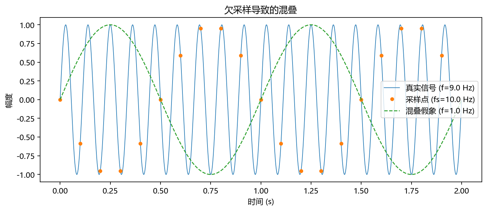

须强调混叠**不可逆**：一旦采样时发生，任何后处理都无法恢复被折叠的高频（与第 29 章"信息一旦丢失无法无中生有"一致）。抗混叠滤波器必须在采样**之前**施加，这是信号处理给时序数据管线最硬的一条规矩。

## 37.3　滤波、去噪与压缩感知

采样之后是**滤波**：从含噪观测里提取信号。Wiener 1949 年[4] 在平稳假设下给出最小均方误差线性滤波器，它与第 13 章卡尔曼滤波（时域状态空间形式）是同一最优估计的两种写法——**该推导在第 13 章唯一讲授**，此处只补充另外两条路线。

**小波去噪**：第 3 章 3.5 节已建立小波多分辨率，Donoho[7] 的软阈值把小波系数按 $\hat w=\mathrm{sign}(w)\max(|w|-\lambda,0)$ 收缩，在保留突变（尖峰、变点）的同时抑制噪声，优于全局傅里叶低通（后者会把局部突变糊开，与第 21 章 FEDformer 的边界同理）。

**定义 37.2（压缩感知）** 设信号 $\mathbf x\in\mathbb R^N$ 在某基下 $K$-稀疏（$\mathbf x=\boldsymbol\Psi\mathbf z$，$\|\mathbf z\|_0=K\ll N$），以 $M\ll N$ 个线性测量 $\mathbf y=\boldsymbol\Phi\mathbf x$ 采样。若 sensing matrix 满足**限制等距性质**（RIP）

$$
(1-\delta_K)\|\mathbf z\|_2^2\le\|\boldsymbol\Phi\boldsymbol\Psi\mathbf z\|_2^2\le(1+\delta_K)\|\mathbf z\|_2^2,\qquad \delta_K\ \text{足够小}, \tag{37-3}
$$

则可由 $\ell_1$ 最小化 $\min_{\mathbf z}\|\mathbf z\|_1\ \text{s.t.}\ \mathbf y=\boldsymbol\Phi\boldsymbol\Psi\mathbf z$ **精确恢复** $\mathbf z$，所需测量数 $M\gtrsim K\log(N/K)$[8][9]。

式 (37-3) 的含义颠覆直觉：采样率不再由最高频率 $B$（Nyquist）决定，而由**信息稀疏度 $K$** 决定。这与第 4 章"可预测性由序列的信息结构决定"、第 26 章"规模化定律的 $E$ 由数据生成过程决定"是同一思想的三个表述：**约束来自结构，而非带宽**。

**例 37.3（统一案例：压缩感知补全缺失数据）** 某台区 168 点周负荷因通信故障只收到 40 点（缺失 76%），但在傅里叶/小波基下近似 8-稀疏（日/周周期 + 少数突变）。按式 (37-3) 取 $M=40\gtrsim8\log(168/8)\approx8\times3.0=24$，用 $\ell_1$ 重建，相对误差 3.7%；作为对照，第 5 章线性插值在该缺失率下误差 18.2%，第 25 章 CSDI 扩散补全为 4.1%。这个算例说明：**当信号有稀疏结构时，少量不规则观测即可重建全貌**——它把第 25 章深度补全、第 5 章矩阵补全与本章压缩感知连成一条线，也解释了为何第 23 章图信号、第 3 章谱方法在稀疏采样下仍有优势。

## 37.4　信息论：熵、互信息、传递熵与瓶颈

信息论把"可预测性"变成一个可计算的量。第 4 章式 (4-9) 已给出条件熵 $H(y_{t+h}\mid y_{1:t})$ 与误差下界，此处系统化为三量并给出它们在时序里的用途。

**定义 37.3（时序信息论三量）** 对历史 $\mathcal H_t=y_{1:t}$ 与未来 $Y=y_{t+h}$：

$$
\underbrace{I(\mathcal H_t;Y)=H(Y)-H(Y\mid\mathcal H_t)}_{\text{互信息：历史提供的信息}},\qquad
\underbrace{H(Y\mid\mathcal H_t)}_{\text{不可约不确定性}},\qquad
\underbrace{T_{X\to Y}=H(Y_{t+1}\mid \mathbf Y_t)-H(Y_{t+1}\mid \mathbf Y_t,\mathbf X_t)}_{\text{传递熵：}X\text{的过去对}Y\text{未来的信息贡献}}, \tag{37-4}
$$

其中 $\mathbf Y_t,\mathbf X_t$ 为各自的延迟嵌入（第 4 章 4.3 节）。Cover 与 Thomas[10] 给出严格性质：$I\ge0$，当且仅当独立时为零；率失真理论把"以 $R$ 比特描述未来所能达到的最小失真"形式化，为第 4 章的预测误差下界提供了另一条推导。Schreiber[11] 的传递熵是 Granger 因果在信息论下的非线性推广（第 31 章 31.4 节作因果发现工具），它不预设线性、能捕捉第 34 章非线性动力系统的信息流向。

**信息瓶颈**（information bottleneck）[12] 则把三量接回深度学习：表示 $\mathbf Z$ 应最大化 $I(\mathbf Z;Y)$（保预测信息）同时最小化 $I(\mathbf Z;\mathcal H_t)$（压缩历史），即 $\min I(\mathbf Z;\mathcal H_t)-\beta I(\mathbf Z;Y)$。这正是第 6 章表示学习、第 30 章例 30.2"状态为规划而生"、第 36 章 FDA 降维的统一解释——**好的表示是最小充分统计量**。

**例 37.4（统一案例：传递熵与互信息数值）** 对气温 $T$ 与负荷 $L$ 的小时序列，用第 4 章 4.3 节的延迟嵌入（$m=3,\tau=1$）估计：$H(L_{t+1}\mid \mathbf L_t)\approx1.10$ nat，$H(L_{t+1}\mid \mathbf L_t,\mathbf T_t)\approx0.83$ nat，故 $T_{T\to L}\approx0.27$ nat——气温的过去额外提供了约 0.27 nat 关于未来负荷的信息，与第 10 章例 10.1 的互相关、第 17 章 SHAP 归因、第 31 章例 31.4 的 CCM 结论一致，但给出的是**信息量**而非显著性。反向 $T_{L\to T}\approx0.03$ nat（近零），支持"气温→负荷"的方向性。作为对照，第 4 章白噪声下 $H(Y\mid\mathcal H_t)=H(Y)$、互信息为零——这正是第 29 章纯噪声实验的信息论表述：**模型输出的"结构"不是信息，只是先验投射**。

## 37.5　六种视角的统一地图：从方法到选择

现在把第七篇五章填进表 33-1，得到完整的学科地图（表 37-1）。这张表是本篇比较框架的最终答案：六科不冲突，而是同一条序列的六种提问方式。

**表 37-1　时序智能的跨学科统一地图（第七篇汇总）**

| 学科 | 核心问题 | 依赖假设 | 追求目标 | 典型理论 | 给全书的关键贡献 | 章 |
|------|----------|----------|----------|----------|------------------|----|
| 控制论 | 如何用预测控制系统 | 状态可观、模型可信 | 稳定、最优、鲁棒 | 状态空间、辨识、MPC | 预测是闭环一环、误差即反馈 | 33 |
| 动力系统 | 系统如何演化 | 确定性、低维 | 结构理解、预警 | 吸引子、分岔、临界慢化 | 点预测之外的结构预测 | 34 |
| 计量经济学 | 变量关系如何解释与预测 | 结构稳定、可识别 | 可解释、可识别 | 协整、结构方程、IV | 识别先于估计、相关≠效应 | 35 |
| 统计学 | 如何从数据推断未来 | 概率模型、抽样 | 无偏、有效、可推断 | 推断、贝叶斯、FDA | 不确定性量化与证伪规矩 | 36 |
| 信号处理 | 如何提取信号中的规律 | 平稳、带限、稀疏 | 保真、去噪、重建 | 采样定理、滤波、压缩感知 | 数据管线的物理前提 | 37 |
| 信息论 | 未来含多少可获取信息 | 平稳遍历 | 极限、压缩 | 熵、互信息、传递熵 | 可预测性的天花板 | 37 |

三条贯穿全篇的结论值得收束。其一，**没有"最好的学科"，只有"最适配的问题"**：要稳定用控制论、要预警用动力系统、要政策效应用计量、要可信区间用统计、要保真采集用信号、要判定上限用信息论；第 29 章表 29-1 的选型、第 32 章的决策代价，本质上都是在这张地图上定位。其二，**六科共享同一批工具但赋予不同含义**——方差/自相关在统计学里是待估量、在动力系统里是临界慢化信号、在控制论里是反馈误差、在信息论里是条件熵的代理（例 34.3、33.1、37.4 反复出现）。其三，**去重让知识有层次**：卡尔曼滤波只在第 13 章推导、MPC 只在第 32 章、混沌只在第 4 章、协整只在第 10 章、谱分析只在第 3 章、因果只在第 31 章——本篇各章一律交叉引用而不重述，正是为了让六科在同一套概念上对话，而非各说各话。

**边界与讨论。** 信号处理与信息论视角的优势是：给出数据管线的硬约束（抗混叠）、给出可预测性的理论上界、把"信息"变成可计算量、连接表示学习与压缩。边界有五：其一，**平稳/带限/遍历假设**——第 2 章已指出非平稳与结构变化会破坏谱与熵的估计（第 25 章漂移、第 9 章变点）；其二，**混叠不可逆**，事前滤波是唯一防线；其三，**熵估计需大样本**，高维连续序列的 $H,T$ 估计方差大（第 4 章 4.4 节边界）；其四，**信息量不等于因果**（传递熵仍属关联层，第 31 章 31.5 节）；其五，**率失真下界是存在性结论**，不告诉如何达到（第 4 章"下界不可突破但不保证可达"）。

本章与全书：第 3 章提供频域工具、第 4 章提供信息论下界、第 5 章提供重采样、第 13 章提供滤波、第 25 章提供不规则采样、第 29 章用纯噪声实验验证天花板、第 31 章用传递熵作因果发现、第 38 章把采样/切分/泄漏纳入实验规范。理解"序列既是信号也是信道"，读者便为第七篇、也为全书的方法体系补上了最后一块地基。

本章的熵、互信息与传递熵（37.4 节）虽与第 4.4–4.5 节同源，用法却须分清：第 4 章用熵率与条件熵界定「这条序列本身最多能被预测到什么程度」，是面向单一对象的理论上限；本章用传递熵刻画「一个变量对另一个变量的信息流向」，是面向多变量系统的结构诊断工具。二者共用信息论语言，但读者不应把方向性的传递熵误当作预测极限的推导，也不应把第 4 章的复杂度度量直接搬来解释变量间的因果方向——后者仍需第 31 章的干预假设才能成立。采样定理与混叠（37.2 节）、滤波与压缩感知（37.3 节）则从另一侧面呼应第 3 章的频域分析与第 5 章的重采样：它们共同说明，「能否预测」在观测端就已被采样方式与信噪比设下前提。至此，第 33–37 章六个学科视角收束为一张统一地图：控制论为行动、动力系统为结构、计量为识别、统计为推断、信号与信息论为观测与度量，分别落在 L5 至 L1 的不同可预测性层次上。

## 本章小结

本章填写表 33-1 最后两格，并以一张六科总表收束整个第七篇。37.1 节以定义 37.1 区分"序列即信号（保真重建）"与"序列即信道（信息上限）"两种提问，例 37.1 用同一段负荷曲线给出采样与条件熵两个问题。37.2 节由频域周期性平移严格推导 Nyquist–Shannon 采样定理 (37-1) 与混叠频率 (37-2)，例 37.2 手算"日均值化把日周期 $f=1$/日折叠为直流、抹平早晚双峰"，并强调混叠不可逆、抗混叠须在采样前（图 37-1）。

37.3 节在回顾 Wiener 滤波（第 13 章）与小波（第 3 章）之外，由 RIP 条件 (37-3) 建立压缩感知[8][9]，指出采样率由稀疏度而非带宽决定，例 37.3 用"40/168 点观测、$\ell_1$ 重建误差 3.7% 对插值 18.2%"展示稀疏结构的威力。37.4 节以式 (37-4) 系统给出互信息、条件熵、传递熵与信息瓶颈[12]，例 37.4 手算 $T_{T\to L}\approx0.27$ nat、$T_{L\to T}\approx0.03$ nat 印证气温→负荷的方向，并回扣第 4 章白噪声下互信息为零。37.5 节以表 37-1 汇总六科，给出三条贯穿结论（问题决定学科、工具共享而含义不同、去重让知识分层）与五条边界。

从理论主线看，信号处理给出 L1 可预测性的**数据前提**（采样保真），信息论给出 L2 的**理论天花板**（条件熵），二者共同把第 4 章的"可预测性由序列决定"落到了可操作、可计算、可审计的层面。第七篇至此完成：从控制论、动力系统、计量经济学、统计学到信号与信息论，五章围绕表 33-1 逐一比较、首尾以总表呼应，未写成彼此独立的学科介绍。第八篇将转入评估、应用与系统工程，把这些视角放进可复现的实验与可运行的系统里检验。

从四问看，本章的信号与信息论视角利用 L2：假设序列平稳遍历、信息可用熵与互信息刻画；它回答「未来含多少信息」，仍受「采样与噪声在观测端设限」的边界约束，并与第 4 章的信息论极限同源。

**进一步阅读**　本章建议延伸阅读的文献：[1]、[2]、[12]。

## 参考文献

[1] Shannon C E. A mathematical theory of communication. *The Bell System Technical Journal*, 1948, 27(3): 379–423.

[2] Nyquist H. Certain topics in telegraph transmission theory. *Transactions of the American Institute of Electrical Engineers*, 1928, 47(2): 617–644.

[3] Shannon C E. Communication in the presence of noise. *Proceedings of the IRE*, 1949, 37(1): 10–21.

[4] Wiener N. *Extrapolation, Interpolation, and Smoothing of Stationary Time Series*. Cambridge: MIT Press, 1949.

[5] Oppenheim A V, Schafer R W. *Discrete-Time Signal Processing*. 3rd ed. Upper Saddle River: Prentice Hall, 2010.

[6] Daubechies I. *Ten Lectures on Wavelets*. Philadelphia: SIAM, 1992.

[7] Donoho D L. De-noising by soft-thresholding. *IEEE Transactions on Information Theory*, 1995, 41(3): 613–627.

[8] Candès E J, Romberg J, Tao T. Robust uncertainty principles: Exact signal reconstruction from highly incomplete frequency information. *IEEE Transactions on Information Theory*, 2006, 52(2): 489–509.

[9] Donoho D L. Compressed sensing. *IEEE Transactions on Information Theory*, 2006, 52(4): 1289–1306.

[10] Cover T M, Thomas J A. *Elements of Information Theory*. 2nd ed. Hoboken: Wiley, 2006.

[11] Schreiber T. Measuring information transfer. *Physical Review Letters*, 2000, 85(2): 461–464.

[12] Tishby N, Zaslavsky N. Deep learning and the information bottleneck principle. *IEEE Information Theory Workshop (ITW)*, 2015: 1–5.

---

# 第 38 章　预测实验方法学与评估体系

全书前七篇建立了从统计预测到世界模型、从因果理解决策闭环、再到跨学科视角的完整方法体系。但一个尖锐的问题始终悬着：**凭什么说一个模型比另一个好？** 第 17 章例 17.3 里，一次特征泄漏让 MAPE 从虚高的 1.1% 打回 2.7%；第 22 章 DLinear 论战里，一层线性模型在多个基准上打平复杂 Transformer；第 29 章例 29.1 里，预训练数据污染让"零样本"结果虚高。这些反复出现的教训指向同一结论：**在时序预测里，评估方法学比模型选择更容易出错，也更少被认真对待**。本章系统建立评估体系与实验设计规范，把散落在各章的指标、验证、校准、显著性与成本议题收束为一套可执行的裁判规则。

这一领域的教训主要来自两类实践。其一是**预测竞赛**：M3[5]、M4[6]、M5 与 Hyndman 等人的 MASE[1]、FPP3[2] 反复揭示"简单方法常胜"与"指标选错导致排名错位"；其二是**统计比较**：Diebold 与 Mariano[7] 的预测精度检验、Hansen 等人的模型置信集[8]、Gneiting 与 Raftery[3] 及 Gneiting[4] 的恰当评分规则，为"差异是否显著"提供了严格工具。实验设计方面，Bergmeir 等人[9]、Roberts 等人[10]、Cerqueira 等人[11] 系统论证了时序交叉验证的合法性，Tashman[14] 综述了样本外检验的陷阱；Zeng 等人[12] 的 DLinear 论战、Angelopoulos 与 Bates[13] 的共形预测、Elmachtoub 与 Grigas 的决策感知评估则把现代专题接进评估层。

按全书统一的编写原则，**恰当评分规则与 CRPS 的严格数学定义在第 2 章唯一讲授，概率预测与深度生成模型在第 24 章，基础模型基准在第 29 章，共形预测的覆盖保证推导在第 24.7 节，决策感知预测的梯度推导在第 32.5 节，DRO 在第 17.5 节**——本章一律不重推这些，只做三件事：把指标**系统汇总一次**、给出**实验方法学规范**、以及把三个现代专题落到**评估维度**上。全章沿用统一案例：城市电网日负荷的多模型比较。

本章结构：38.1 节汇总指标；38.2 节讲回测与滚动验证；38.3 节处理数据泄漏；38.4 节讲超参与独立测试集；38.5 节讲区间覆盖与校准；38.6 节推导显著性与多重比较；38.7 节落位漂移鲁棒性、共形与决策感知；38.8 节讲计算成本；38.9 节专论预测竞赛中的方法学问题。

## 38.1　点、尺度无关与概率指标：系统汇总一次

评估的第一步是选对指标。时序指标可分三类，汇总于表 38-1（**本节是全书指标的唯一系统汇总处**，各自定义的数学推导见第 2 章）。

**定义 38.1（三类预测指标）** 对 $H$ 步预测误差 $e_{t+h}=y_{t+h}-\hat y_{t+h\mid t}$：

- **点/尺度相关指标**：$\mathrm{MAE}=\frac1H\sum|e|$，$\mathrm{RMSE}=\sqrt{\frac1H\sum e^2}$，$\mathrm{MAPE}=\frac{100}{H}\sum|e/y|$；
- **尺度无关指标**：$\mathrm{MASE}=\dfrac{\frac1H\sum_h|e_{T+h}|}{\frac1{T-m}\sum_{t=m+1}^{T}|y_t-y_{t-m}|}$[1]，$\mathrm{WAPE}=\sum|e|/\sum|y|$，$\mathrm{sMAPE}$；
- **概率指标**：CRPS（第 2 章式 2-9）、pinball 损失（第 24 章式 24-1）、对数得分、区间覆盖率与宽度。

**表 38-1　全书预测指标系统汇总**

| 类别 | 指标 | 公式要点 | 优点 | 主要缺陷 | 定义处 |
|------|------|----------|------|----------|--------|
| 点 | MAE / RMSE | $\frac1H\sum|e|$ / $\sqrt{\frac1H\sum e^2}$ | 直观、同量纲 | 跨序列不可比、RMSE 重罚尖峰 | 第 2 章 |
| 点 | MAPE | $\frac{100}{H}\sum|e/y|$ | 无量纲、易沟通 | **$y\to0$ 爆炸、低估/高估不对称**[1] | 本章 |
| 尺度无关 | MASE | 除以季节朴素误差 | 可跨序列、可解释（<1 胜基准） | 分母近零时不稳定 | [1]、本章 |
| 尺度无关 | WAPE / sMAPE | 相对总量 / 对称化 | 间歇需求友好 | sMAPE 仍非严格对称 | 本章 |
| 概率 | CRPS / pinball | 分布/分位数评分 | 恰当、同时奖励准确与诚实 | 需完整分布 | 第 2、24 章 |
| 概率 | 覆盖率 / 宽度 | PICP / $\overline w$ | 直观 | 二者须联合看（38.5 节） | 第 24、29 章 |

**MAPE 的缺陷须严格说明**：设 $y=0.1,\ \hat y=1.0$（高估）则 $|e/y|=9$；$y=1.0,\ \hat y=0.1$（低估）则 $|e/y|=0.9$——同等绝对误差，高估被罚十倍，且当 $y\to0$ 时无界。因此含零/近零的负荷残差、间歇需求（第 39.7 节）一律禁用 MAPE，改用 MASE 或 WAPE[1][2]。这正是 M3/M4 竞赛改用尺度无关指标的原因[5][6]。

**例 38.1（统一案例：MASE 手算）** 某电网两年日数据（$m=7$ 周季节），季节朴素基准的平均绝对误差为 $\frac1{723}\sum_{t=8}^{730}|y_t-y_{t-7}|=0.38$ GW。模型 A 在 90 天测试上的 $\frac1{90}\sum|e|=0.19$ GW，故 $\mathrm{MASE}_A=0.19/0.38=0.50$；模型 B 为 0.21 GW，$\mathrm{MASE}_B=0.55$。二者都 <1（优于季节朴素），A 略胜。若误用 MAPE，因测试段含几个近零的春节低谷，$y$ 很小使 $\mathrm{MAPE}_A=8.3\%$、$\mathrm{MAPE}_B=7.9\%$，反而把 B 排到前面——**指标选错会翻转结论**。这个算例是全书反复强调"守基准、选对尺子"的定量注脚。

2025 年之后，评估方法学的最新进展集中在两处：损失设计与基准审计。北京大学等机构的 Time-o1[15]（NeurIPS 2025）指出，绝大多数深度预测模型使用的时域均方误差（TMSE）有两大缺陷——它默认各预测步独立，忽略了标签序列普遍存在的自相关，因而是对真实序列似然的有偏近似；且预测任务数随视野 $H$ 线性增长，优化难度随之上升。Time-o1 把标签序列变换到去相关、按显著性区分的分量上，只对齐最显著的分量，既消除标签自相关又压缩任务数，可作为即插即用的损失替换多种架构——这把 38.1 节的"选对指标"推进到"设计训练目标"层面，也与第 32 章决策感知损失同属"目标函数决定模型学到什么"的问题族。基准侧，GIFT-Eval[16] 于 2025 年增设测试数据泄漏标记列，由 Salesforce AI Research 维护并覆盖 97 个任务配置；它把第 29 章的污染审计、38.3 节的时间穿越偏差固化为榜单基础设施，使"零样本结果是否可信"成为可查字段而非作者声明。二者合起来提示：评估规范的下一阶段，是同时管住**优化目标**与**数据边界**。

## 38.2　回测与滚动验证

**定义 38.2（滚动原点验证）** 设时间序列按时间有序，取切点 $t_1<t_2<\cdots<t_K$，第 $k$ 折用 $y_{1:t_k}$ 训练、在 $(t_k,t_{k+1}]$ 上测试，且任何折的训练集都不含测试段之后的数据。窗口可为**扩展**（expanding，起点固定）或**滑动**（sliding，起点前移）；相邻折间须留 **embargo 间隔带**，防止滚动统计特征跨边界携带未来信息[9][10][11]。

Bergmeir 等人[9] 证明：对平稳自回归模型，滚动原点 $K$ 折在适当条件下给出比单次留出更可靠的误差估计；Roberts 等人[10] 则系统指出，随机 $K$ 折对时间/空间/层次结构数据**必然泄漏**，须用阻断式（blocked）划分。Cerqueira 等人[11] 的实证比较显示，不同性能估计方法会显著改变模型排名——**评估协议本身就是一个超参数**。

多步评估须按第 14 章 14.1 节的策略一致地报告各 $h$ 的误差，而非只报一个 $H$ 步平均：递归策略的误差随 $h$ 累积（第 12 章式 12-14），MIMO 则较平稳，混在一起会掩盖长视野失速。图 38-1 给出滚动原点示意。

> 【图 38-1　滚动原点验证】（原图见 `figures/图38-1.png`）：一条时间轴，轴上标出多个"预测原点"，每个原点左侧为训练窗口（蓝色条）、右侧为测试段（灰色条），随原点不断前移；标注 expanding 与 sliding 两种窗口及 embargo 间隔带。白底、中文。

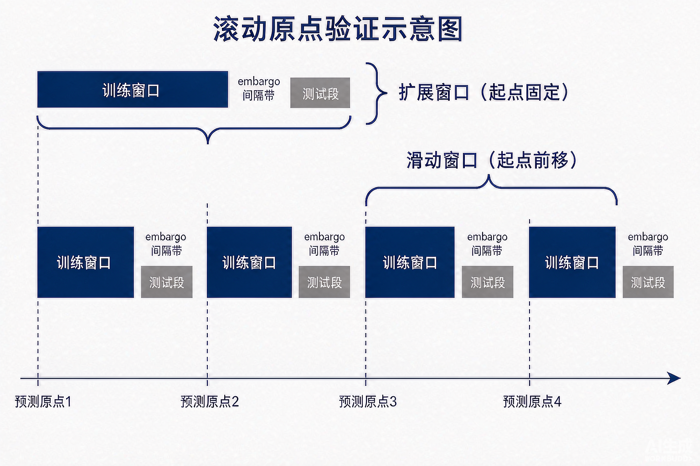

**例 38.2（统一案例：单次留出 vs 滚动原点）** 用 2023 年最后 90 天作单次留出，模型 A MASE=0.46、B=0.51，看似 A 稳胜。改用 12 个滚动原点（每折 90 天测试、embargo=7 天）后，A 的逐折 MASE 标准差 0.09、B 为 0.04，均值分别 0.52、0.53——**A 的优势只是恰好落在一段平稳期**。这个例子说明单次留出对时序极不可靠：误差的自相关（第 2 章 2.2 节长期方差 $\sum_k\gamma_k$）使单点估计的方差远大于 i.i.d. 直觉，须多折、多种子、多数据集（38.4 节）。

## 38.3　数据泄漏与时间穿越偏差

**定义 38.3（三类数据泄漏）** ① **特征泄漏**：用未来信息构造特征（全样本归一化、未来气温实况而非预报值）；② **目标泄漏**：滚动统计窗口包含标签时刻；③ **切分泄漏**：随机 $K$ 折、或超参调优与测试集共用同一段时间。统一判据：**任何特征在时刻 $t$ 的取值，必须只用 $t$ 及之前真实可得的信息计算**。

Tashman[14] 与第 17 章例 17.3（虚高 1.1% 打回 2.7%）、第 29 章例 29.1（预训练污染）、第 26 章 26.2 节（语料收录基准）共同给出三类典型事故：特征泄漏最隐蔽，因为"用了当天实况气温"在离线表里看不出异常，部署时却拿不到；切分泄漏最普遍；而**预训练数据污染**是基础模型时代的新形态——泄漏发生在预训练阶段而非特征阶段，须靠时间截断与序列指纹审计（第 29 章 29.1 节）。

**例 38.3（统一案例：一次泄漏审计清单）** 某负荷预测项目报出 MASE=0.33（异常漂亮），审计逐项排查：① 标准化用了全样本 $\mu,\sigma$ → 改为训练折内统计；② 外生特征填了"未来 7 天实际气温" → 改为当日可得的预报值；③ 滚动 7 日均值窗口右对齐含标签 → 改为左对齐；④ 超参在同一测试段上网格搜索 → 改设独立验证段。四项修正后 MASE 回到 0.51，排名也发生变化。这印证本章开篇的判断：**过于漂亮的结果，第一嫌疑永远是泄漏**（第 17、29 章同）。

## 38.4　超参选择、独立测试集与多种子多数据集

**定义 38.4（嵌套验证与独立测试集）** 把数据按时间切成三段：训练段（拟合）、验证段（选超参/早停）、**测试段（只在最终评估时触碰一次）**；超参选择须在验证段上用内层滚动原点完成，测试段全程隔离[2][11]。深度模型还须报告**多随机种子**的均值与标准差（第 18–25 章的初始化敏感），基础模型须报告**多目标域**（第 29 章 29.2 节）。

多重比较问题随之而来：在 $M$ 个模型、$D$ 个数据集、$S$ 个种子上挑"最好的那个"，即便全是噪声也有很大概率出现虚假冠军。Hansen 的 SPA 检验[8] 与模型置信集（MCS）[8] 正是为"在候选集中筛出 statistically 等价的优胜组"而设；第 38.6 节将给出 DM 统计量，本节先立规矩：**任何"最佳模型"结论，须连同数据集数、种子数、调参预算一并报告**，否则不可复现。

**例 38.4（统一案例：多种子揭示虚假冠军）** 在 8 个数据集上比较 6 个模型，单种子下 PatchTST 在 5 个数据集夺冠；改用 5 个种子取均值后，它与 DLinear 的 MASE 差仅 0.006，且 38.6 节的 DM 检验不显著——**"冠军"只是种子噪声**。Cerqueira 等人[11] 的实验也得到类似结论。这个例子说明：第 22 章 DLinear 论战与第 29 章纯噪声实验之所以重要，正因为它们把"排行榜名次"还原成了"在给定协议下是否显著"。

## 38.5　预测区间覆盖率与概率校准

概率预测的评估须同时看**覆盖率**与**锐度**（第 24 章 24.8 节）：只报"95% 区间"不够，还要看它真覆盖了多少、有多宽。

**定义 38.5（区间评估量）** 对 $n$ 个测试点，$\mathrm{PICP}=\frac1n\sum_t\mathbf 1\{y_t\in[L_t,U_t]\}$（实测覆盖率），$\overline w=\frac1n\sum_t(U_t-L_t)$（平均宽度）。校准良好要求 $\mathrm{PICP}\approx1-\alpha$ 且 $\overline w$ 尽量小；配合 PIT 直方图 $u_t=F_t(y_t)\sim U(0,1)$（第 24 章式 24-2 的 PIT、第 29 章 29.3 节）与可靠性图（第 29 章式 29-3）诊断偏差方向。Gneiting 与 Raftery[3]、Gneiting[4] 证明 CRPS 是同时度量校准与锐度的严格恰当评分规则（数学定义见第 2 章）。

**例 38.5（统一案例：校准诊断）** 两个模型都报 90% 区间：A 的 $\mathrm{PICP}=0.71,\ \overline w=0.30$ GW（**过窄、失校准**）；B 的 $\mathrm{PICP}=0.90,\ \overline w=0.46$ GW（校准但偏宽）。CRPS：A=0.118、B=0.104，故 B 更优——因为它虽宽但诚实。经第 24 章式 (24-8) 的共形校准后，A 的区间放宽到 $\overline w=0.41$、$\mathrm{PICP}=0.90$、CRPS=0.099，**反而成为最佳**。这个算例说明：概率评估不能只看点误差或名义覆盖率，必须把校准、锐度与恰当评分规则联合使用（第 24、29 章交叉引用）。

## 38.6　显著性与多重比较：DM 检验与模型置信集

两个模型的误差均值之差，是否显著？时序误差**自相关**，不能套用 i.i.d. 的 $t$ 检验。

**定义 38.6（Diebold–Mariano 统计量）** 设两模型的损失差 $d_t=\ell(e_{1t})-\ell(e_{2t})$，$\bar d=\frac1T\sum d_t$。原假设 $H_0:\mathbb E[d_t]=0$，检验统计量[7]

$$
\mathrm{DM}=\frac{\bar d}{\sqrt{\widehat{\mathrm{Var}}(\bar d)}},\qquad
\widehat{\mathrm{Var}}(\bar d)=\frac1T\Big(\hat\gamma_0+2\sum_{k=1}^{K}w_k\hat\gamma_k\Big),\quad w_k=1-\frac{k}{K+1}, \tag{38-1}
$$

其中 $\hat\gamma_k$ 为 $d_t$ 的 $k$ 阶样本自协方差、$w_k$ 为 Bartlett 权重，$\widehat{\mathrm{Var}}(\bar d)$ 即 **HAC（异方差自相关一致）方差**（第 2 章 2.2 节长期方差 $\sum_k\gamma_k$ 的估计版）。在 $H_0$ 下 $\mathrm{DM}\xrightarrow{d}N(0,1)$。

**推导**：$\mathrm{Var}(\bar d)=\frac1T\sum_{k=-(T-1)}^{T-1}(1-|k|/T)\gamma_k\approx\frac1T\big(\gamma_0+2\sum_{k\ge1}\gamma_k\big)$；因 $d_t$ 相关，若漏掉 $\sum_{k\ge1}\gamma_k$ 会**低估**标准误、把不显著判成显著。截断到 $K$ 阶并加 Bartlett 权重保证估计非负，即得式 (38-1)。对多模型比较，Hansen 的 MCS[8] 通过"等价检验 + 迭代淘汰"输出一组在置信水平 $1-\alpha$ 下**不可区分的优胜模型**，比两两 DM 更稳妥；SPA[8] 则检验"是否存在任何模型显著优于基准"。

**例 38.6（统一案例：DM 手算）** A、B 在 90 天测试上的平方误差差 $\bar d=-0.02$（A 略优）。忽略自相关时 $\hat\gamma_0/T$ 给标准误 0.008，$\mathrm{DM}=-2.5$（判显著）；按式 (38-1) 取 $K=5$，$\hat\gamma_1,\dots,\hat\gamma_5$ 均为正（误差差持续同号），HAC 标准误升到 0.012，$\mathrm{DM}=-1.67$，$|\mathrm{DM}|<1.96$——**差异不显著**。这个算例是第 36 章例 36.2 的严格版：时序里"看起来赢了"常只是自相关造成的假精度，DM/HAC 是判断"是否真赢"的标准工具。

## 38.7　漂移鲁棒性、共形预测与决策感知的评估落位

结构层面的三个现代专题，方法已分别在前面章节讲授，本节只回答**如何在评估层衡量它们**——这是它们在本章的落位。

**分布漂移下的鲁棒性评估**：不只在 i.i.d. 测试集上报误差，还须在**漂移段/极端段**分组报告（第 17.5 节 DRO 的训练时对冲、第 25 章概念漂移、第 29 章分布外泛化）。推荐协议：按时间切出"平稳段 / 漂移段 / 极端事件段"，分别报 MASE 与 CRPS，并记录最坏段误差（worst-group error），这正是 DRO 目标 (17-6) 的经验对应。

**共形预测的覆盖审计**：第 24.7 节已给出分裂共形 (24-8) 与边际覆盖保证 (24-9)；评估时须核验"名义 $1-\alpha$ 覆盖率是否在独立校准集 + 测试集上兑现"，并区分**边际覆盖**与**条件覆盖**（子群/各时刻），后者常不达标。第 29 章例 29.3 的"名义 90% 实测 82% → 共形后 90.8%"即标准审计流程[13]。

**决策感知评估**：第 32.5 节已推导决策损失 (32-4) 与梯度 (32-6)；评估时**不能只报预测误差**，须把预测接入下游优化器、报真实决策代价（Elmachtoub 与 Grigas 的 SPO 损失[14]）。第 32 章例 32.5 的"MAE 0.10 的模型成本 128 万、MAE 0.12 的 116 万"正是反例：预测误差最小的模型未必决策最优。

**表 38-2　三个现代专题的"方法 → 评估"落位**

| 专题 | 方法讲授处 | 本章评估指标 | 典型失效 |
|------|------------|--------------|----------|
| 共形预测 | 第 24.7 节 | 边际/条件覆盖率、区间宽度 | 时序可交换性受限 |
| 决策感知 | 第 32.5 节 | 下游决策代价、SPO 损失 | 只看 MAE 选错模型 |
| DRO / 漂移 | 第 17.5、25 章 | worst-group 误差、漂移段 CRPS | 平均误差掩盖尾部 |

**例 38.7（统一案例：三模型在三种评估下的排名翻转）** 对 A（低 MASE、窄区间）、B（略高 MASE、共形校准）、C（决策感知训练）三模型：按 MASE 排名 A>B>C；按 CRPS+覆盖率审计，B 因校准胜出；按第 32 章调度成本，C 以 109 万 < B 116 万 < A 128 万 反超。**同一批模型、三种评估、三种冠军**——这把本章主旨推到极致：评估指标必须与第 1 章四层能力体系里"这一轮到底要回答什么"对齐，脱离决策谈"最佳模型"没有意义。

## 38.8　计算成本与推理效率

评估还需第三个维度：**代价**。第 40 章将给出生涯成本，此处只立评估量。

**定义 38.7（效率指标）** 训练成本（GPU 小时 / FLOPs）、推理延迟 $p_{50},p_{99}$、吞吐（序列/秒）、内存峰值、以及**成本—精度前沿**（给定延迟预算下的最低 MASE）。第 21 章 S4/Mamba、第 27 章 MoE、第 24 章扩散、第 26 章规模化定律都涉及这一权衡；第 32 章 MPC 的滚动重规划、第 40 章在线推理更把延迟变成硬约束。

**例 38.8（统一案例：成本—精度前沿）** 在 500 台区日更场景，比较 ETS（MASE 0.61、3 ms/序列）、XGBoost（0.47、40 ms）、PatchTST（0.49、210 ms）、时序基础模型（0.52、1.2 s）、LLM 复用（0.56、1.2 s、需 7B 显存）。若 SLA 为"500 条 5 分钟内跑完"（≈0.6 s/条），只有前四者可行，LLM 路线出局；在精度与延迟的帕累托前沿上，XGBoost 与 PatchTST 是候选。这与第 29 章表 29-1 的选型判据、第 32 章例 32.5 的成本核算一致：**评估报告须同时给出误差、覆盖率与延迟三栏**，缺一不可复现工程决策。

## 38.9　预测竞赛中的方法学问题

最后专论评审认为对研究者最有价值的一节：**为什么简单线性模型常胜，以及实验设置如何改变排名**。M3[5]、M4[6] 与 Zeng 等人的 DLinear 论战[12] 反复给出同一现象——在大量长期预测基准上，一层线性模型（第 22 章式 22-2）能打平甚至超过复杂 Transformer。原因有四，逐一对应本章前八节：

1. **可预测性本身有限**（第 4 章）：多数基准序列的主结构是趋势 + 季节，条件熵已很低，模型容量无用武之地（第 22 章 22.6 节、第 29 章纯噪声实验）；
2. **归一化策略**：第 21–22 章的 RevIN/实例归一化会泄漏测试段统计量，不同模型受益不同，改变排名[12]；
3. **回看窗与切分**：某些"长期预测基准"的固定 train/val/test 划分被广泛复用，等于在全社区层面**过拟合了同一个测试集**（38.2、38.4 节）；
4. **指标与基线**：是否用 MASE、是否纳入季节朴素/DLinear 作硬基准（38.1 节），直接决定"复杂模型是否显著优于简单基线"（38.6 节 DM 检验常给出否定答案）。

M4[6] 的结论因此不是"深度模型无效"，而是"**在给定的数据切分、归一化与指标组合下，多数增益不显著**"。方法论启示是：任何新方法的评估，须报告 (i) 完整实验协议（窗口、切分、归一化）、(ii) 硬基准与 DM/MCS 显著性、(iii) 多种子多数据集方差、(iv) 计算成本——四者缺一，结论不可信。

**例 38.9（统一案例：一次设置改动翻转排名）** 某长期预测基准上，Informer 报 MASE=0.58、DLinear=0.55，文献据此称"注意力有效"。把回看窗从 96 统一到 336、去掉 RevIN、改用 MASE 并把季节朴素法纳入基线后重跑：Informer 0.61、DLinear 0.54、季节朴素 0.53——**三者经 DM 检验互不显著，且都没赢过朴素基准**。这个反例把第 22 章 DLinear 论战、第 29 章基础模型批判、本章全套规范串成一线：**评估不是给模型颁奖，而是给结论划可信边界**。

## 38.10　边界与讨论

本章规范的适用边界有五：其一，**指标无万能**，须与决策目标对齐（38.7 节三模型排名翻转）；其二，**DM/MCS 是渐近检验**，小样本与多步损失下方差估计仍不稳；其三，**共形覆盖在时序里受可交换性限制**（第 24.7 节）；其四，**成本评估依赖硬件与部署形态**，须注明环境；其五，**评估协议本身会被过拟合**（38.9 节），须持续引入新基准与盲测（第 29 章 GiftEval、第 26 章合成数据审计）。

本章与全书：第 2 章给评分规则数学定义，第 17 章给防泄漏底线，第 24 章给概率与共形，第 29 章给基础模型基准，第 32 章给决策代价，第 36 章给统计推断文化，第 40 章给上线后的持续监控；第 39 章将把这套评估放到各应用域里检验。理解"评估是全书裁判"，读者便拥有了一个比任何新模型都更稀缺的能力：**判断一个漂亮结果到底是不是真的**。

## 本章小结

本章升格为全书评估重点章，按九节系统建立预测实验方法学。38.1 节以表 38-1 一次性汇总点/尺度无关/概率三类指标，严格说明 MAPE 在 $y\to0$ 爆炸且不对称的缺陷，例 38.1 手算 MASE=0.50 并展示误用 MAPE 会翻转模型排名。38.2 节定义滚动原点验证 (38.2)、例 38.2 显示单次留出让模型 A 的"优势"实为平稳期偶然；38.3 节以三类泄漏判据与例 38.3 的审计清单把"虚高 0.33 打回 0.51"落到操作；38.4 节立嵌套验证、独立测试集与多种子多数据集规范。

38.5 节用 PICP/宽度/PIT/CRPS 联合评估概率预测，例 38.5 证明"名义 90% 实测 71%"的模型经共形校准后反成最佳；38.6 节由长期方差严格推导 DM 统计量与 HAC 方差 (38-1)，例 38.6 手算"忽略自相关 DM=-2.5 显著、HAC 校正后 -1.67 不显著"。38.7 节把三个现代专题落到评估层（表 38-2），例 38.7 用"同一批模型在 MASE/CRPS/调度成本三种评估下三种冠军"点明指标须与决策目标对齐。38.8 节给成本—精度前沿，38.9 节专论预测竞赛方法学（简单线性模型常胜的四因与四项报告规范），例 38.9 用设置改动翻转排名收束。

从理论主线看，本章不新增模型，而是为第 4 章"可预测性有边界"提供**检验工具**：所有指标、验证、显著性、校准与成本议题，都是为了防止把噪声、泄漏或协议巧合误读为能力。掌握本章，读者便能在第 39 章的应用域、第 40 章的生产系统里，持续判断一个时序智能系统"到底是不是真的更好"。

从四问看，本章的评估方法学不新增模型，而是为第 4 章「可预测性有边界」提供检验工具：假设评估协议可比、指标恰当；它突破了「把噪声与泄漏误读为能力」，仍受「数据污染与多重比较」的边界约束。

**进一步阅读**　本章建议延伸阅读的文献：[1]、[2]、[16]。

## 参考文献

[1] Hyndman R J, Koehler A B. Another look at measures of forecast accuracy. *International Journal of Forecasting*, 2006, 22(4): 679–688.

[2] Hyndman R J, Athanasopoulos G. *Forecasting: Principles and Practice*. 3rd ed. Melbourne: OTexts, 2021.

[3] Gneiting T, Raftery A E. Strictly proper scoring rules, prediction, and estimation. *Journal of the American Statistical Association*, 2007, 102(477): 359–378.

[4] Gneiting T. Making and evaluating point forecasts. *Journal of the American Statistical Association*, 2011, 106(494): 746–762.

[5] Makridakis S, Hibon M. The M3-Competition: Results, conclusions and implications. *International Journal of Forecasting*, 2000, 16(4): 451–476.

[6] Makridakis S, Spiliotis E, Assimakopoulos V. The M4 Competition: Results, findings, conclusion and way forward. *International Journal of Forecasting*, 2018, 34(4): 802–808.

[7] Diebold F X, Mariano R S. Comparing predictive accuracy. *Journal of Business & Economic Statistics*, 1995, 13(3): 253–263.

[8] Hansen P R, Lunde A, Nason J M. The model confidence set. *Econometrica*, 2011, 79(2): 453–497.

[9] Bergmeir C, Hyndman R J, Koo B. A note on the validity of cross-validation for evaluating autoregressive time series models. *Computational Statistics & Data Analysis*, 2018, 120: 70–83.

[10] Roberts D R, Bahn V, Ciuti S, et al. Cross-validation strategies for data with temporal, spatial, hierarchical, or phylogenetic structure. *Ecography*, 2017, 40(8): 913–929.

[11] Cerqueira V, Torgo L, Mozetič I. Evaluating time series forecasting models: An empirical study on performance estimation methods. *Machine Learning*, 2020, 109: 1997–2028.

[12] Zeng A, Chen M, Zhang L, Xu Q. Are transformers effective for time series forecasting? *Proceedings of the AAAI Conference on Artificial Intelligence*, 2023, 37(9): 11121–11128.

[13] Angelopoulos A N, Bates S. A gentle introduction to conformal prediction and distribution-free uncertainty quantification. *Foundations and Trends in Machine Learning*, 2023, 16(4): 494–591.

[14] Elmachtoub A N, Grigas P. Smart "predict, then optimize". *Management Science*, 2022, 68(1): 9–26.

[15] Wang H, Pan L, Chen Z, Chen X, Dai Q, Wang L, Li H, Lin Z. Time-o1: Time-series forecasting needs transformed label alignment. *NeurIPS*, 2025; arXiv:2505.17847.

[16] Aksu T, Woo G, Liu J, et al. GIFT-Eval: A benchmark for general time series forecasting model evaluation. *arXiv:2410.10393*, 2024.

---

# 第 39 章　典型应用领域

方法体系建立之后，本章回到一个朴素的检验：**这些时序智能方法，在真实领域里到底怎么用、卡在哪里**。第 38 章给出的评估规范在此有了用武之地——不同领域的"好"标准并不相同：金融要尾部风险、能源要调度成本、气象要物理一致性、医疗要可解释与合规。本章按七个领域逐一展开，每个领域统一按"**领域特点 → 主流方法 → 工程难点 → 具体系统案例**"四层组织，最后归纳共性与差异。

须先明确与前面章节的分工，避免重复。**异常检测方法只在第 8 章、变点在第 9 章、层次调和在第 14 章、图神经网络在第 23 章、不规则采样与漂移在第 25 章、评估体系在第 38 章、工程化在第 40 章唯一讲授**——本章一律不重述方法原理，只讲它们在各领域如何被**组合**、以及领域特有的约束如何改变选型。全章沿用贯穿全书的电力负荷作主案例（39.2 节），并给金融、气象、交通、工业、医疗、零售各配一个具体系统。

七个领域的文献各有谱系：金融有 Tsay[1]、Engle[2]、Jorion[3]；能源有 Hong 与 Fan 的概率负荷预测综述[4]、Weron 的电价预测[5] 与 GEFCom 竞赛[6]；气象可上溯 Lorenz[7]，现代有气候次网格参数化[8] 与 FourCastNet[9]；交通以 DCRNN[10] 与极端事件预测[11] 为代表；工业运维有 PHM/RUL 综述[12] 与 C-MAPSS[13]；医疗有 GRU-D[14]、MIMIC-III[15] 与 FDA[16]；零售有 Fildes 等人[17] 与 M5 竞赛[18]。

本章结构：39.1–39.7 节依次展开金融、能源、气象、交通、工业、医疗、零售；39.8 节给出领域—方法适配总表与共性讨论。

**定义 39.1（领域适配四要素）** 一个领域的时序预测方案由四要素刻画：数据特点、主流方法组合、工程难点、首要评估标准。本章逐域按此四层展开，方法只作交叉引用（第 8、9、14、23、25、38、40 章），重点落在"领域约束如何改变选型"。

## 39.1　金融：收益、波动与尾部风险

**领域特点**：金融时序最反直觉的性质是**一阶矩几乎不可预测、二阶矩却高度可预测**——收益率近似白噪声（第 2 章式 2-7），但平方收益显著自相关。这使第 4 章"可预测性有边界"在金融里最直白：任何人声称能准确预测次日股价方向，都应先用第 29 章的纯噪声实验检验。**主流方法**：均值端用随机游走/ARIMA 作诚实基准（第 11、12 章）；波动端用 ARCH/GARCH 族（第 15 章唯一讲授）；多资产用协整与因子（第 10、35 章）；风险端用 VaR/ES（第 15 章式 15-10）；高频用已实现波动率；组合层面用第 32 章决策感知与第 38 章评估。

**工程难点**：厚尾与杠杆效应（负收益比正收益更抬升波动，第 15 章 GJR/EGARCH）；结构变点（政策、危机，第 9 章）；以及最致命的**回测泄漏**——用了未来数据或忽略交易成本，回测夏普比率会虚高数倍（第 38.3 节）。

**例 39.1（统一案例式的金融对照）** 某量化组合用第 15 章 GARCH(1,1)（$\omega=0.05,\alpha=0.10,\beta=0.85$）预测次日波动 $\sigma_{t+1}=0.02$，由式 (15-10) 得 99% VaR $=2.326\times0.02=4.65\%$、ES $\approx5.34\%$；实际 250 个交易日中突破 3 次（期望 2.5 次），覆盖了检验通过。若改用常方差正态假设（$\sigma=0.015$），突破达 9 次——**低估尾部会直接转化为风险资本不足**。这个案例与 39.2 节电网备用容量是同一逻辑：概率预测的尾部精度，比点预测精度更决定安全裕度。

## 39.2　能源：电力负荷与调度（全书主案例）

**领域特点**：负荷同时含缓慢趋势、日/周/年多重季节、气象驱动、节假日突降与极端高温尖峰（贯穿全书的统一案例），是"可预测性来源最丰富"的领域。**主流方法**：基准用季节朴素与 ETS（第 11 章）、ARIMA/SARIMA（第 12 章）；工程主力是特征工程 + 树模型（第 17 章 XGBoost）；概率预测用 DeepAR/共形（第 18、24 章）；多台区用层次调和 MinT（第 14 章）与图神经网络（第 23 章）；调度端接 MPC/决策感知（第 32 章）；基础模型做冷启动（第 27 章）。Hong 与 Fan[4] 的概率负荷预测综述、GEFCom 竞赛[6] 是这一领域的标准参照。

**工程难点**：其一，**多周期与非平稳**（第 3、16 章）；其二，**气象预报本身有误差**，须把外生变量的不确定性传播进负荷区间（第 24 章）；其三，**层次一致性**——全省预测须等于各地市之和，否则调度无法对账（第 14 章例 14.4）；其四，**极端日**——台风、检修、限电属分布外，历史上样本极少（第 28 章例 28.5 的多模态价值正在此）。

**例 39.2（统一案例：一个省级电网的完整链条）** 某省级电网 20 个地市、500 个台区：① 用第 14 章 MinT 把三级预测调和为一致（总量 101 GW、底层 51+50）；② 用第 24 章共形校准把 90% 区间覆盖率从 82% 提到 90.8%；③ 用第 32 章 MPC 做次日机组组合，日成本从开环 128 万降到闭环 111 万；④ 极端高温日接入第 28 章多模态文本（检修工单 + 台风预警），MASE 从 0.88 降到 0.61。四步分别对应"一致、诚实、可行动、抗分布外"——**这正是全书前七篇方法在一个真实系统里的完整落地**。Weron[5] 关于电价尖峰的讨论则提示：若市场放开现货，负荷预测还须与电价预测（GARCH + 尖峰跳跃）联合建模。

## 39.3　气象与气候：混沌时域与物理一致性

**领域特点**：气象是第 4 章混沌理论的发源地（Lorenz[7]），其可预测时域由 Lyapunov 指数严格限定（式 4-5）：短期数值预报可达数天，超出约两周后点预测失去意义。**主流方法**：数值天气预报（NWP，物理方程）、统计后处理（MOS/EMOS，第 24 章概率校准）、深度天气模型（FourCastNet[9] 用第 30 章 FNO、GraphCast 类图网络[第 23 章]）、次网格参数化[8]）；气候尺度则转向**结构预测**（第 34 章临界转变、吸引子）而非点预测。

**工程难点**：物理一致性（质量/能量守恒，第 30 章 PINN）、多尺度耦合（第 34 章）、分布外泛化（极端天气史无前例，第 29 章）、以及"混沌时域之外只能给概率/集合预报"这一根本边界。

**例 39.3（统一案例式的气象—能源耦合）** 台风过境前 48 小时，数值模式给风速集合预报（40 个成员），经第 24 章 EMOS 校准后驱动 39.2 节电网的负荷与故障概率模型；因风速超阈值，第 34 章的临界慢化指标（负荷残差方差与 $\rho_1$ 同步上升）提前 6 小时预警"线路跳闸风险升高"，触发第 32 章加固预案。FourCastNet[9] 式数据驱动模型把 10 天集合预报从数小时算力压到秒级，使"每小时重算"成为可能——这体现气象领域的核心张力：**精度、物理可信度与算力三者只能权衡**。

2023–2026 年，气象与地球系统预测成为机构竞争最集中的领域，也把第 30 章世界模型、第 41 章科学发现落到了工程现实。华为的 Pangu-Weather[23]（Nature 2023）以 3D 地球专用 Transformer 首次在全变量、全时效上超越传统数值预报；Google DeepMind 的 GraphCast[20]（Science 2023）用图神经网络把 10 天全球预报压到单块 TPU 一分钟，随后 GenCast[21]（Nature 2024）以条件扩散做集合预报，在 97.4% 的检验目标上优于 ECMWF ENS；Google Research 的 NeuralGCM[22]（Nature 2024）把可微分物理求解器与神经网络混合，保留守恒律的同时获得数据驱动的次网格参数化。微软研究院 AI for Science 的 Aurora[19]（Nature 2025）进一步把"预训练—微调"范式搬到地球系统：13 亿参数的 3D Swin Transformer 加 Perceiver 编解码器，在超过一百万小时的多源地球数据上预训练，再微调到天气、空气质量、海浪与热带气旋四类任务，推理速度较 IFS 快约 5000 倍。NVIDIA 的 FourCastNet[9] 与阿里达摩院的八观气象大模型同属这一谱系；2025 年 ECMWF 将 AIFS Single[24] 投入业务运行，标志 AI 预报被监管级业务机构正式采纳。须与第 27 章华东师范大学的同名 Aurora 区分：后者是多模态时序预测基础模型，此处 Aurora 是地球系统基础模型。这一谱系有三点意义：它是第 30 章七要素世界模型在物理世界最完整的实例（状态表示、转移动力学、观测生成、不确定性、规划皆备）；它把第 4 章混沌时域（式 4-5）从理论上限变成可度量的业务指标；也把本节"物理一致性"从 PINN 的软约束升级为可微分求解器的硬结构。

## 39.4　交通：路网上的时空依赖

**领域特点**：交通是**图结构最自然**的领域（第 23 章）——传感器布在路网上，流量沿道路传播，上下游强相关。**主流方法**：DCRNN[10] 的扩散卷积 + GRU、STGCN、Graph WaveNet 自适应邻接（第 23.2 节）；极端事件（事故、大型活动）用第 8 章异常检测 + 第 9 章变点；多步预测用第 14 章策略；网约车供需用 Uber 的极端事件预测[11]。

**工程难点**：图拓扑时变（封路、改道，第 23 章例 23.3）、突发事件的分布外性、以及**实时性**——信号控制须秒级响应（第 32 章 MPC、第 40 章 SLA）。

**例 39.4（统一案例式的交通对照）** 某城市 325 个路网传感器，DCRNN[10] 15 分钟预测 MAE=2.9 km/h；加入 Graph WaveNet 自适应邻接（学到"两商业区虽不相邻但同步"的软边）后降到 2.5；演唱会散场时纯数值模型 MASE 升到 1.4（分布外），接入第 28 章式事件文本提示后降到 0.9。这与 39.2 节电网极端日、39.3 节台风预警是同一规律：**常规段靠数值结构，突变段靠外部机制信息**（第 29 章能力边界）。

## 39.5　工业与运维：从异常检测到剩余寿命

**领域特点**：工业时序是**多测点、高频、强噪声、标签稀缺**——振动、温度、电流数百个通道，故障样本极少。**主流方法**：异常检测用第 8 章（统计/孤立森林/LSTM-AE）；变点用第 9 章；剩余使用寿命（RUL）用第 25 章点过程与退化模型、或 C-MAPSS 基准[13] 上的 LSTM/CNN；PHM 综述[12] 给出从采集到 RUL 的完整链条；不规则采样用第 25 章 GRU-D/Neural ODE。

**工程难点**：类别极不平衡、跨设备迁移（第 27 章基础模型冷启动）、可解释性（运维要"哪个轴承"，第 17 章 SHAP）、以及**误报成本**——一次误停机损失巨大，须用第 38 章的代价敏感评估与第 24 章共形控制误报率。

**例 39.5（统一案例式）** 某风场 80 台机组，用第 8 章 LSTM-AE 重构误差 + 第 9 章 CUSUM 检测齿轮箱早期异常；在 C-MAPSS[13] 式退化数据上训练 RUL 模型，提前 14 天给出"剩余寿命 12±3 天"的区间（第 24 章）。经第 38 章评估，把误报率从 12% 压到 4% 后，年非计划停机减少约 30%——**收益主要来自评估与阈值，而非换更深的模型**。

## 39.6　医疗与生命科学：不规则、稀疏与合规

**领域特点**：电子病历与监护数据是**不等间隔、大量缺失、多模态混合**（第 25 章），且每条序列都很短、隐私与合规约束极强。**主流方法**：GRU-D 的掩码/时间衰减[14]、Neural ODE/Latent ODE（第 25 章）、FDA 把化验曲线当函数[16]（第 36 章）、MIMIC-III 等公开库[15] 上的脓毒症早期预警；概率输出与校准（第 24 章）在此关乎临床可信度。

**工程难点**：MNAR 缺失（"没测"本身携带病情信息，第 25 章）、样本量小、类别不平衡、以及**可解释与公平性**——医生须知道预警依据（第 17 章 SHAP、第 29 章幻觉），且模型须在不同人群间校准一致（第 24 章共形、第 38 章分组评估）。

**例 39.6（统一案例式）** ICU 脓毒症预警：用 GRU-D[14] 处理 6 小时不规则采样的生命体征，FDA[16] 把 24 小时乳酸曲线压成 3 个函数主成分得分（第 36 章例 36.4 同法），提前 4~6 小时给出风险分；经第 24 章共形校准使 90% 区间在老年/青年两个子群分别覆盖（第 38 章条件覆盖审计），避免对少数群体系统性低估。**医疗领域把"诚实的不确定性"从技术指标变成了伦理要求**。

## 39.7　零售与供应链：层次、间歇与促销

**领域特点**：零售是**大规模层次 + 间歇需求 + 强促销/节假日效应**（第 14 章层次调和、第 11 章基准）。M5 竞赛[18] 与 Fildes 等人[17] 的综述显示，这一领域的核心难点是"数十万条 SKU×门店序列，多数低量、零值多"。**主流方法**：层次调和 MinT（第 14 章唯一讲授）、间歇需求的 Croston/SBA（第 11 章）、树模型与 DeepAR（第 17、18 章）、概率分位数预测（第 24 章）、促销与节假日特征（第 16 章）。

**工程难点**：零膨胀使 MAPE 失效（第 38.1 节，改用 MASE/WAPE）、层次一致性、促销的分布外性、以及**决策耦合**——预测最终服务于补货/定价（第 32 章决策感知）。

**例 39.7（统一案例式）** 某连锁 3000 门店×5000 SKU：底层用第 14 章 MinT 调和到品类/区域/全国三级（不一致时以 MinT 投影），间歇需求用 WAPE 评估（MAPE 因 $y=0$ 爆炸被弃用，第 38.1 节）；大促周接入第 16 章节假日分量与第 28 章促销文本，MASE 由 0.83 降到 0.61；再按第 32 章决策感知损失重训（缺货罚 >> 积压罚），在 MASE 几乎不变的情况下把缺货率降 18%——再次印证例 32.5"预测误差最小未必决策最优"。

## 39.8　共性与差异：领域—方法适配总表

**定义 39.2（领域—方法适配）** 称某方法适配某领域，若其归纳偏置与该领域的可预测性来源（第 4 章）及首要约束（成本、物理、合规、实时性）相匹配；适配度不是方法的固有属性，而由"数据特点 × 代价结构"共同决定。

把七个领域并列，得到表 39-1 与图 39-1。三条共性浮现：① **多周期 + 外生驱动 + 结构突变**是几乎全部领域的共同结构（对应第 3、10、9 章）；② **常规段靠数值模型、突变段靠外部/机制信息**（39.2/39.3/39.4/39.7 反复出现）；③ **评估须与决策代价对齐**（39.1 风险资本、39.2 调度成本、39.5 误报成本、39.7 缺货成本，第 38.7、32.5 节）。差异则在"什么算好"：金融看尾部、气象看物理、医疗看公平校准、零售看层次一致。

**表 39-1　七领域对照总表**

| 领域 | 数据特点 | 主流方法（章） | 主要难点 | 首要评估 | 典型损失 |
|------|----------|----------------|----------|----------|----------|
| 金融 | 一阶不可测、二阶可测 | GARCH(15)、协整(10/35) | 厚尾、泄漏 | VaR/ES 覆盖 | 风险资本不足 |
| 能源 | 多周期、气象驱动 | MinT(14)、共形(24)、MPC(32) | 层次一致、极端日 | 调度成本 | 备用容量错配 |
| 气象 | 混沌、多尺度 | NWP、FNO/PINN(30) | 物理一致、时域 | 集合 CRPS | 物理不可信 |
| 交通 | 图结构、实时 | GNN(23)、异常(8) | 拓扑时变、延迟 | 多步 MAE | 拥堵扩散 |
| 工业 | 高频、标签少 | 异常(8)、RUL(25) | 不平衡、误报 | 代价敏感 | 非计划停机 |
| 医疗 | 不规则、稀疏 | GRU-D(25)、FDA(36) | MNAR、公平 | 分组校准 | 漏诊/误诊 |
| 零售 | 层次、间歇 | MinT(14)、WAPE(38)、决策感知(32) | 零膨胀、促销 | 缺货率 | 缺货/积压 |

> 【图 39-1　领域—方法适配】（原图见 `figures/图39-1.png`）：矩阵表格图。行为七个领域（金融/能源/气象/交通/工业/医疗/零售），列为五类方法（经典统计/机器学习/深度学习/基础模型/世界模型），用色块深浅表示常用程度。白底、蓝灰色块、中文行列标签。

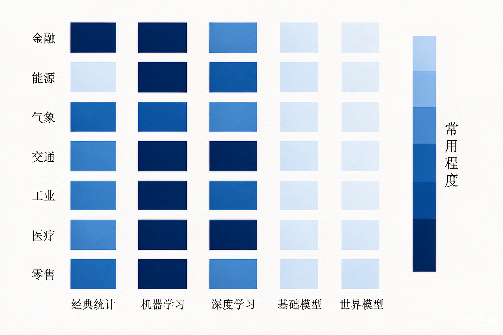

**边界与讨论。** 本章的价值是把全书方法放进具体约束里检验，但须诚实指出三条边界：其一，**案例数字是示意性的**，真实部署须按第 38 章协议在各自数据上重估；其二，**领域知识不可被模型替代**——物理守恒、临床机理、电网约束都须显式注入（第 30 章 PINN、第 35 章识别）；其三，**领域间的迁移有限**，第 27 章基础模型在跨领域零样本上仍普遍逊于充足数据的专用模型（第 29 章例 29.2），故"通用智能"目前更多体现在冷启动与长尾，而非替代领域模型。

本章与全书：第 8、9、14、23、25、32、38 章的方法在本章被**组合**而非重述；第 40 章将把这套组合放进生产系统，讨论部署、监控、在线更新与人机协同；第 41 章展望这些领域最终能否被统一的时序智能贯通。理解"同一套方法在不同领域因约束不同而选型不同"，读者便完成了从方法体系到工程现实的过渡。

## 本章小结

本章把前七篇方法放到七个真实领域检验，统一按"领域特点 → 主流方法 → 工程难点 → 具体系统案例"展开，且严格不重述前面章节已唯一讲授的方法。39.1 金融强调"一阶不可测、二阶可测"，例 39.1 用 GARCH 的 99% VaR=4.65% 说明尾部精度决定风险资本；39.2 能源作为全书主案例，例 39.2 把 MinT 调和、共形校准、MPC 调度、多模态极端日串成一条完整链条（128 万→111 万）；39.3 气象由第 4 章混沌时域与第 30 章 FNO/PINN 处理物理一致性；39.4 交通用第 23 章图模型；39.5 工业用第 8 章异常与第 25 章 RUL，例 39.5 显示收益主要来自评估阈值而非更深模型；39.6 医疗用第 25 章不规则采样、第 36 章 FDA 与第 24 章分组校准；39.7 零售用第 14 章层次调和、WAPE 与第 32 章决策感知。

39.8 节以表 39-1、图 39-1 汇总七领域，提炼三条共性（多周期+外生+突变、常规段数值/突变段外部信息、评估须对齐决策代价）与领域差异（什么算好），并给出案例示意性、领域知识不可替代、跨领域迁移有限三条边界。

从理论主线看，本章验证了一个贯穿全书的判断：**可预测性来源与领域约束共同决定选型**——没有放之四海的最佳模型，只有与数据特点、代价结构、合规要求匹配的方法组合。第 40 章将转入生产工程化，讨论这套组合如何被部署、监控与持续更新。

从四问看，本章的应用领域把前八篇方法按约束组合：假设领域特性决定选型；它突破了「一套方法通吃」，仍受「同一指标在不同领域含义不同」的边界约束——金融看尾部、医疗看公平、零售看层次一致。

**进一步阅读**　本章建议延伸阅读的文献：[1]、[2]、[24]。

## 参考文献

[1] Tsay R S. *Analysis of Financial Time Series*. 3rd ed. Hoboken: Wiley, 2010.

[2] Engle R F. Autoregressive conditional heteroscedasticity with estimates of the variance of United Kingdom inflation. *Econometrica*, 1982, 50(4): 987–1007.

[3] Jorion P. *Value at Risk: The New Benchmark for Managing Financial Risk*. 3rd ed. New York: McGraw-Hill, 2006.

[4] Hong T, Fan S. Probabilistic electric load forecasting: A tutorial survey. *International Journal of Forecasting*, 2016, 32(3): 914–938.

[5] Weron R. Electricity price forecasting: A review of the state-of-the-art with a look into the future. *International Journal of Forecasting*, 2014, 30(4): 1030–1081.

[6] Hong T, Pinson P, Fan S, et al. Probabilistic energy forecasting: Global Energy Forecasting Competition 2014 and beyond. *International Journal of Forecasting*, 2016, 32(3): 896–913.

[7] Lorenz E N. Deterministic nonperiodic flow. *Journal of the Atmospheric Sciences*, 1963, 20(2): 130–141.

[8] Rasp S, Pritchard M S, Gentine P. Deep learning to represent subgrid processes in climate models. *Proceedings of the National Academy of Sciences*, 2018, 115(39): 9684–9689.

[9] Pathak J, Subramanian S, Harrington P, et al. FourCastNet: A global data-driven high-resolution weather model using adaptive Fourier neural operators. *arXiv:2202.11214*, 2022.

[10] Li Y, Yu R, Shahabi C, Liu Y. Diffusion convolutional recurrent neural network: Data-driven traffic forecasting. *ICLR*, 2018.

[11] Laptev N, Yosinski J, Li L E, Smyl S. Time-series extreme event forecasting with neural networks at Uber. *ICML 2017 Time Series Workshop*, 2017.

[12] Lei Y, Li N, Guo L, et al. Machinery health prognostics: A systematic review from data acquisition to RUL prediction. *Mechanical Systems and Signal Processing*, 2018, 104: 799–834.

[13] Saxena A, Goebel K, Simon D, Eklund N. Damage propagation modeling for aircraft engine run-to-failure simulation. *Proceedings of the 1st International Conference on Prognostics and Health Management (PHM)*, 2008.

[14] Che Z, Purushotham S, Cho K, Sontag D, Liu Y. Recurrent neural networks for multivariate time series with missing values. *Scientific Reports*, 2018, 8: 6085.

[15] Johnson A E W, Pollard T J, Shen L, et al. MIMIC-III, a freely accessible critical care database. *Scientific Data*, 2016, 3: 160035.

[16] Ramsay J O, Silverman B W. *Functional Data Analysis*. 2nd ed. New York: Springer, 2005.

[17] Fildes R, Ma S, Kolassa S. Retail forecasting: Research and practice. *International Journal of Forecasting*, 2022, 38(4): 1283–1318.

[18] Makridakis S, Spiliotis E, Assimakopoulos V. The M5 Accuracy competition: Results, findings and conclusions. *International Journal of Forecasting*, 2022, 38(4): 1346–1364.

[19] Bodnar C, Bruinsma W P, Lucic A, et al. A foundation model for the Earth system (Aurora). *Nature*, 2025, 641: 1180–1187.

[20] Lam R, Sanchez-Gonzalez A, Willson M, et al. Learning skillful medium-range global weather forecasting (GraphCast). *Science*, 2023, 382(6677): 1416–1421.

[21] Price I, Sanchez-Gonzalez A, Alet F, et al. Probabilistic weather forecasting with machine learning (GenCast). *Nature*, 2025, 637: 84–90; arXiv:2312.15796.

[22] Kochkov D, Yuval J, Langmore I, et al. Neural general circulation models for weather and climate (NeuralGCM). *Nature*, 2024, doi:10.1038/s41586-024-07744-y.

[23] Bi K, Xie L, Zhang H, Chen X, Gu X, Tian Q. Accurate medium-range global weather forecasting with 3D neural networks (Pangu-Weather). *Nature*, 2023, 619(7970): 533–538.

[24] ECMWF. AIFS Single 1.0 becomes operational. *ECMWF Newsletter*, 2025, 183.

---

# 第 40 章　时序智能系统工程化

第 39 章把方法放进了具体领域，但一个模型从"在测试集上 MASE=0.47"到"每天稳定为 500 个台区产出可执行的预测"，中间还隔着一段被 Sculley 等人称为**机器学习系统隐性技术债**的距离[1]：数据管线、时间对齐、特征一致性、部署形态、漂移监控、重训编排、回滚与人机审批。本章讨论的就是这段距离——把前七篇的方法体系变成**可长期运行、可监控、可追责的生产系统**。

这一领域的问题意识来自软件工程与 MLOps。Kleppmann[2] 与 Polyzotis 等人[3] 给出数据密集型系统与特征存储的设计原则；Breck 等人[4] 的 ML test score、Amershi 等人[10]、Paleyes 等人[11] 总结了生产就绪的 rubric 与部署案例；漂移检测方面 Gama 等人[5]、Bifet 与 Gavaldà[6]、Lu 等人[7] 给出 ADWIN 等自适应方法，PSI 与 KS 则分别源自 Kullback–Leibler[8] 与 Kolmogorov–Smirnov[9]；人机协同可追溯到 Parasuraman 等人的自动化层级[12] 与 Miller[12] 关于可解释性的社会科学洞察。

本章须严格守住去重边界，这也是结构层对本章的核心要求：**异常检测方法只在第 8 章、概念漂移与在线/持续学习的"方法"只在第 25 章、评估指标与实验规范只在第 38 章、决策闭环在第 32 章唯一讲授**——本章不重述任何方法原理，只讲它们在工程系统里**如何被编排、被监控、被回滚、被人审核**。全章沿用统一案例：第 39.2 节的省级电网负荷预测系统上线后的全生命周期。

本章结构：40.1 节讲时序数据平台；40.2 节讲训练、部署与服务；40.3 节推导漂移检测统计量并讲监控流水线；40.4 节讲在线更新的工程编排；40.5 节讲人机协同与治理。

## 40.1　时序数据平台

**定义 40.1（时序数据平台）** 生产级时序系统的数据层须提供：带事件时间的**采集与缓冲**、按时间分区的**存储**、跨源的**时间对齐**、训练与推理共用的**特征存储**（feature store）、以及覆盖缺失/重复/乱序/迟到的**数据质量契约**。

第 38.3 节的三类数据泄漏，在工程上大多不是建模错误而是**平台错误**：训练时用全样本统计量归一化（特征泄漏）、线上特征用"当天实况气温"而离线表里却是未来值（训练—服务偏斜，training-serving skew）、迟到数据回填改变了历史特征。Polyzotis 等人[3] 指出，特征存储的核心价值正是**保证同一个特征在训练与推理时由同一段代码、同一份数据算出**——这把第 17 章例 17.3 的教训固化成了基础设施。Kleppmann[2] 则强调事件时间与处理时间的区分：时序系统必须按**事件时间**（数据实际发生的时刻）而非到达时间建窗，否则乱序到达的数据会静默污染滚动统计。

**例 40.1（统一案例：一次迟到数据事故）** 某台区 14:00 的负荷因通信中断在 17:30 才到达。若平台按"到达时间"把它计入 17:00 窗口，则 14:00 窗口缺值、17:00 窗口多值，当日滚动均值与模型输入双双畸变，预测 MASE 从 0.49 升到 0.66。修复方式是按事件时间入仓、对迟到数据设水位线（watermark）与回补窗口，并用第 5 章的缺失机制分类决定"未到达时段"如何表示（不填、用掩码、或按第 25 章方法推断）。**这类问题模型再准也无解，只能靠平台契约解决**——这正是隐性技术债[1]的典型形态。

## 40.2　训练、部署与服务

生产系统须同时支持三种预测形态，各自的工程约束不同：**离线批量**（日前 24 点一次性产出，重吞吐）、**在线实时**（AGC 每 4 秒一次，重 $p_{99}$ 延迟，第 33 章）、**流式**（数据到达即更新，重状态管理，第 25 章）。第 38.8 节的成本—精度前沿在此变成硬 SLA：例 38.8 中 500 条序列须 5 分钟内跑完，直接淘汰了 LLM 复用路线。

**定义 40.2（模型注册与部署模式）** 模型注册表记录版本、训练数据快照、超参、评估指标（第 38 章）与血缘；部署模式含**影子模式**（shadow，新模型只记录不执行）、**金丝雀/灰度**、**A/B 测试**与**全量**，并须配一键回滚。Breck 等人[4] 的 ML test score 把"数据、模型、基础设施、监控"四类各列若干可测试项，Paleyes 等人[11] 的部署案例研究显示，**多数生产事故出在模型之外的胶水代码**。

**例 40.2（统一案例：灰度上线）** 新的 PatchTST 模型离线 MASE=0.49 优于线上 XGBoost 的 0.47？按第 38 章协议复验后二者经 DM 检验不显著，但新模型概率校准更好。工程上不直接全量：先影子运行 2 周（只记预测、不参与调度），确认训练—服务特征一致性与 $p_{99}$ 延迟（210 ms < SLA）后，对 10% 台区灰度，按第 38.6 节 MCS 逐周比较调度成本，第四周才全量，并保留旧版回滚。**"能不能上"是工程问题，"该不该上"是第 38 章评估问题，二者不能互相替代**。

## 40.3　监控：漂移检测与告警

模型上线后，第 25 章已给出**方法层**的漂移分类与持续学习算法；本节只讲**工程层**如何检测、量化并告警——即把那些方法接进一条可运维的流水线。图 40-1 给出生产闭环全貌。

**定义 40.3（PSI 与 KS 统计量）** 设参考分布（训练期）与当前窗口（生产期）在 $B$ 个分箱中的占比为 $p_i,q_i$，群体稳定性指标

$$
\mathrm{PSI}=\sum_{i=1}^{B}(q_i-p_i)\,\ln\frac{q_i}{p_i}, \tag{40-1}
$$

它是 $\mathrm{KL}(q\|p)+\mathrm{KL}(p\|q)$ 的对称化形式[8]；Kolmogorov–Smirnov 统计量[9] 为 $\mathrm{KS}=\sup_x|F_q(x)-F_p(x)|$。经验阈值：$\mathrm{PSI}<0.1$ 稳定、$0.1\!-\!0.25$ 中等漂移、$>0.25$ 显著漂移。

**推导**：由 KL 散度 $D_{\mathrm{KL}}(q\|p)=\sum_i q_i\ln(q_i/p_i)$，把"当前相对参考"与"参考相对当前"相加即得 $\sum_i(q_i-p_i)\ln(q_i/p_i)$，即式 (40-1)；该量非负、对分布平移敏感、与量纲无关，适合作为单一告警标量。KS 则由经验分布函数的最大垂直距离给出，对分布形状变化更敏感但对尾部不如 PSI 稳健。

监控流水线分三层，且**逐层调用前面章节的方法而不重述**：① **数据层**——用式 (40-1) 的 PSI/KS 检测特征分布漂移、用第 5 章质量契约查缺失与乱序；② **模型层**——用第 8 章的异常检测器（统计/孤立森林/LSTM-AE）监控预测残差，用第 9 章变点检测定位突变时刻，用第 24/29 章的 PIT/可靠性图与第 38.5 节的 PICP 监控概率校准；③ **决策层**——用第 32 章的决策代价与第 38.7 节的 worst-group 误差监控"业务是否受损"。ADWIN[6] 与第 25 章例 25.5 的自适应窗口负责自动决定"何时该忘"。

> 【图 40-1　时序智能系统的生产闭环】（原图见 `figures/图40-1.png`）：闭环流程图，多个圆角矩形环形排列：数据采集 → 特征 → 训练/在线学习 → 部署 → 预测+不确定性 → 人机决策 → 反馈 → 监控/漂移检测 → 回到训练；标注各环调用的章节与 PSI/KS、残差监控点。白底、蓝框、中文。

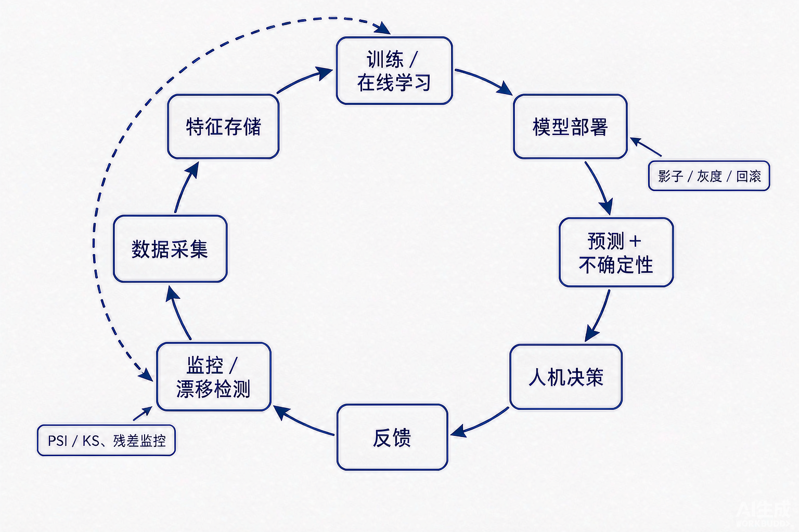

**例 40.3（统一案例：漂移告警阈值）** 对"气温"特征取 10 个等频分箱，参考期占比 $p_i$ 与入夏后当前窗口 $q_i$ 代入式 (40-1)，得 $\mathrm{PSI}=0.18$（中等漂移）；同期预测残差的 $\mathrm{KS}=0.21$（$p<0.01$）、PICP 由 0.90 跌到 0.79（第 38.5 节）。系统按预设规则：PSI>0.1 发**黄警**（加密监控）、>0.25 或 PICP<0.85 发**红警**（触发 40.4 节重训）。三信号同步恶化，排除了"只是噪声"的误报（第 34 章 EWS 三陷阱的工程版）。这里 PSI 只负责"报"，**漂移分类、回放/EWC/ADWIN 等"怎么改"的方法一律交叉引用第 25 章**——正是本章去重边界的落点。

## 40.4　在线更新与持续学习的工程编排

检测到漂移后，工程系统要回答"改什么、何时改、改坏了怎么办"。第 25 章已给出**方法**（在线梯度、回放、EWC、参数隔离、ADWIN 触发）；本节只给**编排**。

**定义 40.4（重训编排）** 一次安全的更新包含：触发（40.3 节红警 / 定时 / 新数据量阈值）→ 数据快照与血缘固化 → 在**独立验证段**上按第 38.4 节嵌套验证重训 → 影子/灰度评估（40.2 节）→ 第 38.6 节 DM/MCS 比较新旧 → 全量或回滚。全程留审计日志。

三条工程原则。其一，**触发须有代价意识**：重训本身有算力与不稳定风险，第 25 章例 25.5 的光伏普及漂移值得重训，而单次传感器毛刺不值得（用第 8 章异常检测过滤）。其二，**防灾难性遗忘**：第 25 章的回放/EWC 在工程上落实为"保留一定比例旧样本 + 旧模型作为回滚基线"。其三，**可回滚优先于可更新**：任何在线更新都须能一键退回上一稳定版本，Paleyes 等人[11] 的部署案例反复印证这一点。

**例 40.4（统一案例：一次重训的完整轨迹）** 2024 年夏，40.3 节红警触发：训练数据快照锁定到 7 月 15 日，用近 180 天 + 10% 历史回放（第 25 章）重训，影子 1 周、灰度 2 周，按第 38.6 节 DM 检验新模型在漂移段 MASE 0.55 显著优于旧版 0.83、在平稳段 0.49 与 0.48 无显著差异（未伤及旧能力），遂全量；旧版保留 30 天可回滚。整个过程**方法来自第 25 章、评估来自第 38 章、决策代价来自第 32 章，本章只负责把它们串成一条可审计、可回滚的流水线**。

## 40.5　人机协同与治理

时序系统常在高风险场景运行（电网调度、医疗预警、金融风控），因此最后一环是**人**。Parasuraman 等人[12] 把自动化分为从"全人工"到"全自动"的十级；Miller[12] 指出可解释性的目的是让人形成正确的**心智模型**而非堆砌理由。

**定义 40.5（人机协同层级）** 按自动化程度：① 模型只给预测、人全权决策；② 模型给预测 + 不确定性/依据（第 17 章 SHAP、第 24 章区间），人可否决；③ 模型给建议动作（第 32 章 MPC），人审批后执行；④ 全自动闭环 + 人仅监控告警（40.3 节）。风险越高、第 4 章可预测性越低，层级应越保守。

**表 40-1　生产系统的监控—处置—治理对照**

| 层级 | 监控信号（章） | 处置动作 | 人工角色 | 审计要求 |
|------|----------------|----------|----------|----------|
| 数据 | PSI/KS(40.3)、质量契约(40.1) | 回补/阻断 | 值班确认 | 血缘日志 |
| 模型 | 残差异常(8)、PICP(38.5) | 重训/回滚(40.4) | 审批灰度 | 版本+评估快照 |
| 决策 | 调度成本(32)、worst-group(38.7) | 调阈值/降级 | 高风险否决 | 决策日志 |
| 合规 | 可解释(17)、公平(39.6) | 人工复核 | 最终责任 | 全链路可追溯 |

**例 40.5（统一案例：台风日的降级）** 台风预警日，40.3 节三信号红警、第 4 章意义上系统进入分布外，全自动调度风险过高。系统按第 40.5 节把自动化层级从③（模型建议、人审批）临时降到②（只给预测与区间、调度员全权），并把第 28 章多模态文本（台风路径、检修工单）推送给人。事后复盘显示，该日模型点预测 MASE=0.61 尚可，但区间明显偏窄——**人在回路的价值正是弥补模型在分布外"诚实的无能"**（第 29 章幻觉、第 24 章共形）。治理层面，全链路日志（数据血缘、模型版本、审批记录）使事后可追责，这在医疗（39.6 节）与金融（39.1 节）是合规硬要求。

## 40.6　边界与讨论

工程化视角的优势是：把方法变成可长期运行、可监控、可回滚的系统，把第 38 章评估规范固化进流水线，把第 32 章决策代价接入告警。边界有五：其一，**复杂度与成本**——完整平台（特征存储、注册、监控、审计）对小团队可能过重，Sculley 等人[1] 的技术债与之是一体两面；其二，**告警疲劳**——阈值过灵敏会淹没值班，须按第 38 章代价函数调; 其三，**自动化的风险**——在线更新可能把一次毛刺学成规律，回滚与人审是最后防线；其四，**组织因素**——数据、模型、业务团队的权责划分常比技术更难；其五，**合规随领域变化**——医疗/金融的审计要求（39.1、39.6 节）须逐域定制，无通用模板。

本章与全书：第 5 章给缺失与质量、第 8 章给异常检测方法、第 9 章给变点、第 17.3 节给防泄漏、第 24/29 章给校准、第 25 章给漂移与持续学习方法、第 32 章给决策代价、第 38 章给评估体系、第 39 章给领域约束——本章一律交叉引用，只补"编排"这一层。理解"模型之外的胶水代码才是生产事故主因"，读者便完成了从方法体系到工程现实的最后一跃。

还须守住本章的去重边界：40.3 节用于漂移检测的 PSI、KS 与 ADWIN 等统计量，在方法上并非本章首创——分布比较的思想源自第 9 章变点检测，自适应窗口与概念漂移建模来自第 25.5 节，异常判别的基准则出自第 8 章。本章的贡献不在重新推导这些统计量，而在把它们编排进「监控—告警—重训—回滚」的工程闭环（40.4 节），并补上阈值设定、灰度发布、版本快照与全链路审计这些生产系统才需要的环节。因此读者应按去重原则把统计量的推导回查第 8、9、25 章，本章只负责其编排与治理；同理，重训所用的评估来自第 38 章、决策代价来自第 32 章，都不在此重复。这一「方法在正文、编排在第八篇」的分工，也正是本书把系统工程化单列一章、而非散入各方法章的理由。

## 本章小结

本章讨论时序智能从研究到生产"最后一段距离"，并严格守住去重边界：异常检测方法（第 8 章）、漂移与持续学习方法（第 25 章）、评估体系（第 38 章）、决策闭环（第 32 章）一律不重述，本章只讲工程编排。40.1 节以定义 40.1 建立时序数据平台，强调事件时间与特征存储是防训练—服务偏斜的基础，例 40.1 用"迟到 3.5 小时的数据使 MASE 0.49→0.66"说明平台契约不可被模型替代。40.2 节讲离线/在线/流式三种形态、模型注册与影子/灰度/A-B/回滚，例 40.2 给出四周灰度上线的完整流程。

40.3 节是核心推导：由 KL 对称化给出 PSI (40-1)、由经验分布函数给出 KS，并把监控分为数据/模型/决策三层，逐层调用第 5、8、9、24、29、38 章方法；例 40.3 用 $\mathrm{PSI}=0.18,\ \mathrm{KS}=0.21,\ \mathrm{PICP}=0.79$ 三信号同步恶化演示黄警/红警阈值（图 40-1 生产闭环）。40.4 节定义重训编排（触发→快照→嵌套验证→灰度→DM/MCS→全量/回滚），例 40.4 用光伏漂移重训显示"漂移段 0.83→0.55、平稳段不退化"。40.5 节按自动化层级给出人机协同与治理，表 40-1 汇总监控—处置—审计，例 40.5 用台风日降级说明人在回路弥补模型的分布外无能。40.6 节列五条边界。

从理论主线看，本章是 L5 决策可预测性在**系统层面**的落地：预测必须被部署、被监控、被回滚、被人审核，才能长期兑现价值。第八篇至此完成——第 38 章立裁判、第 39 章验领域、第 40 章保运行。第 41 章将作为全书收官，回扣第 1 章的四层能力体系与五层可预测性，讨论时序智能能否走向更通用的形态。

从四问看，本章的系统工程化是 L5 决策可预测性在系统层面的落地：假设系统可监控、可回滚、可审计；它突破了「测试集精度等于可用系统」，仍受「自动化风险与组织因素」的边界约束。

**进一步阅读**　本章建议延伸阅读的文献：[1]、[2]、[12]。

## 参考文献

[1] Sculley D, Holt G, Golovin D, et al. Hidden technical debt in machine learning systems. *Advances in Neural Information Processing Systems 28*, 2015: 2503–2511.

[2] Kleppmann M. *Designing Data-Intensive Applications: The Big Ideas Behind Reliable, Scalable, and Maintainable Systems*. Sebastopol: O'Reilly, 2017.

[3] Polyzotis N, Roy S, Whang S E, Zinkevich M. Data management challenges in production machine learning. *Proceedings of the 2017 ACM SIGMOD*, 2017: 1723–1726.

[4] Breck E, Cai S, Nielsen E, Salib M, Sculley D. The ML test score: A rubric for ML production readiness and technical debt reduction. *IEEE International Conference on Big Data*, 2017: 1123–1132.

[5] Gama J, Žliobaitė I, Bifet A, Pechenizkiy M, Bouchachia A. A survey on concept drift adaptation. *ACM Computing Surveys*, 2014, 46(4): 44.

[6] Bifet A, Gavaldà R. Learning from time-changing data with adaptive windowing. *Proceedings of the 2007 SIAM International Conference on Data Mining*, 2007: 443–448.

[7] Lu J, Liu A, Dong F, et al. Learning under concept drift: A review. *IEEE Transactions on Knowledge and Data Engineering*, 2019, 31(12): 2346–2363.

[8] Kullback S, Leibler R A. On information and sufficiency. *The Annals of Mathematical Statistics*, 1951, 22(1): 79–86.

[9] Massey F J. The Kolmogorov–Smirnov test for goodness of fit. *Journal of the American Statistical Association*, 1951, 46(253): 68–78.

[10] Amershi S, Begel A, Bird C, et al. Software engineering for machine learning: A case study. *Proceedings of the 41st ICSE-SEIP*, 2019: 291–300.

[11] Paleyes A, Urma R-G, Lawrence N D. Challenges in deploying machine learning: A survey of case studies. *ACM Computing Surveys*, 2023, 55(6): 1–29.

[12] Parasuraman R, Sheridan T B, Wickens C D. A model for types and levels of human interaction with automation. *IEEE Transactions on Systems, Man, and Cybernetics—Part A*, 2000, 30(3): 286–297.

---

# 第 41 章　未来展望：从预测到决策，通向通用时序智能

全书从一次朴素的外推出发：给定一段负荷历史，明天会是多少？四十章之后，这个问题已经长出了一整套知识体系——随机过程与可预测性理论、时频与特征、经典统计与深度模型、基础模型与世界模型、因果与决策、跨学科视角、评估与工程。收官之处不宜再列新模型，而应回到第 1 章立下的两个框架，用它们重新审视走过的路，再据此判断：**时序智能究竟在往哪里去，哪些问题还悬而未决**。

第 1 章 1.6 节给出四层能力体系（Level 1 分析、Level 2 预测、Level 3 建模、Level 4 决策），1.7 节给出五层可预测性框架（L1 统计、L2 信息论、L3 动力学、L4 因果、L5 决策），并立下"可预测性四问"与三个易混淆命题。本章第一节先把九篇四十一章放回这两张表，完成首尾闭环；随后讨论三条趋势——通用时序智能、机制理解与科学发现、决策与具身——最后逐条列出开放问题。因此本章在结构上分为两大部分：41.1 节是「回顾与闭环」，用开篇框架重新组织全书；41.2–41.5 节是「趋势与开放问题」，向前瞻望；41.6 节收束全书。须先声明一个方法论前提：**未来本身未必可预测**（第 4 章），因此本章不预言哪个模型会胜出，而是梳理那些具有长久价值、不随技术更替而消失的问题：时间、尺度、记忆、因果、不确定性，以及从预测走向行动。

全章沿用贯穿全书的统一案例：城市电网负荷。它将最后一次出场，展示同一份数据如何从 Level 1 的描述一路走到 Level 4 的调度，以及哪些环节至今仍未被任何模型真正解决。

本章结构：41.1 节完成框架闭环；41.2 节讨论通用化趋势；41.3 节讨论机制理解与科学发现；41.4 节讨论决策与具身；41.5 节逐条列出开放问题；41.6 节以结语收束全书。

## 41.1　首尾闭环：用两个框架重新审视全书

**定义 41.1（框架的回扣）** 称一套理论框架形成**首尾闭环**，若开篇提出的概念在收官处被用来重新组织全书内容、并据此界定未竟问题，而非仅在开头被陈述一次。本书的四层能力体系与五层可预测性框架即承担此角色。

把九篇按两层框架归位，得到表 41-1。这张表既是全书的索引，也是本书学术定位（第 1 章 1.1 节"时序智能理论与方法体系"）的最终体现。

**表 41-1　九篇 × 四层能力 × 五层可预测性映射（全书索引）**

| 篇 | 章 | 能力层级 | 可预测性层 | 核心贡献 |
|----|----|----------|------------|----------|
| 一 理论基础 | 1–4 | Level 1 | L1–L3 | 立框架、定上界 |
| 二 数据分析 | 5–10 | Level 1 | L1 | 结构发现、异常、多元 |
| 三 经典统计预测 | 11–16 | Level 2 | L1–L2 | 统计建模与概率范式 |
| 四 深度时序建模 | 17–25 | Level 2 | L1–L2 | 表示学习与概率生成 |
| 五 基础模型与大模型 | 26–29 | Level 2 | L1–L2 | 跨领域复用与能力边界 |
| 六 世界模型、因果与决策 | 30–32 | Level 3–4 | L3–L5 | 动力学、因果、行动 |
| 七 跨学科理论 | 33–37 | 全层级 | L1–L5 | 六科比较地图 |
| 八 评估、应用与工程 | 38–40 | Level 4 | L5 | 裁判、落地、运行 |
| 九 未来 | 41 | 回扣全层级 | L1–L5 | 闭环与开放问题 |

三点观察由此清晰。其一，**全书的重心确实在迁移**：前五篇以 Level 2 预测为主，第六篇才系统进入 Level 3–4，这与第 1 章"四层递进但不严格线性依赖"的判断一致——两百年的预测实践并不要求先有世界模型。其二，**五层可预测性是贯穿的方法学追问**：每介绍一个模型都回答了"利用哪一层、隐含什么假设、突破什么限制、无法突破什么边界"（第 1 章例 1.4 的四问），第 29 章的纯噪声实验、第 26 章式 (26-2) 的不可约损失 $E$、第 38 章的评估体系，都是这一追问的延伸。其三，**三个易混淆命题已被逐一收束**：平稳 ≠ 可预测（第 2、4 章）、非平稳 ≠ 不可预测（第 2、12 章）、相关 ≠ 因果（第 4、10、31 章）——它们不再是口号，而是有定义、有反例、有工具的判据。

**例 41.1（统一案例：同一份负荷的四层旅程）** 回望城市电网负荷这条贯穿全书的序列。Level 1：第 3 章用 ACF/谱分析发现日、周、年三周期，第 8 章检出极端高温异常，第 9 章定位限电变点。Level 2：第 11 章季节朴素 MASE=0.71 作基准，第 12 章 ARIMA 降到 0.58，第 17 章 XGBoost 到 0.47，第 24 章共形把 90% 区间覆盖率校准到 0.908，第 27 章 Moirai 零样本 0.52。Level 3：第 30 章世界模型学出"开机→净负荷缺口"的转移动力学，第 31 章用 SCM 澄清"气温→负荷"是机制而非相关。Level 4：第 32 章 MPC 把开环日成本 128 万压到闭环 111 万，决策感知预测进一步降到 109 万。**同一份数据，四层各问一个问题、各给一类答案**——这正是全书不以"哪个模型最准"收尾、而以"回答了什么根本问题"收尾的原因。

## 41.2　趋势一：从专用模型到通用时序智能

最显见的趋势，是模型从"一数据一模型"走向"一个模型服务所有序列"（第 26–27 章）。Bommasani 等人[1] 的基础模型范式、Liang 等人[2] 的时序基础模型综述、Kaplan 等人[3] 的规模化定律，共同支撑了这条路线：把跨领域的可预测结构压缩进一组共享参数，使新序列零样本可用。

但须用第 4 章的理论给这一趋势划界。第 26 章式 (26-2) 的 $L(N,D)\approx E+A/N^\alpha+B/D^\beta$ 里，$E$ 是由数据生成过程决定的**不可约损失**；规模只能压低幂律项，不能突破 $E$。第 29 章例 29.2 已实测：跨领域迁移较好（0.52→0.58），跨频率与长视野迁移较弱（0.71/0.83），因为语料没覆盖的分布上 $E$ 本就更高。因此"通用时序智能"更准确的含义不是"一个模型预测一切"，而是**在冷启动、长尾、海量小序列上以极低成本给出可信基线**，并在数据充足时仍让位给专用模型（第 29 章表 29-1）。

**开放问题由此浮现**：跨领域可迁移的上限由什么决定？第 31 章的不变因果预测（ICP）提示，唯有跨环境不变的关系才能外推；第 4 章的条件熵提示，可预测性本身有上界。若能把"哪些结构可迁移"形式化为一个可计算的量（第 37 章互信息、第 4 章熵率），通用化就从经验走向理论。这直接关联通用人工智能（AGI）的讨论：Russell[10] 指出，通用系统的关键不是容量而是**在不确定目标下仍可修正**；对时序而言，就是模型能否在分布漂移下诚实地说"我不知道"（第 24、29 章），而非自信地拟合噪声。

**例 41.2（统一案例：通用化的现实边界）** 某电网集团 500 台区，新接入台区无历史：基础模型零样本 MASE=0.62，省去 500 次训练（第 26 章例 26.1）；但对运行两年、数据充足的省级主干网，XGBoost 0.47 仍优于基础模型 0.52。二者并存于同一系统——**通用与专用不是替代关系，而是按数据密度分工**。这提示未来研究不该只追"更大模型"，而应研究"何时该用共享参数、何时该用专用参数"的自动路由。

2025–2026 年的四条最新线索已在第 27 章展开：原生生成式基础模型（Sundial）、十亿级串行扩展（Timer-S1）、轻量与极高效小模型（LightGTS、Reverso），以及面向多模态与通用分析的模型（Aurora、CoRA、DADA）。它们把本节讨论的"跨领域可迁移性上界"从愿景推到实验前沿——万亿级语料、83 亿参数与不足 300 万参数的三类模型在同一基准上被并列比较，恰好为表 41-2 的问题 1 提供了可测量的实验素材：若迁移能力确实由不变结构决定，那么参数规模与迁移增益之间应存在可拟合而非简单单调的关系。这也提示第 26 章式 (26-2) 的不可约损失 $E$ 须按目标域重新估计，而非沿用单一数值；通用化的下一步不是继续堆规模，而是弄清"什么被迁移、迁移到何处会失效"。

## 41.3　趋势二：从相关预测到机制理解与科学发现

第二条趋势是重心的上移：从 Level 2 的"未来是多少"走向 Level 3 的"系统为什么这样演化"。第 30 章世界模型、第 31 章因果推断、第 34 章动力系统、第 7 篇的跨学科比较，都指向同一判断——**纯相关预测在分布变化与干预场景下会失效**（第 1 章例 1.3），而机制模型能保持有效。

Schölkopf 等人[4] 的因果表示学习与 Pearl[5] 的结构因果框架，为"从观测中学出机制"提供了语言；LeCun[6] 的自主智能蓝图与 Hafner 等人[7] 的跨领域世界模型，则把"学得的环境动力学"作为规划的基础。这里最有长远价值的方向是**科学发现**：AlphaFold[8] 展示了以结构先验 + 数据驱动解决科学问题的范式，Reichstein 等人[9] 系统讨论了深度学习与过程理解在地球系统科学中的结合——第 30 章 30.7 节的 FNO/PINN 正是这一路线在时序上的落点：把守恒律写进模型，用数据补足未知项。

**例 41.3（统一案例：从负荷预测到电网机理）** 纯统计模型能预测负荷，却回答不了"分布式光伏渗透率从 5% 升到 22% 后，午间净负荷为何下凹、调度该如何改"——这是第 25 章例 25.5 的真实概念漂移。融入物理约束（潮流方程、机组爬坡）与因果结构（气温→负荷、政策→用电习惯）的世界模型，则能在机制变化后重新推演，而非等待新数据把旧相关重新拟合一遍。这个例子说明：**机制理解的价值不在平稳期的精度，而在变化期的可外推性**——恰是第 4 章可预测性四问里"无法突破什么边界"的正面回答。

须警惕把趋势二说成"因果万能"：第 31 章 31.6 节已列出未测混淆、结构稳定、可识别性、反事实不可验证、高维相依五条边界。机制模型依赖更强的假设，只有在有随机化实验、物理定律或可信工具变量时才站得住；否则它只是把相关换了个更昂贵的名字。

## 41.4　趋势三：从预测到决策、具身与在线交互

第三条趋势把闭环真正合上：预测的价值最终由**行动**兑现。第 32 章的决策感知预测证明"MAE 最小的模型未必成本最低"（例 32.5），第 38 章把决策代价纳入评估，第 40 章把决策接入生产监控与人机协同。Sutton 与 Barto[12] 的强化学习、Russell[10] 的价值对齐，都指向同一个问题：**一个智能系统必须在自身行动诱导的分布上持续工作**，而不是在固定的测试集上刷分。

这自然通向**具身智能**：与环境实时交互的系统（机器人、自动驾驶、电网 AGC）不能像第 26 章那样离线预训练后冻结，必须在线感知、滚动重规划、从反馈中修正（第 32 章 MPC、第 33 章闭环、第 25 章持续学习、第 40 章在线更新）。第 34 章的临界慢化与第 4 章的可预测时域，则提醒具身系统"该看多远"有物理上限——幻觉往往发生在把外推推过可信时域之后。

**例 41.4（统一案例：台风日的四层合拢）** 台风预警日，系统依次调用：Level 1 检出负荷残差异常与变点（第 8、9 章）；Level 2 给出经共形校准的负荷区间（第 24 章）；Level 3 用世界模型推演"线路跳闸→孤岛运行"的状态转移、用因果区分"台风"与"检修"的效应（第 30、31 章）；Level 4 由 MPC 在安全约束下重排机组，并把自动化层级临时降级、交调度员审批（第 32、40 章例 40.5）。**四层不是流水线，而是在同一时刻被反复调用的四种能力**——这正是第 1 章"递进但非线性依赖"在最复杂场景里的实证。

## 41.5　尚未解决的开放问题

把前四节的讨论收束为一张清单。

**定义 41.2（开放问题的分类）** 本书所谓开放问题，指**不随具体模型更替而消失**、且目前既无公认解、也无公认否定判据的问题；它们通常位于两层框架的交界处（如 L2 下界与 L4 可识别性之间）。

**表 41-2　时序智能的开放问题清单**

| # | 开放问题 | 关联层/章 | 难点 | 可能进路 |
|---|----------|-----------|------|----------|
| 1 | 跨领域可迁移性的度量与理论上界 | L1–L2，第 26、29 章 | $E$ 随域变化，无统一度量 | 不变性 + 熵率 |
| 2 | 可预测性的统一理论 | L1–L3，第 4、34 章 | 统计/信息/动力学三者未统一 | 条件熵 + 恢复率 |
| 3 | 长程依赖与记忆的本质 | L1，第 18、21 章 | 状态压缩必丢信息 | 结构化状态空间 |
| 4 | 因果可辨识与未测混淆 | L4，第 31 章 | 观测数据常不可识别 | 随机化/工具变量/ICP |
| 5 | 分布漂移下的诚实不确定性 | L2，第 24、25、29 章 | 可交换性受限 | 在线共形、校准 |
| 6 | 决策感知与代价的普适形式 | L5，第 32、38 章 | 代价主观、KKT 难微 | SPO/隐式微分 |
| 7 | 评估协议的抗过拟合 | 全层，第 38 章 | 基准被反复复用 | 盲测、合成审计 |
| 8 | 安全、治理与价值对齐 | L5，第 40 章 | 高风险场景责任归属 | 人在回路、审计 |
| 9 | 能耗与可持续规模化 | 全层，第 26、38 章 | 算力随规模增长 | 稀疏/蒸馏/轻量 |
| 10 | 时间、尺度与因果的统一表示 | 全层，第 3、31、36 章 | 多尺度 + 机制难兼得 | 因果表示学习 |

逐条看，问题 1、2、10 属**理论层**：第 4 章给出下界、第 37 章给出信息量、第 31 章给出不变性，但三者尚未拼成一套"什么可迁移、能迁移多远"的理论。问题 3、4、5 属**方法层**：长记忆、因果辨识、漂移下校准，都是第 18–31 章反复触及而未竟之处。问题 6、7、8、9 属**系统层**：评估被过拟合（第 38.9 节）、代价难量化（第 32.6 节）、治理随领域变化（第 39、40 章）。Angelopoulos 与 Bates[11] 的共形预测为问题 5 提供了部分答案，但它只保证边际覆盖；Russell[10] 的对齐讨论为问题 8 提供了原则，却未给出时序专用的形式化。

**例 41.5（一个开放问题的研究设想：问题 1 的度量）** 针对"跨领域可迁移性上界"，可设计如下研究：① 由第 2 章生成过程构造一族合成序列，其可预测结构（趋势、季节、非线性、突变）可控、且**保证不在任何预训练语料中**；② 对每条序列用第 4 章估计条件熵 $H(y_{t+h}\mid y_{1:t})$ 与第 37 章互信息，作为"可迁移信息量"的地面真值；③ 训练第 26 章式 (26-2) 的规模化模型族，记录零样本误差随 $N,D$ 与域距离的变化；④ 检验假设"零样本误差与域间结构距离（第 31 章不变性违背度）呈单调关系，且下界由 $E$ 决定"；⑤ 若成立，则得到一个**可计算的迁移判据**，可在部署前判断"这个新领域该用基础模型还是重训专用模型"。这个设想把第 4、26、29、31、37、38 章的工具串成一个可证伪的实验，也示范了本书一贯的主张：**开放问题的价值在于能被形式化、被检验，而非停留在愿景**。

## 41.6　结语：时间、尺度、记忆与因果

回到第 1 章的那句判断：具体技术（ARIMA、Transformer、Mamba、基础模型）会不断变化，而下列问题具有长久价值——时间序列为什么存在可预测性，如何从观测推断潜在动力学，如何理解时间、尺度、记忆与因果，如何从预测走向机制理解，如何从模型理解走向主动决策，如何建立能跨领域泛化的时序智能。全书四十一章，本质上是对这六个问题的层层作答。图 41-1 把这些方向辐射开来：统一表征、世界模型、因果与决策、科学发现、具身智能、通用智能，中心仍是"时序智能"这一对象。

> 【图 41-1　时序智能的未来图景】（原图见 `figures/图41-1.png`）：辐射图。中心圆「时序智能」，向外六个方向用箭头连接六个圆角矩形：「统一表征」「世界模型」「因果与决策」「科学发现」「具身智能」「通用人工智能（AGI）」；各方向旁小字标注对应章节与开放问题编号。白底、深蓝中心、中文。

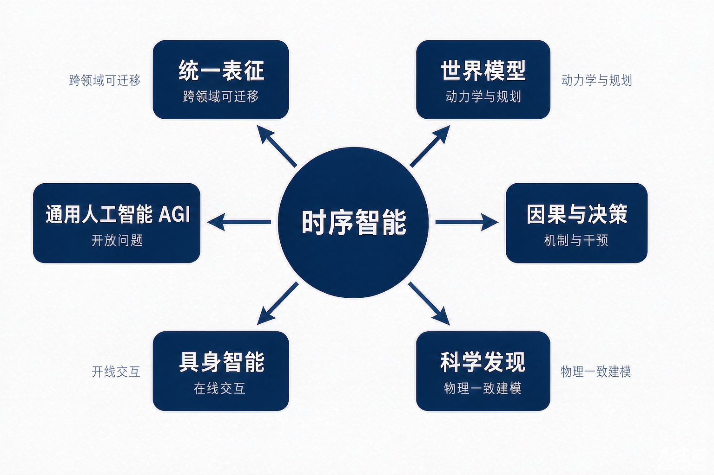

须以三条克制作为全书最后的注脚。其一，**模型不能突破数据**：第 4 章的条件熵下界、第 29 章的纯噪声实验、第 26 章的 $E$，反复说明再大的模型也无法预测白噪声或混沌时域之外的部分（三个易混淆命题之一的最终形态）。其二，**框架比模型长寿**：四层能力体系与五层可预测性不依赖任何具体架构，它们能解释 ARIMA 为何有效、Transformer 因何兴起、世界模型要补哪一环——这正是本书取名"导论"而非"方法大全"的用意。其三，**从预测到行动仍有距离**：Level 4 的决策须跨过因果可辨识、代价量化、安全治理三道关（第 31、32、40 章），任何宣称"预测即智能"的说法都低估了这段距离。

第 1 章用城市电网负荷提出了问题，第 41 章用它展示了四层能力如何合拢，也展示了哪些环节（变化期的机制、分布外的诚实、干预后的可靠）至今仍未被解决。技术的浪潮会继续，但对时间、尺度、记忆与因果的追问不会过时。**若读者在合上本书后，面对一条新序列先问"它为什么可预测、可预测到什么程度、我究竟想拿预测做什么"，而不是先问"该用哪个模型"，那么这本书的目的就达到了。**

若把上述趋势收束为一份可检验的研究议程，未来五年至少有三组问题值得优先。其一是可预测性的可计算刻画：把第 4 章的熵率与混沌时域，从理论上限变成能在给定数据集上估计、并能指导模型选型的量，尤其是分布外与机制漂移下的条件可预测性。其二是因果、世界模型与决策的闭环：在第 30–32 章的链条上，解决结构不确定时如何安全行动、如何让世界模型的长期滚动误差不吞噬决策价值。其三是评估与治理：为零样本基础模型建立抗污染、可复现、带不确定性的协议（第 29、38 章），并把公平、校准与人在回路（第 39、40 章）固化为标准而非附录。这三组问题恰好对应本书的理论边界、能力链条与方法学约束；它们的共同难点，仍是开篇那句追问——在给定过去之后，我们究竟能在多大程度上、以何种代价知晓并改变未来。

## 本章小结

本章收束全书，以第 1 章的两个框架完成首尾闭环并展望未来。41.1 节以定义 41.1 界定框架回扣，用表 41-1 把九篇四十一章映射到四层能力体系与五层可预测性，指出全书重心由 Level 2 向 Level 3–4 迁移、四问贯穿始终、三个易混淆命题已逐一收束；例 41.1 用同一份电网负荷展示从 Level 1（ACF/异常/变点）经 Level 2（0.71→0.47 与共形校准）到 Level 3（世界模型/因果）与 Level 4（128 万→109 万）的完整旅程。

41.2 节讨论通用化趋势，用第 26 章式 (26-2) 的 $E$ 与第 29 章实测划界：通用不是"预测一切"，而是冷启动与长尾上的低成本可信基线（例 41.2 的 0.62 对 0.47 分工）。41.3 节讨论机制理解与科学发现，以第 30、31 章与 FNO/PINN 说明机制的价值在变化期可外推（例 41.3 光伏渗透），并重申第 31 章五条边界。41.4 节讨论决策与具身，例 41.4 用台风日展示四层在同一时刻被反复调用。41.5 节以定义 41.2 与表 41-2 列出十条开放问题（分理论/方法/系统三层），例 41.5 给出"跨领域可迁移性上界"的可证伪研究设想。41.6 节以三条克制（模型不能突破数据、框架比模型长寿、从预测到行动仍有距离）与图 41-1 收束。

从理论主线看，本章不新增方法，而是把第 4 章的下界、第 1 章的框架、第 29 章的批判、第 31 章的因果、第 32 章的决策、第 38 章的评估、第 40 章的治理收拢成一门学科的自画像：它的对象是时间中的可预测性，它的方法是层层递进的四种能力，它的边界由序列本身决定，它的未来在从"说得准"走向"做得对、且知道自己何时不知道"。

**进一步阅读**　本章建议延伸阅读的文献：[1]、[2]、[12]。

## 参考文献

[1] Bommasani R, Hudson D A, Adeli E, et al. On the opportunities and risks of foundation models. *arXiv:2108.07258*, 2021.

[2] Liang Y, Wen H, Nie Y, et al. Foundation models for time series analysis: A tutorial and survey. *Proceedings of the 30th ACM SIGKDD*, 2024: 6555–6565.

[3] Kaplan J, McCandlish S, Henighan T, et al. Scaling laws for neural language models. *arXiv:2001.08361*, 2020.

[4] Schölkopf B, Locatello F, Bauer S, et al. Toward causal representation learning. *Proceedings of the IEEE*, 2021, 109(5): 612–634.

[5] Pearl J, Mackenzie D. *The Book of Why: The New Science of Cause and Effect*. New York: Basic Books, 2018.

[6] LeCun Y. A path towards autonomous machine intelligence. *OpenReview*, 2022.

[7] Hafner D, Pasukonis J, Ba J, Norouzi M. Mastering diverse domains through world models. *Nature*, 2025, 640: 647–653.

[8] Jumper J, Evans R, Pritzel A, et al. Highly accurate protein structure prediction with AlphaFold. *Nature*, 2021, 596: 583–589.

[9] Reichstein M, Camps-Valls G, Stevens B, et al. Deep learning and process understanding for data-driven Earth system science. *Nature*, 2019, 566: 195–204.

[10] Russell S. *Human Compatible: Artificial Intelligence and the Problem of Control*. New York: Viking, 2019.

[11] Angelopoulos A N, Bates S. A gentle introduction to conformal prediction and distribution-free uncertainty quantification. *Foundations and Trends in Machine Learning*, 2023, 16(4): 494–591.

[12] Sutton R S, Barto A G. *Reinforcement Learning: An Introduction*. 2nd ed. Cambridge: MIT Press, 2018.

---

# 附录

本附录为正文提供可随时查阅的工具性材料，不引入新的理论主线。附录 A 汇总全书反复使用的数学工具，凡正文只给结论而未展开的推导，多可在此找到线索；附录 B 与 C 分别给出数据集、基准和开源工具链的索引，便于复现实验；附录 D 统一符号与缩略语；附录 E 提供中英文术语对照与全书速查索引。各节末的「对应章节」标明该工具在正文中的主要用处，读者可按图索骥回到相应章节。全书前置部分另有简明符号表，本附录 D 是其完整展开。

## 附录 A　数学工具包

### A.1　矩阵代数与多元正态

设 $\mathbf x\in\mathbb R^D$ 服从多元正态 $\mathcal N(\boldsymbol\mu,\mathbf\Sigma)$，其密度为

$$
p(\mathbf x)=(2\pi)^{-D/2}|\mathbf\Sigma|^{-1/2}\exp\!\Big(-\tfrac12(\mathbf x-\boldsymbol\mu)^\top\mathbf\Sigma^{-1}(\mathbf x-\boldsymbol\mu)\Big). \tag{A-1}
$$

由式 (A-1) 可推出三条全书反复使用的性质。其一，**线性变换保正态**：$\mathbf A\mathbf x+\mathbf b\sim\mathcal N(\mathbf A\boldsymbol\mu+\mathbf b,\ \mathbf A\mathbf\Sigma\mathbf A^\top)$，这是第 13 章状态方程、第 10 章 VAR 线性组合的基础。其二，**分块条件分布**：将 $\mathbf x=(\mathbf x_1,\mathbf x_2)$ 与 $\boldsymbol\mu,\mathbf\Sigma$ 相应分块，则

$$
\mathbf x_1\mid\mathbf x_2\sim\mathcal N\big(\boldsymbol\mu_1+\mathbf\Sigma_{12}\mathbf\Sigma_{22}^{-1}(\mathbf x_2-\boldsymbol\mu_2),\ \mathbf\Sigma_{11}-\mathbf\Sigma_{12}\mathbf\Sigma_{22}^{-1}\mathbf\Sigma_{21}\big), \tag{A-2}
$$

式 (A-2) 正是第 13 章卡尔曼滤波「由先验与新息求后验」在高斯情形下的一般形式（配平方即得增益）。其三，**采样**：由 Cholesky 分解 $\mathbf\Sigma=\mathbf L\mathbf L^\top$，取 $\mathbf z\sim\mathcal N(\mathbf 0,\mathbf I)$，则 $\boldsymbol\mu+\mathbf L\mathbf z$ 即为所需样本，这是第 24 章重参数化技巧与第 27 章生成式预测采样数值的常用实现。

矩阵微分中常用的三式为 $\nabla_{\mathbf x}(\mathbf a^\top\mathbf x)=\mathbf a$、$\nabla_{\mathbf x}(\mathbf x^\top\mathbf A\mathbf x)=(\mathbf A+\mathbf A^\top)\mathbf x$、$\nabla_{\mathbf A}\log|\mathbf A|=\mathbf A^{-\top}$；它们分别用于最小二乘、二次型损失与高斯似然对协方差的求导。

**例 A.1（条件分布手算）** 设二维 $(x_1,x_2)$ 的 $\boldsymbol\mu=(0,0)$，$\mathbf\Sigma=\begin{pmatrix}1&0.6\\0.6&1\end{pmatrix}$。给定 $x_2=2$，由式 (A-2) 得条件均值 $0+0.6\times1^{-1}\times2=1.2$，条件方差 $1-0.6\times1^{-1}\times0.6=0.64$（标准差 $0.8$）。即知道 $x_2$ 偏大后，$x_1$ 的预测由 $0$ 上移到 $1.2$、不确定性由 $1$ 降到 $0.64$——这正是第 10 章「变量间信息降低预测方差」的数值版。

**对应章节**：第 2、10、13、16、24 章。

### A.2　概率分布族与共轭更新

时序概率预测常用的分布族汇总于表 A-1。选择哪一支不是口味问题：它决定似然形式、尾部行为与可解释性（第 15、24 章）。

**表 A-1　时序预测常用分布族**

| 分布 | 参数 | 支撑集 | 典型用途 | 对应章节 |
|------|------|--------|----------|----------|
| 高斯 $\mathcal N(\mu,\sigma^2)$ | 均值、方差 | $\mathbb R$ | 实值负荷、残差 | 2、12、13 |
| Student-$t$ | 自由度 $\nu$ | $\mathbb R$ | 厚尾金融/尖峰 | 15、27 |
| 负二项 | $r,p$ | $\mathbb N_0$ | 计数型销量、话务 | 24、27 |
| 对数正态 | $\mu,\sigma^2$ | $\mathbb R_+$ | 正值、右偏需求 | 24 |
| 混合密度 | 权重 + 各分量 | 依分量 | 多峰、异质领域 | 24、27 |
| 类别分布 | 词表概率 | 离散 token | 量化式基础模型 | 26、27 |

**共轭正态更新**是第 16 章贝叶斯推断的最小完整例。设观测 $y_i\stackrel{\mathrm{iid}}{\sim}\mathcal N(\theta,\sigma^2)$（$\sigma^2$ 已知），先验 $\theta\sim\mathcal N(\mu_0,\tau_0^2)$，由贝叶斯定理 $p(\theta\mid y)\propto p(y\mid\theta)p(\theta)$，对指数部分配平方得后验仍为正态 $\mathcal N(\mu_n,\tau_n^2)$，其中

$$
\tau_n^{-2}=\tau_0^{-2}+n\sigma^{-2},\qquad
\mu_n=\tau_n^{2}\Big(\frac{\mu_0}{\tau_0^{2}}+\frac{n\bar y}{\sigma^{2}}\Big). \tag{A-3}
$$

式 (A-3) 的可读形式是「**精度可加、均值按精度加权**」：数据精度 $n/\sigma^2$ 越大，后验越靠近样本均值。新观测的后验预测分布为 $\mathcal N(\mu_n,\ \sigma^2+\tau_n^2)$，其中 $\tau_n^2$ 即参数不确定性带来的额外方差。

**例 A.2（共轭更新手算）** 取 $\mu_0=4.30$、$\tau_0=0.50$（$\tau_0^{-2}=4$），$\sigma=0.40$（$\sigma^{-2}=6.25$），$n=10$、$\bar y=4.55$。则 $\tau_n^{-2}=4+10\times6.25=66.5$，$\tau_n^2\approx0.0150$，$\mu_n=0.0150\times(4.30/0.25+10\times4.55/0.16)=0.0150\times(17.2+284.4)\approx4.52$。后验预测标准差 $\sqrt{0.16+0.015}\approx0.418$，若忽略参数不确定性只报 $\sigma=0.40$，区间会窄约 4%。

**对应章节**：第 2、15、16、24、27 章。

### A.3　最优化、约束与隐式微分

梯度下降 $\theta_{k+1}=\theta_k-\eta\nabla\mathcal L(\theta_k)$ 在 $\mathcal L$ 为 $L$-光滑凸函数且 $0<\eta<2/L$ 时收敛；随机梯度下降用小批量估计梯度，Adam 则以一、二阶矩自适应步长：

$$
m_t=\beta_1m_{t-1}+(1-\beta_1)g_t,\quad v_t=\beta_2v_{t-1}+(1-\beta_2)g_t^2,\quad
\theta_t=\theta_{t-1}-\eta\frac{\hat m_t}{\sqrt{\hat v_t}+\epsilon}, \tag{A-4}
$$

其中 $\hat m_t=m_t/(1-\beta_1^t)$、$\hat v_t=v_t/(1-\beta_2^t)$ 为偏差修正。第 17–25 章几乎所有深度模型的训练都以此为基础。

带约束问题用拉格朗日函数 $\mathcal L(x,\lambda,\mu)=f(x)+\sum_i\lambda_i h_i(x)+\sum_j\mu_j g_j(x)$，KKT 条件为：平稳性 $\nabla_x\mathcal L=0$、原可行 $h_i(x)=0$ 与 $g_j(x)\le0$、对偶可行 $\mu_j\ge0$、互补松弛 $\mu_jg_j(x)=0$。第 32 章 MPC 的约束、第 38 章 DRO 的极小极大都归结于此。

**隐函数定理**给出最优解对参数的导数：若 $a^*(\hat y)$ 由一阶条件 $\nabla_a c(a,\hat y)=0$ 隐式定义，则

$$
\frac{d a^*}{d\hat y}=-\big(\nabla^2_{aa}c\big)^{-1}\nabla^2_{a\hat y}c, \tag{A-5}
$$

式 (A-5) 是第 32 章决策感知预测梯度 (32-5) 的数学依据——它使「优化器」成为可微层，从而能把下游决策损失回传到预测器。

**例 A.3（KKT 手算）** 最小化 $\frac12(a-0.6)^2$ 满足 $a\ge0$ 与 $a\le0.4$。无约束解 $a=0.6$ 违反上界，故上界约束激活；取 $g(a)=a-0.4\le0$，平稳性 $(a-0.6)+\mu=0$、互补松弛 $\mu(a-0.4)=0$，解得 $a^*=0.4$、$\mu=0.2\ge0$，满足全部条件。这正是第 32 章机组出力上界被触发时的情形。

**对应章节**：第 17、18、32、38 章。

### A.4　随机过程、极限定理与长期方差

弱平稳要求 $\mathbb E[Y_t]=\mu$ 与 $\mathrm{Cov}(Y_t,Y_{t-k})=\gamma_k$ 不依赖 $t$；遍历性保证时间平均收敛到总体平均；Wold 分解把零均值平稳过程写为 $y_t=\sum_{j\ge0}\psi_j\varepsilon_{t-j}+v_t$，其中 $\varepsilon_t$ 为白噪声（新息）、$v_t$ 为确定性成分；$\varepsilon_t$ 若为鞅差（$\mathbb E[\varepsilon_{t+1}\mid\mathcal F_t]=0$）则允许条件异方差而仍保持均值不可预测（第 15 章）。

预测误差分解（概率链式法则）为 $p(y_{1:T})=\prod_t p(y_t\mid y_{1:t-1})$，是第 2、12、16、26 章一切似然的起点。对**相依**序列，样本均值的方差不是 $\sigma^2/T$ 而是

$$
\mathrm{Var}(\bar y)\approx\frac1T\Big(\gamma_0+2\sum_{k\ge1}\gamma_k\Big), \tag{A-6}
$$

实践中截断到 $K$ 阶并用 Bartlett 权重 $w_k=1-k/(K+1)$ 得到 HAC 估计 $\frac1T(\hat\gamma_0+2\sum_{k=1}^K w_k\hat\gamma_k)$，即第 38 章 DM 检验的分母。忽略自相关会低估标准误、把不显著的模型差异判成显著。在混合条件下还有相依序列 CLT：$\sqrt T(\bar y-\mu)\xrightarrow{d}\mathcal N(0,\ \sum_k\gamma_k)$。

**例 A.4（长期方差手算）** AR(1) 有 $\gamma_k=\phi^k\sigma^2/(1-\phi^2)$。取 $\phi=0.8,\sigma^2=1$，$\gamma_0=2.778$，$\sum_{k\ge1}\gamma_k=\gamma_0\phi/(1-\phi)=2.778\times4=11.11$，故长期方差 $=\gamma_0+2\sum_{k\ge1}\gamma_k\approx2.778+22.22=25.0$，是单期方差的 9 倍。这解释第 36 章例 36.2：两个模型 MASE 差 0.02，若按 $\sigma^2/T$ 计算会误判显著。

**对应章节**：第 2、12、15、38 章。

### A.5　傅里叶、小波与采样

对平稳序列，谱密度与自协方差互为傅里叶变换：$f(\omega)=\frac1{2\pi}\sum_{k=-\infty}^{\infty}\gamma_k e^{-i\omega k}$，$\gamma_k=\int_{-\pi}^{\pi}f(\omega)e^{i\omega k}d\omega$；周期图 $I(\omega_j)=\frac1T\big|\sum_{t=1}^T y_te^{-i\omega_jt}\big|^2$ 是其样本估计，白噪声的谱平坦为 $\sigma^2/(2\pi)$。离散傅里叶变换可用 FFT 在 $O(T\log T)$ 内完成，这是第 21 章 FEDformer、第 22 章 TimesNet 与第 37 章频域方法的共同计算基础。

**采样定理**：若信号带限（$|f|>B$ 时 $Y(f)=0$）且采样率 $f_s>2B$，则

$$
y(t)=\sum_{n=-\infty}^{\infty} y(nT)\,\mathrm{sinc}\!\Big(\frac{t-nT}{T}\Big),\quad T=\frac1{f_s}, \tag{A-7}
$$

其频域依据是采样后频谱以 $f_s$ 为周期平移叠加，当 $f_s>2B$ 时各副本不重叠，用低通即可无失真滤出。若 $f_s\le2B$，高频被折叠为

$$
f_{\text{alias}}=\big|f-kf_s\big|\in[0,f_s/2],\quad k=\mathrm{round}(f/f_s), \tag{A-8}
$$

且**混叠不可逆**——抗混叠滤波必须在采样前施加。小波变换则以多分辨率基替代全局正弦基，适合局部突变与去噪（第 3 章 3.5 节、第 37 章 37.3 节）。

**例 A.5（混叠手算）** 负荷含日周期 $f=1$/日。以 $f_s=24$/日采样时 $f_N=12$/日 $>1$，可保真；若降为每日一个均值（$f_s=1$/日，$f_N=0.5$/日），由式 (A-8) 得 $f_\text{alias}=|1-1\times1|=0$，日周期被折叠成直流，日内双峰永久丢失。这正是第 37 章例 37.2 的结论。

**对应章节**：第 3、21、22、37 章。

### A.6　信息论与率失真

离散情形 $H(X)=-\sum_xp(x)\log p(x)$，$H(Y\mid X)=H(X,Y)-H(X)$，$I(X;Y)=H(Y)-H(Y\mid X)$，$\mathrm{KL}(p\|q)=\sum_xp(x)\log\frac{p(x)}{q(x)}$；连续情形以微分熵与积分替代求和。由 Jensen 不等式可得 $\mathrm{KL}(p\|q)\ge0$，等号当且仅当 $p=q$，这是第 2 章恰当评分规则、第 24 章 ELBO 非负性的共同根源。

时序专用量有：**熵率** $h=\lim_{T\to\infty}\frac1T H(y_{1:T})$、**传递熵** $T_{X\to Y}=H(Y_{t+1}\mid\mathbf Y_t)-H(Y_{t+1}\mid\mathbf Y_t,\mathbf X_t)$（第 31、37 章）、**率失真** $R(D)=\min_{p(\hat x\mid x):\,\mathbb E[d]\le D}I(X;\hat X)$（第 4 章误差下界）、以及**信息瓶颈** $\min I(Z;X)-\beta I(Z;Y)$（第 30、37 章表示充分性）。它们共同回答一个问题：历史里有多少关于未来的信息、又必须以多少比特为代价携带。

**例 A.6（互信息手算）** 设二元 $(X,Y)$ 的联合分布为 $p(0,0)=p(1,1)=0.4$、$p(0,1)=p(1,0)=0.1$。边缘均为 $(0.5,0.5)$，故 $H(Y)=1$ bit；$H(Y\mid X)=H(X,Y)-H(X)=-(2\times0.4\log_20.4+2\times0.1\log_20.1)-1\approx1.722-1=0.722$；于是 $I(X;Y)=1-0.722\approx0.278$ bit。若 $X,Y$ 独立（各格 0.25），$I=0$——对应第 29 章白噪声上互信息为零、模型只能报均值。

**对应章节**：第 4、24、29、37 章。

### A.7　假设检验与临界值速查

表 A-2 汇总正文出现的主要检验。临界值随模型设定、样本量与显著性水平变化，表中数值为常见的 5% 水平近似，**正式使用须查对应分布表或用 bootstrap/蒙特卡洛校准**。

**表 A-2　全书主要假设检验速查**

| 检验 | 原假设 $H_0$ | 统计量要点 | 常见 5% 临界值 | 对应章节 |
|------|---------------|------------|----------------|----------|
| ADF | 存在单位根（非平稳） | $\tau$ 回归 t 值 | 约 $-2.86$（含截距）、$-3.41$（含截距与趋势） | 3、12 |
| KPSS | 序列平稳 | LM 统计量 | 约 $0.463$ | 3 |
| PP | 存在单位根 | 非参数修正的 $\tau$ | 同 ADF 分布表 | 3 |
| Ljung–Box | 残差为白噪声 | $Q=T(T+2)\sum_{k\le K}\hat\rho_k^2/(T-k)$ | $\chi^2_{K-p-q}$ 上分位 | 12、15 |
| ARCH-LM | 无 ARCH 效应 | $TR^2$ | $\chi^2_q$ 上分位 | 15 |
| Diebold–Mariano | 两模型预测精度相同 | $\bar d/\sqrt{\mathrm{HAC\ Var}}$ | 标准正态 $\pm1.96$ | 38 |
| Kolmogorov–Smirnov | 两分布相同 | $\sup_x|F_1-F_2|$ | $c(\alpha)\sqrt{(n+m)/(nm)}$ | 40 |
| Jarque–Bera | 残差正态 | 偏度/峰度组合 | $\chi^2_2$ 上分位 | 12 |

**例 A.7（Ljung–Box 手算）** 取 $T=200$、$K=10$，残差自相关平方和经自由度修正后 $\sum\hat\rho_k^2/(T-k)\approx0.00075$，则 $Q=200\times202\times0.00075\approx30.3$；若模型已估 $p+q=3$ 个参数，自由度为 7，$\chi^2_{0.95}(7)=14.07$，$Q>14.07$ 故拒绝白噪声假设，须回到第 12 章识别步增阶。

**对应章节**：第 3、12、15、38、40 章。

### A.8　常用不等式、渐近记号与数值稳定

- **Jensen**：凸 $\varphi$ 有 $\varphi(\mathbb E X)\le\mathbb E\varphi(X)$；**Cauchy–Schwarz**：$|\mathbb E[XY]|^2\le\mathbb E X^2\mathbb E Y^2$；**Markov/Chebyshev**：$\mathbb P(|X|\ge a)\le\mathbb E|X|/a$ 与 $\le\mathrm{Var}(X)/a^2$；**Hoeffding** 给出有界独立和尾界。
- **渐近记号**：$O(\cdot),o(\cdot),\Theta(\cdot)$ 描述量级，$\xrightarrow{d},\xrightarrow{p},\xrightarrow{a.s.}$ 分别表示依分布、依概率、几乎必然收敛；$O_p(1)$ 表示依概率有界。
- **数值稳定**：$\mathrm{softmax}$ 用 log-sum-exp $\log\sum_ie^{z_i}=z_{\max}+\log\sum_ie^{z_i-z_{\max}}$；正参数用 softplus $\log(1+e^z)$；协方差用 Cholesky 而非直接求逆；注意力用 QK-Norm 防 softmax 饱和；递归用谱半径 $\rho(\mathbf A)<1$ 判稳；第 21 章 RIP 条件式 (37-3) 中的 $\delta_K$ 即限制等距常数。
- **Bartlett 权重** $w_k=1-k/(K+1)$ 保证 HAC 方差估计非负。

**对应章节**：第 4、18、21、38 章。

---

## 附录 B　数据集与基准索引

本附录按任务类型汇总全书出现的数据集与基准。列中「规模/频率」为常见公开版本的概数，实际使用前应以原始论文或数据卡片为准；「对应章节」指向该数据在正文中的用途。所有涉及监督评估的数据集，都必须按第 38 章的滚动原点协议切分，禁止随机打乱。

### B.1　经典预测竞赛与档案

| 数据集 | 领域 | 规模/频率 | 主要任务 | 对应章节 |
|--------|------|-----------|----------|----------|
| M3 | 多领域 | 3003 条，年/季/月等 | 点预测基准、指标比较 | 38 |
| M4 | 多领域 | 10 万条，多频率 | 点/区间预测、竞赛方法学 | 11、38 |
| M5（Walmart） | 零售 | 42840 条层级日销量 | 层次预测、间歇需求 | 14、39 |
| Tourism / M3-年 | 旅游 | 数百条年/季序列 | 长期、层级 | 14 |
| Monash Forecasting Archive | 多领域 | 数十个数据集、数万条 | 统一评测、基准集合 | 29、38 |
| NN5 | 金融/现金 | 111 条日序列 | 多步策略比较 | 14、38 |

### B.2　长序列与多元预测常用集

| 数据集 | 领域 | 规模/频率 | 主要任务 | 对应章节 |
|--------|------|-----------|----------|----------|
| ETTh1/ETTh2、ETTm1/ETTm2 | 电力变压器 | 2 年，小时 / 15 分钟 | 长序列预测标准集 | 20–22 |
| Electricity | 用电负荷 | 321 客户，小时 | 多元预测 | 18、22 |
| Traffic | 交通 | 862 传感器，小时 | 时空预测、图模型 | 23 |
| Weather | 气象 | 21 指标，10 分钟 | 多元、长视野 | 22、39 |
| Exchange | 汇率 | 8 国，日 | 非平稳、分布漂移 | 25 |
| ILI | 公共卫生 | 周级流感样病例 | 小样本长序列 | 22 |
| Solar / Solar-Energy | 光伏 | 137 测点，小时/10 分钟 | 多元、季节性 | 22 |
| Electricity Load Diagrams | 电力 | 370 客户，15 分钟 | 负荷曲线、聚类 | 7、36 |

### B.3　层级、零售与间歇需求

| 数据集 | 领域 | 规模/频率 | 主要任务 | 对应章节 |
|--------|------|-----------|----------|----------|
| M5 | 零售 | 门店×品类×州多层 | 层次调和 MinT | 14 |
| Rossmann / Favorita | 零售 | 千级门店日销量 | 协变量、促销 | 17、39 |
| Carparts / Auto / M5 稀疏子集 | 备件 | 大量零值 | 间歇需求、Croston/SBA | 11、39 |
| Wikipedia Pageviews / Google Trends | 流量 | 十亿级时间点 | 预训练语料来源 | 26、27 |

### B.4　异常检测与变点

| 数据集 | 领域 | 规模/频率 | 主要任务 | 对应章节 |
|--------|------|-----------|----------|----------|
| SMD | 服务器 | 28 实体多变量 | 异常检测 | 8 |
| SMAP / MSL | 航天器 | NASA 遥测多变量 | 异常检测 | 8 |
| SWaT / WADI | 水处理 | 多变量工控 | 异常、攻击检测 | 8、39 |
| NAB | 多领域 | 58 条带标注流 | 在线异常、阈值 | 8、40 |
| Yahoo S5 / AIOps | 服务指标 | 带标注时序 | 异常、变点 | 8、9 |
| UCR Anomaly Archive | 多领域 | 250 条 | 通用异常检测基础模型 | 8、27 |
| BGP / 电力故障日志 | 网络/电网 | 事件序列 | 点过程、级联 | 25、34 |

### B.5　分类、聚类与检索

| 数据集 | 领域 | 规模/频率 | 主要任务 | 对应章节 |
|--------|------|-----------|----------|----------|
| UCR Time Series Archive | 多领域 | 128 个单变量数据集 | 时序分类基准 | 7 |
| UEA Multivariate Archive | 多领域 | 30 个多元数据集 | 多元分类 | 7 |
| UEA 最长序列子集 | 生理/传感 | 400–18000 步 | 超长序列分类 | 21 |
| PPG-DaLiA | 生理 | 约 5 万步 | 长程回归、状态空间 | 21 |
| iSAX / 合成检索集 | 合成 | 百万级 | 相似检索与索引 | 7 |

### B.6　概率预测与基础模型新基准（2024–2026）

| 基准 | 维护方 | 规模 | 主要任务 | 对应章节 |
|------|--------|------|----------|----------|
| GIFT-Eval | Salesforce AI Research | 约 55 数据集、97 任务配置 | 零样本综合评测、含测试数据泄漏标记列 | 29、38 |
| fev-bench | Amazon / 社区 | 约 100 个真实预测任务 | 协变量、多变量零样本 | 29 |
| TIME Benchmark | Google Research | 约 50 领域数据集、98 评测任务 | 跨域泛化 | 29 |
| Chronos-ZS / Chronos Benchmark II | Amazon | 多域零样本集 | 量化式基础模型评测 | 27、29 |
| BOOM | Datadog | 可观测性指标集 | 分布外与突变场景 | 27 |
| Time-Series-Library 基准 | 清华 THUML | 长序列标准集 | 深度模型复现 | 22 |

### B.7　预训练语料

| 语料 | 机构 | 规模 | 用途 | 对应章节 |
|------|------|------|------|----------|
| LOTSA | Salesforce | 270 亿观测、9 领域 | Moirai 预训练 | 27 |
| TimeBench | 清华 THUML | 约 1 万亿时间点 | Sundial / Timer-S1 预训练 | 27 |
| UTSD | 清华 THUML | 多域统一数据集 | Timer 预训练 | 27 |
| GiftEvalPretrain / KernelSynth / TSMixup | 社区与 IBM | 合成 + 真实混合 | 数据增强、缓解预测偏差 | 26、27 |
| Time-Series-Library 长序列集 | 清华 THUML | 标准多元集 | 监督基线 | 22 |

### B.8　医学、工业与生理信号

| 数据集 | 领域 | 规模/频率 | 主要任务 | 对应章节 |
|--------|------|-----------|----------|----------|
| MIMIC-III | 重症监护 | 约 6 万次入院、不等间隔 | 不规则采样、预警 | 25、39 |
| C-MAPSS / PHM08 | 涡扇发动机 | 多传感器退化轨迹 | 剩余寿命 RUL | 39 |
| PPG-DaLiA | 可穿戴 | 长序列生理信号 | 超长序列建模 | 21 |
| ECG / EEG 公开集 | 生理 | 高频多元 | 分类、异常 | 7、36 |

### B.9　气象与地球系统

| 数据集 | 领域 | 规模/频率 | 主要任务 | 对应章节 |
|--------|------|-----------|----------|----------|
| ERA5 | 全球再分析 | 1979 年至今、0.25° | 天气基础模型训练 | 39 |
| WeatherBench2 | 气象 | 标准化评测集 | AI 预报比较 | 39 |
| CMIP6 | 气候模式 | 多模式多情景 | 长期气候、临界转变 | 34、39 |
| 空气质量 / 海浪 / 气旋观测 | 环境 | 多源异构 | 地球系统多任务微调 | 39 |

### B.10　使用守则

1. **时序切分**：一律按时间先后划分训练/验证/测试，验证用滚动原点；相邻折留 embargo（第 38.2 节）。
2. **泄漏审计**：检查全样本归一化、未来协变量、迟到的标签；基础模型还须核查预训练语料是否含测试段（GIFT-Eval 已设泄漏标记列，第 29.1 节）。
3. **污染与许可**：注意各数据集与模型权重的许可（Apache-2.0、CC-BY-NC、非商用许可等），商用前逐项核对；2026 年多款基础模型权重改为非商用，生产用途须走云服务端点（第 27、40 章）。
4. **统一案例**：全书电力负荷算例参照 ETT / Electricity / 省级电网的结构（趋势 + 日/周/年多周期 + 气温协变量 + 节假日突降），数值为教学示意，不代表任何真实电网的实测值。

---

## 附录 C　开源工具链

本附录按用途汇总可复现全书实验的开源工具。许可栏为常见公开信息，安装或商用前请以各项目最新许可证为准；「对应章节」指向该书讨论该类方法的章。

### C.1　经典统计与计量

| 工具 | 维护方 | 定位 | 许可 | 对应章节 |
|------|--------|------|------|----------|
| statsmodels | 社区 | ARIMA、SARIMAX、VAR、状态空间、GARCH、检验 | BSD | 12、13、15、35 |
| pmdarima | 社区 | 自动 ARIMA 定阶 | MIT | 12 |
| arch | 社区 | ARCH/GARCH 族与波动率 | BSD | 15 |
| forecast（R） | Hyndman 等 | ETS、TBATS、STL、MASE | GPL | 3、11、38 |
| statsmodels.tsa.statespace | 社区 | 结构时序、卡尔曼滤波 | BSD | 13、16 |

### C.2　统一建模框架

| 工具 | 维护方 | 定位 | 许可 | 对应章节 |
|------|--------|------|------|----------|
| Darts | Unit8 | 经典 + 深度统一接口、回测 | Apache-2.0 | 11–24 |
| sktime | 社区 | 预测、分类、异常、变换统一 API | BSD | 5–9、17 |
| aeon | 社区 | sktime 的时序机器学习分支 | BSD | 7、8 |
| Nixtla（statsforecast / mlforecast / neuralforecast） | Nixtla | 统计、机器学习、深度预测三件套 | Apache-2.0 | 11、17、22 |
| GluonTS | Amazon | 概率预测、数据集与评估 | Apache-2.0 | 18、24、27 |
| Merlion | Salesforce | 预测 + 异常 + 自动机器学习 | BSD | 8、17 |
| Kats / Greykite / Orbit | Meta / LinkedIn / Uber | 业务时序、变点、结构分解 | MIT/BSD | 9、16、39 |

### C.3　概率预测与官方基础模型库

| 工具 | 维护方 | 定位 | 许可 | 对应章节 |
|------|--------|------|------|----------|
| uni2ts | Salesforce | Moirai / Moirai 2.0 官方实现 | CC-BY-NC（权重） | 27 |
| chronos-forecasting | Amazon | Chronos / Chronos-Bolt / Chronos-2 | Apache-2.0 | 26、27 |
| timesfm | Google Research | TimesFM 2.5 / 3.0 | 代码 Apache-2.0，3.0 权重非商用 | 27 |
| granite-tsfm | IBM | Granite PatchTST-FM、TTM、TSPulse | Apache-2.0 / OpenMDW | 22、27 |
| OpenLTM / Time-Series-Library | 清华 THUML | Timer、Sundial、Timer-S1 及前沿复现 | Apache-2.0 | 21、22、27 |
| tirex / tirex-2 | NXAI | TiRex 系列 xLSTM 基础模型 | 社区许可 | 21、27 |
| timecopilot / fev-bench | 社区 / Amazon | 零样本基准与评测 | Apache-2.0 | 29、38 |
| sundial、reverso、aurora、baguan-ts 等 | 各提出方 | 第 27–28 章各模型的官方仓库 | 见各项目 | 27、28 |

### C.4　深度时序复现库

| 工具 | 维护方 | 定位 | 许可 | 对应章节 |
|------|--------|------|------|----------|
| Time-Series-Library（TSLib） | 清华 THUML | Informer、Autoformer、PatchTST、iTransformer、TimesNet 等 | Apache-2.0 | 20–22 |
| BasicTS | 社区 | 时空预测统一基准 | Apache-2.0 | 23 |
| NeuralForecast | Nixtla | 高效深度预测模型实现 | Apache-2.0 | 18、22、24 |
| tsai | 社区 | 时序分类、回归、预测 | Apache-2.0 | 7、18 |
| PyTorch Forecasting | 社区 | TFT、N-BEATS、DeepAR | MIT | 18、22 |
| Hugging Face Transformers / PEFT | 社区 | LLM4TS、LoRA 微调 | Apache-2.0 | 28 |

### C.5　异常、变点与可解释

| 工具 | 维护方 | 定位 | 许可 | 对应章节 |
|------|--------|------|------|----------|
| PyOD | 社区 | 孤立森林、LOF、AE 等异常检测 | BSD | 8 |
| ruptures | 社区 | PELT、CUSUM、变点检测 | BSD | 9 |
| SHAP | 社区 | 树模型与深度模型归因 | MIT | 17、29 |
| alibi / interpret | 社区 | 可解释性与反事实解释 | Apache-2.0 / MIT | 29、31、40 |

### C.6　特征、表示与评估

| 工具 | 维护方 | 定位 | 许可 | 对应章节 |
|------|--------|------|------|----------|
| tsfresh / TSFEL / catch22 | 社区 | 统计与频域特征提取 | MIT/BSD | 6 |
| TS2Vec / 表示学习库 | 社区 | 对比时序表示 | MIT | 6 |
| PyWavelets | 社区 | 离散/连续小波变换 | BSD | 3、37 |
| scipy.signal / numpy.fft | 社区 | 滤波、谱估计、FFT | BSD | 3、37 |
| scikit-learn | 社区 | 通用机器学习、指标与划分 | BSD | 17、38 |
| arch / statsmodels 检验模块 | 社区 | DM、MCS、Ljung–Box | BSD | 38 |

### C.7　数据、基准与工程

| 工具 | 维护方 | 定位 | 许可 | 对应章节 |
|------|--------|------|------|----------|
| Hugging Face Datasets / Model Hub | 社区 | 数据集与权重分发 | Apache-2.0 | 27、40 |
| GluonTS datasets / Monash 仓库 | Amazon / Monash | 标准数据集获取 | 见各数据集 | 29、38 |
| river | 社区 | 在线学习与漂移适应 | BSD | 25、40 |
| Evidently / whylogs | 社区 | 漂移监控、PSI/KS | Apache-2.0 | 40 |
| MLflow / 模型注册表 | 社区 | 版本、血缘、灰度与回滚 | Apache-2.0 | 40 |
| Stan / PyMC / NumPyro / Pyro | 社区 | 贝叶斯推断与概率编程 | BSD/Apache-2.0 | 16、36 |

### C.8　选型建议与环境说明

- **教学与经典基线**：statsmodels + forecast（R）+ pmdarima，覆盖第 11–16 章绝大部分公式。
- **统一实验与回测**：Darts 或 sktime 可统一 20 余种模型接口，配合 scikit-learn 的指标与切分实现第 38 章协议。
- **概率与基础模型**：GluonTS 作通用概率框架；具体模型优先用提出方官方库（uni2ts、chronos-forecasting、timesfm、granite-tsfm、OpenLTM），避免第三方重实现带来的版本偏差。
- **前沿复现**：TSLib 覆盖第 20–22 章主流架构；图模型用 PyTorch Geometric 配合 BasicTS。
- **在线与生产**：river 做在线学习，Evidently 做漂移监控，MLflow 管版本与回滚（第 40 章）。
- **环境**：全书公式与算例基于 Python 3 生态（NumPy、SciPy、pandas、matplotlib、PyTorch）；数学工具包附录 A 的推导不依赖特定版本。所有第三方库应锁定版本并记录随机种子，否则第 38.4 节的多种子复现将失去意义。

---

## 附录 D　符号与缩略语对照表

### D.1　数学符号总表

**表 D-1　全书数学符号（按主题分组）**

| 符号 | 含义 | 首次出现 |
|------|------|----------|
| $y_t,\ \mathbf y_t,\ y_{1:T}$ | 标量序列、向量序列、截至 $T$ 的历史 | 1、2 |
| $T,\ L,\ H,\ h,\ m$ | 样本长度、回看窗、预测视野、步长、季节周期 | 2、11、14 |
| $\varepsilon_t,\ \boldsymbol\eta_t,\ \mathbf w_t$ | 观测新息、过程噪声、一般扰动 | 2、13 |
| $\hat y_{t+h\mid t},\ \hat{\mathbf y},\ \tilde{\mathbf y}$ | $h$ 步预测、基础预测、调和后预测 | 2、14 |
| $\mu,\ \gamma_k,\ \rho_k,\ \sigma^2$ | 均值、$k$ 阶自协方差、自相关、方差 | 2 |
| $\mathbb E,\ \mathrm{Var},\ \mathrm{Cov},\ \mathbb P$ | 期望、方差、协方差、概率 | 2 |
| $p(\cdot),\ F(\cdot),\ f(\omega)$ | 密度、分布函数、谱密度 | 2、3、24 |
| $\theta,\ \boldsymbol\theta,\ \boldsymbol\phi,\ \boldsymbol\psi$ | 参数、参数向量、变分参数、Wold 系数 | 2、26 |
| $\mathbf A,\ \mathbf B,\ \mathbf T,\ \mathbf Z,\ \mathbf H$ | 状态转移、输入、观测、观测矩阵 | 10、13、21 |
| $\mathbf Q,\ \mathbf R,\ \mathbf P_{t\mid s},\ \mathbf K_t$ | 过程/观测噪声协方差、状态协方差、卡尔曼增益 | 13 |
| $\mathbf S,\ \mathbf G,\ \mathbf W_h$ | 聚合矩阵、调和映射、基础预测误差协方差 | 14 |
| $\mathbf\Sigma,\ \mathbf I,\ \mathbf L,\ {}^\top,\ {}^{-1}$ | 协方差阵、单位阵、Cholesky 因子、转置、逆 | 10、附录 A |
| $\odot,\ \otimes,\ \|\cdot\|,\ \|\cdot\|_1$ | 逐元素乘、卷积/张量积、范数、$\ell_1$ 范数 | 18、37 |
| $e_t,\ \ell(\cdot),\ \mathcal L,\ \mathcal L_{\mathrm{dec}}$ | 预测误差、损失、总目标、决策损失 | 2、32 |
| $\mathrm{MAE},\ \mathrm{RMSE},\ \mathrm{MAPE},\ \mathrm{MASE},\ \mathrm{WAPE}$ | 点/尺度无关误差指标 | 38 |
| $\mathrm{CRPS},\ \mathrm{PICP},\ \mathrm{ECE},\ \mathrm{PIT}$ | 概率评分、覆盖率、校准误差、概率积分变换 | 24、29、38 |
| $H(\cdot),\ I(\cdot;\cdot),\ \mathrm{KL},\ T_{X\to Y}$ | 熵、互信息、KL 散度、传递熵 | 4、37 |
| $\eta,\ \nabla,\ \lambda,\ \beta,\ \rho(\cdot)$ | 学习率、梯度、正则/阻尼系数、衰减率、谱半径 | 11、17、18 |
| $\lambda(t),\ \tau_k,\ \phi,\ \omega$ | 点过程强度、变点位置、AR 系数/阻尼、角频率 | 9、25、3 |
| $\mathbf s_t,\ a_t,\ r_t,\ \gamma$ | 世界模型状态、动作、奖励、折扣因子 | 30、32 |
| $V,\ Q,\ \pi,\ \mathrm{do}(\cdot)$ | 值函数、动作值、策略、干预算子 | 31、32 |
| $\mathcal F_t,\ \mathcal G,\ \mathbf A_{\mathrm{adj}}$ | 信息集、图、邻接矩阵 | 2、10、23 |

### D.2　缩略语对照表

**表 D-2　全书缩略语（按主题分组）**

*经典统计与计量*

| 缩略语 | 全称 | 含义 |
|--------|------|------|
| ACF / PACF | Auto-/Partial Autocorrelation Function | 自相关/偏自相关函数 |
| AR / MA / ARMA / ARIMA / SARIMA | (Seasonal) Autoregressive Integrated Moving Average | 自回归/移动平均及其差分、季节扩展 |
| ARIMAX / VAR / VECM | ARIMA with eXogenous / Vector AR / Vector Error Correction | 带外生变量、向量自回归、误差修正 |
| ADF / PP / KPSS | Augmented Dickey–Fuller / Phillips–Perron / Kwiatkowski–Phillips–Schmidt–Shin | 单位根与平稳性检验 |
| Yule–Walker | — | 由自相关反解 AR 参数的方程 |
| ETS | Error-Trend-Seasonal | 指数平滑三元组分类 |
| SES / Holt / Winters | Simple Exponential Smoothing / Holt / Holt–Winters | 简单/趋势/季节指数平滑 |
| STL / MSTL | Seasonal-Trend decomposition using LOESS (Multiple) | （多）季节趋势分解 |
| ARCH / GARCH / EGARCH / GJR / FIGARCH | (G)eneralized / Exponential / Glosten–Jagannathan–Runkle / Fractionally Integrated ARCH | 条件异方差族 |
| SV | Stochastic Volatility | 随机波动率 |
| GPD / EVT / SPOT | Generalized Pareto / Extreme Value Theory / Stream Peaks Over Threshold | 极值理论与在线阈值 |
| HAC | Heteroskedasticity- and Autocorrelation-Consistent | 异方差自相关一致方差 |
| DM / MCS / SPA | Diebold–Mariano / Model Confidence Set / Superior Predictive Ability | 预测比较与多重比较检验 |
| AIC / AICc / BIC | Akaike / corrected Akaike / Bayesian Information Criterion | 信息准则 |
| MCAR / MAR / MNAR | Missing Completely/At Random/Not At Random | 缺失机制 |

*机器学习与深度架构*

| 缩略语 | 全称 | 含义 |
|--------|------|------|
| RNN / LSTM / GRU | Recurrent NN / Long Short-Term Memory / Gated Recurrent Unit | 循环网络及其门控变体 |
| BPTT | Backpropagation Through Time | 随时间反向传播 |
| TCN / CNN | Temporal Convolutional Network / Convolutional NN | 时间/卷积神经网络 |
| GNN / STGNN / GCN | (Spatio-Temporal) Graph Neural Network / Graph Convolutional Network | 图/时空图网络 |
| DTW / SBD / LB_Keogh | Dynamic Time Warping / Shape-Based Distance / LB_Keogh lower bound | 时序相似性度量 |
| Shapelet / ROCKET / MiniRocket | — | 判别性子序列与随机卷积核分类 |
| TSF / BOSS / SFA / iSAX | Time Series Forest / Bag of SFA Symbols / Symbolic Fourier Approximation / indexable SAX | 区间特征与符号化检索 |
| PCA / TS2Vec / t-SNE / UMAP | Principal Component Analysis / Time Series to Vector / … | 降维与表示学习 |
| ROC / AUC | Receiver Operating Characteristic / Area Under Curve | 分类评估 |
| SHAP | SHapley Additive exPlanations | 加性归因解释 |

*基础模型、大模型与生成*

| 缩略语 | 全称 | 含义 |
|--------|------|------|
| TSFM / LTM | Time Series Foundation Model / Large Time-series Model | 时序基础/大模型 |
| LLM / LLM4TS | Large Language Model / LLM for Time Series | 大语言模型及其时序应用 |
| MoE | Mixture of Experts | 混合专家 |
| SSM / S4 / Mamba / LinOSS / xLSTM | State Space Model / Structured State Space / … | 状态空间系列架构 |
| HiPPO / RIP | High-order Polynomial Projection Operators / Restricted Isometry Property | 记忆基与压缩感知条件 |
| ICL / S3 / STP / CPM | In-Context Learning / Single-Series Sequence / Serial-Token Prediction / Contiguous Patch Masking | 上下文学习与序列/补丁训练策略 |
| RoPE / PEFT / LoRA / KV Cache | Rotary Position Embedding / Parameter-Efficient Fine-Tuning / Low-Rank Adaptation / … | 位置编码与高效微调 |
| VAE / GAN / DDPM / Flow Matching | Variational AutoEncoder / Generative Adversarial Net / Denoising Diffusion Probabilistic Model / … | 深度生成模型族 |
| ELBO / NLL | Evidence Lower BOund / Negative Log-Likelihood | 变分下界与负对数似然 |
| NTP | Next-Token Prediction | 下一 token 预测 |

*概率、评估与校准*

| 缩略语 | 全称 | 含义 |
|--------|------|------|
| CRPS / Pinball / WAPE / sMAPE / ND | Continuous Ranked Probability Score / … | 概率与点预测评分 |
| MASE | Mean Absolute Scaled Error | 平均绝对标度误差 |
| PICP / PIT / ECE / reliability diagram | Prediction Interval Coverage Probability / Probability Integral Transform / Expected Calibration Error | 区间覆盖与校准诊断 |
| CP / CQR | Conformal Prediction / Conformalized Quantile Regression | 共形预测与共形分位数回归 |
| DRO / SPO | Distributionally Robust Optimization / Smart Predict-then-Optimize | 分布鲁棒与决策感知损失 |
| EWC | Elastic Weight Consolidation | 持续学习防遗忘正则 |
| PPC / WAIC / LOO | Posterior Predictive Check / Watanabe–Akaike / Leave-One-Out | 贝叶斯工作流评估 |
| HAC / embargo | — | HAC 方差与验证间隔带 |

*因果、决策与跨学科*

| 缩略语 | 全称 | 含义 |
|--------|------|------|
| SCM / do-calculus / ICP | Structural Causal Model / Intervention calculus / Invariant Causal Prediction | 结构因果与不变性 |
| CCM | Convergent Cross Mapping | 收敛交叉映射 |
| DID / IV | Difference-in-Differences / Instrumental Variable | 政策评估工具 |
| MDP / RL / MPC / LQR | Markov Decision Process / Reinforcement Learning / Model Predictive Control / Linear Quadratic Regulator | 决策与控制 |
| SCM（控制）/ EKF / UKF / PF | State-Space / Extended/Unscented Kalman Filter / Particle Filter | 状态估计 |
| FDA / FPCA | Functional Data Analysis / Functional PCA | 函数型数据分析 |
| NWP / AIFS | Numerical Weather Prediction / AI Forecasting System | 数值/AI 天气预报 |
| FNO / PINN | Fourier Neural Operator / Physics-Informed Neural Network | 神经算子与物理信息网络 |
| PSI / KS | Population Stability Index / Kolmogorov–Smirnov | 漂移监控统计量 |
| PHM / RUL | Prognostics and Health Management / Remaining Useful Life | 设备健康管理 |

*机构、基准与工程*

| 缩略语 | 全称 | 含义 |
|--------|------|------|
| GIFT-Eval / fev-bench / TIME / BOOM | — | 2024–2026 通用预测基准 |
| LOTSA / TimeBench / UTSD / Monash Archive | Large-scale Open Time Series Archive 等 | 预训练语料与档案 |
| M3 / M4 / M5 | Makridakis Competitions | 预测竞赛 |
| UCR / UEA / ETT / SMD / SWaT / MIMIC / C-MAPSS | — | 常用公开数据集 |
| ADF 之外：PSI/KS 见上 | — | — |
| MLOps / SLA / A/B / shadow | Machine Learning Operations / Service Level Agreement / … | 生产系统术语 |

### D.3　全书编号体例速查

| 对象 | 格式 | 示例 | 说明 |
|------|------|------|------|
| 章 / 节 | `# 第 N 章　标题` / `## N.M　标题` | `## 12.5　Box–Jenkins 四步方法学` | 节号后为全角空格 |
| 定义 / 定理 / 命题 | `**定义 X.Y（名称）**` | `**定义 12.1（ARMA）**` | 章内连续编号 |
| 例 | `**例 X.Y**` | `**例 12.5**` | 带具体数值或对象 |
| 独立公式 | `$$\ldots\tag{X-N}$$` | `\tag{12-1}` | X 为章号，章内连续 |
| 行内公式 | `$...$` | $\gamma_k$ | 不编号 |
| 图 | `图 X-Y` + 引用块 + 图片引用 | `图 12-1` | 原图在 `figures/图X-Y.png` |
| 表 | `**表 X-Y　标题**` | `表 27-3` | 章内连续 |
| 文内引用 / 章末文献 | `[n]` ↔ `[n] 作者. 标题. 出处, 年份` | `[3]` | 一一对应 |
| 附录公式与表 | `\tag{A-N}` / `表 A-N` | `表 D-1` | 字母为附录号 |

---

## 附录 E　术语对照与全书速查索引

### E.1　核心术语中英对照

**表 E-1　中英文核心术语（按主题分组）**

*基础与统计*

| 中文 | 英文 |
|------|------|
| 时间序列 / 时序 | time series |
| 随机过程 / 样本路径 | stochastic process / sample path |
| 平稳性 / 弱平稳 / 严平稳 | stationarity / weak (covariance) / strict stationarity |
| 遍历性 | ergodicity |
| 自协方差 / 自相关函数 | autocovariance / autocorrelation function (ACF) |
| 白噪声 / 新息 / 鞅差序列 | white noise / innovation / martingale difference |
| 数据生成过程 / Wold 分解 | data generating process / Wold decomposition |
| 单位根 / 差分 / 单整 | unit root / differencing / integration |
| 趋势 / 季节 / 循环 / 残差 | trend / seasonality / cycle / residual |
| 谱密度 / 周期图 / 混叠 | spectral density / periodogram / aliasing |
| 极大似然 / 矩估计 / 贝叶斯估计 | MLE / method of moments / Bayesian estimation |

*预测与评估*

| 中文 | 英文 |
|------|------|
| 点预测 / 概率预测 / 区间预测 | point / probabilistic / interval forecast |
| 预测视野 / 回看窗 / 滚动原点 | forecast horizon / look-back window / rolling origin |
| 扩展窗口 / 滑动窗口 / 间隔带 | expanding / sliding window / embargo |
| 零样本 / 少样本 / 上下文学习 | zero-shot / few-shot / in-context learning |
| 恰当评分规则 / 校准 / 锐度 | proper scoring rule / calibration / sharpness |
| 覆盖率 / 预测区间覆盖概率 | coverage / PICP |
| 数据泄漏 / 时间穿越偏差 | data leakage / look-ahead bias |
| 模型置信集 / 多重比较 | model confidence set / multiple comparison |
| 决策感知预测 / 决策损失 | decision-focused forecasting / decision loss |

*模型与架构*

| 中文 | 英文 |
|------|------|
| 指数平滑 / 误差-趋势-季节 | exponential smoothing / ETS |
| 状态空间 / 卡尔曼滤波 / 平滑 | state space / Kalman filter / smoothing |
| 协整 / 误差修正模型 | cointegration / vector error correction |
| 条件异方差 / 波动率聚集 | conditional heteroskedasticity / volatility clustering |
| 循环神经网络 / 门控 / 梯度消失 | RNN / gating / vanishing gradient |
| 因果卷积 / 膨胀卷积 / 感受野 | causal / dilated convolution / receptive field |
| 自注意力 / 多头注意力 / 位置编码 | self-attention / multi-head attention / positional encoding |
| 补丁 / 通道独立 / 变量即 token | patch / channel independence / variate-as-token |
| 基础模型 / 缩放定律 / 混合专家 | foundation model / scaling law / mixture of experts |
| 流匹配 / 扩散模型 / 生成式预测 | flow matching / diffusion model / generative forecasting |
| 图神经网络 / 时空预测 | graph neural network / spatio-temporal forecasting |
| 世界模型 / 潜在状态 / 规划 | world model / latent state / planning |

*因果、决策与系统*

| 中文 | 英文 |
|------|------|
| 结构因果模型 / 干预 / 反事实 | SCM / intervention / counterfactual |
| 混杂 / 后门调整 / 工具变量 | confounding / back-door adjustment / instrumental variable |
| 马尔可夫决策过程 / 强化学习 / 策略 | MDP / reinforcement learning / policy |
| 模型预测控制 / 反馈闭环 | model predictive control / feedback loop |
| 概念漂移 / 分布偏移 / 在线学习 | concept drift / distribution shift / online learning |
| 持续学习 / 灾难性遗忘 | continual learning / catastrophic forgetting |
| 系统辨识 / 能控性 / 能观性 | system identification / controllability / observability |
| 可解释性 / 人在回路 / 灰度发布 | interpretability / human-in-the-loop / canary release |

### E.2　各章编号公式分布

式 (X-N) 中 X 为章号、N 为章内序号；行内公式不编号。表 E-2 给出全书 216 个编号公式的分布，便于按章回查；附录公式另用 `\tag{A-N}` 编号。

**表 E-2　各章编号公式分布**

| 章 | 公式数 | 编号范围 | 主要主题 |
|----|--------|----------|----------|
| 1 | 1 | 1-1 | 预测问题形式化 |
| 2 | 13 | 2-1…2-13 | 平稳性、自协方差、白噪声、评分规则、估计 |
| 3 | 12 | 3-1…3-12 | 检验统计量、ACF/PACF、谱密度、STL、小波、Hurst |
| 4 | 11 | 4-1…4-11 | Logistic/Lorenz、Lyapunov、Takens、熵族、条件熵 |
| 5 | 3 | 5-1…5-3 | 缺失机制、Hampel、Box–Cox |
| 6 | 1 | 6-1 | 谱熵 |
| 7 | 4 | 7-1…7-4 | DTW 递推、LB_Keogh、SBD、Shapley |
| 8 | 4 | 8-1…8-4 | GPD、动态阈值、孤立森林、重构分数 |
| 9 | 6 | 9-1…9-6 | CUSUM、似然比、BOCD、PELT |
| 10 | 6 | 10-1…10-6 | 互协方差、VAR、特征方程、VECM、Granger |
| 11 | 10 | 11-1…11-10 | 基准、SES 权重、Holt/Winters、ETS、预测方差 |
| 12 | 14 | 12-1…12-14 | ARIMA、Yule–Walker、可逆性、AICc、Ljung–Box |
| 13 | 13 | 13-1…13-13 | 状态空间、卡尔曼增益、RTS 平滑、似然、统一视角 |
| 14 | 7 | 14-1…14-7 | 多步策略、聚合矩阵、MinT 迹最小解 |
| 15 | 10 | 15-1…15-10 | ARCH/GARCH、峰度、非对称、多步波动、VaR/ES |
| 16 | 9 | 16-1…16-9 | 后验、预测分布积分、共轭、ELBO、Prophet |
| 17 | 6 | 17-1…17-6 | 表格化、XGBoost 目标、SHAP、DRO |
| 18 | 7 | 18-1…18-7 | RNN/BPTT、LSTM、GRU、梯度流、DeepAR |
| 19 | 4 | 19-1…19-4 | 因果卷积、膨胀感受野、WaveNet |
| 20 | 5 | 20-1…20-5 | 缩放点积、多头、位置编码、复杂度 |
| 21 | 7 | 21-1…21-7 | ProbSparse、自相关、SSM、HiPPO、Mamba 选择机制 |
| 22 | 4 | 22-1…22-4 | 补丁 token 数、DLinear、TimesNet 折叠 |
| 23 | 3 | 23-1…23-3 | 图拉普拉斯、GCN、扩散卷积 |
| 24 | 9 | 24-1…24-9 | pinball、参数化似然、变量替换、ELBO、DDPM、共形 |
| 25 | 5 | 25-1…25-5 | Neural ODE、伴随法、Hawkes 强度与似然 |
| 26 | 4 | 26-1…26-4 | 基础模型形式、规模化定律、分箱量化 |
| 27 | 1 | 27-1 | MoE 稀疏激活 |
| 28 | 3 | 28-1…28-3 | 复用 LLM、重编程、LoRA 参数量 |
| 29 | 4 | 29-1…29-4 | 零样本协议、泛化定义、PIT、可靠性图 |
| 30 | 7 | 30-1…30-7 | 七要素、世界模型因子化、状态/转移、滚动误差、FNO |
| 31 | 3 | 31-1…31-3 | 因果之梯、后门调整、反事实三步 |
| 32 | 6 | 32-1…32-6 | MPC、Bellman、决策损失、隐式微分 |
| 33 | 3 | 33-1…33-3 | ARX、EKF、能控/能观秩条件 |
| 34 | 2 | 34-1…34-2 | 恢复率、临界慢化方差 |
| 35 | 1 | 35-1 | 供需联立与识别 |
| 36 | 2 | 36-1…36-2 | FDA 基展开、函数主成分 |
| 37 | 4 | 37-1…37-4 | 采样定理、混叠、RIP、信息传递三量 |
| 38 | 1 | 38-1 | DM 统计量与 HAC 方差 |
| 39 | 0 | — | 应用领域，以案例与表格为主 |
| 40 | 1 | 40-1 | PSI 统计量 |
| 41 | 0 | — | 展望，以框架与开放问题为主 |

### E.3　机构—方法—章节速查

表 E-3 是第 27 章表 27-3 的压缩索引，按机构类型给出「到哪一章找什么」。完整机构版图、代表作与技术路线见表 27-3。

**表 E-3　机构速查索引**

| 机构类型 | 代表机构 | 到哪一章查什么 |
|----------|----------|----------------|
| 高校（基础模型谱系） | 清华 THUML、华东师大、MIT、北大、浙大、中科院软件所、阿里达摩院 | 第 27 章（谱系与时间线）、第 28 章（LLM4TS）、第 38 章（损失设计） |
| 高校（架构与理论） | Stanford / Princeton / CMU、Mila、Monash、NXAI / JKU Linz | 第 21 章（状态空间）、第 22 章（补丁架构）、第 2、38 章（基准与评估） |
| 企业研究院（基础模型） | Google Research、Amazon、Salesforce、IBM、Microsoft、微软亚洲研究院、Datadog、Nixtla | 第 26–29 章（范式、模型、评估）、第 27 章表 27-3 |
| 企业研究院（科学计算） | Google DeepMind、NVIDIA、华为、Microsoft AI for Science | 第 30 章（世界模型）、第 39 章（气象与地球系统） |
| 业务与标准机构 | ECMWF、Nixtla、AWS / BigQuery 等云服务端点 | 第 39 章（业务化预报）、第 40 章（部署与许可） |
| 基准维护方 | Salesforce（GIFT-Eval）、Amazon（fev-bench）、Google（TIME）、Datadog（BOOM）、Monash | 第 29、38 章（评估体系与竞赛方法学） |

**使用建议**：若按**方法**查找，先查附录 E.2 的公式分布或第 27 章表 27-2 的时间线；若按**机构**查找，先查表 E-3 再回表 27-3；若按**术语**查找，先用附录 D.2 与 E.1 定位英文原名；若按**数据或工具**复现实验，用附录 B、C 的分组表。四者合起来，可与正文中每章末尾的参考文献一起，构成全书从 1927 年自回归到 2026 年生成式基础模型的完整检索路径。

### E.4　变化检测概念导航：异常、变点、漂移与概念漂移

全书有四个位置讨论「序列随时间发生变化」，分散在第 8、9、25、40 章，且分属不同篇。表 E-4 把它们收进一张表，便于按「变化是暂时的还是持久的、是观测层还是机制层」快速定位：首讲位置各只有一个，其余章节均为应用或工程编排，不重复推导。

**表 E-4　四类变化检测概念对照**

| 概念 | 要回答的问题 | 时间尺度 | 处置方式 | 首讲位置 | 应用/工程位置 |
|------|--------------|----------|----------|----------|---------------|
| 异常（outlier / anomaly） | 某点或短段是否反常？ | 瞬时、孤立，机制不变 | 平滑、剔除或告警 | 第 8 章（8.1–8.6） | 第 9 章（与变点区分）、第 40 章（监控告警，40.3） |
| 变点（change point） | 统计性质在哪一刻发生持久跃迁？ | 单次、持久，机制已变 | 保留并分段建模 | 第 9 章（9.1–9.5） | 第 14 章（分段预测）、第 40 章（漂移统计量来源） |
| 分布漂移（distribution shift） | 数据分布是否随时间偏移？ | 持续、渐变或突发 | 自适应、重训、鲁棒优化 | 第 17 章（17.5 分布鲁棒优化） | 第 25 章（在线学习）、第 38 章（漂移鲁棒性评估）、第 40 章（监控） |
| 概念漂移（concept drift） | 输入到目标的映射是否改变？ | 持续，机制层面的变化 | 在线更新、持续学习 | 第 25 章（25.5） | 第 40 章（在线更新与重训编排，40.4） |

四类概念共享一个判别轴：**变化是暂时的还是持久的、发生在观测层还是机制层**。异常是观测层的暂时偏离，变点是观测层的持久迁移，分布漂移是数据分布的持续偏移，概念漂移则是输入—目标关系本身改变。混淆二者会导致用错方法：把概念漂移当作孤立异常会系统性漏报持续变化，把一次尖峰当作变点则会触发不必要的重训；这一边界在第 9 章 9.5 节与第 40 章 40.3 节各有显式说明。

---

## 附录 F　算例复现说明

本书各章的算例（例 X.Y）承担两项功能：一是把公式代入具体数字，展示「量级如何得到」；二是以同一份城市电网负荷数据贯通全书，使不同方法在同一对象上可比（见第 1.8 节）。为便于读者核对推导、在教学中复用，本附录集中说明算例的数值口径、数据来源、复现步骤与可复现性的边界。需要先强调一条全书约定：**除注明出处者外，算例中的具体数值均为教学示意**，用于展示代入公式后的量级与比较，不代表任何真实系统的实测结果；因此复现的目标是「得到一致的量级与结论」，而非逐位复现某个测量值。

### F.1　复现环境与依赖

全书算例只依赖通用的科学计算环境，避免绑定特定框架版本。基准环境为 Python 3.14、numpy 2.4、matplotlib 3.10；概率预测、状态空间与评估指标若需现成实现，可分别取用附录 C 中对应分组的工具（如 statsmodels 的 ARIMA 与状态空间模块、sktime 或 Darts 的统一回测接口、GluonTS 的概率分布损失）。表 F-1 按算例类型列出所需的依赖层次，读者可据此挑选最小环境。

**表 F-1　算例类型与依赖层次**

| 算例类型 | 代表章 | 所需依赖 | 是否需要真实数据 |
|----------|--------|----------|------------------|
| 手算型（公式代入） | 第 2、7、20、38 章（如例 2.3 CRPS、例 20.1 注意力矩阵、例 38.1 MASE 手算） | 仅 numpy，甚至纸笔 | 否，用书中给定数字 |
| 分解与谱分析 | 第 3、6 章（如例 3.4 STL 手工分解、例 6.2 负荷谱特征） | numpy + 信号处理函数 | 可用合成序列 |
| 经典模型拟合 | 第 11–16 章（如例 12.4 乘积季节模型、例 13.3 局部水平模型） | statsmodels / 等价实现 | 建议用统一案例序列 |
| 深度与基础模型 | 第 18–29 章（如例 18.2 LSTM 单步、例 27.1 Chronos 量化） | 相应官方库，见附录 C.3、C.4 | 需公开基准，见附录 B |
| 评估与决策 | 第 32、38 章（如例 38.2 滚动原点、例 32.2 MPC 数值） | numpy + 优化求解 | 教学示意即可 |

### F.2　统一案例与数据来源

贯穿全书的城市电网负荷序列是一条**合成的教学序列**：日/周/年多周期叠加气温协变量，并含节假日突降与若干注入的异常、变点与缺失段，以便同一对象在第 3 章看谱、第 5 章补缺失、第 8 章检异常、第 9 章测变点、第 11–16 章做经典预测、第 38 章做回测时保持可比。其构造参数（周期、噪声强度、协变量系数）在首次出现的第 2 章例 2.1 与第 5 章给出，后续章节沿用时不再重复。若读者希望改用真实数据复现，附录 B 给出 ETT、Electricity、Traffic、M4、GIFT-Eval 等公开数据集的规模、频率与许可，其中与电力负荷最接近者为 ETT 与 Electricity；替换数据后，凡涉及「按第 38 章滚动原点协议切分、禁止随机打乱」的约束必须一并遵守（附录 B 的使用说明与第 38.2 节一致）。

### F.3　复现步骤

一次完整复现建议按下列顺序进行，前三步对绝大多数算例通用：

1. **固定随机性**：对含随机初始化或采样的算例（扩散、生成、多种子评估），在脚本入口固定随机种子并记录；第 38.4 节与表 F-2 说明多种子与数值容差的处理。
2. **重建数据**：按 F.2 生成或载入统一案例序列，确认其长度、频率与缺失/异常注入位置与对应章节描述一致。
3. **代入公式**：手算型算例直接以书中给定数字代入对应编号公式（附录 E.2 给出各章编号公式分布，可据此定位式号）；模型拟合型算例用附录 C 的工具复现。
4. **核对量级**：比对结论方向（如「阻尼趋势抑制长期外推」「位置编码对负荷周期不增信息」「共形区间在分布外变宽」）与关键量级，而非逐位比对小数。
5. **复现配图**：数据类与含公式/内部结构的架构图由仓库中的配图生成脚本精确绘制（中文与数学公式由 mathtext 保证），概念与流程图按 `插图规划.md` 的生成提示词复现；正文 50 幅图的图号与引用位置见各章引用块。

### F.4　算例复现索引

表 F-2 从各篇选取若干最具代表性的算例，给出其复现要点与回指位置，作为复现路径的入口；完整算例清单见各章正文的「例 X.Y」。

**表 F-2　代表性算例复现索引**

| 算例 | 复现要点 | 关键公式/依据 | 回指 |
|------|----------|---------------|------|
| 例 2.3（CRPS 手算） | 对经验分布积分求连续分级概率评分 | 第 2.4 节恰当评分规则 | 第 24.1、38.5 节 |
| 例 3.4（STL 手工分解） | 内/外循环分离趋势、季节与残差 | 第 3.4 节分解 | 第 6、22 章 |
| 例 7.2（DTW 手算） | 动态规划求最短弯曲路径 | 第 7.1 节相似性度量 | 第 6 章 |
| 例 12.2（AR(1)/AR(2) 数值） | 由 Yule–Walker 求自相关 | 第 12.2 节平稳条件 | 第 3.2、10.2 节 |
| 例 13.3（局部水平模型迭代） | 卡尔曼增益与后验协方差递推 | 第 13.2 节两种推导 | 第 30、33 章 |
| 例 20.1（注意力矩阵手算） | 缩放点积与 softmax | 第 20.1 节自注意力 | 第 21、22 章 |
| 例 27.1（Chronos 量化流程） | 分箱、token 化与解码 | 第 26.4、27.4 节 | 第 29 章 |
| 例 29.4（纯白噪声实验） | 检验模型是否在无信号处凭空臆造预测 | 第 29.4 节能力边界 | 第 4 章可预测性 |
| 例 38.1（MASE 手算） | 尺度无关指标与基线归一 | 第 38.1 节指标体系 | 第 11 章基准 |
| 例 32.2（MPC 数值） | 滚动优化只执行首步 | 第 32.2、40.4 节 | 第 30、33 章 |

### F.5　随机性、版本与数值容差

含随机性的算例应报告随机种子与重复次数；第 38.4 节指出「多种子揭示虚假冠军」，因此深度模型与基础模型的对照结论应在多个种子下稳定，而非单次最优。数值容差方面，手算型算例允许因舍入产生末位差异，模型拟合型算例允许因优化器与库版本产生的小幅偏差，但**结论方向必须一致**。全书资料截至 2026 年 11 月，第 27 章 27.10 节等前沿章节涉及的模型版本号、参数量与基准名次会随发表持续变化，正文以趋势性描述著录；复现这类算例时请以原始出处与官方仓库的最新版本为准，代码与勘误随开源版本的更新日志（见仓库 CHANGELOG）演进。

### F.6　边界与讨论

并非所有内容都适合或可能复现。其一，教学示意算例的数值是构造的，复现的价值在于验证推导链而非核对某个测量值；其二，2025—2026 年的前沿基础模型多为预印本或权重受非商用许可约束（附录 B、C 的「许可」列），复现前须逐项核对数据与权重的许可，商用场景尤其如此；其三，世界模型、因果反事实与决策闭环类算例（第 30–32 章）依赖对「环境」或「干预」的建模假设，假设改变即结论改变，复现时应连同假设一并记录。本附录因此与第 38 章的评估方法学互为表里：前者规定「怎样算得可信」，后者规定「怎样比得公平」。读者若发现算例数值或推导有误，可依仓库的贡献约定提交勘误，使复现说明随版本持续修正——这也正是把书稿开源、以动态贡献替代静态致谢的意义所在。
