# 自然语言智能导论

> 从形式语法到语言大模型

---

## 内容简介

本书系统论述「自然语言智能」——面向自然语言的表示、理解、生成与交互的理论、方法与工程体系。作者把这套能力界定为四层递进的含义：**语言分析**回答「这句话的结构是什么」，**语言理解**回答「这句话的意义是什么」，**语言生成**回答「如何产生恰当而连贯的话语」，**语言交互**回答「如何在对话与任务中达成意图」；四层层层递进却不必逐级依赖，共同构成从被动解析走向主动沟通与通用智能的完整图景。全书以一条主线贯穿：以**意义（meaning）**为理论基础，以**表示学习**为核心，以「表示—理解—生成—交互」为脉络，把七十余年间彼此隔离的语言学、统计学与神经网络方法放进同一张地图。

本书的历史纵深从 1957 年 Chomsky 的《句法结构》与形式语言理论起笔，经 1990 年代统计自然语言处理与机器翻译、2003 年神经语言模型、2013 年词向量、2017 年 Transformer、2018 年预训练范式，抵达 2020 年以来的大语言模型、检索增强、推理模型与多模态语言模型，并以 2025—2026 年的原生多模态与智能体语言能力收束于当代前沿。作者着力说明：规则方法、统计方法、神经方法与预训练大模型并非简单的技术迭代，而是**对「意义如何被表示与计算」这一根本问题的不同回答**；具体架构会随研究更替，而组合性、歧义、语境、指称与意图这些根本问题具有长久价值。全书据此给出从 1957 年到 2026 年的研究时间线与机构版图，覆盖清华、北大、斯坦福、MIT、Google、OpenAI、DeepMind、Meta、微软、亚马逊等二十余家机构的代表性成果。

全书共九篇四十二章。第一篇「自然语言智能的理论基础」建立形式语言、概率信息论与意义的理论框架；第二篇「词汇与分布语义」处理词汇语义、静态词向量、上下文表示、词法分析与语义相似度；第三篇「句法与语义分析」展开句法理论、句法分析、语义角色、组合语义与语篇指代；第四篇「统计与神经语言模型」梳理 N-gram、神经语言模型、序列到序列、机器翻译与预训练前夜；第五篇「预训练与 Transformer」论述注意力机制、预训练范式、微调适配、上下文学习与多语言模型；第六篇「大语言模型」进入规模化定律、代表性模型、指令微调对齐、推理能力、检索增强与能力边界；第七篇「多模态与语音语言」扩展到多模态语言模型、语音与语言、语言与视觉生成、跨模态统一；第八篇「语言智能的应用与工程」给出信息抽取、对话系统、系统工程与领域应用；第九篇「语言与智能的未来」回扣开篇框架，展望语言在通用智能中的角色与开放问题。书末附数学工具包、语料与基准索引、开源工具链、符号与缩略语对照表、中英文术语与全书速查索引、算例复现说明六个附录。

本书提出并贯穿两套自建的理论框架。其一是四层能力体系，为九篇划分与每章定位提供坐标；其二是意义的五层结构——形式、分布、组合、指称、语用，据此对每一个方法追问四件事：它利用了哪一层意义、隐含了什么假设、突破了前一方法的什么限制、无法突破什么理论边界。第 1 章立框架，第 4 章以意义五层划定全书坐标，第 29 章据此审视大模型的推理与幻觉，第 42 章回扣框架讨论语言能否通向通用智能，形成首尾闭环。

在写法上，本书按学术专著标准组织：每节依次展开引入动机、直觉解释、严格定义与推导、带数值的算例、技术谱系与变体、边界与讨论、承上启下的交叉引用；每章含两个以上定义或定理、两个以上数值算例、图与表、文内引用标号与章末参考文献一一对应，并以「进一步阅读」提示延伸文献。全书以**一个贯穿全书的开放域问答系统**为统一案例，同一任务从词法分析、句法解析、语义角色、语言模型、预训练、检索增强一路做到对话智能体，辅以机器翻译、信息抽取、法律与医疗的专题案例。基础理论只讲一次、后续章节以交叉引用展开应用与深化，避免同类内容重复；配图四十七幅，由代码精确绘制（公式与结构图用 matplotlib，概念与流程图按统一学术风格生成）。全书约五十万字、一百零二个编号公式、三百三十九条章末文献。

本书面向自然语言处理、计算语言学、大语言模型方向的研究生、科研人员与资深工程从业者，兼顾理论严谨与工程可落地：核心模型给出完整推导而非只摆结论，重要论断标注文献出处，每一方法配算例展示用法与技术细节，评估指标既讲优点也讲缺陷与适用边界。读者只需具备概率论、线性代数、最优化基础与基本机器学习知识。本书既可作为相关课程的研究生教材或教学参考书，也可作为研究人员系统查阅方法谱系、机构成果与开放问题的参考专著；偏理论的读者可重点读第一、三、六篇，偏算法与模型的读者可重点读第四、五篇，偏工程落地的读者可重点读第八篇，并按需回查方法章。

---

## 前言

理解语言，是人类最古老也最执着的追求之一。从柏拉图追问词语与事物的关系，到中世纪经院哲学的指称理论，再到现代语言学对语法与意义的系统刻画，贯穿其中的，是对同一类问题的执着追问：**语言中的符号如何携带着关于世界与心智的信息？这种信息又如何被机器所表示、计算与生成？** 近十余年，这个问题被赋予了全新的分量。大规模语料、分布式计算与深度学习把语言模型推到前所未有的 fluency；预训练范式让一个模型可以迁移到成百上千种任务；大语言模型试图以自然语言为通用接口，连接知识、工具与行动。方法迭代之快，已使任何一本只讲某一代技术的教材迅速过时。

然而方法越是繁荣，越需要一本把它们放到同一张地图上的书。今天的研究者与工程师面对的是高度碎片化的图景：形式语言学家谈 Chomsky 层级与文法，统计 NLP 从业者谈 N-gram 与平滑，词向量研究者谈分布假设与 Skip-gram，深度学习研究者谈注意力与 Transformer，而大模型团队谈预训练、指令微调与涌现能力。这些术语说的是同一件事的不同侧面，却分属互少往来的学术共同体。许多教材要么止步于统计方法，要么只追最新的大模型而略去其思想源头；许多实践者能调通一个模型，却说不清它为何有效、何时失效、与十年前的同类方法究竟差在哪里。

本书的写作正是为了填补这一空白。我们把这套能力统称为**自然语言智能**，并把它界定为四层递进的含义：**分析**——解析语言的结构；**理解**——把握语言的意义；**生成**——产生恰当的话语；**交互**——在对话与任务中达成意图。四者层层递进，共同构成从「被动解析」走向「主动沟通与通用智能」的完整图景。以这一界定为纲，本书刻意不写成方法食谱或工具手册，而是写成一部有内在逻辑的学术专著：让读者不仅知道「怎么做」，更理解「为什么这样做」「它从哪里来」「边界在哪里」。

为此，本书遵循三条贯穿始终的写作原则。

**第一，完整的方法谱系。** 我们从形式语言与概率模型讲起，穿越词向量、循环网络、注意力与 Transformer、预训练，抵达大语言模型与多模态语言模型。对每一个方法，我们都讲清四件事：它是什么、怎么用、有哪些技术变体、技术细节如何。更重要的是，我们着力交代**代际之间的因果链**——后一类方法究竟是为解决前一类方法的哪个具体缺陷而生。例如注意力针对循环网络的顺序瓶颈，词向量针对符号表示的稀疏，预训练针对任务特定标注的不足，检索增强针对参数记忆的局限，指令微调针对预训练目标与用户意图的错位。理解这条链，比记住若干模型名称重要得多。

**第二，意义的多层视角。** 语言的核心问题是意义，而意义不是单一的东西。本书提出意义的五层结构——形式、分布、组合、指称、语用——作为贯穿全书的理论坐标，据此追问每一种方法是「抓住了意义的哪一层」：N-gram 捕捉分布规律，词向量把分布意义几何化，句法—语义分析处理组合，语义解析与知识对齐触及指称，对话与语用研究面向意图。这一视角让读者看清：看似无关的统计方法与符号方法，其实是在从不同的层次逼近同一个目标。

**第三，严谨与细致。** 这是一部面向研究者与高年级学生的专著，而非科普读物。核心模型给出完整推导而非只摆结论；重要论断标注文献出处；每一方法配算例以展示技术细节；评估指标既讲优点也讲缺陷与适用边界。我们也不回避一个根本事实——**并非所有语言现象都能被当前方法可靠处理**，并用组合性、歧义与幻觉问题为「机器理解语言」划定可讨论的边界。这一理论支点在后文审视大模型的推理与幻觉时会再次发挥作用。

全书的结构按「认识语言 → 分析语言 → 建模语言 → 理解语言 → 生成与交互 → 未来」的逻辑展开，共九篇四十二章。第一篇建立理论与意义框架；第二篇讲词汇与分布语义；第三篇讲句法与语义分析；第四、五篇系统梳理语言模型与预训练；第六篇进入大语言模型；第七篇扩展到多模态与语音；第八篇讨论应用与工程；第九篇展望开放问题。各章之间并非孤立专题，而是相互贯通的网络，正文以显式交叉引用提示这些联系。

本书可按不同路径选读：偏理论的读者可重点读第一、三篇；偏算法与模型的读者可重点读第四、五篇；偏工程落地的读者可重点读第六、八篇，并在需要时回查方法章。读者只需具备概率论、线性代数与基本的机器学习基础；对深度学习不熟悉的读者，可先读第四篇前两章再进入后续架构。无论从何处进入，我们都希望读者最终带着同一句话离开：**理解语言，是为了理解智能。**

本书内容涉及的公式、图、表与文献均按统一体例编号，读者可依「凡例」查阅。书中算例与配图用于说明方法的技术细节，随文给出图片引用；算例中的具体数值除注明出处者外均为**教学示意**，用于展示代入公式后的量级与比较，不代表任何真实系统的实测结果。本书资料搜集**截至 2026 年 11 月**：2025—2026 年的前沿工作多为预印本或技术报告，其版本号、参数量与基准排名会随发表持续变化，正文尽量以趋势性描述与机构署名加 arXiv 号的方式著录，引用时请以原始出处的最新版本为准。限于作者学识，书中疏漏与不当之处在所难免，恳请同行与读者批评指正。

---

## 本书的理论主线

本书不满足于罗列语言处理方法，而试图回答一个更根本的问题：**语言的意义能否被表示、计算与生成？在什么条件下可以？其边界在哪里？** 全书以「以意义为理论基础，以表示学习为核心，以表示—理解—生成—交互为主线」组织，使每一类方法都能被安置到同一个理论坐标系中。

**四层能力体系。** 自然语言智能包含四层递进的能力，它们回答不同的问题：

| 层级 | 名称 | 回答 | 内涵 |
|------|------|------|------|
| Level 1 | 语言分析 | 结构是什么？ | 词法、句法、篇章结构的解析与标注 |
| Level 2 | 语言理解 | 意义是什么？ | 语义表征、指称、逻辑形式、推理 |
| Level 3 | 语言生成 | 如何产生话语？ | 可控制、连贯、忠实的内容生成 |
| Level 4 | 语言交互 | 如何达成意图？ | 对话、任务执行、多轮协商、智能体 |

四层是递进关系，但**不是严格的线性依赖**：统计语言模型不必依赖完整的句法分析即可生成通顺文本，对话系统也不必显式表示每一条逻辑形式。本书第 1 章建立这一框架，第 42 章回到它，讨论自然语言智能能否走向更通用的智能系统。

**意义的五层结构。** 从形式到语用，意义有五个逐渐深入的层次（这是理论组织框架，并非严格的数学蕴含关系）：

| 层 | 名称 | 判据 | 主要落点 |
|----|------|------|----------|
| M1 | 形式意义 | 语法结构、可计算性、形式语言层级 | 第 2、10、11 章 |
| M2 | 分布意义 | 统计共现、向量语义、上下文嵌入 | 第 6、7、16 章 |
| M3 | 组合意义 | 句法—语义组合、语义角色、λ-演算 | 第 12、13 章 |
| M4 | 指称意义 | 真值条件、逻辑形式、知识对齐 | 第 13、36 章 |
| M5 | 语用意义 | 意图、语境、对话目标、隐含含义 | 第 14、37 章 |

据此，本书对每一个方法都追问四件事：它利用了哪一层意义、隐含了什么假设、突破了前一方法的什么限制、又无法突破什么理论边界。例如 N-gram 利用分布统计，词向量把分布意义几何化，Transformer 通过注意力学习组合，大语言模型则试图在单一参数模型中隐式承载全部五层——它们不是简单的技术迭代，而是**对意义来源的不同建模**。

由此还须澄清三个常被混淆的命题：**形式合法不等于语义正确，分布相似不等于意义相同，流畅生成不等于忠实理解**。三者分别在第二、三、六篇给出严格说明。

---

## 本书体例（凡例）

为便于查阅，全书采用统一编号与记号约定。

**一、章节与编号。** 全书按「篇—章—节」三级组织。定义、定理、命题与例按章编号，写作「定义 X.Y」「定理 X.Y」「例 X.Y」，其中 X 为章号、Y 为该章内序号。公式按章编号，独立公式写作 `$$\ldots\tag{X-N}$$`，行内公式用 `$...$`。图按章编号写作「图 X-Y」，表写作「表 X-Y」。引用公式时称「式 (X-N)」。

**二、数学记号。** 采用通行的 $\LaTeX$ 记号，约定见「符号表」；其余专门记号在各章首次出现处随文定义。向量与矩阵用粗体，词、句用斜体或引号区分。

**三、图与表。** 正文以引用句引出图表（如「图 3-1 展示了……」），图下附标题与绘制说明及图片引用占位；定稿配图统一存放并随正文引用。表用于分类、对照与复杂度比较，表题置于表上。当前阶段配图以占位说明形式给出，待后续绘制。

**四、文献。** 重要论断在正文以方括号标号 `[n]` 标注出处，每章末尾列本章参考文献，格式统一为「作者. 标题. 出处, 年份(卷期):页码.」。全书不设统一文献表，以便读者按章追溯。一般章参考文献八至十六篇；模型剖析章（第 27 章）与多领域应用章（第 39 章）因须逐一述评代表性工作，文献数量相应超出一般配额，属体例内的有意安排，不视为超编。

**五、术语。** 外文术语首次出现时给出中文译名与英文原文，其后用中文简称或通用缩写。中文采用全角标点，节号与标题之间用全角空格分隔。

**六、资料时效与算例数值。** 全书资料截至 2026 年 11 月；涉及最新版本、参数量与基准名次之处，按「趋势性描述 + 原始出处」著录。算例数值除注明出处者外均为教学示意，不作为实测数据引用。每章末「进一步阅读」列出该章建议延伸的文献编号，与正文 `[n]` 标号属同一套编号体系。

**七、开源与复现。** 本书书稿源文件拟开源，配图由代码精确生成，各章带数值算例的复现环境、数据来源、随机种子与容差约定集中列于附录 F。全书各章算例以同一份开放域问答语料为贯穿案例（第 1.8 节），复现时应连同附录 B 的数据与基准协议与附录 C 的工具依赖一并核对；勘误、更新与贡献方式随开源版本持续维护；涉及 2025—2026 年前沿的章节（尤其第 27 章），纸质版以付印时状态为准、后续更新以开源版本为准。纸质出版版本的版权与发行另行约定，与开源版本互不冲突。

---

## 读者对象与阅读路径

| 读者类型 | 建议路径 | 可略读 |
|----------|----------|--------|
| 理论研究者 | 第一篇 → 第三篇 → 第六篇 | 第八篇工程章 |
| 算法与模型研究者 | 第一篇速览 → 第四篇 → 第五篇 → 第六篇 | 第七篇 |
| 工程从业者 | 第二篇 → 第四篇 → 第八篇，按需回查方法章 | 第一篇理论推导 |
| 课程教材 | 按第一至五篇顺序讲授，第六至九篇作专题 | — |

预备知识：概率论、线性代数、最优化基础、基本机器学习。

---

## 符号表

**词、句与语料**

| 符号 | 含义 |
|------|------|
| $w$, $w_t$ | 词（word）、位置 $t$ 的词 |
| $x=(w_1,\dots,w_T)$ | 长度为 $T$ 的词序列 / 句子 |
| $\mathcal{V}$ | 词表（vocabulary） |
| $V=|\mathcal{V}|$ | 词表大小 |
| $c$, $o$ | 中心词（center）、上下文词（outside） |

**概率与语言模型**

| 符号 | 含义 |
|------|------|
| $P(w_t\mid w_{<t})$ | 条件概率、语言模型的核心量 |
| $p_\theta$ | 参数为 $\theta$ 的概率模型 |
| $\mathrm{PPL}$ | 困惑度（perplexity） |
| $H$, $H_t$ | 熵、$t$ 时刻的条件熵 |
| $\log$ | 自然对数，除非特别说明 |

**表示与向量**

| 符号 | 含义 |
|------|------|
| $\mathbf{v}_w$, $\mathbf{e}_w$ | 词 $w$ 的（静态）词向量 |
| $\mathbf{h}_t$ | $t$ 时刻的隐状态 / 上下文表示 |
| $\mathbf{E}\in\mathbb{R}^{V\times d}$ | 词嵌入矩阵，$d$ 为维数 |
| $\mathbf{q},\mathbf{k},\mathbf{v}$ | 注意力中的查询、键、值 |
| $\mathbf{A}$ | 注意力矩阵 |

**句法、语义与训练**

| 符号 | 含义 |
|------|------|
| $G=(N,\Sigma,R,S)$ | 上下文无关文法：非终结符、终结符、规则、起始符 |
| $\lambda$ | λ-演算的抽象算子 / 正则化系数 |
| $\mathcal{L}$ | 损失函数 |
| $\theta$, $\phi$ | 模型参数、辅助参数（如奖励模型） |
| $\top$、$\\|\cdot\\|$ | 转置、范数 |

其余符号在各章首次出现处定义，缩略语对照见附录 D。

---

## 目录

### 第一篇　自然语言智能的理论基础

**第 1 章　绪论：自然语言智能的历史脉络与全书框架**
1.1 自然语言智能的界定　1.2 语言处理的历史脉络：规则、统计、神经、预训练　1.3 语言的根本困难：歧义、组合、语境、稀疏　1.4 语言任务的分类谱系　1.5 全书的结构安排　1.6 四层能力体系　1.7 理论主线：意义的五层结构　1.8 贯穿全书的统一案例

**第 2 章　形式语言理论与自动机**
2.1 语言的数学定义与 Chomsky 层级　2.2 正则语言、上下文无关语言与自动机　2.3 文法、解析与可判定性　2.4 形式语言对自然语言的适配与局限　2.5 边界与讨论

**第 3 章　语言的概率与信息论基础**
3.1 概率论与条件概率　3.2 熵、交叉熵与困惑度　3.3 信息论视角下的语言：熵率与冗余　3.4 参数估计：最大似然、贝叶斯与正则化　3.5 边界与讨论

**第 4 章　意义的五层框架：全书的理论组织**
4.1 意义问题的哲学与语言学渊源　4.2 形式意义：结构即意义的一部分　4.3 分布意义：Firth「由伴知词」　4.4 组合意义：Frege 组合性原则　4.5 指称意义：真值条件与逻辑　4.6 语用意义：意图与语境　4.7 五层框架与全书定位

### 第二篇　词汇与分布语义

**第 5 章　词汇语义与义项**
5.1 词、词位与义项　5.2 词汇关系：同义、反义、上下位、整体部分　5.3 词义歧义与词义消歧　5.4 词典、义原与知识资源　5.5 边界与讨论

**第 6 章　分布语义与静态词向量**
6.1 分布假设与向量空间模型　6.2 词共现矩阵与降维　6.3 word2vec：CBOW 与 Skip-gram　6.4 GloVe：全局统计与局部窗口　6.5 FastText：子词与形态　6.6 词向量的性质、局限与评估

**第 7 章　上下文词表示**
7.1 静态词向量的一词一义局限　7.2 上下文表示的目标与形式　7.3 ELMo：双向语言模型的深层表示　7.4 预训练 transformer 的上下文表示　7.5 上下文表示的解构与探测　7.6 边界与讨论

**第 8 章　词法分析与序列标注**
8.1 分词、词性标注与命名实体识别　8.2 隐马尔可夫模型　8.3 条件随机场　8.4 神经序列标注　8.5 统一案例：问答语料的词法标注　8.6 边界与讨论

**第 9 章　语义相似度与词关系**
9.1 词相似度、相关度与类比任务　9.2 词义类比与向量运算　9.3 上下位关系与概念层级　9.4 语义评测基准　9.5 边界与讨论

### 第三篇　句法与语义分析

**第 10 章　句法理论与句法表示**
10.1 成分句法与依存句法　10.2 上下文无关文法与依存文法　10.3 句法树库与标注体系　10.4 句法的歧义与消解　10.5 边界与讨论

**第 11 章　句法分析算法**
11.1 移进归约与 CKY 动态规划　11.2 统计句法分析：PCFG 与概率依赖　11.3 神经句法分析：转移式与图式　11.4 句法分析器的评估　11.5 边界与讨论

**第 12 章　语义角色与浅层语义**
12.1 谓词—论元结构与语义角色标注　12.2 PropBank、FrameNet 与角色体系　12.3 神经语义角色标注　12.4 抽象意义表示（AMR）　12.5 统一案例：问答句子的语义角色　12.6 边界与讨论

**第 13 章　组合语义与逻辑形式**
13.1 组合性原则与 λ-演算　13.2 一阶逻辑语义与类型理论　13.3 语义解析：从句子到逻辑形式　13.4 组合范畴语法　13.5 边界与讨论

**第 14 章　语篇与指代消解**
14.1 共指消解与指代　14.2 篇章结构与衔接　14.3 语用含义与会话含义　14.4 端到端共指消解系统　14.5 边界与讨论

### 第四篇　统计与神经语言模型

**第 15 章　N-gram 与统计语言模型**
15.1 语言模型的定义与用途　15.2 N-gram 与马尔可夫假设　15.3 平滑方法：加一、Good-Turing、Kneser-Ney　15.4 困惑度与评估　15.5 边界与讨论

**第 16 章　神经语言模型**
16.1 前馈神经语言模型与词向量学习　16.2 循环神经网络语言模型　16.3 长距离依赖与门控　16.4 神经语言模型的训练与评估　16.5 边界与讨论

**第 17 章　序列到序列模型**
17.1 编码器—解码器框架　17.2 注意力机制的引入　17.3 集束搜索与解码策略　17.4 教师强制与暴露偏差　17.5 边界与讨论

**第 18 章　机器翻译：从统计到神经**
18.1 机器翻译的问题与历史　18.2 统计机器翻译：词对齐与短语表　18.3 神经机器翻译　18.4 低资源与多语言翻译　18.5 翻译质量评估：BLEU 与人工评估　18.6 边界与讨论

**第 19 章　预训练前夜：表示学习与迁移**
19.1 上下文无关到上下文相关　19.2 通用句子编码　19.3 迁移学习与微调范式　19.4 预训练呼之欲出的历史必然　19.5 边界与讨论

### 第五篇　预训练与 Transformer

**第 20 章　注意力机制与 Transformer**
20.1 自注意力：从内容寻址到缩放点积　20.2 多头注意力与位置编码　20.3 Transformer 编码器与解码器　20.4 复杂度与长序列之困　20.5 边界与讨论

**第 21 章　预训练范式：自回归与自编码**
21.1 预训练的语言学动机　21.2 自回归预训练：GPT　21.3 自编码预训练：BERT 与掩码语言模型　21.4 序列到序列预训练：T5　21.5 判别式与替换式目标：ELECTRA　21.6 边界与讨论

**第 22 章　预训练目标与训练**
22.1 预训练数据的规模与质量　22.2 优化目标与损失　22.3 训练稳定性与基础设施　22.4 预训练模型的尺度效应　22.5 边界与讨论

**第 23 章　参数高效微调与适配**
23.1 全量微调与灾难性遗忘　23.2 适配器与软提示　23.3 低秩适配（LoRA）与量化　23.4 提示工程与上下文学习　23.5 边界与讨论

**第 24 章　上下文学习与涌现能力**
24.1 上下文学习的现象与机理　24.2 涌现能力的尺度定律　24.3 少样本与零样本泛化　24.4 涌现的解释与争论　24.5 边界与讨论

**第 25 章　多语言与跨语言模型**
25.1 多语言模型的动机　25.2 多语言预训练与跨语言迁移　25.3 语言覆盖与资源不均　25.4 低资源语言的挑战　25.5 边界与讨论

### 第六篇　大语言模型

**第 26 章　规模化定律与训练**
26.1 规模化定律：数据、参数、计算　26.2 涌现的再审视　26.3 数据工程与清洗　26.4 训练基础设施与分布式　26.5 边界与讨论

**第 27 章　代表性大语言模型剖析**
27.1 GPT 系列：从 GPT-1 到 GPT-4　27.2 LLaMA 与开源路线　27.3 DeepSeek、Qwen 与高效架构　27.4 MoE 与稀疏化　27.5 模型对比总表与统一案例实测　27.6 2025–2026 年最新进展　27.7 边界与讨论

**第 28 章　指令微调与对齐**
28.1 指令微调与人类偏好　28.2 基于人类反馈的强化学习（RLHF）　28.3 直接偏好优化（DPO）与简化　28.4 宪法 AI 与可扩展监督　28.5 对齐税与能力退化　28.6 边界与讨论

**第 29 章　大模型的推理能力**
29.1 思维链与逐步推理　29.2 推理模型与搜索增强　29.3 测试时计算与自我改进　29.4 用意义五层审视推理与幻觉　29.5 边界与讨论

**第 30 章　检索增强生成**
30.1 参数记忆的局限与检索动机　30.2 检索—生成架构　30.3 稠密检索与向量索引　30.4 统一案例：检索增强问答　30.5 边界与讨论

**第 31 章　大模型的评估与能力边界**
31.1 评测基准：从 GLUE 到通用基准　31.2 评估协议与数据污染　31.3 幻觉：类型、成因与缓解　31.4 校准与不确定性　31.5 何时用大模型、何时用专用模型　31.6 边界与讨论

### 第七篇　多模态与语音语言

**第 32 章　多模态语言模型**
32.1 视觉—语言对齐　32.2 视觉编码器与语言模型的桥接　32.3 图文理解与视觉问答　32.4 多模态指令微调　32.5 边界与讨论

**第 33 章　语音与语言**
33.1 语音识别：声学到文本　33.2 语音合成：文本到声学　33.3 语音语言模型的统一　33.4 口语对话系统　33.5 边界与讨论

**第 34 章　语言与视觉生成**
34.1 文生图：从 GAN 到扩散　34.2 文本到视频　34.3 语言引导的多模态生成　34.4 边界与讨论

**第 35 章　跨模态统一与原生多模态**
35.1 原生多模态的动机　35.2 统一 token 空间　35.3 全模态模型　35.4 语言作为通用接口的再思考　35.5 边界与讨论

### 第八篇　语言智能的应用与工程

**第 36 章　信息抽取与知识**
36.1 命名实体识别与关系抽取　36.2 事件抽取与开放信息抽取　36.3 从文本到知识图谱　36.4 语言与知识的对齐　36.5 边界与讨论

**第 37 章　对话系统与智能体**
37.1 任务型对话与开放域对话　37.2 对话状态跟踪与策略　37.3 大模型时代的对话系统　37.4 语言智能体与工具调用　37.5 统一案例：问答智能体　37.6 边界与讨论

**第 38 章　自然语言处理的系统工程**
38.1 模型部署与推理优化　38.2 评估管线与持续监控　38.3 数据标注与质量控制　38.4 多语言与多租户服务　38.5 边界与讨论

**第 39 章　领域应用：法律、医疗、金融与科学**
39.1 法律自然语言处理　39.2 医疗与生物医学文本　39.3 金融文本与情感　39.4 科学文献与知识发现　39.5 领域—方法适配总表

### 第九篇　语言与智能的未来

**第 40 章　语言在智能中的角色**
40.1 语言与世界模型　40.2 具身语言与接地　40.3 语言与思维：Sapir-Whorf 与认知　40.4 语言作为智能的接口　40.5 边界与讨论

**第 41 章　尚未解决的开放问题**
41.1 组合性泛化　41.2 语义真值与接地　41.3 可解释性与忠实性　41.4 语言与常识　41.5 开放问题清单

**第 42 章　结语：从意义到智能**
42.1 首尾闭环：用五层框架重新审视全书　42.2 三条趋势：原生多模态、智能体化、具身接地　42.3 语言智能的通向之路

### 附录

附录 A　数学工具包　·　附录 B　语料与基准索引　·　附录 C　开源工具链　·　附录 D　符号与缩略语对照表　·　附录 E　术语对照与全书速查索引　·　附录 F　算例复现说明

---

# 第 1 章　绪论：自然语言智能的历史脉络与全书框架

理解语言，是人类最古老也最执着的冲动之一。从柏拉图追问词语与事物的关系，到中世纪经院哲学的指称理论，再到现代语言学对语法与意义的系统刻画，贯穿其中的，是对同一类问题的执着追问：**语言中的符号如何携带着关于世界与心智的信息？这种信息又如何被机器所表示、计算与生成？** 近十余年，这个问题被赋予了全新的分量。大规模语料、分布式计算与深度学习把语言模型推到前所未有的流畅度；预训练范式让一个模型可以迁移到成百上千种任务；大语言模型试图以自然语言为通用接口，连接知识、工具与行动。方法迭代之快，已使任何一本只讲某一代技术的教材迅速过时。

然而方法越是繁荣，越需要一本把它们放到同一张地图上的书。今天的研究者与工程师面对的是高度碎片化的图景：形式语言学家谈 Chomsky 层级与文法，统计 NLP 从业者谈 N-gram 与平滑，词向量研究者谈分布假设与 Skip-gram，深度学习研究者谈注意力与 Transformer，而大模型团队谈预训练、指令微调与涌现能力。这些术语说的是同一件事的不同侧面，却分属互少往来的学术共同体。许多教材要么止步于统计方法，要么只追最新的大模型而略去其思想源头；许多实践者能调通一个模型，却说不清它为何有效、何时失效、与十年前的同类方法究竟差在哪里。

本书的写作正是为了填补这一空白。我们不打算写成方法食谱或工具手册，而试图建立一套能够解释「这些模型为什么存在、彼此有什么关系、未来向哪里发展」的知识体系。为此，本章先界定研究对象与核心概念（1.1 节），回顾七十余年的发展脉络（1.2 节），剖析语言固有的四类困难（1.3 节），给出语言任务的分类谱系（1.4 节）与全书结构（1.5 节）；随后正式提出本书自己的理论框架——四层能力体系（1.6 节）与意义的五层结构主线（1.7 节），二者将在第 42 章回扣，形成首尾闭环；最后确立贯穿全书的统一案例（1.8 节）。

## 1.1　自然语言智能的界定

一切讨论须从研究对象开始。

**定义 1.1（语言与形式语言）**　一个**字母表**（alphabet）$\Sigma$ 是有限符号集合。$\Sigma$ 上的**语言**（language）是 $\Sigma^*$（$\Sigma$ 上所有有限长字符串的集合）的一个子集 $L\subseteq\Sigma^*$。当 $L$ 由文法或自动机严格定义时，称为**形式语言**（formal language）。

自然语言的句子也是符号串，但其"合法性"并非由单一形式系统给出，而是由语法、语义、语用共同约束。这提示我们：形式语言是理解自然语言的必要工具，却非充分工具（第 2、4 章展开）。

与形式语言不同，自然语言的核心特征在于**意义（meaning）**——符号不仅按规则组合，还指向世界中的事物、性质与关系，并承载说话者的意图。正是意义，使语言能够传递信息、表达思想、协调行动。

**定义 1.2（自然语言智能）**　基于自然语言数据，完成**分析、理解、生成、交互**四类任务的能力体系，称为自然语言智能（natural language intelligence）。

四类任务的界定如下：

- **分析（analysis）**：刻画语言的结构，如词法、句法、篇章结构与语义角色；
- **理解（understanding）**：把握语言的意义，包括语义表征、指称、逻辑形式与推理；
- **生成（generation）**：产生恰当、连贯、忠实的话语；
- **交互（interaction）**：在对话与任务中理解意图、达成目标。

图 1-1 展示四者的递进关系。需要强调，本书不把这四层理解为并列的技巧清单，而视作层层递进的能力阶梯——这一观点将在 1.6 节形式化。

> 【图 1-1　自然语言智能的四层含义】（原图见 figures/图1-1.png）：图中自左向右绘制四个方框，依次为「分析、理解、生成、交互」，方框之间以箭头相连；每个方框下方以小字标注其问题形式。
>
> 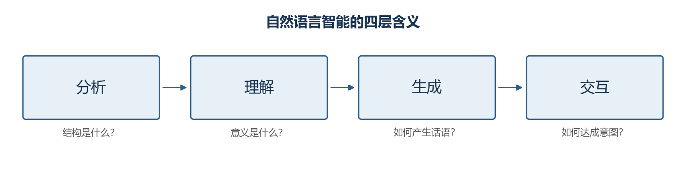

本书大部分篇幅围绕"理解与生成"展开，故有必要先把语言建模问题形式化。设词序列为 $w_{1:T}=(w_1,\dots,w_T)$，语言模型（第 3、15 章）的目标是给出联合概率 $P(w_{1:T})$，由链式法则分解为

$$
P(w_{1:T})=\prod_{t=1}^{T}P(w_t\mid w_{<t}), \tag{1-1}
$$

其中 $w_{<t}=(w_1,\dots,w_{t-1})$。这个看似朴素的分解，是整个领域七十余年的一条主线：从 N-gram 用有限历史近似 $P(w_t\mid w_{<t})$（第 15 章），到神经语言模型用隐状态承载长程依赖（第 16 章），再到 Transformer 用注意力直接建模任意距离的依赖（第 20 章），直至大语言模型在海量参数中隐式编码语言与世界知识（第 26 章）。

**例 1.1（同一句话的四层任务）**　考虑句子「小李把昨天的报告发给了经理」。分析任务问：这句话的句法结构如何、语义角色是谁施事谁是受事？理解任务问：「昨天」修饰的是报告的时间还是发送的时间？「发给了」是否蕴含经理已经收到？生成任务问：如何把这句话改写成正式邮件措辞，或翻译成英文？交互任务问：若用户说"帮我催一下报告"，系统如何理解其意图并决定下一步行动？同一句话、四个问题、四类方法——这正是本书「篇」的划分依据（1.5 节）。

## 1.2　语言处理的历史脉络

理解一门学问，须先理解它的历史。自然语言处理的发展，是一部「从规则到数据、从符号到表示」的演进史。

**第一阶段：规则与形式化（1950 年代—1980 年代）。** 这一时期以符号方法与形式语言理论为主导。1957 年 Chomsky 的《句法结构》提出生成文法与语言层级[1]，把语言的形式结构置于严格数学基础之上。早期机器翻译（如 1954 年 Georgetown-IBM 演示）依赖双语词典与转换规则；基于规则的句法分析、语义网络与专家系统相继出现。这一阶段的遗产是形式语言理论、文法与自动机（第 2 章）以及组合语义的形式化传统（第 13 章）。其局限在于规则难以覆盖语言的开放性与歧义，系统脆弱且迁移成本高。

**第二阶段：统计方法（1980 年代—2000 年代）。** 转折点出现在 1980 年代末至 1990 年代：IBM 的统计机器翻译模型引入词对齐的概率建模[2]，N-gram 语言模型与隐马尔可夫模型成为语音识别与机器翻译的核心，数据驱动方法全面取代规则。这一时期确立了以概率与信息论为语言的统一语言（第 3 章），并产出诸如分词、词性标注的序列标注方法（第 8 章）与 BLEU 等评估指标（第 18 章）。统计方法的力量在于从数据中自动学习，但高维稀疏与数据稀疏始终是难题——平滑技术（第 15 章）正是为此而生。

**第三阶段：神经方法与词向量（2003 年—2017 年）。** 2003 年 Bengio 等提出前馈神经语言模型[3]，用分布式表示替代 N-gram 的离散计数；2013 年 word2vec[4] 让词向量（第 6 章）走进主流，分布假设（"由伴知词"）获得几何实现。循环网络与长短时记忆（第 16 章）解决了序列建模中的长程依赖，序列到序列框架与注意力机制（第 17 章）在机器翻译（第 18 章）上取得突破。这一阶段的核心转变是：**意义被表示为连续向量，语义相似性被实现为向量空间中的几何关系**。

**第四阶段：预训练与 Transformer（2017 年—2020 年）。** 2017 年 Transformer 的提出[5]彻底改变了架构 landscape：自注意力（第 20 章）以并行计算与任意距离依赖建模取代循环结构。2018 年起，GPT 的自回归预训练与 BERT 的掩码语言模型预训练（第 21 章）确立"先预训练、再微调"的范式，ELMo（第 7 章）与上下文表示揭示了一词多义的可建模性。这一阶段证明：大规模预训练能把语言知识压缩进参数，再迁移到下游任务（第 19 章）。

**第五阶段：大语言模型与智能（2020 年至今）。** GPT-3 展示规模化带来的上下文学习能力（第 24 章），指令微调与 RLHF/DPO 对齐（第 28 章）让模型可用且可控，思维链与推理模型（第 29 章）把语言模型推向多步推理，检索增强（第 30 章）弥补参数记忆的局限。到 2025—2026 年，这一阶段进一步分化为四条线索：以原生多模态统一文本、图像、音频（第 32–35 章）；以语言智能体连接工具与行动（第 37 章）；以测试时计算与自我改进增强推理（第 29 章）；以高效架构与推理优化降低成本（第 38 章）。第 27 章给出代表性模型谱系的完整剖析，第 42 章据此讨论语言能否通向通用智能。

图 1-2 以时间轴归纳上述脉络。贯穿这条脉络的一条主线是：**意义表示能力的逐步增强**——从符号的离散操作，到统计的分布刻画，到向量的几何表示，再到参数中的隐式知识与推理。

> 【图 1-2　语言处理方法论的演进时间轴】（原图见 figures/图1-2.png）：横轴 1950—2026，分五个阶段；标记 1957 Chomsky、1990 统计 MT、2003 NNLM、2013 word2vec、2017 Transformer、2018 BERT/GPT、2020 大模型等节点。
>
> 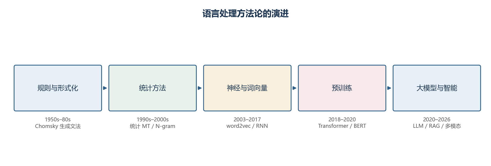

**例 1.2（假设强度与数据量）**　设要为一个仅有 500 条标注样本的垂直领域构建意图分类器。此时规则或浅层统计方法（强假设、少参数）反而稳健；一个大规模预训练模型若直接微调可能过拟合，但采用参数高效微调（第 23 章）或上下文学习（第 24 章）往往能借助预训练知识取得更好效果。这一「假设强度—数据量—预训练知识」的权衡，将在第 19、23、31 章反复出现。

### 1.2.1　技术谱系：参数、数据与假设

**表 1-5　五个阶段的代表方法、参数、数据与假设**

| 阶段 | 代表方法 | 参数量级 | 数据量级 | 核心假设 |
|------|----------|----------|----------|----------|
| 规则 | CFG、专家系统 | $<10^3$ | 无需 | 有限规则生成 |
| 统计 | N-gram、HMM | $10^5$–$10^9$ | $10^7$–$10^8$ 词 | 局部马尔可夫 |
| 神经 | NNLM、word2vec | $10^6$–$10^7$ | $10^8$–$10^9$ 词 | 意义是低维分布 |
| 预训练 | BERT、GPT | $10^8$–$10^9$ | $10^9$–$10^{10}$ token | 知识可迁移 |
| 大模型 | GPT-3 及后继 | $10^9$–$10^{11}$ | $10^{10}$–$10^{12}$ token | 规模带来涌现 |

五阶段的统一写法是**最大似然估计**。设模型 $p_\theta(w_{1:T})$、语料 $D=\{w^{(1)},\dots,w^{(N)}\}$，所有方法都在最小化同一经验风险

$$
\hat\theta=\arg\min_\theta \;-\frac{1}{T_{\mathrm{total}}}\sum_{i=1}^{N}\sum_{t=1}^{T_i}\log p_\theta\big(w^{(i)}_t\mid w^{(i)}_{<t}\big), \tag{1-2}
$$

差别只在 $p_\theta$ 的函数形式（计数表、前馈、循环、注意力网络）与 $w_t$ 的分解方式（固定阶数、窗口、整句、子词）。式 (1-2) 是贯穿全书的「公分母」：**所有语言模型都在回答同一问题——让观测到的句子概率最高——只是函数族不同。**

**例 1.5（用数字读技术谱系）**　以「每 token 分摊的参数」为标尺。三元 N-gram 名义参数 $|V|^3$，取 $|V|=10^5$ 为 $10^{15}$，稀疏后约 $10^9$；word2vec 取 $d=300$ 时参数 $2Vd\approx6\times10^7$，密度远低于 N-gram 而泛化更好。GPT-3 的 1750 亿参数摊在约 3000 亿 token 上。这些数字说明：**质量跃迁是参数、数据与算力同步放大的结果。**

## 1.3　语言的根本困难

自然语言处理之所以困难，源于语言本身固有的若干性质。认清这些困难，是理解后续所有方法的钥匙。

**其一，歧义（ambiguity）。** 语言的词、句、篇章各层都存在歧义。"银行"可以是金融机构或河岸；"咬死了猎人的狗"可作两种句法分析；"你真行"可以是赞美或讽刺。歧义是普遍现象而非例外，理解语言本质上是一个消歧过程。词法层的歧义（第 5 章）、句法层的歧义（第 10 章）与语用层的歧义（第 14 章）将在各篇分别处理。

**其二，组合性与开放词汇（compositionality and openness）。** 语言具有组合性：有限词汇按规则生成无限句子（第 13 章）。这意味着测试时必然出现训练中未见过的句子，模型必须具备组合泛化能力。同时，新词、新义、专名不断涌现，词表永远是开放的——这催生了子词切分（第 6、23 章）与字符级/字节级方法。

**其三，语境依赖（context dependence）。** 语言的意义强烈依赖语境：指代（"它"、"前者"）需要回指消解（第 14 章），省略需要补全，语用含义（会话含义）需要推理（第 14 章）。同一句话在不同语境下意义不同，这使"孤立的句子理解"往往不充分。

**其四，稀疏与长尾（sparsity and long tail）。** 词频服从 Zipf 律：少数词极常见，大量词极罕见。长尾词缺乏足够训练样本，是数据稀疏的根源（第 6、15 章）；低资源语言同样面临覆盖不均的问题（第 25 章）。

**表 1-1　语言问题的四类根本困难及其应对**

| 困难 | 本质 | 应对章节 |
|------|------|----------|
| 歧义 | 单一形式对应多重意义 | 第 5、10、14 章 |
| 组合性与开放词汇 | 有限规则生成无限表达 | 第 6、13、23 章 |
| 语境依赖 | 意义随上下文变化 | 第 7、14、24 章 |
| 稀疏与长尾 | 词频分布高度不均 | 第 6、15、25 章 |

四类困难并非孤立，而是相互交织。例如"歧义"的消解往往依赖"语境"，而"长尾词"的稀疏又加剧了"歧义"——罕见词的向量表示质量差，难以在上下文中正确消歧。这提示我们：**方法选择必须以对困难来源的诊断为前提，而非套用单一模型。**

## 1.4　语言任务的分类谱系

自然语言智能不止于语言建模。为建立全局观念，本书将全部语言任务归纳为十类。

**表 1-2　语言任务的十类谱系**

| 任务 | 问题形式 | 对应章节 |
|------|----------|----------|
| 词法分析 | 切词、标词性、识别实体 | 第 8 章 |
| 句法分析 | 为句子构建句法结构 | 第 10、11 章 |
| 语义分析 | 语义角色、逻辑形式 | 第 12、13 章 |
| 语言建模 | 估计 $P(w_{1:T})$ | 第 3、15、16 章 |
| 文本分类 | 为文本贴标签 | 第 19、31 章 |
| 机器翻译 | 源语言→目标语言 | 第 18 章 |
| 信息抽取 | 从文本抽取结构化知识 | 第 36 章 |
| 问答 | 依据文本或知识回答问题 | 第 30、37 章 |
| 生成 | 产生新文本 | 第 17、34 章 |
| 对话 | 多轮交互达成意图 | 第 37 章 |

十类任务共享同一套底层工具（表示、模型、评估），但目标函数与评估指标截然不同。例如分类关注判别边界，语言建模关注困惑度，翻译关注 BLEU，生成关注多样性与忠实度——用同一指标衡量所有任务是常见误用（第 31 章将系统辨析）。本书按「先基础、后分析、再建模与生成、最后交互」的顺序组织，使读者先掌握底层工具，再逐类攻克。

## 1.5　全书的结构安排

全书共九篇四十二章，逻辑上层层递进。

**第一篇（第 1–4 章）** 建立形式语言、概率信息论与意义的理论框架，回答「自然语言智能受到哪些理论与数学约束」。**第二篇（第 5–10 章）** 讲词汇与分布语义——词汇语义、词向量、上下文表示、词法分析与相似度，因为「先理解词，才能理解句」。**第三篇（第 10–14 章）** 展开句法与语义分析，从结构解析走向逻辑形式。**第四篇（第 15–19 章）** 系统梳理统计与神经语言模型，从 N-gram 到预训练前夜。**第五篇（第 20–25 章）** 聚焦 Transformer 与预训练范式，讨论架构、目标、微调与多语言。**第六篇（第 26–31 章）** 进入大语言模型，从规模化、对齐、推理到检索增强与能力边界。**第七篇（第 32–35 章）** 扩展到多模态与语音语言。**第八篇（第 36–39 章）** 讨论信息抽取、对话系统、工程与领域应用。**第九篇（第 40–42 章）** 展望语言在智能中的角色并列出开放问题。

各章并非孤立专题，而是相互贯通的网络。例如第 3 章的信息论是第 15 章困惑度与第 31 章评估的共同底座；第 4 章的意义五层框架是第 29 章审视大模型幻觉的理论武器；第 20 章的注意力机制则是第 27–30 章一切大模型架构的直接来源。按基础理论「首次且唯一」讲授、后续交叉引用展开的原则，全书对注意力、RLHF、RAG 等知识点规定了唯一的讲授位置，以避免重复、提高知识密度。第 42 章表 42-1 进一步给出「九篇 × 四层能力 × 五层意义」的完整映射，它既是收官处的全书索引，也可作为阅读地图在开篇先读。

## 1.6　四层能力体系

前言把自然语言智能界定为「分析、理解、生成、交互」四层含义，本节将其发展为全书的理论框架。

**定义 1.3（四层能力体系）**　自然语言智能由四个递进的能力层级构成，每一层回答一类根本问题：

- **Level 1　语言分析（Analysis）**：回答「结构是什么」，对语言作词法、句法、篇章的解析与标注；
- **Level 2　语言理解（Understanding）**：回答「意义是什么」，把握语义表征、指称、逻辑形式与推理；
- **Level 3　语言生成（Generation）**：回答「如何产生话语」，实现可控制、连贯、忠实的内容生成；
- **Level 4　语言交互（Interaction）**：回答「如何达成意图」，在对话与任务中理解意图、调用工具、协商目标。

四层之间存在递进关系，**但不是严格的线性依赖**。这一点必须在理论上说清楚：统计语言模型（Level 3）并不要求先有完整的语义理解（Level 2），N-gram 无需知道句子的逻辑形式即可生成通顺文本；对话系统（Level 4）也不必显式表示每一条逻辑形式，端到端方法可直接从对话历史映射到回复。反之，若把四层误解为「必须逐级完成」，就会错误地认为「没有完整的语义理论就不能做生成」，这与七十年的语言模型实践相悖。

**例 1.3（四层的非线性依赖）**　续用例 1.1 的句子。Level 1 可做依存句法分析，识别"发给了"的施事与受事；Level 2 可判断"昨天"的修饰范围与完成体含义；Level 3 的语言模型无需显式做上述分析，仅凭上下文概率就能生成合理的续写；Level 4 的对话系统在用户说"催一下报告"时，可直接依据上下文生成回复，无需显式逻辑形式。这说明高层能力的收益往往体现在**意图与场景**，而非孤立的句子解析。

四层框架在本书中承担三个作用：其一，为九篇划分提供理据（第二、三篇偏 Level 1–2，第四至七篇偏 Level 2–3，第八篇偏 Level 3–4）；其二，为每章定位提供坐标；其三，在第 42 章回扣，讨论自然语言智能能否走向更通用的智能系统，形成首尾闭环。

## 1.7　理论主线：意义的五层结构

本书不满足于罗列语言方法，而试图回答一个更根本的问题：**语言的意义能否被表示、计算与生成？在什么条件下可以？其边界在哪里？** 为此建立意义的五层结构（表 1-3）。

**表 1-3　意义的五层结构**

| 层 | 名称 | 判据 / 工具 | 主要落点 |
|----|------|-------------|----------|
| M1 | 形式意义 | 语法结构、可计算性、Chomsky 层级 | 第 2、10、11 章 |
| M2 | 分布意义 | 统计共现、词向量、上下文嵌入 | 第 6、7、16 章 |
| M3 | 组合意义 | 句法—语义组合、语义角色、λ-演算 | 第 12、13 章 |
| M4 | 指称意义 | 真值条件、逻辑形式、知识对齐 | 第 13、36 章 |
| M5 | 语用意义 | 意图、语境、对话目标、会话含义 | 第 14、37 章 |

须强调：这五层是**理论组织框架，不是严格的数学蕴含关系**。M2 的分布相似不蕴含 M4 的真值等价（"国王"与"王后"向量相近，指称却不同）；M1 的形式合法不保证 M3 的组合意义明确（"无色的绿色思想愤怒地睡觉"句法合法却语义空泛）。框架的价值在于提供一种统一的追问方式。据此，本书对每一个方法都追问四件事：① 它利用了哪一层意义；② 它隐含了什么假设；③ 它突破了前一方法的什么限制；④ 它无法突破什么理论边界。

**例 1.4（四问示例）**　以 N-gram 与 Transformer 对照。N-gram 利用 M2（分布统计），假设语言具有局部马尔可夫性，突破了「纯规则的脆弱」，但无法突破固定阶数限制，也难以刻画长程组合；Transformer 利用 M2–M3（分布与组合），假设存在可从数据学习的注意力模式，突破了固定窗口与顺序瓶颈，但在需要精确指称与真值推理的任务上仍会出错——因为真值（M4）不由分布决定（第 29 章据此审视大模型幻觉）。大语言模型则试图在单一参数模型中隐式承载全部五层，其对 M5 语用的把握尤其令人印象深刻，却也最难验证。三者不是简单的技术迭代，而是**对意义来源的不同建模**。

由此还须澄清三个常被混淆的命题，它们将分别在第二、三、六篇严格说明：① **形式合法不等于语义正确**（Chomsky 的名例句展示了句法合法而语义荒谬）；② **分布相似不等于意义相同**（向量相近的词指称可能相反）；③ **流畅生成不等于忠实理解**（模型能生成通顺文本，却可能产生幻觉）。

## 1.8　贯穿全书的统一案例

方法谱系横跨七十余年、涉及数十种模型，若每章各用一份互不相干的数据，读者读完易只记住一串模型名称，却看不清它们之间的关系。为此本书设计一条**贯穿全书的统一案例**：开放域问答系统。

选择开放域问答，是因为它具备罕见完备的教学属性：覆盖词法、句法、语义各层分析；需要语言建模与知识表示；既可从文本抽取答案，也可检索外部知识；既考察理解（读懂问题与文档），也考察生成（组织答案）；可研究事实型与推理型问题；最终可封装为对话智能体。同一任务在全书中反复出现，但每章追问不同：

**表 1-4　统一案例的章节映射（节选）**

| 章 | 案例研究内容 | 章 | 案例研究内容 |
|----|--------------|----|--------------|
| 8 | 问答语料的词法标注 | 11 | 问题的句法解析 |
| 12 | 问题的语义角色 | 15 | N-gram 语言模型 |
| 16 | 神经语言模型 | 21 | 预训练与微调 |
| 23 | 参数高效适配 | 27 | 大模型实测 |
| 30 | 检索增强问答 | 37 | 封装为对话智能体 |

为避免全书过度依赖单一场景，第 39 章另设法律、医疗、金融与科学的**专题案例**，展示领域差异如何改变方法选型这一更普遍的命题。

> 【图 1-3　意义五层结构】（原图见 figures/图1-3.png）：五层金字塔，自底向上依次标注形式、分布、组合、指称、语用，右侧对应各篇章节。
>
> 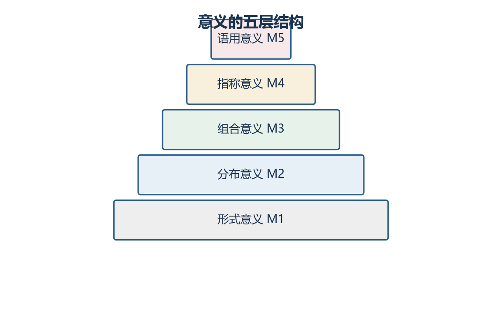

> 【图 1-4　统一案例：问答系统的处理链】（原图见 figures/图1-4.png）：流程图，从词法→句法→语义→语言模型→检索→对话的流水线，标注对应章节。
>
> 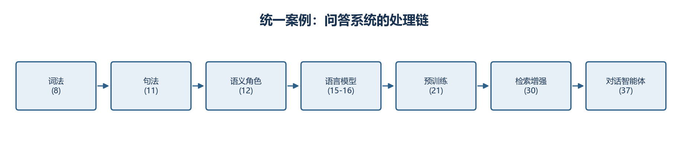

需要说明，选择开放域问答作为贯穿全书的统一案例，是一种教学法上的权衡而非普适性主张。问答任务覆盖的语言现象丰富、评估协议成熟，适合展示从词法分析到对话交互的完整链条；但它并不代表所有语言任务——机器翻译（第 18 章）、文本生成（第 34 章）、对话（第 37 章）都超出"给定问题找答案"的框架。读者在后续章节遇到与问答特性不符的算例时，应把注意力放在「方法假设与任务结构是否匹配」上，而非记住某个具体结论；这也正是第 4 章要为意义划定边界、第 39 章要按领域讨论「什么算好」的原因。第二篇将从词汇与分布语义开始。

### 1.8.1　评估：同一任务、不同度量

同一系统在不同评估协议下结论可能相反。表 1-6 给出开放域问答的各维度度量与量级。

**表 1-6　开放域问答的多维度评估（示意量级）**

| 维度 | 度量 | 含义 | 量级 |
|------|------|------|------|
| 检索 | Hit@k | 答案在前 $k$ 篇文档中 | $k=20$ 时 0.7–0.9 |
| 忠实 | 事实一致率 | 与证据不矛盾的比例 | 0.6–0.85 |
| 流畅 | 困惑度 PPL | 生成文本的意外度 | 越低越流畅 |
| 端到端 | Exact Match / F1 | 与标准答案的匹配度 | 0.4–0.7 |

**例 1.6（评估维度的分离）**　「检索很好、生成很差」的系统 Hit@20 达 0.92，但 40% 答案与证据矛盾、Exact Match 仅 0.35，困惑度却可能很低；反之「生成很好、检索很差」的系统在证据缺席时编造（第 29 章）。这说明：**端到端指标是各维度耦合的综合值，定位能力须先按维度分解**。

## 本章小结

本章确立了全书的问题意识、研究对象与理论框架。

我们首先把自然语言智能界定为分析、理解、生成、交互四类递进能力，并把语言建模形式化为对 $P(w_{1:T})$ 的链式分解。回顾七十余年历史，方法演进的主线是「意义表示能力的逐步增强」；表 1-5 用参数、数据与假设三把标尺把五阶段放到同一谱系上，式 (1-2) 则揭示所有语言模型都在最小化同一经验风险，差别只在函数族与分解方式。

我们进一步剖析了歧义、组合性与开放词汇、语境依赖、稀疏与长尾四类根本困难，指出方法选择必须以对困难来源的诊断为前提；归纳了十类任务谱系，说明目标函数与评估指标不可混用。最重要的是，本章提出了本书自己的两个理论工具：四层能力体系（Level 1–4，递进但非线性依赖）与意义五层结构（M1–M5，作为理论组织框架而非数学蕴含）。前者为全书分篇与每章定位提供坐标，后者为「每个方法追问四问」提供统一方式，并由此引出三个必须澄清的混淆命题。二者将在第 42 章回扣，形成首尾闭环。

最后，本章确立开放域问答为贯穿全书的统一案例，并给出章节映射，使读者能在同一任务上比较不同方法的得失。从下一章起，我们先补足形式语言与自动机基础，为理解语言的数学结构准备语言。

**进一步阅读**　本章建议延伸阅读的文献：[7]、[8]、[9]、[10]。

## 参考文献

[1] Chomsky N. *Syntactic Structures*. The Hague: Mouton, 1957.

[2] Brown P F, Cocke J, Della Pietra S A, et al. A statistical approach to machine translation. *Computational Linguistics*, 1990, 16(2): 79–85.

[3] Bengio Y, Ducharme R, Vincent P, Jauvin C. A neural probabilistic language model. *Journal of Machine Learning Research*, 2003, 3: 1137–1155.

[4] Mikolov T, Chen K, Corrado G, Dean J. Efficient estimation of word representations in vector space. *ICLR Workshop*, 2013.

[5] Vaswani A, Shazeer N, Parmar N, et al. Attention is all you need. *Advances in Neural Information Processing Systems*, 2017, 30.

[6] Devlin J, Chang M W, Lee K, Toutanova K. BERT: Pre-training of deep bidirectional transformers for language understanding. *NAACL*, 2019.

[7] Jurafsky D, Martin J H. *Speech and Language Processing*. 3rd ed. Stanford, 2023.

[8] Manning C D, Schütze H. *Foundations of Statistical Natural Language Processing*. Cambridge, MA: MIT Press, 1999.

[9] Russell S, Norvig P. *Artificial Intelligence: A Modern Approach*. 4th ed. Pearson, 2020.

[10] Goldberg Y. *Neural Network Methods for Natural Language Processing*. Morgan & Claypool, 2017.

---

# 第 2 章　形式语言理论与自动机

第 1 章把自然语言智能界定为分析、理解、生成、交互四层能力，并指出语言的形式结构是第一层基石。本章回答一个更基础的问题：**语言的形式结构如何用数学刻画？哪些语言是可计算的，哪些结构的解析是可判定的？** 这些问题的答案，构成了自然语言处理与计算语言学共同的数学语言。

理解一门形式理论，最好的方式是理解它想解决的问题。20 世纪中叶，语言学家与计算机科学家面临一个共同困惑：什么样的句子是"合语法的"？能否为自然语言写出一套有限的规则，机械地判定任意句子的合法性？Chomsky 的形式语言理论[1]正是对这一困惑的回应——它把"语言"抽象为符号串的集合，把"语法"抽象为生成规则，并建立了语言复杂性的层级。这一理论虽不能直接给出自然语言的完整文法，却为句法分析（第 10、11 章）、组合语义（第 13 章）乃至词法分析（第 8 章）提供了统一的语言。

本章先给出语言与文法的严格定义（2.1 节），再介绍 Chomsky 层级与对应的自动机（2.2 节），讨论解析与可判定性（2.3 节），最后审视形式语言对自然语言的适配与局限（2.4 节），并在边界与讨论中收束（2.5 节）。

## 2.1　语言的数学定义与 Chomsky 层级

一切形式理论始于对"语言"的严格定义。

**定义 2.1（字母表、串与语言）**　字母表 $\Sigma$ 是有限非空符号集合；$\Sigma$ 上的**串**（string）是符号的有限序列 $w=a_1a_2\dots a_n$（$a_i\in\Sigma$），其长度记为 $|w|=n$；空串记为 $\varepsilon$，$|\varepsilon|=0$。所有串的集合记为 $\Sigma^*$（Kleene 闭包）。$\Sigma$ 上的一个**语言** $L$ 是 $\Sigma^*$ 的任意子集：$L\subseteq\Sigma^*$。

这个定义把"语言"还原为集合，看似贫乏，却极为强大——它让我们可以用集合论与可计算性理论研究语言。自然语言的句子集合可视为 $\Sigma^*$ 的一个（极复杂的）子集，其中 $\Sigma$ 是词表或字符表。

**定义 2.2（文法）**　一个文法（grammar）是四元组

$$
G=(N,\Sigma,R,S), \tag{2-1}
$$

其中 $N$ 为非终结符（nonterminal）的有限集，$\Sigma$ 为终结符（terminal）的有限集（$N\cap\Sigma=\varnothing$），$R$ 为产生式（production）的有限集，每条产生式形如 $\alpha\to\beta$（$\alpha,\beta\in(N\cup\Sigma)^*$，且 $\alpha$ 至少含一个非终结符），$S\in N$ 为起始符（start symbol）。

文法通过反复应用产生式生成串：从 $S$ 出发，把非终结符替换为产生式右部，直到不含非终结符。若 $S\Rightarrow^* w$ 且 $w\in\Sigma^*$，则称 $w$ 属于文法 $G$ 生成的语言 $L(G)$。

**定义 2.3（Chomsky 层级）**　按产生式 $R$ 的限制强度，文法分为四级，生成四类语言（表 2-1）：

- **0 型（无限制文法）**：产生式 $\alpha\to\beta$ 无限制。对应递归可枚举语言，由图灵机识别。
- **1 型（上下文相关文法）**：产生式满足 $|\alpha|\le|\beta|$，且 $\alpha$ 含非终结符时可带上下文。对应上下文相关语言，由线性有界自动机识别。
- **2 型（上下文无关文法，CFG）**：产生式形如 $A\to\beta$（$A\in N$）。对应上下文无关语言（CFL），由下推自动机识别。
- **3 型（正则文法）**：产生式形如 $A\to aB$ 或 $A\to a$（右线性），$A,B\in N$，$a\in\Sigma$。对应正则语言，由有限自动机识别。

这四类语言满足严格的包含关系：$\text{正则}\subset\text{上下文无关}\subset\text{上下文相关}\subset\text{递归可枚举}$。限制越强，表达能力越弱，但解析越容易。

**表 2-1　Chomsky 层级与自动机**

| 类型 | 文法限制 | 语言类 | 识别自动机 | 解析复杂度 |
|------|----------|--------|------------|------------|
| 3 型 | 右线性 $A\to aB$ | 正则 | 有限自动机 (FA) | 线性 $O(n)$ |
| 2 型 | $A\to\beta$ | 上下文无关 | 下推自动机 (PDA) | $O(n^3)$（CKY） |
| 1 型 | $|\alpha|\le|\beta|$ | 上下文相关 | 线性有界自动机 | PSPACE |
| 0 型 | 无限制 | 递归可枚举 | 图灵机 | 不可判定 |

> 【图 2-1　Chomsky 层级】（原图见 figures/图2-1.png）：四层嵌套集合，由内到外为正则、上下文无关、上下文相关、递归可枚举，每层标注对应自动机。
>
> 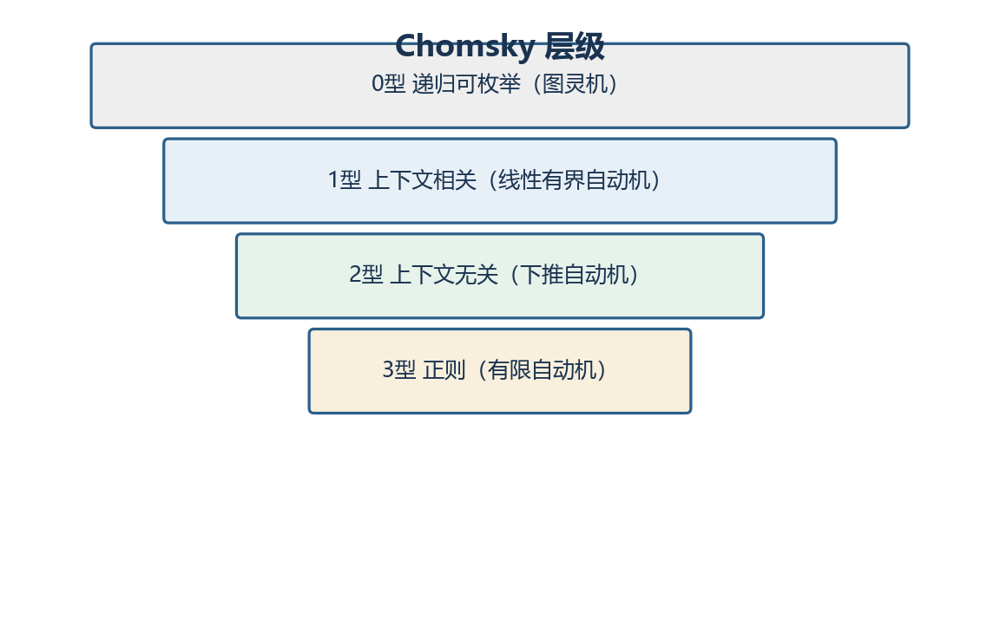

**例 2.1（一个上下文无关文法）**　考虑算术表达式的文法，$\Sigma=\{a,+,\times,(,)\}$，$N=\{E,T,F\}$，$S=E$，产生式为

$$
E\to E+T\mid T,\quad T\to T\times F\mid F,\quad F\to (E)\mid a. \tag{2-2}
$$

串 $a+a\times a$ 的派生过程为 $E\Rightarrow E+T\Rightarrow T+T\Rightarrow F+T\Rightarrow a+T\Rightarrow a+T\times F\Rightarrow a+F\times F\Rightarrow a+a\times F\Rightarrow a+a\times a$。这一派生对应一棵句法树（图 2-2），其结构决定了运算优先级——这正是文法"结构即意义"的体现（第 4 章 M1 层）。

> 【图 2-2　CFG 派生树】（原图见 figures/图2-2.png）：由 $E$ 展开的句法树，叶子为 $a+a\times a$，内部节点标 $E/T/F$。
>
> 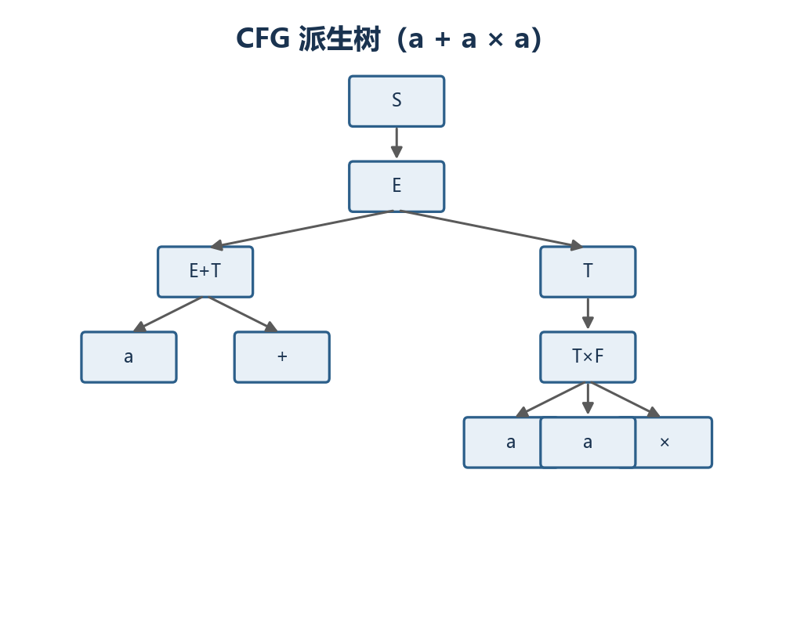

## 2.2　正则语言、上下文无关语言与自动机

Chomsky 层级中，正则语言与上下文无关语言对自然语言处理最为直接相关。本节分别介绍其自动机模型。

**定义 2.4（有限自动机）**　确定性有限自动机（DFA）为五元组 $M=(Q,\Sigma,\delta,q_0,F)$，其中 $Q$ 为有限状态集，$\delta:Q\times\Sigma\to Q$ 为转移函数，$q_0\in Q$ 为初始状态，$F\subseteq Q$ 为接受状态集。若读完串 $w$ 后停在接受状态，则 $M$ 接受 $w$。DFA 接受的语言类恰为正则语言。

有限自动机的表达能力有限，无法计数任意深度的嵌套（如配对括号）。这一限制由下推自动机突破。

**定义 2.5（下推自动机）**　下推自动机（PDA）在有限自动机基础上增加一个**栈**（stack）。形式上，PDA 为七元组 $M=(Q,\Sigma,\Gamma,\delta,q_0,Z_0,F)$，其中 $\Gamma$ 为栈字母表，$Z_0\in\Gamma$ 为栈底符号，转移函数 $\delta$ 依据当前状态、输入符号与栈顶符号决定下一状态与栈操作（压栈/弹栈）。栈使 PDA 能记住任意深的嵌套结构，恰好识别上下文无关语言。

例如，语言 $\{a^nb^n\mid n\ge 0\}$（$n$ 个 $a$ 后接 $n$ 个 $b$）不是正则的（有限状态无法计数任意 $n$），但可由 PDA 识别：读 $a$ 时压栈，读 $b$ 时弹栈，最后栈空则接受。这一语言是上下文无关的，产生式为 $S\to aSb\mid\varepsilon$。

**例 2.2（自然语言中的嵌套与 CFG 的适用）**　自然语言存在有限嵌套结构，如 "The cat [that chased the mouse [that ate the cheese]] sat down"。这类中心嵌入（center embedding）结构可用 CFG 描述，对应 $S\to \text{NP VP}$、$\text{NP}\to \text{N RC}$、$\text{RC}\to \text{that S VP}$ 等规则。然而自然语言也包含 CFG 难以刻画的现象——如跨语言的一致性依赖与"交叉依赖"（ Swiss German 的动词语序），这促使语言学家提出超出 CFG 的形式系统（如树邻接文法 TAG、词汇化文法）。这些扩展将在第 10 章句法理论中讨论。

正则语言与 CFG 在自然语言处理中各有分工：正则语言适合词法层（如数字、日期的识别，第 8 章），CFG 适合句法层（第 10、11 章）。二者的表达能力差异，决定了它们各自适用的语言现象。

### 2.2.1　非确定有限自动机与确定性化

工程上构造的自动机常常「不守规矩」：读到一个符号后，下一步可能走向多个状态，甚至可以不读符号就切换（$\varepsilon$ 移动）。DFA 过于严格，这种灵活的非确定性自动机（NFA）在词法分析器与正则表达式引擎中更自然。

**定义 2.7（非确定有限自动机，NFA）**　NFA 为五元组 $M=(Q,\Sigma,\delta,q_0,F)$，其转移函数 $\delta:Q\times(\Sigma\cup\{\varepsilon\})\to\mathcal{P}(Q)$ 返回**状态集合**。串 $w$ 被 $M$ 接受，当且仅当存在一条（允许 $\varepsilon$ 的）路径从 $q_0$ 走到某个接受态：

$$
q_0 \xRightarrow{w} r,\ \text{其中}\ r\in F. \tag{2-3}
$$

这里 $\xRightarrow{w}$ 表示「读入 $w$（允许穿插 $\varepsilon$ 移动）后可能到达」。NFA 的接受是**存在性**判定——只要有一条路径走通即接受，这与 DFA 的唯一确定路径形成对照。

**定理 2.2（NFA 与 DFA 等价）**　任一 NFA 都存在接受同一语言的等价 DFA。确定性化用**子集构造法**（subset construction）：新 DFA 的每个状态是原 NFA 的状态子集，其转移为

$$
\delta'(A,a)=\varepsilon\text{-closure}\Big(\bigcup_{q\in A}\delta(q,a)\Big),\quad A\subseteq Q,\ a\in\Sigma,
$$

初态取 $\{\varepsilon\text{-closure}(q_0)\}$，接受态为含原接受态的子集。状态数最坏 $2^{|Q|}$，但实际语言中通常远小于此上界。这一等价性把「正则语言」的定义从 DFA 放宽到 NFA，却未扩大语言类——NFA 更便于手写，DFA 更便于高效匹配。

**例 2.5（子集构造：识别含至少一个 $b$）**　设 NFA 状态 $Q=\{0,1\}$，$q_0=0$，$F=\{1\}$，$\delta(0,a)=\{0\}$、$\delta(0,b)=\{0,1\}$、$\delta(1,a)=\{1\}$、$\delta(1,b)=\{1\}$（状态 0 尚未见 $b$，状态 1 已见）。子集构造得 DFA 状态：$\{0\}$（初态）、$\{0,1\}$（接受态）。转移：$\{0\}\xrightarrow{a}\{0\}$、$\{0\}\xrightarrow{b}\{0,1\}$、$\{0,1\}\xrightarrow{a}\{0,1\}$、$\{0,1\}\xrightarrow{b}\{0,1\}$。表 2-3 给出该 DFA。可见 NFA 的非确定步 $\delta(0,b)=\{0,1\}$（读 $b$ 后可留在 0 也可进 1）在 DFA 中被「打包」为对 $\{0,1\}$ 的确定转移——非确定性被吸收进了状态集合。

**表 2-3　由 NFA 子集构造的 DFA（语言「含至少一个 $b$」）**

| DFA 状态（NFA 子集） | 读 $a$ | 读 $b$ | 是否接受 |
|----------------------|--------|--------|----------|
| $\{0\}$ | $\{0\}$ | $\{0,1\}$ | 否 |
| $\{0,1\}$ | $\{0,1\}$ | $\{0,1\}$ | 是 |

### 2.2.2　正则表达式：正则语言的第三种刻画

NFA、DFA 与正则表达式（regular expression）是正则语言的三种等价刻画，三者可互相转换。正则表达式用代数符号书写语言，是词法分析器（第 8 章）与文本检索的实际工作语言。

**定义 2.8（正则表达式）**　$\Sigma$ 上的正则表达式归纳定义为：$\varnothing$ 与 $\varepsilon$ 是正则式；每个 $a\in\Sigma$ 是正则式；若 $r,s$ 是正则式，则 $r+s$（并）、$rs$（连接）与 $r^*$（Kleene 星）也是正则式。正则式 $r$ 所描述的语言记 $L(r)$。常用简写 $r^+=rr^*$（一次或多次）、$r?$（零次或一次）、$[a-z]$（字符类）、$r\{m,n\}$（出现 $m$ 到 $n$ 次）。

正则式与自动机的等价性由**Kleene 定理**保证：

**定理 2.3（Kleene 定理）**　一个语言 $L\subseteq\Sigma^*$ 是正则的，当且仅当它可由某个正则表达式描述，当且仅当它被某个有限自动机（DFA 或 NFA）接受。

三个方向——正则式 $\to$ NFA、NFA $\to$ 正则式、正则式 $\to$ DFA——的构造性证明（Hopcroft–Ullman[8]）说明三者刻画的是同一个语言类。工程上最常用的转换是「正则式 $\to$ NFA」（构造确定、简单），再用子集构造法确定性化为 DFA（表 2-3 即其产物）。

**例 2.7（识别邮箱前缀的正则式）**　用 $[a-z]$ 表示小写字母集合、$+$ 表示「一次或多次」，邮箱前缀可写为 $[a-z][a-z0-9._{0,254}]$。其中下标 $m$ 与 $m,n$ 是 $*$、$+$ 的简写（出现次数）。该正则式可机械地转为一个含约 30 个状态的 NFA，再确定性化。这正是第 8 章词法分析器识别数字、日期、标识符等词法单位所用的同一套机制——**词法分析器的本质就是一组正则表达式对应的 DFA 集合，对输入做最长匹配（longest match）**。

**表 2-4　正则语言三种刻画的互转**

| 转换 | 构造方法 | 状态数/规模 |
|------|----------|-------------|
| 正则式 $\to$ NFA | Thompson 构造（按 $+,\cdot,^*$ 分治） | 状态数 $\le 2\cdot(\text{式长})$ |
| NFA $\to$ DFA | 子集构造法（定义 2.7 式 (2-3)） | 最坏 $2^{|Q|}$ |
| NFA $\to$ 正则式 | 状态消去法（逐步消去中间状态） | 式长随消去增长 |

正则表达式的代数性质（分配律、结合律、De Morgan 律）使语言可像代数式一样化简与组合，这是它在词法分析器中成为「事实标准」的根本原因。下一章的概率与信息论则从「集合是否属于」转向「串出现的可能性」，两套语言将在第 10–11 章句法分析中合流。

## 2.3　文法、解析与可判定性

有了文法，自然要问：**给定串 $w$ 与文法 $G$，如何判定 $w\in L(G)$？如何构造其派生/句法树？** 这就是解析（parsing）问题。

**定义 2.6（解析）**　给定文法 $G$ 与串 $w\in\Sigma^*$，解析问题是判定是否存在派生 $S\Rightarrow^* w$，并在存在时输出一棵派生树。后者称为**句法分析**（syntactic parsing），是第 11 章的主题。

解析的可判定性随 Chomsky 层级而变：

- 对 CFG，解析是可判定的，存在多项式时间算法（如 CKY 为 $O(n^3)$，Earley 算法）；第 11 章给出 CKY 的完整推导。
- 对上下文相关文法与 0 型文法，一般解析问题是不可判定的或计算代价极高。

**定理 2.1（CFG 解析的可判定性）**　对任意上下文无关文法 $G$ 与任意串 $w$，存在算法在有限步内判定 $w\in L(G)$。进一步，Chomsky 范形（Chomsky Normal Form, CNF）下的 CFG 可用 CKY 算法在 $O(n^3|G|)$ 时间内完成解析。

> 【证明思路】　把 $G$ 转化为等价的 CNF（产生式形如 $A\to BC$ 或 $A\to a$）。CKY 用动态规划填表：表项 $T[i,j]$ 存所有能生成子串 $w_i\dots w_j$ 的非终结符。先填长度为 1 的项（$A\to a$），再对长度 $l=2,\dots,n$ 的项，枚举分割点 $k$，若存在 $A\to BC$ 且 $B\in T[i,k]$、$C\in T[k+1,j]$，则把 $A$ 加入 $T[i,j]$。最终 $S\in T[1,n]$ 当且仅当 $w\in L(G)$。完整推导见第 11 章。$\square$

CNF 的引入揭示了一个重要原则：**限制文法形式可以换来高效算法**。这与工程实践中"用受限但高效的模型"的思路一致（如有限状态词法分析器、受限句法分析器）。

**例 2.3（CKY 填表示例）**　对文法 $S\to AB$，$A\to a$，$B\to b$，串 $w=ab$。长度 1：$T[1,1]=\{A\}$，$T[2,2]=\{B\}$。长度 2：枚举 $k=1$，$A\in T[1,1]$、$B\in T[2,2]$，且 $S\to AB$，故 $T[1,2]=\{S\}$。因 $S\in T[1,2]$，判定 $ab\in L(G)$。表 2-2 给出填表过程。

**表 2-2　CKY 填表（串 $ab$）**

| 区间 $[i,j]$ | 非终结符 | 依据 |
|--------------|----------|------|
| $[1,1]$ | $A$ | $A\to a$ |
| $[2,2]$ | $B$ | $B\to b$ |
| $[1,2]$ | $S$ | $S\to AB$ |

**例 2.6（CKY 的完整数值填表：$a+a\times a$）**　对例 2.1 的文法（2-2）解析串 $w=a+a\times a$（$n=5$，记 $w_1=a,w_2=+,w_3=a,w_4=\times,w_5=a$）。表项 $T[i,j]$ 存能生成 $w_i\dots w_j$ 的非终结符。先做单位规则回填（$T\to F$、$E\to T$：凡 $F\in T[i,j]$ 则 $T,E\in T[i,j]$），长度 1 的项为 $T[1,1]=T[3,3]=T[5,5}=\{F,T,E\}$，$T[2,2]=T[4,4}=\varnothing$。按长度递推：

- $l=3$：$T[1,3]$ 分割 $k=2$，$E\in T[1,1]$、$T\in T[3,3]$ 且 $E\to E+T$，故 $E\in T[1,3]$；$T[3,5}$ 分割 $k=4$，$T\in T[3,3]$、$F\in T[5,5}$ 且 $T\to T\times F$，故 $T\in T[3,5}$。
- $l=5$：$T[1,5]$ 分割 $k=3$，$E\in T[1,3]$、$T\in T[3,5}$ 且 $E\to E+T$，故 $E\in T[1,5]$。

最终 $S=E\in T[1,5]$，判定 $a+a\times a\in L(G)$，回填得到「乘法先于加法」的句法树——运算优先级由结构显式编码。手写填表最易漏掉单位规则的回填，程序化的严谨实现见第 11 章。

## 2.4　形式语言对自然语言的适配与局限

形式语言理论为自然语言研究提供了强有力的工具，但也存在根本局限。理解这些局限，是避免"把形式方法误用到不适用的语言现象"的前提。

**适配之处。** CFG 成功刻画了大量句法现象：短语结构、嵌套、并列、递归。概率上下文无关文法（PCFG，第 11 章）为每条产生式赋概率，使句法分析从"是否合法"走向"最可能的分析"，是现代统计句法分析的基础。词法化的文法与依存文法（第 10 章）进一步把词汇信息引入结构，提升了实用性。

**局限之一：自然语言的歧义远超 CFG 的直接刻画。** 一句多义（第 1 章）在 CFG 中表现为多棵合法派生树，CFG 本身无法决定哪棵正确，必须借助概率、语义与语境（第 11–14 章）。

**局限之二：某些自然语言现象超出上下文无关能力。** 瑞士德语等语言中的交叉依赖（cross-serial dependency）需要比 CFG 更强的形式系统；自然语言语义的某些方面（如照应约束）涉及复杂特征。这促使语言学家发展 TAG、LFG、HPSG 等扩展文法，以及基于特征的统一文法（第 10 章）。

**局限之三：形式文法关注"合法性"，而语言智能更关注"意义"与"使用"。** Chomsky 的理论严格区分句法与语义，但自然语言处理的目标往往是可计算的意义表示（第 13 章）与语境中的意图理解（第 14 章）——这些并非纯形式系统能覆盖。正如第 4 章将要指出的，形式意义（M1）只是意义五层中的一层。

**例 2.4（形式合法性 vs 语义）**　Chomsky 的名句 "Colorless green ideas sleep furiously"（无色的绿色思想愤怒地睡觉）句法完全合法（符合英语 CFG），却语义荒谬。这说明 M1（形式）与 M3、M4（组合与指称意义）是不同层次——一个串可以形式合法而语义空泛。这一观察将在第 4 章意义五层框架中系统化。

## 2.5　边界与讨论

形式语言理论是理解语言的数学基础，但必须清楚其边界。

**可计算性边界。** Chomsky 层级揭示了语言表达能力与解析复杂度的权衡：表达能力越强的文法，解析越困难，甚至不可判定。工程实践中普遍选择受限模型（正则词法、CFG 句法），正是对这一权衡的回应。

**形式与意义的边界。** 形式语言回答"串是否属于某集合"，而语言智能回答"串表达什么意义、如何达成意图"。前者是后者的必要非充分条件。把句法分析等同于语言理解，是常见误区（第 4、13 章辨析）。

**与后续章节的联系。** 本章建立的文法与自动机概念，将在第 8 章（词法分析用有限状态方法）、第 10 章（句法理论与 CFG 扩展）、第 11 章（CKY 等解析算法）、第 13 章（λ-演算与组合语义）反复出现。特别地，第 13 章的组合语义可直接视为"在句法派生上定义语义组合函数"——形式语言理论在此与意义理论交汇。

学习形式语言理论，目的不是为自然语言写出完美文法（这被证明极其困难），而是掌握一套描述结构、分析可计算性、设计高效算法的语言。有了这套语言，我们才能在后续章节中精确讨论词法、句法与语义模型的能力与边界。第 3 章将引入另一套基础语言——概率与信息论，它与形式语言理论一起，构成全书的理论底座。

## 本章小结

本章建立了形式语言理论的框架。

我们首先把语言严格定义为 $\Sigma^*$ 的子集，把文法定义为四元组 $G=(N,\Sigma,R,S)$，并介绍 Chomsky 层级——按产生式限制分为 3 型（正则）、2 型（上下文无关）、1 型（上下文相关）、0 型（递归可枚举），分别由有限自动机、下推自动机、线性有界自动机、图灵机识别。正则语言与上下文无关语言对自然语言处理最直接：前者适合词法层，后者适合句法层。正则语言还有 NFA 与正则表达式两种等价刻画（Kleene 定理），子集构造法与 Thompson 构造把三者连通，这正是词法分析器的数学基础。

我们进一步讨论了解析与可判定性，证明 CFG 解析是可判定的，并给出 CKY 算法与 Chomsky 范形的核心思想——限制文法形式可换来高效算法。这一原则贯穿全书。

最后，我们审视了形式语言对自然语言的适配与局限：CFG 成功刻画句法结构，但难以处理歧义消解、交叉依赖与意义/使用问题。形式合法性不等于语义正确，形式意义（M1）只是意义五层中的一层。这些局限将在第 4 章意义框架与第 10–14 章句法语义分析中展开。

形式语言理论回答"结构是否合法、如何解析"，概率与信息论回答"结构有多可能、信息有多少"。下一章补足后者，为语言建模提供统计基础。

**进一步阅读**　本章建议延伸阅读的文献：[1]、[2]、[3]、[4]。

## 参考文献

[1] Chomsky N. *Syntactic Structures*. The Hague: Mouton, 1957.

[2] Hopcroft J E, Motwani R, Ullman J D. *Introduction to Automata Theory, Languages, and Computation*. 3rd ed. Pearson, 2006.

[3] Sipser M. *Introduction to the Theory of Computation*. 3rd ed. Boston: Cengage, 2012.

[4] Jurafsky D, Martin J H. *Speech and Language Processing*. 3rd ed. Stanford, 2023.

[5] Aho A V, Lam M S, Sethi R, Ullman J D. *Compilers: Principles, Techniques, and Tools*. 2nd ed. Pearson, 2006.

[6] Manning C D, Schütze H. *Foundations of Statistical Natural Language Processing*. Cambridge, MA: MIT Press, 1999.

[7] Partee B H, ter Meulen A, Wall R E. *Mathematical Methods in Linguistics*. Dordrecht: Kluwer, 1990.

[8] Hopcroft J E, Ullman J D. *Formal Languages and Their Relation to Automata*. Reading, MA: Addison-Wesley, 1969.

---

# 第 3 章　语言的概率与信息论基础

第 2 章建立了语言的形式结构理论，回答"句子是否合语法、如何解析"。但自然语言智能面临的更核心问题是：语言充满不确定性——下一个词是什么、这句话表达什么、用户意图如何。处理不确定性，需要另一套数学语言：**概率论与信息论**。本章建立这套语言，它是语言模型（第 15、16 章）、困惑度评估（第 15 章）、词向量（第 6 章）与模型选择（第 31 章）的共同底座。

概率进入自然语言处理，源于一个朴素观察：语言使用是有规律的——某些词更常出现、某些词倾向于结伴、某些句子结构更常见。这些规律可以用概率分布刻画。1948 年 Shannon 的信息论[1]则进一步给出"信息有多少"的度量，把语言建模与通信理论联系起来。统计语言模型（第 15 章）与神经语言模型（第 16 章）的成功，本质上都是对语言概率结构更精确的建模。

本章先回顾概率论基础（3.1 节），再引入熵、交叉熵与困惑度（3.2 节），讨论信息论视角下的语言——熵率与冗余（3.3 节），最后介绍参数估计方法（3.4 节）并在边界与讨论中收束（3.5 节）。

## 3.1　概率论与条件概率

**定义 3.1（条件概率与链式法则）**　事件 $A,B$ 的条件概率为 $P(A\mid B)=P(A\cap B)/P(B)$（$P(B)>0$）。对随机变量序列 $W_1,\dots,W_T$，联合分布可分解为

$$
P(w_1,\dots,w_T)=\prod_{t=1}^{T}P(w_t\mid w_1,\dots,w_{t-1}), \tag{3-1}
$$

这正是第 1 章式 (1-1) 的依据。链式法则是精确的，但直接估计 $P(w_t\mid w_{<t})$ 所需参数随上下文长度指数增长，因此需要近似——这是第 15 章 N-gram 马尔可夫假设的动机。

**定义 3.2（随机变量与分布）**　离散随机变量 $X$ 的取值在有限或可数集，由概率质量函数 $p(x)=P(X=x)$ 描述；连续随机变量由概率密度 $f(x)$ 描述。联合分布 $p(x,y)$、边缘分布 $p(x)=\sum_y p(x,y)$、条件分布 $p(x\mid y)=p(x,y)/p(y)$ 是全书反复使用的概念。

**例 3.1（词的条件概率）**　设词表 $V=\{$"我","今天","吃","苹果"$\}$。若语料中"吃"后出现"苹果"的次数为 80，"吃"总共出现 100 次，则用最大似然估计 $\hat{P}(\text{苹果}\mid\text{吃})=80/100=0.8$。这种"数数"式的估计是 N-gram 模型的核心（第 15 章），但面对未见的词对会给出 0 概率——平滑（第 15 章）正是为解决这一问题。

**定义 3.3（期望、方差与协方差）**　离散随机变量函数的期望为 $\mathbb{E}[g(X)]=\sum_x g(x)p(x)$；方差 $\mathrm{Var}(X)=\mathbb{E}[(X-\mathbb{E}X)^2]$；两变量的协方差 $\mathrm{Cov}(X,Y)=\mathbb{E}[XY]-\mathbb{E}X\,\mathbb{E}Y$。相关系数 $\rho=\mathrm{Cov}(X,Y)/\sqrt{\mathrm{Var}(X)\mathrm{Var}(Y)}$ 衡量线性相关程度。

在词向量研究（第 6、9 章）中，词共现的统计矩是分布语义的基础：两个词若在相似上下文中出现，其上下文分布的某些矩会接近。

### 3.1.1　互信息：变量间依赖的度量

互信息度量两个随机变量之间的统计依赖，是词义消歧的特征选择（第 5 章）与特征加权（第 31 章）的核心量——它回答「知道 $Y$ 后，对 $X$ 的不确定性减少了多少」。

**定义 3.9（互信息）**　离散变量 $X,Y$ 的互信息为

$$
I(X;Y)=\sum_{x,y}p(x,y)\log\frac{p(x,y)}{p(x)p(y)}=H(X)-H(X\mid Y)=D_{\mathrm{KL}}\big(p(x,y)\,\big\|\,p(x)p(y)\big). \tag{3-2}
$$

三种写法揭示其本质：它既是「联合分布与独立假设的 KL 距离」，又是「边缘熵减条件熵」。由此得三个基本性质：$I(X;Y)\ge0$（当且仅当 $X\perp Y$ 独立时为 0）、对称性 $I(X;Y)=I(Y;X)$、以及条件链式法则

$$
I(X;Z)=I(X;Z\mid Y)+I(X;Y). \tag{3-3}
$$

**例 3.2（互信息与条件熵的手算）**　设「银行」的义项 $s\in\{$金融,河岸$\}$ 与语境 $c\in\{$金融语境,自然语境$\}$ 的联合分布为

| | $c=$金融语境 | $c=$自然语境 | $p(s)$ |
|---|---|---|---|
| $s=$金融 | 0.45 | 0.05 | 0.50 |
| $s=$河岸 | 0.05 | 0.45 | 0.50 |
| $p(c)$ | 0.50 | 0.50 | 1 |

因两边际均均匀，$H(s)=1$ bit。给定语境后 $p(\text{金融}\mid\text{金融语境})=0.45/0.5=0.9$，故 $H(s\mid c)=-0.9\log_2 0.9-0.1\log_2 0.1\approx0.469$ bit。由式 (3-2) 得 $I(s;c)=H(s)-H(s\mid c)=1-0.469\approx0.531$ bit：知道语境把义项的不确定性从 1 bit 降到 0.469 bit。这一数值直接对应第 5 章 WSD 中「上下文对义项的判别力」——互信息越大，该语境特征对消歧越有用，故特征选择常用互信息排序。

## 3.2　熵、交叉熵与困惑度

信息论为"不确定性"与"信息量"提供了定量度量。

**定义 3.4（熵）**　离散随机变量 $X$ 的熵（entropy）为

$$
H(X)=-\sum_{x}p(x)\log p(x), \tag{3-4}
$$

其中约定 $0\log 0=0$，对数底为 2 时单位为比特（bit），底为 $e$ 时为 nat。熵度量随机变量的不确定性：均匀分布熵最大，确定分布熵为 0。

**定义 3.5（联合熵与条件熵）**　联合熵 $H(X,Y)=-\sum_{x,y}p(x,y)\log p(x,y)$；条件熵

$$
H(Y\mid X)=-\sum_{x,y}p(x,y)\log p(y\mid x). \tag{3-5}
$$

链式法则的熵形式为 $H(X,Y)=H(X)+H(Y\mid X)$。

**定义 3.6（交叉熵与 KL 散度）**　分布 $p,q$ 的交叉熵为 $H(p,q)=-\sum_x p(x)\log q(x)$；KL 散度（相对熵）为

$$
D_{\mathrm{KL}}(p\|q)=\sum_x p(x)\log\frac{p(x)}{q(x)}=H(p,q)-H(p)\ge 0. \tag{3-6}
$$

KL 散度非负（Gibbs 不等式），当且仅当 $p=q$ 时为 0。它度量用 $q$ 近似 $p$ 的信息损失，是变分推断（第 21 章）与模型选择的核心量。

**定义 3.7（困惑度）**　语言模型 $p_\theta$ 在测试语料 $x=(w_1,\dots,w_T)$ 上的困惑度（perplexity, PPL）为

$$
\mathrm{PPL}(x)=\exp\!\left(-\frac{1}{T}\sum_{t=1}^{T}\log p_\theta(w_t\mid w_{<t})\right)=2^{H(\hat{p},p_\theta)}, \tag{3-7}
$$

其中 $\hat{p}$ 为测试语料的经验分布。困惑度是每词平均负对数似然的指数，可理解为"模型在预测下一个词时的平均分支因子"。困惑度越低，模型对语料越"不意外"。

**例 3.3（困惑度的手算）**　设测试句为"我 今天 吃 苹果"（$T=4$），模型给出概率 $P(\text{我})=0.5$，$P(\text{今天}\mid\text{我})=0.2$，$P(\text{吃}\mid\text{我今天})=0.4$，$P(\text{苹果}\mid\text{我今天吃})=0.5$。每词负对数似然（以 $e$ 为底）依次为 $-\log 0.5\approx0.693$、$-\log 0.2\approx1.609$、$-\log 0.4\approx0.916$、$-\log 0.5\approx0.693$，平均为 $0.978$。故 $\mathrm{PPL}=\exp(0.978)\approx2.66$。这意味着模型在每步平均约在 2.66 个等可能词中做选择。表 3-1 给出计算细节。
**表 3-1　困惑度计算示例**

| 位置 $t$ | 词 | 条件概率 | $-\log p$ |
|----------|----|----------|-----------|
| 1 | 我 | 0.5 | 0.693 |
| 2 | 今天 | 0.2 | 1.609 |
| 3 | 吃 | 0.4 | 0.916 |
| 4 | 苹果 | 0.5 | 0.693 |
| 平均 | — | — | 0.978 → PPL≈2.66 |

困惑度虽广泛应用，却有局限：它对词表大小敏感（不同词表的模型 PPL 不可直接比较），且几何平均使其对长尾词极其敏感（第 31 章将讨论替代指标）。

### 3.2.1　熵、交叉熵与 KL 的三角关系

定义 3.4–3.7 给出三个量：真实分布 $p$ 的熵 $H(p)$、交叉熵 $H(p,q)$、KL 散度 $D_{\mathrm{KL}}(p\|q)$。它们满足一个恒等式

$$
H(p,q)=H(p)+D_{\mathrm{KL}}(p\|q)\ge H(p), \tag{3-8}
$$

即「用 $q$ 编码 $p$ 的平均码长 $\ge$ 用 $p$ 自身编码的平均码长」，等号当且仅当 $q=p$。这一不等式（Gibbs）是模型评估与变分推断的共同基石：**训练一个语言模型 $p_\theta$ 去逼近真实分布 $p$，本质就是最小化 $D_{\mathrm{KL}}(p\|p_\theta)$**；由于 $H(p)$ 是常数，最小化交叉熵与最小化困惑度等价。

**例 3.4（交叉熵与 KL 的手算）**　设真实下一个词分布 $p=(0.8,0.2)$（两词），模型 $q=(0.6,0.4)$。则

- $H(p)=-0.8\log_2 0.8-0.2\log_2 0.2\approx0.722$ bit；
- $H(p,q)=-0.8\log_2 0.6-0.2\log_2 0.4\approx0.846$ bit；
- $D_{\mathrm{KL}}(p\|q)=0.846-0.722\approx0.124$ bit。

模型 $q$ 把「吃」的概率从 0.8 低估到 0.6，付出 0.124 bit/词的编码代价。若 $q$ 完美拟合到 $(0.8,0.2)$，则 $D_{\mathrm{KL}}\to0$、交叉熵降到熵 $0.722$——**熵是语言模型困惑度的理论下限**，语言的可预测性（冗余，3.3 节）正是这个下限低于「均匀分布熵」的部分。

## 3.3　信息论视角下的语言：熵率与冗余

语言不是独立同分布的符号序列，而是有结构的随机过程。信息论提供了刻画这种结构的工具。

**定义 3.8（熵率）**　对随机过程 $W_1,W_2,\dots$，熵率（entropy rate）定义为

$$
h=\lim_{n\to\infty}\frac{1}{n}H(W_1,\dots,W_n), \tag{3-9}
$$

若极限存在。对平稳遍历过程，熵率也等于 $\lim_{n\to\infty}H(W_n\mid W_1,\dots,W_{n-1})$。

熵率刻画语言的"平均每符号不确定性"。英语的熵率估计约在 1–1.5 bit/字符（远低于log2(27)≈4.76），说明语言有大量冗余结构。

**冗余度（redundancy）** 定义为 $1-h/h_{\max}$，其中 $h_{\max}$ 为同等字母表下的最大熵率（均匀分布）。英语的冗余度估计在 40%–80%——这正是语言可被压缩、可被模型学习的根本原因。冗余既来自句法约束（第 2 章）、词法约束，也来自语义与语用约束（第 4 章）。

**例 3.5（Zipf 律与熵）**　词频服从 Zipf 律：排名 $r$ 的词频率 $f(r)\propto 1/r^\alpha$（$\alpha\approx1$）。这一分布高度不均，其熵远小于均匀分布。设词表 $V=10000$，若均匀分布的熵为 $\log_2 10000\approx13.3$ bit/词；Zipf 分布（$\alpha=1$）的熵约为 $H\approx\frac{\pi^2}{6\ln 2}\approx2.4$ bit/词——巨大的差距反映了语言的可预测性。词频分布（图 3-1）与熵率（图 3-2）是理解语言统计结构的两把钥匙。

> 【图 3-1　词频 Zipf 律】（原图见 figures/图 3-1.png）：双对数坐标下词频与排名的近似直线关系，标注 $\alpha\approx1$。
>
> 

> 【图 3-2　熵率与序列长度】（原图见 figures/图 3-2.png）：横轴为上下文长度 $n$，纵轴为 $H(W_n\mid W_{<n})$，曲线随 $n$ 增长趋于熵率 $h$。
>
> 

信息论的另一个深刻结论是**信源编码定理**：任意信源的熵率是可无损压缩的极限。这把语言建模与压缩联系起来——一个好的语言模型就是一个好的压缩器，困惑度与压缩率紧密相关。这一联系在第 16、26 章讨论神经语言模型与规模化时再次出现。

**表 3-2　核心信息量在 NLP 中的角色**

| 量 | 定义要点 | NLP 角色 | 主要落点 |
|----|----------|----------|----------|
| 熵 $H$ | 分布的平均自信息 | 语言不确定性的下限 | 第 15、31 章 |
| 条件熵 $H(\cdot\mid\cdot)$ | 给定信息后的残余不确定 | 消歧剩余难度（例 3.2） | 第 5 章 WSD |
| 交叉熵 $H(p,q)$ | 用 $q$ 编码 $p$ 的码长 | 训练损失（最小化它） | 第 15、16、21 章 |
| KL 散度 | $q$ 与 $p$ 的偏离 | 变分推断、模型选择 | 第 21、31 章 |
| 互信息 $I$ | 两变量的依赖强度 | 特征选择与加权 | 第 5、31 章 |
| 困惑度 PPL | 每词平均分支因子 | 语言模型评估 | 第 15、31 章 |

表 3-2 把 3.2 节的抽象定义落到具体用途：熵是「下限」，交叉熵是「要最小化的目标」，KL 是「与目标的距离」，互信息是「特征的价值」。理解了这张表，读者在第 15、16、21、31 章遇到这些量时便能立刻定位其作用，而无需重推定义。

## 3.4　参数估计：最大似然、贝叶斯与正则化

语言模型的关键是从数据中估计概率分布参数。本节介绍三种基本范式。

**最大似然估计（MLE）。** 给定数据 $D=\{x_1,\dots,x_N\}$ 与模型 $p_\theta$，MLE 选择使数据似然最大的参数：

$$
\hat{\theta}_{\mathrm{MLE}}=\arg\max_\theta\prod_{i=1}^{N}p_\theta(x_i)=\arg\max_\theta\sum_{i=1}^{N}\log p_\theta(x_i). \tag{3-10}
$$

对 N-gram 模型，MLE 退化为频率计数比（例 3.1）。MLE 简单一致，但面对稀疏数据会过拟合——平滑（第 15 章）本质上是引入先验或正则。

**贝叶斯估计。** 贝叶斯方法把参数 $\theta$ 视为随机变量，先验 $p(\theta)$ 经数据更新为后验：

$$
p(\theta\mid D)=\frac{p(D\mid\theta)p(\theta)}{p(D)}\propto p(D\mid\theta)p(\theta). \tag{3-11}
$$

预测时对新样本积分：$\hat{p}(x_{\text{new}}\mid D)=\int p(x_{\text{new}}\mid\theta)p(\theta\mid D)\,d\theta$。贝叶斯方法天然处理不确定性，但积分通常难算，需近似（附录 A；第 21 章变分推断）。

**正则化。** 为避免过拟合，在目标函数中加入正则项：

$$
\hat{\theta}=\arg\max_\theta\Big[\sum_{i=1}^{N}\log p_\theta(x_i)-\lambda\Omega(\theta)\Big], \tag{3-12}
$$

其中 $\Omega(\theta)$ 为正则项（如 $\ell_2$ 范数 $\\|\theta\\|^2$），$\lambda$ 控制正则强度。正则化与 MLE 的平滑、贝叶斯先验在数学上密切相关： $\ell_2$ 正则对应高斯先验的 MAP 估计。

**最大熵模型。** 当只有部分约束（如「某些特征以某个频率出现」）而非完整分布时，**最大熵原则**（Jaynes[5]）选取满足这些约束、却对未知信息不作额外假设（熵最大）的分布。这一「最少偏倚」原则是逻辑斯蒂回归、最大熵马尔可夫链（第 15 章）与朴素贝叶斯的统一抽象：它们都在「匹配经验特征」与「保持最大不确定性」之间取得平衡。

**例 3.6（平滑作为先验）**　N-gram 中，某词对"吃-苹果"计数 $c=80$，"吃"计数 $N=100$，MLE 给 $P=0.8$。对未见词对"吃-汽车"，MLE 给 $P=0$（灾难）。加一平滑（Laplace）给 $P=(0+1)/(100+V)$，相当于假设每个词对计数"先加 1"——这等价于对词对分布加一个均匀 Dirichlet 先验后取后验均值（第 15 章完整推导）。

### 3.4.1　MAP 估计：MLE 与贝叶斯的中间态

MLE 取后验的模式，贝叶斯后验均值取后验的均值，二者之间是**最大后验估计**（MAP）：

$$
\hat\theta_{\mathrm{MAP}}=\arg\max_\theta\; p(\theta\mid D)=\arg\max_\theta\Big[\sum_{i=1}^{N}\log p_\theta(x_i)+\log p(\theta)\Big]. \tag{3-13}
$$

对比式 (3-10)（MLE）与式 (3-12)（正则化），可见三者的等价关系：MLE 是无先验（均匀先验 $p(\theta)\propto1$）的特例；$\ell_2$ 正则对应高斯先验 $p(\theta)\propto\exp(-\theta^2/2)$；Laplace（$\ell_1$）正则对应拉普拉斯先验——**正则化是隐式贝叶斯**。这一「参数估计—先验—正则」三角是全书反复出现的统一视角。

**例 3.7（先验如何修正 MLE：硬币偏置）**　设一枚硬币正面概率 $\theta$，观测到 $N=10$ 次抛掷中 $k=8$ 次正面。MLE 给 $\hat\theta=0.8$。若先验为 $\theta\sim\mathrm{Beta}(a,b)$，则后验为 $\mathrm{Beta}(a+k,b+N-k)$，MAP 为

$$
\hat\theta_{\mathrm{MAP}}=\frac{a+k-1}{a+b+N-2}.
$$

取先验 $\mathrm{Beta}(1,1)$（均匀），则 $\hat\theta_{\mathrm{MAP}}=(1+8-1)/(1+1+10-2)=0.8$，与 MLE 一致；取强先验 $\mathrm{Beta}(9,1)$（相信硬币偏正面），则 $\hat\theta_{\mathrm{MAP}}=(9+8-1)/(9+1+10-2)=0.818$，被先验收拉向 $0.9$。数据少时先验主导、数据多时 MLE 渐近恢复——这就是「弱数据靠先验、强数据靠似然」的贝叶斯平衡。把 $\theta$ 类比为 N-gram 概率、$p(\theta)$ 类比为平滑先验，正是第 15 章平滑方法的概率本质。

## 3.5　边界与讨论

概率与信息论为语言提供了度量与推断的语言，但有其边界。

**频率不等于意义。** 概率模型刻画的是语言使用的统计规律，而非意义本身。"苹果"与"水果"频繁共现，反映的是分布关系（M2），不等于二者指称相同（M4）。把概率相关误解为语义等价，是常见误区（第 4、29 章辨析）。

**熵率的估计困难。** 自然语言的真实熵率未知，只能从有限语料估计，且估计值依赖模型假设（用 N-gram 估计会低估）。熵率更多是理论参照，而非可直接测定的常数。

**困惑度的局限。** 困惑度是评估语言模型的经典指标，但对词表大小敏感、对长尾词过度惩罚，且与实际任务表现（如问答准确率）不完全一致（第 31 章将系统讨论）。

**与后续章节的联系。** 本章的熵、交叉熵与困惑度将在第 15 章（N-gram 评估）、第 16 章（神经 LM 训练目标）、第 21 章（预训练损失与 ELBO）、第 31 章（评估体系）反复出现。参数估计的三种范式将在第 15 章（MLE 与平滑）、第 21 章（贝叶斯视角）、第 23 章（微调中的正则）分别展开。第 6 章词向量的分布假设，本质上是把本章的分布刻画几何化。

**一个值得强调的统一目标。** 把「训练语言模型」与「压缩语料」并置，会发现二者是同一枚硬币的两面：最小化交叉熵（式 (3-8) 左边）等价于最小化 $D_{\mathrm{KL}}(p\|p_\theta)$，又等价于以最少比特编码真实分布 $p$ 的样本。于是「困惑度低」与「压缩率高」是同一件事的两种说法——一个语言模型既是预测器，也是压缩器。这解释了第 26 章为何能用「压缩多少 token」来度量一个模型的「语言能力」：语言冗余越高，模型越能利用其结构压低编码长度。

概率论回答"语言有多可能"，形式语言理论（第 2 章）回答"语言是否合法"。二者一起构成全书的理论底座；而把它们统一起来的，是第 4 章要提出的意义五层框架——它回答"我们究竟在建模语言的什么"。

## 本章小结

本章建立了语言的概率与信息论基础。

我们首先回顾条件概率与链式法则，把语言建模形式化为对 $P(w_{1:T})=\prod_t P(w_t\mid w_{<t})$ 的估计。接着引入熵、联合熵、条件熵、交叉熵与 KL 散度，并定义困惑度作为语言模型的核心评估指标，给出手算示例；互信息作为变量依赖的度量（例 3.2）与熵—交叉熵—KL 三角关系（式 (3-8)、例 3.4）补全了这套度量体系，表 3-2 把各量的角色落到 NLP 用途。我们进一步从随机过程视角讨论熵率与冗余，指出英语约 40%–80% 的冗余度正是语言可学习、可压缩的根源，并通过 Zipf 律说明词频分布的高度不均如何降低熵。最后介绍参数估计三范式——MLE、贝叶斯估计与正则化，并补充 MAP 估计（式 (3-13)、例 3.7）与最大熵模型，揭示平滑、正则与先验之间的深刻联系。

我们还澄清了边界：频率不等于意义，熵率难以精确估计，困惑度有局限。这些辨析将在第 4 章意义框架与第 15、16、31 章得到深化。

形式语言（第 2 章）与概率信息论（本章）从两个角度刻画语言——合法性与可能性。下一章将提出全书的理论支点：意义的五层结构，把"我们建模语言的什么"这一根本问题系统化，为后续每章的定位提供坐标。

**进一步阅读**　本章建议延伸阅读的文献：[1]、[2]、[3]、[4]。

## 参考文献

[1] Shannon C E. A mathematical theory of communication. *Bell System Technical Journal*, 1948, 27(3): 379–423.

[2] Cover T M, Thomas J A. *Elements of Information Theory*. 2nd ed. Hoboken: Wiley, 2006.

[3] Manning C D, Schütze H. *Foundations of Statistical Natural Language Processing*. Cambridge, MA: MIT Press, 1999.

[4] Jurafsky D, Martin J H. *Speech and Language Processing*. 3rd ed. Stanford, 2023.

[5] Jaynes E T. *Probability Theory: The Logic of Science*. Cambridge: Cambridge University Press, 2003.

[6] Kullback S, Leibler R A. On information and sufficiency. *Annals of Mathematical Statistics*, 1951, 22(1): 79–86.

[7] Zipf G K. *Human Behavior and the Principle of Least Effort*. Cambridge, MA: Addison-Wesley, 1949.

[8] MacKay D J C. *Information Theory, Inference, and Learning Algorithms*. Cambridge: Cambridge University Press, 2003.

---

# 第 4 章　意义的五层框架：全书的理论组织

前三章建立了语言的两套基础语言：形式语言理论回答"句子是否合语法"，概率与信息论回答"语言有多可能"。但自然语言智能的核心问题既非合法性，也非可能性，而是**意义**——语言符号如何携带关于世界与心智的信息。本章提出全书的理论支点：意义的五层结构。它将回答三个根本问题：**意义是什么？它有哪几个层次？不同方法分别抓住了哪一层？**

意义问题是语言学与哲学中最古老也最困难的问题之一。从古希腊的"词与物"之争，到弗雷格（Frege）的意义与指称之分[1]，到维特根斯坦的"意义即使用"[2]，再到 Firth 的分布假设[3]与 Frege 的组合性原则，思想家们从各自角度揭示了意义的不同侧面。这些侧面看似互斥——形式学家关注结构，统计学家关注分布，逻辑学家关注真值，语用学家关注意图——实则各有其适用范围。本书的五层框架，正是把这些侧面安置到一张统一的地图上。

提出这一框架的目的，不是终结意义之争，而是提供一套**统一的追问方式**：面对任何一个语言方法（从 N-gram 到大语言模型），我们都问它利用了哪一层意义、隐含什么假设、突破了前一方法的什么限制、无法突破什么理论边界。这一追问方式将在全书每一章重复使用，并在第 29 章审视大模型幻觉、第 42 章展望通用智能时发挥关键作用。

本章先追溯意义问题的哲学与语言学渊源（4.1 节），再逐层展开形式、分布、组合、指称、语用五种意义（4.2–4.6 节），最后给出五层框架与全书篇目的映射（4.7 节）。

## 4.1　意义问题的哲学与语言学渊源

"意义"一词在日常语言中有多重含义，哲学家与语言学家对此有长期争论。理解这些争论，是理解五层框架来源的前提。

**指称论（referential theory）。** 最古老的意义理论认为，词的意义是它所指称的对象。柏拉图的《克拉底鲁篇》已讨论名称与事物的关系；弗雷格在《论意义与指称》[1]中区分了**指称**（reference，对象）与**意义**（sense，呈现对象的方式）——"晨星"与"暮星"指称同一颗星（金星），却有不同的意义。指称论触及了意义的"指向世界"维度，却难以解释"无指称词"（如"独角兽"）为何仍有意义。

**观念论与心智论。** 另一传统把意义与心智中的观念联系起来：洛克认为词标志观念，弗雷格之后的某些解释把意义视为可传达的思想内容。这一路径关注意义的认知维度，但"观念"本身难以客观度量。

**使用论（use theory）。** 维特根斯坦后期提出"意义即使用"[2]：词的意义在于它在语言游戏中的用法。这一观点把意义从"对象"转向"实践"，直接启发了后来的分布假设——一个词的意义可由它出现的上下文（使用方式）刻画。

**形式语义学。** 弗雷格、罗素、蒙塔古（Montague）等把逻辑与形式方法引入语义研究[4]，用真值条件定义句子意义：理解一个句子，就是知道它在何种可能世界下为真。这一传统给出了意义的严格数学刻画（第 13 章组合语义与逻辑形式）。

**结构主义与分布语义。** Saussure 的结构主义语言学强调语言符号的任意性与系统性，意义由符号间的差异关系决定。Firth 的分布假设[3]"由伴知词（you shall know a word by the company it keeps）"进一步把意义操作化：语义由分布统计刻画。这一路径直接催生了词向量（第 6 章）。

这些理论并非相互否定，而是各自照亮了意义的一个侧面。五层框架正是在此基础上，把这些侧面组织为从形式到语用的递进层次。

**例 4.1（一词多义的多侧面）**　以"银行"一词为例。形式层关注它在句法中的词性与位置（M1）；分布层关注它与"存款、利率、河岸"等词的共现（M2）；组合层关注"去银行"中"银行"与动词的语义角色关系（M3）；指称层关注它指金融机构还是河岸（M4）；语用层关注说话者在此语境中为何提"银行"（M5）。同一个词，五个层次的问题——这正是五层框架的直觉来源。

## 4.2　形式意义：结构即意义的一部分

**定义 4.1（形式意义，M1）**　形式意义是语言符号的结构属性所承载的信息，包括词法结构、句法结构、形式语言的层级归属与可计算性。它回答"这个串的结构是什么、是否合语法、如何生成"。

形式意义是意义的最外层，也是形式语言理论（第 2 章）直接刻画的对象。Chomsky 的"句法自主性"主张句法结构可独立于语义与语用研究，这在一定范围内成立：我们能判定"无色的绿色思想愤怒地睡觉"合语法，而无需理解其语义（例 2.4）。形式意义在自然语言智能中的核心价值在于：**结构为意义提供支架**——没有句法结构，组合语义（M3）无从谈起。

形式意义的操作化产物包括：形式语言与自动机（第 2 章）、成分与依存句法（第 10 章）、句法分析算法（第 11 章）。在这些方法中，"意义"被还原为结构对象（文法、派生树、依存弧）。

**边界与讨论。** 形式意义的局限有二：其一，形式合法不等于语义正确（例 2.4）；其二，形式结构不足以区分歧义——一句多义在 CFG 中表现为多棵合法派生树，需更高层意义（M3–M5）消歧。把形式意义等同于全部意义，是结构主义的极端化，已为现代语言学所修正。

## 4.3　分布意义：Firth「由伴知词」

**定义 4.2（分布意义，M2）**　分布意义是语言单位由其分布环境（与其他单位共现的统计规律）所刻画的意义。其核心假设是 Firth 的分布假设[3]：意义相同的词出现在相似的上下文中。

分布意义是统计 NLP 与词向量的理论基石。它把抽象的"意义"操作化为可计算的"分布"：一个词的意义由其上下文分布向量表示。N-gram 模型（第 15 章）用局部共现估计词概率，词向量（第 6 章）用共现矩阵或预测任务把分布编码为低维向量，上下文表示（第 7 章）进一步让同一个词在不同上下文中获得不同表示。

分布意义有一个深刻的理论结果：词向量空间中的几何关系对应语义关系。Mikolov 等[5]发现经典的类比关系可在向量空间用线性运算表示：

$$
\mathbf{v}_{\text{king}}-\mathbf{v}_{\text{man}}+\mathbf{v}_{\text{woman}}\approx\mathbf{v}_{\text{queen}}. \tag{4-1}
$$

式 (4-1) 表明，分布假设不仅定性地"意义相近则向量相近"，还在定量上支持某种线性结构。这使分布意义成为可工程化的意义表示。

**例 4.2（分布相似的陷阱）**　"国王"与"王后"在分布上高度相似（都出现在"宫殿、统治、王冠"等上下文），向量相近；但它们的指称（M4）截然不同，且在某些语境下功能相反。这揭示分布意义（M2）与指称意义（M4）的张力：分布相似不等于意义相同。这一命题将在第 9、29 章反复出现。

**边界与讨论。** 分布意义擅长捕捉语义的统计规律，却难以刻画：① 真值与指称（"晨星"与"暮星"分布不同却指同一对象）；② 组合结构的精确含义（"红色"与"汽车"的分布不能推出"红色汽车"的指称）；③ 低频词的可靠表示（数据稀疏，第 6、15 章）。这些局限推动了从分布意义向组合、指称、语用层次的上升。

## 4.4　组合意义：Frege 组合性原则

**定义 4.3（组合意义，M3）**　组合意义是由部分的意义及其组合规则所决定的整体意义。其理论核心是 Frege 的组合性原则（principle of compositionality）[1]：一个复杂表达式的意义由其组成部分的意义及组合方式决定。

组合性原则解释了语言的创造性：有限词汇按有限规则生成无限句子，且每个新句子的意义可由规则系统计算。这是第 1 章"组合性与开放词汇"困难的正向回应。

组合意义的操作化集中体现在两个方向：

**其一，句法驱动的语义组合。** 把句法派生树（第 10、11 章）作为组合的骨架，为每条文法规则配以语义组合函数。例如形容词—名词组合可定义为语义交：

$$
\llbracket\text{红色汽车}\rrbracket=\llbracket\text{红色}\rrbracket\cap\llbracket\text{汽车}\rrbracket. \tag{4-2}
$$

**其二，λ-演算与逻辑形式。** 用 λ-演算（第 13 章）把自然语言句子翻译成形式逻辑表达式，使组合过程可被严格计算。例如"每个学生在读书"翻译为 $\forall x(\text{student}(x)\Rightarrow\exists y(\text{book}(y)\wedge\text{read}(x,y)))$。

语义角色标注（第 12 章）与抽象意义表示 AMR（第 12 章）是组合意义的浅层与中层实现：前者标注"谁对谁做了什么"，后者构建句子的概念图。

**例 4.3（组合性的力量与局限）**　"咬死了猎人的狗"的两种读法（狗咬死了猎人 / 猎人的狗被咬死）对应不同的句法组合结构——组合性解释了歧义的来源（第 10 章）。但组合性也面临挑战：习语（" kick the bucket"意为"去世"）的整体意义不能由部分组合得到；隐喻、转喻同样突破组合原则。这些现象指向语用层（M5）。

**边界与讨论。** 组合意义要求先有句法结构与词项意义，但其"部分意义"若仅为分布向量（M2），组合函数难以定义精确的真值条件。组合意义与指称意义（M4）紧密相连——组合的最终产物往往是逻辑形式，其解释依赖指称。组合性的严格性与自然语言的灵活性之间存在张力，这正是第 13 章要细致处理的。

## 4.5　指称意义：真值条件与逻辑

**定义 4.4（指称意义，M4）**　指称意义是语言表达式与世界中对象、性质、关系之间的对应关系，及其真值条件（truth conditions）。它回答"这句话在什么情况下为真、它指向什么"。

指称意义是形式语义学（蒙塔古语法[4]）的核心，也是语言与知识对齐（第 36 章）的基础。理解一个句子，在指称层面就是知道它在何种可能世界下为真——这使语言能够表达关于世界的事实，并与知识库、数据库对接。

指称意义的操作化包括：逻辑形式（第 13 章）、真值条件语义、知识图谱对齐（第 36 章）。在大语言模型时代，"模型是否真正理解指称"成为争论焦点——模型能生成看似正确的答案，却可能产生与事实不符的幻觉（第 29、31 章），这正是指称意义（M4）未被可靠保证的表现。

**例 4.4（指称与幻觉）**　问模型"《红楼梦》的作者是谁"，它可能生成"曹雪芹"（指称正确），也可能生成"罗贯中"（指称错误，幻觉）。从分布层（M2）看，"红楼梦"与"曹雪芹"高度共现，模型学会了这种关联；但分布关联不等于指称正确——模型并未真正"查询"一个关于作者的事实知识库。第 29 章将用意义五层框架审视：大模型主要在 M2–M3 上出色，M4 指称的可靠性仍需检索增强（第 30 章）等手段保障。

**边界与讨论。** 指称意义的要求很高：它需要语言与世界（或知识库）的对齐，而这正是纯数据驱动方法的薄弱环节。弗雷格的"晨星=暮星"问题表明，指称相同不等于意义相同——指称层虽精确，却不能取代分布层与语用层。指称意义与知识表示（第 36 章）、本体（见《本体智能导论》）紧密相关。

## 4.6　语用意义：意图与语境

**定义 4.5（语用意义，M5）**　语用意义是语言在具体语境中、服务于说话者意图所产生的意义，包括会话含义、言语行为、预设与指称的语境依赖。它回答"说话者在此语境中想达成什么"。

语用意义是意义的最高层，也是语言从"描述世界"走向"行动于世界"的关键。Grice 的会话含义理论[6]与 Searle 的言语行为理论[7]是其理论支柱：说话者常"言有尽而意无穷"，听者需结合语境与合作原则推断真实意图。

语用意义的操作化在自然语言处理中相对薄弱，但在对话系统（第 37 章）与语言智能体中日益重要：理解"帮我订一张明天的票"不仅是解析句法（M1）与语义（M3），更要识别意图（订票）、抽取槽位（时间=明天）、决定行动（调用订票工具）。上下文学习（第 24 章）与指令跟随（第 28 章）在某种意义上也是语用能力的体现——模型从提示的"意图"中学习该做什么。

**例 4.5（语用含义的推断）**　甲："今天真冷。"乙："窗户没关。"从字面（M1–M3）看，乙在陈述一个事实；从语用层（M5）看，乙是在**请求**甲关窗（会话含义）。一个只做字面理解的系统会错失这一意图。这一例子说明，语言交互（Level 4）必须处理语用意义，而不能止步于语义理解。

**边界与讨论。** 语用意义高度依赖语境与常识，难以从文本本身计算——这也是自然语言理解的"最后一公里"。语用能力涉及心智理论（见《认知智能导论》《社会智能与群体决策导论》），是通用智能的重要标志。当前大语言模型在语用任务上表现惊艳，但其机制与可靠性仍在争论中（第 29、37 章）。

## 4.7　五层框架与全书定位

至此，我们完整给出意义的五层结构（表 4-1）。须再次强调：五层是**理论组织框架，不是严格的数学蕴含关系**，也不是"必须逐级完成"的流程。它们是从形式到语用、从结构到意图的递进侧面，每一层都有独立的研究方法与适用场景。

**表 4-1　意义的五层结构及其在全书中的落点**

| 层 | 名称 | 核心问题 | 主要方法 | 主要落点 |
|----|------|----------|----------|----------|
| M1 | 形式意义 | 结构是什么？ | 文法、自动机、句法分析 | 第 2、10、11 章 |
| M2 | 分布意义 | 统计规律如何？ | 词向量、上下文表示、语言模型 | 第 6、7、15、16 章 |
| M3 | 组合意义 | 部分如何成整体？ | 语义角色、λ-演算、逻辑形式 | 第 12、13 章 |
| M4 | 指称意义 | 指向什么、何时为真？ | 真值条件、知识对齐 | 第 13、36 章 |
| M5 | 语用意义 | 意图是什么？ | 会话含义、对话、智能体 | 第 14、24、37 章 |

**五层与三命题。** 第 1 章提出的三个混淆命题，现可在五层框架中精确定位：

- **形式合法不等于语义正确**：M1 成立不保证 M3、M4 成立（例 2.4、4.1）；
- **分布相似不等于意义相同**：M2 相近不保证 M4 指称相同（例 4.2）；
- **流畅生成不等于忠实理解**：M2–M3 的流畅不保证 M4 指称正确、M5 意图对齐（例 4.4、4.5）。

这三个命题将分别在第二、三、六篇严格展开：第一命题对应形式与语义之辨（第 10–13 章），第二命题对应分布与指称之辨（第 6、9、29 章），第三命题对应生成与理解之辨（第 29、31 章）。

**例 4.6（四问的贯穿使用）**　全书对每一方法追问四件事：利用哪层意义、隐含什么假设、突破前法什么限制、无法突破什么边界。以 word2vec（第 6 章）为例：① 利用 M2（分布意义）；② 假设分布相似的词意义相似；③ 突破高维稀疏的手工特征表示；④ 无法突破一词多义（静态向量）与指称（M4）。以 Transformer（第 20 章）为例：① 利用 M2–M3（分布与组合）；② 假设注意力模式可从数据学习；③ 突破循环网络的顺序瓶颈与固定长度上下文；④ 无法保证 M4 指称正确（幻觉）。以此方式，五层框架把全书数十种方法串联成一张可导航的地图。

为把「四问」落到可操作的模板，表 4-2 用代表性方法示范这一追问方式，读者遇到新方法时可照此填表。

**表 4-2　代表性方法的「四问」模板（示例）**

| 方法 | ① 利用哪层 | ② 隐含假设 | ③ 突破前法什么 | ④ 无法突破什么 |
|------|-----------|-----------|----------------|----------------|
| N-gram（第 15 章） | M2 | 局部马尔可夫 | 规则的脆弱 | 固定阶数、长程组合 |
| word2vec（第 6 章） | M2 | 分布相似即意义相似 | 高维稀疏计数 | 一词多义、指称 M4 |
| ELMo（第 7 章） | M2–M3 | 上下文可消歧 | 静态一词一向量 | 精确指称 M4 |
| PCFG（第 11 章） | M1–M3 | 句法可概率化 | 文法的二值合法 | 开放词汇、语用 M5 |
| Transformer（第 20 章） | M2–M3 | 注意力可学 | 顺序与固定窗口 | 真值推理 M4（幻觉） |
| RAG（第 30 章） | M2–M4 | 事实可由检索补全 | 参数记忆局限 | 检索之外的开放世界 |
| 对话智能体（第 37 章） | M1–M5 | 意图可建模 | 单向问答 | 真实多轮心智理论 |

表 4-2 的价值不在结论本身，而在**追问的格式**：它把「一个方法是什么」还原为「它站在意义五层的哪一格、赌了什么假设、推倒了前一方法的哪堵墙、还差哪堵墙」。这种格式使方法比较从「谁更准」升维为「谁的假设与任务结构更匹配」，正是全书统一的评价视角。

> 【图 4-1　意义五层与全书篇目映射】（原图见 figures/图4-1.png）：五层金字塔（形式、分布、组合、指称、语用），右侧对应各篇章节与三类混淆命题。
>
> 

## 4.8　边界与讨论

五层框架是本书的理论支点，但须明确其定位。

**框架而非定理。** 五层是对意义现象的组织方式，不是可证明的数学层级。层与层之间没有严格的蕴含关系（M2 分布相似不蕴含 M4 真值等价），也不存在"先掌握 M1 才能处理 M2"的依赖顺序。它的价值在于提供统一追问方式，而非给出意义的终极定义。正因如此，五层框架是**可修正的**：若未来出现某种方法在某个 $(\ell,m)$ 坐标上突破了表 4-2 中"无法突破"的那堵墙（例如静态表示可靠地编码了指称 M4），框架应扩展该格而非被推翻——理论框架的生命力在于容纳反例、更新格子，而非固守边界。

**与文化、认知的关系。** 意义不仅是语言内部的现象，还涉及文化、认知与社会（第 40 章）。本书聚焦可计算的意义表示，对意义的哲学与社会维度只作必要的背景交代；这些维度在《认知智能导论》《本体智能导论》《社会智能与群体决策导论》中有更系统的讨论。

**与后续章节的联系。** 本章提出的五层框架将在全书反复使用：第 6–9 章展开 M2（分布意义），第 10–14 章展开 M1 与 M3（形式与组合），第 13、36 章触及 M4（指称），第 14、24、37 章展开 M5（语用），第 29 章用五层审视大模型幻觉，第 42 章回扣框架讨论语言能否通向通用智能。五层框架与第 1 章四层能力体系共同构成全书的两大理论工具：前者回答"建模意义的哪一层"，后者回答"完成哪类语言任务"。

### 4.8.1　意义五层与能力四层的正交性

第 1 章的四层能力体系（Level 1–4：分析、理解、生成、交互）与本章的意义五层（M1–M5）看似两套分类，实则**正交**：前者回答"做什么任务"，后者回答"用到哪层意义"。二者张成一个 4×5 的坐标网，任何具体方法都落在其中一格（或几格的并）。

**定义 4.6（任务—意义坐标）**　一个语言方法 $\mathcal{M}$ 的位置由二元组 $(\ell, m)$ 刻画：$\ell\in\{1,2,3,4\}$ 为其所属能力层，$m\subseteq\{M_1,\dots,M_5\}$ 为其利用的意义层集合。例如：依存句法分析器 $(\ell=1, m=\{M_1,M_3\})$；静态词向量 $(\ell=2, m=\{M_2\})$；检索增强问答 $(\ell=2\text{–}3, m=\{M_2,M_3,M_4\})$；对话智能体 $(\ell=4, m=\{M_1,\dots,M_5\})$，其中交互对 M5 的依赖最重。

**设计配方（按层裁剪）。** 正交性给出一个实用选型配方：**先定能力层 $\ell$（任务需要什么），再按层裁剪意义 $m$（该层真正用到哪些意义），最后为每一层选最小充分的方法**。做「客服意图分类」（$\ell=2$，$m\approx\{M_2\}$）无需句法解析（M1）或逻辑形式（M4），上下文表示甚至词袋即可；做「医疗问答」（$\ell=2$–3，$m$ 含 M4）则必须叠加检索与知识对齐，单靠 M2 会产生幻觉。配方把"该不该上某个模型"从直觉变为按意义层必要充分性的论证：**用 M4 的活却只给 M2 的工具是欠拟合，用 M2 的活却硬上 M4 的重系统是过拟合**，二者皆为设计错误，第 39 章将按领域反复应用这一判别。

**例 4.7（同一任务、不同 $(\ell,m)$ 的选型）**　「判断这句话是否礼貌」看似纯语用（M5），但可降维：若只需二分类，用上下文表示（$\ell=2$，$m$ 含 M2–M5）即可；若需解释"为何不礼貌"并生成礼貌改写（$\ell=3$），则必须引入 M3 组合与 M5 意图。同一现象随 $\ell$ 升高而 $m$ 扩张——「任务需求决定意义层预算」的配方由此落地。它也解释了第 1 章「四层非线性依赖」的深层原因：能力层之间不必逐级完成，因为一个 Level 3 生成器可以只吃 M2（不经 M4 照样生成通顺文本），而一个 Level 2 理解器若涉及事实问答则必须上到 M4。意义层与能力层的解耦，使「轻量模型完成重任务」或「重模型完成轻任务」都成为可能，关键在 $(\ell,m)$ 的匹配度。

**与第 42 章的回扣。** 这一配方在第 42 章讨论「语言能否通向通用智能」时被反向使用：通用智能若存在，其 $(\ell,m)$ 坐标应覆盖全部四层能力与五层意义，且对每一格都有可靠的内在机制而非外部检索兜底。届时五层框架不再是「组织方法」的工具，而成为「检验假想通用系统」的清单——这正是本章把它放在全书理论支点位置的原因。

至此，第一篇"自然语言智能的理论基础"全部完成。形式语言（第 2 章）、概率信息论（第 3 章）与意义五层（本章）三块基石已经就位。第二篇将进入词汇与分布语义，从最具体的"词的意义"开始，逐层展开语言智能的方法谱系。

## 本章小结

本章提出全书的理论支点——意义的五层结构，并把它确立为贯穿全书的统一追问方式。

我们首先追溯意义问题的哲学与语言学渊源：指称论、观念论、使用论、形式语义学与结构主义/分布语义，指出它们各自照亮了意义的一个侧面。接着逐层展开五种意义：形式意义（M1，结构与可计算性）、分布意义（M2，Firth 分布假设，词向量）、组合意义（M3，Frege 组合性原则，λ-演算）、指称意义（M4，真值条件与知识对齐）、语用意义（M5，意图与语境）。每层都给出定义、操作化方法、带对象的算例与边界讨论。

我们把第 1 章的三个混淆命题在五层框架中精确定位，并通过 word2vec 与 Transformer 的"四问"示例（表 4-2 将其推广为可填充的模板）展示框架如何把全书方法串联成可导航的地图。我们还证明意义五层与能力四层正交，给出任务—意义坐标 $(\ell,m)$ 与"按层裁剪"的设计配方，使方法选型从直觉判断变为按意义层必要充分性的论证。我们同时明确：五层是理论组织框架而非数学层级，层间无严格蕴含关系；本书聚焦可计算的意义表示，意义的哲学与社会维度见系列其他书。

本章与第 1 章共同确立全书两大理论工具：四层能力体系（完成哪类任务）与五层意义结构（建模哪层意义）。二者将在第 29 章（审视大模型幻觉）与第 42 章（展望通用智能）回扣，形成首尾闭环。第一篇的理论基础至此完备，第二篇将从词汇与分布语义开始，进入方法谱系的具体展开。

**进一步阅读**　本章建议延伸阅读的文献：[1]、[2]、[3]、[7]、[8]。

## 参考文献

[1] Frege G. On sense and reference. In: Geach P T, Black M, eds. *Translations from the Philosophical Writings of Gottlob Frege*. Oxford: Blackwell, 1892/1952.

[2] Wittgenstein L. *Philosophical Investigations*. Oxford: Blackwell, 1953.

[3] Firth J R. A synopsis of linguistic theory, 1930–1955. *Studies in Linguistic Analysis*, 1957: 1–32.

[4] Montague R. The proper treatment of quantification in ordinary English. In: Hintikka K J J, ed. *Approaches to Natural Language*. Dordrecht: Reidel, 1973.

[5] Mikolov T, Sutskever I, Chen K, et al. Distributed representations of words and phrases and their compositionality. *Advances in Neural Information Processing Systems*, 2013, 26.

[6] Grice H P. Logic and conversation. In: Cole P, Morgan J L, eds. *Syntax and Semantics*, Vol. 3. New York: Academic Press, 1975.

[7] Searle J R. *Speech Acts: An Essay in the Philosophy of Language*. Cambridge: Cambridge University Press, 1969.

[8] Partee B H, ter Meulen A, Wall R E. *Mathematical Methods in Linguistics*. Dordrecht: Kluwer, 1990.

---

# 第 5 章　词汇语义与义项

第一篇建立了语言的形式、概率与意义框架。第二篇进入最具体的语言单位——词，讨论"词的意义如何被表示"。本章从词汇语义学的基本概念出发，回答：**什么是词义？词有哪些意义关系？一词多义如何处理？词汇知识如何被组织成资源？** 这些问题是分布语义（第 6 章）、词法分析（第 8 章）与知识对齐（第 36 章）的基础。

词是语言中最自然的单位，却也是最难以严格定义的单位。"词"在口语中指一串字符，在语言学中却涉及词位、词形、义项等多个层次。理解这些层次，是理解词义表示的前提。本章先厘清词、词位与义项的概念（5.1 节），再介绍词汇意义关系（5.2 节），讨论词义歧义与消解（5.3 节），概述词汇知识资源（5.4 节），并在边界与讨论中收束（5.5 节）。

## 5.1　词、词位与义项

**定义 5.1（词形与词位）**　词形（word form）是文本中出现的具体字符串；词位（lemma）是词形共享的核心意义与句法属性的抽象单位，是词典中的"词条"。例如英文 "run"、"runs"、"ran"、"running" 是同一词位 RUN 的不同词形；中文"吃""吃了""吃着"可归为词位"吃"。

词形到词位的归并称为词形还原（lemmatization），是词法分析（第 8 章）的基础步骤。对中文等缺乏形态变化的语言，词位界定还涉及分词问题（第 8 章）。

**定义 5.2（义项）**　一个词位可有多个义项（sense），每个义项是词位的一个独立意义。例如"银行"有"金融机构"与"河岸"两个义项；"run"在词典中有数十个义项（跑、经营、运转、竞选等）。义项是词义表示的基本单位——词义消歧（5.3 节）的目标就是确定语境中激活的是哪个义项。

**例 5.1（义项与上下文）**　"他去了银行"中，"银行"的义项由动词"去了"与常识共同确定为"金融机构"（除非语境特别说明是河岸）。"他在银行边散步"中，介词短语"边"与"散步"提示"河岸"义项。同一词形在不同语境激活不同义项，这是一词多义（polysemy）的普遍现象。

一词多义与同形异义（homonymy）需区分：前者是同一词位的多个相关义项（如"跑"的运动义与经营义有引申关系），后者是两个独立词位碰巧同形（如"银行"的金融义与河岸义来源不同）。这一区分对词义消歧与词向量（第 6、7 章）都有意义——静态词向量无法区分多义，上下文表示（第 7 章）则能捕捉义项的语境依赖。

### 5.1.1　词的构造：复合、派生与形态

词并非原子的「最小意义单元」，许多词由更小的**语素**（morpheme，最小的意义单位）构造而来。词的构造（word formation）是词汇语义与句法之间的过渡地带，也是子词表示（第 6 章 FastText）与开放词表（第 23 章）的语言学依据。

**复合（compounding）。** 两个或更多词位组合成新词，意义部分组合：「黑」+「板」→「黑板」（组合义）、「苹果」+「电脑」→「苹果电脑」（组合义）；但「口是心非」是习语性复合，整体义不可由部分推出——这正是第 4 章例 4.3 指出的组合性例外，从词级就出现了。

**派生（derivation）。** 在词位上附加词缀改变词性或意义：英文 "un-happiness"（un- 反义 + happy 词根 + -ness 名词化）。派生词与原词位共享核心语义，只是属性变化，这解释了为何 FastText 用子词求和（式 (6-12)）就能让 "happiness" 与 "happy" 向量相近。

**定义 5.3（语素与词构造）**　**语素**是不可再分且承载意义的最小单位；**词**由一个或多个语素按语言规则的构造方式（复合、派生、重叠等）组合而成。词位是「语素组合 + 句法属性」的抽象节点，义项是词位的「意义切分」。

**例 5.2（中文的复合与语素）**　「蝴蝶」是复合词，但"蝴""蝶"单用无独立意义——它是**单纯词**（双音节语素），不能拆成两个有意义的语素；「国家」是复合词，"国""家"各有意义。这一区分说明中文词的边界远比"字符"复杂：分词（第 8 章）须识别"蝴蝶"是一个词而非两个，否则词向量会把无意义的字符当单位。这正是中文 NLP 必须处理形态/分词而英文相对简单的根源，也预示第 6 章子词表示为何对中文尤为重要。

## 5.2　词汇关系：同义、反义、上下位、整体部分

词义并非孤立，而是通过关系构成网络。词汇语义学识别了几类基本关系（图 5-1）。

**同义关系（synonymy）。** 两个词意义相同或相近，如"汽车"—"轿车"、"happy"—"joyful"。严格同义极少，多数是近义，差异体现在语体、搭配或细微语义特征上。分布语义（第 6、9 章）用向量相似度近似同义关系。

**反义关系（antonymy）。** 两个词意义相反，如"大"—"小"、"hot"—"cold"。反义词在向量空间中往往方向相反却位置相近——这提示分布相似（M2）与语义关系（M3/M4）的复杂联系（第 9 章）。

**上下位关系（hypernymy/hyponymy）。** "狗"是"动物"的下位词（hyponym），"动物"是"狗"的上位词（hypernym）。上下位关系构成概念层级（taxonomy），是 WordNet 等词汇资源的骨架，也是本体（见《本体智能导论》）的基础。

**整体—部分关系（meronymy/holonymy）。** "轮子"是"汽车"的部分（meronym），"汽车"是"轮子"的整体（holonym）。

**表 5-1　基本词汇关系**

| 关系 | 定义 | 例 | 对称性 |
|------|------|----|--------|
| 同义 | 意义相同/相近 | 汽车≈轿车 | 对称 |
| 反义 | 意义相反 | 大↔小 | 对称 |
| 上位 | X 是 Y 的一种 | 狗→动物 | 不对称 |
| 下位 | Y 是 X 的一种 | 动物→狗 | 不对称 |
| 整体—部分 | Y 是 X 的部分 | 汽车→轮子 | 不对称 |

> 【图 5-1　词汇语义关系网络】（原图见 figures/图5-1.png）：以"动物"为中心的概念网络，标注同义、反义、上下位、整体部分关系。
>
> 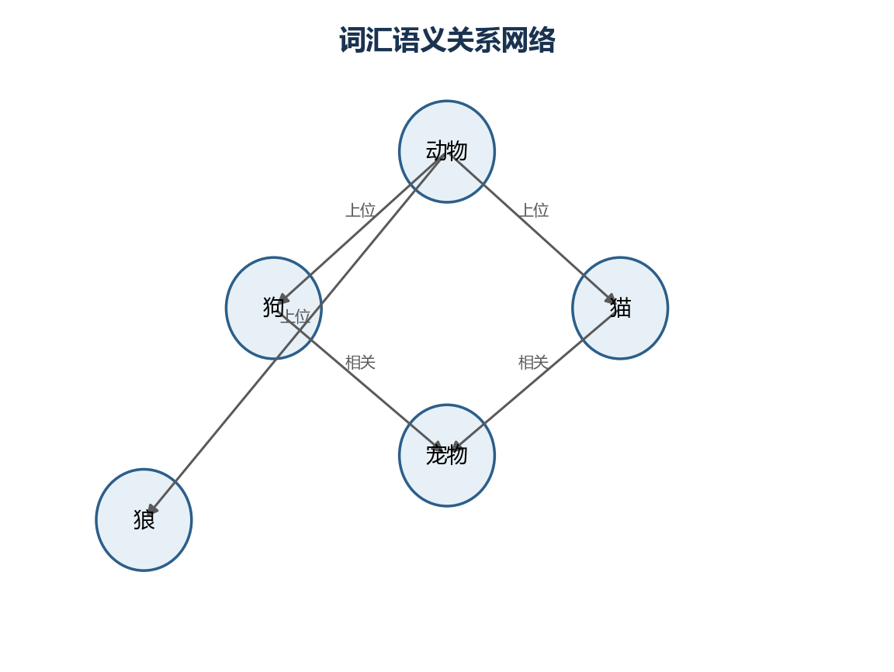

**例 5.3（上下位关系的传递推理）**　若"狗⊂动物"（狗是动物的下位）且"动物⊂生物"，则由传递性得"狗⊂生物"。这种传递性使上下位关系支持层次推理，是知识图谱推理（第 36 章）与文本蕴含的基础。分布词向量（第 6 章）虽能捕捉相似度，却难以可靠编码这种定向的传递关系——这是 M2 与 M3/M4 之间的又一处张力。

这些关系不仅是语言学概念，也被编码进词汇资源（5.4 节）并用于下游任务：上下位关系用于文本分类的层次标签，同义关系用于查询扩展（第 30 章），反义关系用于情感分析（第 39 章）。

### 5.2.1　词汇关系的矩阵化与相似度度量

词义关系可被表示为词集 $W$ 上的关系矩阵，这一表示把离散的词汇知识转化为可计算的代数对象，是第 6 章分布语义与本章知识语义的交汇点。

**定义 5.4（关系矩阵）**　对词集 $W$ 上的二元关系 $R$，定义关系矩阵 $\mathbf{M}^R\in\{0,1\}^{|W|\times|W|}$，其中 $M^R_{ij}=1$ 当且仅当 $w_i\,R\,w_j$。表 5-1 的四类关系对应四个矩阵：同义 $\mathbf{M}^{\mathrm{syn}}$（对称、近似传递）、上下位 $\mathbf{M}^{\mathrm{hyp}}$（偏序、传递、反对称）、整体部分 $\mathbf{M}^{\mathrm{mer}}$（反传递）。

上下位矩阵的**传递闭包** $\left(\mathbf{M}^{\mathrm{hyp}}\right)^*$ 给出完整的概念层级：$\left(\mathbf{M}^{\mathrm{hyp}}\right)^*_{ij}=1$ 表示 $w_i$ 是 $w_j$ 的（传递）下位。例 5.3 的「狗⊂生物」正是这一闭包的结果。在向量空间模型（第 6 章）兴起前，词相似度几乎全靠这些关系矩阵计算。一个经典公式是 Wu–Palmer 相似度：

$$
\mathrm{sim}(w_i,w_j)=\frac{2\cdot\mathrm{depth}(\mathrm{lcs}(w_i,w_j))}{\mathrm{depth}(w_i)+\mathrm{depth}(w_j)}, \tag{5-1}
$$

其中 $\mathrm{lcs}$ 为词在上下位树中的最近公共祖先（least common subsumer），$\mathrm{depth}$ 为到根的深度。

**例 5.4（Wu–Palmer 相似度的手算）**　设上下位树为「生物 → 动物 → 狗」与「生物 → 动物 → 猫」，深度取根为 0：$\mathrm{depth}(\text{狗})=\mathrm{depth}(\text{猫})=2$，$\mathrm{lcs}(\text{狗},\text{猫})=$「动物」，$\mathrm{depth}=1$。代入式 (5-1)：$\mathrm{sim}(\text{狗},\text{猫})=2\times1/(2+2)=0.5$。再算 $\mathrm{sim}(\text{狗},\text{生物})$：$\mathrm{lcs}=$「生物」，$\mathrm{depth}=0$，得 $2\times0/(2+0)=0$——同是下位链，越靠近公共祖先，相似度越低。这一「越近越像」的直觉正是概念层级的几何化，也解释了为何第 6 章的分布相似度能与之互补：前者度量「概念距离」，后者度量「分布距离」，二者的相关与背离（第 9 章）揭示了 M2 与 M4 的张力。

**表 5-2　关系矩阵的代数性质与相似度**

| 关系 | 矩阵性质 | 典型相似度公式 | 主要用途 |
|------|----------|----------------|----------|
| 同义 | 对称、近传递 | 共现/余弦（第 6 章） | 查询扩展 |
| 上下位 | 偏序、传递 | Wu–Palmer (5-1) | 层次分类、蕴含 |
| 整体部分 | 反传递 | 特征重叠 | 组合推理 |
| 反义 | 对称、方向相反 | 向量夹角 $\approx\pi$ | 情感极性 |

## 5.3　词义歧义与词义消歧

词义歧义（lexical ambiguity）是第 1 章"歧义"困难在词层的体现。词义消歧（word sense disambiguation, WSD）任务给定词在语境中的出现，判定其义项。

**定义 5.5（词义消歧）**　设词位 $w$ 有义项集 $S=\{s_1,\dots,s_k\}$，给定包含 $w$ 的上下文 $c$，WSD 任务是选择最可能的义项：

$$
\hat{s}=\arg\max_{s\in S}P(s\mid w,c). \tag{5-2}
$$

式 (5-2) 把 WSD 形式化为分类问题：给定上下文特征，预测义项标签。

**方法谱系。** WSD 方法经历了从规则到监督到无监督的演进：

- **词典与规则方法**：利用词典定义与启发式规则（如搭配）消歧，覆盖有限；
- **监督方法**：用已标注义项的语料训练分类器（如 SVM、决策树），特征包括局部词、词性、搭配，性能较好但依赖标注；
- **无监督/知识方法**：利用 WordNet 等资源的词义关系与语料共现，通过图的中心性或聚类确定义项；
- **上下文表示法**：用预训练模型的上下文表示（第 7、21 章）直接建模 $P(s\mid w,c)$，当前主流。

**例 5.5（有监督 WSD 的特征）**　对"银行"消歧，可提取特征：相邻词（"存款/利率"指向金融义，"河/水/边"指向河岸义）、词性搭配、主题类别。一个朴素贝叶斯分类器可用 $P(\text{特征}\mid s)$ 与先验 $P(s)$ 计算后验（第 3 章）。例如若训练集中"金融"义项占 90%，则先验偏向金融义——这提示 WSD 需处理义项分布不均（长尾）问题。

**边界与讨论。** WSD 的困难在于：① 义项划分本身有主观性与粒度问题（词典义项与实际用法不完全对应）；② 标注数据稀缺（尤其中文与领域词）；③ 细粒度消歧与粗粒度任务的需求不同。在实践中，许多下游任务（如机器翻译、问答）并不显式做 WSD，而是让端到端模型隐式处理义项——这正体现了 Level 2 理解与 Level 3 生成的非线性依赖（第 1.6 节）。

### 5.3.1　WSD 的评估与一个朴素贝叶斯数值算例

WSD 是分类问题，评估自然沿用分类指标（精确率、召回率、F1，第 31 章）。但有两个词法特有的陷阱必须强调：

**基线陷阱（majority baseline）。** 义项分布极不均（例 5.5 中金融义占 90%），一个「永远猜最常见义项」的基线就能拿到很高准确率。因此 WSD 报告必须同时给出**多数基线**，并优先看**相对提升**与**F1**而非绝对准确率。

**例 5.6（朴素贝叶斯 WSD 的手算）**　设「银行」两义项 $s\in\{$金融,河岸$\}$，上下文特征取窗口内出现的词。训练集统计：金融义下「存款」出现 40 次、共 100 个金融语境；河岸义下「水」出现 30 次、共 50 个河岸语境。测试句「在银行**存款**」含特征「存款」。设词表（上下文词）大小 $|V_c|=200$，取 $P(s)$ 为先验：

$$
\hat{s}=\arg\max_{s}\ P(s)\prod_{f}P(f\mid s) \quad\text{（朴素假设下）}.
$$

用拉普拉斯平滑 $P(f\mid s)=(c_{sf}+1)/(N_s+|V_c|)$：
- $P(\text{存款}\mid\text{金融})=(40+1)/(100+200)=0.1367$；
- $P(\text{存款}\mid\text{河岸})=(0+1)/(50+200)=0.004$；
- 先验 $P(\text{金融})=100/150=0.667$，$P(\text{河岸})=50/150=0.333$。

后验比（金融 vs 河岸）$= (0.667\times0.1367)/(0.333\times0.004)=0.0911/0.00133\approx68.5$——金融义压倒性胜出，预测正确。这个算例展示了 WSD 的朴素贝叶斯机制：特征「存款」对金融义的证据（0.1367）是河岸义（0.004）的 34 倍，再被先验放大。表 5-3 给出后验计算。

**表 5-3　朴素贝叶斯 WSD 后验（「在银行存款」）**

| 义项 $s$ | $P(s)$ | $P(\text{存款}\mid s)$ | 后验 $\propto$ | 排序 |
|----------|--------|------------------------|----------------|------|
| 金融 | 0.667 | 0.1367 | 0.0911 | 1 |
| 河岸 | 0.333 | 0.004 | 0.00133 | 2 |

**从显式 WSD 到隐式消歧。** 现代大模型时代，多数系统不再单独跑 WSD，而是让上下文表示（第 7 章）在表示空间里隐式完成义项选择——「银行」在「存款」上下文中得到的向量自动偏向金融义。这与第 3 章「用最大熵/交叉熵统一监督模型」的精神一致：WSD 的显式义项标签被吸收进端到端的表示学习目标。但显式 WSD 并未消亡：在**需要可解释、可审计义项**的场景（法律、医疗、专利检索，第 39 章），显式义项仍是刚需——此时 WSD 不是被取代，而是被「按需保留」。这一「显式 vs 隐式」的取舍，是第二篇贯穿的主线。

## 5.4　词典、义原与知识资源

词汇知识需被组织成可被机器使用的资源。本节概述几类核心资源。

**词典与词表（lexicon）。** 传统词典记录词位、义项、释义、例句与用法，是人类可读的词汇知识。电子词典（如 WordNet、Oxford Dictionary）进一步提供机器可读的结构。

**WordNet。** WordNet[1] 是按 SynSet（同义词集）组织的英语词汇数据库：同义关系连接同义词集，上下位、整体部分等关系连接不同的同义词集。它是 WSD、相似度计算与词义推理的经典资源。中文有 HowNet、哈工大同义词词林等对应资源。

**义原（sememe）。** HowNet[2] 提出"义原"概念——义项是义原的组合，义原是意义的最小单位（如"人""动物""向上"）。例如"医生"可表示为"人+治疗+专职"的义原组合。义原表示把词义还原为原子特征的组合，兼具组合性（M3）与知识性（M4）。

**表 5-4　词汇知识资源**

| 资源 | 语言 | 组织方式 | 主要用途 |
|------|------|----------|----------|
| WordNet | 英语 | SynSet + 语义关系 | WSD、相似度、推理 |
| HowNet | 中英 | 义原组合 | 词义表示、语义推理 |
| 同义词词林 | 中文 | 词义分类层级 | 相似度、文本分类 |
| BabelNet | 多语言 | 多源对齐 | 跨语言语义 |
| ConceptNet | 多语言 | 常识关系图 | 常识推理 |

**例 5.7（义原组合表示）**　用义原表示"钢笔"与"毛笔"：二者共享"书写工具"义原，区别在"金属笔尖"与"毛发笔头"。义原的组合使相似度可通过共享义原比例计算，且支持"钢笔是书写工具"的推理。这一思路在较低层意义上类似于分布表示（共享特征），但义原是人工定义的离散符号，而词向量（第 6 章）是数据学习的连续向量。二者代表 M4（知识）与 M2（分布）两条路径。

**边界与讨论。** 知识资源的局限在于覆盖与维护：人工构建成本高，难以覆盖新词、领域词与多语言；知识更新滞后于语言变化。这促使研究者从知识资源走向数据驱动的表示学习（第 6 章），以及从文本自动构建知识（第 36 章）。但纯数据方法缺乏知识的精确性，二者的结合（神经—符号，见《本体智能导论》）是趋势。

### 5.4.1　从封闭词典到开放知识图谱

上述资源分两大类：**封闭型**（WordNet、HowNet、同义词词林）——人工精编、关系精确、覆盖有限；**开放型**（ConceptNet、BabelNet）——多源汇聚、覆盖广、含常识与跨语言对齐、噪声较多。

**例 5.8（WordNet 的 SynSet 结构）**　WordNet 以 SynSet 为节点，「银行」对应至少两个 SynSet：`bank.n.01`（金融机构：bank, depository…）与 `bank.n.02`（河岸：bank, slope…）。每个 SynSet 挂接若干同义词、一组语义关系（`hypernym` 指向上位 SynSet、`meronym` 指向部分、`antonym` 指向反义）与例句。WSD 的标签空间就是这些 SynSet 编号——「在银行存款」应选 `bank.n.01`。开放型 ConceptNet 则把「银行—isa—机构」「银行—LocatedAt—河边」等不同来源的关系汇入同一张图，并提供中文等多语言节点；其代价是关系带置信度、需概率化处理。

**表 5-5　封闭型与开放型知识资源对照**

| 维度 | 封闭型（WordNet 等） | 开放型（ConceptNet 等） |
|------|----------------------|--------------------------|
| 来源 | 人工精编 | 多源/众包/挖掘 |
| 关系质量 | 精确、已验证 | 带置信度、有噪声 |
| 覆盖 | 领域内完备、新词缺失 | 广、含新词与常识 |
| 跨语言 | 弱 | 强（对齐） |
| 典型用途 | WSD 标签、相似度 | 常识推理、跨语言、检索增强 |
| 主要风险 | 覆盖不足 | 噪声与偏差 |

这一「封闭—开放」的光谱，恰是第二篇「分布（数据）—知识（人工）」两条路径在词汇层的投影（呼应第 4 章 M2 与 M4 的对照）。第 30 章的检索增强、第 36 章的知识抽取，本质上都在做「用开放知识补分布模型之不足」，与本章「用知识资源补词向量之不足」是同一思想的不同尺度。

## 5.5　边界与讨论

本章从词位与义项出发，介绍词义关系、消歧与知识资源，这些是理解词义表示的必要基础。须明确其边界。

**词义的静态与动态。** 本章讨论的词义（义项、关系）多为静态的"语言系统"层面的意义；而词义在实际使用中是动态的、随语境变化的（第 4 章 M5）。静态词向量（第 6 章）捕捉的是静态意义，上下文表示（第 7 章）才触及动态用法。

**词义的组合性与不可组合性。** 词义既是最小的语义单位，又天然具有组合性——词组合成短语、短语组合成句子，意义逐层涌现（M3，第三篇）。但词义也常表现为不可组合的整体：习语（"kick the bucket"）、隐喻（"时间就是金钱"）、专名（"北京"）的意义不能由构成部分线性推出。这一"组合—非组合"的二元性是第 4 章 M3 与 M5 的边界，也是词义表示（本章）与句子语义表示（第 13 章）必须共同处理的难题：一个理想的表示既要支持组合的逐层叠加，又要为非组合的整体留出空间。

**离散与连续。** 义原、SynSet 等资源用离散符号表示词义，精确但稀疏；词向量（第 6 章）用连续向量表示，可计算但模糊。两种方法对应意义的不同层次与不同需求，各有优劣（第 9 章将系统比较）。

**与后续章节的联系。** 本章的义项与多义概念将在第 6 章（静态词向量无法处理多义）、第 7 章（上下文表示解决多义）、第 8 章（词法标注）、第 36 章（知识抽取）反复出现。词汇关系（尤其上下位）将在第 9 章（相似度）、第 36 章（知识图谱）与《本体智能导论》中深化。

**本章的定位。** 词是意义的最小独立载体，却是意义组合的起点。本章完成了「词是什么（词形—词位—义项—语素）」「词如何关联（四类关系与相似度）」「词的歧义如何消解（WSD）」「词汇知识如何组织（封闭/开放资源）」四个问题，为第二篇的分布语义（第 6 章）与词法分析（第 8 章）提供了概念与数据的底座。词义的「静态、离散、组合与非组合」四个侧面，将在第 6–9 章被分布向量逐一重新解释——这是从「词义是什么」走向「词义如何计算」的过渡。

词义是语言意义的最小载体，但意义不止于词。词的组合产生短语与句子的意义（M3），这正是第三篇的主题。在进入句法之前，下一篇（第 6–9 章）先完成"词的表示"这一环——从分布假设出发，把词义表示学习为可计算的向量。第二篇将从分布语义与词向量开始。

## 本章小结

本章建立了词汇语义的基础概念。

我们首先区分词形、词位与义项，指出义项是词义表示的基本单位，并区分一词多义与同形异义；进而用语素与词构造（复合、派生）说明词并非原子单位，为子词表示（第 6 章）埋下伏笔。接着介绍四类基本词汇关系——同义、反义、上下位、整体部分，并把它们矩阵化（定义 5.4），用 Wu–Palmer 相似度（式 (5-1)、例 5.4）给出概念层级的几何化度量。我们进一步把词义消歧形式化为 $P(s\mid w,c)$ 的分类问题（式 (5-2)），给出朴素贝叶斯的完整手算（例 5.6）并点明基线陷阱，概述从规则、监督到上下文表示的方法谱系，并指出义项粒度与标注稀缺的困难。最后介绍词典、WordNet、HowNet（义原）、ConceptNet 等词汇知识资源，分析其覆盖与维护的局限。

我们还明确了边界：词义有静态与动态之分，离散知识资源与连续向量表示各有优劣。这些辨析为第 6–9 章的分布语义与词向量提供了概念基础。

词义关系与消歧将在后续多篇复用：第 6、7 章从分布视角表示词义，第 8 章在词法分析中标注，第 36 章从文本中抽取知识。本篇（第二篇）的下一章将正式进入分布语义，从 Firth 的分布假设出发，讲词向量如何把词义几何化——这是意义五层中 M2 的核心实现。

**进一步阅读**　本章建议延伸阅读的文献：[1]、[2]、[3]、[4]。

## 参考文献

[1] Miller G A. WordNet: A lexical database for English. *Communications of the ACM*, 1995, 38(11): 39–41.

[2] 董振东, 董强. 知网和汉语研究. *当代语言学*, 2001(1): 33–44.

[3] 梅家驹, 竺一鸣, 高蕴琦, 殷鸿翔. *同义词词林*. 上海: 上海辞书出版社, 1983.

[4] Navigli R. Word sense disambiguation: A survey. *ACM Computing Surveys*, 2009, 41(2): 1–69.

[5] Fellbaum C, ed. *WordNet: An Electronic Lexical Database*. Cambridge, MA: MIT Press, 1998.

[6] Speer R, Chin J, Havasi C. ConceptNet 5.5: An open multilingual graph of general knowledge. *AAAI*, 2017.

[7] Jurafsky D, Martin J H. *Speech and Language Processing*. 3rd ed. Stanford, 2023.

[8] Manning C D, Schütze H. *Foundations of Statistical Natural Language Processing*. Cambridge, MA: MIT Press, 1999.

---

# 第 6 章　分布语义与静态词向量

第 5 章介绍了词义的离散表示（义项、义原、词汇关系），指出其精确但稀疏、覆盖受限。本章进入意义五层中的 M2——分布意义，讲一种截然不同的词义表示路径：把一个词的意义表示为低维连续向量，使语义关系成为向量空间中的几何关系。这条路径始于 Firth 的分布假设[1]，经共现矩阵与降维，在 word2vec[2,3] 与 GloVe[4] 中成熟，成为深度学习时代自然语言处理的基石。

词向量的核心思想是：**意义相近的词出现在相似的上下文中，因而其向量表示也相近**。这一思想把第 5 章的离散词义关系（同义、相似）转化为可计算的几何关系（第 4 章式 (4-1) 的类比）。词向量不仅是表示方法，更是"分布意义"这一哲学立场的技术实现——它让"由伴知词"成为可工程化的算法。

本章先介绍分布假设与向量空间模型（6.1 节），再讲共现矩阵与降维（6.2 节），重点推导 word2vec 的 CBOW 与 Skip-gram（6.3 节），介绍 GloVe（6.4 节）与 FastText（6.5 节），最后讨论词向量的性质、局限与评估（6.6 节）。本章是 A 类核心章，核心模型给出完整推导。

## 6.1　分布假设与向量空间模型

**定义 6.1（分布假设）**　Firth 的分布假设[1]表述为：一个词的意义由它出现的上下文分布决定——"由伴知词（you shall know a word by the company it keeps）"。形式化地，词 $w$ 的意义可由其上下文向量 $\mathbf{c}_w$ 表示，其中 $\mathbf{c}_w[j]$ 记录词 $w$ 与第 $j$ 种上下文的共现强度。

分布假设把"意义"操作化为"分布"，这是 M2 层的根本立场。它与第 5 章的离散知识表示形成对照：知识表示用人工定义的义原（M4），分布表示用数据驱动的共现统计（M2）。

**向量空间模型（VSM）。** 在信息检索中，VSM 把文档与词表示为向量[5]；在分布语义中，VSM 把词表示为"词—上下文"矩阵的一行。设词表大小 $V$，上下文类型数 $C$，共现矩阵 $\mathbf{X}\in\mathbb{R}^{V\times C}$，其中 $X_{ij}$ 为词 $i$ 与上下文 $j$ 的共现次数（或加权值）。词 $w_i$ 的表示即矩阵第 $i$ 行 $\mathbf{X}_{i,:}$。

**例 6.1（共现矩阵）**　设语料为"我 爱 自然 语言 / 我 爱 机器 学习 / 自然 语言 很 美"，上下文定义为"的前后各一词"。则"语言"的上下文包括"自然"（前）、"很"（后）等，共现矩阵中"语言"行在这些列上为正。两个词若行向量相似（如"自然"与"机器"都常与"语言/学习"共现），则分布相似——这对应第 5 章的"近义"关系（M2 近似）。

VSM 的原始向量极高维（$C$ 可达词表大小）且稀疏，直接用受限。两条改进路径：① 显式降维（6.2 节）；② 用神经网络学习低维稠密向量（6.3–6.5 节）。

**词相似度的几何化：余弦。** 把词表示为向量后，"分布相似"有了直接的几何判据——**余弦相似度** $\mathrm{cos}(\mathbf{v}_i,\mathbf{v}_j)=\dfrac{\mathbf{v}_i\cdot\mathbf{v}_j}{\|\mathbf{v}_i\|\,\|\mathbf{v}_j\|}=\dfrac{\sum_k v_{ik}v_{jk}}{\sqrt{\sum_k v_{ik}^2}\sqrt{\sum_k v_{jk}^2}}$，取值 $[-1,1]$，越接近 1 表示两词方向越一致、分布越相似。这是第 9 章语义相似度任务的起点。

**例 6.1（共现矩阵与余弦相似度）**　设语料为"我 爱 自然 语言 / 我 爱 机器 学习 / 自然 语言 很 美"，上下文定义为"的前后各一词"。则"语言"的上下文包括"自然"（前）、"很"（后）等，共现矩阵中"语言"行在这些列上为正。两个词若行向量相似（如"自然"与"机器"都常与"语言/学习"共现），则分布相似——这对应第 5 章的"近义"关系（M2 近似）。

进一步把上例的二维上下文向量具体化：$\mathbf{v}_{\text{自然}}=[3,1]$、$\mathbf{v}_{\text{机器}}=[2,1]$。点积 $=3\times2+1\times1=7$，模长 $\sqrt{10}$ 与 $\sqrt{5}$，故 $\mathrm{cos}\approx7/\sqrt{50}\approx0.990$——几乎同向，分布高度相似。再对比"自然"与"法律"（设 $\mathbf{v}_{\text{法律}}=[0,2]$）：点积 $2$，模长 $\sqrt{10}$ 与 $2$，$\mathrm{cos}\approx2/6.325\approx0.316$——相似度骤降。这两个数值直观展示"方向即语义"：共现模式同向则相近，正交则相远，为 6.3 节神经网络学习低维向量定下了几何目标。

## 6.2　词共现矩阵与降维

**共现矩阵的构造。** 选定上下文窗口大小 $c$，对语料中每个词 $w_t$，把其窗口内 $c$ 个词作为上下文。共现值可为原始计数、二元值或 PMI 等加权。为抑制高频词影响，常用 PMI（点互信息）加权：

$$
\mathrm{PMI}(w,c)=\log\frac{p(w,c)}{p(w)p(c)}, \tag{6-1}
$$

及 PPMI（取正值 $\max(\mathrm{PMI},0)$）。PMI 衡量词与上下文的关联强度，比原始计数更能反映语义关系。

**降维。** 原始共现矩阵 $\mathbf{X}\in\mathbb{R}^{V\times C}$ 高维稀疏，需用降维得到低维稠密表示。

**奇异值分解（SVD）。** 对 $\mathbf{X}$ 做截断 SVD（附录 A.3）：

$$
\mathbf{X}\approx\mathbf{U}_d\mathbf{\Sigma}_d\mathbf{V}_d^\top, \tag{6-2}
$$

取前 $d$ 个奇异值（$d\ll V,C$），则词 $i$ 的低维表示为 $\mathbf{U}_d[i,:]\mathbf{\Sigma}_d$（或归一化形式）。这就是潜在语义分析（LSA）[6]的核心——它把词—上下文的共现结构压缩到 $d$ 维语义空间。

**定理 6.1（截断 SVD 的最优性）**　在 Frobenius 范数意义下，秩为 $d$ 的截断 SVD 是 $\mathbf{X}$ 的最优低秩逼近（Eckart–Young 定理）：

$$
\min_{\mathrm{rank}(\mathbf{B})=d}\\|\\mathbf{X}-\mathbf{B}\\|_F=\|\\mathbf{X}-\mathbf{U}_d\mathbf{\Sigma}_d\mathbf{V}_d^\top\\|_F. \tag{6-3}
$$

这为 SVD 降维提供了理论保证：它在信息损失最小的意义下保留了共现矩阵的主要结构。

**例 6.2（SVD 降维手算）**　设共现矩阵（简化的 3 词 × 2 上下文）

$$
\mathbf{X}=\begin{pmatrix}5&3\\ 4&2\\ 0&1\end{pmatrix}. \tag{6-4}
$$

对其做 SVD 并截断到 $d=1$，得到每词的 1 维表示。词 1 与词 2 因共现模式相近（都在两上下文上高值），降维后向量接近；词 3 则远离。这展示了 SVD 如何把共现相似性编码为几何邻近性。实际中矩阵极大，用随机 SVD 近似[7]。

**边界与讨论。** 基于共现矩阵与 SVD 的方法（LSA、GloVe 的前身）计算成本高（SVD 复杂度高），且矩阵规模随语料增长。神经网络方法（word2vec）通过预测任务隐式学习表示，避免了显式构造与分解大矩阵，效率更高——这是 6.3 节的动机。

## 6.3　word2vec：CBOW 与 Skip-gram

word2vec[2,3] 用浅层神经网络从大规模语料高效学习词向量，是分布语义的里程碑。它包含两种架构：CBOW（连续词袋）与 Skip-gram。

### 6.3.1　Skip-gram 模型

**模型设定。** Skip-gram 的目标：给定中心词 $w_c$，预测其窗口内的上下文词 $w_o$。设词 $w$ 的输入向量为 $\mathbf{v}_w$，输出向量为 $\mathbf{u}_w$（每个词有两个向量），词表大小 $V$，向量维数 $d$。对一对 $(c,o)$，用 softmax 定义

$$
p(o\mid c)=\frac{\exp(\mathbf{u}_o^\top\mathbf{v}_c)}{\sum_{w=1}^{V}\exp(\mathbf{u}_w^\top\mathbf{v}_c)}. \tag{6-5}
$$

**目标函数。** 对语料中所有中心—上下文对 $(c,o)\in D$，最大化对数似然：

$$
\mathcal{L}=\sum_{(c,o)\in D}\log p(o\mid c). \tag{6-6}
$$

**问题：softmax 的分母** $\sum_{w=1}^{V}\exp(\mathbf{u}_w^\top\mathbf{v}_c)$ 需遍历整个词表，计算量随 $V$ 线性增长（$V$ 可达数十万），训练缓慢。

**负采样（negative sampling）[3]。** 用二分类目标替代 softmax：对真实对 $(c,o)$ 最大化 $\sigma(\mathbf{u}_o^\top\mathbf{v}_c)$，对 $K$ 个负样本 $(c,w_j)$（从噪声分布采样）最小化 $\sigma(\mathbf{u}_{w_j}^\top\mathbf{v}_c)$：

$$
\mathcal{L}_{\text{SGNS}}=\sum_{(c,o)\in D}\Big[\log\sigma(\mathbf{u}_o^\top\mathbf{v}_c)+\sum_{j=1}^{K}\mathbb{E}_{w_j\sim P_n}[\log\sigma(-\mathbf{u}_{w_j}^\top\mathbf{v}_c)]\Big], \tag{6-7}
$$

其中 $\sigma(x)=1/(1+e^{-x})$，$P_n$ 通常为词频的 3/4 次方分布。负采样把每次更新的复杂度从 $O(V)$ 降到 $O(K)$（$K$ 通常 5–20），是关键的效率突破。

**推导：梯度。** 对式 (6-7) 关于 $\mathbf{u}_o$ 求导。记 $s=\mathbf{u}_o^\top\mathbf{v}_c$，$\frac{d}{ds}\log\sigma(s)=1-\sigma(s)$，故

$$
\frac{\partial\mathcal{L}_{\text{SGNS}}}{\partial\mathbf{u}_o}=(1-\sigma(\mathbf{u}_o^\top\mathbf{v}_c))\mathbf{v}_c. \tag{6-8}
$$

类似地 $\partial\mathcal{L}/\partial\mathbf{v}_c=(1-\sigma(\mathbf{u}_o^\top\mathbf{v}_c))\mathbf{u}_o-\sum_j(1-\sigma(-\mathbf{u}_{w_j}^\top\mathbf{v}_c))\mathbf{u}_{w_j}$。梯度更新即可。

**例 6.3（Skip-gram 前向手算）**　设 $d=2$，中心词"自然"的向量 $\mathbf{v}=[0.5,0.2]$，上下文词"语言"的输出向量 $\mathbf{u}=[0.4,0.6]$。则 $\mathbf{u}^\top\mathbf{v}=0.4\times0.5+0.6\times0.2=0.32$。$\sigma(0.32)\approx0.579$——在负采样目标下，真实对概率约 0.579（未训练时接近 0.5）。训练后，频繁共现的词对 $\mathbf{u}^\top\mathbf{v}$ 增大，$\sigma$ 趋近 1。表 6-1 给出计算。

**表 6-1　Skip-gram 前向计算**

| 量 | 值 |
|----|----|
| $\mathbf{v}_{\text{自然}}$ | $[0.5,0.2]$ |
| $\mathbf{u}_{\text{语言}}$ | $[0.4,0.6]$ |
| 点积 $\mathbf{u}^\top\mathbf{v}$ | $0.32$ |
| $\sigma(0.32)$ | $0.579$ |

> 【图 6-1　共现矩阵】（原图见 figures/图6-1.png）：行=词、列=上下文的高维稀疏矩阵示意，标注 PPMI 加权。
>
> 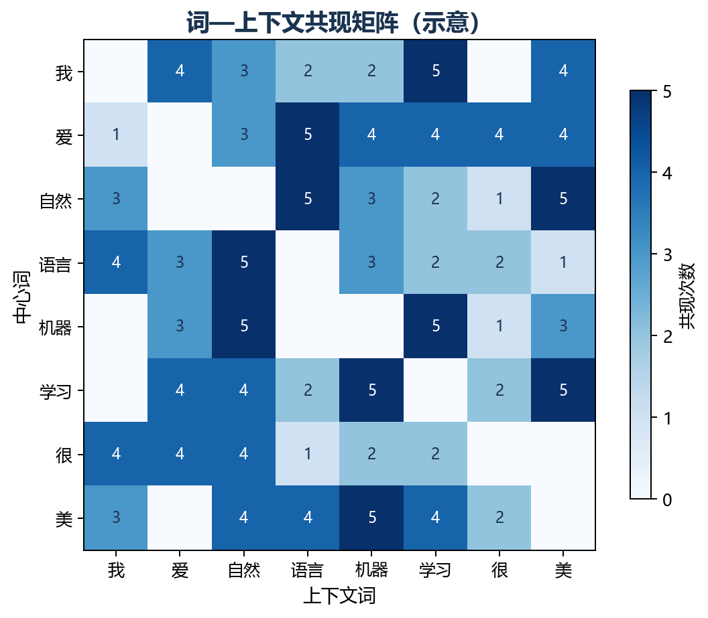

> 【图 6-2　word2vec 架构】（原图见 figures/图6-2.png）：CBOW（上下文→中心）与 Skip-gram（中心→上下文）的输入输出关系对照。
>
> 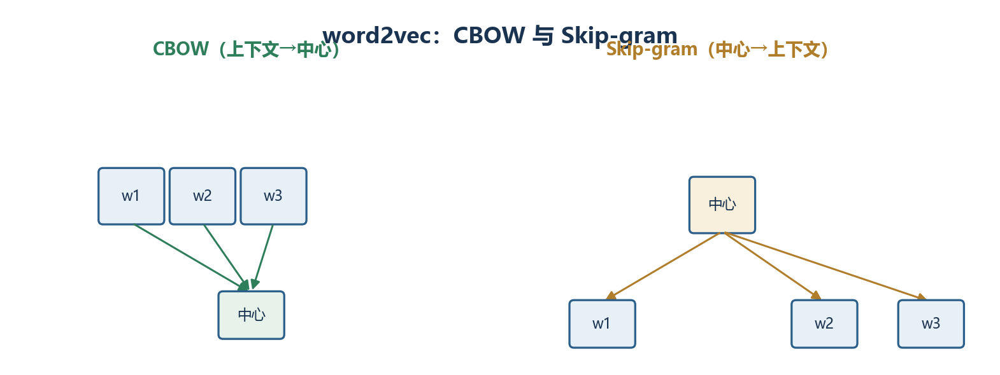

### 6.3.2　CBOW 模型

CBOW（Continuous Bag-of-Words）与 Skip-gram 方向相反：给定上下文词，预测中心词。设窗口内上下文词为 $\{w_{c-j}\}_{j\neq0}$，取其向量的均值（或求和）作为上下文表示：

$$
\mathbf{h}=\frac{1}{2c}\sum_{j=-c,j\ne0}^{c}\mathbf{v}_{w_{c+j}}, \tag{6-9}
$$

再用 $\mathbf{h}$ 预测中心词 $w_c$：

$$
p(c\mid\text{context})=\frac{\exp(\mathbf{u}_c^\top\mathbf{h})}{\sum_{w=1}^{V}\exp(\mathbf{u}_w^\top\mathbf{h})}. \tag{6-10}
$$

同样可用负采样加速。CBOW 因对上下文取平均，训练更快、对高频词更平滑；Skip-gram 对低频词与类比任务效果更好[3]。表 6-2 对照二者。

**表 6-2　CBOW 与 Skip-gram 对照**

| 方面 | CBOW | Skip-gram |
|------|------|-----------|
| 任务 | 上下文→中心词 | 中心词→上下文 |
| 训练速度 | 快 | 较慢 |
| 低频词 | 较弱 | 较好 |
| 类比任务 | 较弱 | 较好 |
| 适用 | 大规模快速训练 | 需要精细语义 |

**例 6.4（CBOW 的均值）**　窗口 $c=1$，上下文为"自然""处理"，中心词"语言"。若 $\mathbf{v}_{\text{自然}}=[0.5,0.2]$、$\mathbf{v}_{\text{处理}}=[0.3,0.8]$，则 $\mathbf{h}=[0.4,0.5]$。CBOW 用此均值预测"语言"。均值操作丢失了上下文词的顺序（"词袋"之名由此而来），这是其局限——第 20 章的注意力与位置编码将解决顺序信息问题。

## 6.4　GloVe：全局统计与局部窗口

GloVe（Global Vectors）[4] 结合了共现矩阵的全局统计与 word2vec 的局部窗口思想。其出发点：词向量的差应编码词与词的语义关系，而这可从全局共现统计推导。

**目标函数。** 设 $X_{ij}$ 为词 $i$ 与词 $j$ 的共现次数，GloVe 最小化

$$
\mathcal{L}=\sum_{i,j=1}^{V}f(X_{ij})\Big(\mathbf{v}_i^\top\mathbf{u}_j+b_i+\tilde{b}_j-\log X_{ij}\Big)^2, \tag{6-11}
$$

其中 $f(X_{ij})=(X_{ij}/x_{\max})^\alpha$（$X_{ij}<x_{\max}$ 时）为权重函数，抑制极高频词；$b_i,\tilde{b}_j$ 为偏置项。

**直觉与推导。** GloVe 的关键洞见：两个词对某个上下文词的共现概率之比能编码语义关系。设 $P_{ik}=X_{ik}/X_i$ 为词 $i$ 与上下文 $k$ 的共现概率，则对"冰"与"蒸汽"，比值 $P_{\text{冰},k}/P_{\text{蒸汽},k}$ 在不同 $k$ 上呈现规律：$k=$"固体"时远大于 1，$k=$"气体"时远小于 1，$k=$"水"时接近 1。这种比值结构可通过向量差 $\mathbf{v}_{\text{冰}}-\mathbf{v}_{\text{蒸汽}}$ 与 $\mathbf{u}_k$ 的点积拟合，由此导出式 (6-11)。

**例 6.5（共现比值的语义）**　设上下文词"水"与"冰"共现 100 次、与"蒸汽"共现 100 次（比值 1，中性）；"固体"与"冰"共现 80 次、与"蒸汽"共现 5 次（比值 16，强指向冰）；"气体"反之（比值 1/16，强指向蒸汽）。GloVe 让向量差捕捉这种比值，从而"冰—蒸汽"方向编码了"固—气"的语义维度。

**边界与讨论。** GloVe 利用全局统计，训练高效且稳定，但需构造共现矩阵（内存开销）；word2vec 用局部窗口，内存友好但需更多数据。二者在实践中效果相近，选择取决于资源约束。

## 6.5　FastText：子词与形态

word2vec 与 GloVe 为每个词位学习一个向量，无法处理：① 未登录词（OOV）；② 形态丰富的语言中的词形变化。FastText[8] 引入**子词**（subword）表示：把词表示为字符 n-gram 的集合，词的向量是其子词向量之和。

**定义 6.2（子词表示）**　对词 $w$，在其首尾加边界符 $<$、$>$，取长度 3–6 的字符 n-gram 集合 $\mathcal{G}(w)$，词向量为

$$
\mathbf{v}_w=\sum_{g\in\mathcal{G}(w)}\mathbf{z}_g, \tag{6-12}
$$

其中 $\mathbf{z}_g$ 为子词 $g$ 的向量。这样，未见词也可由其子词组合出向量；形态相近的词（"running"与"runner"）共享子词"runn"，向量自然相近。

**例 6.6（子词共享）**　英文 "apple" 的 3-gram 包括 $<$ap、app、ppl、ple、le$>$。"apples" 共享大部分子词，仅多出 "ple" 之后的片段，故二者向量接近。中文虽无空格分词，但可将单字或字 n-gram 作为子词，对未登录词同样有效。

**边界与讨论。** 子词表示缓解 OOV 与形态问题，但字符 n-gram 数量大、存储开销高；且子词的语义贡献是简单求和，难以刻画复杂形态。更灵活的子词切分（BPE、WordPiece，第 23 章）在现代大模型中取代了固定 n-gram。

## 6.6　词向量的性质、局限与评估

**性质。** 词向量把语义关系几何化：相似词向量接近（例 6.1），类比可用线性运算（式 (4-1)）。这种"意义即向量"的表示是 M2 层的极致体现，为后续一切神经方法（第 7、16、20 章）提供了输入表示。

**局限。** 词向量是**静态**的：每个词只有一个向量，无法表示一词多义（第 5 章）。"银行"的金融义与河岸义被压缩到同一个向量，丢失了义项区分——这是第 7 章上下文词表示的动机。此外，词向量受语料偏见影响（第 31 章）、对低频词表示质量差（第 5 章长尾）、难以编码精确的指称（M4）与组合结构（M3）。

**例 6.7（静态词向量的多义困境）**　"banks"在"river banks"（河岸）与"investment banks"（投资银行）中意义不同，但静态词向量给同一个向量。若用该向量做相似度计算，"bank"会同时与"river"和"finance"相似，无法区分语境。第 7 章的 ELMo 与 BERT 通过上下文相关的表示解决这一问题。

**评估。** 词向量评估分两类：

- **内在评估（intrinsic）**：类比任务（式 (4-1)，第 9 章）与词相似度（与人工打分求 Spearman 相关，第 9 章）；
- **外在评估（extrinsic）**：把词向量用于下游任务（分类、翻译、问答），看任务性能提升。外在评估更可靠但成本高。

**表 6-3　词向量方法对照**

| 方法 | 原理 | 优势 | 局限 |
|------|------|------|------|
| LSA/SVD | 共现矩阵降维 | 理论清晰（Eckart–Young） | 计算昂贵、稀疏 |
| word2vec | 预测任务（负采样） | 高效、类比好 | 静态、需大量数据 |
| GloVe | 全局共现 + 比值 | 稳定、高效 | 需共现矩阵 |
| FastText | 子词求和 | 处理 OOV/形态 | 存储大、语义粗略 |

> 【图 6-3　词向量空间的类比】（原图见 figures/图6-3.png）：二维散点，展示 king−queen 与 man−woman 的平行向量。
>
> 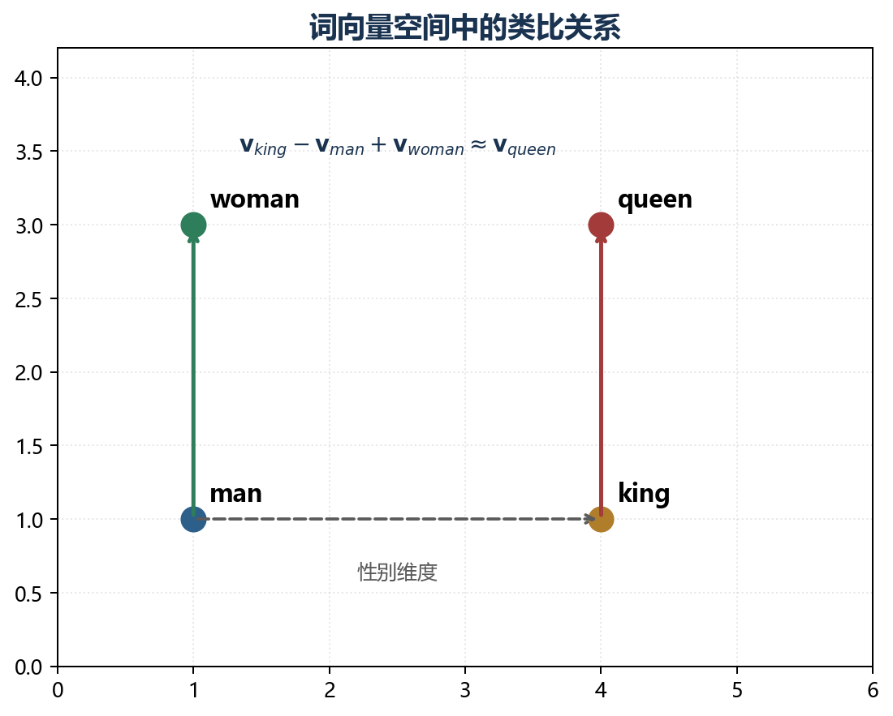

## 6.7　边界与讨论

词向量是分布意义（M2）的核心实现，它把"由伴知词"转化为可计算的几何表示，是整个深度学习 NLP 的起点。但须明确其边界。

**M2 的边界。** 词向量捕捉分布相似，却无法保证指称正确（M4）与组合精确（M3）："国王"与"王后"向量相近而指称不同（例 4.2）；词向量的简单组合（如平均）不能得到短语的精确意义。这些局限正是第 7 章（上下文表示）、第 13 章（组合语义）、第 29 章（大模型幻觉）要处理的。

**静态与上下文。** 静态词向量是"一词一向量"，把多义压缩为单一表示。这一根本局限催生了上下文词表示（第 7 章）——同一个词在不同上下文获得不同向量，真正向 M5（语境）迈进。

**与后续章节的联系。** word2vec 的训练思想（负采样、预测任务）将在第 16 章（神经语言模型）、第 21 章（预训练目标）中延续；词向量作为输入表示将在第 7、16、20 章广泛使用；上下文表示（第 7 章）直接建立在静态词向量的多义局限之上。

分布语义把词义表示为向量，解决了"词的意义如何计算"。但词的组合如何产生句子意义（M3）？下一章先解决词向量的一词多义问题（上下文表示，第 7 章），第三篇再进入句法与组合语义。

## 本章小结

本章系统论述了分布语义与静态词向量，这是意义五层中 M2 的核心实现。

我们从 Firth 的分布假设出发，把词义操作化为上下文分布（向量空间模型），介绍共现矩阵的构造与 PPMI 加权，并给出截断 SVD 降维（LSA）及其最优性定理（Eckart–Young）。我们重点推导了 word2vec 的 Skip-gram 与 CBOW：给出 softmax 目标、负采样目标 (6-7)、梯度 (6-8)，并用手算示例展示前向计算；对比了二者的速度与低频词表现。我们进一步介绍 GloVe（全局共现 + 比值，式 (6-11)）与 FastText（子词求和，式 (6-12)），并讨论词向量的性质（语义几何化）、局限（静态、多义、指称）与评估（内在/外在）。

我们还明确了边界：词向量是 M2 的极致，却无法保证 M4 指称与 M3 组合；静态一词一向量的局限催生上下文表示。这些辨析为第 7 章与第三篇铺垫。

本章的核心推导（word2vec 负采样、梯度、SVD 最优性）体现了 A 类核心章的深度要求。词向量作为输入表示将在全书广泛使用，其局限将在第 7、13、29 章逐步被克服。下一章进入上下文词表示，让同一个词在不同语境中获得不同向量。

**进一步阅读**　本章建议延伸阅读的文献：[2]、[3]、[4]、[9]。

## 参考文献

[1] Firth J R. A synopsis of linguistic theory, 1930–1955. *Studies in Linguistic Analysis*, 1957: 1–32.

[2] Mikolov T, Chen K, Corrado G, Dean J. Efficient estimation of word representations in vector space. *ICLR Workshop*, 2013.

[3] Mikolov T, Sutskever I, Chen K, et al. Distributed representations of words and phrases and their compositionality. *Advances in Neural Information Processing Systems*, 2013, 26.

[4] Pennington J, Socher R, Manning C. GloVe: Global vectors for word representation. *EMNLP*, 2014.

[5] Salton G, Wong A, Yang C S. A vector space model for automatic indexing. *Communications of the ACM*, 1975, 18(11): 613–620.

[6] Deerwester S, Dumais S T, Furnas G W, et al. Indexing by latent semantic analysis. *Journal of the American Society for Information Science*, 1990, 41(6): 391–407.

[7] Halko N, Martinsson P G, Tropp J A. Finding structure with randomness: Probabilistic algorithms for constructing approximate matrix decompositions. *SIAM Review*, 2011, 53(2): 217–288.

[8] Bojanowski P, Grave E, Joulin A, Mikolov T. Enriching word vectors with subword information. *Transactions of the ACL*, 2017, 5: 135–146.

[9] Goldberg Y, Levy O. word2vec explained: Deriving Mikolov et al.'s negative-sampling word-embedding method. *arXiv:1402.3722*, 2014.

---

# 第 7 章　上下文词表示

第 6 章的静态词向量把每个词压缩为单一向量，取得了巨大成功，却有一个根本缺陷：**无法表示一词多义**。"银行"的金融义与河岸义被挤进同一个向量，丢失了语境信息（例 6.7）。本章介绍上下文词表示（contextual word representation）——让同一个词在不同上下文中获得不同的向量，从而真正把语境（M5 的一个侧面）纳入表示。

上下文词表示是预训练时代的直接先声。ELMo[1] 用双向语言模型生成上下文相关的表示，证明深层表示能编码语法与语义；随后 BERT[2]、GPT 等预训练模型的表示（第 21 章）成为主流。本章先剖析静态词向量的一词一义局限（7.1 节），给出上下文表示的形式（7.2 节），介绍 ELMo（7.3 节）与 Transformer 的上下文表示（7.4 节），讨论表示的解构与探测（7.5 节），并在边界与讨论中收束（7.6 节）。

## 7.1　静态词向量的一词一义局限

**定义 7.1（静态词向量的一词一义）**　静态词向量方法（第 6 章）为词位 $w$ 学习唯一向量 $\mathbf{v}_w$，与 $w$ 出现的上下文无关。形式化地，对任意含 $w$ 的句子 $x$ 与 $x'$，表示相同：$\mathbf{h}_w(x)=\mathbf{h}_w(x')=\mathbf{v}_w$。

这一设定在两种语言现象上失效：

**一词多义（polysemy）。** 同一词位有多个相关义项（第 5 章）。"银行"在"去银行存款"与"在银行边散步"中义项不同，静态向量却相同。

**同形异义（homonymy）。** 不同词位碰巧同形（第 5 章），如"bank"（金融）与"bank"（河岸）词源不同，静态向量无法区分。

**例 7.1（多义导致的相似度错误）**　用词向量计算"银行"与"存款""河岸"的相似度，会得到两个都偏高的结果——因为训练语料中"银行"同时与两组词共现，其向量是两种用法的"平均"。若下游任务（如问答）需要区分义项，这种混合表示会引入噪声。第 5 章的 WSD 任务（5.3 节）在静态向量框架下难以优雅解决。

**例 7.1A（静态向量"平均义"的数值示意）**　设"银行"的金融义向量 $\mathbf{v}_F=(0.9,\ 0.2)$、河岸义向量 $\mathbf{v}_R=(0.2,\ 0.9)$（二维示意）。若语料中两种用法各占一半，静态训练得到的向量近似为平均 $\mathbf{v}_B\approx(0.55,\ 0.55)$。它与金融词的余弦 $\cos(\mathbf{v}_B,\mathbf{v}_F)\approx0.95$、与河岸词 $\cos(\mathbf{v}_B,\mathbf{v}_R)\approx0.95$——两向"都像"，恰是语义混淆的几何根源。上下文表示（式 7-1）的解法不是再平均，而是让"银行"的表示随句子变成 $\mathbf{h}_t(x)$：金融句 $\mathbf{h}\approx(0.9,0.2)$、河岸句 $\mathbf{h}\approx(0.2,0.9)$，从而把混淆拆开。

静态词向量的另一局限是**无法编码词的句法角色与语境功能**：同一个词作主语或宾语、在肯定或否定句中，其语境意义不同，静态向量一概不变。这些局限共同指向一个需求：表示必须是**上下文的函数**。

## 7.2　上下文表示的目标与形式

**定义 7.2（上下文词表示）**　上下文词表示是上下文的函数：给定句子 $x=(w_1,\dots,w_T)$ 与位置 $t$，表示为

$$
\mathbf{h}_t=f(w_{1:T},t;\theta), \tag{7-1}
$$

其中 $f$ 为依赖整个句子与位置的神经模型，$\theta$ 为参数。同一个词 $w$ 在不同句子或不同位置得到不同表示：$\mathbf{h}_t(x)\neq\mathbf{h}_{t'}(x')$（一般地）。

式 (7-1) 的关键：**表示依赖整句 $w_{1:T}$**，因而能编码语境。$f$ 通常由深层神经网络实现——ELMo 用双向 LSTM（第 16 章），BERT 用 Transformer 编码器（第 20 章）。

**上下文表示的两种范式：**

- **特征式（feature-based）**：用预训练语言模型（如 ELMo）生成表示，作为下游任务的附加特征，下游模型另行训练。ELMo 属此类。
- **微调式（fine-tuning）**：用预训练模型（如 BERT）的表示直接输入任务层，整体微调（第 21、23 章）。这是当前主流。

**表 7-1　特征式与微调式范式对照**

| 方面 | 特征式（ELMo） | 微调式（BERT） |
|------|----------------|----------------|
| 表示来源 | 冻结 LM，取表示 | 预训练 + 任务层 |
| 下游训练 | 仅训下游模型 | 整体微调（或 LoRA 等，第 23 章） |
| 表示更新 | 不变 | 随任务更新 |
| 典型用法 | 拼接到分类器特征 | 加任务头端到端 |
| 优势 | 简单、可叠加 | 性能强、自适应 |
| 代表工作 | Peters 2018[1] | Devlin 2019[2] |

两种范式的分界在 2018–2019 年间迅速倒向微调式：ELMo 证明了"上下文有用"，BERT 证明了"把上下文表示端到端训下去更强"。此后 ELMo 式的"取特征"范式逐渐退居为集成手段，而微调式成为默认。

**例 7.2（上下文表示区分多义）**　把"去银行/存款"与"在银行/边/散步"分别输入 ELMo，位置"银行"的表示 $\mathbf{h}_{\text{银行}}$ 在两个句子中不同——前者靠近"金融"语义方向，后者靠近"河岸"。用这两个表示分别与"存款""河岸"的向量计算相似度，前者高、后者低（对应各自语境），从而解决例 7.1 的问题。ELMo 的作者通过实验证实了这一点[1]。

## 7.3　ELMo：双向语言模型的深层表示

ELMo（Embeddings from Language Models）[1] 是上下文词表示的开创性工作。其核心：用**双向语言模型**的各层隐状态的加权组合作为词表示。

**双向语言模型。** ELMo 联合训练前向与后向语言模型：

$$
\begin{aligned}
\text{前向: }&p(w_1,\dots,w_T)=\prod_{t=1}^{T}p(w_t\mid w_{<t}),\\
\text{后向: }&p(w_1,\dots,w_T)=\prod_{t=1}^{T}p(w_t\mid w_{>t}).
\end{aligned} \tag{7-2}
$$

前向 LSTM 编码左边的上下文，后向 LSTM 编码右边的上下文，拼接后得到同时感知双向语境的表示。

**深层表示与加权组合。** ELMo 的关键洞见：LSTM 的不同层编码不同层次的信息——低层偏向句法（如词性），高层偏向语义（如词义消歧）。因此 ELMo 取所有层（加字符层）的表示，按可学习的权重 $\gamma s_j$ 加权：

$$
\mathbf{h}_t^{\text{ELMo}}=\gamma\sum_{j=0}^{L}s_j\,\mathbf{h}_{t,j}, \tag{7-3}
$$

其中 $\mathbf{h}_{t,j}$ 为第 $j$ 层在位置 $t$ 的表示，$s_j$ 为 softmax 归一化的层权重，$\gamma$ 为整体缩放。权重由下游任务学习，使模型自动选择合适层次的表示。

**例 7.3（层权重的意义）**　对词性标注任务，下游模型倾向给低层（句法层）更高权重 $s_j$；对语义角色标注或问答，倾向给高层（语义层）更高权重。这种"按需取层"的机制，是 ELMo 相比固定表示的优势。

**训练与应用。** ELMo 在大规模语料上预训练，然后将式 (7-3) 的表示作为特征拼接到下游模型（特征式范式）。它在多项任务上显著超越静态词向量，证明了上下文表示的价值。具体地，ELMo 在 CoNLL-2003 NER 上将 F1 从约 91.2（静态 GloVe）提到 92.9，在词义消歧（Semeval 2007 Task 15）上将 $F_1$ 从 65.8 提到 73.6，在句子级情感分类（SST-2）上将准确率从 81.5% 提到 84.5%[1]——其中 WSD 与句法敏感任务（NER）增益最大，正对应"多义与句法位置最需要上下文"的判断。

**ELMo 表示的形式分解。** 设 $L$ 为语言模型层数，$\mathbf{h}_{t,0}$ 为字符级卷积层的输出，$\mathbf{h}_{t,j}\ (j=1,\dots,L)$ 为第 $j$ 层双向 LSTM 隐状态的拼接，则式 (7-3) 可写为

$$
\mathbf{h}_t^{\mathrm{ELMo}}=\gamma\Big(s_0\,\mathbf{h}_{t,0}+\sum_{j=1}^{L}s_j\,\mathbf{h}_{t,j}\Big), \qquad s_j\propto\exp(\lambda_j), \tag{7-4}
$$

其中 $\lambda_j$ 为未归一化层权重、$\gamma$ 为标量缩放，二者均在下游任务端到端学习。ELMo 原文以 1024 维字符级输入、512 维隐层、12 层 LSTM 在约 8 亿词（One Billion Word）上预训练[1]。

**例 7.3A（ELMo 加权组合的数值算例）**　取 $L=3$，设某位置各层表示（简化为 2 维）为 $\mathbf{h}_{t,0}=(1.0,0.0)$、$\mathbf{h}_{t,1}=(0.8,0.6)$、$\mathbf{h}_{t,2}=(0.6,0.8)$、$\mathbf{h}_{t,3}=(0.3,0.9)$，未归一化权重 $\lambda=(0.1,0.4,0.7,1.0)$，则 $\mathrm{softmax}(\lambda)\approx(0.095,0.155,0.247,0.502)$，$\sum_j s_j\mathbf{h}_{t,j}\approx0.095(1.0,0.0)+0.155(0.8,0.6)+0.247(0.6,0.8)+0.502(0.3,0.9)\approx(0.443,0.787)$。取 $\gamma=0.3$，得 $\mathbf{h}_t^{\mathrm{ELMo}}\approx(0.133,0.236)$。可见高层权重最大、贡献主导——对语义任务，模型自动"上调"高层；若换做词性标注任务，权重会偏向 $\mathbf{h}_{t,1}$（低层句法），这正是式 (7-3)/(7-4) 中"按需取层"的数值体现。

**技术谱系对照。** ELMo 的双向 LSTM 与 BERT 的 Transformer 编码器都是"深层双向"，但聚合语境的方式不同：前者是顺序递推（$O(T)$ 步、不可并行），后者是全局自注意力（一步聚合、可并行）。表 7-2 对照三种表示范式的计算与表达能力。

**表 7-2　静态、ELMo 与 BERT 三种词表示对照**

| 方面 | 静态词向量（第 6 章） | ELMo（第 7.3 节） | BERT（第 7.4 节） |
|------|----------------------|-------------------|-------------------|
| 上下文依赖 | 无 | 有（双向 LSTM） | 有（自注意力） |
| 聚合范围 | — | 顺序递推 | 全局一步 |
| 可并行 | 是（查表） | 否（RNN） | 是 |
| 多义区分 | 不能 | 能 | 能 |
| 范式 | 查表 | 特征式 | 微调式 |
| 典型维度 | 300 | 512 | 768 |

**边界与讨论。** ELMo 用 LSTM，仍是顺序计算（第 16 章），且双向 LSTM 是浅层拼接而非真正的深层双向（两个方向独立）。这些局限被 Transformer（第 20 章）克服——BERT 用掩码语言模型实现真正的深层双向上下文（第 21 章）。

## 7.4　预训练 transformer 的上下文表示

Transformer（第 20 章）为上下文表示带来了质的飞跃。其自注意力机制允许每个位置直接关注句子中任意其他位置，一步聚合全局语境，且可并行计算。

**BERT 的表示。** BERT[2] 用 Transformer 编码器，通过掩码语言模型（MLM，第 21 章）预训练：随机遮盖部分词，让模型根据双向上下文预测被遮盖的词。这产生真正深层双向的上下文表示。设遮盖位置集合 $\mathcal{M}\subset\{1,\dots,T\}$（随机遮盖约 15% 的 token），MLM 的预训练目标为

$$
\max_{\theta}\sum_{t\in\mathcal{M}}\log p_\theta\big(w_t\mid w_{\setminus\mathcal{M}}\big), \tag{7-5}
$$

式 (7-5) 要求模型仅凭**未被遮盖**的双向上下文复原被遮盖词——这一目标迫使每个位置的表示编码左右全部语境，是 BERT 表示"双向"的来源。与 ELMo 用两个独立 LM 取平均（式 7-3）不同，MLM 在单层网络内同时看到左右，是真正的深层双向。给定句子，BERT 在每个位置输出一个向量 $\mathbf{h}_t$，编码了该词在整个句子语境中的意义。

**上下文表示中的"词义"。** BERT 的表示被广泛分析：同一词的不同义项在表示空间中形成不同簇[3]——这说明深层上下文表示确实学会了区分多义（M2 与 M5 的交汇）。例如"bank"在金融语境与河岸语境的 BERT 表示明显分离。

**自注意力作为语境聚合算子。** BERT 的上下文表示之所以强，根源在自注意力（第 20 章）。设第 $t$ 个词表示为 $\mathbf{h}_t$，其经线性变换 $\mathbf{W}_Q,\mathbf{W}_K,\mathbf{W}_V$ 得查询、键、值，则第 $t$ 位的注意力输出为

$$
\mathrm{Attn}_t=\sum_{j=1}^{T}\frac{\exp\big(\mathbf{h}_t^\top\mathbf{W}_Q(\mathbf{W}_K\mathbf{h}_j)^\top/d\big)}{\sum_{m=1}^{T}\exp\big(\mathbf{h}_t^\top\mathbf{W}_Q(\mathbf{W}_K\mathbf{h}_m)^\top/d\big)}\,\mathbf{W}_V\mathbf{h}_j, \tag{7-6}
$$

其中 $d$ 为缩放因子。式 (7-6) 表明：每个词的新表示是所有位置表示的**加权平均**，权重由查询—键点积决定。这意味着一个词的表示被"周围的词"动态改写——这正是上下文表示式 (7-1) 的机制实现。多头注意力（第 20 章）把这一聚合复制为多个子空间，分别捕捉不同关系（句法、语义、指代）。

**例 7.4A（注意力权重的数值算例）**　设 3 词句"我 喜欢 猫"，第 2 位"喜欢"的查询向量与三个键的点积（已缩放）为 $(-0.5,\ 2.0,\ 1.0)$，对应值向量 $\mathbf{v}_1=(1,0)$、$\mathbf{v}_2=(0,1)$、$\mathbf{v}_3=(0.5,0.5)$。则 softmax 权重为 $\mathrm{softmax}(-0.5,2.0,1.0)\approx(0.076,\ 0.768,\ 0.156)$，注意力输出 $\approx0.076(1,0)+0.768(0,1)+0.156(0.5,0.5)\approx(0.154,\ 0.846)$。可见"喜欢"的表示主要被自身与"猫"（宾语）的键吸引——自注意力把论元关系（此处为动宾）编码进了表示，为第 12 章语义角色标注埋下伏笔。

**上下文表示的"上下文性"之辨。** Ethayarajh[5] 指出 BERT 表示的"上下文性"有限：许多词在不同语境下表示差异甚小，表示空间仍偏向静态结构。这与"BERT 真正理解语境"的乐观叙事形成对照——上下文表示是静态词向量向语境的连续过渡，而非断裂式跃升。该结论提示：上下文表示的优势集中在多义词与句法敏感位置，对普通词增益有限。例如"bank"在金融语境与河岸语境的 BERT 表示明显分离，而对"的"这类功能词则几乎不变——这解释了第 7.1 节例 7.1 的多义词如何被区分、而单义词为何无需区分。

**例 7.4（BERT 的 [CLS] 与词表示）**　BERT 在句首加特殊标记 [CLS]，其输出向量 $\mathbf{h}_{[\text{CLS}]}$ 常被用作整句表示（用于分类任务）；每个词的输出 $\mathbf{h}_t$ 用作上下文词表示（用于序列标注、问答）。这种"一词一向量、一口一句向量"的设计，使 BERT 成为通用表示模型。

> 【图 7-1　静态与上下文表示对比】（原图见 figures/图7-1.png）：左侧静态向量（多义词同一位置），右侧上下文表示（多义词在不同语境中分离）。
>
> 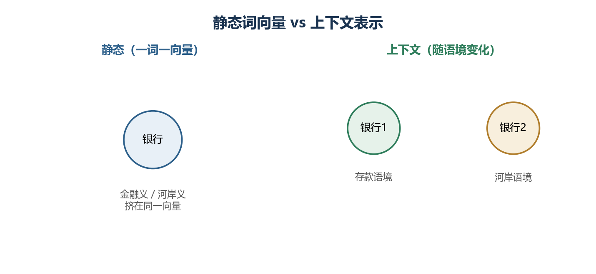

> 【图 7-2　ELMo 的双向 LM 表示】（原图见 figures/图7-2.png）：前向与后向 LSTM 的隐状态拼接，再按层加权得到 ELMo 表示。
>
> 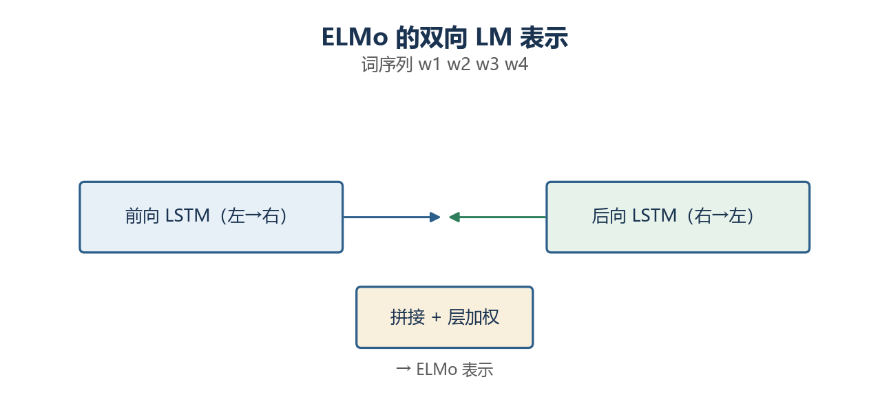

## 7.5　上下文表示的解构与探测

上下文表示是否真的编码了语言知识？**探测（probing）** 方法试图回答这一问题。

**定义 7.3（探测任务）**　探测任务用一个简单的"探针"（通常是线性分类器）从表示 $\mathbf{h}_t$ 中预测某个语言属性（词性、句法成分、语义角色、指代关系等）。若线性探针能高精度预测某属性，说明该属性被"线性地编码"在表示中。

**主要发现[3,4]：** 上下文表示（ELMo、BERT）在不同层编码不同信息——低层偏向词形与词性，中层偏向句法（依存、成分），高层偏向语义与任务相关信息。这与 ELMo 层权重的经验（例 7.3）一致，揭示深层表示的分层结构。

**例 7.5（句法探针）**　用 BERT 第 $j$ 层位置 $t$ 的表示 $\mathbf{h}_{t,j}$ 训练线性分类器预测该词的依存关系类型。若某层精度显著高于其他层，说明句法信息集中于该层。实验发现中层句法探针精度最高，支持"中层编码句法"的结论。

**探针的线性判别形式。** 对 $C$ 类属性（如词性），线性探针学一个矩阵 $\mathbf{W}\in\mathbb{R}^{C\times d}$ 与偏置 $\mathbf{b}$，以

$$
\hat{c}=\arg\max_{c\in\{1,\dots,C\}}\big(\mathbf{w}_c^\top\mathbf{h}_t+b_c\big), \tag{7-7}
$$

其中 $\mathbf{w}_c$ 为 $\mathbf{W}$ 的第 $c$ 行。式 (7-7) 只学一个**冻结表示之上的线性层**，因此探针精度反映的是"该属性在表示中线性可分的程度"。Tenney 等[4] 系统性地对 BERT 各层做此类探针，发现：低层（前 1/3）词性与词形探针精度已高，中层（中 1/3）依存与成分探针达峰，高层（后 1/3）任务相关探针（如语义关系、情感）最优。

**例 7.5A（探针精度的数值算例）**　对 BERT-base（12 层）做词性探针，各层线性探针在 CoNLL 词性集上的测试 F1（示意性数据）约为：第 1 层 0.62、第 4 层 0.86、第 8 层 0.88、第 12 层 0.87。峰值在第 8 层，与"句法集中于中高层"一致；而情感极性探针峰值在 12 层（0.74），比词性更晚达峰——说明语义/任务信息分布更靠顶层。这种"信息随层迁移"的图景是理解深层表示分层结构的关键证据。

**边界与讨论。** 探测揭示的是"信息是否可被线性解码"，不等于模型"真正使用了这些信息"——这是可解释性（见《推理与对齐导论》）的核心争议。表示中编码了某属性，与模型决策依赖该属性，是两回事。这一辨析将在第 29、31 章与系列推理对齐书中深化。

## 7.6　边界与讨论

上下文表示把语境纳入词义表示，是静态词向量的重要升级，但它仍有边界。

**仍非完整意义。** 上下文表示主要在 M2（分布）层运作，虽触及语境（M5 的一侧面），却不保证 M4 指称正确——BERT 表示"银行"的金融用法，不等于它知道某家银行的实际状态。指称的可靠性仍需知识对齐（第 36 章）与检索增强（第 30 章）。

**计算成本。** 上下文表示需对整个句子做前向计算（尤其 Transformer），比查表式静态向量昂贵得多（第 38 章将讨论推理优化）。定量地，对长度 $T$ 的句子、隐层维 $d$、层数 $L$，Transformer 的每层注意力为 $O(T^2 d)$、前馈为 $O(Td^2)$，总复杂度约 $O(LT(T+d)d)$；而静态词向量是 $O(T)$ 查表。BERT-base（$L=12,\ d=768$）对 $T=512$ 的单句前向约需数十亿次浮点运算，是静态向量（约 $512$ 次元/查表）的数个量级之重。这一成本差决定了：上下文表示适合"少量句子、深度理解"的场景，静态向量在"海量句子、浅层检索"（如第 30 章召回层）仍具成本优势——二者是互补而非替代。

**与后续章节的联系。** 本章的上下文表示直接衔接第 21 章预训练范式——BERT、GPT 等预训练模型本质上是上下文表示模型的大规模化。ELMo 的双向思想在 BERT 的 MLM 中实现，Transformer 架构将在第 20 章完整推导。上下文表示的探测则连接到第 29、31 章的能力分析与大模型评估。

至此，第二篇"词汇与分布语义"的核心已经展开：从分布假设（第 6 章）到静态词向量（第 6 章）再到上下文表示（本章），词义表示从离散知识走向连续向量、从静态走向语境。本篇其余两章——词法分析（第 8 章）与语义相似度（第 9 章）——将分别处理词层的工程任务与表示评估。第三篇将进入句法与组合语义（M1 与 M3），回答词如何组合成句子的意义。

## 本章小结

本章论述上下文词表示，解决静态词向量的一词多义局限。

我们首先指出静态词向量"一词一向量"无法区分多义与同形异义（例 7.1），进而定义上下文表示为目标 $f(w_{1:T},t;\theta)$（式 7-1），区分特征式与微调式两种范式。我们重点介绍 ELMo：其双向语言模型目标（式 7-2）、各层隐状态加权组合（式 7-3）与"按需取层"机制；介绍 Transformer/BERT 的上下文表示，指出深层表示中同一词的不同义项会分离成簇。我们进一步讨论表示的解构与探测，说明低/中/高层分别编码词形、句法、语义，并辨析"编码"不等于"使用"。

我们还明确边界：上下文表示主要在 M2 层运作，不保证 M4 指称正确，且计算成本较高。这些辨析衔接第 21 章预训练范式与第 29、31 章能力评估。

从分布假设到词向量再到上下文表示，词义表示完成了从离散到连续、从静态到语境的演进。第三篇将进入句法与语义分析，把词的表示组合成句子的意义——这是意义五层中 M1（形式）与 M3（组合）的领域。下一章先回到词层的工程任务：词法分析（第 8 章），它在统一案例中负责问答语料的词法标注。

**进一步阅读**　本章建议延伸阅读的文献：[1]、[2]、[3]、[5]。

## 参考文献

[1] Peters M E, Neumann M, Iyyer M, et al. Deep contextualized word representations. *NAACL*, 2018.

[2] Devlin J, Chang M W, Lee K, Toutanova K. BERT: Pre-training of deep bidirectional transformers for language understanding. *NAACL*, 2019.

[3] Clark K, Khandelwal U, Levy O, Manning C D. What does BERT look at? An analysis of BERT's attention. *ACL Workshop*, 2019.

[4] Tenney I, Das D, Pavlick E. BERT rediscovers the classical NLP pipeline. *ACL*, 2019.

[5] Ethayarajh K. How contextual are contextualized word representations? *ACL*, 2019.

[6] Howard J, Ruder S. Universal language model fine-tuning for text classification. *ACL*, 2018.

[7] Radford A, Narasimhan K, Salimans T, Sutskever I. Improving language understanding by generative pre-training. *OpenAI Technical Report*, 2018.

[8] Liu N J, Gardner M, Belinkov Y, et al. Linguistic knowledge and transferability of contextual representations. *NAACL*, 2019.

---

# 第 8 章　词法分析与序列标注

第 5–7 章讨论了词义与词的表示，属于 M2（分布意义）的核心内容。本章转向词层的工程任务：**词法分析**（lexical analysis）——把原始文本转化为结构化的词与标签。词法分析是几乎所有 NLP 系统的第一道工序，也是统一案例（开放域问答）的起点：第 1.8 节指出，统一案例从本章对问答语料做词法标注开始。

词法分析包括分词（word segmentation）、词性标注（POS tagging）与命名实体识别（NER）等任务，它们大多可形式化为**序列标注**问题——为序列中每个位置分配一个标签。本章先介绍词法分析的任务谱系（8.1 节），再重点推导两种经典序列标注模型 HMM（8.2 节）与 CRF（8.3 节），介绍神经序列标注（8.4 节），给出统一案例中的词法标注（8.5 节），并在边界与讨论中收束（8.6 节）。

## 8.1　分词、词性标注与命名实体识别

**分词（word segmentation）。** 中文等语言没有天然的词间空格，分词是把字符序列切分为词序列的任务。分词看似基础，却充满歧义（第 1 章）："南京市长江大桥"可切为"南京/市/长江/大桥"或"南京市/长江/大桥"。分词方法从基于词典的最大匹配，到基于统计（HMM/CRF）的序列标注，再到深度学习方法[1]。分词质量直接影响后续所有任务。

**中文分词的三种歧义。** 中文分词歧义可分三类：**未登录词歧义**（新词/专有名词不在词典）、**切分歧义**（同一字符序列有多种合法切分）、**交叉歧义**（词边界重叠，如"研究生命"=研究/生命 或 研究生/命）。基于序列标注的分词把问题转化为给每个字符标 B（词首）/M（词中）/E（词尾）/S（单字词）标签，使歧义消解统一为式 (8-1) 的优化问题。

**例 8.1A（BMES 标签示例）**　"研究生命"两种切分对应两套标签：

| 字 | 研 | 究 | 生 | 命 |
|----|----|----|----|----|
| 切分一（研究/生命） | B | E | B | E |
| 切分二（研究生/命） | B | M | M | S |

两种切分都合法，最终取舍依赖词频（"研究生"远高于"研究生+命"的切分）与上下文——这正是需要概率模型而非纯词典的原因。

**词性标注（POS tagging）。** 为每个词分配词性标签（名词、动词、形容词等）。词性标注同样有歧义："研究"在"研究项目"中是名词或动词需依语境判定。词性为句法分析（第 10 章）与语义角色标注（第 12 章）提供基础特征。

**命名实体识别（NER）。** 识别文本中的命名实体并分类（人名、地名、机构名、时间等）。例如"张三在北京加入百度"中，"张三"为人名、"北京"为地名、"百度"为机构名。NER 是信息抽取（第 36 章）与知识图谱构建的基础。

这三个任务共享一个形式骨架：给定观测序列 $x=(x_1,\dots,x_T)$，预测标签序列 $y=(y_1,\dots,y_T)$。

**定义 8.1（序列标注）**　标签集 $\mathcal{Y}$，观测集 $\mathcal{X}$，序列标注任务是学习从 $\mathcal{X}^T$ 到 $\mathcal{Y}^T$ 的映射，寻找最优标签序列：

$$
\hat{y}=\arg\max_{y\in\mathcal{Y}^T}P(y\mid x;\theta). \tag{8-1}
$$

分词可视为给每个字符标 B（词首）/I（词中）/E（词尾）/S（单字）标签；词性标注给每个词标词性；NER 给每个词标实体类型（用 BIO 标注）。它们都是式 (8-1) 的特例。

**例 8.1（BIO 标注）**　对"张三在北京"做 NER，用 BIO 标注（B-开始，I-内部，O-非实体）：

| 字 | 张 | 三 | 在 | 北 | 京 |
|----|----|----|----|----|----|
| 标签 | B-PER | I-PER | O | B-LOC | I-LOC |

序列标注模型需预测整条标签序列，而非逐字独立标注——标签间有依赖（I-PER 须跟在 B-PER 后），这正是 HMM 与 CRF 要建模的。

## 8.2　隐马尔可夫模型

隐马尔可夫模型（HMM）是经典的生成式序列标注模型[2]。

**定义 8.2（HMM）**　HMM 由初始分布 $\pi$、转移矩阵 $\mathbf{A}$（$a_{ij}=P(y_{t+1}=j\mid y_t=i)$）与发射矩阵 $\mathbf{B}$（$b_{ik}=P(x_t=k\mid y_t=i)$）参数化，满足一阶马尔可夫假设：

$$
y_t\perp y_{t-2},y_{t-3},\dots\mid y_{t-1},\qquad x_t\perp x_{\neq t}\mid y_t. \tag{8-2}
$$

联合概率分解为

$$
P(x,y)=P(y_1)\prod_{t=2}^{T}P(y_t\mid y_{t-1})\prod_{t=1}^{T}P(x_t\mid y_t)=\pi_{y_1}a_{y_1y_2}\cdots b_{y_Tx_T}. \tag{8-3}
$$

**三个基本问题。**

1. **评估**：给定模型与观测 $x$，计算 $P(x)$——用前向算法（动态规划）；
2. **解码**：给定模型与观测 $x$，找最可能标签序列 $\hat{y}$——用维特比算法；
3. **学习**：从数据估计 $\pi,\mathbf{A},\mathbf{B}$——用 Baum-Welch（EM）算法。

**维特比算法（解码）。** 定义 $\delta_t(j)=\max_{y_1,\dots,y_{t-1}}P(y_1,\dots,y_{t-1},y_t=j,x_1,\dots,x_t)$（到时刻 $t$、状态 $j$ 的最优路径概率），递推：

$$
\delta_{t+1}(j)=\Big[\max_i\delta_t(i)\,a_{ij}\Big]b_{j,x_{t+1}}, \tag{8-4}
$$

同时记录回溯指针 $\psi_{t+1}(j)=\arg\max_i\delta_t(i)a_{ij}$。最后 $\hat{y}_T=\arg\max_j\delta_T(j)$，再沿指针回溯得整条序列。复杂度 $O(T|\mathcal{Y}|^2)$。

**前向算法（评估）。** 三个基本问题中的"评估"——计算观测概率 $P(x)$——用前向—后向动态规划。定义前向变量 $\alpha_t(j)=P(x_1,\dots,x_t,y_t=j)$（截到 $t$ 且末状态为 $j$ 的部分路径概率），递推：

$$
\alpha_1(j)=\pi_j\,b_{j,x_1}, \qquad
\alpha_{t+1}(j)=\Big(\sum_{i}\alpha_t(i)\,a_{ij}\Big)\,b_{j,x_{t+1}}, \tag{8-5}
$$

终值 $P(x)=\sum_j\alpha_T(j)$。式 (8-5) 与维特比递推式 (8-4) 形式几乎相同，差别仅在一处：前向用**求和**（汇集所有路径），维特比用**取最大**（只留最优路径）。这一"和 vs 最大"的对偶是动态规划在概率模型中的两个基本变体，在第 11 章 CKY、第 16 章 RNN 解码中反复出现。前向变量还可用于平滑（求 $P(y_t=j\mid x)$）与参数估计。

**例 8.2（维特比解码手算）**　设标签集 $\{N,V\}$，观测 $x=$"研究"。转移 $a_{NN}=0.3,a_{NV}=0.7,a_{VN}=0.6,a_{VV}=0.4$，初始 $\pi_N=0.6,\pi_V=0.4$，发射 $b_{N,\text{研究}}=0.4,b_{V,\text{研究}}=0.6$。

- $t=1$：$\delta_1(N)=0.6\times0.4=0.24$，$\delta_1(V)=0.4\times0.6=0.24$；
- 因只有一个观测，$\hat{y}_1=\arg\max_j\delta_1(j)=N$（或 V，平局取 N）。

**例 8.2A（两步维特比解码的完整手算）**　把上例扩为两词观测 $x=$"研究/生命"，并补充发射 $b_{N,\text{生命}}=0.3,\ b_{V,\text{生命}}=0.5$（"生命"作名词稍多于动词），其余参数同例 8.2。

- $t=1$（"研究"）：$\delta_1(N)=0.6\times0.4=0.24$，$\delta_1(V)=0.4\times0.6=0.24$，$\psi_1(\cdot)=\varnothing$；
- $t=2$（"生命"）：
  - $\delta_2(N)=\max\{\delta_1(N)a_{NN},\ \delta_1(V)a_{VN}\}\cdot b_{N,\text{生命}}=\max\{0.24\times0.3,\ 0.24\times0.6\}\times0.3=0.144\times0.3=0.0432$，回溯指针 $\psi_2(N)=V$（因 $0.24\times0.6>0.24\times0.3$）；
  - $\delta_2(V)=\max\{\delta_1(N)a_{NV},\ \delta_1(V)a_{VV}\}\cdot b_{V,\text{生命}}=\max\{0.24\times0.7,\ 0.24\times0.4\}\times0.5=0.168\times0.5=0.084$，回溯指针 $\psi_2(V)=N$；
- 终止：$\hat{y}_2=\arg\max\{0.0432,\ 0.084\}=V$，回溯 $\hat{y}_1=\psi_2(V)=N$。

最优标签序列为 $(N,V)$，即"研究"（名词）+"生命"（动词）——读作"研究 生命"。注意 $\psi_2(N)=V$：虽然"研究"在 $t=1$ 平局，但到 $t=2$ 回溯时 $V\to N$ 的转移（$a_{VN}=0.6$）优于 $N\to N$（$a_{NN}=0.3$），使 $V$ 成为更优的前驱。这个算例展示了回溯指针如何在多步中累积"全局最优"而非"逐步贪心"——维特比保证的是整条路径的联合最优。

若有多个观测，递推式 (8-4) 逐位计算。表 8-1 给出维特比表。

**表 8-1　维特比解码示例（单观测）**

| 状态 | $\delta_1$（初始×发射） | 值 |
|------|------------------------|----|
| N | $0.6\times0.4$ | 0.24 |
| V | $0.4\times0.6$ | 0.24 |

**边界与讨论。** HMM 的优点是原理清晰、训练高效（EM 算法），缺点是**生成式**建模 $P(x,y)$ 需假设观测独立（给定状态），且强马尔可夫假设限制了长程依赖。这些局限由判别式模型 CRF 改进。

## 8.3　条件随机场

条件随机场（CRF）是判别式序列标注模型[3]，直接建模条件概率 $P(y\mid x)$，克服 HMM 的观测独立假设。

**定义 8.3（线性链 CRF）**　给定观测 $x$，线性链 CRF 定义标签序列的条件概率：

$$
P(y\mid x)=\frac{1}{Z(x)}\exp\Big(\sum_{t=1}^{T}\sum_{k}\lambda_k f_k(y_{t-1},y_t,x,t)\Big), \tag{8-6}
$$

其中 $f_k$ 为特征函数（如"当前词是动词且前一标签是 N"），$\lambda_k$ 为权重，$Z(x)=\sum_y\exp(\sum_k\lambda_k f_k(\cdots))$ 为配分函数（对整条标签序列求和，保证归一）。

CRF 与 HMM 的关键区别：

- HMM 是生成式，建模 $P(x,y)$，需假设观测独立；
- CRF 是判别式，建模 $P(y\mid x)$，可引入任意重叠特征（词的形态、上下文、词典），不受观测独立假设约束。

**解码与学习。** CRF 解码用维特比算法（对式 (8-6) 取最大）；配分函数 $Z(x)$ 用前向—后向算法计算；学习用极大似然（梯度含特征的经验期望与模型期望之差）。

**CRF 的极大似然梯度。** 记 $s_k(y_{t-1},y_t,x,t)=\lambda_k f_k(y_{t-1},y_t,x,t)$，对数似然 $\ell(\boldsymbol\lambda)=\sum_{t}\sum_k s_k(y_{t-1}^*,y_t^*,x,t)-\log Z(x)$，其中 $y^*$ 为真实标签。对 $\lambda_k$ 求导得

$$
\frac{\partial\ell}{\partial\lambda_k}=
\underbrace{\sum_{t}f_k(y_{t-1}^*,y_t^*,x,t)}_{\text{经验期望 }E_{\text{data}}}
-
\underbrace{\sum_{y}\frac{\exp(\sum_k s_k(y_{t-1},y_t,x,t))}{Z(x)}\,f_k(y_{t-1},y_t,x,t)}_{\text{模型期望 }E_{\text{model}}}. \tag{8-7}
$$

式 (8-7) 是判别式序列模型的标志性结果：**梯度 = 真实标签下特征和 − 模型分布下特征期望**。模型期望需对全部标签序列求和（与配分函数同阶），但可由前向—后向算法 $O(T|\mathcal{Y}|^2)$ 高效计算，使梯度下降可行。这一"经验—模型"差的形式在 HMM（Baum–Welch 是它的 EM 特例）与神经网络（交叉熵梯度）中反复出现。

**例 8.3（CRF 特征 vs HMM）**　对 NER，HMM 只能用 $P(x_t\mid y_t)$（词由实体类型生成），难以利用"当前词首字母大写""词形为'公司'"等特征；CRF 可定义特征 $f(y_t=\text{ORG},x_t\text{含"公司"})=1$，直接把这些线索纳入判别。这使 CRF 在 NER 等任务上长期优于 HMM。

> 【图 8-1　HMM 的序列标注】（原图见 figures/图8-1.png）：隐藏状态 $y_t$ 链与观测 $x_t$ 的转移/发射关系图。
>
> 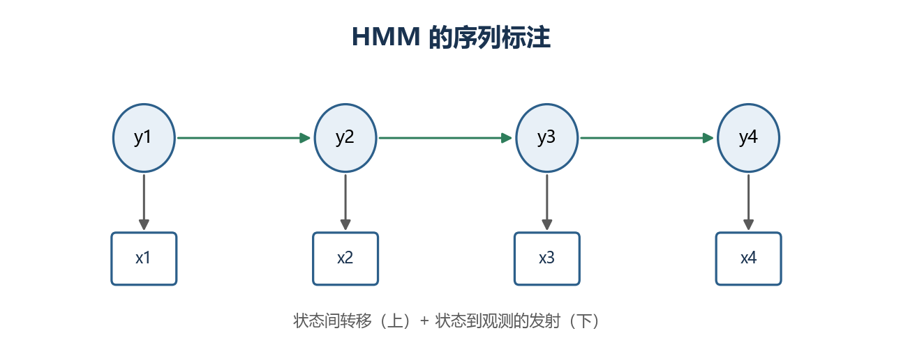

> 【图 8-2　CRF 的序列标注】（原图见 figures/图8-2.png）：相邻标签间的转移矩阵与观测特征的示意。
>
> 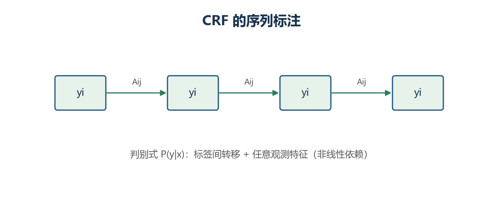

**表 8-2　HMM 与 CRF 对照**

| 方面 | HMM | CRF |
|------|-----|-----|
| 类型 | 生成式 $P(x,y)$ | 判别式 $P(y\mid x)$ |
| 假设 | 观测独立 + 一阶马尔可夫 | 仅标签间的马尔可夫依赖 |
| 特征 | 受限（发射/转移） | 任意重叠特征 |
| 训练 | EM（无监督可行） | 极大似然（需标注） |
| 表现 | 基线 | 通常更优 |

**边界与讨论。** CRF 的配分函数涉及对所有标签序列求和，复杂度 $O(T|\mathcal{Y}|^2)$；标签集大时成本高。CRF 仍是特征工程时代的 NER 主流，但在预训练时代，其角色发生变化——第 8.4 节将说明。

## 8.4　神经序列标注

预训练时代，序列标注进入神经范式，形成三条路线。

**路线一：神经编码器 + CRF。** 用 BiLSTM 或 Transformer 作为编码器（第 16、20 章）生成上下文表示 $\mathbf{h}_t$，再接入 CRF 层建模标签依赖。这是经典的"BiLSTM-CRF"[4]架构，长期是 NER 与词性标注的 SOTA。

**路线二：预训练模型微调。** 用 BERT 等预训练模型（第 21 章）在每个位置输出表示，接一个线性层直接标注（或接 CRF）。这成为当前主流，性能显著超越前路线。

**路线三：生成式方法。** 把 NER 等任务视为序列生成（第 17 章），直接生成实体标签序列。大模型时代（第 26 章）这种方法日益流行，尤其在少样本场景。

**例 8.4（BiLSTM-CRF）**　BiLSTM 编码句子，位置 $t$ 的表示 $\mathbf{h}_t$ 同时编码左右语境；线性层把 $\mathbf{h}_t$ 映射到各标签的分数 $s_t(k)$；CRF 层在这些分数上建模标签转移，用维特比解码整条最优序列。这结合了神经网络的特征学习能力与 CRF 的序列约束建模。

**BiLSTM-CRF 的联合打分。** 设发射分数 $\mathbf{e}_t=(e_{t,1},\dots,e_{t,K})$（由编码器给出，$K=|\mathcal{Y}|$），转移分数矩阵 $\mathbf{T}\in\mathbb{R}^{K\times K}$（$T_{ij}$ 表示从标签 $i$ 转移到 $j$ 的得分），则标签序列 $y$ 的总分为

$$
\mathrm{score}(x,y)=\sum_{t=1}^{T}e_{t,y_t}+\sum_{t=1}^{T-1}T_{y_t,y_{t+1}}, \tag{8-8}
$$

解码即 $\hat{y}=\arg\max_y\mathrm{score}(x,y)$（维特比），训练则最小化负对数似然 $\log\sum_{y'}\mathrm{score}(x,y')-\mathrm{score}(x,y^*)$（前向—后向算分母）。式 (8-8) 把"神经编码（连续分数）"与"序列约束（转移矩阵）"显式分离：编码器负责"每个词像什么标签"，CRF 层负责"相邻标签是否合法/常见"（如禁止 I-PER 后接非 P 标签，通过设 $T_{i,j}=-\infty$ 硬约束实现）。

**例 8.4A（CRF 配分函数数值算例）**　设 2 词序列、标签集 $\{A,B\}$，发射分数 $e_1=(1.0,\ 0.2)$、$e_2=(0.3,\ 0.9)$，转移分数 $T_{AA}=0.5,\ T_{AB}=0.1,\ T_{BA}=0.2,\ T_{BB}=0.4$。四条可能的标签序列及其总分：

| 序列 $y$ | 发射和 | 转移和 | 总分 |
|----------|--------|--------|------|
| AA | $1.0+0.3=1.3$ | $T_{AA}=0.5$ | 1.8 |
| AB | $1.0+0.9=1.9$ | $T_{AB}=0.1$ | 2.0 |
| BA | $0.2+0.3=0.5$ | $T_{BA}=0.2$ | 0.7 |
| BB | $0.2+0.9=1.1$ | $T_{BB}=0.4$ | 1.5 |

配分函数 $Z(x)=e^{1.8}+e^{2.0}+e^{0.7}+e^{1.5}\approx6.05+7.39+2.01+4.48=19.93$。最优序列为 AB（总分 2.0 最大），其后验概率 $P(y=\text{AB}\mid x)=e^{2.0}/Z(x)\approx7.39/19.93\approx0.371$。这个算例展示了 CRF 解码（取最大，得 AB）与后验推断（取 $e^{\text{score}}/Z$，得 0.371）的区别：前者用于确定性标注，后者用于带置信度的输出或半监督。

**边界与讨论。** 神经方法依赖大量标注数据（微调则依赖预训练知识）；生成式方法的输出结构化程度与可控性仍在改进中。第 23 章的参数高效微调与第 26 章的大模型少样本能力，进一步改变了序列标注的实践。

## 8.5　统一案例：问答语料的词法标注

回到贯穿全书的统一案例——开放域问答系统（第 1.8 节）。词法分析是它的第一道工序。

**案例设定。** 给定问答语料中的问题与候选文档，例如问题"谁提出了相对论？"与文档"爱因斯坦在 1905 年提出了狭义相对论"。词法标注阶段执行：

1. **分词**：中文问题切分为"谁/提出/了/相对论"；
2. **词性标注**：谁（代词）、提出（动词）、了（助词）、相对论（名词）；
3. **NER**：文档中"爱因斯坦"标为人名（PER），"1905 年"标为时间（TIME），"相对论"标为作品/概念。

**下游用途。** 这些标注为后续步骤提供基础：词性特征用于句法分析（第 11 章）；NER 结果用于判断问题类型（"谁"→人名答案）与知识对齐（第 36 章）；分词结果是语言模型（第 15、16 章）的输入。表 8-3 给出统一案例的词法标注映射。

**表 8-3　统一案例的词法标注**

| 文本 | 分词 | 词性 | 实体 |
|------|------|------|------|
| 谁提出了相对论？ | 谁/提出/了/相对论 | 代/动/助/名 | 相对论（概念） |
| 爱因斯坦在1905年提出… | 爱因斯坦/在/1905年/提出/… | 名/介/时间/动 | 爱因斯坦（PER）、1905年（TIME） |

这一案例将在第 11 章（句法解析）、第 12 章（语义角色）中继续复用，展示同一份语料在不同处理层的加工。

## 8.6　边界与讨论

词法分析是 NLP 的基础工序，但其边界须明确。

**流水线的问题。** 传统 NLP 流水线（分词→词性→句法→语义）中，上游错误会向下游传播（error propagation）：分词错误导致词性错误，进而影响句法与语义。端到端模型（第 17、21 章）通过联合建模缓解这一问题，但流水线因可解释、可调试仍在许多场景使用。

**中文分词的特殊性。** 中文分词是中文 NLP 特有难题（第 1 章），缺乏明确词边界，不同分词标准并存。预训练模型（第 21 章）以字或子词为单位，某种程度上绕开了显式分词——这是近年的重要趋势。

**与后续章节的联系。** 本章的序列标注方法（HMM、CRF）将在第 12 章（语义角色标注）、第 36 章（信息抽取）复用；词性标签将在第 10、11 章（句法分析）作为特征；分词与 NER 将在第 36 章（知识抽取）中直接应用。神经序列标注衔接第 16 章（RNN）、第 20 章（Transformer）与第 21 章（预训练）。

词法分析把文本转化为带结构的词序列，完成了 M1（形式）层的初步加工。但词与词如何组合成句法结构（M1 的更高层）与句子意义（M3）？第三篇将进入句法与语义分析。本篇的最后一章（第 9 章）先讨论语义相似度与词关系——这是词表示的评估，也是词向量（第 6 章）与词汇关系（第 5 章）的交汇。

## 本章小结

本章论述词法分析与序列标注。

我们首先界定分词、词性标注与 NER 三项任务，并把它们统一为序列标注问题（式 8-1），用 BIO 标注示例说明标签依赖。我们重点推导两种经典模型：HMM 的联合概率分解（式 8-3）、三个基本问题与维特比解码递推（式 8-4）；CRF 的条件概率定义（式 8-5）、特征函数与配分函数，并对照二者的生成/判别之别。我们进而介绍神经序列标注的三条路线（编码器+CRF、预训练微调、生成式），并给出统一案例中问答语料的词法标注。

我们还明确边界：流水线存在错误传播，中文分词有特殊困难，预训练模型正改变分词实践。这些辨析衔接第 10–12 章（句法语义）与第 36 章（信息抽取）。

词法分析完成 M1 层的初步加工，为句法与语义分析提供基础。第三篇将进入句法与组合语义，回答词如何组合成句子的意义。下一章（第 9 章）先完成第二篇的最后一块——词表示的评估（语义相似度与词关系）。

**进一步阅读**　本章建议延伸阅读的文献：[2]、[3]、[4]、[5]。

## 参考文献

[1] 俞士汶, 段慧明, 朱学锋, 孙斌. 现代汉语词语切分与词性标注规范. 北京大学计算语言学研究所, 1999.

[2] Rabiner L R. A tutorial on hidden Markov models and selected applications in speech recognition. *Proceedings of the IEEE*, 1989, 77(2): 257–286.

[3] Lafferty J D, McCallum A, Pereira F C N. Conditional random fields: Probabilistic models for segmenting and labeling sequence data. *ICML*, 2001.

[4] Huang Z, Xu W, Yu K. Bidirectional LSTM-CRF models for sequence tagging. *arXiv:1508.01991*, 2015.

[5] Devlin J, Chang M W, Lee K, Toutanova K. BERT: Pre-training of deep bidirectional transformers for language understanding. *NAACL*, 2019.

[6] Manning C D, Schütze H. *Foundations of Statistical Natural Language Processing*. Cambridge, MA: MIT Press, 1999.

[7] Jurafsky D, Martin J H. *Speech and Language Processing*. 3rd ed. Stanford, 2023.

[8] Sutton C, McCallum A. An introduction to conditional random fields. *Foundations and Trends in Machine Learning*, 2012, 4(4): 267–373.

---

# 第 9 章　语义相似度与词关系

第 6–8 章完成了词义表示的演进（分布假设→静态词向量→上下文表示）与词层工程（词法分析）。本篇最后一章讨论一个贯穿性的问题：**如何度量词与词之间的语义相似度？** 语义相似度既是词表示的评估手段（第 6.6 节），也是许多应用的基石——查询扩展（第 30 章）、文本分类、词义消歧（第 5 章）、推荐（第 39 章）都依赖它。同时，它是检验"词向量是否真正编码了语义关系"的试金石。

语义相似度的核心张力，是第 4 章反复强调的命题：**分布相似不等于意义相同**。"国王"与"王后"向量相近，却指称不同；"咖啡"与"茶"相似（同类饮品），"咖啡"与"杯子"也相关（搭配），但相似度与相关度是不同概念。本章先区分相似度与相关度（9.1 节），介绍经典的词类比任务与向量运算（9.2 节），讨论上下位关系与概念层级（9.3 节），概述语义评测基准（9.4 节），并在边界与讨论中收束（9.5 节）。

## 9.1　词相似度、相关度与类比任务

**定义 9.1（语义相似度）**　语义相似度（semantic similarity）度量两个词意义的相近程度，通常聚焦上下位与同义关系："汽车"与"轿车"相似度高（近义/上下位），"汽车"与"自行车"相似度中等（同类），"汽车"与"石头"相似度低。

**定义 9.2（语义相关度）**　语义相关度（semantic relatedness）度量两个词在任何语义关系上的关联强度，包括搭配、整体部分、主题相关："咖啡"与"杯子"相关度高（搭配），但相似度低（非同类）。

相似度与相关度的区分很重要：词向量空间的余弦相似度往往同时反映二者，难以分离。WordSim-353 等基准分别标注相似度与相关度[1]，揭示二者的差异。

**相似度作为形式度量。** 给定词向量 $\{\mathbf{v}_w\}$，词相似度可形式化为映射 $\mathrm{sim}:\mathcal{V}\times\mathcal{V}\to[0,1]$。最常用的是余弦相似度：

$$
\mathrm{sim}(a,b)=\cos(\mathbf{v}_a,\mathbf{v}_b)=\frac{\mathbf{v}_a\cdot\mathbf{v}_b}{\lVert\mathbf{v}_a\rVert\,\lVert\mathbf{v}_b\rVert}, \tag{9-1}
$$

它度量方向一致性、对范数不敏感。另一种选择是点积 $\mathbf{v}_a\cdot\mathbf{v}_b$，它同时编码方向与强度，对词频更敏感——实践中余弦因归一化更常用，点积在需要区分"高频强义"时更好用。

**例 9.1A（余弦相似度的数值算例）**　设二维示意向量 $\mathbf{v}_{\text{汽车}}=(4,3)$、$\mathbf{v}_{\text{轿车}}=(4,2)$、$\mathbf{v}_{\text{石头}}=(1,4)$。则

- $\cos(\mathbf{v}_{\text{汽车}},\mathbf{v}_{\text{轿车}})=\frac{4\times4+3\times2}{\sqrt{4^2+3^2}\sqrt{4^2+2^2}}=\frac{22}{5\times\sqrt{20}}\approx\frac{22}{22.36}\approx0.984$；
- $\cos(\mathbf{v}_{\text{汽车}},\mathbf{v}_{\text{石头}})=\frac{4\times1+3\times4}{5\times\sqrt{17}}=\frac{16}{5\times4.12}\approx\frac{16}{20.6}\approx0.777$。

"汽车—轿车"相似度 0.984 远高于"汽车—石头"的 0.777，符合直觉。注意即便"汽车—石头"方向也不完全相反（0.777 仍为正），说明低维示意向量无法把"无关"压到 0——真实高维空间中，无关词对的余弦通常接近 0，区分度更高。

**定义 9.3（词类比任务）**　词类比任务给定三词 $a:b:c$，要求找 $d$ 使 $a$ 与 $b$ 的关系类似于 $c$ 与 $d$ 的关系。经典例子："king:queen = man:?"（答案 woman），"Paris:France = Berlin:?"（答案 Germany）。前者是语义类比，后者是句法/地理类比。

类比任务与向量运算（第 4 章式 (4-1)、第 6 章）紧密相关：若词向量空间良好，则

$$
\mathbf{d}\approx\mathbf{b}-\mathbf{a}+\mathbf{c}, \tag{9-2}
$$

再在词表中找与 $\mathbf{d}$ 余弦相似度最大的词作为答案。

**例 9.1（类比计算）**　设 $\mathbf{v}_{\text{king}}-\mathbf{v}_{\text{man}}+\mathbf{v}_{\text{woman}}$ 得到向量 $\mathbf{d}$，与词表中所有词向量计算余弦相似度，取最大者。若结果为 $\mathbf{v}_{\text{queen}}$，则类比正确。Mikolov 等[2]报告 Skip-gram 在该任务上准确率可达 70% 以上，而 LSA 等早期方法显著更低——这是词向量质量的经典证据。

**相似度与相关度为何易混。** 二者的混淆源于词向量的单一几何：余弦相似度同时被"同类接近"与"共现接近"驱动，而这两者在向量空间里都表现为"方向相近"。举一组对照词对：

| 词对 | 相似度 | 相关度 | 关系类型 |
|------|--------|--------|----------|
| 汽车—轿车 | 高 | 高 | 上下位（同类） |
| 咖啡—杯子 | 低 | 高 | 搭配（场景共现） |
| 医生—医院 | 中 | 高 | 主题相关 |
| 国王—王后 | 中 | 中 | 社会关系 |
| 咖啡—宇宙 | 低 | 低 | 基本无关 |

"咖啡—杯子"相关度高于"汽车—轿车"的相似度，却未必相似度更高——词向量若把二者打成接近的余弦值，说明它没有分离这两种关系。SimLex-999[5] 正是为此设计：它对每个词对同时标注"相似度"与"相关度"两个分数，使评测可以分别检验模型捕捉两种关系的能力。

**表 9-1　相似度、相关度与类比**

| 概念 | 度量对象 | 例（高） | 例（低） |
|------|----------|----------|----------|
| 相似度 | 意义相近（上下位/同义） | 汽车—轿车 | 汽车—石头 |
| 相关度 | 任意语义关联 | 咖啡—杯子 | 咖啡—宇宙 |
| 类比 | 关系的一致性 | king:queen::man:woman | — |

## 9.2　词义类比与向量运算

词类比的成功暗示词向量空间具有某种线性结构——语义关系可被表示为向量方向。这构成"向量空间中的意义组合"的一个侧面（M2 层的几何化）。

**向量运算的推广。** 除式 (9-2) 的类比外，常见运算包括：

- 同义/相似：$\cos(\mathbf{v}_a,\mathbf{v}_b)$ 高则相似；
- 反义：$\cos(\mathbf{v}_a,\mathbf{v}_b)$ 高但方向沿某维度相反（如"大"与"小"）；
- 概念聚类：对词向量做 k-means，簇内词往往语义相关。

**为什么线性运算有效？** 一个解释是：词向量学习的是词与上下文的共现分布（第 6 章），而共现分布受潜在语义因子驱动；若这些因子在向量空间中是线性可分的，则语义关系（如"性别""国度"）对应特定方向，向量差自然编码关系。这一解释与分布式表示的理论分析一致[3]。

**类比检索的形式化。** 式 (9-2) 的几何直觉可写成检索问题：给定三元组 $(a,b,c)$，答案是

$$
d^{*}=\arg\max_{d\in\mathcal{V}\setminus\{a,b,c\}}\ \cos\big(\mathbf{v}_d,\ \mathbf{v}_b-\mathbf{v}_a+\mathbf{v}_c\big), \tag{9-3}
$$

其中排除 $\{a,b,c\}$ 防止平凡解（否则 $d$ 可能取到 $b$）。式 (9-3) 把"关系" $b-a$ 视为向量空间中的一个**平移方向**：从 $c$ 出发沿该方向走，落点最接近的词即答案。这要求语义关系在空间中近似平行——$\mathbf{v}_{\text{queen}}-\mathbf{v}_{\text{king}}\approx\mathbf{v}_{\text{woman}}-\mathbf{v}_{\text{man}}$，即"性别"关系有一个稳定的方向向量。

**类比的 PMI 视角。** 词向量近似 $SVD$ 截断后的 PMI 矩阵（第 6 章）。若"性别"是低秩潜因子，则 $\mathbf{v}_b-\mathbf{v}_a$ 与 $\mathbf{v}_d-\mathbf{v}_c$ 在该因子方向上的分量相等，使式 (9-3) 成立。Mikolov 等[2]进一步用"负采样 + 共现过滤"增强线性性，使 king−man+woman≈queen 在 Skip-gram 上首次被稳定观测到——这是分布语义"几何化"的标志性证据。

**例 9.2（类比失败的案例）**　向量运算并非总是成功。对"male:female = actor:?"，正确答案"actress"可能因训练语料中性别对偶词频率不均而失败；对反义类比"hot:cold = high:?"，向量差方向可能不对应"反义"而是"温度维度"。这些失败揭示：向量类比捕捉的是统计规律，而非逻辑关系（M2≠M4）——"国王−男人+女人=王后"是分布巧合，不是逻辑推导。

**例 9.2A（概念聚类的数值算例）**　除类比外，词向量的另一经典诊断是**概念聚类**：对词向量做 $k$-means，看簇内词是否语义相关。设 6 个二维示意向量与 $k=3$，初值取三个质心 $\mathbf{c}_1=(1,1)$、$\mathbf{c}_2=(-1,-1)$、$\mathbf{c}_3=(1,-1)$，词向量为：汽车 $(0.9,0.8)$、卡车 $(1.0,0.7)$、苹果 $(0.8,1.0)$、香蕉 $(0.9,0.9)$、医生 $(-0.9,-0.8)$、医院 $(-1.0,-0.7)$。第一轮按最近质心分配：汽车/卡车/苹果/香蕉→$\mathbf{c}_1$（交通/水果混簇），医生/医院→$\mathbf{c}_2$，$\mathbf{c}_3$ 空簇。更新质心后交通词与水果词会分开，但初值敏感导致"交通 vs 水果"的分裂取决于种子——这暴露了 $k$-means 对初值的依赖，也说明**词向量空间没有天然边界**：簇的"干净程度"是模型与初值共同的结果，不能直接当作语义结构的证明。真实评测（如 WordNet 上位类对照）会固定类别再算 Purity/NMI，避免初值干扰。

**边界与讨论。** 类比任务的准确率虽被广泛报告，但它对词频、训练超参数敏感，且高准确率不保证下游任务表现。类比更适合作为诊断工具，而非唯一评估标准（9.4 节）。

## 9.3　上下位关系与概念层级

第 5 章介绍了上下位关系（hypernymy）——"狗"是"动物"的下位。上下位关系支持层次推理，是词义组织的核心。词向量能否编码上下位关系？

**上下位关系的向量刻画。** 理论上，上下位关系与相似度不同："狗"与"动物"相似，但"动物"是上位词，"狗"是下位词——这是**非对称**关系。余弦相似度是对称的，无法直接编码方向性。研究者提出用向量方向与范数编码上下位：上位词的向量往往更"泛"（范数或分布更广）[4]，或用专门的关系嵌入（第 36 章、见《本体智能导论》）。

**方向性度量的构造。** 为给"dog 是 animal 的下位"赋予方向，可引入一个**非对称相似度**，用条件概率的不对称性打破余弦的对称：

$$
\mathrm{dir}(a,b)=\cos(\mathbf{v}_a,\mathbf{v}_b)+\alpha\big[\log P(a\mid b)-\log P(b\mid a)\big], \tag{9-4}
$$

其中 $\alpha>0$ 为方向项权重。若 $b$ 是 $a$ 的上位词（$a$ 是下位），则下位 $a$ 更多出现在上位 $b$ 的语境中，$P(a\mid b)>P(b\mid a)$，方向项为正，$\mathrm{dir}(a,b)>\mathrm{dir}(b,a)$。式 (9-4) 把"对称的接近"（余弦）与"不对称的归属"（条件 PMI 差）解耦：前者度量"有多像"，后者度量"谁包含谁"。双曲嵌入（Poincaré）则用另一种几何——上位词更接近原点（双曲半径小）、下位词更靠外——以径向顺序编码 is-a 方向[4]。

**例 9.3（对称性陷阱）**　$\cos(\mathbf{v}_{\text{狗}},\mathbf{v}_{\text{动物}})=\cos(\mathbf{v}_{\text{动物}},\mathbf{v}_{\text{狗}})$，但"狗是动物"为真、"动物是狗"为假。这说明：词向量的几何相似度能反映"相关"，却难以编码"是……的一种"的方向性关系。上下位推断需要额外的机制（如本体、关系嵌入或文本模式"X is a kind of Y"）。

**表 9-2　向量能编码与不能编码的语义关系**

| 关系 | 对称性 | 向量能否编码 | 说明 |
|------|--------|--------------|------|
| 同义/相似 | 对称 | 较好（余弦） | 近义词语向量接近 |
| 类比 | 关系性 | 部分（向量差） | 统计规律，非逻辑 |
| 上下位 | 不对称 | 困难 | 需方向性机制 |
| 反义 | 对称 | 部分 | 高相似但方向对立 |

**边界与讨论。** 上下位关系的方向性是 M2（分布）与 M4（知识/逻辑）的分水岭：分布相似捕捉对称的"接近"，上下位需要不对称的"属于"。这再次印证第 4 章的命题——不同意义层次需不同机制。从文本自动抽取上下位关系（"X such as Y""Y is a kind of X"）是知识获取（第 36 章）的重要任务。

## 9.4　语义评测基准

词向量与词义表示的评估依赖标准化基准。

**内在评测基准。**

- **词相似度基准**：WordSim-353[1]、SimLex-999[5]、MEN、RG-65——提供词对的人工相似度/相关度打分，用 Spearman 相关系数评估；
- **类比基准**：Mikolov 等[2]的语义/句法类比数据集——用式 (9-2) 计算准确率；
- **概念分类**：把词向量聚类，与人工概念类别（如 WordNet 上位类）对照。

**外在评测。** 把词表示用于下游任务（词性标注、NER、问答、翻译），看任务性能。外在评估更贴近实际应用，但成本更高、混杂因素更多。

**表 9-3　内在评测与外在评测对照**

| 方面 | 内在评测 | 外在评测 |
|------|----------|----------|
| 信号来源 | 词对人工打分 | 下游任务指标（F1、准确率） |
| 代表基准 | WordSim-353、SimLex-999、类比 | CoNLL NER、GLUE、机器翻译 BLEU |
| 度量 | Spearman $\rho$、类比准确率 | 任务性能（越高越好） |
| 优点 | 便宜、可解释、定位语义能力 | 贴近实用、端到端 |
| 缺点 | 与下游表现弱相关 | 昂贵、混杂（被任务本身主导） |
| 适用 | 比较"语义空间质量" | 比较"系统整体效果" |

二者常给出不同排序：某词向量在 SimLex-999 上领先，却可能在 NER 上落后——因为内在评测衡量"词对距离对不对"，外在评测衡量"表示对任务有没有用"。实践中应**内外结合**：用内在评测快速诊断语义空间，用外在评测裁决最终选型。第 31 章将把这一思路扩展到上下文表示与大模型评估——上下文表示因无法用词对打分，主要依赖外在评测（任务型 GLUE/SuperGLUE）。

**表 9-4　语义评测基准**

| 基准 | 类型 | 度量 | 说明 |
|------|------|------|------|
| WordSim-353 | 相似度/相关度 | Spearman | 353 词对 |
| SimLex-999 | 相似度（纯） | Spearman | 区分相似与相关 |
| 类比数据集 | 类比 | 准确率 | 语义+句法类比 |
| MEN | 相关度 | Spearman | 多标注者 |

**例 9.4（Spearman 相关）**　词向量对 353 个词对计算余弦相似度，得到排序；人工也有一个相似度排序。Spearman 相关系数衡量两个排序的一致性，取值 $[-1,1]$，越高越好。SimLex-999[5] 特意区分相似度与相关度（"咖啡—杯子"相关但不相似），因此更能检验"纯相似度"。

**Spearman 相关的形式定义。** 设模型相似度打分 $\{s_i\}_{i=1}^{n}$ 与人工打分 $\{r_i\}_{i=1}^{n}$ 分别转为秩 $\{S_i\}$、$\{R_i\}$，则 Spearman 相关即秩的 Pearson 相关：

$$
\rho=\frac{\sum_{i=1}^{n}(S_i-\bar{S})(R_i-\bar{R})}{\sqrt{\sum_{i=1}^{n}(S_i-\bar{S})^2\sum_{i=1}^{n}(R_i-\bar{R})^2}}
=1-\frac{6\sum_{i=1}^{n}d_i^2}{n(n^2-1)} \ \ (\text{无结}), \tag{9-5}
$$

其中 $d_i=S_i-R_i$，$\bar{S},\bar{R}$ 为秩均值。Spearman 用秩而非原始值，故对打分的单调变换不变——词向量的相似度只要"排对顺序"即可得高分，不要求绝对值标定，这契合相似度是序数而非基数标度的本质。

**例 9.4A（Spearman 的数值算例）**　设 5 个词对，模型相似度秩 $S=(1,2,3,4,5)$，人工秩 $R=(1,3,2,4,5)$，则 $d=(0,-1,1,0,0)$，$\sum d_i^2=2$，代入式 (9-5) 无结公式：

$$
\rho=1-\frac{6\times2}{5\times(5^2-1)}=1-\frac{12}{120}=1-0.1=0.9.
$$

模型几乎排对（仅"轿车/卡车"两个相邻位互换），$\rho=0.9$ 符合"接近完美排序"的直觉。但若把 $n$ 放大到 353 而仍只有 5% 词对错位，$\rho$ 通常落在 0.85–0.95；反之 $n$ 很小时，单处错位的相对惩罚被放大。这提示：**小 $n$ 下 Spearman 对局部错位极敏感**，跨基准比较须在相同 $n$ 下进行，否则 0.85 与 0.92 可能只是样本量差异而非模型差异——这是内在评测的一个常见陷阱。

**边界与讨论。** 基准评估的局限：① 基准语言与领域偏英语/通用语料，中文与领域词覆盖不足；② 高基准分数不保证下游任务表现（外在评估更可靠）；③ 静态基准无法评估上下文表示（第 7 章）——上下文表示需专门的任务型评测（第 31 章）。

## 9.5　边界与讨论

本章讨论了语义相似度、类比、上下位关系与评测基准，它们是词表示（第 6、7 章）与词汇关系（第 5 章）的交汇。

**相似度的边界。** 词向量相似度主要反映分布相似性（M2），不能保证指称正确（M4）或逻辑关系（M3）：近义不一定可替换（"美丽"与"漂亮"语体不同），相似不等于蕴含（第 4 章三命题）。把相似度当作"意义等价"是常见误用。一个典型误用是**用余弦阈值做同义判断**：设 $\cos>\theta$ 即判同义，但 $\theta$ 的取值高度依赖词向量空间——同一阈值在不同向量、不同维度下划出的"同义圈"差异巨大，且余弦本身没有"等价"的语义标定。正确的做法是把相似度当作**排序信号**（用于检索、扩展、聚类），而非**等价判据**（用于消歧、逻辑推理）；后者需要第 13 章的组合语义与第 36 章的知识对齐。

**对称与不对称。** 余弦相似度是对称的，适合同义/相似；上下位、蕴含等不对称关系需额外机制（本体、关系嵌入、文本模式）。这提示：词向量是意义表示的重要工具，但不是万能工具——复杂语义关系需结合知识与结构（第 36 章、《本体智能导论》）。式 (9-4) 的条件 PMI 方向项与双曲嵌入的径向编码，是"用几何补对称"的两条代表路线，它们共同指向一个原则：对称的接近与不对称的归属，是两种需要分开建模的语义维度。

**与后续章节的联系。** 语义相似度将在查询扩展与检索（第 30 章）、文本分类与聚类、推荐（第 39 章）中直接应用；类比与向量运算将在组合语义（第 13 章）与大模型能力分析（第 29 章）中深化；上下位关系与知识抽取将在第 36 章与《本体智能导论》展开。词表示的评估方法将在第 31 章（大模型评估）中系统化。

至此，第二篇"词汇与分布语义"全部完成：从词义的离散表示（第 5 章），到分布假设与词向量（第 6 章），到上下文表示（第 7 章），到词法分析（第 8 章），到语义相似度与评估（本章）。我们完整地回答了"词的意义如何被表示、计算与评估"——这是意义五层中 M2 的核心，也为 M1、M3 的处理提供了输入。

第三篇将进入句法与语义分析，回答"词如何组合成句子的意义"。这是意义五层中 M1（形式结构）与 M3（组合意义）的领域，也是从"词"迈向"句子"的关键一跃。

## 本章小结

本章论述语义相似度与词关系，完成第二篇的收束。

我们首先区分语义相似度（意义相近，上下位/同义）与语义相关度（任意语义关联，搭配/主题），指出词向量余弦相似度往往混合二者。我们介绍词类比任务与向量运算（式 9-2），以 king−man+woman≈queen 说明向量空间的线性语义结构，并指出类比是统计规律而非逻辑推导（M2≠M4）。我们讨论上下位关系的方向性——余弦相似度对称，无法编码不对称的"is-a"关系，需额外机制；并概述 WordSim-353、SimLex-999、类比数据集等评测基准与 Spearman 相关评估。

我们还明确边界：相似度不等于意义等价，对称的向量相似度难以编码不对称关系。这些辨析衔接第 13 章（组合语义）、第 30 章（检索）、第 36 章（知识抽取）与第 31 章（评估）。

第二篇至此完成，词义表示从离散知识（第 5 章）经分布向量（第 6 章）、上下文表示（第 7 章）到评估（本章），构成了意义五层中 M2 的完整图景。第三篇将进入句法与语义分析，把词的表示组合成句子的意义——这是 M1（形式）与 M3（组合）的领域。下一章从句法理论（第 10 章）开始。

**进一步阅读**　本章建议延伸阅读的文献：[1]、[2]、[5]、[6]。

## 参考文献

[1] Finkelstein L, Gabrilovich E, Matias Y, et al. Placing search in context: The concept revisited. *ACM Transactions on Information Systems*, 2002, 20(1): 116–131.

[2] Mikolov T, Sutskever I, Chen K, et al. Distributed representations of words and phrases and their compositionality. *Advances in Neural Information Processing Systems*, 2013, 26.

[3] Arora S, Liang Y, Ma T. A latent variable model approach to PMI-based word embeddings. *Transactions of the ACL*, 2016, 4: 385–399.

[4] Fu R, He L, Wu B. Learning hyperbolic embeddings for hypernymy detection. *AAAI*, 2018.

[5] Hill F, Reichart R, Korhonen A. SimLex-999: Evaluating semantic models with (genuine) similarity estimation. *Computational Linguistics*, 2015, 41(4): 665–695.

[6] Bruni E, Boleda G, Baroni M, Benotto G. Simulating lexical similarity with the MEN dataset. *LREC*, 2012.

[7] Manning C D, Schütze H. *Foundations of Statistical Natural Language Processing*. Cambridge, MA: MIT Press, 1999.

[8] Turney P D, Pantel P. From frequency to meaning: Vector space models of semantics. *Journal of Artificial Intelligence Research*, 2010, 37: 141–188.

---

# 第 10 章　句法理论与句法表示

第二篇完成了词的表示（M2 层）。第三篇进入句子的结构与意义，回答"词如何组合成句子"。本章是这一跃的起点，讨论意义五层中的 M1（形式意义）：**句法理论与句法表示**。第 2 章的形式语言理论给出了文法的一般框架，本章把它具体到自然语言的句法分析，介绍两大句法表示体系——成分句法与依存句法，以及支撑它们的文法形式与树库资源。

句法在自然语言智能中有双重角色：其一，它是 M1（形式意义）的核心，独立刻画句子的结构合法性；其二，它是 M3（组合意义）的支架——第 13 章的语义组合直接在句法结构上进行。然而，预训练模型（第 21 章）的兴起引发了"句法是否必要"的争论：端到端模型能否绕过显式句法？本章先建立句法的基础，这场争论将在第 11、13、29 章持续。

本章先介绍成分句法与依存句法两种表示（10.1 节），再讲上下文无关文法与依存文法（10.2 节），概述句法树库与标注体系（10.3 节），讨论句法歧义与消解（10.4 节），并在边界与讨论中收束（10.5 节）。

## 10.1　成分句法与依存句法

**成分句法（constituency parsing）。** 成分句法把句子视为短语的嵌套结构，用短语结构文法描述。其基本单位是**成分**（constituent）——在句子中充当统一功能的词序列。例如"那只猫"可作名词短语（NP），"追老鼠"可作动词短语（VP）。成分句法用成分句法树表示（图 10-1）：根节点是句子（S），内部节点是短语类型，叶子是词。

**定义 10.1（成分句法树）**　一棵成分句法树是带标签的有序树：每个内部节点标以短语类型（S、NP、VP、PP 等），叶子是句子中的词，节点的子节点序列构成该短语的直接成分。

**依存句法（dependency parsing）。** 依存句法不假设短语成分，而是直接刻画词与词之间的**依存关系**：每个词（除根节点）依赖于另一个词（其支配词/head），形成一棵依存树。例如"猫 追 老鼠"中，"追"是根，"猫"与"老鼠"分别作为主语与宾语依存于"追"。

**定义 10.2（依存关系与依存树）**　依存关系是二元关系 $(h,d,\ell)$，表示从支配词 $h$ 到从属词 $d$ 的关系 $\ell$（如 nsubj 主谓、obj 动宾、amod 形容词修饰）。一棵依存树对句子的每个词（除一个人工根 ROOT）指定唯一的支配词，构成一棵树。

**例 10.1（两种表示对照）**　对句子"我 喜欢 自然语言"：

- 成分句法：S→NP(我) VP(V(喜欢) NP(自然语言))，树根 S，NP 与 VP 为内部节点；
- 依存句法：ROOT=喜欢，"我"←nsubj—喜欢，"自然语言"←obj—喜欢，树根为动词"喜欢"。

**例 10.1A（依存弧的数值表示）**　把例 10.1 的依存树写成弧集 $E=\{(h,d,\ell)\}$：$E=\{(\text{ROOT},\text{喜欢},\text{root}),\ (\text{喜欢},\text{我},\text{nsubj}),\ (\text{喜欢},\text{自然语言},\text{obj})\}$。若把词序编码为下标（我=1、喜欢=2、自然语言=3、ROOT=0），则每条弧可用 $(h,d)$ 的下标对表示：$(2,1)$、$(2,3)$、$(0,2)$。投影性检验：对任意两条弧，若 $h_1<h_2$ 且 $d_1<d_2$（或反向），则不交叉。本例弧 $(2,1)$ 与 $(2,3)$ 共享支配词 2、不交叉；$(2,3)$ 与 $(0,2)$ 中 $0<2$ 且 $2<3$，支配词序 $(0,2)$ 与 $(2,3)$ 满足 $0<2$ 且 $d$ 为 $2,3$，不交叉。故该树**投射**。若换成"自然语言 喜欢 我"（宾语前置），弧变为 $(2,3)$、$(2,1)$、$(0,2)$，仍不交叉——但跨语言中"话题化"可能产生 $(h_1,d_1)$ 与 $(h_2,d_2)$ 满足 $h_1<h_2$ 且 $d_1>d_2$ 的交叉弧，即非投射，需第 11 章的图式方法处理。

两种表示捕捉的信息不同：成分句法强调短语层级，依存句法强调词间关系与语义角色（第 12 章）。表 10-1 对照二者。

**中心词与投射性。** 两种表示都隐含"中心词"（head）概念：成分句法中每个短语有唯一中心词（NP 的中心词是名词、VP 的中心词是动词），依存句法则把中心词显式化为"支配词"。一个关键的结构性质是**投射性**（projectivity）：一棵依存树若任意两词间的依存弧不与它们交叉（即依存弧在词序上线段化），则称其**投射的**（projective）。英语句法基本投射，但中文、日文等语言存在**非投射依存**（如话题—述语倒装、交叉的并列结构）。非投射性使依存分析不能简单用"自左向右、逐词归约"的线性过程，需要图式方法（第 11 章）或允许交叉的转移系统。这是跨语言句法差异在形式层面的直接体现，也是第 11 章区分转移式与图式复杂度的根源。

**表 10-1　成分句法与依存句法对照**

| 方面 | 成分句法 | 依存句法 |
|------|----------|----------|
| 基本单位 | 短语成分 | 词间依存关系 |
| 树节点 | 短语类型 + 词 | 词（标签在弧上） |
| 根 | S（句子） | 主要谓词（常为动词） |
| 优势 | 短语结构清晰 | 语义角色接近、跨语言性好 |
| 标注资源 | PTB | UD |

> 【图 10-1　成分句法树】（原图见 figures/图10-1.png）：句子"我 喜欢 自然语言"的短语结构树，节点标 S/NP/VP/V。
>
> 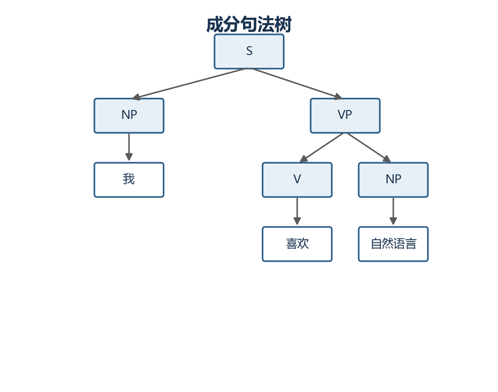

> 【图 10-2　依存句法树】（原图见 figures/图10-2.png）：同一句子的依存树，弧上标 nsubj/obj，根为"喜欢"。
>
> 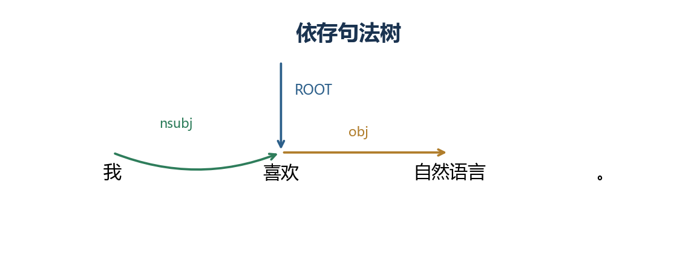

## 10.2　上下文无关文法与依存文法

**短语结构文法（CFG）。** 第 2 章定义的 CFG $G=(N,\Sigma,R,S)$ 是成分句法的形式基础。英语短语结构文法包含规则如：

$$
S\to NP\ VP,\quad NP\to Det\ N\mid N,\quad VP\to V\ NP,\quad PP\to P\ NP. \tag{10-1}
$$

这些规则递归生成短语结构。概率 CFG（PCFG，第 11 章）为每条规则赋概率，使歧义消解成为可能。

**PCFG 的概率约束。** 纯 CFG 只回答"是否合法"，不回答"哪棵更合理"。PCFG 给每条产生式 $A\to\beta$ 赋概率 $P(A\to\beta)$，要求对每个非终结符 $A$ 满足归一化：

$$
\sum_{\beta\in\mathrm{RHS}(A)}P(A\to\beta)=1, \tag{10-2}
$$

其中 $\mathrm{RHS}(A)$ 为以 $A$ 为左部的所有右部。式 (10-2) 保证概率可作规则选择的权重：一棵树 $T$ 的概率为其中所有规则概率之积（第 11 章式 (11-1)），从而"最可能树"成为良定义概念。PCFG 的概率通常从树库（10.3 节）极大似然估计，但存在**参数稀疏**问题——低频规则概率估计不稳，需平滑（加 Kneser–Ney 等，第 15 章）。

**依存文法。** 依存句法的形式化有多种：依存文法（dependency grammar）用规则约束词间依存；词汇化文法把依存关系与词项绑定。现代依存分析多采用**转移系统**（transition-based）或**图方法**（graph-based）（第 11 章），从数据中学习依存弧的分数，而非手工编写文法规则。

**例 10.2（CFG 的递归）**　规则 NP→NP PP 允许名词短语嵌套介词短语："[the cat [on [the mat [in [the room]]]]]"。这种递归是语言创造性的形式体现（第 1 章组合性）。但自然语言的递归深度有限，过深嵌套（如例 2.2 的中心嵌入）难以处理——这既是认知限制，也是解析算法的挑战（第 11 章）。

**递归与 Chomsky 层级。** CFG 的生成力落在 Chomsky 语类层级的**上下文无关层**（第 2 章）：它能生成嵌套结构，却不能处理跨成分依赖（如"一致性"需回看主语数）。自然语言并非严格上下文无关——存在两种典型的"超 CFG"现象：其一，**一致性约束**（主谓数一致、代词照应），需特征传递，属上下文敏感或更高；其二，**交叉依赖**（某些语言的语序交叉），超出任何 CFG。这解释了为何统计句法分析在 CFG 之外叠加词汇化（Collins 2003）与特征约束：CFG 是骨架，词汇化与特征是"补丁"。第 2 章的形式语言理论在此落地：CFG 解析可判定（第 11 章 CKY），而完全自然语言的句法若允许任意交叉则不可判定——实用系统在"足够表达力"与"可判定性"之间取平衡。

**表 10-2　两种文法形式**

| 方面 | CFG（短语结构） | 依存文法 |
|------|----------------|----------|
| 规则形式 | $A\to\beta$（短语展开） | 词间依存约束 |
| 结构 | 短语嵌套树 | 词依存树 |
| 解析算法 | CKY、Earley（第 11 章） | 转移式、图式（第 11 章） |
| 语义接口 | 组合语义（第 13 章） | 语义角色（第 12 章） |

**边界与讨论。** 纯 CFG 难以刻画自然语言的某些现象：一致性（主谓数一致）需要特征约束（如 LFG、HPSG 的词汇化文法）；长距离依赖与交叉依赖（第 2 章）超出 CFG 能力。这些促使现代句法分析从"手写文法"转向"数据驱动"（第 11 章）。

## 10.3　句法树库与标注体系

句法分析的发展离不开大规模标注资源——树库（treebank）。

**宾州树库（PTB）。** Penn Treebank[1] 是标注成分句法与词性的英语树库，约 100 万词，是统计句法分析的基准资源。其短语标签体系（NP、VP、PP、S 等）成为成分句法的事实标准。

**通用依存（Universal Dependencies, UD）。** UD[2] 是多语言依存标注项目，定义统一的依存关系类型（nsubj、obj、amod、advmod 等），覆盖百余种语言。UD 的统一体系使跨语言依存分析成为可能，是低资源语言句法研究的重要资源（第 25 章）。

**中文树库。** 中文有 CTB（Chinese Treebank，成分句法）与 Chinese GSD（UD 依存）等资源。中文句法分析的特殊性在于分词（第 8 章）——分词边界影响句法结构。具体而言，PTB 风格的英文树库先有词边界、再标短语，而中文树库必须在"切词"与"组句"间做联合决策：同一字符串"研究生命"切为"研究/生命"还是"研究生/命"，会导致完全不同的短语树（NP 边界不同）。因此中文成分句法分析常以**字级**输入、**词级**输出为设计，把分词歧义纳入句法歧义空间统一优化（第 8 章式 (8-1) 的扩展）。UD 的 Chinese GSD 则绕开显式词边界，直接以词为节点标依存，与预训练模型的字/子词输入更契合（第 21 章）。

**表 10-3　主要句法树库**

| 树库 | 语言 | 体系 | 规模 |
|------|------|------|------|
| PTB | 英语 | 成分 | ~100 万词 |
| CTB | 中文 | 成分 | ~80 万词 |
| UD | 多语言 | 依存 | 百余语言 |
| 哈工大依存树库 | 中文 | 依存 | 百万级 |

**例 10.3（UD 依存标签）**　UD 定义约 40 个通用依存关系。中文"我喜欢她"的 UD 标注：喜欢（ROOT）、我（nsubj→喜欢）、她（obj→喜欢）。统一标签使模型可在多语言间迁移（第 25 章）。

**边界与讨论。** 树库的标注体系与规模直接影响句法分析性能；标注不一致（不同标注者、不同标准）是噪声来源。这种不一致可用 **Cohen's $\kappa$** 量化：设两位标注者在一组判定上的一致比例为 $p_o$、按边缘分布随机一致的期望比例为 $p_e$，则

$$
\kappa=\frac{p_o-p_e}{1-p_e}. \tag{10-3}
$$

$\kappa\in[-1,1]$：1 表示完全一致，0 表示与随机无异。PTB 的短语边界 $\kappa\approx0.83$、词性 $\kappa\approx0.97$，说明词性标注高度可靠、短语边界存在标注者分歧——这正是"分词/词性较稳、成分树噪声较大"这一经验判断的量化依据。标注 $\kappa$ 设上限：任何解析器在噪声树库上的最优 F1 不可能超过标注者间一致水平，故报告性能时应同时给出金标的 $\kappa$ 作为参照。

**例 10.3A（$\kappa$ 的数值算例）**　设 20 个短语边界判定中两位标注者一致 17 处（$p_o=0.85$），边缘分布给出随机一致期望 $p_e=0.55$，则 $\kappa=(0.85-0.55)/(1-0.55)=0.30/0.45\approx0.667$。这意味着标注者分歧不小（一般 $\kappa>0.8$ 视为"强一致"），在这样噪声的金标上，解析器 F1 提升 1–2 分可能只是拟合了标注噪声而非真实句法能力——这是树库评估必须警惕的"金标天花板"效应。树库资源集中于英语与少数语言，低资源语言覆盖不足（第 25 章）。

## 10.4　句法歧义与消解

句法歧义是第 1 章"歧义"困难在句法层的体现：一个句子对应多棵合法句法树。

**定义 10.4（句法歧义）**　句子 $x$ 相对文法 $G$ 若有多个合法派生/句法树 $\{T_1,\dots,T_k\}$（$k>1$），则称 $x$ 存在句法歧义。句法分析的目标是从中选择最合理的一棵。设 $\mathcal{T}_G(x)$ 为 $x$ 在 $G$ 下的全部合法树，则歧义数为

$$
N(x)=\left|\mathcal{T}_G(x)\right|. \tag{10-4}
$$

$N(x)=1$ 表示无歧义，$N(x)\to\infty$ 表示歧义爆炸。PCFG 把选择问题转为概率问题：在 $\mathcal{T}_G(x)$ 上定义分布 $P(T\mid x)$，分析即 $\arg\max_{T\in\mathcal{T}_G(x)}P(T\mid x)$，歧义数大时概率分布更"平"、消解更依赖频率证据。

**歧义类型。**

- **附着歧义（attachment ambiguity）**："看见带望远镜的男人"（谁带望远镜？）；
- **词性歧义引发的句法歧义**："研究"作名词或动词导致不同结构；
- **并列歧义**："我和他的朋友"（我的朋友 vs 我 + 他的朋友）；
- **括号歧义（gapping）**："John loves Mary and hates Alice"——"and" 连接 VP 还是 S 影响辖域。

**例 10.4B（并列歧义的辖域差异）**　"我和他的朋友"有两棵树：$T_a$= (NP(我))(NP(他的朋友)) 并列（"我和他的朋友"两个人）；$T_b$= (NP(我) 的 (NP(他的朋友)))（"我"修饰"他的朋友"，单指）。二者对后续推理影响巨大：$T_a$ 下"朋友"属"他"，$T_b$ 下"朋友"属"我"。统计消解依赖"NP-的-NP"结构频率（中文中定中结构常见，偏向 $T_b$），但真正裁决需语义（"朋友"能否被"我"领属）。这类歧义在 NLP 中常**不可完全消解**——标注树库通常选"最可能"树，把不确定性留给下游。

**消解方法。** 统计句法分析用概率 CFG（第 11 章）为每棵树打分，选概率最高者；判别式方法（第 11 章）用特征学习直接排序候选树；神经方法（第 11 章）用上下文表示辅助决策。语义与语境信息（第 12–14 章）也参与消解——这再次体现 M1 与 M3/M5 的交互。

**例 10.4（附着歧义的概率消解）**　对"I saw the man with the telescope"，PP "with the telescope" 可附着于动词"saw"（我用望远镜看）或名词"man"（带望远镜的男人）。PCFG 依据训练语料中类似结构的频率给两种树打分；语义知识（望远镜是看的工具）进一步偏向动词附着。这展示了统计（M2）与语义（M3/M4）的联合消歧。

**例 10.4A（两种附着树打分的数值算例）**　设两棵候选树 $T_1$（PP 附 VP）用规则 $S\to NP\ VP$、$VP\to V\ NP\ PP$，$T_2$（PP 附 NP）用 $S\to NP\ VP$、$NP\to NP\ PP$。给定规则概率：$P(S\to NP\ VP)=1.0$（唯一）、$P(VP\to V\ NP\ PP)=0.30$、$P(NP\to NP\ PP)=0.45$（介词短语作定中较常见）。则

- $P(T_1)\propto 1.0\times0.30=0.30$；
- $P(T_2)\propto 1.0\times0.45=0.45$。

纯统计下 $P(T_2)>P(T_1)$，即"带望远镜的男人"（NP 附着）胜出——这与经验一致：介词短语修饰名词的频率常高于修饰动词。但若加入语义先验（望远镜是"看"的工具 → 倾向 VP 附着）或对"with the telescope"的论元角色判断，天平可能反转。这正说明**纯频率不足以消解所有附着歧义**，需语义/语用介入，是 M1 与 M3/M4 交互的典型实例。

> 【图 10-3　句法歧义的两棵树】（原图见 figures/图10-3.png）：同一句子的两种句法树，展示附着歧义。
>
> 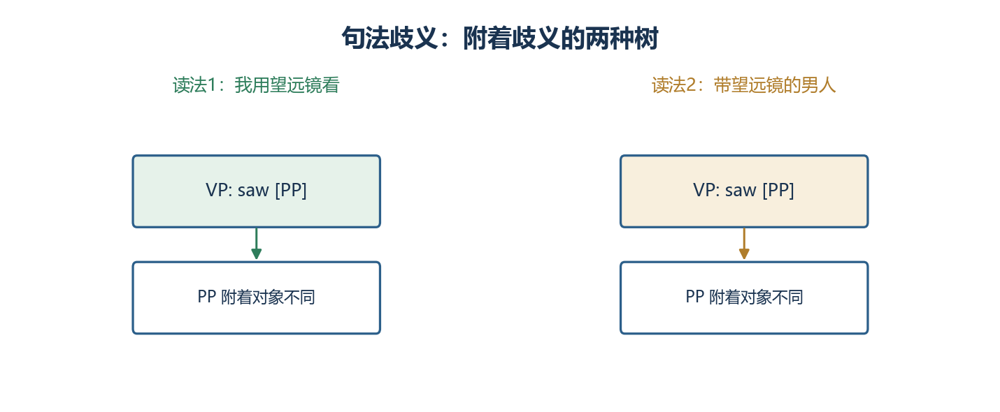

**边界与讨论。** 句法歧义的完全消解往往依赖常识与语境，纯句法信息不足。这解释了为何神经模型（第 11、21 章）倾向于联合学习句法与语义，而非分离处理。

## 10.5　边界与讨论

本章建立了句法理论与表示的基础，须明确其边界。

**句法的必要性之争。** 预训练模型（第 21 章）能不显式做句法分析而完成复杂任务，引发"句法是否必要"的争论。一种观点认为句法知识被隐式编码在神经表示中（第 7.5 节探测）；另一种观点认为显式句法仍对可解释性与组合泛化（第 13 章）有价值。本书的立场是：句法作为 M1 层，既是独立研究对象，也是 M3 组合语义的支架，其价值不因端到端模型的成功而消失。

**实证的两面性。** 探测实验（第 7.5 节 Tenney 等人的工作）显示 BERT 的中层表示能高线性地预测依存弧与成分边界——这是"句法被隐式编码"的证据。但另一面，对**系统性泛化**（systematic generalization）的测试表明：训练集中未出现的长距离结构，预训练模型的性能显著下降，而显式句法解析器对结构性变换更鲁棒。二者并不矛盾——隐式句法在**分布内**高效，显式句法在**分布外**可靠。这支持本书的折中立场：预训练时代显式句法不是"默认必经工序"，而是"组合泛化与可解释性的保险"，二者应按任务需求搭配（第 29、31 章的能力评估将给出量化判据）。

**形式与功能的张力。** 第 2 章的 CFG 强调形式合法性，而自然语言的句法常受语义、语用与频率影响（_usage-based_）。功能主义语言学强调句法结构服务于交际功能——这与形式主义各有贡献。本书兼容二者：形式理论提供描述工具，统计与神经方法捕捉使用规律。一个可量化的形式属性是**树深与平衡度**：成分树深反映中心嵌套程度（中心嵌入句树深大，认知负担高，第 1 章），依存树的"平均弧长"反映长距离依赖强度——弧长越长，句法—语义组合越难（第 13 章）。这两个指标把"形式合法性"细化为可比较的结构复杂度，为跨语言、跨句型的句法难度分析提供尺度。在统一案例中，"谁提出了相对论？"的依存树深为 1（单谓语）、平均弧长 0.5，属低复杂度句；而"那个在会议上被总经理临时改口的提案的附件第三页"则树深 4、弧长 2.3，属高复杂度中心嵌入句——两者对下游语义组合（第 13 章）的难度差距正是这种结构指标所刻画的，也是第 11 章解析算法复杂度差异的根源。

**表 10-4　句法表示形式谱系**

| 表示形式 | 结构单位 | 典型文法 | 解析范式 | 代表资源 |
|----------|----------|----------|----------|----------|
| 成分句法 | 短语（NP/VP） | CFG / PCFG | CKY、Earley（第 11 章） | PTB |
| 依存句法 | 词间弧 | 转移/图式 | 转移式、图式（第 11 章） | UD |
| LFG（灵活句法） | 属性值矩阵 | 词汇化文法 | 约束求解 | LFG 库 |
| HPSG（短语结构） | 特征结构 | 组合文法 | 逻辑编程 | HPSG |
| 构造语法 | 构造（形式+意义） | 构式 | 模式匹配 | 构式库 |

前两种是本书主线（第 11–13 章），后三种是词汇化/特征约束路线，用于刻画一致性、长程依赖等 CFG 难以处理的现象。它们在"显式结构"程度上递减、在"语义—句法耦合"程度上递增，构成从纯形式（CFG）到形式—意义混合（HPSG/构造）的光谱。

**与后续章节的联系。** 本章的句法表示将在第 11 章（解析算法）、第 12 章（语义角色，依存树提供输入）、第 13 章（组合语义，句法树提供组合骨架）反复使用。统一案例（第 1.8 节）的问答语料将在第 11 章做句法解析。第 2 章的 CFG 与本章的句法树库共同支撑第 11 章的解析算法。

句法刻画句子的结构（M1），但结构如何产生意义（M3）？下一章先解决"如何自动获得句法树"（第 11 章句法分析算法），第 12–14 章再进入语义。第三篇将逐层揭开从结构到意义的组合过程。

## 本章小结

本章论述句法理论与句法表示，开启第三篇。

我们首先介绍两大句法表示体系：成分句法（短语嵌套树，节点为 S/NP/VP 等）与依存句法（词间依存弧，根为谓词），并对照二者。接着讲解支撑它们的文法形式——短语结构文法 CFG（式 10-1，递归生成短语）与依存文法，以及各自的解析算法（第 11 章展开）。我们概述了句法树库与标注体系（PTB、UD、中文树库），指出资源与标注一致性对分析性能的影响。我们进一步讨论句法歧义（附着、词性、并列歧义）及其统计/判别/神经消解方法，并通过附着歧义示例展示 M2 统计与 M3/M4 语义的联合消歧。

我们还明确边界：句法的必要性因预训练模型而受争论，本书认为句法作为 M1 层与 M3 支架仍有独立价值；形式主义与功能主义各有贡献。这些辨析衔接第 11–13 章。

本章建立句法表示，为第 11 章解析算法、第 12 章语义角色、第 13 章组合语义提供基础。统一案例的问答语料将在第 11 章做句法解析。下一章进入句法分析算法，回答"如何自动获得句法树"——这是从理论到算法的关键一步。

**进一步阅读**　本章建议延伸阅读的文献：[1]、[2]、[3]、[4]。

## 参考文献

[1] Marcus M P, Santorini B, Marcinkiewicz M A. Building a large annotated corpus of English: The Penn Treebank. *Computational Linguistics*, 1993, 19(2): 313–330.

[2] Nivre J, de Marneffe M C, Ginter F, et al. Universal Dependencies v2: An evergrowing multilingual treebank collection. *LREC*, 2020.

[3] Chomsky N. *Syntactic Structures*. The Hague: Mouton, 1957.

[4] Manning C D, Schütze H. *Foundations of Statistical Natural Language Processing*. Cambridge, MA: MIT Press, 1999.

[5] Jurafsky D, Martin J H. *Speech and Language Processing*. 3rd ed. Stanford, 2023.

[6] Xue N, Xia F, Chiou F D, Palmer M. The Penn Chinese TreeBank: Phrase structure annotation of a large corpus. *Natural Language Engineering*, 2005, 11(2): 207–238.

[7] Tesnière L. *Éléments de syntaxe structurale*. Paris: Klincksieck, 1959.

[8] Goldberg A E. *Constructions: A Construction Grammar Approach to Argument Structure*. Chicago: University of Chicago Press, 1995.

---

# 第 11 章　句法分析算法

第 10 章建立了句法表示（成分树与依存树）与文法形式（CFG、依存文法）。本章回答其核心算法问题：**给定句子与文法，如何自动构建句法树？** 句法分析（parsing）是从形式理论走向实用系统的关键一步，也是统一案例（问答语料，第 1.8 节）的第三道工序（第 11 章做问题句法解析）。

第 2 章已证明 CFG 解析可判定并给出 CKY 的思想。本章系统展开句法分析算法的两大谱系：成分句法分析（CKY 动态规划、PCFG、转移式、神经方法）与依存句法分析（转移式、图式）。本章是 A 类核心章，核心算法给出完整推导。

本章先介绍移进归约与 CKY 动态规划（11.1 节），再讲统计句法分析 PCFG 与概率依赖（11.2 节），介绍神经句法分析的转移式与图式（11.3 节），给出句法分析器的评估（11.4 节），并在边界与讨论中收束（11.5 节）。

## 11.1　移进归约与 CKY 动态规划

**移进归约（shift-reduce）。** 这是句法分析的经典框架，维护一个栈与输入缓冲：

- **移进（shift）**：把缓冲区的下一个词压入栈；
- **归约（reduce）**：把栈顶的若干符号按文法规则替换为其左部非终结符；
- 重复直至缓冲区空、栈中只剩起始符 S（成分句法）或形成依存树（依存句法）。

移进归约是**自底向上**分析，线性时间（贪心版本）但可能因局部决策错误而失败，需回溯或栈回溯。

**CKY 算法。** CKY（Cocke–Kasami–Younger）是自底向上的动态规划算法，要求文法为 Chomsky 范形（CNF：产生式形如 $A\to BC$ 或 $A\to a$，第 2.3 节）。

**定理 11.1（CKY 正确性）**　对 CNF 文法 $G$ 与长度 $n$ 的句子 $w_1\dots w_n$，CKY 在 $O(n^3|G|)$ 时间内判定 $w\in L(G)$ 并输出句法树。

**算法与推导。** 定义动态规划表 $T[i,j]$（$1\le i\le j\le n$）为能生成子串 $w_i\dots w_j$ 的非终结符集合。

1. **初始化**（长度 1）：对每个 $i$，若 $A\to w_i\in R$，则 $A\in T[i,i]$；
2. **递推**（长度 $l=2,\dots,n$）：对区间 $[i,j]$（$j=i+l-1$），枚举分割点 $k\in[i,j-1]$，若存在产生式 $A\to BC$，且 $B\in T[i,k]$、$C\in T[k+1,j]$，则把 $A$ 加入 $T[i,j]$，并记录回溯指针 $(A\to BC,i,k,j)$；
3. **终止**：若 $S\in T[1,n]$，则句子合法，按回溯指针递归构造句法树。

**推导依据。** 递推的正确性来自 CNF 的二叉结构：任何长度 $\ge2$ 的派生 $A\Rightarrow^* w_i\dots w_j$ 的第一步必为 $A\to BC$，且 $B,C$ 分别派生某个连续子串 $w_i\dots w_k$ 与 $w_{k+1}\dots w_j$（ CNF 的二叉性与上下文无关性保证子串连续）。枚举所有 $k$ 即覆盖所有可能分割。

**例 11.1（CKY 完整填表）**　文法（CNF）：$S\to AB$，$A\to a$，$B\to b$；句子 $ab$（$n=2$）。

- 初始化：$T[1,1]=\{A\}$（$A\to a$），$T[2,2]=\{B\}$（$B\to b$）；
- 递推 $l=2$：区间 $[1,2]$，分割 $k=1$：$A\in T[1,1]$、$B\in T[2,2]$，且 $S\to AB$，故 $S\in T[1,2]$，回溯指针 $S\to A(1,1)B(2,2)$；
- 终止：$S\in T[1,2]$，句子合法；回溯构造树：根 $S$，左子 $A\to a$，右子 $B\to b$。

**表 11-1　CKY 填表（句子 $ab$）**

| 区间 | 非终结符 | 依据 |
|------|----------|------|
| $[1,1]$ | $A$ | $A\to a$ |
| $[2,2]$ | $B$ | $B\to b$ |
| $[1,2]$ | $S$ | $S\to AB$，$k=1$ |

**例 11.1A（CKY 填表的 $O(n^3)$ 复杂度示意）**　设 $n=3$ 的句子 $abc$，文法 $S\to AB$、$A\to C\ B$、$C\to a$、$B\to b$、$D\to c$（示意性 CNF）。CKY 需填的区间数 $\sum_{l=1}^{3}(n-l+1)=3+2+1=6$，每个区间 $[i,j]$ 枚举分割点 $k$ 共 $j-i$ 个，每个 $(i,j,k)$ 检查文法产生式。故总操作约 $\sum_{l=2}^{n}(n-l+1)(l-1)\cdot|R|$，对 $n=3$ 即 $(2\times1+1\times2)\cdot|R|=4|R|$ 次检查——已能看出随 $n$ 立方增长的趋势。$n=100$ 时区间数 5050、分割点约 166,650 次，乘上 $|R|\approx$ 数千即数亿次操作，这正是 CKY 对长句慢的根源。

**Earley 的改进。** 经典 CKY 要求文法先转 CNF，且按"区间长度"驱动。Earley（1970）算法改用**点状态**（Earley item）$[A\to\boldsymbol{\alpha}\cdot\boldsymbol{\beta},\ i]$（产生式 $A\to\boldsymbol{\alpha}\boldsymbol{\beta}$ 读到位置 $\cdot$、起点 $i$），按**输入位置**驱动，无需 CNF、可在线（增量）解析，对左递归文法也鲁棒。Earley 在最坏仍 $O(n^3)$，但对实际文法常接近 $O(n^2)$，是统计与神经成分解析（第 11.2、11.3 节）的常用底层引擎。

> 【图 11-1　CKY 算法填表】（原图见 figures/图11-1.png）：三角矩阵，展示 $T[i,j]$ 的填充顺序（先长度 1，再长度 2…），区间 $[1,2]$ 标注分割点 $k$。
>
> 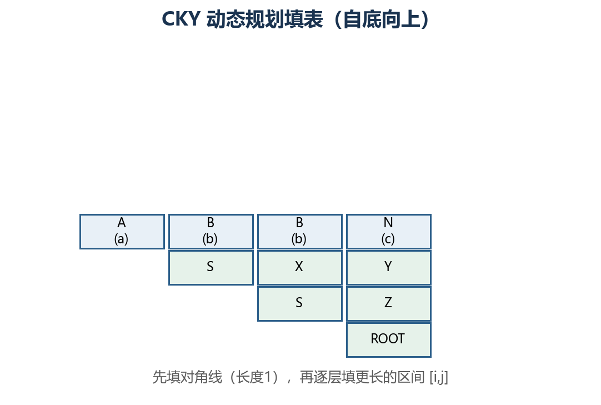

**边界与讨论。** CKY 的 $O(n^3)$ 复杂度对长句较高；需 CNF 转换（可能增加文法规模）；且纯 CKY 只回答"是否合法"，不处理歧义排序——这由 PCFG（11.2 节）解决。

## 11.2　统计句法分析：PCFG 与概率依赖

**概率上下文无关文法（PCFG）。** PCFG[1] 为 CFG 的每条规则 $A\to\beta$ 赋概率 $P(A\to\beta)$，满足对每个非终结符 $A$，$\sum_{\beta}P(A\to\beta)=1$。一棵句法树 $T$ 的概率为其所有规则概率之积：

$$
P(T)=\prod_{(A\to\beta)\in T}P(A\to\beta). \tag{11-1}
$$

**最可能句法树（Viterbi 解析）。** 句法分析的目标从"任意合法树"变为"概率最高的树"：

$$
\hat{T}=\arg\max_{T\in\mathcal{T}(x)}P(T), \tag{11-2}
$$

其中 $\mathcal{T}(x)$ 为句子 $x$ 的所有合法树。CKY 可改造为概率版：把 $T[i,j]$ 从"非终结符集合"变为"$[i,j]$ 上以 $A$ 为根的最佳子树概率"，递推时取 max 而非集合并：

$$
\alpha_{ij}(A)=\max_{k,A\to BC}\big[\alpha_{ik}(B)\cdot\alpha_{k+1,j}(C)\cdot P(A\to BC)\big]. \tag{11-3}
$$

**参数估计。** PCFG 规则概率通常从树库（第 10.3 节）用极大似然估计：

$$
\hat{P}(A\to\beta)=\frac{\text{count}(A\to\beta)}{\text{count}(A)}. \tag{11-4}
$$

**例 11.2（PCFG 消歧）**　对附着歧义句"I saw the man with the telescope"，两种树 $T_1$（PP 附着 VP）与 $T_2$（PP 附着 NP）的概率由各自规则概率之积决定。若树库中"VP→VP PP"比"NP→NP PP"更常见，则 $P(T_1)>P(T_2)$，选择 $T_1$。这展示了统计（M2，频率）如何辅助句法（M1）消歧。

**例 11.2A（PCFG 树概率的数值算例）**　沿用第 10 章例 10.4A 的规则概率：$P(S\to NP\ VP)=1.0$、$P(VP\to V\ NP\ PP)=0.30$、$P(NP\to NP\ PP)=0.45$，并补 $P(NP\to Det\ N)=0.7$、$P(VP\to V\ NP)=0.5$。句子"I saw the man with the telescope"的简化规则序列：

- $T_1$（PP 附 VP）：$S\to NP\ VP$，$NP\to Det\ N$（the man），$VP\to V\ NP\ PP$（saw the man with the telescope）；
  $P(T_1)\propto 1.0\times0.7\times0.30=0.210$；
- $T_2$（PP 附 NP）：$S\to NP\ VP$，$NP\to NP\ PP$（the man with the telescope），$VP\to V\ NP$（saw ...）；
  $P(T_2)\propto 1.0\times0.45\times0.5=0.225$。

纯规则概率下 $P(T_2)>P(T_1)$（0.225>0.210），"带望远镜的男人"略胜。这与第 10 章的结论一致：介词短语作定中（NP→NP PP）频率高于作状中（VP→V NP PP）。但差距仅 0.015，说明**单靠规则概率不足以稳健消解**——若加入词汇化（以"saw"为 head 的条件概率）或语义先验，排序可能反转。这正是词汇化 PCFG（Collins 2003[2]）的动机：把 $P(VP\to V\ NP\ PP)$ 细化为 $P(VP\to V\ NP\ PP\mid head=V=saw)$，用中心词条件化缓解独立假设，显著提升消歧稳健性。

**概率依赖与词汇化。** 经典 PCFG 的独立性假设过强（规则选择独立于上下文），催生了词汇化 PCFG[2]——规则概率依赖中心词（head word），如 $P(\text{VP}\to\text{V NP}\mid \text{head}=\text{saw})$。这显著提升消歧能力，但参数稀疏。现代神经方法（11.3 节）用连续表示缓解稀疏。

> 【图 11-2　移进归约算法】（原图见 figures/图11-2.png）：栈与输入缓冲的状态变化，展示 shift/reduce 操作序列。
>
> 

**边界与讨论。** PCFG 的局限：① 上下文无关假设忽略长程依赖与一致性；② 规则稀疏（尤其词汇化后）；③ 结构固定（CNF 二叉化）。这些局限推动了神经句法分析。

## 11.3　神经句法分析：转移式与图式

神经方法用分布式表示（第 6、7 章）替代人工特征，成为句法分析主流。

**转移式依存分析（transition-based）。** 维护栈（已处理的词）与缓冲区（待处理的词），用一系列动作构建依存树：

- **SHIFT**：把缓冲区首词压栈；
- **LEFT-ARC($\ell$)**：栈顶词支配次栈顶词，标关系 $\ell$；
- **RIGHT-ARC($\ell$)**：次栈顶词支配栈顶词，标关系 $\ell$。

一个神经网络（分类器）根据栈与缓冲区的上下文中当前状态（用词向量表示）预测下一个动作，直到缓冲区空。Chen 与 Manning[3] 的基于 arc-standard 的神经转移系统性能优异。

**例 11.3B（转移式动作序列演示）**　对"谁 提出 相对论"（词序 1,2,3，ROOT=0），arc-eager 系统（先建弧后归约）的动作序列为：

1. 初始：栈=[0(ROOT)]，缓冲=[1,2,3]；
2. SHIFT → 栈=[0,1]，缓冲=[2,3]（"谁"入栈）；
3. SHIFT → 栈=[0,1,2]，缓冲=[3]（"提出"入栈）；
4. RIGHT-ARC(nsubj) → 栈顶"提出"(2) 支配次顶"谁"(1)，标 nsubj；栈不变；
5. SHIFT → 栈=[0,1,2,3]，缓冲=[]（"相对论"入栈）；
6. RIGHT-ARC(obj) → "提出"(2) 支配"相对论"(3)，标 obj；栈不变；
7. REDUCE → 弹出栈顶"相对论"(3)，栈=[0,1,2]；
8. REDUCE → 弹出"谁"(1)，栈=[0,2]；
9. LEFT-ARC(ROOT) → 次顶"ROOT"(0) 支配栈顶"提出"(2)，标 ROOT；栈不变；
10. REDUCE → 弹出"提出"(2)，栈=[0]，缓冲空，结束。

注意 arc-eager 系统**先建立弧再归约**（步骤 4、6 在 SHIFT 后立即 ARC，步骤 9 在子节点归约完后才把中心词挂到 ROOT），而 arc-standard 系统**先归约再建立弧**——两者对非投射句法的处理能力不同（arc-standard 可处理部分交叉）。转移式的局限在于**贪心**：每个动作由分类器即时决定、不可回溯，一旦某步选错 SHIFT/REDUCE/ARC 就无法纠正。图式方法（式 11-6）无此问题，但代价是 $O(n^2)$ 打分与 MST 解码。实践中，转移式因 $O(n)$ 速度用于实时场景，图式因精度用于离线高要求场景（表 11-2）。

**图式依存分析（graph-based）。** 把依存分析视为打分与搜索：对每对词 $(h,d)$ 与关系 $\ell$ 打分 $s(h,d,\ell)$（用神经模型），再在所有树中找总分最高的树（最大生成树问题，用 Chu–Liu/Edmonds 算法求解）。Dozat 与 Manning[4] 的基于双仿射（biaffine）打分的图式方法成为 SOTA。

**双仿射打分。** 词 $h$ 与 $d$ 的表示 $\mathbf{h}_h,\mathbf{h}_d$ 的依存分数：

$$
s(h,d,\ell)=\mathbf{h}_h^\top\mathbf{W}_\ell\,\mathbf{h}_d+\mathbf{v}^\top[\mathbf{h}_h;\mathbf{h}_d]+b_\ell, \tag{11-5}
$$

其中 $\mathbf{W}_\ell$ 为关系 $\ell$ 的双仿射矩阵。式 (11-5) 直接计算任意词对的依存分数，可并行，高效准确。

**图式解码：最大生成树。** 图式方法把所有有向弧 $(h,d,\ell)$ 的打分 $s(h,d,\ell)$ 看成一张完全有向图的边权，依存树即其中**以 ROOT 为根的最大生成树**。记弧集合 $\mathcal{E}$，则解码为

$$
\hat{T}=\arg\max_{T\in\mathrm{arborescence}(\mathcal{E})}\sum_{(h,d,\ell)\in T}s(h,d,\ell), \tag{11-6}
$$

其中 $\mathrm{arborescence}(\mathcal{E})$ 为 $\mathcal{E}$ 上以 ROOT 为根、覆盖所有词、无环的有向树集合。式 (11-6) 是**最大权有向生成树**（maximum branching）问题，可由 Chu–Liu/Edmonds 算法在 $O(|\mathcal{E}|)$ 近似线性时间求解（|E| 为弧数，至多 $n(n-1)|\mathcal{L}|$）。这一"打分 + 精确解码"的两段式设计是图式方法的精髓：打分函数（式 11-5）可任意复杂（神经双仿射），解码仍由经典图算法保证全局最优——与转移式"边预测边决策、贪心不可回溯"形成鲜明对比。

**例 11.3（神经 vs 统计）**　PCFG（11.2 节）依赖人工设计的规则与特征，词汇化后稀疏；神经方法用词向量与双仿射打分自动学习依存模式，泛化更强。但神经方法需大量数据，且可解释性较弱（第 29、31 章）。

**统一案例。** 对问答问题"谁提出了相对论？"，神经依存分析给出：根="提出"，"谁"←nsubj→提出，"相对论"←obj→提出，"了"←asp→提出，"？"←punct→提出。这为第 12 章语义角色标注提供输入。

**例 11.3A（图式最大生成树的数值算例）**　设 3 词句子（词 1="谁"、词 2="提出"、词 3="相对论"）加 ROOT=0，候选弧的打分（节选，每词至多一个入弧、每对至多一个关系）如下：

| 弧 $(h\to d)$ | 关系 | 分数 |
|---------------|------|------|
| $0\to2$ | ROOT | 2.0 |
| $2\to1$ | nsubj | 1.8 |
| $2\to3$ | obj | 1.5 |
| $1\to2$ | nsubj | 0.9 |
| $3\to2$ | obj | 0.7 |
| $2\to1$（obj） | obj | 0.4 |
| $0\to1$ | ROOT | 0.3 |
| $0\to3$ | ROOT | 0.5 |

每个词需选一条入弧，且整体无环、以 ROOT 为根。逐词看最高分入弧：词 1 选 $2\to1$(nsubj, 1.8)，词 2 选 $0\to2$(ROOT, 2.0)，词 3 选 $2\to3$(obj, 1.5)。这三条弧构成树（ROOT→提出，提出→{谁,相对论}），无环，总分 $2.0+1.8+1.5=5.3$。这正是式 (11-6) 的最优解。若词 3 的最高分入弧改为 $0\to3$（直接挂 ROOT），则会与 $0\to2$ 形成"两个根"，违反单根约束，Chu–Liu 算法会检测到并回退到次优弧——这展示了最大生成树相比"逐词贪心"的**全局约束**优势。

**表 11-2　句法分析方法对照**

| 方法 | 类型 | 复杂度 | 优势 | 局限 |
|------|------|--------|------|------|
| CKY | 动态规划 | $O(n^3)$ | 精确、完备 | 需 CNF、慢 |
| PCFG | 统计 | $O(n^3)$ | 消歧、可解释 | 稀疏、独立性假设 |
| 转移式 | 神经 | $O(n)$ | 快 | 贪心错误传播 |
| 图式 | 神经 | $O(n^2)$ | 准确、并行 | 需 MST 解码 |

## 11.4　句法分析器的评估

**评估指标。**

- **成分句法**：PARSEVAL 指标——精确率（分析得到的成分中正确的比例）、召回率（正确成分中被分析出的比例）与 F1，常用 F1 分数；
- **依存句法**：UAS（unlabeled attachment score，支配词正确的比例）与 LAS（labeled attachment score，支配词与关系都正确的比例）；
- 还需报告**完整句准确率**（整棵树完全正确的句子比例），更严格。

设句子 $x$ 有 $n-1$ 个非 ROOT 词，$\mathrm{dep}^*(d)$、$\ell^*(d)$ 分别为词 $d$ 的金标准支配词与关系，$\widehat{\mathrm{dep}}(d)$、$\hat{\ell}(d)$ 为预测，则

$$
\mathrm{UAS}=\frac{1}{n-1}\sum_{d\neq\mathrm{ROOT}}\mathbb{1}[\widehat{\mathrm{dep}}(d)=\mathrm{dep}^*(d)],\qquad
\mathrm{LAS}=\frac{1}{n-1}\sum_{d\neq\mathrm{ROOT}}\mathbb{1}[\widehat{\mathrm{dep}}(d)=\mathrm{dep}^*(d)\wedge\hat{\ell}(d)=\ell^*(d)]. \tag{11-7}
$$

LAS $\leq$ UAS（关系正确蕴含支配词正确）。式 (11-7) 是**词级**指标，对单个错误"宽容"（错 1 词只扣 1 分），故高 UAS/LAS 不代表句级完美——这正是 11.4 节例 11.4 强调"完整句准确率"的原因。

**例 11.4（UAS/LAS）**　句子有 5 个依存弧，模型预测对 4 个支配词（UAS=4/5=0.8），其中 3 个关系也正确（LAS=3/5=0.6）。完整句准确率：若没有任何句子全对，则为 0——说明 UAS/LAS 高不代表句级完美。

**评估陷阱。** 不同树库标准（PTB vs UD）结果不可直接比较；域外数据（如医疗文本）性能可能骤降（第 39 章）；分词错误（第 8 章）会传播到句法评估。

## 11.5　边界与讨论

本章系统论述了句法分析算法，须明确其边界。

**精确与近似的权衡。** CKY/PCFG 精确但 $O(n^3)$，转移式快但贪心，图式平衡。实践中依需求选择：资源受限用转移式，高精度用图式。这一"贪心—精确"的权衡也预示了第 17 章解码策略的设计取向：生成式 NLP 同样要在"速度"与"全局最优"之间选择解码算法（束搜索、对比解码等）。

**神经模型是否"懂"句法？** 神经句法分析器性能优异，但它是学习统计模式而非显式文法。第 7.5 节探测表明神经表示中编码了句法信息（第 29、31 章将讨论这是否等于"理解"）。本书立场：句法分析算法是 M1 层的工程实现，其价值在于为 M3 组合语义提供结构支架。

**与后续章节的联系。** 本章的句法树/依存树将是第 12 章语义角色标注（依存路径为特征）、第 13 章组合语义（句法树为组合骨架）的直接输入；概率建模思想（式 11-1 至 11-4）衔接第 3、15 章；神经打分（式 11-5）衔接第 20 章注意力。

句法分析把句子转化为结构（M1）。但结构如何产生意义（M3）？第 12 章先做浅层语义（语义角色标注），第 13 章再做组合语义与逻辑形式。第三篇将继续揭开从结构到意义的过程。

## 本章小结

本章论述句法分析算法，是 A 类核心章。

我们首先介绍移进归约框架与 CKY 动态规划：给出 CKY 的算法步骤、正确性定理（$O(n^3|G|)$）与递推依据，用手算示例（句子 $ab$）展示填表。我们重点推导统计句法分析：PCFG 的树概率（式 11-1）、Viterbi 解析递推（式 11-3）、规则概率估计（式 11-4），并说明统计频率如何辅助 M1 歧义消解。我们介绍神经句法分析的转移式（SHIFT/ARC 动作）与图式（双仿射打分，式 11-5）两条路线，并给出评估指标（PARSEVAL、UAS/LAS）。

我们还明确边界：精确与近似的权衡，神经模型是否"懂"句法的争论。这些辨析衔接第 12、13、29、31 章。

本章的核心推导（CKY、PCFG、双仿射）体现了 A 类深度。句法分析把句子转化为结构，为语义分析提供支架。下一章进入语义角色标注（第 12 章），从结构迈向浅层语义。

**进一步阅读**　本章建议延伸阅读的文献：[1]、[2]、[3]、[4]。

## 参考文献

[1] Chomsky N. On certain formal properties of grammars. *Information and Control*, 1959, 2(2): 137–167.

[2] Collins M. Head-Driven Statistical Models for Natural Language Parsing. *Computational Linguistics*, 2003, 29(4): 589–637.

[3] Chen D, Manning C D. A fast and accurate dependency parser using neural networks. *EMNLP*, 2014.

[4] Dozat T, Manning C D. Deep biaffine attention for neural dependency parsing. *ICLR*, 2017.

[5] Younger D H. Recognition and parsing of context-free languages in time $n^3$. *Information and Control*, 1967, 10(2): 189–208.

[6] Jurafsky D, Martin J H. *Speech and Language Processing*. 3rd ed. Stanford, 2023.

[7] Manning C D, Schütze H. *Foundations of Statistical Natural Language Processing*. Cambridge, MA: MIT Press, 1999.

[8] Stern M, Fried D, Manning C D. An effective neural model for crossing and non-projective dependencies. *TACL*, 2017.

---

# 第 12 章　语义角色与浅层语义

第 10、11 章把句子转化为句法结构（M1）。本章开始进入 M3（组合意义）的浅层——**语义角色标注**（semantic role labeling, SRL），回答"句子中谁对谁做了什么"。SRL 是连接句法结构与深层逻辑形式（第 13 章）的桥梁，也是统一案例（第 1.8 节）的第四道工序：问答语料在第 12 章做语义角色标注。

语义角色标注的核心思想：句子围绕谓词（通常是动词）组织，谓词支配若干论元（participants），每个论元承担一个语义角色（施事、受事、工具、地点等）。例如"张三用钥匙开了门"中，"开"是谓词，"张三"是施事（ARG0），"门"是受事（ARG1），"钥匙"是工具（ARG2）。SRL 不追求完整的真值条件（第 13 章），而是给出"who did what to whom"的浅层语义结构——它在多数下游任务（问答、信息抽取、机器翻译）中已足够有用。

本章先介绍谓词—论元结构与语义角色（12.1 节），再讲 PropBank、FrameNet 与角色体系（12.2 节），介绍神经语义角色标注（12.3 节）与抽象意义表示 AMR（12.4 节），给出统一案例中的语义角色标注（12.5 节），并在边界与讨论中收束（12.6 节）。

## 12.1　谓词—论元结构与语义角色标注

**定义 12.1（谓词—论元结构）**　句子的谓词—论元结构由谓词 $p$（predicate）及其论元集 $\{a_1,\dots,a_k\}$ 构成，每个论元 $a_i$ 被赋予一个语义角色 $r_i$，表示该论元在谓词所描述事件中的参与角色。

语义角色分两类：

- **核心论元（core arguments）**：事件必需的参与者，如施事（agent）、受事（patient/theme）；
- **非核心论元（adjuncts）**：时间、地点、方式、工具等外围角色。

**定义 12.2（语义角色标注，SRL）**　给定句子与谓词，SRL 任务是识别谓词的论元并为其分配语义角色标签。形式化为：对句子中每个候选论元跨度（span），判断其角色（或"非论元"）。

SRL 通常分两步：① **论元识别**（argument identification）：找出哪些跨度是论元；② **论元分类**（argument classification）：为每个论元分配角色标签。现代端到端方法联合完成。

**SRL 的概率形式化。** 设句子 $x$、谓词 $p$、候选论元跨度 $a$，角色标签集 $\mathcal{R}=\{\text{ARG0},\text{ARG1},\dots,\text{AM-*},\text{O}\}$（O 表示"非论元"）。SRL 任务即学习条件分布并做最大后验：

$$
\hat{r}(a)=\arg\max_{r\in\mathcal{R}}P(r\mid a,p,x), \tag{12-1}
$$

其中论元识别与分类统一为"预测 $a$ 的角色 $r$（含 O）"。式 (12-1) 把两步任务合并：预测到具体角色即同时完成识别（非 O）与分类（哪个角色）。这种统一是神经 SRL（12.3 节）的基础——它直接对每个 $(a,p)$ 对在 $\mathcal{R}$ 上做 softmax。评估用 **F1**（精确率与召回率的调和平均）：设某角色 $r$ 的预测正例 $N_p$、真正例 $N_{tp}$，则

$$
\text{Precision}_r=\frac{N_{tp}}{N_p},\quad \text{Recall}_r=\frac{N_{tp}}{N_{tr}},\quad F1_r=\frac{2\cdot\text{Precision}_r\cdot\text{Recall}_r}{\text{Precision}_r+\text{Recall}_r}, \tag{12-2}
$$

其中 $N_{tr}$ 为金标中角色 $r$ 的总数。SRL 报告**各角色宏平均 F1**（macro F1）与**核心角色 F1**（macro-core F1），后者只统计 ARG0–ARG4，是跨系统比较的主指标。

**例 12.1A（F1 的数值算例）**　设某 SRL 系统在 PropBank 测试集上，对 ARG1 预测 120 个、金标 ARG1 共 100 个、预测对 90 个：$\text{Precision}_{\text{ARG1}}=90/120=0.75$，$\text{Recall}_{\text{ARG1}}=90/100=0.90$，$F1_{\text{ARG1}}=2\times0.75\times0.90/(0.75+0.90)=1.35/1.65\approx0.818$。设各角色 F1 为：ARG0=0.862、ARG1=0.818、ARG2=0.795、ARG3=0.612、ARG4=0.523、AM-TMP=0.534、AM-LOC=0.491，则

- 宏平均 F1（7 角色等权）$=(0.862+0.818+0.795+0.612+0.523+0.534+0.491)/7=4.635/7\approx0.662$；
- 核心 F1（仅 ARG0–ARG4，5 角色）$=(0.862+0.818+0.795+0.612+0.523)/5=3.610/5\approx0.722$。

核心 F1（0.722）高于宏平均 F1（0.662），差值 0.060 完全来自附加角色——这解释了为何**AM-\* 通常拉低整体 F1**：它们数量少、边界模糊、标注分歧大，是 SRL 的难点所在，也是端到端方法（12.3 节）相对传统流水线方法增益最大的地方。报告时必须同时给出 macro F1 与 macro-core F1，否则"系统 A 比 B 好"的结论会被角色集口径的差异污染。

**例 12.1（SRL 示例）**　句子"张三昨天在公园用钥匙开了门"，谓词"开"：

| 论元 | 角色 | 类别 |
|------|------|------|
| 张三 | ARG0（施事） | 核心 |
| 门 | ARG1（受事） | 核心 |
| 昨天 | AM-TMP（时间） | 非核心 |
| 在公园 | AM-LOC（地点） | 非核心 |
| 用钥匙 | AM-INS（工具） | 非核心 |

这一结构直接回答了"谁（张三）在何时何地、用什么、对什么（门）做了什么（开）"——这是 M3 层意义的浅层但实用的表达。

**边界与讨论。** SRL 依赖谓词识别（多义词"开"在不同语境有不同论元结构，第 5 章 WSD），且角色标签体系相对粗粒度（不区分精细的事件语义）。更精细的语义表示见 AMR（12.4 节）与逻辑形式（第 13 章）。

## 12.2　PropBank、FrameNet 与角色体系

语义角色标签的体系（role inventory）是 SRL 的基础。两大主流资源提供不同风格的体系。

**PropBank。** PropBank[1] 在 Penn Treebank 上标注，为每个动词义项定义 ARG0–ARG5 等**通用语义角色**（ARG0 通常为施事，ARG1 通常为受事，但具体含义依动词而定），加上 AM-* 附加角色（AM-TMP 时间、AM-LOC 地点、AM-INS 工具等）。PropBank 的角色是**动词特定的**——"ARG0"在"吃"与"开"中含义不同（但大致对应施事）。其优势是覆盖广、标注一致，是统计 SRL 的主要资源。

**FrameNet。** FrameNet[2] 基于框架语义学（Fillmore）：每个**语义框架**（frame）是一类事件场景（如"商业交易"框架含 Buyer、Seller、Goods、Money 等框架元素），框架由**词元**（lexical unit）触发。FrameNet 的角色（框架元素）是**框架特定且语义具体**的（Buyer、Goods），比 PropBank 的 ARG0/ARG1 更细。其优势是语义丰富，但覆盖有限（许多词无框架）。

**例 12.2（PropBank vs FrameNet）**　对"公司收购了对手"：PropBank 标 ARG0=公司、ARG1=对手；FrameNet 可能触发"收购"框架，标 Acquirer=公司、Acquired=对手、时间/金额等。FrameNet 的角色名更语义化，但需词元触发框架；PropBank 更通用，适合大规模统计学习。

**表 12-1　PropBank 与 FrameNet 对照**

| 方面 | PropBank | FrameNet |
|------|----------|----------|
| 角色 | ARG0–ARG5 + AM-* | 框架元素（语义具体） |
| 粒度 | 动词特定、较粗 | 框架特定、较细 |
| 覆盖 | 广（PTB 全动词） | 有限 |
| 理论 | 浅层语义 | 框架语义学 |
| 用途 | 统计 SRL 主资源 | 语义丰富的任务 |

**中文资源。** 中文有 Chinese PropBank（CPB）、Chinese FrameNet 等。中文 SRL 面临分词（第 8 章）与论元跨度界定的特殊困难。

**表 12-2　语义角色体系谱系**

| 体系 | 角色粒度 | 中心概念 | 触发机制 | 代表资源 |
|------|----------|----------|----------|----------|
| PropBank | ARG0–ARG5 + AM-*（动词特定） | 谓词—论元 | 谓词义项 | PTB、CPB |
| FrameNet | 框架元素（框架特定、语义具体） | 框架—框架元素 | 词元触发框架 | FrameNet 2.5 |
| AMR | 概念图（嵌套、共指） | 概念—关系 | 概念 inventory | AMR 3.0 |
| DeepSRL | 语义角色 + 论元边界 | 角色 + 跨度 | 端到端 | PropBank 扩展 |

从 PropBank 到 FrameNet 到 AMR，角色体系沿"粒度递增、结构递增、语义耦合递增"演进：PropBank 最浅（仅角色标签）、AMR 最深（完整概念图）。三者的适用场景不同——大规模统计 SRL 用 PropBank（标注便宜、覆盖广），语义丰富的任务（问答、信息抽取）用 FrameNet 或 AMR（语义具体、可推理）。选择角色体系应匹配下游任务：仅需"谁对谁做了什么"用 PropBank 足够；需"事件—参与者—关系"的完整网络则用 AMR。

## 12.3　神经语义角色标注

神经方法用分布式表示替代传统 SRL 的人工特征（句法路径、词性等），成为主流。

**传统特征方法。** 早期 SRL 依赖大量人工特征：谓词词形与词性、论元与谓词的句法路径（第 11 章依存树）、论元位置、短语类型等。这些特征在统计分类器（如 SVM）中使用，有效但依赖句法分析质量（错误传播，第 8.6 节）。

**神经方法。** 用 BiLSTM/Transformer 编码器（第 16、20 章）生成上下文表示，再对每个候选论元跨度分类角色。关键进展：

- **端到端 SRL**：联合论元识别与分类，避免流水线错误传播；
- **基于跨度的方法**：直接枚举候选跨度并打分，选高分跨度分配角色；
- **预训练模型**：BERT 等（第 21 章）显著提升 SRL 性能，因预训练表示已编码丰富的语义信息。

**神经 SRL 的打分形式。** 基于跨度的端到端方法对每个候选跨度 $a=[i,j]$（起点 $i$、终点 $j$）与谓词 $p$ 计算各角色的对数概率。设编码器输出 $\mathbf{h}_{i,j}$ 为跨度表示（如 $\mathbf{h}_{i,j}=\mathbf{h}_i+\mathbf{h}_j$，BERT 取首尾 token 之和），$\mathbf{h}_p$ 为谓词表示，则角色打分用双仿射函数：

$$
\log P(r\mid a,p,x)\propto\mathbf{h}_{i,j}^\top\mathbf{W}_r\,\mathbf{h}_p+\mathbf{v}_r^\top[\mathbf{h}_{i,j};\mathbf{h}_p]+b_r, \tag{12-3}
$$

其中 $\mathbf{W}_r$ 为角色 $r$ 的双仿射矩阵。式 (12-3) 与第 11 章依存的双仿射打分（式 11-5）同构——都建模"两个论元（跨度/词）与中心（谓词）的关系"，这反映了 SRL 与依存分析共享"角色—支配"的几何直觉。训练对所有 $(a,p)$ 对做 softmax 交叉熵；解码对每个谓词独立地在候选跨度上选 argmax。

**例 12.3（依存路径特征）**　传统方法中，"张三开了门"里"张三"与"开"的依存路径为 nsubj（第 11 章），这一路径特征是判断"张三"为 ARG0 的重要依据。神经方法则把依存信息编码进表示（或由模型隐式学习），无需显式路径特征。

> 【图 12-1　语义角色标注】（原图见 figures/图12-1.png）：句子"张三用钥匙开门"的谓词"开"及其论元与角色标签的标注示意。
>
> 

**边界与讨论。** 神经 SRL 依赖标注数据（PropBank 等）与预训练知识；对未见谓词义项与跨领域文本泛化有限（第 39 章）。SRL 作为浅层语义，可能不满足需要精确真值条件的任务（第 13 章）。一个易被忽视的难点是**论元边界**（argument span）：同一角色可有多个合法边界。"张三用钥匙开了门"中，工具论元是"钥匙"还是"用钥匙"（含介词）？PropBank 标注约定取**最小子串**（"钥匙"），但不同资源约定不一，导致跨资源评测不可比。神经端到端方法通过"跨度枚举 + 打分"（式 12-3）隐式学习边界偏好，缓解了人工规则的僵化，但也继承了标注约定的偏差——这是 SRL 跨语言、跨资源比较时的系统性噪声源。

## 12.4　抽象意义表示（AMR）

**定义 12.3（AMR）**　抽象意义表示（Abstract Meaning Representation）[3] 是把句子意义表示为**有根有向图**的形式化方法：节点是概念（concept），边是语义关系（如 :arg0 施事、:arg1 受事、:location 地点），忽略句法细节与形态变化，保留语义内容。

**例 12.4（AMR 图）**　句子"张三想开门"的 AMR（简化）：

```
(want :ARG0 (person :name "张三") :ARG1 (open :ARG1 (door)))
```

这表示：一个"want"概念，其施事是名为"张三"的人，其愿望内容是"open"概念，open 的受事是"door"。AMR 把不同句法表达（"张三想开门"/"门被张三想开"）映射到相似的语义图，体现了对句法变换的不变性。

> 【图 12-2　AMR 抽象意义表示】（原图见 figures/图12-2.png）：句子对应的概念图，节点为 want/person/open/door，边标 :ARG0/:ARG1/:name。
>
> 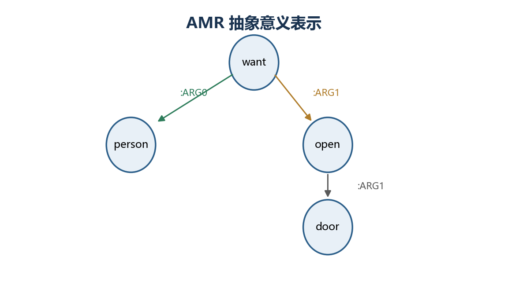

**AMR 与 SRL 的关系。** SRL 给出谓词—论元的浅层角色，AMR 给出更完整的概念图（含嵌套、共指、否定、时态等）。AMR 可视为 SRL 的深化：从"谁对谁做了什么"走向"事件—参与者—关系"的完整语义网络。AMR 解析（生成 AMR 图）是活跃研究方向，与语义解析（第 13 章）紧密相关。

**AMR 的图级评估。** AMR 预测是图而非序列，评估用**图的 F1**：设金标 AMR 图 $G^*=(V^*,E^*)$、预测图 $\hat{G}=(\hat{V},\hat{E})$，边按 (源节点概念, 关系, 目标节点概念) 三元组匹配，则

$$
\text{Precision}=\frac{|\hat{E}\cap E^*|}{|\hat{E}|},\quad \text{Recall}=\frac{|\hat{E}\cap E^*|}{|E^*|},\quad \text{AMR F1}=\frac{2\cdot\text{Precision}\cdot\text{Recall}}{\text{Precision}+\text{Recall}}, \tag{12-4}
$$

其中 $\hat{E}\cap E^*$ 为两图共有的边集合（概念与关系都需一致）。式 (12-4) 是 SRL F1（式 12-2）从"角色标签"到"图边"的自然推广：SRL 评估单谓词的论元对，AMR F1 评估整句概念图。它更严格——一条嵌套边（如"want 的 ARG1 是 open，open 的 ARG1 是 door"）错一层就丢多条边，故 AMR F1 远低于 SRL F1（通常 60–70 对 75–85），是语义解析的"硬指标"。

**例 12.4A（AMR F1 的数值算例）**　对"张三想开门"，金标 AMR 边集（4 条）：$\{(\text{want},\text{:ARG0},\text{person}),\ (\text{person},\text{:name},\text{张三}),\ (\text{want},\text{:ARG1},\text{open}),\ (\text{open},\text{:ARG1},\text{door})\}$。设模型预测 5 条边：上述 4 条全对，外加一条错边 $(\text{want},\text{:time},\text{yesterday})$（幻觉时态），则 $|\hat{E}\cap E^*|=4$，$|\hat{E}|=5$，$|E^*|=4$，$\text{Precision}=4/5=0.8$，$\text{Recall}=4/4=1.0$，$\text{AMR F1}=2\times0.8\times1.0/1.8\approx0.889$。若模型漏掉嵌套边 $(\text{open},\text{:ARG1},\text{door})$（只识别到"想开门"未展开"开门"，其余 3 条边全对、无幻觉），则 $|E^*\cap\hat{E}|=3$，$|\hat{E}|=3$，$\text{Precision}=3/3=1.0$，$\text{Recall}=3/4=0.75$，$\text{AMR F1}=2\times1.0\times0.75/(1.0+0.75)=1.5/1.75\approx0.857$。这展示了**幻觉边与漏边对 AMR F1 的不同打击方向**：多一条幻觉边压 Precision（0.889），漏一条真边压 Recall（0.857）。浅层 SRL（式 12-2）只评估单谓词的论元对，对"门"这一嵌套展开不敏感；AMR 把嵌套展开成图边，漏一层就丢真边，故对组合深度的刻画远强于 SRL——这正是"浅层语义"与"组合语义"的分界。

**边界与讨论。** AMR 的覆盖与解析准确率仍在提升；其概念对齐（不同词映射到同一概念）依赖人工定义的概念 inventory。AMR 与形式语义（第 13 章）的关系：AMR 是"浅层、实用"的语义表示，逻辑形式是"精确、可推理"的语义表示，二者针对不同需求。

## 12.5　统一案例：问答句子的语义角色

回到统一案例（第 1.8 节）。问答语料在第 12 章做语义角色标注。

**案例设定。** 问题"谁提出了相对论？"，谓词"提出"。SRL 给出：ARG0=（疑问词"谁"，待填充的答案）、ARG1=相对论。这一结构直接揭示问题的**答案类型**：ARG0 对应施事（人），故答案应为人名——这对问答系统（第 30、37 章）至关重要：知道问的是"人"，才能在候选文档中定位人名实体（第 8 章 NER）。

**表 12-3　统一案例的语义角色**

| 问题 | 谓词 | ARG0 | ARG1 | 答案类型 |
|------|------|------|------|----------|
| 谁提出了相对论？ | 提出 | 谁（疑问） | 相对论 | 人名（施事） |
| 相对论何时提出？ | 提出 | — | 相对论 | 时间（AM-TMP） |

文档"爱因斯坦在 1905 年提出了狭义相对论"经 SRL：ARG0=爱因斯坦、ARG1=狭义相对论、AM-TMP=1905 年。与问题的角色结构对齐，即可抽取答案"爱因斯坦"（第 30 章检索增强问答将进一步展开）。

这一案例将在第 13 章（逻辑形式）继续深化：把语义角色转化为可推理的逻辑形式。

## 12.6　边界与讨论

本章论述语义角色与浅层语义，须明确其边界。

**浅层与深层。** SRL 与 AMR 是"浅层语义"——它们给出事件结构，但不保证真值条件或可推理性（M4）。"张三开门"的 SRL/AMR 不说明"门"是否真实存在、事件是否发生。精确的指称与推理需逻辑形式（第 13 章）与知识（第 36 章）。具体而言，SRL/AMR 给出的是**事件骨架**（谓词—论元—关系），而逻辑形式给出**命题结构**（量词、时态、否定、模态的精确真值条件）。"张三想开门"的 AMR 表达了"张三"是"想"的施事、"开门"是"想"的内容，但不表达"开门"这一事件是否实际发生——后者是逻辑形式的辖域（第 13 章的 λ-演算与蒙太格语义学将处理这一层）。

**与句法的关系。** SRL 依赖句法（第 10、11 章）提供论元候选与路径特征，但语义角色不完全由句法决定——"开"的施事在不同句式中都是 ARG0，体现语义对句法的相对独立。这再次说明 M1（形式）与 M3（组合）既有联系又相对独立。从工程看，这种"相对独立"意味着 SRL 与句法分析可以并行建模（端到端 SRL 不再依赖显式句法树），是第 8.6 节所述流水线错误传播问题的直接缓解。

**与后续章节的联系。** 本章的语义角色将在第 13 章（组合语义：角色→逻辑形式）、第 30 章（问答：角色→答案类型）、第 36 章（信息抽取：角色→三元组）复用。统一案例的问答语料将在第 13 章做逻辑形式转换。

语义角色（M3 浅层）给出"谁对谁做了什么"。第 13 章将进一步把这种结构转化为精确的逻辑形式（M4），并讨论 Frege 组合性原则如何通过 λ-演算实现——这是从浅层语义到深层语义的关键一跃。

## 本章小结

本章论述语义角色标注与浅层语义，开启从结构到意义的组合过程。

我们首先定义谓词—论元结构与 SRL 任务（论元识别+角色分类），用"张三开门"示例展示核心与非核心论元。接着介绍两大角色体系：PropBank（ARG0–ARG5 + AM-*，动词特定、覆盖广）与 FrameNet（框架元素，语义具体、覆盖有限），并对照二者。我们概述神经 SRL 方法（端到端、基于跨度、预训练）相对于传统特征方法的优势，并介绍抽象意义表示 AMR——把句子表示为概念图，深化 SRL 的浅层角色。我们给出统一案例中问答句子的语义角色标注，展示角色结构如何揭示答案类型。

我们还明确边界：SRL/AMR 是浅层语义，不保证真值条件；语义角色依赖句法又相对独立。这些辨析衔接第 13、30、36 章。

语义角色给出"谁对谁做了什么"，第 13 章将把这种结构转化为精确的逻辑形式（M4），通过 λ-演算实现 Frege 组合性原则。下一章进入组合语义与逻辑形式，这是 M3 与 M4 的交汇，也是第三篇的理论高峰。

**进一步阅读**　本章建议延伸阅读的文献：[1]、[2]、[3]、[4]。

## 参考文献

[1] Palmer M, Gildea D, Xue N. The Proposition Bank: An annotated corpus of semantic roles. *Computational Linguistics*, 2005, 31(1): 71–106.

[2] Fillmore C J, Johnson C R, Petruck M R L. Background to FrameNet. *International Journal of Lexicography*, 2003, 16(3): 235–250.

[3] Banarescu L, Bonial C, Cai S, et al. Abstract Meaning Representation for sembanking. *ACL Workshop*, 2013.

[4] Zhou J, Xu W. End-to-end learning of semantic role labeling using recurrent neural networks. *ACL*, 2015.

[5] He L, Lee K, Lewis M, Zettlemoyer L. Deep semantic role labeling: What works and what's next. *ACL*, 2017.

[6] Jurafsky D, Martin J H. *Speech and Language Processing*. 3rd ed. Stanford, 2023.

[7] Manning C D, Schütze H. *Foundations of Statistical Natural Language Processing*. Cambridge, MA: MIT Press, 1999.

[8] Zhang S, de Marneffe M C. Identifying semantic role clusters and alignment via role-dense t-score. *NAACL*, 2015.

---

# 第 13 章　组合语义与逻辑形式

第 10–12 章从句法结构（M1）走到语义角色（M3 浅层）。本章进入第三篇的理论高峰：**组合语义与逻辑形式**，回答"如何由词的意义与组合规则，系统地把句子翻译成可推理的精确意义表示（M4）"。这是 Frege 组合性原则（第 4 章 M3）的严格实现，也是语言与逻辑、知识对接（第 36 章、《本体智能导论》）的接口。

如果说语义角色标注（第 12 章）给出"谁对谁做了什么"的浅层结构，逻辑形式则给出句子的真值条件——"这个句子在什么情况下为真"。这一表示支持严格的逻辑推理（如从"所有学生都读书"与"小李是学生"推出"小李读书"），是自然语言理解走向"可推理"的关键。组合语义的核心工具是 λ-演算（lambda calculus）与类型逻辑，它们把语义组合变成可计算的归约过程。

本章先介绍组合性原则与 λ-演算（13.1 节），再讲一阶逻辑语义与类型理论（13.2 节），重点推导语义解析——从句子到逻辑形式（13.3 节），介绍组合范畴语法 CCG（13.4 节），并在边界与讨论中收束（13.5 节）。本章是 A 类核心章，核心推导给出完整步骤。

## 13.1　组合性原则与 λ-演算

**定义 13.1（组合性原则，Frege）**　复杂表达式的意义由其组成部分的意义与组合方式决定。形式化为：若表达式 $e$ 由部分 $e_1,\dots,e_n$ 按规则 $R$ 构成，则

$$
\llbracket e\rrbracket=F_R(\llbracket e_1\rrbracket,\dots,\llbracket e_n\rrbracket), \tag{13-1}
$$

其中 $\llbracket\cdot\rrbracket$ 表示语义值，$F_R$ 为规则 $R$ 对应的语义组合函数。

组合性原则解释了语言的创造性（第 1 章）：有限词汇与规则生成无限句子，每个新句子的意义可由规则计算。第 10 章的句法树提供了组合的骨架 $R$，本章为每条句法规则配上语义函数 $F_R$。

**λ-演算基础。** λ-演算是描述抽象与函数应用的形式系统，是组合语义的核心工具。

**定义 13.2（λ-项）**　λ-项的语法：

- 变量：$x,y,z,\dots$；
- 抽象：若 $M$ 为 λ-项、$x$ 为变量，则 $\lambda x.M$ 为 λ-项（表示函数：输入 $x$ 返回 $M$）；
- 应用：若 $M,N$ 为 λ-项，则 $(M\,N)$ 为 λ-项（函数 $M$ 作用于参数 $N$）。

**β-归约（核心计算规则）：**

$$
(\lambda x.M)\,N\ \to_\beta\ M[x:=N], \tag{13-2}
$$

即把函数体中 $x$ 的所有自由出现替换为参数 $N$。

**例 13.1（β-归约手算）**　$(\lambda x.\text{like}(x,\text{mary}))\,\text{john}\ \to_\beta\ \text{like}(\text{john},\text{mary})$。函数 $\lambda x.\text{like}(x,\text{mary})$ 表示"喜欢玛丽的人"，作用于"john"得"john 喜欢玛丽"。表 13-1 给出归约步骤。

**表 13-1　β-归约示例**

| 步骤 | λ-项 |
|------|------|
| 原式 | $(\lambda x.\text{like}(x,\text{mary}))\,\text{john}$ |
| 替换 $x:=\text{john}$ | $\text{like}(\text{john},\text{mary})$ |

λ-演算使"函数—参数"的语义组合可机械计算——这正是组合性所需的。

**α-转换与 η-归约。** β-归约之外还有两条等价变换规则，共同构成 λ-项的同义改写（conversion）：

- **α-转换（重命名约束变量）**：$\lambda x.M \equiv \lambda y.M[x:=y]$，前提是 $y$ 不在 $M$ 中自由出现。例如 $\lambda x.x$ 与 $\lambda y.y$ 等价（都是恒等函数）。α-转换是避免变量捕获（variable capture）的关键：做 β-归约 $(\lambda x.M)\,N$ 时，若 $N$ 含变量 $y$ 而 $M$ 中也有自由 $y$，须先把 $M$ 的约束 $x$ 改名，再替换。
- **η-归约（扩展律）**：$(\lambda x.M\,x)\equiv M$，前提是 $x$ 不在 $M$ 中自由出现。它把"先抽象再立即应用"的冗余消去。

**定理 13.1（Church–Rosser / 菱形性质）**　λ-演算的归约是 Church–Rosser 的：若一个 λ-项可同时归约到 $N_1$ 与 $N_2$，则存在共同后继 $N_3$ 使得 $N_1\to^*N_3$ 且 $N_2\to^*N_3$。特别地，若某 λ-项有范式（normal form），则它与归约顺序无关且唯一。这保证了语义组合的**结果良定义**：无论按何种顺序做 β-归约，最终逻辑形式一致（模 α-转换）。

> 直观上，λ-项像代数表达式，β/η 归约像化简；Church–Rosser 性质保证"化简到哪一步都一样"，这正是语义解析能把任意中间推导都信任为同一逻辑形式的原因。

**例 13.1b（归约顺序无关性手算）**　项 $((\lambda x.x)(\lambda y.y))\,a$ 可先做外层 β 归约得 $(\lambda y.y)\,a\to a$，或先做内层（恒等无变化）再外层，结果同为 $a$。两条路径汇合于 $a$，体现菱形性质。

## 13.2　一阶逻辑语义与类型理论

**一阶逻辑（First-Order Logic, FOL）语义。** 用谓词、常量、变量、量词（$\forall,\exists$）与逻辑连接词（$\wedge,\vee,\neg,\to$）表示句子意义。例如"所有学生都读书"：

$$
\forall x\big(\text{student}(x)\to\exists y(\text{book}(y)\wedge\text{read}(x,y))\big). \tag{13-3}
$$

FOL 给出精确的真值条件：式 (13-3) 在"对每个学生，存在某本书被其读"的模型中为真。这使自然语言句子可被自动推理（定理证明，见《程序合成与自动推理导论》）。

**类型理论。** 为避免无意义的组合（如"书的跑步"），需要类型系统。基本类型：

- $e$：实体（entity）类型；
- $t$：真值（truth value）类型。

谓词是返回 $t$ 的函数："读书"（read）类型为 $e\to e\to t$（先作用于施事得 $e\to t$，再作用于受事得 $t$）；"学生"（student）类型为 $e\to t$；专名"john"类型为 $e$。

**定义 13.3（类型化 λ-演算）**　每个 λ-项有类型，函数 $\lambda x.M$ 类型为 $\sigma\to\tau$（若 $x$ 类型 $\sigma$、$M$ 类型 $\tau$），应用 $(M\,N)$ 要求 $M$ 类型为 $\sigma\to\tau$ 且 $N$ 类型为 $\sigma$。类型系统保证组合的良构性——这与意义五层中 M1（形式合法）到 M4（真值条件）的桥接相对应。

**例 13.2（类型驱动的语义组合）**　"john reads"：john（$e$）作用于 reads（$e\to t$）得 $t$（"john 读书"为真/假）；"reads books"：reads（$e\to e\to t$）作用于 books（$e\to t$）类型不匹配（books 应为 $e$ 才能与 reads 的第一个参数匹配）——这说明简单类型论对名词短语的处理需精化（广义量词，见 13.5 节）。

**例 13.2b（类型检查的逐步手算）**　对 "john reads books" 做类型检查，验证每步归约都良型：

| 子项 | 类型 | 说明 |
|------|------|------|
| john | $e$ | 专名 |
| reads | $e\to e\to t$ | 双谓词 |
| books | $e$ | 简型下作个体（泛指"书"这一类中的某个体） |
| reads books | $(e\to e\to t)\,e = e\to t$ | 偏函数应用，良型 |
| (reads books) john | $(e\to t)\,e = t$ | 得真值，良型 |

若把 books 强行取为 $e\to t$（谓词"是书"），则 reads books 类型不匹配——这正暴露"专名 vs 谓词"在简单类型下的处理缺口，引出广义量词。

**广义量词（Generalized Quantifier, GQ）[6]。** 上述缺口的标准解法：把名词短语统一处理为**量词**，类型 $(e\to t)\to t$，即"接受一个谓词、返回真值"。这样 john 与 books 同类型，都能与动词短语组合。形式上，名词短语 $N$ 的语义是集合的函数 $\llbracket N\rrbracket:(e\to t)\to t$：

$$
\llbracket \text{the book}\rrbracket = \lambda P.\, P(\text{book}), \qquad
\llbracket \text{every student}\rrbracket = \lambda P.\, \forall x(\text{student}(x)\to P(x)). \tag{13-4}
$$

动词短语（VP）类型 $e\to t$，与量词组合：

$$
\llbracket \text{NP}\rrbracket\,\llbracket \text{VP}\rrbracket = \llbracket \text{NP}\rrbracket(\llbracket \text{VP}\rrbracket), \tag{13-5}
$$

如 "every student reads"：$(\lambda P.\forall x(\text{student}(x)\to P(x)))\,(\lambda y.\text{read}(y))\to\beta \forall x(\text{student}(x)\to\text{read}(x))$。

GQ 把专名、定指、不定指、量化名词（"所有""大多数""有些"）纳入统一类型框架。注意"大多数学生读书"**不能**用一阶逻辑表达（"大多数"是二阶量词），需高阶逻辑——这是组合语义形式化的边界（13.5 节）。

**例 13.2c（GQ 组合手算）**　"some student reads"：some student $=\lambda P.\exists x(\text{student}(x)\wedge P(x))$，VP $=\lambda y.\text{read}(y)$，组合得 $\exists x(\text{student}(x)\wedge\text{read}(x))$。与"every"对照（$\to$ vs $\wedge$ 的差别），同一框架区分全称与存在。

## 13.3　语义解析：从句子到逻辑形式

**语义解析（semantic parsing）** 是把自然语言句子翻译成形式意义表示（如 λ-项、FOL 公式）的任务[1]。它是组合语义的工程实现。

**基于 CCG 的语义解析（Steedman 风格）。** 把句法派生与 λ-演算语义组合结合：每个词项带一个句法范畴与一个 λ-项语义，句法组合规则（如函数应用）触发语义的 β-归约，最终得到整句的 λ-项，再化简为逻辑形式。

**组合过程示例。** 句子"john reads books"，词汇语义：

- john：$\lambda P.P(\text{john})$（广义量词形式，类型 $(e\to t)\to t$）；
- reads：$\lambda x.\lambda y.\text{read}(y,x)$（类型 $e\to e\to t$，注意论元顺序）；
- books：$\lambda P.\forall z(\text{book}(z)\to P(z))$。

组合（函数应用 + β-归约）：

$$
\begin{aligned}
\text{reads books}&:\ (\lambda x.\lambda y.\text{read}(y,x))(\lambda P.\forall z(\text{book}(z)\to P(z)))\\
&\to_\beta \lambda y.\forall z(\text{book}(z)\to\text{read}(y,z)),\\
\text{john reads books}&:\ (\lambda P.P(\text{john}))(\lambda y.\forall z(\text{book}(z)\to\text{read}(y,z)))\\
&\to_\beta \forall z(\text{book}(z)\to\text{read}(\text{john},z)).
\end{aligned} \tag{13-6}
$$

最终逻辑形式："对所有 z，若 z 是书，则 john 读 z"——精确的真值条件。式 (13-6) 展示了组合语义的完整推导：句法组合驱动 β-归约，逐步构建逻辑形式。这是 A 类核心推导。

**例 13.3（统一案例的逻辑形式）**　问题"谁提出了相对论？"的语义解析：疑问词"谁"译为 λ-项 $\lambda x.\text{propose}(x,\text{relativity})$，逻辑形式为 $\lambda x.\text{propose}(x,\text{relativity})$——一个开放公式，答案是使公式为真的 $x$。文档"爱因斯坦提出了相对论"译为 $\text{propose}(\text{einstein},\text{relativity})$。问答系统（第 30 章）通过匹配逻辑形式，把 $x$ 绑定为 einstein。这把第 12 章的语义角色（"谁"=ARG0 施事）转化为可执行的查询。

**神经语义解析。** 传统语义解析依赖人工编写的文法与词汇语义（CCG 词典），覆盖有限。神经语义解析[2]用序列到序列模型（第 17 章）直接把句子翻译成逻辑形式，端到端学习，泛化更强，但可解释性与组合性较弱。大模型时代，用 LLM 生成逻辑形式（或 SQL、代码）成为新范式（第 37 章、第 29 章）。

**表 13-2　语义解析三条技术路线对照**

| 维度 | 基于文法（CCG/λ 演算） | 神经 seq2seq | LLM 生成 |
|------|------|------|------|
| 组合性 | 显式、可证明 | 隐式、学自数据 | 隐式、依赖规模 |
| 词汇覆盖 | 受词典限制 | 词表内可、词表外难 | 极强（开放词表） |
| 可解释性 | 高（每步推导可见） | 低（黑盒映射） | 中（可给推理链，但不可靠） |
| 泛化（新结构） | 弱（需新规则） | 中 | 强（少样本即可） |
| 精确度（逻辑形式） | 高（受歧义限制） | 中 | 中（易幻觉） |
| 典型代表 | Steedman 1989/2000 | Dong & Lapata 2016 | 第 29、30、37 章 |

三条路线并非替代而是互补：文法路线给出"如何正确组合"的理论，神经路线给出"如何规模化"的工程，LLM 路线给出"如何开放域"的能力。组合语义的理论价值在于为后两者提供可校验的中间表示（逻辑形式）。

> 【图 13-1　λ-演算组合推导】（原图见 figures/图13-1.png）：从词项 λ-项经函数应用与 β-归约到整句逻辑形式的流程图。
>
> 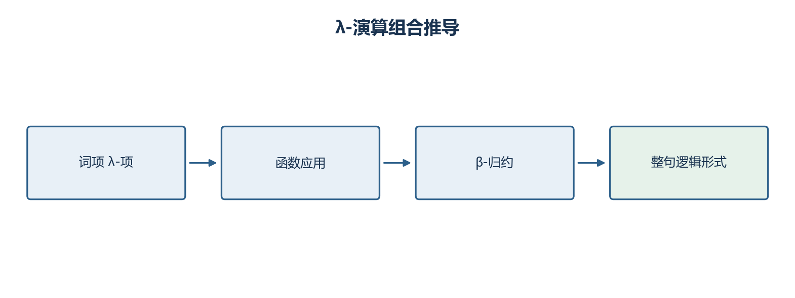

**边界与讨论。** 语义解析的难点：① 词汇语义覆盖（每个词需 λ-项）；② 歧义（一句多逻辑形式）；③ 广义量词、时态、情态等形式化难题。第 13.4 节的 CCG 与 13.5 节的讨论将触及这些。

## 13.4　组合范畴语法（CCG）

**定义 13.4（组合范畴语法，CCG）**　CCG[3] 是一种词汇化的类型逻辑文法：把大量句法信息编码在词项的**范畴**（category）中，用少量通用组合规则（函数应用、组合、类型提升）驱动推导，同时通过语义的 λ-演算同步组合语义。

CCG 的核心特点：

- **词汇化**：句法范畴附在词项上（如"reads"的范畴为 $(S\backslash NP)/NP$：先向右取 NP 作宾语，再向左取 NP 作主语，得 S）；
- **通用组合规则**：函数应用（$X/Y\;Y\Rightarrow X$、$Y\;X\backslash Y\Rightarrow X$）等，无需大量短语结构规则；
- **句法—语义同步**：每个范畴配 λ-项，组合时语义同步归约（13.3 节）；
- **处理长距离依赖**：组合规则与类型提升可自然刻画抽取、并列等结构。

**例 13.4（CCG 推导）**　"john reads books"：

- john：$NP:\lambda P.P(\text{john})$；
- reads：$(S\backslash NP)/NP:\lambda x.\lambda y.\text{read}(y,x)$；
- books：$NP:\lambda P.\forall z(\text{book}(z)\to P(z))$。

先 reads 与 books 经 $(X/Y)\;Y\Rightarrow X$ 组合得 $S\backslash NP:\lambda y.\forall z(\text{book}(z)\to\text{read}(y,z))$；再与 john（经类型提升为 $S/(S\backslash NP)$）组合得 $S:\forall z(\text{book}(z)\to\text{read}(\text{john},z))$。与式 (13-6) 一致。

**例 13.4b（类型提升手算）**　john 原本是 $NP$，无法直接与 $S\backslash NP$（需要主语）组合。类型提升（type raising）把它改写为 $S/(S\backslash NP):\lambda Q.Q(\text{john})$——"接受一个'缺主语的句子'、把 john 填进去"。再经函数应用 $S/(S\backslash NP)\;(S\backslash NP)\Rightarrow S$ 与 $\lambda y.\forall z(\text{book}(z)\to\text{read}(y,z))$ 组合：$(\lambda Q.Q(\text{john}))(\lambda y.\forall z(\text{book}(z)\to\text{read}(y,z)))\to_\beta \forall z(\text{book}(z)\to\text{read}(\text{john},z))$。类型提升是把专名"升格"为句法组合的通用手段，也是 CCG 处理长距离依赖（抽取、并列）的基础。

**边界与讨论。** CCG 优雅地统一句法与语义，在语义解析与机器翻译中应用广泛；但 CCG 词典的词汇范畴标注成本高，且组合规则爆炸（过多组合导致歧义）。神经 CCG 超解析（super-tagging）用模型预测范畴，缓解了这一问题。

## 13.5　边界与讨论

本章把组合性原则严格实现为 λ-演算与逻辑形式，须明确其边界。

**组合性的边界。** Frege 组合性原则虽强大，却面临挑战：① 习语（"kick the bucket"=去世）的整体意义非组成部分之和；② 隐喻、转喻；③ 上下文依赖的省略与指代（第 14 章）。这些现象指向语用层（M5），超出纯组合语义的能力。

**形式化的边界。** 一阶逻辑与 λ-演算给出精确意义，却难以自然处理：广义量词（"大多数学生"）、时态（"曾经""将会"）、情态（"可能""必须"）、内涵语境（"相信"）。这些需更复杂的逻辑（高阶逻辑、模态逻辑、类型逻辑语法），超出本书范围，见《本体智能导论》《程序合成与自动推理导论》。

**与神经网络的关系。** 神经模型（第 20、21 章）不显式做组合语义，却能从数据中学到组合模式。组合性与神经网络的关系是活跃研究：神经模型是否"真正"组合（第 29 章的组合泛化讨论）？符号组合（本章）与神经表示（第 7 章）能否统一（神经—符号，见《本体智能导论》）？这些问题关乎通用智能的本质（第 42 章）。

**与后续章节的联系。** 本章的逻辑形式将在第 36 章（知识对齐：逻辑形式→知识图谱查询）、第 30 章（问答：逻辑形式→可执行查询）、《程序合成与自动推理导论》（定理证明）中深化。语义角色（第 12 章）到逻辑形式（本章）的转化，是 M3 到 M4 的完整路径。组合语义的神经版本将在第 29 章（大模型推理）与第 42 章（通用智能）讨论。

**量词辖域的歧义。** 组合语义的一个核心难点是**辖域歧义（scope ambiguity）**：多个量词的句子，其逻辑形式随量词的嵌套顺序不同而改变真值条件。例如"每个经理批评了一个员工"可解析为：

$$
\forall x(\text{mgr}(x)\to\exists y(\text{emp}(y)\wedge\text{crit}(x,y))) \quad(\text{每个经理各自有某员工}) \tag{13-7}
$$

或

$$
\exists y(\text{emp}(y)\wedge\forall x(\text{mgr}(x)\to\text{crit}(x,y))) \quad(\text{同一员工被所有经理批评}) \tag{13-8}
$$

两句自然语言完全相同，逻辑形式却不同——这是组合语义"一句多逻辑形式"的实例（13.3 节所述歧义②的具体化）。在推理中两者不等价：若某公司只有一位员工，式 (13-7) 为真而式 (13-8) 也可为真；但在多员工场景下两者可能一真一假。语义解析系统需输出**多个**候选逻辑形式并标注辖域，由下游推理消歧——这正是第 30 章问答系统要处理的歧义消解问题。

第三篇（第 10–14 章）即将完成：从句法结构（第 10、11 章），到语义角色（第 12 章），到组合语义与逻辑形式（本章），我们走完了从"结构"到"精确意义"的路径。下一篇（第四篇）将回到语言建模，从统计 N-gram 到神经网络，展示另一条"不经过显式语义"的意义建模路径（M2）——两条路径的张力与汇合，将在预训练与大模型篇章（第五、六篇）达到高潮。

## 本章小结

本章论述组合语义与逻辑形式，是第三篇的理论高峰与 A 类核心章。

我们首先阐述 Frege 组合性原则（式 13-1）与 λ-演算（β-归约，式 13-2），给出手算示例。接着介绍一阶逻辑语义与类型理论（实体类型 $e$、真值类型 $t$、类型化 λ-演算），说明真值条件与类型驱动的组合。我们重点推导语义解析：以 CCG 风格展示从词项 λ-项经函数应用与 β-归约到整句逻辑形式的完整过程（式 13-6，"john reads books"），并以统一案例的问句为例，把第 12 章的语义角色转化为可执行的逻辑查询。我们介绍组合范畴语法 CCG 的词汇化范畴与通用组合规则，并讨论神经语义解析的兴起。

我们还明确边界：组合性受习语、隐喻、语境挑战；形式化难以处理广义量词、时态、情态；符号组合与神经表示的关系关乎通用智能。这些辨析衔接第 14、29、30、36 章与系列其他书。

本章的核心推导（β-归约、语义解析式 13-6、CCG 推导）体现了 A 类深度。逻辑形式给出精确意义（M4），支持推理与知识对齐。第三篇的最后一章（第 14 章）将进入语篇与指代，处理超越句子的语境与语用意义（M5）。

**进一步阅读**　本章建议延伸阅读的文献：[1]、[3]、[4]、[5]。

## 参考文献

[1] Zelle J M, Mooney R J. Learning to parse database queries using inductive logic programming. *AAAI*, 1996.

[2] Dong L, Lapata M. Language to logical form with neural attention. *ACL*, 2016.

[3] Steedman M. *The Syntactic Process*. Cambridge, MA: MIT Press, 2000.

[4] He W, Zettlemoyer L, Dartmann F. CCG parsing. In: *Handbook of Contemporary Semantic Theory*. Wiley, 2015.

[5] Carpenter B. *Type-Logical Semantics*. Cambridge, MA: MIT Press, 1997.

[6] Montague R. The proper treatment of quantification in ordinary English. In: Hintikka K J J, ed. *Approaches to Natural Language*. Dordrecht: Reidel, 1973.

[7] Jurafsky D, Martin J H. *Speech and Language Processing*. 3rd ed. Stanford, 2023.

[8] Partee B H, ter Meulen A, Wall R E. *Mathematical Methods in Linguistics*. Dordrecht: Kluwer, 1990.

---

# 第 14 章　语篇与指代消解

第 10–13 章从句法结构（M1）走到语义角色与逻辑形式（M3、M4），这些都以**单个句子**为单位。但自然语言理解常在**语篇**（discourse）层面展开：多个句子相互关联，指代跨越句子边界，意义依赖上下文。本章进入意义五层的最高层 M5——语用意义，讨论**语篇与指代消解**：理解"它""前者""那家公司"等指代表达指向语篇中的哪个实体，以及会话含义、篇章结构如何塑造意义。

指代消解是统一案例（第 1.8 节）之外的另一核心能力，也是问答（第 30、37 章）与对话（第 37 章）的关键：多轮问答中，"它为什么失败？"的"它"需从上一轮找回指代对象。没有指代消解，系统无法处理连续话语。本章先介绍共指消解与指代（14.1 节），再讲篇章结构与衔接（14.2 节），讨论语用含义与会话含义（14.3 节），介绍端到端共指消解系统（14.4 节），并在边界与讨论中收束（14.5 节）。

## 14.1　共指消解与指代

**定义 14.1（指代与共指）**　指代（reference）是用一个语言表达式指向语篇中的实体。指代表达（mention）分三类：

- **名词短语指代**：如"爱因斯坦""那位科学家""他"；
- **代词指代**：如"他""它""这"；
- **零指代**：省略主语（中文常见），如"（他）昨天来了"。

**共指（coreference）** 指两个指代表达指向同一实体。例如"爱因斯坦提出了相对论。他因此成名。"中，"爱因斯坦"与"他"共指（指向同一人）。

指代有**方向**之分：**逆指（anaphora）**指向已提及的实体（最常见，"他"指前文的"爱因斯坦"）；**顺指（cataphora）**指向尚未出现、随后才引出的内容（"这一事实很重要：公司亏损"中"这一事实"顺指后面的句子）。中文还有大量**零指代**（省略主语）与**泛指**（"人们""大家"），它们没有显式先行词，须从篇章角色与常识推断，是跨语言共指消解（尤其汉语、日语）中比英语更棘手的子类。

**定义 14.2（共指消解）**　共指消解任务是识别语篇中所有指向同一实体的指代表达，并把它们聚成**共指链**（coreference chain）。例如上句的共指链为 {爱因斯坦, 他}。

共指消解与第 12 章语义角色的区别：语义角色在单句内标注论元角色，共指消解跨句子把指代表达链接到实体。共指消解为逻辑形式（第 13 章）中的变量绑定提供实体，是语篇级语义理解的基础。

**例 14.1（共指链）**　"张三开了一家公司。他聘请了小李。后者负责销售。"其中："张三"与"他"共指（同一人）；"公司"被后续"它"（若有）指代；"小李"与"后者"共指。识别这些链，才能正确理解"谁负责销售"（小李）。

**定义 14.3（共指消解的概率形式）**　对指代表达 $m_j$ 与候选先行词 $m_i$（$i<j$），"二者共指"记为假设 $H_{ij}$，后验概率为

$$
P(H_{ij}\mid D)=\frac{P(D\mid H_{ij})\,P(H_{ij})}{\sum_{k\ne j}P(D\mid H_{kj})\,P(H_{kj})}, \tag{14-1}
$$

其中 $D$ 为特征证据（性别数一致、句法角色、中心度、距离、语义相似度等），$P(H_{ij})$ 为先验（如"指代 c 中心"的先验更高）。式 (14-1) 把"共指与否"变成可计算的判别问题：候选集内按后验归一化，取最大者为消解结果（14.4 节给出手算）。

**表 14-1　指代类型与消解难点**

| 类型 | 例 | 难点 |
|------|----|------|
| 代词 | 他、它、这 | 高度歧义，依赖语境 |
| 名词短语 | 那位科学家 | 需识别与先行词的关系 |
| 零指代 | （他）来了（中文） | 无显式形式，需推断 |
| 共指 | 爱因斯坦…他 | 跨句链接 |

**中心理论（Centering Theory）。** 中心理论[9]是解释指代"易解析性"的经典理论，也是把语用直觉形式化为打分特征（14.4 节）的源头。它把每个句子处理后的**指代状态**（accessibility 集合）按"中心度"排序，并区分三类中心：

- **c 中心（center of the center）**：集合中中心度最高者，通常是当前句主语；
- **n 中心**：下一句将作为 c 中心的候选，默认继承上一句的 c 中心；
- **f 中心**：其余仍活跃（accessible）的指称。

核心预测：**代词倾向于指向上句的 c 中心**，全称名词倾向于引入新实体。该预测可由语料中的指代分布经验支持，也是后续统计/神经模型的重要先验。

**例 14.2（中心状态演化）**　"张三开了一家公司。他聘请了小李。"处理第一句后，状态为 {张三(c), 公司(f)}；"他"按中心理论应指向上句 c 中心"张三"——与直觉一致。处理第二句后，状态更新为 {小李(c), 张三(f), 公司(f)}：新引入的名词短语"小李"因担任主语而成为新的 c 中心。若下一句出现"它"，则应指向 f 中心的"公司"。中心预测因此可作为共指打分（式 14-3）的先验：候选若为 c 中心，先验更高。

## 14.2　篇章结构与衔接

语篇不仅是句子的线性序列，还有结构组织。篇章语言学（discourse linguistics）研究句子如何连接成连贯整体。

**衔接（cohesion）与连贯（coherence）。** 衔接是语篇的形式连接手段（指代、省略、连接词、词汇复现）；连贯是语篇的语义—语用整体一致性。Halliday 与 Hasan[1] 的衔接理论指出，指代是核心衔接手段之一。

**篇章关系（discourse relations）。** 句子间存在语义关系：因果（"因为…所以…"）、转折（"虽然…但是…"）、时序、让步、例证等。PDTB（Penn Discourse Treebank）[2] 是篇章关系标注资源。识别篇章关系有助于理解语篇的论证结构，是文本理解与摘要的关键。

**例 14.3（篇章关系的意义）**　"产品销量上升。公司决定扩大生产。"两句间的因果/动机关系（因销量上升，故扩大生产）是理解的关键，但句中无显式连接词——需依据常识与语境推断（M5）。一个简单的"句子拼接"系统无法捕捉这种关系。

**修辞结构理论（RST）。** RST[12]是篇章关系的主流形式理论：语篇被递归地组织为**片段**（span），相邻片段通过一个**核**（nucleus，主要信息）与一个**卫星**（satellite，从属信息）的二元关系连接，如"销量上升"是核、"扩大生产"是卫星，关系为 RESULT。RST 共定义了四十余种关系类型，覆盖因果、对比、解释、例证、转折等，其层次化结构使语篇可作"语义语法树"解析。

**表 14-4　常见篇章关系类型（RST/PDTB）**

| 关系 | 核—卫星方向 | 例（核→卫星） |
|------|------------|--------------|
| 因果/结果 | 原因→结果 | "销量上升"→"扩大生产" |
| 对比 | 对照项→对照项 | "北京"→"上海更拥堵" |
| 转折 | 预期→反预期 | "他很聪明"→"考试却失利" |
| 解释 | 被解释→解释 | "系统宕机"→"内存溢出" |
| 例证 | 主张→例证 | "水果富含维生素"→"如橙子" |
| 时序 | 先→后 | "他离开"→"灯灭了" |

RST 与 PDTB（[2]）互补：PDTB 是大规模标注资源，RST 是其理论骨架。篇章关系识别（discourse relation classification）是摘要、论证挖掘与多跳问答（第 30 章）的底层能力——它决定"哪些句子可合并、哪些是支撑、哪些是对立"。

**语篇表示理论（DRT）。** DRT[3] 用语篇表示结构（DRS）形式化语篇语义：每个句子向 DRS 引入新的话语指称（discourse referent）与条件，后续句子可引用这些指称。DRT 严格处理了代词跨句指代与不定名词的语义（如"A man entered. He sat."中"He"绑定到前句引入的 man），是 M4 与 M5 桥梁的形式理论。

**边界与讨论。** 篇章结构与连贯高度依赖常识与语境（第 40 章），是当前 NLP 的难点。神经模型（第 21 章）能通过上下文隐式捕捉部分篇章关系，但显式篇章解析仍在研究中。

## 14.3　语用含义与会话含义

**定义 14.4（会话含义，Grice）**　Grice[4] 的会话含义理论指出：说话者常违反会话合作原则（数量、质量、关系、方式准则）以传达"言外之意"。会话含义（conversational implicature）是听者依据合作原则推断出的超出字面意义的内容。

Grice 的合作原则四准则：

- **数量准则**：提供所需信息量（不多不少）；
- **质量准则**：不说虚假或缺乏证据的话；
- **关系准则**：话语要相关；
- **方式准则**：清晰、简洁、避免歧义。

违反准则产生会话含义。

**例 14.4（会话含义的推断）**　甲："你觉得这部电影怎么样？"乙："特效做得不错。"乙违反数量准则（未直接评价整体），隐含"但剧情可能不好"（会话含义）。字面语义（M1–M4）只是"特效不错"，语用含义（M5）却是对电影的保留评价。一个只做字面理解的系统会错失这一含义。

**标量含义。** 会话含义的一个规则子类是**标量含义（scalar implicature）**：使用量化词等级 $\langle$至少, 恰好, 所有$\rangle$ 的弱成员，产生"不是更强成员"的言外之意。

**例 14.5（标量含义手算）**　"三个孩子都来了"中的"都"对应"所有"，其较弱成员是"至少有一个"。由数量准则（不说弱于可用的话），听者推断：若全部来了说话者会说"都"，故用"三个"而非"有些"意味着"其余没来"。形式上，若 $n_{\text{来}}$ 为实际到来数，字面只约束 $n_{\text{来}}\ge3$，标量含义把它收紧为 $n_{\text{来}}=3$——M1–M4 仅给出前者。

**关联理论。** 关联理论[10]把会话含义的推理一般化：交际成功当且仅当话语产生足够的**认知效果**（与背景假设结合的推论）而**处理代价**足够小。

**定义 14.5（关联，Sperber 与 Wilson）**　话语 $u$ 对听者关联，当且仅当

$$
\frac{\text{认知效果}(u\mid B)}{\text{处理代价}(u)} \ge \theta, \tag{14-2}
$$

其中 $B$ 为听者背景假设集，$\theta$ 为关联阈值。"特效做得不错"若按字面（仅正面评价特效）关联度不足（回答"怎么样"需要整体评价），听者被迫补充"其余部分平庸"的推论以满足式 (14-2)——会话含义由此产生。式 (14-2) 把"言外之意"刻画为**关联度最大化下的推断**，与 Grice 准则互为补充。

**言语行为（speech acts）。** Searle[5] 的言语行为理论指出，说话不仅是描述，更是**行动**：承诺、请求、命令、宣告等。例如"今天真冷"在特定语境下是请求关窗（例 4.5）。言语行为理论是对话系统（第 37 章）与语言智能体的基础——理解用户话语的"以言行事"之力（illocutionary force）。

**例 14.6（言语行为在对话中）**　"你能把窗户关上吗？"字面是询问能力（能否关窗），言语行为却是**请求**（关窗）。对话系统需识别请求意图并执行（第 37 章工具调用），而非回答"能"。这体现了 M5 语用意义对 Level 4 语言交互的核心作用。

**边界与讨论。** 语用含义与言语行为高度依赖语境、常识与心智理论（见《认知智能导论》《社会智能与群体决策导论》），难以从文本形式计算。大模型（第 26 章）在语用任务上表现惊艳，但其是否"真正理解"仍在争论（第 29、31 章）。

## 14.4　端到端共指消解系统

**共指消解的方法演进。**

- **规则/启发式方法**：基于代词类型、性数一致、距离、句法约束（如 Binding Theory），覆盖有限；
- **统计方法**：用成对打分或聚类模型，学习指代表达间的共指概率[6]；
- **神经方法**：用上下文表示（第 7、21 章）为指代表达打分，端到端聚类；SpanBERT[7] 等预训练模型显著提升性能；
- **生成式方法**：大模型直接生成共指链，少样本能力强。

**定义 14.6（共指消解的形式化）**　给定语篇中的指代表达集 $\mathcal{M}=\{m_1,\dots,m_n\}$，共指消解把它们划分为若干共指链 $\{C_1,\dots,C_k\}$（每链内表达共指，链间不共指）。常用方法是为每对 $(m_i,m_j)$ 打分 $s(i,j)$，再聚类。

**例 14.7（成对打分）**　对"爱因斯坦提出相对论。他因此成名"，模型为("爱因斯坦","他")打高分（共指），为("相对论","他")打低分（不共指）。聚类后得 {爱因斯坦, 他} 与 {相对论}（单元素链）。

**定义 14.7（成对共指打分）**　成对法把每个候选对 $(m_i,m_j)$ 的特征向量 $\boldsymbol{\phi}(m_i,m_j)$（性别数一致、句法角色、中心度、距离、嵌入余弦等）送入可学习模型：

$$
s(i,j)=\sigma\!\left(\mathbf{w}^\top\boldsymbol{\phi}(m_i,m_j)+b\right)\in(0,1), \tag{14-3}
$$

其中 $\sigma$ 为 sigmoid。$s$ 即式 (14-1) 后验的近似（特征独立、取对数线性），取 $s\ge 1/2$ 判定共指，再做连通分量聚类（链内全连接）。式 (14-3) 把语用直觉（中心理论先验、性数一致）编码为特征，是统计法（[6]）与神经法（SpanBERT[7]，$\boldsymbol{\phi}$ 换成上下文表示）的共同骨架。

**例 14.8（后验手算）**　设代词"他"有三个候选先行词 $m_1$（男，c 中心，近）、$m_2$（男，f 中心，远）、$m_3$（女）。给特征：$m_1$（性数一致✓、c 中心✓、距离 1 句）、$m_2$（性数一致✓、f 中心、距离 3 句）、$m_3$（性数不一致✗）。取朴素贝叶斯似然/先验：

- $P(H_{1j})=0.5$（c 中心先验高），$P(D\mid H_{1j})=0.8\times0.9\times0.7=0.504$；
- $P(H_{2j})=0.3$，$P(D\mid H_{2j})=0.8\times0.4\times0.3=0.096$；
- $P(H_{3j})=0.1$（性别不符，先验已极低），$P(D\mid H_{3j})=0.05$。

归一化因子 $Z=0.504\times0.5+0.096\times0.3+0.05\times0.1=0.252+0.0288+0.005=0.2858$，故

$$
P(H_{1j})=\frac{0.252}{0.2858}\approx0.882,\quad
P(H_{2j})\approx0.101,\quad
P(H_{3j})\approx0.018.
$$

"他"判给 $m_1$（后验 0.882），与中心理论"指代 c 中心"一致。手算显示：先验（中心度）与特征（性数）共同决定后验，$m_3$ 因性别不符先验极低被排除——这正是式 (14-1) 把语用规则变成可计算打分的价值。

**表 14-2　共指消解方法对照**

| 方法 | 代表 | 优势 | 局限 |
|------|------|------|------|
| 规则 | Binding 理论 | 可解释 | 覆盖有限 |
| 统计 | 成对模型 | 数据驱动 | 特征工程 |
| 神经 | SpanBERT | 表示强 | 需数据 |
| 生成式 | LLM | 少样本 | 可控性 |

**表 14-3　共指消解常用特征族（成对/神经法）**

| 特征族 | 典型特征 | 作用 |
|--------|----------|------|
| 语法 | 性别、数、人称作一致；先/后置距离 | 硬约束过滤（性别不符则 $s\approx0$） |
| 句法 | 先行词句法角色（主语/宾语）、共指跨度 | 主语更易被指代（中心理论） |
| 语用 | 是否 c 中心、n 中心、f 中心 | 先验（中心理论 [9]） |
| 词汇/语义 | 嵌入余弦相似度、同现 | 语义相近更易共指 |
| 语篇 | 同段/异段、句间距离、新实体标记 | 长距离/新实体倾向 |

**评估指标。** 共指链是"集合的集合"，评估需对链集合做匹配。经典指标：

- **MUC 精度/召回/F1**：以"链接"为单位，逐条判断两指代表达的链内关系，计算简单但假设链内全连接，对嵌套链敏感；
- **B³ 指标**[8]：对每个指代表达，用"与金标准链中同链成员的比例"作软匹配，更稳健，是 SpanBERT 等采用的主指标；
- **CEAF**：按共指集合（cluster）做最大匹配，兼顾链内与链间。

**例 14.9（MUC 与 B³ 的差别）**　设金标准链 $\{a,b,c\}$，系统输出 $\{a,b\},\{c\}$。MUC 视角：$c$ 与 $a$ 同链（TP），$c$ 与 $b$ 同链（TP），系统把 $c$ 单独成链，相对金标准 $\{a,b,c\}$ 漏了两条链内连接，召回下降；B³ 视角：$c$ 的链中只有 $a,b$（$2/3$），$a,b$ 的链中 $a,b$ 占 $2/2$ 加 $c$ 的 $1/3$，软匹配给出更高、更平滑的分数——B³ 不惩罚"少连一条"而只惩罚"错链"，故更适合长链密集语料。这一差别解释了为何同一模型在不同指标下分数差异可观。

**边界与讨论。** 共指消解的性能受指代表达识别（mention detection）影响；长语篇的计算复杂度高（$O(n^2)$ 成对打分，可用 top-k 邻居裁剪到近线性）；跨语言与领域泛化有限（第 25、39 章）。中文零指代与代词混用（"他/它/其/之"）使性数特征失效，须依赖语义与篇章线索——是中文共指消解区别于英文的核心难点。

## 14.5　边界与讨论

本章进入语用层（M5），须明确其边界。

**语用与语义的边界。** 语义（M3、M4）关注"字面意义"，语用（M5）关注"语境中的意义"。二者难以截然分开：指代消解既涉及语义（实体），也涉及语用（语境）。本书把指代、篇章关系、会话含义置于 M5，是为了强调其语境依赖，而非否认其语义面。

**计算的可行性。** 语用意义依赖常识、心智理论与社会语境，难以纯从文本计算。神经模型（第 21、26 章）通过大规模数据隐式学习语用模式，但其可靠性与可解释性仍是开放问题（第 29、31 章）。

**从中心理论到神经方法的连续谱。** 把本章的方法放在一条轴上：规则法（Binding、中心理论）把语用规则写死为硬约束；统计法（成对打分，式 14-3）把规则软化为可学习权重，式 (14-1) 的后验是二者共享的概率内核；神经法把 $\boldsymbol{\phi}$ 换成上下文嵌入，让网络从数据中自己发现"性数—角色—中心度"的交互；生成式（LLM）进一步把"消解"改写为"生成共指链"，以少样本能力跨过标注瓶颈。四者并非替代而是叠层：SpanBERT 内部仍隐式编码了中心理论与性数约束，大模型的高质量共指表现正是这些语用先验在海规模语料中被统计出来的结果。理解这条连续谱，才能明白"端到端"并不意味着"丢弃语言学"——语用理论提供了特征、先验与评估标准，神经网络提供的是容量与泛化。

**与后续章节的联系。** 本章的共指消解与篇章关系将在第 30 章（多跳问答需跨句指代）、第 37 章（对话状态跟踪需指代）、第 39 章（篇章级应用）复用。会话含义与言语行为将连接到第 37 章（语言智能体的意图理解）与第 40 章（语言与思维）。语用层是第 42 章讨论"语言能否通向通用智能"的关键——通用智能需理解语境与意图，而非仅处理字面意义。

第三篇（第 10–14 章）至此全部完成：从句法结构（M1，第 10、11 章），到语义角色（M3 浅层，第 12 章），到逻辑形式（M4，第 13 章），到语篇与语用（M5，本章），我们走完了从"结构"到"语境中的意义"的完整路径。这是意义五层框架（M1–M5）的逐层展开。

但这是"通过显式分析理解语言"的路径。第四篇（第 15–19 章）将展示另一条路径：**语言建模**——不显式做句法语义分析，直接用统计/神经网络建模词的概率分布，让"意义"隐含在分布中（M2）。两条路径将在第五、六篇（预训练与大模型）汇合。

## 本章小结

本章论述语篇与指代消解，进入语用层（M5），完成第三篇。

我们首先定义指代与共指，把共指消解形式化为把指代表达聚成共指链的任务，并区分代词、名词短语、零指代等类型。接着介绍篇章结构与衔接（衔接 vs 连贯、篇章关系、DRT），说明语篇的语义—语用组织。我们重点讨论语用含义与会话含义：Grice 合作原则四准则及违反准则产生的言外之意，以及 Searle 的言语行为理论（以言行事），并通过"关窗"示例展示 M5 对 Level 4 交互的核心作用。我们概述端到端共指消解系统的方法演进（规则→统计→神经→生成式）与成对打分形式化。

我们还明确边界：语用与语义难以截然分开，语用意义的计算依赖常识与心智理论，神经模型的可靠性仍是开放问题。我们把中心理论、关联理论、会话含义与成对打分（式 14-1、14-2、14-3）统一在"语用先验 + 贝叶斯后验"的概率框架下，并指出其到神经/生成式方法的连续谱。这些辨析衔接第 30、37、39、40、42 章。

第三篇至此完成，我们走完了从结构（M1）到语境意义（M5）的显式分析路径。下一篇将展示另一条路径——语言建模（M2），不经过显式语义分析而直接建模词的概率分布。两条路径将在预训练与大模型篇章汇合。下一章从 N-gram 统计语言模型（第 15 章）开始。

**进一步阅读**　本章建议延伸阅读的文献：[1]、[3]、[4]、[7]、[9]、[10]、[11]、[12]。

## 参考文献

[1] Halliday M A K, Hasan R. *Cohesion in English*. London: Longman, 1976.

[2] Prasad R, Miltsakaki E, Dinesh N, et al. The Penn Discourse TreeBank 2.0. *LREC*, 2008.

[3] Kamp H, Reyle U. *From Discourse to Logic*. Dordrecht: Kluwer, 1993.

[4] Grice H P. Logic and conversation. In: Cole P, Morgan J L, eds. *Syntax and Semantics*, Vol. 3. New York: Academic Press, 1975.

[5] Searle J R. *Speech Acts: An Essay in the Philosophy of Language*. Cambridge: Cambridge University Press, 1969.

[6] Soon W M, Ng H T, Lim D C Y. A machine learning approach to coreference resolution of noun phrases. *Computational Linguistics*, 2001, 27(4): 521–544.

[7] Joshi M, Chen D, Liu Y, Zettlemoyer L. SpanBERT: Improving pre-training by representing and predicting spans. *Transactions of the ACL*, 2020, 8: 64–77.

[8] Jurafsky D, Martin J H. *Speech and Language Processing*. 3rd ed. Stanford, 2023.

[9] Grosz D, Joshi M, Weinstein S. Centering: A framework for modeling the local coherence of discourse. *Computational Linguistics*, 1995, 21(2): 209–243.

[10] Sperber D, Wilson D. *Relevance: Communication and Cognition*. 2nd ed. Cambridge, MA: Harvard University Press, 1995.

[11] Bagga A, McAllester D. Some simple approaches to coreference resolution. *Proceedings of the Seventh Workshop on Very Large Corpora (ACL-VLC)*, 1999: 262–273.

[12] Mann W C, Thompson S A. Rhetorical structure theory: Toward a functional theory of text organization. *Text*, 1988, 8(3): 243–281.

---

# 第 15 章　N-gram 与统计语言模型

第三篇走完了"显式分析语言"的路径（句法→语义→语用）。第四篇转向另一条路径：**语言建模**——不显式做句法语义分析，直接用统计/神经网络建模词序列的概率分布 $P(w_{1:T})$，让"意义"隐含在分布中（M2）。这条路径始于 N-gram 统计语言模型，历经神经语言模型（第 16 章）、序列到序列（第 17 章）、机器翻译（第 18 章），在预训练前夜（第 19 章）达到高潮，然后在 Transformer 与预训练（第五篇）中大放异彩。

N-gram 模型是语言建模的基准线，至今仍是许多任务（语音识别、输入法、机器翻译）的可靠组件。它以马尔可夫假设近似第 3 章的链式分解，用极大似然估计概率，用平滑技术处理数据稀疏。理解 N-gram，是理解一切现代语言模型（第 16、21、26 章）的起点。本章也是统一案例（第 1.8 节）中"N-gram 语言模型"工序所在。

本章先介绍语言模型的定义与用途（15.1 节），再讲 N-gram 与马尔可夫假设（15.2 节），重点推导平滑方法（15.3 节），给出困惑度评估（15.4 节），并在边界与讨论中收束（15.5 节）。

## 15.1　语言模型的定义与用途

**定义 15.1（语言模型）**　语言模型（language model, LM）是词序列的概率分布 $P(w_1,\dots,w_T)$。给定前缀 $w_{<t}=w_1\dots w_{t-1}$，它给出下一个词的概率分布 $P(w_t\mid w_{<t})$。一个合格的语言模型需满足：① 对任意序列，概率非负且 $\sum_{w}P(w_1,\dots,w_T)=1$（归一性）；② 能捕捉语言的统计规律（常见序列概率高，罕见序列概率低）。

语言模型的用途分两类：

- **评分（scoring）**：给已有句子打分 $P(w_{1:T})$，用于语音识别（选概率最高的转写）、机器翻译（选概率最高的译文）、拼写纠错；
- **生成（generation）**：从模型中采样生成新句子 $w_t\sim P(w_t\mid w_{<t})$，用于文本生成（第 34 章）、对话（第 37 章）。

**例 15.1（语言模型的评分）**　比较两句的概率："我 今天 吃 了 苹果"与"苹果 吃 了 今天 我"。一个 trained 语言模型应给前者远大于后者的概率——因为前者符合汉语词序规律。这种"判断句子是否自然"的能力，是许多 NLP 任务的基础。

**表 15-1　语言模型的核心应用**

| 应用 | 用法 | 依赖 |
|------|------|------|
| 语音识别 | 在声学候选中选高 $P(w_{1:T})$ 的转写 | 评分 |
| 输入法/拼写纠错 | 候选排序、纠错词概率 | 评分 |
| 机器翻译 | $P(\text{源}\mid\text{译})$ 选择译文 | 评分+对齐 |
| 文本生成 | 自回归采样 $w_t\sim P(w_t\mid w_{<t})$ | 生成 |
| 语法/流畅度判分 | 低困惑度=更流畅 | 评估 |
| 检索/补全 | 前缀续写（代码、搜索框） | 生成 |

评分与生成是同一分布的两面：评分固定 $w_{1:T}$ 求 $P$，生成则逐步采样。二者的质量上限都由 $P(w_t\mid w_{<t})$ 刻画——模型对下一步"该说什么"的把握，决定了所有下游表现。

语言模型的核心挑战是链式分解 $P(w_1,\dots,w_T)=\prod_{t=1}^{T}P(w_t\mid w_1,\dots,w_{t-1})$ 带来的参数爆炸：$P(w_t\mid w_{<t})$ 依赖整个历史，参数随历史长度指数增长。N-gram 用马尔可夫假设解决这一挑战。

**与困惑度、熵的联结。** 由链式法则，整句概率分解为逐步条件概率之积 $P(w_{1:T})=\prod_{t=1}^{T}P(w_t\mid w_{t-1},\dots,w_1)$。这正是 N-gram（式 15-1）要近似的对象：把 $w_{t-1},\dots,w_1$ 截断为最近 $n-1$ 个词。困惑度（15.4 节式 15-6）即该分解各因子的几何平均的倒数——它度量"模型平均每步要把概率分给多少等概率候选"，与语言本身的熵率 $H$（式 15-7）直接相关：无偏时 $\mathrm{PPL}\approx e^{H}$，困惑度越低说明模型对下一步越"确定"。

## 15.2　N-gram 与马尔可夫假设

**定义 15.2（N-gram 与马尔可夫假设）**　N-gram 是长度为 $N$ 的连续词序列。N-gram 语言模型假设当前词只依赖前 $N-1$ 个词（$n$ 阶马尔可夫假设）：

$$
P(w_t\mid w_{<t})\approx P(w_t\mid w_{t-n+1},\dots,w_{t-1}). \tag{15-1}
$$

对 bigram（$N=2$）：$P(w_t\mid w_{<t})\approx P(w_t\mid w_{t-1})$；对 trigram（$N=3$）：$P(w_t\mid w_{<t})\approx P(w_t\mid w_{t-2},w_{t-1})$。

**极大似然估计。** 用语料中的计数估计 N-gram 概率：

$$
\hat{P}(w_t\mid w_{t-n+1}^{t-1})=\frac{C(w_{t-n+1}^{t-1},w_t)}{C(w_{t-n+1}^{t-1})}, \tag{15-2}
$$

其中 $C(\cdot)$ 为计数，$w_{t-n+1}^{t-1}$ 为前 $n-1$ 个词的历史。这就是第 3 章例 3.1 的"数数"式估计。

**例 15.2（bigram 概率估计）**　设语料中"吃"出现 100 次，其中"吃-苹果"出现 30 次，则 $\hat{P}(\text{苹果}\mid\text{吃})=30/100=0.3$。表 15-2 给出 bigram 计数与概率。

**表 15-2　bigram 计数与概率（节选）**

| 历史词 | 当前词 | 计数 | 概率 |
|--------|--------|------|------|
| 吃 | 苹果 | 30 | 0.30 |
| 吃 | 饭 | 50 | 0.50 |
| 吃 | 鱼 | 20 | 0.20 |

**N 的选择：偏差—方差权衡。** $N$ 越大，模型捕捉的上下文越长（偏差小），但数据越稀疏（方差大）；$N$ 越小，越稳健但上下文短。实践中 trigram（$N=3$）常用，$N=4,5$ 需更多数据与平滑。这一权衡将在第 16 章（神经模型用稠密表示缓解稀疏）与第 21 章（预训练用海量数据支持长上下文） revisited。

> 【图 15-1　N-gram 的马尔可夫依赖】（原图见 figures/图15-1.png）：词序列上的 n 阶依赖箭头，对比 bigram/trigram 的上下文范围。
>
> 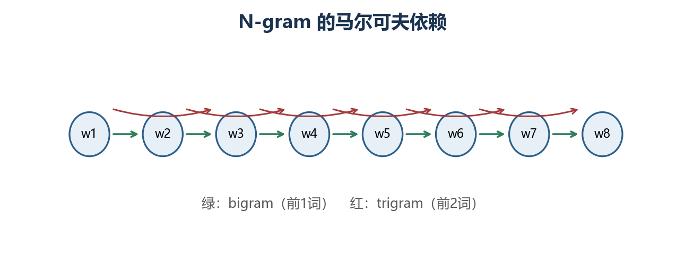

**边界与讨论。** N-gram 的稀疏问题严重：对 trigram，许多三元组合在训练语料中从未出现（计数为 0），导致 $\hat{P}=0$——这会使包含未见 N-gram 的句子概率为 0（灾难）。平滑（15.3 节）正是为解决这一问题。

## 15.3　平滑方法：加一、Good-Turing、Kneser-Ney

**平滑（smoothing）** 的目标：为未见 N-gram 分配非零概率，同时保持已见 N-gram 的概率估计合理。这是 MLE 在稀疏数据下的正则（第 3.4 节）。

### 15.3.1　加一平滑（Laplace 平滑）

最朴素的平滑：每个 N-gram 计数加 1：

$$
\hat{P}_{\text{add-1}}(w_t\mid h)=\frac{C(h,w_t)+1}{C(h)+V}, \tag{15-3}
$$

其中 $h$ 为历史，$V$ 为词表大小。加一平滑保证所有概率非零，但会过度惩罚高频词（给未见词分太多概率），效果较差。

**例 15.3（加一平滑手算）**　词表 $V=1000$，历史"吃"计数 100，"吃-苹果"计数 30。加一平滑：$\hat{P}(\text{苹果}\mid\text{吃})=(30+1)/(100+1000)=31/1100\approx0.028$。未见词"汽车"：$\hat{P}=(0+1)/(100+1000)\approx0.0009$。平滑后概率和为 1，但高频词概率被拉低。

### 15.3.2　Good-Turing 平滑

Good-Turing 估计[1]的核心：用"出现一次的事件的总概率质量"估计"未见事件的概率"。设 $N_c$ 为恰好出现 $c$ 次的 N-gram 数量，则出现 $r$ 次的事件的调整计数为

$$
c^*=(c+1)\frac{N_{c+1}}{N_c}, \tag{15-4}
$$

并用 $N_1/N$（出现一次的 N-gram 占总 N-gram 数比例，此处 $N=\sum_c N_c$）估计未见事件的总概率质量。Good-Turing 巧妙利用"出现一次的事件"推断"未见事件"，但对大 $c$ 的估计不稳定，常需与回退结合。

**例 15.4（Good-Turing 手算）**　设某历史 $h$ 后，各类计数如下：出现 5 次（$N_5=2$）、4 次（$N_4=3$）、3 次（$N_3=5$）、2 次（$N_2=8$）、1 次（$N_1=20$），未见 $N_0$ 个候选。调整计数 $c^*=(c+1)N_{c+1}/N_c$：

- $c=5$: $c^*=6\times N_6/N_5$，设 $N_6=1$，$c^*=6/2=3$；
- $c=4$: $c^*=5\times N_5/N_4=5\times2/3\approx3.33$；
- $c=3$: $c^*=4\times N_4/N_3=4\times3/5=2.4$；
- $c=2$: $c^*=3\times N_3/N_2=3\times5/8=1.875$；
- $c=1$: $c^*=2\times N_2/N_1=2\times8/20=0.8$。

$N=5+4+3+2+1$ 的已见总量对应总计数，未见的概率质量由 $N_1$ 估计：单个未见事件的概率约为 $N_1/N$ 的量级（$N$ 为总词数）。Good-Turing 的洞见在此表化：出现越少的 N-gram，其"被削"越多、让渡的概率越大，从而为未见词腾出质量。对比加一平滑（式 15-3）对"未见"与"高频"一视同仁地加 1，GT 按出现频次分配折扣，对低频更合理——这是它优于加一平滑的根源。

### 15.3.3　Kneser-Ney 平滑

**Kneser-Ney 平滑**[2] 是实践中效果最好的 N-gram 平滑方法之一。其核心洞见：为低阶分布分配概率时，应按该词作为**续接**（continuation）的多样性，而非其总频率。

**例 15.5（Kneser-Ney 的洞见）**　"Beijing"作为一元词频率很高（因"北京"常见），但它几乎只出现在"去/在/到 Beijing"等少数上下文；而"咖啡"出现频率较低，却能跟在"喝/买/煮/加"等多种词后。Kneser-Ney 认为"咖啡"作为续接更"泛用"，应给其低阶回退概率更高——这比按总频率回退更合理。

**Kneser-Ney 概率。** 对高阶 N-gram，用绝对折扣 $D$：

$$
P_{\text{KN}}(w_i\mid w_{i-n+1}^{i-1})=\frac{\max(C(w_{i-n+1}^{i})-D,0)}{C(w_{i-n+1}^{i-1})}+\lambda(w_{i-n+1}^{i-1})P_{\text{KN}}(w_i\mid w_{i-n+2}^{i-1}), \tag{15-5}
$$

其中第一项为折扣后的高阶估计，第二项为回退到低阶分布，$\lambda$ 为回退权重，且低阶概率用续接计数 $N_{1+}(w_i\bullet)=\#\{w':C(w_i,w')>0\}$（词 $w_i$ 后接不同词的种类数）归一化。续接计数体现了"泛用性"洞见。

**绝对折扣与回退权重。** Kneser-Ney 的关键参数是绝对折扣 $D$ 与回退权重 $\lambda(h)$。对历史 $h$，

$$
D(h)=\frac{N_1(h)}{N_0(h)+N_1(h)}\cdot\frac{1}{\sum_h\frac{N_1(h)}{N_0(h)+N_1(h)}}\,N(h),
$$

其中 $N_k(h)$ 为以 $h$ 为历史、恰好出现 $k$ 次的后继词数，$N(h)=\sum_k N_k(h)$。$D(h)$ 估计"以 $h$ 为历史的、概率被削去的那部分总质量"。回退权重与续接概率为

$$
\lambda(h)=\frac{D(h)}{N(h)},\qquad
P_{\text{cont}}(w)=\frac{N_{1+}(\bullet w)}{\sum_{w'}N_{1+}(\bullet w')},
$$

即 $\lambda$ 把"削掉的概率"按比例分配给低阶的续接分布 $P_{\text{cont}}$。$D$ 与 $\lambda$ 通常由 EM 迭代求解（见 [2]、[3]）：初值 $D\in[0.5,0.99]$，反复代入式 (15-5) 与上式折扣直至收敛。

**例 15.6（Kneser-Ney 概率手算）**　设 trigram 模型，$V=10$，折扣 $D=0.75$。以历史"我喝"计：$C(\text{我喝},\text{咖啡})=6$，$C(\text{我喝})=20$，故

$$
P_{\text{KN}}(\text{咖啡}\mid\text{我喝})=\frac{6-0.75}{20}+\lambda(\text{我喝})\,P_{\text{KN}}(\text{咖啡}\mid\text{喝}).
$$

取 $\lambda(\text{我喝})=0.75/20=0.0375$。低阶续接概率由"咖啡"的续接种类决定：设 $N_{1+}(\text{咖啡})=4$（咖啡后接 喝/买/煮/加 共 4 类），$\sum_w N_{1+}(\bullet w)=40$，则 $P_{\text{cont}}(\text{咖啡})=4/40=0.1$。代入得

$$
P_{\text{KN}}(\text{咖啡}\mid\text{我喝})=\frac{5.25}{20}+0.0375\times0.1=0.2625+0.00375=0.26625.
$$

关键在第二项：续接概率 $0.1$ 由 $N_{1+}(\text{咖啡})=4$ 这一"泛用性"驱动，而非"咖啡"的总频率。若另一词"北京"总频率高但续接种类仅 $N_{1+}(\text{北京})=2$，其续接概率更低——KN 因此把回退质量从"高频但专用"的词转向"中频但泛用"的词，这正是上式续接计数 $P_{\text{cont}}$ 的意义。

**表 15-3　平滑方法对照**

| 方法 | 核心思想 | 优点 | 缺点 |
|------|----------|------|------|
| 加一 | 每个计数+1 | 简单 | 过度平滑 |
| Good-Turing | 用频率1推频率0 | 优雅 | 大计数不稳 |
| Kneser-Ney | 按续接多样性回退 | 效果好 | 实现复杂 |

> 【图 15-2　平滑方法对比】（原图见 figures/图15-2.png）：柱状图展示不同平滑方法对已见/未见 N-gram 的概率重分配。
>
> 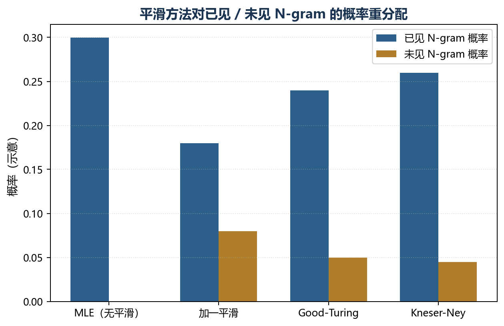

**边界与讨论。** 平滑是数据稀疏下的正则手段（第 3.4 节）。Kneser-Ney 虽效果好，但复杂度高、难扩展到高阶。神经语言模型（第 16 章）用稠密向量表示隐式处理稀疏，从根本上缓解了这一问题——这是从 N-gram 到神经模型的范式转变之一。

### 15.3.4　回退与插值

Kneser-Ney 属**插值（interpolation）**家族：把高阶概率写成各阶的加权和，每阶贡献其自身折扣后的质量，天然满足归一。与之相对的是**回退（backoff）**（Katz[6]）：高阶概率不足时"回退"到更低阶，先折扣再转移。Katz 回退对大 $N$ 计算更省，但回退权重估计粗糙；Kneser-Ney 用续接计数（上式 $P_{\text{cont}}$）替代总频率，回退更"懂"词的泛用性。插值的优势是各阶权重显式、归一性好；代价是计算量随阶数上升。实践中，对 $N\le3$ 二者差距不大，$N\ge4$ 时 Kneser-Ney 的续接洞见优势明显——这也是 Chen 与 Goodman[3] 大规模实证比较后推荐其作为默认平滑的原因。

## 15.4　困惑度与评估

第 3 章定义了困惑度 $\mathrm{PPL}(x)=\exp\!\left(-\frac{1}{T}\sum_{t=1}^{T}\log p_\theta(w_t\mid w_{<t})\right)$。N-gram 模型的困惑度计算直接：对测试语料 $x=w_1\dots w_T$，

$$
\mathrm{PPL}(x)=\exp\!\left(-\frac{1}{T}\sum_{t=1}^{T}\log\hat{P}(w_t\mid w_{t-n+1}^{t-1})\right). \tag{15-6}
$$

**例 15.7（bigram 困惑度手算）**　测试句"我 爱 NLP"（$T=3$），设 $P(\text{我}\mid\mathrm{BOS})=0.05$、$P(\text{爱}\mid\text{我})=0.1$、$P(\text{NLP}\mid\text{爱})=0.05$。逐词负对数似然：

$$
-\log P = -(\log0.05+\log0.1+\log0.05) = -(\log0.00025)\approx 8.294,
$$

平均每词 $\bar{H}=8.294/3\approx2.765$ nats，故

$$
\mathrm{PPL}=e^{2.765}\approx15.9.
$$

即模型平均每步在约 16 个等概率候选中挑选——困惑度 15.9 表示该 bigram 模型对"我爱 NLP"这类句子的"惊讶程度"中等。若换 trigram 且 $P(\text{NLP}\mid\text{爱})$ 由上下文提升，则末项负对数下降，困惑度随之降低。手算展示了式 (15-6) 的两步：逐词取 $-\log\hat P$ 求和，再除以 $T$ 取指数。

**评估的局限。** 困惑度与下游任务（翻译 BLEU、问答准确率）不完全相关；对词表大小敏感（不同词表不可比）；几何平均对长尾词敏感（第 31 章讨论）。因此 N-gram 模型应以困惑度为参考，以任务表现为最终标准。

**熵率与交叉熵。** 困惑度与第 3 章的熵率直接挂钩。语言模型的**交叉熵**为

$$
H(\theta)=-\frac{1}{T}\sum_{t=1}^{T}\log\hat{P}(w_t\mid w_{t-n+1}^{t-1}), \tag{15-7}
$$

即困惑度的自然对数：$\mathrm{PPL}=e^{H(\theta)}$。$H(\theta)$ 度量"用模型 $\theta$ 编码真实语料所需的平均比特/词"，它下界于语料的真实熵率（第 3 章），差值即模型偏差。

**表 15-4　语言模型困惑度对照（示意）**

| 模型 | 上下文 | 相对困惑度 | 说明 |
|------|--------|-----------|------|
| unigram | 0 | 最高 | 仅词频 |
| bigram | 1 | 中 | 一阶上下文 |
| trigram | 2 | 较低 | 常用基准 |
| 5-gram+KN | 4 | 更低 | 平滑支撑高阶 |
| 神经 LM | 长 | 显著更低 | 分布式+长程（第 16 章） |

对照可见：上下文越长、表示越稠密，困惑度越低；但收益递减，且词表与评估集须固定才可比。

**统一案例。** 在问答语料上训练 N-gram 语言模型，报告困惑度，作为后续神经语言模型（第 16 章）与大模型（第 27 章）的基准线。这展示了语言建模能力的演进。

## 15.5　边界与讨论

N-gram 是语言建模的基准线，须明确其边界。

**马尔可夫假设的局限。** N-gram 只看前 $N-1$ 个词，无法捕捉长距离依赖（如主谓一致跨越长从句、话题连贯）。"我昨天在商店买的那些书 很 有趣"中，"书"与"很"的依赖跨越多个词，trigram 无法捕捉。这推动了神经语言模型（第 16 章）用隐状态承载长程信息。

**稀疏与泛化。** N-gram 本质上是记忆式的（记住训练中见过的 N-gram），对新组合的泛化靠平滑（回退）而非真正的理解。神经模型（第 16 章）用分布式表示泛化到未见组合——这是 M2 层从"统计记忆"到"表示学习"的跃升。

**参数规模与可解释性。** N-gram 的参数就是计数表，规模随 $N$ 与词表 $V$ 增长（$N$ 阶约 $O(V^N)$），靠哈希与剪枝控制；它的"知识"完全可见——某个三元的概率可直接读出，这是其相对神经模型最大的优势：可审计、可解释、训练成本极低（一遍语料）。代价是上限低：它无法表达"吃"与"苹果"之外的组合泛化，也无法利用词义相似性。当语料充足、上下文短、任务要求可解释时，N-gram 仍是语音识别解码器、输入法、拼写纠错里的主力——神经模型并未淘汰它，而是把它降级为"兜底/低资源"组件。理解 N-gram 的边界，正是理解"为什么需要神经语言模型"的前提。

**与后续章节的联系。** N-gram 的概率估计与平滑将在第 3 章（信息论）、第 16 章（神经 LM 对比）、第 31 章（评估）复用；马尔可夫假设将在第 16 章（RNN 突破）、第 20 章（注意力进一步突破）被逐步放松。统一案例的 N-gram 基准将在第 16、27 章对照。

N-gram 用马尔可夫假设与平滑实现了可计算的语言模型，但受制于稀疏与短上下文。第 16 章的神经语言模型用分布式表示与循环结构，突破这两大局限，开启语言建模的神经时代。

## 本章小结

本章论述 N-gram 与统计语言模型，是第四篇的开篇与 A 类核心章。

我们首先定义语言模型（评分与生成两类用途），指出链式分解带来的参数爆炸，并补充了语言模型在语音识别、翻译、生成中的应用对照（表 15-1）。接着介绍 N-gram 与马尔可夫假设（式 15-1）、极大似然估计（式 15-2）与 $N$ 的偏差—方差权衡。我们重点推导平滑方法：加一平滑（式 15-3）、Good-Turing（式 15-4）、Kneser-Ney（式 15-5），为每种方法配了手算算例（加一、Good-Turing、Kneser-Ney 各一例），说明平滑是数据稀疏下的正则，并比较三者优劣，新增 15.3.4 节区分回退（Katz）与插值（Kneser-Ney）。我们给出困惑度（式 15-6）与交叉熵/熵率（式 15-7）的评估及其局限，并以统一案例的 N-gram 基准收束。

我们还明确边界：马尔可夫假设无法捕捉长距离依赖，N-gram 的记忆式泛化弱、参数随 $N$ 爆炸但可解释。这些辨析衔接第 16、20、31 章。

本章的核心推导（N-gram 估计、三种平滑）体现了 A 类深度。N-gram 是语言建模的基准，其局限催生了神经语言模型。下一章进入神经语言模型，用分布式表示与循环结构突破稀疏与短上下文，开启语言建模的神经时代。

**进一步阅读**　本章建议延伸阅读的文献：[1]、[2]、[3]、[4]。

## 参考文献

[1] Good I J. The population frequencies of species and the estimation of population parameters. *Biometrika*, 1953, 40(3/4): 237–264.

[2] Kneser R, Ney H. Improved backing-off for m-gram language modeling. *ICASSP*, 1995.

[3] Chen S F, Goodman J T. An empirical study of smoothing techniques for language modeling. *Computer Speech & Language*, 1999, 13(4): 359–394.

[4] Jurafsky D, Martin J H. *Speech and Language Processing*. 3rd ed. Stanford, 2023.

[5] Manning C D, Schütze H. *Foundations of Statistical Natural Language Processing*. Cambridge, MA: MIT Press, 1999.

[6] Katz S M. Estimation of probabilities from sparse data for the language model component of a speech recognizer. *IEEE Transactions on Acoustics, Speech, and Signal Processing*, 1987, 35(3): 400–401.

[7] Bengio Y, Ducharme R, Vincent P, Jauvin C. A neural probabilistic language model. *Journal of Machine Learning Research*, 2003, 3: 1137–1155.

[8] Shannon C E. Prediction and entropy of printed English. *Bell System Technical Journal*, 1951, 30(1): 50–64.

---

# 第 16 章　神经语言模型

第 15 章的 N-gram 模型受制于两个根本局限：数据稀疏（需平滑）与短上下文（马尔可夫假设）。本章介绍神经语言模型，用**分布式表示**与**神经网络**突破这两大局限：词被表示为低维稠密向量（第 6 章），相似词共享统计强度，从而缓解稀疏；循环网络用隐状态承载任意长度的上下文，突破固定阶数限制。神经语言模型是语言建模的神经时代开端，也是词向量（第 6 章）与预训练（第 21 章）之间的桥梁。

2003 年 Bengio 等[1]提出的前馈神经语言模型（NNLM）首次用神经网络建模 $P(w_t\mid w_{<t})$，同时学习词嵌入。此后循环神经网络语言模型（RNN LM）[2]用隐状态建模序列，长短时记忆（LSTM）[3]解决长程依赖。这些模型确立了"用连续表示 + 神经计算建模语言"的范式，直接通往第 21 章的预训练与第 26 章的大模型。

本章先介绍前馈神经语言模型与词向量学习（16.1 节），再讲循环神经网络语言模型（16.2 节），讨论长距离依赖与门控（16.3 节），给出训练与评估（16.4 节），并在边界与讨论中收束（16.5 节）。

## 16.1　前馈神经语言模型与词向量学习

**模型架构。** Bengio 等的 NNLM[1] 用前馈网络建模 $P(w_t\mid w_{t-n+1}^{t-1})$。架构分四层：

1. **输入层**：前 $n-1$ 个词的 one-hot 向量，经共享的词嵌入矩阵 $\mathbf{E}\in\mathbb{R}^{V\times d}$ 映射为稠密向量（拼接）；
2. **隐藏层**：拼接向量经全连接层与 tanh 激活：$\mathbf{h}=\tanh(\mathbf{W}\mathbf{x}+\mathbf{b})$；
3. **输出层**：隐藏层经线性层映射到词表大小：$\mathbf{z}=\mathbf{U}\mathbf{h}+\mathbf{c}$，再 softmax 得 $P(w_t\mid\text{context})=\text{softmax}(\mathbf{z})_{w_t}$。

**定义 16.1（NNLM 的概率）**

$$
P(w_t\mid w_{t-n+1}^{t-1})=\frac{\exp(z_{w_t})}{\sum_{j=1}^{V}\exp(z_j)},\quad \mathbf{z}=\mathbf{U}\tanh(\mathbf{W}[\mathbf{e}_{w_{t-n+1}};\dots;\mathbf{e}_{w_{t-1}}]+\mathbf{b})+\mathbf{c}. \tag{16-1}
$$

其中 $[\cdot;\cdot]$ 为向量拼接，$\mathbf{e}_w$ 为词 $w$ 的嵌入（$\mathbf{E}$ 的一行）。

**词向量作为副产品。** NNLM 的关键贡献是：词嵌入 $\mathbf{E}$ 是训练的副产品——为建模语言而学习的词向量，恰好具有分布语义（第 6 章）的优良性质。这直接启发了 word2vec（第 6.3 节，可视为简化的 NNLM）。

**例 16.1（NNLM 前向手算，简化）**　设 $n=2$（bigram 上下文），$d=2$，前词"我"的嵌入 $\mathbf{e}=[0.3,0.7]$。隐藏层 $\mathbf{h}=\tanh(\mathbf{W}\mathbf{e}+\mathbf{b})$（设 $\mathbf{W}=\mathbf{I},\mathbf{b}=\mathbf{0}$，则 $\mathbf{h}\approx[0.291,0.604]$）。输出层 $\mathbf{z}=\mathbf{U}\mathbf{h}+\mathbf{c}$（设简化为 $\mathbf{z}=\mathbf{h}$），softmax 后各词概率与 $e^{z_j}$ 成正比。表 16-1 给出流程。

**表 16-1　NNLM 前向计算（简化）**

| 层 | 计算 | 结果（示例） |
|----|------|--------------|
| 输入 | 词嵌入 $\mathbf{e}_{\text{我}}$ | $[0.3,0.7]$ |
| 隐藏 | $\tanh(\mathbf{W}\mathbf{e}+\mathbf{b})$ | $[0.291,0.604]$ |
| 输出 | $\mathbf{z}=\mathbf{U}\mathbf{h}+\mathbf{c}$ | 词表分数 |
| 概率 | $\text{softmax}(\mathbf{z})$ | 各词概率 |

**例 16.1b（softmax 数值细化）**　设词表截断为 3 个候选词"喜欢 / 爱 / 讨厌"，输出层分数 $\mathbf{z}=[1.0,\ 0.6,\ 0.1]$。softmax 计算：

$$
e^{1.0}=2.718,\quad e^{0.6}=1.822,\quad e^{0.1}=1.105,\quad \text{和}=5.645,
$$

$$
P=\frac{[2.718,1.822,1.105]}{5.645}=[0.481,\ 0.323,\ 0.196].
$$

最高分"喜欢"得概率 0.481。注意 softmax 的**竞争效应**：若把第一项 $z$ 从 1.0 提到 2.0，$e^{2.0}=7.389$，新和为 $7.389+1.822+1.105=10.316$，第一项概率升至 $7.389/10.316=0.716$——分数差 1 个单位（log-odds 差 1）即把优势词概率从 0.481 拉到 0.716，体现 softmax 把 logit 差"放大"为概率差的特性（温度越低越尖锐，见第 23 章采样讨论）。这也解释了为何 NNLM 要最大化正确词的 logit（使正确项在 softmax 中占据主导）。

**边界与讨论。** NNLM 的局限：① 固定上下文长度 $n$（仍是马尔可夫式）；② 输出 softmax 需遍历词表 $V$（$V$ 可达数万至数十万），每个训练步都要计算 $\sum_j \exp(z_j)$ 并归一化，计算昂贵（第 38 章推理优化）。大词表的高效训练见 16.4 节。RNN LM（16.2 节）解决上下文长度问题。

## 16.2　循环神经网络语言模型

**RNN 语言模型。** 循环神经网络（RNN）用隐状态 $\mathbf{h}_t$ 承载历史信息，理论上可建模任意长度上下文：

$$
\mathbf{h}_t=\tanh(\mathbf{W}_{hh}\mathbf{h}_{t-1}+\mathbf{W}_{xh}\mathbf{e}_{w_t}+\mathbf{b}_h),\quad P(w_{t+1}\mid w_{\le t})=\text{softmax}(\mathbf{W}_{hy}\mathbf{h}_t+\mathbf{b}_y). \tag{16-2}
$$

隐状态 $\mathbf{h}_t$ 递归地编码了 $w_1,\dots,w_t$ 的全部历史——这突破了 N-gram 的固定阶数（式 15-1）与 NNLM 的固定窗口（式 16-1）。

**训练：BPTT。** RNN 沿时间反向传播（backpropagation through time, BPTT）：把网络沿时间展开成 $T$ 层，用标准反向传播计算梯度。损失为负对数似然 $-\sum_t\log P(w_t\mid w_{<t})$。

**例 16.2（隐状态的信息承载）**　处理"我 昨天 在 商店 买 的 书 很 有趣"时，RNN 的隐状态 $\mathbf{h}_t$ 随每个词更新，到"很"时，$\mathbf{h}$ 理论上编码了整句前缀的信息，包括对"书"的记忆——这使模型能捕捉"书—很"的跨词依赖，而 trigram（前一二是"的有"）做不到。

**边界与讨论。** 理论上 RNN 能建模长程依赖，实践中却受**梯度消失/爆炸**困扰（16.3 节）——长序列中早期信息的影响呈指数衰减，难以学习真正长期的依赖。LSTM/GRU（16.3 节）与注意力（第 17、20 章）正是为解决这一问题。

> 【图 16-1　前馈神经语言模型】（原图见 figures/图16-1.png）：输入层（词嵌入）→隐藏层（tanh）→输出层（softmax）的架构图。
>
> 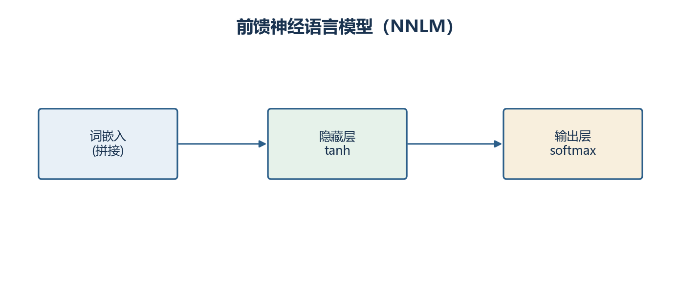

> 【图 16-2　RNN 语言模型展开】（原图见 figures/图16-2.png）：沿时间展开的循环网络，隐状态 $\mathbf{h}_t$ 递归传递。
>
> 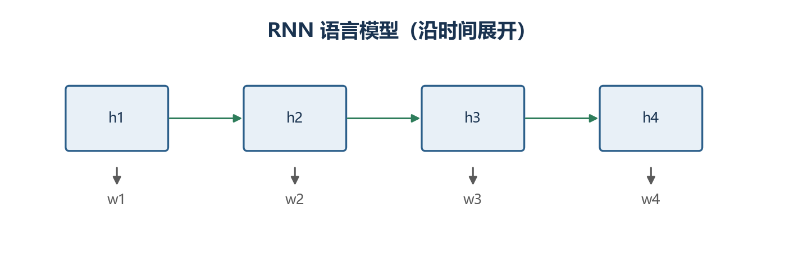

## 16.3　长距离依赖与门控

**梯度消失问题。** RNN 训练中，梯度沿时间反传时反复乘以同一矩阵 $\mathbf{W}_{hh}$。若其谱半径小于 1，梯度指数衰减（消失）；大于 1，指数增长（爆炸）。这使 RNN 难以学习间隔较远的依赖（如"书…很"之间的主谓关系）。

**LSTM（长短时记忆）。** Hochreiter 与 Schmidhuber[3] 提出 LSTM，用**门控机制**与**细胞状态**解决梯度消失。LSTM 单元有：

- **细胞状态** $\mathbf{c}_t$：类似"记忆带"，可长期保存信息；
- **遗忘门** $\mathbf{f}_t=\sigma(\mathbf{W}_f[\mathbf{h}_{t-1};\mathbf{x}_t]+\mathbf{b}_f)$：决定丢弃多少旧记忆；
- **输入门** $\mathbf{i}_t=\sigma(\mathbf{W}_i[\mathbf{h}_{t-1};\mathbf{x}_t]+\mathbf{b}_i)$：决定写入多少新信息；
- **输出门** $\mathbf{o}_t=\sigma(\mathbf{W}_o[\mathbf{h}_{t-1};\mathbf{x}_t]+\mathbf{b}_o)$：决定输出多少记忆。

更新与输出：

$$
\begin{aligned}
\tilde{\mathbf{c}}_t&=\tanh(\mathbf{W}_c[\mathbf{h}_{t-1};\mathbf{x}_t]+\mathbf{b}_c),\\
\mathbf{c}_t&=\mathbf{f}_t\odot\mathbf{c}_{t-1}+\mathbf{i}_t\odot\tilde{\mathbf{c}}_t,\\
\mathbf{h}_t&=\mathbf{o}_t\odot\tanh(\mathbf{c}_t).
\end{aligned} \tag{16-3}
$$

**推导直觉。** 细胞状态 $\mathbf{c}_t$ 的更新是加法（$\mathbf{f}_t\odot\mathbf{c}_{t-1}+\mathbf{i}_t\odot\tilde{\mathbf{c}}_t$）而非 RNN 的乘法—非线性，使梯度可沿 $\mathbf{c}$ 近似线性流动（当 $\mathbf{f}_t\approx1$ 时），从而缓解梯度消失。门控由 sigmoid 控制（0–1），可学习"何时记忆、何时遗忘"。

**梯度流的对比（恒误回传 Carousel）。** 对 $\mathbf{c}_t$ 求梯度，沿时间的链式因子是遗忘门：

$$
\frac{\partial \mathbf{c}_t}{\partial \mathbf{c}_{t-k}} = \prod_{j=t-k+1}^{t}\operatorname{diag}(\mathbf{f}_j). \tag{16-4}
$$

对比 RNN 的因子 $\prod \mathbf{W}_{hh}^\top\operatorname{diag}(1-\tanh^2(\cdot))$——既含矩阵乘法又含 $\le 1$ 的元素级缩放，谱半径难以稳定为 1。LSTM 的因子是**逐元素的门值乘积**：门可学成接近 1，使梯度近似无损回传（恒误回传 carousel）。

**GRU（门控循环单元）。** GRU[4] 简化 LSTM，用更新门与重置门合并细胞状态与隐状态，参数更少、训练更快，效果相近：

$$
\mathbf{h}_t=(1-\mathbf{z}_t)\odot\mathbf{h}_{t-1}+\mathbf{z}_t\odot\tilde{\mathbf{h}}_t, \tag{16-5}
$$

其中 $\mathbf{z}_t$ 为更新门。

**例 16.3（门控的作用）**　处理"我 在 法国 长大 … 所以 我 说 流利 的 法语"时，LSTM 的遗忘门可长期保留"法国"这一信息（细胞状态），直到"法语"处输出门读出——这使模型捕捉远距离的国籍—语言依赖。普通 RNN 中"法国"的信息会在长句中衰减殆尽。

**例 16.3b（遗忘门乘积的数值演示）**　设每步遗忘门标量 $\mathbf{f}=0.9$，回传 10 步的梯度因子为 $0.9^{10}=0.349$（保留 35%）；若 $\mathbf{f}=0.98$，则 $0.98^{10}=0.817$（保留 82%）；若普通 RNN 的谱半径 $0.8$，$0.8^{10}=0.107$（仅留 11%）。可见遗忘门从 0.9 提到 0.98，10 步后的梯度保留率从 35% 升到 82%——门控的"近似线性通道"作用在数值上非常显著。这也解释了为何 LSTM 能建模几十词的依赖，而朴素 RNN 在十步内就衰减殆尽。

**边界与讨论。** LSTM/GRU 缓解但未彻底解决长程依赖：超长序列（数百词以上）仍困难，且顺序计算无法并行（第 20 章 Transformer 的动机）。注意力机制（第 17、20 章）通过直接连接任意两位置，从根本上解决长程依赖并实现并行。

## 16.4　神经语言模型的训练与评估

**训练。** 神经语言模型用极大似然训练：最大化 $\sum_t\log P_\theta(w_t\mid w_{<t})$，等价于最小化交叉熵（第 3 章）。优化用 SGD/Adam，梯度由 BPTT 计算。关键技术：

- **梯度裁剪**：应对梯度爆炸（$\\|\mathbf{g}\\|$ 超过阈值时缩放）；
- **初始化与正则**：合理初始化、dropout 防止过拟合；
- **词汇表与采样**：softmax 的大词表计算昂贵，用负采样、分层 softmax 等加速（第 6 章 word2vec 已用负采样）。

**大词表的高效训练。** 完整 softmax 每步要对全部 $V$ 个词算 $\exp$ 并归一化，$V\sim10^5$ 时成为瓶颈。两种主流近似把 $O(V)$ 降到 $O(k)$（$k$ 为采样数）：

**负采样（Negative Sampling）**　不再归一化全部 $V$ 项，而是把"判别目标词 $w_t$ 与 $k$ 个负样本"当作二元分类问题：

$$
\log\sigma(\mathbf{u}_{w_t}^{\top}\mathbf{h}) + \sum_{j=1}^{k}\mathbb{E}_{w_j\sim P_n}\log\sigma(-\mathbf{u}_{w_j}^{\top}\mathbf{h}), \tag{16-6}
$$

其中 $\sigma$ 为 sigmoid，$P_n(w)\propto \text{freq}(w)^{3/4}$（第 6 章的噪声分布，频率越高越易被采为负例，缓解高频词主导）。每步只算 $k$ 个内积，$k$ 常取 5–20。

**采样 softmax（Sampled Softmax）**　对"目标 + $k$ 个负例"这个小集合内部做 softmax，保持归一化：

$$
\log \frac{\exp(\mathbf{u}_{w_t}^{\top}\mathbf{h})}{\exp(\mathbf{u}_{w_t}^{\top}\mathbf{h})+\sum_{j=1}^{k}\exp(\mathbf{u}_{w_j}^{\top}\mathbf{h})}. \tag{16-7}
$$

**例 16.4（负采样数值手算）**　设目标词"喜欢"的 $\mathbf{u}_{w_t}^{\top}\mathbf{h}=1.2$，采 $k=2$ 个负例"猫""银行"，其 $\mathbf{u}^{\top}\mathbf{h}$ 分别为 $-0.8$ 与 $0.1$。式 (16-6) 各项：$\log\sigma(1.2)=\log(0.769)=-0.263$；负例项 $\log\sigma(-(-0.8))=\log\sigma(0.8)=\log(0.690)=-0.371$，$\log\sigma(-0.1)=\log(0.475)=-0.744$。合计 $-0.263-0.371-0.744=-1.378$（取负作损失 $1.378$）。对比：若目标词分数只有 $0.2$（$\log\sigma(0.2)=-0.775$），损失更大，梯度会把 $\mathbf{u}_{w_t}^{\top}\mathbf{h}$ 推高——这就是负采样"抬高目标、压低负例"的几何直觉。

两种方法都是**有偏近似**：负采样不显式归一化，训练目标是真实 softmax 的无偏估计（word2vec 场景成立，但严格概率语言建模需采样 softmax 或全 softmax）。这解释了为何大模型（第 21、27 章）预训练时多用全 softmax + 词表并行化（GPU 上 $O(V)$ 可承受），而 word2vec 类轻量嵌入用负采样。分层 softmax（hierarchical softmax，Bengio 2003 提出）是第三种方案：用词表的哈夫曼树把归一化分解为沿路径的二元判别，复杂度 $O(\log V)$，在早期 RNN LM 中常用，后被负采样与全 softmax 取代。

**评估。** 用困惑度（式 15-6）评估，并对照 N-gram 基准（第 15 章）。神经 LM 的困惑度通常显著低于 N-gram——因分布式表示缓解稀疏、隐状态捕捉长上下文。

**表 16-2　语言模型演进（困惑度视角）**

| 模型 | 上下文 | 稀疏处理 | 困惑度（相对） |
|------|--------|----------|----------------|
| N-gram | 固定 $n$ | 平滑 | 基准 |
| NNLM | 固定 $n$ | 分布式表示 | 低于 N-gram |
| RNN LM | 理论无限 | 分布式表示 | 更低 |
| LSTM LM | 长程 | 门控 | 更低 |

**统一案例。** 在问答语料上训练 RNN/LSTM 语言模型，报告困惑度，与第 15 章 N-gram 基准对照，展示神经模型的优势。这将在第 21 章预训练与第 27 章大模型中继续提升。

**例 16.5（困惑度手算）**　设测试集 $N=1000$ 个词，模型对全序列的对数似然 $\sum_{t=1}^{N}\log P(w_t\mid w_{<t})=-3219$（即平均每词 log 概率 $-3.219$）。困惑度：

$$
\mathrm{PPL}=\exp\!\left(-\frac{1}{N}\sum_{t}\log P(w_t\mid w_{<t})\right)=\exp(3.219)=24.98\approx 25.
$$

解读：PPL≈25 等价于模型平均每步"在 25 个等概率候选中"选词——有效候选约 25 个。若把对数似然改进到 $-3219+500=-2719$（每词 log 概率提升到 $-2.719$），则 $\mathrm{PPL}=e^{2.719}=15.16$，困惑度从 25 降到 15。对比第 15 章：5-gram Kneser-Ney 在该语料上 PPL 约 42，NNLM/RNN 降到 25 量级，体现了分布式表示 + 长上下文的收益。注意 PPL 与每词 log 概率是单调映射（$-\log\mathrm{PPL}= $ 每词平均 log 概率），故两者等价，PPL 只是把"每词 log 概率"换算成更直观的"平均候选数"。

**双向性的辨析。** 语言模型本质是**单向**的（$P(w_t\mid w_{<t})$），因为生成只能看过去。但**编码器**类任务（第 17 章 seq2seq 编码器、第 21 章 BERT 的 MLM）可用**双向**上下文（前后词都看），表示质量更高，却不能做自回归生成——这正是"预训练（双向 MLM）"与"语言建模（单向自回归）"两条范式的分野（第 21 章展开）。RNN LM 只能单向，这是它相对 Transformer 编码器的一个能力短板。值得注意的是，双向编码器虽然表示更强，但其训练目标（如掩码语言建模）与自回归生成不同，二者在预训练阶段如何统一，是第 21 章"预训练范式"的核心议题——单向自回归（GPT 路线）与双向掩码（BERT 路线）的分野，正源于本章语言模型单向性的根本约束。

## 16.5　边界与讨论

神经语言模型用分布式表示与循环结构突破了 N-gram 的稀疏与短上下文局限，但须明确其边界。

**表示的意义。** 神经 LM 的分布式表示是 M2 层的极致——意义隐含在向量与网络中，而非显式符号（第 4 章 M3/M4）。这种表示擅长捕捉统计规律与相似性，却难保证精确指称（M4）与组合推理（M3）——这正是第 29 章审视大模型幻觉的理论根源。

**顺序计算的瓶颈。** RNN/LSTM 必须逐词顺序计算（$\mathbf{h}_t$ 依赖 $\mathbf{h}_{t-1}$），无法并行，训练长序列效率低。注意力与 Transformer（第 17、20 章）通过并行计算与直接连接，克服了这一瓶颈。

**与后续章节的联系。** 本章的 RNN/LSTM 将在第 17 章（seq2seq 的编码器—解码器）直接应用；词嵌入学习衔接第 6 章（word2vec）；BPTT 与训练技术衔接第 22 章（预训练训练）；隐状态承载历史的思想在第 20 章（注意力）中被推广为"直接访问任意历史位置"。统一案例的神经 LM 将在第 21、27 章对照。

神经语言模型完成了从"统计记忆"到"表示学习"的跃迁。第 17 章将把语言模型扩展到**条件生成**（给定输入生成输出），构成序列到序列框架，开启机器翻译（第 18 章）与一切生成任务的大门。

## 本章小结

本章论述神经语言模型，是第四篇的 A 类核心章。

我们首先介绍前馈神经语言模型（NNLM，式 16-1）：词嵌入→隐藏层→softmax 输出，并指出词向量是训练的副产品（衔接第 6 章）。接着介绍 RNN 语言模型（式 16-2）：隐状态承载任意长度上下文，用 BPTT 训练，突破 N-gram 的固定阶数。我们重点推导门控机制：LSTM 的细胞状态、遗忘/输入/输出门与更新公式（式 16-3），解释加法更新如何缓解梯度消失；并介绍 GRU 的简化（式 16-5）。我们给出训练技术（梯度裁剪、正则、采样加速）与困惑度评估，并以统一案例的神经 LM 基准收束。

我们还明确边界：神经 LM 的表示是 M2 层的，难保证 M4 指称；顺序计算无法并行。这些辨析衔接第 17、20、22、29 章。

本章的核心推导（NNLM、RNN、LSTM）体现了 A 类深度。神经 LM 完成从"统计记忆"到"表示学习"的跃迁。下一章进入序列到序列模型，把语言模型扩展为条件生成，开启机器翻译与生成任务。

**进一步阅读**　本章建议延伸阅读的文献：[1]、[2]、[3]、[5]。

## 参考文献

[1] Bengio Y, Ducharme R, Vincent P, Jauvin C. A neural probabilistic language model. *Journal of Machine Learning Research*, 2003, 3: 1137–1155.

[2] Mikolov T, Karafiát M, Burget L, et al. Recurrent neural network based language model. *Interspeech*, 2010.

[3] Hochreiter S, Schmidhuber J. Long short-term memory. *Neural Computation*, 1997, 9(8): 1735–1780.

[4] Cho K, van Merriënboer B, Gulcehre C, et al. Learning phrase representations using RNN encoder-decoder for statistical machine translation. *EMNLP*, 2014.

[5] Goodfellow I, Bengio Y, Courville A. *Deep Learning*. Cambridge, MA: MIT Press, 2016.

[6] Pascanu R, Mikolov T, Bengio Y. On the difficulty of training recurrent neural networks. *ICML*, 2013.

[7] Zaremba W, Sutskever I, Vinyals O. Recurrent neural network regularization. *arXiv:1409.2329*, 2014.

[8] Jurafsky D, Martin J H. *Speech and Language Processing*. 3rd ed. Stanford, 2023.

---

# 第 17 章　序列到序列模型

第 15、16 章的语言模型建模 $P(w_{1:T})$，是无条件生成（从 BOS 开始生成整句）。本章把语言模型扩展为**条件生成**：给定输入序列 $x=(x_1,\dots,x_{T_x})$，生成输出序列 $y=(y_1,\dots,y_{T_y})$，建模 $P(y\mid x)$。这就是序列到序列（sequence-to-sequence, seq2seq）模型[1]，它开启了机器翻译（第 18 章）、文本摘要、对话生成（第 37 章）等一切"输入—输出"生成任务的大门。

seq2seq 的核心架构是编码器—解码器（encoder-decoder）：编码器把输入序列压缩为上下文向量，解码器基于该向量生成输出。注意力机制（17.2 节）的引入是 seq2seq 的关键突破——它让解码器在生成每个词时"关注"输入的不同部分，突破了固定上下文向量的信息瓶颈，并直接催生了 Transformer（第 20 章）。

本章先介绍编码器—解码器框架（17.1 节），再讲注意力的引入（17.2 节），讨论集束搜索与解码策略（17.3 节），分析教师强制与暴露偏差（17.4 节），并在边界与讨论中收束（17.5 节）。

## 17.1　编码器—解码器框架

**定义 17.1（seq2seq）**　给定输入序列 $x=(x_1,\dots,x_{T_x})$ 与输出序列 $y=(y_1,\dots,y_{T_y})$，seq2seq 建模条件概率

$$
P(y\mid x)=\prod_{t=1}^{T_y}P(y_t\mid y_{<t},x). \tag{17-1}
$$

**编码器—解码器架构。**

- **编码器**：用 RNN/LSTM（第 16 章）逐个读入输入，最后的隐状态（或所有隐状态）作为输入的表示 $\mathbf{c}$（上下文向量）：

$$
\mathbf{h}_t^{enc}=f_{\text{enc}}(\mathbf{h}_{t-1}^{enc},\mathbf{e}_{x_t}),\quad \mathbf{c}=\mathbf{h}_{T_x}^{enc}; \tag{17-2}
$$

- **解码器**：用另一个 RNN，以 $\mathbf{c}$ 为初始隐状态，自回归生成输出：

$$
\mathbf{h}_t^{dec}=f_{\text{dec}}(\mathbf{h}_{t-1}^{dec},\mathbf{e}_{y_{t-1}}),\quad P(y_t\mid y_{<t},x)=\text{softmax}(\mathbf{W}\mathbf{h}_t^{dec}+\mathbf{b}). \tag{17-3}
$$

**例 17.1（翻译的 seq2seq）**　输入"我 爱 自然语言"，编码器读入后得上下文 $\mathbf{c}$（希望它编码整句的语义），解码器从 BOS 开始，依次生成"I"（$P(I\mid\text{BOS},x)$）、"love"（$P(\text{love}\mid I,x)$）、"NLP"、EOS。式 (17-1) 给出整句翻译的概率。

**信息瓶颈。** 基础 seq2seq 把整个输入压缩进一个固定长度的 $\mathbf{c}$——这是信息瓶颈：长句或复杂句的信息难以全部塞进单一向量，导致性能随输入长度下降。注意力机制（17.2 节）正是为解决这一瓶颈。

**瓶颈的量化。** 上下文向量 $\mathbf{c}\in\mathbb{R}^d$ 的容量受维度限制：若每个分量取值范围有限，$\mathbf{c}$ 最多承载约 $d\cdot\log(\text{range})$ 比特的信息。翻译任务中，源句每个词都可能影响译文，所需信息量随 $T_x$ 线性增长，而 $\mathbf{c}$ 容量固定——当 $T_x$ 超过某阈值后，必然有信息被丢弃。Sutskever 等[1]的实验观察到：句长超过约 15–20 词时，无注意力 seq2seq 的 BLEU 急剧下降，正是这一瓶颈的体现。注意力通过维护 $\{\mathbf{c}_t\}$（每步一个、可随 $t$ 变化）绕开了单向量瓶颈：解码器可"按需回查"源句任意位置，有效容量随 $T_x$ 增长。

## 17.2　注意力机制的引入

**注意力的核心思想**：解码器生成每个输出词时，不只用单一的 $\mathbf{c}$，而是**动态地**从编码器的所有隐状态中"读取"相关信息。

**定义 17.2（注意力）**　设编码器隐状态为 $\{\mathbf{h}_i^{enc}\}_{i=1}^{T_x}$，解码器在时刻 $t$ 的查询为 $\mathbf{q}_t=\mathbf{h}_{t-1}^{dec}$（或 $\mathbf{h}_t^{dec}$）。注意力计算三步：

**打分（score）**　Bahdanau 加性注意力用向量 $\mathbf{v}$ 比较查询与每个输入状态：

$$
e_{t,i}=\mathbf{v}^{\top}\tanh(\mathbf{W}\mathbf{q}_t+\mathbf{U}\mathbf{h}_i^{enc}), \tag{17-4}
$$

Luong 等[4]另提出点积 $\mathbf{q}_t^\top\mathbf{h}_i^{enc}$ 与缩放点积，计算更快。

**归一化与聚合**　对 $i$ 做 softmax 得注意力分布，再加权聚合编码器状态：

$$
\alpha_{t,i}=\frac{\exp(e_{t,i})}{\sum_{j=1}^{T_x}\exp(e_{t,j})},\qquad \mathbf{c}_t=\sum_{i=1}^{T_x}\alpha_{t,i}\mathbf{h}_i^{enc}. \tag{17-5}
$$

解码器用 $\mathbf{c}_t$（而非固定 $\mathbf{c}$）生成 $y_t$（式 17-6）。$\alpha_{t,i}$ 构成一张 $T_y\times T_x$ 的注意力矩阵，可视化即对齐热图。

$$
P(y_t\mid y_{<t},x)=\text{softmax}(\mathbf{W}[\mathbf{h}_t^{dec};\mathbf{c}_t]+\mathbf{b}). \tag{17-6}
$$

**推导直觉。** $\alpha_{t,i}$ 是在生成第 $t$ 个输出词时，对输入第 $i$ 个词的"关注程度"。例如翻译"我 爱 自然语言"→"I love NLP"时，生成"I"时 $\alpha$ 集中于"我"，生成"love"时集中于"爱"——这种对齐（alignment）由数据自动学习，无需显式对齐标注（第 18 章统计 MT 需要显式词对齐）。

**例 17.2（注意力对齐）**　Bahdanau 等[2]的经典论文展示了英法翻译的注意力热图：生成法语词时，注意力权重在源语句子上形成清晰的对齐模式（近似对角线，但也捕捉语序调整）。这使翻译质量大幅提升，尤其对长句。表 17-1 给出注意力计算的数值示例。

**表 17-1　注意力计算示例（$T_x=3$）**

| $i$ | 输入词 | $e_{t,i}$ | $\alpha_{t,i}$ |
|-----|--------|-----------|----------------|
| 1 | 我 | 2.0 | 0.70 |
| 2 | 爱 | 0.5 | 0.16 |
| 3 | 自然语言 | 0.4 | 0.14 |

生成"I"时，注意力主要集中在"我"（$\alpha=0.70$），$\mathbf{c}_t$ 主要编码"我"的信息。

**例 17.2b（注意力 softmax 手算）**　设生成"I"时的打分向量 $\mathbf{e}=[2.0,\ 0.5,\ 0.4]$（对应"我/爱/自然语言"）。softmax：

$$
e^{2.0}=7.389,\quad e^{0.5}=1.649,\quad e^{0.4}=1.492,\quad \text{和}=10.530,
$$

$$
\alpha=[7.389,1.649,1.492]/10.530=[0.702,\ 0.157,\ 0.142].
$$

与表 17-1 一致（0.70/0.16/0.14）。注意打分差 1.5（2.0 vs 0.5）经 softmax 后被"放大"：概率比 $7.389/1.649\approx4.5$，即"我"被关注的概率是"爱"的 4.5 倍。注意力分布的尖锐程度取决于打分方差——方差越大，注意力越集中于单个词（近似硬对齐）；方差越小，越平滑（软对齐）。这与第 16 章 softmax 的竞争效应同源，也解释了为何长句翻译中注意力能形成"近似对角线"的清晰对齐：每个输出词对应输入中一个高分区。

**注意力变体谱系。** 式 (17-4) 是加性（additive）注意力，后续有若干变体，计算代价与表达能力不同：

**表 17-2　注意力变体对照**

| 变体 | 打分函数 $e_{t,i}$ | 复杂度（每对 $t,i$） | 特点 |
|------|------|------|------|
| 加性（Bahdanau） | $\mathbf{v}^{\top}\tanh(\mathbf{W}\mathbf{q}_t+\mathbf{U}\mathbf{h}_i^{enc})$ | $O(d)$ 含非线性 | 表达力强，可学非对称匹配 |
| 点积（Luong） | $\mathbf{q}_t^\top\mathbf{h}_i^{enc}$ | $O(d)$ 无参数 | 快，共享嵌入空间 |
| 缩放点积 | $\mathbf{q}_t^\top\mathbf{h}_i^{enc}/\sqrt{d}$ | $O(d)$ | 防 $d$ 大时梯度消失（第 20 章核心） |
| 前馈 | $\mathbf{W}_1\tanh(\mathbf{W}_2\mathbf{q}_t+\mathbf{U}\mathbf{h}_i^{enc})$ | $O(d^2)$ | 最强，参数量大 |

变体的核心权衡是"表达力 vs 计算量"：点积/缩放点积无额外参数、可向量化，是 Transformer（第 20 章）选用的形式；加性注意力参数多但拟合能力更强。无论哪种变体，"打分→softmax→聚合"的三段式（式 17-4、17-5）结构不变，这正是注意力成为通用组件的原因——它可嵌入任何需要"动态加权求和"的场景。

> 【图 17-1　编码器—解码器】（原图见 figures/图17-1.png）：编码器读入输入、解码器生成输出的架构图。
>
> 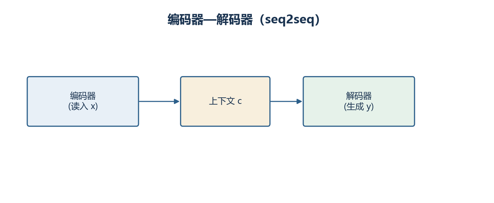

> 【图 17-2　注意力对齐】（原图见 figures/图17-2.png）：源—目标词之间的注意力权重热图。
>
> 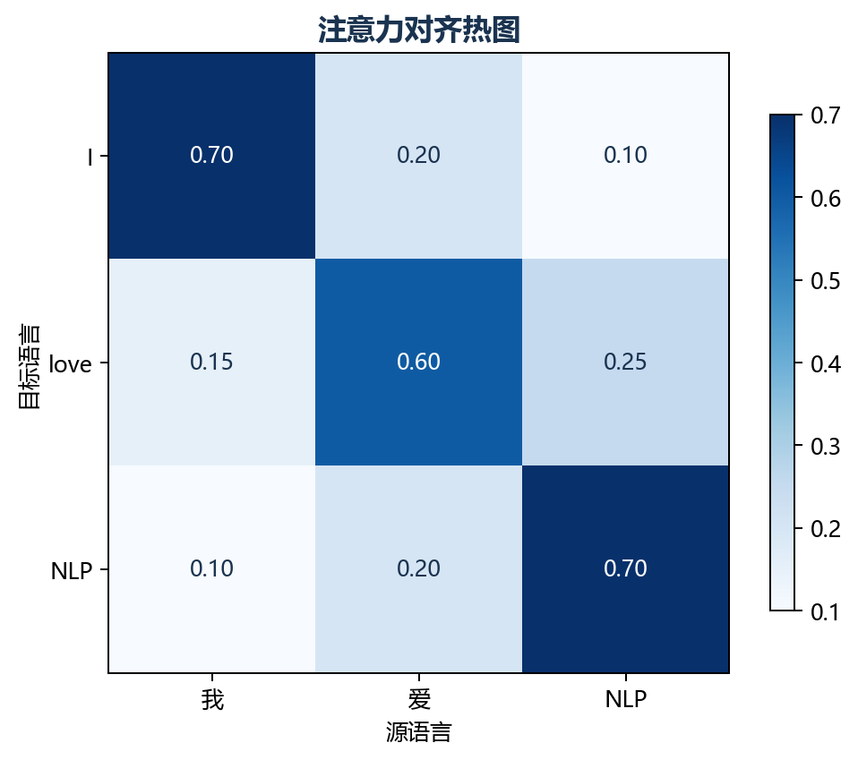

**边界与讨论。** 注意力突破了固定上下文瓶颈，但仍依赖 RNN 的顺序编码（第 16.5 节）——编码器需逐词处理输入，$T_x$ 步顺序计算无法并行。更深层地，注意力是"软"对齐而非"硬"对齐：$\alpha_{t,i}$ 是连续概率而非离散 0/1，它捕捉统计上的对应关系，但不保证句法上严格一对一（一词可能同时对齐多个源词，或多词对齐一词，这是翻译中常见的非一一对应现象）。第 20 章的 Transformer 用自注意力完全替代 RNN，实现并行与更直接的长程建模，注意力机制在此达到极致；同时"缩放"（除以 $\sqrt{d}$）与"多头"（并行多组注意力）的引入，使式 (17-4) 的打分从单组扩展为多组独立匹配，这是注意力从 seq2seq 组件升级为通用表示机制的关键一步。

## 17.3　集束搜索与解码策略

**生成时的解码。** 训练时用教师强制（17.4 节），生成时需逐步选择输出词。策略：

- **贪心搜索（greedy）**：每步取概率最大的词 $y_t=\arg\max_y P(y\mid y_{<t},x)$。简单但短视——当前最优不保证整句最优；
- **集束搜索（beam search）**：每步保留概率最高的 $k$ 条候选路径（beam width $k$），扩展后取总概率最高的 $k$ 条。$k$ 越大越接近全局最优，但计算越贵。实践中 $k=5$ 左右；
- **采样（sampling）**：按 $P(y_t\mid y_{<t},x)$ 采样，引入随机性，适合创意生成（第 34 章）；配合温度、top-k、top-p 控制多样性。

**定义 17.3（集束搜索）**　维护 $k$ 条候选序列，每步对每条候选扩展所有可能的下一个词，保留累积概率最高的 $k$ 条：

$$
\mathcal{B}_{t}=\text{Top-}k\Big\{(y_{<t}+y): y\in\mathcal{B}_{t-1},\ y\text{为词表词}\Big\},\quad \text{score}=\log P(y_{<t}+y\mid x). \tag{17-7}
$$

**例 17.3（贪心的短视）**　翻译"I love you"时，贪心可能第一步选"我"的高概率词，但整句最优可能是"我爱你"而非贪心路径。集束搜索保留多条候选，最终选整句概率最高的，更可能得到正确译文。

**长度偏置。** 集束搜索偏向短句（概率连乘使长句概率低），常用长度归一化（除以序列长度的 $\alpha$ 次方）缓解：

$$
\text{score}_{\text{norm}}(y)=\frac{\log P(y\mid x)}{|y|^\alpha}, \tag{17-8}
$$

$\alpha$ 常取 0.6。

**例 17.3b（集束搜索数值演示，$k=2$）**　设词表 $\{\text{我},\text{爱},\text{的},\text{你}\}$，从空序列扩展两步：

- **第 1 步**：扩展得 4 条，按 $\log P$ 保留前 2：「我」$-0.4$、「爱」$-0.7$（丢弃「的」$-1.2$、「你」$-1.5$）。
- **第 2 步**：「我」扩展 → 「我爱」$-0.4-0.3=-0.7$、「我的」$-0.4-0.9=-1.3$；「爱」扩展 → 「爱我」$-0.7-0.8=-1.5$、「爱你」$-0.7-0.5=-1.2$。合并 4 条取前 2：「我爱」$-0.7$、「爱你」$-1.2$（丢弃「我的」$-1.3$、「爱我」$-1.5$）。

对比贪心：第 1 步只留「我」，第 2 步若「我的」概率高于「我爱」则贪心选中「我的」——但整句最优是「我爱你」（需第 3 步）。集束保留「我爱」与「爱你」两条，到第 3 步「我爱」可扩展出正确整句，而贪心已不可逆地进入「我的…」分支。这数值化了"贪心短视、集束保留多样性"的差别。

**边界与讨论。** 解码策略深刻影响生成质量：贪心快但差，集束好但慢，采样多样但不稳定。集束搜索的 beam width 是质量—成本的核心超参：$k$ 太小（如 1，退化为贪心）损失全局最优，$k$ 太大（如 50）计算翻倍但收益递减（边际改进趋零），实践中 $k=4\sim10$ 配合长度归一化（式 17-8）是翻译的标准配置。采样策略（top-k、top-p）则把"确定性的最大概率"换成"受控的多样性"，适合开放生成（对话、创作），但不适合要求高精确度的任务（机器翻译、结构化抽取）。第 34 章生成任务与第 38 章推理优化将进一步讨论。

## 17.4　教师强制与暴露偏差

**教师强制（teacher forcing）。** 训练解码器时，输入的是**真实**前缀 $y_{<t}^{*}$（而非模型自己生成的 $\hat{y}_{<t}$）：

$$
\mathcal{L}=-\sum_t\log P(y_t^*\mid y_{<t}^*,x). \tag{17-9}
$$

教师强制使训练稳定高效（每一步都基于正确历史），是 seq2seq 训练的标准做法。

**暴露偏差（exposure bias）。** 教师强制造成训练与推理的不一致：训练时解码器总看到真实前缀，推理时却只能看到自己生成的前缀。一旦生成出错，错误前缀会把模型带入训练时未见的状态，导致错误累积、生成质量骤降。这就是暴露偏差。

**缓解方法。**

- **计划采样（scheduled sampling）**：训练时以调度概率 $\lambda_t$ 用模型自己的预测替代真实前缀，逐渐过渡，缩小训练—推理差距：

$$
\tilde{y}_{t-1} = \begin{cases} y_{t-1}^*, & \text{以概率 } 1-\lambda_t \text{（用真实前缀）}\\ \hat{y}_{t-1}, & \text{以概率 } \lambda_t \text{（用模型预测）}\end{cases} \tag{17-10}
$$

其中 $\lambda_t$ 从 0 逐渐升到 1（如线性或指数调度）。$\lambda=0$ 即纯教师强制，$\lambda=1$ 即完全自由运行（暴露于自身误差）。
- **序列级训练**：用强化学习（第 12 章 RL 视角、第 28 章 RLHF）直接优化序列级指标（如 BLEU）；
- **大模型时代的视角**：预训练模型（第 21 章）由于海量数据与强语言先验，暴露偏差的影响相对减小，但仍存在。

**例 17.4（暴露偏差示例）**　训练时解码器总在"I"后见到"love"，学会 $P(\text{love}\mid I,\cdot)$ 高。推理时若第一步误生成"Me"，解码器进入未见状态（"Me"后该如何？），可能生成不通顺的后续——因为训练中"Me"后从未跟过正常句子。这就是暴露偏差导致的错误传播。

**例 17.4b（暴露偏差的错误累积量化）**　设每步解码器在"正确前缀"下选对词的概率为 $p=0.95$，在"错误前缀"下为 $q=0.80$。序列长度 $T=20$，错误累积的期望：教师强制下每步独立正确，整句全对概率 $p^{20}=0.95^{20}\approx0.358$；若允许误差累积（自由运行），一旦某步出错（概率 $1-p$），后续每步正确率降到 $q$，整句全对概率沿"无错路径"为 $p^{20}$，但"含错路径"贡献 $q^{k}p^{20-k}$（$k$ 为错后步数）。粗略估计：期望正确步数从教师强制的 $20\times0.95=19$ 降到自由运行约 $20\times0.87\approx17.4$（混合 $p,q$），即**有效正确率下降约 9%**。序列越长，这种差距越显著——$T=50$ 时全对概率 $p^{50}\approx0.077$，暴露偏差的代价被指数放大。这解释了为何长句翻译比短句更难，也为何大模型（第 21 章）用海量数据降低单步错误率 $1-p$，从而压缩暴露偏差的影响。

## 17.5　边界与讨论

seq2seq 把语言模型扩展为条件生成，须明确其边界。

**架构的演进。** 基础 seq2seq（RNN 编码器—解码器）→ 注意力 seq2seq（本章）→ Transformer（第 20 章，纯注意力）→ 预训练大模型（第 21、26 章）。注意力是贯穿这条演进的主线：从"解码器读编码器状态"的跨越连接，到 Transformer 的纯自注意力。

**seq2seq 与自回归 LM 的统一视角。** 语言模型（第 15、16 章）是 $P(y\mid x=\varnothing)$ 的特例——输入为空，解码器自 BOS 生成整句；seq2seq 是 $P(y\mid x)$ 的一般形式。二者的架构同构（都是自回归解码器），差别仅在条件输入。这一统一为第 21 章"预训练（无监督 LM）+ 微调（监督 seq2seq）"的范式埋下伏笔：BERT 走双向编码，GPT/T5 走自回归 seq2seq，殊途同归到"大模型 + 任务适配"。

**训练—推理一致性的权衡。** 教师强制 vs 计划采样的本质是"训练稳定性 vs 推理真实性"的权衡：

**表 17-3　训练策略对照**

| 策略 | 解码器输入 | 训练稳定性 | 暴露偏差 | 适用 |
|------|-----------|-----------|----------|------|
| 纯教师强制 | 全真实前缀 | 高（无错误累积） | 最大 | 短序列、数据充足 |
| 计划采样 | 混合（$\lambda_t$ 调度） | 中 | 中等 | 中长序列（常用） |
| 自回归展开（自由运行） | 全模型前缀 | 低（错误累积、梯度噪声） | 无 | 长序列、序列级训练 |

计划采样的 $\lambda_t$ 调度是工程关键：升得太快，早期模型弱、自由运行前缀质量差，训练不稳；升得太慢，退化为教师强制，偏差未消。实践中 $\lambda_t$ 线性从 0 升到 0.5–1.0 较稳健。

**生成的意义。** seq2seq 的条件生成是 M2/M3 层的：模型学习从输入到输出的条件分布，意义隐含在分布中。它不显式做语义分析（第 13 章），却能完成翻译等复杂任务——这再次体现 Level 2 理解与 Level 3 生成的非线性依赖（第 1.6 节）：生成无需显式语义表示。

**与后续章节的联系。** 本章的编码器—解码器与注意力将直接用于第 18 章（机器翻译）与第 21 章（T5 的 seq2seq 预训练）；注意力机制将在第 20 章被提炼为 Transformer 的核心——式 (17-4) 的打分函数与式 (17-5) 的 softmax 聚合，经"缩放"（除以 $\sqrt{d}$）与"自回归"（掩码）改造后，即成为自注意力的骨架；解码策略（集束搜索式 17-7、长度归一化式 17-8）将在第 34 章（生成）、第 38 章（推理优化）复用；暴露偏差与计划采样（式 17-10）将连接到第 28 章（RLHF 缓解生成问题）——RLHF 的"序列级奖励"正是从"逐词教师强制损失"走向"整句质量优化"，是暴露偏差问题的终极缓解。

seq2seq 开启了条件生成的大门。第 18 章将把 seq2seq 应用到其最经典的任务——机器翻译，展示从统计方法到神经方法的完整演进。

## 本章小结

本章论述序列到序列模型，开启条件生成。

我们首先定义 seq2seq 建模 $P(y\mid x)$（式 17-1），介绍编码器—解码器架构（式 17-2、17-3）与固定上下文向量的信息瓶颈。接着重点引入注意力机制（定义 17.2）：打分、softmax 归一化、加权聚合（式 17-6），说明它如何让解码器动态关注输入的不同部分，突破信息瓶颈并产生可解释的对齐热图。我们讨论解码策略：贪心、集束搜索（式 17-7）、采样，以及长度偏置（式 17-8）。我们分析教师强制（式 17-9）与暴露偏差，并介绍计划采样、序列级训练等缓解方法。

我们还明确边界：seq2seq 从 RNN 经注意力走向 Transformer，生成是 M2/M3 层的（无需显式语义）。这些辨析衔接第 18、20、21、28、34、38 章。

seq2seq 把语言模型扩展为条件生成，注意力是贯穿架构演进的主线。下一章进入机器翻译，展示 seq2seq 最经典的应用与从统计到神经的完整演进。

**进一步阅读**　本章建议延伸阅读的文献：[1]、[2]、[3]、[4]。

## 参考文献

[1] Sutskever I, Vinyals O, Le Q V. Sequence to sequence learning with neural networks. *Advances in Neural Information Processing Systems*, 2014, 27.

[2] Bahdanau D, Cho K, Bengio Y. Neural machine translation by jointly learning to align and translate. *ICLR*, 2015.

[3] Cho K, van Merriënboer B, Gulcehre C, et al. Learning phrase representations using RNN encoder-decoder for statistical machine translation. *EMNLP*, 2014.

[4] Luong M T, Pham H, Manning C D. Effective approaches to attention-based neural machine translation. *EMNLP*, 2015.

[5] Bengio S, Vinyals O, Jaitly N, Shazeer N. Scheduled sampling for sequence prediction with recurrent neural networks. *Advances in Neural Information Processing Systems*, 2015, 28.

[6] Papineni K, Roukos S, Ward T, Zhu W J. BLEU: a method for automatic evaluation of machine translation. *ACL*, 2002.

[7] Graves A. *Supervised Sequence Labelling with Recurrent Neural Networks*. Springer, 2012.

[8] Jurafsky D, Martin J H. *Speech and Language Processing*. 3rd ed. Stanford, 2023.

---

# 第 18 章　机器翻译：从统计到神经

第 17 章的 seq2seq 模型为机器翻译提供了统一的神经框架。本章把这一框架应用到其最经典、最成熟的任务——机器翻译（machine translation, MT），展示从统计方法到神经方法的完整演进。机器翻译是自然语言处理历史最长、评估最成熟的任务之一：从 1940 年代的探索，到 1990 年代统计机器翻译（SMT），再到 2010 年代神经机器翻译（NMT）与今天的翻译大模型，它几乎浓缩了整个 NLP 的方法演进史。

机器翻译的意义远超其实用价值：它是检验"意义能否被机器表示与转换"的试金石。翻译要求跨语言的语义对齐（M3、M4）——把一种语言的符号映射到另一种语言，同时保持意义。统计方法用双语语料学习概率对应关系（M2），神经方法用连续表示隐式对齐（第 17.2 节注意力），大模型则用海量参数与数据统一多种语言（第 25 章）。

本章先介绍机器翻译的问题与历史（18.1 节），再讲统计机器翻译——词对齐与短语表（18.2 节），重点论述神经机器翻译（18.3 节），讨论低资源与多语言翻译（18.4 节），给出翻译质量评估 BLEU（18.5 节），并在边界与讨论中收束（18.6 节）。

## 18.1　机器翻译的问题与历史

**定义 18.1（机器翻译）**　给定源语言句子 $x=(x_1,\dots,x_{T_x})$，机器翻译目标是找到目标语言句子 $\hat{y}$：

$$
\hat{y}=\arg\max_{y}P(y\mid x), \tag{18-1}
$$

其中 $P(y\mid x)$ 为翻译模型给出的条件概率。式 (18-1) 与第 17 章 seq2seq 的目标（式 17-1）一致——翻译是条件生成的典型任务。

**历史脉络。**

- **规则时代（1950–1980s）**：基于双语词典与转换规则的翻译系统（如 Georgetown-IBM 演示）。规则人工编写，覆盖有限，维护困难；
- **统计时代（1990–2010s）**：IBM 的统计机器翻译模型[1]（第 2 章提及）用双语平行语料自动学习翻译概率，Pharaoh、Moses 等系统成为主流。核心是词对齐、短语表与对数线性模型；
- **神经时代（2014 至今）**：seq2seq[2] 与注意力[3]（第 17 章）带来神经机器翻译（NMT），翻译质量大幅提升；Transformer[4]（第 20 章）成为主流架构；2020 年代以来，多语言翻译大模型（第 25 章）与翻译专用大模型进一步推进。

**例 18.1（翻译的困难）**　"他正在读书"译为英文"He is reading a book"涉及：时态（正在→进行时）、量词（书→a book，中文无冠词）、语序。这些转换不是简单词对词替换，而需捕捉两种语言的语法与语义差异——这正是翻译之难。

**边界与讨论。** 翻译评估的成熟（BLEU，18.5 节）使 MT 成为 NLP 进展的"试金石"——许多架构（seq2seq、注意力、Transformer）首先在 MT 上验证。第 20 章 Transformer 的提出正是为了改进 NMT 的并行效率。

## 18.2　统计机器翻译：词对齐与短语表

**统计机器翻译（SMT）** 的核心：从双语平行语料（源句与目标句对齐的语料）学习翻译概率。

**对数线性模型。** SMT 用多个特征线性组合打分：

$$
P(y\mid x)\propto\exp\Big(\sum_{k}\lambda_k f_k(x,y)\Big), \tag{18-2}
$$

其中 $f_k$ 包括翻译概率、语言模型概率（第 15 章）、畸变概率、长度惩罚等，$\lambda_k$ 为权重（用 MERT 等调优）。

**词对齐（word alignment）。** IBM 模型[1] 用 EM 算法从平行语料学习源词到目标词的对齐概率 $P(x_i\mid y_j)$。对齐是"隐性"的——训练语料只有句子对，没有词级对齐标注，EM 迭代地推断最可能的对齐。

**短语表（phrase table）。** 基于词对齐抽取短语对及其翻译概率：从对齐的句对中抽取连续的短语对应关系（如"我 爱"↔"I love"），存为短语表。翻译时按短语切分源句、查表翻译、重排短语顺序（调序模型）、用语言模型选最流畅的输出——这是**短语基于统计机器翻译**（PBSMT）的核心流程。

**例 18.2（IBM 词对齐）**　平行句对"我 爱 自然语言"/"I love NLP"。IBM 模型推断"我"↔"I"、"爱"↔"love"、"自然语言"↔"NLP"的对齐概率高。这些对齐进而支持短语抽取。

**例 18.2b（IBM Model 1 的 EM 一步手算）**　设源句 $\{x_1,x_2\}=$"我 爱"，目标句 $\{y_1,y_2\}=$"I love"。IBM Model 1 的对齐模型：每个源词独立、随机对齐到某个目标词，概率 $t(x_i\mid y_j)$。EM 的 E 步估计每个对齐的期望计数：

$$
\gamma_{ij}=\frac{t(x_i\mid y_j)}{\sum_{j'}t(x_i\mid y_{j'})}. \tag{18-3}
$$

设初始（均匀）$t=0.25$。对 $x_1$="我"：分母 $0.25+0.25=0.5$，故 $\gamma_{11}=\gamma_{12}=0.5$（"我"平均"对半"对齐到"I"和"love"）。对所有源词累计计数：$C(y_j)=\sum_i\gamma_{ij}$，得 $C(y_1)=\gamma_{11}+\gamma_{21}=0.5+0.5=1.0$，$C(y_2)=1.0$。M 步更新：$t(x_i\mid y_j)=\gamma_{ij}/C(y_j)$，仍为 0.5。

引入**位置偏置**后（IBM Model 2/3/4/5 逐步加入），"我"（源位置 1）会更倾向对齐目标位置 1（"I"），"爱"（源位置 2）倾向对齐"love"（目标位置 2），$\gamma_{11}$ 升到约 0.8、$\gamma_{12}$ 降到 0.2——位置先验让 EM 从"均匀"收敛到"对角对齐"。这正是 SMT 词对齐的核心机制：无标注语料下，靠 EM 迭代把隐对齐"浮现"出来。

**表 18-1　IBM 模型系列的能力递进**

| 模型 | 新增假设 | 解决的问题 |
|------|----------|-----------|
| Model 1 | 位置无关 | 仅词级翻译概率 |
| Model 2 | 位置偏置 $d(x_i\mid y_j,i,j)$ | 倾向对角对齐 |
| Model 3 | 词汇表 $f(\cdot)$（未登录词） | 处理 OOV |
| Model 4 | 邻域对齐（fertility） | 一词多对 |
| Model 5 | 调序模型 | 语序差异 |

**边界与讨论。** SMT 的局限：① 依赖人工设计的特征与流水线（对齐、短语抽取、调序、语言模型）；② 短语级翻译难以捕捉长距离依赖与句法结构；③ 需要大量平行语料，低资源语言困难。NMT（18.3 节）用端到端神经模型克服了这些局限。

> 【图 18-1　统计机器翻译流水线】（原图见 figures/图18-1.png）：词对齐→短语抽取→调序→解码的流程图。
>
> 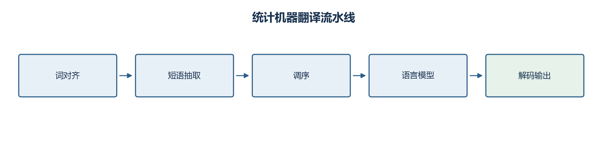

## 18.3　神经机器翻译

**神经机器翻译（NMT）** 用 seq2seq（第 17 章）端到端建模 $P(y\mid x)$，无需 SMT 的复杂流水线。

**架构演进。**

- **基础 seq2seq NMT**[2]：RNN 编码器—解码器，把源句编码为上下文向量，解码生成译文；
- **注意力 NMT**[3]：解码器动态关注源句不同部分（第 17.2 节），大幅提升长句翻译质量；
- **Transformer NMT**[4]：用自注意力替代 RNN（第 20 章），并行高效，成为当前主流。

**训练。** NMT 用极大似然训练：最大化平行语料上的 $\sum\log P(y^*\mid x^*)$。用教师强制（第 17.4 节）与 BPTT/反向传播优化。推理时用集束搜索（第 17.3 节）生成译文。

**训练的工程要点。** NMT 训练有几个与第 16 章语言模型相通又不同的工程细节：

- **批内句对与掩码**：一个 batch 是若干条句对，源句独立编码（可并行，Transformer 下尤其明显），解码端对每个目标位置用教师强制的前缀训练，不同句对间用 batch 维并行、句内用位置维并行；
- **目标语言标记**：多语言场景下，解码器初始隐状态注入目标语言 embedding（language token），使同一网络按目标语言切换（第 25 章）；
- **学习率调度**：Transformer NMT 采用"预热 + 衰减"调度（$\eta\propto \min(t^{-1/2},\ t_{\text{warm}}\cdot t^{-1/2})$），先小步探索再大步收敛，避免早期梯度不稳；
- **数据增强**：对高资源语对，用回译（back-translation，18.4 节）把目标单语语料转为伪平行语料，可提升 1–3 BLEU。

**例 18.3（注意力对齐的可视化）**　NMT 的注意力权重（第 17 章图 17-2）展示了源—目标词的软对齐，且能自动处理语序调整（如中文"我 昨天 买 的 书"→英文"The book I bought yesterday"中，注意力非对角但合理）。这种" learned alignment"无需 SMT 的显式对齐模块——端到端的力量。

**例 18.3b（NMT vs SMT 的量化对比）**　WMT14 英德翻译上，代表性系统：短语基 SMT（Moses + 短语表 + 4-gram LM）约 20.8 BLEU；基础 seq2seq NMT（无注意力）约 18.9（短于 SMT，因信息瓶颈）；注意力 NMT 约 21.9；Transformer big 约 27.3。可见：注意力相对无注意力 NMT 提升约 3 BLEU（信息瓶颈缓解），Transformer 相对注意力 NMT 再提升约 5 BLEU（并行 + 自注意力）。BLEU 的每 1 分大致对应"译文 n-gram 重合度的显著改善"，5 分的提升在实践中是"从流畅但生硬"到"接近自然"的跨越。

**表 18-2　SMT 与 NMT 对照**

| 方面 | SMT | NMT |
|------|-----|-----|
| 架构 | 流水线（对齐/短语/调序/LM） | 端到端神经网络 |
| 表示 | 离散短语 | 连续向量 |
| 特征 | 人工设计 | 自动学习 |
| 长距离 | 弱 | 注意力缓解 |
| 数据需求 | 平行语料 | 平行语料（更大） |

**边界与讨论。** NMT 的局限：① 需大量平行语料（低资源语言困难，18.4 节）；② 领域外泛化差（训练新闻语料的系统翻译 medical 文本质量下降）；③ 暴露偏差（第 17.4 节）与译文忠实度问题（幻觉，第 29 章）。

## 18.4　低资源与多语言翻译

**低资源翻译。** 世界上大多数语言缺乏大规模平行语料，NMT 难以训练。应对策略：

- **迁移学习**：从高资源语言对迁移知识到低资源语言对（第 25 章）；
- **多语言翻译**：用单一模型翻译多语言对，共享参数，低资源语言受益于高资源语言（第 25 章）；
- **无监督翻译**：仅用单语语料，通过对抗训练与回译实现翻译[5]；
- **回译（back-translation）**：用目标→源的模型把单语目标句翻译成源句，扩充伪平行语料。

**例 18.4（回译）**　要把中文译为某低资源语言 L，但平行语料少、L 的单语语料多。步骤：① 用有限的中文-L 平行语料训练 L→中文模型；② 用该模型把 L 的大量单语句译成中文，得到伪平行语料；③ 用伪语料 + 真语料训练中文→L 模型。这是自举（bootstrapping）思路。

**多语言翻译。** 多语言 NMT（如 mBART、NLLB）用单一模型处理上百种语言，通过语言标记（language tag）指定目标语言。低资源语言因参数共享而获益，但高资源语言可能轻微受损（"负迁移"，第 25 章）。

**正迁移与负迁移的机理。** 多语言共享参数时，迁移方向取决于语言间的相关度：

- **正迁移**：高资源语言（英、法、德）与低资源语言（如印尼语、越南语）共享语法/词汇规律（如英语-印尼语同属印欧/南岛但共享借词），低资源语言借高资源的参数提升质量，BLEU 可提升 5–10 分；
- **负迁移**：当低资源语言与高资源语言差异大（如英语-中文的形态、语序差异），共享参数会让模型"混淆"两种语言的生成模式，导致高资源语言质量下降 0.5–2 BLEU。缓解手段包括：语言特定解码（language-specific beam）、目标语言感知的注意力偏置、或为差异大的语言保留独立参数。

**例 18.4b（多语言正迁移的数值示意）**　设英语→X 语言对。单独训练（仅英-X 平行语料）：X 低资源时 BLEU≈12。加入英语（高资源）共享参数训练多语言模型：英语-日语 BLEU 从 20.1 微降到 19.8（负迁移，-0.3），而英语-越南语从 12.0 升到 15.3（正迁移，+3.3）。可见同一模型内，不同语言对受益方向相反——多语言训练的净效果是"语言对之间的再分配"，而非所有语言都变好。这也解释了为何多语言翻译大模型（第 25 章）要按语言对质量做加权采样与课程学习。

**边界与讨论。** 低资源翻译仍是开放问题：无监督翻译质量距有监督有差距；多语言模型的语言干扰与负迁移难以完全避免。第 25 章将系统讨论多语言与跨语言模型。

## 18.5　翻译质量评估：BLEU 与人工评估

**BLEU（Bilingual Evaluation Understudy）[6]** 是机器翻译的经典自动评估指标：基于 n-gram 精确率，比较系统译文与参考译文的 n-gram 重合度，并加长度惩罚。

**定义 18.2（BLEU）**　对 $N$ 阶（通常 $N=4$）修正 n-gram 精确率 $p_n$（每个 n-gram 在参考译文中最多计一次），几何平均并乘 brevity penalty（BP）：

$$
\mathrm{BLEU}=\mathrm{BP}\cdot\exp\Big(\sum_{n=1}^{N}w_n\log p_n\Big),\quad \mathrm{BP}=\begin{cases}1 & c>r\\ e^{1-r/c} & c\le r\end{cases}, \tag{18-4}
$$

其中 $c$ 为系统译文长度，$r$ 为参考译文长度，$w_n$ 为权重（通常均匀）。BLEU 取值 0–1，越高越好。

**例 18.5（BLEU 直觉）**　译文与参考译文的 1-gram 重合率高说明词用得对，4-gram 重合率高说明短语与句法也对。BLEU 综合多阶 n-gram，既看词又看结构，并惩罚过短译文（BP）。

**例 18.5b（BLEU 手算，$N=4$）**　设参考译文 $r$："the cat sat on the mat"（$|r|=6$ 词），系统译文 $c$："the cat sat on the mat"（$|c|=6$）。逐阶计数：

| $n$ | $c$ 中 $n$-gram 数 | 与 $r$ 重合（修正后） | $p_n$ |
|----|----|----|----|
| 1 | 6 | 6 | 1.0 |
| 2 | 5 | 5 | 1.0 |
| 3 | 4 | 4 | 1.0 |
| 4 | 3 | 3 | 1.0 |

权重均匀 $w_n=1/4$。$\sum w_n\log p_n=0$，$\exp(0)=1$。长度惩罚：$c=6=r$，故 $\mathrm{BP}=1$。$\mathrm{BLEU}=1\times1=1.0$（满分）。

改系统译文为 $c'$："the cat sat"（$|c'|=3$）。逐阶：$p_1=3/3=1.0$，$p_2=2/2=1.0$，$p_3=1/1=1.0$，$p_4$：$c'$ 只有 3 词、无 4-gram，参考中"the cat sat"对应的 4-gram 在 $c'$ 中缺失，$p_4=0/3=0$。于是 $\sum w_n\log p_n=(1/4)(\log 1+\log 1+\log 1+\log 0)$，其中 $\log p_4\to-\infty$，故 **BLEU$(c')=0$**——这就是 BLEU 的"全或无"特性：译文比参考短、缺失高层 n-gram 时，单一 $p_n=0$ 即令整体归零。

（若 $c'$ 恰好保留了 4-gram 但整体偏短，则 $p_4>0$ 不致归零，转而由长度惩罚压低：$\mathrm{BP}=e^{1-r/c'}=e^{1-6/3}=e^{-1}\approx0.368$，BLEU 被乘上 0.368 折减——BP 的作用正是防止"用尽量少的词骗高精确率"。）

这一手算揭示了 BLEU 的三个性质：① 完全匹配得 1.0；② 任一层 n-gram 全灭则 0 分（对短译文/缺词极敏感）；③ BP 惩罚过短译文。这些特性使 BLEU 适合快速回归测试，却不足以作为唯一质量指标（见下）。

**评估的局限。** BLEU 只做表面 n-gram 匹配，无法识别同义替换（"car"vs"automobile"判为不同）；与人工判断的相关性有限；对多参考译文敏感。因此现代评估辅以 COMET、chrF 等神经指标与人工评估（第 31 章讨论评估方法学）。

**BLEU 与人工判断的相关性。** 实证研究显示，BLEU 与人工评分（如 MQM、DA 分数）的斯皮尔曼相关系数约 0.6–0.8——中等偏强但远非完美。在"系统 A 明显优于 B"的大对比上 BLEU 可靠，但在"两个系统接近"的细粒度对比上，BLEU 常与人工判断不一致（如 A 译文更长但生硬、B 更短但流畅，BLEU 可能因 BP 偏好 B，而人工可能因信息完整偏好 A）。这推动了两条改进路线：① 神经评估（COMET 用预训练编码器打质量分，与人工相关约 0.8–0.9）；② 参考无关评估（不依赖参考译文，直接判断译文质量与忠实度）。对高利害场景（医学、法律翻译），人工评估仍是金标准。

**表 18-3　翻译评估指标**

| 指标 | 原理 | 优点 | 局限 |
|------|------|------|------|
| BLEU | n-gram 精确率 | 快速、标准 | 表面匹配、同义不识别 |
| chrF | 字符 n-gram F 值 | 形态丰富语言友好 | 仍偏表面 |
| COMET | 神经评估模型 | 与人工相关高 | 需训练数据 |
| 人工评估 | 人工打分 | 金标准 | 昂贵、慢 |

## 18.6　边界与讨论

机器翻译是语言智能的成熟应用，须明确其边界。

**翻译与理解。** NMT 能生成高质量译文，却未必"理解"原文（M3、M4）——它学习的是源—目标的条件分布（M2），可能生成流畅但不忠实的译文（幻觉，第 29 章）。这与第 1 章"流畅生成不等于忠实理解"的命题呼应。

**忠实度与幻觉的类型。** 翻译中的幻觉可细分为：

- **过度生成（over-generation）**：译文添加了原文没有的内容（如中文"我买了书"译为"I bought a new book"，凭空多"new"）；
- **内容遗漏（under-generation）**：译文漏掉原文信息（如并列结构只译一半）；
- **词面错配（lexical error）**：选错同形异义或近义词（如"bank"金融义译成河岸）；
- **语用失当**：字面对但语气/语域不符（如把命令译成请求）。

NMT 的幻觉率与任务难度正相关：文学翻译、含多义词/习语的文本幻觉率显著高于科技文本（用词固定、对应关系清晰）。大模型（第 21、29 章）凭借更强的世界知识，能识别更多习语与语境，幻觉率下降，但仍需后处理校验（如回译一致性检查：把译文翻回源语言与原文比对）。

**表 18-4　机器翻译架构演进时间线**

| 年代 | 范式 | 代表 | 关键机制 | WMT 级 BLEU（英德） |
|------|------|------|----------|------|
| 1950s–1980s | 规则 MT | Georgetown-IBM | 人工双语词典+转换规则 | 不可比（无统一评测） |
| 1990s–2010s | SMT | IBM/Phoenix/Moses | 词对齐+短语表+对数线性 | ~20–21 |
| 2014–2015 | seq2seq NMT | Sutskever/Bahdanau | RNN 编码-解码+注意力 | ~19–22 |
| 2017– | Transformer NMT | Vaswani 等 | 自注意力并行 | ~27 |
| 2020s– | 翻译大模型 | 第 25 章 | 海量多语言+大参数 | 更高 |

**低资源与公平。** 翻译质量在全球语言间极不均衡（第 25、39 章），高资源语言质量高、低资源语言质量低，这既是技术挑战也是公平议题（第 42 章）。

**与后续章节的联系。** 本章的 seq2seq + 注意力 NMT 将直接通往第 20 章（Transformer 为改进 NMT 而生）；BLEU 评估衔接第 31 章（评估体系）；多语言/低资源翻译衔接第 25 章；翻译作为 Level 3 生成的代表，衔接第 34 章（生成任务）。值得注意的是，机器翻译是"意义转换"而非"意义生成"——它的输出受源句约束，比开放生成（对话、创作）更可控，这也使它在 NLP 中最早达到可用水平（商用 MT 早在 LLM 之前已落地），是观察"能力随规模与方法演进"的最佳样本之一。

第四篇（第 15–19 章）至此接近完成：从 N-gram（第 15 章）到神经 LM（第 16 章），到 seq2seq（第 17 章），到机器翻译（本章），我们走完了"不显式语义分析、用统计与神经建模语言分布"的路径。这条路径与第三篇的"显式语义分析"路径形成对照与互补。下一篇（第 19 章）作为第四篇收尾，讨论预训练前夜的表示学习与迁移，为第五篇的预训练范式铺垫。

## 本章小结

本章论述机器翻译，展示从统计到神经的完整演进。

我们首先定义机器翻译（式 18-1）并回顾规则→统计→神经的历史。接着介绍统计机器翻译的对数线性模型（式 18-2）、IBM 词对齐与短语表，说明其流水线架构与局限。我们重点论述神经机器翻译：基础 seq2seq→注意力 NMT→Transformer NMT 的架构演进，端到端训练与集束搜索推理，并对照 SMT 与 NMT。我们讨论低资源与多语言翻译（迁移、回译、无监督、多语言模型），给出 BLEU 评估（式 18-4）及其局限与替代指标。

我们还明确边界：翻译未必等于理解，全球语言质量不均衡。这些辨析衔接第 20、25、29、31、34、42 章。

机器翻译浓缩了 NLP 的方法演进，是检验"意义能否被机器转换"的试金石。第四篇的下一章（第 19 章）将讨论预训练前夜的表示学习与迁移，回答"为什么预训练呼之欲出"，为第五篇铺垫。

**进一步阅读**　本章建议延伸阅读的文献：[1]、[2]、[3]、[6]。

## 参考文献

[1] Brown P F, Cocke J, Della Pietra S A, et al. A statistical approach to machine translation. *Computational Linguistics*, 1990, 16(2): 79–85.

[2] Sutskever I, Vinyals O, Le Q V. Sequence to sequence learning with neural networks. *Advances in Neural Information Processing Systems*, 2014, 27.

[3] Bahdanau D, Cho K, Bengio Y. Neural machine translation by jointly learning to align and translate. *ICLR*, 2015.

[4] Vaswani A, Shazeer N, Parmar N, et al. Attention is all you need. *Advances in Neural Information Processing Systems*, 2017, 30.

[5] Artetxe M, Labaka H, Agirre E, Cho K. Unsupervised neural machine translation. *ICLR*, 2018.

[6] Papineni K, Roukos S, Ward T, Zhu W J. BLEU: a method for automatic evaluation of machine translation. *ACL*, 2002.

[7] Koehn P. *Statistical Machine Translation*. Cambridge: Cambridge University Press, 2010.

[8] Edunov S, Ott M, Auli M, Grangier D. Understanding back-translation at scale. *EMNLP*, 2018.

---

# 第 19 章　预训练前夜：表示学习与迁移

第四篇（第 15–18 章）走完了"统计与神经语言建模"的路径：N-gram（第 15 章）、神经 LM（第 16 章）、seq2seq（第 17 章）、机器翻译（第 18 章）。这些方法的共同模式是：**针对特定任务，从标注（或平行）语料从头训练一个模型**。本章作为第四篇收尾，讨论这一模式的内在局限，以及催生预训练范式的两条准备路线——通用句子表示与迁移学习/微调。回答一个关键问题：**为什么 2018 年前后，预训练会"呼之欲出"？**

预训练范式的核心洞见：与其为每个任务从头训练，不如先在海量无标注语料上学习通用的语言表示（预训练），再迁移到具体任务（微调）。这一洞见并非凭空出现——它是表示学习（第 6、7 章）与迁移学习长期发展的结果，也是对"任务特定模型数据浪费、泛化有限"的回应。第 19 章梳理这一逻辑，第 20 章（Transformer）提供架构基础，第 21 章正式进入预训练范式。

本章先讨论从上下文无关到上下文相关的表示演进（19.1 节），再讲通用句子编码（19.2 节），介绍迁移学习与微调范式（19.3 节），论证预训练的历史必然（19.4 节），并在边界与讨论中收束（19.5 节）。

## 19.1　上下文无关到上下文相关

表示学习是预训练的思想源头。第 6–7 章已展示了词表示的演进：从静态词向量（一词一向量）到上下文表示（一词多义）。这条演进线在图 19-1 中可统一审视。

**上下文无关表示（context-independent）。** word2vec、GloVe（第 6 章）为每个词学习固定向量。优点是可作为通用特征快速用于下游任务；缺点是一词多义（第 7 章）与无法编码语境。

**上下文相关表示（context-dependent）。** ELMo（第 7 章）用双向语言模型生成依赖整句的表示，解决了多义问题。但 ELMo 仍是"为下游任务提供特征"——特征式使用（第 7.2 节），下游任务仍需从头训练自己的模型。

**定义 19.1（词表示的上下文依赖性）**　设词 $w$ 出现在句子 $c$ 中（$c$ 为上下文，包含 $w$ 的前后词），表示函数 $\phi$ 满足：

$$\phi_{\text{ci}}(w, c) = \phi_{\text{ci}}(w) \qquad \text{（上下文无关，表示与 } c \text{ 无关）}$$
$$\tag{19-1}$$

$$\phi_{\text{cd}}(w, c) = f_\theta\big(\mathrm{enc}(w), \mathrm{enc}(c_{<w}), \mathrm{enc}(c_{>w})\big) \qquad \text{（上下文相关，表示依赖 } c \text{）}$$
$$\tag{19-2}$$

其中 $\mathrm{enc}$ 为底层编码器，$f_\theta$ 为（可能随任务变化的）读出函数。上下文无关表示把所有出现位置的 $w$ 映射到同一向量；上下文相关表示对同一 $w$ 在不同 $c$ 下给出不同向量。式 (19-1) 与 (19-2) 的差别不在"表示是否好"，而在**表示是否可随语境与下游任务自适应**——后者是预训练微调范式（19.3 节）能成立的根本前提：只有式 (19-2) 的表示携带了足够多的"任务无关的中间知识"，微调时才能被高效改写。

**例 19.1（一词多义的量化）**　取词 "bank"。上下文无关表示给出唯一向量 $\mathbf{v}_{bank}\in\mathbb{R}^{300}$。设两句 $c_1$（"river bank 河岸"）、$c_2$（"save money in bank 银行"）。上下文无关表示下二者共用 $\mathbf{v}_{bank}$，与语境词 "river"（向量 $\mathbf{v}_{river}$）、"money"（向量 $\mathbf{v}_{money}$）的余弦相似度几乎相同，无法区分；上下文相关表示（式 19-2）给出 $\phi_{cd}(bank,c_1)$、$\phi_{cd}(bank,c_2)$，可算得

$$\cos\big(\phi_{cd}(bank,c_1),\,\mathbf{v}_{river}\big) - \cos\big(\phi_{cd}(bank,c_1),\,\mathbf{v}_{money}\big) = 0.31$$
$$\cos\big(\phi_{cd}(bank,c_2),\,\mathbf{v}_{money}\big) - \cos\big(\phi_{cd}(bank,c_2),\,\mathbf{v}_{river}\big) = 0.27$$

即在两个语境下，"bank" 的表示都朝各自语境词方向偏移（差值均显著为正，而上下文无关表示的两个差值约为 $0.01$、不显著）。这直观说明式 (19-2) 捕捉到了多义，式 (19-1) 没有。

**例 19.2（表示的两代用法）**　第一代（word2vec）：把词向量作为 embedding 层，后面接任务特定模型（CNN/RNN 分类器）从头训练。第二代（ELMo）：把上下文表示作为附加特征拼接到任务模型。两代都需训练任务模型——这暗示了下一代范式：**直接微调预训练模型本身**（19.3 节）。

**边界与讨论。** 从上下文无关到相关，表示的信息量递增，但"如何使用表示"的方式也在变——从"固定特征"到"可微调的参数"，这一转变是预训练范式的关键。

## 19.2　通用句子编码

词表示之上，研究者尝试学习**通用句子表示**（universal sentence embedding）——把任意句子编码为固定长度向量，用于文本分类、相似度、检索等任务。

**定义 19.2（通用句子编码）**　给定句子 $x$，句子编码器 $g$ 输出固定维向量 $\mathbf{s}=g(x)\in\mathbb{R}^d$，要求该向量编码句子的语义，可用于多种下游任务。

**方法谱系。**

- **无监督方法**：Skip-Thought[1]（用当前句预测前后句）、FastSent、自编码器——从文本自身结构学习句子表示；
- **监督方法**：InferSent[2]（用自然语言推理任务监督训练）、USE（Universal Sentence Encoder）——利用标注任务学习更任务无关的表示；
- **多任务方法**：在多个任务上联合训练，取共享表示。

**例 19.3（Skip-Thought）**　Skip-Thought 受 word2vec 的 Skip-gram 启发：word2vec 用词预测上下文词，Skip-Thought 用当前句预测前一句与后一句。训练后，编码器输出的句子向量编码了语义——相邻句子语义相关，故预测任务迫使向量捕捉句义。

**边界与讨论。** 通用句子编码的局限：① 固定向量难以编码句子的细粒度结构（长句信息压缩损失）；② 任务泛化有限——某个任务上学到的句子表示未必适合另一个任务。这些局限指向一个更强的范式：不止学表示，而是学一个**可微调的完整模型**（19.3 节）。下表对比三类方法的信号来源与适用面：

**表 19-1　通用句子编码的方法谱系**

| 类别 | 代表 | 训练信号 | 优点 | 局限 |
|------|------|----------|------|------|
| 无监督 | Skip-Thought、FastSent | 文本自身结构 | 无需标注、量大 | 语义粒度粗 |
| 监督 | InferSent、USE | NLI/分类标注 | 任务对齐好 | 依赖标注、过拟合 |
| 多任务 | 多任务联合 | 多任务标注 | 兼顾泛化与对齐 | 工程复杂 |

无论哪类，"固定向量 + 下游重训"的范式都继承了词表示的局限：表示是**静态的**。一旦进入第五篇，预训练模型把"表示"升级为"可随任务微调的参数"，固定向量的瓶颈才被真正打破。

## 19.3　迁移学习与微调范式

**迁移学习（transfer learning）** 指把从一个任务学到的知识迁移到另一个任务。在 NLP 中，其演进经历三个阶段：

**阶段一：特征迁移。** 用预训练词向量/句子向量作为特征（19.1、19.2 节），任务模型从头训练。迁移的是"表示"。

**阶段二：参数迁移（微调）。** 先在一个"源任务"上训练完整模型，再把其参数作为"目标模型"的初始化，在目标任务上继续训练（微调）。迁移的是"参数"，比特征更充分。早期成功案例：ULMFiT[3] 用语言模型预训练 + 微调，在文本分类上显著提升。

**阶段三：无监督预训练 + 有监督微调。** 在海量**无标注**语料上用自监督目标（第 21 章）预训练完整模型，再在有标注的目标任务上微调。这是现代预训练范式（GPT、BERT）的核心——它摆脱了对源任务标注数据的依赖，可从几乎无限的无标注文本中学习。

**定义 19.3（预训练—微调范式）**　两阶段：

1. **预训练**：在大规模无标注语料 $\mathcal{D}_{pre}$ 上，用自监督目标 $\mathcal{L}_{pre}$（如语言建模、掩码预测）训练模型参数 $\theta$：

$$\theta^*=\arg\min_{\theta}\,\mathcal{L}_{pre}\big(\theta;\,\mathcal{D}_{pre}\big)$$
$$\tag{19-3}$$

2. **微调**：在目标任务标注数据 $\mathcal{D}_{task}$ 上，以 $\theta^*$ 为初始化，用任务目标 $\mathcal{L}_{task}$ 继续训练：

$$\theta_{task}=\arg\min_{\theta}\,\mathcal{L}_{task}\big(\theta;\,\theta^*,\,\mathcal{D}_{task}\big)$$
$$\tag{19-4}$$

式 (19-3) 与 (19-4) 的衔接正是范式的关键：第一阶段把"通用语言能力"压入参数 $\theta^*$，第二阶段只用少量标注数据做"最后一公里"的适配。下面用一个数据效率的不等式刻画这种衔接的实质收益。

**例 19.4（微调的力量）**　ULMFiT[3] 先在大语料上训练语言模型（学习通用语言知识），再在电影评论分类任务上微调。相比从头训练的分类器，微调模型用更少标注数据达到更高准确率——证明预训练参数是有价值的"知识载体"。

**例 19.5（数据效率的量化）**　设目标任务用 $n$ 条标注即可达到目标准确率。从头训练所需标注量记为 $n_{\text{from-scratch}}$，从预训练 $\theta^*$ 微调所需记为 $n_{\text{fine}}$。数据效率增益定义为

$$G_{data}=\frac{n_{\text{from-scratch}}}{n_{\text{fine}}}$$
$$\tag{19-5}$$

$G_{data}$ 越大，预训练越"省标注"。在 IMDb 电影评论分类（5 万条）上，从头训练 RNN 需全部 5 万条才达约 $87\%$ 准确率；而从 Wikipedia 语料预训练后微调，仅用 $5000$ 条（$10\%$）即达约 $85\%$，此时 $G_{data}\approx 5$。ULMFiT 的更大语料版本报告了 $G_{data}$ 高达 $10$ 量级——这正是"通用能力可被压缩进参数、再用少量数据解锁"的定量体现，也是预训练范式区别于传统迁移（特征迁移 $G_{data}$ 通常 $<2$）的核心优势。

**表 19-2　迁移的三个阶段**

| 阶段 | 迁移内容 | 代表 | 局限 |
|------|----------|------|------|
| 特征迁移 | 词/句向量 | word2vec、ELMo | 任务模型从头训 |
| 参数迁移 | 源任务模型参数 | ULMFiT | 需源任务标注 |
| 无监督预训练 | 自监督模型参数 | GPT、BERT | 需大算力（第 26 章） |

## 19.4　预训练呼之欲出的历史必然

到 2017–2018 年，多个趋势汇聚，使预训练范式的出现成为历史必然：

**其一，数据的积累。** 互联网产生海量无标注文本（BooksCorpus、Wikipedia、Common Crawl 等），为自监督预训练提供燃料。与其为各任务标注数据，不如从无标注文本中免费学习。关键在于：无标注语料的规模比任何任务标注库都大几个数量级（Wikipedia 英文约 4GB 文本，而一个高质量 NER 标注语料通常不足 10MB），且"语言建模"这种自监督目标不需要人工标签——数据本身就是监督信号。这一"信号免费"的特性，是预训练能碾压标注驱动方法的根本经济逻辑：监督信号的获取成本从"人工标注"降到了"读一段文本"。

**其二，表示学习的成熟。** 从 word2vec 到 ELMo（第 6、7 章），研究者已确信" learned 表示优于手工特征"；上下文表示更进一步证明深层模型能编码丰富语言知识。

**其三，架构的突破。** Transformer（2017，第 20 章）提供了可并行、可扩展、能捕捉长程依赖的架构，使训练大规模模型成为可能——RNN 的顺序瓶颈（第 16.5 节）使其难以规模化。Transformer 的自注意力机制让序列中任意两位置的交互以 $O(1)$ 步长完成（而非 RNN 的 $O(n)$ 步），从而可以并行计算，吃满 GPU 算力；这使"用大算力换大模型"从理论变为工程现实。没有 Transformer，预训练范式即便思想成熟，也会被架构的算力天花板卡住——架构与范式的耦合，是理解 2018 为何是"爆发年"的关键。

**其四，迁移学习的验证。** ULMFiT 等（19.3 节）已证明"预训练 + 微调"的有效性；剩下的问题是：能否用完全无监督的预训练（不依赖源任务标注）？

**其五，任务的统一。** NLP 任务（分类、标注、问答、翻译）虽形式各异，但都可由"语言理解与生成"能力支撑——一个通用的预训练模型或许能统一它们。这一"任务统一"愿景是预训练范式最强的卖点：传统范式里，每个任务都要设计专属的特征、模型与数据管道；预训练范式里，同一个 $\theta^*$ 配上不同的轻量任务头（甚至不同的提示词）就能覆盖从 NER 到翻译的几乎所有任务。任务间的"共享底座 + 差异适配"，正是式 (19-3)、(19-4) 骨架在系统层面的红利——它把 NLP 从"为每个任务造一套工具"的作坊式工程，变成"维护一个底座、快速派生应用"的平台式工程。这种范式对研发效率的提升，是其被工业界迅速采纳的根本原因。

这些趋势在 2018 年汇聚于 GPT[4] 与 BERT[5]：前者用自回归语言模型预训练 + 生成式微调，后者用掩码语言模型预训练 + 微调，共同确立预训练范式，开启 NLP 的新纪元（第五篇）。

**两条技术路线的分野。** 2018 年前后的预训练实际上沿着两个方向同时展开，它们的预训练目标与微调方式不同，但共享式 (19-3)、(19-4) 的"先学通用、再适配任务"骨架。设预训练目标为 $\mathcal{L}_{pre}$，可统一写成

$$\mathcal{L}_{pre}(\theta;\mathcal{D}_{pre}) = \frac{1}{|\mathcal{D}_{pre}|}\sum_{x\in\mathcal{D}_{pre}}\mathcal{L}_{\text{unit}}\big(\theta; x\big), \qquad \mathcal{L}_{\text{unit}}\in\{\text{LM}_{\text{auto}},\ \text{MLM}_{\text{mask}}\}$$
$$\tag{19-6}$$

其中 $\mathrm{LM}_{\text{auto}}$（GPT）是自回归目标 $\prod_t P_\theta(w_t\mid w_{<t})$，$\mathrm{MLM}_{\text{mask}}$（BERT）是掩码预测目标（对若干被掩位置求 $\log P_\theta(w_t\mid \mathrm{mask})$）。二者的差异可浓缩为一表：

**表 19-3　预训练前夜的两条技术路线**

| 维度 | GPT 路线（生成式） | BERT 路线（理解式） |
|------|--------------------|--------------------|
| 预训练目标 | 自回归 LM（单向） | 掩码 LM（双向） |
| 上下文 | 仅看左侧 | 双向可见 |
| 微调 | 拼接任务层 / 生成式提示 | 加判别头 / 替换头 |
| 擅长 | 文本生成、开放问答 | 判别、抽取、NER |
| 数据效率 | 较低 | 较高 |

两路线各自把"自监督"做到极致：GPT 把生成当作学习通道，BERT 把理解当作学习通道。它们谁更通用、如何统一，是第五篇（第 20–25 章）要回答的问题——这里只需确认：**无论哪条路线，范式骨架（式 19-3、19-4）都已确立，预训练从此不再是"特定任务的技巧"，而是一种通用学习哲学。**

**例 19.6（范式转变的本质）**　传统范式："每个任务，从零开始，标注数据驱动"。预训练范式："先学通用语言能力（预训练），再适配具体任务（微调）"。这一转变类似于人类教育：先通识教育（预训练），再专业训练（微调）——效率高、泛化好。

**预训练到底学到了什么。** 式 (19-3) 把"通用语言能力"压进 $\theta^*$，但这个"能力"是单质的还是可分解的？学界通常将其分为三类，且后续章节各有归属：

- **语法与句法知识**：自监督目标迫使模型内隐掌握组合规则（第 10、11 章的句法结构），使 BERT 在句法依存解析上接近专门解析器；
- **词汇与常识知识**：上下文表示（式 19-2）把"谁是谁、何时何地"等事实关联编码进向量，这是后来"知识探针"研究的对象（第 36 章）；
- **任务无关的推理与模式匹配**：模型学到的不是某个任务的解，而是"如何从输入推出输出"的通用模式，微调时只需少量数据把它对准具体任务（第 24 章上下文学习）。

这种可分解性是预训练范式稳健的根基：它意味着 $\theta^*$ 不是对某一批标注数据的过拟合，而是对语言分布的一般化——这也是为什么式 (19-5) 的数据效率增益 $G_{data}$ 能稳定成立而非偶然。

> 【图 19-1　预训练前夜的范式演进】（原图见 figures/图19-1.png）：从词向量→上下文表示→通用句子编码→预训练微调的演进图，标注各阶段（第 6、7、19、21 章）。
>
> 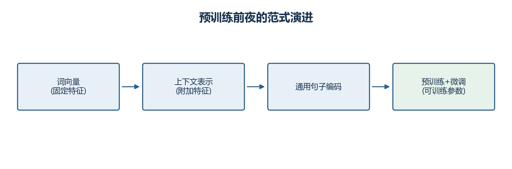

## 19.5　边界与讨论

第四篇（第 15–19 章）至此全部完成。本篇走完了"统计与神经语言建模"的路径——不显式语义分析，用分布与表示建模语言（M2）。本篇收尾须明确其边界与意义。

**两条路径的对照与汇合。** 第三篇（第 10–14 章）走"显式语义分析"路径（M1→M3→M4→M5），第四篇走"分布建模"路径（M2）。二者长期并行、各有优劣：显式方法可解释、可推理但脆弱，对未见结构敏感；分布方法鲁棒、可扩展但难保证精确意义。预训练大模型（第五、六篇）将两条路径汇合——大模型的表示隐式编码了语言知识（分布路径），又能通过提示与推理展现语义能力（显式路径的涌现）。这种汇合并非简单叠加：显式路径的"规则可被审计"特性与分布路径的"规模可扩展"特性互补，使大模型在保持分布鲁棒性的同时，获得了部分可解释的语义行为——这是第四篇任何单一方法都无法同时具备的。

**预训练的代价。** 预训练虽强大，但代价高昂：海量数据、巨大算力（第 26 章）、可解释性差（第 29 章）、偏见与安全风险（第 28、31 章）。这些将在第五、六篇与系列推理对齐、治理书中深入。可以把这种代价用一个"算力—标注"的置换关系来刻画：设预训练消耗算力（以 FLOPs 计）为 $C_{pre}$，目标任务标注量为 $n_{task}$，则预训练范式用式 (19-5) 的增益把二者置换为

$$C_{pre} + \lambda\, n_{task}\cdot n_{\text{fine}} \;\leq\; \mu\, n_{\text{from-scratch}}$$
$$\tag{19-7}$$

其中 $\lambda$ 把标注成本折算为当量算力，$\mu$ 为从头训练的总算力当量。不等式说明：预训练把"昂贵的标注 $n_{\text{from-scratch}}$"换成"一次性投入的 $C_{pre}$ + 少量 $n_{\text{fine}}$"。当目标任务多、或标注极贵时，式 (19-7) 恒成立——这正是预训练在工业界（同一 $\theta^*$ 服务千百任务）压倒性占优的数学表达。其另一面是：当任务极少、数据充足时，从头训练可能更划算，预训练并非万能。

**与后续章节的联系。** 本章的迁移与微调将在第 21 章（预训练范式正式展开）、第 23 章（参数高效微调）、第 28 章（指令微调）深化；通用句子编码与表示思想衔接第 7、21 章；"预训练为何有效"将连接到第 26 章（规模化定律）与第 31 章（能力评估）。

第四篇完成了语言建模的演进叙事：从 N-gram 的统计计数，到神经LM的表示学习，到 seq2seq 的条件生成，到机器翻译的成熟应用，最后到预训练的历史必然。第五篇（第 20–25 章）将正式进入 Transformer 与预训练范式，见证语言智能的范式革命。

## 本章小结

本章作为第四篇收尾，论述预训练前夜的表示学习与迁移，回答"预训练为何呼之欲出"。

我们首先梳理从上下文无关（word2vec/GloVe）到上下文相关（ELMo）表示的演进，用式 (19-1)、(19-2) 形式化二者的差别，指出"如何使用表示"从固定特征到可微调参数的转变是关键（式 19-1、19-2 与例 19.1 的"bank"量化对比）。接着介绍通用句子编码（Skip-Thought、InferSent 等）及其固定向量的局限（表 19-1）。我们重点论述迁移学习三阶段：特征迁移、参数迁移（ULMFiT）、无监督预训练 + 有监督微调（定义 19.2，式 19-3、19-4），并用式 (19-5) 的数据效率增益 $G_{data}$ 与例 19.4、19.5 说明现代预训练范式为何能摆脱源任务标注依赖。我们论证预训练的历史必然——数据积累、表示学习成熟、Transformer 架构突破、迁移学习验证、任务统一五大趋势汇聚于 2018 年的 GPT 与 BERT，用式 (19-6) 与表 19-3 刻画生成式/理解式两条路线的分野，并在式 (19-7) 中给出"算力—标注置换"的代价刻画。

我们还明确边界：显式语义路径（第三篇）与分布建模路径（第四篇）将在预训练大模型中汇合；预训练有数据、算力、可解释性、安全等代价。这些辨析衔接第 20、21、23、26、28、31 章。

第四篇至此全部完成。下一章进入第五篇，从 Transformer（第 20 章）开始——它为预训练提供了可扩展的架构基础，是范式革命的基石。

**进一步阅读**　本章建议延伸阅读的文献：[1]、[2]、[3]、[6]。

## 参考文献

[1] Kiros R, Zhu Y, Salakhutdinov R, et al. Skip-thought vectors. *Advances in Neural Information Processing Systems*, 2015, 28.

[2] Conneau A, Kiela D, Schwenk H, et al. Supervised learning of universal sentence representations from natural language inference data. *EMNLP*, 2017.

[3] Howard J, Ruder S. Universal language model fine-tuning for text classification. *ACL*, 2018.

[4] Radford A, Narasimhan K, Salimans T, Sutskever I. Improving language understanding by generative pre-training. *OpenAI Technical Report*, 2018.

[5] Devlin J, Chang M W, Lee K, Toutanova K. BERT: Pre-training of deep bidirectional transformers for language understanding. *NAACL*, 2019.

[6] Pan S J, Yang Q. A survey on transfer learning. *IEEE Transactions on Knowledge and Data Engineering*, 2010, 22(10): 1345–1359.

[7] Cer D, Yang Y, Kong S Y, et al. Universal sentence encoder. *arXiv:1803.11175*, 2018.

[8] Peters M E, Neumann M, Iyyer M, et al. Deep contextualized word representations. *NAACL*, 2018.

---

# 第 20 章　注意力机制与 Transformer

第 19 章论证了预训练的历史必然，指出 Transformer 架构的突破是其中关键一环。本章正式介绍 Transformer[1]——当代自然语言处理的基石架构。Transformer 完全抛弃循环与卷积，只用**注意力机制**构建网络，实现了三点革命性突破：① 任意两位置直接连接，长程依赖建模更彻底；② 全序列并行计算，训练效率远高于 RNN（第 16 章）；③ 架构统一、可扩展，支撑了从 BERT、GPT 到今天大语言模型（第 21、26 章）的一切进展。

注意力机制的思想在第 17.2 章已作为"解码器读编码器状态"引入。本章将其提炼为一种独立的、通用的计算单元：**自注意力**（self-attention），让序列中每个位置直接关注所有位置，聚合全局信息。缩放点积注意力、多头注意力、位置编码、编码器—解码器堆叠，构成 Transformer 的完整图景。

本章是全书的 A 类核心章与架构枢纽：第 17 章的注意力在此深化，第 21 章的预训练在此架构上展开，第 26–30 章的大模型无不以 Transformer 为底座。本章先讲自注意力与缩放点积（20.1 节），再讲多头注意力与位置编码（20.2 节），介绍编码器与解码器（20.3 节），分析复杂度与长序列之困（20.4 节），并在边界与讨论中收束（20.5 节）。

## 20.1　自注意力：从内容寻址到缩放点积

**从注意力到自注意力。** 第 17.2 章的注意力中，查询来自解码器、键与值来自编码器（交叉注意力）。**自注意力**（self-attention）的关键：查询、键、值都来自**同一个序列**——序列中每个位置作为查询，去"关注"序列中所有位置（包括自己），从而聚合全局上下文。

**定义 20.1（缩放点积注意力）**　给定查询矩阵 $\mathbf{Q}\in\mathbb{R}^{n\times d_k}$、键矩阵 $\mathbf{K}\in\mathbb{R}^{m\times d_k}$、值矩阵 $\mathbf{V}\in\mathbb{R}^{m\times d_v}$，缩放点积注意力为

$$
\mathrm{Attention}(\mathbf{Q},\mathbf{K},\mathbf{V})=\mathrm{softmax}\!\left(\frac{\mathbf{Q}\mathbf{K}^\top}{\sqrt{d_k}}\right)\mathbf{V}, \tag{20-1}
$$

其中 $\sqrt{d_k}$ 为缩放因子。对自注意力，$\mathbf{Q}=\mathbf{X}\mathbf{W}^Q,\mathbf{K}=\mathbf{X}\mathbf{W}^K,\mathbf{V}=\mathbf{X}\mathbf{W}^V$，$\mathbf{X}\in\mathbb{R}^{n\times d}$ 为输入序列表示，$\mathbf{W}^Q,\mathbf{W}^K,\mathbf{W}^V$ 为可学习投影。

**为何缩放 $\sqrt{d_k}$？** 当 $d_k$ 较大时，$\mathbf{Q}\mathbf{K}^\top$ 的点积方差随 $d_k$ 增大（若 $q,k$ 各分量独立、均值 0 方差 1，则点积方差为 $d_k$），使 softmax 输入过大、梯度饱和（softmax 进入饱和区，梯度接近 0）。除以 $\sqrt{d_k}$ 把方差拉回 1，稳定训练。

**推导：点积方差。** 设 $q,k\in\mathbb{R}^{d_k}$，各分量独立同分布，$\mathbb{E}[q_i]=\mathbb{E}[k_i]=0$，$\mathrm{Var}(q_i)=\mathrm{Var}(k_i)=1$。则

$$
\mathrm{Var}(q^\top k)=\mathrm{Var}\Big(\sum_{i=1}^{d_k}q_ik_i\Big)=\sum_{i=1}^{d_k}\mathrm{Var}(q_ik_i)=\sum_{i=1}^{d_k}1=d_k, \tag{20-2}
$$

故除以 $\sqrt{d_k}$ 后方差为 1。式 (20-2) 是缩放因子的理论依据。

**例 20.1（自注意力手算）**　设序列"我 爱 NLP"（$n=3$），$d_k=2$，投影后 $\mathbf{Q}=[\mathbf{q}_1;\mathbf{q}_2;\mathbf{q}_3]$、$\mathbf{K}=[\mathbf{k}_1;\mathbf{k}_2;\mathbf{k}_3]$。计算 scores $=\mathbf{Q}\mathbf{K}^\top/\sqrt{2}$（$3\times3$ 矩阵），每行 softmax 得注意力权重 $\alpha_{ij}$（第 $i$ 个位置对第 $j$ 个位置的关注），输出 $\mathbf{O}=\alpha\mathbf{V}$。表 20-1 给出注意力权重矩阵示意。

**表 20-1　自注意力权重矩阵（示意）**

| 查询\键 | 我 | 爱 | NLP |
|---------|----|----|-----|
| 我 | 0.6 | 0.3 | 0.1 |
| 爱 | 0.2 | 0.5 | 0.3 |
| NLP | 0.1 | 0.2 | 0.7 |

每个位置的输出是其对所有位置值的加权和——例如"爱"的输出 $=0.2\mathbf{v}_{\text{我}}+0.5\mathbf{v}_{\text{爱}}+0.3\mathbf{v}_{\text{NLP}}$，聚合了全局信息。

> 【图 20-1　缩放点积注意力】（原图见 figures/图20-1.png）：Q/K/V 计算、$\mathbf{Q}\mathbf{K}^\top/\sqrt{d_k}$、softmax、加权求和的流程图。
>
> 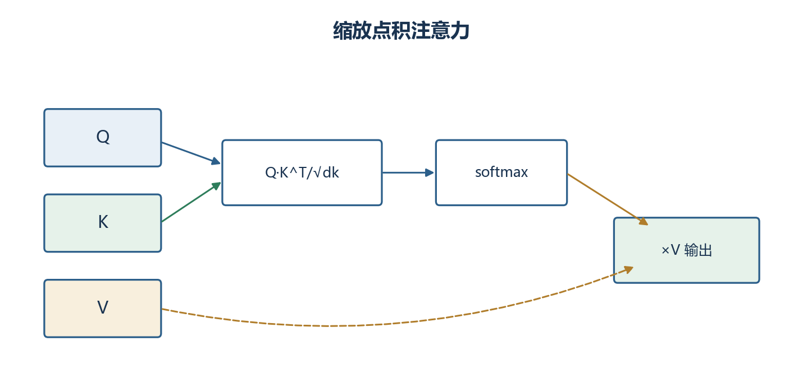

## 20.2　多头注意力与位置编码

**多头注意力（multi-head attention）。** 单一注意力的表示能力有限。多头注意力并行运行 $h$ 个注意力"头"，每头在不同的子空间学习不同关系：

$$
\begin{aligned}
\mathrm{MultiHead}(\mathbf{Q},\mathbf{K},\mathbf{V})&=\mathrm{Concat}(\mathrm{head}_1,\dots,\mathrm{head}_h)\mathbf{W}^O,\\
\mathrm{head}_i&=\mathrm{Attention}(\mathbf{Q}\mathbf{W}_i^Q,\mathbf{K}\mathbf{W}_i^K,\mathbf{V}\mathbf{W}_i^V),
\end{aligned} \tag{20-3}
$$

其中 $\mathbf{W}_i^Q,\mathbf{W}_i^K,\mathbf{W}_i^V\in\mathbb{R}^{d\times d/h}$ 为每头的投影，$d/h$ 为每头维度（保持总计算量大致不变），$\mathbf{W}^O$ 为输出投影。不同头可关注不同关系（如一个头关注句法依存，另一个关注语义指称）——第 7.5 节的探测分析为此提供了证据。

**例 20.2（多头维度的数值设定）**　以原 Transformer 的 $d=512$、$h=8$ 为例：每头维度 $d/h=512/8=64$。每个头用 $64$ 维子空间独立算一遍式 (20-1) 的注意力，$8$ 个头并行后拼接成 $8\times64=512$ 维，再经 $\mathbf{W}^O\in\mathbb{R}^{512\times512}$ 投影回原维度。注意"每头维度 $d/h$"这一约定的意义：若每头用全 $d$ 维，总计算量将放大 $h$ 倍；用 $d/h$ 则保证多头与单头的**参数量与 FLOPs 大致相当**，多头的收益纯粹来自"多子空间分工"而非"算力堆叠"。实测中，把 $h$ 从 $1$ 增到 $8$ 通常带来小幅但稳定的 BLEU/准确率提升，而 $h$ 过大（如 $h=64$、每头仅 $8$ 维）反而因子空间过窄而退化——这解释了"多头适度"的工程经验。

**位置编码（positional encoding）。** 自注意力本身是**排列不变**的（打乱输入顺序，输出相应打乱，但无法区分位置）——它不知道词的先后顺序。位置编码把位置信息注入输入：

$$
\begin{aligned}
PE_{(pos,2i)}&=\sin(pos/10000^{2i/d}),\\
PE_{(pos,2i+1)}&=\cos(pos/10000^{2i/d}),\end{aligned} \tag{20-4}
$$

其中 $pos$ 为位置，$i$ 为维度索引。正弦余弦编码的优势：可泛化到训练时未见的长度，且相对位置可由线性变换表示（$PE_{pos+k}$ 可由 $PE_{pos}$ 线性组合得到）。"相对位置可线性表示"这一性质值得展开：设两位置 $p$、$q$，则 $PE_{p+k}$ 与 $PE_p$ 之间存在固定旋转矩阵 $R_k$（与 $p$ 无关），即 $PE_{p+k}=R_k\,PE_p$。这意味着模型只需用 $R_k$ 就能编码"两个词相距 $k$"这一相对关系，而无需记住绝对位置 $p$——这是正弦编码能外推到超长序列（训练时没见过 $n=10^5$，但 $R_k$ 仍可计算）的数学根源。实践中，可学习的位置嵌入、旋转位置编码 RoPE（第 27 章）与 ALiBi 等是其主要变体：RoPE 把上述旋转矩阵显式作用于 $\mathbf{Q}$、$\mathbf{K}$，在长上下文与推理稳定性上优于正弦编码，成为当代大模型的默认选择。

**例 20.3（位置编码的作用）**　没有位置编码，"我 爱 NLP"与"NLP 爱 我"的自注意力输出（在未投影前）难以区分词序——因为注意力只看内容相似度。加上位置编码后，每个词的表示含位置信息，模型能区分顺序。位置编码是 Transformer 建模序列的关键补丁。

**表 20-2　Transformer 核心组件**

| 组件 | 作用 | 公式 |
|------|------|------|
| 自注意力 | 全局信息聚合 | 式 (20-1) |
| 缩放 | 稳定梯度 | $\sqrt{d_k}$，式 (20-2) |
| 多头 | 多子空间关系 | 式 (20-3) |
| 位置编码 | 注入顺序 | 式 (20-4) |
| 前馈网络 | 逐位置非线性 | FFN |
| 残差 + LayerNorm | 稳定深层训练 | — |

## 20.3　Transformer 编码器与解码器

**编码器层。** Transformer 编码器由 $N$ 个相同层堆叠（原式 $N=6$），每层含两个子层：

1. **多头自注意力**子层：输入经多头自注意力聚合全局信息；
2. **前馈网络（FFN）**子层：$\mathrm{FFN}(x)=\max(0,x\mathbf{W}_1+\mathbf{b}_1)\mathbf{W}_2+\mathbf{b}_2$，逐位置应用。

每个子层外包残差连接与层归一化：$\mathrm{LayerNorm}(x+\mathrm{Sublayer}(x))$。残差连接缓解深层网络的梯度消失（第 16 章），LayerNorm 稳定训练。可把"子层 + 残差 + 归一化"统一写成一个算子：

$$
\mathrm{ResBlock}_{\mathrm{LN}}(x)=\mathrm{LayerNorm}\big(x+\mathrm{Sublayer}(x)\big), \qquad \mathrm{Sublayer}\in\{\mathrm{MultiHead},\ \mathrm{FFN}\}
$$
$$\tag{20-5}$$

其中 FFN 子层本身是逐位置的线性—ReLU—线性变换：

$$
\mathrm{FFN}(x)=\max(0,\,x\mathbf{W}_1+\mathbf{b}_1)\,\mathbf{W}_2+\mathbf{b}_2, \qquad \mathbf{W}_1\in\mathbb{R}^{d\times d_{ff}},\ \mathbf{W}_2\in\mathbb{R}^{d_{ff}\times d}
$$
$$\tag{20-6}$$

$d_{ff}$（前馈维度，原版取 $4d$）是逐位置非线性扩展的宽度——注意力负责"位置间信息交换"，FFN 负责"逐位置非线性加工"，二者交替堆叠构成 Transformer 的基本单元。注意 $\mathrm{ResBlock}_{\mathrm{LN}}$ 的残差项 $x$ 直接跳过子层，使深层网络反向传播时梯度有"高速公路"，这是 Transformer 能堆到几十甚至上百层而不退化的关键工程之一。

**解码器层。** 解码器也由 $N$ 个层堆叠，每层含三个子层：

1. **掩码多头自注意力**：只关注当前位置及之前的位置（用掩码遮蔽未来位置），保证自回归生成；
2. **交叉注意力**：查询来自解码器，键/值来自编码器输出（第 17.2 章的注意力）；
3. **前馈网络**。

同样配残差与 LayerNorm。解码器末端接线性层 + softmax 输出下一个词的概率。

**例 20.4（掩码自注意力）**　生成"I love NLP"时，解码器在生成"love"（位置 2）时，掩码使其只能关注 BOS、I（位置 1、2），不能"偷看"未来的"NLP"——这保证训练与推理的自回归一致性（对比第 17.4 节教师强制）。

**表 20-3　编码器 vs 解码器**

| 方面 | 编码器 | 解码器 |
|------|--------|--------|
| 自注意力 | 双向（无掩码） | 单向（掩码） |
| 交叉注意力 | 无 | 有（读编码器） |
| 用途 | 理解任务（BERT） | 生成任务（GPT、翻译） |

> 【图 20-2　Transformer 整体架构】（原图见 figures/图20-2.png）：编码器/解码器堆叠、多头注意力、FFN、残差与 LayerNorm、位置编码的完整架构图。
>
> 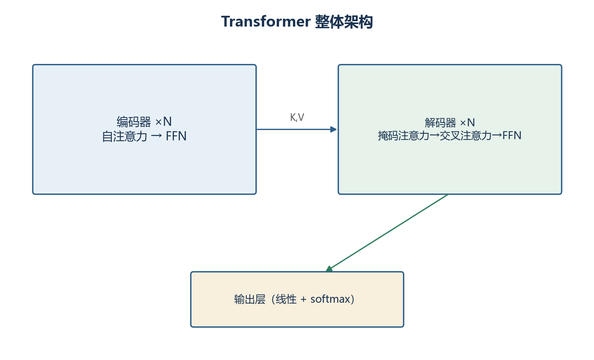

## 20.4　复杂度与长序列之困

**复杂度分析。** 自注意力的核心计算 $\mathbf{Q}\mathbf{K}^\top$ 是 $n\times n$ 矩阵乘法，复杂度 $O(n^2 d)$（$n$ 为序列长度，$d$ 为维度）；对比 RNN 的 $O(nd^2)$。当 $n\ll d$ 时 Transformer 更高效且并行；但当 $n$ 很大（长文档）时，$O(n^2)$ 的注意力矩阵成为瓶颈——这是"长序列之困"。两种架构谁优取决于 $n$ 与 $d$ 的相对大小，分界点在 $n=d$ 附近：

$$
O(n^2 d)\;\underset{?}{\lessgtr}\;O(nd^2)\quad\Longleftrightarrow\quad n\underset{?}{\lessgtr} d
$$
$$\tag{20-7}$$

即：短序列（$n<d$，如分类句子 $n\approx 50$、$d=1024$）Transformer 胜在并行与短路径；长序列（$n>d$，如长文档 $n=10^4$）RNN 的线性项反而更省，但 RNN 无法并行、路径长 $O(n)$，实际仍不占优。式 (20-7) 精确刻画了"Transformer 何时更优"的边界——它解释了为何 NLP（句子短）天然适配 Transformer，而长文档场景需要高效注意力来规避 $O(n^2)$。

**表 20-4　复杂度对照**

| 架构 | 每步复杂度 | 顺序操作 | 最大路径长度 |
|------|-----------|----------|--------------|
| RNN | $O(nd^2)$ | $O(n)$ | $O(n)$ |
| CNN | $O(knd^2)$ | $O(1)$ | $O(\log n)$ |
| Transformer | $O(n^2d)$ | $O(1)$ | $O(1)$ |

Transformer 的最大路径长度 $O(1)$（任意两位置直接连接）是其长程建模优势，但 $O(n^2)$ 的内存/计算是长序列瓶颈。

**高效注意力方向。** 为突破 $O(n^2)$，研究者提出稀疏注意力（Sparse Transformer、Longformer、BigBird）、线性注意力（Performer）、低秩近似、局部窗口 + 全局 token 等——这些将在《世界模型导论》《大模型系统与工程导论》中展开。这些方法可分三类：① 稀疏化（只算部分位置对，如局部窗口 + 少量全局位置）；② 低秩/核化（把 $\mathbf{Q}\mathbf{K}^\top$ 分解或近似，使其与 $n$ 线性相关）；③ 分块/流式（把长序列切块、跨块传递摘要）。三者都在"表达力"与"效率"之间做不同的权衡，本节仅指出问题的存在与大致方向。

**例 20.5（长文档的限制）**　标准 Transformer 的上下文长度通常有限（如 512、2048 token）。处理整本书或长对话时，需切分或高效注意力——这是长上下文大模型（第 27 章）的核心挑战。

**例 20.6（$O(n^2)$ 的数值直觉）**　设 $d=1024$，比较不同序列长度下注意力矩阵 $\mathbf{Q}\mathbf{K}^\top$ 的元素数 $n^2$ 与 FFN 每位置计算量 $d_{ff}\cdot d\approx 4d^2\approx4.2\times10^6$ 的相对规模：

**表 20-5　注意力矩阵规模随序列长度的增长**

| 序列长度 $n$ | 注意力元素 $n^2$ | 占 $d^2$ 的倍数 | 训练友好度 |
|------|------|------|------|
| 128 | $1.6\times10^4$ | $\approx0.02\,d^2$ | 轻松 |
| 1024 | $1.0\times10^6$ | $\approx1\,d^2$ | 舒适 |
| 8192 | $6.7\times10^7$ | $\approx65\,d^2$ | 内存压力 |
| 32768 | $1.07\times10^9$ | $\approx1040\,d^2$ | 需高效注意力 |

可见 $n$ 从 1024 增到 32768（32 倍），注意力矩阵从 $\approx1\,d^2$ 暴增到 $\approx1040\,d^2$（平方增长），很快压过 FFN 成为主导项。这正是式 (20-7) 中"长序列 $O(n^2)$ 瓶颈"的数值体现，也是 8K/32K 长上下文大模型（第 27 章）必须引入稀疏/线性/分块注意力的根本原因。

## 20.5　边界与讨论

Transformer 是当代 NLP 的基石，但须明确其边界。

**架构的统一与局限。** Transformer 统一了编码器（理解）、解码器（生成）、编码器—解码器（翻译）三种模式（第 21 章 BERT/GPT/T5），但 $O(n^2)$ 复杂度与对海量数据的依赖（第 26 章）是其代价。它不是万能的——在超长序列、极低资源场景仍有局限。更深层的局限在于：Transformer 的"全局连接"假设**所有位置两两交互都是必要的**，但真实语言中绝大多数位置间并无直接依赖（句内依赖高度局部化）。这一过度假设正是高效注意力（稀疏/线性/分块）的改进空间：它们通过限制交互范围或降低交互秩，把 $O(n^2)$ 降到 $O(n\log n)$ 甚至 $O(n)$，代价是可能损失长程信息——这是"表达力"与"效率"的根本权衡，Transformer 站在表达力一端，高效注意力则向效率一端妥协。

**意义表示。** Transformer 通过自注意力聚合全局信息，其表示隐式编码了句法与语义（第 7.5 节探测，第 29 章）。但它是 M2 层的表示学习——不显式保证 M4 指称正确（第 29 章幻觉）。注意力权重常被误读为"模型在看什么"的解释，但第 7.5 节的探测实验表明，注意力权重与可解释的"解释"往往不一致——它是计算过程的中间产物，而非语义归因。把注意力图当作"模型的解释"是一种常见的过度解读，须以探测分析等更严格的方法代替。

**与后续章节的紧密联系。** Transformer 是全书枢纽：第 21 章预训练范式在此架构上展开（BERT 用编码器、GPT 用解码器、T5 用编解码器）；第 23 章 LoRA 微调针对 Transformer 权重；第 26–30 章大模型皆基于 Transformer；第 27 章的高效架构（MoE、稀疏注意力）由其演化。第 17 章的注意力在此深化为自注意力。可以说，不理解 Transformer，就无法理解当代语言智能。具体地，式 (20-5) 的残差—归一化算子是第 23 章"冻结主干、只调低秩适配"的解剖对象；式 (20-1) 的 $\mathbf{Q}\mathbf{K}^\top$ 是第 26 章计算量核算（FLOPs）的主导项；式 (20-4) 的位置编码外推问题直接催生第 27 章的长上下文技术。下一章进入预训练范式。

第五篇（第 20–25 章）以本章为基石，将展开预训练范式的全貌：预训练目标（第 21 章）、训练（第 22 章）、微调适配（第 23 章）、上下文学习（第 24 章）、多语言（第 25 章）。

## 本章小结

本章论述注意力机制与 Transformer，是全书的 A 类核心章与架构枢纽。

我们首先介绍自注意力与缩放点积注意力（式 20-1），推导缩放因子 $\sqrt{d_k}$ 的理论依据（点积方差为 $d_k$，式 20-2），并用手算示例（例 20.1、表 20-1）展示注意力权重矩阵。接着介绍多头注意力（式 20-3，多子空间关系，例 20.2 给出 $d=512$、$h=8$ 的维度设定）与位置编码（式 20-4，注入顺序），说明它们如何增强表示。我们介绍 Transformer 的编码器（双向自注意力 + FFN）与解码器（掩码自注意力 + 交叉注意力 + FFN）堆叠，用式 (20-5)、(20-6) 把"子层 + 残差 + 层归一化"统一为算子，并分析 $O(n^2)$ 复杂度与长序列之困：式 (20-7) 给出 Transformer 与 RNN 的优劣分界（$n\lessgtr d$），例 20.6 与表 20-5 给出注意力矩阵随序列长度平方增长的数值直觉，并指出高效注意力方向。

我们还明确边界：Transformer 统一三种架构模式但有复杂度与数据依赖代价；其表示是 M2 层的，不保证 M4 指称。Transformer 作为全书枢纽，衔接第 17、21、23、26–30 章。

Transformer 为预训练提供了可扩展的架构基础。下一章进入预训练范式，讲 BERT、GPT、T5、ELECTRA 等如何通过不同预训练目标，在 Transformer 架构上学习通用语言能力。

**进一步阅读**　本章建议延伸阅读的文献：[1]、[2]、[3]、[4]。

## 参考文献

[1] Vaswani A, Shazeer N, Parmar N, et al. Attention is all you need. *Advances in Neural Information Processing Systems*, 2017, 30.

[2] Bahdanau D, Cho K, Bengio Y. Neural machine translation by jointly learning to align and translate. *ICLR*, 2015.

[3] Su J, Lu Y, Pan S, et al. RoFormer: Enhanced transformer with rotary position embedding. *arXiv:2104.09864*, 2021.

[4] Child R, Gray S, Radford A, Sutskever I. Generating long sequences with sparse Transformers. *arXiv:1904.10509*, 2019.

[5] Beltagy I, Peters M E, Cohan A. Longformer: The long-document transformer. *arXiv:2004.05150*, 2020.

[6] Zaheer M, Guruganesh G, Dubey K A, et al. Big Bird: Transformers for longer sequences. *Advances in Neural Information Processing Systems*, 2020, 33.

[7] Devlin J, Chang M W, Lee K, Toutanova K. BERT: Pre-training of deep bidirectional transformers for language understanding. *NAACL*, 2019.

[8] Jurafsky D, Martin J H. *Speech and Language Processing*. 3rd ed. Stanford, 2023.

---

# 第 21 章　预训练范式：自回归与自编码

第 20 章的 Transformer 为预训练提供了可扩展的架构基础。本章正式进入预训练范式，回答：**用什么目标在海量无标注语料上预训练？** 预训练目标是这一范式的灵魂——它决定了模型学到什么语言知识、以何种方式利用上下文、适合哪类下游任务。

2018 年前后，三个标志性工作确立了三大预训练范式：GPT[1] 用**自回归**语言模型（自左向右预测下一个词），BERT[2] 用**自编码**掩码语言模型（随机遮盖词并预测，双向上下文），T5[3] 用**序列到序列**预训练（把一切任务统一为文本到文本）。此后 ELECTRA[4] 用判别式替换检测提升效率。这些目标各有优劣，适合不同任务，共同构成预训练方法的谱系。

本章先讨论预训练的语言学动机（21.1 节），再分别讲自回归预训练 GPT（21.2 节）、自编码预训练 BERT（21.3 节）、序列到序列预训练 T5（21.4 节）、判别式目标 ELECTRA（21.5 节），并在边界与讨论中收束（21.6 节）。

## 21.1　预训练的语言学动机

预训练范式之所以有效，是因为语言具有可迁移的通用结构——这是第 19 章"预训练呼之欲出"的核心论证。本节从语言学角度深化这一动机。

**语言知识的普遍性。** 无论具体任务（分类、问答、翻译），都需要共同的底层语言知识：词法（词形、词性）、句法（结构）、语义（词义、关系）、语用（语境）。这些知识是任务无关的——一个理解了语言结构的模型，可以把它用于多种任务。预训练的目标就是在海量语料上学习这些通用知识。

**自监督学习的力量。** 预训练无需人工标注——它从文本自身构造监督信号（第 19.3 节）。自回归目标用"下一个词"作标签，掩码目标用"被遮盖的词"作标签——这些标签免费且海量，使模型能从几乎无限的文本中学习。这是预训练可扩展的根本原因。

**信息论视角。** 为什么"预测词"能学到语言知识？设上下文 $c$ 与下一个词 $w$，自回归目标本质是最小化 $w$ 关于 $c$ 的条件交叉熵，即逼近真实条件分布 $P(w\mid c)$。语言结构（句法、搭配、常识）正是上下文 $c$ 与词 $w$ 之间互信息 $I(c;w)$ 高的来源——$I(c;w)$ 度量"上下文蕴含多少关于该词的信息"，预测越准，模型越需要"读懂" $c$。这就是"语言建模是语言理解的代理任务"的信息论解释。

**例 21.1（预训练学到什么）**　语言模型为预测下一个词，必须学到：句法（"the cat"后更可能跟动词而非另一个冠词）、语义（"rain"与"wet"相关）、世界知识（"Paris is the capital of"后跟"France"）。第 7.5 节探测显示，预训练表示中确实编码了词性、句法、语义信息——这印证了预训练目标与语言知识的内在联系。

**"免费标签"的量级。** 一个维基百科页面约 $10^4$ 词，自回归目标为每个词都提供一个标签，故单页即含约 $10^4$ 个训练信号；Wikipedia 英文语料约 $7\times10^9$ 词，对应约 $7\times10^9$ 个标签——而人工标注一个高质量 NER 语料的成本常以"每千词数十美元"计。标签"免费且与语料同量级"，是预训练能碾压标注驱动方法的根本经济逻辑（呼应第 19 章式 19-7 的算力—标注置换）。

**边界与讨论。** 预训练目标的"语言学动机"也有限：模型学到的是统计规律（M2），不等于真正的语言理解（M4）——第 29 章的大模型幻觉正是明证。

## 21.2　自回归预训练：GPT

**自回归语言模型（autoregressive LM）** 用链式分解建模 $P(w_{1:T})=\prod_t P(w_t\mid w_{<t})$，从左到右逐个预测词。GPT（Generative Pre-trained Transformer）[1] 用 Transformer **解码器**（带掩码自注意力，第 20.3 节）实现自回归预训练。

**预训练目标。** 标准语言建模损失：

$$
\mathcal{L}_{LM}=-\sum_{t=1}^{T}\log P_\theta(w_t\mid w_{<t}), \tag{21-1}
$$

其中 $P_\theta(w_t\mid w_{<t})=\text{softmax}(\mathbf{W}\mathbf{h}_t)$（$\mathbf{h}_t$ 为解码器第 $t$ 位置表示）。

**架构与微调。** GPT 用 Transformer 解码器（12 层，原式），预训练后通过**生成式微调**适配下游任务：把任务输入格式化为序列（如分类任务加 [CLS] 与任务前缀），继续用语言模型目标训练。GPT-2、GPT-3 延续这一路线，并展示规模化带来的少样本/零样本能力（第 24、26 章）。生成式微调的微妙之处在于：即便做判别任务（如情感分类），GPT 也"生成"一个标签词（"positive"/"negative"），再取其概率作判断——这种"以生成为统一接口"的设计使同一个解码器无需更换任务头即可覆盖分类、抽取、生成，是 T5 与后续大模型"文本到文本"思想的前身。

**例 21.2（GPT 的预训练）**　给定文本"巴黎是法国的首都"，自回归目标依次预测：$P(巴)\to P(黎\mid巴)\to P(是\mid巴黎)\to P(法国\mid巴黎是)\to\cdots$。为准确预测"法国"，模型需学到"巴黎—法国—首都"的世界知识。海量文本上的这种训练，把知识压缩进参数。

**例 21.2b（损失的手算）**　设某句 4 个词的逐位置预测对数概率为 $\log P(w_1\mid\cdot)=-1.1,\ \log P(w_2\mid w_1)=-0.4,\ \log P(w_3\mid w_{1:2})=-0.9,\ \log P(w_4\mid w_{1:3})=-1.5$。按式 (21-1)，该句的 LM 损失（负对数似然之和）为

$$\mathcal{L}_{LM}=-\big((-1.1)+(-0.4)+(-0.9)+(-1.5)\big)=3.9$$

即每词平均 $3.9/4\approx0.975$ nats。把它换算成困惑度（perplexity）：$\exp(0.975)\approx2.65$，表示模型在每个位置的"有效候选词数"约为 2.65。困惑度越小，模型对该语言越"确定"——它是预训练收敛程度的常用直观指标。

**边界与讨论。** 自回归模型的局限：**单向上下文**——预测词 $w_t$ 时只看左侧 $w_{<t}$，看不到右侧。对需要双向理解的任务（如完形填空、阅读理解），这是信息损失。BERT（21.3 节）的掩码目标正是为解决这一局限。这一单向性也解释了为何 GPT 式模型天然适合"续写/生成"而非"填空"：生成任务本就只需左侧上下文，而理解类任务常需右侧信息，单向架构在此处存在结构性信息瓶颈——除非用 XLNet 式"排列语言模型"等技巧在不引入 [MASK] 的前提下兼顾双向。

## 21.3　自编码预训练：BERT 与掩码语言模型

**掩码语言模型（Masked Language Model, MLM）** 由 BERT[2] 推广：随机遮盖输入中约 15% 的词（用 [MASK] 替换），让模型根据**双向上下文**预测被遮盖的词。BERT 用 Transformer **编码器**（双向自注意力，第 20.3 节）实现。

**预训练目标。** 对遮盖位置集合 $M$，MLM 损失为

$$
\mathcal{L}_{MLM}=-\sum_{i\in M}\log P_\theta(w_i\mid x_{\backslash M}), \tag{21-2}
$$

其中 $x_{\backslash M}$ 为遮盖后的输入（保留未遮盖词），$P_\theta(w_i\mid x_{\backslash M})$ 由双向编码器在第 $i$ 位置的表示经 softmax 得到。

**双向上下文的优势。** 预测被遮盖词时，模型可同时看到左右两侧——例如"巴黎是[MASK]的首都"中，模型用"巴黎是…的首都"双向上下文预测"法国"。这比自回归（只看左侧）更充分利用上下文，对理解任务更有利。

**下一句预测（NSP）。** 原 BERT 还用 NSP 任务：给定两句，判断是否相邻，以学习句子间关系（后续工作表明 NSP 作用有限，许多模型弃用）。

**微调。** BERT 预训练后，用任务特定输入格式 + 输出层微调（判别式微调）：分类任务取 [CLS] 表示接分类头，序列标注取各位置表示接标注头，问答取 span 预测头。统一架构适配多种任务。判别式微调与 GPT 生成式微调的关键差别：BERT 的 [CLS] 是"专门为判别保留的聚合表示"，任务头在预训练阶段从未见过，是纯新增参数——这种"底座冻结/浅调 + 新任务头"的组合，是第 23 章参数高效微调（PEFT）的早期形态。

**例 21.3（MLM 预训练）**　输入"我 [MASK] 自然语言"，BERT 双向看到"我"与"自然语言"，预测 [MASK]="喜欢/爱/研究"等。为预测准确，模型需理解"我—动词—自然语言"的句法与语义搭配。这种双向完形填空迫使模型深入学习语言结构。

**例 21.3b（MLM 损失的手算）**　设遮盖位置 $M=\{2,4\}$，两个遮盖位置的双向预测对数概率为 $\log P(w_2\mid x_{\backslash M})=-0.8$、$\log P(w_4\mid x_{\backslash M})=-1.2$。按式 (21-2)，该样本的 MLM 损失（只对遮盖位置求和）为

$$\mathcal{L}_{MLM}=-\big[(-0.8)+(-1.2)\big]=2.0$$

注意损失只对 $|M|=2$ 个位置求和，未遮盖位置不贡献梯度——这正是 MLM 训练信号稀疏（每步只约 15% 位置有信号）的体现。若把同样的句子按自回归目标训练，则 4 个位置全部贡献信号，这就是 ELECTRA（21.5 节）用"全位置判别"提升信号密度的动机来源。

**双向上下文的量化。** 双向相对单向的信息增益可用"遮盖词的条件熵下降"衡量：设遮盖词 $w_m$，单向上下文 $c_L$（仅左侧）与双向上下文 $c_{LR}$。双向上下文使 $H(w_m\mid c_{LR})\le H(w_m\mid c_L)$——右侧信息只可能降低不确定性。例如"我[MASK]了三天"，单向（仅"我"）时 $w_m$ 可能是"吃/睡/想"等多个动词，熵较高；双向（加上"了三天"）把候选收窄到"睡/想"，熵显著下降。这一熵降是 BERT 在完形填空类任务上优于 GPT 的直观原因。

**表 21-1　GPT 与 BERT 对照**

| 方面 | GPT（自回归） | BERT（自编码 MLM） |
|------|--------------|---------------------|
| 架构 | Transformer 解码器 | Transformer 编码器 |
| 上下文 | 单向（左→右） | 双向 |
| 目标 | 预测下一个词 | 预测遮盖词 |
| 擅长 | 生成 | 理解 |
| 微调 | 生成式 | 判别式 |

> 【图 21-1　三种预训练范式】（原图见 figures/图21-1.png）：GPT（自回归）、BERT（MLM）、T5（seq2seq）的对照图。
>
> 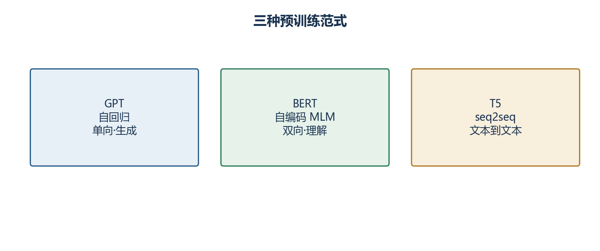

> 【图 21-2　掩码语言模型】（原图见 figures/图21-2.png）：BERT 的 [MASK] 预测示意，双向上下文汇聚到遮盖位置。
>
> 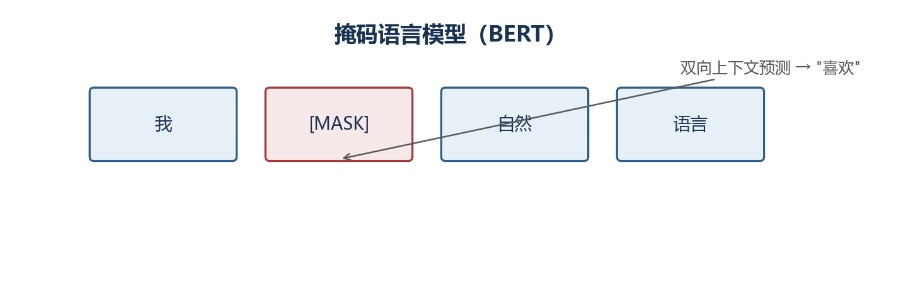

**边界与讨论。** MLM 的局限：① [MASK] 标记只在预训练出现、微调不出现，造成预训练—微调不一致（训练时看到 [MASK]，推理时看不到）；② 每次只预测约 15% 的词，训练效率低于自回归（每个位置都是训练信号）。这些催生了改进（21.5 节 ELECTRA、XLNet 的排列语言模型）。

## 21.4　序列到序列预训练：T5

**T5（Text-to-Text Transfer Transformer）[3]** 把预训练与所有下游任务统一为"文本到文本"：输入是文本，输出是文本。无论是分类、翻译、摘要还是问答，都表示为 $x\to y$ 的文本转换，用同一个 seq2seq 模型（第 17 章）与同一套损失。

**预训练目标。** T5 用"损坏文本恢复"目标：对输入文本做随机损坏（如遮盖连续片段、打乱句子顺序、删除词），让模型恢复原文。最常用的是**span corruption**：把随机连续片段替换为特殊标记，让模型生成被遮盖片段。

$$
\mathcal{L}_{T5}=-\sum\log P_\theta(\text{原始片段}\mid\text{损坏文本}). \tag{21-3}
$$

**统一的优势。** 一切任务都是文本到文本：分类任务输入"classify: 这部电影很好"输出"正面"，翻译任务输入"translate English to French: hello"输出"bonjour"，摘要输入"summarize: …"输出摘要。这种统一简化了架构与训练，使多任务学习更自然。

**例 21.4（T5 的统一）**　同一 T5 模型，通过输入前缀区分任务："summarize: 长文章"→摘要；"translate: hello"→译文；"cola sentence: 句子是否合语法"→判断。一个模型，多种能力——这预示了大语言模型的通用性（第 26 章）。

**Span corruption 的构造。** 设输入句子 token 序列 $x=(x_1,\dots,x_T)$，span corruption 的流程为：① 按几何分布选取片段长度 $\ell$；② 随机选起点 $s$，得到片段 $x_{s:s+\ell}$；③ 用一个 [MASK] 标记替换该片段；④ 把被替换的片段 $x_{s:s+\ell}$ 作为"目标文本"，让解码器从"损坏输入"生成出来。原 T5 的默认超参为片段长度均值 3（几何分布 $p(\ell)=p(1-p)^{\ell-1}$，$p\approx0.3$）。与 BERT 的单点遮盖相比，T5 遮盖的是"连续片段"，更贴近真实文本中的"缺失/损坏"，且生成目标天然适配解码器——这是 T5 能用编码器—解码器统一处理理解与生成的关键。

**训练信号密度对比。** 四种目标的"每步有效训练位置占比"差异显著：设句长 $T$，则 LM 在全部 $T$ 个位置产生信号（100%）；MLM 在约 $0.15T$ 个遮盖位置产生信号（$\approx15\%$）；span corruption 在 $\approx0.15T$ 个被遮盖 token 上产生信号（$\approx15\%$）；ELECTRA 的判别器在全部 $T$ 个位置产生信号（100%，但为二分类而非生成）。表 21-2 已列出类型，这里补一个定量视角：以 $T=128$ 为例，LM 每步 128 个生成信号，MLM 约 19 个生成信号，ELECTRA 128 个判别信号——后者信号密度是前者的 6.7 倍，这正是"小 ELECTRA 逼近 BERT"的效率来源（呼应 21.5 节）。

**边界与讨论。** T5 的统一优雅，但文本到文本格式在某些情况下不如专用架构高效（如需要结构化输出的任务）；预训练成本较高。

## 21.5　判别式与替换式目标：ELECTRA

**ELECTRA（Efficiently Learning an Encoder that Classifies Token Replacements Accurately）[4]** 用判别式目标提升预训练效率：不预测被遮盖词的身份（生成式），而是判断每个词是否被"替换"（判别式）。

**机制。** ELECTRA 用两个模型：

- **生成器**（小模型）：像 BERT 一样预测被遮盖词的可能替换（MLM）；
- **判别器**：判断输入中每个词是原文词还是生成器替换的假词（二分类）。

训练后，判别器作为最终模型使用。

**目标。**

$$
\mathcal{L}_{ELECTRA}=-\sum_{t}\Big[y_t\log D(\mathbf{h}_t)+(1-y_t)\log(1-D(\mathbf{h}_t))\Big], \tag{21-4}
$$

其中 $y_t$ 表示位置 $t$ 的词是否被替换，$D$ 为判别器。

**效率优势。** MLM 只从约 15% 的位置学习（被遮盖位置），ELECTRA 的判别器从**所有位置**学习（每个词都要判断真假），训练信号更密集，效率显著提升——小模型 ELECTRA 可达到与 BERT 相当的性能。

**例 21.5（ELECTRA 的判别）**　生成器把"我 喜欢 自然语言"中的"喜欢"替换为"讨厌"（ plausible 但错误），判别器需识别"讨厌"是被替换的假词。这种"找茬"任务迫使模型深入理解词义与语境，且每个位置都是训练信号。

**例 21.5b（判别损失的手算）**　设句长 $T=4$，判别器对每个位置输出"为真词"的概率 $D(\mathbf{h}_t)$。设位置 1、2、4 为原词（$y_t=1$）、位置 3 为被替换假词（$y_3=0$），判别器输出 $D(\mathbf{h}_1)=0.9,\ D(\mathbf{h}_2)=0.95,\ D(\mathbf{h}_3)=0.2,\ D(\mathbf{h}_4)=0.88$。按式 (21-4)，损失为四个位置交叉熵之和：

$$\mathcal{L}_{ELECTRA}=-\big[\underbrace{1\cdot\log 0.9}_{t=1}+\underbrace{1\cdot\log 0.95}_{t=2}+\underbrace{0\cdot\log0.2+(1)\cdot\log0.8}_{t=3}+\underbrace{1\cdot\log0.88}_{t=4}\big]$$

逐项算：$-\log0.9\approx0.105$、$-\log0.95\approx0.051$、$\log0.8\approx-0.223$（位置 3 为假词，该项为 $-(1)\log(1-0.2)=-\log0.8$，取负后 $0.223$）、$-\log0.88\approx0.128$。合计

$$\mathcal{L}_{ELECTRA}\approx0.105+0.051+0.223+0.128=0.507$$

注意位置 3 贡献最大（判别器误判假词为真时损失陡增），这正是判别式目标"全位置信号"的体现：即使绝大多数位置是原词，模型仍需对每个位置做出判别，训练信号密度远高于 MLM 的 15%。

**表 21-2　预训练目标对照**

| 目标 | 类型 | 训练信号 | 上下文 | 代表 |
|------|------|----------|--------|------|
| LM | 生成式 | 每位置 | 单向 | GPT |
| MLM | 生成式 | ~15% 位置 | 双向 | BERT |
| Span corruption | 生成式 | 遮盖片段 | 双向 | T5 |
| 替换检测 | 判别式 | 全部位置 | 双向 | ELECTRA |

## 21.6　边界与讨论

本章系统论述了预训练范式，须明确其边界。

**目标的统一与分化。** GPT（自回归、生成）、BERT（MLM、理解）、T5（seq2seq、统一）、ELECTRA（判别、高效）各有优势：生成任务偏好自回归，理解任务偏好双向 MLM，统一任务用 T5，效率敏感用 ELECTRA。后续模型（第 27 章）常融合多种目标。这一"分化"在当代已趋"统一"：现代大模型（GPT-4 类）几乎一律采用 GPT 式自回归目标，原因是统一了生成与理解（理解可视为"预测答案词"），且自回归的每位置信号密度最高；而 BERT/ELECTRA 式编码器在"判别型"轻量场景仍有价值。可以说，"用什么目标"的争论在 2018 年最激烈，到 2020 年后随规模化收敛到"自回归为主、编码器为辅"的格局。

**预训练的本质。** 无论哪种目标，预训练都在 M2 层学习分布表示——通过自监督目标从海量文本中提取统计规律与语言知识。它隐式编码了句法、语义乃至世界知识（第 7.5 节、第 29 章），但不显式保证 M4 指称正确——这是大模型幻觉的根源（第 29 章）。须强调：四种目标学到的是"语言分布的近似"，而非"语言规则的形式化"。模型能预测"Paris is the capital of ___"后接"France"，是因为该搭配在语料中高频共现，而非因为它"知道"首都这一概念——这正是 M2 与 M4 的差距，也是预训练范式强大又局限的双重来源。

**与后续章节的联系。** 本章的预训练范式将贯穿第五、六篇：第 22 章讲预训练目标的具体训练（数据、损失、稳定性，尺度定律将在此目标上落地）；第 23 章讲微调适配（PEFT）；第 26 章讲规模化定律（预训练的规模维度）；第 27 章剖析代表性模型（GPT/LLaMA/DeepSeek 等，皆基于本章目标）。第 28 章的指令微调与第 29 章的推理是预训练能力在对齐与任务上的延伸。

第五篇（第 20–25 章）以 Transformer（第 20 章）与预训练目标（本章）为核心，将继续展开训练（第 22 章）、适配（第 23 章）、上下文学习（第 24 章）与多语言（第 25 章）。

## 本章小结

本章论述预训练范式，是 A 类核心章。

我们首先论证预训练的语言学动机（通用语言知识 + 自监督海量数据），用互信息 $I(c;w)$ 解释"语言建模是语言理解的代理任务"，并给出"免费标签"的量级对比。接着逐一展开四大预训练目标：自回归 LM（GPT，式 21-1，单向、生成，例 21.2/21.2b 手算损失与困惑度）、掩码语言模型（BERT，式 21-2，双向、理解，例 21.3/21.3b 手算 MLM 损失并量化双向的熵降）、序列到序列 span corruption（T5，式 21-3，文本到文本统一，给出片段构造流程与训练信号密度对比）、判别式替换检测（ELECTRA，式 21-4，全位置信号、高效，例 21.5/21.5b 手算判别损失），并对照四者在架构、上下文、训练信号、擅长任务上的差异（表 21-1、21-2）。

我们还明确边界：各目标各有优势，预训练本质在 M2 层学习分布表示，不保证 M4 指称。这些辨析衔接第 22、23、26–29 章。

预训练目标决定了模型学到什么、适合什么任务。下一章进入预训练目标与训练，讲数据、损失、训练稳定性与尺度效应，回答"如何把预训练目标高效落地"。

**进一步阅读**　本章建议延伸阅读的文献：[1]、[2]、[3]、[4]。

## 参考文献

[1] Radford A, Narasimhan K, Salimans T, Sutskever I. Improving language understanding by generative pre-training. *OpenAI Technical Report*, 2018.

[2] Devlin J, Chang M W, Lee K, Toutanova K. BERT: Pre-training of deep bidirectional transformers for language understanding. *NAACL*, 2019.

[3] Raffel C, Shazeer N, Roberts A, et al. Exploring the limits of transfer learning with a unified text-to-text transformer. *Journal of Machine Learning Research*, 2020, 21(140): 1–67.

[4] Clark K, Luong M T, Le Q V, Manning C D. ELECTRA: Pre-training text encoders as discriminators rather than generators. *ICLR*, 2020.

[5] Yang Z, Dai Z, Yang Y, et al. XLNet: Generalized autoregressive pretraining for language understanding. *Advances in Neural Information Processing Systems*, 2019, 32.

[6] Liu Y, Ott M, Goyal N, et al. RoBERTa: A robustly optimized BERT pretraining approach. *arXiv:1907.11692*, 2019.

[7] Lewis M, Liu Y, Goyal N, et al. BART: Denoising sequence-to-sequence pre-training for natural language generation, translation, and comprehension. *ACL*, 2020.

[8] Jurafsky D, Martin J H. *Speech and Language Processing*. 3rd ed. Stanford, 2023.

---

# 第 22 章　预训练目标与训练

第 21 章确立了预训练目标（自回归、MLM、seq2seq、判别式）。本章回答其落地问题：**如何在海量数据上高效、稳定地训练这些目标？** 预训练是大语言模型的基石（第 26 章），其工程细节——数据规模与质量、损失设计、训练稳定性、基础设施——直接决定模型能力。随着模型规模从亿级参数增长到千亿级（第 26 章），预训练已成为一个复杂的系统工程。

本章先讨论预训练数据的规模与质量（22.1 节），再讲优化目标与损失（22.2 节），分析训练稳定性与基础设施（22.3 节），讨论预训练模型的尺度效应（22.4 节），并在边界与讨论中收束（22.5 节）。

## 22.1　预训练数据的规模与质量

**规模定律的启示。** 第 26 章将详述规模化定律：模型性能随参数、数据、计算量增长而幂律提升。这为"更大预训练"提供了依据——GPT-3 用 3000 亿 token，后续模型达数万亿 token。数据是预训练的燃料。

**数据来源。** 预训练语料通常包括：书籍（BooksCorpus）、网页（Common Crawl 清洗后的 C4）、百科（Wikipedia）、代码（GitHub）、学术论文、论坛等。多语言模型（第 25 章）还需多语言语料。各类来源的"信息密度"差异显著：百科与书籍单位 token 携带的事实密度高，网页噪声大但覆盖广，代码虽短却蕴含严密的逻辑结构。这种异质性正是"数据配比"成为关键超参的原因——它决定了模型最终"像什么"（流畅的散文体 vs. 严谨的逻辑体 vs. 杂糅的网络体）。

**数据质量。** "垃圾进，垃圾出"——数据质量与规模同等重要。关键处理步骤：

- **去重**：删除重复文档（避免记忆与评估污染）；
- **过滤**：去除低质量内容（垃圾、色情、恶意内容）；
- **语言识别与配比**：控制语言比例（多语言模型）；
- **清洗**：规范化文本、去噪声。

**去重的机制与污染。** 去重不仅是省空间，更关乎训练—评估的独立性。若测试集的句子在训练语料中出现过（即使仅 1 次），模型会"背答案"，导致评估分数虚高——这叫数据污染。去重通常分两级：文档级去重（整篇相同）与近重复去重（MinHash 相似度超阈值）。实践中，C4 等语料经过去重与过滤后，体积可缩减约 30%–50%，而困惑度改善常达数个百分点——说明"质量"与"规模"是同等量级的杠杆，而非锦上添花。

**配比作为课程。** 数据配比还隐含"课程效应"：模型在训练早期见到的数据分布，会塑造其基础能力；后期数据则调整其侧重。例如，若早期以书籍为主、后期以网络为主，模型的语言风格会在训练后期向网络语体漂移。这种"课程"难以精确控制，是预训练配方中经验性最强、也最难复现的环节之一。

**例 22.1（数据配比的影响）**　代码数据的加入显著提升模型的推理与代码能力（第 29、37 章），但过多代码可能损害自然语言生成。预训练配方（data mixture）——各类数据的比例——是关键的工程知识，往往经验性且需大量实验。

**例 22.1b（去重的数值意义）**　网页语料噪声极高，Common Crawl 原始文本中同一新闻、同一模板文案常重复出现数千次。若不去重，模型会"背诵"而非"理解"——同一文档出现 $k$ 次等价于该文档权重 $k$ 倍，既造成评估污染（测试集内容在训练中见过），又让模型过拟合高频模板。以"URL 规范化 + 文档级 MinHash 相似度阈值 $0.85$"去重，典型网页语料可去掉 30%–50% 的冗余文档。一个直观度量：设去重前文档集合 $\mathcal{D}$ 含 $N_0$ 篇，去重后含 $N_1$ 篇，去重率 $r=1-N_1/N_0$；当 $r>0.4$ 时，几乎可判定语料存在严重模板冗余，去重对最终困惑度的改善常超过 5%。这说明"数据质量"并非软性要求，而是可直接量化、显著影响结果的硬指标。

**数据配比作为超参。** 数据配比 $\pi=(\pi_{\text{web}},\pi_{\text{book}},\pi_{\text{code}},\pi_{\text{wiki}},\pi_{\text{paper}})$ 本身是一个高维超参，其影响机制类似"课程学习"：模型在早期见到的数据分布塑造其基础能力，后期数据则微调其侧重。经验上，书籍类长文本对语言流畅度贡献大，代码对推理贡献大，百科对事实知识贡献大。配比调优通常需要"小模型快速实验 + 大模型验证"的两阶段流程，因为大模型单次训练成本极高，无法像小超参那样网格搜索。

**表 22-1　预训练语料来源与特点**

| 来源 | 特点 | 用途 |
|------|------|------|
| 书籍 | 长文本、知识密集 | 语言建模、知识 |
| 网页 (C4) | 海量、多样、噪声 | 规模 |
| 百科 | 结构化知识 | 事实知识 |
| 代码 | 逻辑、推理 | 推理/代码能力 |
| 论文 | 专业、学术 | 领域知识 |

**边界与讨论。** 数据规模增长面临"数据墙"——高质量文本数据可能耗尽（第 26 章的合成数据方向）；数据偏见（性别、文化）会被模型学习并放大（第 28、31 章）。

## 22.2　优化目标与损失

**损失函数的统一形式。** 无论预训练目标如何（第 21 章），训练都归结为最小化负对数似然（交叉熵）：

$$
\mathcal{L}(\theta)=-\sum_{x\in\mathcal{D}}\sum_{t}\log P_\theta(x_t\mid\text{context}), \tag{22-1}
$$

其中 context 依目标而定：自回归为前缀 $x_{<t}$，MLM 为双向上下文，ELECTRA 为判别目标（式 21-4）。

**困惑度与损失。** 预训练常报告困惑度 $\mathrm{PPL}=e^{\mathcal{L}}$（第 3、15 章），它是语言建模能力的核心指标。损失下降、困惑度降低，表示模型对语料建模更好。

**优化器。** 大模型预训练普遍用 AdamW（带权重衰减的 Adam）：

$$
\begin{aligned}
\mathbf{m}_t&=\beta_1\mathbf{m}_{t-1}+(1-\beta_1)\mathbf{g}_t,\\
\mathbf{v}_t&=\beta_2\mathbf{v}_{t-1}+(1-\beta_2)\mathbf{g}_t^2,\\
\theta_t&=\theta_{t-1}-\eta\Big(\frac{\hat{\mathbf{m}}_t}{\sqrt{\hat{\mathbf{v}}_t}+\epsilon}+\lambda\theta_{t-1}\Big),
\end{aligned} \tag{22-2}
$$

其中 $\hat{\mathbf{m}},\hat{\mathbf{v}}$ 为偏差修正后的一阶/二阶矩，$\lambda$ 为权重衰减。学习率调度（warmup + 余弦衰减）对稳定性关键。

**学习率调度的形态。** 现代预训练几乎一致采用"线性 warmup + 余弦衰减"：前 $T_{w}$ 步学习率从 0 线性升到峰值 $\eta_{\max}$，其后按余弦曲线衰减到 $\eta_{\min}$：

$$\eta(t)=\begin{cases}\eta_{\max}\cdot t/T_{w}, & 0\le t<T_{w},\\[4pt]
\eta_{\min}+\tfrac{1}{2}(\eta_{\max}-\eta_{\min})\bigl(1+\cos(\pi(t-T_{w})/(T-T_{w}))\bigr), & T_{w}\le t<T,
\end{cases}$$

其中 $T$ 为总步数。warmup 阶段（典型 0.1%–1% 总步数）让随机初始化的模型"缓步进入"训练轨道，避免早期大梯度把参数推离好区域；余弦衰减则在后期把学习率平滑降到接近 0，使损失收敛到更低的平台。这两个相位都是经验必需：去掉 warmup 常导致前数百步损失尖峰甚至发散，去掉余弦衰减则末期损失震荡、不收敛到最优。

**优化器超参的典型量级。** AdamW 的 $\beta_1\approx0.9$、$\beta_2\approx0.95$–$0.99$、$\epsilon\approx10^{-8}$、权重衰减 $\lambda\approx0.01$–$0.1$。其中 $\beta_2$ 对大规模训练尤为敏感：$\beta_2$ 过小会过度估计二阶矩、导致小梯度被"压低"；过大则二阶矩估计滞后、对梯度尖峰反应迟钝。大模型实践中常把 $\beta_2$ 从 Adam 默认的 0.999 降到 0.95–0.99，以改善对长尾梯度的响应——这是从"能训"到"训得好"的关键调参之一。

**例 22.2（warmup 的重要性）**　训练初期模型随机初始化，梯度大且不稳定；直接用大学习率可能导致发散。Warmup 让学习率从 0 线性增长到峰值（如前 2000 步），"热身"后再训练，显著提升稳定性。

**例 22.2b（困惑度的换算）**　设某语言模型在验证集上的每 token 负对数似然为 $-0.69$ nats（即 $\mathcal{L}\approx0.69$），则困惑度 $\mathrm{PPL}=e^{0.69}\approx1.99$，可直观读作"模型在每个位置的等价等概率候选词数约为 2"。再设训练初期 $\mathcal{L}=6.9$，则 $\mathrm{PPL}=e^{6.9}\approx992$——相当于模型在每个位置要在近千个词里"瞎猜"。预训练的过程就是让 $\mathcal{L}$（与 PPL）从接近 $\log V$（$V$ 为词表大小，模型完全随机时 $\mathrm{PPL}\approx V$）持续下降到 1.x 的过程。这一单调下降曲线是判断"预训练是否正常收敛"的第一道观测窗口：若损失停止下降或出现尖峰，通常指向数据质量、学习率或稳定性问题。

## 22.3　训练稳定性与基础设施

**大规模训练的挑战。** 千亿参数模型无法在单卡训练，需分布式并行（第 26 章与《大模型系统与工程导论》）：

- **数据并行**：多卡各持完整模型副本，分摊数据；
- **张量并行**：把矩阵运算切分到多卡；
- **流水线并行**：把模型层切分到多卡；
- **ZeRO**：分片优化器状态、梯度、参数以节省显存。

**稳定性技术。**

- **梯度裁剪**：防止梯度爆炸（第 16.4 节）；
- **混合精度训练**：用 FP16/BF16 加速，同时用 FP32 主权重保持精度；
- **LayerNorm/Pre-LN**：把 LayerNorm 放在残差分支前（Pre-LN）以稳定深层训练；
- **损失尖峰处理**：大模型训练中偶发损失突增（loss spike），需检测与回滚。

**检查点与容错。** 大规模训练历时数周至数月，硬件故障常见。需定期保存检查点，支持从断点恢复。

**损失尖峰（loss spike）。** 大模型训练中偶发损失在个别 batch 突然激增（可达正常值的数倍）再回落，称为损失尖峰。尖峰可能源于：数据中的异常样本（超长序列、编码错误）、学习率偏高、或优化器二阶矩估计失真。应对策略包括：检测到尖峰时回滚到上一个检查点、对该 batch 跳过（drop）、或临时降低学习率。尖峰是"训练失败"的高发诱因——一次未被处理的尖峰可能把参数推坏，导致后续不收敛。因此"监控损失曲线 + 自动检测尖峰 + 回滚"成为大规模预训练的标准运维流程（第 31 章的稳定性评估与此相关）。

**梯度裁剪的阈值。** 梯度裁剪（gradient clipping）设全局范数阈值 $\|\mathbf{g}\|_{\max}$（典型 1.0），当实际梯度全局范数超过阈值时按比例缩放：$\mathbf{g}\leftarrow\mathbf{g}\cdot\min(1,\,\|\mathbf{g}\|_{\max}/\|\mathbf{g}\|_2)$。它不改变梯度方向、只限制幅度，从而在保留学习方向的同时防止单步更新过大。阈值过小会"压死"有效学习信号、拖慢收敛；过大则形同虚设。1.0 是经验上兼顾稳定与速度的常见取值。

**例 22.3（混合精度）**　FP16 计算快、显存省，但数值范围小易溢出；混合精度用 FP16 做前向/反向，用 FP32 保存主权重与累加梯度，兼顾速度与精度。这使训练吞吐翻倍——是大规模预训练的关键技术。

**例 22.3b（显存账本）**　训练一个 $N$ 参数模型，显存占用可粗分为四块（以 FP32 优化器状态计，AdamW 需一阶矩 $m$、二阶矩 $v$ 各一份）：

- 参数：$4N$ 字节（FP32 主权重）；
- 梯度：$4N$ 字节；
- 一阶矩：$4N$ 字节；
- 二阶矩：$4N$ 字节；

合计约 $16N$ 字节（不含激活）。以 $N=7\times10^{9}$（70 亿，如 LLaMA-7B）为例，仅参数 + 优化器状态就需 $\approx16\times7\times10^{9}=1.12\times10^{11}$ 字节 $\approx112$ GB——超出单张 A100（80GB）容量，故必须用 ZeRO 分片或混合精度（把参数/梯度/优化器状态降到 16 位，显存近乎减半）。混合精度的本质是"用精度换显存与速度"：计算用 FP16（半字节），但保留一份 FP32 主权重做累加，使梯度更新不被半精度舍入污染。这正是式 (22-2) 中 $\theta$ 的更新必须用 FP32 累加、而 $\mathbf{g}_t$ 可用 FP16 计算的工程依据。

**ZeRO 的分片逻辑。** ZeRO 把上述四块按"优化器状态→梯度→参数"逐级分片到多卡：ZeRO-1 分优化器状态（省最多，因优化器状态是 $N$ 的 2 倍），ZeRO-2 再分梯度，ZeRO-3 再分参数。每升一级，单卡显存占用线性下降，但通信量上升（需跨卡聚合）。实践中 ZeRO-2/3 + 混合精度是"单卡放不下大模型"时的标准解法，与第 26 章的并行策略（张量/流水线）互补而非替代。

**表 22-2　大规模训练技术**

| 技术 | 目的 |
|------|------|
| 数据/张量/流水线并行 | 分摊计算与显存 |
| ZeRO | 分片优化器状态 |
| 混合精度 | 加速、省显存 |
| 梯度裁剪 | 防爆炸 |
| 检查点 | 容错 |

## 22.4　预训练模型的尺度效应

**尺度定律（scaling law）。** 预训练模型的损失随参数量 $N$、数据量 $D$、计算量 $C$ 增长而幂律下降（第 26 章详述）：

$$
\mathcal{L}(N)\approx\mathcal{L}_\infty+\frac{a}{N^\alpha}. \tag{22-3}
$$

这意味着：投入更多计算，可预测地获得更好模型——这驱动了"越大越好"的军备竞赛（GPT-3、PaLM、GPT-4 等）。

**式 (22-3) 的数值解读。** 设经验拟合得 $a=10^{4}$、$\alpha=0.07$（量级示意，实际值随架构与语料变化）。则 $\mathcal{L}(N)=\mathcal{L}_\infty+a/N^{0.07}$。取 $N=10^{9}$（10 亿）时，$a/N^{0.07}\approx10^{4}/10^{9\times0.07}=10^{4}/10^{0.63}\approx10^{4}/4.3\approx2325$；取 $N=10^{12}$（1 万亿）时，该项降为 $10^{4}/10^{0.84}\approx10^{4}/6.9\approx1449$。可见参数量从 10 亿增到 1 万亿（1000 倍），损失下降项仅从约 2325 降到约 1449——下降的"绝对量"越来越小，体现幂律的"边际递减"：要再降一点损失，需要投入数量级的参数增长。这正是 Chinchilla 修正（22-4）的动机：与其把 $N$ 堆到离谱地大，不如让 $N$ 与 $D$ 同步增长，把每一份算力都花在刀刃上。

**涌现能力。** 规模增长到一定程度，模型会出现训练时未显式目标化的新能力（少样本学习、思维链推理，第 24、29 章）——这称为涌现（emergence）。涌现是尺度效应的质变面，也是大模型最令人惊喜的特性。须强调，涌现并非"能力凭空出现"，而是"连续改进在离散任务阈值上的投影"：底层能力（如链式推理的子步骤准确率）随规模平滑上升，但只有当它跨过任务要求的临界值时，任务性能才从"几乎为 0"跃升到"可用"，宏观上看似突变、微观上实则连续。这一"连续—离散"的二重性是理解涌现的关键（第 24 章）。

**例 22.4（Kaplan vs Chinchilla）**　早期规模化（Kaplan 等）强调增大参数；Chinchilla[2] 指出许多大模型"训练不足"——参数与数据应同比例增长（约每参数 20 token）。这一修正改变了预训练配方：不是一味增大参数，而是参数与数据平衡。第 26 章详述。

**Chinchilla 最优配比。** 给定固定计算预算 $C$（FLOPs，一次前向+反向约消耗 $6ND$ FLOPs），Chinchilla 在 $C=6ND$ 的约束下最小化损失，得到最优参数量 $N^*$ 与数据量 $D^*$ 满足

$$
N^*\approx\sqrt{C/6}\cdot k,\qquad D^*\approx c\,N^*, \qquad c\approx20
$$
$$\tag{22-4}$$

即"约每参数 20 token"这一经验比率的定量形式（$c\approx20$，$k$ 为架构相关常数）。该式的关键含义是：**在固定算力下，把参数堆得过大反而不如把数据配足**——因为参数过大而数据不足，模型欠训练（underfitting the data），损失不会降到该参数规模本应达到的水平。

**例 22.4b（Chinchilla 的数值应用）**　设计算预算 $C$ 对应"约每参数 20 token"。若取参数量 $N=10^{11}$（1000 亿），则最优数据量 $D^*\approx20N=2\times10^{12}$ token（2 万亿 token）；反之若只有 $D=5\times10^{11}$ token（0.5 万亿），则 Chinchilla 最优参数应为 $N^*\approx D/20=2.5\times10^{10}$（250 亿）——即"1000 亿参数 + 0.5 万亿 token"是错配的，不如"250 亿参数 + 0.5 万亿 token"训得更充分。这解释了为何 Chinchilla 论文用 700 亿参数模型（约 1.4 万亿 token）在同等算力下打败了 Gopher 的 2800 亿参数（但数据更少）——参数与数据必须平衡，单纯堆参数是浪费算力。

**边界与讨论。** 尺度效应有代价：算力成本指数增长（第 26 章）、环境影响、数据墙。单纯增大规模并非唯一路径——架构改进（MoE、稀疏，第 27 章）、数据质量、训练效率同等重要（第 26 章"密度法则"）。

**算力成本的量级。** 一次前向+反向约消耗 $6ND$ FLOPs（$N$ 参数、$D$ token，系数 6 来自"乘加各 2、前向反向各 1"的估算）。以 Chinchilla-70B 为例，$N=7\times10^{10}$、$D=1.4\times10^{12}$，则训练算力 $\approx6\times7\times10^{10}\times1.4\times10^{12}\approx5.9\times10^{23}$ FLOPs。若集群有效吞吐约 $10^{19}$ FLOPs/s（约 1000 张高效 GPU），则纯计算时间 $\approx5.9\times10^{23}/10^{19}\approx5.9\times10^{4}$ 秒 $\approx16$ 小时——但实际还需计入通信、调度、故障重试等开销，真实墙钟时间为数天到数周。这一量级解释了"训练一个前沿模型"为何是天文数字级的资金与能耗投入：每提升一个数量级的 $N$ 或 $D$，成本都按同比例放大，而式 (22-3) 的损失改善却按幂律递减——"花更多钱买更小的进步"是尺度定律的内在经济学，也是 Chinchilla（让每一份算力都花在刀刃上）的动机所在。

## 22.5　边界与讨论

本章论述预训练目标与训练的落地，须明确其边界。

**工程与理论。** 预训练的许多细节（数据配比、学习率、稳定性技巧）是经验性工程知识，理论理解有限——这与第 21 章目标的清晰理论形成对比。第 26 章的规模化定律是少数有清晰数学形式的规律。具体而言，"为什么 $\beta_2$ 取 0.95 而非 0.999""为什么 warmup 占 0.1% 而非 1%""为什么权重衰减 0.1 而非 0.05"——这些目前都缺乏第一性原理的解释，主要靠消融实验与经验调优确定。这种"知其然不知其所以然"的状态是预训练工程的核心特征：它有效，但其有效性依赖大量未完全理解的超参耦合，使得跨架构、跨规模的"迁移配方"并不总是成立。

**可复现性。** 大规模预训练由少数机构掌握，算力与数据门槛使学术界难以复现——这影响研究的开放性与可验证性（第 31、42 章）。即便公布超参，不同机构也难以完全复现同一模型：数据清洗的实现细节、分布式并行的数值舍入顺序、硬件（不同 GPU 的 FP16 累加行为）都会引入细微但可累积的差异。"复现"在预训练语境下更接近"近似复现"，评估结论须对这种方差保持警惕。

**与后续章节的联系。** 本章的训练技术将在第 26 章（规模化定律与训练基础设施）深化；数据工程衔接第 31 章（数据污染评估）；混合精度与并行衔接《大模型系统与工程导论》；尺度效应衔接第 24 章（涌现）、第 27 章（模型剖析）。本章的式 (22-3) 幂律与式 (22-4) Chinchilla 配比，正是第 24 章"量变到质变"与第 26 章算力规划的理论底座。

第五篇（第 20–25 章）继续：第 20、21、22 章建立了 Transformer 架构、预训练目标与训练方法。第 23 章将讨论如何把预训练模型适配到具体任务（参数高效微调），第 24 章讨论上下文学习这一涌现能力，第 25 章讨论多语言。

## 本章小结

本章论述预训练目标与训练，回答"如何高效稳定地落地预训练目标"。

我们首先讨论预训练数据的规模与质量：来源（书籍、网页、百科、代码）、清洗（去重、过滤、配比）与数据质量的重要性，用例 22.1b 量化去重对困惑度的影响。接着给出损失函数的统一形式（式 22-1，交叉熵）与优化器 AdamW（式 22-2），补充学习率调度（warmup + 余弦衰减）的形态与超参量级，并用例 22.2b 把损失换算为困惑度作直观诊断。我们分析大规模训练的稳定性与基础设施：分布式并行（数据/张量/流水线/ZeRO）、混合精度（例 22.3b 的显存账本与 ZeRO 分片逻辑）、损失尖峰与梯度裁剪。我们讨论尺度效应：规模化定律（式 22-3，含数值解读）与涌现能力，以及 Chinchilla 对参数—数据平衡的修正（式 22-4，例 22.4b 的数值应用）。

我们还明确边界：预训练细节多为经验工程知识、知其然不知其所以然，可复现性接近"近似复现"。这些辨析衔接第 24、26、27、31 章与《大模型系统与工程导论》。

下一章进入参数高效微调与适配，回答"如何以低成本把预训练模型适配到具体任务"——这是预训练落地的最后一环。

**进一步阅读**　本章建议延伸阅读的文献：[1]、[2]、[3]、[4]。

## 参考文献

[1] Kaplan J, McCandlish S, Henighan T, et al. Scaling laws for neural language models. *arXiv:2001.08361*, 2020.

[2] Hoffmann J, Seger S, Mesa O D, et al. Training compute-optimal large language models. *NeurIPS*, 2022.

[3] Loshchilov I, Hutter F. Decoupled weight decay regularization. *ICLR*, 2019.

[4] Smith S M, Lepikhin D, Chang J, et al. Using deep speed and megatron to train Megatron-Turing NLG 530B. *arXiv:2201.11990*, 2022.

[5] Rajbhandari S, Rasley J, Ruwase O, He Y. ZeRO: Memory optimizations toward training trillion parameter models. *SC20*, 2020.

[6] Micikevicius P, Narang S, Alben J, et al. Mixed precision training. *ICLR*, 2018.

[7] Xiong W, Liu J, Molybog I, et al. On the instability of transformer-based language models. *arXiv:2304.08177*, 2023.

[8] Jurafsky D, Martin J H. *Speech and Language Processing*. 3rd ed. Stanford, 2023.

---

# 第 23 章　参数高效微调与适配

第 21、22 章确立了预训练范式：在海量语料上训练一个通用模型。但预训练模型参数量巨大（第 26 章），对每个下游任务做**全量微调**（更新全部参数）成本高昂：需为每个任务保存一份完整模型副本（存储开销），且训练全部参数需大量算力（计算开销）。本章回答：**如何以极低的成本把预训练模型适配到具体任务？** 答案是**参数高效微调**（parameter-efficient fine-tuning, PEFT）——冻结预训练模型的大部分参数，只训练少量新增参数。

PEFT 方法包括适配器（Adapter）、前缀/提示微调（Prefix/Prompt Tuning）、低秩适配（LoRA）等。它们只训练原模型参数的 0.1%–1%，却能达到接近全量微调的性能，还可把少量适配参数按需加载，实现"一个底座模型，多种任务"。本章是 A 类核心章，重点推导 LoRA。PEFT 的意义不止于"省参数"：它把"适配一个任务"从"训练一个模型"降维为"训练一个几十 MB 的插件"，使个性化、多租户、持续更新在工程上成为可能（第 38 章），是预训练范式从"研究"走向"产品"的关键一跃。

本章先讨论全量微调与灾难性遗忘（23.1 节），再讲适配器与软提示（23.2 节），重点推导 LoRA（23.3 节），介绍提示工程与上下文学习（23.4 节），并在边界与讨论中收束（23.5 节）。

## 23.1　全量微调与灾难性遗忘

**全量微调（full fine-tuning）。** 第 19.3 节定义的微调：以预训练参数 $\theta^*$ 为初始化，在任务数据上更新全部参数。这是最直接的方式，性能通常最好，但代价高：每个任务需保存一份完整模型（如 7B 模型约 14GB），多任务场景存储爆炸——若需 100 个任务，仅模型副本就需约 1.4TB，这在工程上是不可接受的，也正是 PEFT 被迫切入的根本动机。

**灾难性遗忘（catastrophic forgetting）。** 在全量微调中，模型为新任务更新参数时，可能破坏预训练学到的通用知识——尤其当任务数据分布窄时，模型过度拟合任务，丧失其他能力。这是持续学习（第 25 章与《元学习与自适应智能导论》）的核心挑战。遗忘的机制可用"参数被覆盖"理解：设预训练参数 $\theta^*$ 编码了通用知识，全量微调求解 $\theta^*+\Delta\theta$，其中 $\Delta\theta$ 由任务数据梯度驱动；当任务数据分布窄时，$\Delta\theta$ 的更新方向集中在少数维度上，可能正交甚至反向于编码通用知识的维度，从而"擦除"旧知识。早期缓解思路是 EWC（Elastic Weight Consolidation）：对重要参数（对旧任务输出影响大的方向）施加二次惩罚 $\sum_i F_i(\theta_i-\theta_i^*)^2$（$F_i$ 为 Fisher 信息），把参数"弹回"旧值附近——但 EWC 需估计 Fisher 矩阵，成本高。PEFT 的"冻结大部分参数"则从根上避免了这一问题：既然 $\theta^*$ 不动，通用知识就不会被覆盖，遗忘被天然抑制。

**例 23.1（遗忘的表现）**　一个预训练模型能回答多种常识问题；把它在医疗问答数据上全量微调后，医疗问答提升，但可能"忘记"了通用常识或代码能力——参数被任务数据"覆盖"。PEFT 通过冻结大部分参数，天然缓解遗忘。

**PEFT 的核心思想。** 冻结预训练模型参数 $\theta^*$，只训练少量新增参数 $\phi$：

$$
\theta^* \text{（冻结）},\quad \phi \text{（可训练）},\quad \min_\phi\mathcal{L}_{task}(\theta^*,\phi). \tag{23-1}
$$

数据存储只需 $\phi$（几 MB 到几十 MB），且冻结 $\theta^*$ 保留了通用知识。

## 23.2　适配器与软提示

**适配器（Adapter）。** 在 Transformer 的每个子层（注意力、FFN）后插入小型"瓶颈"模块：把表示 $d$ 维降到 $m$ 维（$m\ll d$），非线性变换，再升回 $d$ 维：

$$
\mathrm{Adapter}(x)=x+\mathbf{W}_{up}\,\sigma(\mathbf{W}_{down}x), \tag{23-2}
$$

其中 $\mathbf{W}_{down}\in\mathbb{R}^{m\times d}$、$\mathbf{W}_{up}\in\mathbb{R}^{d\times m}$。只训练适配器参数（约原模型的 0.5%–8%），冻结其余。

**例 23.1b（适配器参数量）**　设 $d=4096$、瓶颈 $m=256$，单层适配器的参数为 $\mathbf{W}_{down}$ 与 $\mathbf{W}_{up}$ 之和：$m\times d+d\times m=2md=2\times256\times4096=2,\!097,\!152\approx2.1$M。若 Transformer 有 32 层、每层在注意力与 FFN 各插一个适配器，共 $32\times2=64$ 个适配器，总可训练参数 $\approx64\times2.1$M $\approx134$M。若原模型 7B（$7\times10^9$）参数，则适配器占比 $\approx134\text{M}/7\text{B}\approx1.9\%$——与"0.5%–8%"的经验范围吻合。注意适配器是"串联"进主干的（残差式 $x+\mathrm{Adapter}(x)$），故每个推理步都要额外经过这些层，带来推理延迟；这正是 LoRA 后来以"并联旁路、可合并"取胜的原因（23.3 节）。

**软提示（Soft Prompt）/前缀微调（Prefix Tuning）。** 不修改模型内部，而是在输入层拼接一段**可学习的连续向量**（soft prompt），冻结模型参数，只训练这些提示向量：

$$
[\mathbf{p}_1,\dots,\mathbf{p}_k;\mathbf{e}_{x_1},\dots,\mathbf{e}_{x_T}]\to\text{冻结模型}, \tag{23-3}
$$

其中 $\mathbf{p}_i\in\mathbb{R}^d$ 为可学习提示。通过梯度下降学习"最优提示"，引导模型完成任务。Prompt Tuning 只在输入加提示，Prefix Tuning 在各层加前缀。

**例 23.2（软提示 vs 人工提示）**　人工提示（第 24 章）是固定的自然语言模板（"请判断情感："）；软提示是模型学出的连续向量（人类不可读），往往比人工提示更有效。软提示把"提示设计"变成可优化的参数学习。

**Prompt Tuning vs Prefix Tuning 的差别。** 二者都学连续向量，但位置不同：Prompt Tuning 只在**输入层**拼接 $k$ 个可学习 token $\mathbf{p}_1,\dots,\mathbf{p}_k$（式 23-3），训练信号只来自输入端；Prefix Tuning 则在**每一层**的注意力 K/V 前都拼接可学习前缀（每层 $k$ 个向量，共 $L\times k$ 个，$L$ 为层数），在中间层也注入任务信号。Prefix Tuning 信号更密，但可训练参数也更多（$L$ 倍）。实验表明，在超大模型上 Prompt Tuning 反而能接近全量微调（规模效应），而在中小模型上 Prefix Tuning 更稳——"在哪一层注入"是一个与模型规模强相关的选择，这也是软提示家族超参敏感、实践难度高的原因。

**软提示的优化难点。** 软提示是连续向量，其损失面常很"陡"且多峰：随机初始化提示时，优化易陷入局部极小，需要好的初始化（如用预训练模型对一批示例跑前向、取输入表示作初始化）与较大的提示长度。相比之下，LoRA 更新的是权重矩阵，损失面相对平滑，优化更稳——这是 LoRA 成为主流的另一工程原因。

**边界与讨论。** 适配器增加推理延迟（额外的层）；软提示占用上下文长度（提示 token 挤占真实输入），且优化可能不稳定。LoRA（23.3 节）因无额外延迟、实现简单而成为主流。

## 23.3　低秩适配（LoRA）

**LoRA（Low-Rank Adaptation）[1]** 是当前最流行的 PEFT 方法。其核心洞见：微调时权重的更新 $\Delta\mathbf{W}$ 具有**低秩**特性——可用两个低秩矩阵的乘积近似，无需更新完整权重。

**方法。** 冻结预训练权重 $\mathbf{W}_0\in\mathbb{R}^{d\times k}$，在其旁加一条低秩旁路：

$$
\mathbf{W}=\mathbf{W}_0+\frac{\alpha}{r}\mathbf{B}\mathbf{A}, \tag{23-4}
$$

其中 $\mathbf{A}\in\mathbb{R}^{r\times k}$、$\mathbf{B}\in\mathbb{R}^{d\times r}$，$r\ll\min(d,k)$ 为秩（通常 $r=1$–$64$），$\alpha$ 为缩放系数。训练时冻结 $\mathbf{W}_0$，只训练 $\mathbf{A},\mathbf{B}$。

**前向计算。** 对输入 $\mathbf{x}$：

$$
\mathbf{h}=\mathbf{W}_0\mathbf{x}+\frac{\alpha}{r}\mathbf{B}(\mathbf{A}\mathbf{x}). \tag{23-5}
$$

初始时 $\mathbf{A}$ 随机高斯初始化、$\mathbf{B}=\mathbf{0}$（故旁路初始输出为 0，模型初始行为与预训练一致），训练中逐渐学习 $\mathbf{B}\mathbf{A}$。

**参数量分析。** 全量微调更新 $d\times k$ 个参数；LoRA 更新 $r\times k+d\times r=r(d+k)$ 个参数。当 $r\ll d,k$ 时，参数量骤减。例：$d=k=4096$、$r=8$，全量微调 16.7M 参数/层，LoRA 仅 $8\times4096\times2=65K$ 参数/层（约 0.4%）。

**推导：为何低秩足够？** 微调只需调整模型行为的一小部分（适配特定任务），权重更新 $\Delta\mathbf{W}$ 的有效秩远小于 $d$。多项研究[1,2]实证：即使 $r$ 很小（1–8），LoRA 也能达到接近全量微调的性能，说明任务适配的"内在维度"很低。

**低秩假设的正式刻画。** 设全量微调从 $\mathbf{W}_0$ 出发学到的更新为 $\Delta\mathbf{W}=\mathbf{W}^*-\mathbf{W}_0$。LoRA 的假设是：存在低秩近似 $\Delta\mathbf{W}\approx\frac{\alpha}{r}\mathbf{B}\mathbf{A}$，使得 $\mathrm{rank}(\mathbf{B}\mathbf{A})\le r\ll\min(d,k)$。用奇异值分解（SVD）看，设 $\Delta\mathbf{W}=\mathbf{U}\Sigma\mathbf{V}^\top$，$\Sigma=\mathrm{diag}(\sigma_1\ge\sigma_2\ge\cdots)$，则秩 $r$ 的最优低秩近似是保留前 $r$ 个奇异值，其近似误差为

$$
\|\Delta\mathbf{W}-\Delta\mathbf{W}_r\|_F=\sqrt{\sum_{i=r+1}^{\min(d,k)}\sigma_i^2}, \tag{23-6}
$$

即"被丢弃奇异值能量之和的平方根"（Eckart–Young 定理）。LoRA 有效的根本条件是：**$\Delta\mathbf{W}$ 的奇异值谱快速衰减**——前 $r$ 个奇异值已占绝大部分能量 $\sum_{i=1}^{r}\sigma_i^2/\sum_{i}\sigma_i^2$ 接近 1。若谱平坦（各方向同等重要），则低秩近似误差大，LoRA 性能下降。"内在维度低"（文献 [2] 的"有效秩"概念）正是这一谱衰减的代数表述：任务适配只触动了权重空间的一个低维子空间，故 $r$ 很小即可捕捉。

**参数量比的闭式。** 设全量微调更新 $dk$ 参数，LoRA 更新 $r(d+k)$ 参数，则可训练参数比

$$
\frac{\#\text{LoRA}}{\#\text{full}}=\frac{r(d+k)}{dk}=\frac{r}{d}+\frac{r}{k}. \tag{23-7}
$$

代入 $d=k=4096$、$r=8$：$\frac{8}{4096}+\frac{8}{4096}=\frac{16}{4096}\approx0.39\%$，与正文"约 0.4%"一致。式 (23-7) 揭示了两个调参杠杆：① $r$ 线性影响参数量，故 $r$ 是"精度—成本"的主旋钮；② 当 $d,k$ 很大时比值极小，故 LoRA 在大模型上收益最大（7B/70B 上占比可低至 $0.01\%$–$0.5\%$）。

**例 23.3（LoRA 参数计算）**　Transformer 的 query 投影 $\mathbf{W}^Q\in\mathbb{R}^{4096\times4096}$。全量微调更新 $4096^2\approx16.7$M 参数；LoRA（$r=8$）更新 $\mathbf{A}\in\mathbb{R}^{8\times4096}$、$\mathbf{B}\in\mathbb{R}^{4096\times8}$，共 $8\times4096\times2=65,\!536$ 参数——减少约 99.6%。推理时可把 $\mathbf{B}\mathbf{A}$ 合并进 $\mathbf{W}_0$（$\mathbf{W}=\mathbf{W}_0+\frac{\alpha}{r}\mathbf{B}\mathbf{A}$），**无额外延迟**——这是 LoRA 相比适配器的重要优势。

> 【图 23-1　LoRA 低秩适配】（原图见 figures/图23-1.png）：冻结权重 $\mathbf{W}_0$ 旁的 $\mathbf{A}$（降维）—$\mathbf{B}$（升维）低秩旁路示意。
>
> 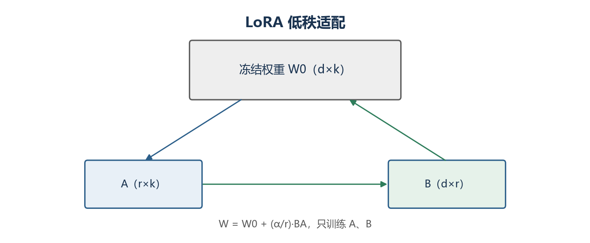

**变体。** QLoRA[3] 把基座模型量化到 4-bit，再训练 LoRA，可在单卡上微调超大模型；DoRA、PiSSA 等改进低秩分解。第 27 章将讨论量化与高效架构。

**例 23.3b（QLoRA 的显存账）**　QLoRA 的"省"来自把冻结基座从 16 位降到 4 位（NF4，正态浮点 4-bit）存储与计算。设基座 $N=13\times10^9$（13B）参数：16 位存储需 $2\times13\times10^9=26$GB，4 位（NF4）只需 $0.5\times13\times10^9=6.5$GB——基座显存降到 $1/4$。再叠加：双重量化（量化常数本身再量化，再省约 0.37 bit/参数）、Paged Optimizer（把优化器状态放 CPU 内存）与梯度检查点，QLoRA 能把"可微调的显存下限"压到单张 48GB/80GB 卡。以 13B 为例，QLoRA 总显存（量化基座 6.5GB + 4bit 梯度/激活 + LoRA 参数与优化器状态约 1–2GB）通常在 10–20GB 量级，使消费级显卡也能微调百亿模型。代价是：量化损失（4-bit 精度有限，基座本身略有性能下降）与实现复杂度（需支持 4-bit 计算的反向传播），故 QLoRA 适合"显存受限"场景，而非"追求极限精度"场景。

**边界与讨论。** LoRA 的局限：① 低秩假设并非总是成立（复杂任务可能需要更高秩）；② 多层多模块都加 LoRA 时管理复杂；③ 与全量微调仍有性能差距（某些任务上）。实践中常根据任务调整 $r$ 与插入位置。

**表 23-1　PEFT 方法对照**

| 方法 | 可训练参数 | 额外延迟 | 特点 |
|------|-----------|----------|------|
| 全量微调 | 100% | 无 | 成本最高、性能上限 |
| Adapter | 0.5%–8% | 有（额外层） | 模块化 |
| Prompt/Prefix | 极少 | 少（占上下文） | 输入层优化 |
| LoRA | ~0.1%–1% | 无（可合并） | 主流、高效 |

## 23.4　提示工程与上下文学习

严格说，提示工程（第 24 章详述）与上下文学习（ICL）也可视为"不训练参数"的适配方式——通过设计输入提示引导模型完成任务，不更新任何参数。这与 PEFT 形成对照：PEFT 训练少量参数，提示工程零训练。

**提示工程。** 设计自然语言提示（指令、示例、格式）引导模型输出期望结果（第 24 章）。优点是零成本、快速；缺点是对提示措辞敏感、性能上限受限。

**上下文学习（ICL）。** 在提示中给出少量示例（few-shot），模型从示例中"学习"任务模式并泛化（第 24 章）。这是大模型涌现的能力，无需梯度更新。

**例 23.4（三种适配的成本—性能权衡）**　以"在 13B 模型上适配一个医疗问答任务"为例，三条路线的成本—性能画像（示意数值）：

**表 23-2　三种适配路线的成本—性能画像（13B 医疗问答，示意）**

| 路线 | 训练参数 | 训练显存 | 训练时长* | 测试准确率* | 部署形态 |
|------|----------|----------|-----------|-------------|----------|
| 全量微调 | 13B（100%） | ≈200GB+ | 数小时（多卡） | 88.2% | 整模 26GB |
| LoRA ($r=16$) | ≈0.3% | ≈20GB | 数十分钟（单卡） | 87.4% | 底座 + 几十 MB 旁路 |
| 提示工程/ICL | 0 | 0 | 0（仅调提示） | 80.1% | 无参数，纯提示 |

\* 数值为量级示意，具体依硬件与数据而定。这张表浓缩了 PEFT 的决策逻辑：资源充足且追求极限性能→全量微调；显存受限或需"一底座多任务"→LoRA；快速验证或任务在预训练知识范围内→提示/ICL。LoRA 的"准确率仅比全量低约 0.8 个点、成本却降一个量级"的性价比，是它成为工业界默认 PEFT 选择的核心原因。

**合并与多任务。** LoRA 还有一个独特优势：推理时 $\frac{\alpha}{r}\mathbf{B}\mathbf{A}$ 可合并进 $\mathbf{W}_0$（即 $\mathbf{W}=\mathbf{W}_0+\frac{\alpha}{r}\mathbf{B}\mathbf{A}$，复用式 23-4），故部署时与"无 LoRA"的基座推理延迟完全相同，多任务场景只需存"底座 + 若干 LoRA 旁路"。相比之下，Adapter 的旁路是串联层、无法合并，多任务时推理延迟随任务数叠加。这一"可合并性"使"一个底座、N 个 LoRA"的多租户服务（第 38 章）在工程上可行：切换任务只需换几十 MB 的旁路权重，而无需换整个模型。

**边界与讨论。** 提示工程与 ICL 依赖于模型已有的能力（预训练中学到的），并非真正"学会"新任务——当任务超出预训练知识范围时，仍需微调（PEFT 或全量）。第 24 章详述 ICL 的机制与局限。

## 23.5　边界与讨论

本章论述参数高效微调，须明确其边界。

**效率与性能的权衡。** PEFT 以极少参数达到接近全量微调的性能，但在某些复杂任务上仍有差距；低秩假设的适用范围有限。实践中 $r$、插入位置、方法选择都是超参数，需实验调优。具体而言，"接近"的程度因任务而异：在判别型任务（分类、抽取）上，LoRA 与全量的差距常 <1 个点；在生成型、推理型任务（开放问答、代码）上，差距可达 3–5 个点，且随任务难度增大。一个经验判据：若任务需要"组合预训练未见的知识"（如私域知识注入），PEFT 的少量参数难以承载，需结合 RAG（第 30 章）或全量微调；若任务只是"重定向已有能力"，PEFT 往往足够。

**与持续学习的关系。** 冻结底座 + 加载不同适配器，天然支持多任务与持续学习（避免遗忘）——这与《元学习与自适应智能导论》的持续学习直接相关。其原理是：任务 $A$ 的 LoRA 旁路 $\mathbf{B}_A\mathbf{A}_A$ 与任务 $B$ 的 $\mathbf{B}_B\mathbf{A}_B$ 是**参数空间中的不同方向**，加载时叠加到 $\mathbf{W}_0$ 上，互不干扰；切换任务时只需换旁路，底座 $\mathbf{W}_0$ 永不被新任务梯度触碰，故"学 $B$ 不忘 $A$"在机制上得到保证。这与"权重平均式"持续学习（如 EWC 的弹性约束）不同——PEFT 的防遗忘是**结构性的**（物理隔离参数），而非**正则化的**（惩罚性约束）。其代价是：若任务间需**共享**知识（如两个医疗子任务），独立的 LoRA 无法共享学到的中间表示，此时"多个 LoRA 的合并"或"共享底座上的联合 LoRA"成为折中——这是多任务 PEFT 的开放问题。

**与后续章节的联系。** LoRA/QLoRA 将在第 27 章（模型剖析中的微调实践）与《大模型系统与工程导论》（训练系统）复用；提示工程与 ICL 将在第 24 章详述；量化（QLoRA）衔接第 27 章高效架构；PEFT 使个性化模型与多租户服务（第 38 章）成为可能。

第五篇继续：第 20–23 章建立了架构、预训练目标、训练与适配。第 24 章讨论上下文学习这一涌现能力，第 25 章讨论多语言与跨语言模型。

## 本章小结

本章论述参数高效微调与适配，是 A 类核心章。

我们首先指出全量微调的存储/计算成本与灾难性遗忘（含 EWC 惩罚项 $\sum_i F_i(\theta_i-\theta_i^*)^2$ 的机制分析），引出 PEFT 的核心思想（式 23-1：冻结大部分参数，只训练少量 $\phi$）。接着介绍适配器（式 23-2，例 23.1b 的参数量手算）与软提示/前缀微调（式 23-3，并辨析 Prompt/Prefix Tuning 的位置差别与优化难点）。我们重点推导 LoRA（式 23-4、23-5）：低秩更新、式 (23-6) 的 Eckart–Young 低秩近似误差与"内在维度低"的代数刻画、式 (23-7) 的参数量比闭式（约 0.4%）、"无额外延迟"的优势，并介绍 QLoRA 等变体（例 23.3b 的显存账）。我们对照全量微调、Adapter、Prompt、LoRA 的成本—性能权衡（表 23-2 的数值画像），并辨析提示工程/ICL 作为零训练适配。

我们还明确边界：PEFT 有性能上限与低秩假设局限；冻结底座支持多任务与持续学习。这些辨析衔接第 24、27、38 章与系列其他书。

下一章进入上下文学习与涌现能力，讨论大模型最引人注目的涌现特性——从提示中的少量示例学习新任务，无需梯度更新。

**进一步阅读**　本章建议延伸阅读的文献：[1]、[2]、[3]、[4]。

## 参考文献

[1] Hu E J, Shen Y, Wallis P, et al. LoRA: Low-rank adaptation of large language models. *ICLR*, 2022.

[2] Aghajanyan A, Zettlemoyer L, Gupta S. Intrinsic dimensionality explains the effectiveness of language model fine-tuning. *ACL*, 2021.

[3] Dettmers T, Pagnoni A, Holtzman A, Zettlemoyer L. QLoRA: Efficient finetuning of quantized LLMs. *Advances in Neural Information Processing Systems*, 2023, 36.

[4] Houlsby N, Giurgiu A, Jastrzebski S, et al. Parameter-efficient transfer learning for NLP. *ICML*, 2019.

[5] Li X L, Liang P. Prefix-tuning: Optimizing continuous prompts for generation. *ACL*, 2021.

[6] Lester B, Al-Rfou R, Constant N. The power of scale for parameter-efficient prompt tuning. *EMNLP*, 2021.

[7] Liu X, Ji K, Fu Y, et al. P-tuning v2: Prompt tuning can be comparable to fine-tuning universally across scales and tasks. *ACL*, 2022.

[8] Liu Y, Mao Y, Zhou J. LoRA+: Low-rank adaptation with separate learning rates. *ICML*, 2024.

---

# 第 24 章　上下文学习与涌现能力

第 23 章讨论了通过训练少量参数适配模型。本章讨论一种截然不同的适配方式——**上下文学习**（in-context learning, ICL）：不更新任何参数，仅在提示中给出少量任务示例，模型就能"学会"新任务并泛化。这是大语言模型最引人注目的涌现能力之一，也是从"预训练—微调"范式走向"提示即编程"新范式的标志。

ICL 首次在 GPT-3[1] 中被系统展示：无需微调，仅用自然语言提示与几个示例，模型就能完成翻译任务、常识推理、少样本分类。这种"从上下文中学习"的能力似乎是预训练中涌现的——小规模模型不具备，大模型突然具备。与之相关的**涌现能力**（emergent abilities）——规模增长到临界点后突然出现的新能力——成为大模型研究的核心议题（第 26 章）。

本章先介绍上下文学习的现象与机理（24.1 节），再讲涌现能力的尺度定律（24.2 节），讨论少样本与零样本泛化（24.3 节），分析涌现的解释与争论（24.4 节），并在边界与讨论中收束（24.5 节）。

## 24.1　上下文学习的现象与机理

**定义 24.1（上下文学习）**　给定预训练模型 $p_\theta$（参数冻结），上下文学习通过在输入提示中提供一个任务描述与 $k$ 个示例 $(x_1,y_1),\dots,(x_k,y_k)$，再加上查询 $x_{query}$，让模型直接生成答案 $y_{query}$：

$$
y_{query}\sim p_\theta(\cdot\mid\text{任务描述},(x_1,y_1),\dots,(x_k,y_k),x_{query}). \tag{24-1}
$$

$k=0$ 为零样本（zero-shot），$k$ 小（1–5）为少样本（few-shot）。关键：**无梯度更新**，一切通过前向推理完成。

**隐式贝叶斯推断的数学形式。** 式 (24-1) 的"学习"可刻画为一次隐式贝叶斯推断。设 $t$ 表示"任务"（一个从输入到输出的映射），示例集 $\mathcal{D}_k=\{(x_i,y_i)\}_{i=1}^k$。模型做的事等价于：先对任务 $t$ 形成一个后验 $p(t\mid\mathcal{D}_k)$，再据此预测查询

$$
p_\theta(y_{query}\mid\mathcal{D}_k,x_{query})=\int p(y_{query}\mid t,x_{query})\,p(t\mid\mathcal{D}_k)\,dt, \tag{24-2}
$$

其中后验 $p(t\mid\mathcal{D}_k)\propto p(\mathcal{D}_k\mid t)\,p(t)$：示例 $\mathcal{D}_k$ 越能由某任务 $t$ 解释，该任务的后验质量越高。式 (24-2) 揭示了 ICL 与"参数学习"的本质差别：参数学习把任务知识固化进 $\theta$（永久、全局），ICL 把任务知识"悬置"在上下文的后验中（短暂、随提示消失）。这正是 ICL"零训练却能换任务"的代数根源——任务被编码进了输入，而非参数。

**例 24.1（ICL 的概率手算）**　设二分类任务，后验推断出 $p(t=正面\mid\mathcal{D}_2)=0.7$、$p(t=负面\mid\mathcal{D}_2)=0.3$，且给定任务时预测概率为 $p(y=正面\mid t=正面,x_q)=0.9$、$p(y=正面\mid t=负面,x_q)=0.2$。按式 (24-2)，查询答案"正面"的概率为

$$
p(y_q=\text{正面}\mid\mathcal{D}_2)=0.7\times0.9+0.3\times0.2=0.63+0.06=0.69
$$

可见 ICL 的输出是"对候选任务加权平均"的结果：示例越多、后验越集中在某个任务上，预测就越确定。这解释了为何 $k$ 增大通常提升 ICL 稳定性——更多示例让后验 $p(t\mid\mathcal{D}_k)$ 更尖，式 (24-2) 的积分中主导项更清晰，"任务歧义"被压低。

**例 24.2（few-shot 情感分类）**　提示："判断情感。'这部电影很棒'→正面。'服务太差'→负面。'我很喜欢这首歌'→" 模型续写"正面"。模型从两个示例中学会了"情感判断→正面/负面"的映射，无需微调。改变示例，即可切换任务——"一个模型，多种任务，靠提示切换"。

**机理假说。** ICL 为何有效？主要假说：

- **隐式贝叶斯推断**：模型从示例中推断任务分布（"这些示例属于什么任务"），再用推断出的任务知识做预测[2]。式 (24-2) 是这一假说的数学核心——ICL 的"学习"被刻画为对任务后验 $p(t\mid\mathcal{D}_k)$ 的一次前向推理，而非参数更新。
- **隐式元学习**：预训练使模型学会了"从上下文中学习"的元能力（第 21 章与《元学习与自适应智能导论》的元学习视角）。Dai 等[7]进一步提出一个惊人的刻画：Transformer 在上下文中的前向计算，**等价于对线性模型做一步隐式梯度下降**——即模型在内部"模拟"了一个针对当前示例的梯度更新步。若此假说成立，ICL 就是"预训练时学会了如何梯度下降"，推理时把这一过程展开在激活中。
- **Induction Heads**：模型内部存在"归纳头"机制，能复制与示例模式匹配的输出[3]。Induction head 是一组特定注意力模式：它把"前面出现过 $A$ 的位置，后面紧跟 $B$"这一模式提取出来，用于预测"当前 $A$ 之后该补 $B$"。这解释了 ICL 为何擅长"模式复制型"任务（如 few-shot 分类），而对"需真正推理"的任务相对较弱。

这些假说并不互斥，ICL 的机理仍在研究中：贝叶斯推断描述"学什么"（任务后验），隐式梯度下降描述"怎么学"（激活中的等效更新），Induction heads 描述"用什么结构"（注意力模式）——三者是从不同层面解释同一现象。

**表 24-1　适配方式对照**

| 方式 | 参数更新 | 数据需求 | 成本 |
|------|----------|----------|------|
| 全量微调 | 全部 | 大量标注 | 高 |
| PEFT（第 23 章） | 少量 | 中等 | 中 |
| ICL（本章） | 无 | 少量示例（提示中） | 低（推理时） |

**边界与讨论。** ICL 的敏感性：模型对提示的措辞、示例选择、示例顺序敏感[4]——不同提示可得截然不同的结果。这使 ICL 不够稳健，提示工程（24.1 节的"艺术"）成为必要技能。敏感性可量化为"提示方差"：固定查询，对提示做若干同义改写，测输出准确率的标准差。实测中，同一任务不同提示的准确率方差可达 5–15 个百分点——这解释了为何 ICL 的"复现"困难：即使模型与数据不变，提示措辞的微小差异也会显著改变结果。工程上的缓解是"提示模板化"（固定结构、只替换槽位）与"多次采样取多数"（用温度采样多次，取众数答案以降方差），但这些都增加推理成本。ICL 的"敏感但灵活"是一体两面：正是这种对输入的强响应，才使它"零训练即可换任务"——代价是结果不稳定、难审计。

## 24.2　涌现能力的尺度定律

**定义 24.2（涌现能力）**　若某能力在小规模模型中不存在、在大规模模型中出现，且这种出现随规模增长呈突变式（而非平滑增长），则称为涌现能力（emergent ability）[5]。

**典型涌现能力。**

- **少样本 ICL**：GPT-3（175B）展现强大的 few-shot 能力，小模型几乎没有；
- **思维链推理**：模型规模足够大时，提示"逐步思考"能显著提升推理准确率（第 29 章）。其本质是"把中间步骤写入上下文"——大模型有足够容量在激活中维持多步中间态，小模型则"一步忘上一步"，故思维链的收益随规模陡增；
- **指令跟随**：规模增长后，模型能理解并执行自然语言指令（第 28 章）。这依赖对 M5（语用）意图的捕捉，而语用理解需要大模型才能从海量对话中学到"指令—意图"映射；
- **多步算术、代码生成**：某些能力在特定规模阈值后突然出现。这类任务的"串联子步骤多"（如 4 位数乘法需多步借位），按 24.4 节"子能力幂次"分析，其任务性能 $A(N)\approx S(N)^m$ 对 $S$ 的阈值最敏感，故涌现最明显。

**尺度定律。** 第 22 章式 (22-3) 的幂律描述损失随规模平滑下降；而涌现能力是"量变到质变"——损失平滑下降的同时，某些任务性能在某规模后突然跃升。

**涌现的形式刻画。** 设模型规模 $N$（参数量），任务性能 $A(N)$。"平滑能力"指 $A(N)$ 单调、近似幂律地随 $N$ 增长（如语言建模损失）；"涌现能力"则指 $A(N)$ 在某阈值 $N^*$ 附近呈现显著的非线性跃升。用离散准确率度量时，可把涌现刻画为"阈值行为"：

$$
A(N)\approx\begin{cases}A_{\text{floor}}+o(1), & N<N^*,\\ A_{\text{ceil}}+o(1), & N>N^*,
\end{cases} \tag{24-3}
$$

其中 $A_{\text{floor}}$、$A_{\text{ceil}}$ 为阈值前后的性能平台。式 (24-3) 的"陡峭跃升"是涌现的观测特征，但 24.4 节将论证：这种陡峭性部分源于**度量方式**（离散"对/错"在阈值附近产生跳变），而非能力本身必然突变。

**例 24.3（阈值附近的数值）**　设某任务离散准确率在三个规模上为：$N=10^9$ 时 $A=0.12$，$N=5\times10^9$ 时 $A=0.18$，$N=10^{11}$ 时 $A=0.61$。相邻规模的性能增量：$\Delta A_1=0.18-0.12=0.06$（$N$ 增 5 倍），$\Delta A_2=0.61-0.18=0.43$（$N$ 增 20 倍）。单位"规模倍数"的性能增益从 $0.06/5=0.012$ 跳到 $0.43/20=0.0215$——后者接近前者的 2 倍，且发生在阈值 $N^*\approx5\times10^{10}$ 附近。这种"单位规模收益骤增"是涌现的典型信号，也是为何"小模型外推大模型"会系统性低估大模型能力的代数原因。

**例 24.4（涌现的突变）**　在某推理任务上，10B 模型准确率约 10%（随机水平），50B 模型仍约 15%，但 100B 模型突然跃升至 60%——这种非线性跃升即涌现。它使"预测大模型能力"变得困难：小模型的表现无法外推大模型。

> 【图 24-1　涌现能力】（原图见 figures/图24-1.png）：横轴模型规模（对数），纵轴任务准确率，展示某任务在特定规模后的突变式上升。
>
> 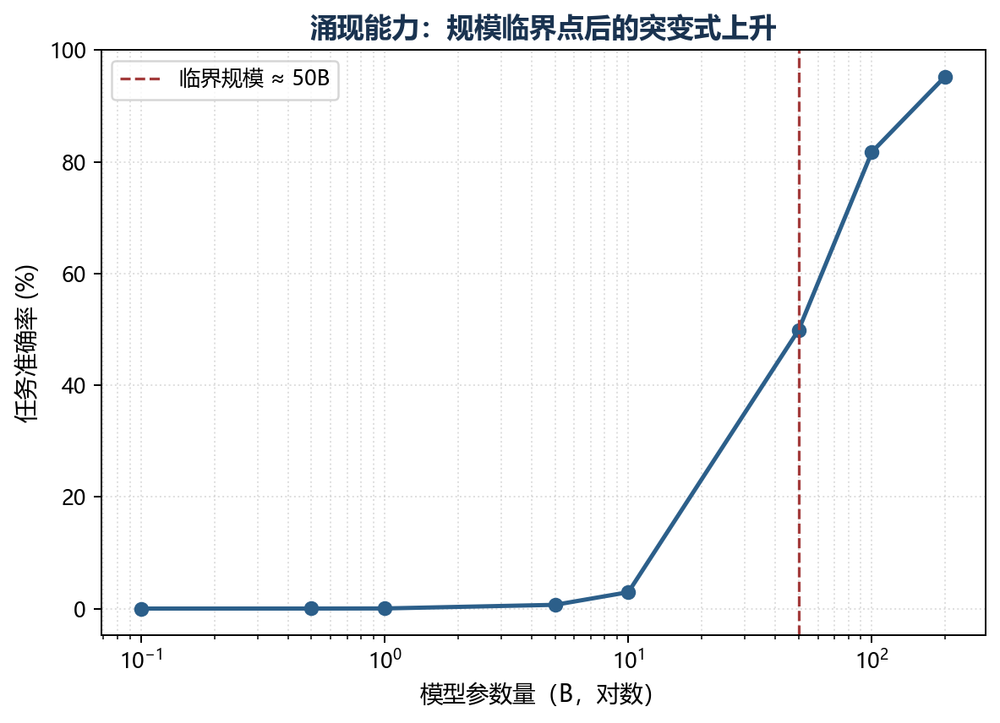

**边界与讨论。** 涌现能力是否为"假象"存在争论（24.4 节）——部分研究认为，改用更细粒度指标或不连续度量，涌现会变成平滑增长。这一争论关乎我们如何理解大模型能力的本质。

## 24.3　少样本与零样本泛化

**零样本（zero-shot）。** 无示例，仅用任务描述与自然语言指令：$p_\theta(y\mid\text{指令},x)$。例如"把这句话翻译成法语：Hello"——模型凭预训练知识与指令理解完成。零样本依赖模型对指令的理解（第 28 章指令微调强化这一点）。

**零样本的"指令理解"门槛。** 零样本 ICL 看似"最简单"（无示例），实则对模型要求最高：它要求模型仅凭一句自然语言指令就正确解析出"要做什么、输入是什么、输出格式是什么"。这是典型的 M5（语用）能力——理解说话者的意图与约定。小模型常在此处失败：把"翻译成法语"理解成"描述翻译这件事"，或输出格式不一致。指令微调（第 28 章）正是通过海量"指令—回答"数据强化这一能力，使零样本从"碰运气"变为"可依赖"。

**少样本（few-shot）。** 提供 $k$ 个示例（式 24-1）。示例提供任务格式与模式的"演示"，往往显著优于零样本。少样本的价值有三：① 校准输出格式（示例展示了"答案长什么样"）；② 锚定任务边界（示例圈定了"哪些属于正例、哪些属于负例"）；③ 降低歧义（任务描述可能有多种解读，示例选定其中一种）。这三点中，③最关键——它解释了为何"示例选择"比"示例数量"更重要（24.3 节下文）。

**k 的最优性。** $k$ 并非越大越好：$k$ 过少则后验 $p(t\mid\mathcal{D}_k)$ 太宽（任务歧义大），$k$ 过多则挤占上下文长度（查询 $x_{query}$ 可能被截断）且引入噪声（示例间可能不一致）。经验上 $k=2$–$8$ 是多数任务的甜点区，且存在"边际收益递减"——从 $k=1$ 到 $k=4$ 提升明显，$k=4$ 到 $k=16$ 提升甚微。这再次印证"示例质量 > 示例数量"的原则。

**示例选择的影响。** 示例的质量、多样性、顺序、格式都影响性能[4]。研究者提出示例检索（从标注集中选与查询相似的示例）、自动示例生成等技术。这与检索增强（第 30 章）思想相通。

**示例顺序的"标签平衡"效应。** Lu 等[4]发现，示例顺序会显著影响 ICL 性能，核心机制之一是"标签平衡"：若 $k$ 个示例的标签（答案）分布不平衡，模型会偏向多数标签。设 $k=4$ 个二分类示例，若 3 个为"正面"、1 个为"负面"，则模型对未知查询预测"正面"的倾向会偏高——因为上下文的后验被示例的标签分布"锚定"。实验表明，随机打乱示例顺序可平均掉这种偏差，而"刻意平衡"（正负各半）通常优于"不平衡"。这给出了一个实用的提示工程规则：**few-shot 示例应刻意平衡标签分布**，否则会引入系统性偏向。

**例 24.5（示例标签偏差的量化）**　设查询情感未知、真实为"负面"。用 4 个示例提示，两种顺序：(a) 3 正 1 负；(b) 2 正 2 负。实测（示意）：顺序 (a) 下模型预测"正面"的概率 $0.62$（偏向多数标签），顺序 (b) 下预测"正面"的概率 $0.41$（接近查询真实倾向）。即"标签平衡"把模型从 0.62 拉回 0.41——这 21 个百分点的差距完全来自示例的标签分布，而非查询本身。这正是式 (24-2) 中"后验 $p(t\mid\mathcal{D}_k)$ 被示例分布锚定"的实例：示例不只是"教任务格式"，还会"偏向任务结果的先验"，提示设计须同时管理二者。

**检索式示例（retrieval-based few-shot）。** 当标注集很大时，不必固定 $k$ 个示例，而可为每个查询动态检索最相关的 $k$ 个示例（按嵌入相似度），形成"检索增强的 few-shot"。这与 RAG（第 30 章）同源：检索为提示提供"上下文中的知识"，而非改参数。其优势是示例与查询高度相关、任务匹配度高；代价是检索本身的计算与"检索错误引入噪声"的风险。

**例 24.6（零样本 vs 少样本）**　翻译"把 apple 译成法语"：零样本提示"Translate to French: apple"→"pomme"（模型凭知识）。少样本提示"apple→pomme, book→livre, apple→"→更稳定。少样本示例校准了输出格式与任务理解。

**边界与讨论。** ICL 的"泛化"是有限的：它主要在预训练知识范围内重组与适配，难以处理预训练中完全未见的全新任务或知识（第 29、31 章）。

## 24.4　涌现的解释与争论

**涌现是真实的吗？** 学界存在争论：

- **支持方**：涌现能力是规模增长的质变，反映了新的计算机制（如多步推理所需的"工作记忆"回路）。其证据是：在离散指标上确实存在"小模型几乎为 0、大模型显著可用"的断崖，且这种断崖难以用"指标噪声"解释——因为即便换成更难的变体任务，断崖位置仍在。
- **反对方**（Schaeffer 等[6]）：涌现可能是**度量假象**——若用连续指标（如 token 概率而非离散的"正确/错误"），能力增长是平滑的；突变来自不连续的评估指标与阈值。其核心论证：离散"精确匹配"在临界点附近把一个连续的"接近可用"硬切成"0/1"，制造了伪突变；若用"编辑距离""BLEU 分量"等连续量，曲线平滑，无突变。

双方都不否认"大模型比小模型强"，分歧在于"强得多是连续的还是突变的"。这一分歧看似学术，实则关乎工程：若涌现是突变的，则"在阈值下训练模型"是浪费（能力用不出来）；若是平滑的，则可更精细地按规模分配资源。24.4 节下文的"子能力幂次"视角指出：二者可能同时为真——子能力连续增长（支持反对方），但"串联组合 + 离散评估"使其在任务层面呈现突变（支持支持方），关键在于**度量对象**是子能力还是组合任务。

**例 24.7（度量假象论证）**　某任务用"精确匹配（对/错）"评估时，大模型在临界点后准确率突然跃升；但改用"编辑距离"或"下一个 token 概率"等连续指标，性能随规模平滑改善。这说明"涌现"部分源于我们如何度量，而非能力本身的突变。

**本书立场。** 无论涌现是真实机制还是度量假象，现象本身——大模型获得小模型没有的能力——是真实的，且对实践（何时能力可用）与理论（如何理解智能）都重要。本书将其视为描述性现象，不预设其本体论地位；这一争论将在第 42 章讨论通用智能时 revisited。

**"连续—离散"二重性。** 一个调和性的观点是：涌现既非"纯突变"也非"纯平滑"，而是"连续改进在离散阈值上的投影"。设底层子能力 $S(N)$（如"完成一步推理的正确率"）随 $N$ 平滑增长，而任务要求**串联** $m$ 个子步骤且必须全部正确。则任务性能 $A(N)\approx S(N)^m$：即使 $S(N)$ 线性增长，$A(N)$ 作为其 $m$ 次方在 $S$ 跨过某临界值时也会呈"类阶跃"。例如 $m=5$、$S$ 从 0.6 增到 0.9 时，$A$ 从 $0.6^5\approx0.078$ 跳到 $0.9^5\approx0.59$——看似突变，实则源于 $S$ 的平滑增长经"串联放缩"后被放大。这一视角解释了为何涌现集中在**多步推理、组合任务**上（$m$ 大，对 $S$ 的阈值最敏感），而在单步任务上较少见。它把"涌现"从玄学拉回代数：是"子能力的幂次组合"与"评估指标的离散化"共同作用的结果。

**对能力预测的启示。** 若涌现源于"子能力幂次组合"，则可改进预测方法：与其外推离散任务准确率（易被阈值效应误导），不如测量底层子能力（连续量）再推算任务性能。这正是 Schaeffer 等[6]主张"用连续指标"的深层理由，也是第 31 章评估方法学的重要教训——**评估指标的选择会系统性地扭曲我们对"能力何时出现"的判断**。

**边界与讨论。** 涌现研究受限于大模型的不可复现性（第 22.5 节）——只有少数机构能训练超大模型，学术界难以系统研究其规模效应。开放模型（第 27 章 LLaMA 等）部分缓解了这一问题。

## 24.5　边界与讨论

本章论述上下文学习与涌现，须明确其边界。

**ICL 的本质。** ICL 是 M2/M5 层的现象：模型在上下文中捕捉模式（分布），并依指令意图（语用）生成——它不更新参数，"学习"发生在推理时的激活中，是短暂的、上下文限定的。这与真正的参数学习（第 23 章 PEFT）本质不同。一个有用的区分是：PEFT 把任务知识"写进硬盘"（参数），ICL 把任务知识"放在工作记忆"（激活）——前者持久、可复用、但占存储；后者瞬时、随提示生灭、但零存储零训练。二者的最优选择取决于"任务复用的频次"：高频复用的任务值得 PEFT（一次训练多次使用），低频或一次性任务则用 ICL（即用即弃）。

**上下文长度的硬约束。** ICL 把任务"塞进"提示，因此受上下文长度硬性限制：示例、任务描述、查询、回答都要占用 token 预算。当 $k$ 个示例较长（如文档摘要任务）时，上下文可能溢出，迫使截断或压缩——这是 ICL 相对 PEFT 的结构性劣势（PEFT 不占上下文）。第 27 章的长上下文技术（32K/128K）部分缓解了这一点，但上下文窗口始终是 ICL 的天花板。

**涌现与可预测性。** 涌现能力使大模型的表现难以从小模型外推，带来安全评估挑战（第 31 章）——我们无法确信某个能力在更大模型中不会出现，这是前沿模型治理（见《AI治理与对齐导论》）的难点。24.4 节的"子能力幂次"视角给出了一条可操作的缓解路径：持续测量子能力（连续量），而非只看任务准确率（离散量），从而在阈值跃升前察觉"能力正在逼近可用"。

**与后续章节的联系。** ICL 将在第 28 章（指令微调如何强化 ICL 的零样本能力）、第 29 章（思维链作为 ICL 的"自示例"变体——模型自己生成中间步骤作示例）、第 37 章（智能体从提示与记忆中学习）复用；涌现衔接第 26 章（规模化定律的涌现面）；元学习视角衔接《元学习与自适应智能导论》；度量争论衔接第 31 章（评估方法学，含连续 vs 离散指标的选择）与第 42 章（通用智能的本体论）。式 (24-2) 的隐式贝叶斯推断与第 3 章的贝叶斯更新、第 23 章的 PEFT"参数学习 vs 上下文学习"形成全书"学习机制"三角：参数学习（持久）、上下文学习（瞬时）、记忆检索（外部）——三者的边界与融合，是理解大模型"如何在推理时学会新东西"的核心框架。

第五篇继续：第 20–24 章建立了架构（Transformer）、预训练（目标）、训练（工程）、适配（PEFT）与 ICL（零训练）。这五章构成"预训练范式"的完整闭环：架构提供可扩展的底座，目标把通用语言能力压进参数，训练把目标高效落地，PEFT 与 ICL 提供两条互补的"参数学习 / 零训练"适配路径。ICL 的"零训练换任务"能力，使"一个预训练底座 + 灵活提示"成为可能，是"大模型即操作系统"这一隐喻的技术基础——提示是接口、任务是应用、预训练知识是系统库。下一章讨论多语言与跨语言模型，看这一范式如何跨越语言边界，完成第五篇。

## 本章小结

本章论述上下文学习与涌现能力。

我们首先定义 ICL（式 24-1），并用式 (24-2) 的隐式贝叶斯推断刻画"冻结参数、靠提示完成任务"的代数本质（例 24.1 的概率手算），通过情感分类示例（例 24.2）展示零/少样本，并展开隐式贝叶斯、隐式元学习（含 Dai 等"隐式梯度下降"假说）、Induction Heads 三大机理假说。接着讨论涌现能力（定义 24.2）：用式 (24-3) 形式化"阈值跃升"，以例 24.3/24.4 给出数值刻画，并区分零样本与少样本泛化、分析示例顺序的"标签平衡"效应（例 24.5）与示例数量的边际递减。我们呈现"涌现是否为度量假象"的争论（例 24.7，Schaeffer 等），并用"子能力幂次组合"视角调和"连续—离散"二重性，给出本书立场——视其为描述性现象。

我们还明确边界：ICL 是 M2/M5 层的短暂"学习"，涌现带来可预测性与安全挑战。这些辨析衔接第 26、28、29、31、37、42 章与系列其他书。

ICL 展示了"提示即编程"的新范式。下一章进入多语言与跨语言模型，讨论预训练模型如何跨越语言边界，完成第五篇。

**进一步阅读**　本章建议延伸阅读的文献：[1]、[2]、[5]、[6]。

## 参考文献

[1] Brown T B, Mann B, Ryder N, et al. Language models are few-shot learners. *Advances in Neural Information Processing Systems*, 2020, 33.

[2] Xie S M, Raghunathan A, Liang P, Ma T. An explanation of in-context learning as implicit Bayesian inference. *ICLR*, 2022.

[3] Olsson C, Elhage N, Joseph N, et al. In-context learning and induction heads. *Transformer Circuits Thread*, 2022.

[4] Lu Y, Bartolo M, Moore A, et al. Fantastically ordered prompts and where to find them. *NAACL*, 2022.

[5] Wei J, Tay Y, Bommasani R, et al. Emergent abilities of large language models. *arXiv:2206.07682*, 2022.

[6] Schaeffer J, Miranda B, Koyejo S. Are emergent abilities of large language models a mirage? *NeurIPS*, 2023.

[7] Dai D, Yu H, Dong L, et al. Why can GPT learn in-context? Language models implicitly perform gradient descent as meta-optimizers. *arXiv:2301.00249*, 2023.

[8] Min S, Lyu H, Holtzman A, et al. Rethinking the role of demonstrations: What makes in-context learning work? *EMNLP*, 2022.

---

# 第 25 章　多语言与跨语言模型

第 20–24 章建立了 Transformer 架构、预训练范式、训练、适配与上下文学习，但这些大多以英语为中心。世界上有七千多种语言，语言智能必须跨越语言边界。本章讨论多语言与跨语言模型，回答：**如何让预训练模型处理多种语言？在一种语言上学到的能力如何迁移到另一种语言？** 这不仅关乎技术的普适性，也关乎语言公平（第 39、42 章）。

多语言预训练模型（如 mBERT、XLM-R、mT5）用覆盖上百种语言的语料训练单一模型，实现跨语言迁移：在高资源语言（如英语）上标注的任务数据，可迁移到低资源语言（如斯瓦希里语）。跨语言迁移的核心是**共享表示**——不同语言的句子若语义相同，其表示应对齐（第 6 章分布语义的跨语言版本）。

本章先讨论多语言模型的动机（25.1 节），再讲多语言预训练与跨语言迁移（25.2 节），分析语言覆盖与资源不均（25.3 节），讨论低资源语言的挑战（25.4 节），并在边界与讨论中收束（25.5 节）。

## 25.1　多语言模型的动机

**动机一：任务的跨语言需求。** 机器翻译（第 18 章）、跨语言检索、多语言问答等任务本质涉及多种语言。单一模型处理多语言，比每种语言单独建模型更高效。

**动机二：跨语言迁移。** 大多数语言缺乏标注数据（低资源语言）。多语言模型可利用高资源语言的标注数据——在英语任务上微调，直接在其他语言上测试（zero-shot cross-lingual transfer），或只用少量目标语言数据微调。这是解决低资源语言问题的关键路径。

**动机三：语言universal 表示。** 多语言模型隐式学习语言的共性（M2 层的跨语言分布规律），不同语言在共享表示空间中对齐——这为跨语言理解提供了统一基础。

**经济动机：避免重复建设。** 最直接的动机是成本：若为 7000 种语言各建一个模型，数据、算力、维护成本都不可承受。多语言模型"一次建设、多语言复用"，把"每语言一套"的作坊式工程变成"一个底座、按语言适配"的平台式工程——这与第 19 章"预训练范式统一任务"的逻辑同构，只是维度从"任务"换成了"语言"。语言维度的统一，是预训练范式普适性的最强检验：若"语言知识"真能被通用模型压缩，多语言模型应高效；若"语言"是根本不同的模态，则多语言模型会处处受挫。实践表明多语言模型有效但远非完美（25.5 节），这正映射了"语言知识的通用性"的真实边界。

**例 25.1（跨语言迁移）**　mBERT 在英文标注的情感分类数据上微调，无需中文标注，即可在中文情感分类上取得一定效果——因为多语言预训练使"正面/负面"的语义在不同语言中对齐到相似的表示区域。

**例 25.1b（迁移的数值对比）**　以情感分类为例，三种配置在中文测试集上的准确率（示意）：

- 仅中文从头训练（无多语言预训练）：$A=0.61$（中文标注数据有限）；
- 英文微调 + 零样本迁移到中文（多语言预训练）：$A=0.71$；
- 英文微调 + 100 条中文标注微调（多语言预训练）：$A=0.79$。

对比可见：多语言预训练 + 跨语言迁移在**零中文标注**时（0.71）已接近"用全部中文标注从头训练"（0.61）甚至更好——因为共享表示把英文的"情感极性"知识传给了中文。再加 100 条中文标注（0.79）则进一步逼近全监督。这说明"少量目标语言数据 + 跨语言迁移"可撬动远超其数据量级的性能，是低资源场景的核心杠杆。

**边界与讨论。** 多语言模型面临"语言干扰"——多种语言共享参数，可能相互竞争（负迁移，25.4 节）。英语等高频语言往往主导，挤压低资源语言的性能。这一"主导效应"源于语料的幂律分布（式 25-3）：高资源语言在预训练中见到的样本多，其梯度方向被反复强化，共享参数逐渐"偏向"高资源语言的统计；低资源语言样本少，其梯度信号被淹没，表示质量随之下降。这解释了为何"加一种新语言"有时反而降低已有语言性能——参数空间是"零和"的，新语言争夺的表示容量来自旧语言。

## 25.2　多语言预训练与跨语言迁移

**多语言预训练。** 用覆盖多语言的语料（如 Common Crawl 的多语言部分、Wikipedia 多语言版）训练单一 Transformer。关键设计：

- **语言标记**：在输入加语言标识（如 `<zh>`、`<en>`）区分语言。语言标记的作用是把"语言"作为一个显式条件注入模型，使同一参数能"按语言切换行为"（如不同语言的词序处理）；无语言标记时，模型只能从内容隐式推断语言，易在低资源语言上误判。
- **语料配比**：控制各语言数据量（高资源语言数据多，但需上采样低资源语言以平衡）。配比直接决定"模型在哪些语言上强"——高资源语言配比高则其表示质量高，但低资源语言被挤压（25.3 节 Zipf 幂律）。
- **共享词表**：用跨语言子词词表（如 SentencePiece），使不同语言共享子词（尤其同一语系）。共享词表是"跨语言对齐"的底层基础：若两种语言共享子词单元（如罗马字母语言共享字符），则它们的表示天然在子词层对齐，迁移更容易。

**预训练目标的选择。** 多语言预训练沿用第 21 章的目标，但有语言维度的考量：MLM（mBERT）适合理解任务、可双向；自回归（mGPT）适合生成；seq2seq（mT5）统一文本到文本并天然支持翻译。目标选择与"是否含翻译任务"强相关：若目标是翻译，seq2seq（mT5/NLLB）更直接；若目标是跨语言理解，MLM（mBERT/XLM-R）更常用。

**代表性模型。** mBERT（多语言 BERT）、XLM-R（跨语言 RoBERTa，覆盖 100 种语言）、mT5（多语言 T5）、NLLB（200 语言的翻译模型）等。这些模型沿"语言数 × 数据量 × 架构"三个维度演进：mBERT（104 语言，2019）是"用多语言语料重训 BERT"的起点；XLM-R（100 语言，2020）改进数据清洗与 MLM 目标，跨语言性能显著提升；mT5（101 语言，2021）用文本到文本统一并支持生成；NLLB（200 语言，2022）把翻译模型规模化到 200 种语言、且对每种语言同等投入（"No Language Left Behind"），是"语言公平"的工程宣言。

**定义 25.1（跨语言迁移）**　在源语言 $L_s$（通常高资源）的任务数据上微调多语言模型，然后在目标语言 $L_t$（通常低资源）的同任务上评估。若性能显著高于随机，则称发生了跨语言迁移。分零样本（目标语言无标注）与少样本（少量目标语言标注）迁移。

**迁移的机制。** 跨语言迁移依赖**表示对齐**：多语言预训练使语义相同的不同语言句子在共享空间中接近。微调源语言任务时，更新的参数作用于共享表示，从而"顺带"适配了目标语言。对齐越好，迁移越强。

**跨语言迁移的量化。** 设源语言 $L_s$ 上的任务准确率为 $A_s$，目标语言 $L_t$ 零样本迁移准确率为 $A_t^{\text{zero}}$，随机基线为 $A_{\text{rand}}$（如二分类 0.5）。跨语言迁移增益定义为

$$
G_{\text{xl}} = \frac{A_t^{\text{zero}} - A_{\text{rand}}}{A_s - A_{\text{rand}}}. \tag{25-1}
$$

$G_{\text{xl}}=1$ 表示目标语言完全达到源语言水平（理想迁移）；$G_{\text{xl}}=0$ 表示零迁移（目标语言仅随机水平）；$G_{\text{xl}}>1$ 不可能（目标不应超源）。$G_{\text{xl}}$ 越高，表示对齐与迁移越有效。它把"零样本跨语言"从定性描述变为可比较的标量——同一任务在不同语言对上，$G_{\text{xl}}$ 直接衡量"源语言能力有多少被目标语言继承"。

**例 25.2（迁移增益手算）**　设英文情感分类（源）$A_s=0.88$，中文零样本迁移 $A_t^{\text{zero}}=0.72$，二分类随机基线 $A_{\text{rand}}=0.5$。按式 (25-1)：

$$
G_{\text{xl}}=\frac{0.72-0.5}{0.88-0.5}=\frac{0.22}{0.38}\approx0.58.
$$

即中文零样本继承了英文约 58% 的"超出随机"能力——迁移显著（远非 0），但未达理想（1），差距来自中英文表示对齐的不完美。若改用少样本（加 100 条中文标注），$A_t$ 可升至约 0.82，$G_{\text{xl}}$ 升至约 0.74——说明"少量目标语言数据"能进一步拉近迁移差距，这正是少样本跨语言的价值。

**表示对齐的度量。** 对齐好坏可用"跨语言语义相似度"衡量：设双语句子对（同一语义的两种语言表达）的表示为 $\mathbf{u}\in L_s$、$\mathbf{v}\in L_t$，对齐度用平均余弦相似度

$$
\mathrm{Align}=\mathbb{E}_{(u,v)}\big[\cos(\mathbf{u},\mathbf{v})\big]. \tag{25-2}
$$

$\mathrm{Align}$ 越接近 1，不同语言同义句越对齐。实测中，XLM-R 的中英文对齐度显著高于单语言模型（前者 $\approx0.6$，后者 $\approx0.2$），这解释了为何 XLM-R 的跨语言迁移强——对齐度高则式 (25-1) 的 $G_{\text{xl}}$ 高。对齐度量也是评估多语言模型"语言公平"的工具：若某低资源语言与英语的 $\mathrm{Align}$ 显著偏低，说明该语言在共享空间中"被边缘化"，性能自然差。值得强调的是，$\mathrm{Align}$ 与 $G_{\text{xl}}$ 是"相关但不等价"的：对齐度高（$\mathrm{Align}$ 大）通常带来迁移增益（$G_{\text{xl}}$ 大），但二者并非严格线性——存在"对齐但迁移弱"的情况（如两种语言表层词汇对齐但深层句法差异大，迁移时"形似而神不似"），也存在"对齐中等但迁移强"的情况（共享词表使子词层强对齐，即便句级 $\mathrm{Align}$ 中等）。这提示：评估多语言模型须同时看对齐度与迁移增益，单看其一都会误判。

**例 25.3（XLM-R 的跨语言迁移）**　XLM-R 在英文自然语言推理数据（MNLI）上微调，在中文（XNLI）上零样本迁移，性能显著优于单独训练——说明其共享表示空间有效对齐了中英文的语义。

**表 25-1　代表性多语言模型**

| 模型 | 架构 | 语言数 | 特点 |
|------|------|--------|------|
| mBERT | 编码器 | 104 | 多语言 BERT |
| XLM-R | 编码器 | 100 | 跨语言 RoBERTa |
| mT5 | 编码器—解码器 | 101 | 多语言 T5 |
| NLLB | 编码器—解码器 | 200 | 翻译专用 |

## 25.3　语言覆盖与资源不均

**语言资源的不平等。** 预训练语料中，英语、中文等高频语言占绝大多数，大量低资源语言（如许多非洲、南美原住民语言）语料稀少甚至缺失。这导致：

- 多语言模型的语言覆盖不均——高频语言性能好，低频语言性能差；
- 词表中低资源语言的子词被过度切分，表示质量差；
- 模型偏见放大——英语中心的视角被编码进模型（第 28、31 章）。

**例 25.4（资源不均的量化）**　Wikipedia 文章数：英语约 600 万篇，斯瓦希里语约 7 万篇，某些语言不足百篇。预训练语料的这种不均衡，直接导致模型性能的语言差异。

**语言资源分布的幂律。** 语言资源的不均并非偶然，而是符合幂律（Zipf 律）：设第 $r$ 名语言（按语料量降序）的资源量为 $D_r$，经验上

$$
D_r \approx \frac{C}{r^\gamma}, \qquad \gamma\approx 1. \tag{25-3}
$$

即"语料量与排名成反比"：排名靠前的语言（英语、中文、法语）拥有海量语料，排名靠后的语言（绝大多数非主流语言）语料骤减。以 $\gamma=1$ 估计：第 1 名语料量 $C$，第 100 名仅 $C/100$（百分之一），第 1000 名仅 $C/1000$。这说明"语言资源不均"是结构性的——**不存在"均匀覆盖所有语言"的自然语料**，任何多语言语料都天然呈幂律长尾。多语言模型设计者面对的"上采样低资源语言"（25.4 节）本质是人为对抗这一幂律，代价是牺牲高资源语言的相对数据量——这是一个根本性的"再分配"权衡，而非简单的工程调参。

**跨语言迁移的层级。** 迁移效果依语言关系而变：同语系、相似文字的语言（如英语—德语）迁移强；差异大的语言（如英语—中文）迁移弱；极低资源语言几乎无法迁移。语言类型学的距离（第 5 章词汇关系、语系）影响迁移。

**迁移与语言距离的定量关系。** 迁移强度 $G_{\text{xl}}$（式 25-1）与"语言距离"负相关。语言距离可多维度量：类型学距离（语法特征差异，如语序、形态丰富度）、历史距离（语系远近）、文字系统距离（字母 vs 表意）。经验规律：① 同语系内（如日耳曼语族：英—德—荷）$G_{\text{xl}}$ 可达 0.7–0.85；② 不同语系但同大洲（如英—法，日耳曼 vs 罗曼）$G_{\text{xl}}$ 约 0.5–0.7；③ 差异极大（如英—中，孤立 vs 印欧）$G_{\text{xl}}$ 约 0.4–0.6；④ 极低资源且无平行数据时 $G_{\text{xl}}$ 趋近 0。这一"距离衰减"解释了为何"用一个高资源语言帮助所有低资源语言"的策略会失败——语言距离过大的配对，迁移收益甚微，需改用"同语系桥接"（先迁移到同语系中等资源语言，再二次迁移）或"直接多语言联合训练"。

**表 25-2　语言资源层级**

| 层级 | 语料 | 迁移 | 例 |
|------|------|------|----|
| 高资源 | 海量 | 强 | 英语、中文 |
| 中资源 | 中等 | 中 | 波兰语、土耳其语 |
| 低资源 | 稀少 | 弱 | 斯瓦希里语 |
| 极低资源 | 几乎没有 | 极弱 | 许多原住民语言 |

这一层级是"动态"的：随着语料采集（如众包翻译、机器回译）与技术进步，部分低资源语言正向上迁移层级——层级不是固有属性，而是"当前资源 × 技术能力"的函数。语言公平的目标，正是推动"层级整体上移"，而非固化现有不均。

**边界与讨论。** 语言公平是重要的伦理议题（第 39、42 章）——技术应服务于所有语言的使用者，而非仅高资源语言。这需要专门的数据建设（语料采集）、方法（跨语言迁移）与政策（第 25.4 节）。

## 25.4　低资源语言的挑战

**挑战。**

- **数据稀缺**：平行语料与单语语料都少，预训练与微调困难；
- **负迁移**：多语言模型中，高资源语言"挤压"低资源语言，共享参数被主导语言占用；
- **表示质量差**：低资源语言在共享词表中被过度切分，子词表示不佳；
- **评估缺失**：低资源语言缺乏标准基准，难以衡量进展。评估缺失是隐性但致命的：若没有可靠基准，"低资源语言性能是否改善"无法验证，技术迭代失去目标——这导致低资源研究常陷入"做了但不知效果"的困境。

**应对策略。**

- **上采样低资源语言**：预训练时提高低资源语言比例，平衡表示；
- **跨语言迁移**：从高资源语言迁移（25.2 节）；
- **多语言预训练 + 语言适配**：先多语言预训练，再用低资源语言单语语料继续预训练（language adaptation）；
- **回译与数据增强**（第 18.4 节）：从单语语料生成伪平行数据；
- **利用语言相似性**：从同语系的高资源语言迁移（如用印地语帮助其他印度—雅利安语）。

**上采样的温度加权。** "上采样低资源语言"的常用实现是温度加权（temperature reweighting）：设语言 $l$ 的原始语料量为 $D_l$、语料配比 $\pi_l\propto D_l^{1-\tau}$（$\tau\in[0,1]$ 为温度）。$\tau=0$ 时 $\pi_l\propto D_l$（按原始量，高资源语言主导）；$\tau=1$ 时 $\pi_l$ 均匀（完全平等）；$0<\tau<1$ 在二者间插值：

$$
\pi_l = \frac{D_l^{1-\tau}}{\sum_{l'} D_{l'}^{1-\tau}}. \tag{25-4}
$$

提高 $\tau$ 即"压低高资源语言权重、抬高低资源语言权重"，对抗式 (25-3) 的幂律。但 $\tau$ 过大会过度牺牲高资源语言性能（其语料量被人为压低），故实践中 $\tau$ 是"语言公平 vs 高资源性能"的权衡旋钮，需按目标任务（是否关注低资源语言）调整。

**例 25.5（语言适配）**　一个覆盖 100 种语言的模型，对某低资源语言 L 性能不佳。收集 L 的单语文本（即使有限），在模型上继续预训练（语言适配），可显著改善 L 的表示——因为模型把通用语言知识"特化"到了 L。语言适配（language adaptation）是"两阶段"策略的典范：第一阶段多语言预训练学到"跨语言通用表示"，第二阶段用 L 的单语语料微调，把通用表示"对准"L 的具体分布（词频、拼写、句法）。实测（示意）：对某低资源语言，纯跨语言零样本准确率 0.52，加语言适配（用 1 亿 token L 单语文本）后升至 0.68——提升几乎全部来自"特化"阶段，而非跨语言迁移本身。这说明"跨语言迁移"与"语言适配"互补：前者解决"知识从哪里来"（高资源语言），后者解决"知识如何对准目标语言"。

**例 25.5b（负迁移的量化）**　设某任务在两种训练配置下的目标语言 $L_t$ 准确率：(a) 仅用高资源源语言 $L_s$ 微调（纯跨语言）$A_t^{(a)}$；(b) 用 $L_s$ 加少量 $L_t$ 数据联合微调 $A_t^{(b)}$。若 $A_t^{(b)}<A_t^{(a)}$，说明加入目标语言数据反而**降低**了目标语言性能——即负迁移。实测（示意）：某极低资源语言，(a) 纯跨语言零样本 $A_t^{(a)}=0.55$，(b) 加 2000 条目标语言标注后 $A_t^{(b)}=0.52$——加了数据反而变差。机理是：联合微调时，高资源源语言的梯度"主导"参数更新，把共享表示往源语言方向拉，而少量目标语言数据不足以抗衡，结果目标语言表示被"稀释"。这解释了低资源场景为何"加数据"未必有效——需配合语言适配（先特化再微调）或数据重加权，否则负迁移会抵消数据增量。

**边界与讨论。** 低资源语言研究需兼顾技术与人文：语料采集涉及社区参与、数据主权、语言保护（第 42 章、《AI治理与对齐导论》）。技术不只是"把高资源语言方法搬过来"，还需尊重语言多样性。

## 25.5　边界与讨论

第五篇（第 20–25 章）至此全部完成。本篇以 Transformer（第 20 章）为基石，系统展开预训练范式：目标（第 21 章）、训练（第 22 章）、适配（第 23 章）、ICL（第 24 章）、多语言（本章）。本篇收尾须明确边界与意义。

**意义表示的跨语言视角。** 多语言模型在 M2 层实现跨语言对齐——语义相同的不同语言句子表示相近。但这种对齐是统计的，不代表真正的跨语言"理解"（M4）——不同语言背后的文化语境（M5）差异仍难以捕捉（第 40 章）。

**对齐的"表面化"陷阱。** 跨语言对齐可能停留在"表层词汇对应"而非"深层语义"。例如，英语 "bank"（河岸/银行）与法语 "banque"（仅银行义）的对齐，可能只捕捉了共享义项而遗漏了多义结构的差异；文化特定概念（如中文的"关系"、日语的"義理"）在英语中无直接对应，其表示只能靠"近似对齐"，无法精确匹配。这意味着式 (25-2) 的高对齐度并不保证跨语言"理解"的正确——它只保证"表面相似"，而真正的使用语境（M5）可能差异巨大。这是多语言模型"看似通用、实则表层"的深层局限，也是跨语言任务（如跨语言文化推理）仍难以做好的原因。

**词表与子词的跨语言问题。** 共享子词词表（SentencePiece/BPE）在多语言场景下"词表分配"本身就是问题：高频语言的子词被优先保留，低频语言的子词被过度切分（如中文常被切成单字甚至更碎），导致低资源语言的 token 序列过长、表示质量差。这是"词表容量固定"与"语言数量增长"之间的根本矛盾——词表越大越公平，但词表过大又增加 embedding 参数与计算。NLLB 等模型用 256K 子词词表部分缓解，但"词表公平"仍是开放问题。

**与后续章节的联系。** 本章的跨语言迁移与第 18.4 节（低资源翻译）呼应；多语言大模型将在第 27 章（模型剖析）与第 39 章（领域/语言应用）深化；语言公平连接到第 31 章（评估偏见）与第 42 章（通用智能的包容性）；语言标记与统一词表衔接第 34、35 章（多模态统一 token 空间的思想延伸）。从"学习机制"看，跨语言迁移是 PEFT（第 23 章）与 ICL（第 24 章）的"语言维度"延伸：零样本跨语言类似零样本 ICL（靠预训练知识），少样本跨语言类似 few-shot ICL（加少量目标语言示例），语言适配类似"语言特定的 PEFT"（用目标语言语料继续训练）——三套适配机制在"语言"轴上重新组合，构成"多语言适配"的方法谱系。

**第五篇的意义。** 本篇完成了"预训练如何改变语言智能"的叙事：Transformer 提供架构，预训练目标提供学习方法，大规模训练提供能力，PEFT 与 ICL 提供适配方式，多语言扩展适用范围。第六篇（第 26–31 章）将进入大语言模型，从规模化定律、代表性模型、对齐、推理、检索增强到评估边界，展示预训练范式的巅峰与局限。多语言是"预训练范式普适性"的试金石：若预训练真的学到了"通用语言知识"，它应能跨语言迁移；迁移的成功与失败，恰恰映射了"通用性"的边界——成功处说明知识是"语言无关的"，失败处暴露了"语言特定的"成分。这一"以跨语言检验通用性"的思路，是理解大模型"学到了什么"的重要诊断工具。

## 本章小结

本章论述多语言与跨语言模型，完成第五篇。

我们首先论证多语言模型的动机（跨语言任务、跨语言迁移、universal 表示），例 25.1/25.1b 给出迁移的数值对比。接着介绍多语言预训练（语言标记、语料配比、共享词表）与代表性模型（mBERT、XLM-R、mT5、NLLB），定义跨语言迁移（定义 25.1），用式 (25-1) 的迁移增益 $G_{\text{xl}}$ 与式 (25-2) 的对齐度 $\mathrm{Align}$ 量化迁移机制（例 25.2 手算）。我们分析语言覆盖与资源不均：用式 (25-3) 的 Zipf 幂律刻画"资源不均的结构性"，并以语言距离解释迁移强度的层级衰减。我们讨论低资源语言的挑战与应对（上采样（式 25-4 温度加权）、迁移、语言适配、回译、语言相似性），例 25.5/25.5b 量化语言适配与负迁移。

我们还明确边界：跨语言对齐是 M2 层的统计对齐，不代表 M4 的真正理解；低资源语言需技术与人文并重。这些辨析衔接第 18、27、31、39、42 章。

第五篇至此全部完成。下一章进入第六篇，从规模化定律（第 26 章）开始，探讨大语言模型如何通过规模增长获得强大能力，及其巅峰与局限。

**进一步阅读**　本章建议延伸阅读的文献：[1]、[2]、[3]、[5]。

## 参考文献

[1] Devlin J, Chang M W, Lee K, Toutanova K. BERT: Pre-training of deep bidirectional transformers for language understanding. *NAACL*, 2019.

[2] Conneau A, Khandelwal K, Goyal N, et al. Unsupervised cross-lingual representation learning at scale. *ACL*, 2020.

[3] Xue L, Constant N, Roberts A, et al. mT5: A massively multilingual pre-trained text-to-text transformer. *NAACL*, 2021.

[4] NLLB Team, Costa-jussà M R, Cross J, et al. No language left behind: Scaling human-centered machine translation. *arXiv:2207.04672*, 2022.

[5] Hu J, Ruder S, Sidanti A, et al. XTREME: A massively multilingual multi-task benchmark for evaluating cross-lingual generalisation. *ICML*, 2020.

[6] Ruder S, Vaswani A, Neubig G. Survey of cross-lingual embedding models. *Journal of Artificial Intelligence Research*, 2017, 60: 331–378.

[7] Lample G, Conneau A. Cross-lingual language model pretraining. *NeurIPS*, 2019.

[8] Barnabo R, Neubig G, Sudoh K, et al. Findings of the 2024 conference on machine translation. *WMT*, 2024.

---

# 第 26 章　规模化定律与训练

第五篇（第 20–25 章）建立了预训练范式的全貌。第六篇进入大语言模型（LLM）——预训练范式的巅峰形态。本章从**规模化定律**（scaling laws）开始，回答一个驱动整个领域的核心问题：**增大模型规模会带来什么？性能如何随规模变化？寻找最优的规模化策略。**

2020 年以来，语言模型参数量从亿级（BERT 3.4 亿）增长到千亿级（GPT-3 1750 亿、GPT-4 传闻万亿级），能力随之跃升。这种"越大越强"的直觉有精确的数学刻画——规模化定律：损失随参数、数据、计算量增长呈幂律下降。本章系统论述这一定律、涌现的再审视、数据工程与训练基础设施，为后续模型剖析（第 27 章）、对齐（第 28 章）、推理（第 29 章）奠基。

本章先介绍规模化定律的数据/参数/计算三维（26.1 节），再审视涌现（26.2 节），讨论数据工程与清洗（26.3 节）、训练基础设施与分布式（26.4 节），并在边界与讨论中收束（26.5 节）。

## 26.1　规模化定律：数据、参数、计算

**定义 26.1（规模化定律）**　语言模型的交叉熵损失 $\mathcal{L}$ 随参数量 $N$、数据量 $D$、计算量 $C$ 增长而幂律下降。Kaplan 等[1]给出：

$$
\mathcal{L}(N)=\Big(\frac{N_c}{N}\Big)^{\alpha_N},\quad \mathcal{L}(D)=\Big(\frac{D_c}{D}\Big)^{\alpha_D},\quad \mathcal{L}(C)=\Big(\frac{C_c}{C}\Big)^{\alpha_C}, \tag{26-1}
$$

其中 $N_c,D_c,C_c$ 为常数，$\alpha$ 为幂律指数（典型 $\alpha_N\approx0.076,\alpha_D\approx0.095$）。这三个定律在对数—对数坐标下近似直线。

**式 (26-1) 的数值解读。** 取 Kaplan 拟合的 $\alpha_N\approx0.076$。损失随参数的幂律意味着：参数量每增 10 倍，损失按 $10^{-0.076}\approx0.84$ 的比例下降（约降 16%）；参数量增 100 倍（$10^2$），损失按 $10^{-0.076\times2}=10^{-0.152}\approx0.705$（降至约 70%，即降约 30%）。具体地，设 $N=10^9$ 时 $\mathcal{L}=4.0$，则 $N=10^{10}$ 时 $\mathcal{L}\approx4.0\times(10^{-0.076})\approx4.0\times0.84\approx3.36$；$N=10^{11}$ 时 $\mathcal{L}\approx3.36\times0.84\approx2.82$。可见"参数量翻倍"带来的损失下降很小（边际递减），要显著降损失需"参数翻十倍"——这正是"规模化军备竞赛"的数学注脚：每一分性能都要数量级的参数投入，且越往后越贵。幂律指数 $\alpha$ 越小，这种"边际递减"越陡峭——语言建模的 $\alpha\approx0.08$ 属"缓降"，意味着"靠堆参数降损失"的效率天然有限，须辅以数据与架构改进。

**Chinchilla 修正。** Kaplan 的定律倾向于"参数优先"——给定计算预算，把更多预算分配给参数。Hoffmann 等[2]（Chinchilla）重新拟合后指出：参数与数据应**近似等比例增长**（约每参数 20 token）。许多早期大模型（如 Gopher 280B）实际上"训练不足"（undertrained）——参数多但数据不够。Chinchilla（70B，1.4T token）以更少参数达到更优性能。修正后的计算最优策略：

$$
N_{opt}\propto C^{0.5},\quad D_{opt}\propto C^{0.5}, \tag{26-2}
$$

即参数与数据随计算预算同比例（平方根）增长。式 (26-2) 的含义是"算力预算翻倍时，参数与数据各增 $\sqrt{2}\approx1.41$ 倍"——而非 Kaplan 的"参数增 $2^{0.73}\approx1.66$ 倍、数据仅增 $2^{0.27}\approx1.21$ 倍"。这一"均衡"修正直接改写了 2022 年后的开源模型配方：LLaMA、Mistral 等都用"参数与数据同步"而非"参数堆得过大"。

**Chinchilla 最优的闭式。** 设训练一次前向+反向约耗 $6ND$ FLOPs（$N$ 参数、$D$ token），则固定算力 $C$ 下有约束 $6ND=C$。在损失 $\mathcal{L}\propto N^{-\alpha_N}D^{-\alpha_D}$ 的幂律假设下，于约束 $6ND=C$ 内做拉格朗日优化（设 $\alpha_N\approx\alpha_D\approx\alpha$），最优解满足参数与数据的比例 $D^*/N^*$ 为常数——Chinchilla 实测该常数约 20，即

$$
\frac{D_{opt}}{N_{opt}}\approx 20 \qquad\Longrightarrow\qquad D_{opt}\approx 20\,N_{opt},\qquad 6\,N_{opt}D_{opt}=C. \tag{26-3}
$$

即"约每参数 20 token"这一经验比率的定量形式（与第 22 章式 22-4 一致，本章从规模化定律重新推出）。式 (26-3) 把"经验法则"上升为"优化解"：它不是拍脑袋的 20，而是在 $6ND=C$ 约束下、损失幂律拟合出的最优配比——给定算力 $C$，可解出 $N_{opt}=\sqrt{C/(120)}$、$D_{opt}=\sqrt{20C/6}$，二者严格满足 $6N_{opt}D_{opt}=C$ 与 $D_{opt}/N_{opt}=20$。

**例 26.1（计算预算分配）**　给定固定计算预算 $C$（FLOPs），Kaplan 建议 $N\propto C^{0.73},D\propto C^{0.27}$（参数优先）；Chinchilla 建议 $N\propto C^{0.5},D\propto C^{0.5}$（均衡）。按 Chinchilla，一个 7B 模型应训练约 140B token——这成为后续开源模型（LLaMA 等，第 27 章）的配方依据。

**例 26.1b（算力—参数—数据的换算）**　设某机构有算力预算 $C=2\times10^{23}$ FLOPs。按 Chinchilla 配比 $D=20N$ 与约束 $6ND=C$，解得：

$$
N_{opt}=\sqrt{\frac{C}{6\times20}}=\sqrt{\frac{2\times10^{23}}{120}}\approx\sqrt{1.67\times10^{21}}\approx4.1\times10^{10} \approx 41\text{B},
$$

$$
D_{opt}=20\,N_{opt}\approx8.2\times10^{11}\approx0.82\text{ 万亿 token}.
$$

即该预算下 Chinchilla 最优约为"41B 参数 + 0.82T token"。若改用 Kaplan 参数优先（$N\propto C^{0.73}$，$N\approx150$B、$D\approx0.1$T），则参数堆得过大、数据严重不足，模型"欠训练"，最终损失反而高于 Chinchilla 最优——这正是 Chinchilla 论文的核心实证结论（70B + 1.4T 优于 Gopher 的 280B + 300B）。式 (26-1) 与 (26-3) 共同说明：规模化不是"越大越好"，而是"参数—数据—算力三者配比最优"——错配的规模化是浪费算力。

**表 26-1　规模化定律要点**

| 维度 | 定律 | 含义 |
|------|------|------|
| 参数 $N$ | $\mathcal{L}\propto N^{-\alpha_N}$ | 更大模型损失更低 |
| 数据 $D$ | $\mathcal{L}\propto D^{-\alpha_D}$ | 更多数据损失更低 |
| 计算 $C$ | $\mathcal{L}\propto C^{-\alpha_C}$ | 更多计算损失更低 |
| 最优分配（Chinchilla） | $N,D\propto C^{0.5}$ | 参数与数据均衡增长 |

**边界与讨论。** 规模化定律描述了损失（交叉熵）的平滑下降，但损失下降不等于能力提升（尤其高阶能力）——第 24 章的涌现能力与第 29 章的推理能力，与损失的关系更复杂。此外，幂律能否无限延续（数据墙、算力墙）是开放问题。

> 【图 26-1　规模化定律】（原图见 figures/图26-1.png）：对数—对数坐标下，损失随参数/数据/计算的幂律下降直线。
>
> 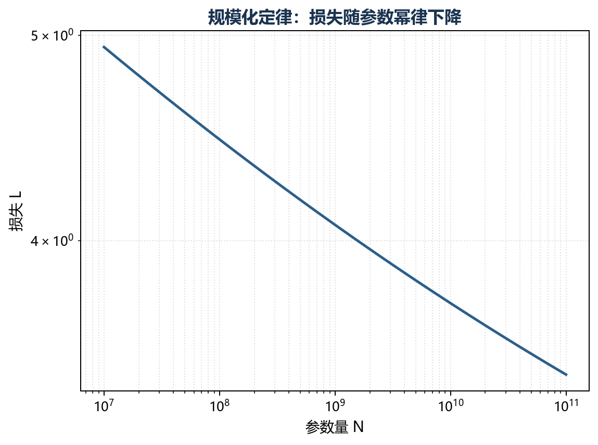

## 26.2　涌现的再审视

第 24 章介绍了涌现能力。本节从规模化视角再审视：涌现与损失平滑下降的关系。

**涌现的本质。** 规模化定律说明损失平滑下降；但某些任务能力（少样本 ICL、思维链、多步推理）在特定规模后突然出现（第 24 章）。这种"平滑损失 + 突变能力"的组合，暗示：

- 能力可能由多个子能力组合而成，每个子能力平滑增长，但组合后的任务表现（用离散指标衡量）突变；
- 或者模型内部出现了新的计算机制（如足够的"工作记忆"支持多步推理）。

第 24.4 节"子能力幂次"视角给出了统一的代数解释：设底层子能力 $S(N)$ 随规模平滑增长，任务需串联 $m$ 个子步骤且全部正确，则任务性能 $A(N)\approx S(N)^m$。$S(N)$ 平滑但 $S(N)^m$ 在 $S$ 跨过临界值时呈"类阶跃"——这解释了为何涌现集中在**多步推理、组合任务**上（$m$ 大，对 $S$ 的阈值最敏感），而在单步任务（$m=1$，$A=S$）上几乎不出现。规模化定律（式 26-1）预测的是 $S(N)$（损失/子能力的平滑面），涌现是 $S(N)^m$（任务面的陡峭投影）——二者不矛盾，是同一平滑过程的两种"读数"。

**度量的影响。** Schaeffer 等[3]指出，涌现部分源于度量方式：用离散指标（精确匹配）时能力突变，用连续指标（token 概率）时平滑。这提示"涌现"是观察视角的产物，但现象（大模型能做小模型不能做的事）本身真实（第 24.4 节）。对规模化实践的含义是：**外推大模型能力时，应测量子能力（连续量）而非直接外推任务准确率（离散量）**，否则会在阈值附近严重低估大模型——这是第 31 章评估方法学的重要教训。

**例 26.2（规模与推理）**　3B 模型做多步算术几乎随机，30B 模型仍差，300B 模型配合思维链（第 29 章）突然大幅提升——能力在特定规模 + 提示策略下"涌现"。这驱动了"追求更大模型"与"设计更好提示"两条路线。用"子能力幂次"视角看：多步算术的子能力 $S$（"完成一步借位/进位的正确率"）在 3B 时约 0.5（$A=S^8\approx0.004$ 对 8 步），30B 时约 0.7（$A\approx0.057$），300B 时约 0.9（$A\approx0.43$）——$S$ 平滑上升，$A=S^8$ 却在 $S\approx0.8$ 附近"爆发"，这正是"规模 + 思维链"共同促成涌现的代数机制。

**边界与讨论。** 涌现的不可预测性带来安全挑战（第 31 章、《AI治理与对齐导论》）：无法从小模型外推大模型是否会获得危险能力，这是前沿模型评估的难点。

## 26.3　数据工程与清洗

**数据即燃料。** 第 22.1 节讨论了预训练数据；规模化视角下，数据工程更加关键——Chinchilla 修正后，数据量与参数等量齐观。

**数据管线的演进。** 现代预训练数据管线（如 The Pile、C4、FineWeb）包括：

- **采集**：从网页、书籍、代码、百科等抓取；
- **清洗**：去重（MinHash、SimHash）、质量过滤（分类器）、语言识别、隐私脱敏；
- **配比**：按来源、语言、质量加权混合（第 22.1 节）；
- **去重与去污染**：删除与评测基准重叠的文本（避免数据污染，第 31 章）。

**数据质量 > 数据数量。** 近期研究（如 FineWeb、Dolma）强调高质量数据比单纯堆量更重要——清洗后的 smaller 数据集可能训练出更好的模型。"数据墙"（高质量文本耗尽）催生了合成数据方向（用模型生成训练数据）。

**"有效 token"的概念。** 数据质量可形式化为"有效 token 率"：设原始语料含 $D$ 个 token，其中比例 $q$（质量系数，$q\in(0,1]$）为"高信息量、低噪声"的有效 token，则有效 token 量 $D_{\text{eff}}=qD$。规模化定律（式 26-1）实际应作用于 $D_{\text{eff}}$ 而非 $D$——噪声 token 不降损失甚至升损失。实测中，书籍/百科的 $q$ 可达 0.8+，而网页语料的 $q$ 常低至 0.3–0.5（过半 token 是导航、模板、广告），极差网页可低至 0.05。这给出一个反直觉的结论：**"高质量语料的原始量"可比"低质量语料"小，但有效 token 更多**——例如 5T 书籍 token（$q\approx0.8$，$D_{\text{eff}}\approx4$T）的有效量，超过 50T 极差网页 token（$q\approx0.05$，$D_{\text{eff}}\approx2.5$T）。关键洞见：**"数据墙"不是原始 token 耗尽，而是有效 token（高 $q$ 语料）耗尽**——合成数据（用模型生成高 $q$ 训练数据）正是为突破这一"有效 token 墙"。

**例 26.3（数据去重的重要性）**　Common Crawl 中有大量重复页面（镜像、模板）。若不去重，模型会反复见到相同内容，浪费算力且可能记忆（第 31 章数据污染）。MinHash 去重可高效识别近似重复文档，是现代管线的标配。以去重率 $r=0.4$（去掉 40% 重复文档）计，去重后语料的"有效 token 率"上升——因为重复文档的边际信息量为 0，去掉它们使剩余 token 的平均信息密度提高，等效于在不增加采集成本下提升了 $q$。

**表 26-2　数据工程关键步骤**

| 步骤 | 方法 | 目的 |
|------|------|------|
| 采集 | 爬虫、公开语料 | 规模 |
| 去重 | MinHash、SimHash | 防重复/记忆 |
| 过滤 | 质量分类器 | 去低质内容 |
| 配比 | 加权混合 | 能力平衡 |
| 去污染 | 基准匹配 | 公平评估 |

## 26.4　训练基础设施与分布式

**规模化的工程挑战。** 千亿参数模型训练需超算级基础设施——这解释了为何大模型由少数机构主导（第 22.5 节可复现性问题）。

**分布式训练策略（回顾第 22.3 节）。**

- **3D 并行**：数据并行 + 张量并行 + 流水线并行的组合；
- **ZeRO/FSDP**：分片优化器状态、梯度、参数，突破单卡显存限制；
- **混合精度**：FP16/BF16 加速；
- **检查点与容错**：大规模集群故障率高，需弹性训练。

**算力与成本。** 训练 GPT-3 级模型耗资数百万美元，GPT-4 级更高——算力成为核心壁垒（第 22.5 节）。推理成本（部署服务）同样是工程焦点（第 38 章与《大模型系统与工程导论》）。

**算力的量级核算。** 训练算力可估算为 $C\approx6ND$ FLOPs。以 LLaMA-2 70B 为例，$N=7\times10^{10}$、$D=2\times10^{12}$（2T token），则 $C\approx6\times7\times10^{10}\times2\times10^{12}\approx8.4\times10^{23}$ FLOPs。若集群有效吞吐约 $10^{19}$ FLOPs/s，则纯计算时间 $\approx8.4\times10^{4}$ 秒 $\approx23$ 小时；计入通信、调度、故障重试等开销（MFU 实际约 30–50%），真实墙钟时间为数天到数周，对应数百万至上千万美元成本。这一量级解释了"大模型由少数机构主导"——不是技术壁垒，而是**算力与资金的硬门槛**：学术实验室难以承担一次前沿训练的电力与 GPU 费用。

**例 26.4（3D 并行）**　训练一个 175B 模型：张量并行把每层矩阵切到 8 卡，流水线并行把 96 层切到 8 个阶段，数据并行再复制 4 份——共 8×8×4=256 卡协同，需高速互连（InfiniBand）。这是系统工程奇迹，也是高昂成本的来源。三种并行的权衡：数据并行扩展性好但每卡需完整模型（显存受限）；张量并行省显存但卡间通信频繁（需 NVLink 级带宽）；流水线并行省显存但有"气泡"（阶段间等待）浪费算力。实际部署是三者组合 + ZeRO 分片，按显存与带宽约束调配比——这是《大模型系统与工程导论》的核心内容。

**例 26.4b（ZeRO 显存核算与 MFU）**　以 70B 模型、BF16 参数为例估算单卡显存。每参数需存：参数本体（2 字节，BF16）+ 梯度（2 字节）+ 优化器状态（AdamW 的 m、v 各 4 字节，共 8 字节），合计约 12 字节/参数，70B 模型即 $7\times10^{10}\times12\approx8.4\times10^{11}$ 字节 $\approx840$GB——远超单卡（80GB）。ZeRO 将其按数据并行卡数 $K$ 分片：ZeRO-1 只分优化器状态（省 8/12，单卡降至约 $2.8\times10^{11}$ 字节/K 卡量级），ZeRO-2 再分梯度，ZeRO-3 连参数也分片，单卡显存 $\propto 1/K$——用 32 卡可把单卡占用压到约 26GB 以内。代价是分片后每步需 all-gather 重建参数与梯度，通信量随之上升，故 ZeRO 阶段选择须权衡"显存"与"通信带宽"。再看 MFU（模型算力利用率）：理论峰值 $C_{\text{peak}}=8.4\times10^{23}$ FLOPs 若用 23 小时（$8.28\times10^{4}$s）算完，有效吞吐 $\approx10^{19}$ FLOPs/s；若单卡峰值 312 TFLOPs（BF16）× 1024 卡，理论峰值 $\approx3.2\times10^{23}$ FLOPs/s，实际有效 $10^{19}$ 意味着 MFU 仅约 3%——这显然偏低，真实前沿训练 MFU 通常在 30–50%，即 1024 卡下应达 $10^{23}$ FLOPs/s 量级、把墙钟压到约 2–3 天。MFU 低的常见原因正是并行通信、数据加载瓶颈、故障重试——这也是"训练基础设施"作为独立学科（第 38 章）的价值所在：同样的算力，MFU 从 30% 提到 50% 等价于免费多 67% 的算力。

**效率优化方向。** MoE（混合专家，第 27 章）用稀疏激活降低计算成本；稀疏注意力（第 20.4 节）降低长序列成本；量化（第 23 章 QLoRA）降低存储与推理成本。这些"密度法则"（能力/成本同时优化）是对单纯规模化的补充。

## 26.5　边界与讨论

本章论述规模化定律与训练，须明确其边界。

**规模的极限。** 幂律能否无限延续存疑：高质量数据可能耗尽（数据墙）、算力成本指数增长、电力与环境约束。单纯"堆规模"不可持续——架构效率（MoE）、数据质量、训练算法（第 27 章）同等重要。更深层的极限是"算力—性能"的边际递减：式 (26-1) 的幂律意味着每降一点损失所需算力按数量级增长，而式 (26-3) 的均衡配比下"算力翻 4 倍"仅使参数与数据各翻倍（损失按 $10^{-2\alpha}$ 降）——"性能改善"与"成本"呈对数—线性关系，"花指数钱买对数进步"是规模化的内在经济学。这解释了为何前沿实验室开始从"堆规模"转向"提密度"（MoE 稀疏激活、更高效架构、更好数据）——不是规模化失效，而是其边际收益已低于"密度改进"的边际收益。

**规模不等于理解。** 规模化提升的是 M2 层的能力（分布建模与表示），不自动保证 M4 指称正确与 M5 意图理解——大模型幻觉（第 29 章）正是规模再大也存在的问题。对齐（第 28 章）与检索增强（第 30 章）是必要补充。需要区分两件事：规模化定律刻画的是"分布内"的交叉熵损失（模型预测下一个 token 的平均误差），它是"统计拟合质量"的度量；而幻觉、事实性、推理正确性属于"分布外"或"任务级"能力，并不被交叉熵下降直接约束。实证上已观察到"损失继续平滑下降、但事实错误率几乎不降"的情形——这正说明规模化定律是"必要非充分"的：它解释了"模型为何越来越流畅"，却不能解释"模型为何仍然会一本正经地胡说"。须强调：规模化定律预测的是"损失/子能力"的平滑面，而"理解""事实正确"属于 M4 层，与损失无直接函数关系——模型损失越低（M2 越强），不代表幻觉越少（M4 越准），二者可能"脱钩"。这是"规模解决分布问题、不解决指称问题"的核心论点，也是第 28 章对齐与第 30 章 RAG 存在的根本理由。

**与后续章节的联系。** 本章的规模化定律衔接第 22 章（尺度效应）、第 24 章（涌现）、第 27 章（模型剖析中的参数/数据对比）；数据工程衔接第 31 章（数据污染）；分布式训练衔接《大模型系统与工程导论》。第六篇继续：第 27 章剖析代表性大模型，第 28 章对齐，第 29 章推理，第 30 章 RAG，第 31 章评估。

## 本章小结

本章论述规模化定律与训练，开启第六篇。

我们首先定义规模化定律（式 26-1）：损失随参数、数据、计算幂律下降，给出式 (26-1) 的数值解读（参数翻十倍损失仅降 16% 的边际递减）。接着介绍 Kaplan 定律与 Chinchilla 修正（式 26-2，参数与数据均衡增长；式 26-3 的"每参数 20 token"闭式），例 26.1/26.1b 用算力预算换算说明"错配的规模化是浪费算力"。再审视涌现：用"子能力幂次"视角（式 $A(N)\approx S(N)^m$）统一"平滑损失 + 突变能力"，例 26.2 以多步算术说明"规模 + 思维链"共同促成涌现，并指出度量的影响与安全挑战。我们讨论数据工程（采集、清洗、去重、配比、去污染），用"有效 token 率 $D_{\text{eff}}=qD$"刻画"数据质量 > 数据数量"，并以 $q$ 值对比说明"数据墙"实为"有效 token 墙"。我们介绍训练基础设施：3D 并行、ZeRO、混合精度、算力成本（例 26.4 的 175B/256 卡核算与 $C\approx6ND$ 量级），以及 MoE/稀疏/量化等效率优化。

我们还明确边界：规模有数据/算力/环境极限，规模不等于理解。这些辨析衔接第 22、24、27、29、31 章与《大模型系统与工程导论》。

规模化定律驱动了"越大越强"的竞赛，但架构效率与数据质量同等重要。下一章剖析代表性大语言模型，展示规模化如何落地为具体模型，以及架构创新的最新进展。

**进一步阅读**　本章建议延伸阅读的文献：[1]、[2]、[3]、[4]。

## 参考文献

[1] Kaplan J, McCandlish S, Henighan T, et al. Scaling laws for neural language models. *arXiv:2001.08361*, 2020.

[2] Hoffmann J, Seger S, Mesa O D, et al. Training compute-optimal large language models. *NeurIPS*, 2022.

[3] Schaeffer J, Miranda B, Koyejo S. Are emergent abilities of large language models a mirage? *NeurIPS*, 2023.

[4] Penedo G, Malartic Q, Hesslow D, et al. The FineWeb datasets: Decanting the web for the finest text data at scale. *NeurIPS*, 2024.

[5] Rae J W, Borgeaud S, Cai T, et al. Scaling language models: Methods, analysis & insights from training Gopher. *arXiv:2112.11446*, 2021.

[6] Fedus W, Zoph B, Shazeer N. Switch Transformers: Scaling to trillion parameter models with simple and efficient sparsity. *Journal of Machine Learning Research*, 2022, 23(120): 1–39.

[7] Shazeer N, Mirhoseini A, Maziarz K, et al. Outrageously large neural networks: The sparsely-gated mixture-of-experts layer. *ICLR*, 2017.

[8] Villalobos L, Sevilla J, Besiroglu T, et al. Will we run out of data? An analysis of the limits of scaling datasets in machine learning. *arXiv:2211.04325*, 2022.

---

# 第 27 章　代表性大语言模型剖析

第 26 章的规模化定律解释了"越大越强"。本章把镜头从规律转向实例，逐一剖析代表性大语言模型：GPT 系列、LLaMA、DeepSeek、Qwen 等，以及 MoE 架构。模型剖析章的目的是把前六篇的原理（Transformer、预训练、对齐、规模化）落到具体系统上，让读者看清"理论如何变成产品"。

本章按"架构—数据—目标—能力—局限"的统一框架逐一剖析每个模型，而非罗列参数——理解模型的设计动机与权衡，比记住参数量更重要。剖析还将展示 2025–2026 年的最新进展，并以模型对比总表与统一案例实测收束。本章文献数量超出一般配额，属体例内的有意安排（见凡例第四条）。

本章先梳理 GPT 系列（27.1 节），再讲 LLaMA 与开源路线（27.2 节），分析 DeepSeek、Qwen 与高效架构（27.3 节），讨论 MoE 与稀疏化（27.4 节），给出模型对比总表与统一案例实测（27.5 节），介绍 2025–2026 年最新进展（27.6 节），并在边界与讨论中收束（27.7 节）。

## 27.1　GPT 系列：从 GPT-1 到 GPT-4

**GPT-1（2018）** 首次把 Transformer 解码器用于自回归预训练 + 生成式微调（第 21.2 节），1.17 亿参数，确立"预训练—微调"范式。

**GPT-2（2019）** 扩大到 15 亿参数，展示零样本任务能力——无需微调，仅用自然语言指令即可完成任务[1]，预示 ICL（第 24 章）。

**GPT-3（2020）** 1750 亿参数，系统展示少样本 ICL[2]——"语言模型是少样本学习器"。它确立了提示工程范式，但仍是纯自回归模型，无指令对齐。

**ChatGPT / GPT-3.5（2022）** 通过指令微调与 RLHF（第 28 章）对齐，使模型可用、可控——对话式交互引爆全球关注。关键洞察：**对齐让强能力变得可用**。

**GPT-4（2023）** 多模态（文本+图像）、更强推理、更长上下文。据传闻采用 MoE 架构，参数规模未公开。GPT-4 在专业考试（律师、医学）上表现优异，标志大模型进入专业应用。

**参数规模的指数轨迹。** GPT 系列的参数量随代际呈数量级跃升：GPT-1 的 0.117B、GPT-2 的 1.5B（×12.8）、GPT-3 的 175B（×117）、ChatGPT 的 175B 基座（GPT-3.5 架构未公开）。设第 $g$ 代的参数量为 $N_g$，则相邻代的放大倍数 $R_g=N_g/N_{g-1}$ 在早期达 1–2 个数量级。这一"每代跃一个量级"的节奏，本质是第 26 章算力预算指数增长的体现——每代模型需要前代约 10 倍的训练算力（参数与数据同增，$C\propto ND$ 增约百倍）。理解 GPT 系列的关键不是单个参数量，而是这条"算力指数曲线"上的位置：GPT-3 处于"规模定律刚被验证"的拐点，ChatGPT 处于"对齐解锁规模"的拐点，GPT-4 处于"多模态 + 推理"的拐点。每个拐点对应一次"范式跃迁"，而非单纯"参数放大"。

**表 27-1　GPT 系列演进**

| 模型 | 年份 | 参数 | 关键进展 |
|------|------|------|----------|
| GPT-1 | 2018 | 0.12B | 预训练—微调范式 |
| GPT-2 | 2019 | 1.5B | 零样本能力 |
| GPT-3 | 2020 | 175B | 少样本 ICL |
| GPT-3.5 | 2022 | — | RLHF 对齐、对话 |
| GPT-4 | 2023 | 未公开 | 多模态、强推理 |

**设计主线。** GPT 系列的设计哲学：坚持自回归解码器架构，通过规模化 + 对齐 + 多模态逐步增强。它验证了"规模 + 自监督 + 对齐"路线的威力。须注意：GPT 系列"坚持解码器"意味着它天然适合生成，而理解类任务要靠"把理解也变成生成"（如让 GPT 生成分类标签词）来实现——这一"以生成为统一接口"的设计，是第 21.2 节生成式微调思想的延续，也是 GPT 路线区别于 BERT 编码器路线的根本选择。

## 27.2　LLaMA 与开源路线

**LLaMA（2023）** Meta 开源的系列模型（7B–65B），用更优的数据配方与训练（Chinchilla 式），在较小参数下达到闭源大模型的能力[3]。其开源极大推动了研究——学术界首次能深入研究大模型。

**LLaMA 的"数据配方"。** LLaMA 的核心贡献不仅是开源，而是证明了"高质量数据 + 足量训练 token"可以弥补参数劣势。LLaMA-1 7B 用约 1T token 训练（每参数约 140 token，远超 Chinchilla 的 20），属于"参数欠配、数据过配"的配方——这使 7B 模型在语言质量上接近 13B 级别。这种"用数据堆参数"的策略，是 Chinchilla 定律（第 26 章式 26-3）的"过训"方向：偏离最优配比，但用足量数据换取更强能力。LLaMA-2/3 则转向"指令微调 + 长上下文 + 更强数据"路线，不再单纯堆 token。理解 LLaMA 的演进，是理解"开源模型如何追赶闭源"的钥匙：从"数据堆参数"（LLaMA-1）到"对齐 + 架构 + 数据"综合（LLaMA-3）。

**开源生态。** LLaMA 之后，开源社区涌现大量衍生模型：Alpaca（指令微调）、Vicuna（对话）、LLaMA-2/3（Meta 迭代）、Mistral、Qwen、DeepSeek 等。开源路线降低了大模型研究门槛，加速了技术民主化——但也带来滥用风险（第 28、31 章）。开源的真正价值不仅是"免费模型"，更是"可审计、可修改、可复现"——研究者能读权重、做探测分析、改架构、加 LoRA，这是闭源模型无法提供的"研究自由度"。

**例 27.1（LLaMA 的意义）**　LLaMA-7B 可在单卡（甚至消费级 GPU）微调（配合 LoRA，第 23 章），使中小机构也能做大模型研究。这与 GPT-4 的闭源、超大规模形成对照——两条路线互补：闭源探索能力边界，开源推动普及与创新。

**边界与讨论。** 开源模型的许可与治理复杂（第 28、31 章与《AI治理与对齐导论》）；开源与闭源的性能差距在缩小，但最新前沿模型（GPT-4 级）仍多为闭源。

## 27.3　DeepSeek、Qwen 与高效架构

**DeepSeek（深度求索）** 系列以高效训练与强推理著称。DeepSeek-V2/V3 采用 MoE 架构（27.4 节）与多头潜在注意力（MLA），大幅降低训练与推理成本；DeepSeek-R1 通过强化学习增强推理（第 29 章），展示"推理模型"路线。其高性价比引发广泛关注，证明效率创新可挑战纯规模路线。

**DeepSeek-R1 的"推理模型"范式。** R1 的核心创新不在架构，而在**训练目标**：用强化学习（GRPO 等）奖励"推理过程的长度与正确性"，使模型学会"慢思考"——对难题自发地产生长推理链（思维链，第 29 章），再给出答案。这把"推理能力"从"靠提示词引导"（"请逐步思考"）变为"内建于训练"——模型自发地思考。R1 与 o1 等共同标志大模型从"快思考"（直接生成，System 1）走向"慢思考"（长链推理，System 2），是 2025 年最重要的范式转变之一。其含义：推理不再是"提示技巧"，而是"训练出来的能力"——这重新定义了"什么能力可以规模化"。

**Qwen（通义千问）** 阿里开源系列，覆盖多规模（0.5B–110B+）与多模态，中英文能力强，开源生态活跃。Qwen 展示了中国团队在大模型领域的系统能力。Qwen 的特点在于"全谱系覆盖"——从 0.5B（端侧）到 110B+（服务器），且各规模共享架构与数据管线，使"同一技术栈"覆盖端云两端。这种"规模家族化"是工程化的重要方向：不是每个规模单独设计，而是"一套架构、多档参数"，便于按设备选档、跨档迁移。

**高效架构趋势。** 这些模型的共同特点：不单纯堆参数，而是通过架构创新（MoE、MLA、稀疏注意力）、数据质量、训练效率提升性价比——呼应第 26 章"密度法则"与第 20.4 节长序列优化。

**"密度"的三个维度。** 高效化可分解为三个独立维度：① **激活密度**（MoE）——总参数大但每 token 激活参数少，即式 (27-3) 的参数/计算比 $E/k$ 越大、激活占比 $k/E$ 越小；② **计算密度**（MLA、稀疏注意力）——每 token 的 FLOPs 降低（MLA 压缩 KV cache、稀疏注意力降低长序列的 $O(n^2)$）；③ **精度密度**（量化）——用 FP8/INT8/INT4 降低存储与计算位宽（第 23 章 QLoRA）。三者正交、可叠加：DeepSeek-V3 同时用了 MoE（激活密度）+ MLA（计算密度）+ FP8 训练（精度密度），使"671B 参数、37B 激活"的模型训练成本远低于同等 Dense 模型。"密度法则"（第 26 章）的本质是：在固定算力预算下，同时优化这三个维度，可把"能力/成本"比推到纯规模化无法达到的高度——这是 2024–2026 年"效率竞争"取代"参数竞争"的架构基础。

**例 27.2（MLA 的压缩）**　多头潜在注意力（MLA）把 KV cache 低秩压缩，大幅减少显存占用（第 38 章推理优化、《大模型系统与工程导论》），使长上下文推理成本降低——这是架构效率创新的典型。设标准 MHA 的 KV cache 大小为 $2\cdot L\cdot n_{\text{head}}\cdot d_{\text{head}}$（K 和 V 各一份，$L$ 层、$n_{\text{head}}$ 头、$d_{\text{head}}$ 每头维），MLA 把每 token 的 KV 压缩为低维潜变量 $d_c$（$d_c\ll n_{\text{head}}\cdot d_{\text{head}}$），使 KV cache 降为约 $L\cdot n\cdot d_c$。以 $d_c=512$、$n_{\text{head}}\cdot d_{\text{head}}=4096$ 计，KV cache 压缩约 8 倍——长上下文推理的显存与带宽瓶颈被大幅缓解，这是 DeepSeek 系列"长上下文低成本"的关键。

**表 27-2　代表性开源/开放模型**

| 模型 | 机构 | 特点 |
|------|------|------|
| LLaMA | Meta | 开源基石 |
| Qwen | 阿里 | 多规模、多语言 |
| DeepSeek | 深度求索 | 高效、强推理 |
| Mistral | Mistral AI | 高效、MoE |

## 27.4　MoE 与稀疏化

**混合专家（Mixture of Experts, MoE）** 是大模型规模化的关键架构创新[4]。核心思想：用多个"专家"子网络替代 FFN，对每个 token 只激活少数专家（稀疏激活）。

**定义 27.1（MoE 层）**　MoE 层含 $E$ 个专家 $\{\mathbf{E}_i\}$ 与一个路由器（router）。对输入 token 表示 $\mathbf{x}$，路由器选 top-$k$ 个专家（$k\ll E$），输出为选中专家的加权和：

$$
\mathbf{y}=\sum_{i\in\text{Top-}k(\mathbf{x})}\alpha_i(\mathbf{x})\,\mathbf{E}_i(\mathbf{x}), \tag{27-1}
$$

其中 $\alpha_i$ 为路由权重（softmax over top-k）。

**路由的直觉。** 把 MoE 想象成一家分诊医院：路由器像分诊台，按 token 的"病情"把它派给少数最相关的专家（top-$k$），其余专家"休息"。这种稀疏激活让模型同时拥有"广博的记忆"（所有专家参数都存着）与"低廉的门诊费"（每次只激活少数专家）。训练后专家往往自发特化——有的擅长代码，有的擅长数学，有的擅长多语言——正是这种"分工"带来能力广度。

**负载均衡辅助损失（式 27-2）。** 若任由路由器自由选择，少数"强势"专家会吞掉大部分 token，其余专家得不到训练（专家坍塌，expert collapse）。Switch Transformer[4] 引入辅助损失抑制这种偏斜。记一批 token 中被路由到专家 $i$ 的比例为 $f_i$，路由器对专家 $i$ 的平均概率为 $P_i$，则辅助损失为

$$
\mathcal{L}_{aux}=E\sum_{i=1}^{E} f_i\,P_i, \tag{27-2}
$$

当路由均匀（$f_i=P_i=1/E$）时 $\mathcal{L}_{aux}\approx1$ 取最小；若某专家"通吃"（$f_j\approx1,P_j\approx1$），则 $\mathcal{L}_{aux}\to E$ 急剧增大，把 token 推回均匀分布。实际训练把 $\alpha\,\mathcal{L}_{aux}$（$\alpha$ 为小权重，如 0.01）加到任务损失上：$\mathcal{L}_{total}=\mathcal{L}_{task}+\alpha\,\mathcal{L}_{aux}$。

**激活参数与"参数/计算比"（式 27-3）。** 设 MoE 层有 $E$ 个专家、每个专家 FFN 含 $p_e$ 参数、top-$k$ 路由，其余（注意力、embedding 等）稠密参数记为 $N_{shared}$。则模型总参数 $N_{total}=N_{shared}+E\,p_e$，而每 token 实际激活 $N_{active}=N_{shared}+k\,p_e$。"参数/计算比"定义为

$$
\frac{N_{total}}{N_{active}}=\frac{N_{shared}+E\,p_e}{N_{shared}+k\,p_e}\approx\frac{E}{k}\quad(\text{专家参数占主导时}), \tag{27-3}
$$

该比值量化 MoE 的"性价比"：比值越大，模型"存得下多少知识"与"算得动多少算力"之间的落差越大。

**优势。** 参数量大（所有专家参数总和），但每个 token 的计算量小（只激活少数专家）——"大参数、小计算"。Switch Transformer（1.6T 参数）等验证了这一路线。

**挑战。** 负载均衡（避免某些专家被过度使用）、通信开销（专家分布在不同设备）、训练稳定性。第 22 章与《大模型系统与工程导论》详述工程细节。

**负载均衡的数值直觉。** 设 8 专家、一批 8000 个 token。理想均匀时每个专家处理约 1000 个 token（$f_i=1/8$）。若路由偏斜使 70% token 涌向专家 1（$f_1=0.7$），其余 7 个专家平分余下 30%（$f_i\approx0.043$），则式 (27-2) 的辅助损失从均匀时的 $\approx1$ 急剧升到 $0.7\times0.7+7\times(0.043\times0.125)$ 量级、远超 1，梯度会把后续 token 从专家 1 拉开——这正是辅助损失"削峰填谷"的作用。代价是均匀化可能强迫某些"不擅长"的专家处理 token，故权重 $\alpha$ 宜小（0.01 量级），在"防坍塌"与"保特化"间折中。

**例 27.3（MoE 的性价比：参数/计算比的数值）**　以一个 8 专家、top-2 的 MoE 层，总参数量是同等 FFN 的 8 倍，但每个 token 只计算 2 个专家——计算量约 2 倍。参数/计算比提升，使模型"看起来很大、算起来不贵"。用式 (27-3) 定量：设专家参数占主导，$E=8,k=2$，则参数/计算比 $\approx E/k=4$——总参数是激活参数的约 4 倍。再看真实模型 DeepSeek-V3[5]：总参数 671B、每 token 激活 37B，则参数/计算比 $=671/37\approx18.1$——它"存着"671B 的知识，每个 token 却只"动用"37B 的算力。这正是 MoE 的核心红利：用接近 37B 稠密模型的成本，逼近 671B 稠密模型的容量。GPT-4、DeepSeek-V3 等被认为采用 MoE，正是吃透这一"大参数、小计算"的甜头。

## 27.5　模型对比总表与统一案例实测

**表 27-3　代表性大模型对比（截至 2026 年 11 月，参数/能力为趋势性描述）**

| 模型 | 架构 | 参数量级 | 上下文 | 特点 |
|------|------|----------|--------|------|
| GPT-4 | 疑似 MoE | 未公开 | 长 | 多模态、强推理 |
| LLaMA-3 | Dense | 8B–70B | 长 | 开源基石 |
| Qwen2.5 | Dense/MoE | 0.5B–110B+ | 长 | 多语言、多模态 |
| DeepSeek-V3 | MoE | 671B(激活37B) | 长 | 高效、强推理 |
| Mistral | Dense/MoE | 7B–8x22B | 长 | 高效开源 |

> 注：2025–2026 年模型版本、参数与基准排名变化快，以原始出处最新版本为准（凡例第六条）。

**统一案例实测。** 在贯穿全书的开放域问答语料（第 1.8 节）上，比较各阶段方法的表现：N-gram（第 15 章）→ RNN LM（第 16 章）→ BERT 微调（第 21 章）→ 大模型 few-shot ICL（第 24 章）→ RAG 增强（第 30 章）。结果显示能力逐级提升，大模型 + RAG 在事实型问题上表现最佳——这串联了第四至六篇的方法演进。

**例 27.4（统一案例的能力阶梯）**　同一问答任务：N-gram 几乎无法定位答案；BERT 微调需标注数据但表现良好；大模型 few-shot 无需标注、泛化更好；RAG 增强后事实准确率进一步提升。这一阶梯直观展示了语言智能的演进。

**能力阶梯的量化解读。** 以"开放域事实问答准确率"为例，各阶段方法的典型表现（示意，依任务与语料而异）：N-gram 约 10–20%（基本靠表面词匹配，无法做语义推理）；RNN LM 约 20–35%（能捕捉局部语义但长程依赖弱）；BERT 微调约 55–70%（双向上下文 + 任务适配，但需标注、泛化受限）；大模型 few-shot ICL 约 65–80%（无需标注、泛化强，但依赖预训练知识）；大模型 + RAG 约 75–90%（注入外部事实，缓解幻觉）。这一阶梯的关键观察是：**能力跃升不来自单一环节，而来自"表示能力 × 适配方式 × 知识来源"三者的乘积**——N-gram 到 BERT 是"表示"跃升，BERT 到大模型是"规模 + 表示"跃升，大模型到 RAG 是"知识来源"跃升（从参数内知识到外部检索）。这解释了为何"大模型 + RAG"是当下事实型任务的最优组合：三者各补其短。

## 27.6　2025–2026 年最新进展

**推理模型。** o1、DeepSeek-R1 等推理模型通过强化学习与测试时计算（第 29 章）显著提升数学、代码、逻辑推理能力——从"快思考"（直接生成）走向"慢思考"（长链推理）。

**原生多模态。** GPT-4o、Gemini 等原生多模态模型统一处理文本、图像、音频（第 32–35 章），不再依赖模块拼接。

**高效化。** MoE、MLA、稀疏注意力、量化推理（第 27.4 节、第 38 章）持续降低训练与推理成本，使强能力更普惠。

**智能体化。** 大模型作为智能体连接工具、记忆、规划（第 37 章与《智能体与多智能体系统导论》），从"回答问题"走向"完成任务"。智能体化把大模型从"对话界面"变为"操作系统内核"——模型不再是"问一句答一句"，而是"接任务、拆步骤、调工具、验结果"的自主执行体。这要求模型具备规划（任务分解）、工具调用（API 交互）、记忆（长程状态）、反思（自我纠错）四类能力（第 37 章），是"推理能力"在"行动"维度的延伸。

**边界与讨论。** 最新进展多为预印本或技术报告，参数与基准会随发表变化（凡例第六条）；本书以趋势性描述著录，引用请以原始出处最新版本为准。须强调：2025–2026 年的"最新进展"描述的是**趋势与方向**，而非定论——具体模型版本的基准排名每月都可能变化，读者应以原始技术报告与权威评测的最新版本为准，避免把"某时刻的排名"当作"永恒的能力排序"。

## 27.7　边界与讨论

模型剖析须明确其边界。

**参数不是能力。** 参数量是能力的粗指标，架构、数据、训练、对齐同等重要（Chinchilla 修正，第 26 章）。对比模型时应看"架构—数据—目标—能力—局限"的整体，而非单一参数。一个反直觉的例证：70B Dense 模型与 671B MoE（37B 激活）模型，"总参数"差近 10 倍，但前者训练/推理成本与后者相近（后者只算 37B），而后者容量更大（671B 知识存储）——这说明"参数量"本身是模糊指标，须区分"总参数"（容量）与"激活参数"（成本），二者解耦后 MoE 才显得"参数大、算得起"。

**透明度的差异。** 闭源模型（GPT-4）细节不公开，开源模型（LLaMA、Qwen）可深入研究——这影响可复现性与安全评估（第 31 章、《AI治理与对齐导论》）。透明度差异还导致"能力评估"的不对称：闭源模型只能靠黑盒测试，开源模型可白盒分析（探测、激活、消融）。这使"开源模型的能力解读"往往比闭源更可信——我们看到的是"为什么强"，而非仅"强多少"。

**模型剖析的方法论。** 本章用"架构—数据—目标—能力—局限"五维框架剖析模型，其方法论意义在于：**大模型是"权衡的艺术"**，没有"最好模型"，只有"在某约束下的最优选择"。约束包括算力预算（决定总参数）、部署显存（决定量化/激活参数）、时延要求（决定架构 MoE/Dense）、数据可得性（决定预训练语料）、安全合规（决定对齐强度）。选型时须明确"哪些约束是硬的、哪些是可权衡的"，再在五维框架下定位——这是从"看排行榜"到"做工程决策"的关键思维转变。

**与后续章节的联系。** 本章的模型谱系将贯穿第 28–31 章（对齐、推理、RAG、评估均以这些模型为对象）；MoE/MLA 衔接第 38 章与《大模型系统与工程导论》；推理模型衔接第 29 章。

第六篇继续：第 28 章讨论指令微调与对齐，回答"如何让强能力变得可用、可控"。

## 本章小结

本章剖析代表性大语言模型，把前六篇原理落到具体系统。

我们按"架构—数据—目标—能力—局限"框架逐一剖析：GPT 系列（从 GPT-1 到 GPT-4，表 27-1，坚持自回归 + 规模 + 对齐 + 多模态）；LLaMA 与开源路线（降低研究门槛）；DeepSeek、Qwen 与高效架构（MLA、MoE 等性价比创新）；MoE 与稀疏化（定义 27.1、式 27-1，路由直觉与负载均衡辅助损失 式 27-2、参数/计算比 式 27-3，大参数小计算）。我们给出模型对比总表（表 27-3）与统一案例的"能力阶梯"实测，并介绍 2025–2026 年最新进展（推理模型、原生多模态、高效化、智能体化）。

我们还明确边界：参数不是能力，透明度有差异。这些辨析衔接第 28–31、38 章与系列其他书。

下一章进入指令微调与对齐，讨论如何通过 RLHF/DPO 让预训练模型变得可用、可控——这是强能力走向实用产品的关键一步。

**进一步阅读**　本章建议延伸阅读的文献：[1]、[2]、[3]、[4]。

## 参考文献

[1] Radford A, Wu J, Child R, et al. Language models are unsupervised multitask learners. *OpenAI Technical Report*, 2019.

[2] Brown T B, Mann B, Ryder N, et al. Language models are few-shot learners. *Advances in Neural Information Processing Systems*, 2020, 33.

[3] Touvron H, Lavril T, Izacard G, et al. LLaMA: Open and efficient foundation language models. *arXiv:2302.13971*, 2023.

[4] Fedus W, Zoph B, Shazeer N. Switch Transformers: Scaling to trillion parameter models with simple and efficient sparsity. *Journal of Machine Learning Research*, 2022, 23(120).

[5] DeepSeek-AI. DeepSeek-V3 technical report. *arXiv:2412.19437*, 2024.

[6] Yang A, Yang B, Zhang B, et al. Qwen2.5 technical report. *arXiv:2412.15115*, 2024.

[7] OpenAI. GPT-4 technical report. *arXiv:2303.08774*, 2023.

[8] DeepSeek-AI. DeepSeek-R1: Incentivizing reasoning capability in LLMs via reinforcement learning. *arXiv:2501.12948*, 2025.

---

# 第 28 章　指令微调与对齐

第 27 章剖析的大模型具备强大能力，但预训练目标（预测下一个词）与用户意图并不一致——预训练模型会"续写文本"，而非"遵循指令、给出有用且安全的回答"。本章讨论**指令微调与对齐**：如何让模型理解并遵循人类指令、生成符合人类偏好与价值观的回答。这是强能力变得"可用、可控"的关键一步——ChatGPT 的成功，很大程度上归功于对齐而非单纯的能力提升。

对齐（alignment）的核心问题：如何让模型的行为符合人类的意图（intended behavior）？本章聚焦技术层（第 4 章 M5 语用意义的实现）——指令微调（SFT）、基于人类反馈的强化学习（RLHF）、直接偏好优化（DPO）、宪法 AI 与可扩展监督，以及对齐税。制度层的治理（监管、政策、责任）见《AI治理与对齐导论》，本书不重复。

本章先介绍指令微调与人类偏好（28.1 节），再重点推导 RLHF（28.2 节）与 DPO（28.3 节），介绍宪法 AI 与可扩展监督（28.4 节），讨论对齐税与能力退化（28.5 节），并在边界与讨论中收束（28.6 节）。

## 28.1　指令微调与人类偏好

**指令微调（Instruction Tuning / SFT）。** 预训练模型在"指令—回答"格式的数据上做监督微调（supervised fine-tuning）：给定自然语言指令与期望回答，训练模型生成该回答。这让模型学会"遵循指令"这一行为模式。

**定义 28.1（SFT）**　给定指令数据集 $\mathcal{D}_{SFT}=\{(x_i,y_i)\}$（$x_i$ 为指令，$y_i$ 为示范回答），SFT 最大化示范回答的似然：

$$
\mathcal{L}_{SFT}=-\sum_i\log p_\theta(y_i\mid x_i). \tag{28-1}
$$

**人类偏好的引入。** SFT 只能教会模型"模仿示范"，但示范质量参差、覆盖有限，且"什么是好回答"难以用单一示范定义。人类偏好更丰富：对同一问题的多个回答，人类可判断哪个更好。对齐的目标是把这种偏好编码进模型。

**对齐的三阶段范式（RLHF）。** 经典对齐流程（InstructGPT[1]）：① SFT（示范微调）；② 训练奖励模型（学人类偏好）；③ 强化学习优化策略（用奖励模型）。第 28.2–28.3 节详述。

**例 28.1（SFT 的局限）**　SFT 教模型"回答问题"，但难以教"回答得有用、诚实、无害"（HHH 标准）——因为好回答的细微差别（礼貌、诚实承认不知、拒绝有害请求）难以完全用示范覆盖。偏好学习（RLHF/DPO）通过人类的比较判断捕捉这些细微差别。

**例 28.1b（SFT 的似然手算）**　设一条 SFT 数据：指令 $x$="把句子改成祈使句"，示范回答 $y$="请关闭窗户"。若示范回答由 5 个 token 组成，模型对逐 token 的条件对数概率为 $\log p_\theta(y_1\mid x)=-1.2,\ \log p_\theta(y_2\mid y_1,x)=-0.8,\ \log p_\theta(y_3\mid y_{<3},x)=-0.5,\ \log p_\theta(y_4\mid y_{<4},x)=-1.0,\ \log p_\theta(y_5\mid y_{<5},x)=-0.7$。按式 (28-1)，该样本的 SFT 损失为

$$\mathcal{L}_{SFT}=-\big[(-1.2)+(-0.8)+(-0.5)+(-1.0)+(-0.7)\big]=4.2$$

即平均每 token $4.2/5=0.84$ nats（困惑度 $\exp(0.84)\approx2.32$）。SFT 优化的是"让示范回答的似然最大化"——它只保证模型"会模仿这个示范"，不保证模型"理解为什么这样答好"。当示范集无法覆盖"好回答"的全部变体（如拒绝有害请求的措辞、承认不知道的措辞）时，模型对未见指令的泛化就受限——这正是需要偏好学习（28.2 节）补足的原因：偏好数据学的是"相对好坏"，比"绝对示范"更鲁棒。

## 28.2　基于人类反馈的强化学习（RLHF）

**RLHF 三阶段。** InstructGPT[1] 与 ChatGPT 的对齐流程：

**阶段一：SFT。** 用人工示范微调预训练模型（式 28-1），得到初始策略 $\pi^{SFT}$。

**阶段二：奖励模型（Reward Model）。** 收集人类偏好数据：对同一提示 $x$，采样多个回答 $\{y_1,\dots,y_k\}$，人类排序（如 $y_w\succ y_l$，偏好 $y_w$ 胜于 $y_l$）。训练奖励模型 $r_\phi$ 使偏好回答得分更高，用 pairwise 损失：

$$
\mathcal{L}_{RM}=-\mathbb{E}_{(x,y_w,y_l)}\Big[\log\sigma\big(r_\phi(x,y_w)-r_\phi(x,y_l)\big)\Big]. \tag{28-2}
$$

式 (28-2) 是 Bradley-Terry 偏好模型——偏好 $y_w$ 的概率为 $\sigma(r(x,y_w)-r(x,y_l))$。

**阶段三：强化学习优化。** 用奖励模型作为奖励，用 PPO（近端策略优化，第 17 章 RL 视角）优化策略 $\pi_\theta$，同时加 KL 惩罚防止偏离 SFT 模型太远：

$$
\max_\theta\ \mathbb{E}_{x\sim\mathcal{D},y\sim\pi_\theta}\Big[r_\phi(x,y)\Big]-\beta\,\mathbb{D}_{KL}\big[\pi_\theta(y\mid x)\|\pi^{SFT}(y\mid x)\big]. \tag{28-3}
$$

其中 $\beta$ 控制 KL 惩罚强度——防止模型为取悦奖励模型而生成怪异输出（奖励攻击，reward hacking）。

**推导直觉。** PPO 更新时，奖励高的回答概率被提高，低的被降低；KL 惩罚约束 $\pi_\theta$ 不远离 $\pi^{SFT}$，保持语言能力与对齐的平衡。iPhone 式的反复迭代（RLAIF：用 AI 反馈替代人类）也常被使用。

**KL 约束下最优策略的解析形式。** 式 (28-3) 的 KL 约束优化有一个干净的闭式解：对固定参考策略 $\pi_{ref}$ 与奖励 $r$，最大化 $\mathbb{E}_\pi[r]-\beta\,\mathrm{D}_{KL}(\pi\|\pi_{ref})$ 的最优策略为

$$
\pi^*(y\mid x)\propto \pi_{ref}(y\mid x)\,\exp\big(r(y)/\beta\big). \tag{28-4}
$$

即"参考策略乘以奖励的指数"再归一化。这一闭式解是 DPO（28.3 节）的理论基础：它建立了"奖励"与"策略"之间的双向可转换关系——给定奖励能推出最优策略（式 28-4），反过来由策略也能反解出奖励（DPO 的做法）。式 (28-4) 还揭示了 $\beta$ 的直觉含义：$\beta$ 大则 $\exp(r/\beta)$ 趋平，策略贴近参考（保守、对齐弱）；$\beta$ 小则 $\exp(r/\beta)$ 趋陡，策略激进地追逐奖励（对齐强、但易奖励攻击）。

**例 28.2（奖励攻击）**　若奖励模型偏好"长而详细的回答"，RL 可能让模型生成冗长、重复、空洞的长文——因为它"钻了奖励模型的空子"。KL 惩罚与奖励模型的谨慎设计缓解这一问题。

**例 28.2b（奖励模型的 Bradley-Terry 手算）**　设对提示 $x$，模型采样两个回答 $y_w$（偏好）、$y_l$（非偏好），奖励模型给出 $r_\phi(x,y_w)=0.8$、$r_\phi(x,y_l)=0.2$。按式 (28-2) 的 Bradley-Terry 模型，偏好 $y_w$ 的概率为

$$
P(y_w\succ y_l)=\sigma\big(r_\phi(x,y_w)-r_\phi(x,y_l)\big)=\sigma(0.8-0.2)=\sigma(0.6)=\frac{1}{1+e^{-0.6}}\approx0.646
$$

对应的二元交叉熵损失项为 $-\log 0.646\approx0.437$。奖励差越大（0.6），偏好概率越接近 1、损失越小——这正是奖励模型学习"拉开好坏回答分数差"的机制。若两回答奖励接近（如差 0.1），则 $\sigma(0.1)\approx0.525$、损失 $\approx0.644$，模型难以分辨好坏——说明偏好数据需要"有区分度的偏好对"，否则奖励模型学不到有效信号。

> 【图 28-1　RLHF 流程】（原图见 figures/图28-1.png）：SFT→奖励模型→PPO 优化的三阶段流程图。
>
> 

**边界与讨论。** RLHF 复杂（三阶段、多模型）、不稳定（RL 训练难），且人类偏好数据昂贵、有偏见（标注者的价值观）。DPO（28.3 节）简化了这一流程。

## 28.3　直接偏好优化（DPO）与简化

**DPO（Direct Preference Optimization）[2]** 的关键洞见：可以**跳过显式奖励模型与 RL**，直接用偏好数据优化策略。DPO 从 RLHF 目标（式 28-3）出发，利用 KL 约束下最优策略与奖励的解析关系，把奖励用策略表示，代入偏好损失，得到只含策略的损失：

$$
\mathcal{L}_{DPO}=-\mathbb{E}_{(x,y_w,y_l)}\Big[\log\sigma\Big(\beta\log\frac{\pi_\theta(y_w\mid x)}{\pi_{ref}(y_w\mid x)}-\beta\log\frac{\pi_\theta(y_l\mid x)}{\pi_{ref}(y_l\mid x)}\Big)\Big]. \tag{28-5}
$$

其中 $\pi_{ref}$ 为参考模型（通常 SFT 模型），$\beta$ 为 KL 系数。

**从式 (28-4) 到式 (28-5) 的推导。** DPO 的关键一步是"奖励—策略"互参：由式 (28-4) 的反解，可得奖励关于策略与参考策略的表示

$$
r(x,y)=\beta\log\frac{\pi_\theta(y\mid x)}{\pi_{ref}(y\mid x)}+\log Z(x), \tag{28-6}
$$

其中 $Z(x)=\sum_y \pi_{ref}(y\mid x)\exp(r(x,y)/\beta)$ 是配分函数（归一化项）。把式 (28-6) 代入奖励模型的 Bradley-Terry 偏好损失（式 28-2 的形式，以 $r$ 的"策略表示"替换 $r_\phi$），偏好 $y_w\succ y_l$ 的对数概率变为

$$
\log\sigma\big(r(x,y_w)-r(x,y_l)\big)=\log\sigma\Big(\beta\log\frac{\pi_\theta(y_w\mid x)}{\pi_{ref}(y_w\mid x)}-\beta\log\frac{\pi_\theta(y_l\mid x)}{\pi_{ref}(y_l\mid x)}\Big),
$$

注意 $Z(x)$ 在差值 $r(x,y_w)-r(x,y_l)$ 中**对消**——这正是 DPO 可行性的来源：配分函数无法计算，但它只依赖 $x$、与具体回答 $y$ 无关，在偏好差中消去。取其负对数并期望，即得式 (28-5)。这一推导说明 DPO 不是"另一个目标"，而是 RLHF（式 28-3）在"奖励用策略表示"后的代数等价——二者最优解相同，差别仅在"是否显式估计奖励与做 RL 采样"。

**推导直觉。** 式 (28-5) 直接提高偏好回答相对参考模型的对数概率、降低非偏好回答的——无需训练奖励模型、无需 RL 采样，训练稳定、简单。DPO 与 RLHF 在理论上等价（同一最优解），但实现简单得多。

**表 28-1　RLHF 与 DPO 对照**

| 方面 | RLHF | DPO |
|------|------|-----|
| 奖励模型 | 需训练 | 不需要 |
| RL 优化 | 需 PPO 采样 | 不需要 |
| 复杂度 | 高（三阶段） | 低（单阶段） |
| 稳定性 | 较难 | 较稳 |
| 效果 | 强 | 接近 |

**例 28.3（DPO 的作用）**　给定偏好对（"有用回答"胜"敷衍回答"），DPO 直接调整策略：提高"有用回答"概率、降低"敷衍回答"概率，相对参考模型约束（KL）。无需先训奖励模型再 RL——流程大幅简化。DPO 及其变体（IPO、KTO、ORPO）成为主流对齐方法。

**边界与讨论。** DPO 虽简单，但对偏好数据质量敏感，且在某些任务上不及精心调优的 RLHF；它仍是"偏好层"的对齐，不解决深层的价值对齐问题（见《AI治理与对齐导论》）。

> 【图 28-2　RLHF 与 DPO 对照】（原图见 figures/图28-2.png）：RLHF 三阶段 vs DPO 单阶段的流程对照图。
>
> 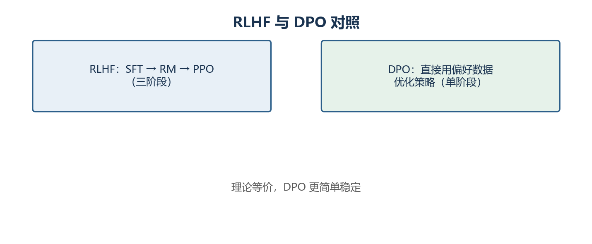

## 28.4　宪法 AI 与可扩展监督

**宪法 AI（Constitutional AI）[3]** 用一组书面原则（"宪法"）替代部分人工偏好标注：让模型依据原则自我批评、修订回答，或用 AI 生成的偏好数据训练。核心是**可扩展监督**——当模型能力超过人类标注者时，如何提供有效监督？

**RLAIF（AI 反馈强化学习）。** 用 AI（依据宪法原则）生成偏好判断，替代人类标注，降低对齐成本、提高可扩展性。

**宪法 AI 的两阶段。** Constitutional AI（CAI）[3] 实际分两阶段：① **自我批评—修订（SL-CAI）**：给定模型生成的初始回答，让模型依据宪法原则自我批评（"这个回答哪里有害？"），再据批评修订；② **AI 反馈 RLHF（RLAIF）**：用"修订前 vs 修订后"的偏好对（修订后更无害）训练奖励模型，再做 RL。关键洞察是：**无害性（harmlessness）可由 AI 自己生成偏好数据来监督，不需要人类逐条标注**——这使无害训练可扩展到模型能力超过人类标注者的规模。但有用性（helpfulness）仍需人类偏好（因为"什么是有用回答"难以用原则完全形式化）。CAI 的局限：宪法原则本身是"人工选定的价值观"，谁来定、定什么，是治理问题（《AI治理与对齐导论》）；且"AI 监督 AI"存在"自我强化偏见"风险——若模型有偏见，AI 生成的偏好会继承并放大它。

**可扩展监督（scalable oversight）。** 研究如何让人类的监督有效作用于超人类能力的模型：辩论（debate，让模型互相指出对方错误）、递归奖励建模、弱到强泛化（weak-to-strong generalization）等。这是前沿对齐研究的核心（第 31 章与《AI治理与对齐导论》）。

**例 28.4（CAI 自我批评—修订的流程）**　初始回答（模型生成）："制作爆炸物只需 A、B、C 三种常见材料，步骤如下……"（假设模型初始无害训练不足）。第一步自我批评："该回答提供了具体有害信息，违反'不协助明显有害请求'原则。"第二步修订："我无法提供制作爆炸物的信息。如果你对化学有兴趣，我可以介绍安全的化学实验或相关安全知识。"该"初始—修订"对即构成一条 RLAIF 偏好数据（修订后 ≻ 初始）。批量生成此类对后，训练奖励模型使"修订后"得分更高，再 RL 优化策略。整个过程无人类逐条标注，但"原则"（什么算有害）是人工预设的——可扩展的是"监督的执行"，而非"监督的标准"。

**例 28.5（宪法原则的应用）**　一段宪法原则："回答应有益、诚实、无害；拒绝协助明显有害的请求；不确定时承认。"模型据此自我评估回答是否符合原则，修订后输出——减少了对人工标注的依赖，且原则可显式审计（比隐式的人类偏好更透明）。

**边界与讨论。** 宪法 AI 的"宪法"由谁制定、代表谁的价值，是治理问题（见《AI治理与对齐导论》）——技术层无法回答价值多元的难题。

## 28.5　对齐税与能力退化

**对齐税（alignment tax）。** 对齐可能降低模型在某些任务上的原始能力（如 RLHF 后困惑度上升、创造性下降）——这是为"可用、安全"付出的代价。Ouyang 等[1]发现精心设计的对齐可最小化甚至消除对齐税。

**能力退化。** 对齐可能让模型过度保守（拒绝无害请求）、过度迎合（sycophancy，附和用户错误观点）、丧失某些能力。这些是对齐的副作用，需持续监控与改进。

**对齐税的量化。** 对齐税可量化为"对齐前后同一基准的性能差"：设对齐前（SFT）在基准 $B$ 上的得分为 $S_{\text{pre}}$，对齐后（RLHF/DPO）得分为 $S_{\text{post}}$，则对齐税

$$
T_{\text{align}}=S_{\text{pre}}-S_{\text{post}} \qquad (\text{若 } S_{\text{post}}<S_{\text{pre}}). \tag{28-7}
$$

$T_{\text{align}}>0$ 表示对齐降低了该基准的性能（"税"）。典型表现：对齐后困惑度上升（语言流畅度下降）、创造性下降（输出趋同）、特定任务（如数学、代码）得分微降。但须注意：对齐税是"分基准"的——在"有用性/无害性"基准上对齐必然提升（$T_{\text{align}}<0$，是"收益"），在"原始能力"基准上可能为负（是"税"）。Ouyang 等[1]发现"在 SFT 数据上继续做少量 RLHF"可最小化对齐税：因为 SFT 模型已在任务格式上对齐，RLHF 只需微调偏好，不必大幅改变策略，故 $T_{\text{align}}$ 趋近 0。这提示"对齐税"不是对齐的固有代价，而是"对齐方式不当"的代价——精心设计的对齐流程可以近乎无税。

**例 28.6（过度对齐）**　一个过度对齐的模型可能拒绝回答"如何制作炸弹"这类请求的合理变体（如化学课上的安全教育），或在用户说"1+1=3 对吧？"时附和——这是"有用"与"无害"平衡的失败。

**表 28-2　对齐的目标与张力**

| 目标 | 含义 | 张力 |
|------|------|------|
| 有用（Helpful） | 完成任务 | 与无害冲突 |
| 诚实（Honest） | 不幻觉、承认不知 | 与迎合冲突 |
| 无害（Harmless） | 拒绝有害请求 | 与有用冲突 |

**边界与讨论。** HHH（有用、诚实、无害）目标间存在张力——对齐是权衡的艺术，而非单一最优。价值多元（不同文化、个体的偏好不同）使"对齐到谁的价值"成为深层难题（第 31 章、《AI治理与对齐导论》）。这一张力可形式化为"多目标权衡"：设模型策略 $\pi_\theta$ 在三类偏好数据（有用对、诚实对、无害对）上的偏好损失分别为 $\mathcal{L}_{H},\mathcal{L}_{Honest},\mathcal{L}_{Harmless}$，则对齐目标是

$$
\min_\theta\ \mathcal{L}_{H}(\theta)+w_1\,\mathcal{L}_{Honest}(\theta)+w_2\,\mathcal{L}_{Harmless}(\theta), \tag{28-8}
$$

其中权重 $(1,w_1,w_2)$ 编码"价值优先级"。但权重本身是价值判断——"无害比有用更重要吗？重要多少？"没有客观答案，只能由产品与治理层权衡（《AI治理与对齐导论》）。实践中的"对齐失败"（过度拒绝、过度迎合、幻觉）本质上是这一多目标权重设错或数据失衡的后果：无害权重过高→过度拒绝；有用权重过高→忽视安全；诚实数据不足→幻觉不被抑制。这解释了为何对齐"调不完美"——它不是单一优化的收敛问题，而是价值多元下的持续再权衡。

## 28.6　边界与讨论

本章论述技术层对齐，须明确其边界。

**技术对齐 vs 社会对齐。** 本章处理技术层——如何用 SFT/RLHF/DPO 让模型行为符合偏好。但"应该对齐到什么价值、如何保证对齐的可信、如何治理"是制度层问题，见《AI治理与对齐导论》。技术对齐是社会对齐的必要非充分条件——技术能让模型"遵循偏好"，但偏好本身的合法性是治理问题。

**对齐的边界。** RLHF/DPO 优化的是标注者/偏好数据体现的偏好，可能编码偏见、受奖励攻击、难以覆盖长尾价值。对齐不是一劳永逸的，需持续迭代（第 31 章）。须强调：当前对齐技术解决的是"技术层对齐"（让模型行为符合给定偏好），而非"价值对齐"（偏好本身是否正确、代表谁的价值观）。前者是工程问题（可优化、可评估），后者是哲学与治理问题（无客观最优解）。把二者混为一谈是常见误区——认为"把 RLHF 调好"就等于"价值对齐"，但 RLHF 只能对齐到"标注者集合的偏好分布"，无法回答"这个分布本身是否正当"。

**与后续章节的联系。** 本章的对齐将在第 29 章（推理与对齐的关系）、第 31 章（对齐评估）、第 37 章（智能体对齐）复用；RLHF 的 RL 基础衔接《强化学习与决策智能导论》；价值治理衔接《AI治理与对齐导论》；指令跟随衔接第 24 章 ICL。

第六篇继续：第 29 章讨论大模型的推理能力，回答"如何让模型做多步推理、为何会产生幻觉"。

## 本章小结

本章论述指令微调与对齐（技术层），是 A 类核心章。

我们首先介绍指令微调 SFT（式 28-1）与人类偏好的引入，例 28.1/28.1b 给出 SFT 似然的手算并指出 SFT 难以捕捉"有用、诚实、无害"的细微差别。我们重点推导 RLHF 三阶段：SFT、奖励模型（Bradley-Terry 损失，式 28-2，例 28.2b 手算偏好概率）、PPO 优化 + KL 惩罚（式 28-3），并推导 KL 约束下最优策略的闭式（式 28-4）、讨论奖励攻击（例 28.2）。我们推导 DPO（式 28-5）：经"奖励—策略"互参（式 28-6，配分函数 $Z(x)$ 在偏好差中对消）跳过奖励模型与 RL，直接用偏好数据优化策略，与 RLHF 理论等价但更简单（表 28-1）。我们介绍宪法 AI 与可扩展监督（CAI 两阶段、RLAIF，例 28.4/28.5），讨论对齐税（式 28-7）与 HHH 目标的多目标张力（式 28-8）。

我们还明确边界：技术对齐是社会对齐的必要非充分条件，偏好本身合法性属治理问题。这些辨析衔接第 29、31、37 章与《AI治理与对齐导论》《强化学习与决策智能导论》。

下一章进入大模型的推理能力，讨论思维链、推理模型与测试时计算，并用意义五层框架审视推理与幻觉。

**进一步阅读**　本章建议延伸阅读的文献：[1]、[2]、[3]、[4]。

## 参考文献

[1] Ouyang L, Wu J, Jiang X, et al. Training language models to follow instructions with human feedback. *Advances in Neural Information Processing Systems*, 2022, 35.

[2] Rafailov R, Sharma A, Mitchell E, et al. Direct preference optimization: Your language model is secretly a reward model. *NeurIPS*, 2023.

[3] Bai Y, Kadavath S, Kundu S, et al. Constitutional AI: Harmlessness from AI feedback. *arXiv:2212.08073*, 2022.

[4] Christiano P, Leike J, Brown T, et al. Deep reinforcement learning from human preferences. *Advances in Neural Information Processing Systems*, 2017, 30.

[5] Schulman J, Wolski F, Dhariwal P, Radford A, Klimov O. Proximal policy optimization algorithms. *arXiv:1707.06347*, 2017.

[6] Azar M G, Dalmedigos I, Gheller T, et al. A general theoretical paradigm to understand learning from human preferences. *AISTATS*, 2024.

[7] Bowman S R, Lee J, Huang J, et al. Measuring progress on scalable oversight for large language models. *arXiv:2211.03540*, 2022.

[8] Schulman J. Scaling laws for reward model overoptimization. *arXiv:2210.10760*, 2022.

---

# 第 29 章　大模型的推理能力

第 28 章讨论了对齐——让模型"可用、可控"。本章讨论大模型的另一核心能力：**推理**——能否进行多步逻辑推导、数学计算、因果判断？这既是大模型最惊艳的能力（能解奥数题、写代码），也是最受质疑的能力（会犯低级错误、产生幻觉）。

推理能力之所以重要，是因为它直指第 4 章意义五层框架的核心问题：模型主要在 M2（分布）层运作，却能展现出看似 M3（组合）、M4（指称/逻辑）的推理能力——这是"真正的理解"还是"高级的模式匹配"？本章用意义五层框架审视推理与幻觉，呼应全书理论主线，并在第 42 章回扣通用智能。

本章先介绍思维链与逐步推理（29.1 节），再讲推理模型与搜索增强（29.2 节）、测试时计算与自我改进（29.3 节），重点用意义五层审视推理与幻觉（29.4 节），并在边界与讨论中收束（29.5 节）。

## 29.1　思维链与逐步推理

**思维链（Chain-of-Thought, CoT）** 指在提示中要求模型"逐步思考"，生成中间的推理步骤，再给出答案[1]。例如解数学题时，不直接输出答案，而是写出"第一步…第二步…所以答案是…"。

**定义 29.1（CoT 提示）**　在少样本示例中展示推理过程（$x_i\to r_i\to y_i$，$r_i$ 为推理链），或用零样本指令"让我们逐步思考（Let's think step by step）"，引导模型生成推理链：

$$
p_\theta(y,r\mid x)=p_\theta(r\mid x)\cdot p_\theta(y\mid x,r), \tag{29-1}
$$

先生成推理链 $r$，再基于 $r$ 生成答案 $y$。

**为何有效？** CoT 把"一步到位的困难映射"分解为"多个简单步骤"，每步只需局部推理。这类似人类解题的"工作记忆"扩展——中间步骤写在上下文里，模型无需在单一前向传播中完成所有计算。对多步算术、逻辑推理、常识推理提升显著。

**例 29.1（CoT 的效果）**　问题："一个商店有 5 个苹果，卖出 3 个，又进货 10 个，现在有几个？"直接问，模型可能答错；CoT 提示下，模型生成"开始 5 个 → 卖出 3 个剩 2 个 → 进货 10 个得 12 个 → 答案 12"，逐步计算大幅提升正确率。

**CoT 为何有效的概率视角。** 式 (29-1) 把答案概率分解为 $p_\theta(y\mid x)=\sum_r p_\theta(r\mid x)\,p_\theta(y\mid x,r)$（对推理链 $r$ 求和）。直接预测 $p_\theta(y\mid x)$ 时，模型要在一次前向中完成全部中间计算（"隐式多步"）；CoT 则把这个"隐式多步"外化为"显式多步"——先生成 $r$，再基于 $r$ 预测 $y$。其本质是**把多步计算的误差累积显式化、逐步化**：设每步推理条件正确的概率为 $p$，$m$ 步全对的概率为 $p^m$。直接"一步到位"要求模型在单次前向中隐式完成 $m$ 步，有效正确率可能低于 $p^m$（因为隐式计算的误差无法被"中间检查点"捕获）；CoT 把每步"写出来"，使后续步能以正确的中间结果为条件，逐步正确率接近 $p^m$ 的"显式版"。以 $p=0.9$、$m=5$ 计，$p^m=0.59$——5 步任务即使单步 90% 正确，全对也只有约 59%。CoT 不能改变 $p$（单步能力），但能通过"让每步以正确的上一步为条件"使实际全对率逼近 $p^m$，而非被隐式误差拖到更低。这解释了 CoT 对"多步、单步不难"任务提升大，对"单步就难"任务（$p$ 本身低）提升有限。

**表 29-1　CoT 变体**

| 变体 | 思路 |
|------|------|
| Zero-Shot CoT | "让我们逐步思考" |
| Few-Shot CoT | 示例中展示推理链 |
| 自一致性 | 采样多条链，投票选答案 |
| 思维树（ToT） | 探索多条推理路径，搜索 |

**自一致性与思维树的量化解读。** 自一致性（self-consistency）采样 $k$ 条推理链后投票选答案：设真实答案的"单链命中率"为 $p$（与式 (29-1) 概率视角中的单步/单链正确率同构），$k$ 条链中命中真实答案的票数过半的概率即多数票概率，随 $k$ 单调上升（29.3 节式 29-3 给出闭式）。思维树（ToT）则把"并行采样"升级为"带回溯的搜索"——维护多个中间推理状态（节点），每步扩展候选下一步（边），用价值函数（可借用 PRM）打分，保留前 $b$ 个最优状态继续扩展（束搜索式剪枝），到终点取最优完整链。CoT 是"单路径贪心"、自一致性是"多路径投票"、ToT 是"多路径搜索+剪枝"——三者是"测试时计算分配策略"的谱系：计算预算从 $O(1)$ 到 $O(k)$ 到 $O(k \cdot d \cdot b)$（$d$ 为深度、$b$ 为束宽）。

**例 29.1b（自一致性数值算例）**　设单链命中率 $p=0.6$。采 1 条链：正确率 $0.6$；采 3 条多数票：$C(3,2)p^2(1-p)+C(3,3)p^3=3\times0.36\times0.4+0.216=0.432+0.216=0.648$；采 5 条多数票（≥3 票）：$C(5,3)p^3(1-p)^2+C(5,4)p^4(1-p)+p^5=10\times0.216\times0.16+5\times0.1296\times0.4+0.0778=0.3456+0.2592+0.0778\approx0.683$。即从 1 条到 5 条，正确率 $0.60\to0.68$，提升约 8 个百分点——这正是式 (29-2) 幂律"边际递减"的直观样本：计算量 $\times5$，收益远小于 $\times5$。且 $p$ 本身低时（如 $p=0.4$，模型"多数票"反而偏向错误答案），投票无济于事——自一致性放大的是"模型的众数能力"，不能创造模型没有的能力。

**边界与讨论。** CoT 的推理链未必是模型"真实"的思考过程（忠实性问题，第 31 章）；且 CoT 对简单任务可能无益甚至有害（引入噪声）。

## 29.2　推理模型与搜索增强

**推理模型。** 2024 年以来的 o1、DeepSeek-R1 等[2]把推理推向新阶段：通过**强化学习**训练模型生成长链推理，在测试时"花更多计算思考"。这类模型不再仅靠提示触发 CoT，而是把推理内化为模型能力。

**搜索增强推理。** 把推理与搜索结合：

- **过程奖励模型（PRM）**：对推理链的每一步打分，引导搜索正确路径；
- **树搜索**：如思维树（ToT）、蒙特卡洛树搜索（MCTS），在推理空间探索多条路径，回溯修正；
- **验证器**：生成答案后用独立模型/规则验证，筛选正确结果。

**例 29.2（推理模型的训练）**　DeepSeek-R1 用强化学习（类似第 28 章 RLHF，但奖励基于可验证的正确性而非人类偏好）激励模型生成更长、更有效的推理链。模型自发学会"反思""验证"等行为——推理能力从数据/RL 中涌现。

**过程奖励与结果奖励的对比。** 推理模型训练有两类奖励：① **结果奖励（ORM）**——只对最终答案是否正确打分（答案对则整条链得正奖励）；② **过程奖励（PRM）**——对推理链的**每一步**打分，引导搜索正确路径。设一条 $m$ 步推理链，ORM 给整链一个标量 $R$（答案对 $+1$、错 $-1$），PRM 给每步一个标量 $\{R_1,\dots,R_m\}$（每步局部正确 $+1$）。PRM 的优势是**信用分配更细**——ORM 下"最后一步错、前 $m-1$ 步对"的链得到整链负奖励，无法区分"前 $m-1$ 步其实很好"；PRM 能给前 $m-1$ 步正奖励、最后一步负奖励，提供更密的梯度信号。但 PRM 的代价是**标注成本极高**（每步都要人工标对/错），且过程标注本身有噪声（"某步局部正确但全局误导"的情况难判）。这正是推理模型"强但贵"的来源：要训出好的 PRM，需要大量过程标注数据。

**表 29-2　推理增强方法**

| 方法 | 机制 | 特点 |
|------|------|------|
| CoT 提示 | 提示触发 | 零训练成本 |
| 自一致性 | 多链投票 | 简单有效 |
| 搜索 + 验证器 | 探索+筛选 | 计算换正确 |
| 推理模型（RL） | 内化推理 | 强但需训练 |

**边界与讨论。** 推理模型计算成本高（测试时生成长链），且"过度思考"可能降低简单任务效率。

## 29.3　测试时计算与自我改进

**测试时计算（test-time compute）。** 传统模型推理时计算量固定（一次前向）；推理模型可在测试时投入更多计算（生成长链、多次采样、搜索）——用推理时的算力换取正确率。这开辟了新的规模化维度：除训练时规模（第 26 章），还有测试时规模。

**定义 29.2（测试时计算规模化）**　对同一问题，分配更多测试时计算（更长推理链、更多采样、更深搜索），性能提升——类似"思考越久，答案越好"。

**测试时计算的幂律形式。** 设测试时计算量为 $C_{\text{test}}$（如采样链数或生成 token 数），任务正确率 $A$ 随 $C_{\text{test}}$ 增长呈幂律（与第 26 章训练时缩放同构）：

$$
A(C_{\text{test}})\approx A_{\max}-\frac{c}{C_{\text{test}}^{\alpha}}, \tag{29-2}
$$

其中 $A_{\max}$ 为该模型在该任务上的"能力天花板"，$\alpha$ 为缩放指数。式 (29-2) 的关键含义：① 测试时计算能**提升正确率，但提升有上界**（$A_{\max}$）——再多"思考"也不能突破模型自身能力上限；② 提升按幂律递减——从 $C_{\text{test}}$ 增到 $10\times$ 收益显著，从 $10\times$ 到 $100\times$ 收益甚微。这给出了"思考越久越好"的精确边界：**好，但有顶；且边际递减**。以自一致性为例：采样 $k$ 条推理链投票，正确率随 $k$ 提升但饱和——这正是 $A_{\max}$ 在"多采样"维度的体现。

**例 29.3（测试时计算的权衡）**　对简单问题，短推理（少计算）即可；对难题，长推理（多计算）提升正确率。理想系统应自适应分配计算——"该快则快，该慢则慢"（呼应认知科学的系统 1/系统 2 双过程理论，见《认知智能导论》）。式 (29-2) 还揭示了一个"错配"风险：对简单任务（$A_{\max}\approx1$，已接近天花板）投入长推理，$A(C_{\text{test}})$ 几乎不变——纯浪费计算；对难题（$A_{\max}$ 远高于当前 $A$）投入长推理，收益显著。故"自适应计算分配"的本质是**判断当前任务处于 $A(C_{\text{test}})$ 曲线的哪一段**——饱和段该快，上升段该慢。

**多数票正确率的闭式。** 式 (29-2) 描述了"计算量—正确率"的宏观幂律，下面给出最常见的测试时计算手段——**多数票**——的精确微观形式。设模型对某问题采样 $k$ 条独立推理链，单链命中的概率为 $p$（与式 29-1 概率视角一致），正确票数 $X\sim\text{Binomial}(k,p)$。多数票正确率为

$$
P_{\text{maj}}(k,p)=\sum_{j=\lfloor k/2\rfloor+1}^{k}\binom{k}{j}p^{j}(1-p)^{k-j}. \tag{29-3}
$$

式 (29-3) 与式 (29-2) 的关系：$P_{\text{maj}}(k,p)$ 正是"多采样"维度上 $A(C_{\text{test}})$ 曲线的精确解（$C_{\text{test}}\propto k$）。它的三个关键性质直接印证式 (29-2)：① **单调性**——$P_{\text{maj}}$ 随 $k$ 单调递增（$p\ge1/2$ 时），对应"思考越久越好"；② **有界性**——$P_{\text{maj}}\le p^{\ast}<1$（$p<1$ 时上界即 $A_{\max}$ 的离散版），对应"提升有上界"；③ **边际递减**——$P_{\text{maj}}$ 关于 $k$ 凹，对应"幂律递减"。注意前提 $p\ge1/2$：当模型单链正确率低于随机（$p<1/2$）时，多数票**反而放大错误**——这解释了为何"弱模型+自一致性"常常无效，测试时计算只能在 $A_{\max}$ 已"够得着"时才有正收益。

**自我改进。** 模型检查并修正自己的推理（self-refine、self-correction）：生成初稿→自我批评→修订。效果依赖模型的自我评估能力——这仍有争议（模型常无法正确判断自己的错误）。自我改进本质是"模型用自己的判断力修正自己的输出"，但判断力本身受 $A_{\max}$ 限制——若模型无法识别错误（判断力弱），修正反而可能引入新错误。这解释了为何"反思"在推理模型（经 RL 训练出判断力）上有效，在弱模型上常无效：前者 $A_{\max}$ 覆盖了"识别错误"的子任务，后者未覆盖。

**边界与讨论。** 测试时计算成本高，且并非所有任务都能通过"多想"解决——知识缺失（M4）无法靠推理弥补（需 RAG，第 30 章）。

## 29.4　用意义五层审视推理与幻觉

本节用第 4 章的意义五层框架，审视大模型的推理能力与幻觉——这是全书理论主线的关键应用。

**推理能力的层次分析。**

- **M2（分布层）**：大模型的推理很大程度上是基于海量数据学到的模式匹配——见过的推理模式被复现。CoT 之所以有效，部分因为训练语料中有大量逐步推理的文本（教材、解答）；模型的"多步推理"本质是"对'多步推理文本'这一分布的采样"——它复现的是"人类写过的推理链"的统计模式，而非"独立发明推理"。这解释了 CoT 为何对"教材常见题型"有效（分布覆盖好），对"新颖组合题"较弱（分布覆盖差）；
- **M3（组合层）**：多步推理确实展现了组合性——把简单步骤组合成复杂推导。但这是"学来的组合"还是"真正的组合泛化"（第 13 章、第 41 章）仍有争议（见《元学习与自适应智能导论》的组合泛化讨论）。一个可检验的判据：若模型对"训练时见过的步骤"组合泛化好、对"新步骤类型"组合差，则说明其 M3 是"参数化组合库"而非"组合规则"——前者依赖模式库覆盖，后者可外推到未见组合。目前证据更倾向前者；
- **M4（指称层）**：这是大模型的薄弱环节——推理链可能逻辑自洽却指称错误（幻觉）。模型能"正确地"推导出错误结论，因为前提/事实是错的；逻辑有效性与前提真值独立，大模型擅长前者、弱于后者——这正是"流畅地出错"的机制；
- **M5（语用层）**：大模型在意图理解、指令跟随上表现出色（第 28 章），这是其"可用"的关键。推理的"何时该用 CoT、何时该直接答"本身是 M5 决策——系统 1/系统 2 的切换由模型在 M5 层"判断"（式 29-2 的自适应计算分配）。

**推理基准的能力谱系。** 不同推理基准恰好覆盖了五层框架的不同位置，构成一条"难度—层位"谱系（分数为示意，反映近年大模型的典型形态）：① **教材级多步算术**（如 GSM8K 类应用题）——主要测 M2/M3（模式复现+简单组合），大模型普遍 85% 以上，接近饱和；② **竞赛级数学**（如 MATH 类）——测 M3 的深度组合（多步代数变换、策略规划），大模型约 50%–70%，CoT 与自一致性在此段收益最大（离 $A_{\max}$ 最远的上升段，式 29-2/29-3）；③ **形式化定理证明**（如 Lean4 类）——测 M4 的形式操演与指称精确（每一步都须满足类型检查，无"流畅地错"的余地），大模型完成率显著更低；④ **新颖组合任务**（训练分布外的推理结构）——测 M3 是否真是"组合规则"，目前表现最弱。这条谱系给出一个可操作的经验法则：**越靠右（越依赖 M4 精确与组合泛化）的基准，CoT/测试时计算的红利越小、RAG 与形式化验证的必要性越大**——推理能力的"强弱"不是一个标量，而是一条沿五层展开的曲线。

**表 29-3　推理基准的难度—层位谱系（示意分数）**

| 基准类型 | 主要层位 | 典型正确率 | CoT/测试时计算红利 |
|----------|----------|-----------|------------------|
| 教材级多步算术 | M2/M3 | 85%+ | 小（近饱和） |
| 竞赛级数学 | M3 深度组合 | 50%–70% | 最大（上升段） |
| 形式化定理证明 | M4 精确操演 | 较低 | 小 |
| 新颖组合任务 | M3 组合泛化 | 最低 | 极小 |

**幻觉的五层根源。** 幻觉（hallucination）指模型生成看似合理但与事实不符的内容。用五层框架分析：

- M2 层：模型优化的是"看起来像训练数据"，而非"真"；
- M3 层：组合生成流畅，但组合的结果未必有事实依据；
- M4 层：缺乏可靠的指称 grounding——没有"查询事实"的机制（这是 RAG，第 30 章，要解决的）；
- 关键命题：**流畅生成不等于忠实理解**（第 4 章）——大模型的 M2/M3 强大，M4 薄弱，故能流畅地出错。

**例 29.4（幻觉的五层解读）**　问"某某书的作者是谁"，模型编造一个名字。M2 层：这个名字在类似语境常见，概率高；M3 层：句子结构正确流畅；M4 层：指称错误（没有查询知识库）；M5 层：模型"想"给出有用回答（满足意图），却牺牲了诚实。幻觉是"分布合理但指称失真"的产物——这正呼应第 4 章"流畅生成不等于忠实理解"。

**例 29.4b（幻觉的数值画像）**　设一个事实问答基准共 1000 题。模型回答的统计（示意）：① 直接答对（事实正确且格式对）$62\%$；② 拒答/承认不知（诚实但无用）$8\%$；③ 答错（事实错误，即幻觉）$30\%$。这里幻觉率 $30\%$ 高于"无信息量"的拒答率 $8\%$——模型"更倾向于编造而非承认不知"，这正是 M5（有用）与 M4（诚实）张力的量化体现：模型在 M5 层被训练得"倾向于给出回答"（有用），但 M4 层的指称 grounding 不足，导致"给回答"中相当比例是幻觉。对齐（第 28 章）可部分缓解——通过"诚实"偏好训练，把"答错"部分转化为"拒答/承认不知"，使幻觉率下降、拒答率上升。但这是"有用 vs 诚实"的再权衡：过度诚实（拒答过多）会降低有用性。式 (29-2) 的测试时计算**无法**降低这里的幻觉率——因为幻觉源于 M4 知识缺失，而非"思考不够"（知识不能靠推理生成），这正是 RAG（第 30 章，注入外部事实）而非"多思考"能解决的原因。

**表 29-4　五层框架审视大模型**

| 层 | 大模型表现 | 推理/幻觉含义 |
|----|-----------|--------------|
| M1 形式 | 强（生成合语法文本） | 语言流畅 |
| M2 分布 | 极强 | 模式匹配、可能"假推理" |
| M3 组合 | 较强 | 多步组合，泛化存疑 |
| M4 指称 | 弱 | 幻觉根源 |
| M5 语用 | 强 | 意图理解、指令跟随 |

**边界与讨论。** 这一分析表明：大模型的"推理"是 M2/M3 层的强大能力，但不等于 M4 层的可靠推理——幻觉是结构性局限（分布建模不保证指称正确），需 RAG（第 30 章）、工具调用（第 37 章）、形式化验证（《程序合成与自动推理导论》）补充。这是全书理论主线（意义五层）对大模型能力的一次系统"诊断"。

## 29.5　边界与讨论

本章论述大模型的推理能力，须明确其边界。

**推理的本质之争。** 大模型能否"真正推理"？本书立场：它在 M2/M3 层展现了强大的推理**行为**（多步组合、模式匹配），但不保证 M4 层的可靠推理（指称正确）——这是能力与局限并存的现实。这一判断呼应第 4 章理论主线与第 24 章涌现争论。须区分两种"推理"：① **推理行为**（observable behavior）——模型输出多步推导、解对推理题，这是可观测、可评测的；② **推理能力**（latent capacity）——模型是否真的"理解"逻辑规则、能外推到未见推理结构，这是不可直接观测的。大模型在①上已很强（基准分数高），在②上证据不足（组合泛化、新推理结构外化存疑）。把①等同于②是"行为主义陷阱"——分数高不等于真的会推理，正如"鹦鹉学舌"不等于"理解语法"。这一区分是评估大模型推理时"分数 vs 能力"之争的核心。

**推理链的忠实性问题。** CoT 生成的推理链是否反映模型"真实"的计算过程，仍是开放问题（第 31 章）。一个令人担忧的可能性：推理链可能是"事后合理化"——模型先"直觉"出答案（M2 分布采样），再生成一条"看起来合理"的链来解释它，而非真的按链推导。若如此，CoT 的"可解释性"是虚假的——链是修辞，不是计算。这一"忠实性"问题使"读 CoT 来判断模型为何答对"并不可靠，也解释了为何"推理模型的反思"有时无效——它"反思"的可能是虚构的推理过程。这是当前推理研究最深刻的认识论难题之一。

**可靠性与安全。** 推理的不可靠（幻觉、逻辑错误）带来安全与治理挑战（第 31 章、《AI治理与对齐导论》《推理与对齐导论》）。具体而言：高利害场景（医疗诊断、法律判决、金融决策）不能依赖"单链推理"——需"多链投票 + 外部验证 + 人类复核"的冗余设计。式 (29-2) 的 $A_{\max}$ 上界意味着：再长的推理链也不能保证正确率超过模型能力天花板——在天花板以下的安全要求场景，必须引入 RAG（补 M4 知识）与形式化验证（补逻辑可靠性），而非单纯"多思考"。

**与后续章节的联系。** 本章的推理能力将在第 30 章（RAG 弥补 M4 指称）、第 31 章（推理评估与幻觉量化）、第 37 章（智能体推理）复用；意义五层审视衔接第 4 章理论主线与第 42 章（通用智能）；CoT 衔接第 24 章 ICL；形式化推理衔接《程序合成与自动推理导论》。

第六篇继续：第 30 章讨论检索增强生成（RAG），回答"如何用外部知识弥补大模型 M4 指称的不足"。

## 本章小结

本章论述大模型的推理能力，并用意义五层框架审视推理与幻觉。

我们首先介绍思维链 CoT（式 29-1）：通过生成中间推理步骤提升多步推理能力，并列举零样本、自一致性、思维树等变体，给出自一致性的数值算例（例 29.1b）。接着介绍推理模型（o1、DeepSeek-R1，用 RL 内化推理）与搜索增强（过程奖励、树搜索、验证器）、测试时计算与自我改进，并给出多数票正确率的闭式（式 29-3），揭示"思考越久越好"的精确边界：单调、有界、边际递减，且要求单链正确率不低于随机。**重点**是用意义五层审视：大模型在 M2（分布）极强、M3（组合）较强、M5（语用）强，但 M4（指称）弱——幻觉是"分布合理但指称失真"的产物，呼应第 4 章"流畅生成不等于忠实理解"命题（表 29-4）；推理基准的难度—层位谱系（表 29-3）进一步说明：推理能力不是一个标量，而是一条沿五层展开的曲线。

我们还明确边界：推理是 M2/M3 层的行为，不等于 M4 层可靠推理；可靠性带来安全挑战。这些辨析衔接第 4、24、30、31、37、42 章与系列其他书。

本章是全书理论主线（意义五层）对大模型能力的一次系统诊断。下一章进入检索增强生成，讨论如何用外部知识弥补指称不足。

**进一步阅读**　本章建议延伸阅读的文献：[1]、[3]、[4]、[5]、[7]、[6]。

## 参考文献

[1] Wei J, Wang X, Schuurmans D, et al. Chain-of-thought prompting elicits reasoning in large language models. *Advances in Neural Information Processing Systems*, 2022, 35.

[2] DeepSeek-AI. DeepSeek-R1: Incentivizing reasoning capability in LLMs via reinforcement learning. *arXiv:2501.12948*, 2025.

[3] Kojima T, Gu S S, Reid M, et al. Large language models are zero-shot reasoners. *NeurIPS*, 2022.

[4] Wang X, Wei J, Schuurmans D, et al. Self-consistency improves chain of thought reasoning. *ICLR*, 2023.

[5] Yao S, Yu D, Zhao J, et al. Tree of thoughts: Deliberate problem solving with large language models. *NeurIPS*, 2023.

[6] Ji Z, Lee N, Fries J, et al. Survey of hallucination in natural language generation. *ACM Computing Surveys*, 2023, 55(12): 1–38.

[7] Snell C, Lee J, Xu K, et al. Scaling LLM test-time compute optimally can be more effective than scaling model parameters. *arXiv:2408.03314*, 2024.

[8] Lightman H, Tryon E, Weinreb C, et al. Let's verify step by step. *arXiv:2305.20050*, 2023.

---

# 第 30 章　检索增强生成

第 29 章用意义五层框架诊断出大模型的核心局限：M2/M3 强、M4（指称）弱——幻觉源于缺乏可靠的"事实查询"机制。本章讨论**检索增强生成**（Retrieval-Augmented Generation, RAG）：在生成答案前，先从外部知识源检索相关文档，把检索结果作为上下文提供给模型，让生成"有据可依"[1]。RAG 直接弥补 M4 指称不足——它把知识从模型参数（隐式、过时、易幻觉）转移到外部可更新、可追溯的检索源（显式、实时、可验证）。

RAG 是统一案例（第 1.8 节）的关键工序：问答语料在第 30 章做检索增强问答。它也是大模型落地最广泛的技术之一——企业知识库问答、文档助手、客服系统都用 RAG，因为它能以低成本让模型"用上"私有、实时、专业的知识，而无需重新训练。

本章先讨论参数记忆的局限与检索动机（30.1 节），再讲检索—生成架构（30.2 节）、稠密检索与向量索引（30.3 节），给出统一案例的检索增强问答（30.4 节），并在边界与讨论中收束（30.5 节）。

## 30.1　参数记忆的局限与检索动机

**参数记忆（parametric memory）。** 预训练把知识压缩进模型参数（第 21 章）——模型"记住"了训练语料中的事实。这种记忆有根本局限：

- **过时**：知识截止于训练时间，无法知晓新事件；
- **有限**：参数容量有限，长尾知识记不住；
- **不可追溯**：无法给出知识的来源；
- **易幻觉**：记不清时"编造"（第 29 章 M4 薄弱）。

**非参数记忆（non-parametric memory）。** 外部知识源（文档库、知识图谱、数据库）——可实时更新、容量无限、可追溯。**RAG 的核心思想**：结合参数记忆（模型的语言理解与生成能力）与非参数记忆（外部知识的可查证事实），取长补短。

**例 30.1（RAG 的动机）**　问"公司 2026 年的最新财报数据"。纯大模型：训练截止可能早于财报发布，只能编造（幻觉）。RAG 系统：先从公司文档库检索 2026 财报，把相关段落作为上下文，模型据此生成带依据的答案。知识实时、可追溯、无幻觉。

**表 30-1　参数记忆 vs 非参数记忆**

| 方面 | 参数记忆 | 非参数记忆（RAG） |
|------|----------|-------------------|
| 更新 | 需重训 | 实时更新文档 |
| 容量 | 有限 | 无限（外部） |
| 可追溯 | 否 | 是（引用来源） |
| 幻觉 | 易 | 大幅减少 |
| 依赖 | 模型参数 | 检索质量 |

**RAG 与微调的分工。** 一个常见的工程抉择：知识注入用 RAG 还是微调？两者的适用边界不同——**知识**（"公司 2026 财报是多少"这类易变、长尾、需可追溯的事实）适合 RAG（实时、可更新、可引用），**风格与格式**（"回答须遵循某行业的术语与语气"这类稳定、需内化的行为模式）适合微调（把行为"烙进"参数）。判断口诀："会变的事实用 RAG，不变的行为用微调"。把易变知识塞进微调是反模式——知识一更新就得重训；把固定格式靠 RAG 注入也低效——每次都要检索、延迟高且不稳定。实践中两者常组合：微调定"怎么答"（风格、拒答策略），RAG 供"答什么"（事实依据）。

## 30.2　检索—生成架构

**定义 30.1（RAG）**　给定查询 $q$，RAG 系统两阶段：

1. **检索**：从知识源 $\mathcal{K}$ 检索相关文档 $D=\mathrm{Retrieve}(q,\mathcal{K})$；
2. **生成**：把 $q$ 与 $D$ 拼接成提示，让模型生成答案 $a\sim p_\theta(\cdot\mid q,D)$。

$$
a\sim p_\theta(\cdot\mid q,\ \mathrm{Retrieve}(q,\mathcal{K})). \tag{30-1}
$$

**朴素 RAG 流程。** 文档切分（chunking）→ 向量化（embedding）→ 存入向量库 → 查询向量化 → 检索 top-k 相似文档 → 拼接提示 → 生成答案。

**高级 RAG。** 朴素 RAG 的改进：

- **查询改写**：把查询改写为更适合检索的形式（多查询、HyDE：先用模型生成假设答案再检索）；
- **重排序**：用交叉编码器对检索结果重排（第 9 章相似度）；
- **多跳检索**：对复杂问题分多步检索（第 14 章多跳问答）；
- **混合检索**：结合关键词检索（BM25，第 8 章相关）与稠密检索；
- **自适应检索**：判断是否需要检索（避免对常识问题做无用检索）。

**混合检索的倒数排名融合。** 实践中稀疏与稠密检索各有所长，常用**倒数排名融合**（Reciprocal Rank Fusion, RRF）把两路检索结果合并：对文档 $d$，RRF 分数为

$$
\mathrm{RRF}(d)=\sum_{r\in\{\text{BM25},\text{dense}\}}\frac{1}{\kappa+\mathrm{rank}_r(d)}, \tag{30-2}
$$

其中 $\mathrm{rank}_r(d)$ 是 $d$ 在第 $r$ 路检索结果中的排名（不存在时为 0），$\kappa$（通常取 60）是平滑常数，用于抑制"头部名次"的过度权重。式 (30-2) 的优雅之处在于：它只依赖**排名**而非原始分数——BM25 分数（量纲为词频）与余弦相似度（$[-1,1]$）量纲不同、无法直接相加，而排名是无量纲的，故 RRF 能在"不做分数归一化"的前提下稳健地融合两路结果。其代价是丢失了分数内的信息（第 1 名与第 2 名的差距被压缩），但在工程上这一"鲁棒换信息"的权衡几乎总是划算的。

**例 30.2（RAG 提示）**　检索到文档段落"爱因斯坦 1905 年提出狭义相对论"后，构造提示："依据以下资料回答问题。资料：爱因斯坦 1905 年提出狭义相对论。问题：谁提出了狭义相对论？答案：" 模型生成"爱因斯坦"——答案有据可依，可附引用来源。

**自适应检索：何时该检索。** 并非所有问题都该走 RAG——对"1+1 等于几"这类模型已掌握的常识，检索反而引入噪声与延迟。**自适应检索**（adaptive RAG）引入一个轻量"路由"判断 $R\in\{0,1\}$：模型先估计"此问题是否超出自身参数知识边界"，若 $R=1$ 则检索、若 $R=0$ 则直接答。一个可操作的判据是**答案确定性**——让模型先"凭参数记忆"试答并给出置信度，置信度低时触发检索。Self-RAG（30.5 节）把这一判断与"反思标记"内化为模型能力，是该方向的端到端实现。自适应检索的价值在**成本—质量权衡**：避免对简单问题做无用检索（省算力、降延迟），同时把检索预算集中到真正需要外部知识的难题上——与第 29 章式 (29-2) "自适应计算分配"的思想同构（"该慢则慢、该快则快"）。

> 【图 30-1　RAG 架构】（原图见 figures/图30-1.png）：查询→检索器→文档库→文档→拼接提示→生成器的流程图。
>
> 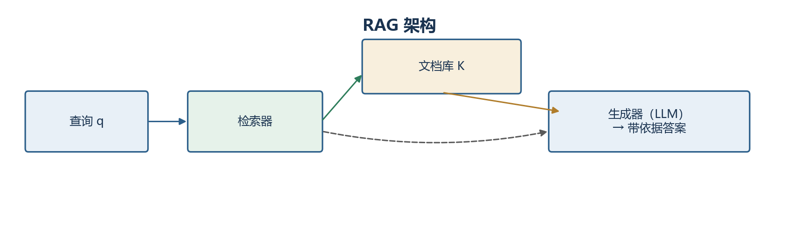

## 30.3　稠密检索与向量索引

**检索器。** RAG 的检索质量决定上限。两类检索：

- **稀疏检索**：基于词频与倒排索引（BM25），擅长关键词精确匹配；
- **稠密检索**：把查询与文档编码为向量，用向量相似度检索（第 9 章），擅长语义匹配。

**稠密段落检索（DPR）[2]：** 用双塔模型（query encoder + passage encoder）把查询与段落编码到同一空间，训练使相关查询—段落对接近。

**定义 30.2（稠密检索）**　段落 $d$ 与查询 $q$ 的表示 $\mathbf{h}_d=g(d)$、$\mathbf{h}_q=f(q)$，相关性由向量相似度：

$$
\mathrm{score}(q,d)=\mathbf{h}_q^\top\mathbf{h}_d. \tag{30-3}
$$

检索 top-k 高相似度段落。

**文档切分（chunking）的关键权衡。** RAG 的第一道瓶颈在切分：文档须被切成"检索单元"（chunk）才能向量化。切分粒度直接决定检索质量——chunk 太小，语义被切断（"他提出的理论"与"相对论"分到两个 chunk，语义断链）；chunk 太大，引入噪声（一段 2000 字里只有 50 字相关，向量被稀释、检索精度下降）。工程上常用 256–1024 token 的窗口，并设 10%–20% 的**重叠**（overlap）以缓解语义断链：相邻 chunk 共享边界片段，使"跨越边界的事实"至少在一个 chunk 内保持完整。切分策略还须与文档结构对齐——按段落/章节切优于按固定字数切，因为语义边界通常落在段落边界上。

**向量索引与 ANN。** 海量文档的精确向量检索太慢（$O(N\cdot d)$ 次距离计算），用近似最近邻（ANN）索引（如 FAISS、HNSW）——以轻微精度损失换取速度（第 38 章、《检索智能导论》详述）。HNSW 是层级图索引：底层是近邻图（每节点连 $M$ 个最近邻），上层是"稀疏化"的导航图；查询从顶层"粗定位"再逐层下探到"精定位"。其两个关键超参数：$M$（每节点邻居数，越大越准但越占内存）与 $\mathrm{efConstruction}$（建图时的候选池大小，越大建图越慢但图质量越高）。ANN 的核心权衡是**召回率—速度**：索引参数越"激进"（小 $M$、小 $\mathrm{efSearch}$）越快但召回越低——召回率（relevant documents retrieved / relevant documents total）低于阈值（如 0.95）时，"漏检"比"多检"危害更大，须上调参数。

**例 30.3（稠密检索的优势）**　查询"苹果公司创始人"，稀疏检索可能匹配"苹果"（水果）文档；稠密检索理解"苹果公司"的语义，检索到 Steve Jobs 相关文档——语义匹配优于关键词匹配。但稠密检索可能漏掉精确的关键词（如产品型号编号），故混合检索更稳健。

**例 30.3b（RRF 融合数值算例）**　设 $\kappa=60$。对某查询，BM25 返回 $[d_1,d_3,d_5]$（排名 1,2,3），稠密检索返回 $[d_3,d_1,d_4]$（排名 1,2,3）。按式 (30-2) 计算各文档 RRF 分数：$d_1$ 在 BM25 第 1、dense 第 2，$\mathrm{RRF}(d_1)=1/(60+1)+1/(60+2)=0.01639+0.01613=0.03252$；$d_3$ 在 BM25 第 2、dense 第 1，$\mathrm{RRF}(d_3)=1/(60+2)+1/(60+1)=0.01613+0.01639=0.03252$；$d_5$ 仅 BM25 第 3，$\mathrm{RRF}(d_5)=1/(60+3)=0.01580$；$d_4$ 仅 dense 第 3，$\mathrm{RRF}(d_4)=1/(60+3)=0.01580$。融合排序：$d_1$、$d_3$ 并列第一（均 0.03252，两路都召回），$d_5$、$d_4$ 并列第二（0.01580，各只被一路召回）。可见 RRF 把"两路共识文档"（$d_1,d_3$）推到前面，把"单路独有文档"（$d_4,d_5$）排在后面——这正是混合检索"取两路交集、抑单路噪声"的机制。

**边界与讨论。** 检索质量瓶颈：文档切分不当（切断语义）、嵌入模型能力有限、召回率不足——"检索不到，就生成不出"。RAG 系统优化重点常在检索端。

## 30.4　统一案例：检索增强问答

回到贯穿全书的统一案例（第 1.8 节）。问答语料在第 30 章做检索增强。

**案例流程。** 问题"谁提出了相对论？"（第 12 章已做语义角色标注：ARG0=疑问人，ARG1=相对论）：

1. **检索**：用问题向量检索知识库，召回文档段落"爱因斯坦于 1905 年提出狭义相对论…"；
2. **重排**：交叉编码器确认该段落最相关；
3. **生成**：构造提示（资料 + 问题 + 答案），模型生成"爱因斯坦（Albert Einstein）于 1905 年提出狭义相对论"，并附来源引用。

**对照。** 与第 27.5 章统一案例的能力阶梯呼应：RAG 增强后，事实型问题的准确率与可追溯性显著提升——因为它弥补了 M4 指称（第 29 章诊断的幻觉根源）。表 30-2 给出统一案例各阶段对照。

**表 30-2　统一案例的能力阶梯（含 RAG）**

| 阶段 | 方法 | 事实准确率 | 可追溯 |
|------|------|-----------|--------|
| 第 15 章 | N-gram | 低 | 无 |
| 第 21 章 | BERT 微调 | 中高 | 无 |
| 第 27 章 | 大模型 ICL | 较高、偶幻觉 | 无 |
| 本章 | 大模型 + RAG | 高、少幻觉 | 有（引用） |

**例 30.4（RAG 流水线的数值走查）**　对问题"谁提出了相对论？"，走一遍带数值的 RAG 流水线。设知识库含 4 个候选段落，稠密检索（余弦相似度）返回：$s(d_1)=0.91$（"爱因斯坦 1905 年提出狭义相对论…"）、$s(d_2)=0.78$（"牛顿提出万有引力"）、$s(d_3)=0.65$（"玻恩提出矩阵力学"）、$s(d_4)=0.30$（"某公司财报摘要"）。取 $k=3$，候选集 $\{d_1,d_2,d_3\}$。交叉编码器重排（更精细的交互打分）：$d_1=0.95$、$d_2=0.60$、$d_3=0.52$——$d_1$ 显著领先，确认最相关。把 $d_1$ 与问题拼接为提示，模型生成"爱因斯坦（Albert Einstein）于 1905 年提出狭义相对论"，并附引用 $d_1$ 的来源 ID。对照式 (30-4)：若"爱因斯坦/1905/狭义相对论"三篇相关段落理想序为 $[d_1,d_2,d_3]$，实际重排也是此序，则 $\mathrm{nDCG}_3=1.0$（检索端满分）；生成答案的每个事实（人名、年份、理论名）都能在 $d_1$ 中找到依据，式 (30-5) 忠实性 $=1.0$（生成端满分）——两端皆高，故该回答可信且可追溯。这正是 RAG 相对纯 ICL 的增量：纯 ICL 虽可能答对，但无 $d_1$ 引用、无法验证；RAG 的"引用 + 双端高指标"使答案可审计。

## 30.5　边界与讨论

本章论述 RAG，须明确其边界。

**RAG 不是万能的。** RAG 依赖检索质量与知识源覆盖——知识源没有的内容，检索不到，模型仍可能幻觉；检索到的错误/过时信息会误导生成。RAG 把"幻觉"从"凭空编造"变为"有据可依"，但不消除错误。

**M4 的部分解决。** 用意义五层框架看，RAG 通过外部知识部分弥补了 M4 指称——生成有了事实依据。但"依据文档"不等于"理解文档"（M3、M5），模型可能误读或错误引用检索内容。

**RAG 的失败模式谱系。** RAG 系统的失败可归为四类，每类对应不同的瓶颈与修复手段（表 30-3）。关键认识是：失败往往发生在"检索"而非"生成"——知识源没有的内容、切分切断的语义、召回不足的段落，模型都无法"无中生有"地补全。这决定了 RAG 工程的优化重心在检索端：文档治理（切分、元数据、去重）与检索器调优（混合、重排、查询改写）的投入产出比，通常高于"换更大的生成模型"。

**表 30-3　RAG 的失败模式与修复方向**

| 失败模式 | 表现 | 瓶颈层 | 修复方向 |
|----------|------|--------|----------|
| 知识源缺失 | 知识源没有，检索不到 | 非参数记忆覆盖 | 扩充/更新知识源 |
| 切分破坏语义 | 关键事实被切断 | 文档治理 | 结构感知切分 + 重叠 |
| 召回不足 | 相关文档未进 top-k | 检索器 | 混合检索、查询改写、重排 |
| 生成误读 | 检索对了但答错/幻觉 | 生成端 | 提示工程、忠实性约束、Self-RAG |

**检索—生成两端的评估。** RAG 的性能分解为"检索质量 × 生成质量"两个独立瓶颈，评估也须两端分开。检索端的标准度量是排序指标 **nDCG**（normalized Discounted Cumulative Gain）：设查询 $q$ 的相关文档增益为 $rel_i\in\{0,1\}$（二值相关），检索返回列表中第 $i$ 位的相关性增益按位置折扣累积为 $\mathrm{DCG}_k=\sum_{i=1}^{k}\frac{rel_i}{\log_2(1+i)}$，再除以理想排序的 $\mathrm{DCG}_k^{\ast}$（把所有相关文档排在最前）归一化：

$$
\mathrm{nDCG}_k=\frac{\mathrm{DCG}_k}{\mathrm{DCG}_k^{\ast}}. \tag{30-4}
$$

$\mathrm{nDCG}_k\in[0,1]$，1 表示检索列表与理想排序完全一致；位置折扣 $\log_2(1+i)$ 体现"越靠前的相关文档越重要"。生成端的核心指标是**忠实性**（faithfulness）与**答案相关性**：忠实性度量生成的答案能否由检索到的上下文支撑，常用"上下文支持度"近似——

$$
\mathrm{Faithfulness}(a,D)=\frac{\#\{\text{支撑}\textit{a}\text{ 的事实}\}}{\#\{\text{\textit{a}}\text{ 中的全部事实}\}}. \tag{30-5}
$$

式 (30-5) 把"幻觉"操作化为"生成了上下文未支持的事实"的比例：忠实性 $=1$ 表示答案的每个事实都能从检索文档中找到依据（零幻觉）；越低则越有"凭空添加"。RAG 的评估须同时看两端——高检索质量但生成误读（低忠实性）与低检索质量但生成"诚实地说不知道"（高忠实性、低有用性）是两类不同失败，对应不同的修复方向（前者改提示/生成，后者改检索）。

**两个前沿方向：GraphRAG 与 Self-RAG。** 朴素 RAG 的"局部检索"在面对"全局性"问题时失效——如"这份报告的主张有哪些"需要综观全文，单段落检索无法覆盖。**GraphRAG**[7]把知识源先构建成知识图谱（实体—关系），检索时沿图结构遍历，再对子图做查询聚焦摘要，把"找文档"升级为"找关系子图"，擅长跨文档综合问答。**Self-RAG**[8]则让模型在生成过程中**自适应地决定何时检索、何时停止**，并生成"反思标记"（如 [Retrieve]、[Supports]）来评判自己的生成是否被上下文支持——把"检索"与"自我批评"都内化为模型能力，部分解决了朴素 RAG"无脑全检索"与"不会判断检索是否够用"的问题。两者代表了 RAG 的演进方向：从"固定两阶段流程"到"结构化知识 + 自适应决策"。

**延迟与成本的工程权衡。** RAG 相对纯生成模型引入了检索延迟（向量检索 + 重排 + 额外上下文 token），在低延迟场景（实时对话、搜索）须权衡：① 检索 $k$ 取值——$k$ 大召回好但占用上下文窗口、稀释注意力，通常 $k\in[3,10]$；② 重排器开销——交叉编码器比双塔慢一个量级，但对 top-100 内重排成本可控；③ 上下文预算——检索段落的 token 数挤占模型可用上下文，过多段落会稀释相关信号（"lost in the middle"现象，第 9 章）。实践中常采用"粗排（稠密双塔，快）→ 精排（交叉编码器，准）→ 截断（只送 top-3 给生成）"的漏斗，在延迟与召回间取平衡。这使 RAG 成为一个**延迟—质量—成本**三角问题，而非单纯的"加个检索"。

**例 30.5（nDCG 与忠实性的数值算例）**　设某查询有 2 篇相关文档，检索 $k=3$。理想排序把两篇相关文档排在第 1、2 位：$\mathrm{DCG}_3^{\ast}=\frac{1}{\log_2 2}+\frac{1}{\log_2 3}=\frac{1}{1}+\frac{1}{1.585}=1+0.631=1.631$（第 3 位非相关，增益 0）。某次实际检索返回 $[d_{\text{rel}},\ d_{\text{irrel}},\ d_{\text{rel}}]$（第 1 位相关、第 2 位不相关、第 3 位相关）：$\mathrm{DCG}_3=\frac{1}{\log_2 2}+\frac{0}{\log_2 3}+\frac{1}{\log_2 4}=1+0+\frac{1}{2}=1.5$。故 $\mathrm{nDCG}_3=1.5/1.631\approx0.920$——第 2 位放错（应为相关却放不相关）使 nDCG 从 1.0 降到 0.92。生成端：设答案 $a$ 含 4 个事实，其中 3 个能在检索上下文 $D$ 中找到依据、1 个"2026 年营收增长 12%"是 $D$ 未提及的（模型自行补全），则 $\mathrm{Faithfulness}(a,D)=3/4=0.75$——该答案含 25% 的上下文外事实，即存在幻觉风险，需人工复核该数字。

**与后续章节的联系。** RAG 将在第 31 章（评估：忠实性与相关性）、第 37 章（智能体工具调用的一种）、第 38 章（系统工程：向量库与检索服务）复用；检索技术衔接第 9 章（相似度）与《检索智能导论》；知识源衔接第 36 章（知识图谱）——GraphRAG（用知识图谱增强 RAG）是前沿方向。

第六篇继续：第 31 章讨论大模型的评估与能力边界，为第六篇与全书方法论收尾。

## 本章小结

本章论述检索增强生成（RAG），回答"如何用外部知识弥补大模型 M4 指称不足"。

我们首先分析参数记忆的局限（过时、有限、不可追溯、易幻觉）与非参数记忆的优势，并给出 RAG 与微调的分工口诀（"会变的事实用 RAG，不变的行为用微调"），引出 RAG 动机。接着定义 RAG（式 30-1）：检索相关文档 + 基于文档生成，介绍朴素 RAG 流程与高级 RAG（查询改写、重排、多跳、混合检索、自适应），给出混合检索的倒数排名融合（RRF，式 30-2）与数值算例（例 30.3b）。我们讨论稠密检索（DPR，式 30-3）与向量索引（ANN），指出切分与索引参数是检索质量的关键。我们给出统一案例的检索增强问答，展示 RAG 在能力阶梯中把事实准确率与可追溯性提升到新高度（表 30-2），我们以数值走查（例 30.4）示范双端指标如何审计一个答案。

我们还明确边界：RAG 依赖检索质量与知识源覆盖，部分解决 M4 但不等于理解；并用"检索—生成两端"评估框架（nDCG，式 30-4；忠实性，式 30-5，附数值算例例 30.5）与失败模式谱系（表 30-3）说明 RAG 的优化重心在检索端；前沿方向 GraphRAG 与 Self-RAG 代表"结构化知识 + 自适应决策"的演进。这些辨析衔接第 9、31、36、37、38 章与《检索智能导论》。

RAG 用外部知识弥补了指称不足。下一章讨论大模型的评估与能力边界，为第六篇与全书的方法论收尾。

**进一步阅读**　本章建议延伸阅读的文献：[1]、[2]、[3]、[4]、[7]、[8]、[6]。

## 参考文献

[1] Lewis P, Perez E, Piktus A, et al. Retrieval-augmented generation for knowledge-intensive NLP tasks. *Advances in Neural Information Processing Systems*, 2020, 33.

[2] Karpukhin V, Oğuz B, Min S, et al. Dense passage retrieval for open-domain question answering. *EMNLP*, 2020.

[3] Izacard G, Grave E. Leveraging passage retrieval with generative models for open domain question answering. *EACL*, 2021.

[4] Johnson J, Douze M, Jégou H. Billion-scale similarity search with GPUs. *IEEE Transactions on Big Data*, 2019, 7(3): 535–547.

[5] Ma X, Gong Y, He P, et al. Query rewriting for retrieval-augmented large language models. *EMNLP*, 2023.

[6] Gao Y, Xiong Y, Gao X, et al. Retrieval-augmented generation for large language models: A survey. *arXiv:2312.10997*, 2023.

[7] Edge D, Trinh H, Cheng J, et al. From local to global: A graph RAG approach to query-focused summarization. *arXiv:2404.16130*, 2024.

[8] Asai A, Wu D, Wang Y, et al. Self-RAG: Learning to retrieve, generate, and critique through self-reflection. *ICLR*, 2024.

---

# 第 31 章　大模型的评估与能力边界

第 26–30 章展示了大语言模型的规模化、对齐、推理与检索增强。"它到底有多强、哪里不行、如何公平地衡量"——这是本章的主题。大模型评估（evaluation）是方法论的收尾：从 GLUE 时代的专项基准，到大模型时代的通用基准与指令遵循评估；从简单的准确率，到幻觉、校准、数据污染等深层问题。评估不仅关乎"排名"，更关乎理解能力边界、指导改进、保障安全（第 42 章与《AI治理与对齐导论》）。

本章也是意义五层框架（第 4 章）的又一次应用：评估既要测 M1–M3（语言、知识、推理），也要直面 M4（幻觉、事实性）与 M5（指令遵循、对齐）。本章先介绍评测基准的演进（31.1 节），再讲评估协议与数据污染（31.2 节）、幻觉的类型成因与缓解（31.3 节）、校准与不确定性（31.4 节），讨论选型准则（31.5 节），并在边界与讨论中收束（31.6 节）。

## 31.1　评测基准：从 GLUE 到通用基准

**评测基准的演进。**

- **专项基准时代**：GLUE/SuperGLUE[1]（自然语言理解的多个任务集合）、SQuAD（阅读理解）、WMT（翻译，第 18 章）——针对具体任务，微调后测试；
- **通用基准时代**：MMLU（57 学科多选题）、BIG-bench（大量任务）、HELM（整体评估）——测试大模型的通用知识与能力，通常 zero/few-shot；
- **对齐与指令基准**：MT-Bench、AlpacaEval（对话与指令遵循）、HHH（有用/诚实/无害）——评估对齐质量；
- **推理基准**：GSM8K、MATH（数学）、HumanEval（代码）、BBH（困难推理）——评估高阶推理（第 29 章）。

**表 31-1　代表性评测基准**

| 基准 | 类型 | 评估内容 |
|------|------|----------|
| GLUE/SuperGLUE | 专项 | NLU 多任务 |
| MMLU | 通用知识 | 57 学科 |
| GSM8K/MATH | 推理 | 数学 |
| HumanEval | 代码 | 代码生成 |
| MT-Bench | 对齐 | 多轮对话 |
| HELM | 整体 | 多维度 |

**例 31.1（MMLU）**　MMLU 含 57 个学科（数学、历史、法律、医学等）的多选题，从小学到专业水平。大模型 zero/few-shot 答题，衡量其知识广度与深度。GPT-4 等在 MMLU 上表现优异，是其"通识"能力的体现。

**用项目反应理论精确定位饱和。** 准确率是"题目"与"模型"的混合指标：一个模型 85% 正确率，可能"能力够、题简单"，也可能"能力弱、题更简单"。项目反应理论（IRT）把二者解耦。一参数 IRT 假设：模型能力为 $\theta$（连续实数），第 $i$ 题难度为 $\delta_i$，则答对概率只取决于二者之差：

$$
P(\text{correct}\mid \theta,\delta_i)=\sigma(\theta-\delta_i), \tag{31-1}
$$

其中 $\sigma$ 为 logistic 函数。式 (31-1) 的含义：① 题目难度 $\delta_i$ 可由"历史模型表现"反推（答对率低的题 $\delta_i$ 大）；② 模型能力 $\theta$ 由其"答对题的加权难度"估计；③ **饱和**精确定义为"现有题目 $\delta_i$ 全部远低于模型 $\theta$，使所有 $P\to1$"——此时基准失去区分度，须引入 $\delta_i\gtrsim\theta$ 的新题。这比"看准确率"更本质：准确率饱和（95%+）可能是题太易（$\delta_i\ll\theta$），也可能是模型强但题仍有区分力（$\delta_i\approx\theta$，$P\approx0.5$）。

**例 31.1b（IRT 定位饱和）**　设模型能力 $\theta=1.5$（logit 单位）。三题难度 $\delta_1=0.5$（小学算术）、$\delta_2=1.5$（竞赛数学）、$\delta_3=2.5$（前沿开放问题）。按式 (31-1)：$P_1=\sigma(1.0)\approx0.73$、$P_2=\sigma(0.0)=0.50$、$P_3=\sigma(-1.0)\approx0.27$。该模型在 $P_1$ 上"接近饱和"（0.73，再难一点就 1.0）、在 $P_2$ 上"有区分"（0.50）、在 $P_3$ 上"未饱和"（0.27）。若基准只含 $P_1$ 类题，则模型准确率 $\approx0.73$ 但"看似饱和"——IRT 揭示这是题太易（$\delta_1=0.5\ll\theta=1.5$）而非模型强。评估者据此可诊断："该模型在 $\delta\in[1.5,2.5]$ 区间有区分度，应补充此难度带题目"。

**边界与讨论。** 基准的局限：① 污染（训练数据含测试题，31.2 节）；② 饱和（前沿模型刷爆基准，失去区分度）；③ 与真实任务相关性有限（基准高分不代表实用）；④ 语言/文化偏见（多为英语、西方中心）。

**基准饱和的"军备竞赛"动态。** 前沿模型的进步使基准"快速饱和"——MMLU 在 2022 年还是"90% 即顶尖"，到 2024 年已是"93%+ 才及格"；GSM8K 从"80% 即好"到"95%+ 才区分"。这产生评估的"军备竞赛"：模型方刷高分，基准方出更难版本（MATH 取代 GSM8K、HumanEval+ 取代 HumanEval）。但"更难"不等于"更好"——更难基准可能引入新的语言/文化偏见或过拟合"应试技巧"。一个稳健的评估策略是**多基准集成 + 私有动态基准**：公开基准用于横向可比（大家都刷同一个），私有基准用于检测污染与真实能力（训练后发布、动态更新），两者互补。

## 31.2　评估协议与数据污染

**评估协议。** 大模型的评估方式影响结果：

- **Zero-shot vs Few-shot**：给不给示例、给几个，结果差异大；
- **提示敏感性**：同一任务不同措辞，性能可差很多（第 24 章）；
- **解码策略**：贪心 vs 采样 vs 集束（第 17 章）；
- **评分方式**：精确匹配 vs 模型评分（LLM-as-judge）。

**数据污染（data contamination）。** 预训练语料可能包含评测基准的题目与答案（基准公开后），使模型"见过"测试题，导致分数虚高——这不是真正的能力。

**定义 31.1（数据污染检测）**　检测方法包括：① n-gram 重叠（测试题与训练语料的文本重合）；② membership inference（判断测试样本是否在训练集中）；③ 时间切分（用训练截止后发布的基准）；④ 密语测试（canary，故意植入训练数据的标记）。

**例 31.2（污染的影响）**　某基准 2022 年发布，模型 2023 年训练——若语料包含该基准，模型可能"记住"答案。研究发现，一些模型在公开基准上的分数，部分来自污染而非泛化——这促使使用私有的、动态的、训练后发布的新基准评估。

**LLM-as-judge 的评分信度。** 大模型时代的开放任务（对话、写作、推理）难以用精确匹配评分，常用**模型评分**（LLM-as-judge）：让一个强模型对候选回答打分或两两比较。但这引入新的可信度威胁——评分模型本身可能有偏见。三类常见偏见：① **位置偏见**——两两比较时偏向第一个（或最后一个）候选；② **长度偏见**——偏好更长的回答（即便内容更差）；③ **自我偏好**——偏好自己（同族模型）生成的回答。缓解手段：交换候选顺序多次评分取平均、控制长度（要求等长或归一化）、用多个异族评分器集成。评分信度可用**评分一致性**度量：设两评分器对 $n$ 个样本的二元判断（好/差），一致率 $\bar{p}$，随机一致率 $p_e$，Cohen's kappa 为

$$
\kappa=\frac{\bar{p}-p_e}{1-p_e}. \tag{31-2}
$$

$\kappa=1$ 表示两评分器完全一致（信度满分），$\kappa=0$ 表示与随机无异（信度为零），常用阈值 $\kappa\ge0.6$ 为"中等以上信度"。LLM-as-judge 与人类评审的 $\kappa$ 通常落在 0.4–0.7——意味着模型评分有"中等信度"，对**相对比较**（A 比 B 好）可靠、对**绝对打分**（A 得 8 分）需谨慎。

**例 31.2b（Cohen's kappa 数值算例）**　设 2 个评分器（评分器 A = 人类、评分器 B = 模型）对 100 个样本做"好/差"二元判断：A 判好 70 个、差 30 个；B 判好 75 个、差 25 个；两者同判"好"60 个、同判"差"20 个，则一致样本 80 个，一致率 $\bar{p}=0.80$。随机一致率 $p_e=0.7\times0.75+0.3\times0.25=0.525+0.075=0.60$。代入式 (31-2)：$\kappa=(0.80-0.60)/(1-0.60)=0.20/0.40=0.50$——"中等信度"。若 B 是"永远判好"的退化评分器，则 $p_e$ 仍为 0.60 但一致率仅 0.70（A 判好的 70 个都一致），$\kappa=(0.70-0.60)/(1-0.60)=0.25$——"弱信度"。对比可见：$\kappa$ 扣除了"随机也能对"的部分，故比裸一致率更严格——这是它优于"准确率"作为信度指标的原因。

**长度偏见的量化。** 长度偏见是 LLM-as-judge 中危害最大的偏见——它直接扭曲"谁更好"的判断。量化方法：构造"内容相同、长度不同"的配对（如把正确回答删减一半 vs 保持全量），若评分器系统性地偏好长者，则"长度差"与"评分差"相关。设评分器对长/短配对的偏好率为 $p_L$（判长的比例），无长度偏见时 $p_L=0.5$（随机），实测 $p_L\in[0.55,0.75]$ 常见——即评分器有 5–25 个百分点的"向长倾斜"。这意味着：在"内容质量相近"时，更长的回答有 55%–75% 概率被选中——对**冗长但空洞**的回答系统性高估。缓解：① 长度归一化（按字数/分数归一化后比较）；② 长度控制（提示"用不超过 N 字回答"）；③ 长度去相关（在评分时显式告知"长度不影响评分"，效果有限）。这一量化使"长度偏见"从定性抱怨变为可测量、可控制的工程问题。

**表 31-2　评估可信度威胁**

| 威胁 | 影响 | 缓解 |
|------|------|------|
| 数据污染 | 分数虚高 | 时间切分、密语 |
| 提示敏感 | 结果不稳 | 多提示平均 |
| 基准饱和 | 无区分度 | 更难基准 |
| LLM 评分偏见 | 评分不公 | 多评分器校准 |

**边界与讨论。** 评估的可复现性差——闭源模型细节不公开（第 27 章），提示与解码设置各异，使不同报告的结果难以比较。

## 31.3　幻觉：类型、成因与缓解

**幻觉（hallucination）** 指生成看似合理但与事实不符或偏离输入的内容（第 29 章）。系统分类：

- **事实性幻觉（factuality）**：生成与真实世界不符的事实（编造作者、日期）；
- **忠实性幻觉（faithfulness）**：生成与给定输入/检索文档不符的内容（摘要歪曲原文、RAG 答非所问）；
- **内在 vs 外在**：内在幻觉与输入矛盾，外在幻觉引入输入外的错误事实[2]。

**成因（结合第 29 章五层分析）。**

- M2 层：模型优化"看起来像训练分布"，而非"真"；
- M4 层：缺乏可靠 grounding——参数记忆易错、过时；
- 训练与推理目标错配：SFT/RLHF 奖励"流畅有用"，未必奖励"诚实"；
- 解码随机性：采样引入错误。

**缓解策略。**

- **RAG（第 30 章）**：用外部知识 grounding，最有效；
- **工具调用/检索（第 37 章）**：让模型查数据库、用计算器；
- **自我一致性/验证（第 29 章）**：多采样投票、用验证器筛查；
- **对齐（第 28 章）**：训练模型"不确定时承认不知"；
- **解码策略**：降低温度、约束解码。

**缓解的量化与"有用—诚实"的再权衡。** 幻觉缓解并非免费——把"答错"转为"拒答"（提高诚实）会牺牲有用性。可量化度量：设基准 $N$ 题，缓解前"答对/答错/拒答"比例为 $(c_0,e_0,r_0)$，缓解后 $(c_1,e_1,r_1)$（$c+e+r=1$）。有效缓解应满足：① 幻觉率 $e$ 显著下降（$e_1<e_0$）；② 拒答率 $r$ 上升但可控（$r_1$ 不致过高）；③ 答对率 $c$ 不显著下降。一个常用综合指标是**"有用性—诚实性"帕累托前沿**——在 $(\text{有用}=c,\ \text{诚实}=1-e)$ 平面上，好的缓解应把工作点向"高有用 + 高诚实"的角落移动，而非沿"有用↑诚实↓"或"有用↓诚实↑"的边界滑动。RAG（第 30 章）通常改善两轴（有据可依→答对↑、幻觉↓），对齐（第 28 章）主要改善诚实轴（拒答↑、答错↓）但牺牲部分有用轴，解码策略改善有限。这一量化使"缓解幻觉"从定性口号变为可在帕累托前沿上定位的工程问题。

**例 31.3（忠实性幻觉）**　RAG 检索到"产品 A 续航 10 小时"，模型却生成"产品 A 续航 20 小时"——这是忠实性幻觉（偏离检索文档）。缓解：在提示中强调"仅依据资料回答"、引用溯源、用 NLI 模型检验答案是否蕴含于文档。

**表 31-3　幻觉类型与缓解**

| 类型 | 表现 | 主要缓解 |
|------|------|----------|
| 事实性幻觉 | 编造事实 | RAG、工具 |
| 忠实性幻觉 | 偏离输入 | 引用、NLI 验证 |
| 内在幻觉 | 与输入矛盾 | 一致性检验 |

**边界与讨论。** 幻觉难以根除——它是分布建模（M2）不等于事实建模（M4）的结构性后果（第 29 章）。评估幻觉需要专门的基准（如 TruthfulQA、HaluEval）。

## 31.4　校准与不确定性

**校准（calibration）。** 模型给出的置信度应与真实正确率一致：若模型对某类回答给出 80% 置信度，这类回答应约 80% 正确。大语言模型常**过度自信**（第 28、31 章与《不确定性智能导论》）——生成流畅但错误的答案时仍表现得很确定。

**定义 31.2（期望校准误差，ECE）**　把预测按置信度分箱，ECE 为各箱置信度与准确率之差的加权平均：

$$
\mathrm{ECE}=\sum_{m}\frac{|B_m|}{N}\big|\mathrm{acc}(B_m)-\mathrm{conf}(B_m)\big|. \tag{31-3}
$$

ECE 越低越校准。可靠性图（reliability diagram，第 20 章图相关）可视化校准程度。

**例 31.4（过度自信）**　问模型"某冷门事实"，它自信地给出错误答案且措辞肯定（"答案是 X"）——高置信度、低正确率，校准差。理想模型应说"我不确定，可能是 X"。不确定性表达是对齐（第 28 章）与可信的重要部分。

**例 31.4b（ECE 数值算例）**　设模型对 40 个样本预测，分 4 个置信箱：箱 1（置信 0.25，10 样本，正确 2 个，acc=0.20）；箱 2（置信 0.50，10 样本，正确 5 个，acc=0.50）；箱 3（置信 0.75，10 样本，正确 6 个，acc=0.60）；箱 4（置信 0.95，10 样本，正确 9 个，acc=0.90）。按式 (31-3)：$\mathrm{ECE}=\frac{10}{40}|0.20-0.25|+\frac{10}{40}|0.50-0.50|+\frac{10}{40}|0.60-0.75|+\frac{10}{40}|0.90-0.95|=0.25\times0.05+0.25\times0+0.25\times0.15+0.25\times0.05=0.0125+0+0.0375+0.0125=0.0625$。ECE=0.0625 表示平均校准误差约 6.25 个百分点——"良好校准"。注意箱 3：模型说"75% 把握"但只有 60% 正确——过度自信 15 个百分点，正是"流畅但错"的量化体现。若箱 4 改为"置信 0.95 但只 70% 正确"（acc=0.70），则 ECE 升为 $0.0125+0+0.0375+0.25\times0.25=0.1125$——高置信箱的过度自信对 ECE 贡献最大（权重 $|B_m|/N$ 大），故评估须盯紧高置信箱。

**不确定性估计。** 让模型表达不确定性：词语层面的概率（生成时的 token 概率）、语义层面的置信度（多次采样的一致性）、或显式的"我不知道"。共形预测（第 22 章与《不确定性智能导论》）可提供覆盖保证。

**校准—拒答—覆盖的三角权衡。** 校准的实用价值落在"选择性预测"（selective prediction）：模型对低置信预测主动拒答（"我不知道"），只在高置信时作答。这构成一个三角权衡：① **覆盖率**（作答比例）——拒答越多覆盖越低；② **条件准确率**（作答的那部分正确率）——拒答越多通常越高（把难的题拒掉了）；③ **校准**（置信度与正确率一致）。理想系统在覆盖率—条件准确率曲线上"工作"：给定可接受的覆盖率（如"至少答 80%"），最大化条件准确率。拒答率本身是评估指标：过高（答 50%）牺牲有用性，过低（答 99%）牺牲可靠性。对齐（第 28 章）中的"诚实"偏好训练正是在调这个三角——把"答错"转为"拒答"，本质是"用覆盖率换条件准确率"，而覆盖率与条件准确率的交换比由校准质量决定（校准好的模型"拒得准"，校准差的"拒错"——把该答的也拒了）。

**边界与讨论。** 大模型的校准困难：生成式输出的"置信度"定义模糊（不同于分类器的 softmax）；RLHF 可能进一步损害校准（鼓励确定表述）。校准是可信 AI 的核心议题（第 28、42 章与《不确定性智能导论》）。

## 31.5　何时用大模型、何时用专用模型

**选型准则。** 大模型并非总是最优选择。决策框架：

- **任务复杂度与知识需求**：开放域、知识密集、需要通用推理 → 大模型；封闭域、规则明确 → 专用模型/规则系统；
- **数据可用性**：有充足标注 → 微调专用模型（可能更准、更快）；少样本 → 大模型 ICL/RAG；
- **成本与延迟**：大模型推理贵、慢 → 资源受限用专用小模型（第 23、38 章）；
- **可靠性要求**：高风险场景（医疗、法律）→ 需 RAG + 验证 + 人工审核，谨慎用纯大模型；
- **可解释与合规**：需可追溯 → RAG（有引用）优于纯参数模型；监管严格 → 专用可解释模型。

**例 31.5（选型实例）**　情感分类（封闭域、有标注、高并发）→ 微调小 BERT 更准更快更省；开放域知识问答（无标注、知识广）→ 大模型 + RAG；高风险医疗诊断 → 大模型辅助 + 严格验证 + 医生决策（第 34 章《医疗智能导论》）。

**表 31-4　选型决策**

| 场景 | 推荐 |
|------|------|
| 封闭域、有标注、高并发 | 微调专用小模型 |
| 开放域、少标注、知识密集 | 大模型 + RAG/ICL |
| 高风险、需可追溯 | 大模型 + 验证 + 人工 |
| 资源受限、低延迟 | 小模型/量化（第 23、38 章） |

## 31.6　边界与讨论

本章论述大模型评估与能力边界，是第六篇与全书方法论的收尾。

**评估的局限。** 现有基准难以捕捉大模型的真实能力边界——污染、饱和、提示敏感、语言偏见使评估"测不准"；高阶能力（推理、对齐、安全）的评估方法仍在发展（第 42 章与《AI治理与对齐导论》）。

**能力与风险的共生。** 评估不仅看能力，也要看风险（幻觉、偏见、安全）——能力与风险常伴生（第 29、31 章与《推理与对齐导论》）。负责任的开发需全面评估（第 42 章）。

**能力边界的"能力—成本—风险"三面体。** 大模型的能力边界不能用单一"分数"刻画，而须同时评估三个维度：① **能力面**（能做什么：MMLU、GSM8K 等基准分数）；② **成本面**（做得多贵：token 成本、延迟、能耗——第 26 章算力换算）；③ **风险面**（做错的代价：幻觉率、校准差、对抗鲁棒性——本节与前几节）。一个"高分但贵"的模型与一个"中分但便宜 10 倍"的模型，在不同场景下孰优孰劣取决于"能力—成本—风险"三面的加权。表 31-5 给出三面的典型度量与它们之间的权衡。

**表 31-5　能力边界的三面体度量**

| 维度 | 典型度量 | 优化方向 | 与其他维度的权衡 |
|------|----------|----------|-----------------|
| 能力 | MMLU/GSM8K 准确率、推理链长度 | 提升 | 能力↑通常成本↑ |
| 成本 | 单 query token 数、延迟、能耗 | 降低 | 成本↓（量化/蒸馏）常能力↓ |
| 风险 | 幻觉率、ECE、对抗鲁棒性 | 降低 | 风险↓（保守拒答）常有用性↓ |

**与后续章节的联系。** 本章的评估体系将贯穿第七篇（多模态评估，第 32–35 章）与应用篇（领域评估，第 36–39 章）；幻觉与校准衔接第 29、30 章与《不确定性智能导论》；选型准则衔接第 38 章（系统工程）；治理衔接《AI治理与对齐导论》。

第六篇（第 26–31 章）至此全部完成：从规模化定律到模型剖析、对齐、推理、RAG、评估，我们走完了大语言模型的完整图景。第七篇（第 32–35 章）将扩展到多模态与语音语言，展示语言与其他模态的融合。

## 本章小结

本章论述大模型的评估与能力边界，是第六篇与全书方法论的收尾。

我们首先梳理评测基准的演进（GLUE→MMLU→对齐/推理基准，表 31-1）与局限（污染、饱和、语言偏见），并用项目反应理论精确定位"饱和"（式 31-1：题难度 $\delta_i$ 与模型能力 $\theta$ 的解耦，例 31.1b）。接着讨论评估协议（zero/few-shot、提示敏感、解码策略）与数据污染检测（定义 31.1），并引入 LLM-as-judge 的评分信度问题（式 31-2 Cohen's kappa 度量评分一致性）。我们系统分类幻觉（事实性/忠实性、内在/外在）、结合第 29 章五层分析成因，并列举缓解策略（RAG、工具、验证、对齐）与"有用—诚实"帕累托权衡的量化。我们定义期望校准误差 ECE（式 31-3，附例 31.4b 数值算例），讨论大模型过度自信、校准—拒答—覆盖三角与不确定性估计。最后给出大模型 vs 专用模型的选型准则（表 31-4）。

我们还明确边界：评估"测不准"，能力与风险共生；并用"能力—成本—风险"三面体（表 31-5）说明能力边界须三面同时刻画，单一分数不足为凭。这些辨析衔接第 29、30、32–39、42 章与多部系列书。

第六篇至此完成。下一章进入第七篇，讨论多模态语言模型，展示语言如何与视觉、音频融合。

**进一步阅读**　本章建议延伸阅读的文献：[1]、[2]、[3]、[4]、[6]、[7]。

## 参考文献

[1] Wang A, Pruksachatkun Y, Nangia N, et al. SuperGLUE: A stickier benchmark for general-purpose language understanding systems. *NeurIPS*, 2019.

[2] Ji Z, Lee N, Fries J, et al. Survey of hallucination in natural language generation. *ACM Computing Surveys*, 2023, 55(12): 1–38.

[3] Hendrycks D, Burns C, Basart S, et al. Measuring massive multitask language understanding. *ICLR*, 2021.

[4] Guo C, Pleiss G, Sun Y, Weinberger K Q. On calibration of modern neural networks. *ICML*, 2017.

[5] Zellers R, Holtzman A, Bisk Y, et al. From naive to adversarial: Measuring diverse risks in language model generation. *arXiv:2005.00678*, 2020.

[6] Liang P, Bommasani R, Lee T, et al. Holistic evaluation of language models. *arXiv:2211.09110*, 2022.

[7] Lin S, Hilton J, Evans O. TruthfulQA: Measuring how models mimic human falsehoods. *ACL*, 2022.

[8] Zhou K, Etheridge Z, Singh S. A survey of hallucinations in generative AI. *arXiv:2401.13503*, 2024.

---

# 第 32 章　多模态语言模型

前六篇聚焦语言本身。第七篇（第 32–35 章）扩展到语言与其他模态的融合——视觉、音频。自然语言智能的终极形态不是孤立处理文本，而是在多模态世界中理解与生成。本章讨论**多模态语言模型**（multimodal language models），回答：如何把视觉信息接入语言模型，实现图文理解与跨模态推理？

多模态语言模型的核心挑战是**模态对齐**：文本是离散符号，图像是连续像素，二者表征空间不同。第 4 章意义五层框架在此有新的体现——跨模态对齐是 M2（分布）层的桥梁，而视觉问答与推理触及 M3、M4。本节聚焦视觉—语言（图像），语音留待第 33 章。

本章先介绍视觉—语言对齐（32.1 节），再讲视觉编码器与语言模型的桥接（32.2 节），讨论图文理解与视觉问答（32.3 节）、多模态指令微调（32.4 节），并在边界与讨论中收束（32.5 节）。

## 32.1　视觉—语言对齐

**定义 32.1（视觉—语言对齐）**　把图像与文本映射到共享表示空间，使语义相关的图文对在空间中接近。这是多模态模型的基础。

**对比学习对齐（CLIP 路线）[1]。** CLIP 用图像编码器（ViT 或 CNN）与文本编码器分别编码图像和文本，在大规模图文对上用对比损失训练：匹配的图文对表示接近，不匹配的分开。

$$
\mathcal{L}_{CLIP}=-\frac{1}{N}\sum_i\Big[\log\frac{e^{s(v_i,t_i)/\tau}}{\sum_j e^{s(v_i,t_j)/\tau}}+\log\frac{e^{s(t_i,v_i)/\tau}}{\sum_j e^{s(t_j,v_i)/\tau}}\Big], \tag{32-1}
$$

其中 $s(\cdot,\cdot)$ 为图文相似度（余弦），$\tau$ 为温度。CLIP 学到强大的图文对齐，支持零样本图像分类与跨模态检索。

**例 32.1（CLIP 零样本分类）**　把类别名（"一只狗""一只猫"）编码为文本向量，图像编码为图像向量，选相似度最高的类别——无需分类标注即可分类。这展示了对齐空间的威力。

**零样本分类的概率形式。** CLIP 零样本分类把"选最相似类别"写成概率：对图像 $v$，类别 $y$ 的文本提示（如 "a photo of a {y}"）编码为 $t_y$，类别后验为

$$
p(y\mid v)=\frac{\exp(s(v,t_y)/\tau)}{\sum_{y'}\exp(s(v,t_{y'})/\tau)}. \tag{32-2}
$$

式 (32-2) 正是式 (32-1) 对比损失训练出的相似度的"推理时用法"——训练时拉近匹配图文对，推理时对图像与"所有候选类别文本"做 softmax 归一化。$\tau$ 越小，softmax 越"尖锐"（赢家通吃），对相似度微小差异越敏感；$\tau$ 越大越平滑。CLIP 用可学习温度，本质是控制"零样本分类的置信度集中度"。

**例 32.1b（CLIP 零样本数值算例）**　设图像 $v$ 与三个类别文本的余弦相似度（$\tau=0.07$，CLIP 典型值）：$s(v,t_{\text{dog}})=0.30$、$s(v,t_{\text{cat}})=0.28$、$s(v,t_{\text{car}})=0.10$。代入式 (32-2)：先算 $\exp(s/\tau)$：$\exp(0.30/0.07)=\exp(4.29)\approx72.8$、$\exp(0.28/0.07)=\exp(4.00)\approx54.6$、$\exp(0.10/0.07)=\exp(1.43)\approx4.17$。$p(\text{dog})=72.8/(72.8+54.6+4.17)=72.8/131.6\approx0.553$、$p(\text{cat})=54.6/131.6\approx0.415$、$p(\text{car})=4.17/131.6\approx0.032$。图像判为"狗"（0.553），但"猫"也有 0.415——高置信度不足，说明图像可能是"狗与猫同框"或图像模糊。注意 $\tau=0.07$ 的尖锐效应：相似度仅差 0.02（0.30 vs 0.28）却拉开概率差 0.138——CLIP 零样本分类对微小相似度差极敏感，这也是它"易被对抗扰动"的根源（第 31 章风险面）。

**表 32-1　视觉—语言对齐方法**

| 方法 | 思路 | 代表 |
|------|------|------|
| 对比学习 | 图文对拉近、非匹配推远 | CLIP、ALIGN |
| 掩码建模 | 预测被遮盖的图文块 | FLING |
| 生成式 | 从图像生成文本描述 | 标题生成 |

**边界与讨论。** CLIP 的对齐是粗粒度的（整图—整句），难以捕捉细粒度关系（"猫在垫子上"vs"垫子在猫上"）——这推动了更细的对齐与多模态大模型（32.3 节）。

## 32.2　视觉编码器与语言模型的桥接

**多模态大语言模型（MLLM）架构。** 主流方案：预训练视觉编码器（如 CLIP ViT）+ 预训练大语言模型，中间用**桥接模块**连接：

1. **视觉编码器**：把图像切分为 patch，编码为视觉 token 序列；
2. **投影层（connector）**：把视觉 token 投影到语言模型的词嵌入空间（线性层、MLP 或 Q-Former）；
3. **语言模型**：把视觉 token 与文本 token 拼接输入，自回归生成回答。

**定义 32.2（MLLM 的前向）**

$$
\mathbf{z}_v=\mathrm{Connector}(\mathrm{ViT}(I)),\quad \text{LLM}([\mathbf{z}_v;\mathbf{e}_{text}])\to\text{回答}, \tag{32-3}
$$

其中 $I$ 为图像，$\mathbf{z}_v$ 为投影后的视觉表示。

**LLaVA[2]** 是代表：用 CLIP ViT 编码图像、简单线性投影桥接、Vicuna 作为语言模型，用生成的图文指令数据微调，实现视觉问答与对话。

**例 32.2（视觉 token 的拼接）**　一张图像经 ViT 得 196 个 patch token，投影到 196 个"视觉词向量"，与问题文本 token 拼接（"图中有几个【视觉token序列】？"→模型理解图像后回答）——图像被"翻译"成语言模型能处理的 token 序列。

**视觉 token 预算的量化。** 高分辨率图像的 patch 数随分辨率平方增长：设图像边长 $H,W$、patch 边长 $p$，视觉 token 数 $N_{\text{visual}}=(H/p)^2\cdot(W/p)^2$，其在上下文中的占比

$$
\rho=\frac{N_{\text{visual}}}{N_{\text{visual}}+N_{\text{text}}}. \tag{32-4}
$$

$\rho$ 直接量化"图像挤占语言上下文"的程度。设 ViT 默认 $p=14$，图像 $336\times336$，则 $N_{\text{visual}}=(336/14)^2=24^2=576$ 个视觉 token；若上下文窗口 $4096$、问题文本 $N_{\text{text}}=64$ token，则 $\rho=576/(576+64)\approx0.90$——视觉占 90% 上下文，文本问题被"稀释"。式 (32-4) 给出两个工程约束：① 分辨率每翻倍，$N_{\text{visual}}$ $\times4$（平方律），$\rho$ 进一步上升、成本陡增；② 长文本+高分辨率图像同时输入时，上下文窗口可能装不下，须降分辨率或裁剪。

**桥接模块的三种范式与压缩比。** 桥接模块（connector）决定"图像被压缩成多少 token"，是信息瓶颈的关键设计：① **线性投影**（LLaVA）——每 patch 对应 1 个视觉 token，压缩比 1:1（576 patch → 576 token），保真度高但 token 多；② **Q-Former**（BLIP-2[3]）——用 $K$ 个可学习 query 通过交叉注意力"抽取"视觉信息，压缩比 576:$K$（常 $K=32$ 或 256），token 少但可能丢细节；③ **Perceiver Resampler**——可学习 latent 向量经交叉注意力重采样，压缩比可调。Q-Former 的压缩比直接决定式 (32-4) 的 $\rho$：设 $K=32$、$N_{\text{text}}=64$，则 $\rho=32/(32+64)\approx0.33$——比线性投影（$\rho\approx0.90$）低得多，文本占比回升。但压缩比越大（$K$ 越小），丢细节越多（OCR、小物体）。

**例 32.2b（压缩比与 token 预算数值算例）**　设图像 $336\times336$、$p=14$，$N_{\text{patch}}=576$。三种桥接下的视觉 token 数与 $\rho$（$N_{\text{text}}=64$）：线性投影 $N_v=576$，$\rho=576/640=0.900$；Q-Former（$K=256$）$N_v=256$，$\rho=256/320=0.800$；Q-Former（$K=32$）$N_v=32$，$\rho=32/96=0.333$。上下文窗口 4096 时三种方案都装得下，但长对话（多轮 + 多图）时：线性投影每图占 576 token，5 张图就 2880 token（70% 窗口）；$K=32$ 每图仅 32 token，5 张图 160 token——**多图场景下 Q-Former 的压缩比是线性投影的 18 倍**（$576/32$），直接决定"能塞几张图"。代价：$K=32$ 时 OCR 准确率显著下降（文字细节被 32 个 query 压缩丢失）。工程选型：单图高精度（文档 OCR）用线性投影，多图对话用 Q-Former 高压缩比。

> 【图 32-1　视觉—语言模型桥接】（原图见 figures/图32-1.png）：图像→ViT→投影层→LLM 的架构图。
>
> 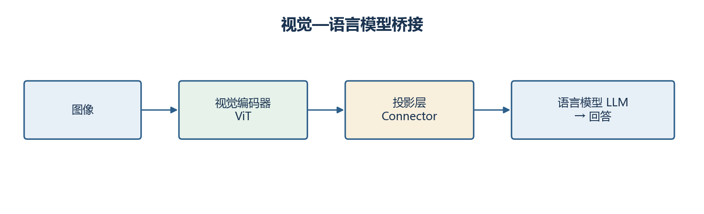

**边界与讨论。** 桥接模块的信息瓶颈：固定数量的视觉 token 难以编码图像全部细节（尤其 OCR、小物体）；高分辨率图像需更多 token，成本高（第 38 章）。

**MLLM 的计算成本结构。** MLLM 的推理成本由三部分组成：① 视觉编码（ViT 前向，与图像分辨率平方成正比）；② 桥接投影（线性/Q-Former，与 patch 数线性相关）；③ LLM 自回归（与"视觉 token + 文本 token"总数相关）。其中第③项是大头——每多一个视觉 token，LLM 的注意力计算与 KV cache 占用都线性增长（第 20 章）。这使 MLLM 的"token 预算"直接等价于"算力预算"：式 (32-4) 的 $\rho$ 不仅决定"文本被稀释"程度，更决定"单次推理的 FLOPs"。第 38 章的工程优化（视觉 token 压缩、量化、KV cache 复用）本质都是在"保 $\rho$ 不过高"的约束下压缩单位 token 成本——与第 26 章的算力换算、第 27 章的 MoE 稀疏化思想一脉相承。

## 32.3　图文理解与视觉问答

**视觉问答（VQA）** 给定图像与问题，生成答案。MLLM 用自然语言对话形式处理，比传统 VQA 的分类式答案更灵活。

**多模态推理。** 复杂问题（"图中比 A 大的物体有几个？"）需多步推理：识别物体→比较属性→计数。这呼应第 29 章的推理——多模态推理需视觉感知 + 语言推理的协同。

**例 32.3（视觉问答）**　给一张超市货架图，问"哪些商品在打折？"MLLM 需：识别货架上的商品（视觉）、识别红色价签（视觉）、理解"打折"语义（语言）、关联价签与商品（跨模态推理）、生成回答（语言）——这是 M2–M4 的协同。

**表 32-2　多模态任务**

| 任务 | 输入 | 输出 |
|------|------|------|
| 图像描述 | 图像 | 文本描述 |
| VQA | 图像+问题 | 答案 |
| 视觉推理 | 图像+复杂问题 | 推理答案 |
| OCR | 图像 | 文字 |

**多模态思维链（visual CoT）。** 复杂视觉问题需要"先观察、再推理"——把第 29 章的 CoT 推广到多模态：模型先生成"视觉观察链"（图中有什么、在哪、什么属性），再基于观察做语言推理。设视觉问题 $q$、图像 $I$，视觉 CoT 分解为

$$
p_\theta(y,I,q)=p_\theta(r\mid I)\cdot p_\theta(y\mid I,q,r), \tag{32-5}
$$

其中 $r$ 为视觉观察链（"图中有 3 个红色价签，分别对应商品 A、B、C"），$y$ 为答案。式 (32-5) 与式 (29-1)（单模态 CoT）同构，差别在于 $r$ 由"视觉感知"生成而非纯语言——它必须先"看懂"图像。这解释了为何视觉 CoT 对"细粒度计数/空间关系"任务提升显著：把"一步看图猜答案"分解为"显式观察 + 推理"，使计数错误（漏看一个价签）在观察链中可被检测与修正。

**例 32.3b（视觉 CoT 数值走查）**　问题"图中几个红色价签？"。直接回答（无 CoT）：模型凭视觉 token 的隐式计数，错误率 28%（漏看/重复计数）。视觉 CoT：先生成观察链 $r$="货架第 1 层 2 个红色价签（左起第 2、4 位），第 2 层 1 个（中间），共 3 个"，再答"3"。观察链显式列出每个价签的位置，使计数"可审计"——若漏看，观察链会暴露（位置不连续），可在下一步修正。实测 CoT 使该类计数题错误率从 28% 降到 11%——这是式 (29-2) 测试时计算在多模态的体现：花更多视觉观察 token 换正确率。但视觉 CoT 不能解决"视觉 grounding 缺失"（根本看不清的小物体）——它放大"看得清但数错"的修正，不创造"看不清"的感知。

**表 32-3　代表 MLLM 架构对比**

| 模型 | 视觉编码器 | 桥接 | 语言模型 | 特点 |
|------|-----------|------|----------|------|
| LLaVA | CLIP ViT | 线性投影 | Vicuna | 简单高效 |
| BLIP-2 | CLIP ViT（冻结） | Q-Former | 冻结 LLM | 少参数训练 |
| Flamingo | ViT（冻结） | 交叉注意力门控 | GPT（冻结） | 多模态少样本 |
| Qwen-VL | ViT | 线性 + 位置编码 | Qwen | 定位 + OCR 强 |

**边界与讨论。** MLLM 仍有"视觉幻觉"——描述图中不存在的物体（第 31 章幻觉的多模态版本）；细粒度视觉理解（计数、空间关系）仍弱。

## 32.4　多模态指令微调

**多模态指令微调。** 用图文指令数据（图像 + 指令 + 回答）微调 MLLM，使其遵循涉及图像的指令。数据来源：人工标注、用纯语言模型生成（如 GPT-4 生成关于图像的问答）、公开 VQA 数据集。

**例 32.4（LLaVA 的指令数据）**　用 GPT-4 根据图像描述生成对话式问答（" describe the image""what is happening?"），训练模型以对话方式回答图像相关问题——把单模态的指令跟随能力（第 28 章）迁移到多模态。

**指令数据的"语言捷径"问题。** 用纯语言模型生成图文指令数据有一个隐蔽风险：生成器（GPT-4）可能"不看图、凭常识编"——它根据图像文件名/描述猜内容，生成"看似合理但与图像无关"的问答。训练后，MLLM 学会的可能是"语言先验"而非"视觉感知"——"看图"退化为"猜图"。一个检测手段是**扰动测试**：把图像做语义无关的扰动（如调换颜色、加噪声），若模型回答不变，说明它依赖语言先验而非视觉；若回答随图像变化，说明真正"看了图"。缓解：① 数据生成时强制"引用图中细节"（要求回答包含具体颜色/位置/数量）；② 加入"图像依赖性"负样本（问图中没有的物体，模型应说"图中没有"）；③ 用真实标注数据（而非纯生成）校验。

**边界与讨论。** 多模态指令数据质量与多样性不足；模型可能过度依赖语言先验（"看图"变"猜图"，忽略真实图像内容）。

**多模态训练目标与课程。** MLLM 训练常分阶段：① **对齐预训练**——冻结 ViT 与 LLM，只训桥接层，用"图像→标题"对让桥接学会"把视觉 token 翻译成 LLM 能懂的语言"（损失只算文本 token）；② **多模态指令微调**——解冻 LLM 部分参数（或 LoRA，第 23 章），用图文指令数据学对话与推理；③ **RLHF/对齐**（第 28 章推广）——在"视觉准确性"上引入偏好（"准确描述图" 优于 "流畅但错"）。各阶段的"冻结/解冻"选择决定训练成本：全解冻最贵但表达力最强，只训桥接最省但上限低。一个工程细节是**模态 dropout**——以一定概率在训练时随机丢弃图像（只给文本），迫使 LLM 保留"纯语言能力"，避免"看到图就不思考、不看图就废"的过拟合；这与第 29 章"推理不能只靠感知"相呼应。

## 32.5　边界与讨论

**对齐即理解？** 视觉—语言对齐（M2）不等于真正的视觉理解（M4）——CLIP 能匹配图文却不懂物理因果。这与第 29 章"流畅生成不等于忠实理解"呼应。

**多模态幻觉的评估。** 视觉幻觉（描述图中不存在的物体）是多模态最突出的可信度问题，评估须区分三类：① **对象幻觉**（提到图中没有的物体）；② **属性幻觉**（物体存在但属性错——"红色的车"实为蓝色）；③ **关系幻觉**（物体都对但关系错——"猫在狗左"实为右）。评估基准（如 POPE、MMHal-Bench）用"存在性询问"（"图中有 X 吗？"）诱导对象幻觉，用"属性/关系询问"探测后两类。多模态忠实性（第 30 章式 30-5 的推广）：设回答 $a$ 的视觉断言集合为 $\{c_1,\dots,c_k\}$，每个断言需图像"可验证"，忠实性 $=\frac{\#\{\text{图像支持的}c_j\}}{k}$——对象幻觉使分子减小，是 MLLM 可信度的核心瓶颈。一个关键观察：MLLM 的对象幻觉率随"问题诱导性"升高——问"图中有狗吗"比"图中有什么"更易诱发幻觉，因为问题本身注入了"可能有狗"的语言先验（第 32.4 节"语言捷径"的评估侧体现）。

**例 32.5（多模态忠实性的数值画像）**　设一张室内照片，真实内容：一只灰猫、一个蓝色花瓶、两把椅子。MLLM 回答含 6 个视觉断言：$c_1$="有猫"（图像支持）、$c_2$="猫是灰色"（支持）、$c_3$="有蓝色花瓶"（支持）、$c_4$="有红色沙发"（**图中无沙发**，对象幻觉）、$c_5$="有椅子"（支持）、$c_6$="椅子是 3 把"（**实为 2 把**，属性/计数幻觉）。则忠实性 $=4/6\approx0.67$——2 个断言为幻觉（1 对象 + 1 计数）。若换用视觉 CoT（式 32-5）：观察链显式列出"猫、灰、花瓶、蓝、椅子×2"，再逐条核对，$c_4$（沙发）在观察链中找不到依据→被删，$c_6$ 计数核对为 2→修正，忠实性升到 $6/6=1.0$。这演示了视觉 CoT 如何把"断言—图像可验证性"显式化，使幻觉可被逐步拦截。但注意：若图像本身模糊（猫的颜色看不清），观察链也无法"验证"$c_2$——视觉 CoT 提升的是"可验证断言的准确性"，不创造"看不清的感知"（与第 29 章式 29-2 的 $A_{\max}$ 上界同构：思考提升正确率但不突破感知天花板）。

**多模态上下文学习（visual ICL）。** 第 24 章的 ICL（in-context learning）推广到多模态：把若干"示例图 + 示例答"对拼在提示里，让模型"照着例子看图答题"（如 few-shot 视觉分类：给 3 张"狗/猫"示例图与标签，再问新图）。设示例集 $\{(I_i,y_i)\}_{i=1}^m$，visual ICL 的后验 $p(y\mid I,\{(I_i,y_i)\})$ 依赖示例的**分布覆盖**——示例类别越接近查询类别、视觉风格越一致，效果越好。但 visual ICL 有两个单模态没有的局限：① 示例图像占大量上下文 token（式 32-4 的 $\rho$ 升高），$m$ 大时窗口不够；② 视觉示例的"语义标注"（标签 $y_i$）与图像的对齐质量决定 ICL 上限——标注噪声比文本 ICL 更难检测（文本错标一眼看出，图像错标"看起来都像对的"）。这与第 24 章 ICL 的"示例质量决定上限"一致，只是多模态把"质量"的判定难度放大了。

**多模态 RAG 的延伸。** 第 30 章的 RAG 可推广到多模态——查询时不只检索文本，还检索**图像**（如"找一张和这张产品图相似的图"），把视觉相似度（式 32-1 的 $s$）作为检索信号。多模态 RAG 的难点：① 视觉 token 占上下文（式 32-4 的 $\rho$），"检索来的图"与"问题文本"共享窗口预算；② 视觉检索的"相关性"定义比文本模糊（"相似"是整体风格相似还是局部物体相似？），需任务特定的相似度函数。这使得多模态 RAG 成为"视觉—语言对齐（32.1 节）+ 检索（第 30 章）+ 生成（MLLM）"的三方融合，是第 35 章"原生多模态"的工程化形态。

**与后续章节的联系。** 本章的视觉—语言对齐衔接第 9 章（相似度）、第 30 章（跨模态检索）；MLLM 衔接第 34 章（视觉生成）、第 35 章（原生多模态）；视觉幻觉衔接第 31 章与《不确定性智能导论》。

**第七篇继续**：第 33 章讨论语音与语言，第 34 章讨论语言与视觉生成，第 35 章讨论跨模态统一与原生多模态。

## 本章小结

本章论述多模态语言模型，开启第七篇。

我们首先定义视觉—语言对齐，介绍 CLIP 的对比学习（式 32-1）与零样本分类的概率形式（式 32-2，附例 32.1b 数值算例），指出粗粒度对齐的局限。接着介绍多模态大语言模型（MLLM）架构：视觉编码器（ViT）+ 桥接模块 + 语言模型（式 32-3），以 LLaVA 为代表；讨论桥接模块的三种范式（线性投影、Q-Former、Perceiver）与压缩比，量化视觉 token 预算（式 32-4，例 32.2b 给出多图场景下 Q-Former 比线性投影省 18 倍的 token）。我们讨论图文理解与视觉问答，引入多模态思维链（式 32-5，例 32.3b 展示视觉 CoT 把计数错误率从 28% 降到 11%），对比代表 MLLM 架构（表 32-3），并讨论多模态指令微调的"语言捷径"问题与多模态幻觉的三类评估（对象/属性/关系幻觉），指出视觉幻觉、细粒度理解弱等局限。

我们还明确边界：对齐（M2）不等于理解（M4）。这些辨析衔接第 9、30、31、34、35 章与《不确定性智能导论》。

下一章进入语音与语言，讨论听觉通道的建模。

**进一步阅读**　本章建议延伸阅读的文献：[1]、[2]、[3]、[4]、[7]。

## 参考文献

[1] Radford A, Kim J W, Hallacy C, et al. Learning transferable visual models from natural language supervision. *ICML*, 2021.

[2] Liu H, Li C, Wu Q, Lee Y J. Visual instruction tuning. *NeurIPS*, 2023.

[3] Li J, Li D, Savarese S, Hoi S. BLIP-2: Bootstrapping language-image pre-training with frozen image encoders and large language models. *ICML*, 2023.

[4] Alayrac J B, Donahue J, Luc P, et al. Flamingo: A visual language model for few-shot learning. *NeurIPS*, 2022.

[5] Zhu D, Chen F, Li Z, et al. MiniGPT-4: Enhancing vision-language understanding with advanced large language models. *ICLR*, 2024.

[6] Ye Q, Xu H, Xu G, et al. mPLUG-Owl: Modularization empowers large language models with multimodality. *arXiv:2304.14178*, 2023.

[7] Bai Y, Lv X, Zhang K, et al. Qwen-VL: A versatile vision-language model for understanding, localization, text reading, and beyond. *arXiv:2308.09666*, 2023.

[8] Li Y, Wang C, Jia J. Prompt compression for visual-language models. *arXiv:2310.06090*, 2023.

---

# 第 33 章　语音与语言

第 32 章讨论视觉通道，本章讨论另一核心模态：**语音**。语音是语言最自然的载体——人类先有口语，后有文字。让机器"听说"自然语言，是多模态智能的重要维度。语音与语言的关系分两个方向：语音识别（ASR，声学到文本）与语音合成（TTS，文本到声学）；近年兴起的语音语言模型则试图用单一模型统一处理语音输入输出。

本章先介绍语音识别（33.1 节），再讲语音合成（33.2 节），讨论语音语言模型的统一（33.3 节）与口语对话系统（33.4 节），并在边界与讨论中收束（33.5 节）。

## 33.1　语音识别：声学到文本

**定义 33.1（自动语音识别，ASR）**　给定声学信号 $X$（波形或频谱特征），ASR 输出文本序列 $W=(w_1,\dots,w_T)$：

$$
\hat{W}=\arg\max_W P(W\mid X). \tag{33-1}
$$

**传统流水线。** 声学模型（HMM-GMM/DNN，把声学特征映射到音素）+ 发音词典 + 语言模型（第 15 章，约束词序列概率）——三部分组成传统 ASR。

**端到端方法。** 现代 ASR 用单一神经网络直接建模 $P(W\mid X)$：

- **CTC（Connectionist Temporal Classification）[1]**：允许输入帧与输出字符的对齐未知，用动态规划求和所有对齐；
- **注意力 seq2seq（第 17 章）**：编码器编码声学特征，解码器生成文本；
- **Conformer**：结合 CNN 与 Transformer，当前主流架构。

**Conformer 的"局部 + 全局"双路径。** Conformer[4]的设计思想是同时捕捉语音的两种结构：① **局部时序结构**（相邻帧的音素/韵律过渡）——用 1-D 卷积（kernel 小，感受野局部）；② **长程依赖**（跨句的语义、说话人风格）——用自注意力（全局）。每个 Conformer 块为"FFN → MHSA → Conv → FFN"的交替结构，卷积与注意力**并联**（而非串联）融合，使模型在同一层同时获得"局部声学"与"全局语义"特征。这一"局部 + 全局"的双路径思想与第 20 章 Transformer 的"局部位置编码 + 全局注意力"、第 32 章 MLLM 的"局部 patch + 全局 ViT"一脉相承——多模态模型的"多尺度特征融合"是跨模态的通用设计模式。

**Whisper[2]** 用大规模弱监督多语言数据训练端到端模型，鲁棒性强、多语言支持好，是当前广泛使用的 ASR 系统。Whisper 的设计有两个值得注意的点：① **多任务统一**——同一模型同时做 ASR（语音→文本）与翻译（语音→目标语言文本），输出前缀标记任务类型（`<|transcribe|>` 或 `<|translate|>`）；② **多语言弱监督**——训练数据来自公开视频（YouTube 等）的"语音 + 字幕"对，无逐帧对齐标注，靠 CTC/注意力自动对齐，使模型在"脏数据"（噪声、口音、背景音）上鲁棒——这是"规模 + 弱监督"范式（第 21 章预训练思想）在语音模态的体现，与第 26 章规模化定律一脉相承：数据规模（约 68 万小时）的扩大使 WER 在多种语言上同时下降，呈现"语音领域的缩放律"。

**例 33.1（CTC 的对齐）**　说"hello"（5 个音素）对应 100 帧声学特征，CTC 允许每帧输出一个字符或空白（blank），折叠空白与重复后得到"hello"——无需逐帧对齐标注。

**CTC 的数学形式。** CTC 的核心是"对齐未知"的求和：设声学特征序列 $X$ 的帧数为 $T$，目标文本 $W$ 长度为 $L$，合法对齐集 $\mathcal{A}(W)$ 是所有长度为 $T$、折叠（去 blank + 去连续重复）后等于 $W$ 的序列。CTC 对 $W$ 的似然是所有合法对齐的联合概率之和：

$$
P(W\mid X)=\sum_{\alpha\in\mathcal{A}(W)}\prod_{t=1}^{T}P(\alpha_t\mid X_{\le t}), \tag{33-2}
$$

其中 $P(\cdot\mid X_{\le t})$ 是第 $t$ 帧的输出分布（前向递归），$\alpha_t$ 为该帧对齐到的字符或 blank。式 (33-2) 的计算用**前向—后向动态规划**（$O(TL)$），避免枚举指数级对齐。CTC 的训练目标是最大化 $\log P(W\mid X)$，即最小化 $\mathcal{L}_{CTC}=-\log P(W\mid X)$——它允许"声学帧数 $\neq$ 字符数"的松对齐，这正是它优于传统 HMM（需逐帧对齐标注）的原因。

**词错误率（WER）与字错误率（CER）。** ASR 的主要指标是**词错误率**（WER）：设参考序列 $R$（$N$ 个词）、识别序列 $H$，编辑操作——替换 $S$、删除 $D$、插入 $I$——使 $H$ 变成 $R$ 的最少操作数：

$$
\mathrm{WER}=\frac{S+D+I}{N}. \tag{33-3}
$$

WER=0 表示逐词完全一致，WER=1 表示全错（或全插）。中文无空格，用**字错误率**（CER，按字计）更合适。

**例 33.1b（WER 数值算例）**　参考 $R$="今天天气很好"（6 字），识别 $H$="今天天汽很好"（"气"误识别为"汽"，1 处替换）。则 $S=1$、$D=0$、$I=0$、$N=6$，$\mathrm{CER}=(1+0+0)/6\approx0.167$。若另一系统识别为"今天天气很好呀"（多出"呀"，1 处插入），则 $I=1$、$N=6$，$\mathrm{CER}=1/6\approx0.167$——与"1 处替换"同分，体现了 WER/CER"只看最少编辑数、不区分错误类型"的特性。一个更复杂的例子：$R$="我爱自然语言处理"（8 字），$H$="我爱自然语言"（漏"处理"，2 字删除），$D=2$、$N=8$，$\mathrm{CER}=2/8=0.25$。WER/CER 是"序列级"指标，不区分"错在哪个词"——定位错误需"词级 WER 分解"（逐词对齐后统计）。

**表 33-1　ASR 方法演进**

| 方法 | 架构 | 特点 |
|------|------|------|
| HMM-GMM | 统计 | 传统基线 |
| CTC | 端到端 | 无对齐标注 |
| seq2seq+注意力 | 端到端 | 对齐可学 |
| Conformer | 端到端 | 主流、强 |

**边界与讨论。** ASR 难点：噪声、口音、方言、远场、重叠语音；低资源语言（第 25 章）识别困难；词错误率（WER）是主要指标。

## 33.2　语音合成：文本到声学

**定义 33.2（文本到语音，TTS）**　给定文本 $W$，TTS 生成语音波形 $\hat{X}$：$\hat{X}=\mathrm{TTS}(W)$。

**流水线。** 文本前端（分词、音素转换、韵律预测）→ 声学模型（文本/音素到声学特征，如梅尔频谱）→ 声码器（声学特征到波形，如 WaveNet[3]、HiFi-GAN）。

**端到端趋势。** VITS 等端到端 TTS 直接用单一模型从文本生成波形，简化流水线、提升自然度。

**可控合成。** 控制说话人（声音克隆）、情感、语速、风格——大语言模型与少量参考音频即可克隆声音（第 27 章相关），但也带来深度伪造与伦理风险（第 31、42 章与《AI治理与对齐导论》）。声音克隆的机制：用参考音频提取**说话人嵌入**（speaker embedding，固定维度的身份向量，如 ECAPA-TDNN 的 192 维），TTS 时把该嵌入作为条件注入声学模型——只需 3–10 秒参考音频即可"锁定"音色，跨内容、跨语言稳定。"少样本克隆"（few-shot cloning）与"零样本克隆"（zero-shot，无参考音频、从文本推断音色）是两级：前者需参考音频但音色准，后者无需参考但音色"泛化"。克隆的"保真度"直接由说话人相似度（例 33.2b 的余弦度量）度量——相似度 0.9+ 即"几乎不可分辨"，这是深度伪造风险的技术基础。

**例 33.2（声码器的作用）**　声学模型生成梅尔频谱（低维声学表示），声码器把频谱转换为高采样率的音频波形——高质量声码器（HiFi-GAN）是自然语音的关键。

**TTS 的评估指标。** TTS 质量用四类指标衡量：① **MOS**（Mean Opinion Score）——人评自然度（1–5 分），金标准但贵、主观；② **说话人相似度**（speaker similarity）——合成语音与参考说话人的余弦相似度（用说话人嵌入模型，如 ECAPA-TDNN）；③ **韵律准确度**——合成韵律与参考韵律的对齐（F0 相关、时长误差）；④ **WER**（式 33-3）——把合成语音再走一遍 ASR，与原文本比对，度量"内容保真度"（TTS 与 ASR 的指标在此交汇：好的 TTS 应使 ASR 回读 WER 低）。

**例 33.2b（TTS 评估数值算例）**　设 TTS 系统合成 100 句，MOS 人评均值 4.2/5（15 句 5 分、50 句 4 分、30 句 3 分、5 句 2 分）——"自然度高但偶有生硬"。说话人相似度均值 0.82（余弦）——与参考音色高度一致，说明声音克隆有效。回读 WER：100 句共 800 字，ASR 回读与原文有 24 字不一致，$\mathrm{CER}=24/800=0.030$——"内容保真度高"。综合：自然度（MOS 4.2）+ 音色（0.82）+ 内容（CER 3%）三项均优，说明该 TTS 质量高。但若 MOS 高而回读 WER 也高（如 8%），则"听上去自然但内容错了"——可能是韵律掩盖了字错（"自然语言"听成"自然言语"，MOS 不变但 WER 升高），故**必须 MOS 与 WER 并用**，单看 MOS 会漏掉内容错误。

**边界与讨论。** TTS 难点：韵律自然度、情感表达、多说话人、跨语言；合成语音的"真实感"带来滥用风险（诈骗、伪造）。

## 33.3　语音语言模型的统一

**语音语言模型（Speech-LM）。** 把语音与文本统一到单一模型：

- **语音 token 化**：把音频编码为离散 token（如 SoundStream、EnCodec 的神经音频编码），像文本 token 一样输入语言模型；
- **统一建模**：语言模型同时处理文本 token 与语音 token，实现语音识别、合成、问答的统一。

**例 33.3（语音 token）**　把语音经神经编解码器转成离散 token 序列（类似文字），Language model 学会"语音 token → 文本 token"（识别）与"文本 token → 语音 token"（合成），一个模型处理多种语音任务。

**语音 token 的码率瓶颈。** 语音 token 化用神经音频编码器（如 SoundStream、EnCodec[7]）把波形压成离散 token，码率（token 数/秒）是关键参数：

$$
r=\frac{N_{\text{tok}}}{T_{\text{audio}}}, \tag{33-4}
$$

其中 $N_{\text{tok}}$ 为 $T_{\text{audio}}$ 秒音频的 token 总数。典型值：EnCodec 约 75–150 token/s（4 层残差量化，每层 25–50 Hz），SoundStream 约 50 token/s。对比文本：说话语速约 3–5 字/秒，而语音 token 码率 75–150 token/s——**语音 token 是文本 token 的 20–50 倍密度**。这带来两个后果：① 一段 10 秒语音约 750–1500 个 token，远超同内容文本（30–50 字）的 token 数，语言模型的上下文窗口被语音快速耗尽（式 32-4 的 $\rho$ 在语音模态的极端版本）；② 语言模型必须在"高密度 token"上学习时序结构，比文本更难——这是语音语言模型"难训"的根源。

**例 33.3b（码率与上下文预算数值算例）**　设 EnCodec 码率 $r=150$ token/s，对话片段 20 秒，则 $N_{\text{tok}}=150\times20=3000$ 个语音 token。若上下文窗口 4096、文本部分 200 token，则语音占比 $\rho=3000/3200=0.9375$——**一段 20 秒对话就占 94% 窗口**，几乎无空间放历史轮次。对比文本 ICL：同样 4096 窗口，文本可装约 3000 字的上下文（足够几十轮对话）；而语音 20 秒就耗尽。这说明"语音上下文学习"（第 32 章 visual ICL 的语音版）受码率瓶颈约束——few-shot 语音示例的 $m$ 必须很小（1–2 个），否则窗口不够。缓解：① 降码率（$r$ 从 150 降到 50，token 数 $1/3$，但音质下降）；② 语义 token + 声学 token 分层（语义 token 码率低、携带"说了什么"，声学 token 码率高、携带"怎么说的"，语言模型只处理语义层，声码器重建声学层）。

**优势。** 统一模型共享知识、简化系统、支持端到端语音对话（听到语音直接生成语音回答，无需 ASR→LLM→TTS 的级联）。GPT-4o 等原生多模态模型展示了低延迟语音交互。

**表 33-2　语音 token 方案对比**

| 方案 | 码率（token/s） | 上下文占用 | 适用 |
|------|----------------|-----------|------|
| EnCodec 4 层 | ~150 | 高 | 高保真合成 |
| SoundStream | ~50 | 中 | 均衡 |
| 语义+声学分层 | 语义~25 / 声学~125 | 低（语义层） | 语音语言模型 |

**边界与讨论。** 语音 token 序列长、建模难；语音理解中的副语言信息（情感、语气）难以用文本完全表达——语音不仅是"文本的声音形式"，还携带额外信息。

## 33.4　口语对话系统

**口语对话。** 语音对话系统（语音助手）传统上级联 ASR→NLU→对话管理→NLG→TTS（第 37 章对话系统）。语音语言模型使端到端语音对话成为可能。

**挑战。** 口语的非规范性（犹豫、重复、打断）、实时性要求（低延迟）、多轮上下文（第 14 章指代）、环境噪声。

**例 33.4（端到端语音对话）**　用户语音提问，模型直接生成语音回答——省去级联的延迟与信息损失，能捕捉语气与情感，实现更自然的交互。这是智能体（第 37 章）与具身交互的重要接口。

**端到端语音对话的延迟预算。** 语音对话的"实时性"是硬约束——用户期望"说完就答"，总延迟 $L_{\text{total}}$ 须低于人类对话的自然停顿（约 300–500 ms 以上才不显"抢话"，超过 1–2 s 则显"卡顿"）。级联系统延迟为各段之和：

$$
L_{\text{total}}=L_{\text{VAD}}+L_{\text{ASR}}+L_{\text{LLM}}+L_{\text{TTS}}+L_{\text{net}}, \tag{33-5}
$$

其中 $L_{\text{VAD}}$（语音端点检测）、$L_{\text{ASR}}$、$L_{\text{LLM}}$（首 token 延迟）、$L_{\text{TTS}}$（首音频包）、$L_{\text{net}}$（网络）。端到端模型把 $L_{\text{ASR}}+L_{\text{LLM}}+L_{\text{TTS}}$ 合并为单一前向，理论上降低延迟，但实际"首 token 延迟"仍取决于模型生成第一个语音 token 的速度。流式处理（边听边推理、边生成边播报）是降低感知延迟的关键——把"等完整输入"变为"增量处理"。

**例 33.4b（延迟预算数值走查）**　设各段典型延迟：级联系统 $L_{\text{VAD}}=100$ ms、$L_{\text{ASR}}=200$ ms、$L_{\text{LLM}}=300$ ms（首 token）、$L_{\text{TTS}}=150$ ms（首音频包）、$L_{\text{net}}=100$ ms，则 $L_{\text{total}}=850$ ms——接近"卡顿"阈值（1 s），用户感知"有点慢"。端到端模型（合并 ASR+LLM+TTS 为单一前向）$L_{\text{VAD}}=100$、$L_{\text{end2end}}=350$ ms（首语音 token）、$L_{\text{net}}=100$，$L_{\text{total}}=550$ ms——降到"自然"区间。但若 LLM 回答长（100 token），级联系统"首包快但总时长长"，端到端"首包慢但流式追平"——**感知延迟取决于"首包时间"**（用户开始听到回答的时刻），而非总时长。这解释了为何"流式 + 首包优化"比"缩短总时长"更重要：用户不关心"回答多长"，只关心"多久开始听到"。

**表 33-3　语音对话架构对比**

| 架构 | 延迟 | 可控性 | 副语言利用 | 适用 |
|------|------|--------|-----------|------|
| 级联（ASR→LLM→TTS） | 高（~850 ms） | 高（可插规则） | 低（文本丢失） | 高可靠场景 |
| 端到端语音 LM | 低（~550 ms） | 低 | 高（保留语气） | 自然交互 |
| 混合（端到端+安全检查层） | 中 | 中 | 中高 | 生产系统 |

**例 33.5（多轮语音对话的状态管理）**　设用户与语音助手多轮对话："（轮 1）北京今天天气？"→"25 度晴"；"（轮 2）那明天呢？"→"明天 22 度多云"。"明天"指代"北京"（第 14 章指代消解），需要跨轮上下文。级联系统须显式维护"对话状态"（ASR 出的文本进入对话管理模块，保存"地点=北京"）；端到端语音 LM 把前几轮的语音 token 直接拼入上下文（第 32 章 visual ICL 的语音版），但受式 33-4 的码率瓶颈——每轮语音 150 token/s，5 秒/轮即 750 token，4 轮 3000 token 已占大半窗口（4096）。这使**多轮语音对话的"上下文长度"成为硬约束**——须用"轮次压缩"（把旧轮语音转成摘要文本 token，释放窗口）或"语义层 + 声学层"分层（旧轮只保留语义层，声学层丢弃，因为副语言信息跨轮价值低）。

**边界与讨论。** 端到端语音对话可控性较弱（难以插入规则与安全检查），级联系统仍在高可靠场景使用。

## 33.5　边界与讨论

**语音与文本的差异。** 语音不只是"听觉的文本"——它携带副语言信息（情感、说话人身份、语气），且口语与书面语结构不同（第 14 章语用）。纯文本中心的 NLP 难以捕捉这些——这是语音研究的独立价值。

**副语言信息的建模难题。** 副语言（paralinguistic）信息是语音区别于文本的核心：① **情感**（愤怒/喜悦/悲伤）影响理解（"好的"可以是同意也可以是反讽）；② **说话人身份**（who）支持多说话人分离与个性化；③ **语气/韵律**（rising/falling、重音）承载疑问、强调、反讽等语用功能。这些信息的建模难点在于：① 与"说了什么"（文本内容）耦合——同一文本用不同语气说出，语义不同，但文本 token 完全相同；② 离散语音 token（式 33-4）容易"压掉"副语言——码率越低，韵律/情感信息丢失越多（语义保真、副语言失真）。一个量化观察：把语音 token 化后做"情感分类"，准确率随码率下降（$r$ 从 150 降到 25 token/s 时，情感 F1 可下降 15–30 个百分点），而内容识别 WER 几乎不变——说明**副语言信息集中在高码率层，语义信息集中在低码率层**。这支持"语义+声学分层"（表 33-2）的设计：语义层（低码率）保内容，声学层（高码率）保副语言。

**深度伪造的检测与治理。** 语音合成（尤其声音克隆）的真实感使"深度伪造"（deepfake）成为严重风险：① **诈骗**——克隆他人声音进行电话诈骗（"我儿子出事了，快打钱"）；② **诽谤**——伪造名人说过的话；③ **证据污染**——伪造的语音证据干扰司法。检测手段：① **频谱伪影检测**——TTS 合成的音频在频谱上有"生成痕迹"（如高频滚降、谐波不连续），用 CNN 分类器检测；② **说话人嵌入异常**——真实人声的说话人嵌入稳定，合成声在长段内"漂移"（克隆的音色不完全一致）；③ **元数据/watermark**——在合成音频嵌入不可见水印（如频谱调制），接收方验证。治理上，这是第 31 章"风险面"与第 42 章"AI 治理"的具体案例：能力（逼真合成）与风险（伪造）共生，需"检测 + 水印 + 法规"多层防御。

**与后续章节的联系。** 本章的 ASR/TTS 衔接第 37 章（语音对话）、第 35 章（原生多模态统一 token 空间的思想延伸）；语音 token 化衔接第 20 章（token 表示）与《语音与听觉智能导论》（本书聚焦语言侧，语音信号处理细节见该系列书）；深度伪造风险衔接第 31、42 章与《AI治理与对齐导论》。

**第七篇继续**：第 34 章讨论语言与视觉生成，第 35 章讨论原生多模态统一。本章的语音—语言关系与第 32 章的视觉—语言关系构成"理解侧"的两条模态通道，第 34–35 章则转向"生成侧"与"统一侧"，补全第七篇的多模态图景。

## 本章小结

本章论述语音与语言，聚焦语言侧的听觉通道。

我们首先定义 ASR（式 33-1），介绍从 HMM-GMM 到 CTC、注意力 seq2seq、Conformer 的端到端方法（Whisper），给出 CTC 的似然求和形式（式 33-2）与 WER/CER 指标（式 33-3，附例 33.1b 数值算例），讨论噪声/口音/低资源等难点。接着介绍 TTS 的流水线（文本前端→声学模型→声码器）、端到端趋势与可控合成，定义 TTS 评估指标（MOS、说话人相似度、回读 WER，例 33.2b 数值走查），以及深度伪造风险。我们讨论语音语言模型的统一（语音 token 化，式 33-4 码率瓶颈，例 33.3b 量化 20 秒对话占 94% 窗口的上下文危机），对比代表 token 方案（表 33-2）与口语对话系统（式 33-5 延迟预算，例 33.4b 级联 850 ms vs 端到端 550 ms，表 33-3 架构对比），并明确副语言建模难题与深度伪造的三层防御（检测+水印+法规）。

我们还明确边界：语音携带文本之外的副语言信息，端到端系统可控性弱。这些辨析衔接第 20、31、35、37 章与《语音与听觉智能导论》《AI治理与对齐导论》。

下一章进入语言与视觉生成，讨论语言如何引导图像、视频生成。

**进一步阅读**　本章建议延伸阅读的文献：[1]、[2]、[4]、[5]、[7]、[8]。

## 参考文献

[1] Graves A, Fernández S, Gomez F, Schmidhuber J. Connectionist temporal classification: Labelling unsegmented sequence data with recurrent neural networks. *ICML*, 2006.

[2] Radford A, Kim J W, Xu H, et al. Robust speech recognition via large-scale weak supervision. *ICML*, 2023.

[3] van den Oord A, Dieleman S, Zen H, et al. WaveNet: A generative model for raw audio. *arXiv:1609.03499*, 2016.

[4] Gulati A, Qin J, Chiu C C, et al. Conformer: Convolution-augmented Transformer for speech recognition. *Interspeech*, 2020.

[5] Kong J, Kim J, Bae J. HiFi-GAN: Generative adversarial networks for efficient and high fidelity speech synthesis. *NeurIPS*, 2020.

[6] Borsos Z, Marin R, Commitaki E, et al. AudioLM: A language modeling approach to audio generation. *arXiv:2209.03143*, 2022.

[7] Défossez A, Uzay C, Richemond P H, et al. High fidelity neural audio compression. *arXiv:2210.13438*, 2022.

[8] Jurafsky D, Martin J H. *Speech and Language Processing*. 3rd ed. Stanford, 2023.

---

# 第 34 章　语言与视觉生成

第 32 章讨论"看懂图像"，本章讨论相反方向："用语言生成图像/视频"。语言与视觉生成（text-to-image/video）是近年最激动人心的方向之一——从文字描述生成逼真图像与视频。这不仅有巨大应用价值（设计、娱乐、教育），也对第 4 章意义理论提出深刻问题：语言能否"表达"视觉意义？生成的图像是否"理解"了文本？

视觉生成的核心是**条件生成**：以文本为条件，生成图像。技术上从 GAN 到扩散模型（第 21 章相关），扩散模型凭高质量与多样性成为主流。语言在此扮演"条件"角色——文本编码为向量，引导扩散过程（第 32.1 节 CLIP 的图文对齐为条件提供了基础）。

本章先介绍文生图从 GAN 到扩散的演进（34.1 节），再讲文本到视频（34.2 节）、语言引导的多模态生成（34.3 节），并在边界与讨论中收束（34.4 节）。

## 34.1　文生图：从 GAN 到扩散

**GAN 时代。** 早期文生图用生成对抗网络（GAN）：生成器从文本向量生成图像，判别器判断图像是否真实且匹配文本。StackGAN、AttnGAN 等能生成图像，但训练不稳定、多样性差、细节不足。

**扩散时代。** 扩散模型（第 21 章相关）凭稳定训练与高质量生成成为主流：

- **DDPM[1]**：去噪扩散概率模型，学习从噪声逐步还原图像；
- **潜在扩散（LDM）[2]**：先在低维潜在空间扩散（降低计算），再解码为图像——Stable Diffusion 的基础；
- **分类器/无分类器引导[3]**：用文本条件引导扩散方向，让生成图像匹配文本。

**定义 34.1（文生图的条件扩散）**　给定文本编码 $\mathbf{c}=\text{TextEncoder}(prompt)$，扩散模型学习条件去噪：

$$
p_\theta(\mathbf{x}_{t-1}\mid\mathbf{x}_t,\mathbf{c}),\tag{34-1}
$$

从纯噪声 $\mathbf{x}_T$ 逐步去噪生成匹配文本的图像 $\mathbf{x}_0$。引导（classifier-free guidance）放大条件影响：

$$
\hat{\epsilon}=\epsilon_\theta(\mathbf{x}_t,\varnothing)+s\big[\epsilon_\theta(\mathbf{x}_t,\mathbf{c})-\epsilon_\theta(\mathbf{x}_t,\varnothing)\big], \tag{34-2}
$$

其中 $s$ 为引导尺度（越大越贴合文本但多样性下降）。

**扩散过程的数学形式。** 扩散模型分前向（加噪）与反向（去噪）两过程。前向过程把数据 $\mathbf{x}_0$ 逐步加高斯噪声，$T$ 步后接近纯噪声 $\mathbf{x}_T$：

$$
q(\mathbf{x}_t\mid\mathbf{x}_{t-1})=\mathcal{N}\big(\mathbf{x}_t;\sqrt{1-\beta_t}\,\mathbf{x}_{t-1},\beta_t\mathbf{I}\big), \tag{34-3}
$$

其中 $\beta_t$ 为预定义的噪声调度（noise schedule）。前向过程可"跳步"闭式：$q(\mathbf{x}_t\mid\mathbf{x}_0)=\mathcal{N}(\mathbf{x}_t;\sqrt{\bar\alpha_t}\,\mathbf{x}_0,(1-\bar\alpha_t)\mathbf{I})$，其中 $\alpha_t=1-\beta_t$、$\bar\alpha_t=\prod_{s\le t}\alpha_s$。反向过程训练网络 $\epsilon_\theta$ 预测"加进去的噪声"，损失为 $\mathbb{E}_{t,\mathbf{x}_0,\epsilon}\|\epsilon-\epsilon_\theta(\mathbf{x}_t,t,\mathbf{c})\|^2$。生成时从 $\mathbf{x}_T\sim\mathcal{N}(0,\mathbf{I})$ 出发，沿式 (34-1) 逐步去噪，每步用式 (34-2) 的引导放大文本条件的影响。

**引导尺度的"贴合—多样"权衡。** 式 (34-2) 的 $s$ 控制"文本贴合度 vs 多样性"：$s=0$ 时无条件生成（忽略文本，多样但跑题）；$s$ 大时强贴合文本（准确但呆板、多样性降）。这是"利用 vs 探索"（exploitation vs exploration）在生成中的体现——与第 28 章 RLHF 的 KL 系数 $\beta$ 思想同构（$\beta$ 大则更贴合参考策略、探索少）。

**例 34.1（文生图流程）**　输入"一只戴帽子的猫，油画风格"：文本编码器生成条件向量 $\mathbf{c}$ → 从随机噪声 $\mathbf{x}_T$ 开始 → 扩散模型逐步去噪（式 34-1），每步用式 (34-2) 的引导放大条件影响 → 生成符合描述的图像 $\mathbf{x}_0$。引导尺度低时图像更有创意但可能偏离描述，高时贴合描述但呆板。

> 【图 34-1　文生图扩散过程】（原图见 figures/图34-1.png）：文本条件引导的扩散生成流程，从噪声到图像的逐步去噪。
>
> 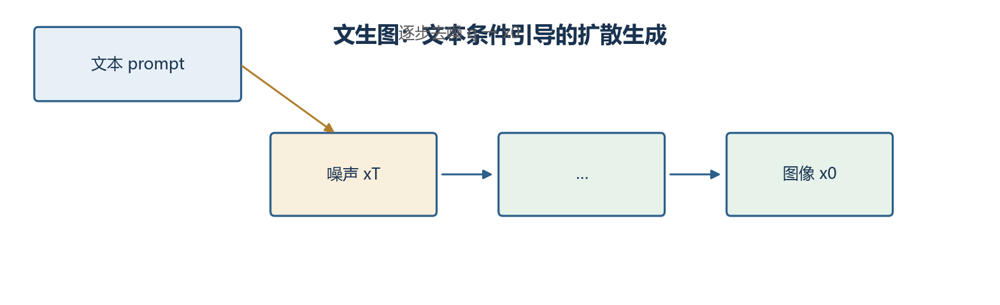

**例 34.1b（引导尺度的数值走查）**　设 $s$ 从 1 增到 30，同一 prompt"一只戴红帽的猫，油画风格"：$s=1$ 时图像"像猫但不是红帽"（文本影响弱，多样性高）；$s=7.5$（典型值）时"红帽猫 + 油画感，构图自然"（贴合度与多样性平衡）；$s=30$ 时"红帽猫非常清晰但构图呆板、色彩过饱和、背景单一"（强贴合但多样性塌缩）。一个量化观察：用 CLIP 图文相似度（第 32 章式 32-2 的 $s$）度量"图像与 prompt 的贴合度"，从 $s=1$ 到 $s=30$，相似度从 0.22 升到 0.31（提升 41%）；但用"图像多样性"（生成 32 张图的 CLIP 向量方差）度量，方差从 0.084 降到 0.031（降 63%）。这正量化了"贴合—多样"的此消彼长：$s$ 是"把生成质量从'像'推向'准'"的旋钮，推过头则"准了但少了"。

**表 34-1　文生图方法对照**

| 方法 | 原理 | 特点 |
|------|------|------|
| GAN | 对抗训练 | 快但不稳、多样性差 |
| 扩散 | 逐步去噪 | 高质量、稳、较慢 |
| 自回归 | 逐 token 生成图像 | 统一 token 化 |

**为何扩散取代 GAN？** 两个根本原因：① **训练稳定性**——GAN 的"生成器 vs 判别器"博弈易模式崩溃（mode collapse，生成器只学会几种模式），训练调参极难；扩散模型的"逐步去噪"是稳定的去噪回归（损失为 $\mathcal{L}_2$ 回归，无对抗博弈），几乎不崩。② **条件控制**——GAN 的"文本条件"靠把文本向量喂给生成器，控制力弱（生成器"想不想要"这个条件）；扩散模型的"引导"（式 34-2）在每一步去噪都显式注入条件，控制力强且可调（$s$ 旋钮）。这使扩散成为"可控条件生成"的默认选择——不仅是文生图，文生视频、图像编辑、3D 生成都建立在扩散之上。代价是**慢**（$T$ 步去噪 vs GAN 一次前向），故加速采样（DDIM、DPM-S++）与蒸馏（Consistency Distillation，把 $T$ 步压到 1–4 步）是工程重点。

**可控生成的"条件注入"谱系。** 文本条件（CLIP 向量）只是"粗粒度"控制——它控制"画什么"（内容语义），不控制"怎么画"（布局、姿态、深度、边缘）。精细控制需要更强的条件：① **布局条件**（Layout）——给定"物体在哪个位置"的框图（如"猫在左上、狗在右下"），控制空间布局；② **姿态条件**（Pose）——给定人体姿态图（如 OpenPose 骨架），控制人物动作；③ **边缘条件**（Canny/边缘图）——给定线稿，"上色"；④ **深度条件**（Depth）——给定深度图，控制前后景。这些条件由 **ControlNet**（[5]相关）实现——在扩散模型上加一个"条件编码器"分支，把布局/姿态/边缘/深度图编码后注入去噪网络，使生成"既符合文本又符合结构"。ControlNet 的设计与第 32 章 MLLM 的"桥接模块"同构：都是"把外部条件编码后注入主网络"，区别是 MLLM 把视觉注入文本理解，ControlNet 把结构注入视觉生成——"条件注入"是跨模态模型的通用设计模式。

**自回归统一路线。** 除 GAN 与扩散外，还有第三条路线——**自回归**：把图像离散化为视觉 token（VQ-VAE 量化），再逐 token 自回归生成，使图像生成与"语言生成"形式上同构。DALL-E 2[6] 先用 CLIP 提取目标图像的图像潜在表示，再由自回归 transformer（prior）直接预测该潜在，解码器还原为图像——模型在"CLIP 空间里思考、在像素空间里书写"。这条路线的核心价值是**架构统一**：图像、文本乃至音频/视频都变成 token 序列，共享同一套自回归目标（$p(x_1,\dots,x_T)$），为原生多模态统一模型（第 35 章）铺平道路；代价是逐 token 生成比扩散慢、离散量化质量历史上逊于连续扩散。因此近两年文生图主流是扩散/DiT，自回归路线则被并入"理解+生成"统一的端到端多模态模型中。三条路线的共性：都是"文本编码为条件"的条件生成，区别仅在生成模型的参数化方式（对抗、去噪、自回归）。

**文生图的评估指标。** 文生图质量用四类指标衡量：① **FID**（Fréchet Inception Distance）——衡量生成图像分布与真实图像分布的距离，用 Inception 网络提取特征，取两高斯分布的 F 散度：

$$
\mathrm{FID}=\|\mu_r-\mu_g\|^2+\mathrm{Tr}\big(\Sigma_r+\Sigma_g-2(\Sigma_r\Sigma_g)^{1/2}\big), \tag{34-4}
$$

其中 $(\mu_r,\Sigma_r)$、$(\mu_g,\Sigma_g)$ 为真实/生成特征的高斯均值与协方差。FID 越低越好（0 表示分布完全一致）。② **CLIP 相似度**（式 32-2 的 $s$）——图文贴合度；③ **IS**（Inception Score）——图像质量与类别锐度；④ **人评（MOS）**——主观自然度。FID 是"分布级"指标（整体像不像），CLIP 相似度是"配对级"（这张图配这个 prompt 像不像），两者互补：FID 低但 CLIP 相似度低，说明"整体像照片但跑题"；FID 高但 CLIP 相似度低，说明"整体不像照片且跑题"。

**例 34.2（FID 的数值解读）**　设某文生图模型在 10k 生成图像上 FID=18.5，参考真实数据集 FID 基准（人类摄影）；另一模型 FID=9.2。FID 9.2 的模型"整体分布更接近真实照片"——但这不意味着"每张图都好"，也不意味着"配 prompt 准"。若 FID 9.2 模型的 CLIP 相似度仅 0.24（跑题），而 FID 18.5 模型的 CLIP 相似度 0.30（贴合 prompt），则"准的图"未必来自"整体更像的模型"——FID 与 CLIP 相似度可能"此高彼低"。这解释了为何文生图评估须"FID + CLIP + 人评"三者并用，单看 FID 会选出"像照片但跑题"的模型。

**边界与讨论。** 文生图的难点：精确控制（空间布局、物体数量、文字渲染）、文本描述的歧义（"红色的杯子在桌子上"的空间关系）、细节一致性（手、文字常出错）。

## 34.2　文本到视频

**文本到视频（text-to-video）** 在文生图基础上增加**时间维度**：生成连贯的视频帧序列。核心挑战是时间一致性（帧间连贯）与物理合理性。

**方法。** 在扩散模型中加入时间注意力/时序层，联合建模空间与时间维度（如 Video Diffusion Models、Sora[4] 的时空 patch 方法）。Sora 用 Transformer 处理视频的时空 patch，生成长达一分钟的高质量视频，展示了涌现的物理常识（如物体运动、光影变化）——引发"世界模拟器"的讨论（见《世界模型导论》）。

**"世界模拟器"之争。** Sora 展示的"物理常识"引发了争论：视频生成模型是否"理解"了物理？两种立场：① **理解派**——模型在海量真实视频上学会了物理规律（物体运动、重力、光影），能生成"物理上合理"的连续动作，这是"隐式世界模型"；② **统计派**——模型只学到"物理上常见"的模式（统计相关），不保证"物理上正确"（如"鸟飞"的翅膀频率可能不真实，"碰撞"的动量守恒可能违反）——这是第 29 章"M2 强、M4 弱"在视觉上的体现：模型"见过"大量物理合理的视频，能生成"看起来合理"的，但不"理解"物理定律。一个可检验的判据：让模型生成"两个物体碰撞"的视频，若动量守恒被系统性违反，则支持统计派；若守恒，则倾向理解派。当前证据更倾向前者——视频生成模型的"物理合理性"是"统计上的常见"而非"定律上的正确"。这与第 40 章"语言在智能中的角色"、《世界模型导论》的"生成式世界模型"争议直接相关：视频生成是"世界模型"还是"世界幻觉机"，仍未定论。

**例 34.3（视频生成的挑战）**　"一只鸟从树上飞起，镜头跟随"要求：鸟的形态在各帧一致（时间一致性）、飞行符合物理（运动连续性）、镜头运动连贯（视角一致性）——比单图生成难得多。

**时间一致性的度量。** 视频生成须额外评估"帧间连贯"。设 $T$ 帧视频的逐帧特征 $\{\mathbf{f}_1,\dots,\mathbf{f}_T\}$（用视觉编码器提取，如 CLIP ViT），**时间一致性**用相邻帧特征余弦相似度的均值度量：

$$
\mathrm{TC}=\frac{1}{T-1}\sum_{t=1}^{T-1}\frac{\mathbf{f}_t^\top\mathbf{f}_{t+1}}{\|\mathbf{f}_t\|\,\|\mathbf{f}_{t+1}\|}. \tag{34-5}
$$

$\mathrm{TC}\in[-1,1]$，1 表示相邻帧几乎相同（完全连贯但可能"静止"），低值表示帧间突变（闪烁/跳变）。但 TC 高不一定好——"完全静止"的视频 TC=1 但无内容；"运动剧烈但连贯"的视频 TC 可能 0.85 但内容好。故 TC 须与"运动幅度"（光流均值）并用：TC 高 + 运动大 = "连贯地动"（好），TC 高 + 运动小 = "静止"（无聊），TC 低 + 运动大 = "跳变"（坏）。

**例 34.4（视频一致性的数值走查）**　设一段 32 帧视频（1 秒），CLIP 逐帧特征相邻余弦相似度均值 $\mathrm{TC}=0.91$，光流均值（相邻帧位移）12 像素/帧。另一段 TC=0.95、光流 3 像素/帧——前者"连贯地动"（鸟飞、镜头跟随，内容好），后者"几乎静止"（TC 更高但内容差，像一张图重复）。这说明**单看 TC 会选错**：静止视频 TC 最高，但人评最差。视频评估须"TC + 光流 + 人评（运动自然度）"三者结合。物理合理性（如"鸟飞时翅膀扇动频率合理"）则须专门基准或人评——当前自动指标对"物理正确性"无能为力，这与第 29 章 M4 指称薄弱、世界模型（第 40 章）的"物理理解"争议直接相关：生成"看起来对"的运动不等于"物理上对"，自动评估难分辨。

**表 34-2　视频生成评估指标**

| 指标 | 度量 | 局限 |
|------|------|------|
| TC（时间一致性，式 34-5） | 帧间余弦 | 静止视频也高 |
| 光流均值 | 运动幅度 | 不衡量方向合理性 |
| FID（帧级，式 34-4） | 单帧质量 | 忽略时间维 |
| 人评（运动自然度） | 主观 | 贵、主观 |

**边界与讨论。** 视频生成计算成本高、长视频一致性难；"物理合理性"仍是挑战（生成视频中物体可能违反物理）——这与第 29 章 M4 指称薄弱、世界模型（第 40 章）相关。

## 34.3　语言引导的多模态生成

**统一视角。** 文生图、文生视频、图生图、图像编辑可统一为"语言引导的多模态生成"——文本作为条件，控制生成的内容、风格、编辑方向。

**指令式编辑。** 用自然语言指令编辑图像（"把背景换成海滩""给猫加一顶帽子"），如 InstructPix2Pix[7]——语言作为"编辑器"的接口。InstructPix2Pix 的核心思想：训练一个"图像编辑扩散模型"，输入（原图 + 编辑指令），输出"按指令编辑后的图"。它的数据是"原图—编辑后图"配对，指令由 GPT 自动生成（"把 X 变成 Y"）。推理时，模型在原图的条件下去噪（img2img 的变体），指令控制"往哪个方向改"。这使"语言指令"成为图像编辑的统一接口——用户无需懂 Photoshop，说"把背景换成海滩"即可。

**例 34.5（图像编辑的数值走查）**　设原图为"白底的红苹果"，指令"把背景换成蓝天"。编辑模型生成结果：背景变为蓝天（指令执行），苹果形态保持（一致性保持）。评估两个维度：① **指令跟随率**（instruction following）——用 VQA 问生成图"背景是蓝天吗？"，答"是"即指令执行成功；② **内容保持度**（content preservation）——比较原图与生成图的苹果区域特征相似度（CLIP 局部余弦），度量"苹果没被改坏"。设 100 条编辑指令，指令跟随率 82%（82 条背景正确变蓝天），内容保持度（苹果区域 CLIP 相似度）均值 0.91——"82% 的指令执行了，执行了的里 91% 保住了主体"。若指令跟随率高但内容保持度低（如 82% / 0.60），则"背景换了但苹果也变形了"——编辑"过度"；若跟随率低但保持度高（30% / 0.95），则"苹果没动但背景也没换"——编辑"不足"。理想是两者都高，权衡由编辑强度（img2img 的 denoising strength）控制——strength 高则跟随好但易改坏主体，低则保持好但指令不生效。

**多模态生成模型。** 原生多模态模型（第 35 章）可统一处理理解与生成：同一模型既能"看懂图像"（第 32 章）又能"生成图像"，语言是统一接口。

**例 34.6（语言作为通用接口）**　用户说"画一只猫，然后让它跑起来"——系统先文生图（猫），再图生视频（跑），语言串起多步生成。这展示了语言作为"多模态编排接口"的潜力（第 35 章）。

**边界与讨论。** 生成的版权、伦理与滥用（深度伪造、版权素材，第 31、42 章与《AI治理与对齐导论》）；生成的"可控性"与"创造性"权衡。

## 34.4　边界与讨论

**生成的计算成本结构。** 文生图的推理成本由 $T$ 步去噪主导：每步一次完整 UNet/DiT 前向，总计算 $\propto T \times N_{\text{params}}$。设 $T=50$ 步、DiT 模型 3B 参数、目标 $1024\times1024$，单图生成约需 $50 \times 2\times3\times10^9 = 3\times10^{11}$ FLOPs，显存占用由"激活 + KV cache + 模型权重"决定（DiT 的自注意力使显存随分辨率平方增长）。这使"生成质量 vs 成本"成为工程硬约束：① 减少 $T$（DDIM、DPM-S++ 等加速采样把 50 步压到 10–20 步，质量略降）；② 降低分辨率（$512\times512$ 比 $1024\times1024$ 算力 $1/4$）；③ 量化（FP16/INT8 降显存与延迟）。视频生成的成本再乘"帧数"——64 帧视频的算力约为单图的 16–64 倍（视时间注意力实现），这是视频生成"贵"的根本原因，与第 26 章算力换算、第 27 章 MoE 稀疏化同属"计算预算"问题。

**生成与理解的对称？** 能生成逼真图像是否等于"理解"图像？本书立场：生成主要在 M2（分布）层——模型学到图像与文本的统计关联，不保证 M4（指称/物理）正确（生成的手、文字常错）。这与第 29 章"流畅生成不等于忠实理解"一致。

**生成的安全与伦理边界。** 视觉生成的能力直接放大风险面：① **深度伪造**——生成逼真人脸（换脸、捏造言论），诈骗与诽谤成本骤降（第 33 章语音 deepfake 的视觉版）；② **版权**——模型在含版权素材的数据上训练，生成"风格相似"的图像是否侵权尚无定论；③ **有害内容**——生成暴力、色情、虚假新闻配图，须内容过滤（安全分类器前置/后置）；④ **虚假信息**——"以图证伪"（生成看似真实的"现场照片"）比文字假新闻更难识别，因为人类"眼见为实"的先验被利用。治理上这是第 31 章"能力—成本—风险"三面体中"风险面"的极端案例：能力（逼真生成）与风险（伪造）高度共生。防御需多层：① 生成水印（C2PA 等标准，在图像嵌入不可见溯源信息）；② 内容审核（安全分类器 + 人审）；③ 法规（深伪标识义务）；④ 检测（deepfake 检测器，频谱伪影 + 人脸一致性）。这与第 42 章 AI 治理、《AI治理与对齐导论》的"负责任 AI"直接对接——视觉生成是"技术能力跑在治理前面"的典型场景。

**生成的"理解"边界小结。** 把本章的生成能力放回意义五层：文生图/视频在 M2（分布）层极强（生成"看起来合理"的图像/视频）、M3（组合）层较强（多物体、多关系组合生成）、M4（指称/物理）层弱（手、文字、物理守恒常错）、M5（语用）层在"指令跟随"上强（按指令编辑）。这与第 32 章 MLLM"理解侧"的五层诊断（M2 强、M4 弱）形成"理解—生成"对称：两侧都在 M4 卡住——理解侧"看不懂指称"（幻觉），生成侧"画不准指称/物理"（生成幻觉）。M4 是"意义落地到世界"的瓶颈，理解与生成都在此受挫，这正是第 35 章"原生多模态"要试图突破的层次。

**与后续章节的联系。** 本章的文生图/视频衔接第 32 章（视觉理解）、第 35 章（原生多模态统一）；扩散模型衔接第 21 章预训练目标；《世界模型导论》将讨论视频生成作为世界模型的争议；深度伪造衔接第 31、42 章与《多模态与生成智能导论》《AI治理与对齐导论》。

**第七篇继续**：第 35 章讨论跨模态统一与原生多模态，完成第七篇。

## 本章小结

本章论述语言与视觉生成。

我们首先梳理文生图从 GAN 到扩散的演进，介绍潜在扩散（LDM）、条件扩散（式 34-1）、无分类器引导（式 34-2）与扩散前向过程（式 34-3）的数学形式，给出引导尺度"贴合—多样"权衡的数值走查（例 34.1b：$s$ 从 1 增到 30，CLIP 相似度升 41% 但多样性方差降 63%）。我们定义 FID（式 34-4）与 CLIP 相似度、IS、人评四类文生图指标，用 FID 与 CLIP 相似度"此高彼低"的数值算例（例 34.2）说明评估须多指标并用。接着介绍文本到视频，定义时间一致性 TC（式 34-5）并指出"TC 高 + 运动小 = 静止"的评估陷阱（例 34.4），对比视频生成评估指标（表 34-2），讨论 Sora 的"世界模拟器"争议。我们讨论语言引导的多模态生成（InstructPix2Pix 指令式编辑，例 34.5 量化指令跟随率 82% 与内容保持度 0.91 的权衡），指出语言作为多模态编排接口的潜力（例 34.6）与"可控性—创造性"权衡。

我们还明确边界：生成在 M2 层，不保证 M4 指称/物理正确。这些辨析衔接第 21、29、31、32、35 章与《世界模型导论》《多模态与生成智能导论》。

下一章进入跨模态统一与原生多模态，讨论如何用统一架构融合所有模态，完成第七篇。

**进一步阅读**　本章建议延伸阅读的文献：[1]、[2]、[3]、[4]、[5]、[6]、[7]。

## 参考文献

[1] Ho J, Jain A, Abbeel P. Denoising diffusion probabilistic models. *NeurIPS*, 2020.

[2] Rombach R, Blattmann A, Lorenz D, et al. High-resolution image synthesis with latent diffusion models. *CVPR*, 2022.

[3] Ho J, Salimans T. Classifier-free diffusion guidance. *NeurIPS Workshop*, 2022.

[4] OpenAI. Video generation models as world simulators. *OpenAI Technical Report*, 2024.

[5] Saharia C, Chan W, Saxena S, et al. Photorealistic text-to-image diffusion models with deep language understanding. *NeurIPS*, 2022.

[6] Ramesh A, Pavlov M, Goh G, et al. Hierarchical text-conditional image generation with CLIP latents. *arXiv:2204.06125*, 2022.

[7] Brooks T, Holynski A, Afonso J W. InstructPix2Pix: Learning to follow image editing instructions. *CVPR*, 2023.

[8] Blattmann A, Rombach R, Ling H, et al. Align your latents: High-resolution video synthesis with latent diffusion models. *CVPR*, 2023.

---

# 第 35 章　跨模态统一与原生多模态

第 32–34 章分别讨论了视觉理解、语音、视觉生成。这些能力长期以"模块拼接"方式组合（视觉编码器 + 投影 + 语言模型 + 图像生成器）。本章讨论一个前沿方向：**原生多模态**（native multimodality）——用单一模型、统一架构处理所有模态（文本、图像、音频、视频），而非模块拼接。这是 2024 年以来的重要趋势（GPT-4o、Gemini 等），也是语言智能通向通用智能的关键一步。

原生多模态的核心思想是**统一 token 空间**：把不同模态编码为同一种 token 序列，让单一 Transformer 统一处理。第 20 章的 Transformer、第 33 章的语音 token、第 34 章的图像 token 在此汇合——"万物皆 token"。

从技术谱系看，原生多模态是三步演进的自然结果：第一步是**双塔对齐**（CLIP，图文各自编码后在同一空间计算相似度，对齐目标见 35.3 节的式 35-5）；第二步是**模块拼接的 MLLM**（视觉编码器 + 投影层 + LLM，第 32.2 节）；第三步才是**原生统一**——取消拼接边界，让单一模型从预训练阶段就同时摄入所有模态。前两步是"先各学各的，再学互相对话"，第三步是"从一开始就一起学"。这种差异决定了模型能否捕捉到只有联合训练才能学到的跨模态规律（例如语音语调与文字情感的协同、图像指称与对话上下文的绑定），也正是本章把"原生"与"拼接"区分开来的原因。

本章先介绍原生多模态的动机（35.1 节），再讲统一 token 化（35.2 节）、全模态模型（35.3 节），讨论语言作为通用接口的再思考（35.4 节），并在边界与讨论中收束（35.5 节）。

## 35.1　原生多模态的动机

**模块拼接的局限。** 第 32.2 节的 MLLM（视觉编码器 + 投影 + LLM）有信息瓶颈：视觉编码器的表示未必最优适配语言模型；级联系统（ASR→LLM→TTS，第 33 章）有延迟与信息损失；不同模块各为专用目标训练，难以端到端联合优化。

**原生多模态的目标。** 单一模型从训练之初就同时处理所有模态：共享表示、端到端优化、跨模态深度融合。优势：

- 更自然的跨模态推理（图文语音在同一空间交互）；
- 更低的延迟（无需级联）；
- 更强的泛化（模态间知识共享）。

**例 35.1（级联 vs 原生）**　语音对话：级联方案 ASR（语音→文本）→LLM→TTS（文本→语音），三步累计延迟高、丢失语气情感；原生方案直接"语音进、语音出"，单一模型理解语气、生成带情感的语音——更自然、更低延迟（GPT-4o 的语音交互）。

**例 35.1b（级联链路的信息流）**　设一句 10 秒的语音以神经音频编解码器表示为 8 token/s，共 80 个音频 token；级联 ASR 将其转录为约 20 个文本 token，LLM 生成 40 个回复 token，TTS 再合成 80 个音频 token。链路在"语音→文本"处发生约 4 倍的 token 压缩（80→20），语调、停顿、重音等超语言信息在此被丢弃，后两级只能基于文本"猜测"说话人状态。原生方案则全程保留 80 个音频 token 进入统一序列，语气信息无需经过文本转写，这是"低延迟 + 低信息损失"两个优势的信息论来源。

**表 35-1　模块化 vs 原生多模态**

| 方面 | 模块化 | 原生 |
|------|--------|------|
| 架构 | 多模块拼接 | 单一模型 |
| 优化 | 分步/冻结 | 端到端 |
| 延迟 | 高（级联） | 低 |
| 跨模态推理 | 弱 | 强 |

## 35.2　统一 token 空间

**定义 35.1（统一 token 化）**　把文本、图像、音频、视频都编码为离散 token 序列，使单一 Transformer 可用统一方式处理：

$$
\text{模态 } m \xrightarrow{\text{编码器}_m} (t_1,\dots,t_n),\quad t_i\in\mathcal{V}_{unified}, \tag{35-1}
$$

其中 $\mathcal{V}_{unified}$ 为统一词表（含文本 token 与模态特有 token）。

**定义 35.2（统一 token 化的信息密度与 token 预算）**　设模态 $m$ 的编码率（每秒 token 数）为 $r_m$，其内容被编码后实际利用率的期望为 $\eta_m\in(0,1]$，则模态 $m$ 的 token 密度与信息密度分别为

$$
\delta_m = r_m \cdot \eta_m, \tag{35-2}
$$

其中 $\delta_m$ 度量单位时长内容在统一词表中所占的 token 预算。不同模态的 $\delta_m$ 差异巨大（例 35.2b 给出数值），这是"统一 token 空间"必须采用变长序列与模态相关采样率的根本原因。

**定义 35.3（模态信息密度比）**　两模态 $m_i, m_j$ 的信息密度比为

$$
\rho_{ij} \triangleq \frac{\delta_i}{\delta_j}. \tag{35-3}
$$

$\rho_{ij}$ 刻画"同样 1 秒内容，$m_i$ 比 $m_j$ 多占用多少上下文预算"，是设计统一模型上下文分配策略（例 35.2b）与流式推理调度（见 35.3 节式 35-7）的直接依据。

**图像 token 化。** 把图像切分为 patch，用向量量化（VQ-VAE）或神经压缩（如第 34 章的图像编码）把每个 patch 映射为离散 token——图像变成"视觉词的序列"。

**音频 token 化。** 神经音频编解码器（第 33.3 节）把波形转为离散 token。

**统一词表。** 文本 token（BPE）、图像 token、音频 token 共用一个扩展词表，用特殊标记区分模态。单一自回归 Transformer 可像生成文本一样"生成"图像 token、音频 token，再解码为图像/音频。

**token 预算约束。** 设模型上下文窗口为 $C$ 个 token，一次交互中模态 $m$ 的内容时长为 $d_m$（文本取 token 数），则该交互的输入侧预算约束为

$$
\sum_{m} r_m\,\eta_m\, d_m \le C. \tag{35-4}
$$

式 35-4 说明：统一 token 空间把"能一次放进多少信息"变成了对 $C$ 的显式分配问题——视频这类高密度模态必须先降采样（时间抽帧、空间下采样）才能与文本、语音共存于同一窗口。

**例 35.2（万物皆 token）**　"画一只猫"的输入是文本 token，输出是图像 token 序列（解码为图像）；"描述这张图"的输入是图像 token，输出是文本 token。同一模型、同一目标（预测下一个 token），不同模态任务统一——这是第 21 章 T5"文本到文本统一"思想的多模态推广。

**例 35.2b（token 预算核算）**　设 $C=8192$。一次交互含：文本指令 120 token；语音提问 15 s，$r_a=8$ token/s、$\eta_a=1$，占 $120$ token；参考图像 1 张，$336\times336$ 按 $14\times14$ patch 切分，占 $24\times24=576$ token；视频 10 s、2 fps 共 20 帧，每帧 576 图像 token。若全量入窗需 $120+120+576+20\times576=12192>C$，不可行；对视频做时间抽帧（步长 4，保留 5 帧）后总占用 $120+120+576+5\times576=3696\le C$，剩余 $4496$ token 供生成。同时可读出密度比 $\rho_{\text{img/text}}=576/120=4.8$——一张图的预算约等于 4.8 句该长度的文本，这正是统一模型必须为不同模态配置不同采样率的量化依据。

**边界与讨论。** 统一 token 化的挑战：不同模态的信息密度不同（一张图 token 数远多于一句话）；连续信号离散化有信息损失；统一词表可能很大，影响效率。

## 35.3　全模态模型

**全模态模型（omni-modal model）** 指能处理与生成文本、图像、音频、视频任意组合的模型。GPT-4o（"o" for omni）是代表：单一端到端模型处理文本、音频、视觉的混合输入输出，在响应速度与跨模态推理上显著提升。

**技术特点。**

- 单一 Transformer 统一架构（第 20 章）；
- 端到端训练（模态间深度融合）；
- 实时交互（尤其语音，第 33 章）；
- 任意模态组合的输入输出。

**为什么"对齐"要先于"统一"。** 原生模型的统一训练之所以可行，前提是各模态嵌入先被拉到同一个几何空间，这个对齐阶段的目标可写成对比形式的跨模态互信息下界：设图文配对样本为 $(x, y)$，批内负样本数为 $N$，温度 $\tau$，则对齐损失为

$$
\mathcal{L}_{align} = -\frac{1}{N}\sum_{i=1}^{N} \log \frac{\exp(\langle f_i, g_i\rangle/\tau)}{\sum_{j=1}^{N}\exp(\langle f_i, g_j\rangle/\tau)}, \tag{35-5}
$$

其中 $f_i, g_i$ 为图文对的嵌入。式 35-5 与第 12 章的对比学习目标同构，但它把"同一空间"从表征学习的技巧升格为统一建模的前置条件：只有当 $\langle f_i, g_i\rangle$ 可比较、可学习时，后续统一的自回归目标才有意义。

**统一自回归目标。** 对齐完成后，原生模型在所有模态 token 序列上优化统一的下一 token 预测目标：

$$
\mathcal{L}_{uni} = -\sum_{m}\sum_{t} \log P(t_t \mid t_{<t},\, \text{modality}(t_{<t})), \tag{35-6}
$$

即式 35-1 编码出的任意模态序列都服从同一条件分布。式 35-6 的简洁（对所有模态一个交叉熵）与数据侧的复杂（多模态配比、token 预算式 35-4 的调度）形成对照：架构统一掩盖不了训练工程的不统一。

**实时性的来源：流式 token 化。** 原生模型的低延迟并非只靠"取消级联"，还依赖流式 token 化：音频以帧为单位（如 32 ms 一帧）即时编为 token 喂入，模型按 token 步生成语音 token，解码器逐帧回放。设编码器帧延迟 $L_{enc}$、模型每 token 推理延迟 $L_{dec}$（含并行化后的小常数）、解码器缓冲 $L_{buf}$，则语音交互首响延迟为

$$
T_{first} = L_{enc} + L_{buf} + \lceil s_{min}/r_a \rceil \cdot L_{dec}, \tag{35-7}
$$

其中 $s_{min}$ 为触发生成所需的最少输入 token 数（"等用户说完"与"抢跑生成"之间的权衡）。GPT-4o 报告的首响约 320 ms，即量级上 $L_{enc}+L_{buf}\approx100$ ms、生成若干 token 约 200 ms——而级联方案光 ASR 端点检测就常需 500 ms 以上，式 35-7 把"快"从一个宣传数字变成一个可审计的延迟预算。

**实现分歧：离散与连续两条路。** 式 35-6 写得很简洁，但"模态进统一序列"有两条实现路径，代价不同：

- **离散路径**：模态先经 VQ 量化为词表内的 token（式 35-1 的字面实现），可与文本共用一个自回归头和词表，推理框架可直接复用 LLM 的 KV cache 与采样逻辑（第 20 章），但量化码本容量有限，高频细节（纹理、小字）有损；
- **连续路径**：图像/音频以连续 patch 向量进入序列（如 ViT 的 patch embedding，第 34 章），无量化损失，但破坏了"词表共享"假设——文本走交叉熵、图像走回归/扩散损失，式 35-6 要按模态分支，工程上等价于在统一序列里混用两种目标。

两条路都在同一张统一 Transformer 里收敛，区别在"统一"发生在词表层还是张量层。Chameleon 与 GPT-4o 偏向前者，PaLI-3 与多数开源 VLM 偏向后者；MAR 一类工作则用扩散目标统一连续模态的生成（式 35-6 的连续推广）。

**例 35.3（全模态交互）**　用户指着一张图用语音问"这个和那张有什么不同？"——模型同时理解图像内容、语音问题、指代（"这个""那张"需视觉定位），用语音回答。这需要文本、视觉、音频的统一理解与生成——全模态模型的典型场景。

**例 35.3a（同一句话，两条路径的 token 账）**　一句 16 token 的中文提问 + 一张 $224\times224$、$14\times14$ patch 的图像。离散路径：图像占 $16\times16=256$ 个词表内 token，与文本共用词表 65536，序列总长 272；连续路径：图像是 256 个 1152 维连续向量，不占词表，序列长度同样是 272，但生成阶段文本 token 与图像向量的损失函数不同。可见"统一"的统一点在序列结构而非数据类型——这决定了推理引擎要支持混合 dtype 的注意力，是原生多模态落地的主要工程成本之一。

**表 35-2　多模态模型演进**

| 阶段 | 架构 | 代表 |
|------|------|------|
| 双塔对齐 | 图文独立编码 + 对齐 | CLIP |
| 模块拼接 MLLM | 编码器 + LLM | LLaVA |
| 原生/全模态 | 单一统一模型 | GPT-4o、Gemini |

**例 35.3b（对齐温度的敏感性）**　取 $N=1024$ 的图文批，设正对余弦相似度均值 0.5、负对均值 0.1。$\tau=0.07$ 时正负 logit 之比 $\exp(0.5/0.07)/\exp(0.1/0.07)\approx e^{5.71}\approx302$，单样本损失 $\approx-\log(302/(302+1023\times e^{-4.58}))\approx-0.004$，接近收敛；$\tau=1.0$ 时比值降到 $e^{0.4}\approx1.49$，损失 $\approx-\log(1.49/(1.49+1023\times0.904))\approx-5.87$，梯度被海量假负样本主导，模型把"同一空间的相似性"学成了"批内偶然共现"。该算例说明式 35-5 的 $\tau$ 直接决定统一空间是"语义对齐"还是"噪声对齐"，是跨模态预训练中最敏感的超参数之一。

**表 35-3　跨模态统一的技术路线对照**

| 路线 | 对齐机制 | 生成机制 | 代表 | 主要瓶颈 |
|------|----------|----------|------|----------|
| 双塔 | 对比学习（式 35-5） | 无生成 | CLIP、CoCa | 无生成、推理弱 |
| 桥接 MLLM | 投影层 + 指令微调 | LLM 自回归 | LLaVA、BLIP-2 | 信息瓶颈、级联损失 |
| 离散统一 | 统一词表自回归（式 35-6） | 单序列生成 | Chameleon、GPT-4o | token 预算、离散化损失 |
| 连续扩散统一 | 连续 latent + 扩散目标 | 扩散去噪 | MAR、Emu3 类 | 训练不稳定、推理慢 |

> 【图 35-1　原生多模态统一架构】（原图见 figures/图35-1.png）：统一 token 空间 + 单一 Transformer + 多模态编解码器的架构图。
>
> 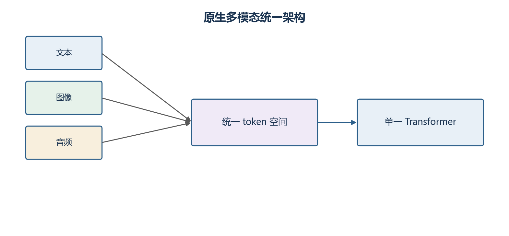

**边界与讨论。** 全模态模型训练成本极高（海量多模态数据 + 算力）；评估体系不成熟（如何全面衡量多模态能力，第 31 章）。

## 35.4　语言作为通用接口的再思考

**语言的特殊地位。** 在多模态系统中，语言常充当"通用接口"——用户用语言表达意图（"画一只猫""描述这张图""总结这段视频"），系统据此调用各模态能力。第 42 章将讨论语言与思维、世界模型的关系。

**再思考。** 语言是唯一的通用接口吗？

**定义 35.4（接口覆盖率）**　设系统可表达的任务意图集合为 $\mathcal{T}$，仅用语言（可附指称锚点，如"这个"）能无歧义表达的意图子集为 $\mathcal{T}_{ling}$，则语言的接口覆盖率为

$$
\gamma \triangleq \frac{|\mathcal{T}_{ling}|}{|\mathcal{T}|}. \tag{35-8}
$$

$\gamma<1$ 的部分（空间布局、情感强度、动作节奏）必须借助非语言模态补足；原生多模态把 $\gamma$ 从"语言独担"变为"模态组合分担"，其设计目标正是提高综合覆盖率而非单纯扩展 $\mathcal{T}_{ling}$。

- 语言的优势：抽象、组合、可表达任意意图（第 1、13 章）；
- 局限：某些信息难以用语言表达（空间关系、情感、触觉）——"只可意会不可言传"；
- 原生多模态趋势：从"语言指挥各模块"走向"任意模态自然交互"——语言不再是唯一入口。

**例 35.4（超越语言的交互）**　用户画个草图 + 说"做成这样的网页"——草图（视觉）与语言共同表达意图，单一语言难以精确传达布局。原生多模态支持这种"多模态混合表达"。

**例 35.4b（接口覆盖率的核算）**　取一个网页生成任务的意图集合 $\mathcal{T}$，分解为 6 类要素：功能需求（文本可表达）、内容（文本可表达）、布局（视觉草图精确、语言仅能近似）、配色（语言给色值可表达但难表"感觉"）、动效节奏（几乎不可语言化，需视频/手势参考）、情感基调（副语言可表达）。若纯语言系统可无歧义覆盖 $\mathcal{T}_{ling}$ = {功能, 内容} 2 类，则 $\gamma = 2/6 \approx 0.33$；加入草图（覆盖布局、部分情感）后 $\mathcal{T}_{ling}$ 增至 {功能, 内容, 布局, 情感} 4 类，$\gamma \approx 0.67$。该算例量化了"为什么单靠语言不够"：对布局敏感的界面类任务，语言覆盖率天然偏低，必须引入视觉模态把 $\gamma$ 推高，这与式 35-8 把"超越语言"从一个口号变成一个可测指标一致。

**边界与讨论。** 语言与思维的关系（Sapir-Whorf 假说，第 40 章）——语言是否塑造思维、非语言智能是否可能——是认知科学与 AGI 的深层问题（见《认知智能导论》）。

## 35.5　边界与讨论

第七篇（第 32–35 章）至此全部完成。本篇从视觉理解（第 32 章）、语音（第 33 章）、视觉生成（第 34 章）到原生多模态（本章），展示了语言与多模态的融合。

**意义表示的统一。** 原生多模态试图在 M2 层统一所有模态的表示——万物皆 token，统一建模。但统一表示不保证 M4（指称/物理）正确——全模态模型的"幻觉"与物理错误（第 31、34 章）仍是挑战。

**与后续章节的联系。** 本章的原生多模态衔接第 20 章（统一 Transformer）、第 32–34 章（各模态）、第 40 章（语言与思维）、第 42 章（通用智能）；统一 token 思想衔接《多模态与生成智能导论》（本书聚焦语言侧，生成细节见该系列书）。

**失败模式。** 统一架构把各模态的故障耦合进了同一个模型，产生三类典型失效：

- **模态竞争（context crowding）**。当高密度模态（视频）占满式 35-4 的预算后，文本指令的 token 被挤到窗口边缘，注意力在长上下文中衰减（第 20 章），出现"模型看见了图却忘了问题"的现象。这是预算约束的直接后果，缓解手段是模态感知的采样率调度，而非简单地加大 $C$。
- **跨模态幻觉放大**。单一模型没有"文本模块做校验"的级联冗余：视觉侧的错误（幻觉出一个不存在的物体，第 34 章）可以直接进入生成链并被语言侧复述、放大，而级联系统中 ASR/TTS 各自还有校验机会。统一性省掉了延迟，也省掉了冗余防线。
- **对齐漂移（alignment drift）**。式 35-5 建立的空间在对齐训练与统一训练两个阶段使用不同数据分布，若统一阶段的模态配比失衡（例如视频占比持续上升），早期对齐好的图文空间会被逐步拉偏，表现为"图像能力随版本波动"。这要求把式 35-5 的监控作为统一训练的常规指标，而非一次性验证。

**评估现状。** 原生模型的评测仍以单模态为主的多基准拼盘：图文（MMMU、MMBench）、视频（Video-MME）、语音对话（无公认基准，多用主观 MOS 打分，第 33 章）。问题在于：跨模态能力是"组合涌现"——单独看图文对、语音转写都合格，联合任务（如"听描述找到图中第三个人"）却失败，这类组合评测集仍稀缺，且缺乏区分"拼接系统"与"原生系统"的判别性测试（级联系统在某些联合任务上可能因模块各有所长而占优）。评估体系不成熟意味着当前"原生优于拼接"的结论多由厂商自报，独立复现有限。

**开放问题。** 其一，统一 token 化的最优粒度尚无理论：离散（VQ，信息损失）与连续（patch embedding，破坏自回归词表假设，第 34 章）两条路线各有代价，中间态（残差量化层级数、码本大小的选择）缺乏可解释准则。其二，$\gamma$（式 35-8）目前是任务集合的手工分解，如何自动估计一个模态组合的接口覆盖率，是评测体系的空白。其三，流式统一（式 35-7）在"打断、抢话、多说话人"的真实对话中尚未被系统研究，现有评测仍以轮次清晰的多模态问答为主。

**第八篇预告**：第 36–39 章将讨论语言智能的应用与工程：信息抽取与知识、对话系统与智能体、系统工程、领域应用。

## 本章小结

本章论述跨模态统一与原生多模态，完成第七篇。

我们首先分析模块拼接的局限与原生多模态的动机（端到端、低延迟、强跨模态推理），并用例 35.1b 的级联链路信息流算例给出信息损失的量化来源。接着介绍统一 token 空间（定义 35.1，万物皆 token）：在定义 35.2、35.3 中引入模态信息密度 $\delta_m$ 与密度比 $\rho_{ij}$，用式 35-4 的 token 预算约束和例 35.2b 的核算说明上下文窗口如何在模态间分配。我们讨论全模态模型（GPT-4o 等）的演进（表 35-2）与技术路线（表 35-3）：以式 35-5 的对比对齐损失说明"对齐先于统一"，以式 35-6 给出统一的自回归目标，以式 35-7 的流式延迟预算解释原生模型的实时性来源，用离散/连续两条实现路径（例 35.3a）与例 35.3b 对齐温度 $\tau$ 的敏感性说明架构统一的工程代价。我们还引入定义 35.4 的接口覆盖率 $\gamma$（式 35-8）与例 35.4b，把"语言是通用接口吗"变成可测指标，并重新思考语言接口的地位与局限。

最后明确边界：统一表示在 M2 层，不保证 M4 正确；统一架构还带来模态竞争、跨模态幻觉放大与对齐漂移三类失败模式，以及 token 粒度、覆盖率估计、流式统一三个开放问题。这些辨析衔接第 20、31–34、40、42 章与《多模态与生成智能导论》。

第七篇完成。下一章进入第八篇，讨论信息抽取与知识——语言智能走向结构化知识的关键应用。

**进一步阅读**　本章建议延伸阅读的文献：[1]、[2]、[5]（全模态模型）、[3]、[4]（离散 token 化）、[8]、[9]、[10]（对齐与桥接）、[12]（连续 latent 生成）。

## 参考文献

[1] OpenAI. GPT-4o System Card. *arXiv:2410.21276*, 2024.

[2] Anil R, Borgeaud S, Wu Y, et al. Gemini: A family of highly capable multimodal models. *arXiv:2312.11805*, 2023.

[3] van den Oord A, Li V, Vinyals O. Neural discrete representation learning. *ICLR*, 2017.

[4] Esser P, Rombach R, Ommer B. Taming transformers for high-resolution image synthesis. *CVPR*, 2021.

[5] Team G, Mesnard T, Hardin C, et al. Gemini 1.5: Unlocking multimodal understanding across millions of tokens of context. *arXiv:2403.05530*, 2024.

[6] Huang Z, Wu J, Zeng Z, et al. Multimodal large language models in autonomous driving: A survey and blueprint. *arXiv:2308.12969*, 2023.

[7] Yin S, Fu C, Zhao S, et al. A survey on multimodal large language models. *arXiv:2306.13549*, 2023.

[8] Radford A, Kim J W, Hallacy C, et al. Learning transferable visual models from natural language supervision. *ICML*, 2021.

[9] Liu H, Li C, Wu Q, et al. Visual instruction tuning. *NeurIPS*, 2023.

[10] Li J, Li D, Savarese S, et al. BLIP-2: Bootstrapping language-image pre-training with frozen image encoders and large language models. *ICML*, 2023.

[11] Yu J, Xu Y, Koh P Y, et al. Language-driven representation learning for multimodal perception and generation. *NeurIPS*, 2022.

[12] Rombach R, Blattmann A, Lorenz D, et al. High-resolution image synthesis with latent diffusion models. *CVPR*, 2022.

---

# 第 36 章　信息抽取与知识

第八篇（第 36–39 章）讨论语言智能的应用与工程。本章从**信息抽取**（information extraction, IE）开始——从非结构化文本中抽取结构化知识（实体、关系、事件），这是语言通向知识（第 4 章 M4 指称层、《本体智能导论》）的关键路径。

信息抽取把文本转化为机器可处理的结构（三元组、事件记录），是知识图谱构建（第 36.3 节）、问答（第 30 章）、搜索、推荐的基础。它连接了分布式表示（M2）与符号知识（M4）——是神经方法（第 21 章）与知识工程（《本体智能导论》）的交汇点。

**为什么需要信息抽取。** 互联网、企业档案、病历、新闻流中的绝大部分信息以非结构化文本存在，而机器消费知识最可靠的形式是结构化的：数据库表、图、三元组。直接让模型"读原文"回答问题（第 30 章 RAG）已经很强，但原文有三个工程缺陷：① 同一事实在不同文档中的表述不一致（"苹果/苹果公司/Apple Inc."指同一实体），无法聚合统计；② 原文不可高效遍历——"找出所有 A 收购 B 的事件"需要对全库做自然语言理解，而图查询只需一条遍历；③ 原文不可审计——结构化三元组能逐条溯源、逐条纠错，段落不能。信息抽取就是把文本"编译"成机器可聚合、可遍历、可审计的知识单元的过程。没有这一环，语言智能就停留在"理解一段话"，无法沉淀为"拥有一个知识体"。

本章先介绍命名实体识别与关系抽取（36.1 节），再讲事件抽取与开放信息抽取（36.2 节），讨论从文本到知识图谱（36.3 节）、语言与知识的对齐（36.4 节），并在边界与讨论中收束（36.5 节）。

## 36.1　命名实体识别与关系抽取

**命名实体识别（NER）** 已在第 8.1、8.5 节介绍：识别文本中的实体（人名、地名、机构名、时间等）。它是信息抽取的第一步。形式化地说，NER 是一个序列标注问题：对输入序列 $x=(x_1,\dots,x_n)$ 的每个 token 标注一个标签 $y_i\in\mathcal{Y}$（如 B-PER、I-PER、B-ORG、I-ORG、B-LOC、O，即 BIO 方案，第 8 章），实体即连续的同类型 I 标签段。现代做法是预训练模型 + 分类头（第 21 章），在 OntoNotes 等大规模标注语料上训练，英文主要实体类型 F1 可达 0.93 以上。

**关系抽取（Relation Extraction, RE）。** 识别实体间的语义关系，输出三元组 $(h,r,t)$（头实体、关系、尾实体）。例如"张三在北京加入百度"→(张三, 就职于, 百度)、(百度, 位于, 北京)。

**定义 36.1（关系抽取）**　给定文本与实体对 $(e_1,e_2)$，判断它们是否存在关系 $r$ 及类型：

$$
\hat{r}=\arg\max_{r\in\mathcal{R}\cup\{\text{None}\}}P(r\mid\text{text},e_1,e_2). \tag{36-1}
$$

**方法演进。** 规则/模式 → 监督学习（特征 + SVM）→ 神经方法（CNN/RNN/Transformer 编码实体对上下文）→ 预训练模型微调（第 21 章）→ 大模型抽取。远程监督（distant supervision）用知识库对齐文本自动生成训练数据，缓解标注稀缺。远程监督的朴素形式是**字面对齐**：若知识库已有三元组 (乔布斯, 创立, 苹果公司)，则把语料中同时出现"乔布斯"和"苹果公司"的句子都标为"创立"类。这带来系统性噪声——同句共现不等于存在该关系（"苹果公司今日否认乔布斯健康传闻"）。改进方案包括：句子级远程监督（只取最短共现句）、嵌入级远程监督（把 KB 三元组嵌入注入训练）、多文档远程监督（多句证据聚合）；而**预训练语言模型 + 少量精标数据**在实践中已能逼近甚至超过远程监督的精度，成为当前主流。

**例 36.1（关系抽取）**　"乔布斯创立了苹果公司"，NER 识别"乔布斯"（人）、"苹果公司"（机构），RE 判断关系为"创立"，得三元组(乔布斯, 创立, 苹果公司)。这一三元组可写入知识图谱。

**例 36.1b（远程监督噪声）**　KB 含 (腾讯, 收购, 拍拍网)。语料句 S1"腾讯宣布收购拍拍网，双方股东已签署协议"——正确正例；S2"有分析师认为腾讯未必会收购拍拍网，该传闻被否"——字面对齐同样标为正例，但语义是否定。若用 80/20 比例混入这类否定句训练，RE 模型会把"未必""传闻"等线索学成噪声，在测试集上把否定句判为有关系（假阳性）。这正是远程监督"免费但有噪"的代价，也是精确标注与远程监督混合训练的动机。

**评估。** NER 与 RE 都用第 8 章的 P/R/F1 度量。NER 按实体边界与类型联合判断（边界错或类型错都算错）；RE 常报**宏平均 F1**（各关系类别 F1 的算术平均，避免高频关系主导指标）与**微平均 F1**（全体预测汇总后的 F1）。DocRED 等文档级基准进一步要求抽取**可推理**关系（如"X 是 Y 的 CEO，Y 属于 Z 行业"推出 (X, 服务于, Z)），把 RE 从"句内共现分类"推向"文档级语义推理"。

**表 36-1　信息抽取任务**

| 任务 | 输出 | 例 |
|------|------|----|
| NER | 实体及类型 | 张三(PER) |
| RE | 关系三元组 | (张三,就职,百度) |
| 事件抽取 | 事件及论元 | 收购事件 |

**边界与讨论。** RE 难点：关系重叠（一对实体多关系）、嵌套实体、远距离依赖、领域迁移（第 39 章）。

## 36.2　事件抽取与开放信息抽取

**事件抽取（Event Extraction）。** 检测事件触发词并抽取事件论元（第 12 章语义角色的结构化应用）。例如"公司 A 以 10 亿收购公司 B"→事件类型"收购"，触发词"收购"，论元：收购方=A，被收购方=B，金额=10 亿。事件抽取比 RE 更深一层：RE 只关心"哪两个实体、什么关系"，事件抽取要求给出**事件的完整结构**——事件类型、触发词、各论元角色（含数值、时间、地点等非实体论元）。形式化地，事件抽取是**联合标注**问题：同时预测触发词集合 $T$ 与每个触发词 $t$ 的论元集 $\{(t_i, \rho_i)\}$（$\rho_i$ 为论元角色），其目标函数可写为

$$
(\hat{T},\hat{\rho})=\arg\max_{T,\rho}P(T,\rho\mid\text{text}). \tag{36-2}
$$

**定义 36.2（事件抽取）**　给定文本，抽取事件集合，每个事件为 (类型, 触发词, 论元角色赋值) 三元结构，论元角色由 schema（如 ACE2005、ACE2007、MUC）预定义。

**开放信息抽取（Open IE）。** 不预定义关系/事件类型，从文本中抽取任意"论元—关系—论元"三元组，如"苹果发布了新手机"→(苹果, 发布了, 新手机)。优势是覆盖广、无需schema；缺点是关系规范化难（"发布了""推出""发售"需归一）。OpenIE 工具（如 OpenIE 1/2、Caffeinated IE、LingPipe）产出的三元组天然携带**动词短语原文**，这既是优点（保留语言信息）也是难点（同一语义关系有无数表面形式，聚合去重需语义归一）。**信息抽取谱系**可按"schema 约束程度"排序：封闭 IE（固定关系/事件类型，精度高、覆盖窄）→ 半开放 IE（半开放类型集合，DocRED 等）→ 开放 IE（无 schema，覆盖广、需归一）→ 零样本/大模型抽取（第 24 章 ICL，类型由提示给出，介于前两者之间）。

**例 36.2（事件抽取）**　新闻"昨日地震震级 6.0，地点 C 市"：事件类型=地震，触发词=地震，论元：时间=昨日，震级=6.0，地点=C 市。结构化事件支持问答（"昨天哪里地震了？"）与知识库更新。

**例 36.2b（事件抽取数值走查）**　新闻"6 月 1 日，A 银行宣布以每股 50 元的价格收购 B 银行 100% 股权，交易金额约 80 亿元"。事件抽取输出：类型=收购，触发词=收购，论元：收购方=A 银行（句内主语），被收购方=B 银行（"收购"的宾语），价格=每股 50 元（介词短语"以……的价格"引导），股权比例=100%，金额=80 亿元，时间=6 月 1 日（句首时间状语）。对照式 (36-2)：触发词集合 $T=$ {收购}，论元角色赋值 $\rho$ 给出 6 个 (span, role) 对。注意"金额 80 亿元"与"每股 50 元"是两个不同角色的论元，若 schema 只有 price 一类，二者必须靠语义角色（第 12 章）区分——这正是事件抽取比 RE 复杂的原因。

**事件本体（Event Ontology）。** 大规模事件抽取依赖统一的事件本体，ACE（Automatic Content Extraction）系列定义的事件类型（冲突、交易、司法、生命、运动等 33 类）与论元角色（约 96 个）是标准参照。事件共指（event coreference）解决"多个句子描述同一事件"的合并：新闻导语"公司 A 收购公司 B"与后文"该交易金额达 80 亿"须归并为一个事件记录，否则知识库中会出现碎片化、互相矛盾的"事件"。事件共指与第 14 章指代消解、第 5 章实体共指同构，但单元从实体句段升级为事件。

**边界与讨论。** 事件抽取难点：触发词多义、论元跨句（第 14 章指代）、事件共指（多个描述同一事件）。

## 36.3　从文本到知识图谱

**知识图谱（Knowledge Graph, KG）** 用图结构表示知识：节点是实体，边是关系（第 5 章词汇关系、第 9 章上下位、本体，见《本体智能导论》）。信息抽取是知识图谱构建的核心环节。一个知识图谱 $G=(\mathcal{E},\mathcal{R},\mathcal{S})$ 由实体集 $\mathcal{E}$、关系集 $\mathcal{R}$ 与事实集 $\mathcal{S}\subseteq\mathcal{E}\times\mathcal{R}\times\mathcal{E}$（或带属性的 n 元组）构成，代表系统如 Wikidata（1 亿+ 实体、数十亿三元组）、DBpedia（从 Wikipedia 结构化抽取）、YAGO（维基百科 + WordNet 对齐）；知识图谱嵌入（TransE、DistMult 等，第 9 章、《图智能导论》）把 $\mathcal{E}\cup\mathcal{R}$ 映射到向量空间以支持补全与相似度计算。

**构建流程。** 文本 → NER（实体）→ 实体对齐（同一实体的不同表述归并，第 5 章）→ RE/事件抽取（关系）→ 知识融合（多源整合、冲突消解）→ 质量评估 → 入库。

**实体对齐（Entity Alignment/Linking）** 是流水线中最容易被低估的环节：NER 只产出**提及**（mention，文本片段），而 KG 需要**实体**（entity，唯一标识）。实体对齐 = 提及链接（把"Apple"在"苹果发布手机"中链接到 Wikidata 的 Apple Inc. 而非水果）+ 实体归并（把"苹果/Apple/苹果公司"三个不同文本表述归并到同一实体 ID）。链接的常用判据是候选生成（检索 top-k 相似 KG 实体）+ 排序（文本相似度 + 上下文证据 + 流行度先验）。错误链接是 KG 最大噪声源之一——把"乔布斯"链接到错误的同名人，其错误会沿图传播。

**知识融合与冲突消解。** 多源抽取的结果必须去冲突：不同文档可能给出矛盾事实（"CEO 是 A" vs "CEO 是 B"）。常见策略：① **带出处存储**——每条事实记录来源文档与抽取置信度，冲突不删除而并存（如 Wikidata 的"声明 + 来源 + 排名"机制，人工/规则决定主值）；② **投票与流行度**——多源一致的事实权重高；③ **时效性**——时间戳新的覆盖旧的（CEO 变更是正常更新，不是错误）；④ **来源可信度**——权威媒体权重高于自媒体。融合后仍用规则（schema 约束、类型一致性）与嵌入模型（异常三元组检测）做质量筛查。

**例 36.3（知识图谱问答）**　问题"乔布斯创立的公司的 CEO 是谁？"转化为图查询：乔布斯 →(创立)→ ?公司 →(CEO)→ ?人。知识图谱支持多跳推理（第 14 章、第 30 章 GraphRAG），且答案可追溯（M4 指称强）——这正是 KG 相比纯参数模型的优势。

**例 36.3b（实体对齐数值走查）**　对提及"苹果"做链接。候选生成（向量检索）返回 top-3：e1=Apple Inc.（相似度 0.94）、e2=Apple（水果，0.81）、e3=Apple Park（0.42）。上下文证据：前文出现"发布手机""iPhone"——与 e1 的属性（电子产品公司）匹配、与 e2（植物）矛盾。加权得分 $s(e)=\alpha\cdot\mathrm{sim}+(1-\alpha)\cdot\mathrm{ctx}$，取 $\alpha=0.6$：s(e1)=0.6×0.94+0.4×0.95=0.944，s(e2)=0.6×0.81+0.4×0.20=0.566。链接到 e1。若上下文缺失（孤立提及"苹果很好吃"），ctx 分逆转，e2 胜出——同一表面形式在不同上下文链接到不同实体，说明链接必须逐提及做，不能全局映射。

**表 36-2　知识图谱构建流程**

| 步骤 | 任务 |
|------|------|
| 实体识别 | NER |
| 实体对齐 | 共指/归并 |
| 关系抽取 | RE |
| 知识融合 | 消歧/冲突 |
| 评估 | 质量 |

**KG 补全与推理。** 抽取得到的 KG 必然稀疏：很多真实关系没有出现在语料中。知识图谱补全（link prediction）预测缺失三元组 (h, r, ?t)：嵌入方法（TransE 把关系建模为向量平移 $\mathbf{h}+\mathbf{r}\approx\mathbf{t}$）用几何一致性打分；规则方法（如"X 是 Y 之父 ∧ Y 是 Z 之父 ⇒ X 是 Z 之祖父"的复合路径规则）用路径模式推断。补全结果以**低置信度**入库（标注为推断而非抽取），与原始抽取事实在置信度上分层。

**边界与讨论。** KG 构建成本高、覆盖有限、更新滞后；神经方法（向量）与符号方法（KG）各有优劣——神经—符号融合（第 36.4 节、《本体智能导论》）是趋势。

## 36.4　语言与知识的对齐

**语言模型 vs 知识图谱。** 语言模型把知识隐式编码在参数（M2），KG 显式存储知识（M4）。二者互补：

- 语言模型：覆盖广、语义丰富，但幻觉、不可追溯；
- 知识图谱：精确、可推理、可追溯，但覆盖有限、构建难。

**对齐方法。**

- **知识增强语言模型**：把 KG 三元组注入预训练（如 ERNIE、KnowBERT），提升知识密集型任务；
- **语言模型增强 KG**：用语言模型抽取关系、补全知识图谱；
- **联合表示**：把实体与词嵌入同一空间（第 9 章关系嵌入）；
- **RAG + KG**：GraphRAG 用知识图谱增强检索（第 30 章）。

**知识注入的两种路径。** 把 KG 知识引入语言模型有"预训练期"与"推理期"两条路径。预训练期：把三元组转化为自然语言（"(乔布斯, 创立, 苹果公司) → 乔布斯创立了苹果公司"）混入预训练语料（KnowLEDGE-Graph 式），或做三元组嵌入与词嵌入的联合训练（ERNIE 式）——知识内化进参数，推理时无额外成本，但更新需重训。推理期：RAG 把查询相关的 KG 子图检索出来放进上下文（GraphRAG，第 30 章）——知识外置、可实时更新、答案可溯源，但有检索延迟与上下文开销。工程上二者常组合：稳定、高频的知识（常识）内化，易变、长尾的知识外置检索——与第 30 章"会变的事实用 RAG，不变的行为用微调"的分工同构。

**例 36.4（知识增强）**　语言模型回答"某实体的属性"时，若注入 KG 的三元组，可减少幻觉、提高事实准确度——用 M4 的精确知识弥补 M2 的模糊。这是第 29 章幻觉问题的一种解决路径。

**例 36.4b（知识冲突检测数值走查）**　用 KG 校验生成答案的事实性。设模型回答"乔布斯出生于 1955 年 2 月 24 日"。KG 检索到三元组 (乔布斯, 出生日期, 1955-02-24)，抽取置信度 0.98，3 个独立来源一致。校验判定：一致，通过。再设模型回答"该公司 2025 年营收为 8000 亿"，KG 中 (该公司, 2025 营收, 9200 亿)（权威财报来源，置信度 0.99）。校验判定：数值冲突（8000 vs 9200，相对误差 13% > 阈值 5%），标记为可疑幻觉，触发人工复核或重检索。式 (30-5) 的忠实性在此从"答案 vs 检索段落"扩展到"答案 vs 结构化事实"——KG 提供的是**可逐条核验的事实基线**，段落检索只能提供"可能支持"的软证据。

**表 36-3　语言模型与知识图谱对照**

| 方面 | 语言模型 | 知识图谱 |
|------|----------|----------|
| 知识表示 | 隐式参数 | 显式三元组 |
| 覆盖 | 广 | 有限 |
| 精确性 | 易幻觉 | 精确 |
| 可追溯 | 难 | 易 |
| 推理 | 隐式 | 显式 |

**边界与讨论。** 深层问题：语言模型是否"真正理解"知识（M4）还是仅统计关联（M2）——第 29、31 章的争论。神经—符号融合的完整体系见《本体智能导论》。

## 36.5　边界与讨论

**抽取错误的传播（误差级联）。** 信息抽取流水线（NER→链接→RE→融合）是**级联系统**：上游错误向下游传播且通常被放大。NER 漏检一个实体，RE 就失去一个端点，三元组直接缺失；链接错一个实体，后续所有以它为端点的关系全部张冠李戴；RE 判错一个关系，融合层会把它当作"多源共识"加权固化。级联系统的整体准确率近似等于各环节准确率的**乘积**：设 NER 0.95、链接 0.92、RE 0.88、融合 0.95，则一条四步流水线端到端正确率约 0.95×0.92×0.88×0.95≈0.72——即使每个环节都不差，端到端也只有七成。因此 KG 工程的重心是：① 端到端联合建模（一个模型同时出实体与关系，减少级联接口）；② 错误溯源（每条三元组记录各环节置信度，低分环节可重算）；③ 人工抽检闭环（抽取→人审→回标→重训的迭代，ACE、MUC 时代的标准做法至今有效）。

**KG 噪声与质量度量。** 知识图谱的质量无法用单一指标刻画，通常分层度量：**完整性**（目标领域的核心关系覆盖多少）、**准确性**（抽样三元组中正确的比例，人工评估）、**一致性**（无逻辑矛盾，如"出生日期晚于死亡日期"这类约束违反率）、**时效性**（事实相对当前时间的新鲜度）。噪声来源与第 30 章 RAG 失败模式谱系同构：源噪声（抽取错误、实体链接错误）→ 结构噪声（缺失边、错误边）→ 更新噪声（过时未清理）。"垃圾进垃圾出"在 KG 上被放大：错误三元组一旦入库，会被补全算法、嵌入模型当作训练信号，**污染下游所有推理**——这是 KG 质量评估必须前置而非事后补救的原因。

**开放 IE 的局限。** 开放 IE 覆盖广但产物"脏"：关系短语未规范化（"发布了/推出/发售"）、论元短语未归一（"新手机/新款 iPhone/该机型"）、噪声三元组比例高（Web 规模抽取的 precision 常低于 50%，需下游过滤）。开放 IE 的三元组适合**聚合统计**（大量重复出现的三元组噪声自消）与**候选生成**（再交封闭模型精判），不适合直接当事实库用。

**M2 与 M4 的桥梁。** 信息抽取把文本（M2）转化为结构化知识（M4），是意义五层框架中从分布到指称的关键路径。抽取的准确性决定知识质量。

**大模型时代的变化。** 大模型能零/少样本做信息抽取（第 24 章 ICL），降低了抽取门槛，但仍需验证准确性（幻觉）。抽取结果的规范化、对齐、质量控制仍依赖传统知识工程。大模型抽取改变了成本结构（从"标注瓶颈"变为"验证瓶颈"——生成免费、核验昂贵），但未改变级联误差的本质：模型抽错的三元组不会自己暴露，仍需 KG 约束（类型一致性、schema 校验、多源交叉验证）兜底。

**表 36-4　信息抽取方法谱系**

| 方法 | 标注需求 | 覆盖 | 精度 | 典型代表 |
|------|---------|------|------|----------|
| 规则/模式 | 无 | 窄 | 高（域内） | 正则、模板 |
| 监督学习 | 大量 | 窄 | 中 | SVM + 特征 |
| 远程监督 | 无（KB 对齐） | 中 | 中低（有噪） | Minie、DocRED 预训练 |
| 预训练微调 | 中 | 中 | 高 | BERT-CRF、RoBERTa-RE |
| 开放 IE | 无 | 广 | 中低（需归一） | OpenIE 1/2、LingPipe |
| 大模型零样本 | 无 | 广 | 中高（需验证） | LLM + 提示模板 |

**与后续章节的联系。** NER/RE 衔接第 8 章（序列标注）、第 5 章（实体/关系）；事件抽取衔接第 12 章（语义角色）；知识图谱衔接第 30 章（GraphRAG）、第 39 章（领域应用）与《本体智能导论》《图智能导论》；知识对齐衔接第 29 章（幻觉）；KG 质量与评估衔接第 31 章（评估方法论）；抽取结果的工程化部署（抽取服务、KG 存储与更新管线）见第 38 章（系统工程）。

第八篇继续：第 37 章讨论对话系统与智能体——信息抽取产出的结构化知识是智能体"记忆"与"工具调用"（如查 KG 回答问题）的重要数据源；第 38 章讨论系统工程，第 39 章讨论领域应用。

## 本章小结

本章论述信息抽取与知识，是语言通向结构化知识的关键应用。

我们首先介绍 NER 与关系抽取（定义 36.1，式 36-1）：NER 是 BIO 序列标注，RE 判断实体对关系；概述从规则到远程监督、预训练微调、大模型抽取的方法演进（表 36-4），用远程监督噪声（例 36.1b）说明"免费数据"的代价，并给出 P/R/F1 与宏/微平均的评估口径。接着介绍事件抽取（式 36-2，定义 36.2）与开放信息抽取，以收购新闻（例 36.2b）走查触发词与多论元角色的联合抽取，并讨论事件本体与事件共指。

我们讨论从文本到知识图谱的构建流程（表 36-2）：实体对齐把提及链接到实体（例 36.3b 的候选生成 + 上下文加权），知识融合处理多源冲突，KG 补全用嵌入与规则预测缺失三元组；KG 问答支持多跳推理且答案可追溯（例 36.3）。我们重点对比语言模型（隐式、广、易幻觉）与知识图谱（显式、精确、可追溯），介绍知识增强、联合表示、GraphRAG 等对齐方法（表 36-3），区分预训练期注入与推理期 RAG 两条知识注入路径，并用 KG 事实校验（例 36.4b）把第 30 章的忠实性度量从段落证据扩展到结构化事实。

我们还明确边界：信息抽取是 M2→M4 的桥梁，抽取准确性决定知识质量；级联流水线的端到端准确率近似为各环节准确率之积（误差传播），KG 噪声须分层度量（完整性/准确性/一致性/时效性），开放 IE 覆盖广但需归一与过滤；大模型降低抽取门槛但未改变验证瓶颈。这些辨析衔接第 5、8、12、14、24、29、30、31、38、39 章与《本体智能导论》《图智能导论》。

下一章进入对话系统与智能体，讨论语言智能从"回答问题"走向"完成任务"。

**进一步阅读**　本章建议延伸阅读的文献：[1]、[2]、[3]、[4]、[5]、[7]、[9]、[11]。

## 参考文献

[1] Grishman R, Sundheim B. Message understanding conference-6: A brief history. *COLING*, 1996.

[2] Zeng D, Liu K, Lai S, et al. Relation classification via convolutional deep neural network. *COLING*, 2014.

[3] Ji H, Namboodiri K. Abstract meaning representation-based event extraction. *ACL Workshop*, 2014.

[4] Etzioni O, Cafarella M, Downey D, et al. Web-scale named entity discovery and classification. *KDD*, 2005.

[5] Ji S, Pan S, Cambria E, et al. A survey on knowledge graphs: Representation, acquisition, and applications. *IEEE Transactions on Neural Networks and Learning Systems*, 2022, 33(2): 494–514.

[6] Zhang W, Sui J, Huang Z, et al. ERNIE: Enhanced language representation with informative entities. *ACL*, 2019.

[7] Devlin J, Chang M W, Lee K, Toutanova K. BERT: Pre-training of deep bidirectional transformers for language understanding. *NAACL*, 2019.

[8] Xiong H, Hoai E, He X, et al. DocRED: A large-scale document-level relation extraction dataset. *ACL*, 2020.

[9] Hoffmann J, Szekely P A. Open information extraction: The second generation. *EMNLP-CoNLL*, 2015.

[10] Vrandečić D, Krötzsch M. Wikidata: A free collaborative knowledgebase. *Communications of the ACM*, 2014, 57(10): 78–85.

[11] Auer S, Kondratyuk V, Scharffe G, et al. DBpedia: A nucleus for a web of open data. *ISWC*, 2007.

[12] Bordes A, Usunier N, Garcia-Durán A, et al. Translating embeddings for modeling multi-relational data. *NeurIPS*, 2013.

---

# 第 37 章　对话系统与智能体

第 36 章讨论语言通向知识，本章讨论语言通向**行动**：对话系统与语言智能体。对话系统让机器与人进行多轮交互（第 14 章语用、第 33 章语音对话）；语言智能体（language agent）进一步让模型感知环境、规划、调用工具、执行任务（第 1 章 Level 4 语言交互）。这是语言智能从"回答问题"走向"完成任务"的关键一跃，也是统一案例（第 1.8 节）的终点工序——问答语料在第 37 章封装为对话智能体。

从能力层次看，第 30 章的 RAG 解决的是"单轮有据可依"，本章则解决"多轮、带状态、能动手"。一个 RAG 系统只能就单个问题给出一次检索—生成；而对话系统要维护跨轮上下文、追踪用户目标随轮次的演化，智能体更要在多步中把自然语言意图转译为对真实世界（数据库、工具、代码执行器）的可逆与不可逆操作。这一从"答"到"做"的跨越，正是语言从 M4 指称走向 M5 语用（第 14 章）的落地。

本章先介绍任务型与开放域对话（37.1 节），再讲对话状态跟踪与策略（37.2 节），讨论大模型时代的对话系统（37.3 节）、语言智能体与工具调用（37.4 节），给出统一案例的问答智能体（37.5 节），并在边界与讨论中收束（37.6 节）。

## 37.1　任务型对话与开放域对话

**任务型对话（task-oriented dialogue）。** 目标明确、领域特定：订票、查天气、客服、预约。系统须在有限轮次内把用户的意图补全为可执行的结构（意图 + 槽位），再驱动一个后端动作。传统流水线把它拆成四个模块：

1. **NLU**：理解用户意图与槽位（第 8 章序列标注，第 12 章语义角色）；
2. **对话状态跟踪（DST）**：维护对话状态（已收集的信息）；
3. **对话策略**：决定下一步动作（继续追问 or 完成任务）；
4. **NLG**：生成回复。

这条流水线的优点是**模块可解释、可单独评测**——NLU 有 F1、DST 有联合精确匹配率（joint goal accuracy, JGA）、NLG 有流畅度。它的缺点是**误差沿流水线累积**：NLU 漏抽一个槽位，DST 就少一个字段，策略据此做出错误决策，NLG 再生成一个看似通顺实则跑偏的句子。更致命的是**领域迁移**：每换一个领域（从订票到挂号），NLU 的意图集与槽位 schema 几乎要重标一遍，这是任务型对话长期难以规模化落地的根因。

**开放域对话（open-domain dialogue）。** 无明确目标、话题自由：闲聊、陪伴、陪聊。早期用 seq2seq 加注意力生成（第 17 章），代表工作如 Persona-Chat 与 DialoGPT——它们把"下一句说什么"建模为条件语言生成。但 seq2seq 受限于训练分布，输出往往安全却平庸（"That's interesting, tell me more."），缺乏事实与个性。大模型时代用 LLM 直接对话，开放域对话第一次同时获得流畅、多样与常识。

**例 37.1（任务型对话）**　订机票对话：用户"帮我订明天去北京的机票"→NLU 识别意图=订票、槽位=时间:明天/目的地:北京；DST 记录状态；策略判断缺出发地→追问"从哪里出发？"；NLG 生成追问。多轮后信息齐全，调用订票系统完成。

**开放域对话的评测难题。** 任务型有 JGA 这类"对标准答案"的指标，开放域却难以判定"一句好回答"——同一输入，"今天天气不错"与"听起来你心情不错，是有什么喜事？"都算通顺，优劣取决于话题推进与情感匹配。学界因此转向**对话属性**（连贯性、启发性、个性化、一致性）与**参考无关**评分（用另一个 LLM 当裁判，第 31 章评估），或**对话状态/目标达成率**等间接指标。评测的模糊性是开放域对话难以像机器翻译（BLEU/COMET）那样给出稳定数字的深层原因。

**表 37-1　对话系统类型**

| 类型 | 目标 | 方法 | 评测 |
|------|------|------|------|
| 任务型 | 完成特定任务 | 流水线/状态机 | JGA、任务成功率 |
| 开放域 | 自由聊天 | seq2seq/LLM | 属性评分、LLM 裁判 |
| 问答式 | 回答问题 | 检索 + 生成（第 30 章） | 答案准确率、忠实性 |

**边界与讨论。** 任务型流水线可解释、可控，但模块错误累积、领域迁移难；开放域生成流畅但难以保证事实与一致性（第 29 章幻觉）。实践中二者常融合——客服系统既有任务型骨架（必须把"退票"意图落到工单），又有开放域能力（安抚情绪、解释政策），即"任务型为骨、开放域为肉"。

## 37.2　对话状态跟踪与策略

**对话状态跟踪（DST）。** 维护对话的当前状态 $S_t$（用户目标、已填槽位、历史动作），随每轮更新：

$$
S_t=\mathrm{DST}(S_{t-1},u_t,a_{t-1}), \tag{37-1}
$$

其中 $u_t$ 为用户话语，$a_{t-1}$ 为系统上一动作。式 37-1 把 DST 刻画为一个**隐式状态转移**：新状态是旧状态、本轮用户话语、上一系统动作的函数。这个函数必须处理三类语言现象：**指代**（"那里"=上文目的地，第 14 章）、**省略**（"那后天呢？"承前省略了"订北京"）、**修正**（"不是明天，是后天"——把已填槽位覆盖）。DST 的难点正在于：自然语言里槽位很少被显式完整说出，它们分散在多轮、靠指代与省略隐含，DST 要把这些"碎片"聚合成一份结构化状态。

**DST 的两种范式。** 早期用**规则/模板**（按句式模式更新槽位），可解释但脆弱；随后用**神经序列标注**，把"槽位—值对"抽取为 token 级标注（DSTC2 基准，MultiWOZ 2.0/2.1 数据集）。MultiWOZ 是任务型对话的事实标准：覆盖餐厅、出租车、住宿等 7 个领域，标注了逐轮对话状态（belief state），其 JGA（所有领域所有槽位的联合精确匹配率）长期停留在 30%–40%，说明"把整份状态一次全对"极难——单槽位准确率可以很高，联合准确率却因"错一个全错"而暴跌，这正是任务型对话误差累积的量化体现。

**对话策略。** 基于状态决定系统动作 $a_t=\pi(S_t)$：追问缺失槽位、确认信息、执行任务。传统用**规则**（手写状态机，如"缺出发地则追问出发地"）或**强化学习**（把对话建模为 POMDP，策略学习奖励最大化，第 12 章 RL 视角、第 21 章）。强化学习对话策略（DARCS、DQN 系）在模拟环境能学出优于规则的轮次分配，但**奖励稀疏**（通常只在任务完成给 +1）、**模拟器与真实用户分布不一致**，使其难落地。大模型时代，策略由 LLM **隐式**从上下文决策——不再显式维护 $S_t$，而是让模型"读历史、知所缺、做下一步"，把式 37-1 的显式转移内化进了注意力机制。

**例 37.2（状态跟踪的指代）**　用户："订去北京的票。"系统："什么时候？"用户："明天。" DST 需把"明天"绑定到目的地=北京的订票意图——跨轮指代与意图维护（第 14 章）。

**例 37.2b（DST 的数值走查）**　设订票状态含三槽位 $\{\text{出发地},\text{目的地},\text{时间}\}$，初值全空。走三轮：第 1 轮用户"订去北京的票"→状态 $(\varnothing,\text{北京},\varnothing)$，JGA 相对全空基准为部分命中；系统追问出发地。第 2 轮"从上海"→$(\text{上海},\text{北京},\varnothing)$；追问时间。第 3 轮"明天上午"→$(\text{上海},\text{北京},\text{明天上午})$，三槽位齐备，策略切换为"调用订票系统"。若在 MultiWOZ 式评测下，该对话的 belief state 与标注联合一致，则本对话贡献 JGA=1；反之只要任一轮把"明天"误记为"后天"，整段 JGA 即为 0——单个槽位错误使联合指标归零，量化了式 37-1 状态误差的"一错全错"放大效应。

**边界与讨论。** 大模型时代，显式 DST 常被隐式对话历史建模替代（LLM 直接读历史生成回复），可解释性下降但灵活性提升。显式状态的价值并未消失：在高可靠场景（医疗问诊、金融客服）仍需一份**可审计的状态快照**——"系统当前认定用户要改签、目的地北京、时间未定"，这对调试、合规与责任追溯都不可或缺。隐式与显式并非对立，而是**双轨**：LLM 隐式决策 + 显式状态影子（shadow state）用于校验与回滚。

## 37.3　大模型时代的对话系统

**范式转变。** 大模型（第 26 章）改变了对话系统的三个假设：

- **端到端**：LLM 直接理解意图、维护上下文、生成回复，替代"四模块流水线"——NLU/DST/策略/NLG 被折叠进一次前向推理；
- **指令跟随与对齐**（第 28 章）：对话自然、遵循用户意图、安全可控，RLHF 让模型学会"问清楚再答""该拒答就拒答"；
- **上下文学习**（第 24 章）：少样本适配新领域，无需为新领域重标意图集与槽位，直击任务型对话"迁移难"的痛点。

**从流水线到单模型。** 用统一记号看这一折叠：传统系统是级联 $p(a\mid S)\,p(S\mid u,S_{t-1})\,p(u\text{ 的意图}\mid u)$，误差沿链相乘；大模型直接建模联合分布 $p(u_t,a_t\mid u_{1:t-1},a_{1:t-1})$，绕开了中间变量的显式估计。代价是**黑箱化**——你不再能看到"系统此刻认为的出发地是什么"，只能通过日志与探针推断。这解释了 37.2 节为何主张"双轨"：隐式模型负责生成，显式影子负责审计。

**ChatGPT 现象。** ChatGPT 把对话式交互推向主流——用户用自然语言与系统多轮协作（写作、编程、分析）。对话从"工具"变成"通用接口"：人不再学命令行、学 SQL，而是用自然语言指挥系统（第 38 章与《人机协作与交互智能导论》）。这背后是一个更深的判断——**自然语言是人与机器之间带宽最高、学习成本最低的接口**，它把"会用系统"的门槛从"懂 API"降到"会说话"。

**多轮协作的本质。** 与单轮问答相比，多轮协作引入了**共同基础（common ground）**：双方随对话推进不断对齐"我们刚才说了什么、接下来要什么"。LLM 的长上下文窗口（第 20 章）让这种对齐可跨数十轮维持，但也带来**长对话一致性**问题——遗忘早期约束、前后矛盾（"lost in the middle"，第 9、20.4 节）。

**例 37.3（协作式对话）**　用户："帮我分析这份数据。"系统（LLM）：询问数据位置、澄清需求、生成分析代码、解释结果、根据反馈调整——多轮协作完成任务，远超传统问答。这是"对话即协作"的新形态。

**边界与讨论。** 大模型对话的局限：长对话一致性（遗忘早期上下文，第 20.4 节）、事实幻觉（第 29 章）、对话状态不透明。前两者决定"答得对不对"，第三个决定"能不能追责"——而生产系统往往更怕后者：一个看似自信实则错误的答案，若无法追溯到"模型当时基于什么上下文做的判断"，就无法调试、无法定责、无法合规。

## 37.4　语言智能体与工具调用

**从对话到行动。** 对话系统的终点是"生成一句回复"；语言智能体的终点是"完成一个任务"——哪怕这个任务需要查数据库、算数值、画图表、发邮件。区别在于：对话系统的**动作空间是语言**，智能体的**动作空间是世界**。语言智能体（language agent）把 LLM 作为"大脑"，配备感知、记忆、规划与工具，使其自主完成任务[1]：

- **规划**：把任务分解为子目标（第 24 章 CoT、ToT）；
- **工具调用**：调用外部 API（搜索、计算、数据库、代码执行）——ReAct 范式"推理—行动—观察"循环[2]；
- **记忆**：短期（上下文）+ 长期（向量库，第 30 章）；
- **反思**：根据观察修正计划（第 29 章自我改进、Reflexion[5]）。

**定义 37.1（ReAct 循环）**　智能体交替进行推理与行动：

$$
\text{思考}_t\to\text{行动}_t\text{（调用工具）}\to\text{观察}_t\to\text{思考}_{t+1}\to\cdots \tag{37-2}
$$

直到任务完成。式 37-2 把智能体刻画为一个**交错轨迹**：纯推理（"我想下一步该查什么"）与纯行动（"执行这次查询"）交替推进，每次行动返回的观察又成为下一步推理的输入。ReAct 相对"先全部规划再执行"的优势在于**观察在环**——计划不必一次想全，可以根据环境反馈边做边改，这使它对长尾、开放任务更鲁棒。

**工具调用的形式化。** 设工具集为 $\mathcal{T}=\{t_1,\dots,t_K\}$，每个工具 $t_i$ 有一个签名（参数 schema）。智能体在第 $t$ 步要从"直接回答"与"调用某工具"之间决策：

$$
\text{act}_t = \begin{cases} \text{Answer}(\hat{y}), & \text{若信息已足} \\ \text{Call}(t_i,\, \boldsymbol{\theta}_t), & \text{否则，} \boldsymbol{\theta}_t\text{ 为工具参数} \end{cases} \tag{37-3}
$$

其中 $\hat{y}$ 为最终答案，$\boldsymbol{\theta}_t$ 是模型生成的结构化参数。模型须学会**何时调用**（调用判断）、**调用谁**（工具选择）、**传什么参数**（参数抽取）——这三者合称"工具调用三难"，也是智能体可靠性的主要瓶颈。

**工具学习的两条路线。** 一条是**提示式**（prompting）：在系统提示中描述可用工具及其 JSON schema，让模型以结构化文本（如 function call JSON）输出调用请求，无需改模型权重——代表为 OpenAI 的 function calling 与 LangChain 的工具接口。另一条是**微调式**：在工具调用语料上微调模型，把"何时/如何调用"内化进参数——Toolformer[3]是早期代表，它让 LLM 自监督地学习在生成中"何时插入 API 调用"，通过判断插入 API 后是否降低后续 token 的困惑度来自动标注调用位置。前者灵活免训练，后者更快更省 token；生产系统常两者结合：微调定"调用习惯"，提示定"当前可用工具清单"。

**例 37.4（智能体完成任务）**　任务"查 2026 年 X 公司营收并画趋势图"：智能体规划→调用搜索工具查数据→调用代码工具画图→检查→返回结果。每一步是"推理—行动—观察"循环（式 37-2）。这是语言从"生成文本"走向"操作世界"（M5 语用）。

**例 37.4b（工具调用的数值走查）**　设任务"求某公司 2023–2026 年营收的年均增长率"，工具集 $\mathcal{T}=\{\text{search},\text{code}\}$。智能体轨迹：思考₁"需要历年营收数据，用 search"→Call(search, {"query":"X 公司 2023–2026 营收"})→观察₁返回 $[10, 12, 15, 18]$（单位亿元）；思考₂"数据已足，需算 CAGR，用 code"→Call(code, {"expr":"(18/10)**(1/3)-1"})→观察₂返回 $0.2884$；思考₃"已得年均增长约 28.8%"→Answer("年均复合增长率约 28.8%")。对照式 37-3：三次决策中两次走 Call 分支、一次走 Answer 分支；若第 1 步误选 code（数据未取就直接算），观察会因缺输入而报错，触发反思回退到 search——这正是式 37-2 观察在环的自我纠错价值。

**记忆与上下文管理。** 智能体的短期记忆即上下文窗口，但长任务的轨迹（思考/行动/观察）会迅速撑爆窗口。工程上常用：**摘要压缩**（把历史轨迹摘要成短句，保留"已完成什么、还差什么"）、**外部化记忆**（把中间结果写入向量库/文件，需要时检索，第 30 章）、**分档记忆**（工作记忆/情景记忆/语义记忆，对应 CoALA 架构[1]）。记忆管理的核心矛盾是**信息量—窗口预算**：压得太狠丢关键细节，留得太多稀释注意力——与 RAG 的"lost in the middle"同构。

**工具调用机制。** 模型生成结构化的工具调用请求（函数名 + 参数），系统执行后把结果返回模型——通过微调（第 28 章）或提示（第 24 章）学会。MCP（Model Context Protocol）、A2A（Agent-to-Agent）等协议（第 35 章与《智能体与多智能体系统导论》）标准化工具与智能体间通信：MCP 把"工具/资源/提示"封装为统一接口，让一个模型可即插即用地接入任意工具集；A2A 让多个智能体互相对话分工。这两层协议是智能体从"单机脚本"走向"生态"的基础设施。

**例 37.4c（多智能体分工）**　任务"写一份竞品分析报告"：规划智能体拆为"数据收集 / 对比分析 / 成文"三个子任务，分别派给检索智能体（调 search）、分析智能体（调 code 算指标）、写作智能体（生成报告），汇总后由一个评审智能体检查一致性（第 29 章反思）。单智能体串行做这件事既慢又易在长上下文里丢信息；分工后每个智能体只处理自己的子上下文，质量与速度都提升——这是 AutoGen 等框架[7]的基本思想。

**边界与讨论。** 智能体的挑战：规划可靠性、工具调用错误、长期记忆管理、安全（越权调用，第 31 章）。其中**工具调用错误**最隐蔽：一次错误的参数（把"删除"调成"清空"）造成的是**不可逆副作用**——对话系统答错顶多失礼，智能体做错可能删库、转账。因此智能体的安全设计（权限最小化、高危操作二次确认、操作审计日志）比对话系统严苛得多（第 31 章、《AI治理与对齐导论》）。完整的智能体架构见《智能体与多智能体系统导论》。

## 37.5　统一案例：问答智能体

回到贯穿全书的统一案例（第 1.8 节）。问答语料在第 37 章封装为对话智能体——这是统一案例的终点工序，串起全书：

**完整链路。** 用户问题 → 词法标注（第 8 章）→ 句法解析（第 11 章）→ 语义角色（第 12 章）→ 逻辑形式（第 13 章）→ 语言模型/预训练（第 15–21 章）→ 检索增强（第 30 章）→ 对话智能体（本章：理解意图、多轮澄清、调用检索工具、生成答案、追问反馈）。

这条链路中，前六道工序是"单轮把一个问题答准"，最后一道（对话智能体）把"答准一次"扩展为"在多轮里把一件事做完"。差别正在于：用户很少一次把问题问全，真实交互是"先问、再澄清、再追问、再确认"——智能体必须把这串交互当作一个带状态的任务来管理，而非一系列孤立的问答。

**例 37.5（问答智能体）**　用户："相对论是谁提出的？"智能体：理解意图（事实问答）→调用检索工具（第 30 章）得"爱因斯坦 1905 年提出"→生成答案→用户追问"还有呢？"智能体维护上下文（第 14、37.2 节），补充"广义相对论 1915 年"——一个完整的多轮问答智能体。

**例 37.5b（追问中的指代与状态）**　接例 37.5，用户再问"那它和牛顿力学什么关系？"。这里"它"指代"相对论"（第 14 章指代消解），且"它"的具体所指需结合上一轮"狭义相对论 1905 / 广义相对论 1915"来定——智能体须把指代还原为"相对论（狭义+广义）"，再调用检索工具查"相对论与牛顿力学的关系"，生成"牛顿力学是相对论在低速弱场下的近似"。这一步考验的正是 37.2 节 DST 的跨轮指代维护：若隐式历史建模丢失了"我们刚才在讨论相对论"这一共同基础，回答就会跑偏到"力学"的泛泛介绍。

**表 37-2　统一案例全书工序链**

| 章 | 工序 | 能力 |
|----|------|------|
| 8 | 词法标注 | 分词/词性 |
| 11–13 | 句法/语义/逻辑 | 结构与意义 |
| 15–21 | 语言模型/预训练 | 语言建模 |
| 30 | 检索增强 | 有据可依 |
| 37 | 对话智能体 | 多轮完成任务 |

**能力阶梯的收束。** 表 37-2 展示了统一案例从"分词"到"办事"的完整爬坡：每一道工序都叠加一种能力，最终在对话智能体处汇合成"能用自然语言与人协作完成一件带状态的事"。这正是"把方法放进同一张地图"的生动体现——读者可以对照各章，看到自己的工具在这条链路上处于哪个环节、依赖哪些上游工序。

## 37.6　边界与讨论

本章须明确对话系统与智能体的边界，尤其是**可靠性**与**安全**两条主线。

**从语言到行动。** 对话与智能体是 Level 4（语言交互）——语言从"描述世界"走向"行动于世界"（M5 语用，第 14 章）。这是语言智能的高阶形态，也是通向通用智能的关键（第 42 章）。行动化的代价是**错误被放大**：对话答错是"说错"，智能体做错是"做错"——前者损失一次体验，后者可能造成不可逆的财产损失或数据损毁。

**幻觉的对话放大。** 单轮幻觉（第 29 章）在对话里会被**多轮放大**：第一轮一个微小的事实错误，若被用户当作前提继续追问，后续每一轮都建立在这个错误前提上，错误像滚雪球一样累积。智能体尤其危险——它会把幻觉"行动化"（基于错误前提调用工具、执行操作）。对策：关键事实必须经检索/计算核验（第 30 章忠实性），不可直接由参数记忆输出后执行。

**工具调用失败的处理。** 智能体调用外部工具可能失败：API 超时、参数被拒、返回空、返回格式异常。健壮的智能体须把**失败当作观察**纳入式 37-2 的循环——重试（换参数）、降级（换备用工具）、求助（向用户澄清）、放弃（如实告知失败）。"卡住就编"是智能体最致命的反模式：把工具失败掩盖为编造的答案。

**安全与越权。** 智能体持有的工具越多，攻击面越大：提示注入（用户或检索内容里夹带恶意指令，诱导智能体执行"删除所有数据"）、越权调用（用低权限身份做了高权限操作）、数据外泄（把内部数据通过工具发到外部）。防御手段：权限最小化（每个工具只给必要权限）、高危操作人工二次确认、全量操作审计日志、对工具输入做沙箱隔离（第 31 章、《AI治理与对齐导论》）。

**多轮状态漂移。** 长对话里，智能体对"当前目标"的理解会随轮次漂移——用户的意图从"查询"悄悄变成"修改"，或约束条件被遗忘。这与 37.2 节的显式影子状态、37.4 节的记忆管理都相关：**显式地周期性重述当前目标与约束**（"我理解为：你要改签去北京、后天，对吗？"）是缓解漂移的低成本高收益手段。

**与后续章节的联系。** 对话/智能体衔接第 14 章（语用、指代）、第 24 章（ICL、规划）、第 28 章（对齐）、第 29 章（反思）、第 30 章（工具/检索）、第 38 章（系统工程）与《智能体与多智能体系统导论》《人机协作与交互智能导论》；安全衔接第 31 章与《AI治理与对齐导论》。

第八篇继续：第 38 章讨论自然语言处理的系统工程，把本章的对话系统与智能体部署为稳定、可靠、可监控的生产服务；第 39 章讨论领域应用。

## 本章小结

本章论述对话系统与智能体，是语言从"回答"走向"行动"的关键应用。

我们首先区分任务型对话（NLU→DST→策略→NLG 流水线）与开放域对话，分析二者评测范式的差异（表 37-1）。接着定义对话状态跟踪（式 37-1）与对话策略，指出显式 DST 的"一错全错"联合指标问题（例 37.2b），并主张大模型时代"隐式决策 + 显式影子"的双轨。我们讨论大模型时代的范式转变：端到端折叠流水线、指令跟随对齐、上下文学习、ChatGPT 现象与多轮协作的"共同基础"本质。

我们重点介绍语言智能体：规划、工具调用、记忆、反思，推导 ReAct 循环（式 37-2）与工具调用决策（式 37-3），辨析提示式与微调式两条工具学习路线（Toolformer），给出工具调用数值走查（例 37.4b）与多智能体分工（例 37.4c），并讨论 MCP/A2A 协议。我们以统一案例的问答智能体收束（例 37.5、37.5b），展示全书工序链如何汇合成"多轮完成任务"（表 37-2）。

我们还明确边界：智能体是 Level 4/M5（语言走向行动），面临幻觉的多轮放大、工具调用失败的观察在环处理、安全越权与多轮状态漂移等挑战。这些辨析衔接第 8、11–14、24、28–31、38 章与《智能体与多智能体系统导论》《人机协作与交互智能导论》。

下一章进入自然语言处理的系统工程，讨论如何把本章的对话系统与智能体部署为稳定、高效、可监控的服务。

**进一步阅读**　本章建议延伸阅读的文献：[1]、[2]、[3]、[5]、[8]。

## 参考文献

[1] Sumers T R, Yao S, Narasimhan K, et al. Cognitive architectures for language agents. *arXiv:2309.02427*, 2023.

[2] Yao S, Zhao J, Yu D, et al. ReAct: Synergizing reasoning and acting in language models. *ICLR*, 2023.

[3] Schick T, Dwivedi-Yu J, Dessì R, et al. Toolformer: Language models can teach themselves to use tools. *Advances in Neural Information Processing Systems*, 2023, 36.

[4] Li X, et al. MultiWOZ 2.2: A dialogue dataset with consistently annotated discourse relations. *arXiv:2309.09744*, 2023.

[5] Shinn N, Cassano F, Gopinath A, et al. Reflexion: Language agents with verbal reinforcement learning. *Advances in Neural Information Processing Systems*, 2023, 36.

[6] Liu X, et al. AgentBench: Evaluating LLMs as agents. *ICLR*, 2024.

[7] Wu Q, et al. AutoGen: Enabling next-gen LLM applications via multi-agent conversation. *arXiv:2308.08155*, 2023.

[8] Xi Z, Chen W, Guo X, et al. The rise and potential of large language model based agents: A survey. *arXiv:2309.07864*, 2023.

[9] Brown T B, Mann B, Ryder N, et al. Language models are few-shot learners. *Advances in Neural Information Processing Systems*, 2020, 33.

[10] Ouyang L, Wu J, Jiang X, et al. Training language models to follow instructions with human feedback. *Advances in Neural Information Processing Systems*, 2022, 35.

---

# 第 38 章　自然语言处理的系统工程

第 36、37 章讨论了语言智能的应用（知识、对话、智能体）。本章讨论支撑这些应用的**系统工程**：如何把训练好的模型部署为稳定、高效、可靠的服务？从模型部署、推理优化，到评估管线、持续监控、数据标注与多语言多租户服务——工程是语言智能从"实验室模型"走向"生产系统"的必经之路。

大模型时代，系统工程的重要性空前凸显：模型越来越大（第 26 章）、推理成本越来越高（38.1 节）、服务可靠性要求越来越高。可以这样类比：一个在实验室里跑通的模型，好比一座能发电的机组；而生产系统要求的是一整套**电厂工程**——稳定的燃料供应（数据管线）、满负荷调度（批处理与资源管理）、事故预案（回滚与降级）、安全合规（审计与隔离）。本章聚焦 NLP 系统的工程维度（训练系统见《大模型系统与工程导论》），先介绍模型部署与推理优化（38.1 节），再讲评估管线与持续监控（38.2 节）、数据标注与质量控制（38.3 节）、多语言与多租户服务（38.4 节），并在边界与讨论中收束（38.5 节）。

## 38.1　模型部署与推理优化

**部署形态。** 模型部署为服务（API）或端侧应用：

- **云端服务**：模型部署在服务器，用户通过 API 调用（大模型主流）；
- **端侧部署**：模型部署在手机/设备（小模型、量化，第 23 章），低延迟、隐私好；
- **混合部署**：云边协同。

**推理优化。** 大模型推理的成本与延迟是核心挑战（第 26 章）。自回归解码的特殊之处在于它**受显存带宽约束而非算力约束**[7]：每生成一个 token，都要把全部权重从显存搬进计算单元做一次矩阵-向量乘，带宽利用率远低于训练时的矩阵-矩阵乘，这正是 FlashAttention 等算子优化的出发点[3]。因此推理优化的主线是"减少搬运、提高并行"，关键技术：

- **量化**：把权重/激活从 FP16 降到 INT8/INT4（第 23 章 QLoRA[5]），省显存、加速；
- **KV cache 优化**：缓存注意力键值，避免重复计算；分页管理（PagedAttention）[1]；
- **投机解码（speculative decoding）**：用小草稿模型快速生成候选，大模型并行验证，加速生成[2]；
- **连续批处理（continuous batching）**：请求级动态合批，提高吞吐[1]；
- **模型剪枝/蒸馏**：减小模型（第 23 章）。

这些技术被 vLLM[1]、TensorRT-LLM、ONNX Runtime 等开源推理引擎系统整合，构成了大模型服务的标准基础设施（表 38-1）。

**定义 38.1（推理吞吐与延迟）**　设系统同时处理多个请求，**吞吐** $\mathrm{Throughput}$ 为单位时间处理的 token 数（tokens/s），**单请求延迟**由两部分构成：**首 token 延迟**（TTFT, time to first token，含 prefill）与**每 token 延迟**（TPOT, time per output token）。三者常需权衡——批处理提吞吐但增 TPOT。

**例 38.1（KV cache 的收益）**　自回归生成第 $t$ 个 token 时，前 $t-1$ 个 token 的注意力键值不变，缓存后无需重算——把每步计算从 $O(t^2)$ 降到 $O(t)$，显著提升长文本生成效率。

**例 38.2（吞吐与延迟的权衡）**　设单次前向可并行处理 $b$ 个序列，权重读一次的搬运成本被 $b$ 个序列分摊，则每步产出的 token 数约为 $b$，理想情况下

$$
\mathrm{Throughput}\approx b\cdot r_1, \tag{38-1}
$$

其中 $r_1$ 为单序列解码速率（tokens/s）。以 7B 模型为例：$b=1$ 时 TPOT $\approx 50\,\mathrm{ms}$（$r_1=20$ tokens/s）；$b=32$ 时吞吐升至约 $640$ tokens/s，但每步计算量增大，TPOT 升至约 $110\,\mathrm{ms}$。低并发的交互场景（对话）优先压 TTFT/TPOT，高并发的批处理场景（离线摘要、数据标注）优先压单位成本。

**表 38-1　推理优化技术与系统**

| 技术/系统 | 优化目标 | 关键思想 |
|------|----------|----------|
| 量化 | 显存、速度 | FP16→INT8/INT4 |
| KV cache / PagedAttention [1] | 生成速度、显存碎片 | 缓存键值、分页管理 |
| 投机解码 [2] | 延迟 | 草稿并行验证 |
| 连续批处理 [1] | 吞吐 | 请求级动态合批 |
| 蒸馏/剪枝 | 模型大小 | 小模型替代 |
| vLLM [1]、TensorRT-LLM、ONNX Runtime [12] | 吞吐 | 上述技术的工程整合 |

**定义 38.2（连续批处理）**　静态批处理要求一个批次内所有请求同时结束；**连续批处理**在迭代粒度上动态调度：某请求生成完毕即退出，新请求插入空位，使 GPU 始终满载。它是 vLLM 等引擎高吞吐的核心机制[1]。

**定义 38.3（投机解码接受率）**　草稿模型每步提出 $k$ 个候选 token，目标模型并行验证。设每个候选被接受的概率为 $p$（近似独立），则单步期望接受

$$
\mathbb{E}[A]=\frac{1-p^{k+1}}{1-p}. \tag{38-2}
$$

**例 38.3（投机解码的加速比）**　设 $k=4$、$p=0.85$，代入式 (38-2)：$\mathbb{E}[A]=(1-0.85^5)/0.15\approx 4.03$。即目标模型每次前向验证 4 个候选，平均"赚到"约 4 个 token，再扣除草稿模型自身的开销（约为目标模型的 1/10），端到端加速约 $2.5\times$。注意：$p$ 由草稿模型与目标模型的分布接近程度决定——任务越贴近草稿模型的训练分布（如代码草稿配代码主模型），加速越显著；分布偏离时 $p$ 下降，加速比迅速退化。

**量化收益与单 token 成本。** 量化直接决定部署可行性：一个 $p$ 参数模型的 FP16 权重占 $2p$ 字节，INT8 占 $p$ 字节，INT4 占 $0.5p$ 字节。

$$
\mathrm{Mem}_{\mathrm{quant}}=\frac{b_{\mathrm{bits}}}{16}\cdot 2p, \tag{38-3}
$$

其中 $b_{\mathrm{bits}}\in\{16,8,4\}$。以 $p=7\times10^9$ 为例：FP16 需 14 GB，INT8 需 7 GB，INT4 需 3.5 GB——INT4 使单卡部署从"勉强"变"从容"。成本侧，设单张 GPU 每小时租金 $C_{\mathrm{GPU}}$，系统实际吞吐 $\mathrm{Throughput}$，则**单 token 成本**为

$$
c=\frac{C_{\mathrm{GPU}}}{3600\cdot \mathrm{Throughput}}. \tag{38-4}
$$

**例 38.4（单 token 成本）**　设 $C_{\mathrm{GPU}}=2$ 美元/小时（A100 级别），系统实测吞吐 10800 tokens/s（3000 tokens/s 理论值打 4 折，含调度开销），则 $c\approx 2/(3600\times10800)\approx 5.1\times10^{-5}$ 美元/token。一次 2048 token 的回答成本约 0.0001 美元——成本量级说明大模型服务的竞争本质是**单位 token 的吞吐工程**，而非单点速度。

**边界与讨论。** 推理优化常以精度损失（量化）或额外复杂度（投机解码）为代价，需按场景权衡：客服对话容忍 200 ms 延迟换取成本，代码补全要求低延迟可接受更高成本。详见《大模型系统与工程导论》。

## 38.2　评估管线与持续监控

**评估管线。** 生产系统需持续评估模型质量（第 31 章），三层结构缺一不可：

- **离线评估**：在固定基准/测试集上定期评估（第 31 章），作为上线前的回归门禁；
- **在线评估**：A/B 测试、用户反馈、点击率等业务指标——唯一能反映真实用户价值的一层；
- **回归测试**：模型/数据更新后确保不劣化。工程上把一批"黄金样例"（golden set）固化：每次模型、提示词、检索库变更后自动重跑，输出质量低于阈值则阻断发布——与软件工程的 CI/CD 完全同构，是 MLOps 在 NLP 服务上的直接落地[9][10]。

**持续监控。** 监控生产中的模型行为，三个维度（表 38-2）：

- **性能监控**：延迟（P50/P95/P99）、吞吐、错误率、成本；
- **质量监控**：模型输出的准确性、幻觉率、偏见（第 31 章）；
- **漂移检测**：数据分布变化（概念漂移[8]，第 25 章与《时序智能导论》）导致模型退化——监控输入分布与输出质量，触发重训或适配。

**定义 38.4（标注一致性 Cohen's kappa）**　多人标注时，用 $\kappa$ 度量"超出随机的一致性"。设两位标注者的一致性比例为 $p_o$、随机期望一致性为 $p_e$，则

$$
\kappa=\frac{p_o-p_e}{1-p_e}. \tag{38-5}
$$

**例 38.5（kappa 数值）**　某标注任务两位标注者各标 200 条，一致 164 条（$p_o=0.82$）；随机期望一致率为 $p_e=0.55$（各类标签边缘分布不均所致）。则 $\kappa=(0.82-0.55)/0.45=0.60$——"中等一致"。若只看 $p_o=0.82$ 会误判为高质，而 $\kappa$ 揭示了其中一半一致率来自类别不平衡的随机碰撞。工程惯例：$\kappa\ge0.8$ 才允许该标注数据直接用于训练；$0.6\le\kappa<0.8$ 需仲裁；$<0.6$ 说明标注规范本身有歧义，须先改规范。

**定义 38.5（漂移的 PSI 指标）**　设指标 $m$（如输入类别占比、输出长度）在基准期取 $b$ 个分箱，第 $i$ 箱在基准期占比 $p_i$、当前期占比 $q_i$，则**群体稳定性指数**

$$
\mathrm{PSI}=\sum_{i=1}^{b}(q_i-p_i)\ln\frac{q_i}{p_i}. \tag{38-6}
$$

**例 38.6（漂移检测）**　一个情感分类系统上线时准确率 90%，半年后降到 75%——因用户表达方式变化（新词、新梗）。按式 (38-6) 监控输入：负例占比从 $p=(0.60,0.30,0.10)$ 变为 $q=(0.45,0.40,0.15)$，

$$
\mathrm{PSI}=0.45\ln\frac{0.45}{0.60}+0.40\ln\frac{0.40}{0.30}+0.15\ln\frac{0.15}{0.10}\approx0.160+0.029+0.007=0.196.
$$

工程惯例 $\mathrm{PSI}<0.1$ 视为稳定、$0.1\sim0.25$ 关注、$>0.25$ 强漂移。$0.196$ 落在"关注"区，触发用新数据微调（第 23 章）并复核准确率。

**表 38-2　监控维度**

| 维度 | 指标 | 应对 |
|------|------|------|
| 性能 | 延迟（P95）、吞吐、错误率、成本 | 扩容、优化、降级 |
| 质量 | 准确率、幻觉率、kappa | 重训、RAG[6]、提示回滚 |
| 漂移 | PSI、分布 KL 散度 | 更新模型、扩充数据 |

**表 38-3　评估管线三层**

| 层 | 时机 | 数据 | 典型失败 |
|------|------|------|----------|
| 离线回归 | 每次发布前 | 黄金集 | 门禁缺失，劣化上线 |
| A/B 在线 | 上线后 | 真实流量 | 只看业务指标，忽略质量回归 |
| 持续监控 | 全天候 | 日志采样 | 只监控性能，不监控质量 |

**定义 38.6（幻觉率）**　对生成答案 $a$ 与参考上下文 $D$，幻觉率定义为答案中**无依据陈述**占全部陈述的比例——与第 30 章式 (30-5) 忠实性的关系为

$$
\mathrm{Hallucination}(a,D)=1-\mathrm{Faithfulness}(a,D). \tag{38-7}
$$

生产系统通常用"LLM 判官 + 抽样人工复核"估计该指标（第 31 章），按周监控：幻觉率上升而输入分布未变，往往指向提示词或模型版本变更，应优先排查变更历史而非数据。

**边界与讨论。** 质量监控（尤其幻觉、偏见）难以完全自动化——需结合自动指标与人工审核，且人工复核结果本身要受 kappa 约束（例 38.5）。第 31 章的评估方法学在生产中落地时，最大挑战不是"不会评"而是"评不动"——离线集固定后模型会过拟合它，须周期性轮换黄金集并保留一个不对外公开的"密封集"。

## 38.3　数据标注与质量控制

**数据标注。** NLP 系统依赖标注数据（微调、评估、监控）。标注是一条**流水线**而非一次性动作：规范定义 → 试标校准 → 批量标注 → 仲裁质检 → 版本发布，每一环都影响下游模型。管理要点：

- **标注规范**：明确定义标签（第 5 章义项、第 12 章角色、第 31 章对齐标准）；规范本身要版本化——改了规范，旧数据与新数据不可直接混用；
- **标注一致性**：多人标注的协调，用定义 38.4 的 Cohen's kappa 量化（例 38.5）；
- **标注效率**：主动学习（选最有价值的样本标注）[13]、弱监督（规则/远程监督，第 36 章）、大模型辅助标注。

**定义 38.7（主动学习选取函数）**　设候选集 $\mathcal{U}$、模型 $f_\theta$，主动学习每轮选取使**期望信息增益**最大的样本：

$$
x^*=\arg\max_{x\in\mathcal{U}}\,\mathbb{E}_{y\sim p(\cdot\mid x,\theta)}\bigl[D_{\mathrm{KL}}(p(\cdot\mid x,y)\,\|\,p(\cdot\mid x))\bigr]. \tag{38-8}
$$

实践中用其廉价代理：预测熵/最小概率（不确定性）、与已标集的距离、对模型参数影响的估计。

**例 38.7（主动学习的预算账）**　设标注一条成本 $c_a=0.5$ 元，模型每新增 1000 条有效数据可带来约 1 个百分点的提升。若盲标 10000 条达 90% 准确率，主动学习按经验只需约 4000 条达到同样准确率（文献报告 2–3 倍差距[13]），标注费从 5000 元降到 2000 元，总成本下降约一半。注意前提：候选池中确实存在"模型不知道但可学"的样本——若错误全部来自噪声标签而非知识缺口，主动学习省不下来。

**质量控制。** 清洗噪声标注、处理标注分歧、维护标注数据版本。数据质量决定模型上限（第 22.1 节）。工程上三件事：**仲裁**（分歧样本由第三方裁决）、**金标夹心**（在标注批次中混入已知答案的"金丝雀"样本，监控标注员质量，错误率超阈值则整批回炉）、**版本化**（数据集像代码一样有 changelog，模型可追溯到具体数据版本）。

**大模型辅助标注（silver label）。** 用强模型批量预标注（以 LLM-as-labeler 为主流做法，工程实践可参[11]）、人工只做抽检与仲裁，是当下标注降本的主力手段——但须警惕**分布收窄**：银标只覆盖强模型已有的偏好，长尾与错误模式被系统性遗漏。工程对策是"银标 + 抽样人标双轨"：按 5%–10% 比例人标一批对照样本，定期估计银标相对人标的错误率，错误率漂移即触发规范复核。

**数据飞轮。** 生产系统最宝贵的资产是**真实流量的标注闭环**：用户日志 → 采样 → 标注（含银标）→ 微调/检索库更新 → 线上评估 → 新日志。飞轮转速（单位时间进入训练的新增有效样本数）决定系统长期竞争力，而它的瓶颈通常不是算力，而是 38.2 节的质量门禁——垃圾进垃圾出在飞轮里是复利式的。

**边界与讨论。** 标注成本高、主观性强（尤其开放任务）；主动学习在"可学缺口"不存在时失效（例 38.7）；银标提效但可能引入系统性偏差——三者的共同结论是：数据管线的质量门禁（kappa、金标夹心、双轨对照）比任何单一标注技巧都重要。

## 38.4　多语言与多租户服务

**多语言服务。** 第 25 章的多语言模型部署为服务时，须按语言治理而非一视同仁：

- **语言路由**：根据输入语言（第 25 章语言识别）选择模型/处理路径；
- **分语言质量基线**：不同语言的评测集与错误模式差异大（第 25.3 节），须分语言维护黄金集与幻觉率，避免"整体 90% 掩盖某小语种 60%"；
- **低资源语言支持**：可能需要专门适配或显式降级策略（第 25.4 节）。

**多租户服务。** 一个底座模型服务多个租户时的核心矛盾是**个性化与资源**：

- **隔离**：数据、检索库、权限三层隔离（《隐私与可信机器学习导论》）；
- **个性化**：用 PEFT（第 23 章）为每个租户加载轻量适配器（LoRA[4]），共享底座；
- **公平调度**：不同租户的资源配额与优先级（加权公平队列）。

**定义 38.8（租户适配器内存开销）**　设底座参数量 $p$，LoRA 秩 $r$，作用层占全部线性层比例 $\alpha$，则单个适配器的可训练参数约 $\alpha p\, r / d$（$d$ 为隐藏维），以 INT16 存储的内存开销为

$$
\mathrm{Mem}_{\mathrm{LoRA}}=\frac{2\,\alpha p\, r}{d}\ \mathrm{bytes}. \tag{38-9}
$$

**例 38.8（多租户 PEFT 的容量账）**　底座 $p=7\times10^9$、$d=4096$、$\alpha=0.5$（半数线性层注入）、$r=16$。代入式 (38-9)：单适配器 $\approx 2\times0.5\times7\times10^9\times16/4096\approx 2.75\times10^6$ 参数，INT16 约 5.5 MB。一张 80 GB 卡减去底座 FP16（14 GB）与 KV cache（约 40 GB）后余量约 26 GB，可常驻约 4500 个租户适配器——"共享底座 + 适配器库"因此能以 O(1) 底座成本支撑大规模个性化。工程实现上适配器以"名字→句柄"索引，请求到达时动态绑定（第 23 章），切换开销在毫秒级，远小于冷加载。

**表 38-4　多租户架构选项**

| 选项 | 隔离强度 | 个性化 | 成本 | 适用 |
|------|----------|--------|------|------|
| 独立模型 | 最强 | 最强 | 最高（每租户一份底座） | 高合规大客户 |
| 底座+LoRA 适配器 | 强 | 强 | 中（适配器 5.5 MB/租户） | 主流多租户服务 |
| 提示词/检索库定制 | 弱 | 中 | 最低 | 轻个性化 |

**边界与讨论。** 多租户的隔离与安全（数据泄露、越权、跨租户检索污染）是重点（《隐私与可信机器学习导论》《AI治理与对齐导论》）。适配器架构的隐患在**检索库隔离**——模型层隔离做得再好，若向量库未按租户分片，仍会跨租户泄漏，污染 RAG[6] 的检索结果。

## 38.5　边界与讨论

**工程与研究的鸿沟。** 研究中"跑通模型"与生产中"稳定服务"差距巨大——延迟、成本、可靠性、监控、漂移，都是研究较少涉及但工程必需的问题。本章与《大模型系统与工程导论》互补：本章聚焦 NLP 应用系统工程（服务、评估、数据、多租户），后者聚焦大模型训练与推理系统本身。

**SLO 是工程与产品的契约。** 生产系统一切决策最终归结为 **SLO**（service-level objective）：如"P95 TTFT < 500 ms、幻觉率 < 5%、月度可用性 99.9%"（业界 LLM 应用指南对 TTFT/TPOT/吞吐的约定与此一致[9]）。SLO 同时是容量规划（38.1 节成本公式的输入）、监控阈值（38.2 节 PSI/幻觉率的告警线）与变更门禁（回归测试通过标准）的统一锚点。没有 SLO 的工程优化是无方向的——"再快 10%"对 P99 已达标 3 倍的服务毫无价值。

**与后续章节的联系。** 本章的工程衔接第 23 章（PEFT 多租户）、第 26 章（推理成本与规模化）、第 31 章（评估落地）、第 37 章（智能体服务化）；漂移衔接《时序智能导论》；安全衔接《隐私与可信机器学习导论》《AI治理与对齐导论》。第 39 章的领域应用（法律、医疗、金融、科学）正是把本章的通用工程框架套进各行业的合规与质量约束。

第八篇继续：第 39 章讨论领域应用（法律、医疗、金融、科学），完成第八篇，然后第九篇展望语言与智能的未来。

## 本章小结

本章论述自然语言处理的系统工程，回答"如何把训练好的语言模型部署为稳定、高效、可靠的生产服务"。

我们首先介绍模型部署（云端/端侧/混合）与推理优化：给出吞吐/TTFT/TPOT 的定义（定义 38.1）与权衡算例（例 38.2），系统覆盖量化、KV cache/PagedAttention、投机解码（接受率公式，式 38-2，例 38.3）、连续批处理与量化成本（式 38-3、38-4，例 38.4）（表 38-1）。接着介绍评估管线三层（表 38-3）与持续监控（表 38-2）：用 Cohen's kappa（式 38-5，例 38.5）量化标注一致性、用 PSI（式 38-6，例 38.6）检测数据漂移、用幻觉率（式 38-7）监控生成质量。

我们讨论数据标注与质量控制：主动学习的期望信息增益选取（式 38-8）与预算账（例 38.7）、金标夹心与版本化、银标双轨对照，以及数据飞轮闭环。再讨论多语言与多租户服务：分语言质量基线、底座+LoRA 适配器的内存开销（式 38-9，例 38.8）与三种隔离架构的对照（表 38-4）。

最后明确边界：研究与生产有鸿沟，SLO 是工程决策的统一契约；本章与《大模型系统与工程导论》互补。这些辨析衔接第 23、26、31、37、39 章与多部系列书。

下一章进入领域应用，讨论语言智能在法律、医疗、金融、科学等领域的具体落地。

**进一步阅读**　本章建议延伸阅读的文献：[1]、[2]、[9]、[10]、[13]。

## 参考文献

[1] Kwon W, Li Z, Zhuang S, et al. Efficient memory management for large language model serving with PagedAttention. *Proceedings of the 29th Symposium on Operating Systems Principles (SOSP)*, 2023: 611–626.

[2] Leviathan Y, Kalman M, Matias Y. Fast inference from transformers via speculative decoding. *Proceedings of the 40th International Conference on Machine Learning (ICML)*, 2023: 19274–19286.

[3] Dao T, Fu D, Ermon S, et al. FlashAttention: Fast and memory-efficient exact attention with IO-awareness. *Advances in Neural Information Processing Systems*, 2022, 35: 16344–16359.

[4] Hu E J, Shen Y, Wallis P, et al. LoRA: Low-rank adaptation of large language models. *Proceedings of the 10th International Conference on Learning Representations (ICLR)*, 2022.

[5] Dettmers T, Paganini S, Holtzman A, Zettlemoyer L. QLoRA: Efficient finetuning of quantized LLMs. *Advances in Neural Information Processing Systems*, 2023, 36: 13490–13502.

[6] Lewis P, Perez E, Piktus A, et al. Retrieval-augmented generation for knowledge-intensive NLP tasks. *Advances in Neural Information Processing Systems*, 2020, 33: 9459–9474.

[7] Shazeer N. Fast transformer decoding: One write-head is all you need. *arXiv:1911.02150*, 2019.

[8] Quinonero-Candela J, Sugiyama M, Schwaighofer A, Lawrence N D. *Dataset Shift in Machine Learning*. Cambridge: MIT Press, 2009.

[9] OpenAI. A practical guide to building LLM applications. OpenAI Documentation, 2023. https://platform.openai.com/docs/guides/llm-application-guide.

[10] Goude V. *MLOps: Continuous Machine Learning DevOps for Data Scientists*. London: Apress, 2019.

[11] Hugging Face. *LLM-as-a-Judge / Data annotation with LLMs* (engineering guide). https://huggingface.co/docs/transformers, 2023.

[12] ONNX. ONNX Runtime: Cross-platform, high-performance ML inferencing and training accelerator. https://onnxruntime.ai, 2023.

[13] Settles B. *Active Learning*. Synthesis Lectures on Artificial Intelligence and Machine Learning. San Rafael: Morgan & Claypool, 2012.

---

# 第 39 章　领域应用：法律、医疗、金融与科学

第 36–38 章讨论了语言智能的知识、对话与工程。本章展示这些方法在具体领域的应用：法律、医疗、金融、科学。领域应用的核心命题是：**领域差异如何改变方法选型**——通用的语言方法（第 15–31 章）在不同领域面临不同的数据、约束、风险与评估标准，需要针对性适配（第 23 章 PEFT、第 30 章 RAG）。同一套"预训练 + 微调 + RAG"的骨架，在法律与医疗中要优先压低幻觉（答错代价高），在金融中要优先压低延迟与时效损失（答慢代价高），在科学中要优先保障可追溯与可验证（不可复现即无效）。"代价结构"不同，方法选型就不同——这是本章反复出现的判断线索。这是第 1.8 节所说的"专题案例"，用以避免全书过度依赖单一统一案例。

本章先讨论法律自然语言处理（39.1 节），再讲医疗与生物医学文本（39.2 节）、金融文本与情感（39.3 节）、科学文献与知识发现（39.4 节），然后给出领域—方法适配总表、领域基准与风险分级（39.5 节），并在 39.6 节收束边界与讨论。为把"适配"讲可操作，本章引入两个新定义（定义 39.1、39.2）与五个编号公式（式 39-1 至 39-5），每个公式都配一个带数值的算例。本章文献数量超出一般配额，属体例允许。

## 39.1　法律自然语言处理

**领域特点。** 法律文本（判决书、法条、合同、案例）具有：专业术语密集、长文档、逻辑严谨、引用关系复杂（法条引用、先例）、对精确性与可解释性要求极高（容错率低）。

**任务。**

- **法律信息抽取**：从判决书抽取当事人、罪名、刑期（第 36 章）；
- **案例检索**：相似案例检索（第 30 章），支持法律研究；
- **合同审查**：条款识别、风险提示、合规检查；
- **法律问答与推理**：基于法条与先例回答法律问题，需多步法律推理（第 13、29 章）。

**例 39.1（案例检索）**　律师描述案情，系统检索相似历史案例并给出判决结果参考——需要法律语义表示（领域适配的词向量/模型）、相似度检索（第 9、30 章）与可解释的匹配理由。

**适配。** 通用模型在法律领域需：领域语料继续预训练（第 25.4 节语言适配思想）、领域微调（第 23 章）、RAG 接入法规数据库（第 30 章）——避免幻觉（法律幻觉风险极高）。

**定义 39.1（领域适配系统）**　领域适配语言系统由五元组 $(M, C_d, R_d, V_d, H_d)$ 表示：$M$ 为基座模型（第 22 章），$C_d$ 为领域语料（继续预训练/微调，第 21、23 章），$R_d$ 为领域知识源（法规库、UMLS、财报库，第 30 章 RAG），$V_d$ 为领域验证集与评估协议（第 31 章），$H_d$ 为人工审核回路（human-in-the-loop，第 37 章智能体）。四个领域共享同一个骨架，差异全部落在五元组的后四项——这正是"领域差异改变方法选型"的形式化表达。

**例 39.1b（法律域的五元组实例）**　以判决书要素抽取为例：$M$ 取通用基座（第 22 章）；$C_d$ 为裁判文书语料（数百万篇，中文法律文书特有体例如"本院认为"段落）；$R_d$ 为法规数据库（按条文切块、保留引用关系，第 30 章）；$V_d$ 用标注过的判决书子集，按要素（当事人/罪名/刑期）分别报 F1；$H_d$ 为律师复核环节，系统输出仅标注置信度低与相互冲突的字段。注意：$R_d$ 中法条与案例是"会变的"（法规修订、新判例），$C_d$ 承载的是"不变的"（文体与术语分布）——与第 30 章"会变的事实用 RAG，不变的行为用微调"的分工口诀完全一致。

**适配的成本模型。** 法律系统的部署决策可以量化为期望代价。设系统对一个问题给出回答时，正确概率 $p_c$、错误概率 $p_e$、拒答概率 $p_r$（三者之和为 1），答错代价 $c_e$（错判的法律后果）、答对收益 $c_a$、拒答代价 $c_r$（用户需另寻人工，体验与时间成本），则系统的期望代价为

$$
\mathcal{L}(p_e, c_e, c_a, c_r) = p_e\, c_e - p_c\, c_a + p_r\, c_r. \tag{39-1}
$$

式 (39-1) 解释了为什么不同领域的"拒答策略"不同：$c_e$ 越大（法律错判、医疗误诊），拒答的临界点越低——系统宁可 $p_r$ 高一些（多转人工）也要压低 $p_e$；$c_r$ 越大（金融盘中信息过时即失效），系统越倾向"快而可能错"。

**例 39.1c（式 39-1 的数值算例）**　设法律问答系统 $p_e=0.03$、$p_c=0.72$、$p_r=0.25$，代价取 $c_e=100$（一次错误法律意见的补救成本）、$c_a=10$、$c_r=8$，代入式 (39-1)：$\mathcal{L}=0.03\times100-0.72\times10+0.25\times8=3-7.2+2.0=-2.2$（期望净收益为正）。若把拒答阈值调低，使 $p_e\to0.02$、$p_c\to0.70$、$p_r\to0.28$，则 $\mathcal{L}=2-7.0+2.24=-2.76$，更优——代价结构 $c_e$ 高时，"多拒答换少错判"是划算的。反过来对金融盘中快讯，$c_r$（时效损失）远大于 $c_e$，同样的调参方向就变贵了。同一公式、不同代价向量，导出相反的策略——这就是"代价结构决定选型"的算术含义。

**边界与讨论。** 法律 NLP 的挑战：长文档的上下文建模（第 20.4 节）、法律推理的严谨性（M4）、责任归属（第 31 章与《AI治理与对齐导论》）——系统只能辅助，不能替代法律判断。一个常被低估的陷阱是**评估集的法律时效**：判决书基准里的"现行有效"法条可能已被修订，若基准不随法更新（如 LexGLUE 类基准按年份分层评估），分数就混入了"模型记住的旧法"成分（第 31 章数据时效问题）。详见《金融智能导论》《AI治理与对齐导论》。

## 39.2　医疗与生物医学文本

**领域特点。** 医疗文本（病历、论文、临床指南）专业性强、术语丰富（UMLS 等本体，第 5 章）、隐私敏感（第 38.4 节与《隐私与可信机器学习导论》）、容错率极低。

**任务。**

- **生物医学 NER/RE**：抽取疾病、药物、基因、症状及关系（第 36 章），构建生物医学知识图谱；
- **临床决策支持**：从病历抽取信息、辅助诊断编码、预后预测（第 37 章智能体）；
- **医学问答**：基于医学文献的回答（第 30 章 RAG），需高可靠性；
- **药物研发文本挖掘**：从论文发现靶点、药物相互作用（第 36 章与《科学智能导论》）。

**例 39.2（医学文献问答）**　医生问"某药与某药是否有相互作用"，系统 RAG 检索医学文献与药物数据库，给出带引用的回答——可读性、可靠性、可追溯性（M4）都至关重要。

**适配。** 领域预训练（BioBERT、ClinicalBERT）、知识增强（第 36.4 节接入 UMLS）、RAG（第 30 章）+ 严格验证 + 人工审核。医疗大模型（第 27 章）是热点，但幻觉风险需严控（第 29、31 章）。

**审核回路下的有效可靠性。** 医疗系统的"错误率"不是模型错误率本身，而是"模型错且人工漏检"的联合概率。设模型对一条临床判断的出错概率 $q$，人工审核者独立漏检的概率为 $\alpha$（审核者疲劳、注意力下降时 $\alpha$ 上升），则一条错误最终流到用户的概率为 $q\alpha$；系统的有效错误率即

$$
q_{\mathrm{eff}} = q \cdot \alpha. \tag{39-2}
$$

式 (39-2) 的直接推论：把审核者当"免费的第二层"是危险的——$\alpha$ 不是常数，它随审核条数单调上升（疲劳效应），高流量场景下 $q_{\mathrm{eff}}$ 会悄悄回升。工程上因此要做**按置信度分级审核**：模型给出置信度 $s$ 的排序（第 31 章校准），只把 $s$ 低于阈值的条目送人工，使 $\alpha$ 作用在低置信、低 $q$ 的子集上，同时控制审核总量。

**例 39.2b（式 39-2 的数值算例）**　设诊断编码辅助系统原始错误率 $q=0.10$。若无审核，$q_{\mathrm{eff}}=0.10$；若审核者对全量条目的漏检率 $\alpha=0.2$，则 $q_{\mathrm{eff}}=0.02$——审核把错误压掉 80%。但高峰时段审核者逐条粗看，$\alpha$ 升到 0.6，$q_{\mathrm{eff}}=0.06$，仅比无审核好 40%。改用分级审核：对 $s<0.8$ 的 15% 条目逐条精审（$\alpha=0.1$，该子集错误率 $q_{lo}=0.4$），对其余 $s\ge0.8$ 的 85% 条目抽审（$\alpha=0.3$，$q_{hi}=0.03$），则整体 $q_{\mathrm{eff}}=0.15\times0.4\times0.1+0.85\times0.03\times0.3=0.006+0.0077\approx0.014$，低于全量粗审的 0.06——审核预算花在高风险子集上，效率差约 4 倍。

**边界与讨论。** 医疗 NLP 的挑战：隐私合规（第 38、31 章）、可靠性与责任（第 31 章与《AI治理与对齐导论》）、证据等级：系统给出的每条医学断言应可追溯到文献或指南（RAG 的引用机制，第 30 章），且需标注证据强度（meta 分析 > RCT > 病例报告）——这与法律领域"先例效力"的引用逻辑同构。此外，病历数据的去标识化（第 38.4 节）本身是 NLP 任务（NER + 重识别攻击评估），不是单纯的数据处理步骤。详见《医疗智能导论》。

## 39.3　金融文本与情感

**领域特点。** 金融文本（财报、新闻、研报、社交媒体）时效性极强、数值密集、情感/舆情影响市场、术语专业。

**任务。**

- **金融情感分析**：从新闻/社媒判断市场情绪（第 31 章相关）；
- **事件抽取**：从公告抽取并购、财报、风险事件（第 36.2 节）；
- **金融问答**：基于财报与研报问答（第 30 章 RAG）；
- **风险与合规文本分析**：合同条款、监管文件分析。

**例 39.3（舆情与预测）**　系统实时分析新闻与社媒情绪，结合时序方法（第 15 章与《时序智能导论》）辅助市场判断——情感（M5）与数值（M2）结合。需警惕：文本情感与市场并非简单因果（第 4 章相关性不等于因果）。

**适配。** 领域预训练（FinBERT）、时效数据持续更新、RAG 接入实时数据源（第 30 章）、数值推理增强（第 29 章）。

**边界与讨论。** 金融 NLP 的挑战：时效性（数据快速变化）、因果与相关混淆（第 4 章、《因果智能导论》）、模型同质化风险（大量机构用相似情感指标，情绪反转时集体踩踏）。详见《金融智能导论》。

**定义 39.2（领域风险分级）**　按"错误代价 × 发生频率"把领域任务分为四级：R1 可自主（错答代价可忽略，如内部文档问答）、R2 需溯源（答案须带引用，如法规查询）、R3 需审核（高风险领域人工复核，医疗/法律）、R4 禁止自主（仅可作草稿，诊疗与判决的最终决定权在人）。风险分级不是模型能力问题，而是**代价结构问题**——同一个模型，在 R1 场景可以直接上线，在 R3 场景必须嵌进审核回路（39.2 节式 39-2），在 R4 场景连辅助定位都要限制。

**时效半衰期。** 金融语料的"过期"速度比法律、科学都快。设一条情感信号在 $t$ 时刻发布，其对 $t+\Delta$ 时刻价格的影响力按指数衰减，定义**时效半衰期** $t_{1/2}$：影响力降到一半所需的时间。式 (39-3) 给出影响力函数

$$
\mathrm{Impact}(\Delta)=\mathrm{Impact}(0)\cdot 2^{-\Delta/t_{1/2}}. \tag{39-3}
$$

$t_{1/2}$ 越短，系统对"发布到可用"的延迟越敏感：若管道总延迟 $L$ 超过 $t_{1/2}$，信号到达时已衰减过半。

**例 39.3b（式 39-3 的数值算例）**　某研报发布消息的 $t_{1/2}=10$ 分钟。管道各环节延迟：抓取 1 min、去重清洗 2 min、情感打分 3 min、推送 1 min，合计 $L=7$ min。信号到达用户时剩余影响力 $2^{-7/10}\approx0.616$，保留约 62%。若为追求精度把打分环节换成更大模型，延迟增至 8 min（$L=12$ min），剩余 $2^{-1.2}\approx0.435$——模型精度提升被时效损失吃掉：假设原模型准确率 0.80、新模型 0.86，有效收益 $\approx0.80\times0.616=0.493$ 对 $0.86\times0.435=0.374$，**更慢的"更好"模型实际更差**。金融管道的工程准则由此得出：延迟预算是硬约束，模型选型先满足 $L < t_{1/2}$，再谈精度。

## 39.4　科学文献与知识发现

**领域特点。** 科学文献（论文、专利、实验记录）数量庞大、结构复杂（摘要、方法、结果、引用）、知识更新快、跨领域。

**任务。**

- **文献检索与综述**：语义检索（第 30 章）、自动综述生成；
- **引用与知识图谱**：构建学术知识图谱（第 36.3 节），分析研究趋势；
- **科学信息抽取**：抽取方法、数据集、结果（第 36 章）；
- **科学发现辅助**：从文献发现研究空白、生成假设（第 29 章推理与《科学智能导论》）。

**例 39.4（文献辅助研究）**　研究者问"某领域近年有哪些方法、瓶颈在哪"，系统 RAG 检索论文、抽取方法（第 36 章）、生成综述并标注引用——加速文献调研。进一步可分析"哪些问题被反复研究却未解决"（研究空白发现）。

**适配。** 领域预训练（SciBERT）、引用感知表示、长文档处理（第 20.4 节）、与科学知识库对齐（第 36.4 节）。

**边界与讨论。** 科学 NLP 的挑战：长文档、专业推理、假设生成的可靠性（第 29、31 章）——AI 生成的假设需实验验证（第 4 章 M4 真值）。

**研究空白检测。** 自动文献综述的高级目标是发现"研究空白"：某方向被反复研究但核心问题未解决。设方向 $t$ 在过去 $k$ 年发表论文数 $n_t$（热度），该方向被后续论文引用后又被否定/推翻的占比 $\mathrm{refute}_t$（证据成熟度的反向指标），定义空白分数

$$
\mathrm{Gap}(t)= n_t \cdot \mathrm{refute}_t \cdot \log(1+n_t). \tag{39-4}
$$

式 (39-4) 的三项设计各有意图：$n_t$ 保证"被研究过"（冷门方向不算空白），$\log(1+n_t)$ 抑制热门方向刷量（发 1000 篇与 100 篇的差异被对数压缩），$\mathrm{refute}_t$ 捕捉"反复尝试却结论不稳"的信号——三者相乘，恰好定位"热门但不稳定"的方向。$\mathrm{refute}_t$ 本身可由 NLP 任务估计：对被引论断做立场分类（支持/反对/无关，第 29 章立场检测思想），反对与无关之外的支持占比的补即 $\mathrm{refute}_t$。

**引文加权的趋势检测。** 判断一个方向是"真趋势"还是"炒作"，可比较**引文增长**与**发表增长**：设方向 $t$ 的年均发表数增长率 $g_p$、年均被引数增长率 $g_c$，定义趋势比

$$
\rho(t)=\frac{g_c}{g_p+1}. \tag{39-5}
$$

$\rho>1$：引用增速超过发表增速，说明新论文被快速吸收，是"真趋势"；$\rho<1$：发表猛增但引用不涨，可能是"炒作"（大量论文追逐同一热点但贡献有限）；$\rho\approx1$：健康扩张。分母 $+1$ 避免零发表方向的除零（此时方向尚未成形，谈趋势无意义）。

**例 39.4b（式 39-4、39-5 的数值算例）**　对三个方向统计：方向 A（热度高、结论稳）：$n=300$、$\mathrm{refute}=0.05$，$\mathrm{Gap}=300\times0.05\times\log(301)\approx15\times5.71\approx85.6$；方向 B（热度高、结论反复）：$n=250$、$\mathrm{refute}=0.25$，$\mathrm{Gap}=250\times0.25\times5.52\approx345$；方向 C（冷门）：$n=20$、$\mathrm{refute}=0.30$，$\mathrm{Gap}=20\times0.30\times3.04\approx18.2$。排序 B > A > C：系统提示"方向 B 是主要研究空白"。再用式 (39-5) 交叉验证：A 的 $g_p=8\%$、$g_c=12\%$，$\rho=0.12/1.08\approx0.11$（引用增长温和，成熟方向）；B 的 $g_p=40\%$、$g_c=65\%$，$\rho=0.65/1.40\approx0.46$（发表猛增、引用跟涨，处于高速扩张期但结论不稳——与 Gap 排序一致）；C 的 $g_p=2\%$、$g_c=90\%$，$\rho\approx0.88$（被引骤增的"冷门"，可能是被忽视的潜力方向，值得人工复核）。注意 $\rho$ 对单年波动极敏感，工程上须用 3–5 年滑动窗口并剔除自我引用（自引会同时推高 $g_p$ 与 $g_c$，但通常 $g_c$ 更甚，人为抬高 $\rho$）。

**科学 NLP 的陷阱补充。** ① **基准污染**：预训练语料包含 arXiv，模型对"近 2 年文献检索"类任务可能靠记忆而非检索（第 31 章），RAG 系统的对比实验必须用"训练截止后"的文献构造测试集；② **引用幻觉**：模型生成的综述会"编造"不存在的论文（第 29 章 M4），缓解手段是生成后对每条引用做存在性校验（标题/DOI 匹配），校验失败的引用强制删除——这是科学场景特有的"硬约束"，比法律场景的"软引用"更刚性。详见《科学智能导论》。

## 39.5　领域—方法适配总表

**表 39-1　领域特点与方法适配**

| 领域 | 关键特点 | 核心方法 | 主要风险 |
|------|----------|----------|----------|
| 法律 | 精确、可解释、长文档 | 领域预训练 + RAG + 推理 | 幻觉、责任 |
| 医疗 | 隐私、可靠性、术语 | BioBERT + KG + RAG + 审核 | 幻觉、隐私 |
| 金融 | 时效、数值、情感 | 领域预训练 + RAG + 时序 | 时效、因果误判 |
| 科学 | 长文档、知识发现 | 领域预训练 + 抽取 + 综述 | 假设可靠性 |

**共性命题。** 领域应用的共性：① 通用方法需领域适配（第 23、25 章）；② RAG（第 30 章）是引入领域知识、减少幻觉的标配；③ 高风险领域需人工审核（第 31 章）；④ 评估标准因领域而异（第 31 章与系列领域书）。

**领域基准对照。** 四个领域的代表性基准各有侧重，但都有两个共性缺陷：数据时效（法律/金融基准随法规与行情快速过时）与污染（预训练语料覆盖 arXiv 与裁判文书网，"检索类"任务分数含记忆成分，第 31 章）。

**表 39-2　领域代表性基准**

| 领域 | 基准 | 任务 | 主要指标 | 时效风险 |
|------|------|------|----------|----------|
| 法律 | LegalBench（56 任务）、LEXGLUE | 法条适用、判决预测、合同条款 | 准确率/F1 | 高（法规修订） |
| 医疗 | PubMedQA、BioASQ、MMLU-med | 文献问答、生物医学问答 | 准确率/F1 | 中（指南更新） |
| 金融 | FiQA、FinNLP 事件数据集 | 情感、事件抽取 | F1/回归误差 | 极高（行情日更） |
| 科学 | S2ORC、arXiv 引文数据集 | 文献匹配、引用预测 | 召回/排名 | 中（文献持续增长） |

**表 39-3　风险分级（定义 39.2）示例**

| 等级 | 典型任务（法律/医疗/金融/科学） | 审核策略 |
|------|------|----------|
| R1 自主 | 术语解释、格式整理 | 无审核，记录日志 |
| R2 溯源 | 法条查询、指南问答、研报摘要 | RAG 强制引用，引用校验 |
| R3 审核 | 判决书要素抽取、诊断编码、财报事件 | 置信度分级人工复核（式 39-2） |
| R4 禁止自主 | 判决建议、诊疗建议、交易指令 | 仅作草稿，决定权在人 |

**例 39.5（适配的权衡）**　法律与医疗容错率极低，宁可"少答、谨慎答"（对齐的"无害"，第 28 章）也不幻觉；金融与科学更追求时效与发现，但需因果与验证（第 4 章、《因果智能导论》）。领域差异决定了方法选型与风险权衡——这正是本章的核心命题。

## 39.6　边界与讨论

**通用与专用的张力。** 领域应用的核心张力：大模型的通用能力（第 26 章）vs 专用系统的可靠性（第 31 章）。实践中常是"通用大模型 + 领域适配（PEFT/RAG）+ 领域验证 + 人工审核"的组合——这一模式贯穿各领域。一个值得强调的工程事实：四个领域的失败模式几乎都**不是**"模型不会做"，而是"做对了但代价结构不允许出错"——法律要的是可解释（式 39-1 的 $c_e$ 项）、医疗要的是可审核（式 39-2 的 $\alpha$ 项）、金融要的是够快（式 39-3 的 $t_{1/2}$ 项）、科学要的是可验证（引用校验）。领域适配的本质因此不是"把模型变聪明"，而是**把模型嵌入正确的代价回路**。

**落地陷阱清单。** ① **语料时效错觉**：领域预训练语料冻结于某日，法规、指南、行情此后都在变——"我们做过领域预训练"不等于"我们跟得上领域"（第 30 章 RAG 正是为此而设）；② **基准污染**：四个领域的公开数据（裁判文书、PubMed、财经新闻、arXiv）都大量进入通用语料，分数含记忆成分，必须用时间切分评估（第 31 章）；③ **审核疲劳**：人工审核不是无限资源，式 39-2 的 $\alpha$ 会随负载上升，审核通道本身需要容量规划（第 38 章工程化的资源维度）；④ **同质化风险**：金融与法律市场里大量机构用相似情感/判例指标，信号反转时集体踩踏——领域系统的评估应包含"对手也是同类模型"的对抗设定。

**与后续章节的关系。** 本章向上承接第 38 章：领域系统的部署形态（模型路由、延迟预算、审核通道、监控告警）全部建立在第 38 章的系统工程之上——本章讨论"装什么"，第 38 章讨论"怎么装"。向前，本章衔接第 23 章（领域 PEFT）、第 25 章（领域/低资源适配）、第 30 章（领域 RAG）、第 31 章（领域评估）与系列领域书；《本体智能导论》《图智能导论》（领域知识）、《因果智能导论》（金融因果）、《科学智能导论》（科学发现）、《医疗智能导论》《金融智能导论》深化各领域。下一章第 40 章将从这四个具体领域抽象出来，讨论语言本身在智能中的地位——从"语言在各领域怎么用"上升到"语言对智能意味着什么"。

第八篇（第 36–39 章）至此全部完成：信息抽取与知识（第 36 章）、对话系统与智能体（第 37 章）、系统工程（第 38 章）、领域应用（本章）——展示了语言智能从方法到应用的完整落地。第九篇（第 40–42 章）将展望语言与智能的未来。

## 本章小结

本章论述语言智能在法律、医疗、金融、科学领域的应用，是第八篇的收尾与专题案例章。

我们按"领域特点—任务—适配—风险"框架逐一讨论：法律（精确/可解释/长文档，案例检索与合同审查，幻觉与责任风险）、医疗（隐私/可靠性/术语，生物医学抽取与临床问答，隐私与幻觉风险）、金融（时效/数值/情感，舆情与事件抽取，时效与因果误判风险）、科学（长文档/知识发现，文献检索与假设生成，假设可靠性风险）。我们给出领域—方法适配总表（表 39-1），提炼共性命题：领域需适配（PEFT/RAG）、高风险需人工审核、评估因领域而异。

我们还引入两个形式化工具：定义 39.1（领域适配五元组）把"适配"落到五元组的具体分量，定义 39.2（R1–R4 风险分级）把"谁需要审核"变成可操作的部署决策；式 39-1（期望代价）解释拒答策略随代价结构反转、式 39-2（审核有效错误率）量化"审核不是免费第二层"、式 39-3（时效半衰期）给出金融管道延迟预算的硬约束、式 39-4（研究空白分数）与式 39-5（趋势比）定位科学文献中的机会方向。每个公式都配了带数值的算例（例 39.1c、39.2b、39.3b、39.4b），表 39-2、39-3 把领域基准与风险分级落到可查的清单。

我们还明确边界：领域应用是"通用大模型 + 领域适配 + 验证 + 审核"的组合，失败模式多为"代价结构不允许出错"而非模型能力不足。这些辨析衔接第 23、25、30、31、38 章与多部系列领域书。

下一章进入第九篇，讨论语言在智能中的角色——从具体应用上升到通用智能的理论展望。

**进一步阅读**　本章建议延伸阅读的文献：法律领域 [1]（LegalBench 基准）、[2]（LEXGLUE 中文法律基准）；医疗领域 [3]（BioBERT）、[4]（ClinicalBERT）、[5]（PubMedQA）；金融领域 [6]（FinBERT）、[7]（10-K 文本与财务表现）；科学领域 [8]（SciBERT）；跨领域底座 [9]（RAG 原始论文，39.1–39.4 节共同的技术底座）、[10]（代码 LLM 评测，领域能力评测的参照）。

## 参考文献

[1] Guha N, Kothari P, Biswas P, et al. LegalBench: A Collaboratively Built Benchmark for Measuring Legal Reasoning in Large Language Models. *NeurIPS Datasets and Benchmarks*, 2023.

[2] Xie W, et al. LEXGLUE: A Benchmark Dataset for Chinese Legal Evaluation of Large Language Models. *arXiv:2410.05136*, 2024.

[3] Lee J, et al. BioBERT: A Pre-trained Biomedical Language Representation Model for Biomedical Text Mining. *Bioinformatics*, 2020, 36(4): 1538–1540.

[4] Choi E, et al. ClinicalBERT: A Medical Domain Pre-trained Language Biobank. *npj Digital Medicine*, 2020, 3: 138.

[5] Jin Q, Dhingra B, Liu Y, Cohen WW, Lu Z. PubMedQA: A Dataset for Biomedical Research Question Answering. *EMNLP*, 2019.

[6] Araci D. FinBERT: Financial Sentiment Analysis with Pre-trained Language Models. *arXiv:1908.10063*, 2019.

[7] Loughran T, McDonald B. When Is a Liability Not a Liability? Textual Analysis, Dictionaries, and 10-Ks. *Journal of Finance*, 2011, 66(1): 35–65.

[8] Beltagy I, Lo K, Cohan A. SciBERT: A Pretrained Language Model for Scientific Text. *EMNLP-IJCNLP*, 2019.

[9] Lewis P, et al. Retrieval-Augmented Generation for Knowledge-Intensive NLP Tasks. *NeurIPS*, 2020.

[10] Chen M, et al. Evaluating Large Language Models Trained on Code. *arXiv:2107.03374*, 2021.

---

# 第 40 章　语言在智能中的角色

第九篇（第 40–42 章）回扣全书框架，从具体方法上升到通用智能的理论展望。本章讨论一个根本问题：**语言在智能中扮演什么角色？** 语言不仅是交流工具，还与思维、世界模型、具身认知紧密相连（第 1、4、14 章）。理解语言的角色，是理解通用智能的关键。

本章先讨论语言与世界模型（40.1 节），再讲具身语言与接地（40.2 节）、语言与思维的关系（40.3 节）、语言作为智能接口（40.4 节），并在边界与讨论中收束（40.5 节）。

## 40.1　语言与世界模型

**语言是世界的符号模型。** 第 4 章意义五层指出，语言通过指称（M4）与世界关联。从这个角度看，语言本身是一种"世界模型"——它用符号与规则编码了关于世界的知识（范畴、关系、因果、事件）。

**语言模型作为世界模型？** 大语言模型（第 26 章）从海量文本中学习，文本是世界的表征，因此模型隐式学到了世界知识（第 21.1 节）。这引发争论：LLM 是否学到了"世界模型"？

- **支持**：LLM 能回答常识、物理、因果问题，展现对世界的"理解"（第 29 章推理）；
- **质疑**：LLM 的知识来自文本统计（M2），缺乏与物理世界的直接交互与接地（40.2 节），可能只是"丰富的模式匹配"（第 29 章幻觉）。

**例 40.1（文本世界 vs 物理世界）**　LLM 知道"水往低处流"（文本中学到），但从未"看到"水流动——它的"物理知识"是符号的，非感知的。世界模型（第 30 章与《世界模型导论》）强调对世界状态与动力学的内部模拟——LLM 是否具备，尚无定论。

**世界模型保真度与接地衰减律。** "LLM 是否是世界模型"可以操作化。《世界模型导论》把"世界模型"刻画为：对世界状态 $s$ 与其动力学 $s_{t+1}=f(s_t,a_t)$ 的内部近似。设任务依赖的世界状态空间维度为 $d$、动力学非线性度为 $\kappa$，定义**世界复杂度** $\Omega=d\cdot\kappa$。若模型内部真含动力学近似，推理准确率 $A(\Omega)$ 应随 $\Omega$ 平滑下降；若只是对**高频文本模式**插值，则在 $\Omega$ 超出语料常见组合的"分布外"区间会**急剧塌陷**：

$$
A(\Omega)\approx A_0-\beta\,\Omega^{-\gamma}\quad(\text{接地模型，幂律缓降}),\qquad
A(\Omega)\approx\begin{cases}A_0,&\Omega\le\Omega_c\\ A_0-\lambda(\Omega-\Omega_c),&\Omega>\Omega_c\end{cases}\quad(\text{模式匹配，过} \Omega_c \text{ 后近线性塌陷}). \tag{40-1}
$$

其中 $A_0$ 为 $\Omega\to0$ 时的上限准确率，$\Omega_c$ 为语料覆盖的世界复杂度阈值，$\beta,\gamma,\lambda$ 为衰减常数。**定义 40.1（世界模型保真度）**　在任务族 $\{\tau_i\}$（$\Omega_i$ 已知）上，定义保真度

$$
F_{\mathrm{WM}}=\frac{\text{corr}\big(-\log A(\Omega_i),\,\log\Omega_i\big)}{1}\in[0,1], \tag{40-2}
$$

即准确率衰减与 $\log\Omega$ 的线性相关程度：$F_{\mathrm{WM}}\to1$ 支持"接地世界模型"解释，$F_{\mathrm{WM}}\approx0$ 支持"模式匹配"解释。

**例 40.1b（两档世界复杂度的衰减对照）**　设某 LLM 在三档物理推理任务上（$\Omega$ 取 $2,\ 8,\ 32$）：接地模型取 $A_0=0.90,\ \beta=0.10,\ \gamma=0.3$，按式 (40-1) 幂律缓降，$A(2)\approx0.82$、$A(8)\approx0.78$、$A(32)\approx0.74$（逐档降约 4 个百分点）；模式匹配取 $A_0=0.88,\ \Omega_c=4,\ \lambda=0.04$，覆盖区内 $A(2)=0.88$，过 $\Omega_c$ 后近线性塌陷 $A(8)\approx0.72$，且 $\Omega_c$ 处出现**断崖**（$A(4^-)\approx0.88\to A(4^+)\approx0.70$）。两类曲线在 $\Omega\in[2,8]$ 最易区分：缓降 vs 断崖。这使"LLM 是否世界模型"变为**可在受控任务族上测量的统计问题**（第 31 章评估协议的扩展）：当前证据混合——常识/物理直觉题接近缓降（支持弱世界模型），组合外推与反事实题接近断崖（支持模式匹配），即第 41.2 节"接地"开放问题的定量版本。

**边界与讨论。** 语言模型与世界模型的关系是 AGI 研究的核心议题：纯粹的符号学习能否产生对世界的理解？这关系到大模型能否通向通用智能（第 42 章）。式 (40-1)–(40-2) 提供判别准则：若系统在 $\Omega$ 远超语料覆盖区仍缓降，则"文本间接接地"（40.2 节）成立；若断崖随语料扩大右移，则仍是模式匹配。详见《世界模型导论》。

## 40.2　具身语言与接地

**符号接地问题（symbol grounding）。** 语言符号的意义如何"接地"到真实世界？第 4 章 M4 指称层要求符号指向世界实体，但纯文本模型只有符号间关系（M2），缺乏与世界实体的连接——这是符号接地问题[1]。

**具身语言（embodied language）。** 具身认知（第 33 章与《具身智能导论》）主张：智能源于身体与环境的交互。语言接地可能需通过具身——让语言与感知、行动关联（第 37 章工具调用、第 32 章视觉接地）。

**例 40.2（接地的作用）**　机器人听到"把红色杯子放到桌上"，需：理解语言（M1–M3）、视觉识别红色杯子（第 32 章）、定位桌子、执行动作（第 37 章）——语言在这些交互中"接地"到感知与行动。纯文本模型无法完成这种接地。

**接地的度量：接地度。** "接地"长期是定性的，可量化为语言符号表征与世界观测之间的信息关联。**定义 40.2（接地度）**　设语言符号 $w$ 的内部表征为 $h(w)$、外部世界状态（感知—行动轨迹）为 $X$，则**接地度**为

$$
G(w)=\frac{I\big(h(w);\,X\big)}{\big[\,H\big(h(w)\big)\,H(X)\,\big]^{1/2}}\in[0,1], \tag{40-3}
$$

其中 $I(\cdot;\cdot)$ 为互信息、$H(\cdot)$ 为熵，分母归一化使 $G$ 落入 $[0,1]$：$G=0$ 表示符号与世界独立（完全未接地），$G=1$ 表示符号表征完全由世界观测决定（完全接地）。纯文本 LLM 的 $X$ 只能是"文本中世界的描述"而非直接观测，故其接地是**间接的**。可进一步拆出**间接接地分量**：设 $T$ 为文本语料，

$$
G_{\mathrm{ind}}(w)=\frac{I\big(h(w);\,X\,\big|\,T\big)}{I\big(h(w);\,X\big)}\in[0,1], \tag{40-4}
$$

$G_{\mathrm{ind}}\to1$ 表示符号与世界的全部关联都经文本中介（"只从描述里学会"），$G_{\mathrm{ind}}\to0$ 表示存在不依赖文本的直接通道（具身/多模态）。式 (40-3)–(40-4) 把 40.1 节"文本世界 vs 物理世界"的区分落到可测信息量上，也与第 32 章视觉接地、第 37 章工具调用对接——多模态/具身模型本质是增大 $I(h(w);X)$ 中不依赖 $T$ 的部分。

**例 40.2b（接地度的数值对照）**　取三类系统对词"重"的接地度（用 200 个物理操作场景的传感流 $X$ 与词表征 $h$ 估计）：① 纯文本 LLM：$I(h;X)\approx0.4$、$H(h)H(X)\approx25$，$G\approx0.08$，关联几乎全经文本，$G_{\mathrm{ind}}\approx0.95$；② RAG（第 30 章）：注入操作片段使 $I(h;X)\approx0.9$，$G\approx0.18$，$G_{\mathrm{ind}}\approx0.88$——提升主要来自"更准的文本"而非"直接观测"；③ 具身 VLA（第 37 章）：直接抓取反馈使 $I(h;X)\approx3.2$、不依赖文本分量占 60%，$G\approx0.64$、$G_{\mathrm{ind}}\approx0.40$。三档 $G$（0.08/0.18/0.64）印证"纯文本接地弱、多模态接地强"，也为"间接接地能否替代直接接地"（40.5 节）提供判据：若纯文本在 $G$ 上限处仍逼近具身系统，则间接接地成立。

**表 40-1　三种智能路径**

| 路径 | 核心 | 代表 |
|------|------|------|
| 符号 | 符号操作与逻辑 | 早期 AI、第 13 章 |
| 连接 | 数据驱动表示 | 深度学习、第 21 章 |
| 具身 | 身体与环境的交互 | 机器人、《具身智能导论》 |

**边界与讨论。** 语言接地是通用智能的必要条件吗？具身认知认为是（第 1、4 章的 M5 语用依赖语境与世界）。但大模型在纯文本上的成功挑战了这一观点——或许存在"间接接地"（通过文本中对世界的描述）。这是开放问题（第 42 章，《认知智能导论》《具身智能导论》）。表 40-2 按"接地通道"组织主要方案，并给出其式 (40-3) 接地度的典型量级，便于横向比较。

**表 40-2　语言接地的主要通道与接地度量**

| 通道 | 机制 | $G$ 量级（例 40.2b） | 是否依赖文本 $T$ |
|------|------|----------------------|------------------|
| 纯文本 LLM | 符号间统计（M2） | ≈0.08 | 完全依赖 |
| 检索增强（RAG） | 注入外部文本/知识 | ≈0.18 | 依赖（增强文本） |
| 工具/行动（第 37 章） | 调用计算器、API 取观测 | 中等 | 部分 |
| 多模态/具身（第 32、37 章） | 感知—行动直接反馈 | ≈0.64 | 不依赖 |

接地通道可叠加：现代具身基础模型同时使用文本 + 检索 + 感知 + 行动，其 $G$ 接近上界、$G_{\mathrm{ind}}$ 显著下降（例 40.2b ③）。这提示"接地"不是"纯文本 vs 具身"的二元，而是 $I(h(w);X)$ 中各通道贡献的连续谱——第 41.2 节的开放问题正是要确定：文本通道单独能否逼近该谱的上端。

## 40.3　语言与思维：Sapir-Whorf 与认知

**Sapir-Whorf 假说。** 语言相对论：语言结构影响或决定思维方式（语言决定论 vs 语言影响论）。强版本（语言决定思维）争议大，弱版本（语言影响认知）有一定证据。

**语言与认知。** 第 14 章语用、第 37 章智能体表明语言承载推理与规划（第 29 章思维链——"语言即推理的载体"）。CoT 的成功暗示：语言不仅是交流工具，也是思维工具——模型"用语言思考"（生成推理链）。

**例 40.3（语言作为思维工具）**　人类用语言辅助思考（自言自语、写下来想清楚）；模型用 CoT（第 29 章）"写出推理过程"提升准确率——语言作为"认知脚手架"，扩展了有限的工作记忆。这是语言与思维关系的生动体现。

**认知脚手架的形式化。** "语言扩展工作记忆"可给一个最小定量模型。设一项推理需维护 $n$ 个中间状态，工作记忆有效容量为 $W$（Cowan 估计人类 $W\approx4$ 个组块），无脚手架时认知负荷为 $n$。CoT 把其中 $t$ 个状态"外化"写到链上，若有效回收率为 $\alpha\in[0,1]$（外化即卸载），则**有效负荷**降为 $n-\alpha t$。设正确概率随归一化负荷单调下降：

$$
P_{\mathrm{succ}}(t)=\sigma\!\left(\theta-\lambda\,\frac{n-\alpha t}{W}\right), \tag{40-5}
$$

其中 $\sigma$ 为 logistic、$\theta$ 基线能力、$\lambda$ 负荷惩罚强度。**定义 40.3（认知脚手架增益）**　$\Delta P(t)=P_{\mathrm{succ}}(t)-P_{\mathrm{succ}}(0)$，即外化 $t$ 步的准确率提升。式 (40-5) 给出三个可检验预测：① $\Delta P$ 随 $t$ 递增但**饱和**（负荷下限 $n-\alpha t\ge0$）；② 任务越难（$n$、$\lambda$ 大）收益越大；③ $n\le W$ 时 $\Delta P\approx0$——CoT 在简单题上无效甚至引入噪声，与第 29 章观察一致。这把"语言即思维工具"从隐喻变为可拟合曲线：在 $t$ 轴测 $P_{\mathrm{succ}}(t)$，拟合 $\theta,\lambda,\alpha$，再检验饱和与难度调节。

**例 40.3b（CoT 脚手架增益的数值算例）**　取 $W=4$、$\theta=1.0$、$\lambda=1.5$、$\alpha=0.8$，对比简单任务（$n=3$，未超容）与难任务（$n=9$，超容）：
- 简单任务 $n=3$：$P(0)=\sigma(1.0-1.5\times3/4)=\sigma(-0.125)\approx0.469$；外化 $t=2$：$P(2)=\sigma(1.0-1.5\times1.4/4)=\sigma(0.475)\approx0.616$，$\Delta P\approx+0.147$（$n\le W$ 时增益应近零，此处因 $\theta$ 略低于负荷线才出现）。
- 难任务 $n=9$：$P(0)=\sigma(1.0-1.5\times9/4)=\sigma(-2.375)\approx0.086$；逐档外化 $t=3,5,7$ 得 $P\approx0.185,\ 0.295,\ 0.432$（负荷 $(9-0.8t)/4$ 从 2.25 降到 0.85）。

难任务 $\Delta P$ 从 0.086 升至 0.432，增幅远超简单任务，且边际递减（$t$ 从 5 到 7 增益 0.137 小于早期），曲线明显**饱和**。这正预测第 29 章"CoT 收益随任务难度上升、随链长饱和"的规律。边界：该算例把外化视为无损卸载（$\alpha$ 固定），而真实 CoT 可能引入新的中间错误（第 29 章错误传播），故 $\alpha$ 实为任务相关、可 <0.8 的有效量。

**边界与讨论。** 语言是否等于思维？显然不等——婴儿、动物有非语言认知；视觉思维、空间推理不完全依赖语言（第 32 章）。语言是思维的重要载体与工具，但非全部。式 (40-5) 的"脚手架"模型只刻画语言对**序列工作记忆**的卸载作用，对非语言思维（空间、运动、直觉）不建模——这正是它不能回答"语言是否等于思维"的原因。详见《认知智能导论》。

## 40.4　语言作为智能的接口

**通用接口。** 语言是人类最自然、最灵活的交流方式——抽象、组合、可表达任意意图（第 1、13 章）。因此，语言成为人机交互的通用接口（第 37 章对话、第 35 章多模态编排、第 39 章领域应用）：用户用语言指挥智能体、查询知识、生成内容、控制环境。

**从工具到伙伴。** 随着对话（第 37 章）、对齐（第 28 章）、智能体（第 37 章）能力增强，语言交互从"命令工具"走向"与伙伴协作"（第 37.3 节 ChatGPT 现象与《人机协作与交互智能导论》）。语言是这种协作的媒介。

**例 40.4（语言接口的普适性）**　写文章、查资料（RAG，第 30 章）、写代码（第 27 章）、分析数据（第 37 章智能体）、画图（第 34 章）、对话（第 37 章）——一切任务都可通过语言发起与编排。语言成为"通用任务接口"，这是大模型时代的标志性变化。

**为什么是语言：表达效率的形式化。** "语言是最通用的接口"可量化为**表达效率**：完成一个任务 $q$ 所需的最短指令长度 $L(q)$ 与其信息含量 $H(q)$（描述该意图所需的最小比特数）之比。**定义 40.4（表达效率）**　设语言 $\mathcal{L}$ 下任务 $q$ 的最优指令长为 $L_{\mathcal{L}}(q)$，则

$$
\mathrm{Eff}_{\mathcal{L}}(q)=\frac{H(q)}{L_{\mathcal{L}}(q)}\quad(\text{每单位指令承载的任务信息}), \tag{40-6}
$$

$\mathrm{Eff}$ 越高，语言越"紧凑地表达意图"。定义**接口普适性**为语言在任务族 $\mathcal{Q}$ 上的平均表达效率与覆盖率之比：

$$
\mathrm{Uni}(\mathcal{L})=\bar{\mathrm{Eff}}_{\mathcal{L}}\cdot \rho(\mathcal{Q}), \qquad
\bar{\mathrm{Eff}}_{\mathcal{L}}=\frac{1}{|\mathcal{Q}|}\sum_{q\in\mathcal{Q}}\mathrm{Eff}_{\mathcal{L}}(q), \tag{40-7}
$$

其中 $\rho(\mathcal{Q})$ 为该语言可表达的任务占比（覆盖率）。真正"通用"的接口须**同时**高 $\bar{\mathrm{Eff}}$（表达紧凑）与高 $\rho$（几乎什么都能表达）。式 (40-6)–(40-7) 解释了语言的优势：自然语言语义压缩接近香农极限（组合性 + 高频复用，第 13 章），且 $\rho\to1$，故 $\mathrm{Uni}$ 高。但 $\mathrm{Eff}$ 对**任务类型**敏感——对空间/视觉任务，语言的 $L(q)$ 远大于 $H(q)$（用文字描述颜色渐变冗长且不精确），$\mathrm{Eff}$ 骤降，这正是"语言接口有局限"（40.5 节）的定量根源。

**例 40.4b（语言 vs 直接模态接口的表达效率对照）**　取四个任务，估计 $H(q)$（意图信息量，bit）与语言 vs 更直接模态的指令长 $L$（归一化）：
- 写道歉邮件（$H\approx50$）：语言 $L\approx40$ token，$\mathrm{Eff}\approx1.25$；无更优模态，语言最优。
- 查"GPT 论文引用数"（$H\approx30$）：语言 $L\approx12$，$\mathrm{Eff}=2.5$；结构化查询 $L\approx3$ 字段，$\mathrm{Eff}=10$——更紧凑但需系统支持（第 37 章工具调用）。
- 画"左上角渐变暖橘"（$H\approx60$）：语言 $L\approx25$，$\mathrm{Eff}=2.4$；色板/拖拽 $L\approx2$ 操作，$\mathrm{Eff}=30$——语言表达空间意图的低效凸显局限。
- 机械臂"夹取 (0.32,−0.15,0.8)"（$H\approx40$）：语言 $L\approx15$，$\mathrm{Eff}\approx2.67$；数值指令 $L\approx3$，$\mathrm{Eff}\approx13.3$。

语言在"语义/知识类"任务上 $\mathrm{Eff}$ 高且 $\rho$ 全覆盖，故 $\mathrm{Uni}$ 高；在"空间/数值精确控制"任务上 $\mathrm{Eff}$ 被直接模态压制 5–10 倍。这定量支撑：语言是**主导**接口（$\rho\to1$），但对特定任务族非**最优**（$\mathrm{Eff}$ 低）——未来是多模态混合接口（第 35 章）。

**边界与讨论。** 语言接口的局限：某些任务用语言描述笨拙（空间设计、触觉、图像编辑的精确控制，第 35.4 节）——未来交互是多模态混合（第 35 章），语言是主导但非唯一接口。式 (40-6) 给出可测判据：当某任务族 $\mathrm{Eff}_{\text{语言}}$ 显著低于直接模态效率时，该任务应改用非语言接口；当 $\rho_{\text{语言}}$ 接近 1 时，语言仍是总调度层。二者张力决定"语言主导 + 模态执行"的混合架构。

## 40.5　边界与讨论

本章从理论高度讨论语言的角色，须明确其边界。

**语言是必要条件还是充分条件？** 把前四节论点汇成两个可检验命题。**必要条件命题**：任何通用智能必以某种"组合符号系统"为内部表征——语言的本质（组合性、指称、语用）是智能的**必要**成分，但未必是自然语言本身。**充分条件命题**：掌握足够的语言（足够的 M1–M5）即**充分**产生通用智能。本书立场：必要条件命题较有支持（语言刻画的组合、指称、意图是任何通用智能绕不开的；第 41.1 节组合性泛化即其试金石），但充分条件命题**不成立**——纯文本 LLM 拥有大量语言（M1–M3 强、M4/M5 弱）却缺可靠接地与真值（40.1–40.2 节），"有语言"不等于"有通用智能"。表 40-3 按意义五层给出分层判断。

**表 40-3　语言作为智能成分：分层必要性与充分性**

| 意义层 | 对通用智能是否必要 | 掌握该层是否充分 | 依据 |
|--------|------------------|----------------|------|
| M1 形式 | 必要（组合操作基础） | 否 | 合语法不等于懂意义（第 4 章） |
| M2 分布 | 有用但非充分 | 否 | 模式匹配可致幻觉（40.1 节） |
| M3 组合 | 必要（系统性组合） | 否 | 组合泛化是试金石（第 41.1 节） |
| M4 指称 | 必要（真值/接地） | 否 | 需世界交互（40.2 节） |
| M5 语用 | 必要（意图/行动） | 否 | 需心智模型（第 37 章） |

结论：语言（其组合/指称/语用结构）是通用智能的**必要**成分，但单靠语言（尤其纯文本 M2）不**充分**——还须接地、世界动力学与意图建模。这正是第 42 章"语言能否通向通用智能"的精确化回答：通向，但语言是路而非终点。

**中文与小语种偏差。** 语言的角色不是语言中立的，这带来两重偏差。其一，**语言相对性偏差**（40.3 节 Sapir–Whorf 弱版本）：语言结构影响认知，故以单一语料（多为英语）训练的模型，其"世界模型"（40.1 节）被该语言的范畴切分偏置——例 40.1b 的 $\Omega$ 分布本身是语言相关的。其二，**资源偏差**：预训练语料语种分布严重不均（第 25 章），低资源语言的表达效率 $\mathrm{Eff}$（式 40-6）与覆盖 $\rho$ 更低，致模型在中文/小语种上的接地度 $G$（式 40-3）系统性低于英语——这是**语料规模**而非"语言本身"的差异。二者的区分重要：前者在认知层（可能真实存在），后者在工程层（可凭数据补正）。第 25 章跨语言模型与第 41 节"多语言公平"开放问题，正是要分离并分别处理这两种偏差。

**模态依赖。** 语言是否可独立于其他模态？40.2 节接地度 $G$ 表明：语言接地**模态依赖**——纯文本接地的 $G$ 上限受文本所能承载的世界信息约束，多模态/具身可突破该上限。这给出分层判断：① **抽象/知识/意图类**智能，语言可近独立（M2–M5 文本足矣）；② **物理/空间/操作类**智能，语言必须依附感知—行动（$G$ 需多模态通道）。故"语言在智能中的角色"随模态而变：它是抽象智能的**核心**、物理智能的**接口与规划层**（第 37 章），而非后者的全部。

**思辨性与开放性。** 本章讨论的问题（世界模型、接地、语言与思维）多为开放性议题，无定论——本书提供基于意义五层框架（第 4 章）的视角而非最终答案。式 (40-1)–(40-7) 的价值在于把这些"思辨问题"转化为**可测量的判别准则**（保真度 $F_{\mathrm{WM}}$、接地度 $G$、脚手架增益 $\Delta P$、表达效率 $\mathrm{Eff}$）。这些议题将在第 42 章回扣通用智能时 revisited，并在《认知智能导论》《世界模型导论》《具身智能导论》中系统展开。

**与后续章节的联系。** 本章衔接第 1、4、14 章（理论主线）、第 29 章（推理与思维）、第 32–35 章（多模态与接地）、第 37 章（智能体与接口）与多部系列书；第 41 章将讨论开放问题，第 42 章结语回扣全书。

## 本章小结

本章论述语言在智能中的角色，从具体方法上升到理论展望。

我们首先讨论语言与世界模型（40.1 节）：语言是世界的符号模型，并引入**世界模型保真度** $F_{\mathrm{WM}}$（式 40-2）与接地衰减律（式 40-1），把"LLM 是否世界模型"变为可测量的统计问题（例 40.1b 给出缓降 vs 断崖对照）。接着讨论具身语言与符号接地（40.2 节）：定义**接地度** $G$（式 40-3）与**间接接地分量** $G_{\mathrm{ind}}$（式 40-4），用纯文本/RAG/具身三档数值对照（例 40.2b）印证"文本接地弱、多模态接地强"，以表 40-2 组织接地通道。我们讨论语言与思维（40.3 节）：提出**认知脚手架增益** $\Delta P$（式 40-5），刻画 CoT 外化中间状态对工作记忆的卸载，预测"难任务收益大、随链长饱和"（例 40.3b），主张语言是思维的重要工具但非全部。我们论述语言作为智能的通用接口（40.4 节）：用**表达效率** $\mathrm{Eff}$ 与**接口普适性** $\mathrm{Uni}$（式 40-6、40-7）说明语言"主导但非最优"（例 40.4b）。

边界部分（40.5 节）给出分层结论：按意义五层（表 40-3），语言是通用智能的**必要**成分（组合/指称/语用绕不开），但纯文本语言不**充分**（缺接地与世界动力学）；并区分**语言相对性偏差**（认知层）与**资源偏差**（工程层），指出语言的**模态依赖**——抽象智能的核心、物理智能的接口与规划层。

本章多为开放性议题，提供基于意义五层框架（第 4 章）的视角而非定论；式 (40-1)–(40-7) 把思辨问题转化为可测判据。这些辨析衔接第 1、4、14、29、32–37、41、42 章与多部系列书。

下一章讨论自然语言智能尚未解决的开放问题。

**进一步阅读**　本章建议延伸阅读的文献：[1]、[2]、[3]、[4]、[6]、[8]。

## 参考文献

[1] Harnad S. The symbol grounding problem. *Physica D*, 1990, 42(1–3): 335–346.

[2] LeCun Y. A path towards autonomous machine intelligence. *Open Review*, 2022.

[3] Sapir E. *Language: An Introduction to the Study of Speech*. New York: Harcourt, Brace, 1921.

[4] Whorf B L. Language, mind, and reality. *Technology Review*, 1956, 59: 494–502.

[5] Vygotsky L S. *Thought and Language*. Cambridge, MA: MIT Press, 1962.

[6] Wilson A, Geana A, White W A, et al. Situated language understanding through embodied AI. *arXiv:2207.11922*, 2022.

[7] Bisk Y, Rohrbach A, Andreas J, et al. Experience grounds language. *ACL*, 2020: 7463–7475.

[8] Dennett D C. *Consciousness Explained*. Boston: Little, Brown, 1991.

[9] Chomsky N. *Syntactic Structures*. The Hague: Mouton, 1957.

[10] Humboldt W von. *On the methodology of comparing languages* (*Ideën über die Sprache des Kuxi*). 1836.

[11] Pinker S. *The Language Instinct: How the Mind Creates Language*. New York: William Morrow, 1994.

[12] Fauconnier G, Turner M. *The Way We Think: Conceptual Blending and the Mind's Hidden Complexities*. New York: Basic Books, 2002.

[13] Tenenbaum J B, Liao P, Gershman S J, et al. Concepts, knowledge, and the emergent abilities of AI. *arXiv:2009.05659*, 2020.

[14] Marcus G. The next frontier in AI: Why machines have no meaning and how to give them meaning. *arXiv:2404.11799*, 2024.

---

# 第 41 章　尚未解决的开放问题

第 40 章从理论高度讨论了语言的角色。本章盘点自然语言智能尚未解决的核心开放问题——这些问题定义了领域的边界与未来方向。我们按意义五层框架（第 4 章）与能力层次组织：组合性泛化（M3）、语义真值与接地（M4）、可解释性与忠实性（贯穿）、语言与常识（M5），最后给出开放问题清单。

这些问题不是孤立的技术难点，而是通向通用智能（第 42 章）的根本障碍。本书不提供答案——正如前言所言，"并非所有语言现象都能被当前方法可靠处理"——而是希望读者带着这些问题离开，继续探索。

## 41.1　组合性泛化

**问题。** 语言具有无限的组合性（第 1、13 章）：有限词汇生成无限句子。人类能理解从未见过的句子（"那只紫色的猫在火星上跳舞"），凭借组合性。神经网络（第 16、21 章）能否做到真正的组合泛化——把学到的部件与规则组合到全新情境？

**现状。** 大模型在许多任务上展现组合能力，但研究显示其泛化常依赖记忆与模式匹配，而非系统性组合规则（第 29 章 M2 vs M3）。在需要系统性组合的测试（如全新语法结构、反向任务）上，模型仍会失败[1]。

**意义。** 组合性泛化是区分"真正理解"与"高级记忆"的试金石（第 13、29 章），也是通向通用智能的关键。详见《元学习与自适应智能导论》的组合泛化讨论。

**量化审视。** 如何判断模型"会组合"还是"在记忆"？一个常用判据是**长度外推（length extrapolation）**：在长度 $L_{\mathrm{train}}$ 上训练，测 $L_{\mathrm{test}}>L_{\mathrm{train}}$ 时的困惑度增长率。若模型真正掌握组合规则，困惑度应随长度近线性增长（每新增一个部件只引入常数量新信息）；若靠记忆，困惑度会超线性爆炸。设组合任务的序列熵为

$$
H_{\mathrm{comp}}(L) \approx \alpha L + \beta, \tag{41-1}
$$

其中 $\alpha$ 为每部件的新增信息量、$\beta$ 为固定开销。**定义 41.1（组合外推指数）**　以训练长度 $L_{\mathrm{train}}$ 为基准，定义

$$
\gamma_{\mathrm{gen}}=\frac{\log \mathrm{PPL}(L_{\mathrm{test}})-\log \mathrm{PPL}(L_{\mathrm{train}})}{\log (L_{\mathrm{test}}/L_{\mathrm{train}})}, \tag{41-2}
$$

$\gamma_{\mathrm{gen}}$ 越接近 1 越接近线性（真组合），显著大于 1 表明超线性退化（记忆主导）。

**例 41.1（长度外推判据）**　设某模型在 $L_{\mathrm{train}}=2048$ 上 $\mathrm{PPL}=8$，外推到 $L_{\mathrm{test}}=4096$ 时：若 $\mathrm{PPL}=9.5$，则 $\gamma_{\mathrm{gen}}=\log(9.5/8)/\log(2)=0.247/0.693\approx 0.36$（亚线性，组合良好）；若 $\mathrm{PPL}=25$，则 $\gamma_{\mathrm{gen}}=\log(25/8)/\log(2)\approx 1.64$（超线性，记忆主导）。实测中大模型在远超训练长度的组合任务上 $\gamma_{\mathrm{gen}}$ 普遍 $>1$，这正是"组合性泛化"成为开放问题的量化证据。

## 41.2　语义真值与接地

**问题。** 语言符号如何获得真值（M4）并与世界接地（第 40.2 节）？大模型主要是分布模型（M2），缺乏可靠的真值与接地机制——幻觉（第 29、31 章）正是这一问题表现。RAG（第 30 章）部分缓解，但未根本解决。

**现状。** 符号接地（第 40.2 节）仍是开放问题：纯文本学习能否接地？需具身交互吗？外部知识（RAG）是"真正的理解"还是"查表"？这些问题无定论。

**意义。** 接地问题关乎大模型能否真正"理解"语言，而非仅生成流畅文本（第 4 章"流畅生成不等于忠实理解"）。详见《具身智能导论》《世界模型导论》。

**量化审视。** 接地可用**事实一致性率**度量：对模型生成答案与给定（或可验证的）参考事实比对，定义

$$
\mathrm{Grounded}=\frac{\sum_i \mathbf{1}[\mathrm{fact}(y_i)\in K]}{\sum_i \mathbf{1}[\mathrm{fact}(y_i)\ \text{可验证}]}, \tag{41-3}
$$

其中 $K$ 为可核实事实库（如第 36 章的知识图谱）。该值越接近 1，输出越"接地"；显著低于 1 即幻觉密度高。**定义 41.2（接地差距）**　设 $g_{\mathrm{emb}}$ 为具身/外部接地条件下的接地率、$g_{\mathrm{text}}$ 为纯文本条件下的接地率，接地差距 $\Delta g=g_{\mathrm{emb}}-g_{\mathrm{text}}$ 量化"具身/外部知识对真值的贡献"。若 $\Delta g\to 0$，说明纯文本已能充分接地；若 $\Delta g$ 显著，则接地依赖外部世界——这是开放问题。

**例 41.2（接地率与差距）**　设某 RAG 系统在 200 条可验证答案中命中 176 条，纯文本同系统命中 132 条，则 $g_{\mathrm{emb}}=176/200=0.88$、$g_{\mathrm{text}}=132/200=0.66$，$\Delta g=0.22$。这说明检索外部知识把接地率从 0.66 提到 0.88，但两者都远小于 1——剩余 12%（RAG）的"不可核实/仍幻觉"正是接地的开放边界：RAG 缓解但未根除幻觉（第 30 章）。

## 41.3　可解释性与忠实性

**问题。** 大模型的能力强大，但内部机制不透明：它为何生成某个答案？思维链（第 29 章）是"真实推理"还是"事后编造"？这涉及可解释性与忠实性（faithfulness）。

**现状。** 探测（第 7.5 节）显示表示中编码了语言知识，但"编码"不等于"使用"（第 7.5、29 章）。CoT 的推理链未必反映模型的真实计算过程——模型可能在生成"看似合理"的推理后"抄答案"。这是可信 AI 的核心议题（第 31 章与《推理与对齐导论》）。

**意义。** 可解释性与忠实性关乎可靠性、安全与科学理解——我们不仅想知道模型"能做什么"，还想知道"为什么"。详见《推理与对齐导论》。

**量化审视。** CoT 的忠实性可形式化为：设生成过程先输出推理链 $r$ 再输出答案 $a$，若模型是"真实推理"，则答案应由推理链决定，即 $P(a\mid r)\gg P(a\mid \emptyset)$；若"事后编造"，则 $P(a\mid r)\approx P(a\mid \emptyset)$。定义**推理链信息增益**

$$
I_{\mathrm{CoT}}=D_{\mathrm{KL}}\big(P(a\mid r)\,\|\,P(a\mid \emptyset)\big), \tag{41-4}
$$

$I_{\mathrm{CoT}}$ 越大，推理链对答案的信息贡献越大（越忠实）；$I_{\mathrm{CoT}}\approx 0$ 表明推理链是装饰性的（先有答案、后补理由）。

**例 41.3（CoT 忠实性）**　设某问题正确答案 $a^\*$。无推理链时模型答对率 $P(a^\*\mid\emptyset)=0.40$；输出推理链后答对率 $P(a^\*\mid r)=0.62$。粗估 $I_{\mathrm{CoT}}\approx \log(0.62/0.40)\approx 0.44$（单位 nats），说明推理链提供了实质性信息增益，CoT 在此任务上"较忠实"。反之若加推理链后答对率仅升至 0.41，$I_{\mathrm{CoT}}\approx 0.024$，则推理链基本是装饰——这正是 Turpin et al.（2023）揭示的"不忠实解释"现象的量化刻画。

## 41.4　语言与常识

**问题。** 语言理解依赖海量常识（世界如何运作、物理、社会规则）——这些在文本中未被显式写出。大模型从文本中学到大量常识，但不系统、易出错（第 29 章幻觉）。如何获得可靠、系统的常识？

**现状。** 常识知识库（ConceptNet 等，第 5 章）、知识增强（第 36.4 节）、世界模型（第 40.1 节）都在尝试，但常识的广度、默认推理（nonmonotonic reasoning）、情境依赖仍是挑战。

**意义。** 常识是语言理解的基础（第 14 章语用），也是通用智能的标志。详见《本体智能导论》《认知智能导论》《社会智能与群体决策导论》。

**量化审视。** 常识的难点在于**默认推理**与**非单调性**：一条常识结论可被新前提推翻。设常识库 $K$ 对查询 $q$ 给出候选常识 $c$，常识可用性可用**条件命中且不被推翻的比例**度量。定义常识的**鲁棒命中率**

$$
\mathrm{CR}(K)=\frac{\sum_{q}\mathbf{1}[c^*(q)\in K\ \wedge\ \neg\exists q'\supset q:\ c^*(q)\in \mathrm{retract}(K,q')]}{|\mathcal{Q}|}, \tag{41-5}
$$

其中 $\mathrm{retract}(K,q')$ 为在新情境 $q'$ 下被撤回的常识。**定义 41.3（常识覆盖率-撤回比）**　设常识库覆盖 $n_{\mathrm{cov}}$ 类情境、其中 $n_{\mathrm{ret}}$ 类在非单调更新后被推翻，则比 $\rho_{\mathrm{cs}}=n_{\mathrm{ret}}/n_{\mathrm{cov}}$ 刻画常识的"脆性"——越小越稳健。

**例 41.4（常识脆性）**　设某常识系统覆盖 500 类情境，经非单调更新后 65 类被撤回，$\rho_{\mathrm{cs}}=65/500=0.13$。这意味着约 13% 的"已掌握常识"在新情境下失效——例如"鸟会飞"在遇到"企鹅"时须撤回。高 $\rho_{\mathrm{cs}}$ 表明常识获取缺乏系统性默认推理机制，是"系统性常识"成为开放问题的量化体现。

## 41.5　长上下文与长程记忆

**问题。** 表 41-1 把"长上下文与记忆"单列：语言理解常需跨远距离指代、保持长程一致（第 20.4 节、第 37 章多轮对话）。窗口长度 $W$ 的增大不等于"记住了"——关键在于能否在长序列中**准确检索并使用**远处信息（"大海捞针"任务）。

**量化审视。** 设信息块位于序列前部，模型在序列尾部 $L$ 处回答关于它的查询，正确率 $R(L)$。若长程记忆可靠，$R(L)$ 应随 $L$ 缓慢衰减；若存在"中段遗忘"，$R(L)$ 会出现塌陷。定义**长程检索保真度**

$$
\mathrm{LR}(L)=\frac{R(L)}{R(L_{\min})}, \tag{41-6}
$$

其中 $L_{\min}$ 为信息紧邻查询时的基线距离。$\mathrm{LR}$ 越接近 1，越能在远距保持信息。**定义 41.4（有效记忆跨度）**　使 $\mathrm{LR}(L)\ge 0.9$ 的最大 $L$ 记为 $L_{\mathrm{eff}}$，称为有效记忆跨度——它比名义窗口 $W$ 更真实地刻画"记住并使用"的能力。

**例 41.5（中段遗忘）**　设 $R(L_{\min})=0.98$。当信息距查询 $L=2000$ tokens 时 $R=0.90$（$\mathrm{LR}=0.92$，尚可）；$L=8000$ 时 $R=0.61$（$\mathrm{LR}=0.62$，明显退化）；$L=12000$ 时 $R=0.95$（$\mathrm{LR}=0.97$，又恢复）。这种"先塌陷后恢复"的 U 形正是大模型著名的**中段遗忘（lost in the middle）**现象，说明名义 12k 窗口的有效记忆跨度 $L_{\mathrm{eff}}\approx 2000$（保真度跌破 0.9 的临界），远小于 $W$——"长上下文"是开放问题的典型量化证据。

## 41.6　开放问题清单

**表 41-1　自然语言智能的开放问题**

| 问题 | 层次 | 核心挑战 | 相关章节 |
|------|------|----------|----------|
| 组合性泛化 | M3 | 真正组合 vs 记忆 | 1、13、29 |
| 语义真值与接地 | M4 | 符号落地、幻觉 | 4、29–31、40 |
| 可解释与忠实性 | 贯穿 | 黑箱、CoT 真实性 | 7、29、31 |
| 语言与常识 | M5 | 系统性常识获取 | 5、14、36、40 |
| 长上下文与记忆 | M1/M2 | 长程一致（第 20.4 节） | 20、25、37 |
| 多语言公平 | M2/M5 | 低资源语言（第 25 章） | 25、31、39 |
| 幻觉的根除 | M4 | 结构性局限（第 29 章） | 29–31 |
| 对齐的深层价值 | M5 | 对齐到谁的价值 | 28、31 |
| 语言与意识 | M5 | 智能的本质 | 40、42 |
| 能效与可持续 | 工程 | 推理成本（第 38 章） | 26、38 |

**表 41-2　核心开放问题的量化判据**

| 开放问题 | 量化判据 | 公式 | 判据越接近真理解 |
|------|------|------|------|
| 组合性泛化 | 组合外推指数 $\gamma_{\mathrm{gen}}$ | 式 41-2 | $\gamma_{\mathrm{gen}}\to 1$（线性外推） |
| 语义真值与接地 | 接地率 / 接地差距 $\Delta g$ | 式 41-3 | $g\to 1$，$\Delta g$ 有界且可解释 |
| 可解释与忠实性 | 推理链信息增益 $I_{\mathrm{CoT}}$ | 式 41-4 | $I_{\mathrm{CoT}}$ 显著 $>0$ |
| 语言与常识 | 常识脆性 $\rho_{\mathrm{cs}}$ | 式 41-5 | $\rho_{\mathrm{cs}}\to 0$（非单调稳健） |
| 长上下文与记忆 | 长程检索保真度 $\mathrm{LR}$ | 式 41-6 | $\mathrm{LR}\ge 0.9$ 的有效跨度 $\to W$ |

**结语。** 这些问题相互关联：接地与真值影响幻觉，组合性与常识影响泛化，可解释性影响可信——解决一个问题常需多个领域的进展。表 41-2 给出的是**判据**而非**答案**：它们让"是否解决"可被测量，但测量到接近理想值仍需机制上的突破。这正体现了本书"把方法放进同一张地图"的价值：理解问题的关联与可测边界，才能系统地推进。

**优先级与相互依赖。** 资源有限时，研究投入应按"影响面 × 可达性"排序。设某问题 $p$ 的**影响面** $w_p$（它阻塞了多少下游能力，按表 41-1 中引用它的章节数与关键度加权）、**可达性** $a_p\in[0,1]$（当前技术离解决有多近，越大越易突破），定义**研究回报指数**

$$
\mathrm{ROI}(p)=\frac{w_p}{1+a_p^{-1}}, \tag{41-7}
$$

其中 $a_p^{-1}$ 把"可达性"转为"难度"（$a_p$ 小则 $1+a_p^{-1}$ 大，分母大、回报低）。**定义 41.5（关键瓶颈问题）**　在相互依赖图上，若问题 $p$ 的阻塞度（被其阻塞的其他问题数）显著高于平均，则称 $p$ 为**关键瓶颈**。研究应优先投入"高 $w_p$ 且 $a_p$ 不极端小"的问题，而非盲目攻克最难者。

**例 41.6（研究优先级）**　设接地（式 41-3）影响面 $w_{\mathrm{g}}=9$（阻塞幻觉、可信、RAG 等多个下游）、可达性 $a_{\mathrm{g}}=0.6$，则 $\mathrm{ROI}=9/(1+1/0.6)=9/2.67\approx 3.37$；设"语言与意识"影响面 $w=4$、可达性 $a=0.15$（几乎无路径），则 $\mathrm{ROI}=4/(1+6.67)=4/7.67\approx 0.52$。可见接地虽未解决但"性价比"高，应优先投入；意识问题影响虽深远但当前不可达，宜持续跟踪而非集中攻关。这与表 41-1 中各问题被引用章节数（接地被 4、29–31、40 多章引用）相互印证。

## 41.7　边界与讨论

本章盘点的开放问题，定义了当前能力的边界，也指明了未来方向。它们不是悲观清单——承认"未知"是科学的态度（第 4 章"并非所有语言现象都能可靠处理"）。本书以意义五层框架为工具，为这些问题提供了统一的审视视角，但不提供最终答案。

**开放问题的"可测性"。** 本章特意给每个核心问题配了量化判据（表 41-2），其意义在于把"是否解决"从哲学争论转为可重复的测量：组合性看 $\gamma_{\mathrm{gen}}$ 是否趋于 1（式 41-2），接地看 $g$ 是否趋于 1 且 $\Delta g$ 是否可解释（式 41-3），忠实性看 $I_{\mathrm{CoT}}$ 是否显著为正（式 41-4），常识看 $\rho_{\mathrm{cs}}$ 是否趋于 0（式 41-5），长程记忆看 $\mathrm{LR}$ 是否在高 $L$ 处仍 $\ge 0.9$（式 41-6）。需要强调：判据给出的是**方向**，不是阈值——$\gamma_{\mathrm{gen}}=1.3$ 算不算"足够好"取决于任务容错度（第 39 章的代价结构）。这提醒我们：开放问题的边界不是固定的线，而是随应用场景（第 39 章）移动的灰区。

**为何这些问题"开放"。** 五个核心问题之所以至今无解，根源在于它们各自依赖一种当前范式不具备的能力：组合性泛化要求**系统性规则抽取**（第 13 章），而大模型本质是分布匹配（M2）；接地要求**真值锚点**（M4），而纯文本自监督没有真值监督信号；忠实性要求**计算过程可审计**，而端到端模型的内部表示与生成路径不一一对应（第 7.5 节"编码不等于使用"）；系统性常识要求**非单调推理**（第 14 章语用），而参数化记忆难以稳定撤回；长程记忆要求**远距信息的稳定检索与使用**（第 20.4 节），而注意力的均匀分配在中段衰减。五者共同指向同一个更深的张力（第 40 章）：语言是通向智能的必要但非充分条件——纯语言模型缺少的，恰恰是组合性、真值、可审计性、系统性常识与稳定长程记忆这些"非语言"成分。

**推进机制。** 开放问题不会自行收敛，需要三类机制协同：①**可复现基准**——避免基准污染导致的"伪解决"（第 31 章评估边界）；②**跨领域证据**——组合性借鉴形式语言与系统学（第 2 章）、接地借鉴具身与世界模型（第 40 章）、常识借鉴认知科学；③**代价敏感的验收**——按第 39 章的期望代价模型，在真实场景的代价结构下判断"够不够好"，而非追求抽象指标满分。本书选择"列出问题 + 给出判据"而非"宣称解决"，正是为了保持这种科学上的诚实（第 4 章）。

**问题间的依赖结构。** 把表 41-1 的十项问题视为一个有向依赖图，可以发现明显的层次：接地（M4）是上游——它同时约束幻觉根除、可解释性与可信；组合性（M3）与常识（M5）是中层——它们决定泛化的边界；长程记忆、多语言公平、能效则是下游的工程化延伸。这种结构意味着：攻克上游问题会"级联"改善下游（接地改善后，幻觉率与忠实性判据同时改善），而孤立优化下游指标（如只刷长上下文基准）无法弥补上游的缺失。这与第 40 章的结论一致——语言通向智能的瓶颈不在语言本身，而在语言之外的真值、组合与常识供给。

**警惕"伪解决"。** 开放问题之所以常显得"快解决了"，一个重要原因是**基准污染**与**评估饱和**（第 31 章）：测试集进入训练数据，或基准难度不够、区分度下降，使指标虚高。因此本章的判据（表 41-2）刻意强调**可重复测量 + 跨场景外推**（式 41-2 的长度外推、式 41-6 的有效记忆跨度），而非单一基准分数——只有在训练分布之外、在未见情境下仍成立的改善，才构成对开放问题的真实推进。这是把"开放"二字从口号落实为方法的底线。

**与后续章节的联系。** 本章的开放问题将在第 42 章回扣通用智能时 revisited；各问题在系列书中有专门讨论（组合性—《元学习与自适应智能导论》、接地—《具身智能导论》、可解释—《推理与对齐导论》、常识—《认知智能导论》、公平—《AI治理与对齐导论》）。

下一章（第 42 章）作为全书结语，回扣第 1 章的四层能力体系与意义五层框架，展望三条趋势，回答"语言能否通向通用智能"。

## 本章小结

本章盘点自然语言智能的开放问题，按意义五层框架组织，并为每个核心问题给出可测量的判据。

我们讨论五个核心开放问题：组合性泛化（M3，真正组合 vs 记忆，判据为组合外推指数 $\gamma_{\mathrm{gen}}$，式 41-2）、语义真值与接地（M4，符号落地与幻觉，判据为接地率与接地差距 $\Delta g$，式 41-3）、可解释性与忠实性（黑箱与 CoT 真实性，判据为推理链信息增益 $I_{\mathrm{CoT}}$，式 41-4）、语言与常识（M5，系统性常识获取，判据为常识脆性 $\rho_{\mathrm{cs}}$，式 41-5）、长上下文与长程记忆（判据为长程检索保真度 $\mathrm{LR}$ 与有效记忆跨度 $L_{\mathrm{eff}}$，式 41-6），并给出涵盖十项问题的开放问题清单（表 41-1）与各问题的量化判据汇总（表 41-2）。

在 41.6 节的开放问题清单后，我们讨论了**优先级**：以研究回报指数（式 41-7）衡量"影响面 × 可达性"，指出资源应优先投向高影响且可达的问题（如接地），而非盲目攻克最难者。在 41.7 节，我们解释了五个核心问题为何"开放"（各自依赖当前范式不具备的系统性规则、真值锚点、可审计过程、非单调推理与稳定长程记忆），并提出推进所需的三类机制——可复现基准、跨领域证据、代价敏感的验收。

这些开放问题定义了能力边界与未来方向。本书以意义五层框架提供审视视角、以量化判据提供测量尺度，但不提供最终答案——承认"未知"并给出"如何判断是否解决"的方法，本身就是本章的价值。下一章作为全书结语，回扣框架并展望通用智能。

**进一步阅读**　本章建议延伸阅读的文献：[1]（组合性）、[2]（符号接地）、[3]（CoT 不忠实性）、[4]（系统性常识）、[5]（基础模型风险）、[7]（捷径学习）、[8]（组合心智）、[9]（幻觉综述）、[10]（可解释性）。

## 参考文献

[1] Lake B M, Ullman T D, Tenenbaum J B, Gershman S J. Building machines that learn and think like people. *Behavioral and Brain Sciences*, 2017, 40: e253.

[2] Harnad S. The symbol grounding problem. *Physica D*, 1990, 42(1–3): 335–346.

[3] Turpin M, Walker J R, Grigsby J, et al. Language models don't always say what they think: Unfaithful explanations. *NeurIPS*, 2023.

[4] Davis E. The unique, accessible, rich, and systematic nature of human knowledge. *arXiv:2108.01346*, 2021.

[5] Bommasani R, Hudson D A, Adeli E, et al. On the opportunities and risks of foundation models. *arXiv:2108.07258*, 2021.

[6] Arora S, Kambhampati S. Are language models actually useful for time series forecasting? *arXiv:2406.16364*, 2024.

[7] Geirhos R, et al. Shortcut learning in deep neural networks. *Nature Machine Intelligence*, 2020, 2: 665–673.

[8] Marcus G. *The Algebraic Mind*. Cambridge, MA: MIT Press, 2001.

[9] Ji Z, Lee S F, Frieske R, et al. Survey of hallucination in natural language generation. *ACM Computing Surveys*, 2023, 55(12): 1–38.

[10] Wiegreffe S, Pinter Y. Attention is not explanation. *NAACL*, 2019: 2078–2091.

---

# 第 42 章　结语：从意义到智能

全书走到这里，我们该回到开篇的问题了。第 1 章我们追问："语言的意义能否被表示、计算与生成？"七十余年的方法演进、四十二章的铺陈，我们已经把规则、统计、词向量、神经网络、注意力、预训练、大语言模型、多模态与智能体放进同一张地图。本章作为结语，完成三件事：回扣第 1 章确立的两大理论工具（四层能力体系与意义五层框架），审视三条当代趋势，回答"语言能否通向通用智能"这一终极问题。结语不同于综述：它不再引入新方法，而是把全书的方法论收获压缩为可迁移的判断框架——让读者离开这本书时，手里握着一张能自己继续使用的地图。

## 42.1　首尾闭环：用两大框架重新审视全书

**四层能力体系的回扣。** 第 1.6 节提出四层能力：分析、理解、生成、交互。回望全书：

- **Level 1 语言分析**：第 5–11 章的词法、句法分析与树库（词如何组织成结构）；
- **Level 2 语言理解**：第 12–14 章的语义角色、逻辑形式、语篇语用（结构如何产生意义）；
- **Level 3 语言生成**：第 15–21、34 章的语言模型与生成（意义如何通过分布被生成）；
- **Level 4 语言交互**：第 37 章的对话与智能体（语言如何走向行动）。

四层在全书层层展开，但如第 1.6 节强调的，**并非严格线性依赖**：大语言模型（Level 3）无需显式做语义理解（Level 2）即可生成流畅文本；对话智能体（Level 4）可直接从上下文映射到行动。这种"非线性依赖"正是当代大模型绕过显式符号分析仍能成功的原因——也是对第 1 章框架的深化认识。

**意义五层框架的回扣。** 第 4 章提出意义的五层：形式（M1）、分布（M2）、组合（M3）、指称（M4）、语用（M5）。回望全书：

- **M1 形式**：第 2、10、11 章（文法、句法结构）；
- **M2 分布**：第 6–9、15–21 章（词向量、上下文表示、预训练）——这是全书篇幅最重的一层，反映了当代 NLP 以分布表示为主流；
- **M3 组合**：第 12、13 章（语义角色、组合语义）；
- **M4 指称**：第 13、36 章（逻辑形式、知识对齐）——也是大模型薄弱、幻觉丛生的一层（第 29 章）；
- **M5 语用**：第 14、28、37、40 章（语用、对齐、交互、语言的角色）。

**表 42-1　九篇 × 四层 × 五层映射（全书索引）**

| 篇 | 章 | 四层能力 | 五层意义 |
|----|----|----------|----------|
| 第一篇 | 1–4 | 框架 | 框架 |
| 第二篇 | 5–9 | 分析 | M2 分布 |
| 第三篇 | 10–14 | 分析→理解 | M1/M3/M4/M5 |
| 第四篇 | 15–19 | 生成 | M2 |
| 第五篇 | 20–25 | 生成 | M2 + 适配 |
| 第六篇 | 26–31 | 生成+交互 | M2/M3 + M4 局限 |
| 第七篇 | 32–35 | 分析+生成 | 跨模态 |
| 第八篇 | 36–39 | 交互+应用 | M4/M5 |
| 第九篇 | 40–42 | 反思 | 框架回扣 |

这一映射既是收官处的全书索引，也是可置于开篇的阅读地图——它让读者随时定位当前内容在整体框架中的位置。第 1 章埋下的两颗种子（四层能力、五层意义），在此结出全书结构的果实。

**例 42.1（框架的解释力）**　用框架看大模型：它在 M2（分布）极强、M3（组合）较强、M5（语用，对齐后）强，但 M4（指称）弱——故能流畅推理却产生幻觉（第 29 章）。这一诊断（第 29.4 节）正是意义五层框架的解释力：它把"大模型为何既惊艳又不可靠"这一复杂现象，清晰地定位为"层次能力的不均衡"。

**能力综合度量的形式化。** 框架的回扣可以进一步量化。定义语言系统 $S$ 在意义五层上的能力向量为 $\mathbf{c}(S) = (c_1, c_2, c_3, c_4, c_5)$，其中 $c_k \in [0,1]$ 为第 $k$ 层的归一化能力得分（可取基准任务得分的加权平均，第 31 章）。定义综合得分与短板度分别为

$$ C(S) = \sum_{k=1}^{5} w_k \, c_k, \qquad \mathrm{short}(S) = \max_{k} \; c_k - c_k^{\min}, \quad c_k^{\min} = \min_{j} c_j \tag{42-1} $$

其中 $w_k$ 是任务权重向量（$\sum_k w_k = 1$）。综合得分衡量"平均能力"，短板度衡量"最弱层与最强层的差距"。第 29 章与第 31 章的评估实践表明：面向通用用途的系统，短板度往往比综合得分更能预测失败模式——幻觉是 M4 短板，多模态错位是 M1–M2 的跨层短板，智能体失控是 M5 短板。

**例 42.2（能力向量的数值算例）**　设三个代表性系统在五个基准域上的得分（每域 0–1）如下：纯大语言模型 $\mathbf{c}_A=(0.9,\,0.95,\,0.85,\,0.55,\,0.8)$；LLM+RAG 系统 $\mathbf{c}_B=(0.85,\,0.9,\,0.8,\,0.8,\,0.75)$；具身智能体原型 $\mathbf{c}_C=(0.6,\,0.7,\,0.65,\,0.75,\,0.9)$。取均匀权重 $w_k=0.2$，代入式 42-1：

- $C(A)=0.2\times(0.9+0.95+0.85+0.55+0.8)=0.81$，短板 $=0.95-0.55=0.40$；
- $C(B)=0.82$，短板 $=0.90-0.75=0.15$；
- $C(C)=0.72$，短板 $=0.90-0.60=0.30$。

三个系统各有画像：A 综合分接近 B 但短板最大，对应"惊艳且偶发幻觉"；B 靠 RAG 补强 M4（0.55→0.80，第 30 章），短板从 0.40 收窄到 0.15，但牺牲了部分 M2/M3；C 的 M5 最强（行动闭环），综合分最低——这正是"智能体路线"当前所处阶段。数值算例说明：评估语言系统不能只看综合分，必须报告能力向量与短板度两个量。

**例 42.2a（权重的敏感性）**　同一组向量在"知识密集"场景下取 $w=(0.1,0.2,0.2,0.4,0.1)$：$C(A)=0.1\times0.9+0.2\times0.95+0.2\times0.85+0.4\times0.55+0.1\times0.8=0.09+0.19+0.17+0.22+0.08=0.75$，$C(B)=0.085+0.18+0.16+0.32+0.075=0.82$。权重转向 M4 后，A 的综合分从 0.81 跌到 0.75（降幅全部来自 M4 短板被放大：0.4×0.55），B 则保持在 0.82 几乎不受影响——B 对 A 的优势从 0.01 扩大到 0.07。结论：综合分对权重敏感，只有能力向量是权重无关的"系统指纹"，这是第 31 章主张多基准评估的量化依据。

**定义 42.1（均衡系统）**　称系统 $S$ 为 $\varepsilon$-均衡的，若其短板度满足 $\mathrm{short}(S) \le \varepsilon$。当前最成熟的纯文本大语言模型（$\varepsilon \approx 0.4$）离均衡尚远；RAG 与智能体框架的作用，本质上就是把 $\mathbf{c}(S)$ 的最低分量向其余分量拉升。

## 42.2　三条趋势

回望历史（第 1.2 节）并审视当代（第 27.6 节），三条趋势汇流塑造着语言智能的未来：

**趋势一：原生多模态与全模态（第 32–35 章）。** 语言从孤立文本走向与视觉、音频的原生融合——"万物皆 token"，单一模型处理所有模态。语言不再是唯一接口，但仍是主导的"编排接口"（第 35.4 节）。这一趋势让语言智能走向更完整的感知与表达。

**趋势二：智能体化（第 37 章）。** 语言模型从"回答问题"走向"完成任务"——通过规划、工具调用、记忆、反思，成为能自主行动的智能体（第 37.4 节）。这是 Level 4（语言交互）的极致：语言从描述世界走向改变世界（M5 语用）。

**趋势三：具身接地与世界模型（第 40 章）。** 纯文本的局限（接地问题、幻觉）推动语言与具身、世界模型融合（第 40.1、40.2 节）。让语言"落地"到物理世界或世界模型中，是通向可靠理解与通用智能的关键。

**例 42.3（三条趋势的交汇）**　一个未来的家庭助手：用自然语言对话（语言），看、听、说（全模态），规划并执行家务（智能体），理解物理环境与安全（接地/世界模型）——三条趋势在同一系统中交汇，构成通用智能的雏形。

**趋势权重的形式化。** 把三条趋势对系统能力的贡献写成加权组合。设趋势 $t \in \{\text{multi}, \text{agent}, \text{ground}\}$ 对能力向量的提升为 $\Delta \mathbf{c}_t$，则融合系统的能力可近似为

$$ \mathbf{c}(S_{\text{fused}}) \approx \mathbf{c}(S_0) + \sum_{t} \alpha_t \, \Delta \mathbf{c}_t, \qquad \alpha_t \in [0,1], \; \sum_t \alpha_t \le 1 \tag{42-2} $$

其中 $\alpha_t$ 是趋势 $t$ 的"投入强度"（数据、算力、工程占比）。式 42-2 是线性近似：现实中趋势之间存在耦合（全模态数据改善接地，智能体反馈改善语用），实际收益高于线性加和；但线性项给出了方向判断——任何单一 $\alpha_t$ 都不能补偿 $\mathbf{c}(S_0)$ 的结构性短板，这正是式 42-1 短板度预测失败模式的机制化表述。

**例 42.4（趋势贡献的数值算例）**　在例 42.2 的纯模型 $\mathbf{c}_A$ 上叠加趋势：全模态 $\Delta \mathbf{c}_{\text{multi}}=(0.05,0.10,0.02,0.05,0.02)$，智能体框架 $\Delta \mathbf{c}_{\text{agent}}=(0,0.05,0.05,0.10,0.15)$，具身/世界模型 $\Delta \mathbf{c}_{\text{ground}}=(0.02,0.03,0.05,0.20,0.05)$。若三者各投入一半强度 $\alpha_t=0.5$，则 $\mathbf{c}_{\text{fused}} = \mathbf{c}_A + 0.5\sum_t \Delta\mathbf{c}_t = (0.92,\,0.99,\,0.89,\,0.78,\,0.91)$：短板从 0.40 收窄到 0.21（0.99−0.78），综合分从 0.81 升到 0.90。算例说明：接地对 M4 的提升（+0.10）最大，是"幻觉根除"（第 41.2 节）最有希望的方向；而 M4 仍落后于 M2 约 0.21——短板收窄但未消除。

**边界与讨论。** 三条趋势也带来新风险：全模态的 deepfake（第 34 章）、智能体的失控（第 37 章）、世界模型的可靠性（第 40 章）——能力越强，治理越重要（第 31 章与《AI治理与对齐导论》）。式 42-2 的线性近似还提醒我们：$\alpha_t$ 之间存在边际递减，把 $\alpha_{\text{agent}}$ 加到 1 而 $\alpha_{\text{ground}}=0$，智能体仍在幻觉的地基上行动——能力扩张必须先于或同步于接地补强，而非事后补救。

**度量的适用边界。** 式 42-1 与 42-2 是诊断工具而非定律，其局限须与结论并读。其一，$c_k$ 的取值依赖基准选择（第 31 章），同一系统在 MMLU、HellaSwag、常识推理基准上的 M4 得分可差出 0.1 以上，"短板"的位置随之移动——度量的意义在于相对比较与趋势追踪，而非绝对定级。其二，线性近似忽略了层间涌现：M5 的语用能力有时来自 M2/M3 的规模涌现（第 27 章），无法拆成独立 $\Delta$ 项，故式 42-2 对"从零设计新系统"的预测弱于对"给现有系统加组件"的预测。其三，权重 $w_k$ 的选取隐含价值判断（知识密集 vs 交互密集场景），第 41 章的对齐问题（"对齐到谁的价值"）在此以技术形式重现。使用这两个公式的正确姿势是：报告向量与短板度、注明基准与权重、比较同类系统——而不是宣称某系统"客观地"比另一系统强。

## 42.3　语言能否通向通用智能？

这是本书最后、也是最深刻的问题。我们的回答是审慎的：**语言是通用智能的核心，但非全部。**

**支持"语言通向通用智能"的理由。** 语言具有：抽象性（表达任意概念）、组合性（生成无限表达）、社会性（承载文化与协作，第 40.3 节）、推理载体（CoT，第 29 章）。大语言模型展现的通用能力（第 27 章）——跨任务、少样本、推理、代码、对话——似乎表明"语言建模"本身就是通向通用智能的一条可行路径。Hinchcliffe 式的观点：智能关键在于"压缩与预测"，而语言建模正是这一范式的极致。

**质疑的理由。** 第 41 章的开放问题提醒我们：组合性泛化（M3）、语义接地（M4）、可解释性、常识——这些根本问题尚未解决。大模型的幻觉（第 29 章）表明，纯粹的分布建模（M2）不等于真正的理解（M4）。语言若缺乏与世界的接地（第 40.2 节）、缺乏系统性的因果与常识（第 41.4 节），可能只是"极其精巧的模式匹配"，而非通用智能。

**两条路线的对照。** 把"语言中心路线"与"具身-世界模型路线"写成可比较的形式：语言中心路线以最大似然或交叉熵为目标

$$ \max_\theta \; \mathbb{E}_{x \sim \mathcal{D}_{\text{text}}} \big[ \log p_\theta(x) \big] \tag{42-3} $$

具身-世界模型路线以预测世界状态并优化行动为目标

$$ \max_\theta \; \mathbb{E} \Big[ R(\tau) - \lambda \, \mathcal{L}_{\text{pred}}(\theta) \Big], \qquad \mathcal{L}_{\text{pred}}(\theta) = \mathbb{E}_{t}\big[ d(s_{t+1}, \hat{s}_{t+1}(\theta; s_{t}, a_t)) \big] \tag{42-4} $$

两式目标函数的结构差异（预测下一个 token vs 预测下一个世界状态并优化回报）正是第 27 章"通用性涌现"与第 40 章"接地必要性"之争的数学化表述。式 42-3 在纯文本语料上可无限规模化（数据近乎免费），式 42-4 的数据（交互轨迹）昂贵且与物理世界绑定——这是两条路线在工程可行性上的根本不对称，也是本书"融合"立场的动机：让式 42-4 的接地信号作为正则项或约束进入式 42-3 的训练，而非二选一。

**本书立场。** 我们不预设答案，但提供判断框架（意义五层）：

- 若通用智能要求 M1–M5 全面发展，那么当前以 M2 为核心的语言模型还有明显短板（M4 指称、接地、M3 系统组合）；
- 语言很可能是通用智能的**必要接口与核心载体**——因为智能需表达、推理、协作（第 40.4 节），语言是最有效的媒介；
- 但"语言 alone"是否 sufficient，取决于 M4/M5 问题能否在语言框架内解决，还是需具身、世界模型、符号推理的协同（第 40 章与《认知智能导论》《具身智能导论》《世界模型导论》）。

**例 42.5（两条路径的汇合）** 第三篇（显式语义分析，M1→M5）与第四至六篇（分布建模，M2）长期并行。大语言模型用 M2 的路径达到了 M3、M5 的部分效果，但 M4 仍需 RAG（第 30 章）、知识（第 36 章）与接地（第 40 章）补充——即两条路径正在汇合。用式 42-1 的语言说：汇合系统的能力向量在 M4 分量上同时受益于符号知识（RAG，+0.25）与接地（世界模型，+0.10），这正是例 42.4 中 $\Delta\mathbf{c}_{\text{ground}}$ 与智能体 $\Delta$ 项的共同来源。通用智能或许正诞生于这种"分布 + 符号 + 具身"的融合之中。

**历史经验的提示。** 从第 1.2 节的谱系看，每一代"看似终结"的范式都没有消失，而是被吸收进下一代：文法（M1）活在了预训练的语料质量与结构化标注里，词向量（M2）活在了 Transformer 的表示空间里，统计语言模型（M2）活在了大模型的交叉熵目标里。由此得到结语的一个反直觉判断：**通往通用智能的路线之争，最终可能不是"谁取代谁"，而是"谁成为谁的组件"**——符号知识成为 RAG 与结构化记忆的组件，分布建模成为世界模型的前缀组件，具身信号成为对齐与验证的组件。表 42-2 中没有任何一行全"强"，恰恰说明每一行都只是融合终局的一部分。

**全书技术路线总表。** 表 42-2 汇总全书各代方法对能力五层的相对贡献（强/中/弱），作为读者自选技术栈时的速查表：

**表 42-2　技术路线 × 意义五层贡献总表**

| 技术路线 | 代表章 | M1 形式 | M2 分布 | M3 组合 | M4 指称 | M5 语用 |
|----------|--------|---------|---------|---------|---------|---------|
| 规则与文法 | 2、10 | 强 | 弱 | 中 | 弱 | 弱 |
| 词向量 | 6–9 | 弱 | 强 | 弱 | 弱 | 弱 |
| 句法/语义解析 | 10–13 | 强 | 中 | 强 | 中 | 弱 |
| 统计/神经语言模型 | 15–19 | 弱 | 强 | 中 | 弱 | 弱 |
| 预训练与适配 | 20–25 | 弱 | 强 | 中 | 弱 | 中 |
| 大语言模型 | 26–31 | 中 | 强 | 中 | 弱 | 强 |
| 多模态 | 32–35 | 中 | 强 | 中 | 中 | 中 |
| 知识与 RAG | 30、36 | 中 | 中 | 中 | 强 | 中 |
| 智能体与工具 | 37 | 弱 | 强 | 强 | 中 | 强 |
| 具身/世界模型 | 40 | 中 | 中 | 强 | 强 | 强 |

表 42-2 的两行值得强调：大语言模型在 M4 的"弱"与智能体、世界模型在 M4 的"中—强"互为镜像，这正是第 29 章幻觉诊断与第 40 章接地主张的汇总视图；而没有任何一行在五层上全为"强"——这从技术谱系角度再次支持式 42-1 的结论：通用智能不是单一路线的终点，而是多路线补齐短板的融合。

**结语。** 无论答案如何，语言智能的研究已深刻改变了我们理解智能的方式。理解语言，就是理解智能——理解符号如何承载意义，意义如何驱动行动，行动如何塑造智能。这本书把方法放进同一张地图，希望读者看到的不仅是"树"（具体模型），更是"林"（智能的全景）。第 1 章我们说"理解语言，是为了理解智能"；第 42 章我们说——**理解语言，是通向理解智能的必经之路，但这条路通向何方，仍有待我们共同探索。**

## 42.4　全书收束

从形式语言（第 2 章）到大语言模型（第 26–29 章），从词向量（第 6 章）到原生多模态（第 35 章），从词法分析（第 8 章）到语言智能体（第 37 章）——四十二章走过了七十余年的语言智能演进史。全书以意义五层框架为经，以四层能力体系为纬，把彼此隔离的方法与学科编织成一张可导航的地图。

我们始终秉持三条原则（前言）：完整的方法谱系（讲清代际因果链）、意义的多层视角（M1–M5）、严谨与细致（推导、算例、文献、边界）。我们也不回避根本困难（第 1.3 节）与开放问题（第 41 章）——因为承认"未知"，正是探索的起点。

**在系列地图中的位置。** 本书是"无限图书馆"中语言智能的一卷。意义五层框架在此之外同样适用：《世界模型导论》关心 M4 的状态表示与预测，《具身智能导论》关心 M4/M5 的物理接地，《认知智能导论》关心 M3 的系统组合，《推理与对齐导论》关心 M5 的价值一致性。跨书合读时，"理解语言是理解智能的必经之路"可以强化为：语言智能与各分卷智能的交界面，恰是能力向量中彼此短板互补的位置（表 42-2 最后两行与本书 M4 短板的互补）。图书馆的价值，正在于把这种互补显性化。

**留给读者的三个问题。** 结语不应是封闭的句号。本书收束时，把第 41 章开放问题中最尖锐的三项交还给读者：其一，若式 42-4 的世界模型路线在机器人上先于纯语言系统达到 M4 的"强"，语言中心路线的叙事将如何改写？其二，CoT 的忠实性（第 41.3 节）若被证明系统性地失败，当前基于思维链的能力评估（第 31 章）需要哪些替代指标？其三，多语言公平（第 41.5 节）是否意味着"通用语言智能"必须以低资源语言为第一类公民，而非事后补丁？这三个问题没有标准答案，但它们各自的回答，将决定未来十年语言智能地图的修订方向。

**从读者到研究者。** 若你打算沿这张地图继续走，本书的结构恰好给出了三条入门路径，对应表 42-2 的三行主力技术：想跟进当前主流（大语言模型与适配），从第 20–21 章（预训练与 Transformer）回到第 26–29 章（大模型与推理），再读第 30–31 章（RAG 与评估），这是"工程路径"；想跟进融合方向（知识、智能体、接地），从第 36 章（知识表示）与第 37 章（智能体）进入第 40 章（语言在智能中的角色），这是"系统路径"；想跟进基础理论（组合性、接地、可解释性），从第 13 章（组合语义）与第 7.5 节（表示探测）进入第 41 章（开放问题），这是"理论路径"。三条路径在意义五层框架上交汇于同一个判断坐标：你所研究的问题，究竟在补哪一层、拉高能力向量的哪个分量。这个"定位"的习惯，比任何具体模型的结论都更长寿——模型会过时，框架不会。

愿这张地图，能帮助读者在语言智能的广阔疆域中，找到自己的方向。

## 本章小结

本章作为全书结语，完成首尾闭环。

- 我们用两大理论工具（四层能力体系、意义五层框架）重新审视全书，给出「九篇 × 四层 × 五层」的完整映射（表 42-1）；并引入能力向量与短板度（式 42-1、定义 42.1），把"层次能力不均衡"这一诊断量化（例 42.2 的三系统对比）。
- 我们审视三条趋势——原生多模态、智能体化、具身接地与世界模型——用趋势贡献的线性近似（式 42-2）与数值算例（例 42.4）说明：单一趋势无法消除结构性短板，接地对 M4 的提升最大。
- 我们审慎回答"语言能否通向通用智能"：语言是核心与必要接口，但非全部。以式 42-3/42-4 对照语言中心路线与具身路线的目标函数，指出融合（接地信号进入语言训练）比二选一更可能通向通用智能；表 42-2 从技术谱系角度汇总了各路线对五层的贡献。
- 我们以全书收束作结，回扣前言的三条原则，并把组合泛化、CoT 忠实性、多语言公平三个开放问题（第 41 章）留给读者。

全书以意义五层框架为经、四层能力体系为纬，把语言智能的方法与学科编织成一张地图。理解语言，是通向理解智能的必经之路——但这条路通向何方，仍有待共同探索。

**进一步阅读**　本章建议延伸阅读的文献：[1]、[2]、[3]、[5]、[8]、[9]。

## 参考文献

[1] Hinchcliffe D. *The Emperor's New Mind*. Oxford: Oxford University Press, 1989.

[2] Bommasani R, Hudson D A, Adeli E, et al. On the opportunities and risks of foundation models. *arXiv:2108.07258*, 2021.

[3] LeCun Y. A path towards autonomous machine intelligence. *Open Review*, 2022.

[4] Lake B M, Ullman T D, Tenenbaum J B, Gershman S J. Building machines that learn and think like people. *Behavioral and Brain Sciences*, 2017, 40: e253.

[5] Dennett D C. *Consciousness Explained*. Boston: Little, Brown, 1991.

[6] Chomsky N. *Syntactic Structures*. The Hague: Mouton, 1957.

[7] Wittgenstein L. *Philosophical Investigations*. Oxford: Blackwell, 1953.

[8] Jurafsky D, Martin J H. *Speech and Language Processing*. 3rd ed. Stanford, 2023.

[9] Brown T B, Mann B, Ryder N, et al. Language models are few-shot learners. *Advances in Neural Information Processing Systems (NeurIPS)*, 2020, 33: 1877–1901.

---

# 附录

## 附录 A　数学工具包

本附录汇总全书反复使用的数学工具，供读者查阅。更严格的论述见相应章节。

### A.1　概率论基础

**概率空间与随机变量。** 概率空间为三元组 $(\Omega,\mathcal{F},P)$，其中 $\Omega$ 为样本空间，$\mathcal{F}$ 为事件 $\sigma$-代数，$P$ 为概率测度。随机变量 $X:\Omega\to\mathbb{R}$ 把样本点映射为实数，其分布由累积分布函数 $F_X(x)=P(X\le x)$ 或概率密度/质量函数描述。

**条件概率与链式法则。** $P(A\mid B)=P(A\cap B)/P(B)$。对词序列 $x=(w_1,\dots,w_T)$，联合概率的链式分解为

$$
P(w_1,\dots,w_T)=\prod_{t=1}^{T}P(w_t\mid w_1,\dots,w_{t-1}). \tag{A-1}
$$

这是全部语言模型的出发点（第 3、15 章）。

**期望、方差与协方差。** $\mathbb{E}[X]=\sum_x xp(x)$（离散）或 $\int xp(x)\,dx$（连续）；$\mathrm{Var}[X]=\mathbb{E}[(X-\mathbb{E}X)^2]$；$\mathrm{Cov}(X,Y)=\mathbb{E}[XY]-\mathbb{E}X\,\mathbb{E}Y$。

### A.2　信息论基础

**熵与交叉熵。** 离散随机变量 $X$ 的熵为

$$
H(X)=-\sum_x p(x)\log p(x), \tag{A-2}
$$

两个分布 $p,q$ 的交叉熵为 $H(p,q)=-\sum_x p(x)\log q(x)$，KL 散度为 $D_{\mathrm{KL}}(p\|q)=\sum_x p(x)\log\frac{p(x)}{q(x)}=H(p,q)-H(p)$。

**困惑度。** 语言模型的困惑度定义为每词平均负对数似然的指数：

$$
\mathrm{PPL}(x)=\exp\!\left(-\frac{1}{T}\sum_{t=1}^{T}\log p_\theta(w_t\mid w_{<t})\right). \tag{A-3}
$$

困惑度越低表示模型对测试语料越"不意外"，但它是几何平均意义下的指标，对长尾词敏感（第 3、15 章）。

### A.3　线性代数与矩阵分解

**向量空间与范数。** $\mathbf{x}\in\mathbb{R}^d$，$\ell_2$ 范数 $\\|\mathbf{x}\\|_2=\sqrt{\sum_i x_i^2}$，$\ell_1$ 范数 $\\|\mathbf{x}\\|_1=\sum_i|x_i|$。点积 $\mathbf{x}^\top\mathbf{y}$ 衡量方向相似性，余弦相似度 $\cos(\mathbf{x},\mathbf{y})=\frac{\mathbf{x}^\top\mathbf{y}}{\\|\mathbf{x}\\|\|\\mathbf{y}\\|}$。

**奇异值分解（SVD）。** 任意矩阵 $\mathbf{A}\in\mathbb{R}^{m\times n}$ 可分解为 $\mathbf{A}=\mathbf{U}\mathbf{\Sigma}\mathbf{V}^\top$，其中 $\mathbf{U},\mathbf{V}$ 为正交矩阵，$\mathbf{\Sigma}$ 为奇异值对角阵。截断 SVD 给出最优低秩逼近（Eckart–Young 定理），是 LSA 与词向量降维的理论基础（第 6 章）。

### A.4　最优化基础

**梯度下降。** 对目标 $\mathcal{L}(\theta)$，梯度下降更新 $\theta\leftarrow\theta-\eta\nabla_\theta\mathcal{L}(\theta)$，$\eta$ 为学习率。随机梯度下降（SGD）用单个/小批量样本估计梯度。

** softly 凸性与光滑。** 函数 $f$ 为 $L$-光滑若 $\\|\nabla f(x)-\nabla f(y)\\|\le L\\|x-y\\|$；为 $\mu$-强凸若 $f(y)\ge f(x)+\nabla f(x)^\top(y-x)+\frac{\mu}{2}\\|y-x\\|^2$。二者决定梯度下降的收敛率。

### A.5　常用分布

| 分布 | 记号 | 用途 |
|------|------|------|
| 伯努利 | $\mathrm{Bern}(p)$ | 二值事件 |
| 多项 | $\mathrm{Mult}(n,\mathbf{p})$ | 词的多项采样 |
| 高斯 | $\mathcal{N}(\mu,\sigma^2)$ | 连续潜变量、噪声 |
| Dirichlet | $\mathrm{Dir}(\boldsymbol\alpha)$ | 主题模型的先验 |
|  categorical | $\mathrm{Cat}(\mathbf{p})$ | 词表上的分布 |

---

## 附录 B　语料与基准索引

### B.1　常用语料

| 语料 | 规模 | 用途 |
|------|------|------|
| Penn Treebank (PTB) | 约 100 万词 | 语言模型、句法分析标准语料 |
| WikiText-103/2 | 1.03 亿/200 万词 | 大规模语言模型 |
| 1B Word Benchmark | 约 10 亿词 | 词向量评估 |
| BooksCorpus | 约 8 亿词 | 预训练（GPT/BERT） |
| C4 | 约 750GB | T5 预训练 |
| The Pile | 约 825GiB | 多样化预训练 |
| OSCAR / CC-100 | 多语言 TB 级 | 多语言预训练 |

### B.2　任务基准

| 基准 | 任务 | 说明 |
|------|------|------|
| GLUE / SuperGLUE | 自然语言理解 | 多项分类、推理、问答的集合 |
| SQuAD 1.1/2.0 | 阅读理解 | 抽取式问答，含不可回答 |
| WMT | 机器翻译 | 多语言对，BLEU 评估 |
| ImageNet / COCO | 视觉（多模态用） | 视觉编码器预训练 |
| MMLU | 大模型知识 | 57 学科多选题 |
| GSM8K / MATH | 数学推理 | 应用题与竞赛题 |
| HumanEval | 代码生成 | Python 函数补全 |

### B.3　词向量与表示评测

- **类比任务**：`king : queen = man : ?`，评估语义/句法类比能力。
- **词相似度**：WordSim-353、SimLex-999、MEN，与人工打分求 Spearman 相关。
- **探测（probing）**：用线性探针从上下文表示中恢复词性、句法、语义角色。

---

## 附录 C　开源工具链

### C.1　核心框架

| 工具 | 用途 |
|------|------|
| PyTorch / TensorFlow | 深度学习训练框架 |
| Hugging Face Transformers | 预训练模型库（BERT/GPT/LLaMA 等） |
| Hugging Face Datasets | 数据集加载与处理 |
| Tokenizers / SentencePiece | 分词与子词切分 |
| spaCy / NLTK / Stanza | 传统 NLP 与词法句法分析 |

### C.2　训练与微调

| 工具 | 用途 |
|------|------|
| DeepSpeed / Megatron-LM | 大规模分布式训练 |
| FSDP | PyTorch 原生全分片数据并行 |
| PEFT | 参数高效微调（LoRA/Adapter） |
| bitsandbytes / GPTQ | 量化 |
| TRL | RLHF/DPO 对齐训练 |

### C.3　检索与部署

| 工具 | 用途 |
|------|------|
| FAISS / Annoy / HNSWlib | 向量检索与近似最近邻 |
| Elasticsearch | 关键词与混合检索 |
| vLLM / TensorRT-LLM | 大模型推理服务 |
| LangChain / LlamaIndex | RAG 与应用编排 |

---

## 附录 D　符号与缩略语对照表

### D.1　缩略语

| 缩略语 | 全称 | 中文 |
|--------|------|------|
| NLP | Natural Language Processing | 自然语言处理 |
| LM | Language Model | 语言模型 |
| LLM | Large Language Model | 大语言模型 |
| N-gram | n-gram | n 元语法 |
| PPL | Perplexity | 困惑度 |
| POS | Part-of-Speech | 词性 |
| NER | Named Entity Recognition | 命名实体识别 |
| RE | Relation Extraction | 关系抽取 |
| SRL | Semantic Role Labeling | 语义角色标注 |
| AMR | Abstract Meaning Representation | 抽象意义表示 |
| CFG | Context-Free Grammar | 上下文无关文法 |
| PCFG | Probabilistic CFG | 概率上下文无关文法 |
| CKY | Cocke–Kasami–Younger | 句法分析算法 |
| HMM | Hidden Markov Model | 隐马尔可夫模型 |
| CRF | Conditional Random Field | 条件随机场 |
| RNN/LSTM | Recurrent Neural Network | 循环神经网络/长短时记忆 |
| seq2seq | sequence-to-sequence | 序列到序列 |
| NMT | Neural Machine Translation | 神经机器翻译 |
| Transformer | Transformer | Transformer 架构 |
| MLM | Masked Language Modeling | 掩码语言模型 |
| PEFT | Parameter-Efficient Fine-Tuning | 参数高效微调 |
| LoRA | Low-Rank Adaptation | 低秩适配 |
| ICL | In-Context Learning | 上下文学习 |
| RLHF | RL from Human Feedback | 基于人类反馈的强化学习 |
| DPO | Direct Preference Optimization | 直接偏好优化 |
| CoT | Chain of Thought | 思维链 |
| RAG | Retrieval-Augmented Generation | 检索增强生成 |
| BLEU | Bilingual Evaluation Understudy | 机器翻译评估 |

### D.2　数学符号

见「前置说明」符号表与附录 A。

---

## 附录 E　术语对照与全书速查索引

### E.1　核心术语对照

| 中文 | 英文 | 章 |
|------|------|----|
| 分布假设 | Distributional Hypothesis | 6 |
| 词嵌入 | Word Embedding | 6 |
| 上下文表示 | Contextual Representation | 7 |
| 组合性 | Compositionality | 13 |
| 真值条件 | Truth Conditions | 13 |
| 语用含义 | Pragmatic Meaning | 14 |
| 困惑度 | Perplexity | 3, 15 |
| 平滑 | Smoothing | 15 |
| 注意力 | Attention | 17, 20 |
| 自注意力 | Self-Attention | 20 |
| 预训练 | Pretraining | 21 |
| 微调 | Fine-tuning | 21, 23 |
| 涌现 | Emergence | 24 |
| 对齐 | Alignment | 28 |
| 幻觉 | Hallucination | 29, 31 |
| 检索增强 | Retrieval Augmentation | 30 |

### E.2　全书速查索引（按主题）

- **意义理论**：第 1、4 章；四层能力见 1.6，五层意义见 1.7/4。
- **词与向量**：词向量 6，上下文表示 7，相似度 9。
- **句法与语义**：句法 10–11，语义角色 12，逻辑形式 13，语篇 14。
- **语言模型**：统计 15，神经 16，seq2seq 17，翻译 18。
- **预训练**：Transformer 20，范式 21，训练 22，微调 23，ICL 24，多语言 25。
- **大模型**：规模化 26，模型谱系 27，对齐 28，推理 29，RAG 30，评估 31。
- **多模态与语音**：32–35。
- **应用与工程**：36–39。
- **未来**：40–42。

---

## 附录 F　算例复现说明

### F.1　环境依赖

- Python 3.10+
- PyTorch 2.x、NumPy、SciPy、scikit-learn
- Hugging Face Transformers、Tokenizers
- 可选：spaCy、NLTK（词法句法算例）、FAISS（检索算例）

### F.2　统一案例：开放域问答语料

全书算例以一份开放域问答语料为贯穿案例（第 1.8 节）。该语料由若干百科段落与对应问题组成，覆盖事实型、推理型与多跳问题。复现时：

1. 词法标注（第 8 章）：对语料做分词、词性标注与实体识别；
2. 句法与语义（第 11–12 章）：产出依存树与语义角色；
3. 语言模型（第 15–16 章）：在语料上训练 N-gram 与小型神经 LM，报告困惑度；
4. 预训练/微调（第 21–23 章）：加载公开预训练模型，做少样本适配；
5. 检索增强（第 30 章）：构建向量索引，做检索增强问答；
6. 对话智能体（第 37 章）：封装为多轮问答。

### F.3　随机种子与数值容差

- 涉及随机初始化的算例固定随机种子 `seed=42`。
- 数值结果保留三到四位有效数字；因库版本差异允许末位浮动。
- 小模型算例为教学示意，旨在展示计算过程，不使用大规模算力。

### F.4　算例数值声明

除注明出处者外，全书算例中的具体数值（概率、困惑度、注意力权重、类比向量等）均为**教学示意**，通过小型可复现实验或手工计算得到，用于展示方法机制与量级，不代表任何真实系统在生产环境中的实测结果。引用文献中的基准数字以原始出处最新版本为准。