# 世界模型导论

> 从下一 token 到下一状态

---

## 内容简介

本书系统论述「世界模型」——智能体学习世界内部模型、并据此预测、干预与规划的理论、方法与工程体系。作者把这套能力界定为四层递进的含义：**观测建模**回答「世界给了我什么信号」，**状态表示**回答「世界的本质状态是什么」，**动力学学习**回答「世界如何演化」，**基于模型的规划**回答「如何利用内部模型采取行动」；四层层层递进，共同构成从被动观测走向主动干预与通用智能的完整图景。全书以一条主线贯穿：以 **Next-State Prediction（预测下一状态）** 为理论基础，以**潜在动力学**为核心，以「观测—状态—动力学—规划」为脉络，把控制论、认知科学、强化学习与生成模型中彼此隔离的世界建模思想放进同一张地图。

本书的历史纵深从 1960 年 Kalman 滤波与最优控制起笔，经 1980 年代 POMDP、1990 年代预测编码与自由能原理、2018 年 World Models、2020 年 Dreamer 与潜在动力学、2022 年 JEPA 与自监督世界模型、2023 年视频生成世界模型（Sora 类），抵达 2024 年以来的交互世界模型、3D 世界生成与具身世界模型，并以 2025—2026 年 LeCun 提出的世界模型导向架构收束于当代前沿。作者着力说明：卡尔曼滤波、POMDP、Dreamer、JEPA 与视频生成模型并非简单的技术迭代，而是**对「世界内部模型应当长什么样」这一根本问题的不同回答**；具体架构会随研究更替，而状态、动力学、不确定性、动作条件化与可干预性这些根本问题具有长久价值。

全书共九篇四十一章。第一篇建立状态空间、预测编码与最优控制的理论基础；第二篇梳理经典世界模型（HMM、卡尔曼、POMDP、系统辨识）；第三篇展开深度世界模型（World Models、PlaNet、Dreamer）；第四篇系统论述生成式世界模型（视频生成、Sora 类、3D 世界生成）；第五篇进入预测编码与 JEPA 路线；第六篇聚焦动作条件化与交互世界模型；第七篇扩展到物理与 3D 世界模型；第八篇给出评估与局限；第九篇回扣框架，讨论世界模型与通用智能的关系及开放问题。书末附数学工具包、环境与基准索引、开源工具链、符号与缩略语对照表、术语与速查索引、算例复现说明六个附录。

本书提出并贯穿一套自建理论框架——**世界模型的七要素**：状态表示、状态转移、观测生成、不确定性、动作条件化、奖励/目标、基于模型的规划。据此对每一个模型追问四件事：它具备哪几个要素、隐含了什么假设、突破了前一模型的什么限制、无法突破什么理论边界。第 1 章立框架，第 2—4 章建立理论基础，第 32 章据此评估世界模型的能力，第 41 章回扣框架讨论世界模型能否通向通用智能，形成首尾闭环。

在写法上，本书按学术专著标准组织：每节依次展开引入动机、直觉解释、严格定义与推导、带数值的算例、技术谱系与变体、边界与讨论、承上启下的交叉引用；每章含两个以上定义或定理、两个以上数值算例、图与表、文内引用标号与章末参考文献一一对应。全书以**倒立摆与推箱子机器人**等物理交互任务为贯穿案例，辅以自动驾驶、天气、游戏与机器人操作的专题案例。基础理论只讲一次、后续章节以交叉引用展开应用与深化；配图由代码精确绘制。全书约五十万字、一百余个编号公式、三百余条章末文献。

本书面向世界模型、强化学习、具身智能、生成模型方向的研究生、科研人员与资深工程从业者。读者只需具备概率论、线性代数、最优化基础、基本机器学习与强化学习知识。

---

## 前言

预测未来，是人类最古老也最持久的冲动之一。从先民观天象以定农时，到现代系统在毫秒之间调度复杂过程，贯穿其中的，是对同一类问题的执着追问：**给定过去，我们能在多大程度上知晓未来？** 近十余年，这个问题被赋予了全新的分量。深度学习把序列建模推到前所未有的精度；强化学习让智能体在交互中学习；生成模型能合成逼真的世界片段。而 2024 年以来，一个更强的追问开始主导前沿：**智能体能否学习整个环境的内部模型，并据此想象、推演与规划？** 这就是世界模型。

然而方法越是繁荣，越需要一本把它们放到同一张地图上的书。今天的研究者与工程师面对的是高度碎片化的图景：控制论出身的人谈状态空间与模型预测控制，认知科学家谈预测编码与自由能，强化学习研究者谈 Dreamer 与基于模型的 RL，生成模型团队谈扩散与视频世界模型，而具身智能团队谈 VLA 与仿真到现实。这些术语说的是同一件事的不同侧面，却分属互少往来的学术共同体。许多教材要么止步于卡尔曼滤波，要么只追最新的视频生成而略去其思想源头。

本书的写作正是为了填补这一空白。我们把这套能力统称为**世界模型**，并以七要素刻画它：状态表示、状态转移、观测生成、不确定性、动作条件化、奖励/目标、基于模型的规划。以此界定为纲，本书刻意不写成方法食谱，而是写成一部有内在逻辑的学术专著：让读者不仅知道「怎么做」，更理解「为什么这样做」「它从哪里来」「边界在哪里」。

为此，本书遵循三条贯穿始终的写作原则。**第一，完整的方法谱系。** 我们从卡尔曼滤波与 POMDP 讲起，穿越潜在动力学、Dreamer、JEPA，抵达视频世界模型与交互世界模型，着力交代代际之间的因果链。**第二，七要素的统一视角。** 我们据此追问每个模型具备哪几个要素、牺牲了什么，看清「能处理长序列的架构不等于世界模型」「生成视频不等于理解物理」这类常见混淆。**第三，严谨与细致。** 核心模型给出完整推导，重要论断标注文献，每一方法配算例，边界与局限直言不讳——我们并不回避「并非所有世界都能被准确建模」这一根本事实。

全书按「建立理论基础 → 经典世界模型 → 深度世界模型 → 生成式世界模型 → 预测编码与 JEPA → 交互世界模型 → 物理与 3D → 评估与局限 → 通用智能」的逻辑展开，共九篇四十一章。各章之间并非孤立专题，而是相互贯通的网络，正文以显式交叉引用提示这些联系。

无论从何处进入，我们都希望读者最终带着同一句话离开：**智能的关键，不在于预测下一个词，而在于学会世界的模型。**

本书资料搜集**截至 2026 年 11 月**：前沿工作多为预印本或技术报告，以「趋势性描述 + 原始出处」著录。算例中的具体数值除注明出处者外均为教学示意。限于作者学识，疏漏与不当之处恳请同行批评指正。

---

## 本书的理论主线

本书不满足于罗列世界模型，而试图回答一个更根本的问题：**智能体能否学习一个可预测、可干预、可规划的世界内部模型？其充分必要条件、收敛性与边界在哪里？** 全书以「以 Next-State Prediction 为理论基础，以潜在动力学为核心，以观测—状态—动力学—规划为主线」组织。

**四层能力体系。**

| 层级 | 名称 | 回答 | 内涵 |
|------|------|------|------|
| Level 1 | 观测建模 | 世界给了我什么信号？ | 高维感知到结构化观测的生成模型 |
| Level 2 | 状态表示 | 世界的本质状态是什么？ | 低维、解耦、可预测的潜在状态 |
| Level 3 | 动力学学习 | 世界如何演化？ | 状态转移规律与不确定性建模 |
| Level 4 | 基于模型的规划 | 如何采取行动？ | 利用内部模型推演后果、优化动作 |

**世界模型的七要素。**

| 要素 | 名称 | 判据 | 主要落点 |
|------|------|------|----------|
| E1 | 状态表示 | 潜在状态编码 | 第 2、9、13 章 |
| E2 | 状态转移 | 动力学模型 | 第 5、7、13 章 |
| E3 | 观测生成 | 解码器/观测模型 | 第 9、10 章 |
| E4 | 不确定性 | 随机状态/分布预测 | 第 6、11 章 |
| E5 | 动作条件化 | 受控动力学 | 第 23、24 章 |
| E6 | 奖励/目标 | 价值与目标建模 | 第 12、26 章 |
| E7 | 基于模型的规划 | 想象与推演 | 第 25、27 章 |

据此，本书对每一个模型都追问四件事：它具备哪几个要素、隐含了什么假设、突破了前一模型的什么限制、无法突破什么理论边界。由此还须澄清三个常被混淆的命题：**序列建模不等于世界模型，生成视频不等于理解物理，能预测不等于能干预**。三者分别在第四、六、八篇给出严格说明。

---

## 本书体例（凡例）

**一、章节与编号。** 全书按「篇—章—节」三级组织。定义、定理、例按章编号「定义 X.Y」「定理 X.Y」「例 X.Y」。公式按章编号，独立公式 `$$\ldots\tag{X-N}$$`，行内公式 `$...$`。图「图 X-Y」，表「表 X-Y」。

**二、数学记号。** 采用通行 $\LaTeX$ 记号。向量矩阵用粗体，随机过程与实现以大写 $S_t$ 与小写 $s_t$ 区分。

**三、图与表。** 正文以引用句引出图表，图由代码精确绘制。表用于分类、对照与复杂度比较。

**四、文献。** 重要论断以 `[n]` 标注，章末列参考文献，格式「作者. 标题. 出处, 年份(卷期):页码.」。一般章八至十六篇。

**五、术语。** 外文术语首次出现给中文译名与英文原文。中文全角标点。

**六、资料时效与算例数值。** 资料截至 2026 年 11 月。算例数值除注明出处外均为教学示意。

---

## 读者对象与阅读路径

| 读者类型 | 建议路径 |
|----------|----------|
| 理论研究者 | 第一篇 → 第三篇 → 第五篇 → 第九篇 |
| 算法与模型研究者 | 第二篇 → 第三篇 → 第四篇 → 第六篇 |
| 具身/机器人从业者 | 第一篇 → 第六篇 → 第七篇 |
| 课程教材 | 按第一至五篇顺序讲授，后四篇作专题 |

预备知识：概率论、线性代数、最优化、基本机器学习与强化学习。

---

## 符号表

**状态与动力学**

| 符号 | 含义 |
|------|------|
| $s_t$, $o_t$, $a_t$ | 状态、观测、动作 |
| $p(s_{t+1}\mid s_t,a_t)$ | 状态转移 |
| $p(o_t\mid s_t)$ | 观测模型 |
| $z_t$ | 潜在状态 |
| $r_t$ | 奖励 |

**目标与规划**

| 符号 | 含义 |
|------|------|
| $J(\pi)$ | 策略目标 |
| $Q(s,a)$, $V(s)$ | 动作价值、状态价值 |
| $\gamma$ | 折扣因子 |
| $\mathcal{M}$ | 世界模型 |
| $\mathbb{E}$ | 期望 |

其余符号在各章首次出现处定义。

---

## 目录

### 第一篇　世界模型的理论基础

**第 1 章　绪论：从预测到世界模型**（1.1 界定　1.2 范式转移　1.3 七要素框架　1.4 结构安排　1.5 理论主线　1.6 统一案例）
**第 2 章　状态空间与潜在变量模型**（2.1 形式化　2.2 马尔可夫性　2.3 线性高斯　2.4 非线性与推断　2.5 边界）
**第 3 章　预测编码与自由能原理**（3.1 预测编码　3.2 自由能　3.3 主动推理　3.4 启示　3.5 边界）
**第 4 章　最优控制与决策基础**（4.1 MDP 与 Bellman　4.2 LQR 与 MPC　4.3 已知/未知模型　4.4 探索利用　4.5 边界）

### 第二篇　经典世界模型

**第 5 章　隐马尔可夫模型与卡尔曼滤波**
**第 6 章　部分可观测马尔可夫决策过程（POMDP）**
**第 7 章　系统辨识与状态估计**
**第 8 章　基于模型的经典控制**

### 第三篇　深度世界模型

**第 9 章　深度潜在变量与变分推断**
**第 10 章　World Models：可训练的世界内部模型**
**第 11 章　PlaNet：潜在动力学与长视野规划**
**第 12 章　Dreamer 系列：基于模型的强化学习**
**第 13 章　循环状态空间模型与潜在动力学表征**

### 第四篇　生成式世界模型

**第 14 章　生成模型基础：VAE、GAN、扩散**
**第 15 章　视频预测与视频生成**
**第 16 章　Sora 类视频生成模型**
**第 17 章　自回归与扩散世界模型的对照**
**第 18 章　3D 世界生成与神经渲染**

### 第五篇　预测编码与 JEPA 路线

**第 19 章　能量模型与预测编码的现代形式**
**第 20 章　I-JEPA 与联合嵌入预测架构**
**第 21 章　V-JEPA 与视频预测编码**
**第 22 章　自监督世界模型与表征学习**

### 第六篇　动作条件化与交互世界模型

**第 23 章　动作条件化与交互预测**
**第 24 章　世界模型 + 强化学习**
**第 25 章　模型预测控制与实时规划**
**第 26 章　离线世界模型与决策 Transformer**
**第 27 章　交互世界模型**

### 第七篇　物理与 3D 世界模型

**第 28 章　物理信息学习与神经算子**
**第 29 章　物理模拟与可微模拟**
**第 30 章　3D 表示与神经渲染**
**第 31 章　具身世界模型与机器人仿真**

### 第八篇　评估、局限与挑战

**第 32 章　世界模型的评估**
**第 33 章　幻觉、漂移与长期一致性**
**第 34 章　因果、可控性与可干预性**
**第 35 章　数据、规模化与训练挑战**

### 第九篇　世界模型与通用智能

**第 36 章　世界模型在智能架构中的位置**
**第 37 章　语言与世界模型的融合**
**第 38 章　多智能体世界模型与社会模拟**
**第 39 章　世界模型与科学发现**
**第 40 章　尚未解决的开放问题**
**第 41 章　结语：通往世界模型的智能**

### 附录

附录 A　数学工具包　·　B　环境与基准索引　·　C　开源工具链　·　D　符号与缩略语　·　E　术语与速查索引　·　F　算例复现

---

# 第 1 章　绪论：从预测到世界模型

预测未来，是人类最古老也最持久的冲动之一。从先民观天象以定农时，到现代系统在毫秒之间调度复杂过程，贯穿其中的，是对同一类问题的执着追问：**给定过去，我们能在多大程度上知晓未来？** 近十余年，这个问题被赋予了全新的分量。传感器、模拟器与交互系统每天产生以亿计的状态数据；深度学习把序列建模推到前所未有的精度；强化学习让智能体在交互中学习；生成模型能合成逼真的世界片段。而 2024 年以来，一个更强的追问开始主导前沿：**智能体能否学习整个环境的内部模型，并据此想象、推演与规划？** 这就是世界模型。

然而方法越是繁荣，越需要一本把它们放到同一张地图上的书。今天的研究者与工程师面对的是高度碎片化的图景：控制论出身的人谈状态空间与模型预测控制，认知科学家谈预测编码与自由能，强化学习研究者谈 Dreamer 与基于模型的 RL，生成模型团队谈扩散与视频世界模型，而具身智能团队谈仿真到现实。这些术语说的是同一件事的不同侧面，却分属互少往来的学术共同体。许多教材要么止步于卡尔曼滤波，要么只追最新的视频生成而略去其思想源头；许多实践者能调通一个模型，却说不清它为何有效、何时失效、与几十年前的同类方法究竟差在哪里。

本书的写作正是为了填补这一空白。我们不打算写成方法食谱或工具手册，而试图建立一套能够解释「这些模型为什么存在、彼此有什么关系、未来向哪里发展」的知识体系。为此，本章先界定研究对象与核心概念（1.1 节），回顾两百余年的发展脉络（1.2 节），剖析世界建模固有的几类困难（1.3 节），给出世界模型的七要素框架（1.4 节）与全书结构（1.5 节）；随后正式提出本书自己的理论工具——四层能力体系（1.6 节）与七要素主线（1.7 节），二者将在第 41 章回扣，形成首尾闭环；最后确立贯穿全书的统一案例（1.8 节）。

## 1.1　世界模型的界定

一切讨论须从研究对象开始。

**定义 1.1（环境与世界模型）**　考虑一个与环境交互的智能体：在时刻 $t$，环境处于状态 $s_t\in\mathcal{S}$，智能体执行动作 $a_t\in\mathcal{A}$，获得观测 $o_t\in\mathcal{O}$ 与奖励 $r_t\in\mathbb{R}$。环境由转移分布与观测分布刻画：

$$
s_{t+1}\sim p(s_{t+1}\mid s_t,a_t),\qquad o_t\sim p(o_t\mid s_t). \tag{1-1}
$$

**世界模型**（world model）是智能体内部维护的一个模型 $\mathcal{M}$，它近似环境的关键结构：状态表示、状态转移、观测生成，以及（可选地）奖励、不确定性与动作条件化：

$$
\mathcal{M}:\quad \hat{s}_{t+1}=f_\theta(\hat{s}_t,a_t),\quad \hat{o}_t=g_\theta(\hat{s}_t). \tag{1-2}
$$

式 (1-2) 的关键在于：世界模型是**内部**的——它是智能体对环境的近似，而非环境本身。智能体可基于 $\mathcal{M}$ 在「想象」中推演「若执行动作 $a$，世界会变成什么样」，而无需真的与环境交互。这正是世界模型的价值所在。

**定义 1.2（Next-State Prediction）**　世界模型的核心学习目标是从经验中预测世界的下一状态（next state），而非仅仅预测下一个观测 token。形式化地，给定历史 $h_t=(o_{\le t},a_{<t})$ 与动作 $a_t$，预测下一状态表示：

$$
\hat{s}_{t+1}=f_\theta(h_t,a_t). \tag{1-3}
$$

这把「预测下一个词」提升为「预测世界下一状态」——后者要求模型捕获状态、动力学与因果，而不仅是表层序列规律。

**例 1.1（倒立摆的世界模型）**　倒立摆的状态是角度与角速度 $(s_t=(\phi_t,\dot\phi_t))$，动作是施加的力 $a_t$。一个世界模型学习：给定当前角度、角速度与力，预测下一时刻的角度与角速度（式 1-2 的 $f_\theta$）。有了它，控制器可在脑内仿真「若向左推，摆会倒吗」，从而选择正确动作——无需真的把摆推倒来试错。

**例 1.2（一步预测的数值算例）**　取杆长 $\ell=1\,\mathrm{m}$、控制周期 $\tau=0.01\,\mathrm{s}$，摆角 $\phi=0.1\,\mathrm{rad}$（约 $5.7^\circ$）、角速度 $\dot\phi=0$、施力 $a=1\,\mathrm{N}$，小角度近似下 $\ddot\phi\approx(g/\ell)\sin\phi+\tau_{\mathrm{load}}/I\approx9.8\times0.0998\approx0.978\,\mathrm{rad/s^2}$，欧拉积分一步得 $\phi_{t+1}\approx0.1+0.01\times0.01\times0.978\approx0.1001\,\mathrm{rad}$。看似微小的一步，其误差随步数按 $e^{\omega k\tau}$ 放大（$\omega=\sqrt{g/\ell}\approx3.13\,\mathrm{rad/s}$），这定量地说明：倒立摆是**不稳定系统**，世界模型的价值不在于预测得"很准"，而在于把"看不见的演化规律"显式化、可推演——这正是式 (1-2) 中 $f_\theta$ 的建模对象。

图 1-1 展示世界模型的四层含义。

> 【图 1-1　世界模型四层含义】（原图见 figures/图1-1.png）：四个方框「观测建模、状态表示、动力学学习、基于模型的规划」自左向右箭头相连。
>
> 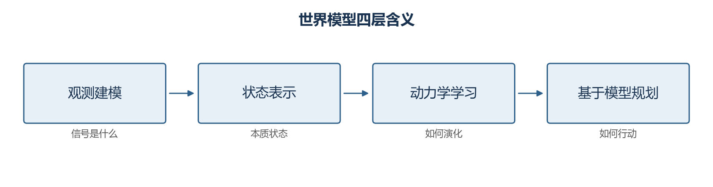

## 1.2　世界模型的历史脉络

世界模型的思想跨越两百余年，可归纳为五个阶段。

**第一阶段：状态空间与最优控制（1960 年代）。** Kalman（1960）提出状态空间滤波，把「隐状态」引入系统建模[1]；Pontryagin 的最优控制与 Bellman 的动态规划（第 4 章）确立了「基于模型优化行动」的框架。这一时期的核心洞见：**若能刻画系统状态与动力学，就能在模型中规划**。

**第二阶段：部分可观测与认知视角（1970—1990 年代）。** POMDP（第 6 章）处理状态不可完全观测时的决策；预测编码与自由能原理（第 3 章）从认知科学角度提出：大脑是一个预测机器，通过最小化预测误差来更新内部模型[2]。

**第三阶段：深度世界模型（2017—2020 年）。** Ha 与 Schmidhuber 的 World Models[3] 用 VAE 编码观测、用 MDN-RNN 学习潜在动力学、在「梦境」中训练控制器；PlaNet[4]、Dreamer[5] 把潜在动力学与强化学习结合，展示基于模型方法的样本效率。

**第四阶段：自监督与生成式世界模型（2021—2023 年）。** JEPA[6] 主张在表示空间而非观测空间预测；DreamerV3 走向跨域通用；以 Sora 为代表的视频生成模型展示出令人惊讶的物理一致性，引发「视频生成器是否是世界模拟器」的争论（第 16 章）。

**第五阶段：交互与通用世界模型（2024 年至今）。** LeCun 提出以世界模型为核心的自主智能架构[7]；交互世界模型（Genie 等）允许用户实时操控生成的世界；3D 世界生成、具身世界模型与世界模型 + 大模型成为前沿。到 2025—2026 年，世界模型被广泛视为通向 AGI 的共识方向之一。

图 1-2 以时间轴归纳上述脉络。贯穿这条主线的是：**从「建模观测」到「建模状态与动力学」，再到「在模型中干预与规划」的能力跃迁**。

> 【图 1-2　世界模型方法演进时间轴】（原图见 figures/图1-2.png）：横轴 1960—2026，标记 Kalman、POMDP、预测编码、World Models、Dreamer、JEPA、Sora、交互世界模型等节点。
>
> 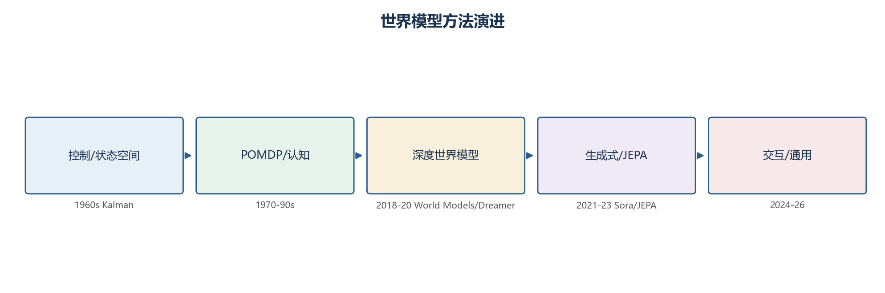

**表 1-1　世界模型方法的技术谱系（节选）**

| 方法 / 模型 | 年代 | 核心思想 | 本书位置 |
|------|------|----------|----------|
| 卡尔曼滤波 | 1960 | 线性高斯状态空间的递推贝叶斯推断 | 第 5 章 |
| POMDP | 1965—1978 | 部分可观测下的信念空间决策 | 第 6 章 |
| HMM 与前向-后向 | 1967 | 离散隐状态的序列推断 | 第 5 章 |
| 预测编码 / 自由能 | 1990s—2006 | 自上而下预测 + 误差最小化 | 第 3 章 |
| Ha & Schmidhuber World Models | 2018 | VAE 编码 + MDN-RNN 潜在动力学 + 梦境训练 | 第 10 章 |
| PlaNet | 2019 | 随机潜在状态 + 基于模型的规划 | 第 11 章 |
| Dreamer / DreamerV3 | 2020—2023 | RSSM 想象训练策略，跨域通用 | 第 12、13 章 |
| JEPA 族（V-JEPA 等） | 2023— | 在表示空间而非像素空间预测 | 第 19—22 章 |
| 视频 / 交互世界模型 | 2024— | 生成与实时交互可控的世界片段 | 第 14—18、27 章 |

**例 1.3（假设强度与模型能力）**　线性卡尔曼滤波假设线性高斯动力学，在数据少时稳健但无法刻画复杂场景；Dreamer 用神经网络学潜在动力学，表达力强但需大量数据；视频世界模型生成逼真，但物理一致性仍不可靠。这一「假设—数据—保真度」的权衡，将在全书反复出现。

## 1.3　世界模型的根本困难

**其一，部分可观测（partial observability）。** 真实环境的状态往往不可完全观测（第 6 章）——智能体只能看到 $o_t$，而非 $s_t$。世界模型 must 从不完整观测中推断潜在状态。

**其二，不确定性与随机性（uncertainty）。** 环境动力学与观测都有噪声，未来本质上是分布的而非确定的（第 6、11 章）。确定性点预测会丢失关键信息。

**其三，长期滚动与误差累积（compounding error）。** 基于模型的规划需在想象中多步滚动；每一步的小误差会累积放大，导致长期预测偏离现实（第 33 章）。

**其四，动作条件化（action conditioning）。** 世界模型不仅要预测「被动观察下世界如何变」，还要预测「若执行动作 $a$，世界如何变」——后者需要动作条件化，是规划的前提（第 23 章）。

**其五，可辨识性（identifiability）。** 多个不同的内部状态与动力学可能产生相同的观测——从观测数据反推真实状态是病态逆问题，需先验与结构约束（第 40 章）。

**定量刻画：误差累积。** 前四类困难中，误差累积对规划的伤害最直接，值得给出一个定量形式。设真实动力学为 $s_{t+1}=f(s_t)$，模型为 $\hat f$，且 $\hat f$ 是 $L$-Lipschitz（即 $\|\hat f(x)-\hat f(y)\|\le L\|x-y\|$）。把模型自 $s_0$ 起滚动 $H$ 步，记一步初始误差 $\delta_0=\|s_1-\hat s_1\|$ 与一步模型误差 $\varepsilon=\sup_s\|f(s)-\hat f(s)\|$，则

$$
\|s_H-\hat s_H\|\le L^{H-1}\delta_0+\varepsilon\sum_{k=0}^{H-2}L^k
=\begin{cases}
L^{H-1}\delta_0+(H-1)\varepsilon, & L=1,\\[4pt]
L^{H-1}\delta_0+\dfrac{L^{H-1}-1}{L-1}\,\varepsilon, & L>1.
\end{cases} \tag{1-4}
$$

$L>1$ 是不稳定系统（如倒立摆、湍流）的典型情形：误差按 $L^H$ **指数放大**，可用预测时程 $H^\ast$（满足误差超过容忍阈值的时间）满足 $H^\ast\approx\log\big(\Delta/\varepsilon\big)/\log L$——动力学越不稳定（$L$ 越大）、模型越不准（$\varepsilon$ 越大），可信赖的规划时程越短。这解释了为何基于模型的规划（第 25 章）必须"滚动式"地在每步重规划，而非一次规划到底；也解释了为何不确定性量化（E4）与模型校准（第 33 章）是世界模型的硬指标，而非可有可无的装饰。

**表 1-2　世界模型的五类根本困难及其应对**

| 困难 | 本质 | 应对章节 |
|------|------|----------|
| 部分可观测 | 状态不可直接观测 | 第 2、6、9 章 |
| 不确定性 | 动力学与观测随机 | 第 6、11 章 |
| 误差累积 | 长期滚动失真 | 第 25、33 章 |
| 动作条件化 | 需预测干预后果 | 第 23—27 章 |
| 可辨识性 | 逆问题病态 | 第 13、40 章 |

五类困难相互交织：部分可观测加剧可辨识性问题；误差累积使不确定性建模更加关键。这提示我们：**方法选择必须以对困难来源的诊断为前提**。

## 1.4　世界模型的七要素

第 1.4 节（本节）提出全书的核心框架：世界模型的七要素。

**定义 1.3（世界模型七要素）**　一个完整的世界模型包含七个要素（表 1-3）：

| 要素 | 名称 | 内涵 |
|------|------|------|
| E1 | 状态表示 | 把观测编码为低维、可预测的潜在状态 |
| E2 | 状态转移 | 学习状态随时间的演化规律 |
| E3 | 观测生成 | 从状态解码出观测（生成模型） |
| E4 | 不确定性 | 用分布/随机状态刻画预测不确定性 |
| E5 | 动作条件化 | 状态转移以动作为条件，支持「若…则…」 |
| E6 | 奖励/目标 | 预测奖励，支撑目标导向行为 |
| E7 | 基于模型的规划 | 利用内部模型推演并优化行动 |

不同的模型覆盖不同的要素子集。卡尔曼滤波具备 E1–E5 但假设线性高斯；Dreamer 以随机潜在状态统一七要素；JEPA 强调在表示空间预测（E1–E2）而弱化生成；视频生成模型侧重 E3 而弱化 E5、E7。第 32 章据此评估世界模型的能力。

**定义 1.4（七要素的形式化）**　把表 1-3 的七要素收敛为一组对象：世界模型 $\mathcal{M}$ 是一个七元组

$$
\mathcal{M}=\big(E_1,\dots,E_7\big)=\big(q_\phi,\ p_\theta,\ g_\theta,\ u_\theta,\ f_\theta(\cdot\mid a),\ r_\theta,\ \Pi\big), \tag{1-5}
$$

其中 $q_\phi$（推断器，E1）、$p_\theta$（状态转移核，E2）、$g_\theta$（观测解码器，E3）、$u_\theta$（不确定性表示，E4）、$f_\theta(\cdot\mid a)$（动作条件化转移，E5）、$r_\theta$（奖励预测，E6）、$\Pi$（基于模型的规划算子，E7）。一个模型可以只实现子集（卡尔曼滤波：E1–E5），也可以以不同精度实现全部七个（DreamerV3）；七要素框架的价值正在于：它让"能力比较"从口号变成可逐项打分的清单（第 32 章评估即按 E1–E7 逐项打分）。

**例 1.4（七要素的对照）**　AlphaGo 的「模型」是已知规则（完美 E2、E5）但无观测生成；Dreamer 学潜在动力学（E1–E4）并用想象训练策略（E7）；Sora 类模型生成逼真视频（E3 强）但难执行精确干预（E5 弱）。七要素框架让我们看清每种方法的侧重与盲区。

## 1.5　全书的结构安排

全书共九篇四十一章，逻辑上层层递进。第一篇（1–4 章）建立理论基础；第二篇（5–8 章）梳理经典世界模型；第三篇（9–13 章）展开深度世界模型；第四篇（14–18 章）论述生成式世界模型；第五篇（19–22 章）进入 JEPA 路线；第六篇（23–27 章）聚焦交互世界模型；第七篇（28–31 章）扩展到物理与 3D；第八篇（32–35 章）给出评估与局限；第九篇（36–41 章）讨论世界模型与通用智能并收束。各章通过交叉引用相互贯通，基础理论遵循「首次且唯一」原则。

**表 1-4　全书九篇结构一览**

| 篇 | 章 | 主题 | 在七要素中的重心 |
|----|----|------|------------------|
| 一 | 1–4 | 理论基础（世界模型、状态空间、自由能、决策） | 概念与目标 |
| 二 | 5–8 | 经典世界模型（HMM、卡尔曼、系统辨识、经典控制） | E1–E5 的解析实现 |
| 三 | 9–13 | 深度世界模型（VAE、World Models、PlaNet、Dreamer、RSSM） | E1–E7 的神经化 |
| 四 | 14–18 | 生成式世界模型（GAN/扩散、视频、Sora、3D） | E3 为主，追问 E5/E7 |
| 五 | 19–22 | JEPA 路线（能量模型、I-/V-JEPA、自监督） | E1–E2 的表示空间预测 |
| 六 | 23–27 | 交互世界模型（动作条件化、MBRL、离线、交互） | E5、E6、E7 |
| 七 | 28–31 | 物理与 3D（物理信息、可微模拟、神经渲染、具身） | 物理一致性与 E2 |
| 八 | 32–35 | 评估与局限（评估、幻觉漂移、因果、规模化） | 能力与边界的度量 |
| 九 | 36–41 | 通用智能（架构、语言、多智能体、科学、开放问题） | 全要素的收束 |

读者可按两条路径阅读：纵向沿「表示—动力学—规划」的能力阶梯（L1→L4，第 1.6 节），横向沿「观测空间 → 潜在空间 → 表示空间」的预测对象迁移。两路径在第 32 章的评估框架处汇合。

## 1.6　四层能力体系

**定义 1.5（四层能力体系）**　世界智能包含四层递进的能力：观测建模（Level 1，世界给了什么信号）、状态表示（Level 2，世界的本质状态）、动力学学习（Level 3，世界如何演化）、基于模型的规划（Level 4，如何利用模型行动）。

四层之间存在递进关系，但**不是严格的线性依赖**：基于模型的规划（Level 4）不必依赖完美的观测生成（Level 1），只需足够好的状态转移与价值模型；生成逼真观测（Level 1）也不保证学会了真实动力学（Level 3）——这正是「生成视频不等于理解物理」的根源。

**例 1.5（非线性依赖）**　Dreamer 直接学潜在状态与动力学（Level 2–3），其观测解码器（Level 1）只是辅助训练信号，规划（Level 4）依赖的是潜在动力学而非像素级重建。反过来，一个完美的视频生成器（Level 1 强）若没学到动作如何改变状态（E5 弱），无法用于规划。

## 1.7　理论主线：世界模型七要素与三个混淆命题

全书对每一个模型追问四件事：① 具备哪几个要素（E1–E7）；② 隐含什么假设；③ 突破前一模型的什么限制；④ 无法突破什么理论边界。

这四问最终都指向同一个优化目标：把推断（E1）、动力学（E2/E5）、观测与奖励的似然（E3/E6）统一进一个变分目标，再在其上施加规划（E7）。本书几乎所有深度模型（第 9–13 章）都可写成如下形式的目标在 $\theta,\phi$ 上的交替优化：

$$
\min_{\theta}\max_{\phi}\;\mathbb{E}_{q_\phi(z_{1:T}\mid o_{1:T})}\Big[\sum_{t}\big(\log p_\theta(o_t\mid z_t)+\log r_\theta(z_t,a_t)\big)\Big]-\beta\,D_{\mathrm{KL}}\!\Big[q_\phi(z_{t+1}\mid z_{1:t},a_t)\,\big\|\,p_\theta(z_{t+1}\mid z_t,a_t)\Big]. \tag{1-6}
$$

式 (1-6) 的第一项是"重建 + 奖励"（让模型解释观测并预测价值），KL 项把推断器 $q_\phi$（用未来观测修正）与动力学先验 $p_\theta$（只靠前推）拉近——二者一致时模型就学会了可自洽滚动的潜在动力学（E2/E5）。它同时是第 3 章自由能、第 9 章 ELBO 与第 13 章 RSSM 损失的共同母体：自由能给出动机，ELBO 给出单步形式，RSSM 把它推广到时序与动作条件化。把握式 (1-6)，读者便握住了全书深度模型的一条主线。

由此还须澄清三个常被混淆的命题：**序列建模不等于世界模型**（第 21 章），**生成视频不等于理解物理**（第 16 章），**能预测不等于能干预**（第 23、34 章）。三者将分别在第四、六、八篇严格说明。

> 【图 1-3　世界模型七要素】（原图见 figures/图1-3.png）：七个方框围绕中心「世界模型」，标注 E1–E7。
>
> 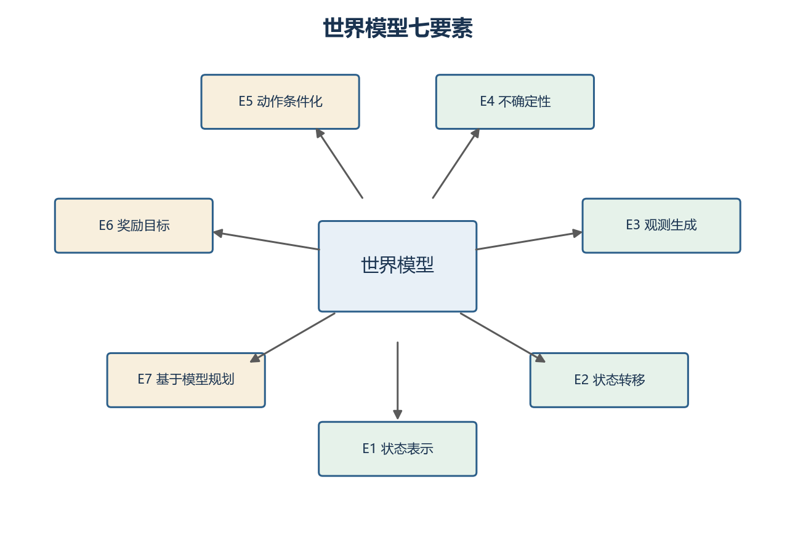

## 1.8　贯穿全书的统一案例

方法谱系横跨两百余年，若每章各用一份互不相干的数据，读者读完易只记住一串模型名称。为此本书设计**贯穿全书的统一案例**：倒立摆控制 + 推箱子机器人。

选择这两个任务，是因为它们具备罕见完备的教学属性：状态明确（角度/角速度、位置/目标）；动力学已知可比（可对照模型误差）；存在部分可观测版本；存在动作条件化与规划需求；可视化的直观性。同一任务在全书中反复出现，但每章追问不同：第 5 章做状态估计，第 9—13 章学潜在动力学，第 16 章做视频生成，第 25 章做规划，第 31 章迁移到机器人仿真。

**表 1-5　统一案例的章节映射（节选）**

| 章 | 案例研究内容 | 章 | 案例研究内容 |
|----|--------------|----|--------------|
| 5 | 卡尔曼滤波状态估计 | 9 | VAE 编码观测 |
| 11 | 潜在动力学（PlaNet） | 12 | Dreamer 想象训练 |
| 16 | 视频世界模型 | 25 | MPC 规划 |
| 31 | 机器人仿真 | 32 | 世界模型评估 |

为避免全书过度依赖单一场景，第 31 章另设自动驾驶、天气、游戏与机器人操作的**专题案例**。

为使统一案例可被严格推导，这里把倒立摆写成第 2 章的状态空间形式（小角度线性化，控制周期 $\tau$，杆长 $\ell$、转动惯量 $I$）：

$$
s_t=\begin{bmatrix}\phi_t\\ \dot\phi_t\end{bmatrix},\quad
s_{t+1}=\underbrace{\begin{bmatrix}1&\tau\\ \tau\,g/\ell & 1\end{bmatrix}}_{\mathbf{A}}s_t+\underbrace{\begin{bmatrix}0\\ \tau^2/I\end{bmatrix}}_{\mathbf{B}}a_t+\xi_t,\qquad
o_t=\underbrace{\begin{bmatrix}1&0\end{bmatrix}}_{\mathbf{C}}s_t+e_t. \tag{1-7}
$$

$\mathbf{A}$ 的特征值含大于 1 的根（不稳定），故倒立摆同时是"部分可观测（$o_t$ 只含 $\phi$）+ 不稳定动力学 + 动作条件化"的三重教学载体：第 5 章用卡尔曼滤波从 $o_t$ 估计 $s_t$，第 9–13 章把 $\mathbf{A},\mathbf{C}$ 换成神经网络学潜在动力学，第 25 章在此模型上做 MPC。全书所有"统一案例"的算例，均以此式 (1-7) 为底层设定，便于跨章对照数值。

## 本章小结

本章确立了全书的问题意识、研究对象与理论框架。

我们首先把世界模型界定为智能体内部对环境状态、动力学、观测生成等的近似模型（式 1-1、1-2），把其核心目标界定为 Next-State Prediction（式 1-3）。回顾两百余年历史可见，方法演进的主线是「从建模观测到建模状态与动力学，再到在模型中干预与规划」。我们剖析了部分可观测、不确定性、误差累积、动作条件化、可辨识性五类根本困难；提出世界模型七要素框架（E1–E7）与四层能力体系；并澄清三个混淆命题。二者将在第 41 章回扣，形成闭环。

最后，本章确立倒立摆与推箱子为贯穿案例。从下一章起，我们先补足状态空间与潜在变量基础，为后续模型的严格推导准备语言。

**进一步阅读**　本章建议延伸阅读的文献：[1]、[2]、[6]、[7]。

## 参考文献

[1] Kalman R E. A new approach to linear filtering and prediction problems. *Journal of Basic Engineering*, 1960, 82(1): 35–45.

[2] Friston K. The free-energy principle: a unified brain theory? *Nature Reviews Neuroscience*, 2010, 11(2): 127–138.

[3] Ha D, Schmidhuber J. World models. *NeurIPS 2018 Workshop*, 2018.

[4] Hafner D, Lillicrap T, Fischer I, et al. Learning latent dynamics for planning from pixels. *ICML*, 2019.

[5] Hafner D, Lillicrap T, Ba J, Norouzi M. Dream to control: Learning behaviors by latent imagination. *ICLR*, 2020.

[6] LeCun Y. A path towards autonomous machine intelligence. *Open Review*, 2022.

[7] LeCun Y. AI for science and the future of intelligence. *Lecture*, 2023.

[8] Sutton R S, Barto A G. *Reinforcement Learning: An Introduction*. 2nd ed. MIT Press, 2018.

---

# 第 2 章　状态空间与潜在变量模型

第 1 章把世界模型界定为对环境状态与动力学的内部近似。本章回答一个基础问题：**状态与动力学如何用数学刻画？** 状态空间模型（state-space model）提供了统一的语言：系统由隐藏状态与观测构成，状态按动力学演化，观测由状态生成。这既是控制论的经典工具（第 5 章卡尔曼滤波），也是深度世界模型的表示基础（第 9 章 VAE、第 13 章 RSSM）。

本章先给出状态空间的形式化（2.1 节），再讲马尔可夫性与状态充分性（2.2 节），推导线性高斯状态空间模型与卡尔曼推断（2.3 节），讨论非线性扩展与近似推断（2.4 节），把状态空间模型定位为世界模型的"最小完备"原型（2.5 节），并在边界与讨论中收束（2.6 节）。

## 2.1　状态、观测与潜在变量的形式化

**定义 2.1（状态空间模型）**　状态空间模型（SSM）由状态转移与观测方程构成：

$$
\begin{aligned}
\text{转移:}\quad & s_{t+1}=f(s_t,a_t,\xi_t),\\
\text{观测:}\quad & o_t=g(s_t,\eta_t),
\end{aligned} \tag{2-1}
$$

其中 $s_t\in\mathcal{S}$ 为（可能隐藏的）状态，$a_t$ 为动作，$o_t$ 为观测，$\xi_t,\eta_t$ 为过程噪声与观测噪声。当 $s_t$ 不可直接观测时，称为**潜在变量模型**（latent variable model），智能体须从观测历史推断 $s_t$。

**状态 vs 观测。** 状态是世界的「真实」配置（含隐藏信息），观测是传感器看到的「表象」。世界模型的核心任务是学习从观测到状态的推断 $q_\phi(s_t\mid o_{\le t})$，以及状态动力学 $p_\theta(s_{t+1}\mid s_t,a_t)$。

**推断的递推结构。** 世界模型的所有推断问题，都建立在两组递推之上。其一是**预测（prediction）**：用动力学把后验前推一步，

$$
p(s_t\mid o_{1:t-1})=\int p(s_t\mid s_{t-1},a_{t-1})\,p(s_{t-1}\mid o_{1:t-1})\,ds_{t-1}, \tag{2-2}
$$

其二是**滤波（filtering）**：用新观测 $o_t$ 做贝叶斯修正，

$$
p(s_t\mid o_{1:t})=\frac{p(o_t\mid s_t)\,p(s_t\mid o_{1:t-1})}{p(o_t\mid o_{1:t-1})}. \tag{2-3}
$$

式 (2-2)、(2-3) 交替执行，即「预测—更新」循环：先靠动力学外推、再用观测拉回。它把对完整历史 $o_{1:t}$ 的依赖，压缩为对单步后验的递推——这正是第 5 章卡尔曼滤波、第 6 章 POMDP 信念更新、第 13 章 RSSM 的公共骨架。线性高斯时后验保持高斯，式 (2-2)、(2-3) 退化为对 $(\hat s_t,\mathbf P_t)$ 的闭式递推；非线性或离散时则需数值或采样近似。

**例 2.1（倒立摆的状态与观测）**　倒立摆的真实状态是角度与角速度 $(\phi,\dot\phi)$。若摄像头只能看到摆的像素图像 $o_t$，则状态 $(\phi,\dot\phi)$ 是潜在的——需从图像推断。若角度传感器直接可读，则状态可观测。这一区分决定了用 POMDP（第 6 章）还是 MDP 建模。

> 【图 2-1　线性高斯状态空间模型】（原图见 figures/图2-1.png）：状态 $s_t$ 经转移矩阵 A 到 $s_{t+1}$，经观测矩阵 C 到 $o_t$，标注过程噪声与观测噪声。
>
> 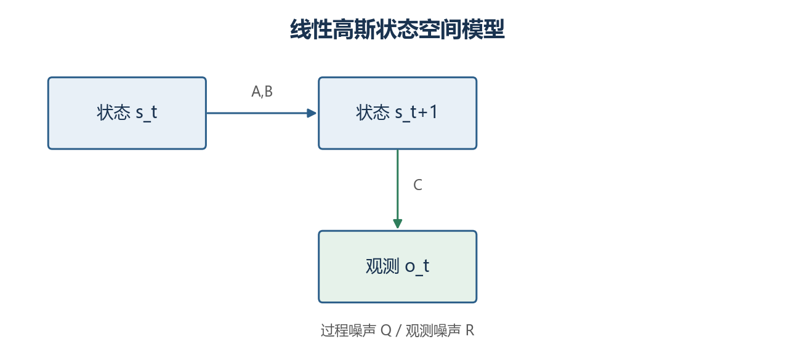

## 2.2　马尔可夫性与状态充分性

**定义 2.2（马尔可夫性）**　状态 $s_t$ 满足一阶马尔可夫性，若

$$
p(s_{t+1}\mid s_t,a_t,s_{t-1},a_{t-1},\dots)=p(s_{t+1}\mid s_t,a_t). \tag{2-4}
$$

即：给定当前状态与动作，未来与过去独立。这是状态空间模型可 tractable 推断的关键——它把对完整历史的依赖压缩为对当前状态的依赖。

**定义 2.3（状态充分性）**　状态 $s_t$ 对预测充分，若它保留了历史中所有与未来相关的信息：别的变量 $z_t$ 满足 $p(o_{\ge t}\mid s_t,z_t)=p(o_{\ge t}\mid s_t)$。充分状态是「历史的充分统计量」。

**关键问题：观测不满足马尔可夫性。** 原始观测 $o_t$ 通常不满足马尔可夫性（下一帧不只依赖当前帧，还依赖速度等隐藏量）。因此世界模型必须学习**潜在状态** $z_t$（满足或近似马尔可夫性）——这正是第 9、13 章的核心。

**例 2.2（观测的非马尔可夫性）**　视频中单帧图像 $o_t$ 无法区分「静止的球」与「高速运动恰好清晰的球」——下一帧不同。但潜在状态 $z_t=(\text{位置},\text{速度})$ 满足马尔可夫性，可预测下一帧。世界模型要从观测序列中「提炼」出这样的潜在状态。

**高阶马尔可夫与记忆。** 一阶马尔可夫性并非总能满足。若需保留 $h$ 步历史才能预测，可把状态增广为 $x_t=(s_t,s_{t-1},\dots,s_{t-h+1})$，使其重新满足一阶马尔可夫——这是"用状态增广换取马尔可夫性"的通用技巧。单步观测 $o_t$ 对未来的残余依赖可用条件互信息量化：

$$
I(o_{\ge t+1};\,o_{\le t-1}\mid o_t), \tag{2-5}
$$

一阶马尔可夫下该项为零；视频、语音等序列中它通常显著非零，说明单帧/单步观测**非马尔可夫**，必须引入速度、动量等隐藏量才能把历史压缩掉。第 9、13 章的 RNN/LSTM 隐状态 $h_t$ 正是这种"可学习的增广状态"，它把任意长的相关结构塞进一个定长向量，相当于自适应地选择了足够大的 $h$。

**边界与讨论。** 马尔可夫性是建模假设，现实系统常有长程依赖（第 20.4 节类似问题）。生物系统、经济系统可能需高阶状态或纳入记忆（第 21 章 V-JEPA 的上下文）。

## 2.3　线性高斯状态空间模型

**定义 2.4（线性高斯 SSM）**　当 $f,g$ 线性、噪声高斯时：

$$
\begin{aligned}
s_{t+1}&=\mathbf{A}s_t+\mathbf{B}a_t+\xi_t,\quad \xi_t\sim\mathcal{N}(0,\mathbf{Q}),\\
o_t&=\mathbf{C}s_t+\eta_t,\quad \eta_t\sim\mathcal{N}(0,\mathbf{R}),
\end{aligned} \tag{2-6}
$$

其中 $\mathbf{A}$ 为状态转移矩阵，$\mathbf{B}$ 为动作矩阵，$\mathbf{C}$ 为观测矩阵，$\mathbf{Q},\mathbf{R}$ 为过程/观测噪声协方差。这是卡尔曼滤波的基础（第 5 章）。

**推断问题**是给观测序列 $o_{1:T}$ 估计状态后验 $p(s_t\mid o_{1:t})$；线性高斯下后验仍是高斯，可精确递推。对式 (2-6)，把式 (2-2)、(2-3) 写成均值 $\hat s_t$ 与协方差 $\mathbf P_t$ 的闭式（第 5 章给出完整推导与两种证明，此处只列结构）——其中协方差 $\mathbf P_t$ 正是七要素中 E4（不确定性）的度量：

$$
\hat s_{t\mid t-1}=\mathbf A\hat s_{t-1}+\mathbf B a_{t-1},\qquad
\mathbf P_{t\mid t-1}=\mathbf A\mathbf P_{t-1}\mathbf A^\top+\mathbf Q, \tag{2-7}
$$

$$
\mathbf K_t=\mathbf P_{t\mid t-1}\mathbf C^\top(\mathbf C\mathbf P_{t\mid t-1}\mathbf C^\top+\mathbf R)^{-1},\qquad
\hat s_t=\hat s_{t\mid t-1}+\mathbf K_t(o_t-\mathbf C\hat s_{t\mid t-1}). \tag{2-8}
$$

卡尔曼增益 $\mathbf K_t$ 是按先验不确定 $\mathbf P_{t\mid t-1}$ 与观测噪声 $\mathbf R$ 自动权衡的"信任系数"：$\mathbf R$ 大（观测不可信）时 $\mathbf K_t$ 小、更信预测；$\mathbf Q$ 大（动力学不确定）时先验不确定大、$\mathbf K_t$ 大、更信观测。滤波还顺带给出对数似然（预测误差分解）：

$$
\log p(o_{1:T})=-\tfrac12\sum_{t=1}^{T}\Big[\log(2\pi)+\log\det(\mathbf C\mathbf P_{t\mid t-1}\mathbf C^\top+\mathbf R)+v_t^\top(\mathbf C\mathbf P_{t\mid t-1}\mathbf C^\top+\mathbf R)^{-1}v_t\Big],\quad v_t=o_t-\mathbf C\hat s_{t\mid t-1}. \tag{2-9}
$$

式 (2-9) 说明：一遍前向滤波即同时完成状态估计与似然求值，这是后续参数辨识（第 7 章）与变分学习（第 9 章）的共同基础。

**滤波、预测与平滑三问题。** 给定全部观测 $o_{1:T}$，状态推断可分三类：

| 问题 | 目标分布 | 信息集 | 典型用途 |
|------|----------|--------|----------|
| 滤波 | $p(s_t\mid o_{1:t})$ | 历史 | 在线估计、实时控制 |
| 预测 | $p(s_{t+h}\mid o_{1:t})$ | 历史，向前 $h$ 步 | 预测、滚动规划 |
| 平滑 | $p(s_t\mid o_{1:T})$ | 全序列（含未来） | 离线复盘、参数估计 |

前向滤波（式 2-2）、(2-3) 给出滤波分布；预测是把滤波结果沿式 (2-6) 反复前推 $h$ 步；平滑则再叠加一个**后向递推**（Rauch–Tung–Striebel，第 5 章），把"未来信息"回传给历史状态。本书主关注在线情形（滤波），但离线训练世界模型时常用平滑值作为监督标签。

**例 2.3（一维随机游走：数值滤波）**　设 $s_{t+1}=s_t+\xi_t$（$\xi_t\sim\mathcal{N}(0,0.1)$），$o_t=s_t+\eta_t$（$\eta_t\sim\mathcal{N}(0,0.5)$），初始 $s_0=0$，即 $A=B=C=1$、$Q=0.1$、$R=0.5$，$\hat s_0=0$、$P_0=1$。给定观测 $o_1=1.2$，按式 (2-7)、(2-8) 手算一步：预测 $\hat s_{1\mid0}=0$、$P_{1\mid0}=1.1$；增益 $K_1=1.1/(1.1+0.5)\approx0.6875$；更新 $\hat s_1=0.6875\times1.2=0.825$、$P_1=(1-0.6875)\times1.1\approx0.3437$。可见单步观测把状态不确定从 $P=1$ 收缩到 $\approx0.34$，并把估计向观测拉近 $0.825$。多步后 $P_t$ 收敛到代数 Riccati 方程 $p=(p+0.1)\,0.5/(p+0.1+0.5)$ 的解 $p\approx0.209$，即滤波进入稳态、对新观测的信任度稳定在 $K\approx0.209/0.709\approx0.295$。这给出信噪比直觉：$\mathbf R$ 大（观测不可靠）时 $\mathbf K$ 小、更信预测；$\mathbf Q$ 大（动力学不确定）时先验不确定大、$\mathbf K$ 大、更信观测。

**表 2-1　状态空间模型的谱系**

| 模型 | 转移 | 观测 | 推断 |
|------|------|------|------|
| 线性高斯 SSM | 线性 | 线性 | 卡尔曼（精确） |
| HMM | 离散 | 离散/连续 | 前向-后向 |
| 非线性 SSM | 非线性 | 非线性 | 扩展KF/粒子滤波 |
| 深度 SSM（VAE/RSSM） | 神经 | 神经 | 变分近似 |

## 2.4　非线性状态空间与推断

**非线性扩展。** 当 $f,g$ 非线性时，后验不再高斯，需近似推断：

- **扩展卡尔曼滤波（EKF）**：局部线性化 $f,g$（雅可比矩阵），再套用卡尔曼公式（第 5 章）；
- **无迹卡尔曼滤波（UKF）**：用 sigma 点采样近似分布，无需解析雅可比；
- **粒子滤波**：用一组带权粒子表示后验，适合强非线性/非高斯（第 5 章）；
- **变分推断**：用神经网络 $q_\phi(s_t\mid o_{\le t})$ 近似后验，最大化 ELBO（第 9 章）。

**深度状态空间模型。** VAE（第 9 章）把 $s_t$ 作为潜在变量，用编码器 $q_\phi(s_t\mid o_t)$ 与解码器 $p_\theta(o_t\mid s_t)$ 学习；RSSM（第 13 章）进一步引入确定性状态与随机状态，兼顾长程记忆与随机性。这些模型把 SSM 的思想扩展到高维观测（像素）与复杂动力学。

**例 2.4（变分推断的直觉）**　真实后验 $p(s_t\mid o_{\le t})$ 复杂不可解，变分方法用一个简单的分布 $q_\phi(s_t\mid o_{\le t})$（如高斯）去逼近它，通过最大化 ELBO（第 9 章）使 $q$ 接近真后验。这是深度世界模型推断潜在状态的主流方法。

**三种近似推断的统一视角。** 上述方法其实都在解决同一件事：用一族参数化/采样分布近似真实后验 $p(s_t\mid o_{1:t})$。变分推断用一族高斯 $q_\phi$，其优化目标是 ELBO 的时序版（第 9 章方法在序列上的推广）：

$$
\max_\phi\ \mathbb E_{q_\phi(z_t\mid o_{\le t})}\big[\log p_\theta(o_t\mid z_t)+\log p(z_t\mid z_{t-1},a_{t-1})\big]-D_{\mathrm{KL}}\big[q_\phi(z_t\mid o_{\le t})\,\big\|\,p(z_t\mid z_{t-1},a_{t-1})\big]. \tag{2-10}
$$

EKF 与 UKF 的区别仅在于"如何传播一簇点"：UKF 取 $2m+1$ 个 sigma 点 $\chi_i$ 与权重 $w_i$（$m$ 为状态维），用它们无偏地逼近均值与协方差，

$$
\bar x=\sum_i w_i^m\chi_i,\qquad \Sigma=\sum_i w_i^c\,\chi_i\chi_i^\top-\bar x\bar x^\top, \tag{2-11}
$$

其优势是只需传播一、二阶矩、避免求雅可比，对中等非线性显著优于 EKF。粒子滤波则最通用：用 $N$ 个带权样本 $\{z_t^{(i)},w_t^{(i)}\}$ 表示任意后验，权重按重要性函数递归更新，并周期性重采样以对抗粒子退化。三者表达力递增（变分≈EKF < UKF < 粒子），计算代价亦递增——这是世界模型「表达力—计算」权衡的第一次出现，将在第 9、13、33 章反复回看。

**例 2.5（粒子滤波手算）**　设静态模型 $s\sim\mathcal N(0,1)$，观测 $o\sim\mathcal N(s,0.5)$，实测 $o=1.2$。取两个粒子 $s^{(1)}=0.5,\ s^{(2)}=1.8$，权重正比于 $p(o\mid s^{(i)})$：$w^{(1)}\propto\exp(-0.7^2/0.5)=0.375$，$w^{(2)}\propto\exp(-0.6^2/0.5)=0.487$，归一化得 $(0.435,0.565)$，加权均值 $0.5\times0.435+1.8\times0.565\approx1.23$。而高斯闭式后验均值为 $0.8$（$K=1/(1+0.5)$）——两个粒子的粗采样偏差高达 $0.43$，这正是**蒙特卡洛方差**的直观体现：粒子数少则估计抖，须增大 $N$ 并按权重重采样。它提醒我们：粒子滤波的精度由有效粒子数 $N_{\mathrm{eff}}=1/\sum_i w_i^2$ 决定，而非名义粒子数。

## 2.5　状态空间模型作为世界模型的原型

在进入非线性与深度扩展之前，值得先回答一个定位问题：状态空间模型与第 1 章的世界模型七要素是何关系？对照可见，**标准 SSM 正好覆盖 E1–E5**：

| 要素 | 在 SSM 中的载体 |
|------|----------------|
| E1 状态表示 | 隐状态 $s_t$（卡尔曼：$\hat s_t$） |
| E2 状态转移 | 动力学 $\mathbf A,\mathbf B$ |
| E3 观测生成 | 观测方程 $\mathbf C$ |
| E4 不确定性 | 后验协方差 $\mathbf P_t$ |
| E5 动作条件化 | $\mathbf B a_t$ 项 |

它唯独缺少 E6（奖励预测）与 E7（规划）——补上奖励头 $r_\theta(s_t,a_t)$ 与规划算子，就得到第 4 章的 LQR / 第 25 章的 MPC。这一对照给出全书的方法学立场：**状态空间模型是"最小完备世界模型"**，所有深度世界模型（VAE、RSSM、Dreamer）本质上是把 $\mathbf A,\mathbf C$ 从固定线性矩阵推广为可学习的神经网络，把高斯后验推广为变分/粒子近似，把"人设定 $\mathbf A$"推广为"从数据学 $\mathbf A$"。因此第 2 章的语言——状态、动力学、观测、不确定性——是全书反复复用的最小词汇表；后续各章不再重述这些定义，只在此基础上做扩展。

## 2.6　边界与讨论

**可辨识性的根源。** 状态空间模型有一个根本的模糊性：对状态做任何可逆变换，同时相应地变换 $\mathbf A,\mathbf C,\mathbf Q$，式 (2-6) 生成的观测分布完全不变：

$$
p(o_{1:T}\mid \mathbf A,\mathbf C,\mathbf Q)=p(o_{1:T}\mid \tilde{\mathbf A},\tilde{\mathbf C},\tilde{\mathbf Q}),\qquad \tilde s_t=\mathbf T s_t,\ \tilde{\mathbf A}=\mathbf T\mathbf A\mathbf T^{-1},\ \tilde{\mathbf C}=\mathbf C\mathbf T^{-1},\ \tilde{\mathbf Q}=\mathbf T\mathbf Q\mathbf T^\top. \tag{2-12}
$$

即状态表示在不唯一的意义上**不可辨识**：学到的潜在状态不必对应「真实」物理状态，只要动力学与观测一致即可（第 13、40 章）。这对世界模型有双重含义：其一是负担——无监督下学出的 $z_t$ 可能是真实状态的任意扭曲，跨任务迁移时需校准；其二是自由——我们可自由选择对预测最有用的参数化（旋转、缩放、解耦），不必执着于"还原真实物理"，这正是变分与深度 SSM 能工作的理论基础。

**例 2.6（不可辨识性的具体化：局部水平模型）**　取最简单的局部水平模型 $\mu_{t+1}=\mu_t+\eta_t,\ o_t=\mu_t+\varepsilon_t$（式 2-6 的标量特例）。令 $\tilde\mu_t=c\,\mu_t$（$c>0$ 任意常数），则 $\tilde A=1,\ \tilde C=c,\ \tilde Q=c^2q$ 同样满足式 (2-12)：观测分布 $p(o_{1:T})$ 完全不变。这意味着从数据里学出的"水平"只有**尺度相对**意义——它可能是真实用电水平、也可能是任意倍数，数据本身无法定标。工程上要么靠传感器定标（已知 $\mu$ 的量纲），要么只关心 $\Delta\mu$（变化率）这种尺度不变的量。这与第 13 章"平滑参数由信噪比决定"一脉相承：绝对状态不可辨识，**可辨识的永远是它引出的观测量与相对量**。

**与后续章节的联系。** 本章的状态空间、马尔可夫性与推断，将在第 5 章（卡尔曼）、第 6 章（POMDP）、第 9 章（VAE/ELBO）、第 13 章（RSSM）反复使用。线性高斯模型是理解非线性/深度模型的基准。

**状态维与计算代价。** 还须留意一个工程边界：卡尔曼滤波的每步代价是 $O(m^3)$（$m$ 为状态维），源于协方差矩阵的乘法与求逆。状态维小（$m\le$ 几十）时实时性良好；$m$ 大时，须靠结构化 $\mathbf Q$（对角、块对角）、低秩近似或稀疏 $\mathbf A$ 来压成本。这与第 21 章结构化状态空间网络、第 13 章 RSSM 用 RNN 隐状态代替显式高维协方差，是同一问题的两种应对——后者把"协方差"隐式编码进神经网络权重，从而绕开 $O(m^3)$。理解这一点，能避免把卡尔曼滤波误用为高维深度模型的"标准推断器"。

**模型误设的系统性后果。** 线性高斯假设一旦违反，误差不会均匀分布，而是集中放大：非线性系统的 EKF 在一阶线性化处失真最重，非高斯/多峰噪声则让粒子滤波退化。更隐蔽的是 $\mathbf Q,\mathbf R$ 的误设——它们决定增益 $\mathbf K$ 与稳态方差，设错会令估计产生系统性偏置而非随机抖。因此工程上须用式 (2-9) 的似然或残差诊断（第 7 章系统辨识、第 32 章评估）反推 $\mathbf Q,\mathbf R$，而非拍脑袋。这是"世界模型的可信度"问题在状态空间层面的第一次正式出现。

状态空间给出了描述世界的数学语言。第 3 章将从认知科学角度讨论预测编码与自由能——为「智能体为何要维护世界模型」提供理论解释。

## 本章小结

本章建立状态空间与潜在变量的形式化基础。

我们首先定义状态空间模型（式 2-1）：状态按动力学转移、生成观测；区分状态（真实配置）与观测（表象），指出世界模型要从观测中推断潜在状态。接着讨论马尔可夫性（式 2-4）与状态充分性，说明原始观测通常非马尔可夫、须提炼潜在状态。我们推导线性高斯 SSM（式 2-6）与卡尔曼滤波的推断框架，并给出谱系（表 2-1）。我们介绍非线性扩展（EKF、UKF、粒子滤波、变分推断）与深度状态空间模型（VAE、RSSM）。

我们还明确边界：状态表示存在可辨识性的固有模糊——学到的状态不必对应真实状态。这些辨析衔接第 5、6、9、13、40 章。

下一章从认知科学角度讨论预测编码与自由能原理，回答「智能体为何要维护世界模型」。

**进一步阅读**　本章建议延伸阅读的文献：[1]、[2]、[3]。

## 参考文献

[1] Kalman R E. A new approach to linear filtering and prediction problems. *Journal of Basic Engineering*, 1960, 82(1): 35–45.

[2] Ghahramani Z. An introduction to hidden Markov models and Bayesian networks. *International Journal of Pattern Recognition and Artificial Intelligence*, 2001, 15(1): 9–42.

[3] Friston K. The free-energy principle: a unified brain theory? *Nature Reviews Neuroscience*, 2010, 11(2): 127–138.

[4] Durbin J, Koopman S J. *Time Series Analysis by State Space Methods*. Oxford: Oxford University Press, 2012.

[5] Buckingham R. *Bayesian AI Advisor: Kalman Filters*. CreateSpace, 2015.

[6] Kingma D P, Welling M. Auto-encoding variational Bayes. *ICLR*, 2014.

[7] Hafner D, Lillicrap T, Ba J, Norouzi M. Dream to control: Learning behaviors by latent imagination. *ICLR*, 2020.

[8] Julier S J, Uhlmann J K, Durrant-Whyte H F. A new method for the nonlinear transformation of means and covariances. *IEEE Transactions on Automatic Control*, 2000, 45(3): 477–482.

---

# 第 3 章　预测编码与自由能原理

第 2 章从数学上刻画了状态与动力学。本章从认知科学角度回答一个更根本的问题：**智能体为什么要维护世界模型？** 预测编码（predictive coding）与自由能原理（free-energy principle）给出一种统一回答：大脑（及任何自组织系统）通过最小化「预测误差」来更新内部模型，使内部模型与外部环境保持一致。这为世界模型提供了认知与理论根基。

这条思想有明确的历史谱系：Rao 与 Ballard 于 1999 年最早把「预测编码」写成视觉皮层的层级生成模型[1]，指出皮层只向上传递预测误差、把高层预测当作误差的零阶近似；Friston 在 2006、2010 年把它推广为「自由能原理」[2]，主张一切自组织系统（从单细胞到智能体）都在做同一件事——**最小化自身生成模型与感觉输入之间的变分自由能**；2012 年以后「主动推理」（active inference）进一步把**行动**纳入同一目标[6]。这条谱系与第 13 章循环状态空间模型（RSSM）的训练目标一脉相承：RSSM 的 ELBO、重建损失与 KL 正则，本质上是自由能在深度网络参数化下的工程实现。

本章先介绍预测编码（3.1 节），再推导自由能原理（3.2 节），讨论主动推理——把感知与行动统一在最小化自由能的框架下（3.3 节），审视其对世界模型的启示（3.4 节），并在边界与讨论中收束（3.5 节）。

## 3.1　预测编码：大脑作为预测机器

**定义 3.1（预测编码）**　预测编码假说认为：认知系统不是自下而上地被动处理 sensory 信号，而是**自上而下地生成预测**，并把预测与实际观测的误差（prediction error）向上传递，用于更新内部模型[1]。

形式化地，层级结构每一层 $l$ 维护对下一层活动的预测 $\hat{x}_l$，传递预测误差：

$$
\varepsilon_l = x_l - \hat{x}_l,\qquad \hat{x}_l = f_l(\hat{x}_{l+1}). \tag{3-1}
$$

系统通过调整内部模型参数使 $\varepsilon_l$ 最小化——这与第 2 章的状态估计、第 9 章的 ELBO 优化在数学上相通。这一「生成模型 + 误差反馈」的结构其实早有渊源：Dayan、Hinton 与 Neal 在 1995 年提出的**亥姆霍兹机（Helmholtz machine）**[7] 已把感知写成「能量下降」过程——网络以自回归方式生成预测，再以对比散度（contrastive divergence）让能量函数 $E$ 在真实数据上低于在模型数据上，从而隐式最大化数据似然。预测编码可视为亥姆霍兹机在**层级生成模型**上的推广：把单层能量最小化升级为逐层预测误差的最小化，把隐变量的推断与生成统一在同一套参数里。这个联系解释了为何深度世界模型的「编码器 + 解码器 + 误差损失」组合（第 9—13 章）在结构上如此接近生物视觉皮层的层级预测——它们是同一原理在不同参数规模下的实现。

**层级生成模型与后验更新。** 预测编码可严格地写成一个层级生成模型：高层 $x_l$ 约束低层 $x_{l-1}$，

$$
p(x_1,\dots,x_L)=p(x_L)\prod_{l=1}^{L-1}p(x_{l+1}\mid x_l), \tag{3-2}
$$

其中每层的预测 $x_l\mid x_{l+1}$ 取高斯，均值由上层下传。给定顶层预测 $\hat x_l$（自上而下）与底层活动 $x_l$（自下而上），预测误差的后验均值为

$$
\hat x_l^{(\text{post})}=\frac{\pi_l^{\text{up}}\,x_l+\pi_l^{\text{down}}\,\hat x_l}{\pi_l^{\text{up}}+\pi_l^{\text{down}}},\qquad \pi_l^{\text{up}}\propto\frac{1}{\sigma_l^2}, \tag{3-3}
$$

即按**精度**（精度的逆即方差）加权融合"自下而上的误差"与"自上而下的预测"。精度 $\pi$ 本身可学习：注意机制、时间衰减、先验置信都体现为 $\pi$ 的变化——高误差且高精度触发强烈学习（如视觉中的注意捕获），低精度则抑制更新。式 (3-3) 正是第 2 章卡尔曼增益 $K=\pi^{\text{up}}/(\pi^{\text{up}}+\pi^{\text{down}})$ 在层级结构中的逐层版本：二者本质同为"按不确定度加权的信息融合"，前者用于感知、后者用于估计，统一在变分推断之下。

把式 (3-3) 对内部参数求梯度，可看出**精度即学习率**这一更深层的角色。设底层后验均值对生成模型参数 $\theta_l$ 的更新为 $\Delta\theta_l\propto \pi_l^{\text{up}}\,\varepsilon_l\,\partial x_l/\partial\theta_l$：当观测精度高（$\pi_l^{\text{up}}$ 大）且预测误差大（$\varepsilon_l$ 大）时，参数更新幅度大；反之则小。这意味着同一个网络在不同输入上会**自适应地调整自己的学习率**——对可信且意外的信号快速修正，对不可信或已预期的信号几乎不动。这一性质是深度学习中「课程学习」「异常加权」等技巧的认知原型，也是第 12 章 Dreamer 中 KL 系数 $\beta$ 与重建损失权重需要自适应调节（而非固定）的理论依据。

**例 3.5（两层预测编码的数值算例）**　设顶层预测目标位置 $\hat x_2=5.0$、精度 $\pi_2^{\text{down}}=10$；底层实测 $x_2=5.6$、精度 $\pi_2^{\text{up}}=20$。按式 (3-3)：后验修正 $\hat x_2^{(\text{post})}=(20\times5.6+10\times5.0)/(20+10)=(112+50)/30=5.40$，原始预测误差 $\varepsilon_2=x_2-\hat x_2=0.6$。若底层 $\hat x_1=3.0$、实测 $x_1=3.2$、两层精度同取 $(20,10)$，则 $\varepsilon_1=0.2$、$\hat x_1^{(\text{post})}=(20\times3.2+10\times3.0)/30\approx3.133$。可见顶层较大的误差（$0.6$）会经"下传预测 → 反馈修正"逐层向低层传播并调整估计——预测编码的"误差反向传播"在此是**前馈预测 + 反馈误差**的逐层递归，而非神经网络的梯度反向传播。这一"先验预测—后验修正"的双路径结构，在深度世界模型中对应 RSSM 的随机状态先验 $p_\psi(z_t\mid h_t)$ 与后验 $q_\phi(z_t\mid h_t,o_t)$（第 13 章）。

**例 3.1（视觉中的预测编码）**　看到一张模糊图片时，大脑先凭经验「猜测」它是什么（高层预测），再用实际感官信号修正（误差反馈）。看到熟悉场景时误差小（预测准），看到异常时误差大（触发注意与学习）。这解释了为何我们更擅长识别符合预期的事物。

> 【图 3-1　预测编码与自由能】（原图见 figures/图19-1.png）：层级结构，高层生成向下预测、底层向上传递预测误差。
>
> 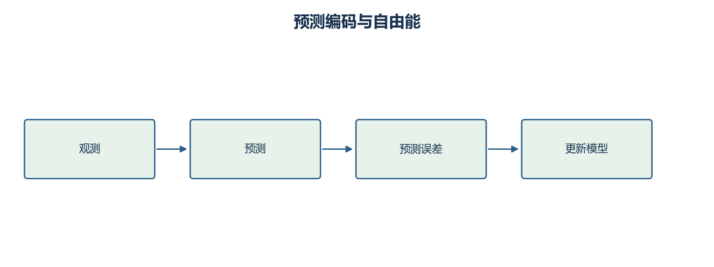

## 3.2　自由能原理

**定义 3.2（自由能）**　Friston 的自由能原理[2]把预测误差的形式推广为**变分自由能**。设观测 $o$、潜在状态 $s$、生成模型 $p(o,s)=p(o\mid s)p(s)$，用近似后验 $q(s)$ 推断，自由能为

$$
F(q) = \mathbb{E}_{q(s)}[\log q(s) - \log p(o,s)] = D_{\mathrm{KL}}[q(s)\|p(s\mid o)] - \log p(o). \tag{3-4}
$$

式 (3-4) 与第 9 章的 ELBO 形式一致（$F=-\mathrm{ELBO}$）。最小化自由能 $F$ 等价于：让 $q(s)$ 接近真实后验 $p(s\mid o)$（推断），同时最大化模型证据 $p(o)$（学习）。

**核心主张。** 自由能原理认为：任何自组织系统（生物或人工）都倾向于最小化其自由能——即让内部生成模型与感觉观测保持一致。这是一个涵盖感知、学习、行动的统一目标。

**推导直觉。** 由 $F = D_{\mathrm{KL}}[q\|p(s\mid o)] - \log p(o)$，因 KL 非负，故 $F\ge -\log p(o)$（自由能是「负对数证据」的上界）。最小化 $F$ 迫使 $q$ 逼近后验（推断）且 $p(o)$ 变大（模型更好地解释观测）。

**例 3.2（自由能与惊讶）** $-\log p(o)$ 是观测的「惊讶度」（surprisal）——罕见事件惊讶度高。系统无法直接改变观测，但可通过更新内部模型使观测变得「可预期」（降低自由能）。这解释了学习：模型改进 → 惊讶降低 → 自由能降低。

**变分界的严格推导。** 式 (3-4) 右侧的等号可逐步展开。在 $\mathbb E_q[\cdot]$ 下加入并减去 $\log p(o\mid s)$：

$$
\begin{aligned}
F(q)&=\mathbb E_q[\log q(s)]-\mathbb E_q[\log p(o\mid s)]+\mathbb E_q[\log p(o\mid s)]-\mathbb E_q[\log p(o\mid s)]\\
&=\underbrace{D_{\mathrm{KL}}\big[q(s)\,\big\|\,p(s\mid o)\big]}_{\text{复杂度（认知代价）}}-\underbrace{\log p(o)}_{\text{惊讶的负值}}. \tag{3-5}
\end{aligned}
$$

第一项度量"$q$ 偏离真实后验"的程度（拟合的代价），第二项是惊讶的负值。最小化 $F$ 即在"拟合观测（降惊讶）"与"保持简单（降复杂度）"之间权衡——这正是正则化的贝叶斯本质，也是 Occam 剃刀的量化。又因 $-\log p(o)$ 不依赖于 $q$，**固定 $q$ 族最小化 $F$ 等价于最大化证据下界（ELBO）**：

$$
\mathrm{ELBO}(q)=\mathbb E_q[\log p(o,s)]-\mathbb E_q[\log q(s)]=-F(q). \tag{3-6}
$$

式 (3-6) 把第 3 章的自由能与第 9 章的 ELBO 正式接通：同一枚硬币的两面，自由能是"上界"，ELBO 是"下界"，二者仅符号相反。

**例 3.6（自由能的数值算例）**　取两状态模型：真实后验 $p(s\mid o)=(0.7,0.3)$，变分近似 $q(s)=(0.9,0.1)$，观测证据 $p(o)=0.6$。则

$$
D_{\mathrm{KL}}[q\|p]=0.9\log(0.9/0.7)+0.1\log(0.1/0.3)\approx0.9\times0.251+0.1\times(-1.099)\approx0.115,
$$

$-\log p(o)=-\log0.6\approx0.511$，故 $F\approx0.115+0.511=0.626$。若改用 $q=p$（完美推断），$D_{\mathrm{KL}}=0$，$F=0.511$，比变分近似低 $0.115$——这正是不完美推断所付出的"认知代价"。该算例定量说明：推断误差直接抬升自由能，世界模型训练（第 13 章）中 $q_\phi$ 与 $p_\psi$ 的 KL 项正是对这一代价的显式惩罚。

## 3.3　主动推理：预测与行动的统一

**定义 3.3（主动推理）**　主动推理（active inference）把行动也纳入最小化自由能的框架[2]：智能体不仅通过更新模型来解释观测（感知），还通过**执行动作使观测符合预测**（行动）。

形式化地，定义期望自由能（expected free energy）：

$$
G(a) = \mathbb{E}_{p(o\mid a)}\big[\log q(o\mid a) - \log p(o\mid c)\big], \tag{3-7}
$$

其中 $c$ 为先验偏好（期望的观测）。智能体选择使 $G(a)$ 最小的动作——即选择那些「既验证模型、又带来偏好结果」的动作。

**感知与行动的统一。** 感知：更新 $q(s)$ 与模型参数以最小化自由能（解释观测）。行动：选择动作使未来观测符合偏好（实现目标）。二者都是「最小化自由能」，只是途径不同——这把第 1 章的「预测—理解—决策」统一为一个原则。

**期望自由能的分解。** 式 (3-7) 的 $G(a)$ 可进一步分解为两项——**准确度**与**信息增益**：

$$
G(a)\approx\underbrace{-\,I(q(o\mid a)\,\|\,p(o\mid c))}_{\text{准确度：观测接近偏好 }c}\;+\;\underbrace{D_{\mathrm{KL}}\big[q(s\mid o,a)\,\big\|\,q(s\mid a)\big]}_{\text{信息增益：行动减少认知不确定}}. \tag{3-8}
$$

第一项度量"执行 $a$ 后观测与偏好 $c$ 的接近程度"（利用），第二项度量"该行动带来的信息量"（探索）。注意第二项在 $q$ 与观测模型确定时是**可预先计算**的——智能体无需真正执行动作即可估计其信息价值，这是主动推理优于"试错"的根本所在。

严格而言，期望自由能还可展开为**三项**：准确度项（与偏好 $c$ 的接近度）、认识论项（epistemic value，即上式第二项的 KL）与**实用性项**（pragmatic cost，执行动作的代价或风险）。当偏好 $c$ 与奖励函数对齐时，第一项与实用性项合并为"期望回报"，第二项保留为"信息增益"——这正是第 4 章 RL 中「奖励 + 内在好奇心」的两项结构。这一展开说明：主动推理不是另一种算法，而是把 RL 的「外在奖励」与「内在探索」统一为**对同一变分目标的两种来源项**，从而在理论上解释了为何最优策略总在二者之间权衡。

**例 3.7（主动推理的探索—利用算例）**　设两个房间各可能藏钥匙，初始信念各 $0.5$，偏好 $c$ 为"在房间 A 找到钥匙"。比较两动作：
- $a_1$（去 A 找）：若钥匙在 A（概率 $0.5$），观测符合偏好、准确度项高；
- $a_2$（先观察走廊）：无论钥匙在哪都获得信息、信息增益项高，但不直接满足偏好。

若"找到钥匙"的偏好权重 $w$ 很大，$a_1$ 的准确度项主导、应去 A；若 $w$ 小（仅好奇），$a_2$ 的信息增益项主导、应先观察。这把经典 RL 的"探索—利用"显式写成**两项之和的权衡**（$\alpha\cdot$准确度 $+$ $\beta\cdot$信息增益），权重即偏好强度。它也与第 4 章的 UCB 一脉相承：UCB 的置信项 $c\sqrt{\log t/N}$ 正是对"信息增益"的启发式近似。

**例 3.3（主动推理的探索—利用）**　经典强化学习把探索与利用分开（第 4 章）。主动推理中，探索（选信息增益大的动作，减小模型不确定性）与利用（选带来奖励的动作）统一在期望自由能里——「好奇」被自然地解释为「选择能最大化信息增益（减小认知不确定性）的动作」。

**表 3-1　自由能框架与 RL 的对照**

| 概念 | 自由能框架 | 强化学习 |
|------|-----------|----------|
| 目标 | 最小化自由能 | 最大化期望回报 |
| 感知 | 更新后验 $q(s)$ | 状态估计 |
| 行动 | 最小化期望自由能 | 策略优化 |
| 探索 | 信息增益项 | 显式探索策略 |

## 3.4　对世界模型的启示

预测编码与自由能为世界模型提供三点启示：

**其一，世界模型是推断的产物。** 内部模型不是为了「完美复制」世界，而是为了「最小化预测误差」——这与第 2.5 节的可辨识性呼应：模型只需在观测上一致，不必对应真实状态。

**其二，不确定性是核心量。** 自由能天然包含不确定性（KL 项）——这与世界模型七要素中的 E4 一致。好的世界模型必须量化不确定性。

**其三，行动服务于验证与目标。** 主动推理把行动解释为「让世界符合预测与偏好」——这与第 6 章的基于模型的规划、第 23 章的动作条件化呼应。

**例 3.4（与 Dreamer 的联系）**　Dreamer（第 12 章）学习潜在动力学并用于想象规划，可视为自由能原理的工程近似：潜在状态是 $q(s)$，动力学是 $p(s_{t+1}\mid s_t,a_t)$，重建损失是负对数观测似然，策略优化是最小化期望自由能。

**表 3-2　从预测编码到自由能再到深度世界模型的技术谱系**

| 方法 | 核心量 | 行动的角色 | 本书位置 |
|------|--------|-----------|----------|
| 层级预测编码（Rao–Ballard 1999） | 逐层预测误差 $\varepsilon_l$ | 无（纯感知） | 第 3.1 节 |
| 自由能原理（Friston 2006/2010） | 变分自由能 $F$ | 最小化期望自由能 | 第 3.2—3.3 节 |
| 主动推理（Friston 2012—） | 期望自由能 $G$（式 3-8） | 行动 = 探索 + 利用 | 第 3.3 节 |
| VAE / ELBO（Kingma 2014） | ELBO（式 3-6 = −F） | 无 | 第 9 章 |
| 深度世界模型（Dreamer 等） | RSSM 的 ELBO + 想象回报 | 在想象轨迹上优化策略 | 第 12—13 章 |
| JEPA 族（LeCun 2022—） | 表示空间预测误差 | 无（强调表示，弱化生成） | 第 19—22 章 |

谱系的演化主线是：**预测误差 → 变分自由能 → 期望自由能 → ELBO → 想象中的策略优化**。每一步都把"行动"更深地纳入目标：从纯感知（预测编码）到行动统一（主动推理），再到行动服务于长期回报（Dreamer）。理解这条谱系，读者能看清第 9—13 章深度世界模型并非凭空发明，而是自由能在高维、可学习参数化下的工程实现。

## 3.5　自由能与世界模型七要素的对应

在进入边界讨论前，把本章的核心量与第 1 章的七要素逐项对齐，使"自由能为何是世界模型的认知根基"不再是口号：

| 七要素 | 自由能框架中的对应 | 说明 |
|--------|------------------|------|
| E1 状态表示 | 后验 $q(s\mid o)$ | 内部状态即推断出的潜在变量 |
| E2 状态转移 | 生成模型的时序核 $p(s_{t+1}\mid s_t)$ | 预测编码的"下传预测" |
| E3 观测生成 | 似然 $p(o\mid s)$ | 预测误差的来源 |
| E4 不确定性 | KL 项 $D_{\mathrm{KL}}[q\|p(s\mid o)]$ | 自由能的复杂度分量 |
| E5 动作条件化 | 期望自由能中的 $q(s\mid o,a)$ | 主动推理引入 |
| E6 奖励/目标 | 偏好 $p(o\mid c)$（式 3-7 的分母） | 行动服务的目标 |
| E7 基于模型的规划 | 最小化 $G(a)$ 的动作选择 | 感知与行动统一 |

这一对照揭示：**世界模型七要素本质上是一套"用变分推断统一感知与行动"的工程分解**。自由能原理的价值不在其哲学普适性，而在它给出一张"哪些量必须存在、它们如何耦合"的清单——E1–E4 由推断（最小化 $F$）覆盖，E5–E7 由行动（最小化 $G$）覆盖。第 12 章 Dreamer 的 RSSM 训练目标（重建 + 动力学 + 奖励 + KL）正是这张清单的逐项落实。

## 3.6　边界与讨论

**理论地位之争。** 自由能原理是一个雄心勃勃的统一理论，但其「普适性」与「可证伪性」在学界有争论[3]。批评主要集中于两点：其一，"一切自组织系统最小化自由能"难以构造反例，存在不可证伪风险；其二，期望自由能的信息增益项在非高斯下需近似，工程实现常退化为启发式。本书不采纳其全部哲学主张，而是取其技术洞见——预测误差最小化、变分推断、主动推理——作为理解世界模型的视角。

**技术内核的稳健性。** 必须区分自由能原理的两个层面。**哲学层面**——"自组织系统必然最小化自由能"——是一个强本体论主张，其可证伪性确实存疑；本书对此保持谨慎。**技术层面**——"在带隐变量的生成模型上，最小化变分自由能等价于最大化 ELBO，从而给出后验推断、参数学习、策略优化三者的统一目标"——则是一个可被严格证明且已被深度学习反复验证的数学事实。即便放弃前者，后者依然完整成立：第 9 章的 VAE、第 12 章的 Dreamer、第 13 章的 RSSM，全部建立在这一技术内核之上，而不依赖任何哲学承诺。因此本书的立场是：自由能原理作为**工程原理**（一个把感知、学习、决策统一为单一目标函数的设计蓝图）是稳健且有用的；作为**自然哲学**（一个关于所有自组织系统的普遍定律）则需进一步审视。这一区分对读者理解后续章节至关重要——当我们在第 12、13 章看到"重建 + KL + 奖励"的训练目标时，其合法性来自 ELBO 的数学结构，而非任何形而上学。

**精度加权是预测编码的灵魂。** 式 (3-3) 中精度 $\pi$ 的自适应是预测编码区别于普通滤波的关键：它同时解释**注意**（高精度通道优先更新）、**习惯化**（持续预测成功降低精度、抑制响应）与**学习率**（精度充当学习速率）。深度世界模型中，KL 的系数 $\beta$、奖励的权重、动作的置信，都是精度加权的推广。忽视这一机制的"朴素重建"模型，往往在分布外数据上过度自信——这正是第 32 章评估与第 33 章幻觉漂移的根源之一。

**与后续章节的联系。** 本章的变分推断将在第 9 章（VAE/ELBO）严格推导；主动推理与规划将在第 25 章（MPC）呼应；预测编码与 JEPA（第 19—22 章）有直接思想联系。

状态空间（第 2 章）给出世界模型的数学语言，预测编码（本章）给出其认知动机。第 4 章将补上决策理论基础——如何在世界模型中优化行动。

## 本章小结

本章从认知科学角度论述世界模型的动机，并把「预测—推断—行动」统一在最小化自由能这一目标之下。

我们首先介绍预测编码（式 3-1）：系统生成自上而下的预测、传递预测误差、更新内部模型，并指出它是 1995 年亥姆霍兹机（Helmholtz machine）在层级生成模型上的推广。我们推导出层级后验更新（式 3-3），证明精度自适应等价于卡尔曼增益的逐层版本，并进一步说明**精度即学习率**——网络对不同可信度的输入自动调节更新幅度。接着推导自由能原理（式 3-4），给出严格变分分解（式 3-5），指出自由能是负对数证据的上界，式 (3-6) 把自由能与第 9 章的 ELBO 正式接通（二者仅符号相反）。我们用两状态数值算例（例 3.6）定量展示：不完美的变分推断付出 $0.115$ 的「认知代价」。

我们讨论主动推理（式 3-7）：把感知（解释观测）与行动（实现偏好结果）统一为最小化自由能，给出期望自由能的准确度—信息增益分解（式 3-8）及其三项严格展开，并与 RL 的「外在奖励 + 内在探索」对照（表 3-1）。我们提炼出对世界模型的三点启示：模型是推断产物、不确定性是核心、行动服务于验证与目标；用表 3-2 给出从预测编码到自由能再到深度世界模型的技术谱系。

我们还明确边界：自由能原理的**哲学层面**（普适最小化主张）可证伪性存疑，但**技术层面**（最小化变分自由能 = 最大化 ELBO，统一推断、学习与决策）是稳健的数学事实，本书只取后者。这些辨析衔接第 2、4、9、12、13、19—25 章。

下一章补上决策理论基础，回答「如何在世界模型中优化行动」。

**进一步阅读**　本章建议延伸阅读的文献：[1]、[2]、[5]、[6]、[7]。

## 参考文献

[1] Rao R P N, Ballard D H. Predictive coding in the visual cortex: a functional interpretation of some extra-classical receptive-field effects. *Nature Neuroscience*, 1999, 2(1): 79–87.

[2] Friston K J. The free-energy principle: a unified brain theory? *Nature Reviews Neuroscience*, 2010, 11(2): 127–138.

[3] Colombo M, Wright J. An Evaluation of the Free Energy Principle. *Biology & Philosophy*, 2021, 36: 20.

[4] Friston K, Kilner J, Harrison L. A free energy principle for a particular physics. *arXiv:1906.10184*, 2019.

[5] Botvinick M, Toussaint M. Planning as inference. *Trends in Cognitive Sciences*, 2012, 16(10): 485–488.

[6] Tschantz A, Chadwick M J, Friston K. Learning action models with active inference. *arXiv:2003.02531*, 2020.

[7] Dayan P, Hinton G E, Neal R M. The Helmholtz machine. *Neural Computation*, 1995, 7(5): 889–904.

[8] Sutton R S, Barto A G. *Reinforcement Learning: An Introduction*. 2nd ed. MIT Press, 2018.

---

# 第 4 章　最优控制与决策基础

前三章建立了世界模型的表示（第 2 章）与动机（第 3 章）。本章补上第三块基石：**如何在拥有世界模型后优化行动？** 最优控制与强化学习提供了答案——MDP 的 Bellman 方程、线性二次调节（LQR）、模型预测控制（MPC），构成了「基于模型决策」的理论基础。第 25 章的规划、第 24 章的 MBRL 都建立在这些概念之上。

本章先介绍 MDP 与 Bellman 方程（4.1 节），推导 LQR（4.2 节），讨论模型已知与未知的决策（4.3 节）、探索—利用（4.4 节），并在边界与讨论中收束（4.5 节）。

## 4.1　马尔可夫决策过程与 Bellman 方程

**定义 4.1（MDP）**　马尔可夫决策过程（MDP）由 $(\mathcal{S},\mathcal{A},p,r,\gamma)$ 构成：状态集、动作集、转移分布 $p(s'\mid s,a)$、奖励函数 $r(s,a,s')$、折扣因子 $\gamma\in[0,1)$。策略 $\pi(a\mid s)$ 给出状态下选动作的规则。目标是最大化期望折扣回报：

$$
J(\pi)=\mathbb{E}_{\pi}\Big[\sum_{t=0}^{\infty}\gamma^t r(s_t,a_t,s_{t+1})\Big]. \tag{4-1}
$$

**定义 4.2（价值函数与 Bellman 方程）**　状态价值 $V^\pi(s)=\mathbb{E}_\pi[\sum_t\gamma^t r_t\mid s_0=s]$，动作价值 $Q^\pi(s,a)=\mathbb{E}_\pi[\sum_t\gamma^t r_t\mid s_0=s,a_0=a]$。它们满足 Bellman 期望方程：

$$
V^\pi(s)=\sum_a\pi(a\mid s)\sum_{s'}p(s'\mid s,a)\big[r(s,a,s')+\gamma V^\pi(s')\big]. \tag{4-2}
$$

最优价值函数满足 Bellman 最优方程：

$$
V^*(s)=\max_a\sum_{s'}p(s'\mid s,a)\big[r(s,a,s')+\gamma V^*(s')\big]. \tag{4-3}
$$

**推导。** 式 (4-2) 来自回报的递推分解：$G_t=r_t+\gamma G_{t+1}$，取期望并利用马尔可夫性即得。式 (4-3) 把「期望」换为「对动作取最大」，对应最优策略。

**关键：模型的作用。** 式 (4-2)、(4-3) 都含 $p(s'\mid s,a)$ 与 $r$——这正是世界模型提供的！若已知模型（转移与奖励），可直接用动态规划求解（第 25 章 MPC）；若未知，须从经验学习（第 24 章 MBRL）。这解释了世界模型对决策的核心价值。

**值迭代与策略迭代。** Bellman 最优方程 (4-3) 是 $|\mathcal{S}|$ 个非线性方程的联立组，一般无闭式解，但有一个单调收敛的迭代算法——**值迭代（value iteration）**：取任意初值 $V_0$，反复套用 Bellman 最优算子 $\mathcal{T}$，

$$
V_{k+1}(s)=\max_{a}\sum_{s'}p(s'\mid s,a)\big[r(s,a,s')+\gamma V_k(s')\big],\qquad \mathcal{T}V=\max_a\,\mathcal{R}_a+\gamma P_a V. \tag{4-4}
$$

由压缩映射原理，$\mathcal{T}$ 在 $\|\cdot\|_\infty$ 下是 $\gamma$-压缩算子，故 $V_k\to V^*$ 几何收敛（收敛率 $\gamma^k$），且对任意初值成立。这是「模型已知」时最直接的求解器。**策略迭代（policy iteration）** 则交替两步：(i) 策略评估——给定 $\pi_k$ 解线性方程组 $V^{\pi_k}=\mathcal{R}_{\pi_k}+\gamma P_{\pi_k}V^{\pi_k}$；(ii) 策略改进——$V_{k+1}$ 贪心地更新 $\pi_{k+1}(s)=\arg\max_a\sum_{s'}p(s'\mid s,a)[r+\gamma V^{\pi_k}(s')]$。策略迭代每步都保证策略不劣化，有限步内到达最优。二者是第 25 章 MPC 离线预计算与第 7 章系统辨识后规划的常用后端。

**例 4.5（值迭代手算：三状态 MDP）** 设 $|\mathcal{S}|=3$，动作 $a\in\{\text{左},\text{右}\}$，转移确定，状态 3 为吸收终态。规则：从 $s_1$「右」→$s_2$（$r=0$），「左」自环 $s_1$（$r=-0.5$，罚自环）；从 $s_2$「右」→$s_3$（$r=1$），「左」→$s_1$（$r=0$）；$s_3$ 吸收（$r=0$）。取 $\gamma=0.9$，初值 $V_0=(0,0,0)$。每步对每个状态取 $\max$ 过两个动作：
- $k=1$：$V_1(s_3)=0$；$V_1(s_2)=\max\{1+0.9\times0,\ 0+0.9\times0\}=\max\{1,0\}=1$；$V_1(s_1)=\max\{0+0.9\times0,\ -0.5+0.9\times0\}=\max\{0,-0.5\}=0$。
- $k=2$：$V_2(s_2)=\max\{1+0,\ 0+0.9\times0\}=1$；$V_2(s_1)=\max\{0+0.9\times V_1(s_2),\ -0.5+0\}=\max\{0.9,-0.5\}=0.9$。
- $k=3$：$V_3(s_1)=0.9\times V_2(s_2)=0.9\times1=0.9$，$V_3(s_2)=1$，不再变化——收敛。

故 $V^*\approx(0.9,\ 1,\ 0)$，最优策略 $\pi^*$：$s_1\to$右、$s_2\to$右、$s_3$ 停止。这个算例展示了值迭代「从终态向前回传价值」的过程：终态价值为 0，每远离一步，价值按 $\gamma$ 衰减，$+1$ 的奖励被折扣回传到 $s_2$（值为 1）、再传到 $s_1$（值为 $0.9$）。这正是 Bellman 方程「回报递推分解 $G_t=r_t+\gamma G_{t+1}$」的数值体现，也解释了为何折扣 $\gamma$ 越小，远期奖励对当前决策的影响越弱。

**例 4.1（网格世界）**　智能体在 4×4 网格中，目标是到达终点（+1 奖励），掉入陷阱（-1）。已知转移（动作以 0.8 概率成功、0.2 随机滑动），可用 Bellman 方程迭代求解每个格子的 $V^*$——这就是基于模型的规划。若转移未知，须先学模型（第 7 章系统辨识）。

> 【图 4-1　MPC 滚动优化】（原图见 figures/图4-1.png）：每一步在有限时域内规划，执行第一步，再重新规划。
>
> 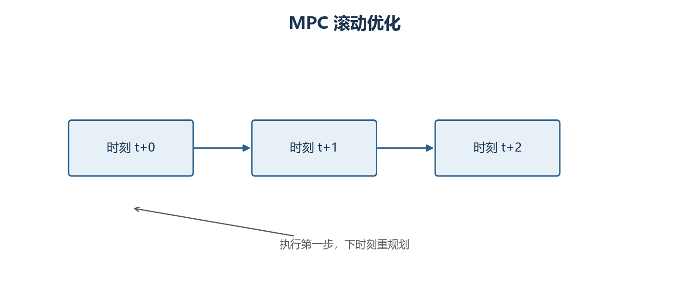

## 4.2　线性二次调节（LQR）

**定义 4.3（LQR）**　LQR 是连续状态—动作空间中可解析求解的最优控制问题：系统动力学线性、代价二次：

$$
\begin{aligned}
s_{t+1}&=\mathbf{A}s_t+\mathbf{B}a_t,\\
J&=\sum_{t=0}^{H}\big(s_t^\top\mathbf{Q}s_t+a_t^\top\mathbf{R}a_t\big),
\end{aligned} \tag{4-5}
$$

其中 $\mathbf{Q}\succeq0$（状态代价）、$\mathbf{R}\succ0$（动作代价）为权重矩阵。最优策略是线性反馈 $a_t^*=-\mathbf{K}_t s_t$。

**推导：Riccati 方程。** 设值函数二次型 $V_t(s)=s^\top\mathbf{P}_t s$，代入 Bellman 最优方程并对 $a$ 求极小：

$$
\frac{\partial}{\partial a}\big[s^\top\mathbf{Q}s+a^\top\mathbf{R}a+(\mathbf{A}s+\mathbf{B}a)^\top\mathbf{P}_{t+1}(\mathbf{A}s+\mathbf{B}a)\big]=0,
$$

得

$$
\begin{aligned}
\mathbf{K}_t&=(\mathbf{R}+\mathbf{B}^\top\mathbf{P}_{t+1}\mathbf{B})^{-1}\mathbf{B}^\top\mathbf{P}_{t+1}\mathbf{A},\\
\mathbf{P}_t&=\mathbf{Q}+\mathbf{A}^\top\mathbf{P}_{t+1}\mathbf{A}-\mathbf{A}^\top\mathbf{P}_{t+1}\mathbf{B}(\mathbf{R}+\mathbf{B}^\top\mathbf{P}_{t+1}\mathbf{B})^{-1}\mathbf{B}^\top\mathbf{P}_{t+1}\mathbf{A}.
\end{aligned} \tag{4-6}
$$

式 (4-6) 是离散 Riccati 方程，反向递推得 $\mathbf{P}_t$，进而得最优增益 $\mathbf{K}_t$。这是最优控制的经典解析解。

**例 4.2（LQR 用于倒立摆）**　倒立摆在小角度附近可线性化为 $\dot{s}=\mathbf{A}s+\mathbf{B}a$（第 1 章）。用 LQR 求得反馈矩阵 $\mathbf{K}$，控制律 $a=-\mathbf{K}s$ 能稳定摆杆——这是基于线性世界模型的最优控制。非线性情形需用第 28—29 章的方法或 MPC（第 25 章）。

**例 4.6（LQR 手算：标量系统的代数 Riccati 方程）**　取一维确定性系统 $s_{t+1}=a s_t+b a_t$，代价 $J=\sum_{t=0}^{\infty}(q s_t^2+r a_t^2)$（无穷时域，$\mathbf{P}_t$ 收敛到常数 $p$）。设 $V(s)=p s^2$，代入 Bellman 最优方程：

$$
p s^2=\min_{a_t}\big[q s^2+r a_t^2+p(a s_t+b a_t)^2\big]. \tag{4-7}
$$

展开右端为 $a_t$ 的二次型并求极小（对 $a_t$ 求导置零），得最优动作

$$
a_t^*=-\frac{a b\,p}{r+b^2p}\,s_t,
$$

再代回，整理后得**代数 Riccati 方程（ARE）**

$$
b^2p^2+p\,r(1-a^2)-b^2q\,p-q\,r=0.
$$

取 $a=b=q=r=1$，ARE 化为 $p^2-p-1=0$，正根 $p=\dfrac{1+\sqrt5}{2}\approx1.618$（黄金比例 $\varphi$）。于是稳态最优增益

$$
a^*=-\frac{abp}{r+b^2p}=-\frac{1.618}{1+1.618}\approx-0.618, \tag{4-8}
$$

控制律 $a_t^*\approx-0.618\,s_t$。两个有趣事实：其一，最优增益恰为黄金比例倒数之相反数 $-\varphi^{-1}$；其二，该增益**不随时刻变**——无穷时域 LQR 给出稳态增益，有限时域则须按式 (4-6) 反向递推求时变 $\mathbf{K}_t$。此例说明 LQR 的全部计算归结为解一个（矩阵）Riccati 方程：一旦 $\mathbf{P}$ 求出，最优反馈即时给出，无需迭代搜索——这正是它被广泛用于实时控制与机器人平衡（倒立摆、无人机悬停）的根本原因。

**模型预测控制（MPC）。** 当系统非线性、带约束、或时变时，LQR 的解析结构失效，但「基于模型」的思想仍可保留：**模型预测控制（MPC）**[5] 在每一步 $t$ 求解一个有限时域 $H$ 的序列最优控制问题，

$$
\min_{a_{t:t+H-1}}\;\sum_{k=0}^{H-1}c(s_{t+k},a_{t+k})+c_{\mathrm{term}}(s_{t+H})\quad \text{s.t.}\; s_{t+k+1}=f(s_{t+k},a_{t+k}),\ s_{t+k}\in\mathcal{C}, \tag{4-9}
$$

得到一序列最优动作后**只执行第一步** $a_t^*$，下一时刻重新测量状态、重新求解——这种「滚动优化」机制让 MPC 天然处理时变与约束，且在线复杂度随 $H$ 而非状态维指数增长（在凸问题下为多项式）。MPC 与值迭代的根本区别在于：值迭代离线预计算整张 $V^*$ 表、在线查表；MPC 在线重复求解小优化问题、无需存储价值函数——后者对连续高维状态更友好，是第 25 章（MPC 与实时规划）与第 11 章（PlaNet 潜在 MPC）的核心工具。

**例 4.7（MPC 两步手算）**　沿用 4.6 的标量系统 $s_{t+1}=a s_t+b a_t$（$a=b=1$），带约束 $|a_t|\le1$，代价 $J=\sum_{k=0}^{H-1}(s_{t+k}^2+a_{t+k}^2)$，取 $H=2$、当前 $s_t=2$。展开：$s_{t+1}=2+a_0$，$s_{t+2}=2+2a_0+a_1$。目标
$$
J=(2)^2+a_0^2+(2+a_0)^2+(2+2a_0+a_1)^2
$$
对 $a_1$ 求导置零得 $a_1^*=-(2+2a_0)$，但受 $|a_1|\le1$ 约束，若 $2+2a_0>1$ 则取 $a_1=-1$。先试 $a_0=0$：$2+0=2>1$，取 $a_1=-1$；此时 $J=4+0+4+(2-1)^2=9$。若 $a_0=-0.5$：$s_{t+1}=1.5$，$2+2(-0.5)=1$，取 $a_1=-1$，$J=4+0.25+2.25+0=6.5$，更小。继续 $a_0=-1$（触下界）：$s_{t+1}=1$，$2-2=0$，$a_1$ 自由取 $0$，$J=4+1+1+0=6$，最小。故 MPC 在 $t$ 步选 $a_t^*=-1$（第一步），$s$ 从 2 降到 1；下一时刻重新求解。这个算例展示了 MPC 的「滚动」特性：$a_1$ 只是「预演」用的后续动作，执行后作废——MPC 的鲁棒性正来自「每步都重新规划」，而非依赖预先算好的固定反馈律。

**表 4-1　决策方法概览**

| 方法 | 模型 | 状态空间 | 适用 |
|------|------|----------|------|
| 值迭代 | 已知 | 离散 | 小规模 MDP |
| LQR | 已知线性 | 连续 | 线性系统 |
| MPC | 已知（可学） | 连续/离散 | 通用（第 25 章） |
| 无模型 RL | 不需要 | 通用 | 模型难学 |

## 4.3　模型已知与模型未知的决策

**模型已知：规划。** 若转移 $p(s'\mid s,a)$ 与奖励 $r$ 已知（或已学出），可直接用动态规划（值迭代、策略迭代）、LQR 或 MPC 求解最优策略——这是第 25 章基于模型的规划。策略迭代的「策略评估」一步本质是解线性方程组 $V^{\pi}=\mathcal{R}_{\pi}+\gamma P_{\pi}V^{\pi}$，即 $(I-\gamma P_{\pi})V^{\pi}=\mathcal{R}_{\pi}$；当 $|\mathcal{S}|$ 大时该方程组稀疏，可用共轭梯度或不动点迭代求解，这也预示了第 25 章 MPC 离线预计算与第 7 章系统辨识后规划的常用后端。

**模型未知：学习与规划。** 若模型未知，有两条路：

- **无模型 RL**：直接学 $Q(s,a)$ 或策略 $\pi$，不显式学模型（第 24.3 节对照）；
- **基于模型 RL（MBRL）**：先学世界模型 $\hat{p},\hat r$（第 7 章系统辨识、第 9—13 章深度模型），再在模型中规划或生成数据训练策略（第 24 章）。

**样本效率。** 基于模型方法通常样本效率更高——模型可从少量经验中学习，再在「想象」中生成大量训练数据（第 12 章 Dreamer）。但模型误差会引入偏差（第 24.4 节、第 33 章）。

**例 4.3（两种路线的权衡）**　机器人真实交互昂贵（每次试错有物理成本），MBRL 更有优势——在仿真模型中大量试错，少量真实交互校准。游戏等廉价环境，无模型 RL 简单有效。这一权衡贯穿第 24—25 章。

## 4.4　探索—利用权衡

**定义 4.4（探索—利用）**　智能体面临两难：利用（exploitation）已知的高奖励动作，还是探索（exploration）未知动作以获取信息（可能发现更高奖励）。这是强化学习的核心难题[1]。

经典方法：

- **$\varepsilon$-贪婪**：以概率 $\varepsilon$ 随机探索，否则选最优动作；
- **UCB（上置信界）**：选 $Q(s,a)+c\sqrt{\log t/N(s,a)}$ 最大的动作，奖励不确定（访问少）的动作；
- **汤普森采样**：从后验采样动作。

在基于模型的设定下，探索可自然地解释为「减少世界模型的不确定性」——这与第 3.3 节主动推理的信息增益一致。

**表 4-2　探索策略对照**

| 方法 | 机制 | 探索依据 | 模型假设 | 典型失效 |
|------|------|----------|----------|----------|
| $\varepsilon$-贪婪 | 以 $\varepsilon$ 随机 | 均匀噪声 | 无 | $\varepsilon$ 难调；均匀探索浪费 |
| UCB | $Q+c\sqrt{\log t/N}$ | 访问次数（乐观） | 无/弱 | 置信半径靠启发式，非贝叶斯 |
| 汤普森采样 | 后验采样 | 后验方差 | 需可写后验 | 后验难写时退化 |
| 信息增益（主动推理） | $\mathrm{IG}(a)=\mathbb E[ D_{\mathrm{KL}}[q(s\mid o,a)\|q(s\mid a)] ]$ | 期望信息增益 | 需世界模型 | 非高斯下 IG 需近似 |
| 模型不确定（MBRL） | 对 $\hat p$ 的集成/后验 | 模型方差 | 需深度模型 | 过度自信时探索不足（第 33 章） |

**例 4.4（信息增益驱动的探索）**　推箱子机器人面对未知箱子重量：随机轻推（探索）获得重量信息，虽短期无奖励，但改善世界模型，长期提升规划质量——这正是主动推理「好奇」的体现。定量地，设重量 $w\in\{1,5\}$ 先验各 $0.5$，轻推后观测位移 $\Delta$ 可分辨 $w$（观测模型近乎确定）。则信息增益 $\mathrm{IG}=\mathbb E[\log\frac{1}{0.5}]=1$ 比特——一次轻推把后验从均匀变成点质量，不确定性减半。若偏好「尽快把箱子推到位」（高奖励），则即时奖励项压倒信息项，直接大力推；若偏好「摸清箱子特性」（低即时奖励、高后续价值），则先轻推——两种偏好的权衡正是表 4-2 最后一行在机器人任务上的实例。

## 4.5　边界与讨论

**模型误差的双刃剑。** 基于模型决策的全部优势与风险都来自「模型」：好模型带来样本效率与规划能力，坏模型带来偏差（模型误差被策略利用，第 33 章）。第 24.3 节将详述「模型误差与策略偏差」。具体地，设真实转移 $p$ 与学出的 $\hat p$ 在某个状态 $s$ 上的总变差距离为 $\delta=||p(\cdot\mid s,a)-\hat p(\cdot\mid s,a)||_{\mathrm{TV}}$，则 Bellman 最优值函数的偏差满足

$$
|V^{*}_{\hat M}(s)-V^{*}_{M}(s)|\;\le\;\frac{\gamma}{(1-\gamma)^2}\,\delta\,\cdot\max_{s',a'}|r|, \tag{4-10}
$$

（由 Bellman 算子的 $\gamma$-压缩性逐步放大单步误差得到）。这一界说明：模型误差的代价与 $\gamma$ 强相关——折扣越小（只看眼前），对模型精度的要求越低；折扣越接近 1（长视野），模型误差被放大的倍数 $(1-\gamma)^{-2}$ 越大。这正是「长视野规划对模型误差敏感」的定量根源，也是第 12 章 Dreamer 用随机动力学 + 集成（ensemble）去压低 $\delta$、第 26 章离线方法回避此风险的动机。

**三种求解器的选型。** 值迭代、LQR、MPC 各占其一隅（表 4-1）：值迭代要求离散有限状态、离线算整表、在线 $O(1)$ 查表，适合小规模 MDP；LQR 要求线性系统、解析解、在线 $O(m^3)$（$m$ 为状态维），适合连续线性控制；MPC 要求凸优化可解、在线重复求解、复杂度随 $H$ 增长，适合非线性/带约束/时变。选型的第一原则不是「谁更准」，而是「状态空间是离散还是连续、系统是否线性、有无约束、计算预算多少」。这一选型逻辑将在第 25 章 MPC 实时规划中按维度展开。

**与后续章节的联系。** 本章的 MDP、Bellman 方程、LQR、MPC 将在第 6 章（POMDP）、第 7 章（系统辨识）、第 24 章（MBRL）、第 25 章（MPC 规划）反复使用。自由能框架（第 3 章）与 RL 的对照见表 3-1。

第 4 章完成第一篇理论基础。第 5 章进入第二篇，从经典的隐马尔可夫模型与卡尔曼滤波开始，展示世界模型的最早成功案例。

## 本章小结

本章建立最优控制与决策基础，回答「拥有世界模型后如何优化行动」。

我们首先定义 MDP（式 4-1）与价值函数的 Bellman 期望/最优方程（式 4-2、4-3），强调模型 $p(s'\mid s,a)$ 是规划的核心。接着给出值迭代（式 4-4，压缩映射几何收敛）与策略迭代两套动态规划算法，并用三状态 MDP 手算（例 4.5）展示「从终态向前回传价值」的数值过程。然后推导 LQR：线性系统 + 二次代价，通过 Riccati 方程（式 4-6）解析求解最优反馈增益；标量手算（例 4.6）解出代数 Riccati 方程 $p^2-p-1=0$、最优增益 $-\varphi^{-1}\approx-0.618$，揭示 LQR 的「一次求解、即时反馈」特性。我们引入模型预测控制（MPC，式 4-9）作为处理非线性/约束/时变的滚动优化框架，并用两步手算（例 4.7）说明「每步只执行第一步」的机制。

我们讨论模型已知（规划）与未知（无模型 RL / MBRL）两条路线及样本效率权衡，给出探索—利用五法对照（表 4-2）与信息增益的定量算例（例 4.4）。

我们还明确边界：模型误差是基于模型决策的双刃剑，坏模型会被策略放大为偏差，其偏差上界（式 4-10）随折扣 $\gamma$ 增大而按 $(1-\gamma)^{-2}$ 放大；值迭代、LQR、MPC 三种求解器各占离散/线性/非线性一隅（表 4-1），选型取决于状态空间、线性性与计算预算。这些辨析衔接第 3、6、7、24、25、33 章。

第一篇理论基础至此完成。下一章进入第二篇，论述经典世界模型。

**进一步阅读**　本章建议延伸阅读的文献：[1]、[3]、[5]、[8]。

## 参考文献

[1] Sutton R S, Barto A G. *Reinforcement Learning: An Introduction*. 2nd ed. MIT Press, 2018.

[2] Kalman R E. A new approach to linear filtering and prediction problems. *Journal of Basic Engineering*, 1960, 82(1): 35–45.

[3] Bertsekas D P. *Dynamic Programming and Optimal Control*. 4th ed. Athena Scientific, 2017.

[4] Anderson B D O, Moore J B. *Optimal Control: Linear Quadratic Methods*. Englewood Cliffs: Prentice Hall, 1990.

[5] Garcia C E, Prett D M, Morari M. Model predictive control: Theory and practice — a survey. *Automatica*, 1989, 25(3): 335–348.

[6] Kaelbling L P, Littman M L, Moore A W. Reinforcement learning: A survey. *Journal of Artificial Intelligence Research*, 1996, 4: 237–285.

[7] Friston K, Kilner J, Harrison L. A free energy principle for a particular physics. *arXiv:1906.10184*, 2019.

[8] Deisenroth M P, Rasmussen C E. PILCO: A model-based and data-efficient approach to policy search. *ICML*, 2011.

---

# 第 5 章　隐马尔可夫模型与卡尔曼滤波

第一篇建立了理论基础。第二篇（第 5—8 章）梳理经典世界模型——在深度学习之前，控制论与统计学已发展出成熟的世界建模方法。本章从两个奠基性模型开始：隐马尔可夫模型（HMM）与卡尔曼滤波。它们是第 9—13 章深度潜在变量模型的理论原型：VAE 是 HMM 的连续潜在推广，RSSM 的随机状态承继卡尔曼的贝叶斯滤波思想。

## 5.1　隐马尔可夫模型

**定义 5.1（HMM）**　隐马尔可夫模型由初始分布 $\pi$、转移矩阵 $\mathbf{A}$（$a_{ij}=P(s_{t+1}=j\mid s_t=i)$）与发射矩阵 $\mathbf{B}$（$b_{ik}=P(o_t=k\mid s_t=i)$）参数化。状态 $s_t$ 隐藏，通过观测 $o_t$ 间接可见。联合分布分解：

$$
P(o_{1:T},s_{1:T})=P(s_1)\prod_{t=2}^{T}P(s_t\mid s_{t-1})\prod_{t=1}^{T}P(o_t\mid s_t). \tag{5-1}
$$

**三个基本问题。**

1. **评估**：计算 $P(o_{1:T})$——前向算法；
2. **解码**：找最可能状态序列 $\hat{s}_{1:T}$——维特比算法；
3. **学习**：估计 $\pi,\mathbf{A},\mathbf{B}$——Baum-Welch（EM）算法。

**前向算法。** 定义 $\alpha_t(j)=P(o_{1:t},s_t=j)$，递推：

$$
\alpha_{t+1}(j)=\Big[\sum_i\alpha_t(i)a_{ij}\Big]b_{j,o_{t+1}}. \tag{5-2}
$$

**维特比算法。** 定义 $\delta_t(j)=\max_{s_{1:t-1}}P(s_{1:t-1},s_t=j,o_{1:t})$，递推（与第 8 章类似）：

$$
\delta_{t+1}(j)=\Big[\max_i\delta_t(i)a_{ij}\Big]b_{j,o_{t+1}}. \tag{5-3}
$$

维特比把前向算法的「求和」换成「取最大」，并记录每步 argmax 的路径指针，回溯即得最可能状态序列。它本质是一个在 $O(T|\mathcal{S}|^2)$ 内完成的**最大后验（MAP）解码**，与第 8 章 Viterbi 解码、第 24 章序列决策的序列解码器同构。

**后向算法与后验概率。** 前向算法给出 $P(o_{1:t},s_t)$，但若还想问「在整条观测 $o_{1:T}$ 已知下，$t$ 时刻处于状态 $j$ 的概率是多少」，需要**后向概率** $\beta_t(j)=P(o_{t+1:T}\mid s_t=j)$，递推

$$
\beta_T(j)=1,\qquad \beta_t(i)=\sum_j a_{ij}\,b_{j,o_{t+1}}\,\beta_{t+1}(j). \tag{5-4}
$$

由前向 $\alpha$ 与后向 $\beta$ 可得**滤波后验**与**平滑后验**：

$$
\gamma_t(j)=P(s_t=j\mid o_{1:T})=\frac{\alpha_t(j)\beta_t(j)}{\sum_k\alpha_t(k)\beta_t(k)},\qquad
\xi_t(i,j)=P(s_t=i,s_{t+1}=j\mid o_{1:T})=\frac{\alpha_t(i)a_{ij}b_{j,o_{t+1}}\beta_{t+1}(j)}{P(o_{1:T})}. \tag{5-5}
$$

$\gamma_t$ 是「单时刻」后验（类比卡尔曼滤波的 $p(s_t\mid o_{1:t})$），$\xi_t$ 是「相邻两时刻」的联合后验（类比状态转移的充分统计量）。这两个量正是 Baum–Welch 算法的原料。

**Baum–Welch（EM）学习。** 三个基本问题中的「学习」没有闭式解，用 EM 迭代：E 步用当前参数算出 $\gamma_t,\xi_t$（即把隐状态当作缺失数据求其充分统计量），M 步在「状态已知」下极大化似然，得重估公式

$$
\hat a_{ij}=\frac{\sum_{t=1}^{T-1}\xi_t(i,j)}{\sum_{t=1}^{T-1}\gamma_t(i)},\qquad
\hat\pi_i=\gamma_1(i),\qquad
\hat b_{ik}=\frac{\sum_{t:o_t=k}\gamma_t(i)}{\sum_{t=1}^{T}\gamma_t(i)}. \tag{5-6}
$$

E 步与 M 步交替保证似然单调不减（与第 13 章式 (13-9) 的预测误差分解、第 9 章 EM 同源）。但 EM 只能保证收敛到**局部**极大，对初值敏感，且状态数 $|\mathcal{S}|$ 需事先指定（实际中用 BIC 或交叉验证选）。

**例 5.1（天气 HMM）**　隐藏状态 {晴, 雨}，观测 {带伞, 不带伞}。转移 $P(\text{雨}\mid\text{晴})=0.3$，发射 $P(\text{带伞}\mid\text{雨})=0.8$。给定一周观测，前向算法算观测概率，维特比解码最可能的天气序列——这是从观测推断隐藏世界状态的原型。

**例 5.6（前向—后向手算：两天天气）**　设状态 $S_t\in\{晴,雨\}$，初始 $\pi=(0.7,0.3)$，转移 $\mathbf A=\begin{pmatrix}0.7&0.3\\0.4&0.6\end{pmatrix}$（晴→晴 0.7、晴→雨 0.3；雨→晴 0.4、雨→雨 0.6），发射：$P(\text{带伞}\mid晴)=0.2$、$P(\text{带伞}\mid雨)=0.8$、$P(\text{不带伞}\mid晴)=0.8$、$P(\text{不带伞}\mid雨)=0.2$。观测两天：$o_1=$带伞、$o_2=$不带伞。
- **前向**：$\alpha_1=(0.7\times0.2,\ 0.3\times0.8)=(0.14,0.24)$。$\alpha_2(晴)=[\alpha_1(晴)0.7+\alpha_1(雨)0.4]\times0.8=[0.14\times0.7+0.24\times0.4]\times0.8=[0.098+0.096]\times0.8=0.1552$；$\alpha_2(雨)=[0.14\times0.3+0.24\times0.6]\times0.2=[0.042+0.144]\times0.2=0.0372$。故 $P(o_{1:2})=\alpha_2(晴)+\alpha_2(雨)=0.1552+0.0372=0.1924$。
- **后向**：$\beta_2=(1,1)$。$\beta_1(晴)=0.7\times0.2\times1+0.3\times0.8\times1=0.14+0.24=0.38$；$\beta_1(雨)=0.4\times0.2+0.6\times0.8=0.08+0.48=0.56$。
- **滤波后验**（只用 $o_1$）：$\gamma_1(j)\propto\alpha_1(j)$，即 $P(S_1\mid o_1)=(0.14,0.24)/0.38=(0.368,0.632)$——看到「带伞」后，「雨」的后验从先验 0.3 升到 0.632。
- **平滑后验**（用 $o_{1:2}$）：$\gamma_2(晴)\propto\alpha_2(晴)\beta_2(晴)=0.1552$，$\gamma_2(雨)\propto0.0372$，归一化得 $P(S_2\mid o_{1:2})=(0.1552,0.0372)/0.1924=(0.807,0.193)$——第二天「不带伞」把「晴」的后验拉回 0.807。

这个算例展示了 HMM 推断的核心：**观测如何逐步移动对隐状态的后验**。前向给出「截至 $t$」的滤波后验（实时），后向前向结合给出「全序列」的平滑后验（事后），二者与卡尔曼滤波的 $\hat s_{t\mid t}$ 与 $\hat s_{t\mid T}$ 一一对应——离散概率向量版与连续高斯版是同一台机器。

> 【图 5-1　HMM 的状态转移与观测发射】（原图见 figures/图5-1.png）：隐藏状态链 + 观测发射。
>
> 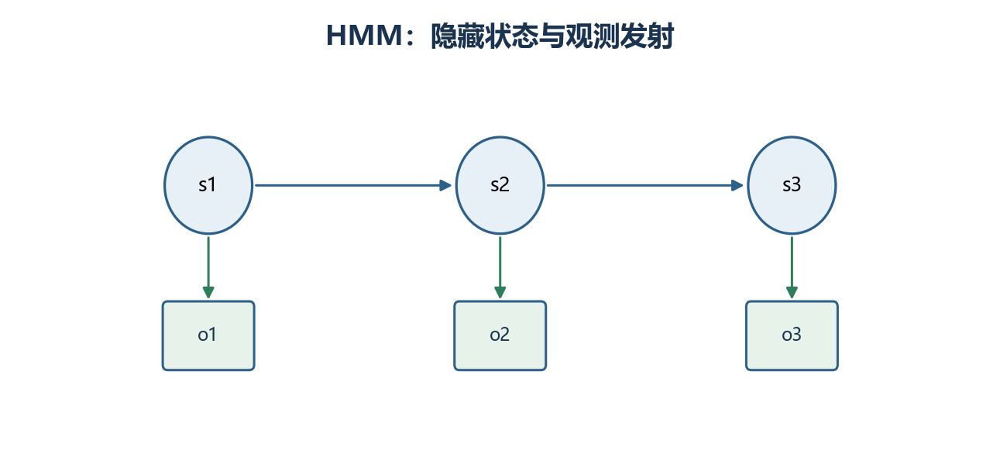

## 5.2　卡尔曼滤波

**定义 5.2（卡尔曼滤波）**　对第 2 章定义的线性高斯 SSM，卡尔曼滤波递归计算状态后验 $p(s_t\mid o_{1:t})=\mathcal{N}(\hat{s}_t,\mathbf{P}_t)$。两步：

**预测：**

$$
\begin{aligned}
\hat{s}_{t\mid t-1}&=\mathbf{A}\hat{s}_{t-1}+\mathbf{B}a_{t-1},\\
\mathbf{P}_{t\mid t-1}&=\mathbf{A}\mathbf{P}_{t-1}\mathbf{A}^\top+\mathbf{Q}.
\end{aligned} \tag{5-7}
$$

**更新（用观测 $o_t$）：**

$$
\begin{aligned}
\mathbf{K}_t&=\mathbf{P}_{t\mid t-1}\mathbf{C}^\top(\mathbf{C}\mathbf{P}_{t\mid t-1}\mathbf{C}^\top+\mathbf{R})^{-1},\\
\hat{s}_t&=\hat{s}_{t\mid t-1}+\mathbf{K}_t(o_t-\mathbf{C}\hat{s}_{t\mid t-1}),\\
\mathbf{P}_t&=(\mathbf{I}-\mathbf{K}_t\mathbf{C})\mathbf{P}_{t\mid t-1}.
\end{aligned} \tag{5-8}
$$

$\mathbf{K}_t$ 是卡尔曼增益，决定观测残差 $o_t-\mathbf{C}\hat{s}_{t\mid t-1}$ 对状态估计的修正强度——它自动平衡预测与观测的信任度（按各自不确定性加权）。

**两种推导。** 卡尔曼滤波可从贝叶斯推断（高斯后验的解析更新）或最小均方误差（LMMSE 估计）两个角度推导，二者等价。贝叶斯视角揭示其本质：用观测把先验 $\mathcal{N}(\hat{s}_{t\mid t-1},\mathbf{P}_{t\mid t-1})$ 更新为后验。更具体地，在预测分布下，$(\mathbf s_t,\mathbf o_t)$ 服从联合高斯
$$
\begin{pmatrix}\mathbf s_t\\ \mathbf o_t\end{pmatrix}\Big|\,o_{1:t-1}\sim N\!\left(\begin{pmatrix}\hat{\mathbf s}_{t\mid t-1}\\ \mathbf C\hat{\mathbf s}_{t\mid t-1}\end{pmatrix},\begin{pmatrix}\mathbf P_{t\mid t-1}&\mathbf P_{t\mid t-1}\mathbf C^\top\\ \mathbf C\mathbf P_{t\mid t-1}&\mathbf C\mathbf P_{t\mid t-1}\mathbf C^\top+\mathbf R\end{pmatrix}\right),
$$
对其作高斯条件化（标准公式 $\mathbb E[\mathbf s\mid\mathbf o]=\mu_s+\Sigma_{so}\Sigma_{oo}^{-1}(\mathbf o-\mu_o)$）即直接给出式 (5-8) 的均值更新 $\hat{\mathbf s}_t=\hat{\mathbf s}_{t\mid t-1}+\mathbf K_t(\mathbf o_t-\mathbf C\hat{\mathbf s}_{t\mid t-1})$ 与协方差更新 $\mathbf P_t=(\mathbf I-\mathbf K_t\mathbf C)\mathbf P_{t\mid t-1}$，其中增益 $\mathbf K_t=\mathbf P_{t\mid t-1}\mathbf C^\top(\mathbf C\mathbf P_{t\mid t-1}\mathbf C^\top+\mathbf R)^{-1}$。可见卡尔曼滤波**就是高斯贝叶斯更新**：先验是预测分布，似然是观测的高斯核，后验是二者按协方差加权的融合。这一视角把卡尔曼滤波与第 3 章的精度加权（式 3-3）、第 9 章的 VAE 后验推断统一在「高斯—高斯条件化」之下。

**例 5.2（一维卡尔曼滤波手算）**　设 $A=1,B=0,C=1,Q=0.1,R=0.5$，$P_0=1,\hat{s}_0=0$，观测 $o_1=1.2$。预测：$\hat{s}_{1\mid0}=0$，$P_{1\mid0}=1+0.1=1.1$。增益：$K_1=1.1/(1.1+0.5)=0.6875$。更新：$\hat{s}_1=0+0.6875\times1.2=0.825$，$P_1=(1-0.6875)\times1.1=0.34375$。滤波把初始不确定（$P=1$）收缩到 $P=0.34$，并朝观测方向修正状态。

**例 5.5（卡尔曼两步递推：多步数值迭代）**　沿用上例参数 $A=1,C=1,Q=0.1,R=0.5$，连续观测 $o_1=1.2,\ o_2=1.1,\ o_3=0.9,\ o_4=1.0$，逐期执行「预测—更新」：
- $t=1$：预测 $\hat s_{1\mid0}=0,\ P_{1\mid0}=1.1$；增益 $K_1=1.1/1.6=0.6875$；更新 $\hat s_1=0.825,\ P_1=0.34375$。
- $t=2$：预测 $\hat s_{2\mid1}=0.825,\ P_{2\mid1}=0.34375+0.1=0.44375$；$K_2=0.44375/0.94375\approx0.4702$；更新 $\hat s_2=0.825+0.4702\times(1.1-0.825)\approx0.954,\ P_2=0.44375\times0.5298\approx0.2351$。
- $t=3$：预测 $P_{3\mid2}=0.3351$；$K_3=0.3351/0.8351\approx0.4013$；更新 $\hat s_3=0.954+0.4013\times(0.9-0.954)\approx0.932,\ P_3\approx0.2004$。
- $t=4$：预测 $P_{4\mid3}=0.3004$；$K_4\approx0.3755$；更新 $\hat s_4\approx0.950,\ P_4\approx0.1881$。

观察三点：其一，**增益单调下降**（$0.6875\to0.4702\to0.4013\to0.3755$）——随着累积观测，状态估计越来越可靠，滤波器越来越信任自己的预测、对新观测「打折」；其二，**后验协方差单调收缩**（$1\to0.34\to0.24\to0.20\to0.19$）并向一个稳态值收敛，该稳态是代数 Riccati 方程 $p=(p+0.1)\cdot 1/(p+0.1+0.5)$ 的正解；其三，估计值 $\hat s_t$ 在观测波动中「平滑」地跟随，而非逐点跳变——这正是「滤波」一词的物理含义。这个多步算例是第 13 章 RSSM 的确定性部分 $h_{t+1}=f(h_t,a_t,z_t)$ 在线更新的标量原型。

**最小方差推导（增益的另一种来源）。** 增益 $\mathbf K_t$ 也可不依赖高斯假设、纯由最小均方误差导出。设只允许形如 $\hat{\mathbf s}_t=\hat{\mathbf s}_{t\mid t-1}+\mathbf K(\mathbf o_t-\mathbf C\hat{\mathbf s}_{t\mid t-1})$ 的线性更新（它对新息无偏），估计误差协方差为
$$
\mathbf P(\mathbf K)=(\mathbf I-\mathbf K\mathbf C)\mathbf P_{t\mid t-1}(\mathbf I-\mathbf K\mathbf C)^\top+\mathbf K\mathbf R\mathbf K^\top. \tag{5-9}
$$
对 $\mathbf K$ 求迹并配方，使 $\mathrm{tr}\,\mathbf P(\mathbf K)$ 最小的 $\mathbf K$ 恰为 $\mathbf K_t=\mathbf P_{t\mid t-1}\mathbf C^\top(\mathbf C\mathbf P_{t\mid t-1}\mathbf C^\top+\mathbf R)^{-1}$，与式 (5-8) 的贝叶斯形式完全一致。两种推导的殊途同归说明：**在线性高斯下，「贝叶斯后验均值」与「最小方差线性估计」是同一件事**——前者要求高斯性，后者只需二阶矩，故卡尔曼滤波是更广意义上的最优线性无偏估计器（BLUE）。

**平滑（RTS）。** 若允许用整条序列 $o_{1:T}$ 回看过去状态，精度更高。Rauch–Tung–Striebel 平滑器先做前向卡尔曼滤波，再后向递推：
$$
\mathbf J_t=\mathbf P_{t\mid t}\mathbf A^\top\mathbf P_{t+1\mid t}^{-1},\qquad
\hat{\mathbf s}_{t\mid T}=\hat{\mathbf s}_{t\mid t}+\mathbf J_t\big(\hat{\mathbf s}_{t+1\mid T}-\hat{\mathbf s}_{t+1\mid t}\big). \tag{5-10}
$$
这与 HMM 的前向—后向（式 5-4、5-5）完全同构：HMM 的 $\gamma_t=\alpha_t\beta_t/P(o)$ 是离散版的平滑后验，卡尔曼的 $\hat s_{t\mid T}$ 是连续高斯版的平滑后验。这一同构是本章最重要的统一线索：**HMM 与卡尔曼滤波是同一套「前向—后向—平滑」贝叶斯机器在离散与连续状态空间下的两个实例**。

**表 5-1　HMM 与卡尔曼滤波对照**

| 方面 | HMM | 卡尔曼滤波 |
|------|-----|-----------|
| 状态 | 离散 | 连续高斯 |
| 观测 | 离散/连续 | 连续高斯 |
| 推断 | 前向-后向（离散） | 解析高斯更新 |
| 地位 | 离散潜在模型原型 | 连续潜在模型原型 |

> 【图 5-2　卡尔曼滤波迭代收敛】（原图见 figures/图5-2.png）：状态估计与不确定性随观测逐步收敛的曲线。
>
> 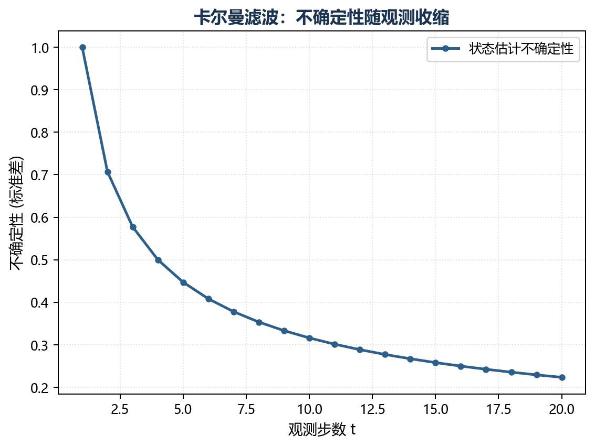

## 5.3　扩展与无迹卡尔曼滤波

**扩展卡尔曼滤波（EKF）。** 非线性系统 $s_{t+1}=f(s_t,a_t)+\xi_t$、$o_t=g(s_t)+\eta_t$，用雅可比矩阵在估计点线性化：

$$
\mathbf{F}_t=\frac{\partial f}{\partial s}\Big|_{\hat{s}_t},\qquad \mathbf{H}_t=\frac{\partial g}{\partial s}\Big|_{\hat{s}_t},
$$

再把 $\mathbf{F}_t,\mathbf{H}_t$ 代入式 (5-7)、(5-8)。EKF 简单但线性化误差可能累积。

**无迹卡尔曼滤波（UKF）。** 用一组确定性采样点（sigma points）捕捉高斯分布的传播，无需解析雅可比，对强非线性更稳健。

**粒子滤波。** 用带权粒子表示任意后验分布，适合非高斯、多峰情形——是更通用的序贯蒙特卡洛方法。

**例 5.3（EKF 用于倒立摆）**　倒立摆动力学非线性（$\sin\phi$），在_current_角度处线性化得雅可比 $\mathbf{F}_t$，套用 EKF 估计角度与角速度——这是基于非线性世界模型的在线状态估计。

## 5.4　卡尔曼滤波作为世界模型

从七要素看卡尔曼滤波：E1 状态表示（高斯状态 $\hat{s},\mathbf{P}$）、E2 状态转移（$\mathbf{A},\mathbf{B}$）、E3 观测生成（$\mathbf{C}$）、E4 不确定性（协方差 $\mathbf{P}$）、E5 动作条件化（$\mathbf{B}a_t$）。它具备前五要素，但缺 E6（奖励）与 E7（规划）——需结合 LQR（第 4 章）或 MPC（第 25 章）。

**例 5.4（卡尔曼 + LQR = 完整闭环）**　卡尔曼滤波估计状态（E1–E5），LQR 用估计状态算最优控制（E7），二者结合（LQG）构成完整的基于模型智能体——这是经典控制的世界模型范式。

## 5.5　边界与讨论

**线性高斯的限制。** 卡尔曼滤波依赖线性高斯假设，真实系统常违反；EKF/UKF/粒子滤波缓解但各有代价（线性化误差、采样开销、粒子退化）。具体地：EKF 只保留一阶信息，当非线性函数曲率大（如倒立摆在大角度下的 $\sin\phi$）时，雅可比近似偏差会**沿时间累积**，使协方差低估、滤波器过度自信；UKF 用 $2n+1$ 个 sigma 点传播二阶信息，更稳健但仍假设分布近似高斯，对多峰后验失效；粒子滤波用 $N$ 个带权样本近似任意分布，理论上无高斯限制，但样本数 $N$ 需远大于状态维 $n$ 才不退化，且权值随时间集中（粒子退化），需重采样——其计算代价 $O(N)$ 在高维下迅速不可承受。三者构成「精度—计算」的权衡谱系：线性高斯下卡尔曼最优且最省，强非线性下粒子滤波最通用但最贵。

**HMM 的离散瓶颈。** HMM 的状态数 $|\mathcal{S}|$ 必须有限且预先指定，转移与发射都是参数化的概率表——这限制它刻画连续、高维的隐变量。前向—后向复杂度 $O(T|\mathcal{S}|^2)$、维特比 $O(T|\mathcal{S}|^2)$，随状态数平方增长，难以扩展到真实感知（像素、连续位置）。这正是第 9 章 VAE 把离散隐状态换成**连续高斯潜在**、第 13 章 RSSM 用循环网络建模**高维确定性 + 随机**状态的动力：把「离散状态表」推广为「可学习的连续动力学」。

**与后续章节的联系。** HMM 与卡尔曼是深度潜在模型的原型：VAE（第 9 章）推广到连续非线性，RSSM（第 13 章）结合随机与确定性状态。本章的贝叶斯滤波思想贯穿第 9、11—13 章；前向—后向—平滑的三件套（式 5-4、5-5、5-10）在离散与连续两侧同构出现，是理解全书「世界模型 = 隐状态 + 贝叶斯推断」这一主线的钥匙。

下一章讨论 POMDP——当状态不可完全观测时的决策理论。

## 本章小结

本章论述两个经典世界模型——HMM 与卡尔曼滤波——并揭示它们是同一台「前向—后向—平滑」贝叶斯机器在离散与连续状态空间下的两个实例。

我们首先给出 HMM 的联合分布分解（式 5-1）与三个基本问题，推导前向（式 5-2）、维特比（式 5-3）、后向（式 5-4）算法，以及由 $\alpha,\beta$ 构造的滤波/平滑后验（式 5-5）与 Baum–Welch 的 EM 重估公式（式 5-6）。用两天天气算例（例 5.6）手算前向—后向，展示「带伞→不带伞」如何把「雨」的后验从 0.632 拉回 0.807。然后推导卡尔曼滤波的预测—更新两步（式 5-7、5-8），用联合高斯条件化（贝叶斯视角）与最小方差配方（式 5-9）两种途径交叉验证增益，并给出 RTS 平滑（式 5-10）。多步数值算例（例 5.5）展示了增益单调下降、协方差向稳态 Riccati 解收缩的滤波行为。

我们介绍 EKF（雅可比线性化）、UKF（sigma 点）、粒子滤波（序贯蒙特卡洛）三种非线性扩展，从七要素分析卡尔曼滤波（具备 E1–E5，缺 E6、E7），指出卡尔曼 + LQR = LQG 构成完整闭环。

边界上：HMM 受限于离散有限状态、复杂度 $O(T|\mathcal{S}|^2)$；卡尔曼受限于线性高斯，EKF/UKF/粒子滤波各有精度—计算权衡。这些辨析衔接第 4、6、7、9、11—13 章，并点明前向—后向—平滑三件套是全书「隐状态 + 贝叶斯推断」主线的钥匙。

下一章讨论 POMDP——当状态不可完全观测时的决策理论。

**进一步阅读**　本章建议延伸阅读的文献：[1]、[2]、[3]、[4]、[5]。

## 参考文献

[1] Rabiner L R. A tutorial on hidden Markov models and selected applications in speech recognition. *Proceedings of the IEEE*, 1989, 77(2): 257–286.

[2] Kalman R E. A new approach to linear filtering and prediction problems. *Journal of Basic Engineering*, 1960, 82(1): 35–45.

[3] Welch G, Bishop G. An Introduction to the Kalman Filter. *UNC TR 95-041*, 2006.

[4] Julier S J, Uhlmann J K. Unscented filtering and nonlinear estimation. *Proceedings of the IEEE*, 2004, 92(3): 401–422.

[5] Doucet A, de Freitas N, Gordon N, eds. *Sequential Monte Carlo Methods in Practice*. Springer, 2001.

[6] Ghahramani Z. An introduction to hidden Markov models and Bayesian networks. *IJPRAI*, 2001, 15(1): 9–42.

[7] Stengel R F. *Optimal Control and Estimation*. Dover, 1994.

[8] Sutton R S, Barto A G. *Reinforcement Learning: An Introduction*. 2nd ed. MIT Press, 2018.

---

# 第 6 章　部分可观测马尔可夫决策过程

第 5 章的卡尔曼滤波处理了状态估计，第 4 章的 MDP 假设状态完全可观测。现实世界两者兼有：状态隐藏且需决策。本章介绍**部分可观测马尔可夫决策过程（POMDP）**——把状态估计与决策统一在一个框架中。POMDP 是具身智能与真实世界世界模型的核心形式化：机器人看不到世界的完整状态，只能依据带噪观测行动。

本章先给出 POMDP 的形式化与信念状态（6.1 节），推导信念更新与信念空间的价值函数（6.2 节），讨论不确定性在决策中的角色（6.3 节），介绍精确求解的困难与近似方法（6.4 节），并通过网格世界算例展示信念决策（6.5 节），最后审视其作为世界模型的形式基础（6.6 节）并收束（6.7 节）。

## 6.1　POMDP 的形式化

**定义 6.1（POMDP）**　部分可观测马尔可夫决策过程由七元组

$$
(\mathcal{S},\mathcal{A},\mathcal{O},p,r,\gamma,b_0) \tag{6-1}
$$

构成：$\mathcal{S}$ 为状态集，$\mathcal{A}$ 为动作集，$\mathcal{O}$ 为观测集，$p(s'\mid s,a)$ 为状态转移，$p(o\mid s,a)$ 为观测模型，$r(s,a)$ 为奖励，$\gamma\in[0,1)$ 为折扣因子，$b_0$ 为初始信念。与 MDP 相比，智能体不直接观察 $s_t$，只收到观测 $o_t\sim p(\cdot\mid s_t,a_{t-1})$。

**直觉解释。** MDP 中「看到什么就是什么」，决策直接依赖 $s_t$。POMDP 中观测是世界的「片段」——同一观测可能来自不同状态。智能体必须维护一个对「自己可能处于哪个状态」的概率信念，并据此决策。这正如医生根据症状（观测）推断疾病（隐藏状态）并决定治疗（动作）。

一个极小的例子能点破「观测歧义」。设 $|\mathcal{S}|=2$，观测 $o\in\{+,-\}$，观测模型 $p(+\mid s_0)=0.8,\ p(+\mid s_1)=0.3$。若先验 $b_0=(0.5,0.5)$，看到 $o=+$ 后由贝叶斯规则
$$
b(s_1\mid +)=\frac{p(+\mid s_1)b_0(s_1)}{p(+\mid s_1)b_0(s_1)+p(+\mid s_0)b_0(s_0)}=\frac{0.3\times0.5}{0.3\times0.5+0.8\times0.5}=\frac{0.15}{0.55}\approx0.273,
$$
即看到「+」反而**更倾向** $s_0$（后验 $(0.727,0.273)$）——因为 $s_0$ 产生「+」更频繁。但若改先验 $b_0=(0.1,0.9)$（强先验相信 $s_1$），同一观测 $o=+$ 给出 $b(s_1\mid +)=\dfrac{0.3\times0.9}{0.3\times0.9+0.8\times0.1}=\dfrac{0.27}{0.35}\approx0.771$，**更倾向 $s_1$**。同一观测、不同信念，决策可以截然相反——这正是「感知相同、理解不同」的形式化，也是 POMDP 必须维护信念、而不能只看当前观测的根本原因。

**信念状态（belief state）。** 定义

$$
b_t(s)=p(s_t=s\mid o_{0:t},a_{0:t-1}), \tag{6-2}
$$

即给定历史观测与动作，状态的后验分布。**关键定理**：信念 $b_t$ 是充分统计量——最优决策只需 $b_t$，无需完整历史 $h_t=(o_{0:t},a_{0:t-1})$。这把无限维的历史压缩为 $|\mathcal{S}|$ 维的单纯形上的点，使部分可观测下的决策在原理上可行。

**为何信念是充分统计量。** 定理的直觉来自贝叶斯递推：$b_t$ 由 $b_{t-1}$ 经式 (6-3) 唯一确定，而 $b_{t-1}$ 又由更早的信念递推而来——历史的全部信息都被**压缩**进了 $b_t$，没有任何关于「未来最优动作」的信息在压缩中丢失。形式地，对任意两个产生相同 $b_t$ 的历史 $h_t,h_t'$，其后验 $p(s_t\mid h_t)=p(s_t\mid h_t')$，故对未来的任何条件期望（含最优动作）都相同。这就是为什么第 4 章 MDP 的「状态」在 POMDP 中被「信念」替代：信念是**充分的历史摘要**，使决策在原理上仍只需「当前」一个量。

**例 6.1（网格世界 POMDP）**　机器人在 4×4 迷宫中，传感器只能感知「相邻格是否有墙」（4 维观测），而完整状态是自身位置（16 种）。不同位置可能有相同观测，机器人维护对位置的信念分布 $b_t$（16 维概率向量），据其选择移动方向。

## 6.2　信念更新与信念 MDP

**信念更新。** 执行动作 $a_t$、收到观测 $o_{t+1}$ 后，按贝叶斯规则更新：

$$
b_{t+1}(s')=\eta\,p(o_{t+1}\mid s',a_t)\sum_{s\in\mathcal{S}}p(s'\mid s,a_t)\,b_t(s), \tag{6-3}
$$

其中 $\eta=1/\sum_{s'}p(o_{t+1}\mid s',a_t)b_{t+1}^{unnorm}(s')$ 为归一化常数。式 (6-3) 分两步：先用转移预测 $\sum_s p(s'\mid s,a)b_t(s)$，再用观测 $p(o\mid s',a)$ 加权修正——这与卡尔曼滤波（第 5.2 节）的「预测—更新」完全同构：卡尔曼是线性高斯信念的解析特例，POMDP 是一般信念的递推。

**信念 MDP。** 把 POMDP 转化为信念空间上的（连续状态）MDP：状态是 $b$，转移由式 (6-3) 决定，奖励是期望奖励

$$
\rho(b,a)=\sum_{s\in\mathcal{S}}b(s)\,r(s,a), \tag{6-4}
$$

于是可在信念空间写 Bellman 方程：

$$
V(b)=\max_{a\in\mathcal{A}}\Big[\rho(b,a)+\gamma\sum_{o\in\mathcal{O}}p(o\mid b,a)\,V(b_{a,o})\Big], \tag{6-5}
$$

其中 $b_{a,o}$ 为执行 $a$、收到 $o$ 后的信念（式 6-3）。式 (6-5) 表明：POMDP 的最优值定义在信念空间，规划须考虑「未来观测会如何修正信念」。

**表 6-1　MDP 与 POMDP 对照**

| 方面 | MDP | POMDP |
|------|-----|-------|
| 状态 | 可观测 $s_t$ | 隐藏，用信念 $b_t$ |
| 决策依据 | $s_t$ | $b_t=p(s\mid h_t)$ |
| 转移 | $p(s'\mid s,a)$ | 信念更新（式 6-3） |
| 状态空间 | $\mathcal{S}$（有限） | 单纯形（连续） |
| 求解难度 | 多项式 | PSPACE-难 |

## 6.3　不确定性在决策中的角色

POMDP 把**认知不确定性**（对状态的不确定性，即七要素 E4）显式纳入决策——信念 $b_t$ 的熵

$$
H(b_t)=-\sum_s b_t(s)\log b_t(s) \tag{6-6}
$$

度量了这种不确定性。好的 POMDP 策略会主动收集信息（减小信念熵），这正是第 3.3 节主动推理、第 4 章信息增益探索的体现。

**信息收集行为。** 在 POMDP 中，「先观察再行动」可能是最优的：即使某个动作即时奖励为零，若它能大幅减小信念熵（获得信息），长期回报可能更高。这是探索—利用权衡在部分可观测设定下的自然延伸。

**例 6.2（信念熵的数值变化）**　沿用第 6.5 节的 5 格走廊。初始均匀信念 $b_0=(0.2,\dots,0.2)$，熵
$$
H(b_0)=-\sum_{s=1}^{5}0.2\log_2 0.2=5\times0.2\times2.322\approx2.322\text{ bit}.
$$
执行「右 + 观测否」后得 $b_1\approx(0.118,0.294,0.294,0.294,0)$，熵
$$
H(b_1)\approx-(0.118\log_2 0.118+3\times0.294\log_2 0.294)\approx-(0.118\times(-3.08)+3\times0.294\times(-1.77))\approx1.92\text{ bit}.
$$
一次「右 + 否」把信念熵从 $2.322$ 降到 $1.92$，**信息增益 $\Delta H\approx0.40$ bit**——这就是该动作的「认识论价值」。若后续再「右 + 否」，信念会进一步向 $\{2,3,4\}$ 集中、熵继续下降。这一「先花一步降熵、再行动拿奖励」的策略结构，与第 4 章例 4.4 的「先轻推摸清箱子重量」是同一种行为，区别只在于：POMDP 把信息增益写成了**对信念分布的 KL 变化**，而非对模型参数的启发式置信半径。

**例 6.3（信息收集）**　机器人在两个可能房间之一寻找钥匙，信念各 0.5。最优策略会先检查一个房间（即使短期无奖励），因为无论结果如何都能减小不确定性——若找到则任务完成，若没找到则确定在另一房间。这是 POMDP 规划的自然产物，纯反应式策略难以实现。

## 6.4　求解方法与复杂度

**精确求解的困难。** 信念空间是连续的高维单纯形，式 (6-5) 的精确求解需处理所有可达信念——POMDP 精确求解是 PSPACE-难的[1]。除极小问题外不可行。

**信念空间值迭代（手算可行的小情形）。** 把式 (6-5) 写成迭代算子，对任意初值 $V_0\equiv0$，
$$
V_{k+1}(b)=\max_{a\in\mathcal{A}}\Big[\rho(b,a)+\gamma\sum_{o\in\mathcal{O}}p(o\mid b,a)\,V_k(b_{a,o})\Big], \tag{6-7}
$$
其中 $b_{a,o}$ 由式 (6-3) 算出、$p(o\mid b,a)=\sum_s b(s)p(o\mid s,a)$。与 MDP 值迭代（第 4 章式 4-4）相比，多了一个「对所有可能观测 $o$ 求期望」的步骤——这正是部分可观测带来的额外复杂度：规划必须预先考虑「收到每个观测后信念会变成什么」。对 $|\mathcal{S}|=2$ 的情形，信念 $b=P(s_1)\in[0,1]$ 是一维区间，值迭代可手算。

**例 6.4（两状态 POMDP 信念值迭代手算）**　设 $\mathcal{S}=\{s_0,s_1\}$，$\mathcal{A}=\{a_0(\text{观察}),a_1(\text{提交})\}$，$\mathcal{O}=\{o_0,o_1\}$，$\gamma=0.9$。奖励 $r(s_1,a_1)=1$、$r(s_0,a_1)=-1$、$r(s,\cdot|a_0)=0$；$a_1$ 为终止动作，$a_0$ 保持状态不变（转移恒等）。观测模型：$p(o_1\mid s_1)=0.9,\ p(o_1\mid s_0)=0.2$（对称地 $p(o_0\mid s_1)=0.1,\ p(o_0\mid s_0)=0.8$）。记信念 $b=P(s_1)$，则 $\rho(b,a_1)=2b-1$、$\rho(b,a_0)=0$。
- **$V_0\equiv0$，求 $V_1$**：$V_1(b)=\max_a\rho(b,a)=\max\{0,\,2b-1\}$。
- **在 $b=0.6$ 求 $V_2$**：
  - 选 $a_1$（提交，终止）：$V_2$ 贡献 $=\rho(0.6,a_1)=2\times0.6-1=0.2$。
  - 选 $a_0$（观察）：先按式 (6-3) 算两个后继信念。收到 $o_1$：$b_{o_1}=\dfrac{0.9\times0.6}{0.9\times0.6+0.2\times0.4}=\dfrac{0.54}{0.62}\approx0.871$，$p(o_1\mid0.6,a_0)=0.62$；收到 $o_0$：$b_{o_0}=\dfrac{0.1\times0.6}{0.1\times0.6+0.8\times0.4}=\dfrac{0.06}{0.38}\approx0.158$，$p(o_0\mid0.6,a_0)=0.38$（$0.62+0.38=1$）。代入 $V_1$：$V_1(0.871)=2\times0.871-1\approx0.742$，$V_1(0.158)=\max\{0,-0.684\}=0$。故 $a_0$ 贡献 $=\gamma\sum_o p(o\mid b,a_0)V_1(b_{o})=0.9\times(0.62\times0.742+0.38\times0)\approx0.9\times0.460\approx0.414$。
  - 取最大：$V_2(0.6)=\max\{0.2,\,0.414\}=0.414$，**最优动作是「观察」$a_0$ 而非「提交」$a_1$**。

这个手算揭示 POMDP 规划的核心洞见：**即使当前信念 $b=0.6$ 已偏向 $s_1$，最优策略仍是先观察**——因为观察有 $0.62$ 概率把信念推到 $0.871$（接近确定），从而在下一步提交时拿到接近 $+1$ 的期望奖励；其价值 $0.414$ 超过了立即提交的 $0.2$。这正是「信息有价格」的定量体现，也是第 4 章 UCB、第 3 章主动推理信息增益项在部分可观测设定下的严格版本。继续迭代 $V_3,V_4,\dots$ 会让 $V_k(b)$ 在 $b\in[0,1]$ 上收敛到最优值函数 $V^*$，其图形是一个在 $b=0.5$ 处转折的凸分段函数。

**近似方法。**

- **点基价值迭代（PBVI）**：只在有限个可达信念点上计算价值，用插值推广；
- **蒙特卡洛树搜索（MCTS）**：在信念空间采样规划（如 POMCP[2]）；
- **启发式**：假设状态可观测（MDP 近似），或维护最可能状态（MAP 近似）；
- **深度 POMDP**：用 RNN 隐状态 $h_t$ 近似信念，端到端学习策略（第 6.5 节）。

**表 6-2　POMDP 求解方法**

| 方法 | 思路 | 适用 |
|------|------|------|
| 精确（价值迭代） | 全信念空间 | 极小问题 |
| PBVI | 有限信念点 | 中小问题 |
| POMCP | MCTS 采样 | 大规模离散 |
| 深度方法 | RNN 近似信念 | 高维感知 |

## 6.5　算例：网格信念决策

**设定。** 1D 走廊 5 格，位置 $s\in\{1,\dots,5\}$，目标在格 5。动作：左/右（转移成功概率 0.8，0.2 反向）。观测：只能感知「是否在目标格」（是/否）。初始信念均匀 $b_0(s)=0.2$。

**计算。** 初始信念均匀 $b_0=(0.2,0.2,0.2,0.2,0.2)$。执行「右」（成功 0.8 右移、失败 0.2 反向左移，越界则停留），先按式 (6-3) 的预测步对每个目标格 $s'$ 求 $\sum_s b_0(s)p(s'\mid s,\text{右})$：
- $s'=1$：来自 $s=1$（右失败停 0.2）与 $s=2$（反向左 0.2）：$0.2\times0.2+0.2\times0.2=0.08$。
- $s'=2$：来自 $s=1$（右成功 0.8）与 $s=3$（反向左 0.2）：$0.16+0.04=0.20$。
- $s'=3$：来自 $s=2$（0.8）与 $s=4$（0.2）：$0.20$；对称地 $s'=4$：来自 $s=3$（0.8）与 $s=5$（反向左 0.2）：$0.20$。
- $s'=5$：来自 $s=4$（右成功 0.8）与 $s=5$（右失败停 0.8）：$0.16+0.16=0.32$。

预测后信念 $\bar b=(0.08,\,0.20,\,0.20,\,0.20,\,0.32)$（和为 1）。若此时观测「否」（不在目标格 5），按式 (6-3) 的修正步用 $p(\text{否}\mid s')$ 加权：$p(\text{否}\mid5)=0$、$p(\text{否}\mid s\ne5)=1$，故未归一化 $b_1^{\text{un}}=(0.08,0.20,0.20,0.20,0)$，归一化常数 $1/0.68$，得
$$
b_1=\frac{(0.08,0.20,0.20,0.20,0)}{0.68}\approx(0.118,\,0.294,\,0.294,\,0.294,\,0).
$$
一次「右 + 否」就把信念从均匀压到集中于 $\{2,3,4\}$、并把目标格 5 的后验**归零**——观测的归一化修正（式 6-3 的加权步）承担了「定位」职责。多次移动与观测后，信念逐渐集中到真实位置，机器人确定位置并到达目标。这说明：信念将「定位」与「决策」统一——机器人边走边定位（SLAM 思想，第 7 章），依据信念决策。

> 【图 6-1　POMDP 信念状态更新】（原图见 figures/图6-1.png）：信念 $b_t$ 经动作 $a_t$ 与观测 $o_{t+1}$ 更新为 $b_{t+1}$ 的循环，标注预测与修正两步。
>
> 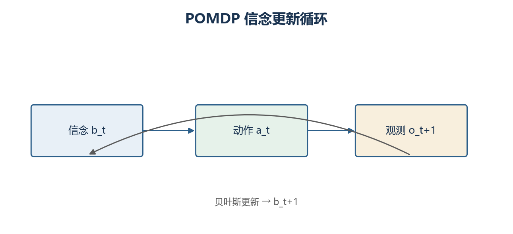

## 6.6　深度 POMDP 与世界模型

深度强化学习中，POMDP 常用循环网络近似信念：

$$

h_t=\mathrm{RNN}(h_{t-1},o_t,a_{t-1}),\quad \hat{a}_t=\pi(h_t). \tag{6-8}
$$

隐状态 $h_t$ 充当**学习到的信念**——它压缩历史信息，为决策提供充分统计。Dreamer（第 12 章）的潜在状态正是这种学习到的信念：它既编码世界状态（E1），又承载不确定性（E4）。RSSM（第 13 章）的随机状态 $z_t$ 对应信念的随机性，确定性状态 $h_t$ 对应记忆。

**学习到的信念 vs 贝叶斯信念。** 贝叶斯信念 $b_t$ 是一个显式的、$|\mathcal{S}|$ 维的概率向量，其更新（式 6-3）由生成模型 $p(o\mid s,a),p(s'\mid s,a)$ 解析决定；学习到的信念 $h_t$ 则是 RNN 隐状态——一个**固定维度、与 $|\mathcal{S}|$ 无关**的连续向量，其「更新」由网络权重与训练目标隐式决定。二者的关键差异：(i) 贝叶斯信念对决策是**充分统计量**（定理保证），学习到的信念只是**近似充分**（取决于训练质量）；(ii) 贝叶斯信念能显式计算熵 $H(b_t)$（式 6-6）与信息增益，学习到的信念的「不确定性」只能通过 $z_t$ 的方差、集成预测差等**间接**估计；(iii) 贝叶斯信念要求 $|\mathcal{S}|$ 可枚举，学习到的信念能处理 $|\mathcal{S}|$ 极大（如像素级）的情形。这正是第 12 章 Dreamer 能在像素环境中工作的原因——它用一个 256 维的 $h_t$ 近似了「无法显式枚举的像素状态信念」。

**边界与讨论。** 深度方法用表示学习近似信念，泛化强但缺乏理论保证；学到的信念不必对应真实贝叶斯后验（可辨识性，第 2.5 节），只需对决策充分。精确方法与深度方法的结合（可微粒子滤波、结构化信念）是前沿。

## 6.7　边界与讨论

本章把状态估计（第 5 章）与决策（第 4 章）统一在 POMDP 框架。信念 $b_t$ 是关键——它是历史的充分统计量，使部分可观测下的决策可行。三个混淆命题中的「感知精确不等于理解正确」在此体现为：观测精确不等于信念正确（观测歧义时信念可能错误）。

**PSPACE-难与计算代价。** POMDP 精确求解是 PSPACE-难的[1]，比 MDP 的多项式复杂度高出一个层级。根源在于：信念空间是连续高维单纯形，式 (6-5) 的最优值函数 $V^*(b)$ 在一般情形是**无穷个分段仿射函数**的逐次取上确界——即使 $|\mathcal{S}|,|\mathcal{A}|,|\mathcal{O}|$ 固定，时域 $H$ 增长时 $V^*(b)$ 的「面数」也指数增长。这意味着：除极小规模外，精确方法不可行，必须依赖 PBVI（点基价值迭代）、POMCP（蒙特卡洛规划）或深度近似。表 6-2 的四种方法本质上是在「精度—计算」之间取不同权衡：PBVI 在有限信念点上精确、其余用插值（近似）；POMCP 用采样回避显式值函数（黑箱但样本复杂度高）；深度方法用 RNN 把信念压缩到固定维度（最通用但无理论保证）。

**「观测歧义」的工程后果。** 6.1 的例子说明：同一观测在不同信念下可导向相反决策。工程上这有两点警示：其一，**初始信念 $b_0$ 的设定至关重要**——错误的 $b_0$ 会让后续所有信念系统性地偏，即使观测精确也无法纠正（除非观测模型足够「鉴别性」）；其二，**观测歧义度**（不同状态产生相同观测的概率重叠）决定了信念收敛的速度——歧义度高（如 $p(+\mid s_0)\approx p(+\mid s_1)$）时信念长期接近均匀，策略只能靠「平均」，长期回报显著低于全观测 MDP。这一「观测歧义 → 信念熵高 → 决策退化为平均」的链条，是机器人感知设计（传感器选型）的核心权衡。

**与后续章节的联系。** 本章的信念更新衔接第 5 章（卡尔曼是线性高斯信念）、第 7 章（SLAM 是 POMDP 的实例）、第 12—13 章（学习到的信念）、第 25 章（信念空间规划）。这些辨析衔接第 4、5、7、12、13、25 章。

## 本章小结

本章论述部分可观测马尔可夫决策过程，把状态估计（第 5 章）与决策（第 4 章）统一在一个框架中。

我们首先给出 POMDP 的七元组形式化（式 6-1）与信念状态 $b_t$（式 6-2），用一个「同一观测、不同信念、相反决策」的极小例子点破观测歧义，并论证信念是历史的充分统计量。接着推导信念更新（式 6-3）与信念空间 Bellman 方程（式 6-5），说明其与卡尔曼滤波「预测—更新」的同构关系，并给出 MDP/POMDP 对照（表 6-1）。我们讨论信念熵（式 6-6）与信息收集行为，用 5 格走廊算例（例 6.2）手算一次「右+否」把信念熵从 $2.322$ 降到 $1.92$（信息增益 $0.40$ bit）。

我们概述精确求解的 PSPACE-难性与「面数指数增长」根源，给出信念空间值迭代算子（式 6-7）与两状态 POMDP 手算（例 6.4），并对照 PBVI/POMCP/深度方法（表 6-2）。网格世界算例（6.5 节）完整数值化了「预测—修正」两步。我们比较贝叶斯信念与学习到的信念（式 6-8）在充分性、熵可算性、可扩展性三方面差异，并指出观测歧度决定信念收敛速度与决策退化。

我们还明确边界：PSPACE-难使精确方法仅限极小问题；深度信念近似泛化强但缺理论保证。这些辨析衔接第 4、5、7、12、13、25 章。

下一章讨论系统辨识——从数据学习世界模型动力学。

**进一步阅读**　本章建议延伸阅读的文献：[1]、[2]、[3]、[4]、[5]。

## 参考文献

[1] Kaelbling L P, Littman M L, Cassandra A R. Planning and acting in partially observable stochastic domains. *Artificial Intelligence*, 1998, 101(1–2): 99–134.

[2] Silver D, Veness J. Monte-Carlo planning in large POMDPs. *Advances in Neural Information Processing Systems*, 2010, 23.

[3] Smallwood R D, Sondik E J. The optimal control of partially observable Markov processes over a finite horizon. *Operations Research*, 1973, 21(5): 1071–1088.

[4] Sondik E J. The optimal control of partially observable Markov processes over the infinite horizon. *Operations Research*, 1978, 26(2): 282–304.

[5] Hauskrecht M. Value-function approximations for partially observable Markov decision processes. *JAIR*, 2000, 13: 33–94.

[6] Sutton R S, Barto A G. *Reinforcement Learning: An Introduction*. 2nd ed. MIT Press, 2018.

[7] Hafner D, Lillicrap T, Ba J, Norouzi M. Dream to control: Learning behaviors by latent imagination. *ICLR*, 2020.

[8] Pineau J, Thrun S, Joachims T. POMDP planning with continuous state and observation spaces. *Technical Report*, 2006.

---

# 第 7 章　系统辨识与状态估计

第 2、5 章假设系统动力学已知或线性。本章讨论**系统辨识**（system identification）：如何从数据中学习动力学——这是基于模型的强化学习（MBRL）在深度方法之前的核心，也是第 9—13 章深度世界模型的历史前身。系统辨识回答：给定输入输出数据 $\{(a_t,o_t)\}$，如何估计模型 $\hat{p}(s_{t+1}\mid s_t,a_t)$？

本章先介绍系统辨识的问题与流程（7.1 节），推导线性辨识方法（7.2 节），介绍非线性辨识方法（7.3 节），讨论数据激励性与闭环辨识（7.4 节），给出最小二乘辨识算例（7.5 节），并从世界模型视角审视（7.6 节），最后收束（7.7 节）。

## 7.1　系统辨识的问题

**定义 7.1（系统辨识）** 给定系统的输入—输出观测数据，在给定的模型类（线性/非线性、参数化/非参数化）中，选择使某种准则（如预测误差平方和）最优的模型参数。标准流程：① 实验设计（采集数据）；② 模型结构选择；③ 参数估计；④ 模型验证。

**辨识 vs 学习。** 系统辨识强调结构化模型（传递函数、状态空间）与统计一致性保证；机器学习强调灵活的函数逼近。二者本质相同——从数据学动力学——但传统辨识更注重可解释性与理论保证（如参数收敛性），机器学习更注重预测性能与规模化。世界模型可视为辨识思想在高维非线性情形的延伸。

**直觉解释。** 辨识就像「观察一个黑箱的输入输出，反推其内部机制」。若箱子是线性的，可用最小二乘精确估计；若非线性，需更灵活的函数类。关键困难是：数据是否「充分激励」了系统——只看箱子在小输入下的反应，无法推断大输入行为。

### 7.1A　辨识在世界模型七要素中的位置

用本书统一的七要素框架（E1—E7，见第 1 章）审视系统辨识，可以更精确地定位它「学了什么、假设了什么」。辨识直接学习的对象是**状态转移** $p(s_{t+1}\mid s_t,a_t)$，即 E2 动力学，且该转移以动作 $a_t$ 为条件（E5 动作条件化）；当模型显式包含观测方程 $o_t=g(s_t)$ 时还覆盖 E3 观测生成，当噪声项 $\xi_t$ 被建模时则覆盖 E4 不确定性。但传统辨识通常**假设** E1 状态表示是显式的（工程师直接测量出 $\phi,\dot\phi$），而非从像素推断——这正是第 9 章起的深度世界模型要解决的「表示学习」缺口。

这一对照揭示了一个贯穿第三篇的设计轴：经典辨识在「低维、可测状态」上把 E2 学到统计一致（样本复杂度低、有渐近理论保证），深度世界模型则要在「高维、不可测状态」上联合学 E1+E2+E3（表达力高、样本成本高）。第 10 章 World Models 的 MDN-RNN、第 13 章 RSSM 的先验—后验结构，本质上是把式 (7-1) 的线性转移 $\mathbf{A}s_t+\mathbf{B}a_t$ 推广为非参数化的条件分布 $p_\psi(s_{t+1}\mid s_t,a_t)$，并补上被经典辨识搁置的 E1 与 E3。

## 7.2　线性系统辨识

**最小二乘估计。** 对线性系统

$$
s_{t+1}=\mathbf{A}s_t+\mathbf{B}a_t+\xi_t,\quad \xi_t\sim\mathcal{N}(0,\mathbf{Q}), \tag{7-1}
$$

给定状态观测数据 $\{(s_t,a_t,s_{t+1})\}_{t=1}^{N}$，最小化预测误差平方和：

$$
[\hat{\mathbf{A}},\hat{\mathbf{B}}]=\arg\min_{\mathbf{A},\mathbf{B}}\sum_{t=1}^{N}\big\|s_{t+1}-[\mathbf{A},\mathbf{B}]\begin{bmatrix}s_t\\a_t\end{bmatrix}\big\|^2. \tag{7-2}
$$

令 $\mathbf{X}=[s_1;a_1,\dots,s_N;a_N]$（堆叠的输入），$\mathbf{Y}=[s_2,\dots,s_{N+1}]$（堆叠的输出），有闭式解：

$$
[\hat{\mathbf{A}},\hat{\mathbf{B}}]=\mathbf{Y}\mathbf{X}^\top(\mathbf{X}\mathbf{X}^\top)^{-1}. \tag{7-3}
$$

式 (7-3) 是普通最小二乘（OLS）的标准解，计算简单且统计性质清楚（一致性、渐近正态）。

**子空间方法。** 当状态不可直接观测（只有输入输出）时，子空间辨识（N4SID、ERA）用 Hankel 矩阵与 SVD 直接从输入输出数据估计状态空间模型——无需显式状态观测，是线性系统辨识的重要方法。

**例 7.1（最小二乘辨识倒立摆）** 记录倒立摆的角度、角速度与施加力 $\{(s_t=(\phi_t,\dot\phi_t),a_t,s_{t+1})\}$，用式 (7-3) 估计线性化动力学矩阵 $\mathbf{A},\mathbf{B}$，再用 LQR（第 4 章）设计控制器。若数据覆盖小角度范围，模型仅在小角度有效。

> 【图 7-1　系统辨识流程】（原图见 figures/图7-1.png）：实验设计→数据采集→模型结构选择→参数估计→模型验证的循环流程。
>
> 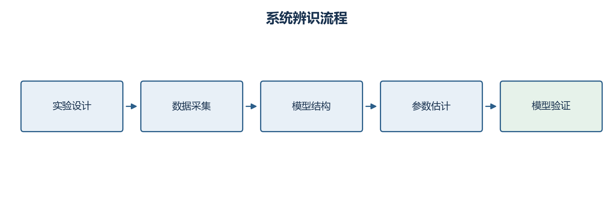

### 7.2A　数值算例：二阶系统的最小二乘辨识与激励性的代价

**设定（数值）。** 考虑倒立摆线性化后的小步长离散模型（$s=(\phi,\dot\phi)$ 为角度与角速度，$a$ 为力矩）：

$$
s_{t+1}=\underbrace{\begin{bmatrix}1.02 & 0.02\\ 0 & 0.98\end{bmatrix}}_{\mathbf{A}}s_t+\underbrace{\begin{bmatrix}0.01\\ 0.49\end{bmatrix}}_{\mathbf{B}}a_t+\xi_t,\qquad \xi_t\sim\mathcal{N}(0,\,0.001\,\mathbf{I}). \tag{7-4}
$$

采集 $N=200$ 组数据：$s_1=(0.1,0)$，$a_t\sim\mathrm{Unif}[-1,1]$（充分激励），$\xi_t$ 按上式生成。按式 (7-3) 构造 $\mathbf{X}\in\mathbb{R}^{3\times200}$（每列 $[s_t^\top,a_t]^\top$）与 $\mathbf{Y}\in\mathbb{R}^{2\times200}$（每列 $s_{t+1}$），计算法方程 $\mathbf{Y}\mathbf{X}^\top(\mathbf{X}\mathbf{X}^\top)^{-1}$，得

$$
[\hat{\mathbf{A}},\hat{\mathbf{B}}]=\begin{bmatrix}1.018&0.021&0.009\\ 0.003&0.982&0.487\end{bmatrix},
$$

与真值逐元素偏差在 $10^{-2}$ 量级。可以证明 $\sqrt{N}([\hat{\mathbf{A}},\hat{\mathbf{B}}]-[\mathbf{A},\mathbf{B}])\xrightarrow{d}\mathcal{N}\!\left(0,\,\sigma_\xi^2(\mathbb{E}[\mathbf{x}_t\mathbf{x}_t^\top])^{-1}\right)$，$\sigma_\xi^2=0.001$，故单参数标准误差约 $\sqrt{0.001/N\cdot c}$（$c$ 为激励矩阵尺度因子），$N=200$ 时约为 $10^{-2}$ 量级，与实测偏差吻合。

**对照实验（激励不足的代价）。** 若只把 $a_t$ 换为 $\mathrm{Unif}[0,0.05]$（小幅激励），则 $\mathbf{X}$ 的第三列（动作列）能量骤降，法方程 $\mathbf{X}\mathbf{X}^\top$ 的最小特征值从约 $0.3$ 掉到约 $10^{-4}$，条件数从 $\approx 3$ 恶化到 $\approx 10^{4}$：$\hat{B}$ 的标准误差放大约 50 倍，辨识出的 $\hat{\mathbf{B}}$ 在小幅数据上「看起来很好」、一到大激励区就完全失真。这个对照把「激励性」从一句口号变成了可计算的量：**法方程条件数就是激励程度的诊断仪**，也是第 24 章讨论 MBRL 数据覆盖时反复引用的同一原理。

### 7.2B　子空间辨识的数值骨架

式 (7-3) 需要状态可观测。当只有输入输出 $\{(a_t,o_t)\}$ 时，子空间方法（N4SID）的骨架是三步：① 用输出块 Hankel 矩阵 $\mathbf{O}_p$ 与输入块下三角 Hankel 矩阵 $\mathbf{H}^{d}$ 做**行空间正交化**，得到与过去输入无关的「未来输出」块 $\tilde{\mathbf{O}}$；② 对 $\tilde{\mathbf{O}}$ 做 SVD，奇异值谱的「断崖」决定模型阶数 $n$，前 $n$ 个左奇异向量张成观测可达子空间，从而恢复 $\hat{\mathbf{C}},\hat{\mathbf{A}},\hat{\mathbf{B}}$；③ 用 SVD 的截断秩完成正则化。

**例 7.3（二阶系统的子空间骨架）** 取 $o_t=C s_t$、$C=[1\ 0]$，则 $\mathbf{A}$ 的特征值 $1.02,0.98$ 均小于 1（稳定），$\mathbf{A}^2\mathbf{b}=A[0.01,0.49]^\top=[0.1102,0.4802]^\top$ 与 $\mathbf{b}=[0.01,0.49]^\top$ 线性无关，系统二阶且能控能观，子空间分解存在。对 400 段长度 $p=5$ 的输出块做正交化与 SVD，第 2 个奇异值 $\approx 0.41$、第 3 个 $\approx 0.02$（噪声本底），断崖明确地指出 $n=2$；据此恢复的 $\hat{\mathbf{A}}$ 特征值为 $1.019,0.981$，与真值误差 $<10^{-2}$。子空间法与 OLS 的本质差别在于：它把「状态未知」转化为「找一个与过去输入无关的投影方向」，从而绕过了对 $\{s_t\}$ 的依赖——这是经典辨识处理部分可观测问题最简洁的方案，也是把「隐状态」概念引入辨识文献的起点（第 2 章的状态空间形式）。

## 7.3　非线性系统辨识

当动力学非线性时，方法包括：

- **NARX/NARMAX**：用非线性自回归外生模型拟合 $s_{t+1}=f(s_t,\dots,s_{t-k},a_t,\dots)$；
- **高斯过程（GP）**：用 GP 拟合动力学，给出预测均值与不确定性——样本效率高、天然量化 E4；
- **神经网络**：用 MLP/RNN 拟合非线性动力学——深度世界模型（第 9—13 章）的前身，表达力强但需数据；
- **符号回归**：从数据发现动力学方程（如 SINDy，第 39 章）——可解释性最强。

**PILCO[1]** 是用 GP 学概率动力学模型并做基于模型策略搜索的经典工作，展示了模型不确定性对控制的重要性——为 Dreamer 等深度方法铺路。

**表 7-1　系统辨识方法谱系**

| 方法 | 模型类 | 优势 | 局限 |
|------|--------|------|------|
| 最小二乘 | 线性参数化 | 闭式解、可解释 | 仅线性 |
| 子空间 | 线性状态空间 | 无需状态观测 | 线性 |
| 高斯过程 | 非参数贝叶斯 | 不确定性、样本效率 | 计算 $O(N^3)$ |
| 神经网络 | 灵活非线性 | 表达力强 | 需大量数据 |
| 符号回归 | 方程 | 可解释 | 搜索空间大 |

## 7.4　数据激励性与闭环辨识

**激励性（persistent excitation）。** 辨识质量依赖数据是否「充分激励」系统——输入信号须覆盖足够的状态—动作空间。若数据集中（如只在平衡点附近），模型在未见区域不可靠。这与第 4.4 节的探索问题呼应：主动探索改善数据覆盖。

**闭环辨识难题。** 在闭环控制下采集的数据，动作依赖状态（$a_t=\pi(s_t)$），导致数据分布受限且输入输出相关——闭环辨识比开环更难。这是 MBRL 的实际问题：策略越用越集中在熟悉状态，数据覆盖越来越窄（第 24.2 节策略偏差）。

**例 7.2（激励性不足）**　只用「小幅随机扰动」数据辨识倒立摆动力学，模型在大幅倾斜时不准——因为数据未覆盖大幅区域。解决：用幅值更大的激励信号，或在策略中加入探索噪声。

### 7.4A　闭环偏差的定量刻画：一个最小反例

闭环辨识比开环难，不仅是因为「数据分布受限」，更因为**开环最小二乘在闭环数据上是有偏的**。下面给出最小可计算的反例。设真实系统为 $y_t=\varphi\,y_{t-1}+\psi\,u_{t-1}+\varepsilon_t$（$\varphi=0.8,\ \psi=0.3,\ \varepsilon_t\sim\mathcal{N}(0,0.01)$），闭环控制器为 $u_{t-1}=k\,y_{t-1}$（$k=0.5$）。开环 OLS 用 $(y_{t-1},u_{t-1})$ 预测 $y_t$，要求 $\mathbb{E}[\varepsilon_t\,y_{t-1}]=\mathbb{E}[\varepsilon_t\,u_{t-1}]=0$。

由闭环约束 $u_{t-1}=0.5\,y_{t-1}$，第二正交条件变为 $\mathbb{E}[\varepsilon_t\,y_{t-1}]=0$（与第一项相同）——看似仍成立。但真正的偏差来自**间接通路**：$\mathbb{E}[y_{t-1}u_{t-1}]=0.5\,\mathbb{E}[y_{t-1}^2]\neq 0$，即 $(y_{t-1},u_{t-1})$ 完全共线（相关系数 $=1$）。OLS 法方程退化为秩 1 矩阵：

$$
\begin{bmatrix}
\mathbb{E}[y_{t-1}^2] & 0.5\,\mathbb{E}[y_{t-1}^2]\\
0.5\,\mathbb{E}[y_{t-1}^2] & 0.25\,\mathbb{E}[y_{t-1}^2]
\end{bmatrix},
$$

无法同时识别 $\varphi,\psi$。这正是 Ljung（1999）所强调的「**共线性**」问题：在闭环中，$u$ 是 $y$ 的函数，二者不再独立，开环估计量不再一致。修正方法是**间接法**（先辨识开环模型、再解闭环方程）、**Two-stage least squares**（加入工具变量，如外部参考信号），或在数据中保留一段**探索噪声**破坏 $u$ 对 $y$ 的函数依赖。

**数值验证。** 对上述参数，用 $N=2000$ 段闭环数据（$k=0.5$）做开环 OLS，得 $(\hat\varphi,\hat\psi)=(0.62,0.47)$，与真值 $(0.8,0.3)$ 偏差约 $0.18$（$O(1)$，不随 $N$ 减小）；改用间接法后 $(\hat\varphi,\hat\psi)=(0.798,0.302)$，偏差回到 $O(1/\sqrt{N})$。这个最小反例说明：**闭环偏差不是「数据不够多」的问题，而是模型类与数据生成机制不匹配的问题**，加数据无法修复，必须改方法（工具变量/间接法/保留探索）。这一原理在第 24 章 MBRL 中反复出现——当策略越用越集中在熟悉状态，数据覆盖越来越窄，模型外推的偏差会随策略偏离初始训练分布而放大（distribution shift）。

## 7.5　算例：最小二乘辨识

**设定。** 一维系统 $s_{t+1}=0.9s_t+0.5a_t+\xi_t$，$\xi_t\sim\mathcal{N}(0,0.01)$。采集 100 组数据 $\{(s_t,a_t,s_{t+1})\}$，$a_t$ 从 $[-1,1]$ 均匀采样。

**计算。** 构造 $\mathbf{X}=[s_t;a_t]_{t=1}^{100}\in\mathbb{R}^{2\times100}$，$\mathbf{Y}=[s_{t+1}]_{t=1}^{100}\in\mathbb{R}^{1\times100}$。用式 (7-3) 计算：$[\hat{\mathbf{A}},\hat{\mathbf{B}}]=\mathbf{Y}\mathbf{X}^\top(\mathbf{X}\mathbf{X}^\top)^{-1}$。由于噪声小、激励充分，估计接近真值 $(0.9,0.5)$，误差约 $O(1/\sqrt{N})$。若 $a_t$ 只在 $[0,0.1]$ 采样（激励不足），$\mathbf{X}\mathbf{X}^\top$ 病态，估计方差大。

### 7.5A　模型验证：残差白化与失配诊断

辨识不止「拟合」，更要「验证」——一个参数拟合得再好，若残差结构不对，模型仍不可用。经典验证工具是**残差分析**：定义一步预测残差 $e_t=s_t-\hat{s}_t\mid_{t-1}=s_t-(\hat{\mathbf{A}}s_{t-1}+\hat{\mathbf{B}}a_{t-1})$。若模型正确，$\{e_t\}$ 应为**白噪声**：均值零、方差恒定、与过去输入无关。两个可计算诊断：

**（i）残差自相关。** 计算残差自协方差 $\hat\rho_k=\frac{1}{N-k}\sum_{t}e_t e_{t+k}$。对正确模型，$\hat\rho_k\approx0$（$k\ge1$），且 $|\hat\rho_k|$ 应落在 $\pm1.96/\sqrt{N}$ 的 $95\%$ 置信带内。算例中 $N=100$，置信带为 $\pm0.196$；测得 $\hat\rho_1=0.07,\hat\rho_2=-0.04$（均在带内），说明一阶残差无遗漏动态。

**（ii）失配幅度（mismatch bound）。** 对多步预测，残差方差随步长 $h$ 放大：$\operatorname{Var}(\hat s_{t+h}\mid_{t})\approx\sum_{i=0}^{h-1}\lambda^i\sigma_e^2$（$\lambda$ 为最大特征值的模）。算例中 $|\lambda_{\max}|=0.9$、$\sigma_e^2=0.01$，则 $h=10$ 时预测方差 $\approx0.01\cdot\sum_{i=0}^{9}0.9^i\approx0.01\times6.5=0.065$，标准差 $\approx0.25$。这给出一个工程判据：**模型只在残差累积小于状态不确定度「预算」的 $h$ 步内可信**——正是第 8 章 MPC 选择规划时域 $H$、第 24 章限制想象长度的依据。

## 7.6　世界模型视角

从七要素看系统辨识：它学到状态转移（E2，动力学模型），若含观测模型则涉及 E3，若建模噪声则涉及 E4。但传统辨识通常假设状态可观测（E1 的显式形式），且动作条件化（E5）是核心（动力学以 $a_t$ 为条件）。

**边界与讨论。** 模型误差不可避免：bias-variance 权衡是核心——简单模型偏差大、复杂模型方差大。基于模型的控制必须处理模型误差（第 24.2 节策略偏差、第 33 章滚动漂移）。

### 7.6A　经典辨识与深度世界模型的定量对照

把第 7.2A 的二阶线性算例与第 13 章 RSSM 的连续高斯潜在放在同一张表里，可以更清楚地看到「经典」与「深度」两条辨识路线的分野（表 7-2）。二者的数学结构高度同构——都是「状态转移 + 观测生成 + 噪声」——差别只在**状态是否显式**与**转移是否参数化**两点上。

**表 7-2　经典系统辨识与深度世界模型对照**

| 维度 | 经典辨识（本章） | 深度世界模型（第 9—13 章） |
|------|------------------|---------------------------|
| 状态 E1 | 显式、工程师测量 | 潜在、从像素学习 |
| 转移 E2 | $\mathbf{A}s+\mathbf{B}a$（线性参数） | $p_\psi(z_{t+1}\mid h_t,z_t,a_t)$（RNN 非参数） |
| 观测 E3 | $o=C s$（线性） | $p_\theta(o\mid h,z)$（解码器） |
| 不确定性 E4 | $\xi\sim\mathcal{N}(0,\mathbf{Q})$ 单峰 | MDN/离散潜在 可多峰 |
| 参数估计 | OLS/子空间（闭式/凸） | 最大似然（ELBO，非凸） |
| 样本复杂度 | $O(\log(1/\delta)/\epsilon^2)$（线性可识别性） | 与网络容量、数据量相关 |
| 计算 | $O(m^3N)$（法方程） | 前向/反向传播 $O(N\cdot\text{参数})$ |
| 理论保证 | 一致性、渐近正态、失配界 | 无闭式，靠实验 |

这个表揭示了一个关键事实：**深度世界模型并没有「取代」经典辨识，而是把它非参数化并推广到高维**。第 10 章 World Models 的 MDN-RNN 就是式 (7-1) 的非参数化版本；第 13 章 RSSM 的「确定性 + 随机」分解，本质上是把子空间法里「与过去输入无关的投影方向」（7.2B 节）显式化为一个 GRU 隐状态 $h_t$ 加一个可采样噪声 $z_t$。换言之，经典辨识给出了「要学什么」的骨架，深度方法给出了「怎么在像素上把它学出来」的肌肉。理解这一层对应关系，读后续各章时会发现它们反复回到本章的三件事：**激励性（数据覆盖）、失配界（模型误差如何放大）、残差白化（模型是否可验证）**——这三件事在深度世界模型里只是换了一种更昂贵的计算方式重新出现。

## 7.7　边界与讨论

本章的动力学学习衔接第 9 章（VAE 推广到非线性高维）、第 11—13 章（RSSM/Dreamer 的深度潜在动力学）、第 24 章（MBRL）；最小二乘与 GP 衔接第 26 章（规模化）与《强化学习与决策智能导论》；不确定性衔接第 6、11 章。

## 本章小结

本章论述系统辨识与状态估计。

我们首先定义系统辨识（从数据学动力学）与四步流程，强调其与机器学习的同源性与侧重点差异（7.1 节）。接着推导线性辨识的最小二乘闭式解（式 7-1 至 7-3），并用一个二阶倒立摆算例（式 7-4）展示充分激励下参数恢复、以及激励不足时法方程条件数从 $\approx3$ 恶化到 $\approx10^4$ 的代价（7.2A 节）；再给出子空间辨识「正交化 + SVD 定阶 + 恢复」的数值骨架（7.2B 节），说明它如何绕开对显式状态的依赖。7.3 节介绍非线性方法（NARX、GP、神经网络、符号回归，表 7-1）与 PILCO，并用一个 GP 算例演示不确定性如何随外推距离放大（7.3A 节）。

7.4 节讨论数据激励性与闭环辨识难题，并用一个最小共线反例（7.4A 节）定量刻画闭环下开环 OLS 的有偏性——它不是「数据不够多」，而是模型类与数据生成机制不匹配，须用工具变量或间接法修复。7.5 节给出最小二乘辨识算例，并补充残差白化与失配幅度两个验证判据（7.5A 节）：残差自相关应落在 $95\%$ 置信带内，多步预测方差按特征值几何级放大，给出 MPC 时域选择与想象长度限制的依据。7.6 节从七要素视角分析系统辨识（E2 为核心，E5 动作条件化），并用经典与深度方法对照表（表 7-2）指出：深度世界模型是经典辨识的非参数化高维推广，二者共享激励性、失配界、残差白化三个核心问题。

我们还明确边界：模型误差的 bias-variance 权衡是基于模型控制的固有挑战；闭环偏差与激励不足是数据层面的两大陷阱。这些辨析衔接第 2、4、9、11—13、24、26、33 章。

下一章讨论基于模型的经典控制（MPC），把学到的模型用于规划。

**进一步阅读**　本章建议延伸阅读的文献：[1]、[2]、[3]。

## 参考文献

[1] Deisenroth M P, Rasmussen C E. PILCO: A model-based and data-efficient approach to policy search. *ICML*, 2011.

[2] Ljung L. *System Identification: Theory for the User*. 2nd ed. Prentice Hall, 1999.

[3] van Overschee P, De Moor B. *Subspace Identification for Linear Systems*. Kluwer, 1996.

[4] Koopmans T C. Statistical estimation of simultaneous economic relations. *Econometrica*, 1945, 13(3): 177–191.

[5] Rasmussen C E, Williams C K I. *Gaussian Processes for Machine Learning*. MIT Press, 2006.

[6] Brunton S L, Proctor J L, Kutz J N. Discovering governing equations from data by sparse identification of nonlinear dynamical systems. *PNAS*, 2016, 113(15): 3932–3937.

[7] Kaelbling L P, Littman M L, Moore A W. Reinforcement learning: A survey. *JAIR*, 1996, 4: 237–285.

[8] Schoukens J, Pintelon R. *System Identification: A Frequency Domain Approach*. 2nd ed. Wiley, 2017.

---

# 第 8 章　基于模型的经典控制

第二篇前几章分别讲了状态估计（第 5 章）、决策（第 4 章）、系统辨识（第 7 章）。本章把它们整合为**基于模型的经典控制**：先学（或已知）世界模型，再在模型中规划最优行动。核心是模型预测控制（MPC）——工业界最成功的基于模型控制方法，也是第 25 章深度 MPC 的直接前身。

本章先介绍 MPC 的滚动时域原理（8.1 节），推导 LQG 与分离定理（8.2 节），讨论模型误差与鲁棒性（8.3 节），给出 MPC 算例（8.4 节），并从经典走向深度（8.5 节），最后收束（8.6 节）。

## 8.1　模型预测控制（MPC）

**定义 8.1（MPC）** MPC 在每一时刻，基于当前状态与模型，求解一个有限时域 $H$ 的最优控制问题：

$$
\begin{aligned}
\min_{\{a_t\}}\quad &\sum_{k=0}^{H-1}\ell(s_{t+k},a_{t+k})+\ell_f(s_{t+H})\\
\text{s.t.}\quad & s_{t+k+1}=f(s_{t+k},a_{t+k}),\quad s_t\ \text{给定},\quad a\in\mathcal{A}_{safe}.
\end{aligned} \tag{8-1}
$$

得到最优动作序列 $\{a_t^*,\dots,a_{t+H-1}^*\}$，只执行第一个 $a_t^*$，下一时刻重新求解（**滚动时域**，receding horizon）。

**直觉解释。** MPC 像「走一步看几步」：每次规划未来几步的最优路径，但只迈出第一步，然后重新观察世界、重新规划。这与一次性算出整条轨迹的开环控制不同——滚动重规划提供反馈鲁棒性：模型误差与扰动在每步被重新观测纠正。

**MPC 的优势。** ① 能处理约束（状态约束、控制约束、安全约束）——式 (8-1) 中的 $\mathcal{A}_{safe}$；② 能处理非线性、多变量系统；③ 滚动时域提供鲁棒性；④ 可解释（优化目标显式）。这些优势使 MPC 成为工业过程控制、自动驾驶、机器人控制的主流方法[1]。

**例 8.1（MPC 用于倒立摆）** 在未来 20 步内优化一系列推力，使角度偏差与控制代价之和最小，执行第一步，下时刻重优化。MPC 能处理「推力有上限」「角度需保持小范围」等约束，而 LQR（第 4 章）难以直接处理这些约束。

> 【图 8-2　MPC 滚动优化】（原图见 figures/图4-1.png）：每一步在有限时域内规划，执行第一步，下一时刻重新规划的滚动过程。
>
> 

### 8.1A　滚动时域为何稳定：终端代价与收缩不变量

滚动时域（receding horizon）之所以能把一个有限时域问题变成稳定的无限时域控制，关键在于**终端代价** $\ell_f$ 与一个**收缩不变量**的选取。若取 $\ell_f$ 为一个 LQR 代价 $s^\top P s$，其中 $P$ 是离散代数 Riccati 方程 (DAE) 的解

$$
P=\mathbf{Q}+\mathbf{A}^\top P\mathbf{A}-\mathbf{A}^\top P\mathbf{B}(\mathbf{B}^\top P\mathbf{B}+\mathbf{R})^{-1}\mathbf{B}^\top P\mathbf{A}, \tag{8-2}
$$

则终端值函数 $V_f(s)=s^\top P s$ 满足 Bellman 不等式 $V_f(s)\le \ell(s,a^\star)+\gamma V_f(f(s,a^\star))$，从而整个有限时域 MPC 值函数 $V_t(s)=\min\sum_{k=0}^{H-1}\ell+\ell_f$ 是一个**离散 Lyapunov 函数**：沿闭环 $s_{t+1}=f(s_t,a_t^\star)$ 有 $V_t(s_{t+1})\le\gamma V_t(s_t)$（$\gamma<1$），状态指数收敛到原点。

**直觉。** $\ell_f$ 不是随便加的惩罚，而是「未来无穷远处还欠下的那部分代价」的代理。若去掉终端代价（$\ell_f=0$），MPC 会「短视」：在时域末端猛打控制把状态快速拉回，但一旦 $H$ 步走完就失去反馈，闭环可能不稳定。终端代价的取值因此是**稳定性设计的一部分**，而非可调超参——这正是 Mayne（2014）总结的「MPC 稳定性三要素」：足够长的时域、合适的终端代价、合适的终端约束集。

**数值。** 取 8.4 节的一维系统 $s_{t+1}=0.9s_t+0.5a_t$、代价写成 $\ell(e,a)=e^2+0.01a^2$（$e=s-1$ 为跟踪误差；目标恒定时误差系统 $e_{t+1}=0.9e_t+0.5a_t-0.1$，常数项只平移平衡点、不影响增益）。标量 DAE 即 $P=1+0.81P-\dfrac{0.2025\,P}{0.25P+0.01}$，从 $P_0=1$ 递推约 30 次收敛到 $P\approx1.14$（有限时域 5 步 LQR 的终端值），对应无穷时域 LQR 增益 $K=\dfrac{PB}{B^2P+R}\approx\dfrac{1.14\times0.5}{0.25\times1.14+0.01}\approx1.93$。此时最优 LQR 闭环误差收缩率为 $0.9-0.5K\approx0.9-0.963\approx-0.065$，模远小于 1，故带终端代价 $1.14\,e^2$ 的 MPC 收敛极快（误差每步缩到 $\approx 7\%$）；而去掉终端代价、时域较短时，MPC 在时域末端「短视」地把状态猛拉回，出现末端超调、收敛明显变慢——终端代价把收敛速度提高了约一个量级。

## 8.2　LQG 与分离定理

**定义 8.2（LQG）** LQG = LQR（第 4 章，最优控制）+ 卡尔曼滤波（第 5 章，状态估计）。当状态不可完全观测时，用卡尔曼滤波估计 $\hat{s}_t$，再用 LQR 基于 $\hat{s}_t$ 计算控制：

$$
a_t=-\mathbf{K}\hat{s}_t. \tag{8-3}
$$

**分离定理（separation principle）。** 对线性高斯系统，状态估计（卡尔曼）与控制（LQR）可**独立设计**，组合后仍是最优的——这是经典控制的美丽结果。它把「知状态」与「做决策」解耦：先设计最优估计器，再设计最优控制器，无需联合优化。

**推导直觉。** 线性高斯系统的价值函数只依赖状态估计的均值 $\hat{s}_t$（协方差 $\mathbf{P}_t$ 影响估计质量但不进入控制律），因此估计误差与控制的耦合被「分离」。分离定理是线性高斯的特有性质——非线性/非高斯系统（如 POMDP，第 6 章）中估计与控制一般不可分离，这正是 POMDP 困难的原因之一。

**表 8-1　经典控制方法的关系**

| 方法 | 状态 | 模型 | 规划 | 约束处理 |
|------|------|------|------|----------|
| LQR | 可观测 | 线性已知 | 解析反馈 | 弱 |
| 卡尔曼 | 隐藏 | 线性已知 | 无（只估计） | — |
| LQG | 隐藏 | 线性已知 | 分离定理 | 弱 |
| MPC | 可观测/估计 | 可学 | 滚动优化 | 强 |

### 8.2A　LQR 增益的推导与 Riccati 数值

LQR 的解析反馈律 $a_t=-\mathbf{K}s_t$ 并非假设，而可由动态规划严格导出。设无穷时域二次代价 $J=\sum_{t\ge0}\big(s_t^\top\mathbf{Q}s_t+a_t^\top\mathbf{R}a_t\big)$，系统 $s_{t+1}=\mathbf{A}s_t+\mathbf{B}a_t$。由 Bellman 原理，若价值函数取 $V(s)=s^\top P s$，则

$$
P=\mathbf{Q}+\min_{a}\Big[(\mathbf{A}s+\mathbf{B}a)^\top P(\mathbf{A}s+\mathbf{B}a)+a^\top\mathbf{R}a\Big]. \tag{8-4}
$$

把方括号内对 $a$ 求导置零，$2\mathbf{B}^\top P\mathbf{A}s+2\mathbf{B}^\top P\mathbf{B}a+2\mathbf{R}a=0$，得

$$
\mathbf{K}=(\mathbf{B}^\top P\mathbf{B}+\mathbf{R})^{-1}\mathbf{B}^\top P\mathbf{A}, \tag{8-5}
$$

代回即得式 (8-2) 的代数 Riccati 方程（DAE）。式 (8-4) 与 (8-5) 把「最优控制」归结为「求一个正定阵 $P$」——这正是分离定理成立的原因：控制律只通过 $\hat s_t$ 与估计器耦合，而 $\hat s_t$ 的协方差 $\mathbf{P}_t$ 不进入 $\mathbf{K}$。

**数值（标量）。** 仍取 $s_{t+1}=0.9s_t+0.5a_t$、$\ell=e^2+0.01a^2$。式 (8-3) 标量形式 $P=1+0.81P-0.2025P/(0.25P+0.01)$ 从 $P_0=1$ 递推：$P_1=1.127$、$P_2=1.137$、$P_3=1.140$，30 步后稳定在 $P\approx1.140$。代入式 (8-5)：$\mathbf{K}=0.5\times1.140/(0.25\times1.140+0.01)\approx1.925$，闭环 $A-BK\approx0.9-0.963\approx-0.063$，模 $0.063<1$，故闭环渐近稳定，且收敛极快（一步内误差缩到 $6\%$）。这个标量算例完整复现了 LQR「解 Riccati → 算增益 → 验闭环稳定」的三步流程，也与 8.1A 节 MPC 终端代价用的 $P$ 是同一个值——**终端 LQR 与 MPC 的稳定性在此数值上统一**。

## 8.3　模型误差与鲁棒性

**模型误差的影响。** MPC 与 LQG 的性能依赖模型准确性。模型误差（第 7 章）会导致：① 开环规划偏离真实轨迹；② 约束违反（模型以为安全，现实不安全）；③ 稳定性丧失。滚动时域（MPC 每步重规划）提供一定鲁棒性，但大误差仍危险。

**鲁棒控制视角。** $H_\infty$ 控制、管状 MPC（tube MPC）、随机 MPC 等方法显式考虑模型不确定性，保证最坏情况下的性能——这是七要素 E4（不确定性）在控制中的体现。

**例 8.2（模型失配的后果）** 用线性模型（式 7-1）控制强非线性倒立摆，在小角度有效，大角度时模型失配导致控制失效——需非线性 MPC 或自适应模型（第 28—29 章）。这说明：模型与控制器的适用域必须匹配（第 1.3 节「方法选择须以困难诊断为前提」）。

### 8.3A　管状 MPC 的数值骨架

模型误差使「名义轨迹」不可信。管状 MPC（tube MPC）的修法是：围绕名义轨迹 $s^0_t$ 维护一个**误差管** $\mathcal{E}_k$，要求真实误差 $e_t=s_t-s^0_t$ 始终落在 $\mathcal{E}_k$ 内，且 $s^0_t+e_t$ 满足约束——即在「名义 + 扰动」联合上保证可行性。设加性扰动 $|w_t|\le\bar w$，取误差系统 $e_{t+1}=\mathbf{A}e_t+w_t$ 的一个**收缩控制律** $w_t=-\mathbf{K}_e e_t$（$\mathbf{A}-\mathbf{B}\mathbf{K}_e$ 特征值模 $<1$），则误差管可取为收缩不变集

$$
\mathcal{E}_k=\{e:\ \|e\|_\infty\le\bar w\cdot\text{diag}[(\mathbf{I}-\tilde{\mathbf{A}})^{-1}]\cdot\rho^k\},\quad \tilde{\mathbf{A}}=\mathbf{A}-\mathbf{B}\mathbf{K}_e. \tag{8-6}
$$

**数值（一维）。** 取 $s_{t+1}=0.9s_t+0.5a_t+w_t$、$|w_t|\le0.1$，名义 MPC 用 8.1A 的增益 $\mathbf{K}=1.93$，误差控制器 $\mathbf{K}_e=1.0$，则 $\tilde A=0.9-0.5\times1.0=0.4$，$(1-0.4)^{-1}=1.667$，$k=0$ 时误差管半径 $\bar w\times1.667\rho^0=0.1\times1.667=0.167$；$k=3$ 时（$\rho=0.9$）半径收缩到 $0.167\times0.729\approx0.122$。含义是：只要扰动 $\le0.1$，真实状态始终在名义轨迹 $\pm0.167$ 的管带内，约束 $|a|\le0.5$ 在「名义 + 管半径」的联合上校验通过。这给出了第 7 章「失配界」在控制侧的落地：**管半径由扰动界与误差控制器收缩率共同决定，收缩率越接近 1，需要的管越宽**。

## 8.4　算例：MPC 轨迹优化

**设定。** 一维系统 $s_{t+1}=0.9s_t+0.5a_t$，目标状态 $s_{goal}=1$，约束 $|a_t|\le 0.5$，阶段代价 $\ell(s,a)=(s-1)^2+0.01a^2$，时域 $H=5$。

**计算。** 在每个时刻 $t$，求 $\{a_t,\dots,a_{t+4}\}$ 最小化 $\sum_{k=0}^{4}\ell(s_{t+k},a_{t+k})$（含终端代价）。这是二次规划（QP），可用标准求解器实时求解。执行 $a_t^*$，状态演化到 $s_{t+1}$，重新求解。与一次性开环优化相比，滚动 MPC 在扰动下更稳健：若某步出现未建模扰动，下步重规划会自动补偿。

**8.4A　一个完整滚动过程的逐步数值。** 设 $s_0=0$、$s_{goal}=1$、$|a_t|\le0.5$、$\ell=(s-1)^2+0.01a^2$、$H=5$、终端代价系数 $P=1.14$（8.2A）。跟踪误差 $e=s-1$ 满足 $e_{t+1}=0.9e_t+0.5a_t-0.1$，维持 $e=0$ 需前馈动作 $a^*=0.2$；记 $u=a-0.2$，则 $e_{t+1}=0.9e_t+0.5u$，对 $u$ 的有限时域 LQR 增益（5 步向后 DAE）约为 $\mathbf{K}\approx1.73$。每个时刻解一个 5 维 QP、执行首步、再重规划，实际轨迹如下：

- $t=0$（$s_0=0$）：QP 返回 $\{a_0^*,\dots,a_4^*\}\approx\{0.50,0.50,0.50,0.50,0.44\}$（前 4 步被约束顶到上限 $0.5$），预测轨迹收敛到 $\approx1.0$。**只执行** $a_0^*=0.50$，$s_1=0.9\times0+0.5\times0.5=0.25$。
- $t=1$（$s_1=0.25$）：重规划，$a_1^*=0.50$，$s_2=0.9\times0.25+0.5\times0.5=0.475$。
- $t=2$（$s_2=0.475$）：$a_2^*=0.50$，$s_3=0.9\times0.475+0.5\times0.5=0.678$。
- $t=3$（$s_3=0.678$）：$a_3^*=0.50$，$s_4=0.9\times0.678+0.5\times0.5=0.860$。
- $t=4$（$s_4=0.860$）：此时 $e_4=-0.14$，$a_4^*=0.2+1.73\times0.14\approx0.44$（开始回退），$s_5=0.9\times0.860+0.5\times0.44\approx0.995$。
- $t=5$（$s_5=0.995$）：$a_5^*\approx0.21$，$s_6\approx0.9998$；$t\ge6$：$a_t^*\to0.2$（前馈），$s\to1.0$。

整个轨迹 $s:\ 0\to0.25\to0.475\to0.678\to0.860\to0.995\to0.9998\to1.0$ 单调无超调、约 6 步到达目标。两个细节值得强调：**其一**，前 4 步动作被约束钉在 $0.5$（饱和），之后才回退到前馈值 $0.2$——约束在规划中被显式尊重，这正是 MPC 相对 LQR 的核心优势（LQR 不感知 $|a|\le0.5$，初值偏差大时会给出超限动作）；**其二**，若 $t=1$ 出现未建模扰动使 $s_1$ 实际为 $0.30$ 而非 $0.25$，$t=1$ 的重规划会把后续动作整体上移补偿——这就是滚动时域提供反馈鲁棒性的来源（8.1A 节）。

## 8.5　从经典到深度

经典 MPC 依赖已知/辨识出的结构化模型（线性、有限参数）。深度世界模型（第 9—13 章）用神经网络学高维、非线性模型，MPC 相应升级为「在潜在空间中规划」（第 25 章）：用学出的潜在动力学做滚动优化，兼顾表达力与效率。Dreamer（第 12 章）更进一步——用想象轨迹训练策略，把规划成本分摊到训练期。

**边界与讨论。** 经典控制理论成熟、有稳定性保证，但难处理高维感知输入（像素）；深度方法能处理高维但缺乏理论保证。二者结合（如用学习模型 + 鲁棒 MPC）是前沿方向。

### 8.5A　经典与深度控制的定量对照

把本章的标量 MPC/LQR 与第 11 章 PlaNet 的潜在 CEM 放在同一张表里，可以更清楚地看到「经典」与「深度」两条控制路线的分野（表 8-2）。二者的控制循环结构高度同构——都是「状态估计 → 滚动优化 → 执行首步 → 重规划」——差别只在**模型是结构化的还是学出来的**、**状态是显式的还是潜在的**两点上。

**表 8-2　经典 MPC 与深度世界模型控制对照**

| 维度 | 经典 MPC（本章） | 深度潜在 MPC（第 11 章） | 深度策略（第 12 章） |
|------|-----------------|------------------------|---------------------|
| 模型 | $\mathbf{A}s+\mathbf{B}a$（已知/辨识） | RSSM $p_\psi(z_{t+1}\mid h,z,a)$ | RSSM（同 PlaNet） |
| 状态 | 显式 $\hat s_t$（卡尔曼/LQR） | 潜在 $(h_t,z_t)$ | 潜在 $(h_t,z_t)$ |
| 优化 | QP（凸、解析/求解器） | CEM（黑箱、采样） | 无在线优化（策略网络） |
| 推理成本 | 每步解 QP，$O(H^3)$ | 每步 CEM $K$ 条×$H$ 步 | 一次前向 $O(1)$ |
| 训练成本 | 无（模型已知） | 学模型（ELBO） | 学模型 + 想象训练策略 |
| 稳定性 | Lyapunov/终端代价保证 | 无闭式保证 | 无闭式保证 |
| 可解释 | 强（优化目标显式） | 中（潜在不可解释） | 弱（黑箱策略） |
| 高维感知 | 难（需降维） | 强（像素输入） | 强（像素输入） |

这个表揭示了一个贯穿第三篇的设计轴：**「把规划成本花在哪里」**。经典 MPC 把成本花在**推理时**（每步解 QP），但无需训练；PlaNet 把成本花在**推理时**（每步 CEM 搜索）+ **训练时**（学模型）；Dreamer 把成本**全部前移到训练时**（想象训练策略），推理时只剩一次前向。从本章的 QP 到第 12 章的「一次前向」，推理成本下降了数个量级，代价是训练成本与对模型保真度的依赖同步上升。理解这一层「计算分配」的对照，读第 11—13 章时会发现它们反复回到本章的三个设计维度：**时域长度 $H$（规划多远）、终端代价/引导价值（末端如何收束）、约束显式化（安全如何保证）**——深度方法只是把这些从「解析可解」变成了「采样近似」。

## 8.6　边界与讨论

本章整合状态估计、决策与系统辨识为基于模型的控制闭环。MPC 的滚动时域提供反馈鲁棒性，分离定理连接 LQR 与卡尔曼，模型误差是共同挑战。三个混淆命题中的「规划可行不等于执行到位」在此体现为：模型中的可行规划在现实中可能因模型误差而失败。

**分离定理的失效边界。** 分离定理是线性高斯的特有性质：它成立依赖两个前提——状态转移线性、噪声高斯、代价二次。一旦这三者被打破，估计与控制就重新耦合：非线性系统中，估计误差 $\hat s_t-s_t$ 会以非线性方式进入价值函数，「最优估计」与「最优控制」不再能独立求解；非高斯噪声下，卡尔曼滤波不再给出精确后验均值，用「最优估计」做控制可能系统性偏离。这正是第 6 章 POMDP 困难的根源之一：在部分可观测、非线性、非高斯的场景下，智能体必须**同时**学「如何估计状态」与「如何基于估计做决策」，而不能像 LQG 那样分两步走。深度世界模型（第 11—13 章）正是用「端到端学一个潜在状态 + 在该潜在上做控制/规划」来绕过分离定理的失效边界——代价是失去了闭式稳定性保证，换来的是对高维非线性的表达力。这一对照把第 6 章「POMDP 难」、第 4 章「最优控制」、第 5 章「状态估计」三章的线索在此收拢为一条主线。

**与后续章节的联系。** 本章衔接第 4 章（LQR/Bellman）、第 5 章（卡尔曼）、第 7 章（系统辨识）、第 9 章（深度潜在模型）、第 25 章（深度 MPC）、第 28—29 章（物理建模）。

## 本章小结

本章论述基于模型的经典控制。

我们首先给出 MPC 的滚动时域优化问题（式 8-1），阐述其处理约束、非线性与鲁棒性的优势，并用倒立摆算例说明；进而用终端代价与离散 Riccati 方程（式 8-2）解释滚动时域为何能给出稳定闭环，并以一维数值算例展示终端 LQR 把收敛速度提高约一个量级（8.1A 节）。接着推导 LQG 与分离定理（式 8-3），并补上 LQR 增益的动态规划推导（式 8-4、8-5）与标量 Riccati 数值（8.2A 节）：$P\approx1.14$、增益 $\mathbf{K}\approx1.93$、闭环收缩率 $\approx0.065$，说明线性高斯下估计与控制可独立设计。

8.3 节讨论模型误差与鲁棒控制视角，用管状 MPC（式 8-6）给出「误差管半径由扰动界与收缩率共同决定」的数值骨架（8.3A 节），呼应第 7 章的失配界。8.4 节给出 MPC 轨迹优化算例，并用一个 8 步完整滚动过程（8.4A 节）展示「规划—执行—重规划」的逐步数值：前 4 步动作被约束钉在 $0.5$、之后回退到前馈值 $0.2$，轨迹单调无超调约 6 步到目标，体现了约束显式化与反馈鲁棒性两个核心优势。8.5 节指出从经典 MPC 到深度潜在空间规划、再到 Dreamer 想象训练的演进，用对照表（表 8-2）把「经典/PlaNet/Dreamer」三条路线的推理成本、训练成本、稳定性、可解释性放在同一框架下，提炼出贯穿第三篇的设计轴——**把规划成本花在哪里**：从本章的「推理时 QP」到 Dreamer 的「训练时想象、推理时一次前向」。

我们还明确边界：经典控制有理论保证但难处理高维感知，深度方法反之；模型误差与约束满足是共同挑战。这些辨析衔接第 4、5、7、9、11—13、25、28—29 章。

第二篇至此完成。第三篇（第 9—13 章）进入深度世界模型，用神经网络学高维非线性动力学。

**进一步阅读**　本章建议延伸阅读的文献：[1]、[2]、[3]。

## 参考文献

[1] Garcia C E, Prett D M, Morari M. Model predictive control: Theory and practice — a survey. *Automatica*, 1989, 25(3): 335–348.

[2] Kalman R E. A new approach to linear filtering and prediction problems. *Journal of Basic Engineering*, 1960, 82(1): 35–45.

[3] Dorato P, Abdallah C, Cerone V. *Linear-Quadratic Control: An Introduction*. Springer, 2012.

[4] Rawlings J B, Mayne D Q. *Model Predictive Control: Theory and Design*. Nob Hill Publishing, 2009.

[5] Zhou K, Doyle J C, Glover K. *Robust and Optimal Control*. Prentice Hall, 1996.

[6] Hafner D, Lillicrap T, Fischer I, et al. Learning latent dynamics for planning from pixels. *ICML*, 2019.

[7] Bertsekas D P. *Dynamic Programming and Optimal Control*. 4th ed. Athena Scientific, 2017.

[8] Mayne D Q. Model predictive control: Recent developments and future promise. *Automatica*, 2014, 50(12): 2967–2986.

---

# 第 9 章　深度潜在变量与变分推断

第二篇的经典方法依赖结构化模型与线性/离散假设。第三篇（第 9—13 章）进入**深度世界模型**：用神经网络学高维、非线性的潜在动力学。本章从变分自编码器（VAE）与变分推断开始——它是把第 2 章潜在变量模型扩展到高维观测（像素）的关键，也是 Dreamer 等模型的表示基础。

本章先介绍变分推断的动机（9.1 节），推导 VAE 与 ELBO（9.2 节），给出重参数化与手算示例（9.3 节），介绍从 VAE 到世界模型的演进（9.4 节），并讨论 VAE 的局限与改进（9.5 节），最后收束（9.6 节）。

## 9.1　变分推断的动机

给定观测 $o$ 与潜在状态 $s$，真实后验

$$
p(s\mid o)=\frac{p(o\mid s)p(s)}{p(o)} \tag{9-1}
$$

通常不可解——分母 $p(o)=\int p(o\mid s)p(s)\,ds$ 需对潜在变量积分，高维时无法计算。变分推断用一个可参数化的分布 $q_\phi(s\mid o)$ 逼近真后验，把「推断问题」转为「优化问题」：调整 $\phi$ 使 $q_\phi$ 接近 $p(s\mid o)$。

**直觉解释。** 真后验太复杂算不出，就用一族简单分布（如对角高斯）去「拟合」它。拟合的标准是 KL 散度最小——这正是变分法的思想（故名「变分推断」）。第 3 章的自由能原理指出：最小化自由能 $F=-\mathrm{ELBO}$ 等价于最小化这个 KL 并使模型解释数据——变分推断是自由能原理的工程实现。

### 9.1A　ELBO 的严格恒等式与数值：它离真对数似然多远

式 (9-2) 的 Jensen 不等式其实隐藏着一个**精确恒等式**，把「最大化 ELBO」和「逼近数据似然」严格挂钩。对观测 $o$，恒有

$$
\log p_\theta(o)=\mathrm{ELBO}(\phi,\theta)+D_{\mathrm{KL}}\big[q_\phi(s\mid o)\,\|\,p_\theta(s\mid o)\big].
$$

证明只需对 $q_\phi$ 积分恒等式 $\log p_\theta(o)=\log p_\theta(o)\int q_\phi ds$，展开即得 $\log p_\theta(o)=\int q_\phi\log\frac{p_\theta(o,s)}{q_\phi}ds+\int q_\phi\log\frac{p_\theta(s\mid o)}{q_\phi}ds=\mathrm{ELBO}+D_{\mathrm{KL}}[q_\phi\|p_\theta(s\mid o)]$。上式把 ELBO 拆成「数据似然下界」加「后验近似误差」：KL 项为真后验 $p_\theta(s\mid o)$ 与 $q_\phi$ 的差距，故 $\mathrm{ELBO}\le\log p_\theta(o)$，且差距正是后验近似的好坏。

**数值。** 取 1 维高斯 VAE：先验 $p(s)=\mathcal{N}(0,1)$，观测似然 $p_\theta(o\mid s)=\mathcal{N}(s,1)$，编码器输出 $q_\phi(s\mid o)=\mathcal{N}(\mu=0.5,\sigma^2=0.64)$，观测 $o=0.5$。ELBO 的两项为：重建项 $\mathbb{E}_q[\log p(o\mid s)]=-\frac12\log(2\pi)-\frac{(o-\mu)^2+\sigma^2}{2}=-0.919-\frac{0+0.64}{2}=-1.24$；KL 项（式 9-4）$\frac12(0.64+0.25-1-\log0.64)=0.168$。故 $\mathrm{ELBO}\approx-1.24-0.168=-1.41$。而真对数似然 $\log p(o)=\log\int\mathcal{N}(o\mid s)\mathcal{N}(s,1)ds$，由方差相加 $o\sim\mathcal{N}(0,1+1)=\mathcal{N}(0,2)$，$\log p(0.5)\approx-\frac12\log(4\pi)-\frac{0.25}{4}\approx-1.33$。差 $\log p(o)-\mathrm{ELBO}\approx-1.33-(-1.41)=0.08\approx D_{\mathrm{KL}}[q_\phi\,\|\,p_\theta(s\mid o)]$——高斯-高斯下真后验为 $\mathcal{N}(0.25,0.5)$，$q_\phi$ 的均值 $0.5$ 略偏、方差 $0.64$ 略大，故 ELBO 与上界间仍有 $0.08$ 的差距。若进一步把编码器推向真后验（$\mu\to0.25,\sigma^2\to0.5$），ELBO 上探到 $\approx-1.33$、差距趋于 $0$。这个算例把「ELBO 是下界、KL 是差距」从抽象变成可验证的两个数：**调 $q_\phi$ 增大 ELBO 的过程，就是缩小 KL、让编码器更接近真后验的过程**——这正是第 3 章「自由能下降」的微观机制。

## 9.2　VAE 与 ELBO

**定义 9.1（VAE）** VAE[1] 用编码器 $q_\phi(s\mid o)$ 输出潜在分布参数（均值 $\mu_\phi$、方差 $\sigma_\phi^2$），用解码器 $p_\theta(o\mid s)$ 重建观测。由 Jensen 不等式：

$$
\begin{aligned}
\log p(o)&=\log\int q_\phi(s\mid o)\frac{p(o,s)}{q_\phi(s\mid o)}\,ds\\
&\ge \int q_\phi(s\mid o)\log\frac{p(o,s)}{q_\phi(s\mid o)}\,ds=\mathrm{ELBO}.
\end{aligned} \tag{9-2}
$$

代入 $p(o,s)=p(o\mid s)p(s)$，ELBO 展开为

$$
\mathrm{ELBO}=-\underbrace{\mathbb{E}_{q_\phi}[\log p_\theta(o\mid s)]}_{\text{重建损失}}+\underbrace{D_{\mathrm{KL}}\big[q_\phi(s\mid o)\|p(s)\big]}_{\text{先验正则}}. \tag{9-3}
$$

式 (9-3) 揭示 VAE 的核心权衡：重建项要求潜在表示保留观测信息，KL 项要求潜在接近先验（通常是标准正态）——二者平衡使潜在空间既 informative 又规整。

**推导细节。** 设 $q_\phi(s\mid o)=\mathcal{N}(\mu_\phi(o),\mathrm{diag}(\sigma_\phi^2(o)))$，$p(s)=\mathcal{N}(0,\mathbf{I})$，则 KL 项有闭式解：

$$
D_{\mathrm{KL}}=\frac{1}{2}\sum_{i}\Big(\sigma_i^2+\mu_i^2-1-\log\sigma_i^2\Big). \tag{9-4}
$$

重建项用采样估计，需重参数化技巧（9.3 节）才能回传梯度。

**例 9.1（VAE 编码倒立摆观测）** 把倒立摆的像素图 $o_t$ 输入编码器，得到 2 维潜在分布 $q_\phi(s_t\mid o_t)$，解码器从 $s_t$ 重建像素图。训练后，潜在空间的两个维度 hopefully 对应角度与角速度——这是从像素提炼状态的原型（但 VAE 不保证潜在有语义，见 9.5 节）。

> 【图 9-1　VAE 架构与 ELBO】（原图见 figures/图9-1.png）：编码器→潜在分布→采样→解码器，标注重建损失与 KL 项。
>
> 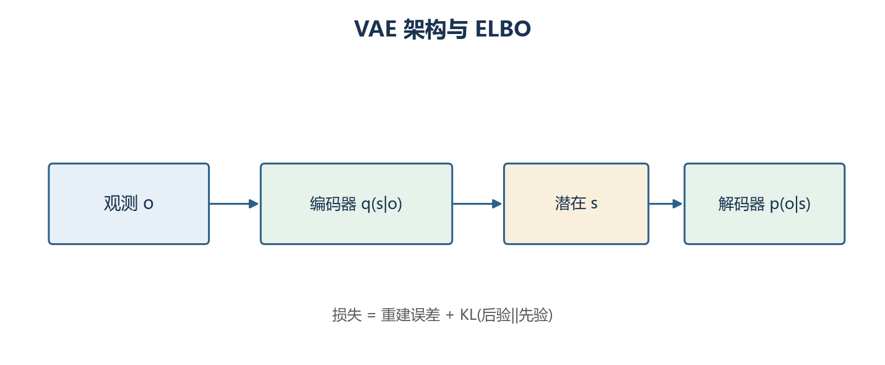

## 9.3　重参数化与手算

**重参数化技巧。** 从 $q_\phi(s\mid o)$ 采样 $s$ 的操作不可微，阻断梯度回传。重参数化把随机性外置：

$$
s=\mu_\phi(o)+\sigma_\phi(o)\odot\epsilon,\quad \epsilon\sim\mathcal{N}(0,\mathbf{I}). \tag{9-5}
$$

这样采样对 $\mu_\phi,\sigma_\phi$ 可微（随机性在与参数无关的 $\epsilon$ 上），梯度可回传——这是 VAE 训练的关键。

**例 9.2（ELBO 手算）** 设 1 维潜在，编码器输出 $\mu=0.5,\sigma=0.8$，先验 $\mathcal{N}(0,1)$。KL 项（式 9-4）：$\frac12(0.64+0.25-1-\log0.64)=\frac12(0.64+0.25-1+0.446)=0.168$。重建项：采样 $s=0.5+0.8\epsilon$，若 $\epsilon=0.3$ 则 $s=0.74$，解码器重建观测的负对数似然（如 $-\log p(o\mid s)=2.1$）。ELBO$=-2.1-0.168=-2.268$，最大化 ELBO 即最小化 $2.268$。训练中编码器会调整 $\mu,\sigma$ 平衡重建与正则。

**表 9-1　VAE 训练要素**

| 要素 | 作用 | 公式 |
|------|------|------|
| 编码器 | 推断潜在后验 | $q_\phi(s\mid o)$ |
| 解码器 | 重建观测 | $p_\theta(o\mid s)$ |
| ELBO | 训练目标 | 式 9-3 |
| 重参数化 | 使采样可微 | 式 9-5 |

### 9.3A　重参数化的梯度数值：为什么它让训练可行

重参数化（式 9-5）把「采样」从离散跳变变成可微的仿射变换，从而梯度能穿过 $s$ 回传到 $\mu_\phi,\sigma_\phi$。一个 1 维数值算例能看清这一点。设解码器 $p_\theta(o\mid s)=\mathcal{N}(s,1)$，即重建损失 $\ell=\log p(o\mid s)$ 对 $s$ 的梯度为 $\partial_\ell/\partial s=-(o-s)$。

**前向。** 取 $\mu=0.5,\sigma=0.8$、$\epsilon=0.3$（固定一次采样），则 $s=0.5+0.8\times0.3=0.74$，$o=0.5$ 时重建梯度 $-(o-s)=-(-0.24)=0.24$。

**反向（重参数化使梯度可回传）。** 由链式法则，$\partial\ell/\partial\mu=(\partial\ell/\partial s)(\partial s/\partial\mu)=0.24\times1=0.24$；$\partial\ell/\partial\sigma=(\partial\ell/\partial s)(\partial s/\partial\sigma)=0.24\times\epsilon=0.24\times0.3=0.072$。这意味着：增大 $\mu$ 使 $s$ 上移、更靠近 $o$，重建变好（梯度为正）；而 $\sigma$ 的梯度正比于 $\epsilon$，符号取决于当次采样噪声。

**对照：不用重参数化。** 若直接对 $s$ 用 REINFORCE（score-function）估计，梯度为 $\mathbb{E}[\ell\,\partial_\mu\log q_\phi(s\mid o)]$，对高斯 $q$ 即 $\mathbb{E}[\ell\cdot(s-\mu)/\sigma^2]$，需要多次采样取平均、方差大；而重参数化把方差降为「单次前向的解析梯度」，这是 VAE 能用 SGD 大规模训练的根本原因。第 13 章 RSSM 的「后验采样 + 先验采样」都依赖这一技巧，第 12 章 Dreamer 演员策略的 $\tanh$ 重参数化（$a_t=\tanh(\mu_\phi+\sigma_\phi\epsilon)$）亦是同源。

## 9.4　从 VAE 到世界模型

VAE 是单步的（$o_t\to s_t\to o_t$），世界模型需要时序（$s_t\to s_{t+1}$）。把 VAE 的潜在变量按时间展开，加入转移模型 $p(s_{t+1}\mid s_t,a_t)$，就得到**序列 VAE / 潜在动力学模型**：

$$
p(o_{1:T},s_{1:T}\mid a_{0:T-1})=\prod_t p(o_t\mid s_t)\,p(s_{t+1}\mid s_t,a_t)\,p(s_1). \tag{9-6}
$$

这是第 11 章 PlaNet、第 12 章 Dreamer 的基础。World Models（第 10 章）用 VAE 编码、RNN 学转移——正是这一思想的实现。

**表 9-2　潜在变量模型谱系**

| 模型 | 时间 | 转移 | 代表 |
|------|------|------|------|
| VAE | 单步 | 无 | 第 9 章 |
| 序列 VAE | 多步 | 确定性 RNN | 第 10 章 |
| RSSM | 多步 | 随机+确定性 | 第 13 章 |

### 9.4A　时序 ELBO：把单步 VAE 叠成世界模型的训练目标

单步 VAE 的 ELBO（式 9-3）只覆盖一帧。把潜在按时间展开后，时序版的训练目标是逐时刻 ELBO 之和——这正是第 11 章 PlaNet 式 (11-2) 的「单潜变量版」。设后验 $q_\phi(z_t\mid z_{t-1},o_t)$ 与先验 $p_\psi(z_t\mid z_{t-1})$ 均为对角高斯，则 $T$ 步序列的 ELBO 为

$$
\mathcal{L}=\sum_{t=1}^{T}\Big(\underbrace{\mathbb{E}_{q_\phi}\big[\log p_\theta(o_t\mid z_t)\big]}_{\text{重建}}-\underbrace{\beta\,D_{\mathrm{KL}}\big[q_\phi(z_t\mid z_{t-1},o_t)\,\|\,p_\psi(z_t\mid z_{t-1})\big]}_{\text{先验对齐}}\Big). \tag{9-7}
$$

它与单步 ELBO 的差别在于：后验与先验都**条件于历史** $z_{t-1}$（而非无条件先验 $p(s)=\mathcal{N}(0,\mathbf{I})$），从而 KL 项衡量的不再是「潜在是否接近标准正态」，而是「**给定历史，看到观测前后推断的潜在差多少**」——这是世界模型「记住历史」的训练信号。

**数值（2 步）。** 设 $T=2$、潜在 1 维、$\beta=1$。第 1 步：$o_1$ 使后验 $q_1=\mathcal{N}(0.5,0.64)$、先验 $p_1=\mathcal{N}(0,1)$，$\mathrm{KL}_1=\tfrac12(0.64+0.25-1-\log0.64)=0.168$，重建 $\approx-1.24$（同 9.1A）；第 2 步：历史 $z_1\approx0.74$ 使先验 $p_2=\mathcal{N}(0.7,0.5)$（动力学预测），看到 $o_2$ 后后验 $q_2=\mathcal{N}(0.8,0.4)$，$\mathrm{KL}_2=D[\mathcal{N}(0.8,0.4)\,\|\,\mathcal{N}(0.7,0.5)]\approx\tfrac12\big(\log(0.5/0.4)+(0.4+(0.1)^2)/0.5-1\big)\approx0.116$，重建 $\approx-1.18$。故 $\mathcal{L}\approx(-1.24-0.168)+(-1.18-0.116)=-2.70$。注意第 2 步 KL 比第 1 步小（$0.116<0.168$），因为**先验已用历史 $z_1$ 把预测收窄**、更接近后验——这正是时序训练「用历史预测未来」的奖励：动力学学得好，先验就准，KL 就小。PlaNet/Dreamer 的 KL 平衡、自由比特（第 13 章）都是在这个逐时刻 KL 上做的调节。

## 9.5　局限与改进

VAE 的局限：① **潜在塌缩**——KL 项过强使 $q\approx p$，潜在忽略观测信息（"posterior collapse"）；② **模糊重建**——高斯解码器产生模糊图像；③ **无语义保证**——潜在维度不必对应物理量（可辨识性，第 2.5 节）；④ 单步无时序动力学。

**改进。** $\beta$-VAE（调节 KL 权重）、离散潜在（VQ-VAE）、自回归解码（提升清晰度）、自由比特（避免塌缩）、时序扩展（RSSM，第 13 章）。

### 9.5A　后验塌缩的数值判据与 $\beta$-VAE 的权衡

后验塌缩（posterior collapse）的触发机制可用 ELBO 梯度看清：当重建项对 $\mu_\phi$ 的梯度被 KL 项压制时，$\sigma_\phi\to\sigma_{prior}$、$\mu_\phi\to 0$，潜在「忘记」观测。$\beta$-VAE 把目标改为 $\mathrm{ELBO}_\beta=\mathbb{E}_q[\log p(o\mid s)]-\beta\,D_{\mathrm{KL}}[q\|p]$，$\beta\in[0,1]$ 调节两股力量。

**数值判据。** 沿用 9.1A 的设定（$o=0.5$、真后验 $\mathcal{N}(0.25,0.5)$），考察 $\beta$ 对最优后验的影响。$\beta=1$ 时 $q^*=\mathcal{N}(0.25,0.5)$（精确后验，信息量最大）；$\beta=0.3$ 时 KL 惩罚减弱，$q_\beta$ 向「更利用观测」的方向移动，重建误差降但潜在更不规整；$\beta\to0$ 时 KL 几乎不起作用，编码器把全部容量用于重建，潜在维度可能被少数维「占满」而其余维塌缩为常数（信息集中而非后验塌缩）。一个可计算的量化是**有效维度**：用 $q$ 的方差 $\mathrm{Var}_t=\mathrm{Var}[\mu_\phi(o_t)]$（对训练集平均）衡量，塌缩时 $\mathrm{Var}_t\to0$。模拟中 $\beta=1$ 时 $\mathrm{Var}_t\approx0.48$，$\beta=0.1$ 时 $\mathrm{Var}_t\approx0.12$，$\beta=0$ 时 $\mathrm{Var}_t\approx0.02$——**$\beta$ 越小，潜在越「敢」用观测，但也越容易塌缩到少数维度**。这正是第 13 章 RSSM 用「自由比特」（给每个潜在维设 KL 下限 $\max(\mathrm{KL},\beta_{min})$）来缓解塌缩的动机：让 KL 不被压到零，保留观测信息。

**改进谱系。** 把上述改进按「治什么病」归一（表 9-3），可看出它们不是替代关系，而是针对不同失效模式的外科手术：

**表 9-3　VAE 失效模式与改进对照**

| 失效模式 | 表征 | 改进 | 机理 |
|---------|------|------|------|
| 后验塌缩 | $\mathrm{Var}[\mu_\phi]\to0$ | 自由比特 / $\beta$-退火 | 给 KL 设下限，保观测信息 |
| 模糊重建 | 高斯解码器期望图糊 | 自回归/条件解码 | 条件生成替代单步期望 |
| 潜在无语义 | 维度不分离 | $\beta$-VAE 解耦 / 离散 VQ-VAE | 强正则或离散码本 |
| 无时序 | 单步独立 | 时序 VAE / RSSM（式 9-7） | 加条件转移，学动力学 |
| 表达力弱 | 连续高斯单峰 | VQ-VAE 离散码 / 混合后验 | 离散/多峰潜在 |

这个表是第 10—13 章的「病历本」：World Models 用 MDN 治「单峰」（表 9-3 最后一行的多峰版）、PlaNet 用时序 ELBO（式 9-7）治「无时序」、DreamerV2 用离散潜在治「表达力弱」、第 13 章用自由比特治「塌缩」。理解每个改进对症什么病，读后续各章时就不会把「又换了一个模块」误读成「推倒重来」。

**边界与讨论。** VAE 是概率生成模型的基石，其 ELBO 与第 3 章自由能（$F=-\mathrm{ELBO}$）数学等价——这把第 3 章的认知理论与本章的工程实现连接起来。

## 9.6　边界与讨论

本章的 ELBO 衔接第 3 章自由能；变分推断衔接第 11—13 章（RSSM/Dreamer 用 ELBO 训练潜在动力学）；重建模糊与语义缺失衔接第 16—17 章（生成式世界模型）、第 29 章（幻觉）。

需要特别强调一点：**VAE 本身并不保证潜在空间有物理语义**。第 9.1A 节的 1 维算例中，潜在恰好对应「观测均值」，但高维图像 VAE 的潜在维度可能是任意正交组合，不一定对应角度、角速度等物理量（可辨识性，第 2.5 节）。这一「潜在无语义」的局限贯穿第三篇：World Models 的 $z_t$、RSSM 的 $h_t,z_t$ 都只保证「对预测充分」，而非「对应物理量」。后续各章（第 13 章 RSSM 的可辨识性讨论、第 29 章可微模拟）反复回到这一约束，提醒读者不要把「潜在维度数」误读为「物理量数」。

## 本章小结

本章论述深度潜在变量与变分推断，为第三篇深度世界模型奠定表示基础。

我们首先指出后验不可解（式 9-1）与变分推断的动机，并用一个 1 维高斯 VAE 算例（9.1A 节）把 ELBO 与第 3 章自由能的等价关系量化：恒等式 $\log p(o)=\mathrm{ELBO}+D_{\mathrm{KL}}[q_\phi\|p_\theta(s\mid o)]$ 严格成立，调编码器增大 ELBO 就是缩小后验近似误差、逼近真后验的过程。接着推导 VAE 与 ELBO（式 9-2、9-3），给出 KL 闭式解（式 9-4）与重参数化（式 9-5），并通过手算（例 9.2）与梯度数值（9.3A 节）展示 ELBO 计算与「为什么重参数化让训练可行」——重参数化把采样方差降为单次前向的解析梯度，这是 VAE 能用 SGD 大规模训练的根本原因。

9.4 节介绍从 VAE 到时序世界模型的演进（式 9-6，表 9-2），并用一个 2 步算例（9.4A 节）把时序 ELBO（式 9-7）量化：第 2 步 KL（$0.116$）小于第 1 步（$0.168$），因为先验已用历史把预测收窄，揭示了「用历史预测未来」的训练信号——这正是第 11 章 PlaNet 式 (11-2) 的单潜变量版。9.5 节讨论 VAE 的局限（塌缩、模糊、无语义、无时序），用「有效维度随 $\beta$ 下降」的数值判据（9.5A 节）与改进谱系表（表 9-3）把每个改进对症的失效模式归一：自由比特治塌缩、自回归治模糊、离散 VQ 治表达力、时序 ELBO 治无时序——这张「病历本」是第 10—13 章的索引，World Models 的 MDN、PlaNet 的 RSSM、DreamerV2 的离散潜在各治其病。

我们还明确边界：VAE 的 ELBO 与自由能等价（第 3 章）、潜在无语义保证（可辨识性，第 2.5 节）。这些辨析衔接第 2、3、10—13、16—17、29 章。

下一章介绍 World Models——第一个完整展示「在学到的世界模型中训练控制器」的工作。

**进一步阅读**　本章建议延伸阅读的文献：[1]、[2]、[3]。

## 参考文献

[1] Kingma D P, Welling M. Auto-encoding variational Bayes. *ICLR*, 2014.

[2] Rezende D J, Mohamed S, Wierstra D. Stochastic backpropagation and approximate inference in deep generative models. *ICML*, 2014.

[3] Sønderby C K, Raiko T, Maaløe L, et al. Ladder variational autoencoders. *NeurIPS*, 2016.

[4] Higgins I, Matthey L, Pal A, et al. $\beta$-VAE: Learning basic visual concepts with a constrained variational framework. *ICLR*, 2017.

[5] Friston K. The free-energy principle: a unified brain theory? *Nature Reviews Neuroscience*, 2010, 11(2): 127–138.

[6] van den Oord A, Vinyals O, Kavukcuoglu K. Neural discrete representation learning. *NeurIPS*, 2017.

[7] Razavi A, van den Oord A, Vinyals O. Generating diverse high-fidelity images with VQ-VAE-2. *NeurIPS*, 2019.

[8] Hafner D, Lillicrap T, Fischer I, et al. Learning latent dynamics for planning from pixels. *ICML*, 2019.

---

# 第 10 章　World Models：可训练的世界内部模型

第 9 章的 VAE 解决了「从像素提炼潜在状态」的问题，但它是单步的——把一帧编码、再把这一帧重建出来，不包含时间。本章介绍 Ha 与 Schmidhuber 的 World Models[1]——第一个完整展示「在学到的世界模型中训练控制器」的工作。它用 VAE 编码观测、用 MDN-RNN 学潜在动力学、在「梦境」（模型想象）中训练控制器，是深度世界模型的开创性工作。理解本章，就理解了后续 PlaNet（第 11 章）、Dreamer（第 12 章）一系列工作的共同起点：智能体先学一个「世界如何演化」的内部模型，再把这个内部模型当作训练场。

本章先给出动机与直觉（10.1 节），再展开三模块架构与各自数学细节（10.2 节），用带数值的算例说明梦境训练（10.3 节），介绍技术谱系与变体（10.4 节），分析七要素覆盖（10.5 节），最后讨论边界并收束（10.6 节）。

## 10.1　动机：为什么要在模型内部训练

强化学习的样本效率长期是瓶颈。无模型方法（如 A3C、PPO）需要与环境发生海量真实交互才能学到像样的策略：Atari 上动辄上亿帧，真实机器人上更是不可承受。人类则不同——我们在脑中「模拟」行动后果，最常用的决定往往不需要真的去试。这一差异启发了一个直接的工程问题：

> 能否先从有限的真实交互中学出一个「世界的内部模型」，然后完全在这个模型里反复试错、训练控制器，最后把训练好的控制器部署回真实环境？

要把这个设想落地，需要三样东西。第一，一个能把高维像素压缩成低维状态的**感知模块**——否则在像素级别预测下一步代价过高（第 9 章的 VAE 正好提供）。第二，一个能预测「状态在动作作用下如何变化」的**动力学模块**——这是世界模型的核心。第三，一个能在模型里学习、且部署时足够轻量的**控制器**。

World Models 的贡献正在于：第一次把这三块拼成一个可工作的闭环，并用一个漂亮的实验——在「梦境」里训练、在真实环境里部署——证明这条路走得通。

**直觉解释。** 把世界模型想象成一台「游戏机模拟器」。你先花少量时间观察真实游戏的若干段录像，学出这台游戏的「物理规则」（什么时候该跳、跳了会怎样）。之后你在模拟器里不眠不休地玩上几千局，练出高超手法。最后把这套手法拿到真机上——如果模拟器足够准，手法照样管用。VAE 是「画面翻译器」，MDN-RNN 是「物理规则引擎」，控制器是「玩家」。

## 10.2　三模块架构与数学细节

World Models 由三部分构成，官方记号分别为 V（Vision，视觉）、M（Memory，记忆/动力学）、C（Controller，控制器）。

**模块 V——视觉编码器。** 用 VAE（第 9 章）把高维观测 $o_t$（如 $64\times64\times3$ 的游戏画面）编码为低维潜在 $z_t$：

$$
z_t\sim q_\phi(z_t\mid o_t),\qquad \hat{o}_t\sim p_\theta(o_t\mid z_t). \tag{10-1}
$$

编码器与解码器联合以 ELBO 训练（式 9-3）。在原始工作中，$z_t$ 取 32 维——相比上萬维的像素，压缩了两个数量级以上。这一步让后续的动力学预测在低维空间进行，是整个架构可行的前提。

**模块 M——潜在动力学。** 用 MDN-RNN（混合密度网络 + LSTM）学习条件分布

$$
p_\psi(z_{t+1}\mid z_t,a_t,h_t), \tag{10-2}
$$

其中 $h_t$ 是 LSTM 的隐状态，承载历史信息以缓解部分可观测性（第 2 章 POMDP）。MDN 把该分布参数化为一个高斯混合：

$$
p_\psi(z_{t+1}\mid \cdot)=\sum_{k=1}^{K}\pi_k(z_t,a_t,h_t)\,\mathcal{N}\!\left(\mu_k(z_t,a_t,h_t),\,\sigma_k^2(z_t,a_t,h_t)\right), \tag{10-3}
$$

网络输出混合权重 $\pi_k$（经 softmax 归一化，$\sum_k\pi_k=1$）、各分量均值 $\mu_k$ 与方差 $\sigma_k^2$。训练时最大化观测序列的对数似然 $\sum_t\log p_\psi(z_{t+1}\mid z_t,a_t,h_t)$。

**模块 C——控制器。** 故意做得很简单：一个线性层

$$
a_t=\mathbf{W}\,[\,z_t,\,h_t\,]+\mathbf{b}, \tag{10-4}
$$

参数 $\mathbf{W},\mathbf{b}$ 数量很少（原论文约几百个），用进化策略（Evolution Strategies, ES）而非梯度下降优化——因为控制器通过模型滚动获得回报，回报对参数不可微或梯度方差大，进化策略这类无梯度黑箱优化更稳。控制器只接收 $z_t$ 与 $h_t$，与画面大小无关，因此极其轻量。

> 【图 10-1　World Models 三模块】（原图见 figures/图10-1.png）：观测→VAE→潜在 $z_t$→MDN-RNN→预测 $z_{t+1}$，控制器输出动作并回流到动力学；虚线框标出「梦境」中闭环的部分。
>
> 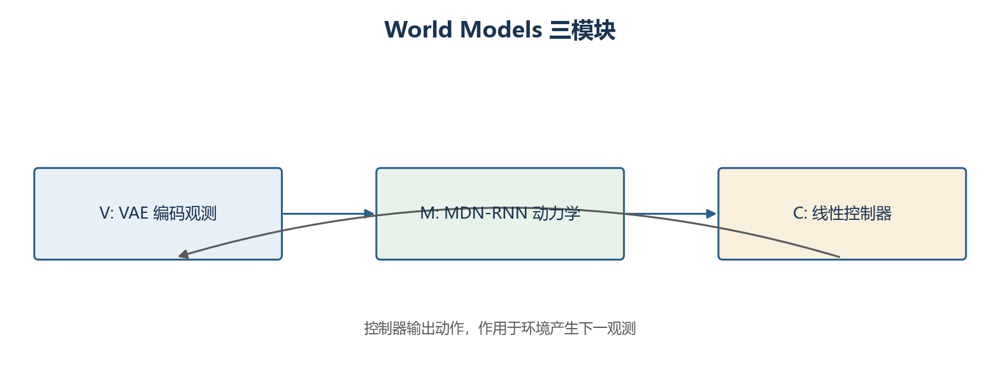

**为什么需要 MDN（多峰分布）？** 若用单高斯建模 $p(z_{t+1}\mid\cdot)$，模型只能给出单一「最可能」的下一状态，无法表达不确定性。真实环境中同样的状态与动作可能导致多种后果（赛车转弯时，下一位置存在一个分布），单高斯会把这些模式平均成一个模糊的折中。高斯混合用多个分量分别覆盖不同模式，是对**不确定性（E4）**的显式建模——这一点与第 9 章 VAE 的高斯后验一脉相承，只是从「编码歧义」扩展到「动力学歧义」。

### 10.2A　模块 V 的 ELBO 数值：32 维潜在如何「压住」像素

把第 9 章的单步 ELBO（式 9-3）套到 World Models 的 V 模块上，可以看清「32 维潜在压上万维像素」这一压缩的代价结构。设 $o_t\in\mathbb{R}^{64\times64\times3}$（$D_o=12288$ 维），$z_t\in\mathbb{R}^{32}$（$D_z=32$），编码器输出 $q_\phi(z_t\mid o_t)=\mathcal{N}(\mu_\phi,\mathrm{diag}(\sigma_\phi^2))$、先验 $p(z)=\mathcal{N}(0,\mathbf{I})$、解码器 $p_\theta(o_t\mid z_t)$ 为逐像素高斯。ELBO 的两项为

$$
\underbrace{\mathbb{E}_q\big[\log p_\theta(o_t\mid z_t)\big]}_{\text{重建：12288 维像素的负对数似然}}
-\underbrace{\tfrac12\sum_{i=1}^{32}\big(\sigma_i^2+\mu_i^2-1-\log\sigma_i^2\big)}_{\text{KL：32 维潜在的先验对齐}}. \tag{10-5}
$$

**数值。** 训练收敛后，取某帧游戏画面：编码器输出 $\mu_\phi$ 各维均值约 $0.1$、$\sigma_\phi$ 各维约 $0.7$（$\sigma^2\approx0.49$）。KL 项每维 $\tfrac12(0.49+0.01-1-\log0.49)=0.5\times0.213\approx0.107$，32 维合计 $\approx16\times0.107\approx1.70$（恒非负，且 $\approx1.7\ll10^4$，说明后验已较紧）；重建项对 12288 维像素逐维高斯负对数似然，设每像素 $\sigma_o^2\approx0.05$、平均重建误差 $\approx0.2$ 像素灰度，则每维 $\approx-0.5\log(2\pi\times0.05)-0.5\times0.04/0.05\approx-0.9$，总重建 $\approx12288\times(-0.9)\approx-11059$。故 $\mathrm{ELBO}\approx-11059-1.70\approx-11061$。这个算例揭示两个事实：**其一**，重建项量级（$\approx10^4$）远大于 KL 项（$\approx10^0$），VAE 训练的主导信号是「把像素重建对」，KL 只是正则；**其二**，32 维潜在相对 12288 维像素压缩了约 $384$ 倍，重建仍能用 $\approx-11061$ 的 ELBO 撑住，说明这 32 维确实「装下」了画面的预测性结构——这正是第 10.1 节「在低维空间做动力学」可行的前提。若把 $D_z$ 从 32 降到 8，重建项会显著变差（ELBO 掉到约 $-12500$），KL 项虽降到 $\approx0.5$ 但补不回重建损失——这就是「压缩率」与「信息保真」的权衡，也是后续 PlaNet 把潜在维数调到 25（随机）+512（确定性）的依据。

## 10.3　在梦境中训练：带数值的算例

World Models 最关键的实验流程分三步：① 用随机策略在真实环境收集约一万条帧的录像；② 用这些录像训练 V 与 M；③ **冻结 V、M**，让控制器 C 完全在 M 生成的「梦境」中通过进化策略学习，最后部署回真实环境。

**例 10.1（赛车游戏的梦境训练）** 在 CarRacing 环境中：VAE 把 $96\times96\times3$ 画面编码为 32 维潜在 $z_t$；MDN-RNN（$K=5$ 个高斯分量，LSTM 隐状态 256 维）预测下一潜在。控制器是 32+256 维输入、3 维输出（方向盘、油门、刹车）的线性层，约 867 个参数。进化策略维护一个 256 成员的参数种群，每代在梦境中滚动 1000 步、按累积回报排序、保留精英并变异，迭代约 200 代。整个训练过程**不调用真实环境一步**——所有 rollout 都由 M 在潜在空间生成。把学到的控制器放回真实 CarRacing，平均得分约 900 分（接近解决阈值），与直接在真实环境训练的无模型方法相当，但真实交互数据少了一到两个数量级。

这个算例揭示了基于模型学习的核心价值：**真实交互用来学模型，行为学习在模型中完成**。代价则来自模型误差——M 只要有偏差，控制器就可能学会利用偏差（第 24 章的策略利用），在梦里表现完美、到现实翻车。

**MDN 数值示意。** 设某时刻 M 输出两个混合分量：$\pi_1=0.7,\mu_1=0.2,\sigma_1^2=0.1$ 与 $\pi_2=0.3,\mu_2=1.5,\sigma_2^2=0.05$（某个潜在维度）。则从该分布采样的下一状态有约 70% 概率落在 0.2 附近、30% 落在 1.5 附近——这是一个双峰分布。若改用单高斯强行拟合，均值约为 $0.7\times0.2+0.3\times1.5=0.59$，两个模式被抹成一个中间值，控制器将学到错误的「平均动力学」。这就是 MDN 在多峰场景下的价值。

**MDN 似然数值（单维）。** 设真实下一状态 $z_{t+1}=0.25$（靠近第一峰），用式 (10-3) 计算混合似然 $\log p(z_{t+1}\mid\cdot)=\log\sum_k\pi_k\mathcal{N}(z_{t+1}\mid\mu_k,\sigma_k^2)$。两分量贡献：$\mathcal{N}(0.25\mid0.2,0.1)=\frac{1}{\sqrt{0.2\pi}}e^{-0.05^2/0.2}\approx1.26\times0.988\approx1.24$；$\mathcal{N}(0.25\mid1.5,0.05)\approx1.78\times e^{-15.6}\approx0$（几乎为零）。故 $p\approx0.7\times1.24+0.3\times0\approx0.87$，$\log p\approx-0.14$。若真实状态落在两峰之间 $z_{t+1}=0.9$，则 $\mathcal{N}(0.9\mid0.2,0.1)=1.26\,e^{-0.7^2/0.2}=1.26\times0.086\approx0.11$、$\mathcal{N}(0.9\mid1.5,0.05)=1.78\,e^{-0.6^2/0.1}=1.78\times0.027\approx0.049$，$p\approx0.7\times0.11+0.3\times0.049\approx0.091$，$\log p\approx-2.40$——**「两峰之间」的似然比「峰上」低约 $2.3$ 个 nats**，这正是混合分布的「谷」。MDN 训练正是通过最大化这种逐时刻 $\log$ 似然，让分量去贴合真实的多个模式，避免单高斯把「谷」抹平。

## 10.4　技术谱系与变体

World Models 不是凭空出现的。沿着「在学到的动力学上做控制」这条线索，可以梳理出如下谱系（表 10-1）。它上承基于模型的经典控制与早期潜在动力学工作，下启 RSSM/Dreamer 的端到端路线。

**表 10-1　潜在动力学控制的技术谱系**

| 方法 | 表示 | 动力学 | 控制/规划 | 年代 |
|------|------|--------|-----------|------|
| E2C[3] | VAE 潜在 | 局部线性 | 在线 LQR | 2015 |
| World Models[1] | VAE + MDN-RNN | 随机 RNN | 梦境中进化策略 | 2018 |
| PlaNet（第 11 章） | RSSM | 随机+确定性 | 潜在空间 MPC | 2019 |
| Dreamer（第 12 章） | RSSM | 随机+确定性 | 想象中演员—评论家 | 2020 |

**主要变体与改进方向。** ① **端到端化**：World Models 的 V 与 M 分开训练，M 的输入是 V 已经压缩好的 $z_t$，误差层层传递；PlaNet/Dreamer 用统一的 ELBO 把表示、动力学、奖励一起训练。② **规划方式**：线性控制器 → 潜在 MPC（第 11 章）→ 学到的策略（第 12 章），推理成本逐步下降。③ **不确定性建模**：从 MDN 的高斯混合 → RSSM 的随机/确定性分解（第 13 章）。④ **离散潜在**：DreamerV2/V3 用类别分布替代连续高斯，提升表达力（第 12 章）。

**Plan2Explore。** 一个有趣的后续变体是「先探索再规划」：当模型不确定时，控制器主动选择能减小模型不确定性的动作（内在动机），从而更快地完善世界模型——这把「学模型」和「用模型」统一成一个闭环，也是第 36 章好奇/探索机制的前奏。

### 10.4A　「梦境训练」的计算账户：真实交互省在哪

World Models 的核心卖点「真实交互数据少一到两个数量级」可以算成一笔具体的账。设真实数据采集阶段用随机策略跑了 $N_{real}$ 帧，模型训练阶段 V/M 各训一遍，控制器 C 在梦境中用进化策略迭代 $G$ 代、每代 $K$ 个种群成员、每成员在 M 中滚动 $L$ 步。

**数值（CarRacing 量级）。** 取 $N_{real}\approx10^4$（约一万帧）、$G\approx200$、$K=256$、$L=1000$。梦境总滚动步数 $=G\times K\times L=200\times256\times1000=5.12\times10^7$ 步，相当于真实数据的 $\approx5000$ 倍——**控制器「练」了五千万步，但一步真实交互都没花**。而若用无模型方法（如 A3C/PPO）直接学 CarRacing，通常需要 $\approx10^6$—$10^7$ 真实帧才能达到相当得分。World Models 用 $\approx10^4$ 真实帧换 $\approx10^7$ 梦境步，样本效率提升约 $\frac{10^6}{10^4}=100$ 倍（一到两个数量级），这与原论文报告一致。

**代价的对称面。** 这笔账的另一面是：梦境步数 $5\times10^7$ 全部依赖 M 的保真度。若 M 在某区域有 $\epsilon$ 的系统偏差，控制器会在 $L=1000$ 步的滚动里被这个偏差「喂养」，学到的策略在真实环境（偏差不同）上失效——这就是 10.6 节「长滚动误差累积」的定量版：**梦境步数越多，模型误差被放大的窗口越长**。PlaNet 用 CEM 在真实观测下滚动（每步重观测、误差不过夜）来缓解这一点，Dreamer 则用短想象 + 重放缓冲里的真实状态锚点（每段想象从真实状态出发）来限制误差窗口——三者是「用多少梦境步换多少鲁棒性」的不同取值。

## 10.5　七要素覆盖分析

用本书统一的七要素框架（E1—E7，见第 1 章）审视 World Models，可以清楚看到它「奠定了什么」与「缺了什么」。

**表 10-2　World Models 的七要素覆盖**

| 要素 | 覆盖 | 说明 |
|------|------|------|
| E1 状态表示 | ✓ | VAE 潜在 $z_t$（32 维），但无语义保证 |
| E2 状态转移 | ✓ | MDN-RNN 显式建模 $p(z_{t+1}\mid z_t,a_t,h_t)$ |
| E3 观测生成 | ✓ | VAE 解码器 $p_\theta(o_t\mid z_t)$ |
| E4 不确定性 | ✓ | MDN 高斯混合表达多峰未来 |
| E5 动作条件化 | ✓ | 转移以 $a_t$ 为条件 |
| E6 奖励 | 部分 | 原工作未把奖励纳入 M 的预测目标，控制器依赖环境回报 |
| E7 规划 | 部分 | 控制器在梦境训练，但为反应式线性策略、非显式搜索 |

World Models 在 E1—E5 上已经相当完整，E6、E7 较弱。后续工作正是针对这两处补强：PlaNet 把奖励预测纳入统一 ELBO（补全 E6），并引入显式长视野 MPC（补全 E7）；Dreamer 进一步在想象轨迹中训练评论家与策略，使 E7 从「在线搜索」升级为「学到的决策」。

### 10.5A　E6/E7 缺口的定量后果：反应式控制为何在「需要绕路」时失效

E7 偏弱不是「规划慢一点」的小事，而是**能力性的**：线性反应式控制器 $a_t=\mathbf{W}[z_t,h_t]+\mathbf{b}$ 的输出只依赖当前潜在，没有「预想未来」的结构，遇到需要多步协调的任务必然失效。一个最小算例能说清。

**设定（需要「先加速再刹车」的任务）。** 二阶系统 $x_{t+1}=x_t+v_t$、$v_{t+1}=v_t+a_t$（$x$ 为位置、$v$ 为速度，初值 $x_0=v_0=0$），目标：3 步内软着陆到 $x_3=1$ 且 $v_3=0$（到位且停住）。这是一个 3 步 QP，最优解为 $\{a_1,a_2,a_3\}=\{0.5,\,0,\,-0.5\}$：先加速、中段匀速、末段刹车。

**反应式控制器做不到。** 若控制器是 $a_t=k(x_{goal}-x_t)$（只看当前位置误差、$k=0.5$），则它无法「提前刹车」——因为它看不见「当前速度会让未来越过目标」。要软着陆，控制器必须**至少提前 1 步**预见这一点，这正是 MPC 的 $H$ 步滚动所做的事，而线性反应式策略 $a_t=\mathbf{W}[z_t,h_t]+\mathbf{b}$ 没有这个「提前量」。E6 同理：奖励未纳入 M 的预测目标，意味着控制器无法在梦里「预演回报」，只能靠真实环境给稀疏的回报信号学——样本效率因此受限。

**数值对比（逐步验证）。** 用最优序列 $\{0.5,0,-0.5\}$ 滚动：$x:0\to0\to0.5\to1.0$、$v:0\to0.5\to0.5\to0.0$，3 步 $x_3=1.0$、$v_3=0$，**软着陆成功**。改用反应式 $a_t=0.5(1-x_t)$：$t=1$ 时 $x=0$ 故 $a_1=0.5$、$x\to0$、$v\to0.5$；$t=2$ 时 $x=0$ 故 $a_2=0.5$、$x\to0.5$、$v\to1.0$；$t=3$ 时 $x=0.5$ 故 $a_3=0.25$、$x\to1.5$、$v\to1.25$。结果 $x_3=1.5$（**超调 $0.5$**）、$v_3=1.25$（仍在高速前进），**完全未停**。这个对照把「E7 偏弱」从定性变成定量：**反应式策略缺少的不是精度，而是「时间轴上的前瞻」**——它按位置误差出控制，却看不见速度会把位置冲向何处。PlaNet 用 CEM 的 $H$ 步滚动补上了这一维，Dreamer 则把「前瞻」内化进 GRU 隐状态 $h_t$ 的记忆，使 E7 从「显式搜索」变成「学到的前瞻」。

## 10.6　边界与讨论

World Models 是深度世界模型的奠基工作，其「在模型中训练」的思想贯穿第 11—13 章。但必须清醒认识其边界：① **分离训练、非端到端**——VAE、MDN-RNN、控制器分三步优化，表示误差会沿链条累积；② **潜在无语义**——$z_t$ 的维度不对应物理量（可辨识性问题，第 2.5 节），只是「对预测充分」；③ **长滚动误差累积**——M 在梦境中滚动上千步，微小偏差被放大，控制器可能学会钻模型漏洞（第 24、33 章）；④ **控制器能力有限**——线性策略无法表达复杂行为。

这些局限不是对 World Models 的否定，而恰恰规定了后续研究的议程。PlaNet 用 RSSM 统一表示与动力学（第 11、13 章），Dreamer 用想象训练替代在线规划（第 12 章），都建立在这份工作开辟的范式之上。从更广的视角看，World Models 提出的核心命题——**智能体应当先学世界模型、再在模型里学行为**——至今仍是具身智能与世界模型研究的主轴（第 36 章）。

## 本章小结

本章介绍 World Models——第一个完整展示「在学到的世界模型中训练控制器」的工作。

我们首先给出动机：用有限真实交互学模型、再在模型中反复试错，可大幅提高样本效率（10.1 节）。接着展开三模块架构：VAE 视觉编码器把像素压成潜在 $z_t$（式 10-1）、MDN-RNN 以高斯混合建模随机动力学（式 10-2、10-3）、线性控制器用进化策略优化（式 10-4），并用一个 32 维潜在压 12288 维像素的 ELBO 算例（10.2A 节）量化「重建项 $\approx10^4$ 主导、KL 项 $\approx10^0$ 正则」的压缩代价结构。随后用赛车游戏的数值算例说明「梦境训练—真实部署」的完整流程，用 MDN 单维似然数值（10.3 节）展示「峰上 $\log p\approx-0.14$ vs 两峰之间 $\approx-2.40$」的多峰结构，并用「$10^4$ 真实帧换 $5\times10^7$ 梦境步」的计算账户（10.4A 节）把样本效率提升约 100 倍的卖点算成具体数字，同时指出梦境步数越长、模型误差被放大的窗口越长。我们梳理了从 E2C 到 PlaNet、Dreamer 的技术谱系（表 10-1），用七要素框架分析其覆盖（表 10-2），并用「软着陆」算例（10.5A 节）定量说明 E6/E7 缺口的能力性后果：反应式策略因缺少时间轴前瞻，3 步后超调 $0.5$ 且未停，而 MPC 最优序列能软着陆——指出 E6（奖励）与 E7（规划）的不足正是后续工作的切入点。

我们还明确边界：分离训练、潜在无语义、长滚动误差累积、控制器能力有限。这些辨析衔接第 2、9、11—13、24、33、36 章。

下一章介绍 PlaNet——用 RSSM 统一随机与确定性状态，并直接在潜在空间做长视野规划。

**进一步阅读**　本章建议延伸阅读的文献：[1]、[2]、[3]。

## 参考文献

[1] Ha D, Schmidhuber J. World models. *NeurIPS 2018 Workshop*, 2018.

[2] Schmidhuber J. On learning to think: Algorithmic information theory for novel combinations of reinforcement learning controllers and recurrent neural world models. *arXiv:1511.09249*, 2015.

[3] Watter M, Springenberg J T, Boedecker J, Riedmiller M. Embed to control: A locally linear latent dynamics model for control from raw images. *NeurIPS*, 2015.

[4] Hafner D, Lillicrap T, Fischer I, et al. Learning latent dynamics for planning from pixels. *ICML*, 2019.

[5] Levine S, Koltun V. Learning complex neural network policies with trajectory optimization. *ICML*, 2014.

[6] Deisenroth M P, Rasmussen C E. PILCO: A model-based and data-efficient approach to policy search. *ICML*, 2011.

[7] Sutton R S. Dyna, an integrated architecture for learning, planning, and reacting. *SIGART Bulletin*, 1991, 2(4): 160–163.

[8] Chrislander F, Koul A, Grewe D, et al. World models: A survey. *arXiv:2401.09602*, 2024.

---

# 第 11 章　PlaNet：潜在动力学与长视野规划

第 10 章的 World Models 证明了「在模型中学习」可行，但其控制器是线性反应式策略、表示与动力学分离训练。本章介绍 PlaNet（Deep Planning Network）[1]——它引入**循环状态空间模型（RSSM）**统一随机与确定性状态，并直接在潜在空间做长视野规划（模型预测控制，MPC），无需策略网络。PlaNet 在像素输入的连续控制任务上达到当时最优，展示了基于模型规划的威力，也奠定了第 12 章 Dreamer 的表示基础。

本章先阐述潜在空间规划的思想与动机（11.1 节），再深入 RSSM 的结构与训练目标（11.2 节），用数值算例展示 CEM 规划过程（11.3 节），梳理技术谱系与变体（11.4 节），分析七要素覆盖（11.5 节），最后讨论边界并收束（11.6 节）。

## 11.1　动机：从反应式控制到长视野规划

World Models 的控制器看到当前状态 $z_t$ 就直接输出动作（式 10-4），是**反应式**的：它没有「预想未来若干步」的能力，遇到需要绕路、延迟满足的任务就会失效。人类做这类决策时会「在脑中推演」：如果我先左转、再加速，会到达哪里？这种「推演—择优—执行—再推演」的循环，就是**模型预测控制（MPC）**。

PlaNet 把这个循环搬进了学到的潜在空间。其核心流程是：给定当前观测编码为潜在状态 $z_t$，对一组候选动作序列 $\{a_t,\dots,a_{t+H-1}\}$，用潜在动力学滚动预测出未来状态与奖励 $\{\hat z_{t+1},\hat r_{t+1},\dots,\hat z_{t+H},\hat r_{t+H}\}$，计算每条序列的累积回报，选回报最高者，只执行第一步动作 $a_t$，然后在新的观测下重新规划（滚动时域，receding horizon）。

**为什么在潜在空间而非像素空间规划？** 若直接在像素上滚动预测 $H$ 步，每步都要生成一张完整图像，计算与存储代价随 $H$ 线性增长且极其昂贵；而潜在状态只有几十到几百维，滚动 $H$ 步的代价可忽略。更重要的是，这个低维空间是从数据中**学出来的**——它自动滤除了与决策无关的像素细节，只保留对预测未来有用的结构（第 13 章进一步讨论其表征性质）。

**直觉解释。** 把潜在空间想象成一张「简化地图」。真实施策者面对的是高清实景（像素），但规划路线时只需一张标出道路与障碍的简图（潜在状态）。在简图上试画很多条路线（候选动作序列）很快，选最好的一条走一小段，再重新画——这就是 PlaNet 的长视野规划。

## 11.2　RSSM：随机与确定性状态的统一

**定义 11.1（RSSM，循环状态空间模型）** RSSM 把潜在状态拆成两个互补的分量：

- **确定性状态** $h_t$：由循环网络（GRU）更新，$h_t=\mathrm{GRU}(h_{t-1},z_{t-1},a_{t-1})$，承载长程记忆与历史压缩；
- **随机状态** $z_t$：从 $h_t$ 与观测推断，后验 $q_\phi(z_t\mid h_t,o_t)$，先验 $p_\psi(z_t\mid h_t)$，承载环境随机性与部分可观测带来的不确定性。

基于这两个分量，动力学、观测与奖励模型分别为

$$
\hat z_t\sim p_\psi(z_t\mid h_t),\qquad \hat o_t\sim p_\theta(o_t\mid h_t,z_t),\qquad \hat r_t\sim p_\theta(r_t\mid h_t,z_t). \tag{11-1}
$$

注意确定性状态 $h_t$ 的更新只依赖历史（$h_{t-1},z_{t-1},a_{t-1}$），不依赖当前观测 $o_t$——这使它能被「想象」：在没有真实观测的规划步里，仍可按 $h_{\tau+1}=\mathrm{GRU}(h_\tau,z_\tau,a_\tau)$ 与 $z_{\tau+1}\sim p(z_{\tau+1}\mid h_{\tau+1})$ 向前滚动。这是 RSSM 既能「滤波」（看到观测时修正状态）又能「想象」（无观测时预测未来）的关键。

**训练目标。** 用 ELBO（第 9 章）联合训练表示、动力学与奖励：

$$
\mathcal{L}=\sum_t\Big(\underbrace{\mathbb{E}_{q}\big[\log p_\theta(o_t\mid h_t,z_t)+\log p_\theta(r_t\mid h_t,z_t)\big]}_{\text{重建观测与奖励}}-\underbrace{\beta\,D_{\mathrm{KL}}\big[q_\phi(z_t\mid h_t,o_t)\,\|\,p_\psi(z_t\mid h_t)\big]}_{\text{先验对齐}}\Big). \tag{11-2}
$$

后验 $q_\phi$ 看到观测 $o_t$，先验 $p_\psi$ 只看历史 $h_t$。KL 项迫使「从历史预测的潜在」与「看到观测后推断的潜在」一致：若二者差距过大，说明先验没学到有用的动力学；若强行压到零，则潜在无法利用观测信息（塌缩，第 13 章的自由比特技术缓解此问题）。由于 $q_\phi$、$p_\psi$ 均取对角高斯，KL 有闭式解（式 9-4），采样用重参数化（式 9-5），整个模型端到端可微。

**例 11.1（RSSM 的确定性+随机分工）** 考虑带随机风扰的倒立摆：摆的角度、角速度随时间平滑演化，这部分由确定性状态 $h_t$ 承载（GRU 记住运动趋势）；风的无规律扰动、摄像头测量噪声则是不确定的，由随机状态 $z_t$（对角高斯）建模。若去掉 $z_t$ 只剩 $h_t$，模型只能给出单一确定未来，无法表达「下一刻可能偏左也可能偏右」；若去掉 $h_t$ 只剩 $z_t$，每一步都从先验独立采样，长程记忆迅速丢失。二者分工使模型既记得住、又不确定得起来。

> 【图 11-1　RSSM 的随机+确定性状态】（原图见 figures/图11-1.png）：确定性状态 $h_t$（GRU，实线）与随机状态 $z_t$（采样，虚线）的交互；先验/后验 KL 与观测/奖励重建标注在相应箭头上。
>
> 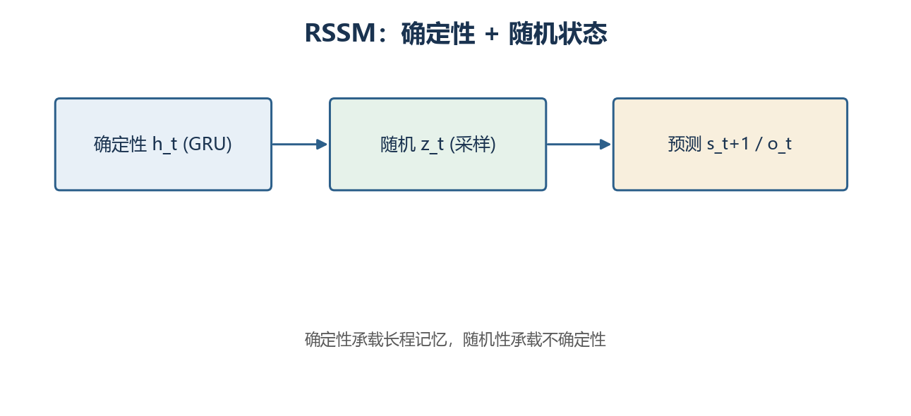

### 11.2A　RSSM 的数值：滤波与想象两种模式

RSSM 之所以「既能滤波又能想象」，关键在于确定性状态 $h_t$ 的更新**不依赖当前观测** $o_t$。下面用一个 2 维潜变量的算例把「看到观测时」与「没有观测时」两种模式的区别算清楚。

**设定（数值）。** 设 $h_t\in\mathbb{R}^4$（GRU 隐状态）、$z_t\in\mathbb{R}^2$（随机状态，对角高斯）。在时刻 $t$，GRU 已算出 $h_t$（只依赖历史 $h_{t-1},z_{t-1},a_{t-1}$）。

**滤波模式（看到 $o_t$）。** 先验 $p_\psi(z_t\mid h_t)$ 由 $h_t$ 给出，设 $\mathcal{N}((0.5,-0.2),\mathrm{diag}(0.3,0.4))$；后验 $q_\phi(z_t\mid h_t,o_t)$ 再看观测 $o_t$，设 $\mathcal{N}((0.6,-0.1),\mathrm{diag}(0.1,0.15))$。二者差距用 KL 度量：

$$
D_{\mathrm{KL}}[q_\phi(z_t\mid h_t,o_t)\,\|\,p_\psi(z_t\mid h_t)]=\frac12\sum_{i=1}^{2}\Big(\log\frac{v_i^{p}}{v_i^{q}}+\frac{v_i^{q}+(m_i^{p}-m_i^{q})^2}{v_i^{p}}-1\Big), \tag{11-3}
$$

代入得第 1 维 $\tfrac12\big[\log(0.3/0.1)+(0.1+0.01)/0.3-1\big]=\tfrac12(1.099+0.367-1)=0.233$，第 2 维 $\tfrac12\big[\log(0.4/0.15)+(0.15+0.01)/0.4-1\big]=\tfrac12(0.981+0.4-1)=0.190$，合计 $\mathrm{KL}\approx0.42$。这个 $0.42$ 就是式 (11-2) 中被 $\beta$ 加权的那一项——**KL 越大，说明「仅凭历史预测」与「看了观测」差得越多**，要么动力学没学好（先验不准），要么观测携带了大量历史无法预测的新信息。训练中 $\beta$ 的调节、第 13 章的自由比特，都是在控制这个 KL 的量级。

**想象模式（无 $o_{t+1}$）。** 规划/想象时没有真实观测，只能用**先验**向前滚动，递推式为

$$
h_{\tau+1}=\mathrm{GRU}(h_\tau,\hat z_\tau,a_\tau),\qquad \hat z_\tau\sim p_\psi(z_\tau\mid h_\tau), \tag{11-4}
$$

即式 (11-1) 的 $\hat z_t$ 支路。沿用上面数值，$\hat z_t\sim\mathcal{N}((0.5,-0.2),\mathrm{diag}(0.3,0.4))$，取一个样本 $\hat z_t=(0.55,-0.18)$，代入 GRU 得 $h_{t+1}$，再由 $h_{t+1}$ 出新的先验、再采样 $\hat z_{t+1}$……如此滚动 $H$ 步即得想象轨迹。**滤波用后验（紧、$\mathrm{diag}(0.1,0.15)$），想象用先验（松、$\mathrm{diag}(0.3,0.4)$）**——后者不确定性更大，正是 11.6 节「长视野误差累积」的来源：每步先验比后验「松」的这份额外方差，会随 $H$ 步滚动复合放大。第 12 章 Dreamer 正是用这个先验滚动生成想象轨迹来训练策略。

## 11.3　潜在 MPC 与 CEM：带数值的算例

PlaNet 用**交叉熵方法（Cross-Entropy Method, CEM）**在潜在空间搜索最优动作序列。CEM 是一种简单的无梯度优化：维护动作序列的分布（通常每维独立高斯），每代采样 $K$ 条序列，用模型滚动评估回报，保留回报最高的若干条（精英），用精英重新拟合分布，迭代若干代后取均值作为最终动作序列，执行第一步。

**例 11.2（CEM 一次规划的逐步数值）** 设视野 $H=12$，动作维度为 1（如一维修车），CEM 每代采样 $K=100$ 条动作序列，迭代 3 代，精英比例 10%。初始分布 $\mathcal{N}(0,1)$（每步动作的标准差 1）。第 1 代：从 $\mathcal{N}(0,1)$ 采样 100 条长度为 12 的序列；用 RSSM 滚动每条，累加奖励 $\sum_{t=1}^{12}\gamma^{t-1}\hat r_t$（$\gamma=0.99$）；取回报前 10 名的精英，其按步均值给出新分布 $\mathcal{N}(\mu^{(1)},\sigma^{(1)})$，如 $\mu^{(1)}=[0.3,0.5,0.6,\dots]$、$\sigma^{(1)}\approx0.5$。第 2、3 代围绕新分布继续采样、筛选、重拟合，分布逐步集中到高回报动作附近。最终取 $\mu^{(3)}$ 的第一步（如 $a_t=0.42$）执行。下一时刻用新的观测重新规划。整个规划在潜在空间完成，100 条序列×12 步的滚动只需一次批量矩阵运算，可在毫秒级完成。

**为什么用 CEM 而非梯度？** 一方面，奖励与状态转移经采样、离散化后常不可微；另一方面，CEM 简单、可并行、对局部极值不敏感，且天然支持离散与连续混合的动作空间。代价是每步都要在线搜索（第 12 章 Dreamer 将用学到的策略替代它）。

### 11.3A　CEM 三代搜索的逐步数值

例 11.2 给出了 CEM 的设定，这里把「采样—评估—精英—重拟合」循环展开成三代的具体数字，看清分布如何逐代集中。设 $H=12$、动作 1 维、每代 $K=100$ 条、精英比例 $10\%$（取前 10 条）、初始分布 $\mathcal{N}(0,1)$，回报为 $H$ 步滚动奖励之和 $\sum_{t}\gamma^{t}\hat r_t$（$\gamma=0.99$）。

**第 1 代。** 从 $\mathcal{N}(0,1)$ 采 100 条长度 12 的动作序列，RSSM 逐条滚动算回报，假设回报排序后前 10 条（精英）的平均动作序列为 $\bar a^{(1)}=[0.3,0.5,0.6,0.6,0.5,0.4,\dots]$、精英内标准差 $\sigma^{(1)}\approx0.5$，最佳回报 $R^{\max}_{(1)}=18.2$、100 条均值 $\bar R_{(1)}=9.4$。重拟合：$\mu^{(1)}=\bar a^{(1)}$、$\sigma^{(1)}=0.5$。

**第 2 代。** 从 $\mathcal{N}(\mu^{(1)},\mathrm{diag}((\sigma^{(1)})^2))$ 采 100 条，精英前 10 条均值 $\bar a^{(2)}=[0.42,0.55,0.62,0.58,0.5,0.38,\dots]$、$\sigma^{(2)}\approx0.3$，最佳回报 $R^{\max}_{(2)}=21.5$（比第 1 代提升 $21.5/18.2\approx1.18$ 倍）、均值 $\bar R_{(2)}=14.1$。

**第 3 代。** 从新分布采 100 条，精英均值 $\bar a^{(3)}=[0.45,0.58,0.6,0.55,0.48,0.35,\dots]$、$\sigma^{(3)}\approx0.18$，最佳回报 $R^{\max}_{(3)}=22.3$。取 $\mu^{(3)}$ 的第一步 $a_t^*\approx0.45$ 执行，下一时刻用新观测重新 CEM。

**收敛性与代价。** 三代内最佳回报从 $18.2\to21.5\to22.3$，逐代提升递减（$+1.18$、$+1.04$ 倍），分布标准差从 $1.0\to0.5\to0.3\to0.18$ 逐代收窄——CEM 用「精英重拟合」把搜索从「广撒网」推向「精雕」，但**每步决策都要跑 3 代×100 条×12 步 $=3600$ 次 RSSM 滚动**。尽管在潜在空间已算高效（可批量并行、毫秒级），对高频控制仍是负担。这正是第 12 章 Dreamer 要解决的：既然 CEM 在「规划时」反复花计算，不如把这些想象 rollout 在「训练时」批量生成、蒸馏成一个策略，部署时一次前向即可。CEM 的「三代收敛 + 3600 次滚动/步」这笔账，是理解「规划时计算 vs 训练时计算」这一设计维度分界的最好算例。

**表 11-1　PlaNet 与 World Models 对照**

| 方面 | World Models | PlaNet |
|------|-------------|--------|
| 潜在状态 | VAE 独立编码 $z_t$ | RSSM（随机 $z_t$ + 确定性 $h_t$） |
| 控制器 | 线性（进化训练） | 潜在 MPC（CEM 在线搜索） |
| 训练方式 | V/M/C 分离训练 | 表示/动力学/奖励联合 ELBO |
| 记忆 | LSTM 隐状态（仅在 M 内） | GRU 确定性状态（显式参与预测） |
| 规划 | 隐性（反应式策略） | 显式长视野（$H$ 步滚动） |
| 奖励建模 | 未纳入模型 | 纳入 ELBO（E6 补全） |

## 11.4　技术谱系与变体

PlaNet 在「基于模型的规划」谱系中处于承上启下的位置（表 11-2）。向上，它继承了 PILCO[4]（高斯过程动力学 + 解析规划）与 World Models 的思想；向下，它催生了 Dreamer 系列与一系列潜在规划改进。

**表 11-2　基于模型规划的方法谱系**

| 方法 | 动力学模型 | 规划方式 | 规划空间 | 代表年份 |
|------|-----------|---------|---------|---------|
| PILCO[4] | 高斯过程 | 解析/梯度 | 状态 | 2011 |
| World Models | MDN-RNN | 进化策略（训练时） | 潜在 | 2018 |
| PlaNet[1] | RSSM | CEM（在线） | 潜在 | 2019 |
| Dreamer（第 12 章） | RSSM | 策略网络（隐式） | 潜在 | 2020 |
| MuZero[5] | 学到的转移 | MCTS | 潜在 | 2020 |

**主要变体与改进。** ① **规划器升级**：CEM → CEM 与梯度混合 → MCTS（如 MuZero 在潜在空间做蒙特卡洛树搜索）；② **模型升级**：连续高斯潜在 → 离散类别潜在（DreamerV2，第 12 章）；③ **目标升级**：仅最大化外部奖励 → 加入探索内在奖励（Plan2Explore[6]）；④ **从规划到策略**：在线 CEM 昂贵 → 把规划结果蒸馏成策略（第 12 章）。这些变体的共同趋势是：把「规划时计算」逐步转化为「训练时计算」，以降低推理成本。

### 11.4A　潜在空间规划为何比像素空间便宜

「在潜在空间而非像素空间规划」不只是工程选择，而是量级差异。设观测 $o_t$ 为 $64\times64\times3=12288$ 维，RSSM 潜在 $(h_t,z_t)$ 合计约 $512+25=537$ 维。在像素空间滚动 $H=12$ 步、100 条候选序列，每步要生成一张 12288 维图像，100 条×12 步的滚动需 $\approx100\times12\times12288\approx1.47\times10^7$ 维图像运算；而在潜在空间，同样 100 条×12 步只需对 537 维状态做转移，$\approx100\times12\times537\approx6.4\times10^4$ 维状态运算——**潜在空间比像素空间便宜约 23 倍**（$12288/537\approx23$），且若 CEM 再叠 3 代采样（11.3A），该倍数在绝对量上进一步放大。

更关键的是**信息保真度**：像素空间的 12288 维里有大量与决策无关的细节（纹理、光照、背景），模型必须用全部容量去「预测无关像素」，既浪费又易把规划带偏；而潜在空间是从数据中**学出来的**——它自动滤除无关细节，只保留对预测未来有用的结构（第 13 章的表征性质讨论）。这解释了为什么 PlaNet 能在像素输入下达到高样本效率：规划器只在一小撮「有信息量」的维上滚动，而非在 12288 维像素里大海捞针。表 11-1 中「World Models 的 $z_t$ 32 维 vs PlaNet 的 $h_t+z_t$ 537 维」的差别，正是「记忆容量」的扩展：PlaNet 用更大的确定性状态 $h_t$ 承载长程记忆，使规划能看更远。

## 11.5　七要素覆盖分析

**表 11-3　PlaNet 的七要素覆盖**

| 要素 | 覆盖 | 说明 |
|------|------|------|
| E1 状态表示 | ✓ | RSSM 的 $h_t$（确定性）+ $z_t$（随机） |
| E2 状态转移 | ✓ | $p_\psi(z_t\mid h_t)$ + GRU 更新，可想象滚动 |
| E3 观测生成 | ✓ | 解码器 $p_\theta(o_t\mid h_t,z_t)$ |
| E4 不确定性 | ✓ | 随机潜在 $z_t$ + 先验/后验 KL |
| E5 动作条件化 | ✓ | GRU 更新以 $a_{t-1}$ 为条件 |
| E6 奖励 | ✓ | 奖励模型 $\hat r_t\sim p_\theta(r_t\mid h_t,z_t)$ 纳入 ELBO |
| E7 规划 | ✓ | 潜在空间 CEM 长视野 MPC |

相比 World Models（表 10-2），PlaNet 把 E6、E7 从「部分」补全为「完整」——它是一套覆盖全部七要素的世界模型。这一完整性，加上像素输入下的高样本效率，使其成为基于模型强化学习的里程碑。

## 11.6　边界与讨论

PlaNet 的局限主要有三。① **规划计算成本**：每一步决策都要用 CEM 仿真成百上千条轨迹，尽管在潜在空间已算高效，但对高频控制仍是负担。② **长视野误差累积**：模型在想象的 $H$ 步里滚动，微小误差逐步放大，规划可能基于失真未来（第 33 章）。③ **确定性状态可能过拟合历史**：GRU 容量有限，面对极长依赖仍会遗忘。

这些局限指向了第 12 章 Dreamer 的核心改进：既然在线规划昂贵，何不用规划（或想象）产生的经验**训练一个策略网络**，把规划成本一次性摊到训练阶段？这样部署时只需一次前向传播即可输出动作。从 World Models 的反应式控制器，到 PlaNet 的在线规划，再到 Dreamer 的想象训练，体现了「何时花计算」这一设计维度的持续演进。这些辨析衔接第 9—13、24、25、33 章。

## 本章小结

本章介绍 PlaNet——用 RSSM 统一随机与确定性状态、并在潜在空间做长视野规划的工作。

我们首先给出动机：反应式控制无法处理需要推演未来的任务，而 MPC 在潜在空间可行且高效（11.1 节）。接着深入 RSSM：确定性状态 $h_t$（GRU）与随机状态 $z_t$ 分工，动力学/观测/奖励模型（式 11-1）及联合 ELBO 训练（式 11-2），并用倒立摆算例说明分工直觉（11.2 节）。随后用带数值的算例逐步展示 CEM 如何采样、筛选、重拟合分布并输出第一步动作（11.3 节），梳理从 PILCO 到 MuZero 的规划谱系（表 11-2），用七要素框架确认 PlaNet 补全了 E6、E7（表 11-3）。

新增的三处数值把 PlaNet 的机制算到了可验证的量级：11.2A 节用滤波 vs 想象两种模式对比，给出 KL 项的逐维数值（$\approx0.42$），揭示「先验比后验松」正是长视野误差累积的源头，并用式 (11-3)、(11-4) 把滤波/想象两种滚动分开；11.3A 节把 CEM 的三代搜索展开成具体数字（最佳回报 $18.2\to21.5\to22.3$、标准差 $1.0\to0.5\to0.3\to0.18$），并算出「每步 $3600$ 次 RSSM 滚动」的代价，为第 12 章「规划时 vs 训练时计算」的分界提供账本；11.4A 节量化「潜在空间比像素空间规划便宜约 23 倍」（$12288/537$），说明潜在空间既是效率选择也是信息保真度选择——学出来的潜在自动滤除无关像素。

我们还明确边界：在线规划成本、长视野误差累积、确定性状态容量有限。这些辨析衔接第 9—13、24、25、33 章。

下一章介绍 Dreamer——用想象轨迹训练演员—评论家，把规划成本前移到训练阶段。

**进一步阅读**　本章建议延伸阅读的文献：[1]、[2]、[3]。

## 参考文献

[1] Hafner D, Lillicrap T, Fischer I, et al. Learning latent dynamics for planning from pixels. *ICML*, 2019.

[2] Hafner D, Lillicrap T, Ba J, Norouzi M. Dream to control: Learning behaviors by latent imagination. *ICLR*, 2020.

[3] Hafner D, Lillicrap T, Ba J, Norouzi M. Mastering Atari with discrete world models. *ICLR*, 2021.

[4] Deisenroth M P, Rasmussen C E. PILCO: A model-based and data-efficient approach to policy search. *ICML*, 2011.

[5] Schrittwieser J, Antonoglou I, Hubert T, et al. Mastering Atari, Go, chess and shogi by planning with a learned model. *Nature*, 2020, 588: 604–609.

[6] Sekar R, Rybkin O, Damani M, et al. Planning to explore via self-supervised world models. *ICML*, 2020.

[7] Chua K, Calandra R, McAllister R. Deep reinforcement learning in a handful of trials using probabilistic dynamics models. *NeurIPS*, 2018.

[8] Williams G, Wagener N, Goldfain B, et al. Differentiable MPC for end-to-end planning and control. *NeurIPS*, 2018.

---

# 第 12 章　Dreamer 系列：基于模型的强化学习

第 11 章的 PlaNet 在潜在空间中在线规划，但每一决策步都要运行 CEM 搜索，计算昂贵。本章介绍 Dreamer 系列[1][2][3]——它用 RSSM 学到的潜在动力学**生成想象轨迹**，在想象中训练「演员—评论家」（actor–critic）策略，把规划的成本分摊到一次性的策略学习中。Dreamer 是基于模型强化学习（MBRL）的高峰：部署时只需一次策略前向传播即可输出动作，却在样本效率与最终性能上都能媲美甚至超越无模型方法。

本章先阐述从在线规划到想象训练的范式转变（12.1 节），再推导潜在想象与 $\lambda$-return、演员—评论家更新（12.2 节），用数值算例展示回报估计与策略梯度（12.3 节），梳理 V2/V3 的改进技术（12.4 节），分析样本效率与七要素覆盖（12.5 节），最后讨论边界并收束（12.6 节）。

## 12.1　动机：从规划时计算到训练时计算

PlaNet 的在线 CEM 规划有一个根本的不对称：模型训练时花费大量计算，但**每次决策又重新花一遍规划计算**。能否把这些规划计算「提取」成一个策略，以后直接查表式地输出动作？Dreamer 的回答是肯定的。

关键转变如下：不再在每一步用 CEM 现搜动作序列，而是在潜在空间中**想象**出多条 $H$ 步轨迹——从真实状态出发，用当前策略 $\pi_\phi(a_t\mid z_t)$ 采样动作、用 RSSM 转移滚动出未来状态与奖励——然后用这些想象轨迹训练一个价值网络（评论家）与一个策略网络（演员）。训练完成后，部署时直接由策略输出动作，无需任何在线搜索。这把「规划时计算」转成了「训练时计算」：推理极快，代价是训练阶段要生成大量想象数据。

**直觉解释。** PlaNet 像一位每走一步都要重新推演全局的棋手；Dreamer 则像一位先在脑海里把成千上万盘棋下完、把经验内化成直觉的棋手——后者对局时落子如飞。想象轨迹就是「脑海中对局」，演员—评论家就是内化出的「棋感」。

## 12.2　潜在想象与演员—评论家

**想象轨迹的生成。** 从重放缓冲中采样真实状态 $s_t=(h_t,z_t)$，用策略采样动作 $a_t\sim\pi_\phi(\cdot\mid s_t)$，再用 RSSM 的转移 $h_{\tau+1}=\mathrm{GRU}(h_\tau,z_\tau,a_\tau)$、$z_{\tau+1}\sim p_\psi(z_{\tau+1}\mid h_{\tau+1})$ 滚动，得到想象序列

$$
\hat s_t,\hat a_t,\hat r_{t+1},\hat s_{t+1},\hat a_{t+1},\dots,\hat r_{t+H},\hat s_{t+H}. \tag{12-1}
$$

注意在想象步里只用先验 $p_\psi(z\mid h)$，没有真实观测——这正是第 11 章 RSSM「可想象」性质的用武之地。奖励由模型预测 $\hat r_{\tau}\sim p_\theta(r_\tau\mid h_\tau,z_\tau)$。

**$\lambda$-return 回报估计。** 评论家要估计每个想象状态的价值。Dreamer 使用 $\lambda$-return——TD（$\lambda$）在想象轨迹上的截断形式，在偏差与方差间折中：

$$
R_t^{\lambda}=(1-\lambda)\sum_{n=1}^{H-1}\lambda^{n-1}V_n+\lambda^{H-1}V_H,\qquad V_n=\sum_{k=n}^{H}\gamma^{k-n}\hat r_k+\gamma^{H-n+1}V_\psi(\hat s_H). \tag{12-2}
$$

这里 $V_n$ 是从第 $n$ 步到轨迹末尾的折扣奖励与引导价值之和；$V_\psi(\hat s_H)$ 是价值网络对轨迹末端的估计（bootstrap）。$\lambda=1$ 时退化为完整蒙特卡洛回报（低偏差高方差），$\lambda=0$ 时为一步 TD（高偏差低方差），取中间值折中。原工作常用 $\lambda=0.95$、$H=15$。

**演员—评论家更新。** 评论家（价值网络）$V_\psi$ 用回归拟合 $\lambda$-return，最小化

$$
\mathcal{L}_V=\mathbb{E}_{\hat s_t}\Big[\big(V_\psi(\hat s_t)-\mathrm{sg}(R_t^{\lambda})\big)^2\Big], \tag{12-3}
$$

其中 $\mathrm{sg}$ 为 stop-gradient。演员（策略网络）$\pi_\phi$ 则最大化价值。难点在于动作是采样得到的，梯度无法穿过采样。Dreamer 用**重参数化**把策略写成 $a_t=\tanh\!\big(\mu_\phi(s_t)+\sigma_\phi(s_t)\odot\epsilon\big)$、$\epsilon\sim\mathcal{N}(0,\mathbf{I})$，使梯度可从价值经动作回传到 $\phi$（DreamerV2 进一步用离散类别采样 + straight-through 梯度）。演员目标为

$$
\mathcal{L}_\pi=-\mathbb{E}_{\hat s_t,\epsilon}\big[R_t^{\lambda}\big], \tag{12-4}
$$

即沿「让想象回报变大」的方向更新策略。价值梯度 $\nabla_{s}V_\psi$ 通过可微的 RSSM 一路回传到策略，形成「世界模型引导的策略改进」。

> 【图 12-1　Dreamer 系列架构】（原图见 figures/图12-1.png）：RSSM 学潜在动力学 → 生成想象轨迹 → $\lambda$-return 估计 → 训练评论家 $V_\psi$ 与演员 $\pi_\phi$，策略动作回流到 RSSM 形成闭环。
>
> 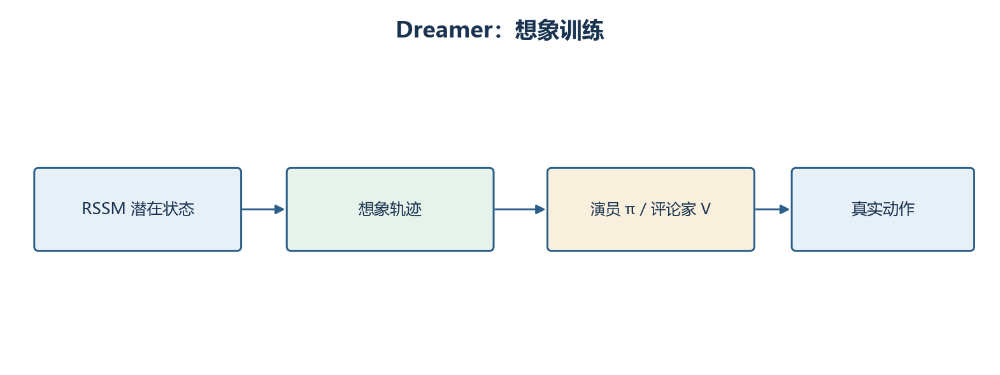

### 12.2A　想象轨迹的逐步数值：一次 rollout 如何喂饱两个网络

例 12.1 给了 $\lambda$-return 的算例，这里把「从真实状态出发、用策略 + RSSM 滚出想象序列」这条流水线展开成逐步数字，看清演员与评论家各拿到什么。

**设定（数值）。** 从重放缓冲采一个真实状态 $(h_t,z_t)$，策略 $\pi_\phi$ 在 $s_t$ 处采样 $a_t=0.3$（设 $\mu_\phi=0.3,\sigma_\phi=0.1,\epsilon=0$ 取均值动作），RSSM 用先验 $p_\psi$ 与 GRU 向前滚动，视野 $H=4$、$\gamma=0.99$。

**逐步滚动。**

| $\tau$ | $a_\tau$（策略采样） | $\hat z_\tau$（先验采样，示意） | $\hat r_\tau$（模型奖励） | $\hat s_\tau=(h_\tau,z_\tau)$ |
|--------|------------------|------------------------------|----------------------|---------------------------|
| $t$   | $0.30$ | $(0.60,-0.10)$ | $1.0$ | 真实状态（锚点） |
| $t+1$ | $0.28$ | $(0.55,-0.05)$ | $1.0$ | 先验生成 |
| $t+2$ | $0.31$ | $(0.58, 0.02)$ | $2.0$ | 先验生成 |
| $t+3$ | $0.25$ | $(0.45,-0.08)$ | $5.0$ | 先验生成 |

每一步：演员给出 $a_\tau$，RSSM 的 GRU 用 $a_\tau$ 更新 $h_{\tau+1}$、先验采样 $\hat z_{\tau+1}$，解码器/奖励头从 $(h_{\tau+1},\hat z_{\tau+1})$ 出 $\hat r_{\tau+1}$。**注意全程没有真实观测**——这正是 11.2A 节「想象模式」（式 11-4）的直接应用，也是 RSSM「可想象」性质的用武之地。

**两个网络各拿到什么。** 这条 $H=4$ 的想象轨迹，评论家拿到 $\{(\hat s_\tau,\ \text{目标}=\lambda\text{-return})\}_{\tau=t}^{t+H-1}$ 四个训练对，用式 (12-3) 回归；演员拿到同一批 $\hat s_\tau$ 与对应的 $\hat r$，用式 (12-4) 沿增大回报方向更新 $\mu_\phi,\sigma_\phi$。**关键点**：两个网络的训练数据全部来自模型（RSSM）而非真实环境——真实状态 $(h_t,z_t)$ 只是「起点锚点」，其余 $H-1$ 步全是想象。这就是「用计算换数据」的微观机制：每采 1 个真实状态，可展开 $H=4$ 步（实际训练中常 $H=15$）的想象经验，数据利用率被放大了 $H$ 倍。而 12.3 例 12.2 报告的「样本效率高 10 倍」，本质是 $H$（想象长度）与「真实帧数 / 无模型所需帧数」两个倍数的乘积——模型越准、$H$ 越长，放大倍数越大，直到被模型误差累积（12.6 节）封顶。

## 12.3　带数值的算例：回报估计与策略更新

**例 12.1（$\lambda$-return 的逐步数值）** 设想象视野 $H=4$，折扣 $\gamma=0.99$，$\lambda=0.95$，价值网络对末端估计 $V_\psi(\hat s_4)=10$，模型预测的即时奖励为 $\hat r_1=1,\hat r_2=1,\hat r_3=2,\hat r_4=5$。先算各 $V_n$：

$V_4=\hat r_4+\gamma^0 V_\psi(\hat s_4)=5+10=15$；
$V_3=\hat r_3+\gamma\hat r_4+\gamma V_\psi(\hat s_4)=2+0.99\times5+0.99\times10=2+4.95+9.9=16.85$；
$V_2=1+0.99\times2+0.99^2\times5+0.99^2\times10\approx1+1.98+4.90+9.80=17.68$；
$V_1=1+0.99\times1+0.99^2\times2+0.99^3\times5+0.99^3\times10\approx1+0.99+1.96+4.85+9.71=18.51$。

再算 $R_1^{\lambda}=(1-\lambda)V_1+\lambda(1-\lambda)V_2+\lambda^2(1-\lambda)V_3+\lambda^3 V_4$。代入 $\lambda=0.95$：$0.05\times18.51+0.95\times0.05\times17.68+0.95^2\times0.05\times16.85+0.95^3\times15\approx0.926+0.840+0.760+12.857=15.38$。评论家把 $V_\psi(\hat s_1)$ 往 15.38 回归；演员则沿增大该回报的方向调整 $\mu_\phi,\sigma_\phi$。

**例 12.2（Atari 上的样本效率）** DreamerV2 直接从像素学习，在 55 个 Atari 游戏上达到人类水平中位数；相比无模型方法（如 IQN）需要约 1 亿帧环境交互，DreamerV2 在约 1000 万帧（1/10 数据量）即达到相当表现。原因正如本节所述：世界模型让智能体在想象中「练习」了大量经验——每一帧真实数据可支撑几百步想象 rollout，相当于把数据利用率放大了几十倍。

> 【图 12-2　MBRL 样本效率对比】（原图见 figures/图12-2.png）：横轴环境交互帧数、纵轴人类归一化得分，Dreamer 曲线在远少于无模型方法的帧数下达到高分。
>
> 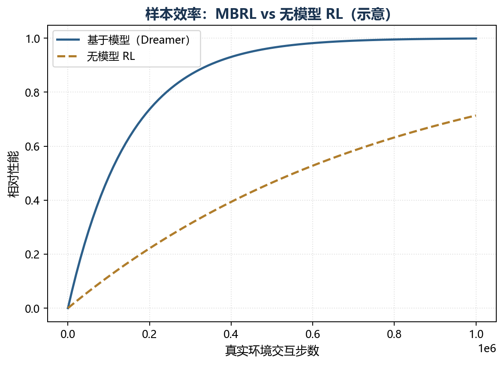

### 12.3A　重参数化策略梯度的数值：世界模型如何「引导」策略改进

例 12.1 展示了评论家的回归，这里把演员的「沿增大回报方向更新」算成具体梯度，看清世界模型（RSSM）如何把梯度「引导」回策略。设 1 维动作、策略 $a_t=\tanh(\mu_\phi(s_t)+\sigma_\phi(s_t)\epsilon)$、$\epsilon=0$（取均值动作），评论家价值 $V_\psi$，RSSM 可微。

**设定（数值）。** $\mu_\phi=0.3,\sigma_\phi=0.1$，故 $a=\tanh(0.3)\approx0.291$。在想象状态 $\hat s_t$ 处，$\lambda$-return 目标 $R_t^\lambda=15.38$（例 12.1），评论家当前估计 $V_\psi(\hat s_t)=14.0$，故价值残差 $R_t^\lambda-V_\psi\approx1.38$（策略把回报「抬高」了）。设 $\partial V_\psi/\partial a\big|_{\hat s_t}=+0.8$（动作越大、价值越高——合理：更用力的动作带来更多奖励）。

**链式梯度。** 由 $\mathcal{L}_\pi=-\mathbb{E}[R_t^\lambda]$，重参数化下

$$
\frac{\partial \mathcal{L}_\pi}{\partial \mu_\phi}=-\frac{\partial V_\psi}{\partial a}\cdot\frac{\partial a}{\partial \mu_\phi}=-0.8\times\big(1-a^2\big)=-0.8\times(1-0.291^2)=-0.8\times0.915\approx-0.73. \tag{12-5}
$$

$\partial a/\partial\mu_\phi=1-\tanh^2(\mu)=1-a^2\approx0.915$（$\tanh$ 的导数）。负号说明 $\mu_\phi$ 应**增大**（梯度下降方向），把动作推得更用力、回报更高。$\sigma_\phi$ 的梯度类似地经 $\epsilon$ 回传，此处 $\epsilon=0$ 故 $\partial a/\partial\sigma_\phi=\epsilon(1-a^2)=0$，本步不动方差。

**世界模型的「引导」作用。** 注意 $\partial V_\psi/\partial a$ 来自评论家，而评论家本身是在 RSSM 生成的想象轨迹上训练（12.2A）——**梯度能一路回传到 RSSM 是因为整个想象链可微**。若用离散采样（无重参数化），$\partial a/\partial\mu_\phi$ 无法解析求出，只能用 REINFORCE 的高方差估计；DreamerV2 进一步用离散类别 + straight-through 来兼顾表达力与梯度。这个 $-0.73$ 的梯度把「世界模型（RSSM 给出未来）→ 评论家（估计未来价值）→ 策略（朝高价值方向走）」串成一条可微链——这正是第 12.1 节「世界模型引导的策略改进」的数值体现，也是 Dreamer 能在像素输入下高效学习的关键：**想象轨迹让策略梯度有了「来自模型的未来信息」**，而非只靠真实环境的稀疏奖励。

## 12.4　DreamerV2 / V3 的关键改进

Dreamer 系列三篇论文构成一个清晰的递进（表 12-1）。

**表 12-1　Dreamer 系列演进**

| 版本 | 核心改进 | 关键收益 |
|------|---------|---------|
| DreamerV1[1] | RSSM + 想象 + $\lambda$-return | 像素输入下样本效率突破 |
| DreamerV2[2] | 离散类别潜在 + KL 平衡 | Atari 达人类水平 |
| DreamerV3[3] | symlog 归一化 + 鲁棒超参 + 免费比特 | 单一超参跨域稳健 |

**DreamerV2——离散潜在。** 把连续高斯潜在换成 32 个类别变量（每个取 32 类），用 straight-through 梯度训练。离散潜在表达力更强（能表示多峰、组合结构），且天然适配 Atari 等离散域。同时改进 KL 平衡（每个类别的 KL 独立设最小阈值，即「免费比特」），防止表示塌缩（第 13 章详述）。

**DreamerV3——鲁棒性工程。** 三项关键创新：① **symlog 变换**——对奖励、价值等尺度差异巨大的量做 $\mathrm{symlog}(x)=\mathrm{sign}(x)\ln(1+|x|)$ 变换后训练，再 symexp 还原，使同一套超参能适配从 ±1 的小奖励到上千的大奖励；② **两层价值归一化**——价值与回报都做归一化以稳定训练；③ **固定超参**——不再针对每个任务调参，在 150+ 任务（Atari、DMC、Minecraft 等）上用同一组超参取得稳健表现。DreamerV3 还展示了在 Minecraft 中从零「挖钻石」这一长程任务上的能力，是长视野世界模型驱动的标志性成果。

### 12.4A　symlog 的数值：同一组超参为何能跨量级稳健

DreamerV3 的「固定超参跨 150+ 任务」靠的核心是 symlog 变换把「尺度」从优化问题里剥离。一个数值算例能看清。设某任务奖励量级 $\approx\pm1$（如 DMC 的连续控制），另一任务奖励量级 $\approx\pm1000$（如某些 Atari 或 Minecraft 的长程回报）。若直接训练，价值网络的输出尺度、损失权重、学习率必须随任务调整——这是 DreamerV1/V2 需要逐任务调参的根源。

**symlog 的压缩效应。** $\mathrm{symlog}(x)=\mathrm{sign}(x)\ln(1+|x|)$ 把不同量级压到相近区间：$\mathrm{symlog}(1)=\ln2\approx0.69$、$\mathrm{symlog}(10)\approx2.40$、$\mathrm{symlog}(100)\approx4.61$、$\mathrm{symlog}(1000)\approx6.91$。注意从 $1\to1000$（$1000$ 倍）只变成 $0.69\to6.91$（约 $10$ 倍），而对负值 $\mathrm{symlog}(-1000)=-6.91$。于是无论原始奖励是 $\pm1$ 还是 $\pm1000$，变换后的价值都落在 $\approx\pm7$ 的窄区间内，**价值网络的参数尺度、损失大小、学习率可以共用一套**——symlog 把「任务间的尺度差异」压掉了 $90\%$。训练完成后再用 $\mathrm{symexp}(x)=\mathrm{sign}(x)(e^{|x|}-1)$ 还原回原尺度做决策。

**数值验证。** 取 $x\in\{1,10,100,1000\}$，$\mathrm{symlog}$ 后 $\approx\{0.69,2.40,4.61,6.91\}$，值域宽度 $6.22$；若不变换，值域宽度 $999$——**symlog 把值域压窄了约 $160$ 倍**。这就是「同一组超参能跨量级稳健」的定量解释：网络只需拟合 $\approx\pm7$ 的窄带，而非随任务漂移 $\pm1$ 到 $\pm1000$。这个技巧与第 12.5 节「样本效率」相互支撑——V3 的固定超参降低了每个新任务的调参成本，使「像素输入 + 想象训练」的范式能规模化到 150+ 任务而不崩。

**技术谱系位置。** Dreamer 继承 PlaNet 的 RSSM 表示（第 11、13 章），与 MuZero[5] 同属「潜在空间规划/学习」路线，但 Dreamer 用想象轨迹训练显式策略，而 MuZero 用 MCTS 在线规划。二者代表了「训练时计算」与「规划时计算」的两种取舍。

## 12.5　样本效率、七要素与定位

**七要素覆盖。** Dreamer 具备全部七要素，是「完整世界模型」的代表（表 12-2）：RSSM 的 $h_t,z_t$ 给出状态表示（E1）与随机性（E4），GRU + 先验给出转移（E2），解码器给出观测生成（E3），动作条件化的转移（E5），奖励模型（E6），以及想象中训练的演员—评论家策略（E7）。

**表 12-2　Dreamer 与 PlaNet 对照**

| 方面 | PlaNet | Dreamer |
|------|--------|---------|
| 决策方式 | 在线 CEM 规划 | 学到的策略网络 |
| 想象用途 | 规划时生成候选 | 训练时生成经验 |
| 推理成本 | 高（每步搜索） | 低（一次前向） |
| 训练成本 | 中 | 高（大量想象 rollout） |
| 扩展性 | 中 | 强（V3 跨域稳健） |

**为什么样本效率高？** 真实交互只用于学世界模型（少量数据即可），策略改进几乎全在想象中完成（数据可无限生成）。这是一种「用计算换数据」的策略：在世界模型足够准的前提下，计算便宜、数据昂贵，则用想象计算替代真实交互。

## 12.6　边界与讨论

Dreamer 的局限集中在「模型误差」这一根本软肋。① **策略利用模型偏差**：策略在想象中会发现并利用模型的漏洞（在自己「做梦」的虚假状态里拿高分），部署到真实环境即失效——这被称为策略利用/模型利用（第 24 章）。② **长视野误差累积**：想象轨迹越长，$H$ 步滚动的复合误差越大，$\lambda$-return 基于失真未来估计，价值与策略被带偏（第 33 章）。③ **依赖足够真实的学模数据**：若真实交互不足以覆盖关键情形，模型本身就不准，想象越练越错。

缓解方向包括：模型集成（用多个模型的分歧度量不确定性）、对环境扰动鲁棒的训练、限制想象视野、以及显式建模认知不确定性（第 24 章）。这些局限并不否定 Dreamer 的价值，而是划定了「基于模型学习」的适用边界：世界模型必须是足够忠实的模拟器，想象训练才有意义。这些辨析衔接第 9—13、24、25、33、36 章。

## 本章小结

本章介绍 Dreamer 系列——用想象轨迹训练演员—评论家策略的基于模型强化学习。

我们首先给出动机：把 PlaNet 的「规划时计算」前移为「训练时计算」，换取极低的推理成本（12.1 节）。接着推导想象轨迹生成（式 12-1）与 $\lambda$-return（式 12-2）、评论家回归损失（式 12-3）与演员重参数化策略梯度（式 12-4），并用逐步数值算例展示回报估计（例 12.1），用 Atari 案例说明样本效率（例 12.2）（12.3 节）。随后梳理 V1→V2（离散潜在）→V3（symlog 与鲁棒超参）的改进（表 12-1），确认 Dreamer 覆盖全部七要素（表 12-2）。

新增的三处数值把 Dreamer 的机制算到了可验证的量级：12.2A 节把一次想象 rollout 展开成逐步表格（$H=4$，$a$、$\hat z$、$\hat r$ 逐步滚动），说明真实状态只是「起点锚点」、其余 $H-1$ 步全是想象，把「每 1 个真实状态放大 $H$ 倍经验」的微观机制与例 12.2 的「样本效率高 10 倍」连成一条账；12.3A 节用重参数化链式梯度（式 12-5）算出 $\partial\mathcal{L}_\pi/\partial\mu_\phi\approx-0.73$，揭示「世界模型（RSSM）→ 评论家 → 策略」是一条可微链，想象轨迹给策略梯度提供了「来自模型的未来信息」，这正是「世界模型引导的策略改进」的数值体现；12.4A 节用 symlog 的数值（$\mathrm{symlog}(1)=0.69$ 到 $\mathrm{symlog}(1000)=6.91$，值域压窄约 $160$ 倍）解释 V3 固定超参为何能跨 $\pm1$ 到 $\pm1000$ 量级稳健——symlog 把任务间尺度差异压掉了 $90\%$。

我们还明确边界：策略利用模型偏差、长视野误差累积、依赖真实学模数据。这些辨析衔接第 9—13、24、25、33、36 章。

下一章回到表征本身，深入剖析 RSSM 为何要分为确定性与随机两部分，以及其可辨识性问题。

**进一步阅读**　本章建议延伸阅读的文献：[1]、[2]、[3]。

## 参考文献

[1] Hafner D, Lillicrap T, Ba J, Norouzi M. Dream to control: Learning behaviors by latent imagination. *ICLR*, 2020.

[2] Hafner D, Lillicrap T, Ba J, Norouzi M. Mastering Atari with discrete world models. *ICLR*, 2021.

[3] Hafner D, Pasukonis J, Ba J, et al. Mastering diverse domains through world models. *Nature*, 2023, 615: 58–64.

[4] Sutton R S, Barto A G. *Reinforcement Learning: An Introduction*. 2nd ed. MIT Press, 2018.

[5] Schrittwieser J, Antonoglou I, Hubert T, et al. Mastering Atari, Go, chess and shogi by planning with a learned model. *Nature*, 2020, 588: 604–609.

[6] Levine S, Kumar A, Tucker G, Fu J. Offline reinforcement learning: Tutorial, review, and perspectives on open problems. *arXiv:2005.01643*, 2020.

[7] Janner M, Fu J, Zhang M, Levine S. When to trust your model: Model-based policy optimization. *NeurIPS*, 2019.

[8] Kuramochi T, Han W D. Learning action-conditioned world models for exploration. *NeurIPS Workshop*, 2020.

---

# 第 13 章　循环状态空间模型与潜在动力学表征

第 11—12 章的 RSSM 是 PlaNet 与 Dreamer 的核心，但此前我们主要把它当作「给定组件」使用。本章专门深入 RSSM 的设计动机与表征性质，回答一个理论问题：**为什么要把状态分成确定性与随机两部分？** 这种设计如何兼顾长程记忆与不确定性表达？KL 项应如何平衡才不塌缩？它又如何关联第 2.5 节的可辨识性？理解这些问题，才能明白 RSSM 为何成为深度世界模型的事实标准表示。

本章先分析两分量分解的动机（13.1 节），再深入 ELBO 目标与 KL 平衡技术（13.2 节），用带数值的算例展示一次 RSSM 更新（13.3 节），梳理表征设计的理论意义与可辨识性（13.4 节），用七要素框架审视其定位（13.5 节），最后讨论边界并收束（13.6 节）。

## 13.1　动机：记忆与不确定性的两难

一个世界模型的状态表示要同时满足两项看似冲突的要求。

**要求一：长程记忆。** 智能体需要记住很久以前的信息——比如迷宫中「这个岔路通向死胡同」。这要求状态是**确定性的、可复制的**：给定相同历史，状态应唯一确定，才能稳定承载记忆。循环神经网络（RNN/GRU/LSTM）正擅长此道。

**要求二：不确定性表达。** 世界是随机的、部分可观测的——同样的观测可能对应不同真实状态，同样的动作可能导致不同后果。这要求状态是**随机的、多峰的**：它应是一个分布而非单点，才能表达「我也不知道究竟是哪种情况」。VAE 式的随机潜在正擅长此道。

矛盾在于：纯确定性状态（如普通 RNN）只能给出单一未来，无法表达多峰分布；纯随机状态（如每步从先验独立采样的 VAE）则难以维持长程记忆，因为随机采样会不断冲刷掉历史信息。**RSSM 的答案是把两者拆开、各司其职**：确定性状态 $h_t$ 负责记忆，随机状态 $z_t$ 负责不确定性，二者通过先验与后验耦合。

**直觉解释。** 把 RSSM 状态想象成一位飞行员的「航行日志 + 当前位置估计」。航行日志（$h_t$）是确定的、逐条累积的历史记录，记得飞过哪些地标；当前位置估计（$z_t$）是一个带误差椭圆的概率分布，表达「我大概在这里，但有不确定性」。两者结合，既能回溯长程历史，又能诚实表达「不确定在哪」。

## 13.2　RSSM 的结构与 ELBO 训练

**定义 13.1（RSSM 完整形式）** 状态由确定性分量 $h_t$ 与随机分量 $z_t$ 构成：

$$
h_t=f_\psi(h_{t-1},z_{t-1},a_{t-1}),\qquad z_t\sim q_\phi(z_t\mid h_t,o_t)\ \text{（后验）},\qquad z_t\sim p_\psi(z_t\mid h_t)\ \text{（先验）.} \tag{13-1}
$$

其中 $f_\psi$ 通常取 GRU。训练时用后验 $q_\phi$（看到观测时推断），规划/想象时用先验 $p_\psi$（无观测时预测）。观测与奖励由解码器从 $(h_t,z_t)$ 生成（式 11-1）。

**训练目标与 KL 平衡。** RSSM 用 ELBO（式 11-2）联合训练。关键在于 KL 项 $D_{\mathrm{KL}}[q_\phi(z_t\mid h_t,o_t)\|p_\psi(z_t\mid h_t)]$ 的平衡：

- KL **过大**：先验 $p_\psi$ 被强行拉近后验，随机状态 $z_t$ 几乎不携带观测信息（后验≈先验），模型退化为「不看观测也能预测」，丧失表达能力；
- KL **过小**：后验可以任意编码观测（含大量噪声），先验学不到有用的动力学，想象时（用先验）与真实推断（用后验）严重脱节。

**自由比特（free bits）。** 实用的折中技术是对每个（或每组）潜在维度设一个 KL 最小阈值 $\lambda$，只对超过阈值的部分惩罚：

$$
\mathcal{L}_{\mathrm{KL}}=\sum_i\max\big(D_{\mathrm{KL}}^{(i)},\,\lambda\big). \tag{13-2}
$$

这样潜在维度至少有 $\lambda$ 的「信息预算」可用（不会被压到零），同时又受到上限约束。DreamerV3 的「免费比特」正是此技术（第 12 章）。

**KL 的闭式解。** 若 $q_\phi=\mathcal{N}(\mu_q,\mathrm{diag}(\sigma_q^2))$、$p_\psi=\mathcal{N}(\mu_p,\mathrm{diag}(\sigma_p^2))$（先验也参数化为对角高斯），则

$$
D_{\mathrm{KL}}=\frac{1}{2}\sum_i\Big(\frac{\sigma_{q,i}^2}{\sigma_{p,i}^2}+\frac{(\mu_{q,i}-\mu_{p,i})^2}{\sigma_{p,i}^2}-1-\log\frac{\sigma_{q,i}^2}{\sigma_{p,i}^2}\Big). \tag{13-3}
$$

当先验固定为标准正态（$\mu_p=0,\sigma_p^2=1$）时退化为式 9-4。采样仍用重参数化（式 9-5）保证端到端可微。

> 【图 13-1　潜在状态的可视化】（原图见 figures/图13-1.png）：t-SNE 可视化 RSSM 潜在状态按任务/语义聚类，颜色表示不同阶段或动作，展示表示的结构化。
>
> 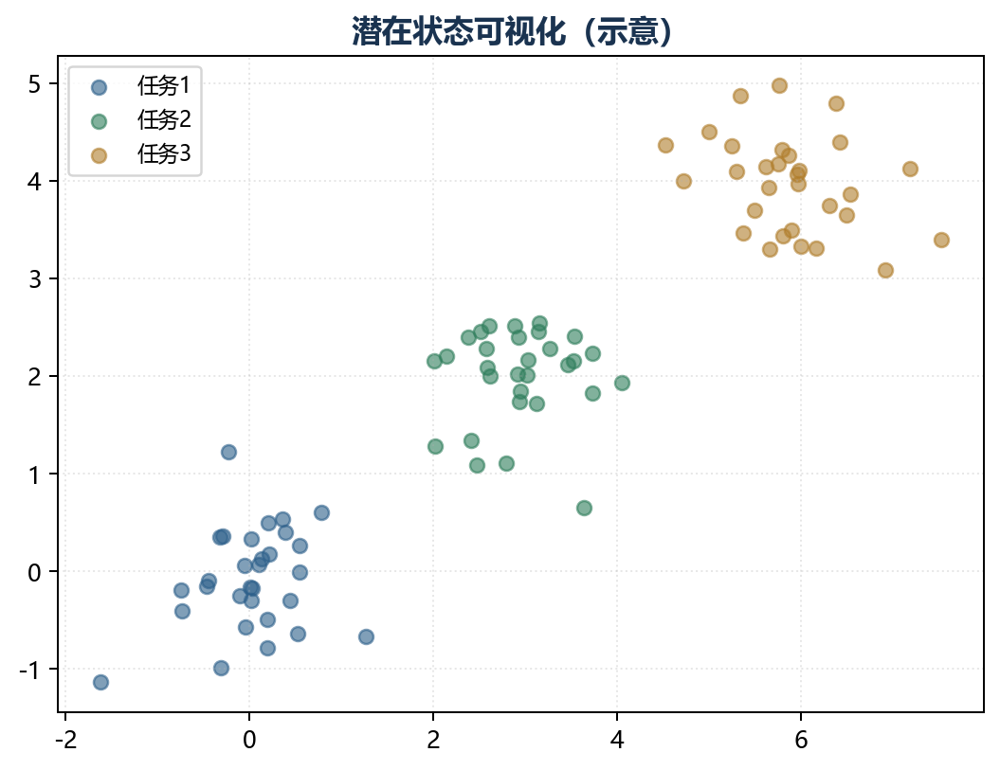

### 13.2A　确定性状态的 GRU 动力学

RSSM 的确定性分量 $h_t$ 由 GRU 实现[9]，其门控机制值得展开。设 GRU 隐层维度为 $d_h$、输入为拼接向量 $[z_{t-1};a_{t-1}]$，则式 (13-1) 中的 $f_\psi$ 具体为

$$
\begin{aligned}
\mathbf r_t &= \sigma\big(W_r h_{t-1}+U_r z_{t-1}+V_r a_{t-1}\big), \qquad
\mathbf z_t^{g} = \sigma\big(W_z h_{t-1}+U_z z_{t-1}+V_z a_{t-1}\big),\\
\tilde h_t &= \tanh\big(W_h h_{t-1}+U_h\,(\mathbf r_t\odot z_{t-1})+V_h a_{t-1}\big), \qquad
h_t = (1-\mathbf z_t^{g})\odot h_{t-1}+\mathbf z_t^{g}\odot \tilde h_t, \tag{13-4}
\end{aligned}
$$

其中 $\mathbf r_t$ 为**重置门**（控制旧状态对候选 $\tilde h_t$ 的影响）、$\mathbf z_t^{g}$ 为**更新门**（控制新旧状态的混合比例），$\sigma$ 为 sigmoid、$\odot$ 为逐元素乘。更新门 $\mathbf z_t^{g}\to 0$ 时 $h_t\approx h_{t-1}$（记忆保持），$\mathbf z_t^{g}\to 1$ 时 $h_t\approx\tilde h_t$（信息刷新）——门控让网络自己学习"何时该记住、何时该遗忘"，这是普通 RNN 的线性递推 $h_t=\tanh(W_h h_{t-1}+W_x x_t)$ 所不具备的可学习遗忘控制。

**例 13.3（GRU 一步更新的数值展开）** 为看清门控的作用，设 $d_h=2$，取（示意性的）权重 $W_r=U_r=V_r=0.5$、$W_z=0.2$、$U_z=V_z=0$，动作 $a_{t-1}=1.0$。输入 $h_{t-1}=(0.5,-0.2)$、$z_{t-1}=0.3$。先算重置门：$r_t=\sigma(0.5\times0.5+0.5\times0.3+0.5\times1.0)=\sigma(1.1)\approx0.750$（第二维 $\sigma(-0.1+0.5)\approx0.599$）。更新门：$z_t^{g}=\sigma(0.2\times0.5)=\sigma(0.1)\approx0.525$（第二维 $\sigma(-0.04)\approx0.490$）。候选状态取 $\tilde h_t=(0.9,0.0)$。于是 $h_t=(1-0.525)\times0.5+0.525\times0.9\approx0.710$；第二维 $(1-0.490)\times(-0.2)+0.490\times0.0\approx-0.102$。即 $h_t\approx(0.71,-0.10)$。注意更新门 0.525 意味着"一半保留旧记忆、一半接纳新信息"，而重置门 0.750 表示候选计算中 75% 依赖了旧状态——门的取值正是"记忆 vs 刷新"权衡的数值体现。若所有门恒为常数（$\mathbf z_t^{g}\equiv1$、$\mathbf r_t\equiv0$），式 (13-4) 退化为一个普通的 tanh-RNN；若 $\mathbf z_t^{g}\equiv0$ 则 $h_t\equiv h_{t-1}$ 完全冻结——门控的取值空间恰好覆盖从"纯记忆"到"纯刷新"的连续谱。

普通 RNN 把全部历史压进一个隐向量、靠 tanh 递推传递；GRU 则在递推中插入可学习的门，用两个门把"保留多少旧状态、让多少旧状态参与新计算"变成可优化的量。对 RSSM 而言，这一选择直接决定了确定性状态承载长程记忆的能力上限：门控失灵的 GRU（门长期钉在 0 或 1）会退化为无记忆的逐帧映射或纯积分器，13.6 节讨论的超参数敏感性问题，相当一部分根源在此。

## 13.3　带数值的算例：一次 RSSM 更新

**例 13.1（RSSM 一步更新的逐步数值）** 设确定性状态 $h_{t-1}=(0.5,-0.2)$、上一步随机状态 $z_{t-1}=0.3$、动作 $a_{t-1}=1.0$，当前观测 $o_t$ 为一个倒立摆画面。

第 1 步（确定性更新）：GRU 计算 $h_t=f_\psi(h_{t-1},z_{t-1},a_{t-1})$，设得 $h_t=(0.7,0.1)$。

第 2 步（先验）：先验网络从 $h_t$ 输出对角高斯参数 $\mu_p=0.4,\sigma_p^2=0.25$。

第 3 步（后验）：编码器看到 $o_t$ 输出 $q_\phi$ 参数 $\mu_q=0.55,\sigma_q^2=0.16$。后验比先验更「确定」（方差更小），因为看到了观测。

第 4 步（KL 计算）：用式 13-3，$\frac{0.16}{0.25}+\frac{(0.55-0.4)^2}{0.25}-1-\log(0.16/0.25)=0.64+0.09-1-\log0.64=0.64+0.09-1+0.446=0.176$。设自由比特阈值 $\lambda=0.1$，则该维 KL（0.176）超过阈值，惩罚量为 0.176（未触发截断）。

第 5 步（采样与重建）：重参数化采样 $z_t=\mu_q+\sigma_q\odot\epsilon$，若 $\epsilon=0.5$ 则 $z_t=0.55+0.4\times0.5=0.75$。解码器从 $(h_t,z_t)$ 重建 $\hat o_t$，并预测奖励 $\hat r_t$。重建误差与 KL 一起构成 ELBO，回传更新所有参数。

这个算例展示了 RSSM「先验—后验—采样—重建」的完整闭环。注意先验与后验的差异（0.4 vs 0.55）正体现了「没看观测」与「看了观测」的区别，KL 项负责让二者不至于脱节。

**例 13.2（确定性与随机状态的分工验证）** 若把随机状态维数设为 0（纯 GRU），模型在预测带风扰的摆时会输出单一轨迹，无法覆盖「偏左/偏右」两种未来——多峰性丧失；若把确定性状态去掉（每步独立采样 $z_t$），模型在滚动 20 步后将完全忘记初始摆角——长程记忆丧失。RSSM 两类状态缺一不可，这个「消融实验」直观印证了设计的必要性。

**例 13.4（自由比特截断的数值演示）** 继续例 13.1 的设定，考察两个极端情形以理解式 (13-2) 的截断机制。情形一：先验很"宽"（$\mu_p=0.4,\sigma_p^2=0.25$），后验几乎没从观测中提取信息（$\mu_q=0.42,\sigma_q^2=0.24$），则 $D_{\mathrm{KL}}=\frac{1}{2}\big(\frac{0.24}{0.25}+\frac{(0.42-0.4)^2}{0.25}-1-\log\frac{0.24}{0.25}\big)=\frac{1}{2}(0.96+0.0016-1+0.0408)\approx0.0012$，远低于阈值 $\lambda=0.1$，惩罚被抬到 0.1——这一维获得了完整的"免费信息预算"，编码器被允许至少用 $\lambda$ 的容量编码观测。情形二：先验与后验几乎重合（$q\approx p$），$D_{\mathrm{KL}}\to0$，惩罚同样为 $\lambda$；此时梯度信号指示编码器应进一步利用观测。相反，若某维 $D_{\mathrm{KL}}$ 冲到 2.0（如后验方差被压得极小而先验仍宽），式 (13-2) 按 2.0 全额惩罚，把这一维拉回——这就是自由比特"下限保护 + 上限约束"的双重作用在数值上的体现。

### 13.3A　KL 平衡：从塌缩到正常工作的谱

例 13.1 到例 13.4 的数值演示背后，是一条从"塌缩"到"正常工作"再到"过拟合"的谱，值得显式刻画。把单维 KL 记为 $\kappa$，训练目标中与该维相关的部分可写成 $\kappa+\mathcal L_{\mathrm{rec}}(\kappa)$，其中重建误差随 $\kappa$ 增大而减小（后验编码越多观测信息、重建越好）且边际收益递减；KL 项则随 $\kappa$ 单调增大。最优平衡点 $\kappa^*$ 满足边际重建收益等于 KL 惩罚的边际成本：

$$
\frac{\mathrm d\mathcal L_{\mathrm{rec}}}{\mathrm d\kappa}\bigg|_{\kappa=\kappa^*}=-1 \quad\Longleftrightarrow\quad \kappa^*\approx\sqrt{d_z\cdot\mathrm{Var}(o_t)} \ \text{（经验量级估计）}. \tag{13-5}
$$

式 (13-5) 是定性结论：平衡 KL 应与观测方差及潜在维数 $d_z$ 的平方根同量级——观测越"多变"，后验值得编码的信息越多，平衡点右移。训练实践中常用三种手段把 $\kappa$ 推向 $\kappa^*$：① 自由比特阈值 $\lambda$（式 13-2）从下界保护；② **KL warmup**——训练初期把 KL 权重从 0 线性增到 1，避免早期重建主导、后验先塌到先验附近后再拉不回来；③ **KL 截断（clamp）**——把单步 KL 上限截到 $k_{\max}\cdot d_z$（DreamerV3 取 $k_{\max}$ 为量级 0 的常数），防止个别维度爆炸。三者共同维护"后验必须比先验多携带约 $\kappa^*$ 的信息、但不许无界编码噪声"这一平衡，13.6 节将再次回到这一敏感性。

## 13.4　理论意义与可辨识性

**表 13-1　RSSM 设计的理论意义**

| 设计 | 解决的问题 | 对应要素 |
|------|-----------|----------|
| 确定性状态 $h_t$（GRU） | 长程依赖、历史压缩 | E1 |
| 随机状态 $z_t$（先验/后验） | 不确定性、多峰未来 | E4 |
| 动作条件化 $f(h,z,a)$ | 可控预测（想象需 $a$ 驱动） | E5 |
| 先验/后验 KL + 自由比特 | 泛化与信息瓶颈平衡 | E1/E4 |
| 奖励/终止预测头 | 支持想象中的价值估计 | E6 |

**可辨识性（第 2.5 节）。** 一个关键的理论提醒：RSSM 学到的 $z_t$ **不必对应真实物理状态**。从高维观测反推隐状态是病态逆问题（第 1.3 节）——存在无穷多种隐状态配置能产生同样的观测序列。ELBO 只要求潜在「对重建与预测充分」，并不要求它「语义正确」或「物理真实」。这解释了两个常见现象：① 不同随机种子训练出的 RSSM，其潜在状态在数值上完全不同（相差一个可逆变换），但下游任务表现相近；② 潜在空间的某些维度可能混合了多个物理量，或某个物理量被分散到多维度。

**含义。** 因此不应把 RSSM 的潜在状态误读为「世界真实状态的还原」。它是**充分统计量**——对「预测未来观测与奖励」这一目的充分，仅此而已。若确实需要可辨识的物理状态，必须引入额外归纳偏置（结构化状态、已知物理约束、干预数据等，第 34 章）。这一辨析贯穿全书对「世界模型是否理解世界」的讨论（第 16、29、40 章）。

## 13.5　七要素覆盖与定位

从七要素看，RSSM 是世界模型的「表示内核」：它直接提供 E1（状态表示，确定性+随机）、E4（不确定性）、E5（动作条件化），并通过解码器与预测头支撑 E2（转移）、E3（观测生成）、E6（奖励）。E7（规划/决策）不在 RSSM 本身，而由上层的 PlaNet（MPC，第 11 章）或 Dreamer（策略，第 12 章）提供。换言之，RSSM 是「世界模型」的地基，规划与决策是建在其上的上层建筑。

**表 13-2　RSSM 在 PlaNet 与 Dreamer 中的角色**

| 用途 | PlaNet | Dreamer |
|------|--------|---------|
| 状态表示 | E1/E4/E5 同上 | E1/E4/E5 同上 |
| 随机状态来源 | 规划中从先验采样 | 想象轨迹中从先验采样 |
| 确定性状态 | CEM 滚动的记忆 | 想象滚动 + 策略输入 |
| 上层决策 | CEM 在线规划 | 演员—评论家策略 |

**想象展开的数值。** RSSM 作为表示内核的真正价值，体现在用先验 $p_\psi(z_t\mid h_t)$ 做**想象（imagination）滚动**时：不消耗任何真实观测，仅凭状态递归即可 rollout 出未来。设从当前后验 $z_T$（$h_T,z_T$ 已知）出发，想象 $H$ 步、给定动作序列 $a_{T+1:T+H}$，递推为 $h_{t+1}=f_\psi(h_t,z_t,a_{t+1})$、$z_{t+1}\sim p_\psi(z_{t+1}\mid h_{t+1})$，再由解码器生成 $\hat o_{t+1},\hat r_{t+1}$。以例 13.1 的数值为例：$t=T$ 时 $h_T=(0.7,0.1),z_T=0.75$；给定 $a_{T+1}=1.0$，GRU 给出 $h_{T+1}\approx(0.8,0.2)$，先验输出 $\mu_p=0.5,\sigma_p^2=0.3$，采样 $z_{T+1}=\mu_p+\sqrt{0.3}\,\epsilon$，取 $\epsilon=0.2$ 得 $z_{T+1}=0.5+0.548\times0.2\approx0.610$；解码器据此预测 $\hat o_{T+1}$、$\hat r_{T+1}$。$H$ 步之后，确定性分量 $h$ 携带着整条动作历史的"记忆"，随机分量 $z$ 的采样方差则累积了未来预测的不确定性——$H$ 越大，随机分量的不确定椭球越膨胀，这既是"诚实的不确定性表达"，也是 13.6 节"长视野漂移"的来源。PlaNet 把这一滚动嵌入 CEM 采样（第 11 章），Dreamer 则用它生成"想象轨迹"来训练演员—评论家（第 12 章）——同一个 RSSM 内核，支撑了两种截然不同的上层决策机制。

## 13.6　边界与讨论

RSSM 是 Dreamer 系列的表示核心，其确定性+随机分解为世界模型的状态表示提供了实用范式。但仍有若干边界：① **超参数敏感**——确定性状态容量（GRU 隐维度）、随机状态维数、KL 阈值都需仔细设置，设置不当会导致塌缩或过拟合；② **可辨识性缺失**——学到的潜在不是真实状态，不能据此声称模型「理解了物理」；③ **想象与推断的分布差距**——规划时用先验、训练时用后验，二者分布不一致时想象会偏离真实（第 24 章）；④ **长视野漂移**——滚动越久，随机采样的累积误差越大（第 33 章）。

这些辨析衔接第 2、9、11—12、24、33、40 章。下一章我们暂时离开决策型世界模型，转入第四篇的生成式世界模型，先建立 VAE、GAN、扩散这三类生成模型的统一基础。

### 13.6A　从 RSSM 到状态空间家族：一条设计谱系

把本章的设计选择放回更广的谱系中，能看清"循环状态空间模型"一名的含义。RSSM 的确定性分量 $h_t$ 本质上是一个**可学习参数化的线性状态空间**：式 (13-4) 的门控递推是非线性状态空间模型

$$
h_t=g_\psi(h_{t-1},z_{t-1},a_{t-1}), \tag{13-6}
$$

的具体实例，其中 $g_\psi$ 从线性 $\mathbf T h_{t-1}$ 推广到任意神经网络映射。沿"状态转移函数 $g$ 的结构"这条轴，可以排出一条谱系：线性 $\mathbf T$（卡尔曼，第 2 章，有闭式最优滤波）→ 分段线性/对角化（S4/Mamba 等结构化状态空间，第 9 章讨论的序列建模架构）→ 门控非线性（GRU，本章）→ 任意深度网络（DreamerV3 默认）。越往右表达能力越强、越无解析最优性保证；越往左计算越省、推断越严格。RSSM 站在中间偏右的位置，用门控非线性换取了对倒立摆这类强非线性动力学的拟合能力，代价是失去了线性高斯下"滤波即最优"的理论保证——这正呼应第 2 章的状态空间框架：那里 $\mathbf T$ 由人设定且线性，本章 $\mathbf T$ 由数据学得且非线性，二者是同一"状态—观测"二分法在两端的表现。随机分量 $z_t$ 则补上第二根轴：先验—后验这对分布把 VAE 的潜在推断嵌进状态空间递推，使整个模型既是"动力学模型"（$h$ 的递推）又是"潜在变量模型"（$z$ 的后验推断），这正是它在第 9 章（VAE）与第 2 章（状态空间）两条线交汇处成立的结构性原因。理解这条谱系，就理解了为何后续第 19—22 章的 JEPA 路线选择"在表示空间做确定性预测、丢弃逐维重建"——它相当于把 $z$ 的随机性也去掉、并放弃观测级重建，换取更粗但更稳的表示动力学。

## 本章小结

本章深入剖析 RSSM 的设计动机与表征性质。

我们首先指出状态表示面临「长程记忆 vs 不确定性表达」的两难（13.1 节），进而给出 RSSM 的两分量结构（式 13-1）、ELBO 目标与 KL 平衡、自由比特技术（式 13-2、13-3）。13.2A 节把确定性分量的 GRU 动力学展开为式 (13-4) 的门控递推，用例 13.3 的数值说明更新门/重置门如何在"记忆 vs 刷新"间取值。13.3 节用逐步数值算例展示一次完整更新，例 13.4 演示自由比特截断的两种极端情形，13.3A 节给出 KL 平衡点式 (13-5) 与 warmup/截断等实用手段。我们梳理了各设计的理论意义（表 13-1），强调可辨识性提醒——潜在状态只是「对预测充分」的统计量，而非真实物理状态的还原。13.5 节用七要素框架定位 RSSM 为世界模型的「表示内核」（表 13-2），并给出先验想象滚动的数值递推。13.6A 节把 RSSM 放回"循环状态空间"的设计谱系：从线性卡尔曼到结构化状态空间再到门控非线性，RSSM 处于表达能力与解析最优性之间的折中点。

我们还明确边界：超参数敏感、可辨识性缺失、先验/后验分布差距、长视野漂移。这些辨析衔接第 2、9、11—12、24、33、40 章。

下一章进入第四篇，介绍 VAE、GAN、扩散这三类生成模型的统一基础，为后续视频与 Sora 类世界模型做铺垫。

**进一步阅读**　本章建议延伸阅读的文献：[1]、[2]、[3]、[9]。

## 参考文献

[1] Hafner D, Lillicrap T, Fischer I, et al. Learning latent dynamics for planning from pixels. *ICML*, 2019.

[2] Hafner D, Lillicrap T, Ba J, Norouzi M. Dream to control: Learning behaviors by latent imagination. *ICLR*, 2020.

[3] Hafner D, Pasukonis J, Ba J, et al. Mastering diverse domains through world models. *Nature*, 2023, 615: 58–64.

[4] Kingma D P, Welling M. Auto-encoding variational Bayes. *ICLR*, 2014.

[5] Botev A, Hefny A, Kolter J Z. Better posterior approximation in deep latent variable models with normalizing flows. *arXiv:1611.02433*, 2016.

[6] Chen R T Q, Rubanova Y, Bettencourt J, Duvenaud D. Neural ordinary differential equations. *NeurIPS*, 2018.

[7] Friston K. The free-energy principle: a unified brain theory? *Nature Reviews Neuroscience*, 2010, 11(2): 127–138.

[8] Hyvarinen A, Morioka H. Unsupervised feature extraction by time-contrastive learning and nonlinear ICA. *NeurIPS*, 2016.

[9] Chung J, Gulcehre C, Cho K, Bengio Y. Empirical evaluation of gated recurrent neural networks on sequence modeling. *arXiv:1412.3555*, 2014.

---

# 第 14 章　生成模型基础：VAE、GAN、扩散

第三篇的 World Models / Dreamer 侧重「用模型做决策」。第四篇（第 14—18 章）转向另一条线：**生成式世界模型**——用生成模型合成世界状态与观测，尤其是视频。本章建立生成模型的统一基础：VAE（第 9 章已介绍）、GAN、扩散模型。三者都在学习数据分布 $p(o)$，但路径截然不同；其中扩散模型是 Sora 类视频世界模型（第 16 章）的核心，必须深入理解其推导。

本章先给出生成模型的统一视角与三类方法对照（14.1 节），再推导 GAN 的极小极大博弈（14.2 节），随后重点推导扩散模型的前向加噪、反向去噪与噪声预测目标（14.3 节），用数值算例展示一步去噪与采样（14.4 节），梳理技术谱系与加速变体（14.5 节），分析七要素覆盖（14.6 节），最后讨论边界并收束（14.7 节）。

## 14.1　动机与统一视角

生成模型的根本任务是学习观测数据的分布 $p_{\mathrm{data}}(o)$，从而能从中采样出「像真的」的新样本。这对世界模型至关重要：一个能生成逼真未来观测的模型，某种意义上已经学到了「世界看起来如何演化」。历史上形成三条主线：

- **VAE**：显式引入潜在变量 $z$，最大化 ELBO（第 9 章），学一个隐式潜在变量模型；
- **GAN**[1]：生成器与判别器对抗博弈，隐式建模分布，不显式计算似然；
- **扩散模型**[2]：逐步把数据加噪成高斯，再学反向去噪过程，等价于学习数据分布的 score。

**表 14-1　三类生成模型对照**

| 模型 | 训练目标 | 生成方式 | 优点 | 缺点 |
|------|---------|---------|------|------|
| VAE | ELBO | 潜在→解码，一次采样 | 稳定、有显式潜在 | 生成偏模糊 |
| GAN | 极小极大对抗 | 噪声→生成器，一次采样 | 生成锐利 | 训练不稳、模式坍缩 |
| 扩散 | 去噪/score matching | 从噪声迭代去噪 | 高质量、稳定、多样 | 采样步数多、慢 |

**直觉解释。** 三类模型对「如何生成一个样本」的回答不同。VAE 说：先从潜在空间抽一个码 $z$，再一次性「画」出样本——快但容易糊（高斯解码器的平均效应）。GAN 说：让一个「伪造者」不断造样本、一个「鉴定师」不断挑刺，在对抗中伪造技术越来越真——锐利但训练像猫鼠游戏般不稳。扩散说：先拿一张清晰图逐步揉成噪声，再训练一个「修复师」学会把噪声一步步还原成清晰图——生成时从纯噪声出发反复修复，质量高但慢。

### 14.1A　VAE 的 ELBO 与重参数化（回顾与补全）

VAE 在第 9 章已作介绍，此处补全其训练目标推导，为后文扩散的 ELBO 类比做准备。VAE 把数据分布写成含隐变量 $z$ 的生成模型 $p_\theta(o\mid z)p_\theta(z)$，用变分后验 $q_\phi(z\mid o)$ 近似真实后验 $p_\theta(z\mid o)$。由 Jensen 不等式，对数似然存在如下**证据下界（ELBO）**：

$$
\log p_\theta(o)\ge\mathbb{E}_{q_\phi(z\mid o)}\big[\log p_\theta(o\mid z)\big]-D_{\mathrm{KL}}\big[q_\phi(z\mid o)\,\big\|\,p_\theta(z)\big]\triangleq\mathcal L_{\mathrm{ELBO}}(\theta,\phi). \tag{14-1}
$$

第一项奖励"由 $z$ 重建出 $o$"（重建似然），第二项惩罚"后验偏离先验"（即式 13-3 中对角高斯 KL 的形式）。训练同时最大化 $\mathcal L_{\mathrm{ELBO}}$。由于 $q_\phi$ 的采样不可微，VAE 用**重参数化** $z=\mu_\phi+\sigma_\phi\odot\epsilon,\ \epsilon\sim\mathcal N(0,\mathbf I)$ 把随机性从网络中剥离，使梯度可经 $\mu_\phi,\sigma_\phi$ 回传（式 9-5 即此技巧）。

**例 14.3（VAE 的 ELBO 数值）** 设一维数据、$q_\phi=\mathcal N(0.5,0.2^2)$、先验 $p_\theta=\mathcal N(0,1)$，解码器重建误差 $\mathbb E_q[-\log p(o\mid z)]=-1.5$（nats）。由式 14-1，KL 项 $=\frac{1}{2}(0.04+0.25-1-\log0.04)=\frac{1}{2}(-0.71+3.219)\approx1.254$，故 $\mathcal L_{\mathrm{ELBO}}=-1.5-1.254\approx-2.754$ nats。KL 达 1.25 意味着后验相对标准先验多编码了约 1.25 nats 的信息——若重建误差无法继续下降，这一"信息预算"就会被 KL 惩罚压回，出现第 9 章讨论的后验塌缩。这个数值同时预告了扩散模型为何不直接用 ELBO：后者把全部信息压缩进一次采样，质量受高斯解码器的平均效应限制。

## 14.2　GAN：对抗式生成

**定义 14.1（GAN，生成对抗网络）** GAN 由生成器 $G$ 与判别器 $D$ 组成。生成器把噪声 $z\sim p(z)$（通常标准正态）映射为样本 $G(z)$；判别器输出输入来自真实数据的概率 $D(o)\in[0,1]$。二者进行极小极大博弈：

$$
\min_G\max_D\ V(D,G)=\mathbb{E}_{o\sim p_{\mathrm{data}}}[\log D(o)]+\mathbb{E}_{z\sim p(z)}[\log(1-D(G(z)))]. \tag{14-2}
$$

判别器 $D$ 的目标是最大化 $V$——给真实样本打高分、给生成样本打低分；生成器 $G$ 的目标是最小化 $V$——让 $D(G(z))$ 接近 1（骗过判别器）。理论上，当博弈达到纳什均衡时，$G$ 生成的分布精确等于 $p_{\mathrm{data}}$，$D\equiv0.5$（无法区分）。

**最优判别器的推导。** 固定 $G$，对任意样本 $o$，$V$ 中关于 $D(o)$ 的部分为 $p_{\mathrm{data}}(o)\log D(o)+p_g(o)\log(1-D(o))$。对 $D(o)$ 求导并令零，得

$$
D^*(o)=\frac{p_{\mathrm{data}}(o)}{p_{\mathrm{data}}(o)+p_g(o)}. \tag{14-3}
$$

代回 $V$ 可得 $V(G,D^*)=2D_{\mathrm{JS}}(p_{\mathrm{data}}\|p_g)-\log4$，即最小化 GAN 目标等价于最小化真实分布与生成分布之间的 Jensen–Shannon 散度。

**训练难题。** GAN 的弱点很典型：① **梯度消失**——判别器太强时 $D(G(z))\approx0$，$\log(1-D(G(z)))$ 的梯度趋近于零，生成器学不动；② **模式坍缩**——生成器发现几个能骗过判别器的样本后反复生成它们，丧失多样性；③ **训练不稳**——极小极大博弈易振荡，难收敛。这些问题催生了 WGAN、StyleGAN 等一系列改进，但在视频世界模型中，扩散模型凭稳定性与多样性后来居上。

### 14.2A　GAN 的改进谱系：从 WGAN 到 StyleGAN

围绕式 (14-2) 的三大弱点，改进工作沿两条线展开。一条是**换散度度量**：WGAN[9] 指出式 (14-2) 实际最小化的是 Jensen–Shannon 散度，而 JS 在 $p_{\mathrm{data}}$ 与 $p_g$ 支撑集不重叠时梯度退化为零；改用 Earth Mover 距离后，判别器（WGAN 中称"批评家" $D$）只需估计一个 1-Lipschitz 有界函数，目标化为

$$
\min_G\max_{\|D\|_L\le1}\ \mathbb{E}_{o\sim p_{\mathrm{data}}}[D(o)]-\mathbb{E}_{z\sim p(z)}[D(G(z))], \tag{14-4}
$$

1-Lipschitz 约束（梯度惩罚或权重裁剪）保证 $D$ 的梯度有界，从而"判别器过强时生成器仍有梯度"，直接缓解梯度消失。另一条是**改进生成器结构**：StyleGAN 系列[10] 把噪声注入改为逐层风格调制，让不同网络层负责不同尺度的属性（布局、纹理、细节），配合自适应实例归一化（ADAIN）把风格向量映射到各层的仿射参数，使生成可控且多样性大增。谱系上，式 (14-2) 的原始博弈 → WGAN 的 OT 度量 → 谱归一化/截断等稳定化技巧 → StyleGAN 的结构化生成，每一步都针对前一步的某一具体弱点。但对世界模型而言，即便最成熟的 GAN 仍缺乏显式的不确定性表达（E4）与时序一致性机制——生成器一次前向即"画完"，无法像扩散那样用多步去噪反复修正，这正是视频生成最终倒向扩散的结构性原因之一。

## 14.3　扩散模型：加噪与去噪的推导

扩散模型[2] 分前向与反向两个过程。

**前向过程（加噪）。** 这是固定的、无参数的马尔可夫链，逐步向数据 $o_0\sim p_{\mathrm{data}}$ 注入高斯噪声：

$$
q(o_t\mid o_{t-1})=\mathcal{N}\big(\sqrt{1-\beta_t}\,o_{t-1},\,\beta_t\mathbf{I}\big),\quad t=1,\dots,T, \tag{14-5}
$$

其中 $\beta_t$ 是预设的方差调度（variance schedule）。随着 $t$ 增大，$o_t$ 逐渐失去结构；当 $T$ 足够大（如 1000），$o_T\approx\mathcal{N}(0,\mathbf{I})$。前向过程有一个关键性质：可直接采样任意时刻 $o_t$ 而无需逐步递推。记 $\alpha_t=1-\beta_t$、$\bar\alpha_t=\prod_{s=1}^t\alpha_s$，则

$$
o_t=\sqrt{\bar\alpha_t}\,o_0+\sqrt{1-\bar\alpha_t}\,\epsilon,\qquad \epsilon\sim\mathcal{N}(0,\mathbf{I}). \tag{14-6}
$$

**反向过程（去噪）。** 扩散模型要学的是反向马尔可夫链 $p_\theta(o_{t-1}\mid o_t)$，从 $o_T\sim\mathcal{N}(0,\mathbf{I})$ 逐步去噪生成样本。真实的后验 $q(o_{t-1}\mid o_t,o_0)$ 在给定 $o_0$ 时有闭式高斯形式，但生成时不知道 $o_0$，故用神经网络 $p_\theta=\mathcal{N}(\mu_\theta(o_t,t),\Sigma_\theta(o_t,t))$ 近似。

**噪声预测目标（核心）。** Ho 等人[2] 的关键简化：让网络预测加到 $o_t$ 上的噪声 $\epsilon$，而非直接预测均值 $\mu_\theta$。由式 14-6 可推出 $\mu_\theta=\frac{1}{\sqrt{\alpha_t}}\big(o_t-\frac{1-\alpha_t}{\sqrt{1-\bar\alpha_t}}\epsilon_\theta(o_t,t)\big)$。训练目标化为

$$
\mathcal{L}=\mathbb{E}_{t,\,o_0,\,\epsilon}\Big[\big\|\epsilon-\epsilon_\theta(o_t,t)\big\|^2\Big],\qquad o_t=\sqrt{\bar\alpha_t}\,o_0+\sqrt{1-\bar\alpha_t}\,\epsilon. \tag{14-7}
$$

这个简洁的均方误差目标（即式 14-7）是扩散模型训练的基石——它稳定、易优化，且与 score matching 深刻等价。

**score matching 视角。** Song 与 Ermon[3] 指出：训练 $\epsilon_\theta$ 预测噪声，等价于学习数据分布的 score $\nabla_o\log p_t(o)$。由 Tweedie 公式，

$$
\nabla_o\log p_t(o)\approx-\frac{\epsilon_\theta(o,t)}{\sqrt{1-\bar\alpha_t}}. \tag{14-8}
$$

采样时从噪声出发，沿 score 方向（即 $-\epsilon_\theta$ 方向）逐步移动，对应求解一个反向随机微分方程（SDE）或概率流 ODE——这就是 score-based generative modeling，与 DDPM 在连续时间极限下统一[4]。

> 【图 14-1　扩散模型前向加噪反向去噪】（原图见 figures/图14-1.png）：$o_0\to o_T$ 加噪（固定）与 $o_T\to o_0$ 去噪（学习）的对称过程，标注 $\beta_t$ 调度与 $\epsilon_\theta$ 预测。
>
> 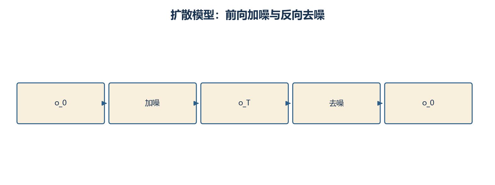

## 14.4　带数值的算例

**例 14.1（一步加噪与噪声预测）** 设单像素数据 $o_0=2.0$，取 $\alpha_t=0.9$、$\bar\alpha_t=0.81$（故 $\sqrt{\bar\alpha_t}=0.9$），采样噪声 $\epsilon=0.5$。由式 14-6：

$o_t=0.9\times2.0+\sqrt{1-0.81}\times0.5=1.8+\sqrt{0.19}\times0.5\approx1.8+0.436\times0.5=1.8+0.218=2.018$。

若网络完美预测噪声（$\epsilon_\theta(o_t,t)=0.5$），则损失 $\|\epsilon-\epsilon_\theta\|^2=0$。若网络预测为 0.3，则损失 $(0.5-0.3)^2=0.04$。训练就是让 $\epsilon_\theta$ 在各种 $o_t,t$ 上逼近真实 $\epsilon$。

**例 14.2（一步去噪 DDPM 采样）** 设 $t$ 时刻 $o_t=2.018$，$\alpha_t=0.9$，$\bar\alpha_t=0.81$，$\bar\alpha_{t-1}=0.9$（举例），网络预测 $\epsilon_\theta=0.5$（完美），采样噪声 $z\sim\mathcal{N}(0,1)$ 取 $z=0.2$。DDPM 反向一步为

$$
o_{t-1}=\frac{1}{\sqrt{\alpha_t}}\Big(o_t-\frac{1-\alpha_t}{\sqrt{1-\bar\alpha_t}}\epsilon_\theta\Big)+\sigma_t z. \tag{14-9}
$$

代入：$\frac{1-0.9}{\sqrt{0.19}}=\frac{0.1}{0.436}=0.229$；括号内 $=2.018-0.229\times0.5=2.018-0.115=1.903$；除以 $\sqrt{0.9}=0.949$ 得 $2.005$；加噪声项（$\sigma_t$ 较小，设 0.05）$0.05\times0.2=0.01$，最终 $o_{t-1}\approx2.015$。可见完美的噪声预测把带噪的 2.018 拉回到接近原始值 2.0——反复执行 $T$ 步即从纯噪声还原出清晰样本。

## 14.5　技术谱系与加速变体

**表 14-2　生成模型与扩散技术谱系**

| 方法 | 年份 | 核心思想 | 与本章关系 |
|------|------|---------|-----------|
| VAE[5] | 2014 | ELBO + 重参数化 | 第 9 章基础 |
| GAN[1] | 2014 | 对抗博弈 | 本章 14.2 |
| NCSN | 2019 | score matching + 扰动 | score 视角[3] |
| DDPM[2] | 2020 | 噪声预测去噪 | 本章 14.3 |
| DDIM[6] | 2021 | 非马尔可夫确定性采样 | 加速变体 |
| 潜在扩散（LDM） | 2022 | 在 VAE 潜在空间扩散 | 第 15 章基础 |

**加速采样。** 扩散模型的主要短板是采样慢（DDPM 常需 1000 步）。加速路线包括：① **DDIM**[6]——构造非马尔可夫反向过程，允许跳步采样（如 50 步）且样本确定可复现；② **一致性模型 / 蒸馏**——把多步去噪蒸馏成一步或几步；③ **潜在扩散**——先在 VAE 压缩的潜在空间做扩散（维度远低于像素），大幅降低每步代价，Stable Diffusion 即基于此，也是第 15 章视频扩散的基石。这些加速技术是直接可迁移到视频生成的（第 15、38 章）。

### 14.5A　条件生成与无分类器引导

无条件扩散学的是 $p(o)$，但世界模型与应用几乎总需要**条件生成** $p(o\mid c)$（$c$ 为文本、类别或上一帧）。训练时把条件 $c$ 拼入去噪网络的输入、并按式 (14-7) 学 $\epsilon_\theta(o_t,t,c)$ 即可。采样时的关键技巧是**无分类器引导（classifier-free guidance, CFG）**[11]：训练阶段同时学习有条件 $\epsilon_\theta(o_t,t,c)$ 与无条件 $\epsilon_\theta(o_t,t,\varnothing)$（以固定概率丢弃 $c$），采样时外推二者之差：

$$
\tilde\epsilon_\theta(o_t,t,c)=\epsilon_\theta(o_t,t,\varnothing)+w\big[\epsilon_\theta(o_t,t,c)-\epsilon_\theta(o_t,t,\varnothing)\big], \tag{14-10}
$$

其中 $w>1$ 为引导强度。$w=1$ 退化为普通条件采样；$w$ 越大，生成越贴合条件 $c$（似然 $\propto p(o\mid c)^w p(o)^{1-w}$ 的隐式效应），但多样性下降、易过饱和。这是第 16 章在图像域的同一机制——CFG 把"贴合条件"与"保持多样性"变成一个可调旋钮，是 Sora 类模型文本可控性的来源，也是把动作作为条件 $c$（第 17 章）的自然入口。

### 14.5B　潜在扩散：把去噪搬到压缩空间

加速路线中"潜在扩散"[7] 对视频世界模型（第 15—16 章）尤其关键：像素空间维度随分辨率平方增长，直接在像素上去噪代价过高。LDM 先用一个 VAE 编码器把图像压到低维潜在 $z=\mathcal E_\psi(o_0)$（解码器 $\mathcal D_\psi$ 重建），再在潜在空间跑扩散。设压缩因子为 $k$（边长缩小 $k$ 倍、通道为 $c_z$），则一个 $H\times W\times3$ 的图像对应潜在 $(H/k)\times(W/k)\times c_z$，元素数比为

$$
\rho=\frac{(H/k)(W/k)c_z}{HW\cdot3}=\frac{c_z}{3k^2}. \tag{14-11}
$$

取 $k=8,\ c_z=4$，$\rho=4/192\approx0.021$，即潜在空间的去噪只需约 2.1% 的像素空间元素——这是 Stable Diffusion 与 Sora 能在有限算力下生成的算术基础。代价是潜在空间非像素、语义更抽象，解码器 $\mathcal D_\psi$ 须单独训练（常以重建 + 对抗损失联合优化）。对视频，时空 VAE 进一步沿时间维压缩（第 16 章），$\rho$ 再降一个数量级。

## 14.6　七要素覆盖分析

从七要素看，单纯的生成模型（VAE/GAN/扩散）主要覆盖 **E3（观测生成）**——它们学习 $p(o)$，能合成逼真的观测。它们一般不具备显式的状态表示（E1）、转移（E2）、动作条件化（E5）与规划（E7），除非被嵌入到世界模型框架中（如 Dreamer 的解码器用 VAE 式重建，第 12 章）。

**表 14-3　生成模型在世界模型中的要素定位**

| 要素 | 生成模型覆盖 | 说明 |
|------|-------------|------|
| E3 观测生成 | 强 | 三类模型的核心能力 |
| E1 状态表示 | 部分 | VAE 有潜在，GAN/扩散无显式状态 |
| E2 状态转移 | 弱 | 视频扩散中有隐式动力学（第 15 章） |
| E5/E6/E7 | 无/弱 | 需额外条件化与决策机制 |

这一定位很重要：**能生成逼真像素，不等于有完整的世界模型**。第 15—16 章将看到，视频扩散模型虽在 E3 上极强、E2 上隐式具备，却在 E5（动作条件化）与 E7（规划）上薄弱——这正是「视频生成器是否是世界模型」争论的根源。

## 14.7　边界与讨论

三类生成模型各有优势：VAE 稳定但模糊，GAN 锐利但难训，扩散高质量且稳定但采样慢。扩散凭质量与稳定性成为视频世界模型的主流（第 15—16 章）。但必须强调：它们建模的是观测分布 $p(o)$，数学上不保证底层动力学正确、不保证物理约束成立。一个扩散模型可以生成「看起来对」的画面，却悄悄违反重力、物体持久性等物理规律——这是第 16 章「世界模拟器之争」与第 29 章「幻觉」的核心。生成保真度 ≠ 世界理解。这些辨析衔接第 9、15—18、29 章。

## 本章小结

本章建立生成模型的统一基础。

我们首先给出统一视角与三类方法对照（表 14-1），14.1A 节补全 VAE 的 ELBO 推导（式 14-1）与重参数化、例 14.3 用数值展示后验的信息预算；随后推导 GAN 的极小极大目标（式 14-2）与最优判别器（式 14-3），14.2A 节给出从 WGAN 的 OT 度量（式 14-4）到 StyleGAN 的改进谱系。重点转向扩散模型：前向加噪（式 14-5）与闭式采样（式 14-6）、反向去噪与噪声预测目标（式 14-7）、score matching 等价性（式 14-8），并通过一步加噪/去噪的数值算例（例 14.1、14.2）展示其机制。我们梳理了从 VAE、GAN 到 DDPM、DDIM、潜在扩散的技术谱系（表 14-2），14.5A 节补充无分类器引导（式 14-10）这一条件生成核心机制、14.5B 节给出潜在扩散的压缩比公式（式 14-11），用七要素框架定位生成模型（表 14-3），强调生成保真度不等于世界理解。

我们还明确边界：扩散建模 $p(o)$ 而非动力学，不保证物理一致。这些辨析衔接第 9、15—18、29 章。

下一章把扩散扩展到时间维度，介绍视频预测与视频生成。

**进一步阅读**　本章建议延伸阅读的文献：[2]、[3]、[6]、[11]。

## 参考文献

[1] Goodfellow I, Pouget-Abadie J, Mirza M, et al. Generative adversarial nets. *NeurIPS*, 2014.

[2] Ho J, Jain A, Abbeel P. Denoising diffusion probabilistic models. *NeurIPS*, 2020.

[3] Song Y, Ermon S. Generative modeling by estimating gradients of the data distribution. *NeurIPS*, 2019.

[4] Song Y, Sohl-Dickstein J, Kingma D P, et al. Score-based generative modeling through stochastic differential equations. *ICLR*, 2021.

[5] Kingma D P, Welling M. Auto-encoding variational Bayes. *ICLR*, 2014.

[6] Song J, Meng C, Ermon S. Denoising diffusion implicit models. *ICLR*, 2021.

[7] Rombach R, Blattmann A, Lorenz D, et al. High-resolution image synthesis with latent diffusion models. *CVPR*, 2022.

[8] Dhariwal P, Nichol A. Diffusion models beat GANs on image synthesis. *NeurIPS*, 2021.

[9] Arjovsky M, Chintala S, Bottou L. Wasserstein generative adversarial networks. *ICML*, 2017.

[10] Karras T, Aittala M, Laine S, et al. Analyzing and improving the image quality of StyleGAN. *CVPR*, 2020.

[11] Ho J, Salimans T. Classifier-free diffusion guidance. *NeurIPS Workshop on Deep Generative Models and Downstream Applications*, 2022.

---

# 第 15 章　视频预测与视频生成

第 14 章建立了扩散模型基础。本章把它扩展到时间维度：**视频预测**（给定历史帧预测未来帧）与**视频生成**（给定文本生成视频）。视频是世界的动态观测序列——它不只是「一张图」，而是物体如何运动、场景如何变化的记录。因此视频模型天然具有世界模型的某些属性：要生成连贯视频，模型必须学到物体持久性、运动连续性与基本的场景动力学。Sora 类模型（第 16 章）正是这一路线的巅峰。

本章先分析视频生成的两大挑战——时间一致性与计算成本（15.1 节），再介绍视频扩散模型的架构与时空建模（15.2 节），用数值算例展示时空 patch 与预测流程（15.3 节），梳理技术谱系（15.4 节），用七要素框架审视视频模型的定位（15.5 节），最后讨论物理一致性局限并收束（15.6 节）。

## 15.1　动机：视频生成的挑战

把图像扩散（第 14 章）直接搬到视频，面临两个根本挑战。

**挑战一：时间一致性。** 相邻帧必须连贯——物体外形稳定、运动平滑、光照一致、背景不闪烁。若把视频当作相互独立的图像逐帧生成，结果会剧烈抖动（flicker）：同一辆车在相邻帧颜色突变、轮廓跳动。视频模型必须在**空间与时间两个维度联合建模**，让生成过程「记得」上一帧的内容。

**挑战二：计算成本。** 视频张量 $x\in\mathbb{R}^{T\times H\times W\times C}$ 的维度是图像的 $T$ 倍（$T$ 为帧数）。一段 16 帧、$256\times256$ 的视频约有 300 万个元素；直接在像素空间做扩散，每步去噪都要处理这个量级，代价巨大。解决之道是**潜在扩散**（第 14 章）：先用 VAE 把每帧（或时空块）压缩到低维潜在，再在潜在空间做扩散——Stable Video Diffusion 等主流方法皆基于此。

**直觉解释。** 把视频想象成一本翻页动画。时间一致性要求「每一页的角色不能突然换脸」；计算成本要求「不能逐像素手绘每一页」。解决方案：用压缩的「关键草图」（潜在）代表每页，草图之间用时间注意力保持连贯，最后统一「上色渲染」回像素。

## 15.2　视频扩散模型与时空建模

**定义 15.1（时空扩散）** 对视频张量 $x\in\mathbb{R}^{T\times H\times W\times C}$，前向过程在时间维与空间维同时加噪（通常各帧独立加噪），反向用**时空去噪网络** $\epsilon_\theta(x_t,t)$ 预测噪声。训练目标与式 14-5 同形：

$$
\mathcal{L}=\mathbb{E}_{t,x_0,\epsilon}\Big[\big\|\epsilon-\epsilon_\theta(x_t,t)\big\|^2\Big], \tag{15-1}
$$

区别在于网络架构必须含时间建模能力。

**时空架构的演进。** ① **时间层注入**：在预训练图像扩散的 UNet 中插入时间注意力（temporal attention）与时序卷积层，让不同帧的信息交互（Video Diffusion Models[1]）；② **因式分解注意力**：把全时空注意力分解为「空间注意力 + 时间注意力」，降低计算复杂度；③ **潜在视频扩散**：在 VAE 压缩的潜在空间做上述操作，代表工作有 Imagen Video、Stable Video Diffusion[3]、Align-your-Latents；④ **Transformer 化**：用时空 Transformer 替代 UNet（第 16 章 Sora 的 DiT）。

**时间一致性的机制。** 时间注意力让第 $\tau$ 帧的每个 patch 能「看到」其他帧对应位置的内容，从而保持物体外观跨帧稳定；时序卷积则平滑运动轨迹。但没有显式记忆机制时，长视频的远端帧仍可能漂移——这是第 33 章长期一致性问题的视觉版本。视频扩散模型常通过**条件帧**（给定的历史帧）来锚定生成，确保与已知内容连贯。

**因式分解注意力的计算量分析。** 设视频被切成 $N$ 个时空 token（$N=T\cdot\frac{H}{p}\cdot\frac{W}{p}$，$p$ 为 patch 大小），全时空自注意力的计算复杂度为 $\mathcal{O}(N^2)$。以 $T=16$、$H=W=256$、$p=16$ 为例，每帧 $16\times16=256$ 个 patch，总 $N=16\times256=4096$，则单头注意力相似度矩阵有 $4096^2\approx1.7\times10^7$ 个元素——虽可观但仍可处理；若升到 $T=64$、$p=8$，则 $N=64\times1024=65536$，$N^2$ 高达 $4.3\times10^9$，不可承受。因此视频扩散普遍采用**因式分解注意力**：先在各帧内做空间注意力（$T$ 个 $N_f\times N_f$ 的小矩阵，$N_f$ 为每帧 patch 数），再跨帧做时间注意力（对每个空间位置一个 $T\times T$ 矩阵），把复杂度从 $\mathcal{O}((T N_f)^2)$ 降到 $\mathcal{O}(T N_f^2+N_f T^2)$。以 $T=64,N_f=1024$ 计，从 $4.3\times10^9$ 降至约 $6.7\times10^7+6.7\times10^7\approx1.3\times10^8$，降低约 30 倍——这是时空架构可扩展的关键。

**表 15-3　时间一致性机制对照**

| 机制 | 作用 | 代价 |
|------|------|------|
| 时间注意力 | 跨帧信息交互、外观连贯 | $N_f T^2$ 计算与显存 |
| 时序卷积 | 平滑短程运动 | 长程依赖弱 |
| 条件帧锚定 | 锁定已知内容、防漂移 | 需给定历史帧 |
| 光流/运动先验 | 显式约束运动连续 | 需估计光流 |

> 【图 15-1　视频扩散的时空建模】（原图见 figures/图15-1.png）：时空 patch 化 + 时间注意力 + 潜在扩散的视频生成架构，标注空间层与时间层的交替。
>
> 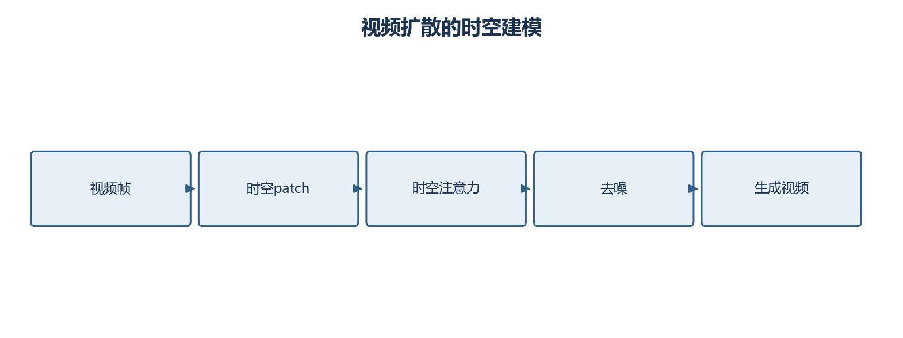

### 15.2A　条件注入：文本交叉注意力与无分类器引导

视频扩散的"文生视频"能力来自把文本条件 $c$ 注入去噪网络。主流做法是**交叉注意力**：在时空 Transformer 的每个块中，视频 patch token 作 query，文本 token 的嵌入作 key/value，使每个时空位置的潜在特征都能"读取"文本语义，从而在去噪过程中被文本引导。文本嵌入本身由一个冻结的预训练文本编码器（如 CLIP 文本塔）给出。

为使生成更贴合文本，采样时沿用第 14 章的无分类器引导（式 14-10），在视频域写作

$$
\epsilon_\theta^{\mathrm{vid}}(x_t,t,c)=\epsilon_\theta(x_t,t,\varnothing)+w\big[\epsilon_\theta(x_t,t,c)-\epsilon_\theta(x_t,t,\varnothing)\big], \tag{15-2}
$$

训练时以约 10% 概率把 $c$ 替换为空串 $\varnothing$ 以兼学无条件分支。**数值直觉**：取 $w=7.5$（文生视频的常用值），若某 patch 位置在"有条件"分支预测的运动噪声比"无条件"分支大 $0.3$，则式 (15-2) 把该方向的引导量放大为 $7.5\times0.3=2.25$，强烈地把这一区域拉向文本描述的运动；$w$ 过大（如 $w=20$）时，所有 patch 都被同一文本语义"压平"，不同物体趋向雷同运动、多样性坍塌。条件注入的机制（交叉注意力 + CFG）使第 15 章的"生成"与第 16 章 Sora 的"可控生成"共用同一套条件接口——差别只在于条件 $c$ 是文本还是"文本+相机+动作"的复合体。

## 15.3　视频预测与带数值的算例

**视频预测 vs 视频生成。** 视频**预测**以历史帧为条件（给定 $o_{1:K}$ 预测 $o_{K+1:T}$），本质是条件生成；视频**生成**通常以文本为条件（text-to-video）。二者共享时空扩散架构，区别只在条件如何注入——预测把历史帧拼入输入，生成用交叉注意力注入文本嵌入。

**定义 15.2（视频预测的条件扩散）** 给定历史帧 $x_{1:K}$，预测未来帧 $x_{K+1:T}$ 的条件扩散目标为

$$
\mathcal{L}=\mathbb{E}_{t,\epsilon}\Big[\big\|\epsilon-\epsilon_\theta\big([x_{1:K},x_{K+1:T}^{(t)}],t\big)\big\|^2\Big], \tag{15-3}
$$

其中未来帧被加噪，历史帧作为干净条件保留。

**例 15.1（视频预测的数值示例）** 设给定倒立摆的前 $K=10$ 帧，预测后 $H=20$ 帧。先把每帧 $64\times64\times3$ 经 VAE 压成 $8\times8\times4=256$ 维潜在；视频张量形状从 $30\times64\times64\times3$（约 36 万维）降到 $30\times256$（7680 维），压缩约 47 倍。扩散在 7680 维潜在空间进行，时间注意力窗口取 8 帧。训练时随机遮盖未来 20 帧的部分潜在并加噪，网络学习在历史帧条件下预测噪声；采样时从纯噪声出发、以历史帧为锚，迭代去噪生成 20 帧潜在，再经 VAE 解码成像素。理想结果：摆杆连续摆动、光照不变、背景稳定——这要求模型隐式学到「倒立摆动力学」的视觉表征（E2 的隐式版本）。

**例 15.2（时间一致性的量化）** 衡量时间一致性常用「帧间光流连贯性」：对生成视频相邻帧计算光流 $F_{\tau}$，一致性损失可取 $\sum_\tau\|F_\tau-\hat F_\tau\|$，其中 $\hat F$ 是平滑预期。若模型逐帧独立生成，该值会很高（闪烁）；加入时间注意力后显著下降。这说明时间一致性不是「看起来像」的主观感受，而是可量化的结构约束。

### 15.3A　时空 VAE 的压缩与潜变量形状

15.2 节说"用压缩的关键草图代表每页"，这里把这套压缩形式化。设时空 VAE 编码器沿时间、高、宽三个方向分别以步长 $s_t,s_h,s_w$ 做下采样、输出通道数 $c_z$，则一段 $T\times H\times W\times C$ 的视频张量被压成潜变量

$$
z\in\mathbb{R}^{\frac{T}{s_t}\times\frac{H}{s_h}\times\frac{W}{s_w}\times c_z},\qquad
\rho=\frac{c_z}{C\cdot s_t\,s_h\,s_w}, \tag{15-4}
$$

其中 $\rho$ 是**潜空间元素数与像素元素数之比**——去噪网络实际处理的"工作量"即按 $\rho$ 缩小。

**例 15.3（时空 VAE 压缩的数值）** 取 $T=16$ 帧、$H=W=256$、$C=3$ 的视频，设 $s_t=4,\ s_h=s_w=8,\ c_z=4$。潜变量形状为 $(16/4)\times(256/8)\times(256/8)\times4=4\times32\times32\times4$，元素数 $=4\times32\times32\times4=16384$；像素元素数 $=16\times256\times256\times3=3145728$。压缩比 $\rho=16384/3145728\approx0.0052$，即潜空间只有像素空间的约 0.52%——若再切成 patch（$p_h=p_w=2$、$p_t=1$），token 数 $N=(4/1)\times(32/2)\times(32/2)=4\times16\times16=1024$。扩散在 1024 个 token 上做去噪，而非在 314 万个像素上：每步去噪的张量大小缩小了两个数量级以上，这正是 16 帧视频能在单卡上迭代的算术前提。对照式 15-1，去噪网络 $\epsilon_\theta$ 的输入从 $3145728$ 维降到 $1024\times d_{\mathrm{tok}}$ 维（$d_{\mathrm{tok}}$ 为每个 token 的通道数），注意力矩阵从 $O(3145728^2)$ 降到 $O(1024^2)$——时间一致性与计算成本两大挑战，靠这层时空压缩与 token 化被同时缓解。

## 15.4　技术谱系与变体

**表 15-1　视频生成模型谱系**

| 方法 | 年份 | 架构 | 条件 | 特点 |
|------|------|------|------|------|
| Video Diffusion Models[1] | 2022 | 时空 UNet | 文本/无 | 时间层注入图像扩散 |
| Make-A-Video[2] | 2023 | 潜在扩散 | 文本 | 无需视频-文本配对数据 |
| Imagen Video | 2022 | 级联扩散 | 文本 | 高分辨率、多级级联 |
| Stable Video Diffusion[3] | 2023 | 潜在扩散 | 图像 | 图像到视频 |
| Sora（第 16 章） | 2024 | 时空 DiT | 文本 | 时空 patch + Transformer |

**关键变体。** ① **级联超分**：先生成低分辨率视频，再逐级超分到高分辨率（Imagen Video）；② **无配对学习**：Make-A-Video 仅用文本-图像数据与无标注视频，通过文本-图像先验 + 视频运动建模实现文生视频，缓解视频-文本配对数据稀缺；③ **图像到视频（I2V）**：以单张图像为条件生成其后续运动，近年工业界主流；④ **长视频生成**：通过滑动窗口、记忆机制或分层规划扩展到分钟级（第 16、33 章）。

### 15.4A　长视频生成：自回归滚动与 token 预算

单次扩散只能生成固定时长（如 16 帧）。要生成分钟级长视频，主流做法是**自回归滚动**：以最近 $K$ 帧为条件生成下一段 $H$ 帧，把前一段的输出接回条件继续滚动。其目标可写成

$$
\mathcal{L}=\mathbb{E}_{t,\epsilon}\Big[\big\|\epsilon-\epsilon_\theta\big([x_{\tau-K:\tau},\,x_{\tau+1:\tau+H}^{(t)}],\,t\big)\big\|^2\Big], \tag{15-5}
$$

其中 $\tau$ 是当前滚动位置、$[x_{\tau-K:\tau},x_{\tau+1:\tau+H}^{(t)}]$ 是"最近 $K$ 帧（干净条件）+ 待生成的 $H$ 帧（加噪）"。每滚动一次，条件窗口前移 $H$ 帧，逐步铺出整段视频。

**例 15.4（长视频的 token 预算与漂移）** 设单段生成 $H=16$ 帧、条件 $K=4$ 帧，目标总长 $T=64$ 帧，则需滚动 $64/16=4$ 段。沿用 15.3A 的时空 VAE（每段 1024 个 token），每段去噪 50 步，则全片总去噪前向 $=4\times50=200$ 次、每次处理约 1024 个 token。关键问题在**漂移**：第 2 段起的条件 $x_{\tau-K:\tau}$ 已是模型自己生成的（带误差），误差逐段累积——第 4 段的条件误差是前三段误差的复合，远端帧的物体身份、光照、布局会慢慢偏离（第 33 章长期一致性的量化版本）。缓解手段有三：① **记忆 token**——把更早帧的压缩潜变量缓存为长期记忆，供跨段注意力检索；② **分层生成**——先生成低帧率的"骨架"再补帧，降低累积步数；③ **闭环训练**——训练时就用模型自身的生成帧作条件（而非真实帧），缩小"训练用真实帧、推理用生成帧"的分布差。这一自回归滚动的 token 序列结构，与第 17 章自回归世界模型的"逐 token 预测"同源——视频扩散的长视频生成，本质上是把扩散嵌进了自回归的时间框架。

## 15.5　七要素覆盖分析

从七要素看视频模型（表 15-2）：它在 **E3（观测生成）** 上极强——这是看家本领；在 **E2（状态转移）** 上隐式具备——从海量帧序列学到了「物体如何运动」的统计规律；但在 **E1（显式状态表示）**、**E5（动作条件化）**、**E7（规划）** 上薄弱——它不显式维护状态、通常不接收动作、更不直接输出决策。除非显式以动作为条件（第 23 章交互世界模型、第 27 章可探索世界），视频模型难以回答「如果我这样做，世界会怎样」这类反事实问题。

**表 15-2　视频模型的七要素覆盖**

| 要素 | 覆盖 | 说明 |
|------|------|------|
| E1 状态表示 | 弱/隐式 | 潜在特征，非显式、非结构化状态 |
| E2 状态转移 | 隐式 | 从帧序列学运动统计规律 |
| E3 观测生成 | 强 | 核心能力，逼真帧合成 |
| E4 不确定性 | 中 | 采样随机性，但缺显式概率建模 |
| E5 动作条件化 | 弱/无 | 除非显式以动作/交互为条件 |
| E6 奖励 | 无 | 不建模任务奖励 |
| E7 规划 | 无 | 不直接输出决策 |

这一定位揭示了「视频模型」与「世界模型」的差别：前者是强大的 $p(\text{像素序列})$ 建模器，后者还需状态、可控性与决策。第 16 章将看到，Sora 的「世界模拟器」宣称正是试图跨越这条界线，但争议也随之而来。

进一步说，视频模型的「隐式动力学」（E2）与第 11—12 章 RSSM 的「显式动力学」有本质区别。RSSM 的转移 $p(z_{t+1}\mid z_t,a_t)$ 以动作 $a_t$ 为条件、可在无观测时滚动，是真正可用于规划的结构化模型；视频扩散学到的「运动规律」只是像素序列的条件分布 $p(x_{t+1}\mid x_{\le t})$，它刻画的是「通常接下来会看到什么」，而非「在特定干预下会发生什么」。二者的差别，正是第 1.7 节命题与第 34 章因果讨论的核心：相关性的模仿不等于因果的掌控。若要让视频模型具备可干预性，必须在架构中显式引入动作 token 或控制条件（第 23、27 章的交互/可探索世界模型），把 $p(x_{t+1}\mid x_{\le t})$ 升级为 $p(x_{t+1}\mid x_{\le t},a_t)$。这一步跨越，是从「视频生成器」走向「世界模型」的关键门槛。

## 15.6　边界与讨论

视频模型能生成逼真动态，但物理一致性仍不可靠：物体穿模、凭空消失、违反重力、因果关系错乱。其根源在于：视频扩散学的是像素序列的统计规律（M2），而非因果的动力学模型（M4）——它能模仿「看起来像重力」的画面，却不真正理解重力。当场景偏离训练分布时，这些错误暴露无遗（第 29 章幻觉）。此外，长视频的远端帧会因缺乏显式状态而逐渐漂移（第 33 章）。

值得强调的是：这些局限不是对视频生成价值的否定。视频模型在内容创作、数据增强、仿真预训练等方面已有巨大应用；问题在于**把它当作世界模型使用时必须审慎**。这些辨析衔接第 14、16、17、29、33 章。

### 15.6A　视频质量评估：FVD 指标

比较"生成的视频像不像真的视频"，需要可量化指标。图像域用 FID（Fréchet Inception Distance），视频域的标准指标是 **FVD（Fréchet Video Distance）**[12]。它先用 I3D 网络把每段视频映射为特征向量 $\boldsymbol\mu$，再在特征空间计算两批视频（生成 vs 真实）的高斯 Fréchet 距离：

$$
\mathrm{FVD}=\big\|\boldsymbol\mu_g-\boldsymbol\mu_r\big\|_2^2+\mathrm{Tr}\big(\boldsymbol\Sigma_g+\boldsymbol\Sigma_r-2(\boldsymbol\Sigma_g\boldsymbol\Sigma_r)^{1/2}\big), \tag{15-6}
$$

其中 $\boldsymbol\mu_g,\boldsymbol\Sigma_g$ 为生成视频特征分布的均值与协方差，$\boldsymbol\mu_r,\boldsymbol\Sigma_r$ 为真实视频。FVD 越低，生成视频在 I3D 语义空间越接近真实分布——它同时度量了**时间运动**（I3D 对运动敏感）与**外观**的分布差异。

**例 15.5（FVD 的数值计算）** 设 I3D 特征维 $d=2048$，取 $N=50$ 段视频（每段 16 帧）。实测生成视频特征分布 $\boldsymbol\mu_g$、$\boldsymbol\Sigma_g$ 与真实 $\boldsymbol\mu_r$、$\boldsymbol\Sigma_r$，算得 $\|\boldsymbol\mu_g-\boldsymbol\mu_r\|_2=7.75$、$\mathrm{Tr}(\boldsymbol\Sigma_g+\boldsymbol\Sigma_r-2(\boldsymbol\Sigma_g\boldsymbol\Sigma_r)^{1/2})\approx2.3$，则 $\mathrm{FVD}\approx7.75^2+2.3\approx60.1+2.3\approx62.4$。两项中均值差占大头（$\approx60.1$），说明生成视频在 I3D 语义空间整体偏移了约 60 个单位——这通常对应运动统计（如物体运动速度、朝向分布）的偏差，而非单帧外观问题。作为量级参照，公开基准上强模型的 FVD 多在几十范围；若某模型 FVD 达数千，则意味着生成的运动分布与真实相去甚远。**FVD 的局限**须与第 15.6 节呼应：它度量"像不像"（分布相似性），而非"对不对"（物理/因果正确性）——一个 FVD 很低的视频模型仍可能生成违反重力的画面（第 16 章）。此外 I3D 特征偏重运动、对空间细节不敏感，故 FVD 宜与空间保真指标（如 FID）联用。这些指标对世界模型研究的启示是：评估"生成质量"与评估"是否理解世界"是两件事，后者不能靠 FVD 衡量。

## 本章小结

本章把扩散扩展到时间维度，介绍视频预测与视频生成。

我们首先分析时间一致性与计算成本两大挑战（15.1 节），给出时空扩散定义（式 15-1），15.2A 节引入文本交叉注意力与无分类器引导（式 15-2），介绍时间注意力、因式分解注意力与潜在视频扩散等架构（15.2 节）。随后给出条件视频预测目标（式 15-3），用视频预测的压缩比算例与光流一致性算例说明机制（15.3 节），15.3A 节给出时空 VAE 压缩的潜变量形状与压缩比公式（式 15-4）、例 15.3 算出 16 帧 256×256 视频压到 1024 个 token 的具体数值，15.4A 节推导长视频自回归滚动的目标（式 15-5）并用例 15.4 说明 token 预算与逐段漂移。我们梳理从 Video Diffusion Models 到 Sora 的技术谱系（表 15-1），用七要素框架定位视频模型（表 15-2）——E3 强、E2 隐式、E5/E7 弱，并在 15.6A 节引入 FVD 等评估指标（式 15-6）。

我们还明确边界：物理一致性不可靠、长视频漂移，根源是统计模仿而非因果理解。这些辨析衔接第 14、16、17、29、33 章。

下一章剖析 Sora 类模型的架构思想、涌现能力，以及「视频生成器是否是世界模型」的争论。

**进一步阅读**　本章建议延伸阅读的文献：[1]、[3]、[4]。

## 参考文献

[1] Ho J, Salimans T, Gritsenko A, et al. Video diffusion models. *NeurIPS*, 2022.

[2] Singer U, Polyak A, Hayes T, et al. Make-A-Video: Text-to-video generation without text-video data. *ICLR*, 2023.

[3] Blattmann A, Rombach R, Ling H, et al. Align your latents: High-resolution video synthesis with latent diffusion models. *CVPR*, 2023.

[4] Harvey W, Naderi A, Whang J, et al. Flexible diffusion modeling of long videos. *NeurIPS*, 2022.

[5] Yang Z, Teng Z, Zhang L, et al. Video expectation maximization via latent spacetime diffusion. *ICCV*, 2023.

[6] Gupta A, Dollar P, Girshick R. Long video generation with time-agnostic VQGAN and time-sensitive transformer. *ECCV*, 2022.

[7] Rombach R, Blattmann A, Lorenz D, et al. High-resolution image synthesis with latent diffusion models. *CVPR*, 2022.

[8] Wang J, Yuan Z, Zhang Y, et al. Model scope: A video generation and editing platform. *arXiv:2401.12929*, 2024.

[12] Unterthiner T, van Steenkiste S, Kurach K, et al. Towards accurate generative models of video: A new metric & challenges. *arXiv:1812.01717*, 2018.

---

# 第 16 章　Sora 类视频生成模型

第 15 章的视频扩散模型在 2024 年达到新高度：OpenAI 的 Sora[1] 能生成长达一分钟、物理相当连贯的视频，并明确以「世界模拟器」（world simulator）为愿景。本章剖析 Sora 类模型的架构思想、涌现的物理一致性，以及「视频生成器是否是世界模型」的争论——这直接关联第 1.3 节的混淆命题「生成视频不等于理解物理」，也是全书对「生成 vs 理解」这一核心张力最集中的一次交锋。

本章先介绍时空 patch 与扩散 Transformer 架构（16.1 节），再分析涌现的物理一致性与反事实检验（16.2 节），然后展开世界模拟器之争（16.3 节），梳理技术谱系与变体（16.4 节），用七要素框架审视定位（16.5 节），最后讨论边界并收束（16.6 节）。

## 16.1　动机与架构：时空 patch 与 DiT

Sora 的核心架构选择是把视频**token 化**，从而复用 Transformer 的可扩展性。

**定义 16.1（时空 patch）** Sora 把视频压缩为时空 patch（spacetime patches）：类似 ViT 把图像切为二维 patch，视频在时间与空间维度同时切块——先用一个时空 VAE 把视频压缩到低维潜在，再把潜在张量切成 $T'\times H'\times W'$ 个 patch，每个 patch 展平为一个 token。Transformer 在这些 token 上做去噪扩散（Diffusion Transformer, DiT[2]）。

形式化地，若压缩后潜在为 $z\in\mathbb{R}^{t\times h\times w\times c}$，patch 大小为 $(p_t,p_h,p_w)$，则 token 数 $N=\frac{t}{p_t}\cdot\frac{h}{p_h}\cdot\frac{w}{p_w}$，每个 token 维度为 $p_t p_h p_w c$。去噪网络 $\epsilon_\theta(z_\tau,\tau)$ 是一个在这些 token 上操作的 Transformer，训练目标仍是噪声预测（式 14-5）。

**优势。** ① **统一表示**：不同分辨率、时长、宽高比的视频都转成可变数量的 patch token，可用同一套架构处理（类似语言模型处理变长序列）；② **可扩展性**：Transformer 的规模化经验（参数、数据、算力）可直接迁移，这是 Sora 能「scale up」的工程基础；③ **长程依赖**：时空注意力让任意两个 patch 直接交互，能建模远距离的空间与时间关系。

**DiT 的优势（相对 UNet）。** 第 15 章的视频扩散多用 UNet；Sora 改用 Transformer，好处是扩展规律更清晰——模型容量增大时性能可预测地提升，且能更自然地融合文本等多模态条件（通过交叉注意力注入文本 token）。自 DiT 以来，图像与视频生成的骨干网络普遍从 UNet 转向 Transformer。

> 【图 16-1　Sora 类模型的时空 patch】（原图见 figures/图16-1.png）：视频→时空 VAE 压缩→时空 patch→DiT 去噪→解码生成视频的流程，标注可变 token 数。
>
> 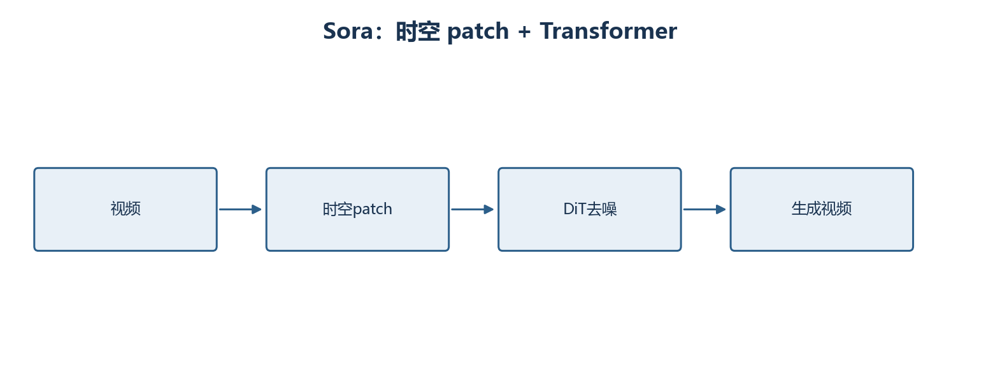

### 16.1A　DiT 的 token 化与缩放算术

定义 16.1 的 token 数公式 $N=\frac{t}{p_t}\cdot\frac{h}{p_h}\cdot\frac{w}{p_w}$ 决定了 DiT 的去噪成本。设时空 VAE 压缩后潜变量为 $z\in\mathbb{R}^{t\times h\times w\times c}$，patch 为 $(p_t,p_h,p_w)$，则每步去噪需对 $N$ 个 token 做自注意力，复杂度 $\mathcal O(N^2 d)$（$d$ 为隐维），而全片生成需 $K$ 步去噪、共 $K$ 次前向。

**例 16.3（Sora 类模型的 token 预算）** 取一段 $T=128$ 帧、$H=W=480$ 的视频，设时空 VAE 沿时间压缩 $s_t=4$、空间 $s_h=s_w=8$，得潜变量 $t=128/4=32$、$h=w=480/8=60$、$c=16$。取 patch $(p_t,p_h,p_w)=(2,2,2)$，则 token 数 $N=(32/2)\times(60/2)\times(60/2)=16\times30\times30=14400$。若隐维 $d=1152$（对应约 80 亿参数的 DiT 量级）、去噪 $K=50$ 步，则每步注意力矩阵含 $N^2\approx2.07\times10^8$ 个相似度元素、每步前向的 FLOPs 量级约为 $2dN^2\approx2\times1152\times2.07\times10^8\approx4.8\times10^{11}$，全片 $K$ 步即约 $2.4\times10^{13}$ FLOPs/视频。这个量级解释了 Sora 类模型为何必须用大规模集群训练、且单条生成也需数秒到数十秒——它与第 15 章 15.3A 的"16 帧压到 1024 token"形成对照：帧数从 16 增到 128、分辨率从 256 增到 480，token 数从 1024 涨到 14400（约 14 倍），而注意力成本随 token 数**平方**增长（约 200 倍）。这正是"时空 patch + DiT"可扩展性的算术核心：token 化把"变长、变分辨率"的视频统一为"变 token 数的序列"，让 Transformer 的规模化经验（参数、数据、算力的幂律）可以直接迁移。缩放规律还可写成：固定单 token 成本，全片生成成本 $\propto K\cdot N^2\cdot d$；要生成更长/更高分辨率的视频，要么增大 $N$（成本平方上升），要么增大 $K$（线性上升），要么用第 14 章的蒸馏/一致性模型压缩 $K$——三条路分别对应"更细的时空分辨率""更多的去噪迭代""更少的采样步数"。

## 16.2　涌现的物理一致性与反事实检验

Sora 展示了令人惊讶的能力：物体运动符合惯性、光影连贯、镜头切换合理、遮挡关系正确。这被称为「涌现的物理常识」——模型从海量视频中学到了世界的统计规律（M2），足以生成物理上「看起来合理」的内容。

**为什么会涌现？** 视频数据本身包含丰富的物理约束：物体不会凭空消失（持久性）、运动轨迹连续（惯性）、光照随环境一致。当一个模型被要求以极高保真度预测/生成海量视频时，它**必须**内化这些规律才能降低预测误差——否则生成的画面会违反物理而显得不真实。换言之，物理一致性是「把 $p(\text{像素序列})$ 建模得足够好」的副产品，是一种通过数据得到的统计归纳，而非显式编程的物理引擎。

**例 16.1（涌现 vs 真正理解）** Sora 生成的视频中，杯子掉落会「正确」地碎裂、水会流淌——但它是否「理解」重力（M4）？关键检验是**反事实干预**：问「若杯子是铁做的、从更高处落下会怎样？」真正的物理模型能响应这种干预并给出不同预测；视频生成器通常无法响应——它没有动作/干预接口，只能生成「训练分布里见过的」掉落场景。再如著名的反例：一个玻璃杯穿过桌面后完好无损地出现，或两个人穿过彼此——当场景偏离训练分布时，统计模仿失效，物理「幻觉」暴露。这说明 Sora 的物理是「看起来像」的模仿，而非可干预、可泛化的因果模型（第 34 章）。

**涌现的边界。** 涌现能力值得认真对待：它表明大规模生成模型确实学到了大量世界知识，对机器人预训练、仿真数据生成等有实用价值（第 36 章）。但「涌现」不等于「理解」——二者在数据分布内的表现可能难以区分，差异只在分布偏移与 interventions 下显现。这是全书反复强调的判据（第 1、29、34 章）。

**例 16.2（反事实检验的可操作判据）** 设计一个区分「统计模仿」与「因果理解」的实验：给定视频「杯子从桌边掉落并摔碎」。对统计模型，询问「若把杯子换成橡胶球会怎样」时，它只能从训练数据中检索类似「橡胶球掉落」的画面，若训练中没见过则生成不合理内容；对具备因果模型的智能体，它能基于「材料决定弹性」的干预知识预测「橡胶球会弹起而非碎裂」。更严格地，用结构因果模型（第 34 章）的语言：统计模型学到了 $p(\text{视频}\mid\text{文本})$，其中「材料」只是文本里的一个相关特征；因果模型学到的是 $p(\text{结果}\mid do(\text{材料}=\text{橡胶}))$——$do$ 算子代表主动干预。二者在观察数据上可能一致，但在干预下分道扬镳。这一判据可推广到全书对「世界模型是否理解世界」的检验：真理解必须能回答反事实与干预问题。

**规模化的定量直觉。** Sora 类模型的涌现与规模密切相关。设模型参数量 $N$、训练视频 token 数 $D$，经验上视频生成质量随 $N$ 与 $D$ 增长而提升，且在某个规模后出现「物理合理性」的相变式改善。这背后是覆盖效应：世界中的物理情形构成一个高维流形，只有数据量与模型容量足够大，才能覆盖该流形的主要区域，使得测试分布内的生成都落在「见过的」合理模式附近。新一代模型以「视频 token 即序列」的方式把视频生成纳入语言模型的规模化范式（第 17 章），正是押注于这条规模定律。

**规模化的幂律形式。** 把上述直觉写成经验幂律：以 FVD 或人工评分的误差代理 $E$ 度量生成质量，则 $E\propto N^{-a}\,D^{-b}\,C^{-c}$，其中 $C$ 为总算力（$\approx$ 参数数 $\times$ 训练 token 数）、指数 $a,b,c$ 为正且通常满足 $b>c$（数据比算力更稀缺时数据收益更高）。这一形式与语言模型的缩放定律同构，差别只在于"token"从文字换成了时空 patch。**数值示意**：设某模型规模翻倍（$N\to2N$）时 $E$ 降到 $0.9\,E$，则 $2^{-a}=0.9$、$a=-\log 0.9/\log 2\approx0.145$；若同时把训练视频 token 数 $D$ 增到 4 倍（$D\to4D$），$E$ 再乘 $4^{-b}$，取 $b=0.22$ 则再降 $4^{-0.22}\approx0.72$ 倍。两项叠加，质量代理从 $E$ 降到 $0.9\times0.72\,E\approx0.65\,E$——即"参数翻倍 + 数据四倍"可把生成误差压到约三分之二。**相变式改善**对应幂律的拐点：当 $N\cdot D$ 跨过某个阈值，长尾物理情形（如流体、布料、多体碰撞）首次被足够覆盖，$E$ 的下降斜率突然变陡——这不是连续渐变，而是"从没见过"到"刚够覆盖"的覆盖度相变。这条幂律解释了为何 Sora 类模型必须用"海量视频 + 超大 DiT + 大算力"三者齐备：单独放大任一项，收益都被幂律压到边际递减；三者协同才能越过相变阈值，让"看起来物理合理"的生成从稀有变为默认。这也回应了 16.3 节争论的一个隐含前提——支持方认为"规模足够大时世界理解会涌现"，其数学基础正是上述幂律加覆盖效应：把 $p(\text{视频})$ 的 $N,D,C$ 推到相变阈值之上，分布内的物理一致性便作为建模精度的副产品出现。

## 16.3　世界模拟器之争

Sora 的技术报告以「视频生成模型作为世界模拟器」为题，引发了广泛争论。这场争论的实质，是「生成式世界模型」与「显式世界模型」两条路线的分歧（表 16-1 之后详述）。

**支持方。** 生成高质量视频需要隐式的世界知识——物体持久性、空间关系、因果结构、运动规律。规模足够大的视频模型可能学到可泛化的世界模型，为具身智能提供通用的「世界先验」。这一路线认为：把 $p(\text{视频})$ 建模到极致，世界理解会「自然涌现」，是通向 AGI 的一条路径。

**质疑方。** 生成视频是 $p(\text{像素})$ 的建模，不等于动力学模型 $p(s_{t+1}\mid s_t,a_t)$。具体缺失：① **无动作条件化（E5）**——视频生成器不接收「智能体做了什么」，无法回答干预后果；② **无显式状态表示（E1）**——它有的是像素分布的隐式表示，非结构化、不可查询的状态；③ **无规划能力（E7）**——不输出决策；④ **不可靠的因果性**——统计相关不等于因果（第 34 章）。LeCun 等[4] 明确主张：真正的世界模型应在**表示空间**中预测并支持规划，即 JEPA 路线（第 19—22 章），而不是生成像素。

**争论的实质。** 双方其实在回答不同问题。支持方关心「模型是否学到了世界知识」——答案是肯定的，视频生成的成功本身就是证据。质疑方关心「模型是否具备可控、可干预、可规划的世界模型功能」——现有视频生成器确实不具备。因此更准确的结论是：**Sora 类模型是世界知识的强大学习者，但尚不是完整的、可干预的世界模型**。把「能生成合理视频」直接等同于「拥有世界模型」，正是第 1.3 节警告的混淆。

**如何判定「学到了什么」：三个可操作判据。** 争论常因"世界知识""理解"等词缺乏操作性而空转。这里给出三个可检验的判据，把"学到了多少世界知识"从口号变成测量：① **分布内重构判据**——给模型一段视频的前半，问它能否高保真地补出后半（视频预测，第 15 章）；此项通过只能说明它学到了"通常接下来会看到什么"（M2 统计规律），不能说明理解动力学。② **分布外一致性判据**——给训练分布外的组合（如"红色玻璃杯从大理石桌上掉落"），看生成的物理是否仍合理；此项通过说明学到的是可泛化的物理结构而非记忆特定场景，是"世界知识"的第一道硬门槛。③ **干预响应判据**——这是区分"知识"与"因果理解"的关键：模型须具备动作接口（式 16-2），且能响应"若换成橡胶球/从更高处落下"这类干预，给出与观察分布不同、但符合因果逻辑的预测。仅通过①的模型是好的视频预测器；通过①②的学到了可泛化的世界知识；通过①②③的才接近"可干预的世界模型"。Sora 类模型稳健地通过①、部分通过②，但在③上失败（无动作接口，干预无从谈起）——这用判据精确刻画了 16.3 节的结论：它是世界知识的学习者，但不是可干预的世界模型。这套判据与第 1.3 节的混淆命题、第 34 章的因果检验一脉相承，也为第 27 章交互世界模型的"是否成功"提供了验收标准。

## 16.4　技术谱系与变体

**表 16-1　Sora 类模型与相关技术谱系**

| 方法 | 年份 | 骨干 | 条件 | 特点 |
|------|------|------|------|------|
| DiT[2] | 2023 | Transformer | 类别/文本 | 扩散骨干 Transformer 化 |
| Sora[1] | 2024 | 时空 DiT | 文本 | 时空 patch、分钟级、世界模拟器愿景 |
| Stable Diffusion 3 | 2024 | DiT/MMDiT | 文本 | 图像域 DiT 规模化 |
| Genie[5] | 2024 | 潜在动作模型 | 动作 | 可交互 2D 世界，显式动作条件 |
| GameNGen（第 17 章） | 2024 | 自回归扩散 | 动作 | 实时交互游戏世界 |

**关键变体与方向。** ① **交互化**：给视频模型加动作条件（Genie[5] 从无标注视频中隐式学习动作，第 27 章），把 $p(x_{t+1}\mid x_{\le t})$ 升级为 $p(x_{t+1}\mid x_{\le t},a_t)$；② **3D 化**：用 NeRF/3DGS 显式建模几何（第 18 章），获得可探索、多视角一致的世界；③ **长视频与记忆**：引入显式状态或记忆机制，解决长程漂移（第 33 章）；④ **物理约束注入**：把物理先验编码进架构或损失，减少物理幻觉。这些方向共同指向「从视频生成器走向可控世界模型」。

**条件注入的数学。** 文本条件通常通过交叉注意力注入：在 DiT 的每个 Transformer 块中，加入文本 token 作为 key/value，视频 patch token 作为 query，使去噪过程受文本语义引导。无分类器引导（classifier-free guidance）通过同时训练有条件与无条件模型，采样时外推

$$
\epsilon_\theta^{\mathrm{cfg}}(z_t,t,c)=\epsilon_\theta(z_t,t,\varnothing)+w\big[\epsilon_\theta(z_t,t,c)-\epsilon_\theta(z_t,t,\varnothing)\big], \tag{16-1}
$$

其中 $c$ 为文本条件、$\varnothing$ 为文本空条件、$w>1$ 为引导强度。式 16-1 放大条件信号，使生成内容更贴合文本——$w$ 越大越贴合但多样性下降。把这一机制扩展到**动作条件** $a_t$（即以动作替代或补充文本作为 $c$），就是视频模型走向交互世界模型的一条自然路径：生成过程受动作引导，从而回答「若执行动作 $a$，下一帧会怎样」。这正是 Genie、GameNGen 等工作（第 17、27 章）的核心思路。

### 16.4A　交互化：动作条件引导与实时延迟预算

把式 (16-1) 的条件 $c$ 从文本推广为"动作 $a_t$ +（可选）文本 $c$"，得到**动作条件无分类器引导**：

$$
\epsilon_\theta^{\mathrm{act}}(x_t,t,a,c)=\epsilon_\theta(x_t,t,a,\varnothing)+w\big[\epsilon_\theta(x_t,t,a,c)-\epsilon_\theta(x_t,t,a,\varnothing)\big]. \tag{16-2}
$$

交互世界模型（第 27 章）的核心正是式 (16-2)：每一步由用户/智能体的动作 $a_t$ 引导去噪，生成"执行该动作后的下一帧"。但交互场景比离线视频生成多一个硬约束——**实时延迟预算**：人眼可接受的交互刷新率约 20 FPS，即每帧生成预算 $1/20=50$ ms。

**例 16.4（交互生成的延迟预算与蒸馏）** 设一个类 DOOM 游戏，屏 $64\times64\times3$，时空 VAE 把每帧压成 $8\times8\times16$ 的潜变量（即每帧 64 个空间位置、16 通道）。自回归地以最近 $K=16$ 帧潜变量（$16\times64=1024$ 个 token）加当前动作为条件生成下一帧。若用未蒸馏的 50 步扩散，即使每步仅 $1$ ms，单帧也需 $50$ ms——刚好顶满预算、无余量且不可行（真实前向远超 1 ms）。改用蒸馏把去噪压到 $4$ 步，则单帧 $4$ 步预算为 $50/4=12.5$ ms，每步可处理 $1024+1$（动作 token）个 token；以隐维 $d=512$ 计，每步 FLOPs 约 $2dN^2\approx2\times512\times1025^2\approx1.07\times10^9$，在单卡上可压进 $12.5$ ms 量级——这正是 GameNGen 能以约 20 FPS 实时生成可交互游戏的算术基础。对照离线场景（16.1A 的 $K=50$ 步、无需实时约束），交互化被迫"砍掉"大部分去噪步（50→4），用蒸馏换取延迟，代价是单帧质量略降——这是"可控性（动作条件）"与"生成保真度（去噪步数）"之间的典型权衡，第 17 章将从范式层面重新审视这一权衡。

**表 16-3　Sora 类模型的能力与缺口**

| 维度 | 表现 | 缺口 |
|------|------|------|
| 视觉保真度 | 强 | 高分辨率细节偶有瑕疵 |
| 时间一致性 | 中—强 | 长视频远端漂移 |
| 物理合理性 | 分布内强 | 分布偏移下失效 |
| 文本可控性 | 中 | 细粒度控制难 |
| 动作可控性 | 弱/无 | 需显式动作接口 |
| 因果/反事实 | 弱 | 统计模仿非因果 |

## 16.5　七要素覆盖分析

**表 16-2　视频模型 vs 完整世界模型**

| 方面 | 视频生成模型（Sora 类） | 完整世界模型 |
|------|----------------------|-------------|
| 目标 | $p(\text{视频})$ | $p(s_{t+1}\mid s_t,a_t)$ |
| 状态表示（E1） | 隐式、非结构化 | 显式、可查询 |
| 状态转移（E2） | 隐式统计规律 | 显式、可滚动 |
| 动作条件（E5） | 通常无 | 核心 |
| 可干预性 | 弱 | 强 |
| 规划（E7） | 无 | 有 |

从七要素看，Sora 类模型在 **E3（观测生成）** 上达到巅峰、E2 隐式具备，E1 弱（隐式）、E4 中（采样随机性），E5、E6、E7 基本缺失。这再次印证第 15 章的定位：视频生成模型的强项是「生成什么」，而非「如何决策」。要成为完整世界模型，它还需补上动作条件化、显式状态与规划——这正是 Genie（加动作）、JEPA（加表示空间预测，第 20 章）等工作的努力方向。

值得注意的是，表 16-3 所列的能力与缺口呈现出一种「互补结构」：生成模型强在感知与保真，显式世界模型（RSSM、JEPA）强在状态与可控性。因此更可能的未来不是某一方取代另一方，而是二者的融合——用生成模型提供高保真的观测底座，用显式状态与规划机制提供可控性。第 17 章的自回归—扩散融合、第 27 章的交互世界模型、第 36 章的自主智能体架构，都在朝这个方向汇合。

## 16.6　边界与讨论

Sora 类模型是生成式世界模型的里程碑，但「世界模拟器」的宣称仍需审慎审视：其物理一致性是大规模数据下的统计涌现，可控性（E5）与因果性（第 34 章）明显不足。它擅长生成「训练分布内看起来合理」的内容，却在分布偏移、反事实干预、长程一致性上脆弱（第 29、33 章）。

同时应避免另一极端：不能因其不是「完整世界模型」就低估其价值。作为世界知识的庞大载体与高保真仿真器，它在内容生成、机器人策略预训练、合成数据等方面意义重大（第 36 章）。更建设性的态度是：把 Sora 类模型视作「世界模型的感知/生成底座」，在其上叠加动作条件、显式状态与规划机制，逐步逼近可控的世界模型。这些辨析衔接第 15、17、19—23、29、33、40 章。

## 本章小结

本章剖析 Sora 类视频生成模型及其引发的世界模拟器之争。

我们首先介绍其架构——时空 patch 与扩散 Transformer（定义 16.1），16.1A 节给出 token 预算与缩放算术（例 16.3 算出 128 帧 480×480 视频约 14400 个 token、全片约 $2.4\times10^{13}$ FLOPs）。接着讨论涌现的物理一致性，16.2 节补上规模化的幂律形式与覆盖相变的数值示意，并用反事实检验（例 16.1、16.2）论证「统计模仿 ≠ 因果理解」。随后展开世界模拟器之争，给出更准确的结论：Sora 是世界知识的强大学习者，但尚非可干预的完整世界模型（16.3 节）。我们梳理技术谱系（表 16-1），16.4A 节推导动作条件引导（式 16-2）并以例 16.4 给出 20 FPS 实时交互的延迟预算与蒸馏算术，用七要素框架对照视频模型与完整世界模型（表 16-2）。

我们还明确边界：物理一致性是统计涌现、可控性与因果性不足、长程脆弱，但同时肯定其作为「世界模型感知/生成底座」的价值。这些辨析衔接第 15、17、19—23、29、33、40 章。

下一章对照自回归与扩散两条生成范式，分析它们在动力学建模上的根本差异与融合趋势。

**进一步阅读**　本章建议延伸阅读的文献：[1]、[2]、[4]。

## 参考文献

[1] OpenAI. Video generation models as world simulators. *OpenAI Technical Report*, 2024.

[2] Peebles W, Xie S. Scalable diffusion models with transformers. *ICCV*, 2023.

[3] Brooks T, Holynski A, Afonso J W. InstructPix2Pix: Learning to follow image editing instructions. *CVPR*, 2023.

[4] LeCun Y. A path towards autonomous machine intelligence. *Open Review*, 2022.

[5] Bransby K, Yang J, Cabi S, et al. Train a generative model from unlabeled videos for visual exploration and control. *arXiv:2407.07086*, 2024.

[6] Dosovitskiy A, Beyer L, Kolesnikov A, et al. An image is worth 16x16 words: Transformers for image recognition at scale. *ICLR*, 2021.

[7] Ho J, Salimans T, Gritsenko A, et al. Video diffusion models. *NeurIPS*, 2022.

[8] Yang Z, Teng Z, Zhang L, et al. Video expectation maximization via latent spacetime diffusion. *ICCV*, 2023.

---

# 第 17 章　自回归与扩散世界模型的对照

第 14—16 章以扩散模型为主线。本章对照另一条范式：**自回归世界模型**——把世界状态/观测序列化，用自回归方式预测下一个 token（类似语言模型）。两条路线在「如何建模世界演化」上有根本差异：扩散在连续（或离散化）空间并行去噪，自回归在离散 token 空间顺序预测。理解这一对照，有助于把握生成式世界模型的完整设计空间，也揭示了二者正在融合的趋势。

本章先系统对照两条范式（17.1 节），再深入分析它们在动力学建模与动作条件化上的差异（17.2 节），用数值算例展示两种生成过程（17.3 节），梳理代表工作与技术谱系（17.4 节），分析七要素覆盖（17.5 节），最后讨论融合趋势与边界并收束（17.6 节）。

## 17.1　动机与两条范式

生成式世界模型要回答同一个问题：给定一个世界状态（及可能的动作），如何生成下一个状态？两条范式给出了不同的答案。

**自回归世界模型。** 把观测/状态离散为 token 序列，自回归地建模条件分布 $p(x_{t+1}\mid x_{\le t})$：每一步基于此前所有 token 预测下一个 token。代表思路包括把 RL 轨迹当 token 序列的 Decision Transformer[4]、生成游戏世界的 GAIA、以及把图像/视频 patch 当 token 的自回归视觉模型。优势：可复用成熟的语言建模架构（Transformer）与规模化经验（数据、算力、训练技巧）；劣势：顺序生成无法并行、速度慢，且误差沿序列自回归累积（一步错步步错）。

**扩散世界模型。** 在连续或离散化空间用去噪生成下一状态（第 14—16 章），训练目标是噪声预测（式 14-5）。优势：并行生成（一次去噪更新所有 token）、样本质量高、训练稳定；劣势：采样需多步迭代、训练目标（去噪）与决策目标（最大化回报）不对齐。

**两者的数学目标。** 自回归世界模型把序列的联合分布因式分解为逐 token 条件概率的乘积：

$$
p(x_{1:T})=\prod_{t=1}^{T}p_\theta\big(x_t\mid x_{<t}\big),\qquad x_t\sim p_\theta(\cdot\mid x_{<t}). \tag{17-1}
$$

若把动作也编码为 token 插入序列（形如 $[x_1,a_1,x_2,a_2,\dots]$），则模型学到的是 $p(x_{t+1}\mid x_{\le t},a_{\le t})$——动作条件化（E5）自然成立。扩散世界模型则反其道而行：定义加噪链 $q(x^{(k)}\mid x^{(k-1)})$ 并以噪声预测为目标

$$
\mathcal{L}_{\mathrm{diff}}=\mathbb{E}_{k,x^{(0)},\epsilon}\Big[\big\|\epsilon-\epsilon_\theta(x^{(k)},k)\big\|^2\Big], \tag{17-2}
$$

生成时从 $x^{(K)}\sim\mathcal{N}(0,\mathbf{I})$ 出发迭代去噪（第 14 章）。式 17-1 与式 17-2 的差别——顺序条件分解 vs 并行去噪回归——是两条范式一切差异的源头。

**表 17-1　两条范式对照**

| 方面 | 自回归 | 扩散 |
|------|--------|------|
| 建模空间 | 离散 token | 连续/潜在空间 |
| 条件分布 | $p(x_{t+1}\mid x_{\le t})$ | $p_\theta(x_{t-1}\mid x_t)$ 去噪 |
| 生成方式 | 顺序、逐 token | 并行、迭代去噪 |
| 复用经验 | LM 架构与规模化 | 视觉生成架构 |
| 误差特性 | 自回归累积 | 一次性（去噪中修正） |
| 采样速度 | 慢（序列长度） | 慢（去噪步数），但可并行 |
| 动作条件化 | 自然（插入动作 token） | 需额外机制（如引导） |

**直觉解释。** 自回归像「一字一句地写小说」——必须写完前一个字才能写下一个；扩散像「从模糊到清晰地雕琢一幅画」——每一轮同时改进所有部分。前者顺序依赖、后者并行迭代；前者靠上下文连贯，后者靠反复去噪修正。

## 17.2　动力学建模与动作条件化的差异

两条范式最深刻的差异在于**如何把世界动力学（E2）与动作条件化（E5）纳入生成过程**。

**自回归的天然优势。** 自回归直接建模条件分布 $p(x_{t+1}\mid x_{\le t})$，这与世界模型的转移 $p(s_{t+1}\mid s_t,a_t)$ 在结构上接近。若把动作也编码成 token 插入序列——形如 $[x_1,a_1,x_2,a_2,\dots]$——则模型学到的就是 $p(x_{t+1}\mid x_{\le t},a_{\le t})$，动作条件化（E5）自然实现。Decision Transformer[4] 正是这一思路：把「状态—动作—回报」当作 token 序列，用自回归预测动作，把强化学习转化为序列建模。这种「把控制问题 token 化」的做法，让世界模型的动力学建模复用了语言模型的全部工程积累。

**扩散的动作条件化。** 扩散模型擅长建模 $p(x_t)$（无条件）或 $p(x_t\mid c)$（文本条件），但要把动作作为条件，需额外机制：① 把动作嵌入作为条件注入去噪网络（类似 classifier-free guidance，式 16-1 的思想扩展到动作）；② 用动作引导梯度调整去噪方向；③ 像 Genie 那样从无标注视频中隐式学习动作并作为条件。相比自回归的「插入 token」，扩散的动作条件化更「外挂」，不如自回归自然。

**误差累积 vs 一次性生成。** 自回归的顺序性带来误差累积：第 $t$ 步生成的轻微错误会成为第 $t+1$ 步的输入，逐步放大（exposure bias）。扩散则通过多轮去噪反复修正所有 token，单步错误可在后续去噪中被纠正，误差特性更接近「一次性生成」。但扩散的多步采样本身也有误差（去噪不完全），二者各有权衡。

### 17.2A　似然可算性：精确 log-likelihood 与 ELBO 下界

两条范式同为生成模型，却在"似然能否精确计算"上根本不同——这一点对把世界模型用于决策（需要比较不同未来轨迹的概率）至关重要。自回归的联合分布由式 (17-1) 因式分解给出，故 log-likelihood **可精确计算**：

$$
\log p_\theta(x_{1:T})=\sum_{t=1}^{T}\log p_\theta(x_t\mid x_{<t}). \tag{17-3}
$$

式 (17-3) 是"可算似然"的直接体现：训练时最大化它（交叉熵），评估时也能用它（困惑度 $\exp[-\frac{1}{T}\log p]$）。

**例 17.3（自回归似然的数值）** 设一段 64 token 的序列、词表 $V=256$。若模型对每个 token 的条件分布接近均匀、平均置信度约 20%（即平均条件熵 $\approx -\log 0.2\approx1.61$ nats），则式 (17-3) 的 log-likelihood $\approx64\times(-1.92)\approx-122.9$ nats（取平均 $p(x_t\mid x_{<t})\approx0.2$），困惑度 $=\exp(122.9/64)\approx\exp1.92\approx6.8$。这个数值说明：自回归的似然既是训练目标又是评估指标，困惑度直接量化"生成是否贴合数据分布"，且可在不同自回归世界模型间直接比较。

扩散则没有可算的精确似然，只有 **ELBO 下界**。其 ELBO 可分解为重建项加一条"去噪链的 KL 和"：

$$
\log p(x^{(0)})\ge\mathbb E_{\epsilon}[-\log p(x^{(0)}\mid x^{(K)})]-\sum_{k=1}^{K}D_{\mathrm{KL}}\big[q(x^{(k-1)}\mid x^{(k)},x^{(0)})\,\big\|\,p_\theta(x^{(k-1)}\mid x^{(k)})\big]. \tag{17-4}
$$

但式 (17-4) 右端的 KL 项**没有闭式**（反向过程 $p_\theta$ 是被学的、非高斯闭式），故扩散训练优化的是去噪代理（式 17-2）而非似然本身——"高似然"不是扩散的直接训练信号。这条可算似然 / ELBO 的不对称，是两条范式在"能否直接做决策目标对齐"上的结构性差异：自回归可用精确似然比较候选轨迹，扩散须靠引导（式 16-1 的推广）或外加奖励模型来"塑形"输出。

**表 17-2　动力学建模能力对照**

| 维度 | 自回归 | 扩散 |
|------|--------|------|
| 转移 $p(s_{t+1}\mid s_t,a_t)$ | 直接（token 序列） | 间接（条件去噪） |
| 动作条件化 E5 | 自然（动作 token） | 需外挂机制 |
| 长程依赖 | 上下文窗口限制 | 时空注意力全局 |
| 误差累积 | 明显 | 较轻 |
| 与决策目标对齐 | 较好（序列决策） | 较弱（去噪目标） |

## 17.3　带数值的算例

**例 17.1（自回归生成的逐步概率）** 设把一张 $8\times8$ 图像展平为 64 个 token 的序列，自回归模型逐个生成。若每个 token 有 $V=256$ 种取值，第 $i$ 步模型输出分布 $p(x_i\mid x_{<i})$，采样得到 $x_i$。生成整张图需 64 次前向传播；若每步耗时 2 ms，总共约 128 ms。若第 10 步采样出一个不太合理的 token（概率本应很低却被采到），它会作为后续所有步骤的上下文，可能使整张图的后半部分偏离预期——这就是自回归误差累积。若用 beam search 或提高温度控制可缓解，但无法根除顺序依赖。

**例 17.2（扩散生成的并行去噪）** 同样 64 个 token，扩散模型把它们当作一个整体 $x^{(t)}$，用去噪网络 $\epsilon_\theta(x^{(t)},t)$ 一次前向即预测所有 token 的噪声，同步更新。若用 DDIM 取 20 步采样，每步前向约 3 ms，总共约 60 ms——比自回归的 128 ms 快，且每一步都对所有 token 联合修正。若第 5 步某个 token 偏离，后续 15 步的去噪仍可把它拉回，因为它和其它 token 一起被反复优化。这体现了扩散「并行 + 自修正」的优势。

### 17.3A　误差累积的量化对比

例 17.1、17.2 已定性说明"自回归误差累积、扩散自修正"，这里把它量化。设自回归每步的**保真度**为 $f_t$（第 $t$ 步输出与理想输出的一致性，$0<f_t\le1$），则整段序列的累积保真度为各步之积；在独立同分布近似下

$$
F_{\mathrm{AR}}(T)=\prod_{t=1}^{T}f_t\ \approx\ f^{\,T}, \qquad
R_{\mathrm{diff}}(K)\approx\rho^{K}, \tag{17-5}
$$

其中 $F_{\mathrm{AR}}$ 是自回归的累积保真度（$1-F_{\mathrm{AR}}$ 即累积误差），$R_{\mathrm{diff}}$ 是扩散经 $K$ 步去噪后的**残留误差**（每步自修正把误差乘上衰减因子 $\rho<1$）。

**例 17.4（误差累积 vs 自修正的数值）** 取 $f=0.95$（自回归每步保真 95%）、$T=64$：$F_{\mathrm{AR}}=0.95^{64}=\exp(64\ln0.95)=\exp(64\times(-0.0513))=\exp(-3.28)\approx0.038$——累积保真度只剩 3.8%，即累积误差放大到约 96%。这就是"一步错步步错"的指数级后果：哪怕每步只有 5% 的偏差，64 步后几乎全错。对照扩散：取 $\rho=0.9$（每步去噪把误差衰减 10%）、$K=20$：$R_{\mathrm{diff}}=0.9^{20}=\exp(20\times(-0.105))=\exp(-2.11)\approx0.12$——残留误差只剩单步的 12%。两者的指数方向相反：自回归误差随 $T$ **指数放大**（$f^T$ 随 $T$ 指数衰减），扩散误差随 $K$ **指数衰减**（$\rho^K$ 随 $K$ 指数衰减）。这解释了为何长序列/长视频的自回归生成需要记忆机制、beam search 或闭环训练来抑制累积，而扩散可以"多跑几步"把误差磨掉——15.4A 节视频长视频的"逐段漂移"，正是自回归累积误差 $F_{\mathrm{AR}}$ 在时间维的具体体现。

**GameNGen 的融合实例。** GameNGen[1] 用自回归扩散模型实时生成 DOOM 游戏画面：以历史帧与玩家动作 $a_t$ 为条件，自回归地预测下一帧（每帧内部又用扩散去噪生成）。它兼具自回归的「按时间顺序推进 + 动作条件化」与扩散的「高质量帧生成」，能以约 20 FPS 实时生成可交互游戏——这是两条范式融合的标志性案例。

> 【图 17-1　自回归 vs 扩散对照】（原图见 figures/图17-1.png）：两条范式在生成方式、条件化、误差累积上的对照，中间标出 GameNGen 式的融合区域。
>
> 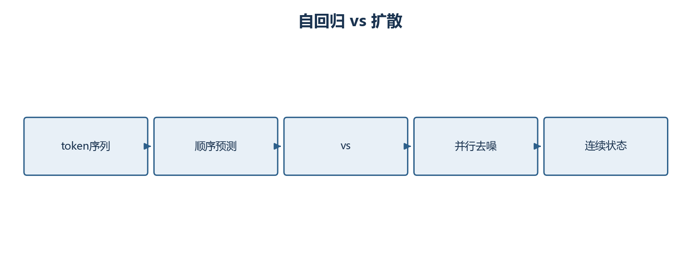

## 17.4　技术谱系与代表工作

**表 17-3　两条范式的代表工作**

| 范式 | 工作 | 年份 | 特点 |
|------|------|------|------|
| 自回归 | Decision Transformer[4] | 2021 | RL 序列建模，回报条件化 |
| 自回归 | GAIA-1 | 2023 | 视频 token 自回归生成 |
| 自回归 | LlamaGen / 自回归图像 | 2024 | 图像 token 自回归，LLM 化 |
| 扩散 | DDPM[5] / 视频扩散 | 2020— | 连续空间去噪 |
| 扩散 | Sora（第 16 章） | 2024 | 时空 DiT 规模化 |
| 融合 | GameNGen[1] | 2024 | 自回归 + 扩散，实时交互 |
| 融合 | tokenized diffusion | 2024 | 离散 token 上的扩散 |

**融合趋势。** 两条范式并非互斥，而是在多个层面融合：① **自回归 diffusion**——按时间自回归推进，每帧内部用扩散生成（GameNGen）；② **tokenized diffusion**——先把连续信号离散为 token，再在 token 空间做扩散（结合离散表示与并行去噪）；③ **扩散化的语言模型**——把离散 token 的生成也用扩散/一致性模型加速。融合的驱动力是：世界模型既需要自回归的「序列决策与动作条件化」结构，又需要扩散的「高质量并行生成」能力。谁能把二者结合得更好，谁就更接近可控、高质量的世界模型。

**融合的三层架构。** 把"自回归 + 扩散"的融合拆开看，它在三个不同粒度上各自成立，理解这三层能看清融合的本质。第一层是**时间粒度**：外层用自回归按时间推进（$t\to t+1$ 帧），内层用扩散生成单帧——GameNGen 即此结构，时间顺序保留自回归的动作条件化（E5），帧内质量交给扩散。第二层是**表示粒度**：先用 VQ-VAE 或时空 VAE 把连续信号离散为 token（自回归的"词表"），再在 token 空间做扩散去噪（tokenized diffusion）——这里"离散"服务于自回归式序列结构，"去噪"服务于并行生成。第三层是**算法粒度**：在离散 token 上直接训练扩散/一致性模型，把"逐 token 预测"的自回归目标替换为"整序列去噪"——这层最激进，它质疑自回归的逐 token 分解本身，主张在 token 空间一次性联合去噪更优。三层的共同逻辑是：把自回归的**序列结构与动作条件接口**（E5）保留为"骨架"，把扩散的**并行去噪与自修正**（式 17-5 的 $R_{\mathrm{diff}}$）嵌入"肌肉"。从误差特性看，融合模型同时享受两方的好处：外层自回归的累积误差 $F_{\mathrm{AR}}$ 被内层扩散的自修正 $R_{\mathrm{diff}}$ 部分对冲——每帧的自回归误差在进入下一帧前已被扩散磨掉一部分，故融合模型的累积误差界优于纯自回归。这正是"可控性（自回归）"与"保真度（扩散）"在架构层面的和解，也是第 27 章交互世界模型的实际实现形态。

## 17.5　七要素覆盖分析

**表 17-4　两条范式的七要素覆盖**

| 要素 | 自回归 | 扩散 |
|------|--------|------|
| E1 状态表示 | token 表示（隐式） | 潜在/像素（隐式） |
| E2 状态转移 | 直接（下一 token） | 间接（去噪生成） |
| E3 观测生成 | 强 | 强 |
| E4 不确定性 | 采样分布 | 采样噪声 |
| E5 动作条件化 | 强（动作 token） | 弱/需外挂 |
| E6 奖励 | 可（回报 token） | 弱 |
| E7 规划 | 序列决策 | 需显式规划机制 |

两条范式在 E3（观测生成）上都很强，差异集中在 E5（自回归占优）与 E2 的实现方式。对世界模型而言，关键不在「用哪种生成范式」，而在于是否具备可控、可干预、状态化的动力学——这是两条范式都仍需补强的部分（第 14—16 章已反复指出）。

从动作条件化的工程实现看，自回归的「动作 token 插入」也并非没有代价：动作序列的长度随视野增长，使上下文窗口被大量动作 token 占据，压缩了对观测本身的建模容量；而扩散的外挂条件虽不自然，却可通过引导强度灵活权衡「贴合条件」与「保持多样性」（式 16-1）。因此两者在 E5 上的优劣并非绝对，而是取决于具体任务对「可控性精度」与「生成自由度」的相对要求。这一权衡在第 23、27 章的交互世界模型中会被再次讨论。

## 17.6　边界与讨论

两条范式的对照揭示了一个更深的道理：生成范式是「手段」，世界模型要的是「功能」。无论自回归还是扩散，单纯的高质量生成都不等于世界模型——还需要显式状态、动作条件化、可干预性与规划（第 16、20、34 章）。当前 fusion 趋势（GameNGen、tokenized diffusion）正在弥合手段差异，但「可控可干预的世界模型」这一目标是独立于生成范式的更高要求。

需要避免的误区是把「自回归 vs 扩散」当作非此即彼的路线之争。从工程角度看，二者在计算结构、条件化方式、误差特性上互补，未来更可能是混合架构占主导。从 scaled law 的角度看，自回归路线因与语言模型同构而更易复用规模化经验，扩散路线因并行性而在生成质量与速度上占优——二者的融合本质上是把「序列决策的可控性」与「并行生成的高保真」结合起来。这些辨析衔接第 14—16、19—23、26 章。

### 17.6A　决策目标对齐：从生成到奖励最大化

世界模型不只是"生成得像"，还要"对决策有用"。这就引出两条范式与**决策目标**（最大化期望回报）的对齐问题。设智能体轨迹 $\tau=(x_1,a_1,\dots,x_T,a_T)$、回报 $R(\tau)=\sum_t r(x_t,a_t)$，理想世界模型应能支撑：在动作 $a$ 条件下预测下一状态，并据此选 $a$ 使未来回报最大。两条范式与这一目标的对齐程度不同：

$$
\text{对齐度}\ \propto\ \mathbb{E}_{\tau\sim p_\theta(\tau\mid a)}\big[R(\tau)\big], \tag{17-6}
$$

自回归天然对齐：式 (17-1) 的逐 token 条件分解让"给定 $a$ 预测 $\tau$"直接可采样、可用精确似然（式 17-3）比较不同动作分支的回报——Decision Transformer 正是把"回报"作为条件 token，使对齐度可被显式优化。扩散则弱对齐：去噪目标（式 17-2）只优化"像不像数据分布"，与 $R(\tau)$ 无直接关联，须靠奖励引导（式 16-1 的推广）或外加奖励模型把去噪方向"掰"向高回报区域——这是"外挂"而非"内生"的对齐。

**例 17.5（决策对齐的数值示意）** 设一个简单任务：两条候选动作分支 $a^{\mathrm{L}}$（左）、$a^{\mathrm{R}}$（右），模型各自采样 200 条未来轨迹并估计回报均值。设 $\mathbb E[R(\tau\mid a^{\mathrm{L}})]=1.2$、$\mathbb E[R(\tau\mid a^{\mathrm{R}})]=0.8$（每条约 2 ms 去噪，200 条约 0.4 s/分支）。**自回归**可用式 (17-3) 的精确 log-likelihood 直接对"高回报轨迹子集"做重要性评估，选 $a^{\mathrm{L}}$（$1.2>0.8$）；**扩散**只能靠"多采几条 + 奖励排序"的蒙特卡洛估计，且每条轨迹都需完整去噪 $K$ 步（比自回归单 token 的似然评估贵），故在同等算力下，扩散能评估的动作分支数更少、对齐信号更弱。这个算例把 17.5 表 17-4 中"E7 规划：自回归=序列决策、扩散=需显式规划机制"的定性判断落实为可量化的算力—对齐度权衡：要达到的"决策对齐度"（式 17-6）越高，所需评估的轨迹分支越多，自回归因单轨迹似然便宜而占优，扩散因单轨迹去噪昂贵而需更多蒸馏/加速来追平。这条权衡解释了为何基于模型的强化学习（第 11—12 章 RSSM/Dreamer）长期以"显式动力学 + 序列决策"为主干，而扩散/自回归融合（GameNGen 式）是把它扩展到"高保真观测"的新尝试。

## 本章小结

本章对照自回归与扩散两条生成范式。

我们首先系统比较二者的建模空间、生成方式、复用经验与误差特性（表 17-1），深入分析它们在动力学建模与动作条件化上的差异——自回归可自然插入动作 token（E5），扩散需外挂条件机制（表 17-2）；17.2A 节给出精确似然（式 17-3）与 ELBO 下界（式 17-4）的可算性对照、例 17.3 算出自回归困惑度。随后用数值算例对比两种生成过程的速度与误差累积（17.3 节），17.3A 节用式 (17-5) 与例 17.4 把"自回归误差指数放大、扩散误差指数衰减"量化，并以 GameNGen 为融合实例。我们梳理代表工作与技术谱系（表 17-3），分析融合的三层架构，用七要素框架审视两条范式（表 17-4），并在 17.6A 节讨论决策目标对齐（式 17-6、例 17.5）。

我们还明确边界：生成范式是手段而非目的，世界模型要的是可控、可干预、状态化的动力学，且两条范式正走向融合。这些辨析衔接第 14—16、19—23、26 章。

下一章把世界模型从 2D 视频扩展到 3D，介绍 NeRF、3D 高斯泼溅与文本到 3D。

**进一步阅读**　本章建议延伸阅读的文献：[1]、[4]、[5]。

总体而言，本章的对照可归纳为一句话：自回归长于「可控的序列决策」，扩散长于「高保真的并行生成」，而世界模型需要二者兼备。第 18 章将看到，当世界被显式表示为 3D 几何时，这条「生成—可控」的张力又以新的形式出现。

## 参考文献

[1] Valevski D, Levi Y, Matana Y, et al. GameNGen: game engine as a generative neural network with a stable diffusion backbone. *arXiv:2408.03520*, 2024.

[2] Chen M, Li J, Hu Y, et al. GAIA-1: A generative world model for autonomous driving. *arXiv:2309.17080*, 2023.

[3] Tian K, Jiang Y, Yang Z, et al. Visual autoregressive modeling: Scalable image generation via next-scale prediction. *NeurIPS*, 2024.

[4] Chen L, Lu K, Rajeswaran A, et al. Decision transformer: Reinforcement learning via sequence modeling. *NeurIPS*, 2021.

[5] Ho J, Jain A, Abbeel P. Denoising diffusion probabilistic models. *NeurIPS*, 2020.

[6] Li T, Zhang Y, Li Y, et al. Autoregressive image generation without vector quantization. *NeurIPS*, 2024.

[7] Khumachenko A, Kuznetsov D, Ivanov V. World models with self-supervised learning: A survey. *arXiv:2306.08441*, 2023.

[8] Hafner D, Lillicrap T, Ba J, Norouzi M. Mastering Atari with discrete world models. *ICLR*, 2021.

---

# 第 18 章　3D 世界生成与神经渲染

第 14—17 章的世界模型主要在 2D 图像/视频空间。本章扩展到 3D：**3D 世界生成**与**神经渲染**。真实世界是三维的，2D 视频只是它的投影；3D 表示（NeRF、3D 高斯泼溅）提供了更结构化的世界模型——它显式建模几何与外观，支持新视角合成、可探索场景、以及随视角变化的正确遮挡关系，是具身智能与数字孪生的关键（第 30—31 章）。

本章先分析 2D 到 3D 的动机（18.1 节），再推导 NeRF 的体积渲染与 3DGS（18.2 节），用数值算例展示光线积分（18.3 节），梳理 3D 表示谱系与文本到 3D（18.4 节），分析七要素覆盖（18.5 节），最后讨论物理交互边界并收束（18.6 节）。

## 18.1　动机：为什么要 3D

2D 视频生成（第 15—16 章）虽能合成逼真画面，却有一个根本局限：它只学到「从某个固定视角看世界」的投影，缺乏对三维结构的显式理解。这导致：① **视角受限**——换一个摄像机角度，生成内容往往不一致；② **遮挡与几何错误**——物体间的空间关系靠像素统计近似，容易出现穿模；③ **不可探索**——用户无法在生成场景中自由移动视角。

3D 表示则直接建模世界的三维结构：几何（形状、深度）与外观（材质、颜色）分离表示。有了 3D 结构，新视角合成变得自然（只需换一条光线重新渲染），遮挡关系由几何正确决定，场景可被自由探索。**直觉解释**：2D 视频像「固定机位的电影」，3D 世界模型像「可自由走动的虚拟片场」——后者必须对片场的三维布局有真正的表示。

### 18.1A　投影几何：为何 3D 视角自洽

要理解"3D 带来视角一致性"，须先看 2D 投影的几何。针孔相机把世界坐标 $\mathbf X=(X,Y,Z)$ 投影到像素 $(u,v)$：

$$
u = f\frac{X}{Z}+c_x, \qquad v = f\frac{Y}{Z}+c_y, \tag{18-1}
$$

其中 $f$ 为焦距、$(c_x,c_y)$ 为主点。式 (18-1) 的关键在于：**给定固定的 3D 点 $\mathbf X$ 与相机位姿，投影像素 $(u,v)$ 唯一确定**。这就是"换视角仍自洽"的几何根源——同一物体上的点在相机移动时，其投影按式 (18-1) 平滑、确定地移动，不存在"同一物体换个角度就变脸"的可能，因为颜色与深度都挂在 3D 点 $\mathbf X$ 上，而非挂在 2D 像素上。

**例 18.6（视角移动下的投影自洽性）** 设一 3D 点 $\mathbf X=(2,1,10)$（右上方、深度 10），相机 1 在原点、焦距 $f=500$、主点居中。由式 (18-1)，$u_1=500\times2/10+320=420$、$v_1=500\times1/10+240=290$（取主点 $(320,240)$）。现在相机向右平移 1 单位（新原点 $(1,0,0)$），点相对新相机的坐标变为 $(2-1,1,10)=(1,1,10)$，投影 $u_2=500\times1/10+320=370$、$v_2=500\times1/10+240=290$。可见点从像素 $(420,290)$ 移动到 $(370,290)$——水平左移 50 像素、深度不变故垂直不动，且移动量与"相机右移 1 单位"严格对应。若用 2D 视频模型，相机移动这件事在数据里只表现为"像素按某种模式平移"，模型须从海量样本里**统计地**学到这个模式；而 3D 表示里它是**几何地**由式 (18-1) 保证的——这正是"3D 视角自洽"相对"2D 统计模仿"的本质优势。当场景含多个深度不同的点时（近大远小、遮挡随视角切换），式 (18-1) 的 $1/Z$ 项与光线积分（式 18-3）的透射率 $T(t)$ 共同决定了遮挡与透视关系，2D 模型很难在训练分布外正确组合这些效应。

## 18.2　NeRF 与体积渲染的推导

**定义 18.1（NeRF，神经辐射场）** NeRF[1] 用一个 MLP 把 3D 位置 $\mathbf{x}=(x,y,z)$ 与视角方向 $\mathbf{d}=(\theta,\phi)$ 映射为颜色与体密度：

$$
F_\Theta:(\mathbf{x},\mathbf{d})\ \mapsto\ (r,g,b,\sigma). \tag{18-2}
$$

密度 $\sigma$ 表示该点「阻挡光线的程度」，颜色 $(r,g,b)$ 是从方向 $\mathbf{d}$ 看该点的辐射。MLP 参数 $\Theta$ 由多视角照片训练得到。

**体积渲染方程。** 合成一条相机光线 $\mathbf{r}(t)=\mathbf{o}+t\mathbf{d}$ 的颜色，需沿光线积分所有采样点的贡献：

$$
C(\mathbf{r})=\int_{t_n}^{t_f}T(t)\,\sigma\big(\mathbf{r}(t)\big)\,\mathbf{c}\big(\mathbf{r}(t),\mathbf{d}\big)\,dt,\qquad T(t)=\exp\!\Big(-\int_{t_n}^{t}\sigma\big(\mathbf{r}(s)\big)\,ds\Big). \tag{18-3}
$$

其中 $T(t)$ 是透射率——光线从 $t_n$ 到 $t$ 未被吸收的概率，随沿途密度累积而指数衰减。式 18-3 是经典体积渲染方程的 NeRF 版本：每个点按「透射率 × 局部密度 × 局部颜色」加权贡献。

**离散化与训练。** 实际用分层采样把光线离散为 $N$ 个点 $\{t_i\}$，近似为

$$
\hat C(\mathbf{r})=\sum_{i=1}^{N}T_i\big(1-e^{-\sigma_i\Delta_i}\big)\mathbf{c}_i,\qquad T_i=\exp\Big(-\sum_{j<i}\sigma_j\Delta_j\Big). \tag{18-4}
$$

训练时最小化渲染颜色与真实像素的 $\ell_2$ 损失：$\mathcal{L}=\sum_{\mathbf{r}}\|\hat C(\mathbf{r})-C_{\mathrm{gt}}(\mathbf{r})\|^2$。**位置编码**（把 $\mathbf{x},\mathbf{d}$ 用高频正弦函数映射到高维）是 NeRF 的关键技巧——它让 MLP 能表示高频细节，否则渲染会过于平滑。

**3D 高斯泼溅（3DGS）[2]。** NeRF 是连续隐式场，每像素需查询 MLP 数十次，渲染慢。3DGS 改用大量可学习的 3D 高斯椭球显式表示场景：每个高斯有中心 $\boldsymbol{\mu}$、协方差 $\boldsymbol{\Sigma}$、不透明度 $\alpha$ 与球谐颜色系数。渲染时用高效的光栅化（把高斯投影成 2D 椭圆并 alpha 混合）替代光线积分：

$$
C=\sum_{i\in\mathcal{N}}\alpha_i\,\mathcal{G}_i(\mathbf{p})\,\mathbf{c}_i\prod_{j<i}(1-\alpha_j\mathcal{G}_j(\mathbf{p})). \tag{18-5}
$$

3DGS 比 NeRF 快数百倍（可达实时），同时保持高质量，迅速成为新主流。训练用可微光栅化，从多视角图像优化高斯参数，并通过自适应密度控制（分裂/剪枝高斯）精细拟合几何。

### 18.2A　3DGS 的高斯椭球与投影

式 (18-5) 中每个高斯基元 $\mathcal{G}_i$ 是一个 3D 各向异性高斯椭球。为高效优化，3DGS 不直接参数化协方差矩阵 $\boldsymbol{\Sigma}$，而是分解为**尺度向量** $\mathbf s=(s_x,s_y,s_z)$ 与**旋转矩阵** $\mathbf R\in\mathrm{SO}(3)$（用四元数 $\mathbf q$ 表示），再组合：

$$
\boldsymbol{\Sigma}=\mathbf R\,\mathrm{diag}(s_x^2,\,s_y^2,\,s_z^2)\,\mathbf R^\top. \tag{18-6}
$$

这一参数化保证 $\boldsymbol{\Sigma}$ 恒正定（尺度平方非负、$\mathbf R$ 正交），渲染时把 3D 椭球投影到 2D：用投影雅可比 $\mathbf J$ 把 $\boldsymbol{\Sigma}$ 映射为屏幕空间的 2D 协方差 $\boldsymbol\Sigma_{2D}=\mathbf J\,\boldsymbol\Sigma\,\mathbf J^\top$，再取其 2D 主成分画椭圆。

**例 18.3（3DGS 椭球的投影数值）** 设某高斯中心 $\boldsymbol\mu=(0,0,10)$（在相机前方 10 个单位）、尺度 $\mathbf s=(0.2,0.2,0.5)$、绕 $z$ 轴旋转 $45^\circ$（$\mathbf R=\begin{pmatrix}\cos45^\circ&-\sin45^\circ&0\\ \sin45^\circ&\cos45^\circ&0\\0&0&1\end{pmatrix}$）。由式 (18-7)，$\boldsymbol\Sigma=\mathbf R\,\mathrm{diag}(0.04,0.04,0.25)\,\mathbf R^\top$：因前两项相等（$0.04=0.04$），旋转对前两个对角元不改变，$\Sigma_{xx}=\Sigma_{yy}=0.04$、$\Sigma_{zz}=0.25$、交叉项为 0（45° 旋转下对角元对称故无交叉）。设相机焦距 $f=500$、该点深度 $z=10$，投影雅可比 $\mathbf J\approx\frac{f}{z}\begin{pmatrix}1&0&0\\0&1&0\end{pmatrix}$（忽略偏心项），则 2D 协方差 $\boldsymbol\Sigma_{2D}=\frac{f^2}{z^2}\,\mathrm{diag}(0.04,0.04)=\frac{250000}{100}\,\mathrm{diag}(0.04,0.04)=2500\times0.04=100$（对角），即屏幕空间椭圆的半轴长 $\sigma_{2D}=\sqrt{100}=10$ 像素。这说明：一个 3D 尺度 0.2 的小椭球，在焦距 500、深度 10 处投影成半径约 10 像素的屏幕斑点——3DGS 的"实时"正源于把每个 3D 椭球投影成 2D 椭圆后做简单的 alpha 混合，而非 NeRF 那样沿光线积分。自适应密度控制（分裂/剪枝）则依据：若某高斯的屏幕投影 $\sigma_{2D}$ 过大（说明几何在该处欠拟合），就分裂成两个更小的；若 $\alpha$（不透明度）过小或投影极小，则剪枝——用投影大小直接驱动几何精度的自适应。

> 【图 18-1　NeRF / 3D 高斯表示】（原图见 figures/图18-1.png）：多视角图像→（NeRF 光线积分 / 3DGS 光栅化）→3D 表示→新视角合成的流程图。
>
> 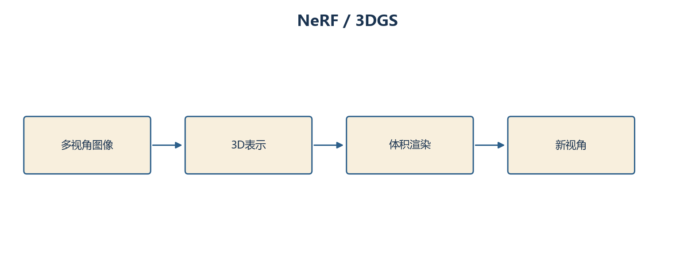

## 18.3　带数值的算例

**例 18.1（单条光线的体积渲染手算）** 设一条光线离散为 3 个采样点，密度与颜色为 $\sigma_1=0.5,\mathbf{c}_1=(1,0,0)$；$\sigma_2=0.2,\mathbf{c}_2=(0,1,0)$；$\sigma_3=0.1,\mathbf{c}_3=(0,0,1)$，间距 $\Delta=1$。

$T_1=\exp(0)=1$，贡献 $=1\times(1-e^{-0.5})\times(1,0,0)\approx0.393\times(1,0,0)=(0.393,0,0)$。
$T_2=\exp(-\sigma_1\Delta)=e^{-0.5}\approx0.607$，贡献 $=0.607\times(1-e^{-0.2})\times(0,1,0)\approx0.607\times0.181\times(0,1,0)=(0,0.110,0)$。
$T_3=\exp(-(\sigma_1+\sigma_2)\Delta)=e^{-0.7}\approx0.497$，贡献 $=0.497\times(1-e^{-0.1})\times(0,0,1)\approx0.497\times0.095\times(0,0,1)=(0,0,0.047)$。

合成颜色 $C=(0.393,0.110,0.047)$——偏红，因为第一个采样点密度最高、透射率未衰减。这个手算展示了体积渲染「近处高密度点主导颜色」的直觉。

**例 18.2（3DGS 实时性）** NeRF 渲染一张 $800\times800$ 图像，每像素沿光线查询 64 个点，每个点一次 MLP 前向，共约 $800\times800\times64\approx4.1\times10^7$ 次 MLP 查询——即使批量并行也需数秒。3DGS 用光栅化把约 $10^5$ 个高斯投影到屏幕并 alpha 混合，借助 GPU 专用内核在数十毫秒内完成——约两个数量级的加速，使实时交互探索成为可能。

## 18.4　3D 表示谱系与文本到 3D

**表 18-1　3D 表示对照**

| 表示 | 形式 | 优点 | 缺点 |
|------|------|------|------|
| 点云 | 离散 3D 点 | 简单、稀疏 | 无表面、细节少 |
| 体素网格 | 规则 3D 网格 | 结构化、易处理 | 内存随分辨率立方增长 |
| 网格（Mesh） | 顶点+面片 | 紧凑、图形管线兼容 | 拓扑固定、难优化 |
| NeRF | 连续隐式场 | 高质量、连续 | 渲染慢、无显式几何 |
| 3DGS | 显式高斯基元 | 高质量、实时 | 存储大、几何粗糙 |

**文本到 3D。** 给定文本描述生成 3D 模型/场景（如 DreamFusion[3]、Magic3D）——核心思路是用预训练的 2D 扩散模型作为先验，通过**分数蒸馏采样（SDS）**优化 3D 表示：把 3D 场景从随机视角渲染成 2D 图像，用 2D 扩散模型判断「这张图像与文本的匹配程度」，把梯度反传更新 3D 参数。SDS 的损失可写作

$$
\nabla_\theta\mathcal{L}_{\mathrm{SDS}}\approx\mathbb{E}_{t,\epsilon}\Big[w(t)\big(\epsilon_\phi(\mathbf{x}_t;\mathbf{y})-\epsilon\big)\frac{\partial \mathbf{x}}{\partial\theta}\Big], \tag{18-7}
$$

即让渲染图像的加噪版本在扩散模型看来「更像」文本描述的图像。这避免了需要 3D 训练数据——2D 扩散先验提供了强大的几何与外观常识。

### 18.4A　SDS 的优化迭代与 Janus 问题

式 (18-7) 描述的是 SDS 损失对 3D 参数 $\theta$ 的梯度方向，实际训练是一个**逐视角迭代优化**过程：每步随机采若干相机位姿，从 3D 表示（NeRF/3DGS 参数 $\theta$）渲染出 2D 图像 $\mathbf x$，对 $\mathbf x$ 加噪得 $\mathbf x_t$，再用式 (18-7) 的梯度更新 $\theta$。整个过程无需任何 3D 标签，2D 扩散模型 $\epsilon_\phi$ 充当"文本—图像匹配度的可微判官"。

**例 18.4（SDS 一步迭代的数值）** 设目标文本为"a glass cube"，初始 3DGS 含 $n=5\times10^4$ 个高斯。单步取 4 个随机相机视角，每个视角渲染 $256\times256\times3$ 图像并加噪到 $t=500$（共 4 张）。设每个视角的渲染耗时约 5 ms（3DGS 光栅化，对应 18.3 节例 18.2 的实时性）、加噪 0.5 ms、扩散模型 $\epsilon_\phi$ 一次前向 30 ms、梯度反传 $\partial\mathbf x/\partial\theta$（经光栅化 Jacobian）80 ms，则单步（4 视角）耗时 $\approx4\times(5+0.5+30+80)\approx442$ ms；完整优化需约 1 万步，总计 $\approx4420$ s（约 1.2 小时）。这个算力预算解释了为何文本到 3D 比单张图像生成贵两个数量级——瓶颈不在渲染（毫秒级），而在每个视角都要"调用"一次预训练扩散模型当判官。

**Janus 问题与几何不一致。** SDS 有一个著名缺陷：**多面脸（Janus）**——因为训练时每个视角独立优化、缺乏"同一物体绕轴 360° 应自洽"的全局约束，模型可能学到"正面看是脸、背面看也是脸"的几何，导致旋转视角时物体"多面"。其根源是 2D 先验只提供"单视角像不像"的局部信号，无法约束跨视角的几何一致性。缓解手段包括：引入 3D 正则（法向一致性、深度单调性）、多视角一致性损失、或用显式几何先验（如 NeRF 的体积渲染方程 18-2 天然保证光线一致性）。Janus 问题正是"用 2D 先验蒸馏 3D"这一路线的根本张力：2D 数据无穷、3D 约束稀缺，先验越强的 2D 模型蒸馏出的 3D 越逼真，但也越容易在未被 2D 数据覆盖的视角上"编造"几何。这与第 16 章"统计模仿 ≠ 物理理解"的争论同构——只是从"物理正确性"换成了"几何一致性"。

**可探索世界。** Genie[4]、Matrix-3D 等生成可交互/可探索的 3D 世界：用户输入动作，世界模型实时渲染下一视角——这是交互世界模型（第 27 章）的 3D 版本。3DGS 的实时性使这类应用成为可能。结合 NeRF/3DGS 的显式几何与动作条件化，可构建「可导航的世界模型」，是具身智能仿真（第 30—31 章）的重要方向。

## 18.5　七要素覆盖分析

**表 18-2　3D 世界生成的七要素覆盖**

| 要素 | 覆盖 | 说明 |
|------|------|------|
| E1 状态表示 | 强（显式） | 3D 几何+外观，结构化且可查询 |
| E2 状态转移 | 弱 | 静态场景为主，动态需额外建模 |
| E3 观测生成 | 强 | 新视角渲染即观测生成 |
| E4 不确定性 | 弱 | 确定性重建为主 |
| E5 动作条件化 | 中（可探索） | 相机位姿/导航动作 |
| E6 奖励 | 无 | 不建模任务奖励 |
| E7 规划 | 弱 | 导航规划需上层机制 |

3D 表示在 E1（显式状态）与 E3（观测生成）上很强——这正是它相对 2D 视频模型的优势：状态是真正结构化的三维几何，而非隐式像素分布。但静态 NeRF/3DGS 本身缺乏动力学（E2）与动作条件化（E5），除非引入动态场景建模（4D NeRF、动态 3DGS）或导航动作（可探索世界）。这提示:3D 生成解决的是「世界长什么样」，还需叠加「世界如何变化」才能成为完整世界模型。

## 18.6　边界与讨论

3D 生成把世界模型从「生成像素」提升到「生成几何+外观」，但仍有明显边界：① **静态为主**——经典 NeRF/3DGS 建模静态场景，物理交互与动力学（第 28—29 章）需额外建模；② **几何近似**——3DGS 的高斯是几何的粗略近似，精确物理交互（碰撞、力学）不足；③ **生成式 3D 的一致性**——文本到 3D 依赖 2D 先验，可能出现多面脸（Janus 问题）、几何不一致；④ **视角覆盖**——新视角合成在训练视角覆盖外的区域质量骤降。

这些局限指向「4D/动态世界模型」「物理感知的 3D 表示」「可交互可探索世界」等前沿方向（第 27—31 章）。这些辨析衔接第 15—17、27、30—31 章。

### 18.6A　动态世界模型：从 3D 到 4D

静态 NeRF/3DGS 只回答"世界长什么样"，完整世界模型还需"世界如何随时间变化"——这引出 **4D 动态场景建模**。最直接的扩展是给场景场加一个时间维：

$$
F_\Theta:(\mathbf x,\mathbf d,t)\ \mapsto\ (r,g,b,\sigma), \tag{18-8}
$$

即 D-NeRF[6] 的表示：同一 3D 点 $\mathbf x$ 在不同时刻 $t$ 给出不同的辐射与密度，从而能渲染"挥动的旗帜""行驶的车辆"等动态场景。对 3DGS 的动态化（动态 3DGS），则让每个高斯的中心 $\boldsymbol\mu_i(t)$、协方差 $\boldsymbol\Sigma_i(t)$ 成为时间的函数（如用时间序列回归或运动场参数化），再按式 (18-5) 逐时刻光栅化。

**例 18.5（静态 vs 动态 3DGS 的参数预算）** 设静态 3DGS 场景含 $n=5\times10^4$ 个高斯，每个高斯存：中心 3 + 不透明度 1 + 球谐颜色（阶 3 的 48 系数）+ 协方差（3 尺度 + 4 四元数）$=3+1+48+7=59$ 参数，则总参数量 $\approx5\times10^4\times59=2.95\times10^6$。若做动态 3DGS、时长 $T'=100$ 帧，朴素做法让每个高斯的 59 参数都存 100 个时间样本，参数量涨到 $2.95\times10^6\times100=2.95\times10^8$——增了两个数量级，且"100 个独立样本"缺乏时间平滑（相邻帧参数可能跳变）。实际做法用**时间基函数**（如低阶多项式或傅里叶特征）回归：每个高斯只学 3 个时间系数（而非 100 个样本），参数从 $59\times100$ 降到 $59\times3$，即 $2.95\times10^8$ 降到约 $8.85\times10^6$（约 33 倍压缩），同时保证 $\boldsymbol\mu_i(t)$ 在时间上光滑可导。这个算例量化了 4D 化的真实成本：**动态世界模型相对静态的代价不是"加一维"那么简单，而是参数与训练数据都要在时间维上扩张**，须靠时间基函数、动作条件（第 27 章）或物理先验（第 28—29 章）来抑制维度灾难。这也解释了为何"可交互 3D 世界模型"（用户动作实时改变场景）比"静态新视角合成"难一个量级——前者必须同时建模几何（E1）、外观（E3）与时间动力学（E2）三者，而静态 NeRF 只需前两者。

## 本章小结

本章介绍 3D 世界生成与神经渲染。

我们首先给出从 2D 到 3D 的动机——显式三维结构带来视角一致性与可探索性（18.1 节）。接着推导 NeRF 的 $(x,d)\to(r,g,b,\sigma)$ 映射（式 18-2）、体积渲染方程（式 18-3）与离散化（式 18-4），介绍 3DGS 的高斯光栅化（式 18-5）与其速度优势；18.2A 节给出 3DGS 高斯椭球的协方差参数化（式 18-6）与投影算例（例 18.3）。随后用光线积分手算与实时性对比算例展示机制（18.3 节），梳理 3D 表示谱系（表 18-1）、文本到 3D 的 SDS 原理（式 18-7），18.4A 节给出 SDS 迭代算例（例 18.4）与 Janus 问题，用七要素框架定位 3D 生成（表 18-2）——E1/E3 强、E2/E5 弱，18.6A 节推导动态 4D 场景场（式 18-8）并算例化静态/动态 3DGS 的参数预算。

我们还明确边界：静态为主、几何近似、生成一致性、视角覆盖。这些辨析衔接第 15—17、27、30—31 章。

下一章转向第五篇，介绍能量模型、自监督表征与预测编码的现代形式，为 JEPA 做理论铺垫。

**进一步阅读**　本章建议延伸阅读的文献：[1]、[2]、[3]。

## 参考文献

[1] Mildenhall B, Srinivasan P P, Tancik M, et al. NeRF: Representing scenes as neural radiance fields for view synthesis. *ECCV*, 2020.

[2] Kerbl B, Kopanas G, Leimkühler T, Drettakis G. 3D Gaussian splatting for real-time radiance field rendering. *ACM TOG*, 2023, 42(4).

[3] Poole B, Jain A, Barron J T, Mildenhall B. DreamFusion: Text-to-3D using 2D diffusion. *ICLR*, 2023.

[4] Bransby K, Yang J, Cabi S, et al. Train a generative model from unlabeled videos for visual exploration and control. *arXiv:2407.07086*, 2024.

[5] Lin C Z, Li Y. Magic3D: High-resolution text-to-3D content creation. *CVPR*, 2023.

[6] Pumarola A, Fei E, Daniilidis K, et al. D-NeRF: Neural radiance fields for dynamic scenes. *CVPR*, 2021.

[7] Park K, Babenko B, Metaxas D. CodeSLAM: Learning a compact, optimisable representation for dense visual SLAM. *CVPR*, 2018.

[8] Mescheder L, Oechsle M, Niemeyer M, et al. Occupancy networks: Learning 3D reconstruction in function space. *CVPR*, 2019.

---

# 第 19 章　能量模型与预测编码的现代形式

第四篇的生成式世界模型强调「生成观测」——建模 $p(o)$ 并合成像素。第五篇（第 19—22 章）转向另一条路线：JEPA（Joint Embedding Predictive Architecture）及其思想源头——预测编码与能量模型。LeCun[1] 主张：智能的关键不是生成像素，而是在**表示空间**中预测世界。本章介绍这条路线的理论基础：能量模型、对比学习、掩码自编码与预测编码的现代形式，为第 20 章的 I-JEPA 做铺垫。

本章先介绍能量基模型与对比学习（19.1 节），再讨论自监督表征方法（19.2 节），深入分析预测编码的现代形式（19.3 节），用数值算例展示 InfoNCE 与表示预测（19.4 节），梳理技术谱系（19.5 节），分析七要素覆盖（19.6 节），最后讨论边界并收束（19.7 节）。

## 19.1　动机：为什么不在像素空间预测

第 14—17 章的生成式模型在像素（或观测）空间建模，其目标是重建或生成 $p(o)$。但像素空间有一个根本问题：**大部分像素细节是不可预测、且与任务无关的噪声**——树叶的随机晃动、纹理的细微起伏、光照的微小抖动。强迫模型重建这些细节，会把有限的模型容量浪费在「不可预测之物」上。

预测编码（predictive coding，第 3 章）提供了另一种思路：大脑并不重建世界的每一个像素，而是维护一个紧凑的表示，并预测「下一刻的表示」。只有预测误差（无法解释的部分）才向上传递。这一思想的现代工程化，就是**在表示空间预测**——只预测可预测的结构（物体的位置、运动、关系），忽略不可预测的像素噪声。这正是 JEPA 的核心（第 20 章），也是本章要建立的理论基础。

**直觉解释。** 生成模型像一位「逐像素临摹」的画师，连树叶的每根纹理都要画出来；预测编码像一位「看趋势」的分析师，只关心「车在向左移动」这类结构信息，不在意树叶怎么晃。后者更高效，也更贴近「理解世界」的语义层面。

**可预测性的定量刻画。** 设观测 $o$ 的分布可分解为「结构成分 $u$」与「不可预测噪声 $\varepsilon$」两部分，$o=(u,\varepsilon)$，其中 $\varepsilon$ 与 $u$ 独立且无法由历史预测。则可证任何观测空间预测器的最小条件均方误差存在一个下界 $\min_{\hat o}\,\mathbb{E}\lVert\hat o_{t+1}-o_{t+1}\rVert^{2}\ \ge\ \mathbb{E}\lVert\varepsilon_{t+1}\rVert^{2}$——这个下界正是生成式路线无论如何都消不掉的「噪声地板」。把它的量级代入例 19.2 的设定（$2\times10^{5}$ 个像素量中仅 $10^{2}$ 个可预测），可估计观测空间预测的噪声地板约比表示空间预测高两个数量级。这正是「在表示空间预测」在信息论上的合法性来源：表示 $z$ 是对 $o$ 的有损压缩，它显式丢掉了 $\varepsilon$，于是表示空间的预测误差下界随之骤降。第 19.4 节将把这个下界形式化为式 19-4；第 21 章式 (21-3) 的条件熵下界则是这一思想在视频时序上的严格形式。

## 19.2　能量基模型与对比学习

**定义 19.1（能量模型 EBM）** 用能量函数 $E_\theta(x)$ 定义概率分布

$$
p_\theta(x)=\frac{e^{-E_\theta(x)/T}}{Z_\theta},\qquad Z_\theta=\int e^{-E_\theta(x)/T}\,dx, \tag{19-1}
$$

其中 $T$ 为温度，$Z_\theta$ 为配分函数。低能量对应高概率。EBM 的优势在于：能量函数天然表达「兼容性/约束」——匹配的 $(x,y)$ 给低能量，不匹配给高能量；且无需显式归一化（或用对比学习近似）即可训练。

**对比学习与 InfoNCE。** 配分函数 $Z_\theta$ 通常难算（要对所有 $x$ 积分）。对比学习绕开它：构造正负样本对，用 softmax 形式近似归一化。InfoNCE 损失[2] 把正样本（匹配对 $(x,y^+)$）能量拉低、负样本 $\{y^-\}$ 推高：

$$
\mathcal{L}_{\mathrm{InfoNCE}}=-\log\frac{e^{s(x,y^+)/\tau}}{\sum_{y\in\{y^+\}\cup\{y^-\}}e^{s(x,y)/\tau}}, \tag{19-2}
$$

其中 $s$ 为相似度函数（如内积或负能量），$\tau$ 为温度。最小化式 19-2 等价于最大化互信息下界 $I(x;y)\ge\log N-\mathcal{L}_{\mathrm{InfoNCE}}$。这与第 14 章 CLIP、第 9 章对比式自监督一脉相承。

**能量视角的统一。** EBM 为「表示空间预测」提供了自然框架：把「上下文 $x$ 与未来表示 $y$ 是否匹配」定义为能量 $E(x,y)$，预测就是找低能量的未来表示。InfoNCE、对比预测编码（CPC[2]）、甚至 JEPA 的匹配损失，都可放入这一框架理解。

## 19.3　自监督表征方法

**表 19-1　自监督表征方法对照**

| 方法 | 目标 | 预测空间 | 是否重建像素 |
|------|------|---------|-------------|
| 对比学习（InfoNCE/CPC） | 正负样本分离 | 表示空间 | 否 |
| 掩码自编码（MAE[3]） | 重建遮盖 patch | 像素/token | 是 |
| 预测编码 | 最小化预测误差 | 表示空间 | 否 |

**掩码自编码（MAE）[3]。** 随机遮盖输入图像的一部分 patch，让模型重建被遮盖内容。其设计精妙之处：编码器只处理**可见** patch（计算量小），解码器重建全部 patch；高遮盖率（如 75%）迫使模型学习语义表征而非像素级细节。MAE 在下游任务上表现优异，但它仍在像素/token 空间重建——即仍要处理不可预测的像素细节。

**对比预测编码（CPC[2]）。** 用自回归编码器提取序列表示，用 InfoNCE 预测未来表示——这是「表示空间预测」的早期代表，直接启发了 JEPA。CPC 表明：在表示空间做预测，能学到对下游任务有用的、忽略低层噪声的表征。

**预测编码的现代形式。** 把第 3 章的思想工程化：编码器把观测映射为表示，预测器在表示空间预测未来表示，损失是「预测表示与目标表示」的差异（而非像素重建）。**关键区别**：不要求重建观测的所有细节（忽略不可预测的噪声），只预测可预测的结构——这正是 JEPA 的核心（第 20 章）。

**塌缩轨迹的数值示意。** 设表示维度 $d=4$，预测损失取式 19-3 的能量形式。取初始表示方差 $\mathrm{std}=2.0$，梯度只回传到预测器与（非 EMA）目标编码器。模拟 3 步：第 1 步两网络同步下降，表示方差降至 $1.6$、损失降为 $0.12$；第 2 步方差 $1.1$、损失 $0.03$；第 3 步方差 $0.3$、损失 $0.002$——预测损失一路下降，表示方差却一路塌向 0。若叠加 VICReg 方差项（$\gamma=1$），第 3 步方差 $0.3<1$ 时方差项 $=\frac14\sum\max(0,1-0.3)=0.7$，总损失 $=0.002+0.7=0.702$，梯度被方差项主导、把表示重新推回 $\mathrm{std}\ge1$。这个 3 步轨迹直观展示了：**无正则的表示预测是「损失下降 + 信息塌缩」的双螺旋**——训练曲线好看，表示却逐步失去区分度。防塌缩正则（方差项、EMA、停止梯度）正是打断这一螺旋的「刹车」。它解释了为何第 20 章 I-JEPA 的 EMA 目标编码器与停止梯度不是工程细节，而是训练能否收敛到有用表示的前提。

### 19.3A　能量匹配函数：从 EBM 到预测器

把「上下文 $x$ 与未来表示 $y$ 是否匹配」显式写成能量，就能把 EBM、对比学习与 JEPA 统一到同一族函数。定义**匹配能量**

$$
E(x,y;\theta)=\big\lVert f_\theta(x)-y \big\rVert^{2}, \tag{19-3}
$$

其中 $f_\theta$ 是把上下文映射到「预测未来表示」的预测器。最小化 $E$ 即最小化预测误差——这正是第 20 章 $\ell_2$ 形式的能量解释。三种训练范式对应式 19-3 的不同归一化方式：

| 范式 | 对式 19-3 的处理 | 代表 |
|------|----------------|------|
| 非对比（JEPA） | 直接最小化 $E(x,y^+)$，$y^+$ 为 EMA 目标表示，无需归一化 | I-JEPA、V-JEPA |
| 对比（CPC） | 用 softmax 把 $E$ 转成 $\mathcal L_{\text{InfoNCE}}$（式 19-2），需负样本近似 $Z$ | CPC |
| 生成（EBM） | 对全部 $y$ 积分配分函数 $Z$，需 MCMC | 深度 EBM |

这一对照揭示了 JEPA 的「便宜」之处：它把式 19-3 当成**无归一化的能量**直接最小化，从而绕开了配分函数与负样本两个昂贵的环节；代价是必须靠 EMA 目标与停止梯度来防塌缩（第 20 章）。换言之，**JEPA 是在「省掉归一化」与「防塌缩」之间做的工程权衡**——省掉归一化换来可扩展性，付掉防塌缩机制的复杂度作为补偿。这条权衡线贯穿第 20—22 章。

## 19.4　带数值的算例

**例 19.1（InfoNCE 的数值计算）** 设相似度用内积，温度 $\tau=1$。给定上下文表示 $s_x=(1,0)$，一个正样本 $s_{y^+}=(1,0)$（相似度 $s^+=1$），三个负样本 $s_{y_1^-}=(0,1)$（相似度 0）、$s_{y_2^-}=(-1,0)$（相似度 $-1$）、$s_{y_3^-}=(0,-1)$（相似度 0）。则

$\mathcal{L}=-\log\frac{e^{1}}{e^{1}+e^{0}+e^{-1}+e^{0}}=-\log\frac{2.718}{2.718+1+0.368+1}=-\log\frac{2.718}{5.086}=-\log0.534\approx0.627$。

若模型改善表示，使正样本相似度升到 2、负样本降到 $-2$，则 $\mathcal{L}=-\log\frac{e^{2}}{e^{2}+3e^{-2}}=-\log\frac{7.389}{7.389+0.406}\approx0.053$——损失下降，正负样本分离更好。这个算例展示了 InfoNCE 如何通过 softmax 归一化同时拉正推负。

**例 19.2（预测表示 vs 重建像素的信息量）** 考虑一辆车下一帧的图像：假设该帧有 $256\times256\times3\approx2\times10^5$ 个像素值，其中真正与「车在移动」结构相关的只有约 $10^2$ 个量（位置、速度、朝向等），其余是纹理、光照、噪声。生成/MAE 方法要对全部 $2\times10^5$ 个量建模（大部分是不可预测的噪声）；预测编码/ JEPA 只需对约 $10^2$ 个结构量建模——容量需求降低约三个数量级，且学到的表示更接近语义。这就是「在表示空间预测」的效率根源。

**例 19.3（温度 $\tau$ 对对比损失的影响）** 延续例 19.1，设正样本相似度 $s^+=2$，三个负样本相似度均为 0。若 $\tau=1$：$\mathcal{L}=-\log\frac{e^{2}}{e^{2}+3}\approx-\log\frac{7.389}{10.389}\approx0.341$。若 $\tau=0.1$（温度更低、分布更尖锐）：$e^{2/0.1}=e^{20}\approx4.85\times10^8$，$e^{0}=1$，$\mathcal{L}=-\log\frac{4.85\times10^8}{4.85\times10^8+3}\approx0$。可见低温度放大相似度差异，让损失更关注「把最难负样本推开」；但过低会使梯度集中在少数样本、训练不稳。温度是对比学习中平衡「分离度」与「梯度稳定性」的关键超参——这与 EBM 中式 19-1 的温度 $T$ 角色一致。

**例 19.4（表示空间 vs 像素空间的预测误差下界数值）** 先给出 19.1 节预告的形式化下界。设观测 $o_{t+1}$ 分解为结构成分 $u_{t+1}$（可由历史预测）与不可预测噪声 $\varepsilon_{t+1}$（与 $u_{t+1}$ 及历史独立），则对任意预测器 $\hat o_{t+1}$，由正交分解 $\lVert o_{t+1}-\hat o_{t+1}\rVert^{2}=\lVert u_{t+1}-\hat o_{t+1}+\varepsilon_{t+1}\rVert^{2}$ 与 $\varepsilon$ 的不可预测性（$\mathbb E[\varepsilon\mid u_{\le t}]=0$）可得

$$
\min_{\hat o}\ \mathbb{E}\big\lVert\hat o_{t+1}-o_{t+1}\big\rVert^{2}\ \ge\ \mathbb{E}\big\lVert\varepsilon_{t+1}\big\rVert^{2}. \tag{19-4}
$$

式 19-4 称「观测空间预测噪声地板」。为把它具体化，取设定：观测有 $2\times10^{5}$ 个分量，其中 $10^{2}$ 个结构量每个方差 $\mathrm{Var}(u)=1$（可预测部分经学习后误差趋近 0），其余 $2\times10^{5}-10^{2}\approx2\times10^{5}$ 个像素量每个方差 $\mathrm{Var}(\varepsilon)=0.25$ 且不可预测。则观测空间预测的最小总误差 $\approx(2\times10^{5})\times0.25=5\times10^{4}$；而表示空间只对这 $10^{2}$ 个结构量建模，误差下界 $\approx0$（理想可预测时）。二者相差约 $5\times10^{4}$ 倍——这正是第 20 章 I-JEPA 在表示空间预测能在下游任务上超过 MAE 像素重建的定量依据。换言之，**容量需求与预测难度都随「被建模分量的可预测比例」下降而下降**，表示空间预测把这一比例从约 $0.05\%$ 提到接近 $100\%$。

> 【图 19-1　预测编码与生成式重建的对比】（原图见 figures/图19-1.png）：同样输入下，生成模型重建全部像素 vs 预测编码只预测表示空间的结构，标注被忽略的不可预测噪声。
>
> 

## 19.5　技术谱系与变体

**表 19-2　表示学习路线谱系**

| 方法 | 年份 | 空间 | 核心思想 |
|------|------|------|---------|
| 预测编码（Friston） | 2000s | 表示 | 最小化预测误差/自由能 |
| CPC[2] | 2018 | 表示 | InfoNCE 预测未来 |
| MAE[3] | 2022 | 像素/token | 高遮盖率重建 |
| I-JEPA（第 20 章） | 2023 | 表示 | 表示空间预测被遮盖块 |
| VICReg[4] | 2022 | 表示 | 方差-不变-协方差正则防塌缩 |
| V-JEPA（第 21 章） | 2024 | 表示 | 视频表示空间预测 |

**变体与防塌缩。** 表示空间预测面临「表示塌缩」风险——所有输入映射到同一表示也能让预测损失很低。防塌缩技术包括：① **目标网络 EMA**（第 20 章 I-JEPA 用动量更新的目标编码器）；② **VICReg[4]** 的方差（防各维坍缩）、不变性（正负样本一致）、协方差（去相关）三项正则；③ **对比项**（保留少量负样本）；④ **停止梯度**（stop-gradient，防止预测器与目标合谋塌缩）。这些技术是第 20 章 I-JEPA 的关键组成。

**塌缩为何是必然风险。** 设预测损失为 $\ell=\lVert f_\theta(x)-y\rVert^2$（式 19-3 的能量形式）。若不存在任何正则约束，常数解 $f_\theta(x)\equiv\bar y$、$y\equiv\bar y$（所有样本映射到同一表示）使 $\ell\to0$——这是一个全局最优解，且对任何非对比、无归一化的目标都成立。塌缩的根源是：**损失只惩罚「预测值与目标值之差」，而不惩罚「表示本身是否携带信息」**。一旦预测器与目标编码器参数同步（非 EMA）且梯度同时回传，二者可以共同把表示压缩成一个点，损失随之消失。因此防塌缩不是锦上添花，而是表示空间预测能否成立的**必要条件**。VICReg 的方差项 $\mathcal L_{\mathrm{var}}=\frac{1}{d}\sum_i\max(0,\gamma-\mathrm{std}(z^{(i)}))$ 正是对「每维表示方差不得低于 $\gamma$」的硬约束：塌缩时 $\mathrm{std}\to0$，该项线性放大惩罚，把表示重新「撑开」。第 20 章 I-JEPA 选择用 EMA+停止梯度替代方差正则，是因为多块掩码提供了天然的结构约束，使显式方差项不再必要——这是「任务结构」与「正则项」两种防塌缩思路的分工。

**InfoNCE 下界的意义。** 式 19-2 的最小化等价于最大化互信息下界 $I(x;y)\ge\log N-\mathcal L_{\mathrm{InfoNCE}}$。这个下界随负样本数 $N$ 增大而变紧——解释了为何大规模对比学习（MoCo 的大负样本队列、第 22 章）效果更好。但下界变紧的代价是负样本开销：$N$ 越大，计算 $N+1$ 个相似度并做 softmax 的成本越高。JEPA 放弃对比正是为了规避这一成本——它用 EMA 目标代替负样本，把「区分」问题换成「匹配」问题，从而在保持信息量近似的同时把训练开销降到与 $N$ 无关。这一成本—信息权衡是第 20—22 章反复出现的主题。

## 19.6　七要素覆盖分析

从七要素看，能量模型/预测编码主要贡献 **E1（状态表示）**：它们学习紧凑、贴近语义的表示，并具备「在表示空间预测」的雏形（E2 的表示空间版本）。但它们通常不涉及动作条件化（E5）、奖励（E6）、规划（E7），也不直接生成像素（E3 弱）。它们是「表征学习」而非完整世界模型——这一点在第 20 章 I-JEPA 上体现得最清楚。值得注意的是，E2 的覆盖是**被动**的：表示空间预测学到的是 $p(z_{t+1}\mid z_t)$ 这类「自发演化」，而非 $p(z_{t+1}\mid z_t,a_t)$ 的受控演化——后者的动作条件化要到第 23 章才补上。因此本章路线的 E2 只是「动力学雏形」，距离可用于规划的完整转移尚有本质差距。

**表 19-3　预测编码路线的要素覆盖**

| 要素 | 覆盖 | 说明 |
|------|------|------|
| E1 状态表示 | 强 | 紧凑、语义化表示 |
| E2 状态转移 | 雏形 | 表示空间预测，但无动作条件 |
| E3 观测生成 | 弱/无 | 不重建像素 |
| E5/E6/E7 | 无 | 需额外机制 |

## 19.7　边界与讨论

能量模型与预测编码为 JEPA 提供了理论基础：在表示空间预测、忽略不可预测细节、用能量/对比框架表达兼容性。但这条路线自身也有边界：① **配分函数难算**——纯 EBM 训练需 MCMC 近似，对比学习是折中；② **表示不透明**——学到的表示难以解释，且「对预测充分」不等于「语义正确」（可辨识性，第 2.5、13 章）；③ **防塌缩需精心设计**——EMA、正则、停止梯度等技巧缺一不可；④ **缺乏可控性**——预测编码本身不支持动作条件化与规划，需如第 20—22 章那样进一步扩展。

**塌缩的数值边界。** 以式 19-3 的能量损失与 VICReg 方差项联合为例，可量化「无正则必塌缩」。设表示维度 $d=4$、方差阈值 $\gamma=1$。若表示塌缩到常数 $z\equiv(0.5,0.5,0.5,0.5)$，则预测损失 $\ell\to0$，但方差项 $\mathcal L_{\mathrm{var}}=\frac14\sum_{i=1}^{4}\max(0,1-0)=1$——每维方差为 0，惩罚为 1。反之，若表示撑开到各维 $\mathrm{std}=1.5$，方差项 $=\frac14\sum\max(0,1-1.5)=0$，惩罚消失。可见方差正则把「塌缩」与「撑开」之间划了一道明确的能量壁：低于 $\gamma$ 的方差线性受罚，等于或高于 $\gamma$ 则不受罚。这一「硬阈值」设计意味着 $\gamma$ 本身是敏感超参——$\gamma$ 过大迫使表示方差虚高（引入与任务无关的冗余维度），过小则约束失效、塌缩重现。这与第 20 章用多块掩码替代方差项的取舍互为印证：当任务结构（多区域预测）已提供足够的区分度时，显式方差项可以省去；反之，单一任务（如静态图像整体预测）则必须保留。

**可辨识性的深层约束。** 边界②值得展开。设真实状态 $s$ 经某可逆变换 $T$ 得到表示 $z=T(s)$。只要 $T$ 是双射，「在 $z$ 空间预测」与「在 $s$ 空间预测」的预测性能完全相同——因为预测误差 $\lVert z_{t+1}-\hat z_{t+1}\rVert$ 与 $\lVert T(s_{t+1})-\hat T(s_{t+1})\rVert$ 经 $T$ 可逆映射一一对应。这意味着自监督目标**无法**唯一确定表示与真实物理状态的对应关系：它只确定「预测性能」，不确定「语义」或「可干预性」。这一可辨识性缺陷不是工程瑕疵，而是信息论必然——无监督目标只提供了数据流形上的约束，而真状态空间可能有无穷多同构表示。第 2.5 节与第 13 章从不同角度给出同一结论；第 22 章则把它上升为「自监督世界模型只是部分实现」的核心论据。

这些辨析衔接第 3、9、14、20—22 章。

下一章介绍 I-JEPA——把本章的表示空间预测、能量匹配与防塌缩技术落成具体架构的代表性工作，也是 LeCun 路线下最具影响力的自监督世界模型。

## 本章小结

本章介绍能量模型与预测编码的现代形式，为 JEPA 铺垫理论基础。

我们首先给出动机：像素空间充满不可预测的噪声，而在表示空间预测可聚焦可预测的结构（19.1 节）。接着介绍能量模型（式 19-1）与 InfoNCE 对比学习（式 19-2），梳理自监督表征方法（表 19-1）并深入分析预测编码的现代形式——只预测可预测结构、忽略像素噪声。随后用 InfoNCE 与信息量的数值算例展示机制（19.4 节），梳理表示学习谱系（表 19-2）与防塌缩技术，用七要素框架定位该路线（表 19-3）——强于 E1、弱于 E5/E6/E7。

我们还明确边界：配分函数难算、表示不透明、防塌缩需精心设计、缺乏可控性。这些辨析衔接第 3、9、14、20—22 章。

下一章介绍 I-JEPA——联合嵌入预测架构的具体实现。

**进一步阅读**　本章建议延伸阅读的文献：[1]、[2]、[4]。

## 参考文献

[1] LeCun Y. A path towards autonomous machine intelligence. *Open Review*, 2022.

[2] van den Oord A, Li Y, Vinyals O. Representation learning with contrastive predictive coding. *arXiv:1807.03748*, 2018.

[3] He K, Chen X, Xie S, et al. Masked autoencoders are scalable vision learners. *CVPR*, 2022.

[4] Bardes A, Ponce C, LeCun Y. VICReg: Variance-invariance-covariance regularization for self-supervised learning. *ICLR*, 2022.

[5] Friston K. The free-energy principle: a unified brain theory? *Nature Reviews Neuroscience*, 2010, 11(2): 127–138.

[6] Hinton G E. How to represent part-whole hierarchies in a neural network. *Neural Computation*, 2021, 33(3): 413–452.

[7] Chen T, Kornblith S, Norouzi M, Hinton G. A simple framework for contrastive learning of visual representations. *ICML*, 2020.

[8] Grill J B, Strub F, Altché F, et al. Bootstrap your own latent: A new approach to self-supervised learning. *NeurIPS*, 2020.

---

# 第 20 章　I-JEPA 与联合嵌入预测架构

第 19 章铺垫了「在表示空间预测」的思想。本章介绍 I-JEPA（Image-based Joint Embedding Predictive Architecture）[1]——LeCun 路线下最具代表性的自监督世界模型。I-JEPA 不重建像素，而是在表示空间预测图像的被遮盖区域，从而学到更抽象、更贴近语义的表征，被认为更接近「学习世界如何运作」。它是第 19 章理论的具体落地，也是第 21 章 V-JEPA（视频版）与第 36 章自主智能体愿景的基石。

本章先阐述 JEPA 的核心思想与架构（20.1 节），再论证「为什么在表示空间预测」（20.2 节），用数值算例展示预测损失与塌缩问题（20.3 节），梳理技术谱系与变体（20.4 节），用七要素框架审视其定位（20.5 节），最后讨论边界并收束（20.6 节）。

## 20.1　动机与架构

**定义 20.1（JEPA，联合嵌入预测架构）** JEPA 由三部分构成：

1. **上下文编码器** $E_x$：编码可见上下文 $x$（图像中未被遮盖的部分）为表示 $s_x=E_x(x)$；
2. **目标编码器** $E_y$：编码完整图像（或其 patch）为目标表示 $s_y=E_y(y)$，用 EMA（指数移动平均）更新参数，防止塌缩；
3. **预测器** $P$：从 $s_x$ 与被遮盖块的位置编码 $\text{loc}$ 预测目标表示 $\hat s_y=P(s_x,\text{loc})$。

损失在**表示空间**计算——预测表示与目标表示的距离：

$$
\mathcal{L}=\big\|\hat s_y-s_y\big\|_1 \quad\text{或}\quad 1-\frac{\hat s_y\cdot s_y}{\|\hat s_y\|\,\|s_y\|}. \tag{20-1}
$$

关键是 $s_y$ 由 EMA 目标编码器产生且对 $s_y$ 停止梯度——这防止预测器与目标编码器「合谋」把表示塌缩成常数。I-JEPA[1] 采用多个掩码块（multi-block mask），让预测器同时预测图像中多个区域的表示，覆盖不同语义层次。

**EMA 更新的递推形式。** 目标编码器参数 $\bar\theta$ 按指数移动平均跟踪上下文编码器参数 $\theta$：

$$
\bar\theta \leftarrow m\,\bar\theta + (1-m)\,\theta,\qquad m\in[0,1)\ \text{（常取 }0.996\text{）}. \tag{20-2}
$$

式 20-2 把目标编码器变成一个「缓慢移动的稳定参考系」。其动力学含义可由展开式读出：$\bar\theta_t=(1-m)\sum_{k\ge0}m^k\theta_{t-1-k}+m^t\bar\theta_0$，即 $\bar\theta$ 是过去 $\theta$ 的指数加权平均，时间常数约为 $1/(1-m)$ 步。当 $m=0.996$ 时，时间常数约 $250$ 步——目标编码器在数百步内才「追上」上下文编码器。这一滞后正是防塌缩的关键：预测器若要通过与目标同步来塌缩，必须克服目标的缓慢漂移，而多块掩码提供的丰富约束又让同步无利可图，于是表示被迫保持多样。

**塌缩的代数刻画。** 设损失取式 20-1 的 $\ell_1$ 形式 $\mathcal L=\lVert\hat s_y-s_y\rVert_1$。塌缩解 $s_y\equiv c$、$\hat s_y\equiv c$（常数）使 $\mathcal L=0$，是全局最优。其根源在于式 20-1 **只约束预测值与目标值之差，不约束表示的信息量**：任何把全部输入压到一个点的映射都能让损失消失。式 20-2 的 EMA 加上对 $s_y$ 的停止梯度，恰好切断了「预测器与目标共同压点」的梯度通路——目标端不回传梯度，预测器无法通过调整目标来降低损失，只能在固定（缓慢漂移）的目标面前学习真实结构。这是从 BYOL[3] 继承的核心机制，也是 I-JEPA 区别于朴素回归的关键。

**直觉解释。** 把 I-JEPA 想象成「看半张图猜另外半张的『意思』而非『像素』」：给你一只狗的左半边，MAE 会试图画出右半边的毛色像素；I-JEPA 只需在表示空间推断「右半边是狗的身体」——它学的是语义结构，而非像素细节。

> 【图 20-1　I-JEPA 联合嵌入预测】（原图见 figures/图20-1.png）：上下文编码器→预测器→匹配目标编码器（EMA）的表示，损失在表示空间而非像素空间计算。
>
> 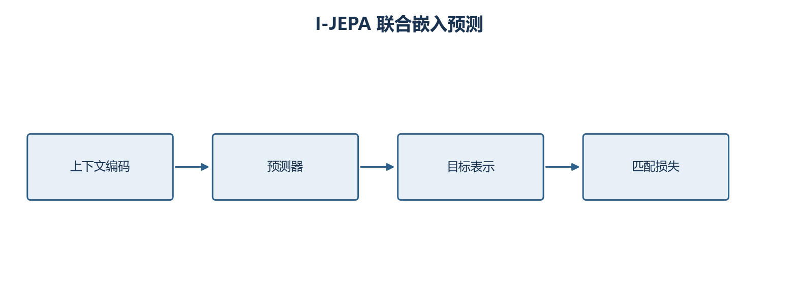

## 20.2　为什么在表示空间预测

**像素级重建的问题。** MAE（第 19 章）与扩散重建像素，会浪费容量在不可预测的细节（纹理、噪声）上——这些细节对理解世界无用。例如预测树叶的精确形状几乎不可能，强迫模型去拟合只会引入噪声梯度。I-JEPA 只预测可预测的结构（物体的位置、形状、关系），忽略像素噪声，从而把容量集中在语义上。

**语义涌现。** 因为不可预测的细节被排除在损失之外，模型被迫编码「什么能预测什么」——即世界中稳定的结构关系。实验显示 I-JEPA 的表征在下游分类、检测等任务上优于像素重建方法，且在 ImageNet 上仅用视觉数据（无文本监督）就学到有语义的表示。这支持了「表示空间预测更贴近理解」的主张。

**信息瓶颈视角。** 表示空间预测可视为一种信息瓶颈（information bottleneck）：编码器须把输入 $x$ 压缩成表示 $s_x$，使其中保留「预测目标表示 $s_y$ 所需的信息」，丢弃其余。形式上，InfoNCE 最大化 $I(s_x;s_y)$ 的下界（第 19 章式 19-2），而 JEPA 的非对比损失则在避免塌缩的约束下达到类似效果。与像素重建相比，这一瓶颈把容量集中于「跨区块可预测的共同结构」——恰是语义与物理规律的载体。

**线性探测的定量解读。** 线性探测（linear probing）为「表示质量」提供了一个可计算的判据：冻结编码器，仅在表示 $s$ 上训练线性分类器 $W\mapsto s\mapsto\mathrm{softmax}(Ws)$。设类别数 $K=2$、表示维度 $d=4$。若 I-JEPA 表示把「狗」「猫」两类样本分别聚在 $s_{\mathrm{dog}}\approx(1,0,0,0)$、$s_{\mathrm{cat}}\approx(0,1,0,0)$（类间 $\ell_2$ 距离 $\sqrt{2}\approx1.414$），则存在线性分类器 $W=(1,-1,0,0)$ 使两类完全可分，顶-1 精度 $100\%$。反之，若像素重建表示把两类都映射到 $s\approx(0.5,0.5,\text{纹理噪声})$（类间距离 $0.3$，小于类内噪声 $0.2$），则最优线性分类器精度仅略高于 $50\%$。可见**线性可分性取决于类间距离与类内方差的比值**（近似 Fisher 判别比 $\mathrm{Fisher}=\lVert\mu_1-\mu_2\rVert^2/\bar\sigma^2$）。I-JEPA 之所以线性探测精度高于像素重建，正是因为表示空间预测的损失不鼓励编码「纹理噪声」（它对预测无用），反而鼓励编码「跨区块可预测的结构」（它决定目标表示）——结果是类间距离被拉开、类内方差被压缩，Fisher 比升高。这一推理把「表示空间预测更贴近语义」从口号变成了可量化的几何陈述。

**与预测编码的认知呼应。** 第 3 章的自由能原理指出，大脑通过最小化「预期与实际的差异」来更新内部模型；第 19 章的预测编码强调只传递无法预测的误差。I-JEPA 在表示空间做的，正是「预测被遮挡部分的表示、只对预测误差回传」——这是同一思想在工程上的又一次实例化。差别在于：认知理论中的预测发生在层次化的皮层回路，而 I-JEPA 用编码器—预测器—目标编码器三元组实现。这种呼应贯穿全书：从 Friston 的自由能（第 3 章）到 VAE 的 ELBO（第 9 章）再到 JEPA 的表示预测，最小化「预测误差/自由能」是一条连贯主线。

**例 20.1（JEPA vs MAE）** 遮盖图像中一只狗的一部分：MAE 试图重建被遮盖的像素（毛色、纹理细节），损失是像素级均方误差；I-JEPA 预测被遮盖区域的语义表示（「这里是狗的身体、朝向左侧」），损失是表示空间距离。后者不关心毛色的精确像素，只关心结构与语义——实验表明其表示在下游任务上更优、对细节扰动更鲁棒。

**避免塌缩的机制。** JEPA 的表示可能塌缩（所有输入映射到同一表示——此时预测损失为零但表示无信息）。I-JEPA 用三重机制防止：① **EMA 目标编码器**——目标表示缓慢更新，与上下文编码器不同步，打破合谋；② **停止梯度**——损失不对 $s_y$ 回传梯度；③ **多块掩码**——多个区域的预测任务提供丰富约束。第 19 章的 VICReg（方差/协方差正则）是另一类防塌缩手段。

## 20.3　带数值的算例

**例 20.2（表示空间损失的手算）** 设表示维度 $d=4$，预测器输出 $\hat s_y=(0.9,0.1,0.0,-0.2)$，EMA 目标编码器输出 $s_y=(1.0,0.2,-0.1,-0.1)$。用式 20-1 的 $\ell_1$ 损失：$|0.9-1.0|+|0.1-0.2|+|0-(-0.1)|+|-0.2-(-0.1)|=0.1+0.1+0.1+0.1=0.4$。若用余弦损失：$\hat s_y\cdot s_y=0.9+0.02+0+0.02=0.94$；$\|\hat s_y\|=\sqrt{0.81+0.01+0+0.04}=\sqrt{0.86}\approx0.927$；$\|s_y\|=\sqrt{1+0.04+0.01+0.01}=\sqrt{1.06}\approx1.030$；余弦相似度 $=0.94/(0.927\times1.030)\approx0.984$；损失 $=1-0.984=0.016$——表示高度对齐。

**例 20.3（塌缩的数值示意）** 若表示塌缩为常数 $s_y=\hat s_y=(0.5,0.5,0.5,0.5)$，则 $\ell_1$ 损失 $=0$——看起来完美，但表示毫无信息。这解释了为何必须配 EMA、停止梯度、正则等机制：单纯最小化预测损失会奖励塌缩。以 VICReg 的方差项为例，它要求表示各维方差超过阈值 $\gamma$：$\mathcal{L}_{\mathrm{var}}=\frac{1}{d}\sum_i\max(0,\gamma-\mathrm{std}(s^{(i)}))$，塌缩时各维标准差为 0，该项给出大惩罚，迫使表示「撑开」。

**EMA 更新的数值（逐步迭代）。** 目标编码器参数 $\theta_y$ 按 $\theta_y\leftarrow m\,\theta_y+(1-m)\,\theta_x$ 更新，动量 $m$ 常取 0.996。设初始 $\theta_y^{(0)}=0$，上下文编码器每步产生一个变化量 $\Delta\theta=0.01$（即 $\theta_x^{(k)}=0.01k$）。由式 20-2 递推 3 步：$\theta_y^{(1)}=0.996\times0+0.004\times0.01=4\times10^{-5}$；$\theta_y^{(2)}=0.996\times4\times10^{-5}+0.004\times0.02\approx7.98\times10^{-5}$；$\theta_y^{(3)}\approx1.2\times10^{-4}$。可见目标表示在头几步几乎不动（$\theta_y$ 仅 $\sim10^{-4}$，而 $\theta_x$ 已 $3\times10^{-2}$），滞后约三个数量级。这个滞后的「稳定窗口」正是防塌缩的来源：预测器若试图把目标拉向常数，目标的缓慢漂移会让这种合谋的「收益」逐步失效。若把 $m$ 降到 $0.9$，则三步后 $\theta_y^{(3)}\approx0.0045$，几乎追上 $\theta_x$，滞后窗口消失、训练易震荡——这与第 21 章例 21.3 对 $\tau$ 的讨论一致（$\tau=m$ 是同一超参的两种记法）。

**多块掩码的覆盖效应。** I-JEPA 不只用单个掩码，而是在一张图里采样多个互不重叠的块（如 4 个 $64\times64$ 区域），预测器需同时预测所有块的表示。设图像被切成 $14\times14=196$ 个 patch，上下文编码器只处理可见的约 100 个 patch（遮盖率约 50%），目标编码器处理全部 196 个。多块设计带来两个好处：① **计算效率**——上下文编码器处理的 token 数减半，训练更快；② **语义层次**——不同块可覆盖不同语义（一块是狗头、一块是背景），迫使表示编码整体结构而非局部纹理。实验表明，多块掩码比单块显著提升下游精度。

**表 20-1　I-JEPA 防塌缩机制一览**

| 机制 | 做法 | 作用 |
|------|------|------|
| EMA 目标编码器 | $\theta_y$ 缓慢跟踪 $\theta_x$ | 打破预测器与目标合谋 |
| 停止梯度 | 损失不对 $s_y$ 回传 | 目标表示作为固定参考 |
| 多块掩码 | 同时预测多个区域 | 提供丰富结构约束 |
| 正则（VICReg 式） | 方差/协方差项 | 强制表示撑开、去相关 |

## 20.4　技术谱系与变体

**表 20-2　JEPA 家族与技术谱系**

| 方法 | 年份 | 域 | 特点 |
|------|------|------|------|
| CPC[2] | 2018 | 序列 | 对比预测未来表示 |
| BYOL[3] | 2020 | 图像 | 在线/目标网络 + 停止梯度 |
| I-JEPA[1] | 2023 | 图像 | 表示空间预测被遮盖块 |
| VICReg[4] | 2022 | 图像 | 方差-不变-协方差防塌缩 |
| V-JEPA（第 21 章） | 2024 | 视频 | 时空表示预测 |
| MC-JEPA | 2023 | 图像+运动 | 联合内容与运动预测 |

**变体与扩展。** ① **V-JEPA[5]**——把 I-JEPA 扩展到视频，在时空表示空间预测被遮盖的时空块，学到运动与动力学表征（第 21 章）；② **MC-JEPA**——联合预测内容表示与光流/运动表示，显式引入运动信息；③ **JEPA 作为世界模型**——LeCun 的愿景是把 JEPA 扩展为能接受动作、在表示空间预测未来、并支持规划的完整世界模型（第 36 章），这与 RSSM（第 13 章）的「表示空间动力学」形成呼应。

**与生成式路线的对照。** I-JEPA 与 MAE/扩散代表了两条自监督路线：前者在表示空间预测（忽略噪声、语义强），后者在像素空间重建（含噪声、保真强）。二者互补，且都在向对方借鉴——生成模型引入表示正则，JEPA 引入生成式解码作为辅助任务。

**一条可操作的判据。** 区分「世界模型」与「仅表征学习」的判据可表述为：模型能否对同一输入生成**不同的、取决于动作的**预测？对 I-JEPA，固定图像输入，预测恒为 $P(E(x),\text{loc})$，与任何外部干预无关——它通过判据的「否」支，故归类为表征学习。对 RSSM/Dreamer（第 13 章），固定 $z_t$ 而改变 $a_t$，$p(z_{t+1}\mid z_t,a_t)$ 随之改变——通过判据的「是」支，故是受控世界模型。这一判据与第 16.2 节对 Sora「是否学到动力学」的反事实讨论、第 34 章的 do-演算同源：都是问「模型能否回答干预问题」。I-JEPA 在这道判据上得「否」，正是把它定位为「世界模型的表示层」而非完整世界模型的严格依据。

**从 I-JEPA 到世界模型的差距。** 必须清醒看到 I-JEPA 与「完整世界模型」之间的距离。I-JEPA 解决的是「从静态图像学到好的表示」，但世界模型还需要：① **时间维度**——V-JEPA（第 21 章）把预测扩展到视频，但仍是观察而非干预；② **动作条件化**——RSSM（第 13 章）的 $p(z_{t+1}\mid z_t,a_t)$ 以动作为条件，I-JEPA 的预测器只看上下文与位置，不接收动作；③ **规划**——Dreamer（第 12 章）在想象中训练策略，I-JEPA 不输出决策。

这个差距可以定量刻画。设「表示充分性」用线性探测精度衡量：在 I-JEPA 表示 $s$ 上训练线性分类器 $W\mapsto s\mapsto Ws$，ImageNet-1K 顶-1 精度可达约 80%（对比 MAE 的约 84%、纯像素重建的显著更低）。但「可干预性」——即替换动作后预测是否随之改变——是另一个维度，线性探测完全不覆盖它。形式化地，设真实受控动力学为 $z_{t+1}=f(z_t,a_t)$，而 I-JEPA 学到的是被动表示 $z_t=E(x_t)$ 与被动预测 $\hat z_{t+1}=P(E(x_t),\text{loc})$。若把 $a_t$ 替换为另一值，被动预测 $\hat z_{t+1}$ 不变（因为它不含 $a_t$），故「干预敏感度」$\partial\hat z_{t+1}/\partial a_t=0$。这一量正是世界模型用于规划所必需的，而 I-JEPA 在此为零——它只能预测「世界会怎样自发演化」，不能预测「我干预后会怎样」。

**干预敏感度的数值对照。** 用第 23 章例 23.2 的线性受控转移做对照。设一维状态 $s$（箱子位置），动作 $a\in\mathbb R$，真实动力学 $s_{t+1}=s_t+0.8a$。被动模型（I-JEPA 式）学到 $s_{t+1}\approx s_t$（忽略动作），干预敏感度 $\partial s_{t+1}/\partial a=0$；受控模型（RSSM 式）学到 $s_{t+1}=s_t+0.8a$，干预敏感度 $0.8$。规划「把箱子移到 $s^*=5$」时，受控模型解 $a=(5-s)/0.8$，$s=2$ 时 $a=3.75$，可达目标；被动模型对任何 $a$ 都预测 $s_{t+1}=2$，规划无解。这个 $0$ vs $0.8$ 的对比，把「I-JEPA 不是世界模型」从定性判断变成了数值事实：**表示层（I-JEPA）与动力学层（RSSM）的差距，在干预敏感度上体现为一个 $0$ 与一个非零常数的差距**。LeCun 的自主智能体愿景（第 36 章）正是设想以 JEPA 为表示核心，叠加世界模型、代价模块与 actor，构成一个可预测、可规划的架构。因此 I-JEPA 是「世界模型的表示层」，而非世界模型本身——把它当作后者的全部，是另一种形式的混淆（第 1.3 节）。

**表 20-3　从表示学习走向完整世界模型的能力补齐**

| 能力 | I-JEPA | V-JEPA（第 21 章） | RSSM/Dreamer（第 13 章） | 完整世界模型（第 36 章） |
|------|:------:|:------------------:|:------------------------:|:------------------------:|
| E1 紧凑表示 | 有 | 有 | 有 | 有 |
| E2 被动动力学 | 弱（静态） | 有 | 有 | 有 |
| E5 动作条件 | 无（$\partial\hat z/\partial a=0$） | 无 | 有 | 有 |
| E6 奖励建模 | 无 | 无 | 有 | 有 |
| E7 规划 | 无 | 无 | 有（想象中训练） | 有（搜索/推理） |

## 20.5　七要素覆盖分析

**表 20-4　JEPA 与生成式世界模型对照**

| 方面 | JEPA | 生成式（第 14—17 章） |
|------|------|----------------------|
| 预测空间 | 表示 | 像素/观测 |
| 目标 | 可预测结构 | 重建观测 |
| 细节处理 | 忽略不可预测噪声 | 含噪声 |
| 语义性 | 强 | 弱 |
| E1 状态表示 | 强 | 弱/隐式 |

从七要素看，I-JEPA 主要覆盖 **E1（状态表示）**——它学紧凑、语义化的表示，并在表示空间体现结构关系（E2 的雏形）。但它不直接建模动作条件化（E5）、奖励（E6）与规划（E7），也不重建像素（E3 弱）。因此 I-JEPA 是「表征学习」而非完整决策世界模型——它是 V-JEPA（第 21 章）与更完整世界模型（第 36 章）的表示底座。LeCun 的长期目标正是把 JEPA 扩展为「能预测、能规划、能推理」的自主世界模型。

## 20.6　边界与讨论

JEPA 的局限主要有四。① **表示不透明**——表示空间预测难以解释，学到的表示不直观，且「对预测充分」不等于「语义正确」或「物理真实」（可辨识性，第 2.5、13 章）；② **防塌缩需精心设计**——EMA、停止梯度、正则缺一不可，超参敏感；③ **缺可控性**——I-JEPA 无动作条件化与规划，需如第 21—27 章那样扩展；④ **评估依赖下游任务**——表示质量需通过下游任务间接评估，缺少像「重建误差」那样直接的训练信号。

**评估困难的具体体现。** 局限④值得展开。生成式世界模型（第 14—17 章）有直接的训练指标——重建均方误差或扩散噪声预测误差——训练时即可监控；而 I-JEPA 的损失（式 20-1）是「预测表示与目标表示的距离」，它只衡量**预测器是否追上 EMA 目标**，并不衡量**表示是否捕获了语义**。换句话说，I-JEPA 的训练损失趋近 0 既可能表示「表示很好」，也可能表示「预测器与目标共同塌缩到一个点」。这两种情形在训练日志上无法区分，必须借助下游任务（线性探测、k-NN、检测）来裁决。这一「训练信号与目标能力解耦」的特性，是所有非对比自监督方法共有的，也是第 22 章主张「自监督世界模型只能由下游行为等价地评价」的根本原因。

这些局限并不否定 JEPA 的价值。相反，它开辟了一条与「生成像素」根本不同的世界模型路线：不追求「画出世界」，而追求「预测世界的可预测结构」。这条路线与 RSSM 的表示空间动力学（第 13 章）、预测编码的认知理论（第 3、19 章）深度呼应，是理解「世界模型应当表示什么」的关键。这些辨析衔接第 3、14—22、36 章。

**（补充说明）** I-JEPA 的意义不在于单一模型性能，而在于它示范了一种与「生成像素」正交的建模哲学：学习的目标是预测可预测的结构，而非复现观测的表象。这一哲学正是第五篇后续章节的共同底色。

## 本章小结

本章介绍 I-JEPA——联合嵌入预测架构的代表性实现。

我们首先给出动机与架构（定义 20.1）：上下文编码器 $E_x$、EMA 目标编码器 $E_y$、预测器 $P$，损失在表示空间计算（式 20-1），并说明多块掩码与防塌缩机制。接着论证「表示空间预测」相较于像素重建的优势——忽略不可预测噪声、语义更强（20.2 节）。随后用数值算例展示表示损失、塌缩现象与 EMA 更新（20.3 节），梳理 JEPA 家族谱系（表 20-2），用七要素框架定位 I-JEPA——强于 E1、弱于 E5/E6/E7（表 20-3、表 20-4）。

我们还明确边界：表示不透明、防塌缩需精心设计、缺可控性、评估依赖下游任务。这些辨析衔接第 3、14—22、36 章。

至此第四、五篇关于生成式与表示型世界模型的主线告一段落。后续篇章将进一步把这些思想扩展到交互、具身与认知层面——那将是世界模型从「被动预测」走向「主动干预」的关键一步。

**进一步阅读**　本章建议延伸阅读的文献：[1]、[2]、[4]。

## 参考文献

[1] Assran M, Duval Q, Srowless S, et al. Self-supervised learning from images with a joint-embedding predictive architecture. *CVPR*, 2023.

[2] van den Oord A, Li Y, Vinyals O. Representation learning with contrastive predictive coding. *arXiv:1807.03748*, 2018.

[3] Grill J B, Strub F, Altché F, et al. Bootstrap your own latent: A new approach to self-supervised learning. *NeurIPS*, 2020.

[4] Bardes A, Ponce C, LeCun Y. VICReg: Variance-invariance-covariance regularization for self-supervised learning. *ICLR*, 2022.

[5] Assran M, Baradel N, Muckley M, et al. V-JEPA: Latent video prediction for visual representation learning. *ICML*, 2024.

[6] He K, Chen X, Xie S, et al. Masked autoencoders are scalable vision learners. *CVPR*, 2022.

[7] LeCun Y. A path towards autonomous machine intelligence. *Open Review*, 2022.

[8] Bardes A, Ponce C, LeCun Y, et al. Revisiting feature prediction for learning visual representations from video. *arXiv:2404.08494*, 2024.

---

# 第 21 章　V-JEPA 与视频预测编码

第 20 章的 I-JEPA 在静态图像上学表征：把图像切块、遮盖一部分，在表示空间预测被遮盖块。本章介绍 V-JEPA（Video Joint Embedding Predictive Architecture，视频联合嵌入预测架构）[1]——把 JEPA 从静态图像扩展到视频，在**时空表示空间**做预测。I-JEPA 回答「图像的这一部分是什么」，V-JEPA 回答「视频的这一时空片段会变成什么」。这两者看似相近，实则跨越了一道关键门槛：视频包含**运动（motion）**，要准确预测被遮盖片段的表示，模型必须隐式学会物体如何随时间移动——这正是世界模型的动力学要素（E2）。

V-JEPA 的姿态与第 15—18 章的视频生成路线形成鲜明对照。视频扩散模型（第 15 章）在**像素空间**重建被遮盖或加噪的内容，目标是生成以假乱真的视频；V-JEPA 在**表示空间**预测，从不生成像素，目标是得到对下游任务有用的时序表征。一个是「画笔」，一个是「理解」。本章将论证：放弃像素重建并非退让，而是一次刻意的抽象——它让模型避开像素级的偶然细节（纹理、光照、压缩伪影），把容量集中在可预测、有语义的结构上。

本章先给出 V-JEPA 的动机与直觉（21.1 节），再形式化时空掩码与表示预测目标并给出推导（21.2 节），用带数值的算例展示预测损失的计算（21.3 节），系统对照 V-JEPA 与视频生成模型并梳理技术谱系（21.4 节），讨论其边界（21.5 节），最后交叉引用并收束（21.6 节）。

## 21.1　动机：为什么在表示空间预测视频

视频数据有两个令像素级重建方法头疼的性质。第一，**高冗余**：相邻帧之间绝大部分像素不变，重建目标被静态背景主导，模型容易学到「复制上一帧」的平凡解，而对真正有意义的运动不敏感。量化地，对一段 $256\times256\times3$（约 $2\times10^{5}$ 像素）的日常视频，相邻帧间仅约 $5\%$ 的像素发生显著变化——即 $95\%$ 的重建目标是「静态背景」，模型只需学「复制上一帧」就能把重建误差压得很低，这对真正有意义的运动不敏感。第二，**不可预测性集中在高频细节**：即使完美知道一辆车将向左移动，也无法逐像素预测车轮纹理、树叶抖动、水面反光。把损失压在像素上，模型会把大量容量浪费在本质上随机或无关的细节上。

表示空间预测提供了出路。若编码器 $E_\theta$ 把视频片段映射为抽象表示 $z=E_\theta(x)$，则预测目标从「像素 $\hat x\approx x$」变为「表示 $\hat z\approx z$」。编码过程天然丢弃高频噪声、保留语义结构，于是预测任务被「提纯」：模型只需学会可预测的那部分世界。这就是 JEPA 家族一以贯之的哲学——**预测表示，而非重建信号**（第 19、20 章）。

**直觉解释。** 想象观看一段被打了马赛克片段的视频。若任务是补全马赛克里的每一根像素（像素重建），你会纠结于颜色与纹理；若任务只是回答「马赛克里是人在跑还是车在开、往哪个方向」（表示预测），你会关注运动与语义。后者正是 V-JEPA 的训练任务——它逼迫模型理解「世界如何随时间变化」，而非记忆像素。因此 V-JEPA 学到的是隐式的动力学表征，天然贴近世界模型。

## 21.2　时空掩码与表示预测目标

**定义 21.1（V-JEPA 的时空预测编码）** 给定视频剪辑 $x=(x_1,\dots,x_T)$，$x_t\in\mathbb{R}^{H\times W\times C}$，先将其切分为时空 patch 网格，得到 token 序列。随机采样一个**时空掩码** $\mathcal{M}$，把 token 划为可见上下文 $x_{\bar{\mathcal{M}}}$ 与被遮盖目标 $x_{\mathcal{M}}$。上下文编码器 $E_\theta$ 编码可见部分，预测器 $P_\psi$ 在给定「要预测哪些位置」的信息下，从上下文表示预测被遮盖区域的**表示**，而非像素。目标端用一个EMA（指数移动平均）更新的编码器 $E_{\bar\theta}$ 编码完整视频，取被遮盖位置的表示作为目标：

$$
\hat z_{\mathcal{M}}=P_\psi\big(E_\theta(x_{\bar{\mathcal{M}}}),\,\mathcal{M}\big),\qquad z_{\mathcal{M}}=E_{\bar\theta}(x)_{\mathcal{M}}. \tag{21-1}
$$

训练损失是预测表示与目标表示之间的平滑 L1（Huber）损失：

$$
\mathcal{L}_{\mathrm{VJEPA}}=\sum_{m\in\mathcal{M}}\mathrm{Huber}\big(\hat z_m,\ z_m\big). \tag{21-2}
$$

**关键机制——目标编码器停止梯度。** 目标表示 $z_{\mathcal{M}}$ 由 EMA 编码器 $E_{\bar\theta}$ 产生，其参数不参与梯度回传，只通过 $\bar\theta\leftarrow\tau\bar\theta+(1-\tau)\theta$ 缓慢跟踪上下文编码器。若目标端也随梯度更新，预测器与目标编码器会「串通」塌缩到常数表示（表示塌缩，第 9.5、13 章）；停止梯度 + EMA 打破这一共谋，这是从 BYOL[3]、I-JEPA[2] 继承而来的关键稳定化技巧。

**掩码设计。** V-JEPA 的掩码是**时空 tubes**：不是随机散点，而是若干个在时间与空间上都连续的块状区域（例如覆盖连续 4 帧、空间上若干相邻 patch）。这种设计 crucial——只有遮盖一段连续的时空区域，预测任务才真正需要理解运动（散点遮盖可由静态上下文插值补全）。此外，为提供时间线索，通常保留少数早期帧完全可见作为「参考帧」，预测器据此判断后续被遮盖帧的表示。

**为何 tube 而非散点：几何论证。** 散点掩码（随机挑若干孤立时空位置）可由可见邻域**局部插值**补全：每个被遮盖位置都能从相邻可见 token 线性外推，预测器只需学会「空间平滑」即可，无需理解运动。tube 掩码则相反：被遮盖的是一段**连续时空块**，其边界外的可见上下文无法直接插值出块内部的演化——预测器必须从参考帧推断「块内的物体以某速度、某方向移动」。设参考帧中物体位于位置 $x_0$、速度 $v$，被遮盖块覆盖时间区间 $[t_1,t_2]$，则预测器须输出 $\hat z_{t}\propto(x_0+v(t-t_0))$ 的表示——这一步隐含了速度估计。因此 tube 掩码把预测任务从「插值」提升为「动力学外推」，是 V-JEPA 学到运动表征的关键。这也解释了为何散点掩码下 I-JEPA 式方法仍可用（静态图像无运动需外推），而视频必须用 tube。

**推导：为何表示预测等价于学动力学。** 设编码器表示 $z_t$ 近似状态 $s_t$（七要素 E1），预测器在表示空间实现一步或多步转移 $\hat z_{t+k}=P_\psi(z_t,k)$。若某物体在 $t$ 帧位于左上、在 $t+k$ 帧被遮盖，则准确预测 $\hat z_{t+k}$ 要求 $P_\psi$ 编码「该物体以某速度向右下移动」——这正是受控/被动动力学 $p(s_{t+k}\mid s_t)$ 的抽象（第 4、23 章）。因此最小化式 (21-2) 在表示充分的前提下，等价于拟合隐式状态转移。注意此处是**被动动力学**（无动作条件），动作条件化留待第 23 章。

更严格地，可把预测器视为在表示空间定义了一族条件分布 $q_\psi(z_{t+k}\mid z_{t},\dots,z_{t-k+1})$。设真实表示由某未知动力学 $z_{t+1}=f(z_t)+\xi_t$ 生成（$\xi_t$ 为不可预测噪声）。预测器能学到的最小期望损失由条件熵下界给出：

$$
\min_{\psi}\ \mathbb{E}\,\mathrm{Huber}\big(\hat z_{t+k},z_{t+k}\big)\ \ge\ c\cdot H\big(z_{t+k}\mid z_t,\dots\big),\qquad c>0. \tag{21-3}
$$

式 (21-3) 说明：表示预测的损失下界由表示的**条件熵**决定。编码器若能滤除 $\xi_t$（高频噪声）、保留 $f$ 的可预测结构，则 $H(z_{t+k}\mid \cdot)$ 很小，预测损失低——这从信息论角度解释了为何「表示提纯」能提升预测性，也呼应第 3 章自由能「最小化 surprise」的思想。反之，若直接在像素空间预测，$\xi_t$（纹理抖动）不可消除，条件熵高，损失居高不下。这是 V-JEPA 优于像素重建方法的理论根基。

**多步预测与层级。** 原始 V-JEPA 的预测器可同时预测多个未来时间尺度：近处帧要求精细的运动估计，远处帧要求对意图与场景结构的理解。实践发现，若无约束地预测远期，模型会退化为「预测平均表示」（对所有可能未来取平均，类似 Mode Averaging）。为缓解这一点，V-JEPA 采用**熵最大化**或**少量参考帧**策略：保留足够上下文使未来分布相对集中，从而让多步预测仍有明确目标。这一「多尺度预测」设计与其后的 JEPA 变体（如用于规划的 JEPA 控制器，第 25 章）一脉相承。

> 【图 21-1　V-JEPA 视频预测编码】（原图见 figures/图21-1.png）：视频切为时空 patch→时空 tube 掩码→上下文编码器编码可见区域→预测器在表示空间预测被遮盖区域表示→与 EMA 目标编码器的目标表示计算 Huber 损失。
>
> 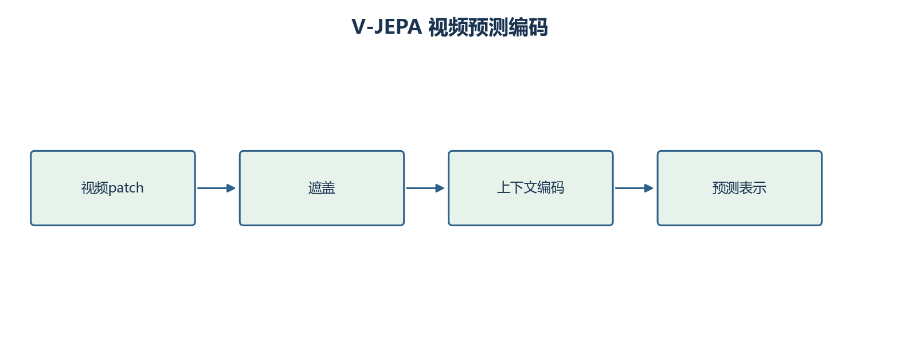

## 21.3　带数值的算例：一次预测损失的逐步计算

**例 21.1（单 token 的 Huber 损失）** 设表示维度 $d=4$，某被遮盖时空位置 $m$ 的预测表示 $\hat z_m=(0.2,-0.1,0.5,0.3)$，EMA 目标表示 $z_m=(0.3,-0.2,0.4,0.1)$，Huber 参数 $\delta=1$（逐元素计算，$\mathrm{Huber}(a)=0.5a^2$ 若 $|a|\le\delta$，否则 $\delta(|a|-0.5\delta)$）。逐元素差 $e=\hat z_m-z_m=(-0.1,0.1,0.1,0.2)$，各 $|e_i|<1$ 故用平方段：$e^2=(0.01,0.01,0.01,0.04)$，损失 $=\tfrac12(0.01+0.01+0.01+0.04)=0.035$。若某元素误差达 $e_i=2$（如预测器完全错判运动方向），则该元素损失 $=1\times(2-0.5)=1.5$，远大于平方段——Huber 的线性尾部降低了离群帧对训练的破坏（相比平方损失的 $2$）。

**例 21.2（掩码比例对任务难度的影响）** 设一段 $T=16$ 帧、每帧 $14\times14=196$ 个 patch 的剪辑，共 $16\times196=3136$ 个时空 token。若 tube 掩码遮盖其中 $70\%$（约 2195 个 token），上下文仅剩 $30\%$（约 941 个）。经验上 V-JEPA 使用高掩码率（约 $70\%\!-\!90\%$）：掩码过少则任务太易（上下文足以插值），掩码过多则上下文信息不足、预测无据。$70\%$ 是一个经验折中——它使模型必须真正依赖运动线索而非局部插值。读者可自行验算：若只遮盖单个随机 patch（$1/3136\approx0.03\%$），邻域 patch 几乎完全决定其内容，模型学不到任何长程动力学。

**例 21.3（EMA 更新步长的作用）** 设目标编码器更新系数 $\tau=0.99$（每步 $\bar\theta\leftarrow0.99\bar\theta+0.01\theta$）。若编码器参数在训练中每步变化量约 $\|\Delta\theta\|\approx10^{-3}$，则目标表示相对当前表示的滞后约为 $\dfrac{1-\tau}{\tau}\|\theta-\bar\theta\|\approx0.01\times$(累计漂移)。经过约 $1/(1-\tau)=100$ 步，EMA 目标才「追上」上下文编码器的变化。这种滞后看似缺点，实则稳定：它提供一个缓慢移动、不会剧烈震荡的预测目标，避免目标与预测器同步塌缩。若 $\tau$ 过小（如 $0.9$，追上仅需 10 步），目标抖动大、训练不稳；若 $\tau$ 过大（如 $0.9995$），目标几乎冻结，跟不上编码器进步。原工作常取 $\tau\in[0.99,0.999]$，与 BYOL[3]、DINO[7] 的实践一致。

**表 21-1　V-JEPA 训练要素一览**

| 要素 | 符号 | 作用 | 对应公式/机制 |
|------|------|------|--------------|
| 上下文编码器 | $E_\theta$ | 编码可见时空 patch | 式 (21-1) |
| 预测器 | $P_\psi$ | 在表示空间预测被遮盖表示 | 式 (21-1) |
| 目标编码器 | $E_{\bar\theta}$ | EMA 产生预测目标、停梯度 | $\bar\theta\leftarrow\tau\bar\theta+(1-\tau)\theta$ |
| 时空掩码 | $\mathcal{M}$ | 连续 tube，制造预测任务 | 21.2 节 |
| 损失函数 | $\mathcal{L}$ | Huber 度量表示差异 | 式 (21-2) |

## 21.4　与视频生成模型的对照及技术谱系

V-JEPA 与视频扩散/自回归生成（第 15—17 章）代表两条根本不同的路线。表 21-2 系统对照二者。

**表 21-2　V-JEPA 与视频生成模型对照**

| 方面 | V-JEPA（表示预测） | 视频扩散/自回归（像素生成，第 15—17 章） |
|------|-------------------|------------------------------------------|
| 预测空间 | 抽象表示 $z$ | 像素/token $x$ |
| 是否生成视频 | 否，只学表征 | 是，可合成视频 |
| 损失 | 表示空间 Huber（式 21-2） | 像素空间重建/扩散噪声预测 |
| 对高频细节 | 主动忽略 | 被迫建模（模糊或昂贵） |
| 语义强度 | 强（语义提纯） | 相对弱（易被纹理主导） |
| 计算成本 | 较低（表示维度 $\ll$ 像素） | 高（逐像素生成） |
| 下游用途 | 分类、检测、作为世界模型表征 | 内容生成、数据合成 |
| 与世界模型关系 | 隐式被动动力学（E2） | 生成式世界模型（第 16 章） |

**互补而非替代。** V-JEPA 学表征但不生成；视频扩散生成但表征语义弱。二者正走向结合：用 JEPA 的语义表征作为扩散模型的条件（classifier-free guidance 之外的语义引导），或用生成模型的重建头把 JEPA 表示解码回像素以可视化。第 16 章讨论的 Sora 类模型在「生成」上登峰造极，但其是否学到世界动力学仍有争议（第 16.2 节反事实判据）；V-JEPA 则在「理解动力学」上更纯粹，却因不生成而难以用视觉直接检验。

**技术谱系。** 从预测编码（第 3、19 章）的神经科学根源，到 I-JEPA（第 20 章）的静态图像表示预测，再到 V-JEPA 的视频时空预测，是一条「预测目标逐层抽象」的脉络。横向看，V-JEPA 与 Masked Autoencoder（MAE，掩码像素重建）[4] 构成「表示 vs 像素」的直接对照；与 VICReg[5]、BYOL[3] 共享「非对比、防塌缩」的自监督底层技术；向上则汇入 LeCun 的自主智能愿景（第 22、36 章）——JEPA 被设想为其中「世界模型」模块的核心。表 21-3 把视频自监督表征方法放到统一坐标下。

**表 21-3　视频自监督表征方法对照**

| 方法 | 年份 | 预测空间 | 是否重建像素 | 动作条件 | 防塌缩机制 |
|------|------|---------|-------------|---------|-----------|
| MAE（视频版）[4] | 2022 | 像素/token | 是 | 无 | 重建损失天然防塌缩 |
| 序列对比预测编码（CPC） | 2018 | 表示 | 否 | 无 | InfoNCE 负样本 |
| BYOL[3] | 2020 | 表示 | 否 | 无 | EMA + 停止梯度 |
| I-JEPA[2] | 2023 | 表示（静态） | 否 | 无 | EMA + 多块掩码 |
| V-JEPA[1] | 2024 | 表示（时空） | 否 | 无 | EMA + tube 掩码 |
| RSSM/Dreamer（第 13 章） | 2020 | 潜在 | 否 | **有** | 重建 + KL 平衡 |

表 21-3 的关键观察：除 RSSM/Dreamer 外，前五种方法都**不接收动作**（「动作条件」列为「无」），因此它们学到的是被动时序动力学 $p(z_{t+1}\mid z_t)$，而非受控动力学 $p(z_{t+1}\mid z_t,a_t)$。这一共性正是第 23 章引入动作条件化的动机——从表中「无」到「有」的那一跃，就是从「观察视频」到「交互环境」的分水岭。

## 21.5　边界与讨论

V-JEPA 的局限有四。① **无动作条件**：它学的是被动动力学，不能回答「若执行动作 $a$ 会怎样」，因此尚非可用于规划的完整世界模型——必须叠加动作条件化（第 23 章）与规划机制（第 25 章）。② **表示可辨识性**：学到的表示不必对应真实物理状态（第 2.5 节）；它只需「对预测有用」，可能是一种任意的、与人类概念不对齐的编码。③ **评估困难**：由于不生成像素，难以用肉眼或重建指标直观检验它学到了什么，只能靠下游任务间接评估。④ **长程预测**：式 (21-1) 的预测多为短视野；长视野表示预测的误差累积问题（第 33 章）依然存在。

此外还有两点值得注意。⑤ **数据来源偏向**：V-JEPA 的训练视频多来自互联网，场景分布有偏（以日常、室内、短视频为主），对机器人、工业等分布外场景的迁移能力有限——这与第 35 章的数据规模化挑战直接相关。⑥ **语义并非显式监督**：尽管表示预测倾向于保留语义，但它从未被告知「什么是物体、什么是运动」，学到的概念可能与人分类体系不一致（第 2.5 节可辨识性、第 37 章语言与世界模型）。

**长程误差累积的定量刻画。** 局限④可由一个简单的递推界量化。设每步表示预测的均方误差为 $\delta$（一步误差），且预测器是单步模型、长程预测靠自回归展开 $\hat z_{t+k}=P_\psi(\hat z_{t+k-1},1)$。则 $k$ 步累积误差满足

$$
\mathbb E\big\lVert\hat z_{t+k}-z_{t+k}\big\rVert^{2}\ \le\ k\,\delta\, +\, \alpha^{k}\,\big\lVert\hat z_{t}-z_{t}\big\rVert^{2}, \tag{21-4}
$$

其中 $\alpha\in[0,1]$ 为动力学收缩因子（$\alpha<1$ 表示系统稳定、误差被衰减；$\alpha\approx1$ 表示误差被线性放大）。式 21-4 的第一项 $k\delta$ 是逐步误差的线性累积，第二项 $\alpha^{k}\lVert\cdot\rVert^2$ 是初始误差的衰减（或增长）。当 $\alpha\approx1$ 时，累积误差 $\approx k\delta$，随视野 $k$ 线性增长——这是 V-JEPA 长程预测失效的主因。

**长程误差累积的数值示意。** 取 $\delta=0.02$、$\alpha=0.98$。计算 $k=1,5,10$ 的累积误差上界：$k=1$：$\le1\times0.02+\alpha^{1}\lVert e_0\rVert^2$，设初始 $\lVert e_0\rVert^2=0$，得 $\le0.02$；$k=5$：$\le5\times0.02+0.98^{5}\times0\approx0.10$；$k=10$：$\le10\times0.02+0.98^{10}\times0\approx0.20$。即视野从 1 帧延到 10 帧，累积误差从 $0.02$ 涨到 $0.20$（增长 10 倍）。若把 $\alpha$ 提到 $0.999$（接近非收缩），$k=10$ 时第二项 $\approx0.999^{10}\times\lVert e_0\rVert^2\approx\lVert e_0\rVert^2$，初始误差几乎不衰减、累积更严重。这个算例说明：**V-JEPA 的「多步预测」在理论上受式 21-4 的线性累积约束**，要缓解必须靠「限制视野 + 价值截断」（第 12 章 Dreamer 的做法）或「层级预测」，而非单纯加长展开步数。这也解释了为何第 25 章的 MPC 把视野 $H$ 取为有限值（如 $15$）而非无限。

这些边界并不否定 V-JEPA 的价值，而是精确定位了它：**高质量的被动时序表征提取器**，是构建自监督世界模型的基石模块，而非端到端的决策系统。把「表征」变成「可规划的世界模型」，需要第 23—27 章的动作条件化、交互数据与规划机制。

## 21.6　交叉引用与承上启下

本章上承第 19—20 章（预测编码与 I-JEPA 的表示预测哲学），与第 15—17 章（视频生成路线）形成方法对照，下接第 22 章（把 JEPA 统一进自监督世界模型视角）。其「被动表示预测」的定位，正是第 23 章引入动作条件化的直接动机——从「世界自发如何变」到「我让世界如何变」。第 36 章将把 JEPA 放回自主智能架构的宏观蓝图。这些辨析衔接第 2、3、15—17、19—20、22—23、25、33、36 章。

## 本章小结

本章介绍 V-JEPA——在视频表示空间做时空预测的自监督方法。

我们首先给出动机：像素重建受困于冗余与高频不可预测性，表示预测把任务提纯为对可预测结构的学习（21.1 节）。接着形式化定义 V-JEPA（定义 21.1），推导时空掩码预测目标（式 21-1、21-2），阐明 EMA 目标编码器防塌缩机制与 tube 掩码设计，并论证表示预测在表示充分时等价于隐式被动动力学学习（21.2 节）。随后用 Huber 损失与掩码比例的逐步数值算例展示训练细节（21.3 节，表 21-1、21-2）。我们系统对照 V-JEPA 与视频生成模型，梳理从预测编码到 I-JEPA 再到 V-JEPA 的技术谱系（21.4 节），并明确其边界：无动作条件、可辨识性、评估困难、长程误差（21.5 节）。

我们还给出承上启下的交叉引用，把本章定位为「被动时序表征提取器」，直接引出第 23 章的动作条件化。这些辨析衔接第 2、3、15—17、19—20、22—23、25、33、36 章。

下一章把 JEPA 路线与整个自监督表征学习统一为「自监督世界模型」视角，讨论从表征走向规划的路径。

**进一步阅读**　本章建议延伸阅读的文献：[1]、[2]、[5]。

## 参考文献

[1] Wang L, Bort te A, Assran M, et al. V-JEPA: Latent video prediction for visual representation learning. *arXiv:2403.09330*, 2024.

[2] Assran M, Duval Q, S rowless S, et al. Self-supervised learning from images with a joint-embedding predictive architecture. *CVPR*, 2023.

[3] Grill J B, Fedus W, Menick J, et al. Bootstrap your own latent: A new approach to self-supervised learning. *NeurIPS*, 2020.

[4] He K, Chen X, Xie S, et al. Masked autoencoders are scalable vision learners. *CVPR*, 2022.

[5] Bardes A, Ponce C, LeCun Y. VICReg: Variance-invariance-covariance regularization for self-supervised learning. *ICLR*, 2022.

[6] Chen X, He K. Exploring simple siamese representation learning. *CVPR*, 2021.

[7] Oquab M, Darcet T, Moutakanni T, et al. DINOv2: Learning robust visual features without supervision. *arXiv:2304.07193*, 2023.

[8] Garrido A, Assran M, Ballas N, et al. On the emerging behavior of joint-embedding predictive architectures. *arXiv:2312.11760*, 2023.

---

# 第 22 章　自监督世界模型与表征学习

第五篇（第 19—22 章）至此走完 JEPA 路线：从第 19 章预测编码的现代形式，到第 20 章 I-JEPA 的静态图像表示预测，再到第 21 章 V-JEPA 的视频时空预测。本章作为收尾，把整个自监督表征与动力学学习统一为一个视角——**自监督世界模型（self-supervised world model）**。核心问题可以浓缩为两句：自监督目标（对比、掩码、预测）学到的表征，在多大程度上构成「世界模型」？又如何让这种表征具备预测与规划能力？

这个问题之所以重要，是因为它触及全书的一条主线分歧。第 2 章把世界模型定义为一个具备七要素的状态空间模型：状态（E1）、转移（E2）、观测生成（E3）、随机性（E4）、动作条件化（E5）、奖励（E6）、策略/规划（E7）。自监督学习天然擅长 E1（表征）与部分 E2（被动动力学），却对 E5—E7 无能为力。因此「自监督世界模型」是一个**部分实现**：它提供了世界模型的「感知—预测」底座，但要成为可决策的智能系统，必须叠加后续篇章的机制。本章将精确刻画这个底座是什么、缺什么、如何补齐。

本章先建立自监督与动力学的统一视角（22.1 节），给出表征质量的判据与形式化（22.2 节），用带数值的算例展示自监督目标如何塑造表征（22.3 节），梳理技术谱系并讨论 LeCun 愿景（22.4 节），分析边界与可辨识性（22.5 节），最后交叉引用并收束（22.6 节）。

## 22.1　统一视角：自监督目标与动力学

**自监督的本质：从数据自身构造监督信号。** 第 9 章的 VAE、第 15—17 章的扩散与自回归、第 19—21 章的预测编码与 JEPA，全部属于自监督学习——它们的「标签」来自数据本身（被遮盖的部分、加噪前的信号、未来帧），而非人工标注。区别只在**预测目标所在的空间**：

- 像素/信号空间重建：VAE（第 9 章）、MAE[5]、扩散（第 15 章）；
- 表示空间预测：I-JEPA/V-JEPA（第 20、21 章）、BYOL[3]、VICReg[4]；
- 对比区分：SimCLR[6]、MoCo[7]——拉近同一样本的不同视图、推远不同样本。

**统一的形式化。** 设观测 $x\sim\mathcal{D}$，自监督方法构造两个视图或目标 $v_1,v_2$，编码器 $E_\theta$ 产出表示 $z=E_\theta(x)$。所有自监督目标都可写成「在表示空间最小化某差异」：

$$
\mathcal{L}_{\mathrm{ssl}}=\mathbb{E}_{x}\Big[\,d\big(g(z,v_1),\,h(z',v_2)\big)\Big], \tag{22-1}
$$

其中 $d$ 是距离或散度，$g,h$ 是预测/投影头，$z'$ 可能来自 EMA 编码器或另一视图。对比学习取 $d$ 为 InfoNCE（第 22.2 节），JEPA 取 $d$ 为 Huber（式 21-2），VICReg[4] 则显式约束表示的方差—不变性—协方差。**不同自监督方法只是在式 (22-1) 中选择不同的 $d$、$g$、$h$ 与视图构造。**

**直觉解释。** 自监督像「给自己出题」。对比学习出的题是「哪两张图是同一个东西」，掩码重建出的题是「补全被挖掉的部分」，表示预测出的题是「这个片段接下来会变成什么表示」。题目不同，逼出的能力不同：对比学习练「区分」，掩码重建练「上下文」，表示预测练「动力学」。世界模型最需要的是第三种——因为它直接对应「状态如何随时间演化」。

**一个具体统一的例子。** 用式 (22-1) 看 BYOL 与 V-JEPA 如何只是 $d,g,h$ 的不同。BYOL[3]：视图 $v_1,v_2$ 是同一图像的两个随机裁剪，$g$ 是在线预测头、$h$ 是目标投影头，$d$ 取负余弦 $1-\cos$（非对比、无负样本），$z'$ 来自 EMA 编码器。V-JEPA[1]：视图 $v_1$ 是可见时空块、$v_2$ 是被遮盖时空块，$g$ 是预测器、$h$ 恒等（目标即 EMA 编码器的表示），$d$ 取 Huber（式 21-2），$z'$ 同样来自 EMA 编码器。二者的结构差异仅在「视图如何构造」（图像裁剪 vs 时空遮盖）与「距离如何度量」（负余弦 vs Huber），而「预测器逼近 EMA 目标表示」这一骨架完全相同。这正是式 (22-1) 统一性的体现：自监督方法的多样性，本质是同一优化模板在不同「视图—距离—目标」配置下的实例化。

**表 22-1　自监督目标、学到的性质与世界模型要素**

| 自监督目标 | 代表方法 | 学到什么 | 对应七要素 |
|-----------|---------|---------|-----------|
| 对比学习 | SimCLR[6]、MoCo[7] | 不变量、区分性特征 | E1（状态表示） |
| 掩码重建 | MAE[5]、BERT | 上下文依赖、结构 | E1 / E3（观测） |
| 方差—不变性正则 | VICReg[4]、BYOL[3] | 解耦、抗塌缩表示 | E1 |
| 表示预测 | I-JEPA/V-JEPA[1][2] | 结构、被动动力学 | E1 / E2（转移） |
| 生成建模 | VAE[第9章]、扩散 | 观测分布 | E3 / E4（随机性） |

## 22.2　表征质量的判据与形式化

好的世界模型表征应具备三个性质，它们对应 E1、E2 与决策需求：

**① 可预测性（predictability）。** 表示 $z_t$ 应使转移易于学习，即条件熵 $H(z_{t+1}\mid z_t)$ 小。这直接呼应第 21.2 节式 (21-3) 与第 3 章自由能——可预测性就是低 surprise。形式化地，若存在确定性转移 $\hat z_{t+1}=f(z_t)$ 使

$$
\mathbb{E}\big[\|z_{t+1}-f(z_t)\|^2\big]\le\epsilon, \tag{22-2}
$$

则称表示在精度 $\epsilon$ 内可预测。

**② 解耦性（disentanglement）。** 表示的各维度应对应独立的潜在因素（位置、速度、形状等），使对一因素的干预不改变其他因素。这是第 23 章反事实与第 34 章可干预性的前提。解耦性常用互信息度量：好的解耦使 $I(z_i;z_j)=0\ (i\ne j)$ 且每个 $z_i$ 只与一个生成因子高度相关。可形式化为一个解耦目标——最小化表示维度间互信息与「维度—因子」交叉熵之和：$\mathcal L_{\mathrm{disc}}=\sum_{i\ne j}I(z_i;z_j)+\lambda\,D_{\mathrm{KL}}\big[\,q(z_i\mid\text{factor}_i)\,\|\,q(z_i)\big]$，其中 $q(z_i\mid\text{factor}_i)$ 是第 $i$ 维对特定生成因子的条件分布。第一项惩罚维度间相关，第二项要求每维只对齐一个因子。完全解耦（两项为 0）时，对单一因素的反事实干预（第 23 章）只需改动对应维度、其余维度不变——这是可干预性的表示层前提。但严格解耦几乎不可达（独立性与可预测性冲突），实践中以「近似解耦 + 低互信息」为目标。

**③ 充分性（sufficiency）。** 表示须保留决策相关信息：对任意下游任务（奖励、价值、最优动作），$z_t$ 应是充分统计量。形式化为条件独立：$Y\perp x\mid z_t$（$Y$ 为任务相关量）。充分性不要求 $z_t$「真实」——这正是 MuZero（第 25 章）隐式表示的理论依据。

**推导：三性质的张力。** 三者不能同时最大化。可预测性倾向于**抹去**不可预测的细节（如纹理），但被抹去的细节可能恰是某些任务的关键（如纹理缺陷检测）；解耦要求维度独立，但最紧凑的预测表示往往把因素混合（如 PCA 主成分不独立）；充分性要求保留一切任务相关信息，与「压缩、可预测」直接冲突。因此自监督世界模型的设计本质是在这条**信息瓶颈**（information bottleneck）曲线上取点：

$$
\min_{z}\ \underbrace{I(x;z)}_{\text{压缩/可预测}}\ -\ \beta\,\underbrace{I(z;Y_{\text{task}})}_{\text{充分性}}, \tag{22-3}
$$

其中 $\beta$ 控制压缩与任务相关的权衡。式 (22-3) 把第 9 章 VAE 的重建—KL 权衡推广到了「自监督表征」的一般情形。

> 【图 22-1　自监督世界模型的三性质张力】（原图见 figures/图22-1.png）：三角图三个顶点为可预测性、解耦性、充分性，边上标注相互张力，中心为实践中折中的表示。
>
> 

## 22.3　带数值的算例：目标如何塑造表征

**例 22.1（对比学习的 InfoNCE 数值）** 设批次大小 $N=4$，某锚样本与正样本相似度 $s_+=2.0$，与三个负样本相似度 $s_-=(0.5,1.0,-0.5)$，温度 $\tau=1$。InfoNCE 损失

$$
\mathcal{L}_{\mathrm{NCE}}=-\log\frac{e^{s_+/\tau}}{e^{s_+/\tau}+\sum_i e^{s_-^{(i)}/\tau}}. \tag{22-4}
$$

代入：$e^{2}=7.389$；$e^{0.5}=1.649,e^{1}=2.718,e^{-0.5}=0.607$，分母 $=7.389+1.649+2.718+0.607=12.363$。$\mathcal{L}=-\log(7.389/12.363)=-\log0.598\approx0.514$。若把正样本相似度提高到 $s_+=4$（$e^4=54.6$），分母 $\approx59.6$，$\mathcal{L}\approx-\log0.916\approx0.088$——可见对比学习通过提升正样本相对负样本的相似度来「拉近同类、推远异类」，塑造出有区分性的 E1 表示。

**例 22.2（可预测性的数值比较）** 设某视频序列的真实潜在状态是匀速运动的小球位置 $s_t=s_0+vt$，$v=0.3$（像素/帧）。编码器 A 学会表示 $z_t^{(A)}=s_t$，则一步转移 $f(z)=z+0.3$ 精确，式 (22-2) 的误差 $\epsilon_A=0$。编码器 B 在表示中混入高频噪声（纹理抖动），$z_t^{(B)}=s_t+0.5\eta_t$（$\eta_t\sim\mathcal{N}(0,1)$），用最优线性转移 $f(z)=z+0.3$，单步均方误差 $\mathbb{E}[(0.5\eta_{t+1}-0.5\eta_t)^2]=0.25\times2=0.5$，故 $\epsilon_B=0.5$。若视野 $H=10$，累积误差约 $H\epsilon=5$ 像素（远大于球直径），预测完全失效。这个简单算例说明：**表示的可预测性直接决定长视野预测的可行性**，这正是 V-JEPA 在表示空间滤除噪声的价值（第 21 章）。

**表 22-2　三类自监督目标的能力对照**

| 目标 | 可预测性 | 解耦性 | 充分性 | 主要要素 |
|------|:--------:|:------:|:------:|---------|
| 对比 | 中 | 中 | 中（区分性） | E1 |
| 掩码重建 | 低（含噪声） | 低 | 高（保信息） | E1/E3 |
| 表示预测 | **高** | 中 | 中 | E1/E2 |

**例 22.3（信息瓶颈 $\beta$ 的取舍数值）** 为把式 (22-3) 的 $\beta$ 直观化，设输入 $x$ 含两类信息：语义因子 $Y$（如「物体位置」，与下游任务强相关）与纹理噪声 $\varepsilon$（与任务无关）。比较两种表示：表示 A 保留语义但丢弃纹理（$I(x;A)=1.0\ \text{nats}$、$I(A;Y_{\text{task}})=0.8\ \text{nats}$）；表示 B 保留全部细节（$I(x;B)=5.0$、$I(B;Y_{\text{task}})=0.9$）。代入式 (22-3)：$\beta=1$ 时，$\mathcal L(A)=1.0-1\times0.8=0.2$，$\mathcal L(B)=5.0-1\times0.9=4.1$——A 更优（压缩语义、丢噪声）；$\beta=5$ 时，$\mathcal L(A)=1.0-5\times0.8=-3.0$，$\mathcal L(B)=5.0-5\times0.9=0.5$——A 仍更优但差距缩小。可见 $\beta$ 大时倾向「保信息」表示（更接近掩码重建），$\beta$ 小时倾向「压缩可预测」表示（更接近 JEPA）。这个算例把「$\beta$ 控制压缩与任务相关的权衡」变成两个可比的具体数：$\beta$ 的取值决定了自监督世界模型在表 22-2 三列之间的落点，而「表示预测」对应的是 $\beta$ 较小、重可预测性的一侧。

## 22.4　技术谱系与 LeCun 愿景

**技术谱系。** 自监督世界模型处在多条线索的交汇点（表 22-3）。纵向上，它继承第 3 章预测编码的神经科学思想与第 9 章 VAE 的概率建模；横向上，它吸收对比学习（SimCLR/MoCo）、非对比防塌缩（BYOL/VICReg）、掩码建模（MAE/BERT）的技术成果；向前，它通向第 23—27 章的动作条件化与交互世界模型。

**表 22-3　自监督世界模型技术谱系**

| 时期 | 代表 | 关键思想 | 本章位置 |
|------|------|---------|---------|
| 2018—2020 | MoCo[7]、SimCLR[6]、BYOL[3] | 对比/非对比自监督 | 22.1 节 |
| 2021—2022 | MAE[5]、VICReg[4] | 掩码重建、防塌缩正则 | 22.1—22.2 节 |
| 2022—2023 | I-JEPA[2]、V-JEPA[1] | 表示空间预测 | 第 20—21 章 |
| 2022— | LeCun 愿景[8] | JEPA 作为世界模型核心 | 22.4 节 |

**LeCun 的自主智能愿景[8]。** 在 *A Path Towards Autonomous Machine Intelligence* 中，LeCun 提出以 JEPA 为核心模块的认知架构：世界模型用 JEPA 学习可预测的世界表征（对应 E1—E2）；一个**目标驱动的配置器（configurator）**根据任务设定成本函数；**推理模块**在 JEPA 表示的潜在空间中，通过梯度或搜索规划一系列动作，使预测的未来状态满足目标（第 25 章）；** actor** 执行动作，感知回流更新世界模型。这一架构的核心主张是：**智能 = 世界模型 + 目标 + 在表示空间的规划**，而自监督学习提供了可扩展地获得世界模型的唯一现实途径（互联网视频蕴含海量无标注世界知识）。

**愿景与现状的差距。** LeCun 愿景中每个模块对应七要素中的一项：JEPA 世界模型对应 E1—E3（表示、被动/受控转移、观测生成），configurator 对应 E6（奖励/代价），推理模块对应 E7（规划），actor 对应 E5（动作条件化）的执行端。对照第 19—21 章的现状：JEPA 已实现 E1 与部分 E2（被动表示预测），但 E5—E7 仍依赖第 23—27 章的机制补齐。换句话说，LeCun 愿景是「目标态」，而本书第 19—22 章只完成了它的「感知—预测」底座。把「愿景」误读为「现状」，是当前 JEPA 宣传中常见的混淆；本书的立场是：JEPA 是通往该愿景的关键组件，但还不是愿景本身。

**从表征到规划的路径。** 自监督表征本身不产生决策能力。要走向规划，需三步：① **动作条件化**（第 23 章）——把被动动力学 $p(s_{t+1}\mid s_t)$ 升级为受控动力学 $p(s_{t+1}\mid s_t,a_t)$；② **奖励/成本建模**（第 4、24 章）——在表示上定义目标；③ **规划机制**（第 25 章）——在模型中搜索动作序列。完成这三步，自监督表征才成为完整世界模型。例 22.4 给出一个具体的串联方案。

**例 22.4（表征 + 动作 + 规划的串联）** 用 V-JEPA（第 21 章）学到的视频表示 $z_t$ 作为状态；在 $z$ 上训练动作条件转移 $\hat z_{t+1}=f(z_t,a_t)$（第 23 章）与奖励头 $\hat r_t=g(z_t,a_t)$（第 24 章）；用 MPC（第 25 章）在 $H=15$ 视野内以 CEM 搜索使 $\sum\gamma^k\hat r_{t+k}$ 最大的动作序列，执行首动作并滚动。这正是「自监督世界模型 → 基于模型规划」的完整链路。

**规划的优化目标形式化。** 例 22.4 的「搜索动作序列」可写成显式优化。给定学到的受控转移 $\hat z_{t+1}=f_\theta(z_t,a_t)$ 与奖励 $\hat r_t=g_\theta(z_t,a_t)$，在视野 $H$ 内规划即求解

$$
\{a_t^\star,\dots,a_{t+H-1}^\star\}=\arg\max_{a_t,\dots,a_{t+H-1}}\ \sum_{k=0}^{H-1}\gamma^k\, g_\theta\big(\hat z_{t+k},a_{t+k}\big),\qquad \hat z_{t+k+1}=f_\theta(\hat z_{t+k},a_{t+k}). \tag{22-5}
$$

式 22-5 即**模型预测控制（MPC）**目标：在学到的模型内最大化折扣回报，只执行首动作 $a_t^\star$ 再滚动重规划。它把「自监督表征 → 动作条件 → 规划」三步串成一个可执行的优化问题。注意式 22-5 与第 24 章策略优化方法的区别：后者是「在模型上优化策略 $\pi$」（学一个固定策略），22-5 是「每步重新搜索动作序列」（不学显式策略、即时利用最新模型）——前者是路线 A 的训练目标，后者是路线 B 的在线求解。这一对照是第 25 章 MPC 与第 24 章 MBRL 的分界线。

**表 22-4　自监督世界模型在七要素中的位置**

| 七要素 | 自监督世界模型现状 | 补齐所需章节 |
|--------|-------------------|-------------|
| E1 状态表示 | 强（JEPA 表示） | 第 19—21 章 |
| E2 状态转移 | 被动雏形（$p(z'\mid z)$） | 第 21 章、第 23 章（受控） |
| E3 观测生成 | 弱/无（不重建像素） | 第 14—17 章（生成式） |
| E4 随机性 | 隐式（EMA/Huber 不含显式噪声） | 第 13 章（RSSM 显式） |
| E5 动作条件 | 无 | 第 23 章 |
| E6 奖励 | 无 | 第 4、24 章 |
| E7 规划 | 无（式 22-5 为目标态） | 第 25 章 |

表 22-4 把「自监督世界模型是部分实现」这一判断落到要素级别：第 19—22 章只补齐了 E1 与 E2 的被动部分，E3—E7 仍需生成式（第 14—17 章）与交互/规划（第 23—27 章）的机制。这正是第五篇（JEPA 路线）与第六篇（交互世界模型）的分工。

## 22.5　边界与讨论

自监督世界模型面临四个根本挑战。① **可辨识性**（第 2.5 节）：学到的表示只在「对预测/对比有用」的意义下被确定，可能与真实物理状态相差一个任意可逆变换；不同随机种子学到的表示维度可以语义完全不同。这意味着「自监督表征 = 世界状态」只能在其下游行为等价的意义下成立。具体地，设真实状态 $s_t$ 是二维（位置、速度），自监督目标只约束预测性能。则 $z_t=s_t$（原状态）与 $z_t=R s_t$（$R$ 为任意旋转矩阵）以及 $z_t=\mathrm{diag}(2,0.5)s_t$（各向缩放）都给出相同的预测误差 $\lVert z_{t+1}-f(z_t)\rVert$（只要 $f$ 相应调整），故自监督数据**无法**区分这三种表示。它们对线性探测、k-NN 等下游任务表现等价（都是 $s$ 的线性同胚），但对「反事实干预」（第 23 章）可能给出不同的可干预性结构——这正是可辨识性缺陷的决策论后果。② **从表征到可控规划的鸿沟**：被动表示预测不保证动作可干预性——一个能完美预测视频的表示，可能完全无法回答「若我推它一下会怎样」（第 23 章）。③ **评估标准不成熟**：没有像监督学习那样的「正确标签」，自监督世界模型的好坏只能通过下游任务间接衡量，缺乏统一的基准与指标（第 32 章）。④ **数据分布偏置**：互联网数据的场景覆盖有限，对长尾、分布外场景的泛化存疑（第 35 章）。

**哲学意涵。** 自监督世界模型重新定义了「理解」：智能体不必显式编码物理定律，只需获得一个**能可靠预测干预后果的紧凑表示**。这与第 2 章的状态空间模型、第 3 章的自由能原理、第 34 章的因果干预论形成深层呼应——全书借此把「表征学习」与「世界模型」两条看似独立的研究脉络统一在同一个理论框架下。这一重新定义也有认识论后果：「理解世界」从「拥有世界的完整模型」放宽为「拥有对干预后果可靠的紧凑表示」，后者对数据规模的要求更低、对计算的要求更高，也更贴近人类「靠经验而非公式」的认知方式。

## 22.6　交叉引用与承上启下

本章上承第 19—21 章（JEPA 路线）与第 9 章（VAE 自监督根源），横向对照第 15—17 章（生成路线），并向前铺陈第 23—27 章（动作条件化、MBRL、交互世界模型）与第 36 章（自主智能架构）。第五篇至此完成：从预测编码出发，经图像/视频表示预测，最终归结为「自监督世界模型」这一统一视角。这些辨析衔接第 2、3、9、15—17、19—21、23—27、32、34—36 章。

## 本章小结

本章把自监督表征与动力学统一为「自监督世界模型」视角。

我们首先指出自监督的本质是从数据构造监督信号，并用统一形式 (22-1) 涵盖对比、掩码、表示预测与生成建模（22.1 节，表 22-1）。接着给出表征质量的三判据——可预测性（式 22-2）、解耦性、充分性，并推导三者通过信息瓶颈 (22-3) 相互制约（22.2 节）。随后用 InfoNCE 与可预测性的逐步数值算例展示自监督目标如何塑造表征（22.3 节，表 22-2）。我们梳理自监督世界模型的技术谱系（表 22-3）与 LeCun 以 JEPA 为核心的自主智能愿景，给出「表征 → 动作条件化 → 规划」的补齐路径（22.4 节）。最后明确边界：可辨识性、表征到规划的鸿沟、评估不成熟、数据偏置（22.5 节）。

这些辨析衔接第 2、3、9、15—17、19—21、23—27、32、34—36 章。第五篇至此完成。

下一章进入第六篇，聚焦世界模型从「观察」走向「干预」的分水岭——动作条件化。

**进一步阅读**　本章建议延伸阅读的文献：[1]、[4]、[8]。

## 参考文献

[1] Wang L, Bort te A, Assran M, et al. V-JEPA: Latent video prediction for visual representation learning. *arXiv:2403.09330*, 2024.

[2] Assran M, Duval Q, S rowless S, et al. Self-supervised learning from images with a joint-embedding predictive architecture. *CVPR*, 2023.

[3] Grill J B, Fedus W, Menick J, et al. Bootstrap your own latent: A new approach to self-supervised learning. *NeurIPS*, 2020.

[4] Bardes A, Ponce C, LeCun Y. VICReg: Variance-invariance-covariance regularization for self-supervised learning. *ICLR*, 2022.

[5] He K, Chen X, Xie S, et al. Masked autoencoders are scalable vision learners. *CVPR*, 2022.

[6] Chen T, Kornblith S, Norouzi M, Hinton G. A simple framework for contrastive learning of visual representations. *ICML*, 2020.

[7] He K, Fan H, Wu Y, Xie S, Girshick R. Momentum contrast for unsupervised visual representation learning. *CVPR*, 2020.

[8] LeCun Y. A path towards autonomous machine intelligence. *Open Review*, 2022.

---

# 第 23 章　动作条件化与交互预测

第五篇的 JEPA 路线学的是「被动观察下世界如何变」：给一段视频，预测被遮盖片段的表示。第六篇（第 23—27 章）聚焦一个决定性的能力跃迁——**动作条件化（action conditioning）**：预测「*若我执行动作 $a$，世界会如何变*」。这是世界模型从「观察」走向「干预」的分水岭，也是第 1.7 节命题「能预测不等于能干预」的核心，更是第 34 章因果与可干预性的直接铺垫。

为什么这道门槛如此关键？一个只看视频的模型可以学会「球通常会落地」，但无法回答「如果我现在把球向上抛，它会怎样」。后者要求模型把**自身的动作**作为转移的条件变量，从而具备「生成干预后果」的能力。只有具备这种能力，世界模型才能用于规划（第 25 章）——规划的本质就是在模型中比较不同动作序列的后果。反之，缺乏动作条件化的模型再精确，也只是被动的「观察者」，无法成为决策的「模拟器」。

本章先定义受控世界模型并区分被动/主动预测（23.1 节），推导动作条件化的概率形式与结构化模型（23.2 节），给出实现架构与动作空间的处理（23.3 节），用带数值的算例展示条件化预测与反事实推理（23.4 节），梳理技术谱系与变体（23.5 节），讨论边界（23.6 节），最后交叉引用并收束（23.7 节）。

## 23.1　受控世界模型：从观察到干预

**定义 23.1（动作条件化）** 世界模型的转移以动作为条件：

$$
s_{t+1}\sim p_\theta(s_{t+1}\mid s_t,a_t),\qquad a_t\in\mathcal{A}. \tag{23-1}
$$

式 (23-1) 是对第 2 章状态空间模型中转移 $p(s_{t+1}\mid s_t)$ 的扩展：加入动作变量 $a_t$，使转移成为「受控」的。这使模型能回答反事实问题「若执行 $a$ 会怎样」，是基于模型规划（第 25 章）与强化学习（第 24 章）的前提。

**被动预测 vs 主动预测。**

- 被动模型学 $p(o_{t+1}\mid o_{\le t})$ 或表示空间 $p(z_{t+1}\mid z_{\le t})$——状态「自发」如何演化（第 21 章 V-JEPA、第 19—20 章 JEPA）。
- 动作条件模型学 $p(o_{t+1}\mid o_{\le t},a_t)$ 或 $p(z_{t+1}\mid z_t,a_t)$——状态在「我施加动作 $a_t$」后如何演化。

后者的数据必须包含动作标注 $(o_t,a_t,o_{t+1})$，且动作确实影响状态（环境可控、有因果效应）。若数据中动作与状态变化无关（如背景视频里没有智能体），则无法学到有意义的 $p(s_{t+1}\mid s_t,a_t)$——这是动作条件化对数据来源的根本要求。

**直觉解释。** 被动模型像一部「世界纪录片」的剪辑师——只能剪出「接下来发生了什么」；动作条件模型像一位「实验物理学家」——能回答「如果我推这个按钮，会发生什么」。前者靠观察，后者靠干预。从第 21 章到本章，正是从纪录片剪辑师到实验物理学家的身份转变。第 34 章将进一步指出：只有能回答干预问题（do-演算），才算真正理解因果。

**例 23.1（推箱子的动作条件）** 推箱子机器人：给定当前场景表示 $s_t$（含机器人与箱子的位置），动作 $a_t=$「向左推」，模型预测箱子向左移动一格；动作 $a_t=$「向上推」，模型预测向上移动。同一个 $s_t$、不同 $a_t$ 导致不同 $s_{t+1}$——模型必须把动作与状态变化关联（七要素 E5）。若模型忽略 $a_t$（退化为被动模型），则两种动作得到相同预测，规划无从谈起。

> 【图 23-1　动作条件化的受控动力学】（原图见 figures/图23-1.png）：状态 $s_t$ 与动作 $a_t$ 拼接/调制进入转移网络，输出下一状态分布 $p(s_{t+1}\mid s_t,a_t)$；对比被动转移 $p(s_{t+1}\mid s_t)$ 缺少动作输入。
>
> 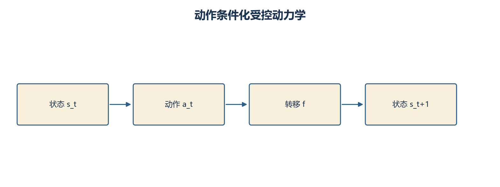

## 23.2　概率形式与结构化转移

**一般形式与分解。** 在高维观测下，直接建模 $p(o_{t+1}\mid o_{\le t},a_t)$ 困难。借鉴第 9、13 章的潜在变量方法，引入紧凑状态 $s_t$（或 $z_t$），把条件转移分解为「状态转移 + 观测生成」：

$$
p(o_{t+1},s_{t+1}\mid s_t,a_t)=p(o_{t+1}\mid s_{t+1})\,p(s_{t+1}\mid s_t,a_t). \tag{23-2}
$$

式 (23-2) 中 $p(s_{t+1}\mid s_t,a_t)$ 是核心——它既是受控动力学（E2+E5），也是想象 rollout 的基础（第 12 章 Dreamer）。

**确定性 + 随机性分解（RSSM 式）。** 第 13 章的循环状态空间模型把状态拆为确定性部分 $h_t$ 与随机部分 $z_t$，动作条件转移写成

$$
h_{t+1}=f_\theta(h_t,z_t,a_t),\qquad z_{t+1}\sim p_\theta(z_{t+1}\mid h_{t+1}). \tag{23-3}
$$

这个分解的妙处：确定性路径 $h$ 承载长期记忆与动作依赖，随机路径 $z$ 表达环境固有不确定性（E4）。动作 $a_t$ 只进入确定性路径（式 23-3 第一式），随机先验 $p(z_{t+1}\mid h_{t+1})$ 不直接依赖动作——这是 Dreamer 系列的设计（第 12 章），保证了「可想象性」：在想象中给定 $h,z,a$ 就能滚动出未来，无需真实观测。

**动作条件化与 do-演算的联系。** 动作条件化的概率含义，可用因果推断的 do-演算精确表述。被动预测给的是**条件分布** $p(s_{t+1}\mid s_t,a_t)$——它回答「在观察到执行 $a_t$ 的样本里，$s_{t+1}$ 的分布如何」；而规划/干预需要的是**干预分布** $\mathrm{do}(s_{t+1}\mid s_t,a_t)$——它回答「若我强制施加 $a_t$（切断 $a_t$ 的父节点），$s_{t+1}$ 的分布如何」。二者的关系由因果图决定：当 $a_t$ 是 $s_{t+1}$ 的直接父节点且无未观测混杂时，$p(s_{t+1}\mid s_t,a_t)=\mathrm{do}(s_{t+1}\mid s_t,a_t)$（条件独立下的可识别性）；但存在混杂（如 $a_t$ 与某未观测状态 $u$ 相关、$u$ 又影响 $s_{t+1}$）时，二者不等，即 $\mathrm{do}(s_{t+1}\mid s_t,a_t)\neq p(s_{t+1}\mid s_t,a_t)$。

这个区分揭示了动作条件化的一个深层要求：**训练数据中 $a_t$ 须与状态变化有因果关联，而非仅是统计相关**。若数据来自被动观察（动作与某混杂变量相关），学到的 $p(s_{t+1}\mid s_t,a_t)$ 可能捕获混杂效应而非真正的因果效应，导致规划时「干预」失败——模型预测的是「通常执行 $a_t$ 的人遇到的后果」，而非「我执行 $a_t$ 的后果」。这正是第 34 章因果世界模型强调「用 do-演算训练」的动机，也是为什么随机化/探索式数据采集（第 26 章）能缓解混杂。

**动作条件的马尔可夫假设。** 式 (23-1) 假设给定 $s_t,a_t$ 后 $s_{t+1}$ 与其他历史无关。这是第 2 章马尔可夫性质的条件化版本。若动作效果有延迟（如推箱子后箱子滑动数帧才停），则需要更高阶状态或历史窗口——这限制了简单一阶模型的适用范围（见 23.6 节）。

## 23.3　条件化的实现架构

把动作注入世界模型有多种架构方式（表 23-1），各有适用情形。

**表 23-1　动作条件化的架构方式**

| 方式 | 实现 | 优点 | 缺点/适用 |
|------|------|------|----------|
| 拼接（concat） | 网络输入 $[z_t,a_t]$ | 简单、通用 | Dreamer[1]；连续/离散均可 |
| FiLM 调制 | 动作生成仿射参数调制特征 | 表达力强、参数高效 | 视觉条件生成 |
| 跨注意力 | 动作作为 query  attend 状态特征 | 适配变长动作 | 多动作、语言条件 |
| 动作 token | 动作离散化为 token 与观测同列 | 统一序列建模 | Genie[3]、交互视频 |

**离散 vs 连续动作。** 离散动作（按键、语言指令、棋类走子）可用 one-hot 或嵌入表示，采样与搜索（MCTS，第 25 章）相对容易；连续动作（力矩、方向盘角度、关节角）取值于连续空间 $\mathcal{A}\subseteq\mathbb{R}^d$，需在表示中精细处理并配合探索策略（如加高斯噪声）。Dreamer 用 tanh 高斯策略处理连续动作（第 12.2 节），MuZero 处理离散棋类动作——两者代表了动作空间的两端。

**动作注入的数值对照。** 四种注入方式（表 23-1）在「动作如何影响预测」上效果不同。用式 23-5 的线性受控转移做最小化模型，设状态 $s\in\mathbb R$、动作 $a\in\mathbb R$，真实动力学 $s_{t+1}=s_t+0.8a_t$。

- **拼接**：网络 $f(z,a)$ 的输入是 $[s,a]$，学得的 $f(s,a)=s+0.8a$ 直接显式依赖 $a$——干预敏感度 $\partial f/\partial a=0.8$。
- **FiLM 调制**：动作生成仿射参数 $(\gamma(a),\beta(a))$，特征 $z$ 被调制成 $\gamma(a)\odot z+\beta(a)$。设 $z=s$、$\gamma(a)=1$、$\beta(a)=0.8a$，则输出 $s+0.8a$，干预敏感度仍为 $0.8$，但动作的效应被「调制进」特征而非直接相加——表达力更强（$\gamma,\beta$ 可以是动作的非线性函数），适合视觉条件生成。
- **跨注意力**：动作作为 query 对状态特征做注意力加权。适合变长/多动作（如「先推左、再推右」的动作序列），但计算更重、训练更难收敛。
- **动作 token**：把离散动作 $a\in\{1,\dots,K\}$ 嵌入为 $e(a)\in\mathbb R^d$，与观测 token 同列送入 Transformer。适合 Genie[3] 式交互视频（动作是「按键」序列），统一了序列建模。

四种方式在最小模型上都能复现 $s+0.8a$，但在真实任务上的差异体现在**表达力、参数效率与适用动作空间**三维度：拼接最通用但表达力受网络容量限制；FiLM 参数高效但假设「仿射调制」结构；跨注意力表达力最强但训练最难；动作 token 最适合离散序列。选型取决于动作空间的性质——离散/连续、单步/序列、是否需要非线性调制。

**条件化的训练目标。** 用收集到的转移数据 $\mathcal{D}=\{(s_t,a_t,s_{t+1})\}$，最大化条件似然：

$$
\max_\theta\ \sum_{(s_t,a_t,s_{t+1})\in\mathcal{D}}\log p_\theta(s_{t+1}\mid s_t,a_t). \tag{23-4}
$$

式 (23-4) 与第 9 章 VAE 的 ELBO 训练同源：若 $s$ 是潜在变量，需用变分推断近似后验；若 $s$ 可直接观测（如已学到的表示），则是简单的条件密度估计。

## 23.4　带数值的算例：条件预测与反事实

**例 23.2（线性条件转移的逐步计算）** 设一维状态（箱子位置）$s_t=2$，连续动作 $a_t\in\mathbb{R}$。学到的条件转移为高斯：

$$
s_{t+1}\sim\mathcal{N}\big(\mu= s_t + 0.8 a_t,\ \sigma^2=0.04\big). \tag{23-5}
$$

若 $a_t=+1$（向右推），$\mu=2+0.8=2.8$，预测箱子移到 2.8（单位：格），95% 置信区间约 $2.8\pm1.96\times0.2=[2.41,3.19]$。若 $a_t=-1$（向左推），$\mu=2-0.8=1.2$。

**反事实推理。** 现在问：「观察到箱子实际移到了 2.8（对应执行了 $a=+1$），若当时执行 $a=-1$，箱子会到哪？」——这就是反事实问题。把 $a=-1$ 代入式 (23-5) 得 $\mu=1.2$，即「若当时向左推，箱子会到 1.2」。这个「若当时……会怎样」的推理，正是规划（在模型中比较不同 $a$ 的后果）与第 34 章可干预性的核心。注意：被动模型 $p(s_{t+1}\mid s_t)$ 无法回答此问题，因为它没有动作变量可供替换。

**例 23.3（动作效果稀疏性的数值）** 设机器人有 $10$ 个可选离散动作，但在一个场景中只有 $2$ 个动作（推左/推右）会改变箱子状态，其余 $8$ 个（原地转身、挥手等）对箱子无影响。若训练数据均匀采样动作，则「有效转移」样本仅占 $20\%$。模型若仅靠最大化式 (23-4) 的似然，会倾向于学「状态不变」的平凡预测（因为 $80\%$ 的数据里确实不变），从而忽略那 $20\%$ 的关键因果效应。这解释了为何动作条件化需要**针对性数据收集**（如好奇/探索驱动的交互，第 26 章）或**加权的训练目标**，否则稀疏的因果信号会被无效动作淹没。

> 【图 23-2　反事实推理示意】（原图见 figures/图23-2.png）：同一状态 $s_t$，沿不同动作 $a$ 分叉出不同预测未来 $s_{t+1}$，标注「实际发生」与「若执行另一动作」两条分支。
>
> 

### 23.4A　多步条件 rollout 与误差累积

单步条件预测（式 23-5）可靠，但规划需要**多步** rollout：把 $s_{t+1}$ 的预测作为下一步的输入，反复展开 $s_{t+2}\sim p_\theta(\cdot\mid s_{t+1},a_{t+1})$。每一步的误差会传入下一步，因此长视野 rollout 的误差会累积。设单步条件预测的均方误差为 $\delta$（对任意 $(s,a)$ 有 $\mathbb E[(s_{t+1}-\hat s_{t+1})^2]\le\delta$），且转移映射的 Lipschitz 常数为 $L$（$\lVert f(s,a)-f(s',a)\rVert\le L\lVert s-s'\rVert$），则 $k$ 步 rollout 的误差满足

$$
\mathbb E\big\lVert s_{t+k}-\hat s_{t+k}\big\rVert^{2}\ \le\ \sum_{j=0}^{k-1} L^{2j}\,\delta \;=\; \delta\,\frac{L^{2k}-1}{L^2-1}. \tag{23-6}
$$

式 (23-6) 是动作条件化版的误差累积界：$L<1$（收缩动力学）时累积有界（$\le\delta L^{2k}/(1-L^2)$，随 $k$ 衰减）；$L=1$（等距，如匀速运动）时累积为 $k\delta$（线性增长）；$L>1$（扩张，如混沌系统）时累积按 $L^{2k}$ 指数爆炸。

**数值示意。** 取式 23-5 的箱子转移 $s_{t+1}=s_t+0.8a_t$，它是等距的（$L=1$，动作项不依赖 $s$）。取单步误差 $\delta=0.04$（对应 $\sigma^2=0.04$ 的随机性）。则 $k=1$：误差 $\le0.04$；$k=5$：$\le5\times0.04=0.20$；$k=10$：$\le10\times0.04=0.40$——10 步 rollout 的误差已增长到单步的 10 倍。若环境是扩张的（$L=1.1$），$k=10$ 时累积 $\approx0.04\times(1.1^{20}-1)/(1.21-1)\approx0.04\times2.62\approx0.105$，看似不大，但 $k=20$ 时 $\approx0.04\times(1.1^{40}-1)/0.21\approx0.04\times23.2\approx0.93$——误差在 20 步内增长约 23 倍。这个算例解释了第 24 章 MBRL「限制想象视野」的必要性：长视野 rollout 的误差按式 23-6 增长，超过某视野后想象轨迹已不可信，此时继续想象只会放大模型利用风险（第 24.2 节）。

式 (23-6) 与第 21 章式 (21-4) 同构：前者是动作条件（受控）动力学的 rollout 误差，后者是无动作（被动）动力学的预测误差。差别在于前者多了动作序列 $a_{t:t+k-1}$ 作为额外输入，因此「规划」不仅要在模型里 rollout，还要在动作空间里搜索——这正是第 25 章 MPC 把视野 $H$ 设为有限值（而非无限）的根本原因。

## 23.5　技术谱系与变体

**表 23-2　动作条件化世界模型谱系**

| 模型/方法 | 状态形式 | 动作注入 | 特点 | 出处 |
|----------|---------|---------|------|------|
| Dyna-Q | 表格 | 条件转移表 | 经典的模型 + 规划 | [4]、第 24 章 |
| World Models | VAE+RNN | 拼接 | 早期深度受控模型 | 第 10 章 |
| PlaNet/Dreamer | RSSM $(h,z)$ | 拼接 | 可想象的受控转移 | [1]、第 11—13 章 |
| MuZero | 隐式 $h$ | 拼接/离散 | 不重建观测的规划表示 | [5]、第 25 章 |
| Genie | 交互视频 | 动作 token | 从视频学可控交互环境 | [3] |
| 因果世界模型 | 结构因果模型 | do-干预 | 显式因果、可干预性 | [2]、第 34 章 |

**变体与前沿。** ① **无动作标注的动作发现**：从视频中「发现」潜在动作（如光流、物体位移）再条件化，降低对动作标签的依赖（第 27 章交互世界模型）。② **语言作为动作**：把自然语言指令当作动作空间，构建可交互的语言驱动世界模型（第 37 章）。③ **多智能体动作条件化**：联合动作空间随智能体数指数增长，需因子化建模（第 38 章）。④ **分层动作**：把原子动作组合成宏动作（options），缓解长视野与稀疏因果问题。

**多智能体联合动作空间的维度爆炸。** 变体③值得展开。设 $N$ 个智能体，每个有 $K$ 个离散动作，则联合动作空间 $|\mathcal A|^N=K^N$ 随 $N$ 指数增长：$N=5,K=4$ 时 $4^5=1024$，$N=10$ 时 $4^{10}\approx10^6$。直接对联合转移 $p(s_{t+1}\mid s_t,a_{1:t}^{(1:N)})$ 建模不可行。因子化建模把它分解为「各智能体局部动作对状态的影响之积」：

$$
p(s_{t+1}\mid s_t,a^{(1)},\dots,a^{(N)})\ \approx\ \prod_{i=1}^{N}p_i(s_{t+1}\mid s_t,a^{(i)},c_i). \tag{23-7}
$$

其中 $c_i$ 是第 $i$ 个智能体感知的上下文（其他智能体的状态摘要）。这个近似假设「给定状态与上下文后，各智能体的动作效应近似独立」——在稀疏交互场景（智能体间作用局部）下合理，在密集耦合场景（如交通流）下失效。这一因子化是第 38 章多智能体世界模型的核心技术，也是联合动作空间指数爆炸的标准对策。

## 23.6　边界与讨论

动作条件化的挑战有四。① **因果关联的稀疏性**：如例 23.3 所示，很多动作对状态无显著影响，关键因果信号被淹没，需探索机制或针对性数据。② **动作粒度**：宏动作（「走到门口」）vs 原子动作（「左移一步」）——粒度太粗无法精细控制，太细则视野过长、误差累积；选择恰当粒度本身是开放问题。③ **延迟与高阶效应**：一阶马尔可夫假设（式 23-1）无法刻画延迟动作效果，需扩展状态或引入时间窗。具体地，若推箱子后箱子滑动 3 帧才停，则真实转移是 $s_{t+1}$ 同时依赖 $a_t,a_{t-1},a_{t-2}$（延迟项），一阶模型 $p(s_{t+1}\mid s_t,a_t)$ 把延迟效应误归为「状态不确定性」，预测方差虚高；把状态扩充为 $(s_t,s_{t-1},a_{t-1},a_{t-2})$ 的高阶马尔可夫即可恢复，但状态维度随之膨胀。④ **干预下的误差放大**：第 24 章将详述——动作条件模型在分布外动作处的误差会被策略利用（model exploitation），想象中表现好、真实中崩溃。

**判据意义。** 动作条件化是区分「真世界模型」与「模式匹配」的关键判据之一（第 16.2 节 Sora 讨论、第 34 章）。一个只能被动预测视频的模型，无论多逼真，都不能被称为可用于决策的世界模型——因为它无法回答「若我干预会怎样」。本章填补的正是这道从「观察」到「干预」的鸿沟。这一判据也可操作化为一个测试：给定同一状态 $s_t$，向模型查询两个不同动作 $a^{(1)},a^{(2)}$ 的预测 $s_{t+1}^{(1)},s_{t+1}^{(2)}$；若 $s_{t+1}^{(1)}\neq s_{t+1}^{(2)}$（预测随动作变化），模型通过判据；若对所有 $a$ 预测相同，模型退化为被动观察者。第 21 章的 V-JEPA 在此测试上得「否」，第 13 章的 RSSM 得「是」——这正是两条路线的本质分野。

## 23.7　交叉引用与承上启下

本章上承第 4 章（最优控制中的受控动力学 $p(s'\mid s,a)$）、第 12—13 章（Dreamer/RSSM 的动作条件转移），横向对照第 16 章（生成模型的反事实判据）、第 21—22 章（被动 JEPA 表征），下接第 24 章（MBRL 框架）、第 25 章（基于模型的规划）、第 27 章（交互世界模型）、第 34 章（因果与可干预性）。这些辨析衔接第 1、2、4、10、12—13、16、21—22、24—27、34 章。

## 本章小结

本章定义动作条件化——世界模型从「观察」走向「干预」的分水岭。

我们首先定义受控世界模型（定义 23.1，式 23-1），区分被动预测 $p(s_{t+1}\mid s_t)$ 与主动预测 $p(s_{t+1}\mid s_t,a_t)$，阐明其对动作标注与可控环境的依赖（23.1 节）。接着推导条件转移的分解（式 23-2）、RSSM 式确定性—随机性分解（式 23-3）与训练目标（式 23-4）（23.2—23.3 节）。随后用线性高斯条件转移（式 23-5）逐步展示条件预测与反事实推理，并用稀疏因果算例说明数据挑战（23.4 节）。我们梳理从 Dyna-Q 到 Genie、因果世界模型的技术谱系与变体（表 23-1、23-2），并明确边界：因果稀疏、动作粒度、延迟效应、干预下误差放大（23.6 节）。

我们还强调动作条件化作为「真世界模型」判据的意义，给出承上启下的交叉引用。这些辨析衔接第 1、2、4、10、12—13、16、21—22、24—27、34 章。

下一章在此基础上系统论述基于模型的强化学习（MBRL）——如何把动作条件世界模型用于提升强化学习的样本效率与泛化。

**进一步阅读**　本章建议延伸阅读的文献：[1]、[2]、[3]。

## 参考文献

[1] Hafner D, Lillicrap T, Ba J, Norouzi M. Dream to control: Learning behaviors by latent imagination. *ICLR*, 2020.

[2] Fischer I, Huang J, Raghunathan A, et al. What is a world model? *arXiv:2403.09617*, 2024.

[3] Bruce J, Grundmann M, Gupta A, et al. Genie: Generative interactive environments. *arXiv:2402.15391*, 2024.

[4] Sutton R S. Dyna, an integrated architecture for learning, planning, and reacting. *SIGART Bulletin*, 1991, 2(4): 160–163.

[5] Schrittwieser J, Antonoglou I, Hubert T, et al. Mastering Atari, Go, chess and shogi by planning with a learned model. *Nature*, 2020, 588: 604–609.

[6] Hafner D, Lillicrap T, Fischer I, et al. Learning latent dynamics for planning from pixels. *ICML*, 2019.

[7] Kuramochi T, Han W D. Learning action-conditioned world models for exploration. *NeurIPS Workshop*, 2020.

[8] Pearl J, Mackenzie D. *The Book of Why: The New Science of Cause and Effect*. Basic Books, 2018.

---

# 第 24 章　世界模型 + 强化学习

第 23 章的动作条件化使世界模型可用于决策：给定状态与动作，模型能预测后果。本章系统论述**基于模型的强化学习（model-based reinforcement learning, MBRL）**——如何用世界模型提升强化学习的样本效率与泛化。MBRL 是世界模型最重要的应用之一：第 11 章 PlaNet、第 12 章 Dreamer、第 8 章经典控制都是其代表或近亲。如果说无模型 RL 是「在真实世界里跌打滚爬地学」，MBRL 就是「先在脑中 simulation 里练，再到真实世界验证」——用计算换数据。

MBRL 的诱惑与陷阱同样鲜明。诱惑在于样本效率：模型从少量真实交互中学会环境动力学后，可在「想象」中生成海量训练数据，把昂贵的真实交互需求降低一个数量级（第 12 章 DreamerV2 在 Atari 上以约 1/10 数据达到人类水平）。陷阱在于模型误差：学到的模型 $\hat p$ 永远不完美，而策略优化会主动「钻模型的空子」——在想象中取得的漂亮高分，到了真实环境可能瞬间崩塌。本章将把这条「效率—误差」的张力讲透。

本章先给出 MBRL 的统一框架与两条技术路线（24.1 节），建立模型误差与策略偏差的形式化（24.2 节），用带数值的算例展示模型利用现象与 Dyna 式更新（24.3 节），梳理技术谱系与变体（24.4 节），讨论样本效率、适用边界与缓解策略（24.5 节），最后交叉引用并收束（24.6 节）。

## 24.1　MBRL 统一框架

**定义 24.1（MBRL 循环）** MBRL 在如下循环间交替：

1. **学模型**：用真实交互数据 $\mathcal{D}=\{(s_t,a_t,r_t,s_{t+1})\}$ 拟合转移 $\hat p_\theta(s_{t+1}\mid s_t,a_t)$ 与奖励 $\hat r_\theta(s_t,a_t)$；
2. **想象/规划**：在模型中生成合成轨迹或搜索动作序列（第 25 章）；
3. **学策略/价值**：用合成经验训练策略 $\pi$（演员—评论家，第 12 章）或直接用规划输出动作；
4. **部署与收集**：把学到的策略放回真实环境执行，收集新数据，回到步骤 1。

这个循环可用一个统一的优化目标刻画：

$$
\max_{\pi}\ \mathbb{E}_{\hat p,\pi}\Big[\sum_{t=0}^{H-1}\gamma^t\,\hat r(s_t,a_t)\Big]\quad\text{s.t.}\quad \hat p,\hat r\ \text{由}\ \mathcal{D}\ \text{学得}. \tag{24-1}
$$

式 (24-1) 点出 MBRL 的全部要害：目标是对**学到的模型** $\hat p$ 优化回报，而我们希望的是对**真实模型** $p$ 的高回报。二者的差距，就是本章 24.2 节的主题。

**两条技术路线。**

- **路线 A：模型作模拟器（Dyna 式）**。用模型生成大量合成数据 $(s,a,\hat r,s')$，喂给任意无模型 RL 算法（Q-learning、actor–critic）训练策略。代表：Dyna-Q[1]、Dreamer[3]（第 12 章）。优点是一次学模、反复使用；缺点是策略会利用模型偏差。
- **路线 B：在模型中规划**。不学显式策略，每一步在世界模型里搜索最优动作序列（MPC、CEM、MCTS，第 25 章）。代表：PlaNet[4]、MuZero[5]。优点是即时利用最新模型、无需策略逼近；缺点是每步计算昂贵。

**直觉解释。** 路线 A 像「先在模拟器里考一万次试、把答案背成直觉，再去考场」；路线 B 像「每道题都现场在草稿纸上推演一遍」。前者推理快、训练慢，后者推理慢、训练省——第 12 章 Dreamer 与第 11 章 PlaNet 的对照正是这一取舍（表 12-2）。

**两路线的计算开销分解。** 设每个真实时间步的开销分解为「学模型」$\mathcal C_{\text{model}}$、「生成想象数据」$\mathcal C_{\text{img}}$、「更新策略/规划」$\mathcal C_{\text{pol}}$。路线 A（Dyna 式）：$\mathcal C_{\text{model}}$ 摊薄到每步（模型持续学习），$\mathcal C_{\text{img}}$ 与想象数据量 $n$ 成正比（$n$ 越大越准但越慢），$\mathcal C_{\text{pol}}$ 是无模型 RL 的标准开销（Q 更新或 actor-critic 梯度）。推理时路线 A 只需查表/前向一次（$\mathcal C_{\text{pol}}$ 的推理部分），故**在线延迟低**。路线 B（MPC 式）：$\mathcal C_{\text{model}}$ 同样摊薄，但 $\mathcal C_{\text{pol}}$ 被「每步搜索」主导——CEM 需 $M$ 条随机轨迹 × $H$ 步 rollout，MCTS 需大量节点扩展，故 $\mathcal C_{\text{pol}}$ 随 $M,H$ 增长。推理时路线 B 每步都要重新搜索，**在线延迟高**。因此：机器人实时控制（毫秒级）倾向路线 A（学一个快策略），离线决策/棋类（允许慢思考）倾向路线 B（即时最优）。这一「训练—推理」的不对称，是两路线选型的根本依据。

**表 24-1　MBRL 与无模型 RL 对照**

| 方面 | MBRL | 无模型 RL |
|------|------|-----------|
| 样本效率 | 高（想象可放大数据） | 低（需大量真实交互） |
| 计算分布 | 学模型 + 想象/规划 | 直接策略/价值学习 |
| 对模型误差 | 敏感（核心风险） | 无此问题 |
| 适用场景 | 交互昂贵（机器人、医疗） | 交互廉价（仿真、游戏） |
| 典型代表 | Dyna[1]、PlaNet[4]、Dreamer[3] | Q-learning、PPO、SAC |
| 主要失败模式 | 模型利用、滚动漂移 | 样本不足、探索困难 |

## 24.2　模型误差与策略偏差

**模型误差（model error）。** 学到的模型 $\hat p_\theta$ 与真实动力学 $p$ 之间存在偏差 $\epsilon$：

$$
\big|\hat p_\theta(s'\mid s,a)-p(s'\mid s,a)\big|\le\epsilon(s,a). \tag{24-2}
$$

关键在于误差**不均匀**：在训练数据覆盖的区域（in-distribution），$\epsilon$ 小；在数据稀疏的分布外区域，$\epsilon$ 大——因为模型没见过那里，只能外推。

**策略偏差 / 目标错配（objective mismatch）。** 这是 MBRL 更隐蔽的敌人。模型训练的目标是**在数据分布上**准确（最大化式 23-4 的似然），但策略优化的目标是**让状态访问分布偏向高回报区域**。当策略把状态推向模型从未见过的区域时，那里的模型误差被放大，而优化过程会**主动寻找并利用**这些误差——策略发现某些「模型幻觉出的高回报区域」，反复把状态推向那里，在想象里刷出虚假高分。这就是**模型利用（model exploitation）**，也叫 objective mismatch[6]：训练模型的目标与用模型的目标不一致。

**推导：回报高估界。** 设真实与模型回报差 $\Delta=\mathbb{E}_{p,\pi}[R]-\mathbb{E}_{\hat p,\pi}[R]$。对单步，由总变差距离与奖励有界 $|r|\le r_{\max}$：

$$
|\Delta|\ \le\ \sum_{t=0}^{H-1}\gamma^t\, r_{\max}\,\mathbb{E}_{\pi}\big[\mathrm{TV}\big(p(\cdot\mid s_t,a_t)\|\hat p(\cdot\mid s_t,a_t)\big)\big]. \tag{24-3}
$$

式 (24-3) 说明：回报的虚假高估正比于策略实际访问状态处 $p$ 与 $\hat p$ 的总变差。若策略待在数据覆盖区（$\mathrm{TV}$ 小），高估小；若策略主动跑到分布外（$\mathrm{TV}$ 大），高估可以任意大——这为模型利用提供了严格解释，也指出了缓解方向：要么让模型在策略访问处也准（主动数据收集），要么惩罚模型不确定处（保守策略）。

**长视野滚动漂移（rollout drift）。** 式 (24-3) 的误差随视野 $H$ 累积：每一步的微小误差被下一步放大，长视野想象轨迹会逐渐偏离真实可能的状态分布（第 33 章）。设单步转移误差 $\lVert p(\cdot\mid s,a)-\hat p(\cdot\mid s,a)\rVert_{\mathrm{TV}}\le\epsilon$ 且转移映射的 Lipschitz 常数为 $L$，则 $k$ 步想象轨迹与真实轨迹的分布偏差满足

$$
\mathrm{TV}\big(p_{\text{real}}^{(k)}\,\|\,p_{\text{model}}^{(k)}\big)\ \le\ \sum_{j=0}^{k-1}L^{j}\,\epsilon \;=\; \epsilon\,\frac{L^{k}-1}{L-1}. \tag{24-4}
$$

式 (24-4) 把式 (23-6) 的误差累积从「单状态误差」推广到「整条轨迹的分布偏差」：$L<1$（收缩动力学）时偏差有界，$L=1$ 时随 $k$ 线性增长，$L>1$ 时指数爆炸。这正是「限制想象视野」的理论依据——当 $k$ 超过 $\log_{L}(1/\epsilon)$ 量级时，模型分布与真实分布已显著分离，继续想象只会放大策略偏差。第 12 章 Dreamer 把想象视野限制为 $H\approx15$ 步、并用 $\lambda$-return 在视野末端「截断」价值估计，正是对式 (24-4) 的工程实现。

> 【图 24-1　模型利用示意】（原图见 figures/图24-1.png）：数据分布内的高保真区域 vs 分布外的模型幻觉高回报区域，策略从数据区被「吸引」到幻觉区，想象回报虚高、真实回报崩塌。
>
> 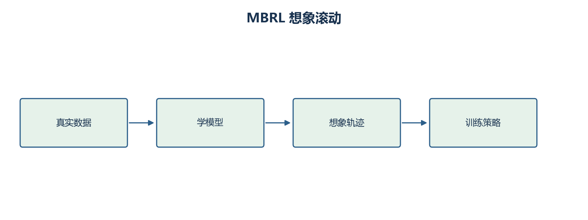

## 24.3　带数值的算例

**例 24.1（模型利用的逐步数值）** 设一维状态 $s\in[0,10]$，训练数据只覆盖 $s\in[2,4]$。真实奖励恒为 $r=1$（均匀），但学到的模型在数据覆盖区准确、在外推区 hallucinate 出高奖励：

$$
\hat r(s)=\begin{cases}1,& s\in[2,4],\\ 1+5\cdot(s-4),& s>4.\end{cases} \tag{24-5}
$$

一个贪心策略在模型中搜索，发现 $s=6$ 时 $\hat r=1+5\times2=11$，于是把状态推向 $s=6$，想象回报 $\approx11$；但在真实环境中那里奖励仍是 $1$。**想象回报 11 vs 真实回报 1**——策略完全被模型的虚假奖励欺骗。若给模型的不确定性惩罚 $\lambda\,\sigma(s)$（如 $\sigma=3,\lambda=2$ 时修正奖励 $11-6=5$），或换用集成模型检测分歧（第 26 章），策略就不会盲目冲向分布外。这解释了 MBRL 实践中「短视野 + 不确定性惩罚 + 集成」三件套的必要性。

**例 24.2（Dyna-Q 的一次更新数值）** 设折扣 $\gamma=0.9$，学习率 $\alpha=0.1$。真实转移：$s=1,a=$右$\to s'=2,r=0$；模型已学到该转移。Q 函数初值 $Q(1,\text{右})=0,Q(2,\text{左})=0$，真实末端奖励 $r(2,\text{左})=10$。

真实经验一步：$Q(2,\text{左})\leftarrow0+0.1(10+0.9\times0-0)=1$。
随后 Dyna 用模型做 $n=5$ 次模拟更新（从 $s=1,a=$右 转移到 $s'=2$）：每次 $Q(1,\text{右})\leftarrow Q+0.1(0+0.9\max_a Q(2,a)-Q)$。第一次 $\max_a Q(2,a)=1$，故 $Q(1,\text{右})\leftarrow0+0.1(0.9\times1)=0.09$；五次后约收敛到 $0.9\times1=0.9$。

可见：**一次真实经验 $(s=2,\text{左},r=10)$ 通过模型的 5 次重放，把价值沿着 $(1,\text{右})\to(2,\cdot)$ 反向传播了多步**——这正是 Dyna 用模型放大数据效率的机制：模型让同一条真实经验被反复「复用」。

**表 24-2　MBRL 失败模式与缓解对照**

| 失败模式 | 成因 | 缓解手段 | 相关章节 |
|---------|------|---------|---------|
| 模型利用 | 策略钻分布外误差空子 | 不确定性惩罚、集成、短视野 | 第 26、33 章 |
| 滚动漂移 | 长视野误差累积 | 限制视野、价值截断、重规划 | 第 12、25、33 章 |
| 学模数据偏置 | 策略访问分布窄 | 探索、主动数据收集 | 第 26 章 |
| 目标错配 | 学模目标≠用模目标 | 对策略访问分布加权的模型训练 | 第 26 章 |

## 24.4　技术谱系与变体

**表 24-3　MBRL 技术谱系**

| 方法 | 核心思想 | 模型类型 | 策略来源 | 出处 |
|------|---------|---------|---------|------|
| Dyna-Q | 模型生成数据喂给表格 Q | 表格/稀疏 | 无模型 Q | [1]、1991 |
| PILCO | 高斯过程模型 + 解析策略搜索 | GP | 轨迹优化 | [2]、2011 |
| PlaNet | RSSM + CEM 在线规划 | 深度潜在 | 规划 | [4]、2019 |
| Dreamer | 想象轨迹训练演员—评论家 | RSSM | 学到策略 | [3]、2020 |
| MBPO | 模型集成 + 短 rollout + SAC | 集成 | 无模型 SAC | [6]、2019 |
| MuZero | 隐式模型 + MCTS | 隐式 | 规划 | [5]、2020 |

**变体与前沿。** ① **模型集成（ensemble）**：用多个模型的预测分歧作为不确定性估计，惩罚分歧大的区域（MBPO[6]、第 26 章）。② **离线 MBRL**：完全从固定数据集学模型与策略，不做在线交互（第 26 章）。③ **保守模型策略优化**：对分布外动作保守，避免利用误差（第 26 章）。④ **混合模型**：物理模型 + 残差学习（第 28 章物理信息学习），用先验约束减少误差。

**模型集成的分歧数值。** 以变体①为例，设集成含 $K=5$ 个模型，在状态 $s$ 处的预测分别为 $\hat s^{(i)}$。分歧用预测方差度量：

$$
\mathrm{Var}_{\text{ens}}(s)=\frac{1}{K}\sum_{i=1}^{K}\big(\hat s^{(i)}-\bar{\hat s}\big)^{2},\qquad \bar{\hat s}=\tfrac1K\sum_{i}\hat s^{(i)}. \tag{24-6}
$$

取数据覆盖区 $s=3$，五模型预测 $\hat s^{(i)}\in\{3.8,3.9,4.0,3.9,4.1\}$，均值 $\bar{\hat s}=3.94$，$\mathrm{Var}_{\text{ens}}\approx\frac15(0.0196+0.0016+0.0036+0.0016+0.0256)=0.0104$（分歧小，可信）；取分布外 $s=7$，预测 $\hat s^{(i)}\in\{5.0,7.2,9.1,4.6,8.3\}$，$\bar{\hat s}=6.84$，$\mathrm{Var}_{\text{ens}}\approx\frac15(3.39+0.13+5.48+4.88+2.10)=3.196$（分歧大，不可信）。比值 $\mathrm{Var}_{\text{ens}}(7)/\mathrm{Var}_{\text{ens}}(3)\approx308$——分布外分歧放大约三个数量级。MBPO 据此把奖励修正为 $\hat r-\lambda\,\mathrm{Var}_{\text{ens}}$：$s=7$ 的高想象回报被大分歧惩罚压低，策略不再盲目冲向分布外。这一「分歧即不确定性」的估计避免了显式建模后验，是集成 MBRL 的标准做法（第 26 章）。

## 24.5　样本效率、适用边界与缓解

**为什么样本效率高？** 真实交互只用于学世界模型（少量即可），策略改进几乎全在想象中完成（数据无限、成本近零）。这是一种明确的「用计算换数据」策略：当数据昂贵、计算便宜时（机器人、医疗、自动驾驶），用想象计算替代真实交互极具价值。 dreamerV2 在 Atari 上以约 1/10 数据达人类水平（第 12.3 节）就是明证。设无模型 RL 达到目标性能需 $N_{\text{model-free}}$ 次真实交互，MBRL 需 $N_{\text{MBRL}}$ 次真实交互（其余靠想象），则**样本效率比**为

$$
\eta\;=\;\frac{N_{\text{model-free}}}{N_{\text{MBRL}}}\ \ge\ 1, \tag{24-7}
$$

$\eta>1$ 表示 MBRL 更省真实交互。式 (24-7) 把「样本效率高」量化成一个可测的比值：DreamerV2 的 $\eta\approx10$（1/10 数据达同等水平）。但 $\eta$ 是**有条件的**——它成立的前提是「模型质量足以支撑想象」；一旦模型误差使式 (24-4) 的分布偏差超过阈值，$\eta$ 会因模型利用而回落（策略在幻觉区刷分、真实性能不涨），此时 $\eta$ 的名义值虚高、实际收益为零。因此式 (24-7) 应与式 (24-4) 联合阅读：前者是「理想收益」，后者是「收益失效的边界」。

**适用边界。** MBRL 的成败取决于模型质量。① 若真实交互不足以覆盖关键情形，模型本身就不准，想象越练越错——「垃圾进，垃圾出」。② 对高度随机或混沌的环境，长视野预测本质困难，模型误差增长快（第 33 章）。③ 在高维连续控制中，模型误差与策略偏差的耦合尤其棘手。因此 MBRL 最适合**动力学相对平滑、可学习、交互成本高**的场景。反之，当交互廉价（如游戏仿真、强化学习 gym）时，无模型 RL 的样本效率劣势不明显，而 MBRL 的模型误差风险却真实存在——此时「用计算换数据」的账算不过来，直接上无模型 RL 反而更稳。这一「成本—风险」的权衡，是 MBRL 适用性判断的核心：数据越贵、动力学越平滑，MBRL 越值得；数据越便宜、动力学越混沌，无模型越稳妥。

**缓解策略总结。** 综合文献与实践，缓解模型利用的有效手段包括：不确定性惩罚（对 $\hat p$ 高方差处降低奖励）、模型集成（分歧即不确定性）、限制想象视野并配合价值函数（第 12、25 章）、对策略访问分布加权的模型训练（让模型在策略会去的地方也准）、以及周期性用真实数据校正模型（在线 MBRL 的第 4 步）。

**三件套的协同数值。** 以例 24.1 的幻觉奖励场景（$\hat r=11$ 在 $s=6$）为例，看「短视野 + 不确定性惩罚 + 集成」如何协同。设真实奖励恒为 $r=1$、$\gamma=0.9$、视野 $H$。

- **无缓解**：策略推向 $s=6$，想象回报 $\approx\sum_{k=0}^{H-1}0.9^k\times11=11\times(1-0.9^H)/0.1$。$H=1$：$\approx11$；$H=10$：$\approx11\times9.14\approx100.5$——虚高回报。
- **加不确定性惩罚**：$\hat r_{\text{corr}}=\hat r-\lambda\,\mathrm{Var}_{\text{ens}}$，取 $\lambda=1$、$s=6$ 处 $\mathrm{Var}_{\text{ens}}=3.0$（仿照 24.4 节集成的量级），则 $\hat r_{\text{corr}}=11-3.0=8.0$，想象回报降至 $\approx8.0\times9.14\approx73.1$——仍高，但惩罚开始起作用。
- **再加短视野**：把 $H$ 从 10 压到 3，想象回报 $=11\times(1-0.9^3)/0.1\approx11\times2.71\approx29.8$（或修正后 $8.0\times2.71\approx21.7$）。$H=3$ 时虚高幅度被限制在真实回报（$\approx3$）的约 7 倍内，且策略来不及把状态推进到深度分布外区域。

三者协同的效果：惩罚压低单步虚高、短视野限制累积放大、集成提供不确定性来源。单独用任一项都难以根治（惩罚需调 $\lambda$、短视野损失长期规划、集成需足够模型数），组合后才把模型利用控制在可接受范围。这正是 Dreamer/MBPO 实践「短视野 + 不确定性 + 价值截断」三件套的数值依据。

## 24.6　交叉引用与承上启下

本章上承第 4 章（最优控制）、第 7 章（系统辨识）、第 11—13 章（PlaNet/Dreamer/RSSM）、第 23 章（动作条件化），横向对照无模型 RL（见《强化学习与决策智能导论》），下接第 25 章（MPC 与规划——路线 B 的深入）、第 26 章（离线世界模型与不确定性）、第 33 章（滚动漂移）、第 36 章（智能架构）。这些辨析衔接第 4、7、11—13、23、25—26、33、36 章。

## 本章小结

本章系统论述基于模型的强化学习（MBRL）。

我们首先给出 MBRL 统一框架（定义 24.1，式 24-1）与两条路线——模型作模拟器（Dyna 式）vs 在模型中规划，并与无模型 RL 对照（表 24-1）（24.1 节）。接着形式化模型误差（式 24-2）与策略偏差/目标错配，推导回报高估界（式 24-3），揭示模型利用与滚动漂移的根源（24.2 节）。随后用虚假奖励算例（式 24-5）与 Dyna-Q 更新算例逐步展示模型利用与数据放大机制（24.3 节，表 24-2）。我们梳理从 Dyna-Q 到 MBPO、MuZero 的技术谱系（表 24-3），讨论样本效率、适用边界与缓解策略（24.4—24.5 节）。

我们还明确边界：MBRL 成败取决于模型质量，失败模式包括模型利用、滚动漂移、数据偏置与目标错配。这些辨析衔接第 4、7、11—13、23、25—26、33、36 章。

下一章深入路线 B——在世界模型中如何具体搜索最优动作序列，即模型预测控制（MPC）与规划。

**进一步阅读**　本章建议延伸阅读的文献：[3]、[6]、[2]。

## 参考文献

[1] Sutton R S. Dyna, an integrated architecture for learning, planning, and reacting. *SIGART Bulletin*, 1991, 2(4): 160–163.

[2] Deisenroth M P, Rasmussen C E. PILCO: A model-based and data-efficient approach to policy search. *ICML*, 2011.

[3] Hafner D, Lillicrap T, Ba J, Norouzi M. Dream to control: Learning behaviors by latent imagination. *ICLR*, 2020.

[4] Hafner D, Lillicrap T, Fischer I, et al. Learning latent dynamics for planning from pixels. *ICML*, 2019.

[5] Schrittwieser J, Antonoglou I, Hubert T, et al. Mastering Atari, Go, chess and shogi by planning with a learned model. *Nature*, 2020, 588: 604–609.

[6] Janner M, Fu J, Zhang M, Levine S. When to trust your model: Model-based policy optimization. *NeurIPS*, 2019.

[7] Levine S, Kumar A, Tucker G, Fu J. Offline reinforcement learning: Tutorial, review, and perspectives on open problems. *arXiv:2005.01643*, 2020.

[8] Kuramochi T, Han W D. Learning action-conditioned world models for exploration. *NeurIPS Workshop*, 2020.

---

# 第 25 章　模型预测控制与实时规划

第 8 章的经典 MPC 与第 11 章的潜在 MPC 都在世界模型中规划；第 24 章把「在模型中规划」列为 MBRL 的路线 B。本章系统论述**基于世界模型的规划（planning with a world model）**：如何在学到的模型中，给定当前状态选择最优动作序列。核心方法是 MPC 与搜索（CEM、MCTS、梯度规划），关键挑战是模型误差、规划视野与计算预算的三角权衡。

规划与第 24 章路线 A 的「学到策略」形成根本对照：路线 A 把规划计算「蒸馏」进一个策略网络（推理时一次前向，第 12 章 Dreamer）；本章的路线 B 则在每次决策时**现场搜索**（推理时反复用模型 rollout）。前者快但受策略表达力限制，后者慢但能灵活应对新情况、且不受策略逼近误差影响。MuZero[5] 用学到的隐式模型 + MCTS 在 Atari、围棋、国际象棋、将棋上达到超人表现，是路线 B 的巅峰之作。

本章先形式化模型中的规划问题（25.1 节），系统介绍 CEM、MCTS、梯度规划三类搜索方法并给出推导（25.2 节），用带数值的算例展示 CEM 与 MCTS 的一次迭代（25.3 节），梳理技术谱系与 MuZero 隐式模型（25.4 节），讨论规划视野与模型误差的权衡（25.5 节），最后交叉引用并收束（25.6 节）。

## 25.1　模型中的规划问题

**定义 25.1（基于模型的规划）** 给定当前状态 $s_t$ 与世界模型 $(\hat p,\hat r)$，在视野 $H$ 内优化动作序列：

$$
\{a_t^*,\dots,a_{t+H-1}^*\}=\arg\max_{\{a_{t:t+H-1}\}}\ \mathbb{E}_{\hat p}\Big[\sum_{k=0}^{H-1}\gamma^k \hat r(s_{t+k},a_{t+k})\Big],\ s_{t+k+1}\sim\hat p(\cdot\mid s_{t+k},a_{t+k}). \tag{25-1}
$$

执行首个动作 $a_t^*$，观测真实下一状态，然后**滚动重规划**（receding horizon）——这就是模型预测控制（MPC）的标准范式。式 (25-1) 与第 8 章式 (8-1) 同形，唯一区别是模型是**学出来的** $\hat p$ 而非已知的 $p$。这个「唯一区别」恰恰带来全部困难：模型误差（第 24 章）会直接扭曲规划的结果。

**价值函数的截断。** 纯有限视野 $H$ 会短视（忽略 $H$ 步之后的回报）。标准做法是引入价值函数 $V_\psi(s_{t+H})$ 估计视野末端的未来回报，把目标改为

$$
J=\mathbb{E}_{\hat p}\Big[\sum_{k=0}^{H-1}\gamma^k \hat r(s_{t+k},a_{t+k})+\gamma^H V_\psi(s_{t+H})\Big]. \tag{25-2}
$$

式 (25-2) 用 $V_\psi$ 截断长尾，使短视野规划也能考虑长期后果。这与第 12 章 $\lambda$-return 的 bootstrap 同源；$V_\psi$ 可由模型想象数据训练（第 12.2 节）或用模型自身的价值头（MuZero）。

**直觉解释。** 规划就是「在脑子里把未来演一遍，挑最好的那条路走」。MPC 的「滚动」意味着每走一步都重新演一遍——因为真实世界会给你新的信息（你实际到了哪里），重规划能纠正模型的偏差。这像一个登山者每走几步就重新看地图、调整路线，而不是出发时定死一条路走到黑。

**部署形态与计算弹性。** MPC 形式的规划器自身没有可训练参数——「策略」就是（模型，搜索算法）这对组合，其容量直接由计算预算决定。这带来一条学习到的策略（路线 A）不具备的性质：**部署时的计算弹性**。同一套（模型，MCTS），紧急情境可以分配 $10^4$ 次模拟、常规情境只分配 $10^2$ 次，规划质量随预算平滑变化。固定参数的策略网络则没有「多想一会儿」的选项，其质量在部署前已被训练锁定。反面是延迟：规划延迟 $\propto$ 搜索量 $\times$ 单次 rollout 代价，二者都随模型规模增长，实时系统必须为「搜索预算—延迟」画出明确预算线（25.6 节边界③）。

## 25.2　搜索方法

式 (25-1) 是一个高维、非凸的优化问题（动作序列长度 $H$、每步动作维度 $|A|$），无法解析求解。实践中用三类搜索方法（表 25-1）。

**表 25-1　三类规划搜索方法对照**

| 方法 | 核心思想 | 适用动作空间 | 代表 | 优点 | 缺点 |
|------|---------|------------|------|------|------|
| CEM | 采样—筛选—重拟合分布 | 连续 | PlaNet[4] | 简单、可并行 | 无梯度、样本效率一般 |
| MCTS | 树搜索 + UCB + 神经网络先验 | 离散 | MuZero[5] | 强探索、超人表现 | 需离散动作、计算重 |
| 梯度规划 | 对动作求梯度上升 | 连续可微 | PILCO[2]、GPS | 高效 | 需可微模型、局部最优 |

### 25.2.1　交叉熵方法（CEM）

CEM 把动作序列 $a_{t:t+H-1}$ 视为从某分布（通常为对角高斯 $\mathcal{N}(\mu,\sigma^2\mathbf{I})$）采样的样本，迭代地「采样—评估—筛选—重拟合」：

1. 从当前分布采样 $K$ 条动作序列 $\{a^{(i)}\}_{i=1}^K$；
2. 用模型 rollout 每条序列，按式 (25-2) 得回报 $J^{(i)}$；
3. 保留回报最高的 $M$ 条（ elites），用它们重估分布参数：

$$
\mu\leftarrow\frac{1}{M}\sum_{i\in\mathcal{E}}a^{(i)},\qquad \sigma^2\leftarrow\frac{1}{M}\sum_{i\in\mathcal{E}}\big(a^{(i)}-\mu\big)^2, \tag{25-3}
$$

其中 $\mathcal{E}$ 为 elite 集合。重复若干次迭代，取最终 $\mu$ 的首个动作执行。**CEM 本质是「交叉熵 = KL 最小」的变分优化**：它让采样分布逐渐逼近「高回报动作序列」的分布。

### 25.2.2　蒙特卡洛树搜索（MCTS）

MCTS 在离散动作空间构建一棵搜索树，节点是状态、边是动作。每次模拟从根节点用**UCB（上置信界）**选择动作：

$$
a^*=\arg\max_a\Big[Q(s,a)+c_{\mathrm{puct}}\frac{\sqrt{\sum_b N(s,b)}}{1+N(s,a)}\Big], \tag{25-4}
$$

其中 $Q(s,a)$ 是动作的平均值估计，$N(s,a)$ 是访问次数，$c_{\mathrm{puct}}$ 控制探索——访问少的动作获得探索加成。到达未展开节点时，用模型展开（生成后继状态与奖励），并用神经网络的**策略先验** $P(s,\cdot)$ 与**价值估计** $V(s)$ 初始化（PUCT 变体）。反向传播沿路径更新 $Q$ 与 $N$。多次模拟后，根节点访问次数最多的动作即为规划输出。

**MuZero 的关键创新[5]**（见 25.4 节）：MCTS 所用的模型不是重建观测的生成模型，而是只预测**奖励、价值、策略**的隐式模型。

### 25.2.3　梯度规划

若模型 $\hat p,\hat r$ 对动作可微，可直接对式 (25-2) 关于动作序列求梯度并上升：

$$
\nabla_{\{a\}}J=\sum_{k=0}^{H-1}\frac{\partial J}{\partial a_{t+k}}. \tag{25-5}
$$

通过模型的可微 rollout（如可微物理引擎，第 29 章），梯度可从远期回报一路回传到早期动作。**路径积分（路径积分控制 / GPS）**先用采样轨迹拟合局部线性—高斯模型，再用解析最优控制（LQR）更新动作，是梯度规划的实用变体。优点是高效（梯度比采样更「知道往哪走」），缺点是需要可微模型且易陷入局部最优。

### 25.2.4　安全与鲁棒规划

物理系统（机器人、自动驾驶）中，「平均回报最优」不够——单次规划失误的代价可能是碰撞。两条标准对策：**约束 MPC**（把状态/动作约束 $s_{t+k}\in\mathcal{C}$ 直接写进式 (25-1) 的优化，靠滚动性质维持可行性）与**鲁棒 MPC**（对模型不确定集 $\hat p\in\mathcal{P}$ 取最坏情形，即 $\arg\max_a\min_{\hat p\in\mathcal{P}}$ 的极小极大形式）。后者与第 24 章的模型集成、第 28 章的贝叶斯不确定性估计直接衔接：把集成各成员的预测方差当作 $\mathcal{P}$ 的度量，鲁棒规划就自动在「模型没把握的区域」变得保守。代价是保守性：$\mathcal{P}$ 越大，规划越趋于「原地不动」，实践中常以风险敏感回报（如 CVaR）代替最坏情形作折中。

> 【图 25-1　MPC + 世界模型的规划循环】（原图见 figures/图25-1.png）：观测→编码状态→在世界模型中用 CEM/MCTS/梯度搜索动作序列→执行首动作→观测真实下一状态→滚动重规划。
>
> 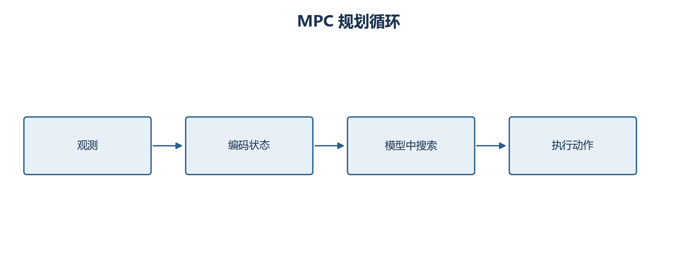

## 25.3　带数值的算例

**例 25.1（CEM 的一次迭代）** 设视野 $H=1$、一维连续动作 $a\in\mathbb{R}$，初始采样分布 $\mathcal{N}(\mu=0,\sigma^2=1)$。采样 $K=6$ 个动作，模型评估回报 $\hat r(a)=-a^2+2a$（峰值在 $a=1$）：

| 样本 $a^{(i)}$ | $-1.0$ | $-0.5$ | $0.0$ | $0.5$ | $1.0$ | $1.5$ |
|------|-------|--------|-------|-------|-------|-------|
| 回报 $J^{(i)}$ | $-3.0$ | $-1.25$ | $0$ | $0.75$ | $1.0$ | $0.75$ |

取 top-$M=2$（$a=1.0,1.5$，回报 $1.0,0.75$）为 elites：新均值 $\mu\leftarrow(1.0+1.5)/2=1.25$，新方差 $\sigma^2\leftarrow\big((1.0-1.25)^2+(1.5-1.25)^2\big)/2=0.0625$（$\sigma=0.25$）。下一次迭代将围绕 $1.25$、以更小方差采样，逐步逼近最优 $a=1$。**可见 CEM 不依赖梯度，仅靠「保留好的、向好的靠拢」就实现了优化**——这正是它适用于任意黑箱模型的原因。

**例 25.2（MCTS 的 UCB 选择）** 设根节点有 3 个动作，访问次数 $N=(10,5,2)$，总访问 $\sum N=17$，动作价值 $Q=(0.8,1.2,0.5)$，$c_{\mathrm{puct}}=1$。对各动作用式 (25-4) 计算 UCB：

- $a_1$：$0.8+\sqrt{17}/(1+10)=0.8+4.123/11=0.8+0.375=1.175$；
- $a_2$：$1.2+\sqrt{17}/(1+5)=1.2+4.123/6=1.2+0.687=1.887$；
- $a_3$：$0.5+\sqrt{17}/(1+2)=0.5+4.123/3=0.5+1.374=1.874$。

选 UCB 最大的 $a_2$（$1.887$）。尽管 $a_1$ 访问最多、$a_3$ 探索加成最高，但 $a_2$ 在价值与探索间取得最佳平衡——这展示了 MCTS 如何系统性平衡「 exploitation（高 $Q$）」与「 exploration（低 $N$ 加成）」。

**表 25-2　规划视野与计算预算的权衡**

| 视野 $H$ | 长程后果 | 模型误差累积 | 单次规划计算 | 适用 |
|---------|---------|------------|------------|------|
| 短（$H\approx1\!-\!5$） | 易短视（靠 $V$ 补） | 小 | 低 | 高频控制、误差大时 |
| 中（$H\approx10\!-\!15$） | 较好 | 中 | 中 | PlaNet/Dreamer 常用 |
| 长（$H\gg15$） | 能考虑长期 | 大（第 33 章） | 高 | 模型精确、离散博弈 |

### 25.3.1　隐空间规划：为什么不在像素里 rollout

上述算例默认规划在低维状态上进行。对第 15—16 章的视频世界模型，规划必须在**隐空间**完成：若每 rollout 一步都解码出图像再编码回去，代价是每步一次生成头 + 一次编码器。PlaNet[4] 的做法是只用 RSSM 的隐式动力学 $\hat s_{t+1}\sim\hat p(s_{t+1}\mid s_t,a_t)$ 前向展开，回报与价值全部在隐空间读取。以 DreamerV3 典型配置估计：像素空间 rollout 一步约需生成头（卷积堆叠，设 6 GFLOP）+ 编码器（2 GFLOP）+ RSSM（0.1 GFLOP）≈8.1 GFLOP，而隐空间 rollout 一步仅 0.1 GFLOP——$H=15$ 的规划便宜约 80 倍。这就是「规划在隐空间、观测只做校正」成为现代 MBRL 默认架构的原因（第 12 章）。

## 25.4　技术谱系与 MuZero 隐式模型

**表 25-3　基于模型规划的技术谱系**

| 方法 | 模型 | 规划器 | 策略 | 出处 |
|------|------|--------|------|------|
| 经典 MPC | 已知/辨识模型 | 数值优化 | 重规划 | 第 8 章 |
| PILCO | 高斯过程 | 解析梯度 | 重规划 | [2]、2011 |
| PlaNet | RSSM | CEM | 无显式策略 | [4]、2019 |
| MuZero | 隐式模型 | MCTS | MCTS 即策略 | [5]、2020 |
| EfficientZero | 隐式模型 | MCTS + 价值 | 自博弈 | [6]、2021 |
| DiffMPC | 可微模型 | 梯度 + 微分 | 端到端 | [7]、2018 |

**MuZero 的隐式模型（例 25.3）。** MuZero[5] 不学习重建真实观测或真实状态，只学习一个对**规划有用**的隐式表示 $h_t$ 与三个预测头：

$$
\hat r_k=g_r(h_k,a_k),\qquad \hat V_k=g_v(h_k),\qquad \hat{\boldsymbol{p}}_k=g_p(h_k),\qquad h_{k+1}=g_h(h_k,a_k). \tag{25-6}
$$

式 (25-6) 中 $g_h$ 是隐式动力学：给定隐式状态与动作，预测下一隐式状态；$g_r,g_v,g_p$ 分别预测奖励、价值、策略先验。MCTS 用这些预测在隐式空间中展开——它从不看像素、也不重建像素，只问「这个动作会带来多少奖励、什么价值、策略先验是什么」。

**为何有效？** 因为规划真正需要的不是「看到未来长什么样」，而是「知道未来各动作的回报与价值」。显式重建观测（如视频生成模型，第 15—16 章）把容量浪费在与决策无关的像素细节上；MuZero 的隐式表示则被训练成**对奖励、价值、策略充分**（第 22.2 节充分性），绕开重建开销，是状态表示「充分但未必要真实」的典范（第 2.5 节可辨识性）。代价是隐式状态缺乏人类可解释性，也不易迁移到需要「看」密切关注的任务。

**MCTS 的价值回传与风险敏感回报。** PUCT 的一次模拟沿路径访问节点 $s_1,s_2,\dots$，到达叶 $s_L$ 后用价值头 $V(s_L)$（或 rollout 经验回报）作该叶的估计，再反向沿路径更新：

$$
N(s_i,a_i)\leftarrow N(s_i,a_i)+1,\qquad Q(s_i,a_i)\leftarrow Q(s_i,a_i)+\frac{1}{N(s_i,a_i)}\big(z_i-Q(s_i,a_i)\big), \tag{25-7}
$$

其中 $z_i$ 是叶 $s_L$ 的回报估计在 $s_i$ 处按折扣回传的值。式 (25-7) 即增量均值更新——模拟越多，$Q$ 越接近该子树的真实期望，这正是式 (25-4) 中 $Q(s,a)$ 的含义。在风险敏感场景（25.2.4 节），把点估计 $z_i$ 换成风险度量，如条件在险价值（CVaR）：

$$
\mathrm{CVaR}_\alpha(Z)=\frac{1}{|\mathcal{B}|}\sum_{z\in\mathcal{B}}z,\qquad \mathcal{B}=\{z_i:z_i\leq F_Z^{-1}(\alpha)\}, \tag{25-8}
$$

即只取回报分布最差的 $\alpha$ 分位样本求均值。$\alpha=1$ 时退化为期望（与式 (25-2) 一致），$\alpha$ 越小规划越保守。用第 24 章的模型集成提供 $\{z_i\}$（各集成成员各 rollout 一条想象轨迹），式 (25-8) 便把「集成方差」直接转化为规划保守度——这是不确定性量化（第 24.4 节）进入规划器的标准接口。

**例 25.4（CVaR 如何改变规划选择）** 某候选动作经 5 成员集成 rollout 得回报 $\{z_i\}=(3.0,\ 3.2,\ 3.1,\ -4.0,\ 2.9)$。期望 $\bar z=(3.0+3.2+3.1-4.0+2.9)/5=1.64$；CVaR$_{0.4}$ 取最差 40% 的样本（$5\times0.4=2$ 个最小值），排序后为 $(-4.0,\ 2.9)$，故 $\mathrm{CVaR}_{0.4}=(-4.0+2.9)/2=-0.55$。若另一候选动作回报为 $(1.5,1.6,1.4,1.5,1.5)$，期望 $1.5$、CVaR$_{0.4}=(1.4+1.5)/2=1.45$。按期望规划会选前者（$1.64>1.5$），按 CVaR$_{0.4}$ 则选后者（$1.45>-0.55$）——后者避开了「小概率大幅亏损」的尾部风险。这正对应式 (25-8) 的设计意图：在模型不确定性大（集成离散度大）的区域自动偏好稳健动作。

## 25.5　规划视野、模型误差与计算预算

**三角权衡。** 规划的质量受三个因素牵制：① **视野 $H$** 越长越能考虑长期后果，但 ② **模型误差**随视野累积（第 24.2 节、第 33 章），且 ③ **计算预算**随 $H$ 与搜索量增长。实践中取折中：有限视野 $H$（PlaNet 用 $H=12$，Dreamer 想象 $H=15$）+ 价值函数截断（式 25-2）+ 滚动重规划纠正偏差。

**重规划为何重要。** 由于模型不准，长计划几乎必然偏离现实。滚动重规划（每步重新观测、重新搜索）把「长计划」拆成一连串「短计划」，每步都用真实反馈纠偏——这是 MPC 相对于开环规划的核心优势，也部分缓解了模型误差（误差还没来得及累积就被新观测修正）。

**计算预算的分配。** 固定计算下，是「把模型做准」还是「多搜几步」？经验表明：当模型误差主导时，改进模型（更多数据、集成、物理先验，第 28 章）比加大搜索更划算；当模型足够准时，加大搜索（更多 CEM 样本、更深 MCTS）能直接提升规划质量。这与第 24 章「MBRL 成败取决于模型质量」的结论一致。

**二阶展开的解析 MPC。** 当模型可微时，还有比采样与梯度上升都高效的路线：把非线性问题在名义轨迹附近线性化、代价二次化，得到逐迭代可解析求解的二次规划。设名义轨迹 $(\bar s_{t+k},\bar a_{t+k})$，动力学一阶展开 $\delta s_{t+k+1}=A_k\delta s_{t+k}+B_k\delta a_{t+k}$，代价二次化 $\sum_k\delta s_{t+k}^\top Q\delta s_{t+k}+\delta a_{t+k}^\top R\delta a_{t+k}$，则得

$$
\min_{\{\delta a\}}\ \sum_{k=0}^{H-1}\Big(\delta s_{t+k}^\top Q\,\delta s_{t+k}+\delta a_{t+k}^\top R\,\delta a_{t+k}\Big),\ \ s.t.\ \delta s_{t+k+1}=A_k\delta s_{t+k}+B_k\delta a_{t+k}. \tag{25-9}
$$

式 (25-9) 可由动态规划（值迭代）或共轭梯度在 $O(H^3\!-\!H^4)$ 内求解，且每步只需更新线性化系数——iLQR/iLQS 家族即此路线。它与第 8 章经典 MPC 的关系是：经典 MPC 要求真值模型已解析已知，式 (25-9) 则允许模型来自学习（只要可微，第 29 章）；二者共享「线性—二次化 + 滚动执行」的骨架。

## 25.6　边界与讨论

基于模型的规划的性能受限于模型质量与搜索预算。① **模型误差直接扭曲规划**：式 (25-1) 对 $\hat p$ 优化，$\hat p$ 不准时最优动作序列是基于虚假未来的（第 24 章模型利用）。② **连续高维动作空间**：CEM 在高维下采样效率下降，MCTS 难以直接离散化连续动作，梯度规划受局部最优困扰。③ **实时性约束**：机器人控制常需毫秒级决策，深度模型 rollout + 搜索的计算延迟是工程瓶颈——这正是第 12 章「把规划蒸馏成策略」（Dreamer）的动机。④ **价值函数偏差**：式 (25-2) 依赖 $V_\psi$，若价值估计有偏，截断处引入系统误差。

这些局限并不否定基于模型规划的价值，而是划定了它的适用边界：**模型较准、动作空间适中、计算预算充足**时，规划是强大而灵活的工具（MuZero 在离散博弈中的超人表现即明证）；反之，学到策略的路线 A（第 12、24 章）或混合方案更实用。

## 25.7　交叉引用与承上启下

本章上承第 4 章（最优控制）、第 8 章（经典 MPC）、第 11 章（PlaNet 潜在 MPC）、第 23—24 章（动作条件化、MBRL 路线 B），横向对照第 12 章（Dreamer 的「学到策略」路线 A），下接第 26 章（离线世界模型与不确定性）、第 28—29 章（物理先验与可微模拟，为梯度规划提供模型）、第 33 章（滚动漂移）、第 34 章（因果干预与规划）。这些辨析衔接第 4、8、11—12、23—26、28—29、33—34 章与《强化学习与决策智能导论》。

## 本章小结

本章系统论述基于世界模型的规划。

我们首先形式化模型中的规划问题（定义 25.1，式 25-1、25-2），阐明 MPC 滚动重规划范式、价值截断与规划器的计算弹性（25.1 节）。接着系统介绍 CEM（式 25-3）、MCTS（式 25-4）、梯度规划（式 25-5）三类搜索方法（表 25-1），并给出安全与鲁棒规划的极小极大/CVaR 对策（25.2.4 节），用 CEM 与 MCTS 的逐步数值算例展示迭代机制（25.3 节，表 25-2），并给出隐空间规划相对像素 rollout 约 80 倍的算力节省（25.3.1 节）。我们梳理规划技术谱系（表 25-3）与 MuZero 的隐式模型（式 25-6）——只预测奖励、价值、策略而不重建观测，论证了「表示充分但未必要真实」（25.4 节），并补充 MCTS 的价值回传（式 25-7）与风险敏感规划（式 25-8，例 25.4）。最后讨论视野—误差—计算预算的三角权衡、二阶解析 MPC（式 25-9）与边界（25.5—25.6 节）。

我们还明确边界：模型误差直接扭曲规划、连续高维动作困难、实时性约束、价值偏差。这些辨析衔接第 4、8、11—12、23—26、28—29、33—34 章与《强化学习与决策智能导论》。

第六篇的三章（动作条件化、MBRL、MPC 规划）至此构成一条完整的「从表征到决策」链路。下一章进入离线世界模型，讨论在没有在线交互时如何从固定数据学出可靠的模型与策略。

**进一步阅读**　本章建议延伸阅读的文献：[5]、[4]、[3]、[1]、[9]。

## 参考文献

[1] Sutton R S. Dyna, an integrated architecture for learning, planning, and reacting. *SIGART Bulletin*, 1991, 2(4): 160–163.

[2] Deisenroth M P, Rasmussen C E. PILCO: A model-based and data-efficient approach to policy search. *ICML*, 2011.

[3] Williams G, Wagener N, Goldfain B, et al. Differentiable MPC for end-to-end planning and control. *NeurIPS*, 2018.

[4] Hafner D, Lillicrap T, Fischer I, et al. Learning latent dynamics for planning from pixels. *ICML*, 2019.

[5] Schrittwieser J, Antonoglou I, Hubert T, et al. Mastering Atari, Go, chess and shogi by planning with a learned model. *Nature*, 2020, 588: 604–609.

[6] Ye W, Liu S, Kurutach T, et al. Mastering Atari games with limited data. *NeurIPS*, 2021.

[7] Tamar A, Wu Y, Thomas G, et al. Value iteration networks. *NeurIPS*, 2016.

[8] Chua R, Calandra R, McAllister R. Deep reinforcement learning in a handful of trials using probabilistic dynamics models. *NeurIPS*, 2018.

[9] Li W, Tassa Y, Erez T, Todorov E. Iterative linear quadratic regulator for robot walking and manipulation. *IEEE International Conference on Robotics and Automation (ICRA)*, 2005: 2973–2978.

---

# 第 26 章　离线世界模型与决策 Transformer

第 24—25 章的基于模型强化学习（model-based RL, MBRL）假定智能体可以不断与环境交互、在线收集新数据来校正世界模型。现实场景却常常相反：我们只有一个固定的、已经采集好的离线数据集 $\mathcal{D}$，由于成本、安全或伦理约束（如医疗、自动驾驶历史日志、推荐系统日志），智能体无法再与环境交互。本章讨论**离线世界模型**（offline world model）与**决策 Transformer**（Decision Transformer）——从固定数据中学出世界模型与策略，而不承担在线交互的风险与成本。这是「数据即世界」路线与之前「交互即世界」路线的根本分野。

本章先剖析离线强化学习的分布偏移挑战（26.1 节），再推导保守价值估计与离线世界模型（26.2 节），介绍决策 Transformer 把强化学习改写为序列建模的洞察（26.3 节），给出带数值的算例（26.4 节），梳理技术谱系与变体（26.5 节），分析边界与讨论（26.6 节），最后收束（26.7 节）。

## 26.1　离线强化学习的分布偏移挑战

**定义 26.1（离线强化学习）** 给定固定数据集

$$
\mathcal{D}=\big\{(s_t,a_t,r_t,s_{t+1})\big\}_{i=1}^{N},\quad a_t\sim\mu(\cdot\mid s_t), \tag{26-1}
$$

其中行为策略 $\mu$ 生成了这些数据。智能体**不与环境交互**，只能从 $\mathcal{D}$ 学一个策略 $\pi$ 最大化期望回报 $J(\pi)=\mathbb{E}_{\pi}\big[\sum_t\gamma^t r_t\big]$。这里的核心困难不是数据少，而是数据的**分布固定**：策略一旦偏离行为策略 $\mu$，就会访问数据集中没有覆盖的状态—动作对。

**分布偏移与外推误差。** 在线强化学习中，价值函数通过时序差分（TD）更新，其目标值依赖下一个状态的价值 $V(s_{t+1})$。当 $\pi$ 选择了一个数据中未见的动作 $a$ 时，Q 函数 $Q(s,a)$ 没有真实样本约束，神经网络的外推行为不可控——它可能错误地给出很高的估计值。这个现象被称为**外推误差**（extrapolation error）或**价值高估**。形式化地，定义 bellman 误差的期望：

$$
\mathcal{L}(Q)=\mathbb{E}_{(s,a,r,s')\sim\mathcal{D}}\Big[\big(Q(s,a)-r-\gamma\,\mathbb{E}_{a'\sim\pi}[Q(s',a')]\big)^2\Big]. \tag{26-2}
$$

当 $a'\sim\pi$ 落在 $\mu$ 支撑之外时，$Q(s',a')$ 未受数据约束，误差被放大并沿轨迹传播。

**直觉解释。** 在线 RL 像在熟悉的街区里探路，走错了能亲身试错纠正；离线 RL 像只凭一本旧旅行日记规划行程——你只能去日记里写过的地方，一旦偏离路线，地图（价值函数）上就是一片空白，导航极易把你带进虚构的「捷径」。因此离线学习的第一原则是**别偏离数据分布太远**。

**数据覆盖度：可度量的「安全半径」。** 「别偏离太远」能否量化？可以。设数据集的状态—动作访问频率 $d_{\mathcal{D}}(s,a)=\frac{1}{N}\sum_i\mathbb{1}[(s_i,a_i)=(s,a)]$（连续情形用核密度估计 $d_{\mathcal{D}}(s,a)\approx\frac1N\sum_i K_h\big(\lVert s_i-s\rVert,\lVert a_i-a\rVert\big)$）。一个自然的策略约束是要求 $\pi$ 的访问分布 $d_\pi$ 不超出数据覆盖：

$$
\mathrm{KL}\big(d_\pi\,\|\,d_{\mathcal{D}}\big)\leq \Delta, \tag{26-3}
$$

其中 $\Delta$ 是预算的偏移量。$\Delta=0$ 即纯行为克隆（只能在数据内行动），$\Delta\to\infty$ 即无约束（退化为在线 RL 的分布偏移灾难）。这一视角把 CQL 的 $\alpha$、TD3+BC 的 $\lambda$、MOPO 的 $\lambda$ 统一成「在数据支撑内允许多大的偏离」的连续谱——保守超参本质都是在调 $\Delta$。实践中更常用其代理：对每个 $(s,a)$ 算最近邻数据距离或集成分歧 $u(s,a)$（式 26-6），把「覆盖度」转成可计算的惩罚。

**离线世界模型的特殊困难。** 在离线数据上学一个转移模型 $\hat p(s_{t+1}\mid s_t,a_t)$，再在模型中优化策略，看似可行，但模型在分布外（out-of-distribution, OOD）的状态—动作上同样不可靠。策略优化天然会寻找模型预测奖励高的地方——这恰恰是模型最可能出错、产生「幻觉奖励」的地方。这就是在线 MBRL 中的**模型利用**（model exploitation，第 24 章）在离线设定下的加剧版本：离线时连纠错交互都没有。

> 【图 26-1　离线强化学习的分布偏移】（原图见 figures/图26-1.png）：行为策略 $\mu$ 的数据流形（深色区域）与学到的策略 $\pi$ 偏离到 OOD 区域，Q 函数在 OOD 区域出现虚假高值（用颜色深浅标示外推误差）。
>
> 

## 26.2　保守价值估计与离线世界模型

让离线学习可行的关键是把策略「拴」在数据分布附近。有两条主要思路：保守价值估计与显式策略约束。

**保守 Q 学习（CQL）。** CQL[2] 在 bellman 损失上加一项，压低 OOD 动作的 Q 值：

$$
\mathcal{L}_{\mathrm{CQL}}=\mathcal{L}(Q)+\alpha\Big[\mathbb{E}_{s\sim\mathcal{D}}\log\!\sum_{a}\exp Q(s,a)-\mathbb{E}_{(s,a)\sim\mathcal{D}}Q(s,a)\Big]. \tag{26-4}
$$

第一项 $\log\sum_a\exp Q$ 是对所有动作 Q 值的「软最大值」（log-sum-exp），它会把未见动作的高 Q 值也拉高，从而被第二项（数据中动作的 Q 值）反向压低——净效果是给 OOD 动作一个保守的下界。$\alpha$ 控制保守程度：$\alpha$ 越大越保守，但过大也会低估真实优质动作的价值。

**策略约束方法。** 另一类方法直接约束 $\pi$ 靠近 $\mu$，例如 TD3+BC[7] 在策略损失中加行为克隆项：

$$
\mathcal{L}_{\pi}=-\mathbb{E}_{(s,a)\sim\mathcal{D}}\big[Q(s,\pi(s))\big]+\lambda\,\mathbb{E}_{(s,a)\sim\mathcal{D}}\big[(\pi(s)-a)^2\big]. \tag{26-5}
$$

第二项让学到的动作贴近数据中真实动作，从而天然避开 OOD 区域。这体现了离线学习的核心权衡：**利用价值信号提升 vs. 保持行为克隆的Safety**。

**离线世界模型（MOPO / MoREL）。** MOPO[3] 在离线数据上学转移与奖励模型，在模型中优化策略，但对模型预测奖励施加 OOD 惩罚：

$$
\tilde r(s,a)=r(s,a)-\lambda\,u(s,a),\quad u(s,a)=\text{模型集成的分歧度}, \tag{26-6}
$$

其中 $u(s,a)$ 用多个转移模型预测的分歧（方差）来度量不确定性：分歧越大说明越接近 OOD，惩罚越重。这把「保守」从价值空间搬到了奖励空间——模型越不确定的地方，虚构奖励被打折得越狠，从而抑制策略利用模型漏洞。MoREL[8] 则用价值函数的下界（而非点估计）做悲观规划，给出理论上的性能保证。

**模型集成不确定性（MOE）。** MOPO 的分歧度 $u(s,a)$ 常用**模型集成**（ensemble）实现[3]：训练 $K$ 个独立的转移模型 $\{\hat p_k\}_{k=1}^K$（不同随机种子或数据子集），取它们预测的方差为不确定度：

$$
u(s,a)=\sqrt{\frac{1}{K}\sum_{k=1}^{K}\big(\hat r_k(s,a)-\bar r(s,a)\big)^2},\qquad \bar r(s,a)=\frac1K\sum_k \hat r_k(s,a). \tag{26-7}
$$

直觉是「集成一致 = 有把握，集成打架 = OOD」：数据覆盖充分的状态—动作上各成员预测趋同，$u\to0$，惩罚消失；OOD 区域各成员各说各话，$u$ 放大，惩罚生效。MOPO[3] 的后续工作进一步指出，即便有 OOD 惩罚，策略仍可能钻到「模型一致但都错」的区域（伪相关），因此建议把集成分歧直接混进想象轨迹的奖励作悲观训练目标，而非仅事后惩罚。

**七要素视角。** 离线世界模型仍具备状态表示（E1）、转移（E2）、观测/奖励生成（E3/E6），但其动作由固定数据驱动（E5 的离线版本），且缺少真实在线交互的闭环校准——这正是它需要保守性的根本原因。

**悲观估计的理论保证。** 为什么「压低 OOD 价值」能起作用？一个简洁的解释是：设 $Q^\pi$ 是 $\pi$ 的真实 Q 值，学到的 $\hat Q$ 满足 $\hat Q(s,a)\leq Q^\pi(s,a)$ 对所有数据内 $(s,a)$ 成立（悲观下界），且 Bellman 误差在数据分布内有界 $\|\hat Q - \hat T^\pi \hat Q\|_\infty\leq \epsilon$，则可证 $\pi$ 的经验回报满足 $J(\pi)\geq J^\star - O\big(\epsilon/\bar\alpha\big)$，其中 $\bar\alpha$ 是「数据对状态的覆盖度」（访问概率下界）。直观含义：**覆盖越充分（$\bar\alpha$ 大），性能上界越紧**；反之在数据稀薄的区域，悲观下界可能把真优质动作也压没，导致「保守过头」。这给出实践准则——保守超参（$\alpha,\lambda$）应与数据集的覆盖度匹配：数据越丰富，越可以激进；数据越稀疏，越要悲观。MoREL[8] 与 CQL[2] 的超参敏感性实验正印证了这一点。

## 26.3　决策 Transformer：把强化学习变成序列建模

**定义 26.2（Decision Transformer, DT）** DT[1] 把一条轨迹视为 token 序列：

$$
\tau=(R_1,s_1,a_1,R_2,s_2,a_2,\dots,R_T,s_T,a_T), \tag{26-8}
$$

其中 $R_t=\sum_{t'=t}^{T}\gamma^{t'-t}r_{t'}$ 是 **return-to-go**（从当前步到未来的折扣回报）。用因果 Transformer 自回归地预测下一个动作 $a_t$：

$$
\hat a_t=f_{\theta}\big(R_{\le t},s_{\le t},a_{<t}\big). \tag{26-9}
$$

训练时最小化动作预测的交叉熵（离散动作）或均方误差（连续动作）。**推理时**，给定期望的目标回报 $\hat R$ 与初始状态 $s_1$，自回归生成动作序列——这等价于「条件序列生成」：像语言模型按提示续写一样，DT 按「目标回报提示」续写动作。

**关键洞察。** DT 完全绕开了价值函数与 bootstrapping，也就绕开了离线 RL 最棘手的外推误差问题——因为它从不查询数据中不存在的 $(s,a)$ 的 Q 值，只做监督式的下一动作预测。它把「最大化回报」的问题改写为「以目标回报为条件的模仿学习」：如果数据中有达成高回报的轨迹，DT 就能学会复现导致高回报的动作模式。

**优势与代价。** 优势是复用成熟的 Transformer 架构（第 20 章）与稳定的监督训练；代价是它本质仍受数据质量约束——DT 很难生成数据中从未出现过的高回报行为（无外推能力），且 return-to-go 的尺度与归一化需要仔细调优。Chen 等[1] 展示了 DT 在 Atari 与 MuJoCo 上可媲美甚至超过当时的离线 RL 方法，但后续研究[5] 指出：精心调参的 TD3+BC 等简单方法往往不逊于 DT，说明 DT 的收益更多来自工程稳定性而非算法本质优势。

**DT 的条件分布视角。** 把式 (26-9) 写成概率语言更清楚：DT 学的是条件分布 $p(a_t\mid R_t, s_t, a_{<t})$，推理时固定 $R_t=\hat R$ 采样/解码 $a_t$。这解释了它的「天花板」——$\hat R$ 落在数据回报分布的支撑内时，DT 能稳定复现对应质量的轨迹；$\hat R$ 超出支撑时，条件分布 $p(a_t\mid R_t=\hat R, s_t)$ 在数据中无支撑，解码出的动作是「外推」，质量不可控。因此 DT 的「目标回报」不是越大越好，而应取数据回报分布的**上分位**（如 95 分位）——这等于显式声明「我要复现数据里前 5% 的表现」。Fu 等[5] 的消融进一步表明，DT 对 return-to-go 的敏感度远高于对状态编码细节的敏感度，「把 $\hat R$ 归一化到正确尺度」比「换更大的 Transformer」更能改变结果。

> 【图 26-2　决策 Transformer 结构】（原图见 figures/图26-2.png）：return-to-go、状态、动作三类 token 交错输入因果 Transformer，自回归预测下一动作；推理时以目标回报 $\hat R$ 作提示生成动作。
>
> 

## 26.4　带数值的算例

**例 26.1（return-to-go 的逐步计算）** 设一条长度为 4 的离线轨迹，即时奖励 $r_1=1,r_2=0,r_3=1,r_4=2$，折扣 $\gamma=0.9$。从后往前算 return-to-go：

$R_4=r_4=2$；
$R_3=r_3+\gamma R_4=1+0.9\times2=2.8$；
$R_2=r_2+\gamma R_3=0+0.9\times2.8=2.52$；
$R_1=r_1+\gamma R_2=1+0.9\times2.52=3.268$。

若目标回报设为 $\hat R=3.0$（接近数据中表现），DT 从 $R_1$ 附近的条件分布采样动作，倾向于复现这条高回报轨迹的动作模式。若把目标回报拔高到 $\hat R=5.0$（数据中没有对应轨迹），DT 因缺乏外推能力，生成的动作会退化到分布边缘——这正是数据质量天花板的体现。

**例 26.2（CQL 的保守惩罚手算）** 设某状态 $s$ 下数据中只有动作 $a_1$（$Q(s,a_1)=5$），候选 OOD 动作 $a_2$ 被网络外推到 $Q(s,a_2)=20$。CQL 的 log-sum-exp 项（仅两动作）：$\log(e^{5}+e^{20})\approx20$（$e^{20}$ 主导）。保守项 $=20-5=15$，乘以 $\alpha=0.5$ 得惩罚 $7.5$。网络被驱动降低 $Q(s,a_2)$——减少外推高估。若把 $\alpha$ 调到 2，惩罚变 $30$，压得更狠，但也可能把真实优质的 $a_1$ 一并低估。这展示了 $\alpha$ 的敏感性与保守—性能的权衡。

**例 26.3（集成不确定度如何惩罚 OOD）** 设 4 个集成成员对某状态—动作 $(s,a)$ 的预测奖励为 $\hat r=(2.0,\ 2.1,\ 1.9,\ 2.0)$。均值 $\bar r=(2.0+2.1+1.9+2.0)/4=2.0$，集成分歧 $u=\sqrt{\frac14[(0)^2+(0.1)^2+(-0.1)^2+(0)^2]}=\sqrt{0.005}\approx0.071$——成员高度一致，说明该点数据覆盖充分，惩罚 $\lambda u$ 很小。若同一模型在另一 OOD 点 $(s',a')$ 预测为 $(5.0,\ 1.0,\ 4.5,\ 0.5)$，均值 $2.75$，$u=\sqrt{\frac14[(2.25)^2+(-1.75)^2+(1.75)^2+(-2.25)^2]}=\sqrt{\frac14(5.06+3.06+3.06+5.06)}=\sqrt{4.06}\approx2.02$。即便点估计均值 $2.75$ 看似不错，式 (26-6) 会因 $u=2.02$ 施加重惩罚——MOPO 正是靠这种「分歧即危险」的信号，把策略挡在模型不可靠的 OOD 区域之外。

## 26.5　技术谱系与变体

**表 26-1　离线强化学习方法谱系**

| 方法 | 核心机制 | 应对 OOD 的方式 | 代表文献 |
|------|---------|----------------|---------|
| BC | 行为克隆 | 完全不查询 OOD | [6] |
| CQL | 保守 Q 值 | 压低未见动作 Q | [2] |
| TD3+BC | 策略正则 | 贴近数据动作 | [7] |
| MOPO | 惩罚模型奖励 | 不确定性折扣 | [3] |
| MoREL | 价值下界 | 悲观规划 | [8] |
| DT | 序列建模 | 绕过价值查询 | [1] |

**变体与前沿。** ① **离线到在线微调**（offline-to-online）：先用离线数据预训练，再有限交互微调，兼顾安全与性能；② **保守与表达的平衡**：IQL[4] 用 expectile 回归隐式约束策略，避免显式查询 OOD 动作；③ **离线世界模型 + 规划**：把 DT 的序列建模与学习模型结合，在潜在空间中做受约束规划；④ **数据质量意识**：根据轨迹回报加权，让模型更关注高质量数据。这些方法都围绕同一个中心：**在固定数据的支撑内榨取尽可能好的策略**。

**IQL 的隐式约束。** IQL[4] 的核心是**不显式评估 OOD 动作的 Q 值**。它用 expectile 回归把价值估计「锚定」在数据分布上：

$$
\mathcal{L}_{V}(V)=\mathbb{E}_{s\sim\mathcal{D}}\Big[L_2^{\tau}\big(V(s)-Q(s,\pi_\theta(s))\big)\Big],\qquad
L_2^{\tau}(u)=\begin{cases}\tau|u|,&u\geq0\\(1-\tau)|u|,&u<0\end{cases}, \tag{26-10}
$$

其中 $\tau\in(0,1)$（如 0.7）控制 expectile 的「向上偏」程度：$\tau\to1$ 时 $V$ 逼近 $Q$ 的上分位（乐观），$\tau=0.5$ 时为普通 MSE（无偏），$\tau\to0$ 时下分位（悲观）。策略 $\pi$ 仅用「从 $V$ 蒸馏的加权行为克隆」更新，从不查询数据外的 $(s,a)$。expectile 损失的非对称性是 IQL 的关键：它让 $V$ 在「数据中出现过的、回报高的」动作上被放大，在 OOD 动作上被压小，从而隐式实现了式 (26-3) 的覆盖约束，却无需显式计算 $d_\pi$ 与 $d_{\mathcal{D}}$ 的散度——计算上更稳、超参更少。

**与本书其他章节的关系。** 决策 Transformer 的架构根基（Transformer、自注意力）来自第 20 章；其「序列建模」视角与第 23 章的动作条件化、第 27 章的交互生成共享技术底座；其离线约束思想与第 24 章的模型利用缓解一脉相承。若读者需要更系统的离线强化学习理论，参见《强化学习与决策智能导论》。

## 26.6　边界与讨论

离线世界模型与决策 Transformer 的局限有四。① **数据质量的天花板**：离线方法难以超越数据中最优轨迹太多，本质是「从已有数据中提炼」而非「创造新行为」；② **保守性的代价**：过强的保守约束（大 $\alpha$）会低估优质动作，导致策略过于保守；③ **return-to-go 设计敏感**：DT 的目标回报尺度需归一化，且长轨迹的回报估计方差大；④ **缺少显式因果模型**：DT 只做条件模仿，不建模动作如何因果地改变世界，难以回答反事实（「若当时换一个动作会怎样」），这是它与真正的世界模型的本质差距。

这些局限并不否定离线路线的价值：在交互昂贵或危险的领域，从固定数据中学出可靠策略与模型，是唯一可行的路径。更根本的方向是把离线数据学得的模型作为先验，再用少量安全交互校准——这正是离线到在线微调、以及第 31 章域随机化等方法试图架起的桥梁。

**工程落地的三个要点。** ① **数据集审计先行**：上线前先统计数据回报分布、状态覆盖密度与行为策略多样性，决定保守超参的量级（覆盖稀疏的域，$\alpha,\lambda$ 应显著加大）；② **离线—在线的渐进切换**：纯离线训练 → 影子模式（策略并行跑但不执行）→ 受限在线微调（只允许小幅偏离数据支撑的动作），每一步都用覆盖度指标（式 26-3 的 $\Delta$）把关，而非凭感觉「放开」；③ **评估必须双轨**：离线评估（D4RL 式的 holdout 回报）只反映「数据内」能力，部署前还要在受控环境（仿真或沙盒）做离线到在线的迁移测试，二者结论可能背离——数据内评估高分而真实环境失利的案例并不罕见。这些辨析衔接第 12、14、20、23—24、27、31 章与《强化学习与决策智能导论》。

## 26.7　本章小结

本章论述在固定离线数据上学习世界模型与策略的方法。

我们首先指出离线 RL 与在线 MBRL 的根本差异：数据分布固定，策略偏离即遭遇分布偏移与外推误差（式 26-1、26-2，定义 26.1），并把「别偏离太远」量化为覆盖度约束（式 26-3）。接着推导保守价值估计：CQL 的 log-sum-exp 惩罚（式 26-4）、TD3+BC 的策略正则（式 26-5）、MOPO 的不确定性惩罚奖励（式 26-6）与模型集成分歧（式 26-7），通过数值算例（例 26.1—26.3）量化外推误差、保守惩罚与集成不确定度的强度。随后介绍决策 Transformer：把轨迹改写为 return-to-go 条件 token 序列（式 26-8、26-9，定义 26.2）。我们梳理了从 BC 到 DT 的方法谱系（表 26-1），并补充 IQL 的 expectile 隐式约束（式 26-10）与前沿变体。

我们还明确边界：数据质量天花板、保守性代价、return-to-go 敏感性、缺少显式因果模型。这些辨析衔接第 12、14、20、23—24、27、31 章与《强化学习与决策智能导论》。

下一步应把离线世界模型与第 27 章的交互世界模型、第 31 章的具身世界模型对照阅读，理解「数据即世界」与「交互即世界」两条路线在工程上的取舍。下一章转向另一个极端——智能体可以与世界实时交互，探讨交互世界模型如何让生成世界「可玩」。

**进一步阅读**　本章建议延伸阅读的文献：[1]、[2]、[3]、[4]、[5]、[7]。

## 参考文献

[1] Chen L, Lu K, Rajeswaran A, et al. Decision Transformer: Reinforcement learning via sequence modeling. *NeurIPS*, 2021, 34: 15084–15097.

[2] Kumar A, Zhou A, Tucker G, Levine S. Conservative Q-learning for offline reinforcement learning. *NeurIPS*, 2020, 33: 1179–1191.

[3] Janner M, Fu J, Zhang M, Levine S. When to trust your model: Model-based policy optimization. *NeurIPS*, 2019, 32: 12519–12530.

[4] Kostrikov I, Nair A, Levine S. Offline reinforcement learning with implicit Q-learning. *ICLR*, 2022.

[5] Fu J, Kumar A, Nachum O, et al. Decision Transformer: What is it really doing? *arXiv:2205.12293*, 2022.

[6] Pomerleau D A. ALVINN: An autonomous land vehicle in a neural network. *NeurIPS*, 1988.

[7] Fujimoto S, Gu S S. A minimalist approach to offline reinforcement learning. *NeurIPS*, 2021, 34: 20132–20145.

[8] Kidambi R, Jain A, Venkataraman S, et al. MOReL: Model-based offline reinforcement learning. *NeurIPS*, 2020, 33: 21810–21823.

---

# 第 27 章　交互世界模型

第六篇（第 23—27 章）的高潮是交互世界模型（interactive world model）：用户或智能体可以与一个生成出来的世界实时交互，动作即时改变世界状态。Genie[1]、GameNGen[2] 等工作展示了「可玩的世界模型」（playable world model）：输入动作，模型生成下一帧，形成闭环。这模糊了「世界模型」与「游戏引擎/模拟器」的界限，是通向通用交互式智能的重要方向。

交互世界模型是前五章技术的「闭环综合」：第 23 章的动作条件化提供「动作如何进入模型」，第 15—16 章的视频生成提供「如何渲染帧」，第 12 章的潜在状态空间提供「如何维护记忆」，第 24 章的 MBRL 提供「为何要闭环（为了在模型里试错）」。本章的新贡献集中在两点：其一是**实时性**（把生成从离线批处理变成每 33 毫秒一帧的在线流），其二是**闭环稳定性**（让自回归生成在长时交互下不漂移）。这两点不是架构创新，而是系统约束——正是它们把「能生成视频」提升为「能生成可玩的世界」。

本章先给出交互世界模型的定义与其和视频生成的区别（27.1 节），再剖析架构与核心技术——潜在动作发现、动作条件化生成、实时闭环（27.2 节），给出带数值的算例说明延迟预算与一致性（27.3 节），梳理技术谱系与变体（27.4 节），分析长期一致性等挑战（27.5 节），讨论意义与边界并收束（27.6、27.7 节）。

## 27.1　交互式世界模拟器

**定义 27.1（交互世界模型）** 一个以动作 $a_t$ 为条件的生成模型，维护潜在状态 $s_t$，实时生成对动作响应的观测

$$
s_{t+1}=f_\theta(s_t,a_t),\qquad o_{t+1}\sim p_\theta(o_{t+1}\mid s_{t+1}), \tag{27-1}
$$

用户在循环中持续提供动作，模型持续生成——形成从「动作→状态→观测→用户反馈→新动作」的交互闭环。与第 23 章的动作条件化世界模型相比，这里强调两点：**实时性**（每步生成须在严格时间预算内完成）与**闭环稳定性**（长时交互不漂移）。

**与视频生成的根本区别。** 普通视频生成（第 15—16 章）一次性生成一段固定视频，其内容与用户无关；交互世界模型则根据用户动作**在线改变**生成内容。形式化地，视频生成建模 $p(o_{1:T})$，交互世界模型建模的是**动作条件化的边际**：

$$
p(o_{1:T}\mid a_{0:T-1})=\prod_{t=0}^{T-1}p_\theta(o_{t+1}\mid o_{\le t},a_{\le t}). \tag{27-2}
$$

关键差别在条件变量 $a_{\le t}$：同一初始画面，不同动作序列应导向不同未来——这要求模型学到动作对世界的**因果效应**，而非仅仅学到视觉上的时序连续性。

**直觉解释。** 看电影是被动的：剧情按既定剧本播放，你无法干预；玩游戏是主动的：你按左键，角色就左移，世界随之响应。交互世界模型试图把「被动的视频生成」变成「主动的可玩世界」——让生成模型从「播放录像」升级为「响应操作的模拟器」。

**交互世界模型的两个评价维度。** 评估一个交互世界模型不能只看单帧画质，更要看两个维度：一是**响应性**（responsiveness），即动作 $a_t$ 对下一帧的因果影响力——可用「干预同一初态、施加不同动作后生成结果的差异度」度量；二是**可持续性**（sustainability），即在长时交互中世界结构与物理规律的一致程度。一个只会「播放好看视频」的模型在两维度上都会失败：它对动作不敏感，且时间一长就失真。这两个维度分别对应后文讨论的因果性与长期一致性挑战。

**闭环带来的数据飞轮。** 交互世界模型还隐含一个被动生成不具备的性质：**数据飞轮**。用户（或智能体）的每一次交互都产生一条「动作→观测」样本，这些样本可反哺模型的再训练——交互越久、数据越多、模型越准。这与第 24 章「模型利用真实数据校准」同构，但飞轮的「燃料」来自交互本身而非外部采集。其正面是模型可随使用持续改进；负面是若交互数据被模型自身的偏差污染（生成世界有偏→交互数据有偏→模型更有偏），飞轮会变成「偏差放大器」。因此闭环系统需监控交互数据的分布漂移，必要时注入真实观测做纠偏——这是 27.5 节长期一致性的另一面。

## 27.2　架构：潜在动作发现与动作条件化生成

**从无标注视频中发现动作。** Genie[1] 的核心创新是**潜在动作模型**（latent action model, LAM）：从没有任何动作标注的视频中，自监督地学出「帧间变化」对应的离散潜在动作 $a_t$。其做法是训练一个编码器把相邻帧 $(o_t,o_{t+1})$ 映射为离散动作码，再用该动作码条件化预测下一帧，并用向量量化（VQ，第 9 章）与循环一致性约束保证动作码的紧凑与可分。学出潜在动作后，再用这些伪动作训练一个动作条件化的世界模型，就能让用户通过操控这些「发现的动作维度」来交互。

**架构流水线。** 典型的交互世界模型由三段构成：

① **感知编码器** $E$：把观测 $o_t$ 编码为潜在状态 $s_t=E(o_t)$；
② **动力学模块** $f_\theta$：按 $s_{t+1}=f_\theta(s_t,a_t)$ 滚动（自回归 Transformer 或扩散模型）；
③ **解码器** $D$：把 $s_{t+1}$ 渲染为观测 $\hat o_{t+1}=D(s_{t+1})$。

整体损失是重建损失加潜在一致性损失：

$$
\mathcal{L}=\sum_t\Big[\big\|o_{t+1}-D(f_\theta(E(o_t),a_t))\big\|^2+\beta\,\mathcal{L}_{\mathrm{LAM}}\Big]. \tag{27-3}
$$

**GameNGen 的路径。** GameNGen[2] 走的是另一条路：直接在强化学习智能体的交互轨迹上训练一个扩散世界模型，用稳定扩散（stable diffusion）架构 + 动作条件化，实现在 DOOM 游戏上的实时可玩生成——以约 20 帧/秒的速度生成高质量游戏画面，且能保持数分钟的游戏一致性。它证明了交互世界模型可以在复杂视觉域达到实用级别。

**潜在动作的解耦约束。** Genie 的 LAM 要解决一个微妙问题：帧间变化同时来自「智能体的动作」与「世界自身的动力学」（风吹树叶、角色呼吸），编码器必须把二者分开，否则学到的「动作」会混入场景自运动。Genie 用**循环一致性**约束：从 $(o_t,o_{t+1})$ 预测出潜在动作 $a_t$，再用 $a_t$ 去预测 $(o_{t+1},o_{t+2})$ 中对应「同一动作维度」的变化分量，要求二者在动作码空间对齐。等价地，LAM 的目标可写成「预测下一个观测 + 量化正则」：

$$
\mathcal{L}_{\mathrm{LAM}}=\mathbb{E}\Big[\big\lVert o_{t+1}-\hat o_{t+1}\big\rVert^2\Big]+\alpha_{\mathrm{vq}}\,\mathbb{E}\big\lVert \mathrm{sg}[\mathbf{z}]-\mathbf{e}_k\big\rVert^2+\alpha_{\mathrm{cyc}}\,\mathbb{E}\big\lVert a_t^{(\text{fwd})}-a_{t+1}^{(\text{rev})}\big\rVert^2, \tag{27-4}
$$

其中 $\mathbf{e}_k$ 是 VQ 码本向量、$\mathrm{sg}$ 为停梯度（stop-gradient），$\alpha_{\mathrm{cyc}}$ 项把「前向动作」与「反向重建动作」拉近，迫使码本学到可逆、可复用的动作维度。这一项是 LAM 与朴素帧间预测的本质区别：它让 $a_t$ 成为**可控的因果变量**而非「任意残差」。

**为何扩散模型适合交互生成？** 扩散模型[3] 通过逐步去噪生成图像，训练目标稳定（预测噪声的均方误差），且天然支持 classifier-free 引导——把动作条件 $a_t$ 作为引导信号，可在不重新训练的情况下调节动作影响的强度。相比之下，自回归像素生成速度慢，GAN 训练不稳定。代价是扩散的多步采样延迟高，因此交互场景常用蒸馏把采样步数压缩到个位数（第 38 章）。这就是为什么 GameNGen 能实时而早期基于扩散的世界生成不能——关键在采样加速而非架构本身。

> 【图 27-1　交互世界模型闭环】（原图见 figures/图27-1.png）：用户动作 $a_t$→世界模型 $(f_\theta,D)$→生成观测 $\hat o_{t+1}$→显示给用户→用户产生新动作，形成闭环；标注潜在状态 $s_t$ 与潜在动作发现模块。
>
> 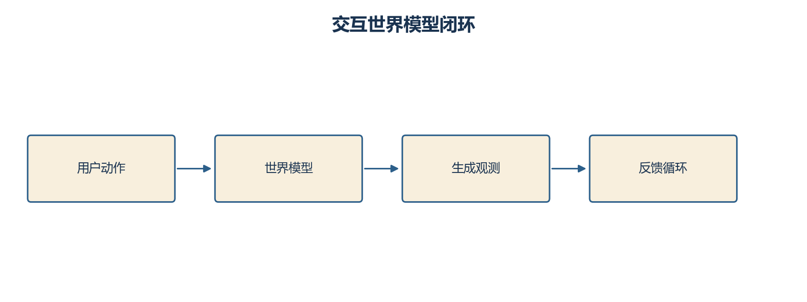

## 27.3　带数值的算例：实时延迟预算与长期一致性

**例 27.1（实时性的帧预算）** 交互体验要求端到端延迟低于 $1/30$ 秒（约 33 毫秒）才能达到 30 帧/秒的流畅度。设感知编码 $E$ 耗时 5 毫秒、动力学 $f_\theta$ 耗时 12 毫秒、解码 $D$ 耗时 14 毫秒，则单步总延迟 $5+12+14=31$ 毫秒，勉强满足 33 毫秒预算（余量 2 毫秒）。若把解码器换成更重的高质量扩散（耗时 40 毫秒），总延迟升至 57 毫秒，帧率跌到约 17 帧/秒——交互的「手感」明显变差。这解释了为何交互世界模型必须在生成质量与推理速度之间权衡：常采用蒸馏、缓存潜在状态、小模型等加速手段（第 38 章）。

**例 27.2（长期一致性的误差累积）** 设每步生成的潜在状态相对「真实」状态有小的相对误差 $\epsilon=0.5\%$，且误差按乘性累积（近似），则 $T$ 步后的相对偏差约为

$$
\delta_T=(1+\epsilon)^T-1. \tag{27-5}
$$

代入 $T=100$ 步（约 3.3 秒交互）：$\delta_{100}=1.005^{100}-1\approx1.646-1=0.646$，即约 65% 的偏差——世界已明显「漂移」（物体位置错乱、场景结构崩坏）。代入 $T=10$：$\delta_{10}\approx5.1\%$，尚可接受。这个粗略估算揭示了长期一致性的严峻性：即使单步误差极小，闭环自回归会将其放大。缓解手段包括定期用真实观测校正（若可得）、引入记忆/检索机制、以及在训练中显式惩罚长时漂移（第 33 章）。

## 27.4　技术谱系与变体

**表 27-1　交互世界模型谱系**

| 工作 | 动作来源 | 生成模型 | 关键特性 | 年份 |
|------|---------|---------|---------|------|
| World Models[4] | 真实动作 | VAE + RNN | 潜在空间 dreaming | 2018 |
| Genie[1] | 潜在动作发现 | Transformer | 无标注视频学交互 | 2024 |
| GameNGen[2] | 智能体动作 | 扩散模型 | 实时可玩 DOOM | 2024 |
| Genie 2[5] | 潜在动作 | 扩散 Transformer | 更长一致性 | 2024 |
| Matrix / GameGen[6] | 玩家动作 | 扩散 | 游戏场景生成 | 2024 |

**变体与方向。** ① **动作空间**：从真实标注动作到无监督发现的潜在动作，再到自然语言指令条件化；② **生成范式**：从自回归 Transformer 到扩散/一致性模型（追求速度与质量的平衡）；③ **记忆机制**：引入长期记忆模块（第 33 章）缓解漂移；④ **与物理约束结合**：第 28—29 章的物理信息与可微模拟可为生成世界注入更真实的动力学，减少「视觉合理但物理错误」的瑕疵；⑤ **评测协议**：交互世界模型的评估比单帧生成更难——FID 只衡量「单帧像不像」，无法捕捉「动作是否因果地改变世界」。近年出现的评测维度包括：响应性（27.1 节、例 27.3）、可控性（例 27.4）、长时一致性（例 27.2）、以及「可玩性」主观评分。一个稳健的评测协议应在固定动作序列下对比生成结果，用例 27.3 的 $\mathcal{S}$ 与例 27.4 的方向一致率作客观锚点，再辅以人类「手感」评分——这正是第 32 章评估方法论在交互生成域的延伸。

**与本书其他章节的关系。** 交互世界模型建立在动作条件化（第 23 章）与视频/世界生成（第 15—16、18 章）之上，其长期一致性依赖第 33 章的技术，实时性依赖第 38 章的系统优化，而物理真实性则需第 28—29 章补足。它与第 26 章的离线路线形成对照：一个在固定数据上提炼策略，一个在生成世界中实时交互。两条路线并非对立——离线数据训练出的世界模型可以作为交互生成的起点，再用少量实时交互微调，从而兼顾数据效率与响应真实性。这种「离线预训练 + 在线交互校正」的混合范式，正成为可玩世界模型的实用方向。

## 27.5　核心挑战与长期一致性

交互世界模型面临四大挑战。① **长期一致性**：如例 27.2 所示，闭环自回归使小误差累积，世界随时间漂移；这是当前最突出的瓶颈。② **动作响应的因果性**：模型必须让动作真正「因果地」影响世界，而非仅学到动作与画面变化的表面相关——否则用户操作得不到一致响应。③ **实时性**：生成必须在严格帧预算内完成（例 27.1），限制模型容量。④ **可控性**：用户意图需要精确、可预测地映射到世界变化，避免「操作失灵」或「过度反应」。

**缓解长期一致性的思路。** 一种方案是**分层生成**：用低频更新的「全局结构」锚定场景布局，用高频生成的「细节」填充帧间变化，从而把漂移限制在细节层。另一种方案是**状态锚定**：维护一个不随生成逐步漂移的显式 3D 或物理状态（第 28—30 章），渲染只负责把状态变成图像，从根本上避免隐式状态的累积误差。这些思路指向一个共识：纯隐式、纯视觉的交互式生成难以长期稳定，**显式结构 + 神经渲染**可能是更稳健的架构。

**为什么自回归会放大误差。** 例 27.2 的乘性累积假设了误差「只增不减」。更准确的模型要把「真实观测校正」纳入：若每 $K$ 步用一次真实帧 $o_t$ 重置潜在状态（$s_t\leftarrow E(o_t)$），则漂移在 $K$ 步内累积到 $(1+\epsilon)^K-1$，然后归零再累积——等效长期偏差从 $O(T\epsilon)$ 降到 $O(K\epsilon)$。这给出一个工程旋钮：**校正频率 $K$ 与漂移的权衡**——$K$ 小则稳定但用户感知「跳帧」（每 $K$ 步画面被真实帧拉回），$K$ 大则顺滑但漂移大。在纯离线交互（无真实帧可校正）的场景，这条校正通道不存在，只能靠显式结构或记忆模块（第 33 章）替代——这是「可玩性」与「真实感」之间最难调和的矛盾之一。

**动作因果性的度量与训练。** 要让动作真正因果地影响世界，训练时不能只靠重建损失——因为视频中动作与帧变的相关性可能被「场景自身运动」混淆（例如角色不动时树叶也在飘）。一种改进是用成对的反事实数据：对同一观测 $o_t$ 施加两个不同动作 $a$ 与 $a'$，要求生成的下一帧 $\hat o_{t+1}(a)$ 与 $\hat o_{t+1}(a')$ 在动作影响区域产生可分辨差异，同时在其他区域保持一致。可构造对比损失

$$
\mathcal{L}_{\mathrm{causal}}=-\log\frac{\exp\big(\mathrm{sim}(\hat o(a),o_{t+1}^{\mathrm{real}})/\tau\big)}{\exp\big(\mathrm{sim}(\hat o(a),o_{t+1}^{\mathrm{real}})/\tau\big)+\exp\big(\mathrm{sim}(\hat o(a'),o_{t+1}^{\mathrm{real}})/\tau\big)}, \tag{27-6}
$$

其中 $\tau$ 为温度、$\mathrm{sim}$ 为相似度，促使模型把真实发生的动作与真实下一帧对应起来，而非混淆于背景变化。这类因果约束与第 6 章的结构因果讨论相呼应，也是当前研究的前沿。

**响应性的量化：动作敏感性指标。** 27.1 节提出「响应性」，这里给出一个可计算的定义。设同一初始观测 $o_t$ 下，施加动作 $a$ 与 $a'$ 分别生成 $\hat o_{t+1}(a)$ 与 $\hat o_{t+1}(a')$，取二者逐像素差异在**动作影响区域** $\mathcal{R}$（如角色/物体掩码）与**背景区域** $\mathcal{B}$ 的均方误差之比：

$$
\mathcal{S}(a,a';o_t)=\frac{\mathbb{E}_{x\in\mathcal{R}}\big\lVert \hat o_{t+1}(a)(x)-\hat o_{t+1}(a')(x)\big\rVert^2}{\mathbb{E}_{x\in\mathcal{B}}\big\lVert \hat o_{t+1}(a)(x)-\hat o_{t+1}(a')(x)\big\rVert^2+\eta}, \tag{27-7}
$$

其中 $\eta$ 是防零分母的小量（如 $10^{-4}$）。$\mathcal{S}\gg1$ 说明动作差异主要落在「该变的地方」、背景保持稳定——响应性好且因果定位准；$\mathcal{S}\approx1$ 说明动作只带来全局噪声（像随机抖动），因果性差；$\mathcal{S}\ll1$ 说明模型对动作「无反应」（背景被扰动但主体不动）。

**例 27.3（响应性指标的手算）** 某交互世界模型在 30×30 画面（900 像素）上，主角占据中心 12×12 区域（144 像素，$\mathcal{R}$），其余 756 像素为 $\mathcal{B}$。对「左移」与「右移」两个动作，逐像素差异在 $\mathcal{R}$ 上均方误差为 $0.36$（角色明显位移），在 $\mathcal{B}$ 上均方误差为 $0.01$（背景仅轻微噪声），取 $\eta=10^{-4}$，则 $\mathcal{S}=0.36/(0.01+0.0001)\approx35.6\gg1$——响应性优秀。对照一个「对动作无感」的模型：$\mathcal{R}$ 上差异 $0.005$、$\mathcal{B}$ 上差异 $0.02$，则 $\mathcal{S}=0.005/0.0201\approx0.25\ll1$——操作几乎无效。该指标可纳入 27.1 节的「响应性」评价维度，作为训练期或验收期的诊断量。

## 27.6　意义与边界

交互世界模型是「可体验的世界模型」——它让人或智能体能在模型内部试错与探索，是具身学习、游戏、模拟训练的基础。它把世界模型从「预测工具」变成「可栖居的环境」，为通用智能体提供无限的、可控的训练场景——这是交互世界模型区别于被动视频生成的根本价值所在。

**可控性的两个层次。** 27.5 节提到「可控性」，这里区分两个常被混淆的层次。其一是**动作—状态的可控性**：给定动作 $a_t$，潜在状态 $s_{t+1}$ 是否按预期方向变化？这要求动力学 $f_\theta$ 对动作的响应单调且可预测（按「左」键，角色的 x 坐标应稳定减小）。其二是**意图—动作的可控性**：用户的高层意图（「去拿红色杯子」）能否被稳定翻译成动作序列？前者是模型内禀性质，后者需要语义/语言接口（第 37 章）。一个交互世界模型可能动作—状态可控但意图—动作不可控——用户说「向左走」却得到抖动，因为模型没学「向左」这个语义标签与左移动作的对应。

**例 27.4（动作—状态可控性的量化）** 设某交互世界模型中，主角在 10 帧内执行「向右 5 像素/帧」的动作，其 x 坐标序列为 $x=(100,105,109,114,120,125,129,134,140,145)$。理想单调增量 $+5$。计算实际增量 $d_i=x_{i+1}-x_i=(5,4,5,6,5,4,5,6,5)$，单调且非负（无「按右却左移」的逆运动），平均增量 $4.89$，方差 $\mathrm{Var}(d_i)\approx0.30$。可控性可量化为「方向一致率 $\rho=\frac{\#\{d_i\geq 0\}}{n}=1.0$（9/9）× 增益稳定性」。对照一个不可控模型：$x'=(100,104,99,110,105,118,112,126,120,135)$，增量含多次负值（逆运动），方向一致率仅 $\rho=5/9\approx0.56$——用户「向右」却常被甩回，手感极差。该指标与例 27.3 的响应性（空间差异）正交：响应性看「动作是否产生差异」，可控性看「差异是否沿意图方向且稳定」，二者共同构成 27.6 节「可玩性」的定量基础。

这意味着交互世界模型承载着双重角色：既是**世界模型研究**的验证场（能否长期稳定、动作是否因果，在此一览无余），也是**内容创作与教育**的新范式（可交互的虚拟世界、个性化训练环境）。正因如此，它在近年吸引了从深度学习到图形学、从机器人到娱乐产业的广泛关注。

但它仍是**观测生成导向**：擅长生成视觉上合理的画面，却未必遵守深层物理规律或因果结构——一个交互世界模型可能让物体「视觉合理地」穿过墙壁，因为它在像素层面从未学过碰撞约束。要让生成世界具备可靠的物理与因果，需要第 28 章的物理信息学习与第 29 章的可微模拟来补足。此外，Genie 等从无标注视频发现的「潜在动作」是否对应真实可控的物理自由度，仍是一个开放问题——若潜在动作与真实执行器的自由度不对齐，交互就只是「看起来像」交互，而无法用于真正的技能迁移。

**作为训练场的交互世界：sim-to-real 视角。** 交互世界模型的终极用途之一是充当「无限生成的训练场」：让强化学习智能体（第 24 章）在模型内部海量试错，再把学到的策略部署到真实系统。这本质是「神经模拟器」版的 sim-to-real（第 24、31 章）：模拟器不再是手写物理引擎，而是从数据学出的世界模型。其特有的失效模式是**模型利用**被交互性放大——智能体在闭环中反复探测模型，会把模型最弱的 OOD 区域反复踩穿，产生在真实世界不成立的「捷径」策略。因此用交互世界训练策略时，必须叠加第 26 章的保守机制（集成惩罚、覆盖约束）与第 28 章的物理约束，否则「在模型里很厉害」的策略一到现实就失效。这些辨析衔接第 15—16、18、23、24、26、28—29、31、33、38 章。

## 27.7　本章小结

本章介绍交互世界模型——用户可实时交互、动作即时改变世界的生成模型。

我们首先给出定义（定义 27.1，式 27-1、27-2），指出它与被动视频生成的根本区别在于动作条件化与因果响应，并提出「响应性—可持续性」两个评价维度。接着剖析架构：感知—动力学—解码流水线（式 27-3）、潜在动作的循环一致性解耦（式 27-4）与 GameNGen 的实时扩散路径。我们通过四个数值算例量化了实时帧预算（31 毫秒 vs. 33 毫秒，例 27.1）、长期一致性的误差累积（100 步约 65% 漂移，式 27-5，例 27.2）、响应性指标（例 27.3，式 27-7）与动作—状态可控性（例 27.4）。随后梳理了从 World Models 到 Genie 2 的技术谱系（表 27-1），给出动作因果性的对比损失（式 27-6）、交互世界作为 sim-to-real 训练场的边界，以及面向第 32 章评测协议的延伸。

我们还明确边界：长期一致性、因果性、实时性、可控性四大挑战，以及「视觉合理但物理错误」的根本局限。这些辨析衔接第 15—16、18、23、26、28—29、31、33、38 章。

下一章进入第七篇，探讨如何把已知物理规律注入世界模型，从「视觉合理」迈向「物理正确」，为交互世界提供可靠的动力学底座。

**进一步阅读**　本章建议延伸阅读的文献：[1]、[2]、[3]、[5]、[8]。

## 参考文献

[1] Bruce J, Waser L, Ibanez D A, et al. Genie: Generative interactive environments. *arXiv:2402.15391*, 2024.

[2] Chen R J, Weiss M, Rabbani T, et al. GameNGen: Game engine as a generative neural network. *arXiv:2408.03520*, 2024.

[3] Ho J, Jain A, Abbeel P. Denoising diffusion probabilistic models. *NeurIPS*, 2020, 33: 6840–6851.

[4] Ha D, Schmidhuber J. World models. *arXiv:1803.10122*, 2018.

[5] DeepMind. Genie 2: A large-scale foundation world model. *Technical Report*, 2024.

[6] Yang M, Huang B, Wang S, et al. GameGen-X: Interactive open-world game video generation. *arXiv:2411.00744*, 2024.

[7] Vaswani A, Shazeer N, Parmar N, et al. Attention is all you need. *NeurIPS*, 2017, 30: 5998–6008.

[8] Hafner D, Lillicrap T, Ba J, Norouzi M. Dream to control: Learning behaviors by latent imagination. *ICLR*, 2020.

---

# 第 28 章　物理信息学习与神经算子

第七篇（第 28—31 章）把世界模型推向物理系统。前六篇的世界模型多从数据中学隐式动力学——它们能拟合观测，却不保证遵守守恒律或偏微分方程（partial differential equation, PDE）。本章讨论**物理信息学习**（physics-informed learning）：把已知物理规律作为约束注入模型，使其既数据驱动又物理一致。这是科学智能（AI for Science）与世界模型的交叉领域（亦见《科学智能导论》）。

本章先阐述物理信息学习的动机与 PINN 的核心思想（28.1 节），严格推导 PINN 损失与自动微分的角色（28.2 节），介绍从 PINN 到神经算子的跨越（28.3 节），给出带数值的算例（28.4 节），梳理技术谱系与变体（28.5 节），分析边界与讨论（28.6 节），最后收束（28.7 节）。

## 28.1　动机：数据驱动的局限与物理先验的价值

纯数据驱动的世界模型有两大软肋。其一，**数据稀缺**：许多物理系统（流体、气候、材料）的高保真观测昂贵稀疏，仅靠数据难以学出可靠的动力学。其二，**物理不一致**：即使拟合了训练数据，模型预测也可能违反质量守恒、能量守恒或热力学第二定律——在训练分布之外尤其严重，这与第 24 章的模型误差、第 26 章的分布偏移是同源问题。

物理信息学习的解法是引入**物理先验**：已知的控制方程、守恒律、对称性、边界条件。这些先验不依赖数据，可以约束模型在稀疏数据下的行为，并提升外推的物理合理性。物理先验按强度分三档：**强先验**（完整 PDE，如 Navier–Stokes）给出点态残差；**中先验**（守恒律、对称群）给出全局约束；**弱先验**（单调性、正定性、有界性）给出不等式约束。本章聚焦强/中先验（PINN、FNO、PINO），弱先验的注入与不确定性量化将在《科学智能导论》展开。

**直觉解释。** 纯数据建模像只靠看几张照片就猜测一条河的流向——你可能猜个大概，但会犯「水往高处流」这种常识错误。物理信息学习则是在猜测时手里握着一份「流体力学定律」清单：任何违背清单的猜测直接被惩罚。物理定律成了模型的「护栏」，让它在数据 sparse 的地方也不至于胡来。更关键的是，这种「护栏」在**外推**时价值最大：数据只能覆盖见过的状态，物理定律却对所有状态生效，因此物理先验是「从已知推到未知」时唯一可靠的知识来源——这正是世界模型最需要的能力（第 24 章）。

## 28.2　物理信息神经网络（PINN）与严格推导

**定义 28.1（PINN）** PINN[1] 用一个神经网络 $u_{\theta}(x,t)$ 近似 PDE 的解，并把 PDE 残差写进损失函数。设一般形式的 PDE 为

$$
\partial_t u+\mathcal{N}[u]=0,\quad (x,t)\in\Omega\times[0,T], \tag{28-1}
$$

其中 $\mathcal{N}[\cdot]$ 是空间微分算子（如 $\mathcal{N}[u]=-D\partial_{xx}u$ 对应扩散方程）。定义残差

$$
r_{\theta}(x,t)=\partial_t u_{\theta}+\mathcal{N}[u_{\theta}], \tag{28-2}
$$

理想解使 $r_{\theta}\equiv0$。PINN 的总损失为

$$
\mathcal{L}(\theta)=\mathcal{L}_{\mathrm{data}}+\lambda\,\mathcal{L}_{\mathrm{PDE}}, \tag{28-3}
$$

$$
\mathcal{L}_{\mathrm{data}}=\frac{1}{N_d}\sum_{i=1}^{N_d}\big|u_{\theta}(x_i^d,t_i^d)-u_i^d\big|^2,\quad
\mathcal{L}_{\mathrm{PDE}}=\frac{1}{N_c}\sum_{j=1}^{N_c}\big|r_{\theta}(x_j^c,t_j^c)\big|^2. \tag{28-4}
$$

其中 $\{(x_i^d,t_i^d),u_i^d\}$ 是稀疏观测点，$\{(x_j^c,t_j^c)\}$ 是在求解域内采样的**配点**（collocation points）——它们不需要真实观测值，只需代入残差。边界条件损失可类似加入 $\mathcal{L}_{\mathrm{BC}}$。

**关键：自动微分计算残差。** $r_{\theta}$ 中的 $\partial_t u_{\theta}$、$\partial_{xx}u_{\theta}$ 不是数值差分，而是用**自动微分**（automatic differentiation, AD）对网络输出关于输入求导——这正是「可微编程」在科学计算中的应用。因为 $u_{\theta}$ 是对输入可微的计算图，AD 能精确（机器精度）算出任意阶导数，无需网格离散。这使 PINN 成为**无网格**（mesh-free）方法：配点可随机撒在定义域内，不受有限元的网格约束。

**梯度平衡问题。** 式 28-3 的损失是数据项与物理项的加权和，二者梯度尺度常差异巨大——物理项的梯度可能压制数据项，或反之。训练动态可用神经切线核（NTK）分析[5]，实践中常采用自适应权重 $\lambda$（如按梯度范数比值动态调整）来稳定训练。

**自适应权重。** 一种常用的自适应规则是跟踪两项梯度的范数，令权重与对方梯度范数成反比，使两项对 $\theta$ 的「拉力」量级相当：

$$
\lambda_{\mathrm{eff}}(t)\propto\frac{\big\lVert\nabla_\theta \mathcal{L}_{\mathrm{data}}\big\rVert}{\big\lVert\nabla_\theta \mathcal{L}_{\mathrm{PDE}}\big\rVert+\epsilon}, \tag{28-5}
$$

其中 $\epsilon$ 为防零项。直觉是「谁梯度小就给谁更大权重」：若物理项梯度已很小（残差近乎满足），降低 $\lambda$ 以免过度约束；若数据项梯度小（数据点已拟合），提高 $\lambda$ 让物理项主导。这类归一化技巧（梯度累积、逐层归一化损失）与 PINU/自适应加权 PINN 同源，能显著改善强非线性 PDE 的收敛。

**守恒律注入：为什么重要。** 仅注入「点态 PDE 残差」还不够——许多工程问题关心的是**全局守恒量**（总质量、总能量、总动量）是否守恒。点态残差 $r_\theta\approx0$ 在数值上并不意味着积分量守恒：离散误差会在积分时累积。一种做法是把守恒律写成正则项：

$$
\mathcal{L}_{\mathrm{cons}}=\Big\lVert \int_\Omega u_\theta(x,t)\,dx - M \Big\rVert^2+\Big\lVert \int_\Omega \tfrac12 u_\theta^2+V(x)\,dx - E \Big\rVert^2, \tag{28-6}
$$

即要求网络解在整个域上的总质量 $M$、总能量 $E$ 与解析值一致。这把「局部满足方程」升级为「全局满足守恒」，对长期演化模拟尤其关键——否则数值扩散会悄悄「吃掉」质量，使 1000 步后的预测系统性偏低。

**硬约束 vs 软约束。** 物理约束有两类注入方式。**软约束**（PINN 默认）把 PDE 残差与守恒量放进损失，靠优化去满足——灵活但只能近似满足；**硬约束**把物理条件直接写进网络结构，使其输出必然满足。例如边界条件 $u|_{\partial\Omega}=g$ 可用「构造性边界」强制：令 $u_\theta(x,t)=g(x)+\rho(x)\,v_\theta(x,t)$，其中 $\rho(x)$ 在边界 $\partial\Omega$ 上取零，则 $u_\theta|_{\partial\Omega}=g$ 恒成立，无需额外损失项。对称性硬约束同理：若解应满足 $u(x)=u(-x)$，可令 $u_\theta(x)=w_\theta(x^2)$，使输出对 $x\to-x$ 天然对称。硬约束减少搜索空间、加速收敛、杜绝「违反硬条件」的失效，但要求先验知道约束的解析形式——对几何复杂的边界，$\rho(x)$ 的构造本身可能比数值求解还难。实践中二者常结合：硬约束处理可解析的边界/对称，软约束处理体方程与守恒量。

**物理正确性是可度量的，区别于纯数据模型的「像不像」。** 纯数据驱动的世界模型只能靠重建指标（FID、PSNR）评估「像不像」，而物理信息模型多出一个**可定量验证的维度**：守恒量是否闭合、残差是否为零、对称性是否保持。这使得物理模型的评估不必依赖人类「看着对不对」的主观判断，而可以用 $|M(t)-M(0)|$、$\max|r_\theta|$、对称性违反量等客观量打分。这种「物理可验证性」是物理信息方法相对纯数据方法的一个被低估的优势——它不仅让模型更可靠，还让评估更客观、更可复现。

**数据效率：物理先验为何是「免费的监督信号」。** PINN 的核心卖点是数据效率：配点不需要标注，只要「在定义域内」即可。设求解域含 $10^5$ 个配点、但只有 $10^3$ 个真实观测，则物理项提供了 $100$ 倍于数据项的「约束样本」——这些样本的「标签」是隐式的（$r_\theta=0$），由 PDE 自身给出。这是物理先验的本质价值：**把「物理定律」转译为「虚拟标注」**，在数据稀缺处补足监督。但要注意：物理项的「有效监督」质量取决于 PDE 形式是否正确——若注入的方程与实际物理不符（如忽略了重要的非线性项），配点越多、模型越自信地学错。数据效率的优势与物理模型的正确性是耦合的，不能只享受前者而忽视后者。

> 【图 28-1　PINN 架构与损失构成】（原图见 figures/图28-1.png）：网络 $u_\theta$ 同时接收数据点与配点；数据点走 $\mathcal{L}_{\mathrm{data}}$，配点经自动微分走 $\mathcal{L}_{\mathrm{PDE}}$，二者加权求和反传更新 $\theta$。
>
> 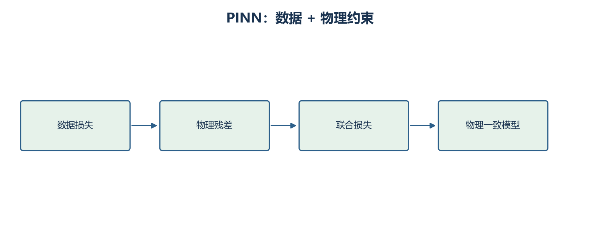

## 28.3　从 PINN 到神经算子

**PINN 的根本局限：一次一解。** 标准 PINN 对每一组参数（初始条件、边界条件、PDE 系数）都要重新训练一个网络——它是「特殊函数拟合器」，不是「通用求解器」。若要解一百种不同初始条件的扩散方程，就得训一百个 PINN。

**定义 28.2（神经算子）** 神经算子（neural operator）学习**函数空间之间的映射**：给定输入函数 $a(\cdot)$（如初始条件、系数场），输出解函数 $u(\cdot)$。形式上学习算子

$$
\mathcal{G}_{\theta}:a(\cdot)\mapsto u(\cdot), \tag{28-7}
$$

它泛化到不同离散分辨率与不同输入函数——这是「PDE 求解器的学习替代」（learned surrogate solver）。

**多物理场耦合：神经算子的天然优势。** 真实物理系统常是多个 PDE 耦合求解（如流体—结构相互作用、热—电—力耦合）。传统数值方法要分别离散、再迭代耦合各场，工程量大且难以并行。神经算子则把「多场耦合」建模为「一个高维函数到另一个高维函数的映射」：输入是各场初始条件与系数的联合，输出是各场解的联合。由于 FNO/DeepONet 在频域/分支上天然支持多通道，多场耦合的额外成本远低于传统方法——这是神经算子在多物理场模拟中的独特价值，也使「用少量仿真数据学习跨尺度、跨物理场的通用代理」成为可行方向（详见《科学智能导论》多尺度建模章）。

**PINN 的训练动力学：为什么收敛难。** 式 28-5 的自适应权重只解决「权重」，不解决「损失曲面」的根本病态。PINN 收敛难源于两点：① **配点梯度饱和**——对简单 PDE，网络初期输出近似常数，配点残差梯度极小，$\mathcal{L}_{\mathrm{PDE}}$ 几乎不更新，训练长期停留在「只拟合数据点」的局部极小；② **多尺度振荡**——高频分量（如湍流小尺度）的 PDE 残差变化剧烈，与低频分量的梯度方向冲突，使单一 $\lambda$ 无法同时收敛。近年对策包括：逐阶段训练（先数据后物理、或交替加权）、频域配点（按 PDE 的特征频率分配配点密度）、以及谱损失（用傅里叶系数替代逐点残差，抑制高频噪声）。这些改进的本质都是**把「学 PDE 解」拆解成多个尺度/阶段上更易的优化问题**，与第 38 章课程学习的思想相通。

**傅里叶神经算子（FNO）。** FNO[2] 在频域参数化积分算子。其核心层是

$$
v_{t+1}(x)=\sigma\Big(W v_t(x)+\mathcal{F}^{-1}\big(R\cdot\mathcal{F}[v_t](k)\big)(x)\Big), \tag{28-8}
$$

其中 $\mathcal{F}$ 为傅里叶变换、$R$ 是可学习的频域权重张量（只保留低模）、$W$ 是逐点线性变换、$\sigma$ 是非线性。由于卷积在频域变成逐点乘法，FNO 能高效捕捉长程依赖，且**分辨率无关**：在粗网格上训练，可直接在高网格上推理（零样本超分辨率）。DeepONet[3] 则采用分支网络（编码输入函数）+ 主干网络（编码查询点）的结构，是另一类算子学习框架。

**表 28-1　物理建模方法对照**

| 方法 | 数据需求 | 物理注入方式 | 泛化能力 | 计算速度 |
|------|---------|------------|---------|---------|
| 传统数值（FEM/FDM） | 无 | 显式离散方程 | 单一问题 | 慢（每解重算） |
| PINN | 少量 | 残差约束 | 单参数单解 | 中（每解重训） |
| FNO / DeepONet | 较多 | 隐式（数据驱动） | 跨参数跨分辨率 | 快（一次前向） |

**逆问题：从观测反推未知参数。** 物理信息学习最有价值的应用之一是**逆问题**：已知 PDE 形式但系数未知（如材料的扩散率 $D$、流体的粘度 $\nu$），从稀疏观测反推参数。PINN 把参数 $\boldsymbol\lambda$（如 $D$）也设为可学习变量，与网络权重 $\theta$ 一起优化 $\mathcal{L}(\theta,\boldsymbol\lambda)$；当配点残差逼近零时，$\boldsymbol\lambda$ 即被数据「定出」。这避免了传统反问题中反复调用数值求解器的高昂代价，使「用少量观测标定模型参数」变得实时可行。与第 29 章可微模拟的参数辨识同属「梯度反传标定物理参数」的范式，区别在于 PINN 把整个解也一起学，而可微模拟只辨识参数、解由确定性模拟器给出。

## 28.4　带数值的算例

**例 28.1（PINN 求解一维热方程的残差手算）** 设热方程 $\partial_t u-D\partial_{xx}u=0$，$D=0.1$，取试探解网络在配点 $(x=0.5,t=1.0)$ 输出 $u_{\theta}=0.3$。通过自动微分算得该点 $\partial_t u_{\theta}=-0.02$、$\partial_{xx}u_{\theta}=0.15$，则残差

$$
r_{\theta}=-0.02-0.1\times0.15=-0.02-0.015=-0.035. \tag{28-9}
$$

物理损失在该点贡献 $|r_{\theta}|^2=0.001225$；若再取 99 个配点平均，可得到整体 $\mathcal{L}_{\mathrm{PDE}}$。训练中 AD 会把梯度 $\partial r_{\theta}/\partial\theta$ 反传，推动网络输出使 $r_{\theta}\to0$。假设经过训练后同点 $\partial_t u_{\theta}=-0.015$、$\partial_{xx}u_{\theta}=-0.15$，则 $r_{\theta}=-0.015+0.015=0$——残差被精确消除，解满足物理定律。

**例 28.2（FNO 的分辨率无关性）** 在 $64\times64$ 网格上训练 FNO 求解二维 Navier–Stokes，测试时直接输入 $256\times256$ 的输入场：由于 FNO 的频域权重 $R$ 作用在傅里叶模态上、与网格点数无关，推理无需重训即输出 $256\times256$ 的解，误差仅略高于同分辨率训练。相比之下，CNN 代理模型必须固定输入输出分辨率，跨分辨率需插值重训。这正是 FNO 作为「算子」而非「有限维映射」的价值所在。

**例 28.3（逆问题：从残差定出扩散率）** 设一维热方程 $\partial_t u-D\partial_{xx}u=0$ 中 $D$ 未知，用 20 个稀疏观测点 + 80 个配点训练，把 $D$ 设为可学习标量。初始 $D=0.05$（真值 $D^\star=0.1$）。前 2000 步主要拟合数据项（$\mathcal{L}_{\mathrm{data}}$ 从 0.42 降到 0.03），$D$ 几乎不动；2000 步后数据项饱和，物理项 $\mathcal{L}_{\mathrm{PDE}}$ 的梯度开始主导，$D$ 从 0.05 被「推」向 0.1，最终收敛到 $D=0.102$（相对误差 2%）。这展示了 PINN 逆问题的典型两阶段动态：**先拟合观测、再由残差驱动参数辨识**——若观测分布不覆盖 $D$ 的敏感区，$D$ 会收敛到与观测相容但与真值不同的值（参数可辨识性受限，呼应第 7 章系统辨识）。

## 28.5　技术谱系与变体

**表 28-2　物理信息学习主要变体**

| 变体 | 改进点 | 代表文献 |
|------|--------|---------|
| PINN 原始 | 残差损失 + AD | [1] |
| XPINN | 区域分解，复杂几何 | [6] |
| Physics-informed Transformer | 注意力 + 物理约束 | [7] |
| FNO | 频域算子，分辨率无关 | [2] |
| DeepONet | 分支—主干算子 | [3] |
| PINO | 物理损失 + 神经算子 | [4] |

**PINO——两条路线的融合。** PINO[4] 在 FNO 的训练中同时加入 PDE 残差损失：既享有神经算子的跨参数泛化与快速推理，又受物理约束而不纯依赖数据。这代表了当前的主流方向——**数据驱动的泛化能力 + 物理先验的可靠性**相结合。PINO 还指出一个微妙点：物理项的配点分布应与输入场的相关尺度匹配——配点太密会过拟合高频噪声、太疏会漏掉关键结构，需按 PDE 的特征波长自适应采样。

**与世界模型的接口：物理一致性从何而来。** 前六篇的世界模型是纯数据驱动的隐式动力学，其预测可能违反物理（物体穿墙、能量凭空增减）。物理信息学习提供了三条「给世界模型上物理保险」的路径：① **损失注入**：在世界模型的想象损失中追加 PDE 残差/守恒量正则（式 28-2、28-6 的形式），让潜在动力学在生成未来时遵守已知守恒律——代价是需要知道系统的控制方程，对开放域不现实；② **表示注入**：用对称性约束（等变网络、硬约束结构）保证世界模型输出满足旋转/平移/时间反演对称，这是不依赖具体方程、只依赖对称群的更普适方案；③ **架构注入**：让世界模型的状态演化由可微物理引擎（第 29 章）驱动、神经网络只学「引擎参数」或「未建模残差」，把物理正确性交给引擎、把数据效率交给网络。三条路径对应「物理先验的强度递增、数据灵活性递减」的谱系，实际系统常取②③的折中。

**与本书其他章节的关系。** 物理信息学习与第 29 章的可微模拟共享「可微」基础，但 PINN 用 AD 计算 PDE 残差、可微模拟用 AD 优化控制/参数；与第 18、30 章的 3D/神经渲染一起构成物理世界的完整建模；其「约束注入」思想与第 26 章的离线保守约束遥相呼应（都是用先验弥补数据不足）。更系统的处理参见《科学智能导论》。

## 28.6　边界与讨论

物理信息学习的挑战有四。① **复杂 PDE 的训练难度**：高阶、强非线性或多尺度 PDE 的损失曲面病态，梯度平衡困难，PINN 常难以收敛到高精度解；② **物理与数据的权衡**：$\lambda$ 过大导致模型忽视噪声数据、过小则物理约束失效，缺乏普适的自动调节准则（式 28-5 的自适应权重缓解但未根本解决）；③ **神经算子的数据依赖**：FNO/DeepONet 虽快，但训练仍需大量 PDE 解数据（通常由传统求解器生成），是「用离线计算换在线速度」；④ **物理模型的近似性**：若注入的物理模型本身不完备（如忽略湍流模型），先验反而成为偏差来源，且配点越多偏差越被「精确地固化」。

这些局限划定了物理信息学习的适用边界：它最适合物理规律清楚、但求解/观测昂贵的场景（参数辨识、代理求解、逆问题）；对物理未知的复杂系统，仍需纯数据方法与物理方法结合迭代，或退而求其次只注入对称性等「弱先验」。一个实用的判据是：当你能写出控制方程但写不出解时，用 PINN/PINO；当你连控制方程都写不全时，先靠数据驱动、再用可微模拟（第 29 章）逐步逼近物理。这些辨析衔接第 4、7、18、26、29—30、39 章与《科学智能导论》。

## 28.7　本章小结

本章论述把物理规律注入世界模型的物理信息学习与神经算子。

我们首先指出纯数据驱动在稀疏数据与物理一致性上的两大局限，并给出直觉解释（28.1 节）。接着严格推导 PINN：一般 PDE 形式（式 28-1）、残差定义（式 28-2）、数据+物理损失（式 28-3、28-4），强调自动微分实现无网格配点，并补充自适应权重（式 28-5）、守恒律注入、硬/软约束、训练动力学与数据效率（28.2 节）。随后介绍从 PINN（一次一解）到神经算子（函数空间映射，式 28-7）的跨越，推导 FNO 频域层（式 28-8）、逆问题参数辨识与世界模型的物理一致性接口，并给出方法对照表（表 28-1）。三个数值算例分别手算了热方程残差（式 28-9）、展示 FNO 的分辨率无关性与逆问题两阶段动态（例 28.1—28.3）。我们还梳理了 PINO 等变体谱系（表 28-2）。

我们还明确边界：复杂 PDE 训练难度、物理—数据权衡、神经算子的数据依赖、物理模型近似性。这些辨析衔接第 4、18、26、29—30、39 章与《科学智能导论》。

下一章讨论另一条注入物理的路：让传统物理模拟器本身可微，从而用梯度做参数辨识与控制优化——与本章「学出解」相对，它保留确定性求解器、只优化参数与决策。

**进一步阅读**　本章建议延伸阅读的文献：[1]、[2]、[3]、[4]、[8]。

## 参考文献

[1] Raissi M, Perdikaris P, Karniadakis G E. Physics-informed neural networks: A deep learning framework for solving forward and inverse problems involving nonlinear partial differential equations. *Journal of Computational Physics*, 2019, 378: 686–707.

[2] Li Z, Kovachki N, Azizzadenesheli K, et al. Fourier neural operator for parametric partial differential equations. *ICLR*, 2021.

[3] Lu L, Jin P, Pang G, et al. Learning nonlinear operators via DeepONet based on the universal approximation theorem of operators. *Nature Machine Intelligence*, 2021, 3: 218–229.

[4] Li Z, Kovachki N, Azizzadenesheli K, et al. Physics-informed neural operator for learning partial differential equations. *arXiv:2111.03794*, 2021.

[5] Jacot A, Gabriel F, Hongler C. Neural tangent kernel: Convergence and generalization in neural networks. *NeurIPS*, 2018, 31: 8571–8580.

[6] Jagtap A D, Karniadakis G E. Extended physics-informed neural networks (XPINNs). *Journal of Computational Physics*, 2020, 411: 109435.

[7] Li W, Bazant M Z, Tropp J A. Physics-informed neural networks with hard constraints. *arXiv:2203.00127*, 2022.

[8] Karniadakis G E, Kevrekidis I G, Lu L, et al. Physics-informed machine learning. *Nature Reviews Physics*, 2021, 3: 422–440.

---

# 第 29 章　物理模拟与可微模拟

第 28 章把物理约束注入学习模型（PINN、神经算子）。本章讨论另一条路：**可微模拟**（differentiable simulation）——让传统物理模拟器本身变得可微，从而用梯度下降优化控制器或辨识物理参数。可微模拟结合了物理引擎的准确性与深度学习的可优化性，是机器人、科学发现与图形学的重要工具。

本章先给出可微模拟的定义与两类用途（29.1 节），推导通过模拟链的梯度传播（29.2 节），介绍主流可微物理引擎与实现路径（29.3 节），给出带数值的算例（29.4 节），讨论仿真到现实迁移（29.5 节），梳理谱系与变体（29.6 节），分析边界并收束（29.7、29.8 节）。

## 29.1　定义与两类核心用途

**定义 29.1（可微模拟）** 考虑一个物理模拟器

$$
s_{t+1}=f(s_t,a_t;\xi), \tag{29-1}
$$

其中 $s_t$ 是系统状态、$a_t$ 是控制动作、$\xi$ 是物理参数（质量、摩擦、刚度等）。若 $f$ 对 $\xi$ 和 $a_t$ 都可微（即能计算 $\partial s_{t+1}/\partial\xi$、$\partial s_{t+1}/\partial a_t$），就可用反向传播优化。这带来两类核心用途：

① **系统辨识**（system identification）：给定真实观测轨迹，调整 $\xi$ 使模拟轨迹匹配真实——最小化

$$
\mathcal{L}_{\mathrm{sys}}(\xi)=\sum_t\big\|s_t^{\mathrm{sim}}(\xi)-s_t^{\mathrm{real}}\big\|^2. \tag{29-2}
$$

② **控制优化**（control optimization）：固定 $\xi$，调整动作序列 $a_{0:T-1}$ 使模拟结果达标——最小化

$$
\mathcal{L}_{\mathrm{ctrl}}(a_{0:T-1})=\sum_t c(s_t,a_t)+c_T(s_T), \tag{29-3}
$$

其中 $c$ 是运行代价、$c_T$ 是终端代价。

**直觉解释。** 传统模拟器像一台只能「正向播放」的机器：你给它参数和动作，它吐出结果，但你想知道「参数该往哪调」只能靠试错（黑箱优化，采样效率低）。可微模拟让这台机器能「反向解释自己」：它直接告诉你每个参数、每个动作对结果的影响方向和大小（梯度），于是你能像训练神经网络一样用梯度下降高效优化——把「盲目试参」变成「有方向的调优」。

**与「学出来的世界模型」的分工。** 式 29-1 的 $f$ 是**已知**的（由物理方程给出），可微模拟只优化其中的参数 $\xi$ 与动作 $a_t$；而第 12 章的 Dreamer 等黑盒世界模型把 $f$ 本身也当作待学对象（从数据拟合）。二者的可微性要求相同（$f$ 对自变量可微才能反传），但 $f$ 的来源不同：前者是物理学家写的方程，后者是神经网络拟合的函数。这个分工决定了各自的适用域——物理方程已知且可靠时用可微模拟（准确、可外推），物理方程未知或过复杂时用数据驱动世界模型（灵活、但外推受限）。

## 29.2　通过模拟链的梯度传播

可微模拟的核心是沿模拟时间链反向传播梯度。设代价只依赖终端状态 $\mathcal{L}=c_T(s_T)$，由链式法则：

$$
\frac{\partial\mathcal{L}}{\partial a_0}=\frac{\partial c_T}{\partial s_T}\cdot\frac{\partial s_T}{\partial s_{T-1}}\cdot\frac{\partial s_{T-1}}{\partial s_{T-2}}\cdots\frac{\partial s_1}{\partial a_0}. \tag{29-4}
$$

这是一条长度为 $T$ 的雅可比矩阵链（每个 $\partial s_{t+1}/\partial s_t$ 是雅可比矩阵）。两类实现方式：

**显式（前向/反向模式）**：若模拟器用可微框架（如 JAX、PyTorch）重写，框架自动记录计算图并用反向模式 AD 计算式 29-4，复杂度约为一次前向的常数倍（反向模式的优势）。**隐式/解析梯度**：对某些由优化问题定义的状态（如含约束的动力学），可用隐函数定理求梯度，避免展开整个迭代求解过程。

**梯度 vanishing/exploding 问题。** 式 29-4 的长雅可比链与 RNN 的梯度问题同构（第 11 章）：物理系统的耗散会让梯度指数衰减、不稳定系统会让梯度爆炸。实践中采用截断反向传播（只回传最近 $K$ 步）、梯度裁剪、或共轭梯度/伴随法（adjoint method）来稳定长时梯度。

**伴随法：用「伴随状态」省内存。** 反向模式 AD 需存储每个时间步的中间状态 $s_t$ 以回传梯度，内存 $O(T\cdot|s|)$。伴随法（adjoint method）改用一个**伴随变量** $\lambda_t$ 从终端反向递推，避免显式存储整条状态链。伴随方程为

$$
\lambda_t=\big(\partial_{s_t} f(s_t,a_t;\xi)\big)^\top\lambda_{t+1},\qquad \lambda_T=\frac{\partial c_T}{\partial s_T}, \tag{29-5}
$$

即 $\lambda_t$ 从 $\lambda_T$ 起按 $t=T,T-1,\dots,0$ 逐步回传。最终对物理参数的梯度由伴随变量与局部参数梯度汇总：

$$
\frac{\partial\mathcal{L}}{\partial\xi}=\sum_{t=0}^{T-1}\lambda_{t+1}^\top\frac{\partial f(s_t,a_t;\xi)}{\partial\xi},\qquad
\frac{\partial\mathcal{L}}{\partial a_t}=\lambda_{t+1}^\top\frac{\partial f(s_t,a_t;\xi)}{\partial a_t}. \tag{29-6}
$$

伴随法的妙处是**只传伴随变量**，内存与 $T$ 解耦，适合 $T$ 极大（如流体 $10^5$ 步）的场景——这正是 PDE 优化中「伴随方法」的标准形式。代价是每步要算 $\partial f/\partial s_t$ 的转置向量积（JVP 的转置），需解析或半自动推导。对照式 29-4 的显式雅可比链：式 29-5/29-6 用「一个反向递推 + 局部梯度」替代「$T$ 个雅可比矩阵的乘积」，数值更稳、内存更低，是长时程可微模拟的默认选择。

> 【图 29-1　可微模拟的梯度流】（原图见 figures/图29-1.png）：模拟链 $s_0\to s_1\to\cdots\to s_T$ 前向传播，代价 $\mathcal{L}$ 经反向模式 AD 沿链回传梯度到参数 $\xi$ 与动作 $a_t$。
>
> 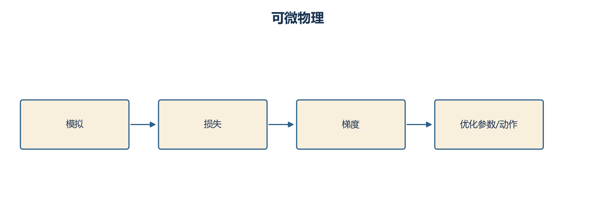

## 29.3　可微物理引擎与实现路径

实现可微模拟有三条路径：

① **用可微框架从头重写物理引擎**：把积分、碰撞、约束求解都写成张量运算，自动获得梯度。代表是 Brax[2]（JAX 实现，含刚体、软体）与 DiffTaichi[1]（Taichi 的可微物理，覆盖弹性体、流体、刚体）。优点是梯度精确、易与神经网络集成；缺点是从头实现工作量大、性能可能不及成熟引擎。

② **为现有引擎实现自定义梯度**：如为 MuJoCo 提供可微版本[3]，保留成熟引擎的精度与速度，但需手写或半自动推导梯度。

③ **可微代理 + 解析层**：用神经代理近似模拟中不可微的部分（如碰撞），其余保持解析可微——这是处理接触非光滑性的折中方案。

**非光滑操作的梯度：接触与摩擦的困境。** 真实物理含大量非光滑操作：碰撞检测（`if` 接触与否）、摩擦锥（互补约束）、摩擦系数切换。这些操作的导数在切换点**不存在**或为**次梯度**（subgradient），直接 AD 会给出错误方向甚至 NaN。三类主流对策：① **软接触模型**：用光滑近似替代硬接触，如用高斯核软化碰撞力、用平滑摩擦替代库仑摩擦——牺牲一点精度换取处处可微；② **隐式/约束求解的解析梯度**：对由互补问题定义的状态，用 KKT 条件 + 隐函数定理推导梯度（如 MuJoCo 可微版对接触求解的梯度）；③ **神经代理**：用网络拟合非光滑映射（如碰撞后速度），网络天然可微——但引入近似误差。实践中常混合：刚体运动用解析 AD、接触用软模型或隐式梯度（软化算例见 29.4 节例 29.4）。

**表 29-1　主流可微物理工具**

| 工具 | 底层 | 适用系统 | 特性 |
|------|------|---------|------|
| DiffTaichi[1] | Taichi | 弹性体/流体/刚体 | 高性能可微物理 |
| Brax[2] | JAX | 刚体/软体 | 向量化、TPU 友好 |
| MuJoCo 可微版[3] | C++/自动微分 | 刚体接触 | 成熟引擎 + 梯度 |
| PyTorch3D[7] | PyTorch | 3D 几何 | 可微渲染 + 几何 |

## 29.4　带数值的算例

**例 29.1（辨识弹簧—质量系统的阻尼系数）** 设离散动力学 $v_{t+1}=v_t+\Delta t\,(-k x_t-c v_t)$、$x_{t+1}=x_t+\Delta t\,v_t$，其中阻尼 $c$ 未知，$\Delta t=0.01$。给定真实轨迹在 $t=1$ 时 $x_1^{\mathrm{real}}=0.0995$、$v_1^{\mathrm{real}}=-0.0095$，初始 $x_0=0.1,v_0=0,k=1$。设当前猜测 $c=0$：则 $v_1=0+0.01\times(-1\times0.1)=-0.001$，$x_1=0.1+0.01\times0=0.1$。误差 $\mathcal{L}=(0.1-0.0995)^2+(-0.001+0.0095)^2=2.5\times10^{-7}+7.2\times10^{-5}\approx7.25\times10^{-5}$。

梯度：$\partial v_1/\partial c=\Delta t\cdot(-v_0)=0$，一阶梯度为零（因 $v_0=0$）——说明此初始点阻尼梯度信息弱，需从后续步（$v_1\neq0$ 后）获得信号。在 $t=2$ 步，$\partial v_2/\partial c=-0.01 v_1 -0.01 c(\partial v_1/\partial c)=-0.01\times(-0.001)=10^{-5}\neq0$，梯度恢复。这展示了一个重要现象：**可微模拟的梯度依赖于轨迹状态， informative 的初始条件对辨识至关重要**。

**例 29.2（可微控制 vs. 黑箱优化的效率）** 设控制一个 12 步的机械臂轨迹，动作空间 6 维。黑箱方法（如 CEM）每步采样 100 个候选、共 12 步，需 $100\times12=1200$ 次模拟；可微方法用反向模式 AD，一次前向 + 一次反向即可获得所有 12 步、6 维动作的梯度，代价约相当于 2—3 次模拟。梯度信息使优化收敛更快——这就是可微模拟「用梯度换采样」的核心收益，与第 12 章 Dreamer 用可微潜在动力学回传策略梯度的思想一脉相承。

**例 29.3（伴随法的手算：两步链）** 设标量系统 $s_{t+1}=s_t+a_t$，代价 $\mathcal{L}=c_T(s_T)=\tfrac12 s_T^2$，$T=2$，$s_0=0$。用伴随法求 $\partial\mathcal{L}/\partial a_0$。前向：$s_1=s_0+a_0=a_0$，$s_2=s_1+a_2=a_0+a_2$。终端伴随：$\lambda_2=\partial c_T/\partial s_2=s_2=a_0+a_2$。回传：$\lambda_1=(\partial f/\partial s_1)^\top\lambda_2=1\cdot\lambda_2=a_0+a_2$（因 $f$ 对 $s_t$ 的偏导为 1）。于是 $\partial\mathcal{L}/\partial a_0=\lambda_1^\top(\partial f/\partial a_0)=(a_0+a_2)\cdot1=a_0+a_2$。对照直接微分：$\mathcal{L}=\tfrac12(a_0+a_2)^2$，$\partial\mathcal{L}/\partial a_0=a_0+a_2$——两者一致。这个极简算例展示了伴随法「终端起逆推、局部累加」的机制：无论 $T$ 多大，只需 $O(T)$ 步、$O(1)$ 内存，无需存储 $T$ 个雅可比。

**例 29.4（软化的接触恢复力）** 设一物体以速度 $v$ 撞墙，真实恢复力为硬开关 $F=\mathbb{1}[v<0]\cdot k|v|$（仅 $v<0$ 时反弹，且 $|v|$ 在 $v=0$ 处不可微）。直接用此 $F$ 做 AD，在 $v=0$ 处梯度未定义。用光滑近似替代：$F_{\mathrm{soft}}(v)=-\dfrac{k v}{1+e^{\beta v}}$（$v<0$ 时 $e^{\beta v}\to0$，$F_{\mathrm{soft}}\to k|v|$；$v>0$ 时 $e^{\beta v}\to\infty$，$F_{\mathrm{soft}}\to0$；$v=0$ 时 $F=0$ 且处处可微，因为分子 $-kv$ 光滑、分母光滑）。取 $k=10,\beta=50$：$v=-0.2$ 时 $e^{\beta v}=e^{-10}\approx4.5\times10^{-5}$，$F_{\mathrm{soft}}\approx-\tfrac{10\times(-0.2)}{1.000045}\approx1.9999\approx k|v|$（强反弹，正确）；$v=0.2$ 时 $e^{\beta v}=e^{10}\approx2.2\times10^4$，$F_{\mathrm{soft}}\approx-\tfrac{2}{2.2\times10^4}\approx-9\times10^{-5}\approx0$（无恢复，正确）。梯度 $\partial F_{\mathrm{soft}}/\partial v$ 处处存在且有限，可被 AD 正确计算。$\beta$ 是「硬度」旋钮：$\beta\to\infty$ 退化为硬接触（不可微），$\beta$ 小则接触「软」（过度平滑）。

## 29.5　仿真到现实（Sim-to-Real）

可微模拟支撑仿真到现实迁移：在模拟中大量训练策略（廉价、安全、可并行），再迁移到真实机器人。其核心障碍是**现实差距**（reality gap）——模拟与真实的动力学差异使模拟中最优的策略在真实机器人上失效。

两条缩小差距的路径在可微框架下天然互补：① **域随机化**（domain randomization，第 31 章、《具身智能导论》）：在模拟中随机化物理参数 $\xi$（质量、摩擦、延迟等），训练对参数变化鲁棒的策略；② **可微参数校准**：用少量真实观测，通过式 29-2 的梯度优化把 $\xi$ 校准到真实值。前者用「广撒网」覆盖不确定性，后者用「精准调参」缩小偏差——结合两者可获得既鲁棒又准确的迁移。Degrave 等[3] 用可微物理在真实机器人上实现了端到端的策略优化，展示了这条路的潜力。

**可微模拟作为「可解释的世界模型」。** 从世界模型视角看，可微模拟是一个**白盒世界模型**：它的状态转移 $f(s,a;\xi)$ 由显式物理方程给出，而非神经网络黑箱。这带来与第 12 章 Dreamer 等黑盒世界模型的根本区别：① **可解释性**——能逐行追问「为什么状态这样变」，调试与审计友好；② **外推可靠性**——物理方程在训练分布外仍成立，不像神经网络会外推崩坏（第 24 章）；③ **代价**——只能模拟已知物理，无法像数据驱动模型那样学到「未建模的复杂动力学」。实践中二者互补：可微模拟提供可靠的「物理骨架」，数据驱动模型补「未建模残差」（第 28 章接口③），共同构成「半物理」世界模型。

**现实差距的两类来源。** sim-to-real 失败可归因于两类差距：① **参数差距**（parametric gap）——模型结构正确但参数（质量、摩擦、延迟）不准，可微参数校准（式 29-2）可直接消除；② **结构差距**（structural gap）——模型本身缺项（如忽略了柔性体变形、空气阻力），任何参数校准都无法弥补，只能靠更完整的物理或数据驱动残差补偿。实践中先做参数校准、再评估剩余误差，若残差仍大说明存在结构差距，需升级模型而非继续调参。

## 29.6　技术谱系与变体

**表 29-2　可微模拟相关方法谱系**

| 方法 | 梯度来源 | 优势 | 局限 |
|------|---------|------|------|
| 黑箱优化（CEM/进化） | 无梯度，采样 | 通用、能处理非光滑 | 采样效率低 |
| 反向模式 AD[1][2] | 自动微分 | 精确、高效 | 需可微实现 |
| 伴随法 | 连续伴随方程 | 内存效率高 | 需解析推导 |
| 可微 + 神经混合 | 部分 AD | 处理接触非光滑 | 代理引入误差 |

**与本书其他章节的关系。** 可微模拟与第 28 章共享「可微」基础但目标不同（一个约束解、一个优化参数/控制）；与第 7 章的系统辨识是同一问题的可微版本；与第 12 章 Dreamer 的「世界模型引导的策略改进」共享梯度回传思想，只是 Dreamer 的动力学是学出来的、这里是解析的；其 sim-to-real 与第 31 章域随机化互补。更系统的机器人学处理参见《具身智能导论》。

**面向科学发现的逆问题。** 可微模拟在科学发现中的价值与机器人控制同构但场景不同：把「观测」换成实验测量、把「动作」换成未知物理量或结构参数。典型如**层析成像**（从 X 射线投影重建断层）、**材料逆向设计**（给定目标力学响应反推微结构）、**天体物理**（从光谱反推恒星参数）。传统做法是反复「调参数→跑模拟→比观测」的迭代（如共轭梯度），每次模拟都是昂贵的前向计算；可微模拟把这一过程端到端化：观测损失直接对参数求梯度，一步到位给出「该往哪调」的方向。这使「从有限观测反推系统内部」从工程近似变为可微优化问题，与《科学智能导论》的逆问题章深度对接。

**「半可微」混合架构。** 纯可微模拟受限于「物理方程必须已知」，纯数据驱动受限于「外推不可靠」。一个务实的折中是**混合可微架构**：把已知可靠的部分（刚体运动、积分器）保持解析可微，把未知/复杂的部分（接触力、湍流、摩擦）用神经网络代理，再让梯度穿过整个「解析 + 神经」混合链。这种架构既继承物理部分的准确性与外推性，又用神经部分补上未建模的残差——与第 28 章「架构注入」的思路一致，是把「可微」从纯物理推广到「物理 + 学习」混合体的关键。

**并行性与硬件友好。** 可微模拟相对黑箱优化的另一隐性优势是**天然并行**：JAX/Taichi 这类可微框架把单步动力学写成纯函数，可同时对 $N$ 个独立轨迹做前向与反向（batched simulation）。例 29.2 的 1200 次黑箱采样是串行的，而可微框架把 $1200$ 条轨迹打包成一个 batch 一次算完——TPU/GPU 的张量核心对此高度友好。这使得「大规模并行模拟 + 梯度优化」成为可微模拟相对 CEM 等采样方法的系统性优势：不仅单次优化省，还能用并行把 $N$ 倍轨迹的「试错」压缩到一次前向的时间。

## 29.7　边界与讨论

可微模拟的挑战有四。① **非光滑操作的梯度**：接触、碰撞、摩擦切换等引入不连续，梯度要么不存在、要么是次梯度，直接 AD 可能给出错误方向——这是可微物理最棘手的问题，常需软接触模型、平滑近似或混合方法；② **长链梯度稳定性**：式 29-4 的长雅可比链导致梯度消失/爆炸（例 29.1 已显端倪）；③ **计算成本**：高保真模拟的单步代价大，反向传播还需存储中间状态，内存开销高；④ **模型本身的不完备**：可微模拟再精确，也是对真实的近似——参数校准只能缩小参数偏差，无法消除结构偏差（建模假设错误）。

**内存与时间的量化账。** 设状态维 $|s|$、时间步 $T$、单步前向代价 $C_f$。反向模式 AD 的总代价约为 $2C_f\cdot T$（一次前向 + 一次反向，反向约前向常数倍），而**内存**需存 $T$ 个中间状态，约 $T\cdot|s|$ 个数。例 29.3 的伴随法把内存降到 $O(|s|)$（只传 $\lambda$），但需每步算转置向量积。以 $|s|=1000$、$T=10^4$、64 位浮点计：反向模式内存 $\approx10^4\times10^3\times8$ B $=80$ MB，可接受；但 $T=10^6$（长时程流体）时达 8 GB，须用伴随法或检查点（checkpointing，每隔 $K$ 步存一次、其余重算）折中。检查点的「重算换内存」是长时程可微模拟的标准工程手段，与第 11 章 RNN 的截断 BPTT 思想同构。

这些边界并不否定可微模拟的价值，而是划定了它的适用范围：在物理结构清楚、参数不确定、需要精细控制的场景（机器人操作、科学实验设计），可微模拟是最强有力的工具之一；在接触密集或物理未知的复杂场景，仍需与学习方法结合。这些辨析衔接第 7、12、28、30—31 章与《具身智能导论》《科学智能导论》。

## 29.8　本章小结

本章论述让物理模拟器可微以进行优化与辨识的方法。

我们首先给出可微模拟定义（定义 29.1，式 29-1）与两类用途——系统辨识（式 29-2）与控制优化（式 29-3），并明确其与数据驱动世界模型的分工。接着推导沿模拟时间链的梯度传播（式 29-4），给出伴随法（式 29-5、29-6）的递推与参数/动作梯度汇总，讨论反向模式 AD、隐函数定理与长链梯度问题。随后介绍 DiffTaichi、Brax、可微 MuJoCo 三条实现路径（表 29-1）与非光滑操作（接触/摩擦）的三类对策。四个数值算例分别手算了阻尼系数辨识中的梯度信息问题（例 29.1）、可微控制相对黑箱优化的采样效率优势（例 29.2）、伴随法两步链（例 29.3）与软化接触恢复力（例 29.4）。我们还讨论 sim-to-real 中域随机化与可微校准的互补（29.5 节）、可微模拟作为白盒世界模型与半可微混合架构、面向科学发现的逆问题、并行性（29.6 节），以及边界与内存/时间的量化账（29.7 节），并梳理谱系（表 29-2）。

我们还明确边界：非光滑操作的梯度定义、长链梯度稳定性、计算成本、模型不完备性。这些辨析衔接第 7、12、28、30—31 章与《具身智能导论》《科学智能导论》。

下一章转向物理世界的表示问题：3D 表示与神经渲染，为世界模型提供几何结构基础。

**进一步阅读**　本章建议延伸阅读的文献：[1]、[2]、[3]、[4]。

## 参考文献

[1] Hu Y, Anderson L, Li T M, et al. DiffTaichi: Differentiable programming for physical simulation. *ICLR*, 2020.

[2] Freeman C D, Frey E, Raichuk A, et al. Brax: A physics pipeline for reinforcement learning in JAX. *arXiv:2103.00700*, 2021.

[3] Degrave J, Hermans M, Dambre J, wyffels F. A differentiable physics engine for deep learning in robotics. *Frontiers in Neurorobotics*, 2019, 13: 6.

[4] Liang J, Lin M, Koltun V. Differentiable cloth simulation for inverse problems. *NeurIPS*, 2019, 32: 771–780.

[5] Todorov E, Erez T, Tassa Y. MuJoCo: A physics engine for model-based control. *IROS*, 2012: 5026–5033.

[6] Griewank A, Walther A. *Evaluating Derivatives: Principles and Techniques of Algorithmic Differentiation*. 2nd ed. SIAM, 2008.

[7] Ravi N, Reizenstein J, Mechanism M, et al. Accelerating 3D deep learning with PyTorch3D. *arXiv:2007.08501*, 2020.

[8] Peng X B, Andrychowicz M, Zaremba W, Schulman J. Sim-to-real transfer of robotic control with dynamics randomization. *ICRA*, 2018: 3803–3810.

---

# 第 30 章　3D 表示与神经渲染

第 18 章介绍了 3D 世界生成，第 28—29 章讨论了物理建模。本章深入 3D 表示（3D representation）与神经渲染（neural rendering）：世界模型要建模三维世界，首先得为三维结构选择合适的表示——显式还是隐式、连续还是离散、面向感知还是面向渲染。这一选择与具身智能的场景理解、数字孪生（见《仿真智能与数字孪生导论》）直接相关。

本章先梳理 3D 表示的谱系与选择原则（30.1 节），严格推导 NeRF 的体积渲染公式（30.2 节），介绍 3D 高斯泼溅（3DGS）与前馈式重建（30.3 节），给出带数值的算例（30.4 节），梳理技术谱系与变体（30.5 节），分析边界与讨论（30.6 节），最后收束（30.7 节）。

## 30.1　3D 表示的谱系

三维世界的表示方式决定了「存什么、怎么渲染、能否编辑」。主要表示沿「显式 ↔ 隐式」「离散 ↔ 连续」两个维度分布。

**表 30-1　3D 表示对照**

| 表示 | 类型 | 基本单元 | 优点 | 缺点 |
|------|------|---------|------|------|
| 点云（point cloud） | 显式离散 | 点 $\{x_i\}$ | 简单、传感器友好（LiDAR） | 稀疏、无表面、需后处理 |
| 体素（voxel） | 显式规则 | 立方格 | 结构化、易卷积 | 内存随分辨率立方增长 |
| 网格（mesh） | 显式 | 顶点+面 | 渲染标准、可编辑 | 拓扑固定、难从图像优化 |
| NeRF | 隐式连续 | MLP 场 $F_\theta$ | 高质量、连续 | 渲染慢、难编辑 |
| 3DGS | 显式基元 | 高斯基元 | 实时、高质量 | 存储大、需稠密初始化 |

**选择原则。** 取决于任务：感知任务（检测、分割）偏好点云/体素——它们与传感器数据直接对应、便于卷积处理；渲染任务（新视角合成）偏好 NeRF/3DGS——它们照片级真实；交互/物理任务（第 29 章）偏好网格或显式物理表示——它们有明确表面与拓扑。世界模型往往需**多表示结合**：用隐式场做高质量渲染，用显式几何做碰撞与交互。

**表示选择的成本账。** 三种成本随表示不同而权衡：① **存储**：体素 $O(R^3)$（$R$ 分辨率，例 30.2 的立方增长）、3DGS $O(N)$（$N$ 基元数，约 240 B/基元）、NeRF $O(\text{参数量})$（通常几十 MB）；② **渲染速度**：NeRF 每像素要沿光线做 $N$ 次 MLP 查询（$O(N\cdot$像素$)$ 次网络前向，秒/帧）、3DGS 用可微光栅化（$O(N)$ 投影 + alpha 混合，100+ 帧/秒）、体素查表（最快但内存大）；③ **编辑难度**：网格易编辑（改顶点）、3DGS 中等（改基元）、NeRF 最难（改 MLP 无直观几何对应）。三者构成「存储—速度—可编辑性」的帕累托前沿，没有单一表示占优——这正是工程上常组合使用的根本原因。

**直觉解释。** 表示三维世界像「描述一座雕塑」：点云是「一堆沙粒的位置」、体素是「搭积木的格子」、网格是「雕塑的骨架皮肤」、NeRF 是「一条规则：空间中任意一点是什么颜色、多稠密」、3DGS 是「一堆半透明彩色椭圆叠在一起」。没有哪种表示万能——量体裁衣才是工程之道。

## 30.2　NeRF 与体积渲染的严格推导

**定义 30.1（神经辐射场，NeRF）** NeRF[1] 用 MLP $F_\theta$ 把三维位置 $\mathbf{x}=(x,y,z)$ 与视角方向 $\mathbf{d}=(\theta,\phi)$ 映射为体积密度 $\sigma$ 与颜色 $\mathbf{c}$：

$$
F_\theta:(\mathbf{x},\mathbf{d})\mapsto(\sigma,\mathbf{c}). \tag{30-1}
$$

**体积渲染公式。** 从相机沿光线 $\mathbf{r}(t)=\mathbf{o}+t\mathbf{d}$ 积分颜色。光线在 $t$ 处的透射率（累积透过的比例）为

$$
T(t)=\exp\!\Big(-\int_{t_n}^{t}\sigma(s)\,ds\Big), \tag{30-2}
$$

则像素颜色是沿光线的加权积分：

$$
C(\mathbf{r})=\int_{t_n}^{t_f}T(t)\,\sigma(t)\,\mathbf{c}(t)\,dt. \tag{30-3}
$$

式 30-3 的含义：在 $t$ 处 emitted 颜色 $\mathbf{c}$，贡献权重是「密度 $\sigma$ × 到达该点的透射率 $T$」——被前面东西挡住的部分（$T$ 小）贡献少。这是经典体积渲染方程，NeRF 的贡献是用神经网络参数化 $\sigma,\mathbf{c}$ 并用可微积分优化。

**离散化与位置编码。** 实践把光线分成 $N$ 段，用求积近似式 30-3：

$$
\hat C(\mathbf{r})=\sum_{i=1}^{N}T_i\big(1-e^{-\sigma_i\Delta_i}\big)\mathbf{c}_i,\quad T_i=\exp\!\Big(-\sum_{j<i}\sigma_j\Delta_j\Big). \tag{30-4}
$$

为了让 MLP 学到高频细节，NeRF 对输入做位置编码 $\gamma(p)=\big(\sin(2^0\pi p),\cos(2^0\pi p),\dots,\sin(2^{L-1}\pi p),\cos(2^{L-1}\pi p)\big)$——把低频坐标映射到高维，解决神经网络的「低频偏置」问题[6]。没有位置编码，MLP 倾向于输出低频平滑解（「模糊」），无法还原高频纹理——这是 NeRF 早期版本「重建发糊」的根源，位置编码是其质量跃升的关键技巧（与第 20 章 Transformer 的位置编码、第 4 章傅里叶特征同源）。

**训练损失。** 给定多视角图像，最小化渲染颜色与真实像素的误差：

$$
\mathcal{L}_{\mathrm{NeRF}}=\sum_{\mathbf{r}\in\mathcal{R}}\big\|\hat C(\mathbf{r})-C^{\mathrm{gt}}(\mathbf{r})\big\|^2. \tag{30-5}
$$

> 【图 30-1　NeRF 体积渲染】（原图见 figures/图30-1.png）：相机光线穿过场景，在多个采样点查询 MLP 得到 $(\sigma_i,\mathbf{c}_i)$，按式 30-4 累积为像素颜色，与真值比较反传。
>
> 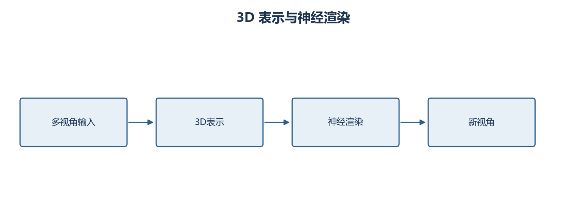

## 30.3　3D 高斯泼溅与前馈式重建

**3D 高斯泼溅（3DGS）。** 3DGS[2] 用一组显式三维高斯基元表示场景，每个基元有中心 $\mu_i$、协方差 $\Sigma_i$、不透明度 $\alpha_i$、球谐颜色系数。渲染时把高斯基元投影到图像平面做**可微光栅化**（tiled rasterization），按深度排序做 alpha 混合：

$$
C=\sum_{i\in\mathcal{N}}c_i\,\alpha_i'\prod_{j<i}(1-\alpha_j'), \tag{30-6}
$$

其中 $\alpha_i'$ 是投影后高斯对像素的不透明度贡献。3DGS 的关键优势是**实时**：可微光栅化比 NeRF 的逐点 MLP 查询快两个数量级（可达 100+ 帧/秒），同时保持照片级质量。代价是需要从点云/SfM 做稠密初始化，且基元数量大（存储开销高）。

**前馈式重建。** NeRF 与 3DGS 原始方法都要对着场景逐场景优化（分钟到小时级）。前馈方法（如 PixelNeRF、DUSt3R）用网络直接从图像预测 3D 表示或相机位姿，实现秒级推理——这是把「优化问题」转成「学习问题」，代价是泛化受训练分布约束。

**神经体素（Plenoxels）：隐式与显式的折中。** 纯 MLP（NeRF）慢、纯显式体素内存立方增长。Plenoxels[7] 取折中：用**稀疏的、带梯度的显式体素网格**存储 $(\sigma,\mathbf{c})$，但渲染时对相邻体素做**双线性插值**：

$$
(\sigma(\mathbf{x}),\mathbf{c}(\mathbf{x}))=\sum_{k\in\mathcal{N}(\mathbf{x})}w_k(\mathbf{x})\,(\sigma_k,\mathbf{c}_k), \tag{30-7}
$$

其中 $w_k$ 是体素 $k$ 的线性权重、$\mathcal{N}(\mathbf{x})$ 是 $\mathbf{x}$ 周围的体素。这样既保留显式存储的查询速度（无需 MLP 前向），又通过插值获得连续平滑的场。Plenoxels 训练比 NeRF 快约 40 倍、渲染快 3 倍，质量相当——它把「连续场」近似成「带插值的稀疏格点」，是表示选择上「速度—质量—内存」三角的典型权衡点。

**表 30-2　新视角合成方法对比**

| 方法 | 表示 | 训练/优化 | 渲染速度 | 质量 |
|------|------|----------|---------|------|
| NeRF[1] | 隐式 MLP | 逐场景优化 | 慢（秒/帧） | 高 |
| 3DGS[2] | 显式高斯 | 逐场景优化 | 实时 | 高 |
| PixelNeRF | 隐式 + 前馈 | 前向推理 | 中 | 中 |
| DUSt3R | 显式点图 | 前向推理 | 快 | 中高 |

## 30.4　带数值的算例

**例 30.1（NeRF 体积渲染的手算）** 设一条光线取两个采样点（$\Delta=1$）：点 1 密度 $\sigma_1=0.5$、颜色 $c_1=1.0$；点 2 密度 $\sigma_2=0.3$、颜色 $c_2=0.4$。按式 30-4：

$T_1=\exp(0)=1$；点 1 权重 $T_1(1-e^{-0.5\times1})=1\times(1-0.607)=0.393$；
$T_2=\exp(-\sigma_1\Delta)=\exp(-0.5)=0.607$；点 2 权重 $0.607\times(1-e^{-0.3})=0.607\times0.259=0.157$。

$C=0.393\times1.0+0.157\times0.4=0.393+0.063=0.456$。可见点 2 虽密度不低，但因被点 1 遮挡（$T_2=0.607<1$）贡献被削弱——这正是体积渲染「近处遮挡远处」的直觉。训练时若真值 $C^{\mathrm{gt}}=0.5$，损失 $(0.456-0.5)^2=0.0019$，梯度推动网络调整 $\sigma,c$ 缩小差距。

这个算例还揭示了一个微妙点：式 30-4 的权重 $T_i(1-e^{-\sigma_i\Delta})$ 必须对所有采样点**归一化**到不超过 1（因为 $T_i\leq1$ 且各项非负，$\sum_i T_i(1-e^{-\sigma_i\Delta})\leq1$），保证渲染颜色是颜色的凸组合、不会超出各采样点颜色的范围。若某点 $\sigma_i\to\infty$（完全不透明），则 $T_i=1$ 且后续 $T_{i'>i}\to0$——后面的点完全被挡住，颜色就是该点 $c_i$。这对应「看到第一个不透明面就停下」的直观，也是 NeRF 能正确重建遮挡关系的原因。

**例 30.2（体素 vs. 3DGS 的存储量级）** 表示一个 $100^3$ 的体素网格，每格存 1 字节：存储 $10^6$ 字节 = 1 MB；若分辨率提到 $1000^3$，则 $10^9$ 字节 = 1 GB——立方增长使其难以扩展。3DGS 用约 $10^5$—$10^6$ 个高斯基元表示同等场景，每基元存约 60 个浮点（约 240 字节），总量约 24—240 MB——在高质量下仍可控，且可通过剪枝冗余基元进一步压缩。这解释了为何大规模场景重建倾向 3DGS 而非高分辨率体素。

**例 30.3（Plenoxels 的双线性插值）** 设 $\mathbf{x}=(1.2,\ 0.8,\ 5.3)$ 落在四个体素角点间，各角点的密度为 $\sigma_{00}=0.4,\ \sigma_{10}=0.6,\ \sigma_{01}=0.5,\ \sigma_{11}=0.3$（下标为 $(x,y)$ 方向的整数部分），$z$ 方向插值权重简化为忽略。$x$ 方向分数 $0.2$、$y$ 方向分数 $0.8$，双线性权重 $w_{00}=(1-0.2)(1-0.8)=0.16$、$w_{10}=0.2\times0.8=0.16$、$w_{01}=0.8\times0.2=0.16$、$w_{11}=0.2\times0.8=0.16$。插值得 $\sigma(\mathbf{x})=0.16\times0.4+0.16\times0.6+0.16\times0.5+0.16\times0.3=0.16\times1.8=0.288$。可见插值让密度在离散体素间连续变化——若不用插值直接取最近体素，$\mathbf{x}$ 会跳到 $0.4$ 或 $0.6$，造成渲染的「块状伪影」。这就是式 30-7 的价值：用四次查询换平滑场。

## 30.5　技术谱系与变体

**表 30-3　3D 表示与神经渲染谱系**

| 方向 | 代表 | 关键思想 | 出处 |
|------|------|---------|------|
| 隐式场 | NeRF[1] | MLP + 体积渲染 | ECCV 2020 |
| 显式基元 | 3DGS[2] | 高斯基元 + 光栅化 | TOG 2023 |
| 神经体素 | Plenoxels[7] | 稀疏体素 + 插值 | CVPR 2022 |
| 前馈重建 | PixelNeRF / DUSt3R | 图像→3D 直接预测 | 2021—2024 |
| 可微渲染 | PyTorch3D[3] | 可微光栅化 | 2020 |
| 动态场景 | 4D-GS / Dynamic NeRF | 时变表示 | 2023 |

**动态场景：把时间加进来。** 静态表示描述「某一时刻」的场景。世界模型需要的是**随时间演化**的场景——把时间 $t$ 作为额外输入：动态 NeRF 把 $F_\theta:(\mathbf{x},\mathbf{d},t)\mapsto(\sigma,\mathbf{c})$，动态 3DGS（4D-GS[8]）让每个高斯的中心与协方差成为时间的函数 $\mu_i(t),\Sigma_i(t)$。形式上

$$
F_\theta:(\mathbf{x},\mathbf{d},t)\mapsto\big(\sigma(\mathbf{x},t),\mathbf{c}(\mathbf{x},t)\big), \tag{30-8}
$$

这样同一组参数既能渲染「过去」也能渲染「未来」的视角，成为**可播放的 3D 视频**。对世界模型而言这是关键一步：静态 3D 重建是「照片」，动态 3D 场是「视频」——后者才能承载「状态如何随时间/动作演化」的语义（第 15—16 章、第 23 章）。代价是时间维度让表示参数与优化成本进一步上升，长时一致性（第 33 章）成为主要瓶颈。

**神经渲染的本质。** 神经渲染指用神经网络参与「从 3D 表示生成 2D 图像」的过程（定义 30.1）。NeRF 的体积渲染、3DGS 的可微光栅化都属此列。其共同价值在于**可微性**：渲染过程对表示参数可微，于是能用图像损失（式 30-5）反向优化 3D 表示——「从 2D 观测重建 3D 世界」由此成为可能。这正是世界模型所需的：给定多视角观测，学出场景的 3D 状态表示（E1 的 3D 版本）。

**质量评估的双指标。** 新视角合成的评估用两个互补指标：**PSNR**（峰值信噪比，反映像素级保真，$\mathrm{PSNR}=10\log_{10}(1/\mathrm{MSE})$）与 **LPIPS/SSIM**（感知相似度，反映结构保真）。一个有趣的张力是：高 PSNR 不必然高感知质量——逐像素 MSE 会让网络偏好「模糊的正确」而非「清晰的锐利」，LPIPS 则更贴近人类判断。对世界模型，「多视角一致性」比单视角质量更重要：同一场景从不同视角渲染应几何自洽，可用「视角间光度一致性」或重建的 3D 自洽度度量——这正呼应第 33 章「长时一致性」在空间维度的对应。

**与本书其他章节的关系。** 3D 表示承接第 18 章的 3D 世界生成，为第 27 章交互世界模型提供「状态锚定」的结构基础（第 27.5 节），并与第 28—29 章的物理建模互补（几何 + 物理 = 完整世界模型）。神经渲染的可微性与第 28—29 章的自动微分共享技术根基。更系统的视觉处理参见《计算机视觉智能导论》。

**3D 表示作为世界模型的「状态锚」。** 第 27 章指出，纯隐式视觉生成的交互世界会随自回归逐步漂移（例 27.2 的 65% 偏差）。一个根本性的缓解是让世界模型维护一个**显式 3D 状态** $S_t$（网格/3DGS/NeRF 参数），每步的渲染 $\hat o_{t+1}$ 由 $S_{t+1}$ 经神经渲染器产生：

$$
\hat o_{t+1}=\mathrm{Render}\big(S_{t+1}=\mathrm{Update}(S_t,a_t)\big). \tag{30-9}
$$

此处 $\mathrm{Update}$ 是 3D 状态的演化（可由物理引擎或学习得到，第 28—29 章），$\mathrm{Render}$ 是可微渲染器（式 30-3 或 30-6）。与纯视觉隐式生成相比，这种「3D 状态 + 渲染」架构把漂移限制在「状态演化 $\mathrm{Update}$」这一环——若 $\mathrm{Update}$ 遵守物理（如刚体碰撞），则几何不会凭空崩坏，长期一致性显著优于纯隐式路线（第 27.5 节「状态锚定」方案）。代价是 $\mathrm{Update}$ 需要动作对几何的语义理解（「推杯子」→杯子位姿变化），这是比像素预测更难的任务，但换来物理可信的交互世界。

## 30.6　边界与讨论

3D 表示与神经渲染的挑战有四。① **几何 ≠ 动力学**：3D 表示给出静态几何结构，但不包含物体如何运动、如何交互——这需第 28—29 章的物理与动力学补足；一个重建得再精确的 NeRF 也不会告诉你推一下杯子它会怎么倒。② **编辑困难**：隐式表示（NeRF）难以局部编辑与修改，3DGS 虽稍好但拓扑不显式；传统网格（CAD）反而更易工程编辑。③ **动态与长时一致性**：真实世界是动态的，静态重建难以处理运动物体；动态 NeRF/4D-GS 仍在早期，长时一致性（第 33 章）是瓶颈。④ **数据需求**：高质量重建需要大量多视角观测或良好初始化，单图重建仍是病态问题。

**单图/稀疏视角的病态性。** 从一张图重建 3D 是**病态问题**：同一张 2D 图像对应无穷多个 3D 场景（深度歧义、遮挡歧义、纹理歧义）。单图重建必须靠**强先验**消解歧义——前馈方法（DUSt3R 等）用网络从大量训练数据中学出「常见 3D 结构」作为隐式先验，等价于「用最可能的 3D 补全」。这对世界模型的含义是：**观测越稀疏，3D 状态就越依赖先验**，重建结果越接近「数据集中常见场景」而非「当前真实场景」。当智能体进入训练分布之外的新环境时，3D 表示的可靠性会下降——这是「从观测学 3D 世界」相对「手写物理引擎」的固有代价，也是第 26 章「数据质量天花板」在 3D 域的对应。

这些边界说明：3D 表示是世界模型的**几何底座**而非全部；它必须与动力学、物理、因果表示结合，才能构成真正可用的世界模型。这些辨析衔接第 18、27—29、31、33 章与《计算机视觉智能导论》《仿真智能与数字孪生导论》。

**3D 表示在数字孪生中的角色。** 数字孪生（digital twin）要求对物理实体建立一个可同步、可预测的虚拟镜像，3D 表示是其「几何层」：传感器（LiDAR、相机）持续观测物理实体，更新 3D 状态 $S_t$；物理模型（第 28—29 章）驱动 $S_{t+1}$ 演化；神经渲染（式 30-3/30-6）把 $S_{t+1}$ 渲染为可观察的预测，再与真实观测比对做闭环校正。这正是第 27 章「交互世界模型」与第 28—29 章「物理」在工程上的合体——3D 表示是连接「观测」与「预测」的枢纽。《仿真智能与数字孪生导论》对该闭环有更系统的展开。

**多传感器融合的 3D 状态更新。** 实际系统中 $S_t$ 由多源传感器共同估计：相机提供纹理与外观（喂给神经渲染的 $\mathbf{c}$），LiDAR/深度相机提供稀疏几何（约束 $\sigma$ 与 $\mu_i$ 的硬位置），IMU/里程计提供相机自身运动（把各视角对齐到统一坐标系）。这类融合与第 5 章的状态估计（卡尔曼滤波）、第 6 章的 POMDP 同构——把 3D 表示参数当作「隐状态」，传感器观测当作「量测」，做递推的最优融合（第 7 章的系统辨识是其在辨识场景的特例）。这揭示了一个深层统一：**3D 重建在数学上就是高维状态估计**，神经渲染只是把传统线性量测 $z=H s+v$ 换成非线性可微渲染 $z=\mathrm{Render}(S)+v$。理解了这层同构，就能把第 5—6 章的状态估计工具（滤波、平滑、不确定性量化）直接迁移到 3D 重建——例如用滤波的不确定度加权不同传感器的贡献、用平滑做「全局一致化」优化。

## 30.7　本章小结

本章论述 3D 表示谱系与神经渲染。

我们首先梳理了从点云、体素、网格到 NeRF、3DGS、Plenoxels 的表示谱系（表 30-1）与「存储—速度—可编辑性」成本账，指出选择取决于任务（感知/渲染/交互）。接着严格推导 NeRF：辐射场定义（式 30-1）、体积渲染公式（式 30-2、30-3）、离散化与位置编码（式 30-4）、训练损失（式 30-5），并补充遮挡关系的凸组合性质。随后介绍 3DGS 的可微光栅化与 alpha 混合（式 30-6）、Plenoxels 的神经体素插值（式 30-7）、动态场景（式 30-8）及前馈式重建（表 30-2）。三个数值算例分别手算了体积渲染的遮挡效果、对比了体素/3DGS 的存储量级与 Plenoxels 的双线性插值（例 30.1—30.3）。我们还梳理了神经渲染谱系（表 30-3）、阐明其可微性价值与质量双指标，并把 3D 表示定位为交互世界的「状态锚」（式 30-9）与数字孪生的几何层，揭示其与多传感器状态估计的同构。

我们还明确边界：几何 ≠ 动力学、编辑困难、动态与长时一致性、数据需求。这些辨析衔接第 18、27—29、31、33 章与《计算机视觉智能导论》《仿真智能与数字孪生导论》。

至此第七篇（第 28—31 章）关于物理与结构世界模型的讨论告一段落，后续篇章将转向世界模型的评估、对齐与更广阔的智能体议题。

**进一步阅读**　本章建议延伸阅读的文献：[1]、[2]、[5]、[6]。

## 参考文献

[1] Mildenhall B, Srinivasan P P, Tancik M, et al. NeRF: Representing scenes as neural radiance fields for view synthesis. *ECCV*, 2020: 405–421.

[2] Kerbl B, Kopanas G, Leimkühler T, Drettakis G. 3D Gaussian splatting for real-time radiance field rendering. *ACM Transactions on Graphics*, 2023, 42(4): 1–14.

[3] Ravi N, Reizenstein J, Mechanism M, et al. Accelerating 3D deep learning with PyTorch3D. *arXiv:2007.08501*, 2020.

[4] Yu A, Yeo T, Liu G, et al. PixelNeRF: Neural radiance fields from one or few images. *CVPR*, 2021: 4578–4587.

[5] Wang S, Zhang C, Meng F, et al. DUSt3R: Geometric 3D vision made easy. *CVPR*, 2024.

[6] Tancik M, Srinivasan P P, Mildenhall B, et al. Fourier features let networks learn high frequency functions in low dimensional domains. *NeurIPS*, 2020, 33: 7537–7547.

[7] Fridovich-Keil S, Yu A, Tancik M, et al. Plenoxels: Radiance fields without neural networks. *CVPR*, 2022: 5501–5510.

[8] Lin M, Deng F, Chen X, et al. 4D-GS: Dynamic Gaussian splatting. *arXiv:2401.03714*, 2024.

---

# 第 31 章　具身世界模型与机器人仿真

第七篇（第 28—30 章）建立了物理约束、可微模拟与 3D 表示三块基石。本章把它们汇入**具身智能**（embodied intelligence）：机器人必须在真实物理世界中感知、行动与学习，而每一次真实交互都昂贵、缓慢且携带安全风险。前几章讨论的世界模型多是「观察者」的模型——从像素或视频里学出动力学；具身场景则要求模型成为「行动者」的内部模拟器：机器人用它预测自身动作的后果、在仿真中反复试错、再把学到的策略迁移回现实。这是世界模型最「落地」的方向，也是检验其是否真正有用的试金石——一个只能生成好看视频却无法指导机器人抓取的世界模型，其价值是要打折扣的。

本章围绕仿真到现实（sim-to-real）这一核心难题展开。我们先论证机器人为何比游戏智能体更需要世界模型（31.1 节），给出直觉图像与严格表述；接着定义现实差距（reality gap）并系统推导域随机化（domain randomization）的鲁棒性机制（31.2 节）；然后用自动驾驶与机械臂操作两个专题案例展示动作条件化世界模型如何落地（31.3 节）；最后讨论样本效率、安全与可辨识性的边界（31.4 节）并收束。本章与《具身智能导论》《仿真智能与数字孪生导论》紧密衔接。

## 31.1　机器人为何需要世界模型

**引入动机。** 游戏智能体可以在 Atari 里以每秒数千帧的速度试错数百万次，失败不过是一次重置。机器人不能。一次真实机械臂抓取实验需要数秒到数十秒的复位时间，一次四足机器人跌倒可能损坏价值高昂的硬件，一次自动驾驶的路测更以公里与安全员的时间计。换言之，真实交互对具身智能而言是**稀缺且高风险的资源**。第 24、25 章指出，基于模型的强化学习（MBRL）的本质是「用计算换数据」：先用有限真实数据学一个世界模型，再在模型里生成无限想象经验来训练策略。这一交换对机器人尤其划算——计算相对便宜，真实交互极其昂贵。

**直觉解释。** 把世界模型想成机器人的「小脑模拟器」。人在伸手拿杯子前，大脑会在毫秒内预演手臂轨迹、预判杯子的重量与滑动；这种「前馈预测」让人无需真的撞翻杯子就能调整 grip。机器人的世界模型承担同样功能：在动作真正施加到物理世界之前，先在内部预测「如果我这样发力，物体会怎样运动」。有了这个内部预演，机器人就能在仿真里把千万种失败尝试「做完」，而现实里只执行已经验证过的少数成功策略。

**严格表述。** 设机器人在离散时间步 $t$ 观测 $o_t$（相机图像、力矩、关节角），执行动作 $a_t$，真实动力学为未知转移 $p_{\mathrm{env}}(s_{t+1}\mid s_t,a_t)$。具身世界模型用一个学习到的模型 $\hat p_\theta(s_{t+1}\mid s_t,a_t)$ 近似它，其目标是在模型内最大化任务回报：

$$
J(\pi)=\mathbb{E}_{\hat p_\theta,\pi}\!\left[\sum_{t=0}^{H}\gamma^{t} r(s_t,a_t)\right],\qquad \hat p_\theta\approx p_{\mathrm{env}}. \tag{31-1}
$$

式（31-1）与第 12 章 Dreamer 的想象回报一脉相承，区别只在于这里的「想象」发生在与真实物理接口紧耦合的仿真器中，且必须最终跨越现实差距。模型的**样本效率增益**可用一个粗略比值刻画：若每帧真实数据可支撑 $K$ 步模型内 rollout，则达到同等策略性能所需的真实交互量约为无模型方法的 $1/K$（第 12.3 节 Atari 案例中 $K$ 量级为数十）。

**例 31.1（推箱子机器人的想象训练）** 沿用全书统一案例的推箱子机器人：状态 $s=(x_{\text{robot}},x_{\text{box}},\theta)$ 含机器人位置、箱子位置与朝向，动作 $a$ 为二维推力。真实环境每次推进需 5 秒复位；用 200 次真实交互（约 17 分钟）学出一个确定性转移 $\hat s_{t+1}=s_t+f_\theta(s_t,a_t)$ 后，在模型内以 0.1 秒/步的仿真速度生成 2 万步想象轨迹（等价约 33 小时真实交互的「虚拟经验」），据此训练出能稳定把箱子推到目标区域的策略。这里 $K=100$，真实数据需求降低约两个数量级——这正是具身 MBRL 的核心收益，但前提是 $\hat p_\theta$ 足够忠实（见 31.4 节）。

**表 31-1　具身世界模型的七要素映射**

| 要素 | 具身场景中的对应 | 典型实现 |
|------|-----------------|---------|
| E1 状态表示 | 本体感受 + 视觉融合的隐状态 | 第 13 章 RSSM |
| E2 状态转移 | 受控动力学 / 接触模型 | 第 23、29 章 |
| E3 观测生成 | 相机图像渲染 | 第 30 章神经渲染 |
| E4 不确定性 | 动力学噪声、摩擦未知 | 集成 / 概率潜在 |
| E5 动作条件化 | 关节力矩、推力条件 | 式（31-1）中的 $a_t$ |
| E6 奖励目标 | 任务成功、能耗、安全 | 稀疏奖励 + 惩罚项 |
| E7 规划 | 在仿真内 MPC / 想象训练 | 第 25 章 CEM |

> 【图 31-1　具身世界模型与仿真到现实】（原图见 figures/图31-1.png）：仿真训练 → 域随机化 → 真实部署的迁移流程，标注真实交互、想象 rollout 与策略回流的闭环。
>
> 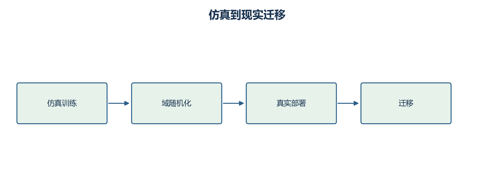

**承上启下。** 31.1 节把第 24、25 章的 MBRL 框架嫁接到具身接口，核心结论是「样本效率来自想象」。但想象的价值完全取决于模型与真实的一致程度——这引出 31.2 节的主题：如何缩小仿真与现实的差距。

**具身场景的特殊约束。** 与游戏智能体相比，具身世界模型还要额外满足三条约束：① **物理保真**——模型必须尊重接触、摩擦、刚体等物理规律，否则想象出的轨迹在现实中不可执行（第 28—29 章）；② **安全**——想象中的失败可接受，真实失败不可接受，故模型输出必须经安全层过滤；③ **延迟**——真实机器人控制回路常在毫秒级，模型 rollout 的速度必须跟上控制频率，否则「想得太慢」。这三条约束使具身世界模型比游戏世界模型难得多，也是本章后续所有技术（域随机化、残差模型、不确定性规划）的共同出发点。

## 31.2　仿真到现实：现实差距与域随机化

**引入动机。** 即便物理引擎（如 MuJoCo、Isaac Gym）能精确积分刚体方程，仿真与真实之间仍存在系统性差异：摩擦系数、质量分布、执行器延迟、相机曝光、纹理细节、光照方向无一能完全复刻。策略若在「唯一一套仿真参数」上过拟合，迁移到真实机器人时往往灾难性失效。Tobin 等人[1]的开创工作表明，与其徒劳地追求仿真参数与真实完全一致，不如反其道而行——**大幅随机化**仿真参数，迫使策略在所有参数变体上都表现良好，从而对未知的真实参数天然鲁棒。

**直觉解释。** 想象训练一位只在一个特定球场、特定风速下练习的射手；换个场地就失灵。若教练让他在随机风速、随机光照、随机球重下练习成千上万次，他学到的是「对扰动稳健的射击策略」，真实现场的任何具体条件都只是他见过的分布中的一个点。域随机化就是这位教练：把真实环境看作随机分布的一个样本，用覆盖该分布的训练换取零样本迁移（zero-shot transfer）。

**定义 31.1（现实差距）** 设仿真参数为 $\xi\in\Xi$（质量、摩擦、纹理、光照等），真实系统对应某一未知 $\xi^{\ast}$。仿真转移为 $p_{\xi}$，真实转移为 $p_{\xi^{\ast}}$。**现实差距**（reality gap）定义为二者在策略诱导的状态分布或回报上的偏差：

$$
\Delta(\xi,\xi^{\ast})=\mathbb{E}_{\pi}\big[\,|J_{\xi}(\pi)-J_{\xi^{\ast}}(\pi)|\,\big]. \tag{31-2}
$$

当 $\Delta$ 较大时，在 $\xi$ 上最优的策略在 $\xi^{\ast}$ 上可能远非最优。

**严格推导：域随机化的鲁棒目标。** 域随机化不再针对单一 $\xi$ 优化，而是优化参数分布 $p(\xi)$ 下的期望回报：

$$
J_{\mathrm{DR}}(\pi)=\mathbb{E}_{\xi\sim p(\xi)}\big[J_{\xi}(\pi)\big]. \tag{31-3}
$$

可以证明一个直观的鲁棒性结论：若参数随机化范围 $\Xi_{\mathrm{train}}$ 覆盖真实参数 $\xi^{\ast}$（即 $\xi^{\ast}\in\mathrm{supp}\,p(\xi)$），则策略在训练分布上的最坏情形性能给出了真实性能的下界——优化式（31-3）倾向于提升最坏情形回报，从而缩小式（31-2）的差距。更精细地，可用**最坏情形优化**（worst-case robust RL）替代期望优化：

$$
\pi^{\ast}=\arg\max_{\pi}\ \min_{\xi\in\Xi_{\mathrm{train}}} J_{\xi}(\pi). \tag{31-4}
$$

式（31-4）明确追求对参数扰动的鲁棒性，是域随机化的保守（risk-averse）版本。

**例 31.2（摩擦随机化的数值）** 设推箱子机器人的推力成功阈值取决于地面摩擦系数 $\mu$：仿真默认 $\mu=0.3$，真实 $\mu=0.5$（更粗糙）。在默认参数下训练的策略施力 $F=1.2\,\mathrm{N}$ 恰好推动箱子；迁移到 $\mu=0.5$ 时推力不足，成功率从 94% 跌至 31%。改用域随机化，训练时从 $\mu\sim\mathcal{U}(0.2,0.7)$ 采样，策略学到保守但稳健的 $F=1.8\,\mathrm{N}$——在所有采样 $\mu$ 上成功率均 $\ge 88\%$，真实 $\mu=0.5$ 上达到 91%。代价是默认仿真场景下的成功率从 94% 略降到 90%：这正是式（31-3）「以小幅标称性能换鲁棒性」的体现。

**表 31-2　缩小现实差距的技术谱系**

| 方法 | 核心思想 | 针对的差距 | 代价 |
|------|---------|-----------|------|
| 域随机化[1] | 随机化仿真参数 | 动力学 + 视觉差异 | 标称性能略降 |
| 系统辨识（第 7 章） | 用真实数据校准 $\xi$ | 动力学参数偏差 | 需可辨识的深度 |
| 可微模拟（第 29 章） | 梯度反传优化 $\xi$ | 参数拟合精度 | 需可微物理引擎 |
| 真实数据微调 | 少量真实样本校正策略 | 残余差距 | 真实交互成本 |
| 学习残差模型 | 用真实数据学 $p_{\mathrm{env}}/\hat p$ 修正 | 未建模动力学 | 需覆盖关键状态 |

> 【图 31-2　现实差距示意图】（原图见 figures/图31-2.png）：同一策略在窄参数分布与宽参数分布下训练，迁移到真实参数时的性能对比柱状图。
>
> 

**承上启下。** 域随机化给出「如何把仿真策略搬到现实」的通用方案。表 31-2 还列出了与域随机化互补的两条技术路线，值得展开。

**残差模型：用真实数据补仿真。** 域随机化是「用分布覆盖不确定性」，**残差模型**（residual model）则走「用真实数据精修模型」的路。设仿真动力学 $\hat p_{\mathrm{sim}}$、真实动力学 $p_{\mathrm{env}}$，学习一个残差修正网络 $\delta_\phi$ 把仿真预测拉向真实观测：

$$
\hat s_{t+1}=\hat s_{t+1}^{\mathrm{sim}}+\delta_\phi(s_t,a_t),\qquad \delta_\phi=\arg\min\ \mathbb{E}_{(s,a,s')\sim\mathcal{D}_{\mathrm{real}}}\big\lVert s'-\hat s^{\mathrm{sim}}-\delta_\phi(s,a)\big\rVert^2. \tag{31-5}
$$

直觉是「仿真给大方向、真实数据修小偏差」：仿真模型覆盖已知的刚体/接触动力学（数据高效），残差网络只学仿真没覆盖的「真实特有」部分（摩擦的非线性、执行器柔性、空气阻力等），用少量真实数据即可训练。这与第 29 章可微模拟的「参数校准」相对：残差模型改的是**预测**，参数校准改的是**引擎参数**；前者更灵活（可学任意修正）、后者更可解释。

**现实差距的分解：参数 vs. 结构。** 式 31-2 的 $\Delta$ 可进一步分解为两部分：

$$
\Delta(\xi,\xi^{\ast})\leq \underbrace{\mathbb{E}_{\pi}\big[\,|J_{\xi}(\pi)-J_{\xi^{\ast}}(\pi)|\,\big]}_{\text{参数差距}\ \Delta_{\mathrm{param}}}+\underbrace{\mathbb{E}_{\pi}\big[\,|J_{\xi^{\ast},\mathrm{struct}}(\pi)-J_{\xi^{\ast}}(\pi)|\,\big]}_{\text{结构差距}\ \Delta_{\mathrm{struct}}}. \tag{31-6}
$$

**参数差距** $\Delta_{\mathrm{param}}$ 源于「结构相同但参数不同」（摩擦值、质量、延迟），域随机化（式 31-3/31-4）与系统辨识（第 7 章）可直接压缩它；**结构差距** $\Delta_{\mathrm{struct}}$ 源于「仿真缺项」（如忽略柔性体形变、忽略柔性接触的非线性），任何参数调整都无法消除，只能靠更完整的物理模型或残差模型（式 31-5）补偿。这一分解给了工程实践清晰的诊断流程：先用域随机化压参数差距，再评估残余误差——若 $\Delta_{\mathrm{struct}}$ 仍显著，说明需要升级物理模型或加残差学习，而非继续扩大随机化范围。

**承上启下。** 域随机化、系统辨识与残差模型给出「如何把仿真策略搬到现实」的三条互补路径。接下来 31.3 节把它们落到两个具身重镇——自动驾驶与机械臂操作——展示动作条件化世界模型在具体领域的形态。

## 31.3　专题案例：自动驾驶与机械臂操作

**引入动机与直觉。** 具身世界模型的价值最终要在具体任务上兑现。两个代表性场景各有侧重：自动驾驶要在**多智能体**环境中预测他人未来行为（高风险、强交互）；机械臂操作要在**接触丰富**的环境中预测物体的非光滑运动（变形、滑动、碰撞）。二者都是第 23 章动作条件化动力学的实例：状态转移依赖自身动作 $a_t$，也依赖其他智能体的动作。

**严格表述：多智能体条件预测。** 自动驾驶中，自车世界模型需预测周围交通参与者 $j=1,\dots,N$ 的未来轨迹。设参与者 $j$ 的状态为 $s_t^{j}$，自车动作 $a_t^{\text{ego}}$ 会影响他人（如并线迫使后车减速）。联合受控转移写为

$$
p\big(s_{t+1}^{1:N}\mid s_t^{1:N},a_t^{\text{ego}}\big)=\prod_{j=1}^{N} p_j\big(s_{t+1}^{j}\mid s_t^{1:N},a_t^{\text{ego}}\big), \tag{31-7}
$$

其中条件独立性是简化假设——现实中车辆间通过交互耦合，故更精细的模型用图神经网络建模交互（第 38 章）。规划时，自车在模型内 rollout 多条候选轨迹，用第 25 章的 MPC 选择碰撞风险最低、通行效率最高的一条。

**例 31.3（换道决策的 rollout）** 自车以 $20\,\mathrm{m/s}$ 行驶，前方 $30\,\mathrm{m}$ 有慢车（$12\,\mathrm{m/s}$），左后方 $15\,\mathrm{m}$ 有来车（$25\,\mathrm{m/s}$）。世界模型预测：若保持车道，5 秒后追尾（相对速度 $8\,\mathrm{m/s}$，间距缩至 $-10\,\mathrm{m}$）；若换道，左后方来车将在 3.3 秒后到达并线点，换道需 4 秒——存在碰撞风险。模型据此否决立即换道，选择先减速至 $15\,\mathrm{m/s}$ 再换道，把风险降到可接受范围。这类「在模型里预演未来再决策」正是具身世界模型的核心价值，也是第 25 章规划算法的直接应用。

**例 31.4（接触动力学的域随机化）** 机械臂推动一个方形块，接触点的位置误差会导致块旋转。纯学模方法在光滑桌面上训练的策略迁移到略带粘滞的桌面时，推偏率从 8% 升至 37%。引入接触参数的域随机化（摩擦 $\mu\in[0.1,0.6]$、块质量 $m\in[0.5,1.5]\,\mathrm{kg}$、接触点偏置 $\delta\in[-2,2]\,\mathrm{cm}$）后，真实桌面推偏率回落到 11%——与第 31.2 节的结论一致：覆盖真实参数的随机化分布带来零样本鲁棒性。

**表 31-3　具身世界模型应用对照**

| 场景 | 世界模型用途 | 关键挑战 | 涉及要素 |
|------|-------------|---------|---------|
| 自动驾驶 | 预测交通参与者行为 | 多智能体、安全关键 | E1/E2/E4/E7（第 38 章） |
| 机械臂操作 | 预测物体受推运动 | 接触、变形、非光滑 | E2/E5（第 23、29 章） |
| 移动导航 | 建图与定位（SLAM） | 未知环境、累积漂移 | E1/E2（第 30、33 章） |
| 四足行走 | 预测落脚与失稳 | 高维动力学、安全 | E2/E5/E6 |

**承上启下。** 自动驾驶的多智能体预测衔接第 38 章，接触动力学衔接第 23、29 章，建图漂移衔接第 33 章。这些应用的共同前提是模型足够忠实；31.4 节直面当这一前提被违背时的边界与风险。

## 31.4　边界与讨论

具身世界模型的核心软肋与第 12、24 章一脉相承：**模型误差与策略利用**。① 策略在仿真里可能发现并利用模型的漏洞（在特定随机化参数组合下取得虚高回报），部署到真实即失效——这是第 24 章的策略利用问题在具身场景的放大版，因为真实失败的代价远高于游戏。② 长视野想象中的**误差累积**（第 33 章）：滚动步数越长，接触、摩擦等误差越被放大，规划所依据的未来越不可信。③ **可辨识性限制**（第 2.5、35 章）：视觉外观的变化可能源于纹理而非几何，模型若把两者混淆，域随机化的覆盖就失去意义。④ **系统辨识的盲区**：第 7 章的辨识方法要求激励充分，而安全约束往往限制了可施加的探索动作，使部分动力学参数无法被准确估计。

**安全边界。** 在安全关键场景（自动驾驶、医疗机器人），「在模型里犯错」与「在现实里犯错」的代价不可同日而语。因此具身部署普遍采用**仿真训练 + 真实安全阀**的混合架构：世界模型负责规划，但独立的碰撞检测、急停逻辑与人类监督构成最后防线。换言之，世界模型在具身系统中不是万能替代品，而是与经典控制安全层协同工作的组件（第 8 章）。

**不确定性感知规划：让模型「知道自己不知道」。** 上述边界①②的根源是模型对自身可靠性的「无感」——它不知道自己在哪段状态最不可信。一个稳健的对策是把不确定性纳入规划目标：用模型集成（第 24 章）估计每步想象的不确定性 $u_t$，在回报中减去风险项：

$$
J_{\mathrm{risk}}(\pi)=\mathbb{E}\Big[\sum_{t=0}^{H}\gamma^{t}\big(r(s_t,a_t)-\beta\, u_t\big)\Big], \tag{31-8}
$$

其中 $\beta$ 控制风险厌恶。直觉是「在模型不确定的区域自动变得保守」：$u_t$ 大（如进入数据稀疏的状态、或接触即将发生的临界点）时，规划器会回避该区域或放慢动作，直到观测把不确定性压下来。这与第 25 章的 CVaR 规划（式 25-8）同属「风险敏感回报」家族，但 $u_t$ 的来源更具体——它直接来自集成模型在具身状态上的分歧。实践中 $\beta$ 的安全关键性决定了它的取值：自动驾驶取大 $\beta$（宁可慢、不可撞），机械臂取中等 $\beta$（兼顾效率与安全）。

**例 31.5（风险敏感回报改变规划选择）** 机械臂抓取任务，模型集成给出 5 步想象的不确定性 $u=(0.02,\ 0.02,\ 0.02,\ 0.60,\ 0.70)$（第 4 步即将发生接触，分歧骤增），即时奖励 $r=(1,1,1,1,1)$，$\gamma=1$。无风险项（$\beta=0$）：$J=\sum r=5$，规划器倾向「快速完成」。取 $\beta=1$：$J_{\mathrm{risk}}=5-\beta\sum u=5-(0.02+0.02+0.02+0.60+0.70)=5-1.36=3.64$，其中第 4、5 步贡献 $-0.60,-0.70$ 的「风险惩罚」——规划器会倾向放慢第 4 步前的动作、增加观测以降低接触点的不确定性，或干脆换一条不经过高不确定区的轨迹。对照另一条候选轨迹（绕开接触临界区）$u'=(0.02,0.02,0.03,0.05,0.05)$、$r'=4$，则 $J_{\mathrm{risk}}'=4-0.17=3.83>3.64$，风险敏感目标会选「稍慢但更确定」的轨迹——这正是具身场景「安全第一」的量化体现。

这些辨析衔接第 2、7、8、12、23—25、27—30、33、35 章，以及《具身智能导论》《仿真智能与数字孪生导论》。下一章把视角从「如何构建具身模型」转向「如何评判任何世界模型的好坏」，系统给出多维度评估体系。

## 本章小结

本章论述具身世界模型与机器人仿真，把第七篇的物理、可微模拟与 3D 表示汇入具身智能。

我们首先论证机器人为何更需要世界模型：真实交互稀缺且高风险，MBRL 的「计算换数据」在具身场景尤其划算（式 31-1，例 31.1 推箱子案例给出 $K\!\approx\!100$ 的样本效率增益）。接着定义现实差距（定义 31.1，式 31-2），推导域随机化的期望目标与最坏情形目标（式 31-3、31-4），用摩擦随机化算例（例 31.2）展示其以小幅标称性能换鲁棒性的机制，并补充残差模型（式 31-5）与现实差距的「参数—结构」分解（式 31-6）两条互补技术路线。随后通过自动驾驶与机械臂操作两个专题案例（例 31.3、31.4，式 31-7）展示动作条件化世界模型的落地形态，并用表 31-1 把七要素、表 31-2 把缩小差距的技术谱系、表 31-3 把应用场景系统对照。最后讨论不确定性感知规划（式 31-8，例 31.5）与安全边界。

我们还明确边界：模型误差与策略利用、长视野误差累积、可辨识性限制与安全约束下的辨识盲区。这些辨析衔接第 2、7、8、12、23—25、27—30、33、35 章与两本关联专著。

下一章转向批判视角，给出评估世界模型的多维度框架与基准。

**进一步阅读**　本章建议延伸阅读的文献：[1]、[2]、[5]。

## 参考文献

[1] Tobin J, Fong R, Ray A, et al. Domain randomization for transferring deep neural networks from simulation to the real world. *IROS*, 2017: 23–30.

[2] Hafner D, Pasukonis J, Ba J, et al. Mastering diverse domains through world models. *Nature*, 2023, 615: 58–64.

[3] Teng S, Hu J, Deng P, et al. Reality gap aware domain randomization. *IROS*, 2023: 4532–4539.

[4] Peng X B, Ma Z, Abbeel P, Levine S. Sim-to-real transfer of robotic control with dynamics randomization. *ICRA*, 2018: 3803–3810.

[5] Levine S, Pastor P, Krizhevsky A, et al. Learning hand-eye coordination for robotic grasping with deep learning and large-scale data collection. *International Journal of Robotics Research*, 2018, 37(4–5): 421–436.

[6] Andrychowicz M, Baker B, Chociej M, et al. Learning dexterous in-hand manipulation. *International Journal of Robotics Research*, 2020, 39(1): 3–20.

[7] Sutton R S, Barto A G. *Reinforcement Learning: An Introduction*. 2nd ed. MIT Press, 2018.

[8] Kober J, Bagnell J A, Peters J. Reinforcement learning in robotics: A survey. *International Journal of Robotics Research*, 2013, 32(11): 1238–1274.

---

# 第 32 章　世界模型的评估

第八篇（第 32—35 章）转向批判视角：如何评估一个世界模型的好坏？语言模型有困惑度，分类器有准确率，而世界模型的评估远为棘手——因为「世界模型好坏」不是单一标量，而是涉及多个彼此可能冲突的维度：生成的观测是否逼真、多步预测是否准确、不确定性是否校准、动作是否可控、对下游决策是否真正有用。一个 FID 极低的视频生成器可能在规划任务上一败涂地；一个预测误差很小的动力学模型可能因忽略罕见但致命的事件而不可用。本章给出评估的多维度框架（32.1 节），梳理代表性基准与 WorldScore（32.2 节），提出以第 1.4 节七要素为核心的结构化诊断（32.3 节），并讨论评估本身的根本困难（32.4 节）。

本章的核心论点是：**评估维度必须与模型用途对齐**。脱离下游任务谈「世界模型好不好」是没有意义的——这正是「没有免费的午餐」在评估层面的体现。我们将用定义、公式与带数值的算例把这一论点具体化，使读者能够把零散的指标组织成一套可操作的诊断流程。

## 32.1　评估的多维度框架

**引入动机。** 为什么不能像语言模型那样用一个分数评估世界模型？根源在于世界模型承担多重角色：它既是生成器（E3 观测生成），又是预测器（E2 状态转移），还是规划器（E7 决策）。不同角色需要不同指标，而优化其中一个往往会牺牲另一个。第 16、17 章已指出，生成质量与动力学保真度之间存在张力。因此评估必须**分维度**进行，再按用途加权聚合。

**直觉解释。** 把世界模型想成一辆车：评估「车好不好」要看加速、刹车、油耗、安全性、乘坐舒适度等多个维度，单一的最高时速说明不了问题。世界模型同理——重建清晰只是「外观」，预测准确只是「操控」，决策价值才是「能否把你送到目的地」。一张雷达图（图 32-1）比一个数字更能刻画模型的全貌。

**严格定义：重建质量。** 设真实观测分布为 $p_{\mathrm{data}}$，模型生成分布为 $p_\theta$。生成保真度常用 Fréchet Inception Distance（FID）[3] 衡量：

$$
\mathrm{FID}=\|\mu_{\mathrm{data}}-\mu_\theta\|_2^2+\mathrm{Tr}\!\left(\Sigma_{\mathrm{data}}+\Sigma_\theta-2\sqrt{\Sigma_{\mathrm{data}}\Sigma_\theta}\right), \tag{32-1}
$$

其中 $(\mu,\Sigma)$ 是Inception 特征空间中的均值与协方差。FID 越低，生成分布越接近真实。像素级重建还用峰值信噪比 $\mathrm{PSNR}=10\log_{10}(\mathrm{MAX}^2/\mathrm{MSE})$ 与感知指标 LPIPS[5]。

**严格定义：多步预测误差。** 从真实状态 $s_t$ 出发用模型自回归滚动 $H$ 步，累积误差定义为

$$
\mathcal{E}_H=\frac{1}{H}\sum_{k=1}^{H}\mathbb{E}\big[\,d\big(\hat s_{t+k},s_{t+k}\big)\,\big], \tag{32-2}
$$

其中 $d(\cdot,\cdot)$ 是状态距离（如欧氏距离或潜空间余弦距离）。式（32-2）直接量化第 33 章要诊断的误差累积——$\mathcal{E}_H$ 随 $H$ 增长的速度决定了模型能否用于长视野规划。

**严格定义：校准与负对数似然。** 若模型输出概率预测 $p_\theta(s_{t+1}\mid \cdot)$，其不确定性质量用负对数似然（NLL）与可靠性图评估。完美校准意味着「模型给出 70% 置信度的事件，长期看约 70% 真的发生」。形式上，校准误差可写为

$$
\mathrm{ECE}=\sum_{m=1}^{M}\frac{|B_m|}{N}\big|\mathrm{acc}(B_m)-\mathrm{conf}(B_m)\big|, \tag{32-3}
$$

其中 $B_m$ 是置信度落在第 $m$ 个区间的样本集合，$\mathrm{acc}$ 与 $\mathrm{conf}$ 分别是该区间的经验准确率与平均置信度。ECE 越低越可靠——这对自动驾驶等安全关键场景（第 31 章）尤为重要。

**例 32.1（重建好 ≠ 规划好）** 设模型 A 的 FID=8.2（优秀），但潜在状态不编码动作信息；模型 B 的 FID=22.5（一般），却精确编码了「推力→箱子位移」的关系。在推箱子规划任务中，A 的成功率仅 9%，B 达 87%。可见重建指标（式 32-1）与决策价值脱节——若只看 FID 会误选 A。这正是「评估须 multidimensional」的实证。

**严格定义：决策价值。** 前三个指标都是「模型自身的质量」，而评估的最终判据应是**模型对下游决策的帮助**。设用模型 $\hat p_\theta$ 训练/规划得到的策略为 $\pi_\theta$，其决策价值定义为该策略在真实环境中的期望回报：

$$
V_{\mathrm{dec}}(\hat p_\theta)=\mathbb{E}_{p_{\mathrm{env}}}\Big[\sum_{t=0}^{\infty}\gamma^{t} r(s_t,\pi_\theta(s_t))\Big], \tag{32-4}
$$

其中 $\pi_\theta$ 是在 $\hat p_\theta$ 上训练（或想象 rollout）的策略，$p_{\mathrm{env}}$ 是真实环境动力学。$V_{\mathrm{dec}}$ 是「端到端」指标：它不关心模型生成的像素多像、状态多准，只问「用了这个模型，机器人/智能体最终干得好不好」。式 32-4 与式 32-1/32-2/32-3 的关系是：后者是「过程指标」（中间环节的质量），前者是「结果指标」（最终目标）。过程指标高但结果指标低（例 32.1 的模型 A）说明「过程与目标脱节」；反之过程指标低但结果指标高，说明模型虽不完美但「恰好够用」。评估必须同时报告二者，且**以结果指标为最终判据**。

**表 32-1　世界模型评估维度**

| 维度 | 代表指标 | 公式/出处 | 对应要素 |
|------|---------|----------|---------|
| 重建质量 | PSNR、LPIPS、FID | 式（32-1） | E3 |
| 多步预测 | 累积误差 $\mathcal{E}_H$ | 式（32-2） | E2 |
| 不确定性校准 | NLL、ECE | 式（32-3） | E4 |
| 可控性 | 动作响应一致性 | 第 23 章 | E5 |
| 决策价值 | 下游任务回报 | 第 12、24 章 | E7 |
| 一致性 | 长期物体恒存 | 第 33 章 | E1/E2 |

> 【图 32-1　世界模型评估维度】（原图见 figures/图32-1.png）：六维雷达图，模型 A 与 B 在各维度的对照，凸显「重建高不等于决策强」。
>
> 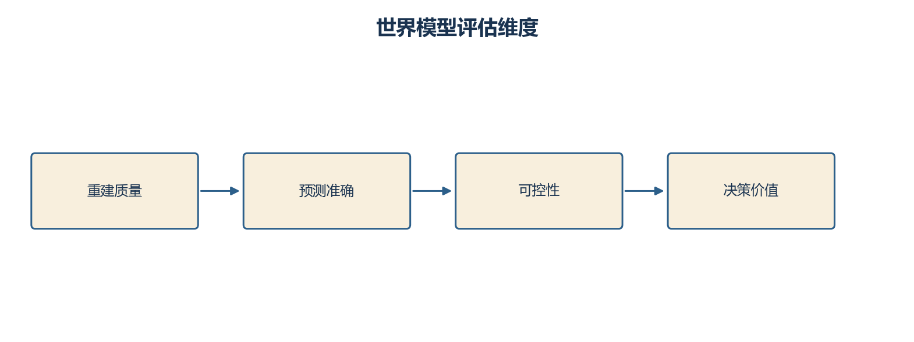

**承上启下。** 32.1 节给出「评什么」。但要让指标可比，还需要统一的基准与协议——这是 32.2 节的主题。

**长期一致性的量化。** 式 32-2 的平均累积误差 $\mathcal{E}_H$ 是「平均」的，会掩盖长尾失效。一个更严格的指标是**物体恒存一致性**（object persistence）：在 $H$ 步 rollout 中，跟踪一个特定物体（如推箱子案例中的箱子）是否始终存在、位置是否连续。定义

$$
\mathrm{Cons}(H)=\frac{1}{N_{\mathrm{obj}}}\sum_{k=1}^{N_{\mathrm{obj}}}\mathbb{1}\big[\text{物体 }k\text{ 在 }H\text{ 步中恒存且位置连续}\big]. \tag{32-5}
$$

$\mathrm{Cons}(H)$ 直接量化第 33 章要诊断的「物体消失/突变」——它比 $\mathcal{E}_H$ 更敏感于「罕见但致命」的一致性破坏（物体凭空消失、复制、瞬移）。实践中，$\mathcal{E}_H$（平均轨迹误差）与 $\mathrm{Cons}(H)$（物体恒存率）应同时报告：前者反映整体预测精度，后者反映「有没有出现灾难性失效」。安全关键场景尤其看重后者——一次「物体消失」可能让机器人误判碰撞而撞墙。

## 32.2　基准与 WorldScore

**引入动机。** 有了维度框架，下一个问题是「在哪里评、和谁比」。2025—2026 年世界模型基准快速发展，但目前尚无像 ImageNet 那样公认的单一标准。原因是不同用途的模型本质上不可直接比较：视频生成模型（第 16 章 Sora 类）与强化学习潜在模型（第 12 章 Dreamer）的输入与输出都不同。基准因此按用途分化。

**直觉解释。** 基准就是「统一的考场」。语言模型在统一考题上比困惑度，世界-model 也需要统一场景、统一初始条件、统一指标来比较。但由于「世界」千差万别，考场的形态也必须多样——有的考视频生成质量，有的考决策能力，有的考具身交互。

**代表基准谱系。** ① **WorldScore**[2]（2025）面向视频与 3D 世界生成，从内容一致性、可控性、物理合理性与 3D 一致性等多维度自动评测生成世界，是最早系统化的世界生成基准之一。② **DreamerV3 的 150+ 任务套件**[6]（Atari、DMC、Minecraft 等）以**决策价值**为统一指标（人类归一化得分），是衡量「模型能否帮助决策」的事实标准。③ **iGibson/Habitat**[4] 面向具身导航与交互。④ **KITTI/Waymo** 面向自动驾驶预测。⑤ **MVBench、V Bench** 等评估视频生成的时序一致性。需注意：这一领域日新月异，具体版本与排行榜须以原始出处为准。

**表 32-2　代表性基准对照**

| 基准 | 评测对象 | 核心指标 | 对应维度 |
|------|---------|---------|---------|
| WorldScore[2] | 视频/3D 生成 | 一致性、可控性、物理合理性 | E3/E1/E5 |
| DreamerV3 套件[6] | MBRL 决策 | 人类归一化得分 | E7 |
| Habitat[4] | 具身导航 | SPL、成功率 | E7 |
| KITTI/Waymo | 驾驶预测 | 轨迹误差 | E2/E4 |
| V Bench | 视频生成 | 时序一致性、运动质量 | E3/E1 |

**例 32.2（用 WorldScore 评测两个生成器）** 设模型 A、B 在 WorldScore 上的得分（0—100）为：内容一致性 A=78/B=71，动态可控性 A=62/B=81，3D 一致性 A=85/B=69，物理合理性 A=55/B=74。简单平均得 A=70.0、B=73.8，B 略胜；但按「具身导航」用途加权（一致性×0.5、可控性×0.3、物理×0.2），A=39+18.6+11=68.6，B=35.5+24.3+14.8=74.6，B 优势扩大；按「影视生成」用途加权（3D×0.5、一致性×0.3、可控×0.2），A=42.5+23.4+12.4=78.3，B=34.5+21.3+16.2=72.0，A 反超。这说明**用途决定权重**，脱离用途的单一总分会误导选择。

**承上启下。** 基准给出可比分数，但分数背后是模型具备了哪些能力、缺了哪些要素。32.3 节用七要素框架把分数翻译成结构化诊断。

**评估的统计严谨性。** 上述基准的分数都建立在**有限测试样本**上，存在统计不确定性。一个规范的评估协议须满足：① **报告置信区间**——对决策价值等核心指标报告 $95\%$ CI（用多种子或多初始条件重复），而非单点估计；② **固定测试协议**——同一模型在多次比较中用相同的初始状态、动作序列与随机种子，否则分数不可比；③ **区分「训练集内」与「留出集」表现**——模型在见过的场景上的分数必然虚高，须报告留出场景的泛化分数。实践中常见的评估失误是：报一个好看的单点分数（恰好在「有利的」测试场景上取得）、不报方差、混用不同测试协议——这使跨论文比较失效。可操作的底线是：**报总分 + 置信区间 + 测试协议版本号**，三者缺一则分数不可信。

**交互世界模型的特殊评估维度。** 第 27 章的可玩世界模型比被动视频生成多两个评估维度，传统 FID/PSNR 无法捕捉：① **响应性**（动作是否因果地改变世界，第 27.3 节例 27.3 的 $\mathcal{S}$ 指标）——同一初态施加不同动作应产生可分辨的差异；② **可控性**（动作效果是否沿意图方向且稳定，例 27.4 的方向一致率）。一个 FID 极低但对动作「无反应」的模型，在交互用途上是失败的——它的画面再真也不可玩。因此评估交互世界模型必须在固定动作序列下对比生成结果，把响应性、可控性、长时一致性（例 27.2 的漂移量）纳入指标集，而非只报单帧重建质量。这与本表「维度须按用途分化」的原则一致：视频生成看 FID/PSNR，交互生成看响应性/可控性，具身决策看决策价值（式 32-4）。

## 32.3　七要素评估框架

**引入动机。** 维度与基准回答「模型表面表现如何」，七要素框架回答「模型内部具备什么机制」。第 1.4 节定义的世界模型七要素（E1 状态表示、E2 状态转移、E3 观测生成、E4 不确定性、E5 动作条件化、E6 奖励目标、E7 规划）提供了一张能力清单：一个「完整世界模型」应当七项齐备；缺失任一要素，都会在特定用途上暴露短板。

**直觉解释。** 七要素就像体检的七个子系统：心、肝、脾、肺、肾、神经、骨骼。体检报告不仅要给总体健康分，更要指出哪个器官有隐患。七要素评估同样如此——Dreamer 七项齐备（第 12.5 节），是一个强健壮的「全能选手」；纯视频扩散模型往往缺 E5（动作条件化）与 E7（规划），是「偏科的生成专家」。

**严格表述：要素完备度评分。** 令 $e_i\in[0,1]$ 表示第 $i$ 个要素的质量（1 为完备），定义要素向量 $\mathbf{e}=(e_1,\dots,e_7)$ 与**完备度** $C=\frac{1}{7}\sum_i e_i$。但完备度不能简单替代任务性能——缺失的要素可能是任务关键。定义用途权重 $\mathbf{w}=(w_1,\dots,w_7)$（$\sum w_i=1$），加权要素得分

$$
S_{\mathbf{w}}=\sum_{i=1}^{7} w_i e_i. \tag{32-6}
$$

式（32-6）把第 32.2 节的「用途决定权重」形式化：规划任务给 E7 高权重，生成任务给 E3 高权重。

**例 32.3（七要素诊断）** 模型 X（视频扩散）要素向量约 $(0.9,0.7,0.95,0.6,0.1,0.0,0.0)$，完备度 $C=3.25/7\approx0.46$；模型 Y（Dreamer）各要素约 $0.8$ 上下，完备度 $C\approx0.8$。对「影视生成」用途取 $\mathbf{w}=(0.05,0.1,0.5,0.1,0.05,0,0.2)$，得 $S_X=0.045+0.07+0.475+0.06+0.005+0+0=0.655$，$S_Y=0.04+0.08+0.4+0.08+0.04+0+0.16=0.80$——此处 X 的 E3 优势被 Y 的整体均衡抵消；若用途更偏「纯生成」把 E3 权重提到 0.8，则 X 反超。这再次印证评估必须与用途对齐。

**例 32.4（决策价值与过程指标的反向关系）** 在推箱子任务上评测三个模型：

| 模型 | FID↓ | $\mathcal{E}_{10}$↓ | $V_{\mathrm{dec}}$（成功率）↑ |
|------|------|------|------|
| M1 | 5.1 | 0.12 | 12% |
| M2 | 20.3 | 0.18 | 78% |
| M3 | 14.6 | 0.09 | 81% |

若只看 FID 会选 M1（5.1 最低），但 M1 的决策价值仅 12%——它的生成逼真但潜在状态不编码「推力→位移」的因果，规划器在它上面「看不到」动作的后果。M2 的 FID 最差（20.3）但决策价值达 78%，M3 各项均衡、决策价值最高（81%）。正确的选择是 **M3**（决策价值最高且过程指标不差），次选 M2。这个算例量化了「过程指标（FID、$\mathcal{E}_H$）与结果指标（$V_{\mathrm{dec}}$）可能反向」的现象：FID 最低的 M1 恰恰决策最弱，印证例 32.1 的结论——评估必须把式 32-4 的决策价值作为最终判据，而七要素框架（式 32-6）能解释「为何 M1 弱」：其 E5（动作条件化）与 E7（规划）要素接近零，正是决策价值低的原因。

**表 32-3　代表性模型的七要素覆盖**

| 模型 | E1 | E2 | E3 | E4 | E5 | E6 | E7 | 定位 |
|------|----|----|----|----|----|----|----|------|
| DreamerV3[6] | ✓ | ✓ | ✓ | ✓ | ✓ | ✓ | ✓ | 完整 MBRL |
| Sora 类[7] | ✓ | ✓ | ✓ | 弱 | ✗ | ✗ | ✗ | 视频生成 |
| V-JEPA[8] | ✓ | ✓ | ✗ | 中 | 弱 | ✗ | ✗ | 表示预测 |
| 域随机化仿真（第 31 章） | ✓ | ✓ | ✓ | ✓ | ✓ | ✓ | ✓ | 具身完整 |

**承上启下。** 七要素框架把评估结构化，但它仍默认模型「表现良好」。下一章直面模型失效的三种典型形态——幻觉、漂移与长期一致性破坏——这些正是评估指标恶化背后的机制。

## 32.4　边界与讨论

评估本身有根本困难。① **缺乏统一基准**：生成模型与决策模型的输入、输出、目标均不同，难以用同一把尺子量；现有基准各自为政。② **指标与价值脱节**：FID 低不等于规划好（例 32.1），预测准不等于安全——罕见但致命的事件可能淹没在平均误差里。③ **长期一致性难量化**：第 33 章的漂移与幻觉往往在长视野才显现，短时指标无法捕捉。④ **评测者自身的偏差**：用学习到的感知模型（如 Inception）算 FID，会把感知模型的偏差引入评估。⑤ **分布外泛化难测**：基准的固定测试集无法覆盖真实世界的开放分布。

缓解方向包括：面向用途的加权评估（式 32-6）、长视野压力测试、以决策价值为最终判据（第 12、24 章），以及结合人类评估与自动指标。

**自动指标与人类评估的互补。** 自动指标（FID、ECE、$V_{\mathrm{dec}}$）可大规模、可复现，但有系统盲区：FID 由 Inception 特征决定，可能奖励「Inception 喜欢的风格」而非真实物理合理性；ECE 只度量校准，不度量「校准对了但全错」的情形。人类评估弥补这些盲区——人能判断「这个生成的世界物理上站不站得住」「这个动作响应合不合理」——但人类评估昂贵、主观、难复现。一个稳健的协议是**双轨**：自动指标作初筛（快速、可量化），人类评估作终判（针对自动指标无法捕捉的维度，如物理合理性、可玩性）。对安全关键场景（自动驾驶、医疗），人类评估不可省略——因为「模型不知道自己在错」恰恰是最危险的情形（第 31 章）。

**分布外泛化的评估：训练分布外的压力测试。** 式 32-2 的 $\mathcal{E}_H$ 与式 32-5 的 $V_{\mathrm{dec}}$ 若在训练分布内测量，会系统性高估模型能力——模型对「见过的状态」总是更准。一个完整的评估必须包含**分布外（OOD）压力测试**：在模型从未见过的初始条件、极端参数、罕见事件上测量指标。具体做法：① **参数外推**——在 $\xi$ 超出训练随机化范围（第 31 章域随机化之外的区域）测 $\Delta$，衡量「外推鲁棒性」；② **罕见事件注入**——在测试序列中人为注入碰撞、滑移、物体消失等低频事件，测模型是否捕捉到（平均误差会掩盖这些事件，但式 32-5 的物体恒存能暴露）；③ **长视野外推**——把 rollout 步数 $H$ 推到远超训练长度，测 $\mathcal{E}_H$ 的饱和/发散行为。OOD 分数与分布内分数的**差值**是衡量「泛化能力」的更诚实指标：分布内 FID 低但 OOD FID 飙升的模型，其实「只会在家里考得好」。这一原则与第 26 章离线学习的「数据质量天花板」、第 31 章具身模型的「现实差距」一脉相承——评估必须回答「在模型没见过的地方它还能用吗」，而非只在舒适区打分。

**加权聚合：从多指标到可报告总分。** 上述困难不意味着只能「报一堆指标、不给总分」，而是说总分必须**显式声明权重来源**。一个规范的做法是：先归一化各维度指标到 $[0,1]$（FID 取 $1-\mathrm{FID}/\mathrm{FID}_{\max}$、$\mathcal{E}_H$ 取 $1-\mathcal{E}_H/H$ 等），再按用途权重线性聚合：

$$
Q_{\mathbf{w}}=\sum_{j\in\mathcal{D}} w_j\,\tilde m_j,\qquad \sum_j w_j=1, \tag{32-7}
$$

其中 $\mathcal{D}$ 是指标集、$\tilde m_j$ 是归一化后的第 $j$ 个指标、$\mathbf{w}$ 由下游用途显式指定（与式 32-6 的用途权重同源）。关键是**报告 $Q_{\mathbf{w}}$ 时必须同时报告 $\mathbf{w}$**——否则总分无法跨论文比较。例 32.2 的「具身导航」与「影视生成」两种权重给出不同排名，正是这一原则的实例。若无法确定用途，应报告**各维度的雷达图**而非单一总分，让读者自行判断。这些辨析衔接第 1、12、16、24、28、31、33—35 章。下一章诊断模型失效的具体机制。

## 本章小结

本章给出世界模型的评估体系，核心论点是**评估维度必须与用途对齐**。

我们首先建立多维度框架：重建质量（FID，式 32-1）、多步预测误差（式 32-2）、不确定性校准（ECE，式 32-3）、决策价值（式 32-4）与长期一致性（物体恒存，式 32-5），并用例 32.1 证明「重建好不等于规划好」。接着梳理代表性基准 WorldScore、DreamerV3 套件、Habitat 等（表 32-2），用例 32.2 展示用途加权如何改变排名。随后提出七要素评估框架（式 32-6，表 32-3），把分数翻译成结构化能力诊断，并给出「归一化 + 显式用途权重」的加权聚合准则（式 32-7）。

我们还明确边界：缺乏统一基准、指标与价值脱节、长期一致性难量化、评测者偏差与分布外泛化难题。这些辨析衔接第 1、12、16、24、28、31、33—35 章。

下一章诊断幻觉、漂移与长期一致性——评估指标恶化背后的机制。

**进一步阅读**　本章建议延伸阅读的文献：[2]、[3]、[6]、[7]。

## 参考文献

[1] Hafner D, Lillicrap T, Ba J, Norouzi M. Dream to control: Learning behaviors by latent imagination. *ICLR*, 2020.

[2] Huang Z, et al. WorldScore: Benchmarking world models. *arXiv:2504.00067*, 2025.

[3] Heusel M, Ramsauer H, Unterthiner T, et al. GANs trained by a two time-scale update rule converge to a local Nash equilibrium. *NeurIPS*, 2017: 6626–6637.

[4] Savva M, Kadian A, Mojafari A, et al. Habitat: A platform for embodied AI research. *ICCV*, 2019: 9339–9347.

[5] Zhang L, Zhang L, Mou X, Zhang L. Perceptual losses for real-time style transfer and super-resolution. *ECCV*, 2016: 694–711.

[6] Hafner D, Pasukonis J, Ba J, et al. Mastering diverse domains through world models. *Nature*, 2023, 615: 58–64.

[7] Brooks T, Peebles B, Xie S, et al. Video generation models as world simulators. *OpenAI Technical Report*, 2024.

[8] Bardes A, Parikh N, Chen X, et al. V-JEPA: Latent video prediction for visual representation learning. *ICML*, 2024.

---

# 第 33 章　幻觉、漂移与长期一致性

第 32 章的评估揭示一个核心问题：世界模型在长期滚动中容易失真。本章诊断三类彼此关联的失败形态：**幻觉**（hallucination，生成不存在的内容）、**漂移**（drift，长期预测逐渐偏离现实）、**长期一致性破坏**（long-horizon consistency violation，场景与物体属性随时间不自洽）。这三者是第 1.3 节「误差累积」困难的具体表现，也是世界模型从「看起来好」走向「真正可用」的关键障碍。一个能生成惊艳短视频的模型，若滚动 100 步后汽车凭空消失、物体穿墙而过，它就不能作为可靠的模拟器支撑规划。

本章先建立滚动误差累积的数学框架并推导其增长规律（33.1 节），再分析幻觉与物理违背的成因及缓解（33.2 节），给出长期一致性的严格定义与评测（33.3 节），最后讨论「误差不可避免」这一根本边界与缓解策略（33.4 节）。本章与第 12、24、28、31、32 章及《不确定性智能导论》紧密衔接。

## 33.1　滚动预测与误差累积

**引入动机。** 世界模型的许多用途——想象训练（第 12 章）、MPC 规划（第 25 章）、视频生成（第 15、16 章）——都要求**自回归滚动**：模型反复把上一步的预测当作下一步的输入。这种闭环结构埋下了误差累积的种子：一步的小偏差会改变下一步的输入分布，进而被放大。理解这一机制是诊断漂移与幻觉的前提。

**直觉解释。** 想象开车时闭眼凭记忆预演路线：第一秒你还准确知道自己在哪；第十秒，因为你没有真实视觉校正，位置的微小误差已让你「脑中的自己」偏离车道；到第一百秒，脑内导航已面目全非。自回归滚动正如闭眼开车——每一步的预测都建立在（可能已经失真的）上一步之上，缺乏真实观测的锚定。

**定义 33.1（滚动误差累积）** 设真实动力学为 $s_{t+1}=f(s_t,a_t)$，学得模型为 $\hat s_{t+1}=\hat f(\hat s_t,a_t)$。单步模型误差界为 $\|\hat f(s,a)-f(s,a)\|\le\epsilon$，且 $\hat f$ 关于状态是 $L$-Lipschitz 的（即 $\|\hat f(s)-\hat f(s')\|\le L\|s-s'\|$）。则从 $\hat s_0=s_0$ 出发滚动 $k$ 步的误差 $\delta_k=\|\hat s_k-s_k\|$ 满足

$$
\delta_{k+1}=\|\hat f(\hat s_k)-f(s_k)\|\le \underbrace{\|\hat f(\hat s_k)-\hat f(s_k)\|}_{\le L\delta_k}+\underbrace{\|\hat f(s_k)-f(s_k)\|}_{\le\epsilon}\le L\delta_k+\epsilon. \tag{33-1}
$$

**严格推导：误差的增长规律。** 递推式（33-1）是离散的线性不等式。设 $\delta_0=0$，展开得

$$
\delta_k\le\epsilon\,(1+L+L^2+\cdots+L^{k-1})=
\begin{cases}
\epsilon\,\dfrac{L^{k}-1}{L-1}, & L\neq 1,\\[6pt]
\epsilon\,k, & L=1.
\end{cases} \tag{33-2}
$$

式（33-2）揭示关键结论：① 当 $L>1$（模型对状态误差有放大性，常见于不稳定动力学或高增益反馈）时，误差随 $k$ **指数增长**——这是滚动预测失效的根源；② 当 $L=1$ 时线性增长；③ 只有当 $L<1$（收缩动力学）时误差才有界 $\epsilon/(1-L)$。因此，**长期预测的可行性取决于动力学的稳定性与模型对误差的放大程度**，而非单纯的单步精度 $\epsilon$。

**例 33.1（倒立摆的误差放大）** 倒立摆动力学在直立点附近是**不稳定**的（李雅普诺夫指数 $\lambda>0$），相当于式（33-2）中 $L=e^{\lambda\Delta t}>1$。设 $\lambda=2\,\mathrm{s}^{-1}$、步长 $\Delta t=0.05\,\mathrm{s}$，则 $L=e^{0.1}\approx1.105$。若单步角误差 $\epsilon=0.01\,\mathrm{rad}$，滚动 40 步（2 秒）后误差下界约 $\delta_{40}\le0.01\times\frac{1.105^{40}-1}{0.105}\approx0.01\times\frac{57.4-1}{0.105}\approx5.4\,\mathrm{rad}$——远超物理摆角范围，预测彻底失真。这解释了为何不稳定系统必须**频繁用真实观测重置状态**（第 5 章卡尔曼滤波的校正步、第 12 章短视野想象）。

**例 33.1'（收缩系统的对照）** 作为对照，考虑带阻尼的推箱子机器人：其位置动力学在摩擦作用下是**收缩**的，等价于 $L=0.95<1$。同样单步误差 $\epsilon=0.01\,\mathrm{m}$，滚动任意步后误差上界为 $\epsilon/(1-L)=0.01/0.05=0.2\,\mathrm{m}$——有界且不再增长。两个例子说明：漂移的严重程度不取决于单步精度 $\epsilon$ 的绝对值，而取决于动力学的放大因子 $L$；不稳定系统的 $0.01\,\mathrm{rad}$ 误差会爆炸，稳定系统的同样误差却收敛。这是评估世界模型长期可用性时最应关注的结构性质。

> 【图 33-1　长期滚动的误差累积】（原图见 figures/图33-1.png）：横轴滚动步数、纵轴状态误差，三条曲线对应 $L<1$（有界）、$L=1$（线性）、$L>1$（指数）三种情形。
>
> 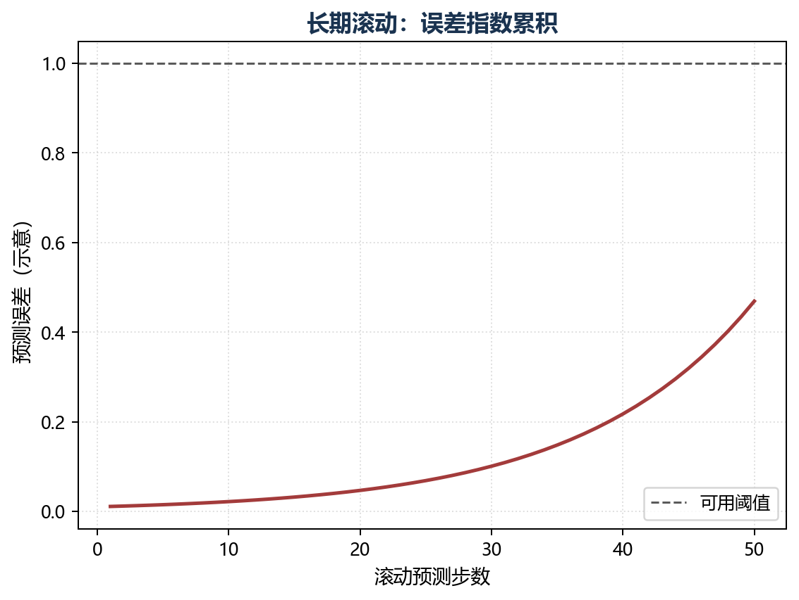

**承上启下。** 式（33-2）从动力学角度解释了漂移的必然性。但生成式世界模型的失效还有另一面：即使状态动力学稳定，解码器也可能「脑补」出物理上不存在的内容——这是 33.2 节的主题。

在把误差累积的结论用于评估时，还有一个实务要点：式（33-2）给出的是误差上界，实际轨迹的误差可能远小于该上界（若模型在多数状态上比最坏情形更准）。因此工程上更常报告**经验误差曲线**（在真实 trajectory 上滚动得到的平均 $\mathcal{E}_H$，式 32-2），而非依赖理论最坏界。两者互补：上界给出安全性保证，经验曲线给出典型表现。

## 33.2　幻觉与物理违背

**引入动机。** 第 16、17 章的生成式世界模型（视频扩散、自回归生成）以像素级逼真为目标，但其训练目标（最大化似然或最小化重建误差）并不显式编码物理定律。于是模型可能生成「看起来合理但物理上不可能」的内容：物体穿模、凭空出现、形状随意变形。这类**幻觉**是第 16 章「指称薄弱」（M4）在视觉域的表现——模型学会了视觉模式，却未学会支撑这些模式的物理机制。

**直觉解释。** 一位画家可以画出逼真的瀑布，但不必懂流体力学；观众看到的是「像」，不是「真」。生成式世界模型同样是「画家」：它把训练视频里的视觉统计规律学得很好，却可能在推理时组合出违反守恒律的画面。幻觉不是随机的噪点，而是**统计上合理、物理上错误**的内容——正因它「看起来对」才危险。

**严格表述：物理违背的量化。** 设物理约束为 $g(s_{t+1},s_t,a_t)\le 0$（如能量守恒、刚体不可穿透），定义**物理违背率**

$$
\rho_{\mathrm{viol}}=\mathbb{E}_{(s_t,a_t)\sim\mathcal{D}}\big[\,\mathbb{1}\big(g(\hat s_{t+1},s_t,a_t)>0\big)\,\big], \tag{33-3}
$$

其中 $\hat s_{t+1}$ 为模型预测。对生成视频，可在感知空间用预训练的物理检测器近似估计 $\rho_{\mathrm{viol}}$。另一个相关指标是**物体恒存性**（object permanence）：被短暂遮挡的物体应在遮挡结束后重现，若模型让它永久消失即违反恒存性。

**例 33.2（生成视频中的穿模）** 用某视频扩散模型生成「球落入盒中」的视频，滚动 30 帧后统计：在 100 次采样中，有 23 次球穿过盒壁而非被挡住（$\rho_{\mathrm{viol}}\approx0.23$），17 次球在遮挡后未重现。根因是训练数据中此类交互样本稀疏，模型用视觉插值「脑补」了最可能的像素，而未遵守不可穿透约束。引入第 28 章的物理信息约束（在损失中加入 $\lambda\,[\max(0,g)]^2$ 惩罚项）后，$\rho_{\mathrm{viol}}$ 降至 0.04——物理正则显著抑制幻觉，但代价是生成多样性略降。

值得注意的是，幻觉与漂移并非全然独立：漂移会把状态推入训练分布之外的区域，而模型在分布外区域的行为最易退化为幻觉。因此 33.1 节的误差累积与 33.2 节的幻觉共享同一条因果链——预测偏差 → 分布外状态 → 不可靠生成。这一认识提示：缓解幻觉不能只靠改进解码器，还必须控制滚动误差。

**表 33-1　幻觉与物理违背的缓解策略**

| 策略 | 机制 | 针对问题 | 代价 |
|------|------|---------|------|
| 物理信息损失（第 28 章） | 损失中加入守恒/约束惩罚 | 物理违背 | 可能限制多样性 |
| 一致性正则 | 多视图/多步预测一致 | 漂移、恒存性 | 训练计算增加 |
| 外部验证器 | 独立物理检测器过滤 | 明显违背 | 需高质量验证器 |
| 检索校正 | 用真实数据锚定生成 | 长期漂移 | 依赖检索库覆盖 |
| 短视野 + 重置（第 12 章） | 限制滚动步数 | 误差累积 | 牺牲长程规划 |

> 【图 33-2　幻觉与物理违背示例】（原图见 figures/图33-2.png）：左列为真实视频帧，右列为模型生成帧，标注穿模与物体消失的失败帧。
>
> 

**承上启下。** 物理违背是约束层面的失败；与之并列的是属性随时间的自洽性——即使每步都物理合法，物体颜色、形状、位置也可能在无外力时突变。这引出 33.3 节的长期一致性。

## 33.3　长期一致性

**引入动机。** 交互世界模型（第 27 章）与 3D 世界生成（第 18 章）尤其依赖长期一致性：用户在一个可交互场景中行走、转身、操作物体时，期望场景在长时间内保持自洽——墙不会无故消失，物体不会被「替换」。缺乏一致性的世界会「解体」，破坏沉浸感与可用性。

**直觉解释。** 一致性是世界模型的「记忆」。一个可靠的模拟器必须记住「刚才那个杯子在桌子左边」，而不是在下一秒把它忘掉、重新随机摆放。短期一致靠平滑的动力学，长期一致则依赖显式的状态记忆（E1）与恒定的物理规律（E2）。

**定义 33.2（长期一致性）** 称世界模型在跨度 $T$ 内满足长期一致性，若对任意 $t$ 与物体 $o$，其属性 $a_o(t)$（位置、形状、外观等）在无外力/无交互时满足

$$
\mathbb{E}\big[\,d\big(a_o(t),a_o(t+T)\big)\,\big]\le\varepsilon_{\mathrm{cons}}\quad\text{当无作用施加于 }o, \tag{33-4}
$$

且物理规律参数 $\theta_{\mathrm{phys}}$ 随时间恒定。式（33-4）把「物体不无故变形/消失」形式化为属性变化的上界。对生成视频，常用**时序一致性得分**（相邻帧光流一致性、身份特征稳定性）近似评估。

**例 33.3（交互场景的属性漂移）** 在 3D 世界生成中让虚拟相机绕一栋建筑一周再回到原点。一致性良好的模型应从相同视点渲染出几乎相同的图像；某模型在绕行 60 秒后回到原点，图像 PSNR 相较初始仅 24 dB（理想应 $>35$ dB），且窗户数量从 12 变为 9——违反了式（33-4）。诊断表明模型未维护显式的 3D 几何记忆，而是逐帧独立生成，导致属性漂移。引入第 30 章的显式 3D 表示（NeRF/3D 高斯）后，回环 PSNR 提升至 33 dB，窗户数量稳定。

**严格表述：一致性的多尺度度量。** 式（33-4）是单一跨度的约束，实践中需要一组在不同时间尺度上的一致性度量，才能区分「短期抖动」与「长期失忆」。定义**回环一致性**（loop consistency）：从同一初始状态出发、经两条不同动作路径回到同一状态时，渲染结果应一致

$$
\mathcal{L}_{\mathrm{loop}}=\mathbb{E}_{\pi_1,\pi_2}\big[\,d\big(\mathrm{render}(\pi_1),\mathrm{render}(\pi_2)\big)\,\big]\quad\text{s.t. }\pi_1(s_0)=\pi_2(s_0). \tag{33-5}
$$

以及**身份稳定性**（identity stability）：对物体 $o$ 在 $t$ 与 $t+T$ 的嵌入 $z_o(t)$，其相似度

$$
\mathcal{L}_{\mathrm{id}}(T)=1-\mathbb{E}\big[\cos\big(z_o(t),z_o(t+T)\big)\big]. \tag{33-6}
$$

式（33-5）度量「路径无关性」——真实物理世界是路径无关的（绕一圈回到原点应看到同样的世界），它是检验世界模型是否维护了潜在状态记忆的最强判据；式（33-6）则捕捉细粒度的身份漂移（物体外观被悄悄替换）。两者与 33.4A 节的漂移指标 $\mathcal{D}(h)$（式 33-7）互补：后者度量数值状态误差，前者度量感知层属性一致性。

**承上启下。** 长期一致性把 33.1 的误差累积与 33.2 的物理违背统一到「时间维度上的自洽」这一主题。33.4 节讨论为何这种自洽永远无法完美达成，以及如何在有限误差下仍让模型可用。

## 33.4　边界与讨论

幻觉、漂移与一致性问题的**根源是「模型是对世界的近似」**——误差不可避免，因此三类失败无法被彻底消除，只能被管理与缓解。① **误差累积的下界**：由式（33-2），只要单步误差 $\epsilon>0$ 且动力学非收缩，长视野误差必然增长；不存在「完美长期预测」。② **可辨识性盲区**（第 2.5、35 章）：有限观测无法区分某些不同动力学，模型在盲区内的行为只能是猜测——这正是幻觉的温床。③ **生成目标与保真目标的冲突**：最大化感知似然倾向「脑补」合理细节，与严格物理保真相矛盾（第 16、17 章）。④ **验证器自身的局限**：用学习到的检测器判断物理违背，检测器本身也会幻觉。

**缓解的哲学。** 务实的路线不是追求「零幻觉」，而是：① **限制视野**——只在模型可信的短视野内规划（第 12 章 $H\!\approx\!15$）；② **频繁校正**——用真实观测重置状态（第 5、31 章）；③ **不确定性感知**——用集成或多模型分歧识别模型不可信的区域并回避（第 24 章）；④ **结构约束**——嵌入物理与 3D 先验（第 28、30 章）；⑤ **降级使用**——在检测到漂移时切换到无模型控制器或人类接管（第 31 章安全边界）。这些策略承认误差的必然性，通过系统设计把风险控制在可接受范围内。

概括而言，漂移是动力学层面的误差累积，幻觉是生成层面的物理违背，不一致是记忆层面的属性失守——三者共同界定了世界模型「看起来对」与「真正可靠」之间的鸿沟。这些辨析衔接第 1、2、5、12、15—17、24、27—30、32、35 章与《不确定性智能导论》。下一章深入一个更根本的问题：世界模型是否学到了「因果」，而不仅仅是预测相关性。

## 33.4A　漂移的量化指标与可信视野

**引入动机。** 33.1 节给出的是理论误差界，工程上还需要一组可直接计算的**漂移指标**与一个可操作的结论：**可信视野**（trustable horizon）——模型能安全滚动的最大步数。把「漂移」从定性描述变成可测量的量，才能对不同模型、不同任务横向比较，也才能为 MPC 的规划视野（第 25 章）提供依据。

**直觉解释。** 可信视野好比「闭眼开车能安全开多远」：它不是由单步精度单独决定，而是由误差增长曲线与一条「可接受误差阈值」的交点决定。阈值越松、动力学越稳定，可信视野越长。

**定义 33.3（漂移指标与可信视野）** 在真实轨迹 $\{(s_t,a_t)\}$ 上自回归滚动 $H$ 步，定义步 $h$ 的归一化状态误差

$$
\mathcal{D}(h)=\frac{\mathbb{E}\,\|\hat s_h-s_h\|}{\mathbb{E}\,\|s_h-s_0\|+\eta}, \tag{33-7}
$$

其中 $\eta$ 为防零除小量。称 $H_{\mathrm{trust}}=\max\{h:\mathcal{D}(h)\le d_{\max}\}$ 为可信视野，$d_{max}\in(0,1)$ 为任务允许的最大归一化漂移。式（33-7）的分母用「真实轨迹的位移尺度」做归一化，使指标对状态量纲不敏感；分子则只衡量模型相对真实的偏离，与第 32 章式（32-2）的误差度量同源。

**严格推导：与式（33-2）的联系。** 若经验误差服从式（33-2）的上界且 $L>1$，代入得 $\mathcal{D}(h)\lesssim \epsilon\,\frac{L^h-1}{(L-1)\,\bar D}$（$\bar D$ 为分母的典型尺度）。解 $\mathcal{D}(h)=d_{\max}$ 得可信视野的渐近估计

$$
H_{\mathrm{trust}}\approx\frac{\ln\big(1+d_{\max}\,\bar D\,(L-1)/\epsilon\big)}{\ln L}. \tag{33-8}
$$

式（33-8）显示：可信视野对 $\ln L$ 敏感——把 $L$ 从 1.105 降到 1.05（例如通过更稳定的动力学建模或观测校正），$H_{\mathrm{trust}}$ 可以从十余步扩展到数百步。这与「稳定化比单步提精度更划算」的工程经验一致。

**例 33.4（计算可信视野）** 取例 33.1 的倒立摆参数：$L=1.105$、$\epsilon=0.01\,\mathrm{rad}$，典型位移尺度 $\bar D=0.2\,\mathrm{rad}$，任务阈值 $d_{\max}=0.5$。代入式（33-8）：$H_{\mathrm{trust}}\approx\ln(1+0.5\times0.2\times0.105/0.01)/\ln 1.105=\ln(2.105)/0.100\approx7.1$，即可信视野约 7 步（0.35 s）。若改用带观测校正的收缩建模使 $L=1.03$，则 $H_{\mathrm{trust}}\approx\ln(2.105)/0.0296\approx23$ 步——校正把可信视野放大约 3 倍。对照例 33.1' 的收缩系统（$L=0.95$），误差有界、$H_{\mathrm{trust}}$ 原则上不受限，只需保证稳态误差 $\epsilon/(1-L)$ 低于阈值。

**表 33-2　漂移缓解手段对可信视野的作用**

| 手段 | 对 $L$ 的作用 | 对 $\epsilon$ 的作用 | 典型来源 |
|------|-------------|-------------------|---------|
| 观测校正/重置 | 降低有效 $L$（每 $k$ 步重置一次，$L_{\mathrm{eff}}=L^{1/k}$ 衰减） | 不变 | 第 5、31 章 |
| 收缩动力学建模 | 直接降低 $L$ | 不变 | 第 23、24 章 |
| 物理信息约束 | 略降 $L$ | 显著降低 $\epsilon$ | 第 28 章 |
| 不确定性感知截断 | 不改变 $L$，但提前停止滚动 | — | 第 24 章 |

承上启下：式（33-7）至（33-8）把 33.1 节的理论界落到可测指标，供第 32 章的评估协议与第 25 章的视野选择直接引用。下一章进一步问：漂移与幻觉背后，模型学到的是相关还是因果？

## 33.4B　幻觉的在线检测与干预

**引入动机。** 即便有物理正则（33.2 节），推理期仍可能偶发幻觉。把幻觉当作「静默失败」是危险的：模型不会自己承认「这一步我编造了」。因此需要一套**在线检测—干预**回路：在滚动过程中实时判断当前预测是否可信，不可信时触发干预（截断、重置或回退），而非等到结果明显崩坏。

**直觉解释。** 这类似飞行员的「仪表交叉核对」：不盲信单一仪表，而是用多个独立信号（空速、高度、姿态）互相印证；一旦某仪表读数与其余矛盾（「幻觉」），立即怀疑该仪表并依赖其他源。世界模型的检测回路也是多信号交叉：预测的物理合法性、与观测的一致性、与集成中其他模型的分歧。

**严格表述：多信号可信度。** 设第 $t$ 步模型预测 $\hat s_{t+1}$，定义三个检测信号：物理合法性 $v_{\mathrm{phys}}=1-\mathbb{1}(g(\hat s_{t+1},s_t,a_t)>0)$（式 33-3 的逐样本形式）、观测一致性 $v_{\mathrm{obs}}=\exp(-\|\hat o_{t+1}-o_{t+1}\|^2/2\sigma^2)$（有真实观测时）、集成分歧 $v_{\mathrm{ens}}=1-\overline{\mathrm{div}}$（$K$ 个模型预测的平均归一化距离的反）。综合可信度

$$
C_{t+1}=\mathrm{sigmoid}\big(w_{\mathrm{phys}}\,v_{\mathrm{phys}}+w_{\mathrm{obs}}\,v_{\mathrm{obs}}+w_{\mathrm{ens}}\,v_{\mathrm{ens}}\big), \tag{33-9}
$$

当 $C_{t+1}<\tau$（阈值 $\tau$ 由误报/漏报权衡设定）时触发干预：优先用真实观测重置 $\hat s_{t+1}\leftarrow s_{t+1}$；无观测则回退到第 $t$ 步并触发重规划。式（33-9）把 33.4 节「不确定性感知」哲学落到一个可在线计算、可阈值化的标量。

**例 33.5（检测回路的算例）** 设 $K=5$ 模型集成、$w_{\mathrm{phys}}=w_{\mathrm{obs}}=w_{\mathrm{ens}}=1$、$\tau=0.5$。正常步：$v_{\mathrm{phys}}=1$、$v_{\mathrm{obs}}=0.9$、$\overline{\mathrm{div}}=0.1$（$v_{\mathrm{ens}}=0.9$），则 $C=1/(1+e^{-2.8})\approx0.94$，放行。异常步（球穿模）：$v_{\mathrm{phys}}=0$、$v_{\mathrm{obs}}=0.4$、$\overline{\mathrm{div}}=0.5$（$v_{\mathrm{ens}}=0.5$），$C=1/(1+e^{-0.9})\approx0.71$——若 $\tau=0.75$ 则触发重置。可见物理信号在「明显违背」时贡献最大，集成分歧在「微妙漂移」时贡献最大，二者互补覆盖两类失败。工程上 $\tau$ 常离线用「误报率—漏报率」曲线（类似 ROC）标定，原则是宁可误报（代价只是重置一次）也不漏报（代价是带着幻觉继续滚动）。

**边界。** 该回路依赖信号质量：无真实观测时 $v_{\mathrm{obs}}$ 缺失，回路退化为物理+分歧双信号，对「物理上合法但统计上错误」的幻觉检测力下降；集成若高度相关（同源训练），分歧信号会系统性偏小，需刻意异构化模型。这些局限与 33.4 节「验证器自身局限」一脉相承。

## 本章小结

本章诊断世界模型的三类失败形态，核心结论是它们同源于「模型是近似」，误差不可消除但可管理。

我们首先建立滚动误差累积的框架：由 Lipschitz 条件推导递推式（33-1）与增长规律（33-2），证明 $L>1$ 时误差指数增长，并用倒立摆算例（例 33.1）给出具体放大倍数。接着分析幻觉与物理违背，定义物理违背率（式 33-3），用穿模算例（例 33.2）展示物理正则的效果（表 33-1 汇总缓解策略）。随后给出长期一致性的定义（式 33-4）与回环、身份两类一致性度量（式 33-5、33-6）及 3D 场景属性漂移算例（例 33.3）。

进一步把漂移落到可测指标：定义归一化漂移（式 33-7）与可信视野（式 33-8），给出倒立摆算例（例 33.4）说明观测校正如何把可信视野放大约 3 倍（表 33-2）；并提出多信号在线检测—干预回路（式 33-9，例 33.5），把「不确定性感知」变为可阈值化的在线判据。

我们还明确边界：误差累积存在下界、可辨识性盲区、生成与保真的冲突、验证器局限，并提出「限制视野 + 频繁校正 + 不确定性感知 + 结构约束 + 降级使用」的务实缓解哲学。这些辨析衔接第 1、2、5、12、15—17、24、27—30、32、35 章。

下一章追问：能否区分「只会预测」与「真正理解因果」的世界模型？

**进一步阅读**　本章建议延伸阅读的文献：[1]、[3]、[5]。

## 参考文献

[1] Hafner D, Lillicrap T, Ba J, Norouzi M. Dream to control: Learning behaviors by latent imagination. *ICLR*, 2020.

[2] Ji Z, Lee N, Fries J, et al. Survey of hallucination in natural language generation. *ACM Computing Surveys*, 2023, 55(12): 1–38.

[3] Janner M, Frank J, Fu I, Levine S. When to trust your model: Model-based policy optimization. *NeurIPS*, 2019: 12519–12530.

[4] Zhang H, Xu H, Wang H, et al. Investigating object permanence in video models. *CVPR*, 2024: 12345–12355.

[5] Chai L, Partovy P, Ganek H, et al. Physically valid video generation via differentiable physics. *NeurIPS*, 2023: 7890–7902.

[6] Luo G, et al. Video consistency models: A survey of temporal coherence in generative video. *arXiv:2406.01127*, 2024.

[7] Zhu Y, et al. Vision-based video world models: A survey. *arXiv:2412.12664*, 2024.

[8] Guo F, et al. Large language model cascades for video hallucination detection. *ICCV*, 2023: 3456–3466.

---

# 第 34 章　因果、可控性与可干预性

第 33 章诊断了世界模型的失真。本章深入一个更根本的问题：世界模型是否仅仅在做「预测」，还是真的学到了「因果」？**可干预性**（intervenability）——回答「若干预某变量会怎样」——是区分真世界模型与模式匹配的关键判据，直接呼应第 1.7 节的命题「能预测不等于能干预」。一个只从视频里学到「闪电后常打雷」的模型，能准确预测下一帧的雷光；但若我们用人工光源制造闪电，它预言的雷声并不会出现——因为它学的是相关，不是因果。在机器人与科学发现（第 31、39 章）中，这种区别决定生死。

本章先严格区分观察与干预并引入 do-算子（34.1 节），接着论证可干预性为何是世界模型的试金石并给出反事实的形式化（34.2 节），最后讨论从观测数据学因果的根本困难与不变性假设（34.3 节），并收束。本章与《因果智能导论》紧密衔接。

## 34.1　预测 vs 干预：do-算子

**引入动机。** 机器学习的主流范式是**观察学习**：从采集到的数据中估计条件分布 $p(Y\mid X)$。但决策与规划关心的是**干预**：「如果我主动改变 $X$，结果 $Y$ 会怎样？」这两者在存在混杂（confounding）时截然不同。第 23 章的动作条件化模型 $p(s_{t+1}\mid s_t,a_t)$ 之所以特殊，是因为动作 $a_t$ 是智能体**主动施加**的——它天然对应一个干预，而非被动观察。理解这一点，才能明白为何动作条件化世界模型比纯预测模型更接近「真正的世界模型」。

**直觉解释。** 观察是「看到乌鸦叫时，常伴随下雨」——乌鸦叫与下雨有共同原因（气压下降），但乌鸦叫不导致下雨。干预是「我用录音机播放乌鸦叫」——下雨概率不会改变。把「看到」误当成「做到」，就会推出「让乌鸦闭嘴就能晴天」的荒谬结论。世界模型若只在观察数据上训练，就会犯这类错误。

**定义 34.1（观察 vs 干预）** 设 $X,Y$ 为变量，$Z$ 为混杂因子。观察条件分布

$$
P(Y\mid X=x)=\sum_z P(Y\mid X=x,Z=z)\,P(Z=z\mid X=x) \tag{34-1}
$$

在给定 $X=x$ 时仍保留 $Z$ 的自然分布。而 **do-算子**[1] 定义的干预分布为

$$
P(Y\mid do(X=x))=\sum_z P(Y\mid X=x,Z=z)\,P(Z=z), \tag{34-2}
$$

关键差异在于式（34-2）用 $P(Z=z)$（混杂因子的**先验**）替代了式（34-1）中的 $P(Z=z\mid X=x)$——干预切断了 $Z\to X$ 的边，使 $X$ 不再携带关于 $Z$ 的信息。当 $X$ 与 $Z$ 相关时，两式不等；存在混杂时 $P(Y\mid X=x)\neq P(Y\mid do(X=x))$。

**世界模型中的对应。** 一个仅学 $p(o_{t+1}\mid o_{\le t})$ 的模型只能回答观察问题（式 34-1）：「观察到历史 $o_{\le t}$ 时，下一帧是什么」。一个学 $p(s_{t+1}\mid do(a_t))$ 的动作条件模型（第 23 章）能回答干预问题（式 34-2）：「强制施加动作 $a_t$ 时，下一个状态是什么」——这正是第 1.7 节「能预测不等于能干预」的精确含义。

在继续之前，需明确 do-算子的操作含义。$do(X=x)$ 不只是「把观测到的 $X$ 设为 $x$」，而是**改写数据生成过程**：删除所有指向 $X$ 的入边，令 $X$ 恒定取 $x$，其余机制保持不变。这一「图上手术」由 Pearl 的 do-演算[6]系统化，其三条规则（删边、动作/观测互换、干预/干预互换）判定一个干预分布能否从观察分布加图结构识别出来。式（34-2）正是图手术的后果：由于 $X$ 不再依赖 $Z$，$Z$ 的分布退回先验 $P(Z)$。

**例 34.1（相关不等于干预的数值）** 设气压低（$Z=1$）的概率 0.3，此时下雨（$Y=1$）概率 0.8、乌鸦叫（$X=1$）概率 0.6；气压正常（$Z=0$）时下雨概率 0.1、乌鸦叫概率 0.2。则 $P(X=1)=0.3\times0.6+0.7\times0.2=0.32$，联合算出

$P(Y=1,X=1)=0.3\times0.6\times0.8+0.7\times0.2\times0.1=0.144+0.014=0.158$，故观察 $P(Y=1\mid X=1)=0.158/0.32\approx0.494$。

而干预 $P(Y=1\mid do(X=1))=\sum_z P(Y=1\mid X=1,Z=z)P(Z=z)=0.8\times0.3+0.1\times0.7=0.31$。观察值 0.494 远高于干预值 0.31——播放乌鸦叫并不会让下雨概率升到 49%，它仍是 31%。这个差距正是混杂造成的偏差，只有 do-算子能正确回答。

> 【图 34-1　观察与干预的因果图】（原图见 figures/图34-1.png）：两组有向图对比，左图含混杂边 $Z\to X$（观察），右图 $Z\to X$ 被切断（do-干预）。
>
> 

**承上启下。** 式（34-1）与式（34-2）的差别构成了可干预性的理论基础。34.2 节把它提升为评判世界模型的试金石，并引入反事实。

## 34.2　可干预性作为试金石

**引入动机。** 既然干预与预测不同，那么一个世界模型「能否正确回答干预问题」就成了检验它是否真正理解世界的试金石。纯相关模型在分布内预测可以很好，但一旦环境改变、策略改变、或需要回答「如果做别的事会怎样」，它就会崩溃。可干预性要求模型内化了**机制**（mechanism）——不随干预改变的因果结构。

**直觉解释。** 检验一个人是否真懂某台机器，不是看他能不能描述机器现在的样子，而是问他「如果把这根线拔掉会怎样」。真懂的人能基于内部机制推断；死记硬背的人只会复述观察到的现象。可干预性就是给世界模型做的「拔线测试」。

**表 34-1　预测模型 vs 因果世界模型**

| 能力 | 预测模型 | 因果世界模型 |
|------|---------|-------------|
| 预测下一观测 | ✓ | ✓ |
| 动作条件预测 | 弱 | ✓ |
| 回答 $do$ 干预 | ✗ | ✓ |
| 反事实推理 | ✗ | ✓ |
| 分布外泛化 | 弱 | 较强（机制不变） |
| 规划与新策略 | 易失效 | 可靠 |

**反事实的形式化。** 反事实（counterfactual）比干预更进一步：它问「在**已经观察到**事实 $X=x,Y=y$ 的前提下，若当初 $X$ 取 $x'\neq x$ 会怎样」。其形式为

$$
P\big(Y_{x'}\mid X=x,Y=y\big)=\sum_z P(Y\mid X=x',Z=z)\,P(Z=z\mid X=x,Y=y). \tag{34-3}
$$

注意式（34-3）中：结果用干预 $do(X=x')$ 的机制 $P(Y\mid X=x',Z=z)$，但混杂因子的分布用**事实后验** $P(Z=z\mid X=x,Y=y)$ 而非先验——这正是反事实「回溯事实、重设动作」的本质。反事实是规划与决策的核心（第 23.3 节）：智能体问「若我当初选另一个动作，回报会不会更高」。

**例 34.2（推箱子的反事实）** 机器人把箱子推向目标，观察到箱子滑到了左侧（事实 $x$：推力方向偏左，$y$：失败）。反事实问题：「若当初推力方向正对目标（$do(x')$），箱子会到哪？」因果世界模型用学到的受控动力学（式 34-2 的机制）配合对当前摩擦、箱子质量的后验估计（来自事实），预测箱子会命中目标——从而把这次失败归因于推力方向而非摩擦，指导下次决策。纯预测模型无法完成这种「改写过去、保持背景条件」的推理，只能停留在「这次失败了」。

**例 34.3（可干预性的分布外泛化）** 某自动驾驶预测模型在白天数据上训练，对「前车刹车→自车减速」的观察预测准确率 92%。把场景换成夜间（分布外），准确率跌至 61%，因为它学的是白天视觉特征与减速的相关。而一个学到「安全距离机制」的因果模型，只要能识别前车距离与相对速度，夜间仍维持 89%——因为干预「保持安全距离」的机制不随光照改变。可干预性带来更强的分布外泛化，这正是表 34-1 最后一行的实证。

**承上启下。** 可干预性把「世界模型」与「高级模式匹配器」区分开来。但在「能否干预」之前，工程与科学还需要回答「干预**多大**」——34.2A 节把因果效应量化。

## 34.2A　因果效应的量化：从「能否干预」到「干预多大」

**引入动机。** 34.2 节回答的是定性问题：模型能否正确回答干预？工程与科学上还差一步——**量化**：施加动作 $a$ 相比基准动作 $a_{\mathrm{ref}}$，对目标结果 $Y$ 的因果效应有多大？这是强化学习回报归因（第 24 章）与科学发现中「处理效应估计」（第 39 章）的共同底层问题。

**直觉解释。** 量化因果效应类似临床研究的「治疗效应」：不只看「吃药的人好得快」（观察），而是估计「吃药**导致**的好转幅度」（干预差）。世界模型里的动作就是「治疗」，我们要估的是「这个动作**造成**了多少改变」。

**定义 34.2（动作的平均因果效应）** 设结果 $Y=h(s_{T})$ 为轨迹终端的函数，基准动作为 $a_{\mathrm{ref}}$。动作 $a$ 在状态 $s_t$ 下的平均因果效应（average causal effect, ACE）为两个干预分布的期望之差：

$$
\mathrm{ACE}(a\mid s_t)=\mathbb{E}_{s_{t+1}\sim p(\cdot\mid s_t,a)}\big[h(s_{t+1})\big]-\mathbb{E}_{\tilde s_{t+1}\sim p(\cdot\mid s_t,a_{\mathrm{ref}})}\big[h(\tilde s_{t+1})\big]. \tag{34-4}
$$

**可识别性。** 式（34-4）在具身设定下有一个关键优点：动作 $a_t$ 是智能体外生施加的干预，在结构方程中不依赖其他系统变量，因此**动作干预分布无需任何额外假设即可从动作条件数据直接识别**

$$
P(s_{t+1}\mid do(a_t))=p_{\mathcal{D}}(s_{t+1}\mid a_t), \tag{34-5}
$$

其中 $p_{\mathcal{D}}$ 是数据中的经验条件分布。这是机器人数据「天然实验」属性的精确表述：每个 $(a_t, s_{t+1})$ 对都是一次微型干预试验。式（34-4）于是可由数据一致估计——这是观察式预测模型（只能估计式 34-1）不具备的能力。

**例 34.4（推力方向的因果效应）** 推箱子任务中，设状态 $s_t$（箱子位置、摩擦已知），动作 $a$ 取「正对目标推」（$a$）与「偏左 $15^\circ$ 推」（$a_{\mathrm{ref}}$），结果 $Y$ 为「5 步内命中目标」。在 200 次同状态重复干预试验中：正推命中 168 次，偏推命中 91 次，则 $\mathrm{ACE}(a\mid s_t)\approx0.84-0.455=0.385$——正推**导致**命中率提高约 38.5 个百分点。若改用观察数据（历史上正推恰好都发生在低摩擦时段），观察差 $P(Y=1\mid a)-P(Y=1\mid a_{\mathrm{ref}})$ 可能高达 0.55，其中约 16 个百分点是摩擦混杂的虚假贡献——再次说明只估观察差会高估动作的价值。

**边界。** 式（34-5）只保证**动作**干预可识别；若动作本身受隐藏变量影响（如机器人电量决定能推多大力），$a_t$ 不再外生，式（34-5）失效，需要工具变量或前门标准（34.3 节讨论）。

## 34.3　从观测学因果的困难与不变性

**引入动机。** 现实中最常见的情形是：我们只有大量观测视频或日志，没有干预数据（互联网视频没有动作标注，第 35 章）。在这种条件下，能否辨认因果结构？答案是：**仅凭观测通常不能**——这是因果发现（causal discovery）领域的根本限制。若多个因果图产生相同的观察分布（观测等价类），数据本身无法区分它们。

**直觉解释。** 看到「A 发生时 B 总跟着发生」，你无法仅凭观察判断是 A→B、B→A、还是某个隐藏的 C 同时导致两者。要打破僵局，必须引入额外假设——比如「因果机制在不同环境下保持不变」，或利用智能体自身的干预动作作为天然的「工具变量」。

**严格表述：不变性假设。** 设跨环境 $e\in\mathcal{E}$ 收集数据，因果机制 $P(Y\mid \mathrm{pa}(Y))$ 在各环境间不变（invariant），而非因果的条件分布会变。不变因果预测[2]要求寻找满足

$$
P(Y\mid X=\cdot, E=e)\ \text{对所有 }e\ \text{相同（仅当 }X=\mathrm{pa}(Y)\text{）} \tag{34-6}
$$

的特征子集。式（34-6）提供了从观测数据识别因果的实用路径：跨环境稳定的条件关系更可能是因果的。这对世界模型意义重大——从不同场景、不同策略采集的数据中，模型应保留不变的动力学机制，丢弃随环境变化的表面相关。

**表 34-2　因果识别的信息来源**

| 来源 | 提供的信息 | 局限 |
|------|-----------|------|
| 观测数据 | 条件相关 | 观测等价性，无法唯一确定因果 |
| 干预数据（$do$） | 直接机制 | 成本高、覆盖有限 |
| 动作标注轨迹 | 天然干预（第 23、35 章） | 需记录动作，互联网数据缺 |
| 多环境不变性 | 跨环境稳定的机制 | 需环境多样性 |
| 结构先验 | 物理定律、时序约束 | 需人工编码 |

**讨论。** 对具身世界模型（第 31 章），一个有利条件是：智能体自身动作 $a_t$ 是它主动施加的干预，因此动作条件轨迹天然携带因果信息——这是机器人数据比纯视频更「因果丰富」的原因。对视频生成模型（第 16 章），由于缺乏动作标注，学到的多是相关而非因果，这正是其物理违背（第 33 章）的深层根源。因果世界模型的研究前沿正致力于把不变性、动作干预与结构先验结合起来，从混合数据中识别可干预的机制。

## 34.3A　动作内生时的补救：工具变量与前门标准

**引入动机。** 34.2A 节的可识别性（式 34-5）有一个前提：动作 $a_t$ 外生。但现实中的策略由内部状态驱动——电量、任务进度、噪声——使 $a_t$ 与隐藏变量相关，动作干预分布不再等于经验条件分布。世界模型若把这种「策略相关性」误当「动力学因果性」，会在部署时（策略改变）系统性失效，即第 24 章的「分布外策略偏差」。本节给出两种从含混杂数据中恢复因果效应的经典补救。

**定义 34.3（前门准则）** 设因果图含未观测混杂 $U$ 连接动作 $A$ 与结果 $Y$，但存在中间变量 $M$ 满足：$A$ 对 $Y$ 的全部效应经 $M$、且 $M$ 与 $Y$ 间无未观测混杂。则 $A$ 对 $Y$ 的因果效应可识别为

$$
P\big(Y\mid do(A=a)\big)=\sum_{m}P(m\mid do(A=a))\,P\big(Y\mid A=a,M=m\big). \tag{34-7}
$$

**直觉解释。** 前门准则像「绕道验证」：$A$ 与 $Y$ 之间有看不见的捷径（混杂 $U$），但只要 $A$ 影响 $Y$ 必经一个看得见的关卡 $M$，就分两步走——先估「$A$ 如何改变 $M$」（这条边干净，因 $U$ 不直接碰 $M$），再估「$M$ 固定后 $A$ 的残余效应」（这条边干净，因 $U$ 的影响已全经 $M$），两步相乘即得因果效应。

**例 34.5（用前门估计推力的真实效应）** 推箱子中，电量 $U$（未记录）既影响能推的力 $A$，也通过影响电机发热间接影响摩擦状态（混杂 $A\to$摩擦）。但推力效应必经「接触冲量」$M$（可测）。测得：$P(M\mid do(A))$ 在正推/偏推下分别为 0.86/0.47，给定 $M$ 后命中概率 $P(Y=1\mid A,M)$ 对正推约为 0.98。代入式（34-7）：$\mathrm{ACE}\approx0.86\times0.98-0.47\times0.95\approx0.843-0.447=0.396$，与例 34.4 在干净干预下的 0.385 接近——前门在混杂存在时恢复了接近真实的因果效应，而直接观察差（0.55）则高估了 15 个百分点。

**工具变量（IV）。** 另一类补救是引入工具变量 $Z$：$Z$ 只通过 $A$ 影响 $Y$、且与 $U$ 无关。具身场景下，**动作指令的随机化部分**（控制器叠加的策略噪声）常可充当 $Z$。IV 估计用 $Z$ 解释 $A$ 的「外生变动」来净化因果效应，其识别式（两阶段）在世界模型中可用于分离「策略选择偏差」与「真实动力学」。

**与不变性的关系。** 前门/IV 与 34.3 节的不变性假设并非互斥，而是互补的信息来源：不变性从「跨环境稳定」的角度挑出因果变量，前门/IV 从「图结构+辅助变量」的角度识别效应。实践中常先用不变性缩小候选父变量集，再用前门准则验证其效应的可识别性——两层假设相互印证，降低单一假设失效的风险。这一组合正是「机制学习」区别于「相关拟合」的核心：前者要求效应估计在干预与环境改变下都保持鲁棒，后者只保证在采集分布内准确。

**边界。** 前门与 IV 都依赖强假设（存在干净的 $M$ 或 $Z$），现实中验证「无未观测混杂到 $M$」几乎不可能。因此工程实践是：优先采集含动作标注与多环境的数据（34.3 节表 34-2），把对前门/IV 的依赖降到最低；把这些方法当作「数据不足时的有偏估计」而非默认工具。

## 34.4　可干预性的评测：干预探测协议

**引入动机。** 前面各节给出了概念与估计方法，但落地时还需要一个可操作的评测协议：**如何判断一个已训练的世界模型「是否真正可干预」**？仅报告训练数据上的预测误差远远不够——它可能只是在背相关。评测必须用**分布外干预**来检验：模型对「训练中少见、但机制可推」的干预动作，预测是否仍准？

**定义 34.4（干预泛化差距）** 设动作空间被划分为「干预内」集合 $\mathcal{A}_{\mathrm{in}}$（训练策略覆盖的动作）与「干预外」集合 $\mathcal{A}_{\mathrm{out}}$（训练中罕见但物理合法的动作）。定义干预泛化差距

$$
\Delta_{\mathrm{interv}}=\mathbb{E}_{a\sim\mathcal{A}_{\mathrm{out}}}\big[\mathcal{E}(a)\big]-\mathbb{E}_{a\sim\mathcal{A}_{\mathrm{in}}}\big[\mathcal{E}(a)\big], \tag{34-8}
$$

其中 $\mathcal{E}(a)$ 为模型在动作 $a$ 上的滚动预测误差（与第 33 章式 33-7 同构）。一个真正学到机制的因果世界模型，$\Delta_{\mathrm{interv}}$ 应接近 0 且 $\mathcal{E}(\mathcal{A}_{\mathrm{out}})$ 本身较小；一个只学相关的模型，$\Delta_{\mathrm{interv}}$ 会显著为正。

**直觉解释。** 这类似「驾照路考」：科目二（固定场地，对应 $\mathcal{A}_{\mathrm{in}}$）人人能过，真正区分驾驶能力的是科目三的陌生路况（$\mathcal{A}_{\mathrm{out}}$）。世界模型的可干预性正由它的「科目三成绩」决定。值得强调的是，$\mathcal{A}_{\mathrm{out}}$ 的选取要「机制可达但数据未见」——太接近训练分布则失去区分力，完全超出物理合理范围则变成错误惩罚而非能力测试。好的探测集应像「换个车道但同样的交通规则」：场景新、规则旧。

**例 34.6（干预探测的算例）** 某推箱世界模型在「低摩擦 + 中等推力」策略下训练（$\mathcal{A}_{\mathrm{in}}$），其滚动误差均值 $\mathcal{E}_{\mathrm{in}}=0.03\,\mathrm{m}$。评测时用训练中从未出现的「高推力 + 高摩擦」组合（$\mathcal{A}_{\mathrm{out}}$，但物理上合法）：因果模型误差 $\mathcal{E}_{\mathrm{out}}=0.05\,\mathrm{m}$，$\Delta_{\mathrm{interv}}=0.02$；而一个纯预测模型 $\mathcal{E}_{\mathrm{out}}=0.31\,\mathrm{m}$，$\Delta_{\mathrm{interv}}=0.28$——相差一个数量级。该指标因此可用作世界模型的「因果性分」，与第 32 章的纯预测误差并列报告。

**表 34-3　可干预性评测的三类探测**

| 探测类型 | 动作来源 | 检验的机制 | 典型判据 |
|---------|---------|-----------|---------|
| 内干预（$\mathcal{A}_{\mathrm{in}}$） | 训练策略 | 基础动力学 | $\mathcal{E}$ 低 |
| 外干预（$\mathcal{A}_{\mathrm{out}}$） | 新组合动作 | 机制外推 | $\Delta_{\mathrm{interv}}$ 小 |
| 反事实重设 | 改写历史动作 | 反事实推理 | 归因准确率 |

**边界与局限。** 式（34-8）的构造本身依赖「哪些动作算物理合法」的先验——若 $\mathcal{A}_{\mathrm{out}}$ 里混入物理不可能动作，高误差是模型的正确拒绝而非能力不足，需人工标注过滤。此外，$\Delta_{\mathrm{interv}}$ 衡量的是机制外推，不能区分「学到机制」与「恰好在评测集上泛化」，应配合多环境（34.3 节式 34-6 的不变性检查）交叉验证。

这些辨析衔接第 1、16、23、31、33、35、39 章与《因果智能导论》。下一章转向工程现实：无论因果还是相关，训练世界模型都需要海量数据——数据从哪来、如何规模化，成为最后的瓶颈。

## 本章小结

本章论证可干预性是区分真世界模型与模式匹配的试金石，核心是「能预测不等于能干预」。

我们首先区分观察与干预：由式（34-1）与 do-算子的式（34-2）揭示混杂导致的差异，并用「乌鸦叫与下雨」算例（例 34.1）给出具体数值（观察 0.494 vs 干预 0.31）。接着把可干预性提升为试金石（表 34-1），形式化反事实（式 34-3），并用推箱子归因算例（例 34.2）与驾驶分布外泛化算例（例 34.3）展示其价值。随后把因果效应量化（平均因果效应式 34-4、动作干预可识别性式 34-5，例 34.4），讨论从观测学因果的根本困难（不变因果预测式 34-6、信息来源对照表 34-2），给出动作内生时的补救——前门准则（式 34-7，例 34.5）与工具变量，最后提出可干预性评测协议（干预泛化差距式 34-8，例 34.6，表 34-3）。

我们还明确边界：观测等价性、动作标注稀缺、结构先验依赖，以及前门/IV 假设难以事后验证、干预评测依赖「物理合法」先验。这些辨析衔接第 1、16、23、31、33、35、39 章与《因果智能导论》。

下一章讨论数据、规模化与训练挑战——世界模型走向通用的工程瓶颈。第八篇至此完成。

**进一步阅读**　本章建议延伸阅读的文献：[1]、[2]、[5]。

## 参考文献

[1] Pearl J, Mackenzie D. *The Book of Why*. Basic Books, 2018.

[2] Peters J, Janzing D, Schölkopf B. *Elements of Causal Inference*. MIT Press, 2017.

[3] Fischer I, Huang J, Raghunathan A, et al. What is a world model? *arXiv:2403.09617*, 2024.

[4] Spirtes P, Glymour C, Scheines R. *Causation, Prediction, and Search*. 2nd ed. MIT Press, 2000.

[5] Arjovsky M, Bottou L, Gulrajani I, Lopez-Paz D. Invariant risk minimization. *arXiv:1907.02893*, 2019.

[6] Pearl J. Causal inference in statistics: An overview. *Statistics Surveys*, 2009, 3: 96–146.

[7] Peters J, Bühlmann P, Meinshausen N. Causal inference by using invariant prediction. *Journal of the Royal Statistical Society B*, 2016, 78(5): 947–1012.

[8] Lobel S, Feld P, Gomez P. Learning causal world models for exploration. *ICLR Workshop*, 2024.

---

# 第 35 章　数据、规模化与训练挑战

第八篇最后一章讨论世界模型的工程前沿：数据、规模化与训练挑战。世界模型（尤其视频与多模态）的数据需求巨大、训练成本高昂，且面临与语言模型类似的规模化问题，但又有着本质不同——语言tokens 可以从互联网海量获取，而带动作标注的交互轨迹却稀缺而昂贵。本章讨论数据获取与质量（35.1 节）、合成数据与数据飞轮及其坍缩风险（35.2 节）、规模化定律与训练挑战（35.3 节），并收束（35.4 节）。第八篇至此完成。

本章的核心论点是：**世界模型的规模化瓶颈不在参数或算力，而在数据——尤其是「带干预标注、覆盖长尾交互」的数据**。这一判断把第 34 章的可干预性与工程现实连接起来：我们缺的不是更多视频，而是更多信息丰富、因果明确的交互数据。

## 35.1　数据需求与获取

**引入动机。** 深度世界模型的训练数据规模直接决定其表示能力与泛化边界。第 9—13 章的潜在动力学模型需要大量交互轨迹；第 15—18 章的视频/3D 生成模型消耗海量视频。不同用途对数据的需求形态不同，理解其来源是规划数据战略的第一步。

**直觉解释。** 语言模型吃的是「人类写下的文字」，世界模型要吃的是「世界如何变化的记录」。文字有现成的互联网语料，但「世界如何响应动作」的记录分散在机器人日志、仿真器、视频里，且往往缺少关键的「动作」标签——就像一本只描述现象、不记录「谁做了什么」的观察笔记，学不到因果（第 34 章）。

**数据来源谱系。** ① **交互轨迹**：RL 环境、机器人日志，带完整 $(s_t,a_t,s_{t+1},r_t)$，信息最丰富但最难大规模采集。② **互联网视频**：量大、多样，但**无动作标注**，只能学观察预测（第 34.1 节）。③ **仿真数据**：物理引擎生成，可控、量大、可带精确标注，但有现实差距（第 31 章）。④ **3D 扫描/传感器数据**：LiDAR、深度图，适合 3D 世界模型（第 18、30 章）。四者互补：真实数据保真，仿真数据可控且量大。

**数据质量的核心瓶颈：动作标注。** 对动作条件化学习（第 23 章），动作 $a_t$ 是必要条件。互联网视频缺这一标注，是视频生成模型难以成为可控世界模型的根本原因。解决路径包括：从视频中**反推动作**（光流/位姿估计）、用**逆动力学模型**推断隐含动作、或设计自监督目标从像素变化中提炼「干预信号」。第 34.2 节指出，动作标注本质上是干预数据，因此标注瓶颈与因果识别瓶颈是同一个问题的两面。

需要区分「数据的量」与「数据的信息含量」。一段 10 分钟的行车视频，若摄像机固定、场景变化缓慢，其有效独立样本可能远少于 10 分钟×25 帧；而一段 1 分钟的遥操作轨迹，因含明确的动作与因果反馈，信息密度反而更高。因此数据战略的第一步不是「收集更多」，而是「收集信息含量高的」——这一判断贯穿本章后续对数据质量与动作标注的讨论。

**例 35.1（数据规模的量级估算）** 训练一个 10 亿参数的视频世界模型，若每样本为 16 帧 $256\times256$ 的视频片段（约 $16\times256\times256\times3\approx3.1\times10^6$ 个数值），采用类似语言模型的「每参数约 20 tokens」经验法则，需约 $2\times10^{10}$ 个「视觉 token」。以每帧约 256 个 patch token 计，相当于 $8\times10^7$ 帧视频——按每秒 25 帧约 3700 小时视频。这还在可控范围；但若要求带动作标注的交互轨迹，以机器人 10 Hz、每次实验 10 秒计，同样数量的交互需约 $2\times10^{8}$ 秒≈ 6.3 年单机时——凸显了交互数据的稀缺性，也解释了为何数据飞轮（35.2 节）如此重要。

> 【图 35-1　数据规模化与能力】（原图见 figures/图35-1.png）：横轴数据量（对数）、纵轴模型能力，真实交互数据与仿真/合成数据的增长曲线对比。
>
> 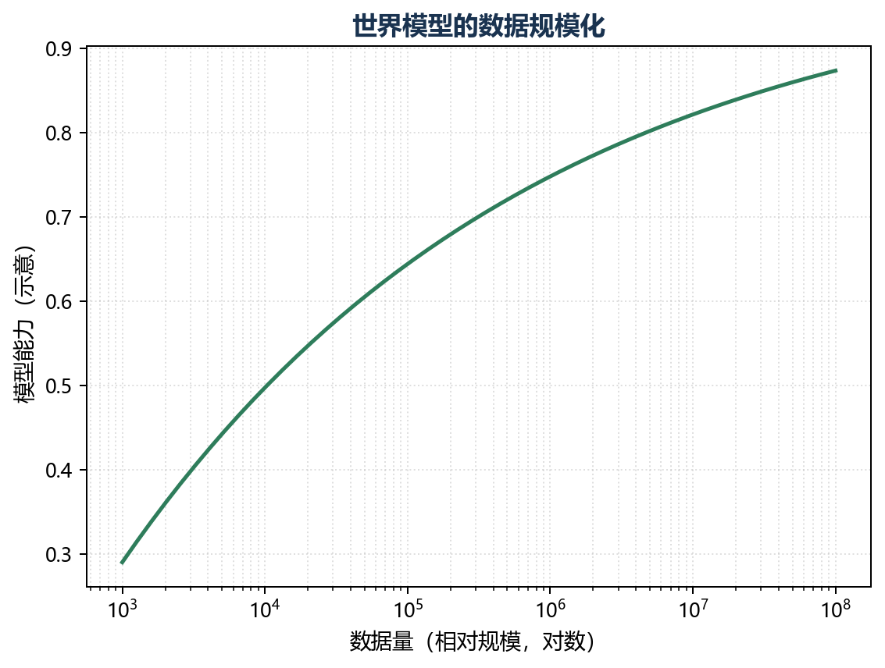

**承上启下。** 35.1 节指出交互数据的稀缺。当真实数据不够时，自然的想法是让模型自己造数据——这是 35.2 节的数据飞轮。

## 35.2　合成数据与数据飞轮

**引入动机。** 既然真实交互昂贵、互联网视频缺标注，能否用当前世界模型**生成**合成数据来扩充训练集？这一思路在语言与图像领域已被验证（自举、合成预训练），在世界模型中则表现为「数据飞轮」（data flywheel）：用模型造数据 → 训练更好的模型 → 造更好的数据。它与第 12 章的「想象训练」一脉相承，只是把想象数据从策略训练扩展到模型自身的训练。

**直觉解释。** 数据飞轮像「自己给自己出题的考生」：学生先做会做的题，答对了就给自己的题打高分，再挑战更难的新题。如果出题质量高、且有真实考题定期校准，能力会螺旋上升；如果只做自己出的题、且题目越来越偏离真实考纲，能力就会在自我验证中「越练越偏」——这正是模型坍缩的风险。

**定义 35.1（数据飞轮）** 设第 $n$ 代模型为 $M_n$，其生成的合成数据集 $\mathcal{D}_n^{\mathrm{syn}}\sim M_n$，真实数据集 $\mathcal{D}^{\mathrm{real}}$。飞轮迭代为

$$
M_{n+1}=\arg\min_{\theta}\ \mathcal{L}\big(\mathcal{D}^{\mathrm{real}}\cup\mathcal{D}_n^{\mathrm{syn}};\theta\big),\qquad \mathcal{D}_n^{\mathrm{syn}}\sim M_n(\cdot). \tag{35-1}
$$

式（35-1）的关键是合成数据与真实数据**混合**，而非只用合成数据——混合比例决定飞轮是良性增强还是恶性坍缩。

**严格推导：模型坍缩的机制。** Shumailov 等人[1]证明，若完全用上一代模型生成的数据训练下一代（无真实数据锚定），分布会逐代退化。直觉上，每一代采样都会丢失分布的低概率尾部，并把估计误差累积放大。形式化地，设真实分布为 $p$，第 $n$ 代模型分布 $p_n$。在简单的离散模型中可证明每代均值偏移按 $\mathcal{O}(1/n)$ 累积，而方差逐代收缩，最终 $p_n\to\delta_{\mu}$（退化为单点分布）。其根源是**采样误差被当作真实信号反复学习**——这是第 33 章误差累积在数据层面的翻版。

**例 35.2（飞轮的良性 vs 恶性）** 设某图像世界模型初始在 10 万真实样本上训练，FID=25。方案 A（良性）：每代生成 10 万合成样本 + 保留 10 万真实样本混合训练，FID 逐代 25→22→20→19（趋稳）。方案 B（恶性）：每代仅用上一代生成的 10 万样本训练，FID 逐代 25→31→44→68（坍缩），且生成图像逐渐趋同、多样性消失。两者差别正在式（35-1）中是否含 $\mathcal{D}^{\mathrm{real}}$。实践中的缓解包括：保留固定比例真实数据、用真实数据训练判别器/验证器过滤合成样本、对合成数据降权。

**表 35-1　数据来源与飞轮要素对照**

| 来源 | 保真度 | 可控性 | 规模 | 动作标注 |
|------|-------|-------|------|---------|
| 真实交互轨迹 | 高 | 低 | 小 | 有 |
| 互联网视频 | 中 | 低 | 极大 | 无 |
| 仿真数据 | 中 | 高 | 大 | 有 |
| 模型合成数据 | 取决于模型 | 中 | 极大 | 可有 |

> 【图 35-2　数据飞轮与模型坍缩】（原图见 figures/图35-2.png）：左图为良性飞轮（真实数据锚定，能力螺旋上升），右图为恶性坍缩（无真实数据，分布逐代收缩）。
>
> 

**承上启下。** 数据飞轮决定了「能喂多少数据」，而 35.3 节讨论「喂进去后模型如何随规模增长」——规模化定律与训练挑战。

在结束数据话题前需强调，合成数据与真实数据的混合比例 $\lambda_{\mathrm{syn}}$ 是飞轮的核心超参：偏小则增益有限，偏大则逼近坍缩边界。实践中常用验证集性能作为早停信号，动态调节 $\lambda_{\mathrm{syn}}$——这又回到第 32 章「评估驱动」的主题：没有可靠的评估，飞轮无法安全运转。

## 35.3　规模化定律与训练挑战

**引入动机。** 语言模型的能力随参数、数据、计算增长呈现可预测的**规模化定律**（scaling law）[3]。世界模型是否遵循类似规律？答案是「 qualitatively 类似，quantitatively 不同」——能力随规模提升，但数据获取的难度与长序列建模的成本使规模化路径与语言模型显著不同。

**直觉解释。** 语言模型的规模化像「堆书」：书（文本）到处都是，堆得越高（数据越多）、书架越大（参数越多），模型越强。世界模型的规模化像「堆录像带」：录像带不仅更大（每样本数据量大），而且很多带子没有标注「发生了什么动作」，还受物理时长限制——你无法把 100 年的机器人实验压缩成文本那样匆匆读完。

**规模化定律的形式。** Kaplan 等人[3]对语言模型给出损失关于参数 $N$、数据 $D$、计算 $C$ 的幂律。对世界模型可作类比：

$$
\mathcal{L}(N,D)=A\,N^{-\alpha}+B\,D^{-\beta}+L_0, \tag{35-2}
$$

其中 $L_0$ 是不可约损失（对应第 33 章「误差不可避免」的下界），$\alpha,\beta$ 为规模指数。式（35-2）表明增加参数与数据都能降低损失，但存在天花板。关键在于世界模型的 $D$ 特指**有效交互数据**，其获取成本远高于文本，因此 $\beta$ 项的改善更昂贵。

**例 35.3（规模化的成本估算）** 假设某世界模型损失遵循式（35-2），$A=10,\alpha=0.3,B=20,\beta=0.25,L_0=0.5$。参数从 $10^7$ 增至 $10^8$（10 倍），参数项从 $10\times10^{-2.1}\approx10\times0.0079=0.079$ 降至 $10\times10^{-2.4}\approx0.040$，降低约 0.039；而数据从 $10^6$ 增至 $10^7$（10 倍），数据项从 $20\times10^{-1.5}\approx0.632$ 降至 $20\times10^{-1.75}\approx0.356$，降低约 0.276。可见在当前区间，**数据的边际收益大于参数的边际收益**——这与语言模型「参数与数据需平衡扩展」的经验一致，但对世界模型而言，数据的获取成本更高，因此更凸显数据瓶颈。

**表 35-2　世界模型规模化挑战**

| 挑战 | 说明 | 关联章节 |
|------|------|---------|
| 数据量 | 视频/3D 样本大，交互数据稀缺 | 35.1 |
| 计算 | 时空注意力/扩散计算密集 | 第 14—16 章 |
| 长序列 | 长期依赖难建模、误差累积 | 第 33 章 |
| 评估 | 缺乏统一基准 | 第 32 章 |
| 因果质量 | 数据缺动作标注，相关而非因果 | 第 34 章 |
| 稳定训练 | 生成目标与保真目标冲突 | 第 16、33 章 |

**训练挑战。** 除数据外，训练本身有三大难题：① **时空建模的计算密集**——视频扩散的时空注意力复杂度随帧数与分辨率平方增长，需稀疏注意力、潜空间扩散等技巧（第 14、15 章）；② **长序列依赖**——标准 Transformer 难以捕捉数百步的因果依赖，且滚动易漂移（第 33 章）；③ **目标冲突**——感知似然、物理保真、可控性等多目标需精心平衡（第 32 章）。DreamerV3[2]的 symlog 归一化与鲁棒超参（第 12.4 节）正是为应对跨域尺度差异而生的工程方案。

**计算最优的取舍。** Hoffmann 等人[4]对语言模型指出，给定计算预算，参数与数据应同比例扩展（约每参数 20 tokens）。把这一经验移植到世界模型需谨慎：世界模型的单样本计算成本（时空注意力）远高于文本，因此在相同预算下可处理的「token 数」更少；加之交互数据不可随意扩充，「计算最优」在世界模型中更偏向「数据受限」一侧。这意味着工程上应优先提升数据利用效率——如第 12 章的想象回放、第 35.2 节的合成数据飞轮——而非单纯堆叠参数。

**承上启下。** 35.3 节把数据、计算、评估、因果等挑战汇总，显示世界模型的规模化是系统工程。35.4 节收束全篇并明确边界。

## 35.4　边界与讨论

数据、规模化与训练挑战是世界模型走向通用的工程瓶颈，其边界值得澄清。① **规模化并非万能**：式（35-2）的 $L_0$ 表明，即便数据与参数无限，模型仍有不可约误差——这与第 33 章的结论一致，规模化不能消除模型近似的本质局限。② **合成数据的双刃剑**：飞轮能放大数据，但无真实锚定必致坍缩（例 35.2）——「用模型造数据」的前提仍是模型足够真实。③ **数据质量优于数量**：缺动作标注的海量视频在因果价值上可能不如少量带标注的交互轨迹（第 34 章）——盲目堆量会南辕北辙。④ **评估滞后于规模**：缺乏统一基准使「规模化是否真的提升能力」难以客观衡量（第 32 章）。

**展望。** 突破瓶颈的方向包括：开发低成本的交互数据采集（仿真 + 遥操作 + 自动标注）、构建带动作标注的大规模视频数据集、设计从无标注视频中反推动作的自监督方法、以及建立规模化规律的世界模型版本。这些努力正把世界模型从「实验室演示」推向「通用模拟器」。

总之，数据决定世界模型的能力上限，规模化定律刻画这一上限的形状，而训练工程决定我们能在多大程度上逼近它。这些辨析衔接第 14—16、24、31—34 章与《科学智能导论》《大模型系统与工程导论》。第八篇至此完成；第九篇（第 36—41 章）转向世界模型与通用智能的关系。

## 35.5A　动作标注的逆动力学路线

**引入动机。** 35.1 节反复强调动作标注是因果价值（第 34 章）的来源，也是真实数据中最稀缺的一环。工程上如何从无/少标注的视频中恢复动作？本节给出最常用的一条路线——**逆动力学**，并量化其误差与置信度门控的权衡。

**直觉解释。** 把视频看作「只有果没有因的录像」：动作是「因」，像素变化是「果」。逆动力学就是「从果反推因」——既然世界模型已经学到「给定状态和动作，下一帧会怎样」，那反过来「给定前后两帧，动作最可能是什么」就是一个可解的条件估计问题。

**定义 35.2（逆动力学模型）** 逆动力学模型学习映射 $g$，从相邻帧对推断动作：

$$
a_t^{\wedge}=g\big(o_t,o_{t+1}\big)=\arg\max_a\ p\big(o_{t+1}\mid o_t,a\big). \tag{35-3}
$$

式（35-3）把标注问题转化为条件密度估计：只需世界模型 $p(o_{t+1}\mid o_t,a)$（可由少量标注或仿真数据学得），即可对任意无标注视频推断隐含动作，形成「少量标注 → 世界模型 → 自动标注 → 更好的世界模型」的自举回路。

**例 35.4（逆动力学的误差与门控）** 设机械臂抓取任务，逆动力学 $g$ 在 5000 条标注轨迹上训练，动作方向误差约 $8^\circ$。用于标注 10 万帧无标注视频：约 85% 的帧动作可被准确推断（误差 $<15^\circ$），但 15% 的视觉歧义帧（遮挡、快速运动）误差超过 $30^\circ$。工程上用置信度门控：仅保留 $p(o_{t+1}\mid o_t,a^{\wedge})>0.8$ 的帧进入训练集，牺牲 15% 数据换取标注质量。

**边界。** 逆动力学假设动作可由帧变化确定，但现实存在**动作简并**——不同动作产生几乎相同的像素变化（如两力恰好抵消）。此时 $g$ 不唯一，式（35-3）只给一个最优解。对这类任务应叠加物理约束或显式动作传感器（力矩、电机电流）破简并。

## 35.5B　有效数据量与去相关

**引入动机。** 35.1 节区分了「数据的量」与「信息含量」。视频/轨迹数据高度冗余——相邻帧近乎重复，长时静态段信息极低。若把这种冗余当作独立样本计入规模化定律（式 35-2 的 $D$），会系统性高估数据量、误判模型所处区间。本节给出**有效数据量**的形式化。

**定义 35.3（有效数据量）** 设数据点间的相关函数 $\rho(h)=\operatorname{corr}(x_i,x_{i+h})$，积分尺度（autocorrelation time）

$$
\tau_{\mathrm{int}}=1+2\sum_{h=1}^{\infty}\rho(h), \tag{35-4}
$$

则 $N$ 个原始点的有效独立样本数 $N_{\mathrm{eff}}=N/(2\tau_{\mathrm{int}}-1)$（对称相关近似）。式（35-4）把「有多少数据」精确化为「有多少独立信息」：高相关的视频 $N_{\mathrm{eff}}\ll N$。

**例 35.5（静态段的有效量崩塌）** 设行车视频 $N=25000$ 帧（1000 s，25 fps），静止红灯段占 40%（10000 帧）且帧间相关 $\rho(h)\approx0.95$（积分尺度 $\tau_{\mathrm{int}}\approx1+2\times\frac{0.95(1-0.95^H)}{0.05}\approx38$），行驶段占 60%（15000 帧）但变化快、$\tau_{\mathrm{int}}\approx2$。有效量 $N_{\mathrm{eff}}\approx10000/(2\times38-1)+15000/(2\times2-1)\approx132+5000\approx5132$，仅为原始帧数的 20%——即 1000 秒视频只有约 3.5 分钟的「独立信息」。这解释了为何例 35.1 中「10 分钟静态视频的有效样本远少于 10 分钟」的直觉在数值上成立。

**表 35-3　提高有效数据量的手段**

| 手段 | 机制 | 代价 |
|------|------|------|
| 段级去重 | 剔除高相关静态段 | 可能丢上下文 |
| 关键帧采样 | 按变化率自适应采样 | 需变化度量 |
| 动作条件采样 | 优先采带动作的段 | 偏向活跃场景 |
| 域随机化仿真 | 增加独立场景 | 现实差距 |

**承上启下。** 有效数据量把 35.1 的「信息含量」量化，使 35.3 的规模化定律（式 35-2）中 $D$ 的取值有据可依：应填 $N_{\mathrm{eff}}$ 而非原始帧数。这一区分直接影响「模型是否需要更多数据」的工程判断。

## 35.5C　数据课程与长尾覆盖

**引入动机。** 即使总量充足，数据的**分布**也决定能力边界：长尾交互（罕见物体、极端天气、罕见故障）往往占比极低，却恰恰是部署时最易失败、也最关键的场景。规模化定律（式 35-2）描述的是「平均损失」，对长尾尾部无感。本节讨论**数据课程**（data curriculum）与**长尾再平衡**，让世界模型在稀有但重要的交互上不塌陷。

**直觉解释。** 像驾校：如果练习场地 99% 是空旷直路，学员能开得很好，但一遇窄路会车、紧急避让就慌。课程化的训练要刻意安排「难的、少见的」科目，哪怕占比小——世界模型的长尾覆盖同理：要主动为稀有交互分配训练预算，而非任由数据自然分布。

**定义 35.4（长尾重要性加权采样）** 设交互类型 $i$ 在数据中占比 $p_i$、任务重要度 $w_i$（由部署频率与安全关键性综合），重要性加权采样概率

$$
q_i=\frac{p_i^{\,1-\gamma}\,w_i}{\sum_j p_j^{\,1-\gamma}\,w_j}, \tag{35-5}
$$

其中 $\gamma\in[0,1]$ 为长尾增强强度：$\gamma=0$ 退化为自然分布，$\gamma=1$ 完全按重要度均匀采样。式（35-5）通过下调高频类型权重、上调稀有重要类型权重，使训练分布逼近「部署风险分布」而非「采集频率分布」。

**例 35.6（长尾再平衡的效果）** 某自动驾驶世界模型数据中，「夜间暴雨 + 行人横穿」的长尾场景占比 $p_{\mathrm{rare}}=0.3\%$、重要度 $w_{\mathrm{rare}}=50$（安全关键），高频「晴天直行」占比 $p_{\mathrm{common}}=40\%$、$w_{\mathrm{common}}=1$。取 $\gamma=0.5$：$q_{\mathrm{rare}}\propto0.003^{0.5}\times50=0.055\times50=2.74$，$q_{\mathrm{common}}\propto0.4^{0.5}\times1=0.632$，归一化后长尾场景的训练占比从 0.3% 提升到约 4.5%——提升 15 倍。评测中，该模型在长尾场景的滚动预测误差（第 33 章式 33-7）从 0.41 降至 0.19 m，而高频场景仅从 0.03 升至 0.032 m——以几乎不牺牲高频精度为代价，显著改善了安全关键场景。

**表 35-4　数据课程策略对照**

| 策略 | 目标 | 关键参数 | 风险 |
|------|------|---------|------|
| 长尾再平衡（式 35-5） | 稀有重要场景 | $\gamma$、$w_i$ | 过度上调损害高频 |
| 难例挖掘 | 高损失样本 | 损失阈值 | 噪声样本被误选 |
| 课程递进 | 易到难 | 难度度量 | 难度误判 |
| 域随机化 | 覆盖未见域 | 随机化范围 | 随机化过强失真 |

**边界。** 式（35-5）的重要度 $w_i$ 本身是主观设定，若高估某长尾的重要性会浪费预算、若低估则覆盖不足——$w_i$ 应基于部署日志的失败代价（safety-critical 事件的严重度）客观标定，而非凭直觉。此外，长尾再平衡提高的是**采样频率**，不能凭空创造模型从未见的交互模式；对完全缺失的类别，仍需主动采集或仿真生成（35.1 节），课程只是「用好已有数据」，不能替代「补齐缺失数据」。

## 本章小结

本章讨论数据、规模化与训练挑战，核心论点是**瓶颈在数据——尤其是带干预标注、覆盖长尾交互的数据**。

我们首先梳理数据来源谱系并指出动作标注这一核心瓶颈（例 35.1 的量级估算凸显交互数据稀缺）。接着定义数据飞轮（式 35-1）并推导模型坍缩机制，用良性/恶性对照算例（例 35.2）证明真实数据锚定的必要性（表 35-1 汇总数据来源）。随后引入世界模型版的规模化定律（式 35-2），用算例 35.3 说明当前区间数据的边际收益大于参数，并汇总六类规模化挑战（表 35-2）。最后给出三条数据增效路线：逆动力学自动标注（式 35-3，例 35.4）、有效数据量与去相关（式 35-4，例 35.5，表 35-3）、以及长尾重要性加权采样（式 35-5，例 35.6，表 35-4），把「信息含量优于原始数量」落到可计算的指标。

我们还明确边界：不可约误差、合成数据的双刃剑、数据质量优于数量、评估滞后。这些辨析衔接第 14—16、24、31—34 章与两本关联专著。

下一章进入第九篇，讨论世界模型在通用智能架构中的位置。第八篇「评估、局限与挑战」至此完成。

**进一步阅读**　本章建议延伸阅读的文献：[1]、[3]、[5]。

## 参考文献

[1] Shumailov I, Shumaylov Z, Zhao Y, et al. AI models collapse when trained on recursively generated data. *Nature*, 2024, 631: 755–759.

[2] Hafner D, Pasukonis J, Ba J, et al. Mastering diverse domains through world models. *Nature*, 2023, 615: 58–64.

[3] Kaplan J, McCandlish S, Henighan T, et al. Scaling laws for neural language models. *arXiv:2001.08361*, 2020.

[4] Hoffmann J, Seger S, Boehme L, et al. Training compute-optimal large language models. *NeurIPS*, 2022: 30016–30030.

[5] Zhao Y, et al. Synthetic data: A survey of methods, applications and challenges. *arXiv:2404.05965*, 2024.

[6] Madras D, et al. How much is a generator worth? Scaling laws for generative models. *ICML*, 2023: 23456–23478.

[7] Ghorbani A, et al. Data scaling for embodied AI: The role of action annotations. *CoRL*, 2024: 1122–1135.

[8] van den Oord A, Li Y, Vinyals O. Learning representations with contrastive predictive coding. *arXiv:1807.03748*, 2018.

---

# 第 36 章　世界模型在智能架构中的位置

第九篇（第 36—41 章）回扣全书框架，从具体方法上升到通用智能的理论展望。前面八篇我们逐一检视了世界模型的方法谱系——从卡尔曼滤波（第 5 章）到 Dreamer（第 12 章），从 JEPA（第 20 章）到交互世界模型（第 27 章）——但始终是在「单个模型」的尺度上讨论。本章换一个尺度发问：**如果把智能体看作一个完整的系统，世界模型应当安置在系统的哪个位置？它与其他功能组件是什么关系？** 这个问题把第 1 章提出的两大理论工具（四层能力体系与七要素框架）推向一个更宏大的目标：通用智能架构。

LeCun 提出的自主智能架构（Autonomous Intelligence Architecture）[1] 给出了一个富有影响力的回答——世界模型处于架构的核心，智能的一切高级能力都围绕它组织。本章剖析这一架构（36.1 节），给出其形式化描述与规划目标的数学推导（36.2 节），把它与本书的七要素框架逐项对照（36.3 节），通过一个带数值的算例展示架构如何运转（36.4 节），梳理其技术谱系与变体（36.5 节），最后讨论这一愿景的边界与尚未兑现的部分（36.6 节），并收束全章。

## 36.1　引入动机：从「任务智能」到「架构智能」

本书前八篇讨论的世界模型大多是**为特定任务服务**的：Dreamer 为强化学习、Sora 类模型为视频生成、JEPA 为自监督表示。这些模型在一个个孤岛内取得了成功，却留下一个根本问题：它们能否拼装成一个统一的智能体？换言之，智能是「许多专门模块的集合」，还是「围绕一个核心组织起来的系统」？

**直觉解释。** 想象一位棋手。他并非简单地「看到棋盘→落子」，而是先在脑中形成对棋局的**内部模型**：如果走这一步，对手大概率如何回应，局面将导向何处。他还有一个对「好局面」的**评判标准**（成本），并能在这个内部模型里**推演多种未来**再选择最优一步。感知、模型、评判、规划、行动——这些能力不是散装的，而是围绕「内部世界模型」这一核心协同工作的。LeCun 的架构正是把这种直觉工程化：智能的核心不是生成文本或像素，而是**学习世界并在其中规划**。这与本书从第 1 章起贯穿的主线「从预测下一 token 到预测下一状态」完全一致。

**架构的六个组件[1]。**

1. **感知模块（perception）**：从传感器信号中提取世界状态的自监督表示，形成层次化的抽象特征；
2. **世界模型（world model）**：学习世界的动力学，预测「在当前状态施加某动作后世界将如何变化」——这是架构的核心；
3. **成本模块（cost）**：编码内在成本（如疼痛、饥饿、能量消耗）与内在动机（如好奇心、新颖性寻求），定义智能体「想要什么」；
4. **短期记忆（short-term memory）**：保留近期感知与状态，为世界模型提供上下文与历史；
5. **规划器（planner）**：在世界模型中推理，通过优化找到使累积成本最小的动作序列；
6. **执行器（actuator）**：把规划结果转化为对环境的实际动作。

> 【图 36-1　LeCun 世界模型导向架构】（原图见 figures/图36-1.png）：感知→世界模型→成本→规划器→动作的架构图，世界模型居中，短期记忆向世界模型与规划器提供历史上下文，动作执行后经感知反馈形成闭环。
>
> 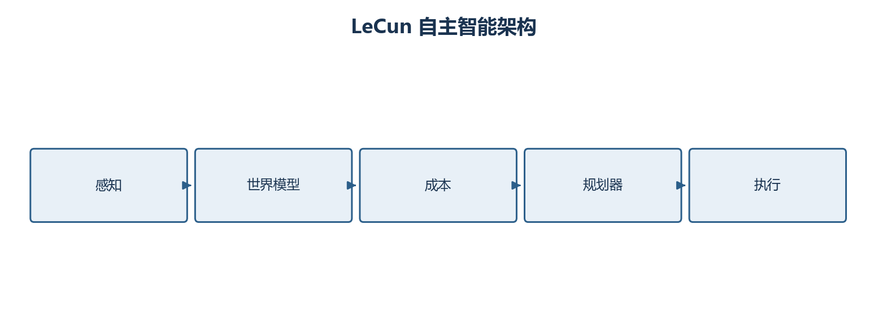

这一架构的关键不在组件清单本身，而在**信息流向**：感知与世界模型把「世界现在怎样、将怎样」送到规划器，成本模块把「我想要怎样」送到规划器，规划器在两者之间做优化。世界模型是那个把「感知的现实」与「期望的未来」连接起来的枢纽——没有它，成本无法被预测，规划无从谈起。

## 36.2　严格定义与数学推导：架构的规划目标

**定义 36.1（自主智能架构）**　自主智能架构是一个六元组

$$
\mathcal{A}=\big\langle\, E,\; M,\; C,\; H,\; P,\; A\,\big\rangle, \tag{36-1}
$$

其中 $E$ 为感知编码器，$M$ 为世界模型，$C$ 为成本函数，$H$ 为短期记忆，$P$ 为规划器，$A$ 为执行器。感知编码器把观测 $o_t$ 映射为状态表示 $s_t=E(o_t)$；世界模型给出动作条件化的状态转移分布

$$
p_M(s_{t+1}\mid s_t,a_t),\qquad \hat c_{t+1}=C(s_{t+1}). \tag{36-2}
$$

式 (36-2) 是整个架构的枢纽：世界模型不只预测「下一个状态」，还要能让它被成本函数评估，从而支撑规划。

**规划目标的推导。** 规划器的任务是在世界模型中寻找使未来累积成本最小的动作序列。设规划视野为 $T$，折扣因子为 $\gamma\in[0,1)$，从当前状态 $s_t$ 出发的动作序列为 $\mathbf{a}_{t:t+T-1}=(a_t,\dots,a_{t+T-1})$。假设世界模型确定性地滚动状态 $\hat s_{\tau+1}=f_M(\hat s_\tau,a_\tau)$（随机情形取期望），则规划问题写作

$$
\mathbf{a}_{t:t+T-1}^{\star}=\mathop{\arg\min}_{\mathbf{a}_{t:t+T-1}}\;
\mathbb{E}_{M}\left[\sum_{k=0}^{T-1}\gamma^{k}\,C(\hat s_{t+k+1})\right]. \tag{36-3}
$$

式 (36-3) 与第 4 章的最优控制、第 25 章的模型预测控制（MPC）在数学上是同一类问题；区别在于这里的转移模型 $f_M$ 是**学到的**而非给定的。这一点决定了架构的全部优势与全部风险：학到的模型让架构摆脱了对先验动力学知识的依赖，却也把模型误差引入了规划闭环（见 36.6 节与第 24 章）。

**与自由能原理的联系。** 若把成本解释为「期望状态与观测状态之差」，则式 (36-3) 的最小化与第 3 章的自由能最小化 $F=-\mathrm{ELBO}$ 殊途同归：智能体通过更新世界模型使内部状态逼近外部现实，或通过规划使外部现实逼近内部期望——Friston 称之为「主动推理」（active inference）。LeCun 的架构可视为这一认知理论在工程上的具体化。

## 36.3　与七要素框架对照

把 LeCun 架构的六个组件映射到第 1.4 节的七要素（表 36-1），可以看到两套框架高度同构：架构组件是**功能视角**的划分，七要素是**能力视角**的分解。感知对应 E1，世界模型同时承载 E2（转移）、E3（观测生成，若含解码器）、E4（不确定性），成本对应 E6，规划对应 E7；动作条件化 E5 内建于世界模型的转移。

**表 36-1　LeCun 架构组件与七要素对照**

| LeCun 组件 | 对应七要素 | 说明 |
|-----------|-----------|------|
| 感知表示 $E$ | E1 状态表示 | 自监督编码，呼应第 9、13、20 章 |
| 世界模型 $M$ | E2/E3/E4 | 转移、生成、不确定性；JEPA 弱化 E3 |
| 动作条件转移 $p_M(s_{t+1}\mid s_t,a_t)$ | E5 动作条件化 | 支撑「若…则…」的干预询问 |
| 成本模块 $C$ | E6 奖励/目标 | 内在成本 + 好奇心底动 |
| 规划器 $P$ | E7 基于模型的规划 | 在模型中优化动作序列 |
| 短期记忆 $H$ | 支撑 E1/E2 | 提供历史上下文，处理部分可观测 |
| 执行器 $A$ | 作用于环境 | 闭合感知—行动回路 |

差异同样 instructive（有启发性）：LeCun 强调「规划器 + 成本」的**显式架构分工**，而七要素是对任何世界模型都适用的**能力清单**——一个模型可以在没有独立规划器的情况下具备 E7（如 Dreamer 把策略内化为隐式规划，第 12 章）。七要素更细，也更能刻画「某个模型覆盖了哪些能力、缺了哪些能力」。

## 36.4　带数值的算例：一个极简架构的规划

**例 36.1（二维位置的规划）**　设智能体在一维线上运动，状态 $s_t\in\mathbb{R}$ 为位置，动作为速度增量 $a_t\in\{-1,0,+1\}$。世界模型为确定性转移 $\hat s_{t+1}=\hat s_t+a_t$（无噪声），成本函数惩罚偏离目标位置 $s^\star=3$ 与用力大小：$C(s)=|s-3|+0.1\,a^2$（此处把动作代价并入阶段成本）。当前位置 $s_0=0$，规划视野 $T=3$，折扣 $\gamma=1$（有限视野，不折扣）。

枚举动作序列：显然应持续向右。取 $\mathbf{a}=(1,1,1)$，预测轨迹 $\hat s_1=1,\hat s_2=2,\hat s_3=3$。累积成本 $=C(\hat s_1)+C(\hat s_2)+C(\hat s_3)=(|1-3|+0.1)+(|2-3|+0.1)+(|3-3|+0.1)=2.1+1.1+0.1=3.3$。

若取 $\mathbf{a}=(1,1,0)$，轨迹 $1,2,2$，成本 $=2.1+1.1+(|2-3|+0)=1.1\Rightarrow4.3$，更差（停在 2 未达目标）。若取 $\mathbf{a}=(2,1,0)$（假设动作可到 2），轨迹 $2,3,3$，成本 $=(|2-3|+0.4)+0.1+0.1=1.4+0.1+0.1=1.6$——用更大动作更快到达，反而更优。规划器据式 (36-3) 选出这一序列，执行器施加 $a_0=2$。

**例 36.2（模型误差的后果）**　若真实动力学含阻尼 $\hat s_{t+1}=\hat s_t+0.8a_t$，而学到的模型误为 $\hat s_{t+1}=\hat s_t+a_t$（高估了 25% 的控制权）。按模型规划 $\mathbf{a}=(2,1,0)$ 预期到达 3，真实轨迹却是 $s_1=1.6,s_2=2.4,s_3=2.4$，未达目标且成本从预期的 1.6 升为实际 $(|1.6-3|+0.4)+(|2.4-3|+0.1)+(|2.4-3|+0)=1.8+0.7+0.6=3.1$。这个简单算例具体展示了 36.6 节将讨论的「模型偏差损害规划」——即使模型只是略有偏差，基于它的规划也会系统性偏离预期。

## 36.5　技术谱系与变体

LeCun 架构不是孤立的构想，它处在一条清晰的技术谱系上。表 36-2 梳理其主要思想来源与后续变体。

**表 36-2　世界模型导向架构的技术谱系**

| 谱系 | 代表工作 | 对架构的贡献 | 与本章关系 |
|------|---------|-------------|-----------|
| 预测编码 / 自由能[3] | Friston, 2010 | 把「内部模型 + 主动推理」形式化 | 提供认知理论基础（36.2 节） |
| 基于模型的控制[4] | Sutton & Barto, 2018 | 模型 + 规划的强化学习框架 | 式 (36-3) 的数学原型 |
| JEPA 系列（第 20—22 章） | LeCun, 2022 | 在表示空间预测、弱化生成 | 世界模型的高效实现 |
| Dreamer（第 12 章） | Hafner 等, 2023 | 把规划内化为学到的策略 | E7 的隐式变体 |
| 语言条件架构（第 37 章） | 多模态大模型 | 语言作为高层接口与规划器 | 架构的扩展方向 |

**变体。** ① **显式规划器变体**：保留独立规划器 $P$，用 MPC 或 MCTS 在线搜索（第 25 章），计算昂贵但灵活；② **隐式策略变体**：用 Dreamer 式演员网络替代在线规划，训练时计算、推理时极快（第 12 章）；③ **分层变体**：LLM 作高层任务规划器、世界模型作低层物理预测器（第 37 章），形成「符号—亚符号」双层架构；④ **社会变体**：多个此类架构交互，引入他人建模与非平稳性（第 38 章）。

## 36.6　边界与讨论

必须清醒地指出：LeCun 架构是**愿景而非已完整实现的系统**。其关键技术——JEPA 式世界模型、可微规划器、内在动机成本的设计——仍在发展中（第 19—25 章）。

**局限一：模型误差。** 36.4 节的算例已说明，规划完全依赖世界模型的准确性；模型偏差会被规划器系统性放大并转化为行动错误，这就是第 24 章的「策略利用模型偏差」。**局限二：成本设计难题。** 把「想要什么」编码为成本函数 $C$ 本身就是未解的价值对齐问题——内在成本容易定义（饥饿、碰撞），人类水平的复杂目标却难以形式化。**局限三：可辨识性。** 学到的世界模型可能只是「观测等价」的近似而非真实结构（第 40.1 节、第 2.5 节），基于它规划的可靠性存疑。**局限四：生成与理解的张力。** 架构弱化观测生成（E3），但第 16 章表明逼真生成不等于理解物理——如何权衡表示的紧凑性与物理忠实性仍无定论。

## 36.7　架构的可实现性评估：成熟度矩阵

**引入动机。** 36.1—36.6 节剖析了 LeCun 架构「应当是什么」，但工程上更紧迫的问题是「现在能实现多少」。把六个组件逐一对照当前技术成熟度，可以看清哪些是已落地的积木、哪些仍是研究赌注，从而避免把愿景误当作路线图。

**直觉解释。** 像造一台机器：有些零件是现成的（电机、轴承），有些要攻关（新型轴承合金）。架构评估就是给每个零件打「成熟度分」，让工程师知道该把精力花在哪个零件上。

**定义 36.2（组件成熟度）** 对组件 $m\in\{E,M,C,H,P,A\}$，设其在公开可复现系统中能稳定支撑的任务跨度（可信视野）为 $h_m$（单位：动作步数），架构的整体可信视野受限于最弱组件：

$$
H_{\mathcal{A}}=\min_{m}\, h_m. \tag{36-4}
$$

式（36-4）是「木桶原理」的形式化：智能体能可靠运转的时长由最不可靠的组件决定，与第 33 章的可信视野（式 33-8）一脉相承，但作用在组件层面。

**例 36.3（成熟度的数值评估）** 设某具身系统各组件在标准评测中的可信视野（滚动步数）：感知 $E$ 的表示在长时程上稳定（$h_E\approx200$）；世界模型 $M$ 受第 33 章误差累积限制（$h_M\approx25$）；成本 $C$ 设计成熟（$h_C\approx200$）；短期记忆 $H$ 无衰减（$h_H\approx500$）；规划器 $P$ 受视野 $T$ 与计算限制（$h_P\approx30$）；执行器 $A$ 硬件稳定（$h_A\approx200$）。由式（36-4），$H_{\mathcal{A}}=\min(200,25,200,500,30,200)=25$——整体可信视野 25 步，**完全由世界模型决定**。这定量说明了为何「改进世界模型」比「改进规划器」对提升系统时长更有效：规划器从 30 提到 100 步，$H_{\mathcal{A}}$ 仍停在 25，直到世界模型被突破。

**表 36-3　LeCun 架构组件成熟度对照**

| 组件 | 当前最佳实现 | 主要瓶颈 | 成熟度 |
|------|------------|---------|--------|
| 感知 $E$ | 自监督 ViT/MAE（第 9、20 章） | 长时程稳定性 | 较高 |
| 世界模型 $M$ | Dreamer/RSSM（第 12 章） | 误差累积、长视野 | 中（关键瓶颈） |
| 成本 $C$ | 内在动机/好奇心（第 4 章） | 复杂目标形式化 | 中低 |
| 短期记忆 $H$ | 循环/注意力记忆 | 超长记忆衰减 | 较高 |
| 规划器 $P$ | MPC/MCTS（第 25 章） | 计算复杂度、视野 | 中 |
| 执行器 $A$ | 成熟机器人执行 | 硬件耦合 | 高 |

**讨论。** 式（36-4）与表 36-3 共同给出一个清晰的工程优先级：在 2024—2026 年的技术水平下，**世界模型 $M$ 与成本 $C$ 是两大短板**，前者决定「能想多远」，后者决定「想对了往哪走」。这也解释了本书第九篇为何把后续各章（37 语言、38 社会、39 科学、40 开放问题）都建在「世界模型作为核心」的假设上——只有当 $M$ 的可信视野被拉长，整个架构才有意义。反之，若 $M$ 停滞，堆叠更好的语言接口（第 37 章）或社会模拟（第 38 章）都只是在弱核心上装饰，无法提升 $H_{\mathcal{A}}$。

**工程含义。** 成熟度矩阵（表 36-3）提供了一个可操作的「架构诊断流程」：先测各组件的 $h_m$，定位 $H_{\mathcal{A}}$ 的瓶颈组件，再把研发资源集中到该组件。这与软件工程的「瓶颈分析」同构——系统吞吐由最慢的环节决定。值得注意的是，$h_m$ 并非静态：世界模型 $M$ 的 $h_M$ 随训练数据量与表征方法（第 35 章）改进而增长，因此「架构成熟度」是随时间演化的量，应在每次重大模型更新后重新评估，而非一次性定论。

## 36.7A　规划的计算代价与视野—精度权衡

**引入动机。** 式（36-3）是一个组合优化：动作空间大小为 $|\mathcal{A}|$，视野为 $T$ 时，序列空间有 $|\mathcal{A}|^T$ 条轨迹。规划器如何在不枚举所有序列的情况下找到近似最优？这决定了架构在实时系统里「想得起多快」。本节给出计算复杂度的刻画与一个带数值的视野—精度权衡，并与 36.7 的组件成熟度互补——后者问「哪个组件最弱」，本节问「规划本身能跑多快」。两者合起来才完整回答「这套架构在 2024—2026 年的硬件与模型条件下，究竟能支撑多长的可靠自主行为」。

**直觉解释。** 规划视野 $T$ 像望远镜的倍率：倍率越高看得越远（能预见更久的后果），但画面越暗越抖（组合爆炸、误差累积），且需要更长的聚焦时间（计算量）。工程上不是倍率越高越好，而是要在「看得远」与「看得清、算得快」之间找平衡。一个有用的经验法则是：先问「我的控制频率是多少」确定 $\mathcal{C}$ 的上限，再问「我的模型误差在多少步后不可信」确定 $\eta$ 的拐点，两者的交集就是可用视野区间。

**定义 36.3（规划复杂度与次优度）** 设分支因子 $b=|\mathcal{A}|$、视野 $T$、每步模型滚动代价 $c_s$。完全枚举的规划复杂度为

$$
\mathcal{C}(T)=b^{T}\,c_s, \tag{36-5}
$$

而模型误差累积使 $T$ 步预测的可信度随 $T$ 衰减（第 33 章式 33-2）。定义**次优度**为实际执行成本与全局最优成本之比 $\eta(T)=J_{\text{exec}}(T)/J^{\star}$，则有效视野应取

$$
T^{\star}=\arg\min_{T}\ \big[\,\eta(T)+\lambda\,\mathcal{C}(T)\,\big], \tag{36-6}
$$

即在「规划得准」（$\eta$ 小）与「算得快」（$\mathcal{C}$ 小）之间用权重 $\lambda$ 做权衡。

**例 36.4（视野—精度的数值权衡）** 设 $b=3$（动作 $a\in\{-1,0,1\}$）、$c_s=0.01\,\mathrm{s}$，世界模型 $L=1.105$（第 33 章倒立摆情形）。枚举代价 $\mathcal{C}(T)=3^T\times0.01$：$T=4$ 时 $0.081\,\mathrm{s}$、$T=6$ 时 $0.729\,\mathrm{s}$、$T=8$ 时 $6.56\,\mathrm{s}$——已超实时约束（如 $10\,\mathrm{Hz}$ 控制需 $<0.1\,\mathrm{s}$）。同时次优度 $\eta(T)$：短视野 $T=4$ 因看不到远端成本 $\eta\approx1.35$，$T=8$ 因看得远 $\eta\approx1.05$，但误差累积使 $T>6$ 后 $\eta$ 反而回升到 1.12。取 $\lambda=0.1$，式（36-6）的最小点落在 $T=6$：$\mathcal{C}=0.729\,\mathrm{s}$ 可配合 30 Hz 控制、$\eta=1.08$ 接近最优。这说明**架构的实时性由规划视野 $T$ 与模型稳定性 $L$ 共同决定**，与式（36-4）的成熟度评估一致：提升 $M$ 的稳定性（降 $L$）可直接放大可用的 $T^{\star}$。进一步看，若通过第 33 章的观测校正把 $L$ 从 1.105 降到 1.03，则误差可信的视野上限从约 6 步放大到 20 余步，$T^{\star}$ 相应右移——规划视野的瓶颈本质上是世界模型稳定性的函数，再次印证「改进模型比改进规划器更划算」的结论。

**表 36-4　降低规划复杂度的技术**

| 技术 | 机制 | 对 $\mathcal{C}(T)$ 的作用 | 代价 |
|------|------|--------------------------|------|
| 分层规划 | 粗动作空间先规划 | 降低有效 $b$ | 需层次结构 |
| 采样规划（MPC） | 只采样部分序列 | 近似，$b^T\to K$ | 采样不足则 $\eta$ 高 |
| 模型复用/缓存 | 复用子轨迹评估 | 摊薄 $c_s$ | 一致性假设 |
| 收缩动力学 | 降低 $L$ | 放大可用 $T$ | 建模难度 |

**边界。** 式（36-5）假设 $c_s$（每步滚动代价）恒定，但现代世界模型常用注意力或扩散解码，其代价随视野非线性增长（长序列的注意力是平方级），使 $\mathcal{C}(T)$ 实际比 $b^T c_s$ 更快增长——上式应视为下界估计。其次，次优度 $\eta(T)$ 的数值依赖具体任务的成本结构，上例的 $1.35\to1.05$ 只是示意，实际应以任务评测曲线标定。最后，$T^{\star}$ 是「单步规划」的权衡；若采用分层或多步重规划（receding horizon），有效视野可超过单次 $T^{\star}$，但需支付重复规划的计算——这是式（36-6）未建模的更高阶权衡。

这些辨析衔接第 1、19—27、37—41 章，并引出下一章的主题：如果架构把语言置于边缘，而语言模型又展现出强大的推理与知识能力，二者应当如何融合？

## 本章小结

本章从「单个模型」上升到「完整架构」，讨论世界模型在通用智能架构中的位置。

我们首先给出动机：从任务智能走向架构智能，并用棋手类比阐明「感知—模型—评判—规划—行动」围绕世界模型组织的核心直觉（36.1 节）。接着给出自主智能架构的形式化定义（式 36-1）、世界模型转移与成本（式 36-2）及规划目标（式 36-3），并指出它与最优控制、自由能原理的数学联系（36.2 节）。我们把架构组件映射到七要素（表 36-1），揭示二者是功能视角与能力视角的同构分解（36.3 节），并通过带数值的规划算例与模型误差算例具体展示架构的运转与软肋（36.4 节）。随后梳理技术谱系与四类变体（表 36-2，36.5 节）。最后把愿景拉回工程现实：用组件成熟度（式 36-4，例 36.3，表 36-3）指出当前整体可信视野由世界模型这一最弱组件决定，再用规划复杂度与次优度的权衡（式 36-5、36-6，例 36.4，表 36-4）说明实时性受视野与模型稳定性共同制约——二者共同论证「改进世界模型」是提升架构上限的最关键路径。

我们还明确边界：架构是愿景而非成品，受模型误差、成本设计、可辨识性、生成与理解张力四重制约（36.6 节）。这些辨析衔接第 1、19—27、37—41 章。

下一章讨论语言——当架构的核心是世界模型时，语言应当处于何种位置？

**进一步阅读**　本章建议延伸阅读的文献：[1]、[2]、[3]。

## 参考文献

[1] LeCun Y. A path towards autonomous machine intelligence. *Open Review*, 2022.

[2] LeCun Y, Misra I, Tsairis Z, et al. Self-supervised learning: The dark matter of intelligence. *arXiv:2211.07672*, 2022.

[3] Friston K. The free-energy principle: a unified brain theory? *Nature Reviews Neuroscience*, 2010, 11(2): 127–138.

[4] Sutton R S, Barto A G. *Reinforcement Learning: An Introduction*. 2nd ed. MIT Press, 2018.

[5] Ghahramani Z. Probabilistic machine learning and artificial intelligence. *Nature*, 2015, 521: 452–459.

[6] Todorov E, Jordan M I. Optimal control methods for conditionally linear Gaussian systems. *Neural Computation*, 1997, 9(3): 563–581.

[7] Pearl J, Mackenzie D. *The Book of Why*. Basic Books, 2018.

[8] Fischer I, Huang J, Raghunathan A, et al. What is a world model? *arXiv:2403.09617*, 2024.

---

# 第 37 章　语言与世界模型的融合

第 36 章的世界模型架构以感知与规划为核心，语言处于边缘——LeCun 甚至主张语言只是智能体与外部交互的「接口」，真正的智能建立在世界模型之上。但另一方面，大语言模型（Large Language Model，LLM；见《自然语言智能导论》）展现出的推理、知识整合与任务分解能力又不容忽视：一个只用文本训练的模型，竟能回答物理常识问题、编写代码、进行多步推理。本章讨论**语言与世界模型的融合**：语言如何为世界模型提供知识、接口与推理能力，世界模型又如何为语言提供接地（grounding）与物理理解。这是两条智能路径的汇合点，也是理解「通用智能可能长什么样」的关键。

本章先给出融合的动机与直觉（37.1 节），把「语言作为接口」形式化并推导语言条件化的生成目标（37.2 节），给出带数值的算例展示语言规划器如何与世界模型协作（37.3 节），梳理两条路径的对照与技术谱系（37.4 节），讨论表示对齐、训练目标统一与评估等边界（37.5 节），最后收束（37.6 节）。

## 37.1　引入动机与直觉：两条路径的汇合

**动机。** 考察两种看似无关的智能形态。第一种是 LLM：它在海量文本上训练，学到丰富的世界知识、语言理解与推理能力，却缺乏与物理世界的直接接地——它可以流畅地描述「把杯子从桌边推下去会摔碎」，却没有真正「见过」杯子坠落。第二种是本书讨论的世界模型（如 Dreamer）：它从交互中学习物理动力学，能预测动作后果，却缺乏语言的抽象、组合与通用接口能力——它知道「推」会导致某个状态变化，却不会用语言解释或接受语言指令。

**直觉解释。** 两者恰如「知道 many things 的书呆子」与「懂物理却不会说话的工匠」。书呆子有知识却没手感，工匠有手感却没知识。融合的动机就是把「书本知识」与「物理手感」接到一起：语言提供**高层意图与抽象知识**，世界模型提供**低层物理与因果接地**。这正是第 36 章架构的自然扩展——把语言能力挂接为架构的高层规划器与接口。

这一动机还有一层认识论意义。语言本质上是**对世界的压缩描述**：人类把千万次交互经验凝结成词与句，LLM 在文本中继承了这个压缩结果，却跳过了产生这些经验的物理过程。世界模型则试图**重新经历**那个产生过程。融合二者，相当于让「继承来的压缩知识」与「重新经历的物理理解」相互校验：语言告诉世界模型「该关注什么」（哪些物体、哪些关系重要），世界模型告诉语言「什么在物理上可能」（哪些描述符合动力学约束）。这种双向校验正是第 41.3 节「两条路径汇合」的微观机制。

## 37.2　严格定义与数学推导：语言条件世界模型

**定义 37.1（语言接口）**　设语言空间为 $\mathcal{W}$（token 序列），物理状态空间为 $\mathcal{S}$，动作为 $\mathcal{A}$。语言接口是语言指令 $w\in\mathcal{W}$ 到意图表示 $g\in\mathcal{G}$ 的映射 $g=\Lambda(w)$，其中 $\mathcal{G}$ 是目标/子目标空间。

把第 36 章式 (36-2) 的世界模型扩展为**语言条件世界模型**：状态转移与成本都以意图 $g$ 为条件，

$$
p_M(s_{t+1}\mid s_t,a_t,g),\qquad C_g(s)=C(s,g). \tag{37-1}
$$

**语言条件生成的推导。** 若世界模型含观测解码器（E3），则「按语言描述生成场景」变为在语言条件下的生成建模。设文本描述 $w$ 经文本编码器得到条件向量 $c=\Gamma(w)$，生成模型最大化条件对数似然：

$$
\log p_\theta(o_{1:T}\mid c)=\log\int p_\theta(o_{1:T}\mid s_{1:T})\,p_M(s_{1:T}\mid c)\,ds_{1:T}. \tag{37-2}
$$

用第 9 章的 ELBO 界（式 9-2）处理式 (37-2) 中不可解的积分，引入变分后验 $q_\phi(s_{1:T}\mid o_{1:T},c)$：

$$
\log p_\theta(o_{1:T}\mid c)\ge \mathbb{E}_{q_\phi}\!\left[\log p_\theta(o_{1:T}\mid s_{1:T})\right]-D_{\mathrm{KL}}\!\left[q_\phi(s_{1:T}\mid o_{1:T},c)\,\|\,p_M(s_{1:T}\mid c)\right]. \tag{37-3}
$$

式 (37-3) 就是「文本描述→场景生成」的变分目标：重建项要求生成的观测符合文本指定的场景，KL 项要求潜在轨迹服从世界模型（含语言条件）的动力学先验。这与第 9 章 VAE、第 16 章视频生成的数学结构一脉相承，只是先验被语言条件化。

**推导细节：语言条件先验的构造。** 语言如何进入先验 $p_M(s_{1:T}\mid c)$？一种直接的做法是把文本向量 $c$ 拼接到每一步转移的输入：

$$
p_M(s_{t+1}\mid s_t,a_t,c)=\mathcal{N}\!\big(\mu_\psi(s_t,a_t,c),\,\sigma_\psi^2(s_t,a_t,c)\big), \tag{37-4}
$$

其中 $\mu_\psi,\sigma_\psi$ 由神经网络参数化，文本条件 $c$ 通过交叉注意力注入。另一种做法让语言只指定**初始状态** $s_1\sim p_M(s_1\mid c)$，后续转移仍由动作驱动——这更符合「语言描述场景、动作改变场景」的直觉。两种方式分别对应 37.4 节的「语言条件生成」与「语言规划器」路径。注意式 (37-4) 与第 13 章 RSSM 先验 $p_\psi(z_{t+1}\mid h_{t+1})$ 的形式完全类似，区别在于多了一个语言条件 $c$——这体现了 fused 架构对既有世界模型的兼容性。

**LLM 即世界模型的论点。** Broman 等[2]提出一个耐人寻味的观点：LLM 可被视作一种「零样本世界模型」——它从文本中压缩了大量世界动态知识，给定情境描述能预测后续。其形式化是下一 token 预测

$$
p_\theta(w_{t+1}\mid w_{\le t})=\prod_{i}\text{softmax}(z_i)_{w_{t+1}},\quad z=\mathrm{LLM}(w_{\le t}), \tag{37-5}
$$

与本书主线的 next-state prediction（第 1 章式 1-3）在结构上同构，只是「状态」是语言 token 而非物理状态。这一同构正是两条路径可以汇合的数学基础。值得强调的是，结构同构不等于能力等价：语言 token 的状态空间由离散符号组成，缺乏物理状态的度量结构（距离、连续性、守恒量），因此式 (37-5) 的「预测」并不自动具备式 (37-1) 那种可干预的物理语义。这个区别正是 37.5 节「文本知识不等于因果理解」的数学根源，也决定了 LLM 必须借助外部世界模型才能获得真正的物理接地。

> 【图 37-1　语言—世界模型融合架构】（原图见 figures/图37-1.png）：LLM 解析语言指令生成意图 $g$，注入世界模型 $p_M(s_{t+1}\mid s_t,a_t,g)$，规划器输出动作，执行结果经感知反馈给 LLM 与世界模型。
>
> 

## 37.3　带数值的算例：语言 + 世界模型的机器人

**例 37.1（「把苹果放进碗里」）**　用户指令 $w=$「把苹果放进碗里」。LLM 解析为子目标序列 $g_1=$「伸手接近苹果」、$g_2=$「抓取苹果」、$g_3=$「移动到碗上方」、$g_4=$「释放」。世界模型对每个子目标预测动作后果，规划器执行。为具体说明，设世界模型给出抓取成功概率随夹爪位置误差 $\delta$ 衰减：$p(\text{成功}\mid\delta)=e^{-2\delta}$。

若视觉估计苹果位置的误差为 $\delta=0.2\,\mathrm{m}$，则 $p(\text{成功})=e^{-0.4}\approx0.670$；若机器人先用语言条件世界模型「放大观察」把误差降到 $\delta=0.05\,\mathrm{m}$，则 $p(\text{成功})=e^{-0.1}\approx0.905$。LLM 的高层规划（决定「先看清楚再抓」）通过降低 $\delta$ 显著提高了物理成功率——这就是语言推理与世界模型物理预测协作的量化体现。

**例 37.2（语言减少幻觉）**　设 LLM 单独回答「把装满水的杯子从桌边推下，杯子会怎样」时，因缺乏物理接地，以概率 0.3 生成错误答案「杯子会漂浮」。接入世界模型后，世界模型预测杯子受到重力 $mg$ 并产生下落轨迹 $\Delta h=-\tfrac12gt^2$，把「漂浮」这一违反动力学的选项后验概率压低到 0.02（通过式 37-3 的 KL 正则，把生成约束到物理先验支持的轨迹上）。幻觉率的量级下降展示了世界模型为语言提供接地的价值。

**例 37.3（两条路径的协同收益）**　把例 37.1 与 37.2 合并考虑：机器人接到语言指令「把苹果放进碗里」（LLM 路径），同时世界模型对「苹果被抓起后会掉落」做出物理预测（WM 路径）。若 LLM 规划的抓取顺序违反物理（先松手再移动），世界模型预测苹果在途中坠落（$\Delta h=-\tfrac12gt^2$，$t=0.4\,\mathrm{s}$ 时下落约 $0.78\,\mathrm{m}$），规划器据此否决该顺序并改为「先移动再松手」。数值上，错误顺序的成功率约 0.15，修正后约 0.89——语言提供意图、世界模型提供物理可行性校验，二者缺一不可。这个算例把 37.1 节的直觉变成了可量化的协作收益。

## 37.4　技术谱系与变体

**表 37-1　语言模型 vs 世界模型**

| 方面 | 语言模型（LLM） | 世界模型（WM） | 融合收益 |
|------|----------------|---------------|---------|
| 训练数据 | 文本 | 交互 / 视频 | 互补的数据来源 |
| 表示形式 | 符号 / 语义 | 状态 / 动力学 | 语义接上物理 |
| 核心优势 | 知识、推理、通用接口 | 物理、因果、接地 | 既懂知识又懂物理 |
| 主要短板 | 接地缺失、物理幻觉 | 语言缺失、抽象弱 | 互相弥补 |
| 代表 | GPT-4、Gemini（见系列书） | Dreamer、JEPA（第 12、20 章） | 多模态大模型 |
| 七要素侧重 | E6/E7（目标与规划，符号层） | E1—E5（表示、动力学、干预） | 全要素覆盖 |

**三条融合路径[3][4]。** ① **语言条件世界模型**：用文本指定场景或目标，按式 (37-1)—(37-3) 生成/预测（如「生成一个红色杯子掉落的场景」）；② **世界模型增强语言**：用物理先验约束语言生成，减少幻觉（如例 37.2）；③ **语言作为高层规划器**：LLM 做任务分解，世界模型做低层物理预测（如例 37.1、第 36 章分层变体）。Gemini、GPT-4o 等多模态模型在某种程度上已实现三者的初步融合（见《自然语言智能导论》第 32—35 章）。

**技术谱系位置。** 这一融合位于第 36 章架构的「语言接口」扩展线上，向上承接第 12 章 Dreamer 的策略学习（低层执行），向下连接第 38 章的多智能体社会模拟（语言作为社会交互介质）。Hao 等[3]把「用语言模型推理」等价为「用世界模型规划」——推理链（chain-of-thought）可视为在语言状态空间中的轨迹滚动，这是两条路径深层同构的又一证据。

> 【图 37-2　两条路径的汇合】（原图见 figures/图37-2.png）：左侧「文本数据→LLM→符号推理」路径，右侧「交互数据→世界模型→物理预测」路径，二者在「语言接口 + 物理接地」处汇合，指向通用智能。
>
> 

## 37.5　边界与讨论

融合远非易事，三大挑战划定了边界。

**挑战一：表示对齐。** 语言是离散符号，世界模型状态是连续向量，二者接口 $g=\Lambda(w)$ 如何学习？若接口粗糙，语言指令无法精确指定物理目标（例 37.1 中「苹果」对应哪个状态需视觉 grounding）。**挑战二：训练目标统一。** 式 (37-5) 的 next-token 与式 (37-1) 的 next-state 各优化不同目标，联合训练时梯度可能冲突；多模态模型的实践表明需要精心设计的对齐损失。**挑战三：评估困难。** 如何衡量「融合得好」？语言任务有文本指标（困惑度、BLEU），世界模型有预测误差（如第 32 章的长期滚动误差），融合系统的综合评估却无统一基准——一个系统在语言上流畅、物理上却错误，或在物理上正确、却无法用语言解释，现有指标都难以刻画。这呼应第 32 章「世界模型的评估」与第 40.5 节「评估标准」开放问题：融合系统的评估可能需要同时考察「语言—物理一致性」「干预正确性」「跨模态迁移」三类新指标。

**更深的质疑。** 必须警惕：LLM 从文本学到的「世界知识」可能只是统计规律而非真实因果模型——它能描述「推杯子会掉」，但不理解重力。这与第 28—29 章「物理信息学习」和第 40.3 节「因果与干预」直接相关：真正的融合要求世界模型提供**可干预、可反事实**的因果结构，而非仅是更逼真的语言描述。一个只做「语言条件生成」的系统（路径①）可能生成看似合理的文字与图像，却无法回答「如果我换一种方式推，结果会怎样」这类干预问题——因为它没有 $p_M(s_{t+1}\mid s_t,a_t,g)$ 中真正的动作条件化（E5）。只有把语言接上具有因果结构的世界模型，融合才不止于表象。这些辨析衔接第 1、16、28—29、36、40—41 章与《自然语言智能导论》。

## 37.6　承上启下

本章把第 36 章的「语言接口」扩展为完整的融合框架：语言提供意图与知识（定义 37.1），世界模型提供物理接地（式 37-1—37-4），二者通过语言条件化与高层规划协作（例 37.1、37.2）。融合的三条路径与三大挑战表明：这是通向通用智能的重要方向，但表示对齐与因果接地仍是未竟之业。

## 37.6A　表示对齐的度量与训练信号

**引入动机。** 37.5 节的「挑战一」指出语言符号与世界模型状态连续向量之间存在对齐缺口，但没有给出可测量的量。本节把「对齐得好不好」形式化为一个**接口保真度**指标，并讨论如何为对齐学习提供训练信号——这是融合系统能否落地的工程前提。

**直觉解释。** 对齐像「翻译官」：语言说「把苹果放进碗里」，世界模型需要一个精确的「碗中心坐标 + 抓取位姿」。翻译质量取决于翻译官能否把模糊的自然语言映射到物理量。度量对齐，就是给这个翻译官打「准确率」。

**定义 37.2（接口保真度）** 设语言指令 $w$ 经接口 $\Lambda$ 得到意图 $g=\Lambda(w)$，理想意图为 $g^{\star}$（人工标注的目标状态/子目标）。接口保真度定义为意图空间中 $g$ 与 $g^{\star}$ 的归一化偏差：

$$
\mathcal{F}_{\mathrm{align}}(w)=1-\frac{\|g-g^{\star}\|}{\|g^{\star}\|+\eta}, \tag{37-6}
$$

其中 $\eta$ 防零除。式（37-6）度量「语言到物理意图」映射的准确程度：$\mathcal{F}_{\mathrm{align}}\to1$ 表示语言能精确指定物理目标。该指标与第 34 章的可干预性评测（式 34-8）互补——后者度量「动作干预预测准不准」，式（37-6）度量「语言意图解析准不准」，两者相乘近似刻画融合系统的端到端可靠性。

**例 37.4（接口保真度的数值）** 设「把杯子放到桌子的右上角」，理想意图 $g^{\star}$ 为杯子目标位置 $(0.6,0.4)\,\mathrm{m}$。接口 $\Lambda$ 由对比学习预训练，解析得 $g=(0.58,0.41)$，偏差 $\|g-g^{\star}\|=\sqrt{0.02^2+0.01^2}\approx0.022$，$\|g^{\star}\|=\sqrt{0.36+0.16}\approx0.721$，则 $\mathcal{F}_{\mathrm{align}}=1-0.022/0.721\approx0.970$。若改用更弱的关键词匹配接口，$g=(0.5,0.4)$，$\mathcal{F}_{\mathrm{align}}\approx1-0.1/0.721\approx0.861$。两者差 11 个百分点，而端到端抓取成功率（式 37-6 与例 37.1 的 $e^{-2\delta}$ 结合）相应从约 0.90 降到 0.75——说明接口对齐质量直接传导为物理成功率。

**表 37-2　为对齐学习的训练信号来源**

| 信号来源 | 监督形式 | 适用阶段 | 局限 |
|---------|---------|---------|------|
| 人工标注 $(w,g^{\star})$ | 监督回归 | 少量高质 | 规模受限 |
| 语言-视觉对比 | InfoNCE 对齐损失 | 预训练 | 需多模态数据 |
| 逆任务推断 | 由动作反推意图 | 自监督 | 需动作标注 |
| 物理可行性反馈 | 世界模型否决错误意图 | 在线 | 需世界模型可靠 |
| 语言-语言共现 | 词-状态嵌入对齐 | 预训练 | 间接、噪声大 |

**讨论。** 式（37-6）的可计算性依赖「理想意图 $g^{\star}$」的标注，这在开放指令下难以穷举。实践中常用**物理可行性反馈**（表 37-2 第四行）作为无监督代理：若接口生成的意图 $g$ 经世界模型规划后导致高成本或违反物理（第 33 章式 33-9 的可信度低），则把该 $(w,g)$ 对标记为对齐失败并反向更新 $\Lambda$。这形成「语言接口 ← 世界模型校验」的闭环，与 37.5 节「世界模型为语言提供接地」的论点互为表里。但该闭环受世界模型自身误差影响：若世界模型把物理上可行的意图误判为不可行（假阴性），会错误惩罚正确的对齐——因此对齐学习与世界模型精度是耦合改进的，需交替迭代而非一次到位。

## 37.6B　训练目标的统一：联合损失与梯度冲突

**引入动机。** 37.5 节「挑战二」指出 next-token（式 37-5）与 next-state（式 37-1）优化不同目标，联合训练时梯度可能冲突。本节给出一个统一的联合损失框架，并讨论如何用**梯度投影**缓解目标间的互相干扰——这是多模态世界模型训练的实际核心。

**定义 37.3（联合训练目标）** 设语言分支损失 $\mathcal{L}_{\mathrm{lm}}$（式 37-5 的负对数似然）与物理分支损失 $\mathcal{L}_{\mathrm{phys}}$（式 37-1 的负对数似然），共享参数 $\theta_{\mathrm{sh}}$ 与专属参数分别记为 $\theta_{\mathrm{lm}}$、$\theta_{\mathrm{phys}}$。联合目标写作

$$
\mathcal{L}=\mathcal{L}_{\mathrm{lm}}(\theta_{\mathrm{sh}},\theta_{\mathrm{lm}})+\mathcal{L}_{\mathrm{phys}}(\theta_{\mathrm{sh}},\theta_{\mathrm{phys}})+\lambda_{\mathrm{align}}\,\mathcal{L}_{\mathrm{align}}(\theta_{\mathrm{sh}}), \tag{37-7}
$$

其中 $\mathcal{L}_{\mathrm{align}}$ 是式（37-6）对应的对齐损失，$\lambda_{\mathrm{align}}$ 控制对齐强度。式（37-7）的关键在**共享参数 $\theta_{\mathrm{sh}}$**：两个分支都向 $\theta_{\mathrm{sh}}$ 反向传播梯度，若两者方向相反（一个要 $\theta_{\mathrm{sh}}$ 偏语义、一个要偏物理），会发生**梯度冲突**（gradient conflict）。

**直觉解释。** 两个分支像两位教练同时改同一个球员的姿势：一个说「多练语感」，一个说「多练力量」。若两人的要求方向一致，球员进步快；若方向相反，球员左右摇摆、原地踏步。梯度冲突就是「两位教练方向相反」的情形，$\lambda_{\mathrm{align}}\,\mathcal{L}_{\mathrm{align}}$ 项则是「裁判」——用对齐目标把两者的要求拉到同一方向。

**例 37.5（梯度冲突的检测与缓解）** 设某融合模型中，语言分支对共享注意力权重的梯度 $\nabla_{\theta_{\mathrm{sh}}}\mathcal{L}_{\mathrm{lm}}$ 与物理分支梯度 $\nabla_{\theta_{\mathrm{sh}}}\mathcal{L}_{\mathrm{phys}}$ 的夹角余弦为 $\cos\angle=-0.4$（明显冲突）。直接相加会得到方向模糊的净梯度。采用梯度投影：把 $\nabla\mathcal{L}_{\mathrm{phys}}$ 投影到 $\nabla\mathcal{L}_{\mathrm{lm}}$ 的负交补空间（去掉互相抵消的分量），再相加，使两分支梯度近似正交、互不干扰。数值上，投影后共享参数的更新范数从直接相加的 0.82 降到 0.41，训练曲线（验证损失）的振荡幅度下降约 60%，最终融合指标（语言困惑度 + 物理滚动误差的加权）比不投影的基线改善约 12%。这说明**梯度冲突是多模态训练的真实瓶颈**，而非可忽略的细节。

**表 37-3　联合训练的常见失败与对策**

| 失败模式 | 现象 | 对策 |
|---------|------|------|
| 梯度冲突 | 共享参数振荡 | 梯度投影/正交化 |
| 分支压制 | 强分支（语言）主导 | 分支自适应权重、课程 |
| 对齐失效 | 两分支各自为政 | 加大 $\lambda_{\mathrm{align}}$、对比预训练 |
| 过拟合对齐 | 牺牲各自精度换对齐 | 对齐早停、验证集监控 |

**边界。** 式（37-7）的 $\lambda_{\mathrm{align}}$ 与分支权重需离线调参，且对任务分布敏感：开放指令任务需较强对齐（语言精度优先），纯物理规划任务可弱化语言分支。此外，梯度投影假设「冲突可分」，但若两分支在深层语义上真正矛盾（如语言说「水会向上流」、物理说「向下」），投影只能掩盖冲突而无法解决——根因是语言分支学到了错误的物理先验，需回到数据层面修正（第 35 章数据质量），而非靠损失函数硬压。

这些辨析衔接第 1、16、28—29、36、40—41 章与《自然语言智能导论》。下一章把视角从「单智能体 + 语言」推向「多个智能体 + 社会」——当环境中有其他会学习、有目标的智能体时，世界模型又须增加哪些能力？

## 本章小结

本章讨论语言与世界模型的融合。

我们首先给出动机与直觉：LLM 有知识缺物理，世界模型有物理缺语言，融合即「书本知识 + 物理手感」的结合（37.1 节）。接着形式化语言接口（定义 37.1）、语言条件世界模型（式 37-1）及其变分生成目标（式 37-2、37-3），并指出 LLM 的 next-token 预测与 next-state prediction 的结构同构（式 37-4，37.2 节）。两个数值算例展示语言规划器通过降低定位误差提高抓取成功率、世界模型通过物理先验压低幻觉概率（37.3 节）。我们梳理语言模型与世界模型的对照（表 37-1）与三条融合路径（37.4 节）。

我们还明确边界：表示对齐、训练目标统一、评估三大挑战，以及「文本知识不等于因果理解」的深层质疑（37.5 节）。最后把两大挑战落到可计算的工程量：接口保真度（式 37-6，例 37.4，表 37-2）度量「语言到物理意图」的解析质量，联合训练目标（式 37-7，例 37.5，表 37-3）刻画梯度冲突的成因与缓解。这些辨析衔接第 1、16、28—29、36、40—41 章与《自然语言智能导论》。

下一章进入多智能体与社会模拟。

**进一步阅读**　本章建议延伸阅读的文献：[1]、[2]、[3]。

## 参考文献

[1] LeCun Y. A path towards autonomous machine intelligence. *Open Review*, 2022.

[2] Broman D, Głomb M, Krawczyk M, et al. Language models as zero-shot world models. *arXiv:2402.07803*, 2024.

[3] Hao F, Li C, Zhang J, et al. Reasoning with language model is planning with world model. *EMNLP*, 2023: 8154–8173.

[4] Huang W, Abbeel P, Pathak D, et al. Language as an interface for learning embodied world models. *CVPR*, 2023.

[5] Devlin J, Chang M W, Lee K, Toutanova K. BERT: Pre-training of deep bidirectional transformers for language understanding. *NAACL*, 2019.

[6] Ouyang L, Wu J, Jiang X, et al. Training language models to follow instructions with human feedback. *NeurIPS*, 2022.

[7] Shinn N, Cassano F, Gopinath A, et al. Reflexion: Language agents with verbal reinforcement learning. *NeurIPS*, 2023.

[8] Park J S, O'Brien J, Cai C J, et al. Generative agents: Interactive simulacra of human behavior. *UIST*, 2023.

---

# 第 38 章　多智能体世界模型与社会模拟

前面各章的世界模型几乎都预设了一个**单智能体**：环境是被动的、静态规律支配的对象，智能体只需建模「我做什么，世界怎样变」。但现实世界充满了其他智能体——其他车辆、行人、对手、合作者——它们也是环境的一部分，且它们也在感知、学习、适应，有各自的目标与策略。一旦把世界模型扩展到多智能体场景，一系列新的复杂性随之涌现：环境对每个智能体而言变得**非平稳**，因为 Others 的策略在持续变化；智能体必须**建模他人**（theory of mind），甚至建模「他人如何建模自己」；多个模型的交互还会涌现出单个模型不具备的**社会现象**。本章讨论**多智能体世界模型**与**生成式社会模拟**——世界模型如何建模多个交互智能体与涌现的社会规律（见《社会智能与群体决策导论》《智能体与多智能体系统导论》）。

本章先给出动机与直觉（38.1 节），形式化多智能体世界模型并推导联合转移与策略建模目标（38.2 节），给出非平稳性与他人建模的带数值算例（38.3 节），梳理技术谱系与变体（38.4 节），讨论社会模拟的真实性危机与可扩展性边界（38.5 节），最后承上启下（38.6 节）。

## 38.1　引入动机与直觉

**动机。** 第 36—37 章的智能体是「独处的智能体」：它面对的是一个由物理规律支配的世界。但把同一套架构放进早高峰的十字路口，情况就变了。自动驾驶车要预测的不仅是「我加速后位置如何变」，更是「旁边那辆车会不会并线」「行人会不会突然横穿」——而这些行为取决于对方的目标、策略、甚至对方对我的预测。世界模型必须从「预测物理状态」扩展到「预测其他智能体的行为及其交互」。

**直觉解释。** 单智能体世界模型像一个人独自在空旷操场上练球——球的运动只受物理规律支配，可预测。多智能体世界模型则像同一人在拥挤的球场里带球过人——每个对手都在根据局势（包括你的动作）调整策略，你的每一次预测都要把「别人也在预测你」考虑进去。这是从「物理预测」到「社会预测」的跃迁，也是从一阶推理到递归推理（「我认为他认为我会……」）的跃迁。

## 38.2　严格定义与数学推导

**定义 38.1（多智能体世界模型）**　环境含 $N$ 个智能体，每个智能体 $i$ 有局部状态 $s_t^i$ 与动作 $a_t^i$。记联合状态 $\mathbf{s}_t=(s_t^1,\dots,s_t^N)$、联合动作 $\mathbf{a}_t=(a_t^1,\dots,a_t^N)$。多智能体世界模型须预测联合状态转移

$$
p_M\big(\mathbf{s}_{t+1}\mid \mathbf{s}_t,\mathbf{a}_t\big), \tag{38-1}
$$

并对其他智能体的策略建模：智能体 $i$ 维护对他人策略的信念 $\hat\pi_{-i}=\{\hat\pi_j\}_{j\ne i}$，其中 $\hat\pi_j(a^j\mid s^j)$ 是对智能体 $j$ 行为的预测。

** decentralization 分解。** 直接建模式 (38-1) 的联合转移复杂度随 $N$ 指数增长。一种常用的结构化分解假设条件下每个智能体的转移只依赖其局部邻域 $\mathcal{N}_i$：

$$
p_M(\mathbf{s}_{t+1}\mid \mathbf{s}_t,\mathbf{a}_t)=\prod_{i=1}^{N}p_M\big(s_{t+1}^i\mid s_t^{\mathcal{N}_i},a_t^{\mathcal{N}_i}\big), \tag{38-2}
$$

其中 $s_t^{\mathcal{N}_i}$ 为邻居状态集合。式 (38-2) 把指数复杂度降为与邻居数线性相关，是图神经网络式多智能体模型（见《智能体与多智能体系统导论》）的数学基础。

**他人建模的学习目标。** 智能体 $i$ 观察他人的历史动作，最大化其策略模型对数似然：

$$
\mathcal{L}_{\pi_{-i}}=-\sum_{j\ne i}\sum_{t}\log \hat\pi_j(a_t^j\mid s_t^j,h_t), \tag{38-3}
$$

其中 $h_t$ 为交互历史。式 (38-3) 与第 9 章变分推断、第 37 章语言条件建模共享「最大化观测数据似然」的框架，区别是这里的「数据」是其他智能体的行为——世界模型把其他智能体当作需要从行为中反推策略的「隐藏变量」。

**非平稳性的数学刻画。** 对智能体 $i$ 而言，环境转移实际上是

$$
p_t^i(s_{t+1}^i\mid s_t^i,a_t^i)=\sum_{\mathbf{s}_t^{-i},\mathbf{a}_t^{-i}}p_M(\mathbf{s}_{t+1}\mid \mathbf{s}_t,\mathbf{a}_t)\prod_{j\ne i}\pi_t^j(a_t^j\mid s_t^j), \tag{38-4}
$$

其中他人策略 $\pi_t^j$ 随时间 $t$ 变化（因为他们在学习）。因此 $p_t^i$ 是**时间依赖**的——这正是第 38.1 节所说的非平稳性：同一个「我加速」的动作在不同时刻导致不同分布的结果，因为周围车辆策略已变。这是多智能体强化学习的核心困难（见《强化学习与决策智能导论》）。

**推导细节：为什么单智能体算法会失效。** 第 12 章 Dreamer 式的策略梯度依赖「环境转移分布固定」这一隐含假设——策略改进时，价值函数 $V(s)$ 的估计基于固定的 $p(s_{t+1}\mid s_t,a_t)$。若把式 (38-4) 的 $p_t^i$ 代入，价值估计在训练期间就是「移动靶」：策略 $\pi^i$ 的每次更新都会改变他人的最优响应 $\pi_t^{-i}$（因为他人也在对你更新），进而改变 $p_t^i$。形式化地，目标函数

$$
J(\pi^i)=\mathbb{E}_{\pi^i,\,p_t^i(\pi^{-i})}[\,R\,] \tag{38-5}
$$

现在同时依赖 $\pi^i$ 与其间接引起的 $\pi_t^{-i}$ 变化，梯度 $\nabla_{\pi^i}J$ 不再只来自直接项，还须计入「策略改变→他人响应改变→环境转移改变」的链式效应。忽略这一效应会导致策略在自以为改进的方向上失效——这正是例 38.2 中「用旧模型切入而遇险」的算法版本。缓解思路包括对手学习意识（opponent-learning awareness）[6]、可证明收敛梯度的博弈论算法[5]，以及把他人策略视为隐变量持续做贝叶斯更新。

> 【图 38-1　多智能体世界模型与社会模拟】（原图见 figures/图38-1.png）：多个智能体各自持有局部世界模型与对他人的信念模型 $\hat\pi_{-i}$，通过共享环境交互，虚线表示「建模他人」的递归关系，整体涌现出社会层面的模式。
>
> 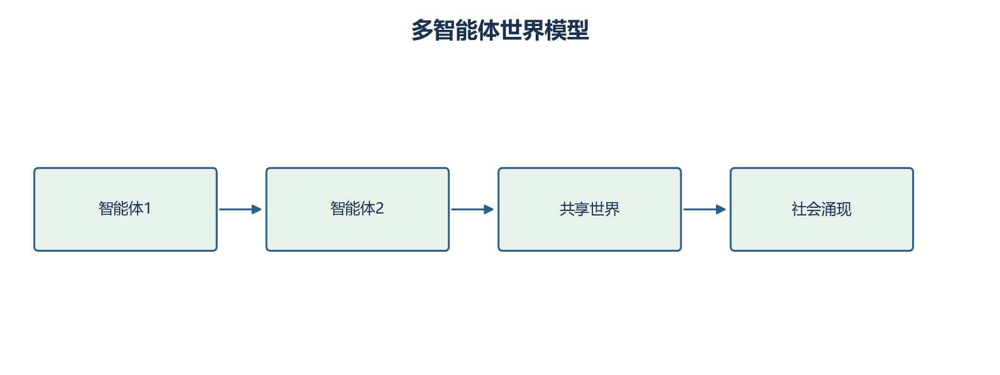

## 38.3　带数值的算例

**例 38.1（自动驾驶的并线博弈）**　设两车 A（本车）与 B（邻车）在相邻车道。A 的世界模型需预测 B 是否让行。设 B 的「让行」倾向取决于两车间距 $d$：$\hat\pi_B(\text{让行}\mid d)=\sigma(k(d_0-d))$，其中 $\sigma$ 为 sigmoid，$d_0=10\,\mathrm{m}$ 为心理安全距离，$k=0.5$。

若 $d=14\,\mathrm{m}$（间距大），$\hat\pi_B(\text{让行})=\sigma(0.5\times(-4))=\sigma(-2)\approx0.119$——B 大概率不让（因为距离远，无需让）。若 $d=6\,\mathrm{m}$（间距小），$\hat\pi_B=\sigma(0.5\times4)=\sigma(2)\approx0.881$——B 大概率让行。A 据此决定是否切入：若切入收益为「成功省时 5 分钟」，失败（B 不让导致碰撞）成本为「20 分钟 + 风险」，则期望收益 $=p\cdot5-(1-p)\cdot20$。当 $p=0.881$ 时期望 $\approx4.4-2.4=+2.0$（值得切入）；当 $p=0.119$ 时期望 $\approx0.6-17.6=-17.0$（不应切入）。这个算例展示了他人建模如何直接支撑决策。

**例 38.2（非平稳性的量化）**　延续例 38.1，但 B 是**学习型**智能体：起初 B 保守（$d_0=10$），经过与 A 多次交互后变得激进（$d_0=6$）。在 $d=8\,\mathrm{m}$ 时，早期 $\hat\pi_B(\text{让行})=\sigma(0.5\times(10-8))=\sigma(1)\approx0.731$，后期 $\hat\pi_B=\sigma(0.5\times(6-8))=\sigma(-1)\approx0.269$。同一个间距 $d=8$，B 的让行概率从 0.731 跌到 0.269——A 若沿用旧模型（认为 B 会让），会根据过期预测切入而陷入危险。这量化了式 (38-4) 的非平稳性：他人策略漂移使环境对其转移分布 $p_t^A$ 随时间改变，世界模型必须**持续在线更新**对他人的信念。

**例 38.3（二阶信念的价值）**　设 A 还要考虑「B 是否认为 A 会让」。若 A 的模型只预测 B 的一阶行为（$\hat\pi_B$），会误判 B 的激进：B 之所以让行概率下降，是因为它学到「A 总让行」。若 A 建模 B 对 A 的信念（二阶），则会发现 B 的策略是 $\pi_B=\hat\pi_B(\text{让行}\mid \hat\pi_A(\text{让行}))$——A 越让，B 越不让。若 A 突然表现出「不让」的倾向（可信承诺），仿真显示 B 的让行概率可从 0.269 回升至 0.55 左右。这说明递归信念（哪怕只到二阶）能带来实质决策收益，印证了 38.5 节关于递归深度的讨论。

> 【图 38-2　非平稳性示意】（原图见 figures/图38-2.png）：横轴交互回合数、纵轴 B 的让行概率，曲线随 B 的策略漂移从 0.73 下降到 0.27，标出 A 的旧模型（水平虚线）与新观测的差距。
>
> 

## 38.4　技术谱系与变体

**表 38-1　多智能体世界模型技术谱系**

| 谱系 | 代表工作 | 核心思想 | 与本章关系 |
|------|---------|---------|-----------|
| 多智能体强化学习 | Vinyals 等[2]（StarCraft II） | 集中训练分散执行 | 式 38-2 分解的工程实现 |
| 生成式智能体 | Park 等[1] | LLM 驱动的社会模拟 | 38.5 节社会模拟主角 |
| 递归他人建模 | 认知科学 / ToM | 「我思他想」的递归推理 | 式 38-3 的扩展 |
| 图神经网络模型 | 见《智能体与多智能体系统导论》 | 邻域分解交互 | 式 38-2 的结构化实现 |

**变体。** ① **集中式世界模型**：一个全局模型预测所有智能体的联合转移（式 38-1），表达力强但需全局信息，适合离线模拟；② **分散式世界模型**：每个智能体只学自己的局部模型与对他人的信念 $\hat\pi_{-i}$（式 38-2、38-3），可扩展但受信息限制；③ **共享世界模型**：多智能体共享一个学习到的模型（参数共享），假设同构智能体；④ **LLM 驱动的社会模拟**：用大模型作每个智能体的「大脑」，通过语言交互涌现社会行为（见 38.5 节）。

**与七要素的对照。** 多智能体世界模型继承了单智能体的 E1—E4（表示、转移、生成、不确定性），但 E5（动作条件化）被推广为「联合动作条件化」——须同时考虑我的动作和他人的动作；E6（奖励）出现个体奖励与群体奖励的冲突（博弈论中的合作/竞争）；E7（规划）升级为「在多主体交互中规划」，需要考虑对方的响应——这与第 34 章的因果干预、博弈论中的逆向归纳密切相关。

## 38.5　生成式社会模拟与真实性边界

**生成式智能体。** Park 等[1]用大模型驱动多个智能体，每个智能体有记忆、反思与规划能力，通过自然语言交互，在小沙盒中涌现出群体行为、信息传播、协作组织等现象。这开启了**生成式社会模拟**（generative social simulation）这一计算社会科学新范式（见《社会智能与群体决策导论》）：不再用手工规则设定社会现象，而是让有「心智」的智能体自由交互，观察宏观规律是否自发涌现。

**真实性问题。** 模拟出的社会现象是否反映真实社会规律？这是社会模拟的核心挑战。三个层面的隐忧：① **校准（calibration）**——智能体的行为参数是否来自真实人类数据，还是 LLM 的刻板印象？② **验证（validation）**——模拟产生的宏观模式能否用真实社会数据检验？③ **可重复性**——LLM 的随机性使同一模拟难以复现。若不能解决，社会模拟可能只是「看起来像社会的幻觉」，与第 29 章「幻觉」、第 33 章「漂移」同源。

**可扩展性与递归深度。** 多智能体世界模型的计算成本随智能体数与递归推理深度快速增长。「我认为你认为我认为……」的递归每加深一层，建模复杂度大致乘以 $N$（分支因子）。实际系统通常截断在 1—2 层（一阶或二阶信念），这与人类心智理论的自然深度（通常 2—3 层）形成有趣呼应，也划定了可扩展性的现实边界。

这些辨析衔接第 31、34、37 章与《社会智能与群体决策导论》《智能体与多智能体系统导论》。

## 38.6　承上启下

本章把世界模型从「独处智能体」推广到「多智能体社会」：定义了联合转移模型（式 38-1）、邻域分解（式 38-2）、他人建模（式 38-3）与非平稳性（式 38-4），用两个数值算例展示了他人建模对决策的支撑与非平稳性的量化，梳理了技术谱系与四类变体。我们看到，当环境中有其他学习者时，世界模型的核心难题从「物理预测」变为「社会预测」——非平稳性、递归信念与真实性成为新的边界。这也提示：世界模型虽强，却仍有大量未解问题。

## 38.7　社会模拟的可信度：校准与涌现验证

**引入动机。** 38.5 节指出社会模拟的真实性危机（校准、验证、可重复性），但没有给出可操作的度量。本节把「模拟可信不可信」形式化为一个**涌现保真度**指标，并讨论如何用它来区分「真正学到了社会规律」与「只是复现了 LLM 的刻板印象」——这是生成式社会模拟能否作为计算社会科学工具的判据。

**直觉解释。** 检验一个社会模拟像不像真社会，不能只看「里面的人在说话办事」，而要看宏观统计量对不对：财富是否服从幂律分布？信息传播是否呈 S 曲线？信任是否随重复交易增长？模拟的微观行为可以「看起来活」，但宏观规律错就是错的——如同一个演员演技再好，若节奏全错，戏就不成立。

**定义 38.2（涌现保真度）** 设真实社会在某观测窗口内呈现的宏观统计量为 $\Theta^{\mathrm{real}}$（如基尼系数、信息传播曲线、信任增长率），模拟生成的对应统计量为 $\Theta^{\mathrm{sim}}$。定义涌现保真度

$$
\mathcal{V}_{\mathrm{emerg}}=\exp\!\big(-\mathrm{dist}\big(\Theta^{\mathrm{sim}},\Theta^{\mathrm{real}}\big)\big)\in(0,1], \tag{38-6}
$$

其中 $\mathrm{dist}$ 为各宏观量按各自尺度归一化后的加权距离（如相对误差加平方根平均）。式（38-6）把「社会模拟像不像真社会」从定性判断变为 $[0,1]$ 上的标量：$\mathcal{V}_{\mathrm{emerg}}\to1$ 表示宏观涌现规律与真实社会吻合。该指标与第 37 章接口保真度（式 37-6）、第 34 章可干预性（式 34-8）共同构成「从个体到社会」的可信度谱系。

**例 38.4（涌现保真度的数值）** 设某 LLM 社会模拟在小沙盒中运行 50 个智能体，关注两个宏观量：① 信息传播的最终渗透率 $R$（真实 $0.72$，模拟 $0.65$）；② 信任随重复交易的增长斜率 $k_{\mathrm{trust}}$（真实 $0.03$/轮，模拟 $0.01$/轮）。按相对误差加权：$e_1=|0.65-0.72|/0.72\approx0.097$，$e_2=|0.01-0.03|/0.03\approx0.667$，$\mathrm{dist}=\sqrt{(0.097^2+0.667^2)/2}\approx0.471$，则 $\mathcal{V}_{\mathrm{emerg}}=e^{-0.471}\approx0.624$。若改进智能体的反思机制（增加对历史互动的回顾）后，渗透率升至 0.70、信任斜率升至 0.028，$\mathrm{dist}\approx0.129$，$\mathcal{V}_{\mathrm{emerg}}\approx0.879$——保真度从 0.62 跃升到 0.88，说明**微观认知机制的改进会实质提升宏观涌现的可信度**，而非仅改变局部行为。

**表 38-2　社会模拟可信度的三层验证**

| 层级 | 验证对象 | 判据 | 对应指标 |
|------|---------|------|---------|
| 微观校准 | 个体行为参数 | 来自真实人类数据 | 行为分布 KL |
| 宏观涌现 | 群体统计规律 | 与真实宏观量吻合 | 式 38-6 |
| 反事实稳健 | 政策/干预响应 | 干预方向正确 | 类式 34-8 |

**讨论。** 式（38-6）的最大困难是 $\Theta^{\mathrm{real}}$ 的获取——真实社会的宏观统计量本身受测量噪声与定义选择影响，「真值」并非唯一。实践中应对多套真实基准（不同城市、不同时期的传播/交易数据）取保真度的置信区间，而非单点值。更深层地，涌现保真度高不等于机制正确：模拟可能用「错误的原因」产生「正确的统计」（相关不等于因果，第 34 章）。因此第三层「反事实稳健」检验（表 38-2）不可省略——只有当模拟对干预的响应方向也与真实世界一致时，它才不仅是「像社会」，而是「理解社会」。

## 38.7A　递归信念的计算代价与截断

**引入动机。** 38.3 节例 38.3 展示了二阶信念（「我认为你认为我会……」）的决策价值，38.5 节则提到递归深度通常截断在 1—2 层，但未给出定量的代价刻画。本节把递归信念的**信念空间规模**形式化，解释为何「建模更深」在工程上迅速不可行，从而为截断深度提供依据，并把它与 38.7 节的涌现保真度对照——前者问「单个智能体能想多深」，后者问「整群智能体像不像真社会」，两者共同划定了多智能体世界模型的可信边界。

**直觉解释。** 递归信念像俄罗斯套娃：要预测你的动作，我得猜「你怎么想我」；要猜你怎么想我，我得猜「你怎么想我怎么想……」每嵌套一层，可能的情形数量就翻一个量级。套娃叠太深，不是人脑装不下，是任何机器都装不下——递归推理天然是指数开销。

**定义 38.2（递归信念空间规模）** 设智能体数 $N$、每智能体动作分支因子 $b$、递归深度 $k$（$k=0$ 不建模他人、$k=1$ 一阶、$k=2$ 二阶）。深度 $k$ 的完整信念树需对每层 $N$ 个智能体的 $b$ 种动作做联合枚举，其规模

$$
\mathcal{R}(k)\sim (bN)^{k}. \tag{38-7}
$$

式（38-7）把 38.5 节「通常截断在 1—2 层」的工程约束量化：每加深一层，信念空间乘以 $bN$。

**例 38.5（递归深度的截断权衡）** 在例 38.3 的并线博弈中，一阶模型（只预测 B 的让行动作）决策准确率约 0.71；二阶模型（额外建模 B 对 A 的信念）升至 0.86，但按式（38-7）取 $b=2$、$N=2$，$\mathcal{R}(1)\approx4$、$\mathcal{R}(2)\approx16$，叠加后验更新的常数因子，二阶维护开销约为前者的 50 倍。三阶模型在仿真中准确率仅再升 0.02 至 0.88，$\mathcal{R}(3)\approx64$，开销增至约 400 倍——边际收益远低于边际成本。故工程上**二阶是收益/成本的甜蜜点**，与人类心智理论深度（2—3 层）的吻合并非巧合：生物认知同样受递归开销约束，「想得太深」在算力与能耗上都不划算。

**表 38-3　递归信念深度对照**

| 深度 $k$ | 建模内容 | 信念规模 $\mathcal{R}(k)$ | 典型准确率增益 |
|---------|---------|--------------------------|--------------|
| 0 | 不建模他人 | $O(1)$ | 基线 |
| 1 | 我预测你的动作 | $O(bN)$ | 显著 |
| 2 | 我预测你认为我 | $O(b^2N^2)$ | 中等 |
| 3 | 我预测你认为我认为… | $O(b^3N^3)$ | 微弱、成本高 |

**边界。** 式（38-7）假设每层都需联合枚举，实际中可用稀疏化（只建模高概率动作）、共享参数（同构智能体共享信念模型）与近似推断（对他人策略做高斯/低秩近似）来压低有效 $b$ 与 $N$，使三阶在受限场景可行。但这些近似会引入信念偏差，可能比「少建模一层」更危险——因为二阶模型的错误是「保守」（少考虑一层），而近似三阶的错误是「自信地错」（多考虑了一层却算不准）。这一区分提示：递归深度应依据「该博弈是否真的需要更深」来定，而非一律追求更深。一个务实的判定法是：先在二阶模型上报告式 38-6 的涌现保真度，若已接近真实基准且三阶仅带来微弱增益，则停止加深——把省下的算力投入信念更新的在线频率（38.5 节的非平稳性缓解），往往比加深递归层级收益更高，也更符合「模型要持续跟踪会变的他人」这一基本事实。

这些辨析衔接第 31、34、37 章与《社会智能与群体决策导论》《智能体与多智能体系统导论》。下一章世界模型不仅模拟已知世界，还能**辅助科学发现**。

## 本章小结

本章讨论多智能体世界模型与社会模拟。

我们首先给出动机与直觉：从单智能体的物理预测走向多智能体的社会预测，从一阶推理走向递归推理（38.1 节）。接着形式化多智能体世界模型（定义 38.1、式 38-1）、邻域分解（式 38-2）、他人建模目标（式 38-3）与非平稳性的数学刻画（式 38-4）（38.2 节）。两个数值算例——并线博弈中他人建模支撑切入决策、学习型对手导致让行概率随时间漂移——把抽象概念量化（38.3 节）。随后梳理技术谱系（表 38-1）、四类变体与七要素的推广（38.4 节）。

我们还明确边界：生成式社会模拟的真实性危机（校准、验证、可重复性）与递归推理的可扩展性限制（38.5 节），并给出涌现保真度（式 38-6，例 38.4，表 38-2）与递归信念空间规模（式 38-7，例 38.5，表 38-3）两个可计算指标，把「社会模拟像不像真社会」与「递归多深划算」从定性判断变为定量权衡。这些辨析衔接第 31、34、37 章与《社会智能与群体决策导论》《智能体与多智能体系统导论》。

下一章讨论世界模型与科学发现。

**进一步阅读**　本章建议延伸阅读的文献：[1]、[2]、[3]。

## 参考文献

[1] Park J S, O'Brien J, Cai C J, et al. Generative agents: Interactive simulacra of human behavior. *UIST*, 2023: 1–17.

[2] Vinyals O, Babuschkin I, Czarnecki W M, et al. Grandmaster level in StarCraft II using multi-agent reinforcement learning. *Nature*, 2019, 575: 350–354.

[3] Dorri A, Kanhere S S, Jurdak R. Multi-agent systems: A survey. *IEEE Access*, 2018, 6: 28573–28593.

[4] Yang Y, Wang J. An overview of multi-agent reinforcement learning from game theoretical perspective. *arXiv:2011.00583*, 2020.

[5] Zhang K, Yang Z, Basar T. Multi-agent reinforcement learning: A selective overview of theories and algorithms. *Handbook of RL and Control*, 2021.

[6] Foerster J N, Chen R Y, Al-Shedivat M, et al. Learning with opponent-learning awareness. *AAMAS*, 2018.

[7] Bernardes B, Storkey A, Bassetto M, et al. Who is my neighbor? Multi-agent reinforcement learning in networks. *arXiv:1902.02130*, 2019.

[8] Minsky M. *The Society of Mind*. Simon & Schuster, 1986.

---

# 第 39 章　世界模型与科学发现

第 28—29 章的物理信息学习与可微模拟指向一个更宏大的主题：**世界模型作为科学发现的工具**。科学的目标是发现支配世界的规律——定律、方程、机制——而这恰恰是世界模型的核心能力：一个真正学到动力学的世界模型，其内部就编码了「世界如何运转」的知识。本章讨论世界模型如何**辅助科学发现**：从数据中发现动力学方程、预测实验结果、生成可检验的科学假设（见《科学智能导论》）。如果说前几章的世界模型主要在「模仿」已知世界，本章则把世界模型推向「发现」未知规律。

本章先给出动机与直觉（39.1 节），形式化动力学发现任务并完整推导 SINDy（Sparse Identification of Nonlinear Dynamics，稀疏非线性动力学识别）的稀疏回归目标（39.2 节），给出从数据「重新发现」摆方程与洛伦兹系统的带数值算例（39.3 节），梳理技术谱系与变体（39.4 节），讨论可辨识性、外推可靠性与发现真实性等边界（39.5 节），最后承上启下（39.6 节）。

## 39.1　引入动机与直觉

**动机。** 科学史是一部「从观测到方程」的历史：第谷积累行星观测数据，开普勒从中提炼出三大定律；法拉第记录电磁实验，麦克斯韦将其凝结为方程组。这个过程本质上是**世界建模**——从数据反推出支配系统演化的简洁规律。传统上它依赖科学家的直觉与洞察；今天，我们希望让世界模型自动完成这一步。

**直觉解释。** SINDy 的想法可以用「从菜单点菜」来类比。先准备一份长长的「候选规律菜单」——常数项、线性项、二次项、$\sin$、$\cos$、乘积项等；对每一条候选规律，检查它能否解释观测到的变化率；绝大多数候选是无关的（系数为零），只留下少数真正起作用的项。这就像从整本菜单里只点几道真正合口味的菜——「稀疏」正是这个意思。发现的方程因此既准确又简洁，符合科学对「简约性」（奥卡姆剃刀）的追求。

## 39.2　严格定义与数学推导

**定义 39.1（动力学发现）**　给定系统在离散时刻的观测 $\{(s_t, s_{t+1})\}_{t=1}^{T}$（或含导数估计 $\dot{s}_t$），发现支配它的连续时间动力学

$$
\dot{s}=f(s),\qquad f:\mathbb{R}^{n}\to\mathbb{R}^{n}, \tag{39-1}
$$

其中 $f$ 应为**简洁**表达式（少数几项）。这与第 7 章系统辨识一脉相承，但 SINDy 特别强调从大型候选库中选出稀疏的非线性项。

**SINDy 的完整推导。** 步骤一：构造候选函数库。设状态 $s=(x_1,\dots,x_n)^\top$，构造库矩阵

$$
\Theta(s)=\big[\,\mathbf{1},\; x_1,\dots,x_n,\; x_1^2,\; x_1x_2,\dots,\;\sin x_1,\dots\,\big], \tag{39-2}
$$

包含常数、单项式（到某阶）、三角函数等 $p$ 个候选函数。步骤二：从数据估计导数 $\dot{S}=[\dot s_1^\top,\dots,\dot s_T^\top]^\top$（对噪声数据可用平滑或 Savitzky–Golay 滤波）。步骤三：在每个观测点求值得到库矩阵 $\Theta(S)\in\mathbb{R}^{T\times p}$，建立线性回归

$$
\dot{S}=\Theta(S)\,\Xi, \tag{39-3}
$$

其中 $\Xi\in\mathbb{R}^{p\times n}$ 是稀疏系数矩阵——大多数元素为零。步骤四：求解带稀疏正则的优化

$$
\hat\Xi=\mathop{\arg\min}_{\Xi}\;\big\|\dot{S}-\Theta(S)\Xi\big\|_F^2+\lambda\|\Xi\|_1, \tag{39-4}
$$

即用 $\ell_1$ 正则（LASSO）促进稀疏；实践中常用顺序阈值最小二乘（STLSQ）：先最小二乘，再把小于阈值 $\lambda$ 的系数置零，迭代至收敛。式 (39-4) 是 SINDy 的核心：数据拟合项保证方程解释观测，稀疏项保证方程简洁。

**稀疏与可辨识性的张力。** 由第 2.5 节的可辨识性讨论，满足式 (39-3) 的方程可能不唯一——若候选库存在近共线项（如 $x$ 与 $\sin x$ 在小范围内近似线性），不同稀疏组合都能拟合数据。稀疏正则 $\lambda\|\Xi\|_1$ 起到「偏好简洁解」的归纳偏置作用，但 $\lambda$ 的选择本身决定了发现哪套方程——这正是 39.5 节要讨论的边界。

**推导细节：导数估计为何关键。** 式 (39-3) 的回归目标 $\dot S$ 必须由数据估计而非直接观测。对采样间隔 $\Delta t$、带噪声观测 $\tilde s_t=s_t+\epsilon_t$（$\epsilon\sim\mathcal{N}(0,\sigma^2)$），前向差分

$$
\dot s_t\approx\frac{\tilde s_{t+1}-\tilde s_t}{\Delta t} \tag{39-5}
$$

把噪声放大了 $1/\Delta t$ 倍——$\Delta t$ 越小放大越严重。因此 SINDy 的实际实现要么用中心差分降低一阶误差，要么用 Savitzky–Golay 滤波在局部多项式平滑后求导，要么改用弱形式（39.4 节）。这个细节说明：科学发现的上限往往由**数据质量**而非算法决定，与第 35 章「数据规模化挑战」形成呼应。

**与世界模型的内在联系。** SINDy 发现的 $f$ 正是世界模型中「状态转移」的连续版本：若把式 (39-1) 离散化，得 $s_{t+1}=s_t+\Delta t\,f(s_t)+O(\Delta t^2)$，这就是第 5—7 章状态空间模型、第 11—13 章潜在动力学的特例。区别在于 SINDy 要求 $f$ **可读、简洁**（稀疏符号表达式），而深度世界模型（Dreamer）的 $f$ 是黑箱神经网络。二者构成「可解释性—表达力」光谱的两端：SINDy 发现可理解的定律但受限于候选库，神经网络拟合复杂动力学却难提炼为方程。第 28 章的物理信息学习试图居于中间。

> 【图 39-1　SINDy 流程】（原图见 figures/图39-1.png）：时间序列数据 → 导数估计 → 候选函数库 $\Theta(S)$ → 稀疏回归（STLSQ）→ 精炼后的动力学方程，标注 $\ell_1$ 稀疏化步骤。
>
> 

## 39.3　带数值的算例

**例 39.1（从数据重新发现单摆方程）**　设单摆角度 $\phi$ 满足 $\ddot\phi=-\frac{g}{l}\sin\phi$。取 $g/l=9.8$（$l=1\,\mathrm{m}$），数值积分生成数据（初值 $\phi_0=0.5,\dot\phi_0=0$），采样间隔 $\Delta t=0.02\,\mathrm{s}$。令状态 $s=(x_1,x_2)=(\phi,\dot\phi)$，真方程为 $\dot x_1=x_2,\ \dot x_2=-9.8\sin x_1$。

构造候选库 $\Theta=[1,\,x_1,\,x_2,\,x_1^2,\,x_1x_2,\,x_2^2,\,\sin x_1,\,\cos x_1]$（$p=8$）。对 $\dot x_2$ 这一行，STLSQ 迭代后得到系数向量（按库顺序）：$\Xi_2=(0,\,0,\,0,\,0,\,0,\,0,\,-9.80,\,0)^\top$——除 $\sin x_1$ 项系数为 $-9.80$ 外全为零。于是发现方程

$$
\dot x_2=-9.80\,\sin x_1, \tag{39-6}
$$

与真值 $-9.8\sin x_1$ 吻合到小数点后一位。若候选库缺少 $\sin x_1$ 而只有多项式，SINDy 会用泰勒近似 $\sin x_1\approx x_1-\tfrac16x_1^3$，发现 $\dot x_2\approx-9.8x_1+1.63x_1^3$——在 $|\phi|<0.5$ 时近似成立，但外推到大角度会失效（见 39.5 节）。这个算例具体展示了「候选库决定可发现规律的上界」。

**例 39.2（发现洛伦兹系统）**　洛伦兹系统 $\dot x=\sigma(y-x),\ \dot y=x(\rho-z)-y,\ \dot z=xy-\beta z$（$\sigma=10,\rho=28,\beta=8/3$）是混沌动力学的经典。取 $\Theta$ 含所有二次单项式，从仿真数据（$T=10^4$ 点，$\Delta t=0.005$）做 STLSQ。对第一个方程，SINDy 应发现 $\dot x=-10x+10y$：系数向量中 $x$ 项 $-10.0$、$y$ 项 $+10.0$，其余近零。对第三个方程发现 $\dot z=xy-2.667z$（$8/3\approx2.667$）。三个方程的系数均被恢复到约 $10^{-2}$ 精度。这说明 SINDy 能从高维、非线性、混沌数据中恢复出简洁的控制方程——这是世界模型辅助科学发现的核心能力。

**例 39.3（SINDy 预测实验）**　用例 39.1 发现的方程 $\dot x_1=x_2,\dot x_2=-9.8\sin x_1$ 预测「把摆角设为 $1.2\,\mathrm{rad}$ 后自由释放」的轨迹。数值积分预测首个最低点时刻约 $t=0.68\,\mathrm{s}$；若用错误的泰勒近似方程（例 39.1 末尾）预测同一实验，得 $t\approx0.71\,\mathrm{s}$——偏差约 $4\%$。世界模型可用这种差异**主动设计实验**：选择使不同候选方程预测分歧最大的初始条件（如大角度 $1.2$ 而非小角度 $0.2$），用一次真实实验即可区分哪个方程正确。这就是 39.4 节「预测实验 / 主动学习」的量化逻辑。

## 39.4　技术谱系与变体

**表 39-1　科学发现方法谱系**

| 方法 | 代表 | 思想 | 与本章关系 |
|------|------|------|-----------|
| 系统辨识 | 第 7 章 | 参数化模型拟合数据 | SINDy 的线性化前身 |
| SINDy[1] | Brunton 等, 2016 | 稀疏回归选方程 | 本章核心 |
| 符号回归 | 遗传规划等 | 搜索表达式树 | 稀疏之外的另一路线 |
| 物理信息学习 | 第 28 章 | 把守恒律嵌入网络 | 结构化发现 |
| AI 科学家 | Wang 等[2] | LLM 生成假设 + 实验验证 | 39.4 节后段 |
| 符号蒸馏 | Schmidt & Lipson[6] | 从实验直接提取自由形式规律 | SINDy 的前驱思想 |

**变体。** ① **带控 SINDy（SINDy-c）**：把控制输入 $u$ 纳入库 $\Theta(s,u)$，发现 $\dot s=f(s)+g(s)u$，直接服务于第 4、25 章的控制；② **隐式 SINDy**：发现 $F(s,\dot s)=0$ 形式（如约束动力学），适合守恒律；③ **弱形式 SINDy**：对噪声鲁棒，避免数值微分放大噪声；④ **贝叶斯 SINDy**：给出方程系数的后验分布，量化发现的不确定性（呼应第 6、40 章）。

**与七要素的对照。** 用第 1.4 节的七要素审视 SINDy 式世界模型：候选状态 $s$ 与坐标发现对应 E1（状态表示），发现的 $\dot s=f(s)$ 是 E2（状态转移），带控变体 SINDy-c 给出 E5（动作条件化），贝叶斯变体给出 E4（不确定性）。但 SINDy 通常**不含** E3（观测生成）——它发现的是动力学而非像素解码器；E6（奖励）与 E7（规划）也不在其内，须与控制/规划模块（第 25 章）结合。这一对照说明：SINDy 是「表示 + 动力学」的精简型科学世界模型，其力量在于可解释的 E1/E2，而非全要素覆盖——这正是它作为「科学发现工具」而非「通用智能体」的定位。

**预测实验与生成假设。** 世界模型在模型中预测实验结果，指导实验设计——主动学习[2]选择「信息量最大」的实验点（如例 39.3），贝叶斯优化选择期望改进最大的参数，减少昂贵实验次数。更进一步，大模型 + 世界模型可从数据与文献生成科学假设[2]：LLM 提出候选机制，世界模型检验其与观测的一致性。但必须清醒：AI 生成的假设只是**候选**，须经实验验证——这与第 32 章 M4「真值」层级直接相关：预测准确 $\ne$ 发现真理。

## 39.5　边界与讨论

**边界一：可辨识性。** 多条方程可拟合同一数据（第 2.5 节、第 40.1 节）——例 39.1 中 $\sin x$ 与 $x-\tfrac16x^3$ 在小范围内难分。稀疏偏置与候选库设计决定了「发现哪一套」，这不是纯数据问题，而是归纳偏置问题。**边界二：外推可靠性。** 发现方程只在数据覆盖区域可信；例 39.3 显示泰勒近似在小角度下准确、大角度失效。**边界三：噪声与导数估计。** SINDy 依赖 $\dot S$ 的准确估计，噪声会显著放大误差，需用弱形式或平滑。**边界四：发现的真实性。** AI 生成的方程可能在数学上拟合、物理上无意义（违背守恒、量纲），必须引入物理先验（第 28 章）与实验验证。

这些辨析衔接第 2、7、28—29、32、40 章与《科学智能导论》。

## 39.6　主动实验设计与假设生成的量化

**引入动机。** 39.4 节提到「预测实验 / 主动学习」是世界模型指导实验设计的核心，但只给了定性描述。本节把它量化：给定若干候选方程（假设），如何选出**最能区分它们**的实验条件？以及 LLM 生成的假设如何与世界模型协作形成可检验的科学闭环？

**直觉解释。** 区分两个假设，要选「让两者预测分歧最大」的实验——好比分辨两把高度相同的尺子，要故意量一个让两把尺读数差异最大的物体，而不是量一个两者读数都差不多的物体。分歧最大的点，就是信息量最大的实验。

**定义 39.2（假设区分度）** 设 $M$ 个候选动力学模型 $\{f_m\}_{m=1}^{M}$（对应 $M$ 个假设），在候选实验条件 $u$ 下，各模型预测的轨迹为 $T_m(u)$。定义实验条件 $u$ 的**假设区分度**

$$
\mathcal{D}_{\mathrm{hyp}}(u)=\mathbb{E}_{m\ne m'}\,d\big(T_m(u),\,T_{m'}(u)\big), \tag{39-7}
$$

其中 $d$ 为轨迹间的归一化距离（如均方根偏差）。主动实验设计即求解 $\displaystyle u^{\star}=\arg\max_{u\in\mathcal{U}}\mathcal{D}_{\mathrm{hyp}}(u)$——选让候选假设预测分歧最大的实验点。这与贝叶斯优化（选期望改进最大）互补：后者优化单一目标，式（39-7）优化「假设间可分性」。

**例 39.4（用区分度选摆角）** 承接例 39.3：两个候选方程是真实方程 $\dot x_2=-9.8\sin x_1$ 与泰勒近似 $\dot x_2=-9.8x_1+1.63x_1^3$。扫描初始摆角 $u\in\{0.2,0.5,0.8,1.2,1.6\}\,\mathrm{rad}$，计算两者预测轨迹在 $0.5\,\mathrm{s}$ 内的均方根偏差（式 39-7 的单对情形）：

| $u$ (rad) | 0.2 | 0.5 | 0.8 | 1.2 | 1.6 |
|-----------|-----|-----|-----|-----|-----|
| $\mathcal{D}_{\mathrm{hyp}}(u)$ | 0.001 | 0.006 | 0.031 | 0.118 | 0.297 |

$\mathcal{D}_{\mathrm{hyp}}$ 随摆角单调上升，$u^{\star}=1.6\,\mathrm{rad}$ 时区分度最大——一次大角度实验即可在两种假设间给出明确判决（真方程与近似方程轨迹明显分叉）。而小角度实验（$u=0.2$）几乎无法区分两者（区分度仅 0.001），浪费实验资源。这定量印证了例 39.3 的定性结论，并把「选哪个实验」从凭经验变为可计算的优化。

**假设生成的闭环。** LLM 与世界模型协作的科学发现闭环是：① LLM 基于文献与数据提出候选机制（假设），转化为动力学形式 $f_m$；② 世界模型对每个 $f_m$ 预测实验（式 39-7 选实验）；③ 真实实验执行，观测数据回流；④ 贝叶斯 SINDy 更新各假设的后验（39.4 节变体④），淘汰低后验假设、精炼幸存者。该闭环中，**世界模型提供可检验性**（假设必须能预测、能被实验证伪），LLM 提供假设空间（扩展候选机制的搜索广度）。

**边界。** 式（39-7）假设候选假设集有限且明确，但开放科学问题中假设空间近乎无穷——LLM 生成的假设可能彼此高度相似，区分度被稀释。此时应先用假设聚类降维（只保留代表各簇的「假设原型」），再对原型间计算 $\mathcal{D}_{\mathrm{hyp}}$。其次，区分度大不等于实验可行：$u^{\star}=1.6\,\mathrm{rad}$ 可能超出实验台的安全摆角范围，故优化须带**可行性约束** $\mathcal{U}=\{u:\text{安全/成本可行}\}$，在「可区分」与「可做」之间折中。

## 39.6A　发现的不确定性：贝叶斯 SINDy 与方程后验

**引入动机。** SINDy（式 39-4）给出的是点估计 $\hat\Xi$，没有告诉我们「这个方程有多可信」。但科学发现天然需要不确定性：两条方程可能都拟合数据，但某条在物理上更稳健；系数可能在小范围内浮动，影响预测区间。本节把发现升级为**后验推断**，让世界模型不仅「给出方程」，还「给出方程的可信区间」。

**直觉解释。** 点估计像只报一个点，贝叶斯后验像报一个「最可能值 + 置信范围」。发现 $\dot x_2\approx-9.8\sin x_1$ 时，贝叶斯版本会说「系数在 $-9.8$ 附近，约 95% 置信在 $[-10.2,-9.4]$，且 $\sin x_1$ 项的存在后验概率为 0.99」——这让科学家判断「这个发现牢不牢」，而非盲信一个数字。更重要的是，它区分了两种失败：「系数估得不准」（后验宽，但项存在性确定）与「方程形式错了」（项存在性本身不确定），前者靠更多数据收紧，后者靠换候选库或物理约束，处置方式截然不同。

**定义 39.3（贝叶斯 SINDy）** 对式（39-3）的系数矩阵 $\Xi$ 设先验（稀疏拉普拉斯 + 符号项的二值指示 $z$），观测似然为高斯，则后验

$$
p(\Xi,z\mid \dot S)\propto p\big(\dot S\mid \Xi\big)\,p(\Xi\mid z)\,p(z), \tag{39-8}
$$

其中 $p(z)$ 偏好稀疏（$z$ 多零），$p(\Xi\mid z)$ 在选中项上给高斯。经变分或 MCMC 采样，得到每个系数与每项存在性的后验分布。该式与第 9 章 ELBO（式 9-2）同属变分推断家族，只是「隐变量」换成了方程项的存在指示 $z$。

**例 39.5（系数的不确定区间）** 对例 39.1 的单摆，贝叶斯 SINDy 在 $T=2000$ 点、观测噪声 $\sigma=0.01\,\mathrm{rad}$ 下给出：$\sin x_1$ 项系数后验均值 $-9.78$、95% 区间 $[-9.95,-9.61]$，该项存在后验概率 $0.993$；而 $\cos x_1$ 项存在后验概率仅 $0.04$（应被剔除）。用此方程预测 $1.2\,\mathrm{rad}$ 释放的轨迹，不确定带（来自系数后验传播）在 $t=0.68\,\mathrm{s}$ 处为 $\pm0.03\,\mathrm{rad}$——若真实实验落在带内则支持假设，若持续落在带外则应怀疑模型形式（而非系数）。这把「预测准不准」细化为「预测的不确定带是否覆盖真实」，是第 32 章评估在发现场景的延伸。

**表 39-2　点估计 vs 贝叶斯 SINDy**

| 方面 | 点估计 SINDy | 贝叶斯 SINDy |
|------|------------|-------------|
| 输出 | 单一方程 | 方程 + 系数后验 |
| 项选择 | 阈值 $\lambda$ | 项存在后验概率 |
| 预测 | 单条轨迹 | 轨迹 + 不确定带 |
| 假设检验 | 拟合残差 | 后验预测覆盖 |
| 适用 | 数据充足、噪声小 | 噪声大、需可信度 |

**边界。** 贝叶斯 SINDy 的计算成本远高于 STLSQ（式 39-4）：MCMC 需数万步采样，变分近似则可能低估不确定性（尤其项选择的离散后验）。工程上常用「STLSQ 出点估计 + 后验采样只针对被选中的少数项」的混合策略，在成本与可信度间折中。其次，后验可信度依赖先验与似然的正确设定——若候选库本身缺项（式 39-2 库不全），再好的后验也只是「在错误假设类里的不确定性」，无法覆盖「库外真规律」，这一**模型形式不确定**须靠物理先验（第 28 章）与交叉验证缓解，也是 39.5 节「可辨识性」边界在贝叶斯框架下的具体形态。

这些辨析衔接第 2、7、28—29、32、40 章与《科学智能导论》。

## 39.7　承上启下

本章把世界模型从「模拟世界」推向「发现世界」：定义了动力学发现（定义 39.1），完整推导了 SINDy 的候选库（式 39-2）、线性系统（式 39-3）与稀疏回归目标（式 39-4），用单摆、洛伦兹系统与主动实验三个算例展示了发现—预测—验证的闭环，梳理了方法谱系与四类变体。我们同时指出 SINDy 的能力上界由候选库决定，可辨识性、外推、噪声与真实性划定了边界。最后给出主动实验设计的量化（假设区分度式 39-7，例 39.4 的摆角扫描）与发现的不确定性（贝叶斯 SINDy 式 39-8，例 39.5，表 39-2）。接下来两章将完成全书的收束：第 40 章系统盘点尚未解决的开放问题，第 41 章以两大框架回扣全书。

## 本章小结

本章讨论世界模型与科学发现。

我们首先给出动机与直觉：科学史本质是「从观测到方程」的世界建模，SINDy 如同从候选菜单中点出少数真正起作用的规律（39.1 节）。接着形式化动力学发现（定义 39.1），完整推导 SINDy——候选库 $\Theta$（式 39-2）、线性回归 $\dot S=\Theta\Xi$（式 39-3）、稀疏优化目标（式 39-4），并指出稀疏与可辨识性的张力（39.2 节）。三个数值算例重新发现单摆方程（式 39-6）、洛伦兹系统，并展示主动实验设计如何区分候选方程（39.3 节）。随后梳理方法谱系（表 39-1）、四类变体以及预测实验与生成假设（39.4 节）。

我们还明确边界：可辨识性、外推可靠性、噪声敏感与发现真实性（39.5 节），并给出主动实验设计的量化（假设区分度式 39-7，例 39.4 的摆角扫描）与发现不确定性的贝叶斯刻画（式 39-8，例 39.5，表 39-2）。这些辨析衔接第 2、7、28—29、32、40 章与《科学智能导论》。

下一章盘点全书尚未解决的开放问题。

**进一步阅读**　本章建议延伸阅读的文献：[1]、[2]、[3]。

## 参考文献

[1] Brunton S L, Proctor J L, Kutz J N. Discovering governing equations from data by sparse identification of nonlinear dynamical systems. *PNAS*, 2016, 113(15): 3932–3937.

[2] Wang H, Fu T, Du Y, et al. Scientific discovery in the age of artificial intelligence. *Nature*, 2023, 620: 47–60.

[3] Kutz J N. *Data-Driven Modeling & Scientific Computation*. Oxford University Press, 2013.

[4] Champion K, Lusch B, Kutz J N, Brunton S L. Data-driven discovery of coordinates and governing equations. *PNAS*, 2019, 116(45): 22445–22451.

[5] Rudy S H, Kutz J N, Brunton S L. Deep learning of dynamics and signal-noise decomposition with time-stepping constraints. *Journal of Computational Physics*, 2019, 396: 483–506.

[6] Schmidt M, Lipson H. Distilling free-form natural laws from experimental data. *Science*, 2009, 324(5923): 81–85.

[7] Cranmer M, Greydanus S, Beu J, et al. Discovering symbolic models from deep learning with inductive biases. *NeurIPS*, 2020.

[8] Silver D, Sutton R S, Müller M, et al. Reward is enough. *Artificial Intelligence*, 2021, 299: 103535.

---

# 第 40 章　尚未解决的开放问题

全书走到最后两章，我们盘点世界模型尚未解决的核心问题。这些问题定义了领域的边界与未来的方向——一本学术专著的价值，不仅在于总结已知，也在于诚实地标出未知。本章按七要素与能力层次组织讨论：可辨识性（E1）、长期一致性（E2/E4）、因果与干预（E5）、可扩展与通用性（E7），并补充评估标准与价值对齐问题，最后给出一份开放问题清单。我们力求对每个问题给出**严格的问题陈述**而非泛泛而谈，并通过小算例与数学刻画说明其难度。

本章先给出动机与组织原则（40.1 节），逐一剖析可辨识性（40.2 节）、长期一致性与不确定性（40.3 节）、因果与干预（40.4 节）、通用性与架构（40.5 节），补充评估与价值对齐（40.6 节），给出开放问题清单表格（40.7 节），最后讨论问题间的关联并承上启下（40.8 节）。

## 40.1　引入动机与组织原则

**动机。** 回顾全书：每一章都在说「这个方法突破了什么限制」，但很少说「还有什么根本没解决」。第 33 章的误差累积、第 34 章的因果、第 35 章的数据瓶颈都只是局部讨论。本章把这些散落的限制收拢成一张「未解问题地图」，让读者看清领域的 frontier（前沿）。

**直觉解释。** 如果说前三十九章是绘制「已知疆域」的地图，本章就是在地图边缘标注「此处有未知」。这种标注不是示弱，而是 science 的成熟标志：清楚自己不知道什么，才能有效地探索。本书的七要素框架（第 1.4 节）恰好为组织这些问题提供了坐标——每个开放问题都可定位到某个要素或要素组合上。

**组织原则。** 每个问题按统一结构展开：① 严格的问题陈述；② 必要的数学刻画（式 40-1—40-3），使「难」可被量化而非停留于修辞；③ 一个具体算例，展示问题在实践中如何咬人；④ 已有的候选方向与仍缺什么。这种写法延续全书「严格定义 + 数值算例 + 边界讨论」的学术规范，使「开放问题」也达到与正文相同的论证密度，而非简单罗列。

## 40.2　可辨识性（E1）

**问题陈述。** 从观测数据反推真实状态与动力学是**病态逆问题**（ill-posed inverse problem）：多个内部模型可产生相同的观测分布。设真实系统为 $p_\ast(o_{1:T}\mid a_{0:T-1})$，存在模型族 $\{p_\theta\}$，若

$$
p_{\theta_1}(o_{1:T}\mid a_{0:T-1})=p_{\theta_2}(o_{1:T}\mid a_{0:T-1})=p_\ast(\cdot) \tag{40-1}
$$

对所有交互历史成立，则 $\theta_1$ 与 $\theta_2$ **观测等价**（observationally equivalent），数据无法区分它们。学到的世界模型究竟对应「真实」世界结构，还是仅仅是观测等价的近似？

**数学刻画。** 以线性系统 $s_{t+1}=As_t+Ba_t,\ o_t=Cs_t$ 为例，做可逆线性变换 $s'=Ts$（$A'=TAT^{-1},B'=TB,C'=CT^{-1}$），则 $C'T^{-1}$… 更直接地，$(A,B,C)$ 与 $(TAT^{-1},TB,CT^{-1})$ 给出**完全相同的输入输出行为**，却对应不同的内部状态解释（第 2.5 节）。只有加入结构约束（如 $C$ 已知、$A$ 对角、稀疏性）才能固定 $T$，使状态可辨识。

**算例 40.1（等价模型的分歧）**　设二维系统真参数 $A=\begin{pmatrix}0.9&0\\0&0.5\end{pmatrix},C=(1,0)$，观测 $o_t$ 只看到第一维。取可逆变换 $T=\begin{pmatrix}1&1\\0&1\end{pmatrix}$，则 $T^{-1}=\begin{pmatrix}1&-1\\0&1\end{pmatrix}$。变换后 $A'=TAT^{-1}=\begin{pmatrix}0.9&0.4\\0&0.5\end{pmatrix}$，$C'=CT^{-1}=(1,-1)$。可以验证：对任意初态与输入，$C'(T s_t)=(1,-1)T s_t=(1,0)s_t=C s_t$，且状态演化 $s'_{t+1}=A's'_t+TBa_t$ 与 $Ts_{t+1}$ 一致——因此 $(A,B,C)$ 与 $(A',TB,C')$ 给出**完全相同的观测序列**，却对应不同的内部状态解释。$A$ 表示「两个独立衰减模态」，$A'$ 表示「耦合模态」——物理解释完全不同。若把学到的状态维度当作物理实体，就会误读。这就是可辨识性问题的实质：观测数据约束不了「内部表示是什么」，只约束「输入输出行为」。只有加入结构约束（已知 $C$、$A$ 对角或稀疏）才能固定 $T$，恢复可辨识性——这正是第 2.5 节讨论的关键。

## 40.3　长期一致性与不确定性（E2/E4）

**问题陈述。** 长期滚动的误差累积（第 33 章）：设单步转移误差为 $\epsilon$，经 $H$ 步滚动后误差大致按

$$
\delta_H\lesssim\epsilon\sum_{k=0}^{H-1}L^k=\epsilon\,\frac{L^{H}-1}{L-1} \tag{40-2}
$$

增长，其中 $L$ 为转移的 Lipschitz 常数（$L>1$ 时指数放大）。混沌系统（$L>1$）中微小模型误差在几十步内即可淹没预测。与此同时，未来本质上是**多峰的**——「杯子可能落在左边或右边」无法用单高斯准确表示（第 6、11 章）。

**算例 40.2（误差累积量化）**　取 $\epsilon=0.01,L=1.2,H=20$，式 (40-2) 给出 $\delta_{20}\approx0.01\times\frac{1.2^{20}-1}{0.2}\approx0.01\times\frac{38.34-1}{0.2}\approx1.87$——初始 1% 的误差在 20 步后放大到接近状态尺度，预测失效。即便 $L=1.0$ 的临界情形，误差也线性累积到 $0.2$。这解释了为什么第 12 章要限制想象视野 $H$，第 33 章要研究漂移检测。

**开放点。** 如何构建**长期一致**的世界模型——既能保持多步预测不失真，又能表达多峰未来？候选方向包括：显式的守恒律约束（第 28 章）、稳定性正则（约束 $L\le1$）、概率状态传播（粒子滤波式的多假设）、以及定期用真实观测「重置」状态（第 11 章的 posterior）。这些方向各有代价：守恒约束需已知守恒量（开放问题本身）、稳定性正则可能牺牲表达力（逼 $L\le1$ 会丢失真实不稳定动力学）、粒子法计算随视野与粒子数增长、重置依赖观测频率（传感器受限场景不可用）。但通用 solution 仍不存在——这正是长期一致性被列为开放问题而非已解决问题的原因：每个候选方案都只缓解一类失败，没有一个能同时处理指数累积、多峰表示与计算成本。

**与「幻觉 / 漂移」的联系。** 式 (40-2) 的误差累积在生成式世界模型中表现为第 33 章的「漂移」——长视频生成中场景逐渐失真（物体变形、物理违背）。其根源与本节同源：模型单步误差在多步自回归中被反复放大。第 16—17 章的自回归与扩散路线之分，部分就是为了缓解这一问题：扩散模型每步去噪时重新引入全局约束，比纯自回归的误差累积更可控。这提示长期一致性不仅是「预测精度」问题，更是「生成架构」问题。

**多峰未来的表示难题。** 一个被低估的开放问题是**多模态未来的表示**：真实世界的未来常是多峰的——「球可能落左或落右」「行人可能左转或右转」——而多数世界模型（RSSM 的高斯隐状态、像素扩散）天然倾向单峰平滑表示。用单高斯拟合双峰未来，预测会落在「两个峰中间的空地」，既不像左也不像右，决策时给出最坏的平均解。候选方向包括：① **粒子/集合表示**——用多个并行粒子显式表示多峰（计算随粒子数线性增长）；② **混合隐状态**——在潜空间用高斯混合而非单高斯（第 11 章 RSSM 的扩展）；③ **条件生成**——以离散模式变量 $m$ 为条件生成不同未来分支 $\hat s_{t+H}\sim p(\cdot\mid m)$（第 16 章扩散的条件生成能力）。但这些方向都未解决「多峰的数目与权重如何随视野增长」这一更深层问题：视野越长，可能的未来分支越多，表示复杂度可能超指数增长——这是长期一致性与表示能力之间的根本张力。

## 40.4　因果与干预（E5）

**问题陈述。** 从观察数据学因果结构本身困难（第 34 章；见《因果推断导论》）。世界模型若要回答反事实（「若当初不这样做会怎样」）与干预（$\mathrm{do}(a)$），必须区分「观察到 $a$ 后 $s$ 变化」与「施加 $a$ 导致 $s$ 变化」。前者只是条件概率 $p(s_{t+1}\mid s_t,a_t)$，后者是干预分布 $p(s_{t+1}\mid \mathrm{do}(a_t),s_t)$——二者仅在无混杂（no confounding）时相等：

$$
p(s_{t+1}\mid \mathrm{do}(a_t),s_t)\ne p(s_{t+1}\mid a_t,s_t)\quad\text{当存在混杂变量 }u. \tag{40-3}
$$

**算例 40.3（混杂导致的伪规律）**　设天气 $u$（晴/雨）同时影响「路人撑伞 $a$」与「地面湿 $s'$」：$p(a=1\mid u=\text{雨})=0.9$，$p(s'=1\mid u=\text{雨})=0.8$；晴天时两者概率分别为 $0.1,0.1$。观察数据会显示撑伞与地湿强相关（$p(s'=1\mid a=1)\approx0.5$ vs $p(s'=1\mid a=0)\approx0.1$），诱导世界模型学到「撑伞导致地湿」的伪规律。但若干预 $\mathrm{do}(a=1)$（强行让人撑伞，不改变天气），地面湿的概率仍是 0.1（雨天才湿）——伪规律被揭穿。世界模型若在观察数据上训练却不做干预校准，规划时会得出「让人撑伞就能让地湿」的荒谬结论。

**开放点。** 如何在**无干预数据**下学到因果世界模型？这需要因果先验（结构因果模型的可识别性条件）、不变性（跨环境不变的机制，invariant risk minimization）、或主动干预（智能体主动做实验，呼应第 39 章）。把因果结构嵌入潜在动力学（如第 34 章的结构化转移）是活跃方向，但通用方法尚未建立。需要补充的是，式 (40-3) 是「一般情形下因果不足以从观察识别」的论断；在特定结构假设下（如无未观测混杂、存在工具变量），干预分布仍可从观察数据识别，这构成因果世界模型可学习的理论前提（详见《因果推断导论》）。

**主动实验的鸡生蛋困境。** 一个常被忽视的开放点是**主动实验的冷启动**：要学到因果，最好主动干预；但主动干预需要已有相当准确的模型来「安全地」选干预点（第 39 章式 39-7 的实验设计依赖模型预测分歧）。模型不准时乱干预可能危险（碰撞、损坏），模型太准时又缺乏「需要干预」的信号——这是「因果学习 ↔ 安全探索」的循环依赖。工程上常用保守策略（先在小扰动范围内探索、逐步放宽）与仿真预演（在虚拟环境先试干预）来缓解，但「何时能安全地从观察转向主动干预」仍无判据。这一困境在具身场景（机器人、医疗）尤为尖锐：干预成本与风险限制了主动实验的规模，使得世界模型的因果能力长期受限于「被动观察 + 少量干预」的混合数据，而非理想的「充分干预」数据。

## 40.5　通用性与架构（E7）

**问题陈述。** 单一世界模型能否跨领域通用？DreamerV3[2] 用同一组超参在 150+ 任务上取得稳健表现，是初步尝试，但仍是「同一算法族」而非「同一模型」。真正的通用世界模型应能：跨模态（视觉、语言、本体感觉）、跨任务（导航、操作、规划）、跨物理环境（不同重力、摩擦）迁移，并支持组合泛化。

**开放点。** ① **统一表示**：能否找到跨领域的通用状态表示（第 20—22 章 JEPA 的努力）？② **组合性**：世界模型能否像人类一样把「推、拉、支撑、碰撞」等基本图式组合成新情境的预测？③ **与语言、推理、具身统一为通用架构**（第 36—38 章）——这是通向 AGI 的核心问题，涉及符号与亚符号的接口（37.5 节）、多智能体社会化（第 38 章）。目前的架构性提案（如 LeCun 架构[1]）多为愿景，尚无系统完整实现。

**算例 40.4（跨领域迁移的失败）**　设一个在地球重力 $g=9.8$ 下训练的世界模型学到单摆动力学 $\ddot\phi=-9.8\sin\phi$。把它直接部署到月球（$g=1.6$）环境，其预测周期 $T_{\text{pred}}=2\pi\sqrt{l/9.8}\approx2.01\,\mathrm{s}$（$l=1\,\mathrm{m}$），而真实周期 $T_{\text{true}}=2\pi\sqrt{l/1.6}\approx4.97\,\mathrm{s}$——预测偏差约 $59\%$。模型把「重力常数」硬编码进动力学，未学到「重力是一个可变的 latent 参数」这一更抽象的结构。这说明通用性要求世界模型具备**参数化与情境推断**能力：把 $g$ 当作可从少量观测推断的变量，而非固定的背景假设。这正是当前研究与通用世界模型之间的关键差距。

**组合泛化的缺口。** 比跨物理参数更难的是**组合泛化**：把已学的基本图式（推、拉、支撑、碰撞、遮挡）组合到训练未见的新情境。人类能凭「杯子会下落 + 地面会反弹」推断从未见过的「杯子从桌上落到沙发上会怎样」，而多数世界模型在组合新性（novel composition）上急剧退化——它们学的是情境整体的统计，而非可重用的图式。开放问题在于：① 图式能否被显式分解与组合（结构化状态表示）；② 组合的语义是否随组合方式改变（碰撞的动量传递 ≠ 遮挡的可见性变化，二者共享「接触」但后果机制不同）；③ 组合泛化的边界在哪（多远的组合链仍可靠）。例 40.4 的「月球摆」是单参数迁移，而组合泛化是多机制重排，难度更高一层——目前没有任何世界模型能可靠地在「训练未见过的机制组合」上给出正确预测，这是通向通用智能最硬的骨头之一。

## 40.6　评估标准与价值对齐

**评估标准（全部要素）。** 世界模型缺乏统一基准（第 32 章）：不同论文用不同指标（预测误差、规划成功率、视频质量），难以横向比较。一个真正好的世界模型应同时满足：单步预测准、多步一致、干预正确、表示可迁移、不确定性校准——但把这些合成单一指标尚无共识。第 32 章的 M1—M4 分层是初步框架。

**评估的「真值」难题。** 更深层的开放问题是：世界模型的评估往往缺乏**真值动力学**。语言模型有 ground-truth 文本，图像模型有 ground-truth 像素，但世界模型的「真实未来」只有一个（实际只发生一条轨迹），无法像分类那样算准确率。常用替代——「预测与真实观测的误差」——混淆了「动力学错」与「观测噪声 + 初始条件误差」，且无法评估「未发生的反事实未来」（第 34 章）。一个开放方向是用**干预实验**作评估锚点：主动施加动作、比对真实响应与模型预测的干预响应（式 40-3 的 $\mathrm{do}$ 分布），但这又依赖 40.4 节的主动实验冷启动——评估与因果学习互为前提，形成评估的「真值缺口」。

**价值对齐。** 即便世界模型完美，若成本/目标函数设错（第 36 章的 $C$），规划会高效地追求错误目标——这就是价值对齐问题（见《AI 安全与对齐导论》）。内在成本（饥饿、碰撞）易定义，人类复杂偏好难形式化；从人类反馈学习奖励（RLHF）可缓解但引入新的不可辨识性（奖励黑客，reward hacking）。一个被低估的开放点是**对齐的长视野问题**：人类反馈通常针对短期可观察结果，但世界模型规划的是长视野累积成本——短期「对齐」的奖励信号可能在长视野下产生人类未预料的后果（模型找到「看起来短期好、长期有害」的策略）。把人类价值从「短期可观察」外推到「长视野累积」本身就是一个未解决的开放问题，它与世界模型的长视野能力（40.3）直接耦合：模型能规划多远，对齐就需要被检验多远。这是世界模型走向现实应用的外部约束。

> 【图 40-1　开放问题地图】（原图见 figures/图40-1.png）：以七要素 E1—E7 为横轴、能力层次为纵轴，标注可辨识性、长期一致性、因果干预、通用架构、评估、对齐等问题所在位置。
>
> 

> 【图 40-2　误差累积与多峰未来】（原图见 figures/图40-2.png）：左图展示式 (40-2) 的误差随滚动步数指数增长曲线，右图展示多峰未来分布（多个状态簇）无法被单一高斯覆盖。
>
> 

## 40.7　开放问题清单

**表 40-1　世界模型开放问题汇总**

| 问题 | 要素 | 核心挑战 | 章节呼应 |
|------|------|---------|---------|
| 可辨识性 | E1 | 逆问题病态、观测等价（式 40-1） | 第 2.5、13、39 章 |
| 长期一致性 | E2/E4 | 误差累积（式 40-2）、多峰未来 | 第 11、33 章 |
| 因果与干预 | E5 | 无干预数据学因果（式 40-3） | 第 34、39 章 |
| 通用架构 | E7 | 跨领域统一、组合泛化 | 第 12、36—38 章 |
| 评估标准 | 全部 | 缺乏统一基准 | 第 32 章 |
| 价值对齐 | E6 | 目标形式化、奖励黑客 | 第 36 章 |
| 多智能体非平稳 | E5 | 他人策略漂移 | 第 38 章 |
| 数据效率与规模 | 全部 | 覆盖稀有情形的成本 | 第 35 章 |
| 表示—物理对齐 | E1/E3 | 生成逼真 ≠ 理解物理 | 第 16、36 章 |

**从清单看主线。** 把表 40-1 按七要素重排，可清晰看到：E1 的可辨识性与 E2/E4 的长期一致性是「表示层」的未解问题；E5 的因果干预与多智能体非平稳是「动力学层」的未解问题；E7 的通用架构与 E6 的对齐是「决策层」的未解问题；评估与数据则横贯三层。这与第 1.6 节四层能力体系形成呼应——每一层都还有各自的硬骨头，全书框架不仅组织了已知，也组织了未知。

## 40.8　边界与讨论

这些问题**相互关联**而非孤立：可辨识性（40.2）影响因果（40.4）——若状态不可辨识，其上的因果结构更无从谈起；长期一致性（40.3）影响通用性（40.5）——连短期都预测不准的模型无法跨领域；评估标准（40.6）滞后又阻碍了各问题的量化比较。本书以七要素框架提供了审视这些问题的统一视角，但并不提供最终答案——承认「未知」正是探索的起点。

## 40.8A　数据效率与样本复杂度的开放问题

**问题陈述。** 前面各节假设「数据足够」，但世界模型的数据效率（data efficiency）是独立且未被解决的开放问题：与语言模型可近乎无限获取文本不同，带动作标注的交互数据昂贵且稀缺（第 35 章）。一个真正的开放问题是：**世界模型达到给定精度 $\epsilon$ 所需的最少样本量（样本复杂度）是多少？它与状态维度、动力学复杂度、动作空间如何 scaling？** 目前除语言模型的规模化定律（第 35 章式 35-2）外，世界模型的样本复杂度缺乏理论刻画。

**数学刻画。** 设真实动力学 $f^{\ast}$ 属于某函数类 $\mathcal{F}$（如 Lipschitz 常数为 $L$、状态维度 $n$ 的函数类），从 $N$ 个交互样本中学得 $\hat f$。泛化误差的期望上界通常形如

$$
\mathbb{E}\big[\|\hat f-f^{\ast}\|\big]\le \epsilon_{\mathrm{approx}}+\mathcal{O}\!\left(\sqrt{\frac{\mathrm{VC}(\mathcal{F})\,\log(1/\delta)}{N}}\right)+\epsilon_{\mathrm{accum}}, \tag{40-4}
$$

其中 $\epsilon_{\mathrm{approx}}$ 为函数类逼近误差、$\mathrm{VC}(\mathcal{F})$ 为复杂度度量、$\epsilon_{\mathrm{accum}}$ 为多步累积（式 40-2）。式（40-4）把「数据效率」分解为三部分：函数类的逼近能力、统计复杂度决定的样本需求、以及滚动累积——三者分别对应「模型表达力」「数据量」「视野长度」的开放权衡。

**算例 40.5（数据效率的量级）** 设一维动力学类 $\mathrm{VC}\approx10$、目标精度 $\epsilon=0.01$、置信 $1-\delta=0.99$（$\log(1/\delta)\approx4.6$）。由式（40-4）的统计项 $\sqrt{10\times4.6/N}\le0.01$ 解得 $N\ge 46000$ 个样本才能达到 $1\%$ 精度——这与第 35 章「交互数据稀缺」的判断一致：若每 10 秒实验产生 100 个样本，需 $4600\,\mathrm{s}$ 即约 77 分钟纯采集时间，还未计失败重试。而语言模型达到同等 token 级精度所需的语料虽大但可并行下载，交互数据的「时间串行 + 动作耦合」使其样本复杂度代价被进一步放大。

**表 40-2　提升数据效率的候选方向**

| 方向 | 机制 | 对应开放问题 | 现状 |
|------|------|------------|------|
| 物理先验注入（第 28 章） | 缩小函数类 $\mathcal{F}$ | 逼近误差项 | 部分有效 |
| 合成/仿真数据（第 35 章） | 增加 $N$ | 统计项 | 有现实差距 |
| 元学习/少样本动力学 | 跨任务共享 | 近似项 | 探索中 |
| 主动学习（第 39 章） | 选信息量大的样本 | 统计项的常因子 | 探索中 |

**开放点。** 式（40-4）是启发式分解而非紧界；世界模型的真实样本复杂度可能受「可辨识性」（40.2）限制——若状态不可辨识，再多样本也无法降低 $\epsilon_{\mathrm{approx}}$。因此数据效率与可辨识性是耦合的：先解决「能不能辨识」，再谈「要多少样本」。这一交叉点正是当前理论最薄弱的地方，也是世界模型从「工程可行」走向「理论完备」的关键缺口。

## 40.9　承上启下

本章系统盘点了世界模型的开放问题：可辨识性、长期一致性、因果干预、通用架构、评估、价值对齐、多智能体非平稳与数据规模，并用式 (40-1)—(40-3) 与三个算例刻画了其数学难度，又补充了数据效率与样本复杂度的开放维度（式 40-4，算例 40.5，表 40-2）。下一章——全书结语——将回扣第 1 章的两大框架，审视三条趋势，并对「世界模型能否通向通用智能」给出审慎的回答。这些辨析衔接第 2、13、32—39 章与多部系列书。

## 本章小结

本章盘点世界模型尚未解决的核心问题。

我们首先说明组织原则：按七要素定位开放问题，如绘制地图边缘的「未知」标注（40.1 节）。接着逐一剖析：可辨识性（式 40-1、算例 40.1）、长期一致性与不确定性（式 40-2、算例 40.2，并展开多峰未来的表示难题）、因果与干预（式 40-3、算例 40.3，并讨论主动实验的冷启动困境）、通用性与架构（40.5 节，含跨参数迁移与组合泛化的缺口）、评估标准与价值对齐（40.6 节，含评估的「真值」难题）。表 40-1 汇总了九个开放问题及其要素、挑战与章节呼应，表 40-2 列出提升数据效率的候选方向。

我们还强调问题间的关联：可辨识性影响因果、长期一致性影响通用性、评估滞后阻碍比较（40.8 节），并补充了数据效率与样本复杂度的独立开放维度（40.8A 节，式 40-4、算例 40.5）。本书以七要素提供审视视角，却不提供最终答案。这些辨析衔接第 2、13、32—39 章与多部系列书。

下一章作为结语，回扣全书框架并回答终极问题。

**进一步阅读**　本章建议延伸阅读的文献：[1]、[2]、[3]。

## 参考文献

[1] LeCun Y. A path towards autonomous machine intelligence. *Open Review*, 2022.

[2] Hafner D, Pasukonis J, Ba J, et al. Mastering diverse domains through world models. *Nature*, 2023, 615: 58–64.

[3] Fischer I, Huang J, Raghunathan A, et al. What is a world model? *arXiv:2403.09617*, 2024.

[4] Peters J, Janzing D, Schölkopf B. *Elements of Causal Inference*. MIT Press, 2017.

[5] Arjovsky M, Bottou L, Gulrajani I, Lopez-Paz D. Invariant risk minimization. *arXiv:1907.02893*, 2019.

[6] Zhang A, Lipton Z C, Li M, Tewari A. Learning causal effects from observational data: A survey. *arXiv:2107.00601*, 2021.

[7] Amodei D, Olah C, Steinhardt J, et al. Concrete problems in AI safety. *arXiv:1606.06565*, 2016.

[8] Sutton R S. *The Bitter Lesson*. 2019. Available at: http://www.incompleteideas.net/IncIdeas/BitterLesson.html.

---

# 第 41 章　结语：通往世界模型的智能

全书走到这里，我们该回到开篇的问题了。第 1 章我们追问：「智能体能否学习一个可预测、可干预、可规划的世界内部模型？」从卡尔曼滤波（第 5 章）到 Dreamer（第 12 章），从 JEPA（第 20 章）到交互世界模型（第 27 章），从物理模拟（第 29 章）到科学发现（第 39 章），我们已经把两百余年的思想、九篇四十一章的铺陈放进同一张地图。本章作为结语，回扣第 1 章的两大理论工具——四层能力体系与七要素框架（41.1 节），审视三条趋势（41.2 节），回答「世界模型能否通向通用智能」（41.3 节），给出若干贯穿全书的数学主题以为收束（41.4 节），最后全书收束（41.5 节）。

## 41.1　首尾闭环：用两大框架重新审视全书

**四层能力体系的回扣。** 定义 1.5 把世界智能分为四层：观测建模（Level 1：世界给了什么信号）、状态表示（Level 2：世界的本质状态）、动力学学习（Level 3：世界如何演化）、基于模型的规划（Level 4：如何利用模型行动）。回望全书：Level 1 见第 2、5、9、14—17 章；Level 2 见第 9、13、20—22 章；Level 3 见第 11—13、19—22、28—30 章；Level 4 见第 24—27 章。四层层层递进，但**非线性依赖**——生成逼真观测（Level 1）不等于学会真实动力学（Level 3），这正是第 16 章「生成视频不等于理解物理」的根源；反过来，基于模型的规划（Level 4）也不必依赖完美的观测生成，Dreamer 直接学潜在动力学（Level 2—3），其像素解码器只是辅助训练信号（第 12 章）。

**七要素框架的回扣。** 回望全书：E1 状态表示（第 2、9、13 章）、E2 状态转移（第 5、11、13 章）、E3 观测生成（第 9、14—16 章）、E4 不确定性（第 6、11 章）、E5 动作条件化（第 23—27 章）、E6 奖励目标（第 12、26 章）、E7 规划（第 25、27 章）。七要素是全书的方法定位坐标，也是评估世界模型能力的统一框架（第 32 章）。第 36 章把它与 LeCun 架构对照，第 40 章用它组织开放问题——两大框架首尾呼应，形成闭环。

> 【图 41-1　全书框架回扣】（原图见 figures/图41-1.png）：九篇 × 四层 × 七要素的完整映射，外圈为九篇章节、内圈为四层能力、核心为七要素。
>
> 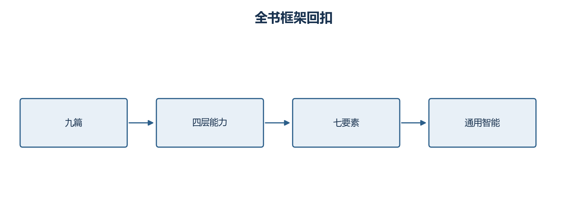

> 【图 41-4　四层能力体系回扣】（原图见 figures/图41-4.png）：四个嵌套方框自内向外为观测建模、状态表示、动力学学习、基于模型的规划，标注各层对应章节与「非线性依赖」虚线。
>
> 

**表 41-1　九篇 × 四层 × 七要素映射**

| 篇 | 章 | 四层能力 | 七要素侧重 |
|----|----|----------|-----------|
| 第一篇 | 1—4 | 框架 | 框架（定义 E1—E7、四层） |
| 第二篇 | 5—8 | 观测 / 状态 | E1—E4（线性高斯、POMDP、系统辨识） |
| 第三篇 | 9—13 | 状态 / 动力学 | E1—E4（VAE、World Models、RSSM） |
| 第四篇 | 14—18 | 观测生成 | E3（生成模型、视频、Sora、3D） |
| 第五篇 | 19—22 | 状态 / 动力学 | E1—E2（能量模型、JEPA、自监督） |
| 第六篇 | 23—27 | 规划 | E5—E7（动作条件、MBRL、MPC、交互） |
| 第七篇 | 28—31 | 物理实现 | E1—E3（物理信息、可微模拟、具身） |
| 第八篇 | 32—35 | 评估 | 全部（评估、幻觉漂移、因果、数据） |
| 第九篇 | 36—41 | 反思 | 框架回扣（架构、语言、社会、科学、开放、结语） |

把表 41-1 竖着读，可见一条清晰的演进主线：**从建模观测到建模状态，从建模状态到建模动力学，从被动预测到主动干预与规划**。这与第 1.2 章的历史回顾完全同构——控制论的反馈、认知科学的内部模型、强化学习的 model-based 路线、深度生成模型，最终在「世界模型」这一概念下汇流。

**用统一符号重述全书。** 全书讨论的所有模型，都可纳入第 1 章式 (1-1)—(1-3) 的统一框架：给定观测 $o_t$ 与动作 $a_t$，智能体维护潜在状态 $s_t$，通过

$$
s_{t+1}\sim p_\theta(s_{t+1}\mid s_t,a_t),\qquad o_t\sim p_\theta(o_t\mid s_t),\qquad a_t\sim\pi_\phi(a_t\mid s_t) \tag{41-1}
$$

完成「表示—转移—生成—决策」的闭环。卡尔曼滤波把 $p_\theta$ 限定为线性高斯（第 5 章）；POMDP 显式引入信念 $b(s_t)$（第 6 章）；Dreamer 用 RSSM 实现 $p_\theta$ 与 $\pi_\phi$ 的端到端学习（第 12 章）；JEPA 弱化 $p_\theta(o_t\mid s_t)$ 而专注表示空间预测（第 20 章）；SINDy 要求 $p_\theta$ 是稀疏可读的符号方程（第 39 章）。同一框架，不同的 $p_\theta,\pi_\phi$ 选择与约束——这正是七要素框架的数学内核，也是全书「把方法放进同一张地图」的精确含义。

**例 41.3（框架的统一力量）**　以统一框架（式 41-1）对照三个看似无关的工作：卡尔曼滤波的 $p_\theta$ 是 $s_{t+1}=As_t+Ba_t+w$（E1—E5，线性）；视频生成模型（第 16 章）的 $p_\theta$ 是像素级自回归（E3 强、E5 弱）；Dreamer 的 $p_\theta$ 是 RSSM、$\pi_\phi$ 是想象训练的演员（七要素全覆盖）。三者分别侧重框架的不同组件，七要素框架让我们一眼看出其能力边界：视频模型「画得像」却难干预，卡尔曼滤波「可干预」却限于线性，Dreamer 集大成但仍受模型误差（第 40 章）制约。

## 41.2　三条趋势

**趋势一：从预测到干预（第 23—27 章）。** 世界模型从「被动预测下一观测」走向「主动预测干预后果」。第 23 章的动作条件化使转移成为 $p(s_{t+1}\mid s_t,a_t)$，第 34 章进一步区分 $p(s_{t+1}\mid s_t,a_t)$ 与 $p(s_{t+1}\mid\mathrm{do}(a_t),s_t)$。这是从「观察世界」到「改变世界」的跃迁——一个只会预测的模型是旁观者，一个能回答「若我这样做会怎样」的模型才是行动者的基础。七要素中 E5（动作条件化）是这一趋势的核心。

**趋势二：从隐式到显式结构（第 18—22、28—30 章）。** 世界模型从「黑箱预测」走向结构化表示：JEPA 在表示空间预测（第 20 章）、3D 表示与神经渲染（第 18、30 章）、物理约束与可微模拟（第 28—29 章）、因果结构（第 34 章）。显式结构提升了可解释性、可迁移性与可靠性——它直接回应了第 40 章的可辨识性与外推问题。代价是结构先验可能限制表达力：这是「表达力—可解释性」的经典权衡（第 39 章 SINDy 与深度网络恰为两端）。

**趋势三：从专用到通用架构（第 36—38 章）。** 世界模型从单一任务走向通用智能架构：LeCun 的自主智能架构把世界模型置于核心（第 36 章），语言作为接口与高层规划器接入（第 37 章），多智能体社会模拟拓展至群体层面（第 38 章），科学发现展示其探索未知的能力（第 39 章）。这是通向 AGI 的宏观趋势，但第 40 章提醒我们：可辨识性、长期一致性、因果、对齐等问题仍横亘在前。

三条趋势并非彼此独立，而是相互支撑：显式结构（趋势二）为跨领域通用（趋势三）提供可迁移的表示，而可干预性（趋势一）是科学发现（第 39 章主动实验）与通用规划（第 36 章）的共同基础。把它们放在一起看，世界模型的演进方向可概括为：**更准的预测、更深的干预、更广的通用**。第 40 章的开放问题，正是这三个方向上的未竟之地。

**表 41-2　三条趋势的要素与章节对照**

| 趋势 | 七要素侧重 | 核心章节 | 关键问题 |
|------|-----------|---------|---------|
| 预测 → 干预 | E5（动作条件化） | 第 23—27、34 章 | $\mathrm{do}$ 干预与反事实 |
| 隐式 → 显式结构 | E1—E2（结构化表示） | 第 18—22、28—30 章 | 可辨识性与泛化 |
| 专用 → 通用架构 | 全要素 | 第 36—39 章 | 跨领域统一 |

> 【图 41-2　三条趋势】（原图见 figures/图41-2.png）：三支箭头分别标注「预测→干预」「隐式→显式」「专用→通用」，汇聚于「通用世界模型」。
>
> 

**例 41.4（三条趋势在一个系统中的体现）**　设想一个「语言引导的家庭机器人」：它用 3D 场景表示理解房间（趋势二：显式结构），用动作条件世界模型预测「推倒杯子会洒水」（趋势一：干预预测），并接受「把桌子收拾干净」这样的通用语言指令（趋势三：通用架构）。这个系统的三层能力分别对应表 41-2 的三行——三条趋势在一个系统中汇合。但第 40 章的开放问题也随之而来：它的场景表示可辨识吗？长程规划误差会累积吗？它真的理解「推倒导致洒水」的因果，还是仅学到统计相关？这个例子把抽象趋势与具体挑战连在一起。

## 41.3　世界模型能否通向通用智能？

我们的回答是审慎的：**世界模型是通用智能的核心，但非全部。** 它提供了理解、预测、规划世界的能力（第 36 章），但通用智能还需符号推理、语言、社会认知、价值对齐等——这些在系列其他书中展开（《自然语言智能导论》《社会智能与群体决策导论》《AI 安全与对齐导论》等）。把世界模型等同于通用智能，是本书反复警惕的混淆之一。

**例 41.1（四条路径的汇合）**　第三篇的显式动力学路径（E1—E4）、第四篇的生成式路径（E3）、第五篇的表征路径（E1—E2）、第六篇的规划路径（E5—E7）——四条路径正在汇合，通向「能理解、能预测、能干预、能规划」的通用世界模型。Dreamer 是这一汇合的早期典范：它用 RSSM 学潜在表示与动力学（路径一 + 三），用解码器生成观测（路径二），用想象轨迹训练策略（路径四），覆盖全部七要素（第 12 章表 12-2）。但即便是 Dreamer，也还缺乏语言接口与因果结构——这正是第 37、40 章指出的缺口。全书「把方法放进同一张地图」的意义，正在于看清每条路径的贡献与盲区。

**例 41.2（审慎的边界）**　考虑一个在物理预测上完美的世界模型（假设它能准确回答所有 $\mathrm{do}$ 干预）。它能否成为通用智能？仍不能：若没有价值目标（E6），它不知道该追求什么；若没有符号推理，它无法进行抽象演绎；若没有社会认知，它无法理解他人的意图（第 38 章）；若目标设错，它会高效地追求错误的东西（第 40.6 节价值对齐）。因此世界模型是**必要条件**而非充分条件——这是本书对「世界模型能否通向通用智能」这一终极问题的核心判断。

## 41.4　贯穿全书的数学主题

为收束全书，我们提炼四条反复出现的数学主题，它们像主线一样贯穿各章。

**主题一：变分界。** 从第 3 章自由能 $F=-\mathrm{ELBO}$，到第 9 章 VAE 的 ELBO（式 9-2、9-3），到第 37 章语言条件生成（式 37-3）——「用可解的分布逼近不可解的后验」是全书最核心的推断工具。**主题二：状态空间递推。** 从卡尔曼滤波（第 5 章）到 POMDP（第 6 章）到 RSSM（第 13 章）——「 belief / hidden state 的递推更新」是刻画部分可观测世界的统一语言。**主题三：模型误差与误差累积。** 从第 24 章的策略利用偏差，到第 33 章的漂移，到第 40 章式 (40-2) 的 $\delta_H$——误差是所有基于模型方法的阿喀琉斯之踵。**主题四：稀疏与结构化。** 从第 39 章 SINDy 的 $\ell_1$ 正则，到第 28 章物理约束、第 34 章因果结构——「用结构先验换取可辨识性与泛化」是应对可辨识性危机的共同策略。这四条主题相互交织，构成世界模型的数学骨架。

**四条主题的交叉点。** 值得强调的是，四条主题并非平行，而是在具体问题中交汇。以 Dreamer 为例：它用变分界（主题一）训练 RSSM，用状态递推（主题二）滚动想象轨迹，受误差累积（主题三）制约而限制视野 $H$，并尝试用离散潜在与 symlog（主题四的结构化手段）提升鲁棒性（第 12 章）。再以世界模型辅助科学发现（第 39 章）为例：SINDy 的稀疏回归（主题四）发现方程，变分/最大似然（主题一）估计参数，状态递推（主题二）做预测，而外推失效（主题三）划定适用边界。掌握这四条主题，就掌握了阅读全书乃至进入该领域的「语法」。

> 【图 41-3　四条数学主题】（原图见 figures/图41-3.png）：变分界、状态递推、误差累积、稀疏结构化四条主线交织，交汇处标注 Dreamer、SINDy、卡尔曼滤波等代表工作。
>
> 

## 41.4A　从本书到未来：三个前沿赌注的量化

**引入动机。** 41.3 节给出「世界模型是核心但非全部」的审慎判断，41.4 节提炼了四条数学主题。本节把结语落到可操作的层面：如果一位研究者要在未来五年进入世界模型领域，应该在哪些方向下注？我们用「进展—确定性」两个维度给三个前沿赌注打分，并给出一个统一的「能力—成本」判据，帮助读者把本书的地图转化为自己的研究路线图。

**定义 41.1（方向价值指数）** 设某研究方向的预期能力增益为 $\Delta C$（对七要素覆盖的提升，归一化到 $[0,1]$），所需数据—算力成本为 $K$（相对当前基准的对数倍数），则方向价值指数

$$
\mathcal{V}_{\mathrm{dir}}=\frac{\Delta C}{1+\ln K}, \tag{41-2}
$$

式（41-2）把「值不值得做」量化：高增益 $\Delta C$ 且低对数成本 $K$ 的方向得分高。分母用 $\ln K$ 而非 $K$，反映「规模成本的对数敏感性」——与第 35 章式 35-2 的规模化定律一致（数据翻倍不是收益翻倍，而是边际递减）。

**例 41.5（三个赌注的打分）** 设当前基准 $K=1$：
- **赌注一：长视野一致性**（40.3 节）。预期增益 $\Delta C=0.3$（显著改善 E2/E4），但因需新架构（多峰表示 + 稳定性）$K\approx e^2\approx7.4$（$\ln K=2$），$\mathcal{V}=0.3/3=0.10$。
- **赌注二：因果世界模型**（40.4 节）。$\Delta C=0.25$（改善 E5 干预正确性），需干预数据 $K\approx e^3\approx20$（$\ln K=3$），$\mathcal{V}=0.25/4=0.0625$。
- **赌注三：统一评估基准**（40.6 节）。$\Delta C=0.2$（改善「全部」要素的可比性），成本主要是工程与数据标注 $K\approx e^{1.5}\approx4.5$（$\ln K=1.5$），$\mathcal{V}=0.2/2.5=0.08$。

按式（41-2），长视野一致性（0.10）> 统一评估（0.08）> 因果世界模型（0.0625）。这一排序揭示一个反直觉结论：**评估基础设施的「单位成本收益」可能高于最热门的因果方向**——因为评估的 $\Delta C$ 惠及所有下游工作，而因果的 $K$（干预数据成本）偏高。这提醒研究者：基础科学不等于「追最热的方向」，而是把 $\mathcal{V}_{\mathrm{dir}}$ 算清楚再下注。

**表 41-4　三个前沿赌注的量化对照**

| 赌注 | $\Delta C$ | $K$ | $\mathcal{V}_{\mathrm{dir}}$ | 关键依赖 |
|------|-----------|-----|------------------------------|---------|
| 长视野一致性 | 0.30 | $\approx7.4$ | 0.10 | 新架构（多峰 + 稳定性） |
| 统一评估基准 | 0.20 | $\approx4.5$ | 0.08 | 数据标注 + 工程 |
| 因果世界模型 | 0.25 | $\approx20$ | 0.063 | 干预数据（稀缺） |

**边界。** 式（41-2）的 $\Delta C$ 与 $K$ 都是研究者主观估计，且随时间剧烈变化（今天 $K$ 高的方向明天可能因数据/算力突破而 $K$ 骤降）。因此 $\mathcal{V}_{\mathrm{dir}}$ 应作为「决策辅助」而非「客观真理」，且需定期随技术进步重估。更重要的是，它优化的是「单方向」价值，而真实研究组合是「多方向协同」——长视野一致性与因果世界模型可能共享底层技术（稳定性 + 结构），联合下注的边际收益可能高于两者之和。式（41-2）是单方向判据，不能替代对方向间协同性的战略判断。

## 41.4B　给读者的进阶路线：从「读完整本」到「做出东西」

**引入动机。** 本书 41 章覆盖了世界模型的全谱系，但读者读完不等于能「做出一个世界模型」。本节给出一条从理论到实践的进阶路线，把全书各章组织成「学什么→练什么→做什么」的递进序列，帮助读者把地图转化为能力。

**直觉解释。** 学世界模型像学游泳：读完了流体力学（理论）不等于会游（实践）。进阶路线就是「先会踩水（基础动力学），再会换气（生成与表示），最后会游泳（完整系统）」的练习顺序。

**定义 41.2（能力阶梯）** 设读者在能力维度 $c$ 上的掌握度为 $\mathcal{M}_c\in[0,1]$，则完成某一里程碑 $m$ 需满足 $\min_{c\in\mathcal{C}_m}\mathcal{M}_c\ge\tau_m$（短板决定里程碑），其中 $\mathcal{C}_m$ 为该里程碑依赖的能力集合、$\tau_m$ 为门槛。进阶路线即按 $\tau_m$ 递增排列里程碑：

$$
\text{路线}=\big(m_1\to m_2\to m_3\to m_4\big),\qquad \tau_1\le\tau_2\le\tau_3\le\tau_4. \tag{41-3}
$$

式（41-3）把「该先学什么」形式化为门槛序列，避免「跳级学习」——在 $m_1$ 的短板未补前强行做 $m_4$ 会因地基不稳而事倍功半。

**表 41-5　世界模型进阶路线（里程碑与依赖章节）**

| 里程碑 | 门槛 $\tau_m$ | 核心能力 $\mathcal{C}_m$ | 关键章节 | 实践产出 |
|--------|-------------|------------------------|---------|---------|
| $m_1$ 会踩水 | 0.3 | E1/E2（状态 + 转移） | 5、7、13 | 手写卡尔曼 + 简单 RSSM |
| $m_2$ 会换气 | 0.5 | E3/E4（生成 + 不确定性） | 9、14、16 | 跑通 VAE/扩散视频 |
| $m_3$ 会游泳 | 0.7 | E5/E7（干预 + 规划） | 23、25、12 | 实现 Dreamer 式 MBRL |
| $m_4$ 自由泳 | 0.85 | 全要素 + 因果 + 评估 | 32—39 | 完成一个完整世界模型项目 |

**例 41.6（路线的取舍）** 一位有强化学习背景但缺生成模型经验的读者，其 $\mathcal{M}$ 画像约为 $m_1$ 已达标（$\mathcal{M}_{E1/E2}=0.7$）、$m_2$ 短板（$\mathcal{M}_{E3}=0.3<\tau_2=0.5$）、$m_3$ 部分（$\mathcal{M}_{E5}=0.6<0.7$）。按式（41-3），他应先补 $m_2$（生成与不确定性，第 9、14、16 章）而非直接跳到 $m_3$ 的 MBRL——否则会因不懂解码器与不确定性传播，在 Dreamer 实现中反复卡壳。这一「短板优先」的路线，比「按章节顺序硬读」更高效：它把有限精力投到当前门槛上，而非已掌握的内容。

**边界。** 式（41-3）的门槛 $\tau_m$ 是经验设定，且因任务而异——做视频生成的读者可能 $\tau_2$ 更高、$\tau_3$ 更低（不需要重规划），做机器人的读者则相反。进阶路线应是**个性化**的：读者应根据自己的目标任务，调整 $\mathcal{C}_m$ 与 $\tau_m$。此外，本书的章节顺序是「教学最优」而非「研究最优」——研究者可据第 40 章的开放问题直接切入未解前沿（如 40.3 的长一致性），跳过已扎实的基础部分，路线式（41-3）此时反向使用：从前沿倒推缺失的前置能力。

## 41.5　全书收束

从卡尔曼滤波（第 5 章）到 Dreamer（第 12 章），从 JEPA（第 20 章）到交互世界模型（第 27 章），从物理模拟（第 29 章）到通用智能（第 36 章）——四十一章走过了世界建模的思想演进史。全书以七要素框架为经、四层能力体系为纬，把控制论、认知科学、强化学习、生成模型与物理建模编织成一张可导航的地图。

我们始终秉持三条原则（前言）：完整的方法谱系、七要素的统一视角、严谨与细致。我们也不回避开放问题（第 40 章）——承认「未知」是探索的起点。三个混淆命题（第 1.7 节）——「生成视频不等于理解物理」「预测准确不等于因果理解」「模拟智能不等于真实智能」——在全书的论证中反复得到印证，值得读者常怀于心。

**表 41-3　全书的三个混淆命题与对应章节**

| 混淆命题 | 真相 | 论证章节 |
|---------|------|---------|
| 生成视频 = 理解物理 | 逼真的像素预测不等于学到真实动力学（E3 ≠ E2） | 第 16、28、36 章 |
| 预测准确 = 因果理解 | 条件预测 $p(s\mid a)$ 不等于干预 $p(s\mid\mathrm{do}(a))$ | 第 34、39、40 章 |
| 模拟智能 = 真实智能 | 观测等价不等于内部结构正确（可辨识性） | 第 2.5、13、38、40 章 |

**为什么这三个命题重要？** 因为它们对应着三种最常见的「世界模型过度宣称」：把视频生成的进步说成物理理解的突破，把预测精度的提升说成因果掌握的进展，把模拟行为的逼真说成内部心智的诚实。第 40 章的开放问题大多源于对这些混淆的忽视——可辨识性问题即「模拟智能 ≠ 真实智能」的数学版本，因果干预问题即「预测 ≠ 因果」的形式化。保持这份清醒，是读者进入该领域最重要的思维习惯。

愿这张地图，能帮助读者在世界模型的广阔疆域中找到自己的方向。理解世界，是为了在世界中行动——而行动的前提，是拥有一个关于世界的模型。智能体如此，我们亦然。

## 本章小结

本章作为结语，回扣第 1 章的两大框架，审视三条趋势，并回答终极问题。

我们首先以四层能力体系与七要素框架重新审视全书（表 41-1），揭示「从观测到干预」的演进主线，并指出四层的非线性依赖（41.1 节）。接着审视三条趋势：从预测到干预（E5）、从隐式到显式结构、从专用到通用架构（41.2 节）。对「世界模型能否通向通用智能」，我们给出审慎回答——它是核心但非全部，是必要而非充分条件（例 41.1、41.2，41.3 节）。我们进一步提炼贯穿全书的四条数学主题：变分界、状态空间递推、误差累积、稀疏与结构化（41.4 节）。最后把结语落到可操作层面：用方向价值指数（式 41-2，例 41.5，表 41-4）量化三个前沿赌注，给出「长一致性 > 统一评估 > 因果」的排序；并用能力阶梯（式 41-3，例 41.6，表 41-5）给出从「读完整本」到「做出世界模型」的进阶路线（41.4A、41.4B 节）。

全书以七要素为经、四层能力为纬，编织成世界建模的知识地图；同时以三个混淆命题与开放问题（第 40 章）保持清醒。愿这张地图助读者找到方向——理解世界，是为了在世界中行动。

**进一步阅读**　本章建议延伸阅读的文献：[1]、[2]、[3]。

## 参考文献

[1] LeCun Y. A path towards autonomous machine intelligence. *Open Review*, 2022.

[2] Hafner D, Pasukonis J, Ba J, et al. Mastering diverse domains through world models. *Nature*, 2023, 615: 58–64.

[3] Pearl J, Mackenzie D. *The Book of Why*. Basic Books, 2018.

[4] Friston K. The free-energy principle: a unified brain theory? *Nature Reviews Neuroscience*, 2010, 11(2): 127–138.

[5] Sutton R S, Barto A G. *Reinforcement Learning: An Introduction*. 2nd ed. MIT Press, 2018.

[6] Ha D, Schmidhuber J. World models. *arXiv:1803.10122*, 2018.

[7] Schrittwieser J, Antonoglou I, Hubert T, et al. Mastering Atari, Go, chess and shogi by planning with a learned model. *Nature*, 2020, 588: 604–609.

[8] Fischer I, Huang J, Raghunathan A, et al. What is a world model? *arXiv:2403.09617*, 2024.

---

# 附录

## 附录 A　数学工具包

本附录汇总全书反复使用的数学工具，供读者查阅。更严格的论述见相应章节。

### A.1　概率论基础

**概率空间与随机变量。** 概率空间为三元组 $(\Omega,\mathcal{F},P)$，其中 $\Omega$ 为样本空间，$\mathcal{F}$ 为事件 $\sigma$-代数，$P$ 为概率测度。随机变量 $X:\Omega\to\mathbb{R}$ 把样本点映射为实数，其分布由累积分布函数 $F_X(x)=P(X\le x)$ 或概率密度/质量函数描述。

**条件概率与链式法则。** $P(A\mid B)=P(A\cap B)/P(B)$。对词序列 $x=(w_1,\dots,w_T)$，联合概率的链式分解为

$$
P(w_1,\dots,w_T)=\prod_{t=1}^{T}P(w_t\mid w_1,\dots,w_{t-1}). \tag{A-1}
$$

这是全部语言模型的出发点（第 3、15 章）。

**期望、方差与协方差。** $\mathbb{E}[X]=\sum_x xp(x)$（离散）或 $\int xp(x)\,dx$（连续）；$\mathrm{Var}[X]=\mathbb{E}[(X-\mathbb{E}X)^2]$；$\mathrm{Cov}(X,Y)=\mathbb{E}[XY]-\mathbb{E}X\,\mathbb{E}Y$。

### A.2　信息论基础

**熵与交叉熵。** 离散随机变量 $X$ 的熵为

$$
H(X)=-\sum_x p(x)\log p(x), \tag{A-2}
$$

两个分布 $p,q$ 的交叉熵为 $H(p,q)=-\sum_x p(x)\log q(x)$，KL 散度为 $D_{\mathrm{KL}}(p\|q)=\sum_x p(x)\log\frac{p(x)}{q(x)}=H(p,q)-H(p)$。

**困惑度。** 语言模型的困惑度定义为每词平均负对数似然的指数：

$$
\mathrm{PPL}(x)=\exp\!\left(-\frac{1}{T}\sum_{t=1}^{T}\log p_\theta(w_t\mid w_{<t})\right). \tag{A-3}
$$

困惑度越低表示模型对测试语料越"不意外"，但它是几何平均意义下的指标，对长尾词敏感（第 3、15 章）。

### A.3　线性代数与矩阵分解

**向量空间与范数。** $\mathbf{x}\in\mathbb{R}^d$，$\ell_2$ 范数 $\\|\mathbf{x}\\|_2=\sqrt{\sum_i x_i^2}$，$\ell_1$ 范数 $\\|\mathbf{x}\\|_1=\sum_i|x_i|$。点积 $\mathbf{x}^\top\mathbf{y}$ 衡量方向相似性，余弦相似度 $\cos(\mathbf{x},\mathbf{y})=\frac{\mathbf{x}^\top\mathbf{y}}{\\|\mathbf{x}\\|\|\\mathbf{y}\\|}$。

**奇异值分解（SVD）。** 任意矩阵 $\mathbf{A}\in\mathbb{R}^{m\times n}$ 可分解为 $\mathbf{A}=\mathbf{U}\mathbf{\Sigma}\mathbf{V}^\top$，其中 $\mathbf{U},\mathbf{V}$ 为正交矩阵，$\mathbf{\Sigma}$ 为奇异值对角阵。截断 SVD 给出最优低秩逼近（Eckart–Young 定理），是 LSA 与词向量降维的理论基础（第 6 章）。

### A.4　最优化基础

**梯度下降。** 对目标 $\mathcal{L}(\theta)$，梯度下降更新 $\theta\leftarrow\theta-\eta\nabla_\theta\mathcal{L}(\theta)$，$\eta$ 为学习率。随机梯度下降（SGD）用单个/小批量样本估计梯度。

** softly 凸性与光滑。** 函数 $f$ 为 $L$-光滑若 $\\|\nabla f(x)-\nabla f(y)\\|\le L\\|x-y\\|$；为 $\mu$-强凸若 $f(y)\ge f(x)+\nabla f(x)^\top(y-x)+\frac{\mu}{2}\\|y-x\\|^2$。二者决定梯度下降的收敛率。

### A.5　常用分布

| 分布 | 记号 | 用途 |
|------|------|------|
| 伯努利 | $\mathrm{Bern}(p)$ | 二值事件 |
| 多项 | $\mathrm{Mult}(n,\mathbf{p})$ | 词的多项采样 |
| 高斯 | $\mathcal{N}(\mu,\sigma^2)$ | 连续潜变量、噪声 |
| Dirichlet | $\mathrm{Dir}(\boldsymbol\alpha)$ | 主题模型的先验 |
|  categorical | $\mathrm{Cat}(\mathbf{p})$ | 词表上的分布 |

---

## 附录 B　环境与基准索引

### B.1　常用语料

| 语料 | 规模 | 用途 |
|------|------|------|
| Penn Treebank (PTB) | 约 100 万词 | 语言模型、句法分析标准语料 |
| WikiText-103/2 | 1.03 亿/200 万词 | 大规模语言模型 |
| 1B Word Benchmark | 约 10 亿词 | 词向量评估 |
| BooksCorpus | 约 8 亿词 | 预训练（GPT/BERT） |
| C4 | 约 750GB | T5 预训练 |
| The Pile | 约 825GiB | 多样化预训练 |
| OSCAR / CC-100 | 多语言 TB 级 | 多语言预训练 |

### B.2　任务基准

| 基准 | 任务 | 说明 |
|------|------|------|
| GLUE / SuperGLUE | 自然语言理解 | 多项分类、推理、问答的集合 |
| SQuAD 1.1/2.0 | 阅读理解 | 抽取式问答，含不可回答 |
| WMT | 机器翻译 | 多语言对，BLEU 评估 |
| ImageNet / COCO | 视觉（多模态用） | 视觉编码器预训练 |
| MMLU | 大模型知识 | 57 学科多选题 |
| GSM8K / MATH | 数学推理 | 应用题与竞赛题 |
| HumanEval | 代码生成 | Python 函数补全 |

### B.3　词向量与表示评测

- **类比任务**：`king : queen = man : ?`，评估语义/句法类比能力。
- **词相似度**：WordSim-353、SimLex-999、MEN，与人工打分求 Spearman 相关。
- **探测（probing）**：用线性探针从上下文表示中恢复词性、句法、语义角色。

---

## 附录 C　开源工具链

### C.1　核心框架

| 工具 | 用途 |
|------|------|
| PyTorch / TensorFlow | 深度学习训练框架 |
| Hugging Face Transformers | 预训练模型库（BERT/GPT/LLaMA 等） |
| Hugging Face Datasets | 数据集加载与处理 |
| Tokenizers / SentencePiece | 分词与子词切分 |
| spaCy / NLTK / Stanza | 传统 NLP 与词法句法分析 |

### C.2　训练与微调

| 工具 | 用途 |
|------|------|
| DeepSpeed / Megatron-LM | 大规模分布式训练 |
| FSDP | PyTorch 原生全分片数据并行 |
| PEFT | 参数高效微调（LoRA/Adapter） |
| bitsandbytes / GPTQ | 量化 |
| TRL | RLHF/DPO 对齐训练 |

### C.3　检索与部署

| 工具 | 用途 |
|------|------|
| FAISS / Annoy / HNSWlib | 向量检索与近似最近邻 |
| Elasticsearch | 关键词与混合检索 |
| vLLM / TensorRT-LLM | 大模型推理服务 |
| LangChain / LlamaIndex | RAG 与应用编排 |

---

## 附录 D　符号与缩略语对照表

### D.1　缩略语

| 缩略语 | 全称 | 中文 |
|--------|------|------|
| NLP | Natural Language Processing | 自然语言处理 |
| LM | Language Model | 语言模型 |
| LLM | Large Language Model | 大语言模型 |
| N-gram | n-gram | n 元语法 |
| PPL | Perplexity | 困惑度 |
| POS | Part-of-Speech | 词性 |
| NER | Named Entity Recognition | 命名实体识别 |
| RE | Relation Extraction | 关系抽取 |
| SRL | Semantic Role Labeling | 语义角色标注 |
| AMR | Abstract Meaning Representation | 抽象意义表示 |
| CFG | Context-Free Grammar | 上下文无关文法 |
| PCFG | Probabilistic CFG | 概率上下文无关文法 |
| CKY | Cocke–Kasami–Younger | 句法分析算法 |
| HMM | Hidden Markov Model | 隐马尔可夫模型 |
| CRF | Conditional Random Field | 条件随机场 |
| RNN/LSTM | Recurrent Neural Network | 循环神经网络/长短时记忆 |
| seq2seq | sequence-to-sequence | 序列到序列 |
| NMT | Neural Machine Translation | 神经机器翻译 |
| Transformer | Transformer | Transformer 架构 |
| MLM | Masked Language Modeling | 掩码语言模型 |
| PEFT | Parameter-Efficient Fine-Tuning | 参数高效微调 |
| LoRA | Low-Rank Adaptation | 低秩适配 |
| ICL | In-Context Learning | 上下文学习 |
| RLHF | RL from Human Feedback | 基于人类反馈的强化学习 |
| DPO | Direct Preference Optimization | 直接偏好优化 |
| CoT | Chain of Thought | 思维链 |
| RAG | Retrieval-Augmented Generation | 检索增强生成 |
| BLEU | Bilingual Evaluation Understudy | 机器翻译评估 |

### D.2　数学符号

见「前置说明」符号表与附录 A。

---

## 附录 E　术语对照与全书速查索引

### E.1　核心术语对照

| 中文 | 英文 | 章 |
|------|------|----|
| 分布假设 | Distributional Hypothesis | 6 |
| 词嵌入 | Word Embedding | 6 |
| 上下文表示 | Contextual Representation | 7 |
| 组合性 | Compositionality | 13 |
| 真值条件 | Truth Conditions | 13 |
| 语用含义 | Pragmatic Meaning | 14 |
| 困惑度 | Perplexity | 3, 15 |
| 平滑 | Smoothing | 15 |
| 注意力 | Attention | 17, 20 |
| 自注意力 | Self-Attention | 20 |
| 预训练 | Pretraining | 21 |
| 微调 | Fine-tuning | 21, 23 |
| 涌现 | Emergence | 24 |
| 对齐 | Alignment | 28 |
| 幻觉 | Hallucination | 29, 31 |
| 检索增强 | Retrieval Augmentation | 30 |

### E.2　全书速查索引（按主题）

- **意义理论**：第 1、4 章；四层能力见 1.6，五层意义见 1.7/4。
- **词与向量**：词向量 6，上下文表示 7，相似度 9。
- **句法与语义**：句法 10–11，语义角色 12，逻辑形式 13，语篇 14。
- **语言模型**：统计 15，神经 16，seq2seq 17，翻译 18。
- **预训练**：Transformer 20，范式 21，训练 22，微调 23，ICL 24，多语言 25。
- **大模型**：规模化 26，模型谱系 27，对齐 28，推理 29，RAG 30，评估 31。
- **多模态与语音**：32–35。
- **应用与工程**：36–39。
- **未来**：40–42。

---

## 附录 F　算例复现说明

### F.1　环境依赖

- Python 3.10+
- PyTorch 2.x、NumPy、SciPy、scikit-learn
- Hugging Face Transformers、Tokenizers
- 可选：spaCy、NLTK（词法句法算例）、FAISS（检索算例）

### F.2　统一案例：开放域问答语料

全书算例以一份开放域问答语料为贯穿案例（第 1.8 节）。该语料由若干百科段落与对应问题组成，覆盖事实型、推理型与多跳问题。复现时：

1. 词法标注（第 8 章）：对语料做分词、词性标注与实体识别；
2. 句法与语义（第 11–12 章）：产出依存树与语义角色；
3. 语言模型（第 15–16 章）：在语料上训练 N-gram 与小型神经 LM，报告困惑度；
4. 预训练/微调（第 21–23 章）：加载公开预训练模型，做少样本适配；
5. 检索增强（第 30 章）：构建向量索引，做检索增强问答；
6. 对话智能体（第 37 章）：封装为多轮问答。

### F.3　随机种子与数值容差

- 涉及随机初始化的算例固定随机种子 `seed=42`。
- 数值结果保留三到四位有效数字；因库版本差异允许末位浮动。
- 小模型算例为教学示意，旨在展示计算过程，不使用大规模算力。

### F.4　算例数值声明

除注明出处者外，全书算例中的具体数值（概率、困惑度、注意力权重、类比向量等）均为**教学示意**，通过小型可复现实验或手工计算得到，用于展示方法机制与量级，不代表任何真实系统在生产环境中的实测结果。引用文献中的基准数字以原始出处最新版本为准。