# 具身智能导论

> 从感知到行动，身体中的智能

---

## 内容简介

本书系统论述「具身智能」——智能体通过身体与物理世界交互、在感知—认知—行动闭环中涌现智能的理论、方法与工程体系。作者把这套能力界定为四层递进的含义：**感知**回答「世界现在是什么状态」，**理解**回答「场景的语义与任务是什么」，**规划**回答「应该采取什么行动序列」，**执行**回答「如何用身体精确完成动作」；四层层层递进，共同构成从「被动观察」走向「主动改造物理世界」的完整图景。全书以一条主线贯穿：以**感知—认知—行动的闭环**为理论基础，以**策略学习**为核心，以「感知—理解—规划—执行」为脉络，把机器人学、控制论、计算机视觉、强化学习与基础模型中彼此隔离的具身方法放进同一张地图。

本书的历史纵深从 1950 年代控制论与早期自主机器人起笔，经 1980 年代行为主义机器人学、1990 年代概率机器人与 SLAM、2010 年代深度强化学习与模仿学习、2020 年大规模机器人学习，抵达 2023 年以来的视觉—语言—动作模型（VLA）与具身基础模型，并以 2025—2026 年人形机器人走向工业与家庭场景收束于当代前沿。作者着力说明：基于规则的控制、模仿学习、强化学习与 VLA 大模型并非简单的技术迭代，而是**对「身体如何塑造并约束智能」这一根本问题的不同回答**；具体架构会随研究更替，而感知噪声、运动约束、样本效率、泛化与安全这些根本问题具有长久价值。

全书共九篇四十一章。第一篇建立具身认知、机器人学与控制的理论基础；第二篇处理感知与状态估计；第三篇展开运动与控制；第四篇梳理模仿学习；第五篇系统论述强化学习与操作；第六篇进入视觉—语言—动作模型；第七篇聚焦仿真与现实迁移；第八篇给出评估、安全与工程；第九篇回扣框架，讨论具身通用智能与开放问题。书末附数学工具包、环境与基准索引、开源工具链、符号与缩略语对照表、术语与速查索引、算例复现说明六个附录。

本书提出并贯穿一套自建理论框架——**具身智能的四层能力**：感知、理解、规划、执行，并以「闭环」为组织原则，强调四层之间通过身体与环境的反馈形成回路。据此对每一个方法追问四件事：它处于闭环的哪一环、隐含了什么假设、突破了前一方法的什么限制、无法突破什么边界。第 1 章立框架，第 2 章奠定具身认知的哲学基础，第 33 章据此评估具身系统的能力，第 41 章回扣框架讨论具身智能能否通向通用智能，形成首尾闭环。

在写法上，本书按学术专著标准组织：每节依次展开引入动机、直觉解释、严格定义与推导、带数值的算例、技术谱系与变体、边界与讨论、承上启下的交叉引用；每章含两个以上定义或定理、两个以上数值算例、图与表、文内引用标号与章末参考文献一一对应。全书以桌面物体抓取与装配任务为贯穿案例，辅以移动导航、人形机器人、自动驾驶的专题案例。基础理论只讲一次、后续章节以交叉引用展开应用与深化；配图由代码精确绘制。

本书面向具身智能、机器人学、强化学习、计算机视觉方向的研究生、科研人员与资深工程从业者。读者只需具备概率论、线性代数、最优化基础与基本机器学习知识。

---

## 前言

智能，从来不是孤立大脑的产物。从单细胞生物趋向光源，到猎豹追捕猎物，再到人类用双手制造工具，贯穿其中的，是一条朴素而深刻的真理：**智能是在与世界的物理交互中涌现的**。身体不是智能的「外壳」，而是智能的载体、约束与来源。这正是具身智能（embodied intelligence）的核心主张。

近十余年，机器人学、强化学习与计算机视觉各自取得长足进步，但它们的交汇——让智能体在物理世界中感知、行动、学习——仍是人工智能最具挑战也最激动人心的前沿。大语言模型展现出惊人的语言能力，却难以真的「走到世界中去」；机器人能精确执行预设动作，却缺乏对开放环境的适应能力。具身智能试图弥合这一鸿沟。

然而方法越是繁荣，越需要一本把它们放到同一张地图上的书。今天的研究者面对的是高度碎片化的图景：控制论出身的人谈运动学与动力学，视觉研究者谈检测与分割，强化学习研究者谈策略梯度与样本效率，而大模型团队谈 VLA 与具身基础模型。这些术语说的是同一件事的不同侧面，却分属互少往来的学术共同体。

本书的写作正是为了填补这一空白。我们把这套能力统称为**具身智能**，并以四层能力（感知、理解、规划、执行）与闭环原则组织全书，刻意不写成方法食谱，而是写成一部有内在逻辑的学术专著：让读者不仅知道「怎么做」，更理解「为什么这样做」「它从哪里来」「边界在哪里」。

全书按「感知世界 → 理解场景 → 规划行动 → 精确执行 → 从经验中学习 → 走向通用」的逻辑展开，共九篇四十一章。各章之间并非孤立专题，而是相互贯通的网络，正文以显式交叉引用提示这些联系。无论从何处进入，我们都希望读者最终带着同一句话离开：**智能，生长于身体与世界的交互之中。**

本书资料搜集**截至 2026 年 11 月**：前沿工作多为预印本或技术报告，以「趋势性描述 + 原始出处」著录。算例数值除注明出处者外均为教学示意。限于作者学识，疏漏与不当之处恳请同行批评指正。

---

## 本书的理论主线

本书不满足于罗列具身方法，而试图回答一个更根本的问题：**智能如何在身体与世界的交互中涌现？身体如何塑造、约束并成就智能？其充分必要条件与边界在哪里？** 全书以「以感知—认知—行动闭环为理论基础，以策略学习为核心，以感知—理解—规划—执行为主线」组织。

**四层能力体系。**

| 层级 | 名称 | 回答 | 内涵 |
|------|------|------|------|
| Level 1 | 感知 | 世界现在是什么状态？ | 视觉、触觉、本体感知与状态估计 |
| Level 2 | 理解 | 场景的语义与任务是什么？ | 场景图、语义接地、任务解析 |
| Level 3 | 规划 | 应该采取什么行动序列？ | 任务规划、运动规划、决策 |
| Level 4 | 执行 | 如何精确完成动作？ | 运动控制、灵巧操作、全身控制 |

**闭环原则。** 四层通过「感知 → 理解 → 规划 → 执行 → 反馈」闭环：执行的结果改变世界，新的感知修正理解，理解更新规划，规划驱动新的执行。这是具身智能区别于离身智能的根本特征。由此还须澄清三个常被混淆的命题：**感知精确不等于理解正确，规划可行不等于执行到位，仿真中成功不等于现实中成功**。三者分别在第二、三、七篇给出严格说明。

---

## 本书体例（凡例）

**一、章节与编号。** 按「篇—章—节」三级组织。定义、定理、例按章编号「定义 X.Y」「例 X.Y」。公式独立 `$$\ldots\tag{X-N}$$`，行内 `$...$`。图「图 X-Y」，表「表 X-Y」。

**二、数学记号。** 采用通行 $\LaTeX$ 记号。向量矩阵用粗体，位姿用 $\mathbf{T}$、$\mathbf{R}$ 等。

**三、图与表。** 正文以引用句引出图表，图由代码精确绘制。表用于分类、对照与复杂度比较。

**四、文献。** 重要论断以 `[n]` 标注，章末列参考文献，格式「作者. 标题. 出处, 年份(卷期):页码.」。一般章八至十六篇。

**五、术语。** 外文术语首次出现给中文译名与英文原文。中文全角标点。

**六、资料时效与算例数值。** 资料截至 2026 年 11 月。算例数值除注明出处外均为教学示意。

---

## 读者对象与阅读路径

| 读者类型 | 建议路径 |
|----------|----------|
| 理论研究者 | 第一篇 → 第三篇 → 第六篇 → 第九篇 |
| 算法与模型研究者 | 第一篇 → 第四篇 → 第五篇 → 第六篇 |
| 工程从业者 | 第二篇 → 第三篇 → 第七篇 → 第八篇 |
| 课程教材 | 按第一至五篇顺序讲授，后四篇作专题 |

预备知识：概率论、线性代数、最优化、基本机器学习与机器人学基础。

---

## 符号表

| 符号 | 含义 |
|------|------|
| $\mathbf{T}\in SE(3)$ | 刚体位姿 |
| $\mathbf{R},\mathbf{p}$ | 旋转矩阵、平移向量 |
| $q,\dot q$ | 关节角、关节角速度 |
| $\mathbf{x},\dot{\mathbf{x}}$ | 末端位姿与速度 |
| $s_t,o_t,a_t$ | 状态、观测、动作 |
| $\pi(a\mid s)$ | 策略 |
| $\mathbf{J}$ | 雅可比矩阵 |

其余符号在各章首次出现处定义。

---

## 目录

### 第一篇　具身智能的理论基础
**第 1 章　绪论：具身智能的历史脉络与全书框架**（1.1 界定　1.2 历史　1.3 根本困难　1.4 结构　1.5 四层能力　1.6 统一案例）
**第 2 章　具身认知与哲学基础**　**第 3 章　机器人学基础：运动学与动力学**　**第 4 章　控制理论与最优控制**

### 第二篇　感知与状态估计
**第 5 章　视觉感知与场景理解**　**第 6 章　触觉与其他模态感知**　**第 7 章　SLAM 与定位**　**第 8 章　状态估计与传感器融合**　**第 9 章　语义理解与场景图**

### 第三篇　运动与控制
**第 10 章　运动规划**　**第 11 章　全身运动控制**　**第 12 章　模型预测控制与轨迹优化**　**第 13 章　灵巧操作**　**第 14 章　移动与导航**

### 第四篇　模仿学习
**第 15 章　行为克隆与 DAgger**　**第 16 章　逆强化学习与奖励学习**　**第 17 章　从演示中学习操作**　**第 18 章　人类示范数据与遥操作**

### 第五篇　强化学习与操作
**第 19 章　机器人强化学习**　**第 20 章　从仿真到现实**　**第 21 章　域随机化与鲁棒策略**　**第 22 章　离线强化学习与数据驱动**　**第 23 章　操作技能的泛化**

### 第六篇　视觉—语言—动作模型
**第 24 章　视觉—语言模型在机器人中的应用**　**第 25 章　视觉—语言—动作模型（VLA）**　**第 26 章　通用机器人策略**　**第 27 章　语言指令到动作**　**第 28 章　具身基础模型**

### 第七篇　仿真与现实迁移
**第 29 章　机器人仿真器**　**第 30 章　域迁移与 sim2real**　**第 31 章　合成数据与真实数据**　**第 32 章　世界模型与具身学习**

### 第八篇　评估、安全与工程
**第 33 章　具身智能的评估与基准**　**第 34 章　数据收集与规模化**　**第 35 章　安全与可靠性**　**第 36 章　具身系统的工程部署**

### 第九篇　具身通用智能的未来
**第 37 章　人形机器人**　**第 38 章　具身智能与通用智能**　**第 39 章　具身智能的社会与伦理**　**第 40 章　尚未解决的开放问题**　**第 41 章　结语：从身体到智能**

### 附录
附录 A　数学工具包　·　B　环境与基准索引　·　C　开源工具链　·　D　符号与缩略语　·　E　术语与速查索引　·　F　算例复现

---

# 第 1 章　绪论：具身智能的历史脉络与全书框架

智能，从来不是孤立大脑的产物。从单细胞生物趋向光源，到猎豹追捕猎物，再到人类用双手制造工具，贯穿其中的，是一条朴素而深刻的真理：**智能是在与世界的物理交互中涌现的**。身体不是智能的「外壳」，而是智能的载体、约束与来源。这正是具身智能（embodied intelligence）的核心主张。

把这一主张放进现代人工智能的坐标系，会发现它并非新近才出现的口号。2022 年以来，大语言模型在抽象推理上表现惊人，但它们的全部「经验」都来自文本与图像的统计分布，从未被一只真实的物体烫过、从未因重力而摔倒。与之形成对照的是机器人学半个世纪以来的另一条暗线：从 Wiener 的控制论到 Brooks 的行为主义，从概率机器人到深度强化学习，研究者反复追问同一个问题——**当智能体必须用身体在世界中行动时，它的智能应当被怎样组织？** 这条暗线正是本书的主脉。

然而方法越是繁荣，越需要一本把它们放到同一张地图上的书。今天的研究者面对高度碎片化的图景：控制论出身的人谈运动学与动力学，视觉研究者谈检测与分割，强化学习研究者谈策略梯度与样本效率，而大模型团队谈 VLA 与具身基础模型。这些术语说的是同一件事的不同侧面，却分属互少往来的学术共同体。本书的写作正是为了填补这一空白——写成一部有内在逻辑的学术专著，让读者不仅知道「怎么做」，更理解「为什么这样做」「它从哪里来」「边界在哪里」。

本章先界定研究对象（1.1 节），回顾历史脉络（1.2 节），剖析根本困难（1.3 节），给出分类谱系（1.4 节）与全书结构（1.5 节）；随后提出自己的理论框架——四层能力体系（1.6 节）与闭环原则，并用部分可观测马尔可夫决策过程（POMDP）把这一闭环形式化（1.7 节）；接着用一个「时序预算」数值算例说明具身系统特有的实时约束（1.8 节）；确立贯穿全书的统一案例（1.9 节）；最后在边界与讨论中辨析具身智能与离身智能的边界（1.10 节）。

## 1.1　具身智能的界定

**定义 1.1（具身智能）**　具身智能是智能体通过物理身体与环境的交互，在感知—认知—行动的闭环中涌现的、能够适应开放环境并完成物理任务的能力体系。它强调：智能依赖于身体的形态、传感器与执行器，以及身体与世界的持续交互。

**离身智能 vs 具身智能。** 离身智能（disembodied，如语言模型、图像分类器）处理抽象符号或静态数据，无物理交互；具身智能必须在物理世界中感知、行动、承担后果。二者的差异不只是「有无机器人身体」，而是智能的组织原则不同——具身智能的核心约束包括实时性、物理可行性、安全与样本成本。一个有用的判据是：**把系统的输出从「符号」换成「力与运动」，如果系统立刻崩溃，它就是离身的；如果它在闭环中稳定运行，它才谈得上具身。**

**例 1.1（同一任务的两种形态）** 「把杯子递给我」：语言模型可生成描述该动作的文字（离身）；机器人需视觉定位杯子、规划无碰撞的机械臂轨迹、控制夹爪力度、避免碰倒其他物品（具身）——后者涉及物理世界的全部复杂性。更微妙的是，「递」这个动作的成败不由语言描述的相似度衡量，而由末端执行器的轨迹精度、接触力与碰撞裕度共同决定：哪怕规划出的轨迹与「标准答案」只差 3 厘米，杯子也可能被碰倒。这种「对误差高度敏感」的特性，是具身任务区别于符号任务的本质。

> 【图 1-1　具身智能四层含义与闭环】（原图见 figures/图1-1.png）：感知、理解、规划、执行四层通过反馈形成闭环。
>
> 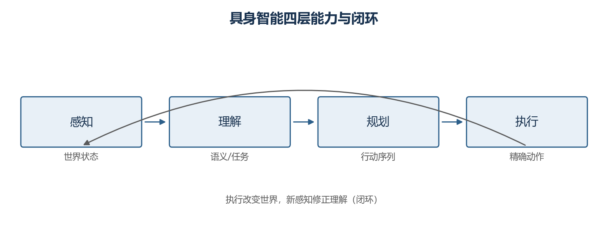

## 1.2　历史脉络

具身智能思想跨越两百余年，可归纳为五个阶段。

**控制论与行为主义（1950—1980s）**：Wiener 的控制论[1]确立反馈原则，把生物与机器的「控制与通信」纳入统一框架；Brooks 的行为主义机器人学[2]更进一步，主张「智能无需显式表征，从感知—行动的直接耦合中涌现」，其分层行为架构（subsumption）让无地图的机器狗也能在障碍间穿行。这一阶段的贡献是把「反馈」从哲学直觉变成可工程化的闭环。

**概率机器人（1990—2000s）**：SLAM、粒子滤波、POMDP 让机器人在不确定性中定位与决策。Thrun 等人[5]把贝叶斯滤波与粒子滤波系统化，使机器人能回答「我在哪、周围有什么」；这一阶段首次把「不确定性」当作机器人的一等公民，而非需要消除的噪声。

**机器学习（2010s）**：深度强化学习与模仿学习让机器人从数据学技能。深度网络使策略能够直接由原始观测（像素、本体感知）驱动，绕开手工特征；Mnih 等人[3]用深度网络直接在 Atari 像素上学出超越人类的策略，证明「感知—决策」可以端到端习得，为机器人操作（第 19—23 章）铺路。

**大规模学习（2020s 初）**：仿真到现实（sim-to-real）、域随机化、大规模机器人学习兴起。研究者发现真实交互太贵，于是先在仿真中训练、再迁移到现实；通过随机化光照、纹理、物理参数，策略获得对「现实」的鲁棒性（第 30—31 章）。

**基础模型时代（2023 至今）**：VLA 模型（视觉—语言—动作）与具身基础模型试图把大模型的泛化能力注入机器人，人形机器人走向工业与家庭。这一阶段的关键问题是：大模型从文本学到的「世界知识」，能否接地为可执行的物理动作（第 24—28 章）？

图 1-2 以时间轴归纳。贯穿主线是：**从「精确控制已知系统」到「在开放世界中学习适应」的能力跃迁**。

**表 1-1　具身智能发展的五个阶段**

| 阶段 | 时期 | 核心思想 | 代表方法/人物 | 遗留问题 |
|------|------|----------|----------------|----------|
| 控制论与行为主义 | 1950—1980s | 反馈、无表征智能 | Wiener[1]、Brooks[2] | 缺乏不确定性处理 |
| 概率机器人 | 1990—2000s | 不确定性下定位决策 | SLAM、POMDP、Thrun[5] | 依赖手工模型 |
| 机器学习 | 2010s | 端到端学策略 | 深度强化学习、Mnih[3] | 样本效率低 |
| 大规模学习 | 2020s 初 | 仿真到现实、规模化 | 域随机化、大规模 RL | 仿真—现实鸿沟 |
| 基础模型时代 | 2023 至今 | 大模型泛化注入机器人 | VLA、具身基础模型 | 接地与安全性 |

这一谱系提醒我们：本书的每一篇都不是凭空出现的。第一篇（1—4 章）承接控制论与概率机器人的遗产；第四、五篇（15—23 章）承接机器学习与大规模学习；第六篇（24—28 章）则直面基础模型时代的开放问题。

## 1.3　根本困难

**其一，感知噪声与部分可观测。** 传感器有噪声、视野有限，状态不可完全观测（第 5—9 章）。机器人永远看不到完整的世界，它只能通过带噪、局部的观测去推断一个隐状态。**其二，运动约束与动力学复杂性。** 机器人受关节限制、摩擦、接触等非线性和非光滑动力学约束（第 3、10—14 章）。**其三，样本效率。** 真实交互昂贵且慢，不能像游戏智能体那样无限试错（第 19—23、29—32 章）。一次真实的抓取实验可能要花费数分钟，而一次失败的抓取可能损坏工件或机器人。**其四，泛化与开放环境。** 训练场景有限，真实世界无限多样（第 23、26—28 章）。**其五，安全。** 物理动作可能造成真实损害（第 35 章），试错的代价不再是「游戏结束」，而是「财产或人身损失」。

**表 1-2　具身智能的五类根本困难**

| 困难 | 本质 | 典型量级 | 应对章节 |
|------|------|----------|----------|
| 感知噪声/部分可观测 | 状态不确定 | 定位误差 cm 级 | 第 5—9 章 |
| 运动约束/动力学 | 物理非线性 | 接触力 N–kN 级 | 第 3、10—14 章 |
| 样本效率 | 交互昂贵 | 每次试验分钟级 | 第 19—23、29—32 章 |
| 泛化 | 开放环境 | 物体/场景近乎无限 | 第 23、26—28 章 |
| 安全 | 物理后果 | 不可逆损坏 | 第 35 章 |

与离身智能相比，这五类困难有一个共同特征：**错误是有成本的，且不可轻易回滚**。语言模型答错一题，重新生成即可；机器人撞坏一个零件，损失是真实的、不可逆的。这一特征贯穿全书，是理解后续各章「为何如此设计」的钥匙。

## 1.4　任务分类谱系

具身任务可按能力层次分类：感知（定位、识别、建图）、操作（抓取、装配、工具使用）、移动（导航、跟随、探索）、交互（人机协作、语言指令）、决策（任务规划、长期自主）。这五类任务并非彼此独立，而是嵌套在一起的真实操作往往同时涉及多类——例如「把桌上的杯子放到桌上」需要感知（看到杯子）、移动（机械臂或底盘）、操作（抓取与放置）与决策（规划动作序列）。表 1-3 给出各层代表性任务及其主导的核心困难，帮助读者建立「任务—能力—困难」的对应。本书按「基础理论 → 感知 → 控制 → 学习 → 基础模型 → 仿真 → 工程 → 未来」组织，这一组织原则既反映任务的能力依赖，也反映知识学习的先后次序。

**表 1-3　任务层次—代表任务—主导困难**

| 任务层 | 代表任务 | 主导困难 | 主要章节 |
|--------|----------|----------|----------|
| 感知 | 6D 位姿估计、建图 | 噪声/遮挡 | 第 5—9 章 |
| 操作 | 抓取、装配、工具使用 | 动力学/接触 | 第 3、10—14 章 |
| 移动 | 导航、跟随、探索 | 泛化/安全 | 第 7、10 章、第 36 章 |
| 交互 | 语言指令执行、人机协作 | 语义接地 | 第 9、24—28 章 |
| 决策 | 长程任务规划、自主 | 样本效率/规划 | 第 19—23、26—28 章 |

## 1.5　全书结构

全书九篇四十一章。第一篇（1—4）建立理论基础；第二篇（5—9）感知与状态估计；第三篇（10—14）运动与控制；第四篇（15—18）模仿学习；第五篇（19—23）强化学习与操作；第六篇（24—28）VLA 与具身基础模型；第七篇（29—32）仿真与现实；第八篇（33—36）评估、安全与工程；第九篇（37—41）具身通用智能。各章通过交叉引用贯通。

阅读建议：若目标是建立完整图景，可按顺序通读；若目标是解决具体问题（如机械臂抓取），可沿「第 3 章（运动学）→ 第 5 章（视觉）→ 第 11 章（力控）→ 第 13 章（操作）」这条主线跳跃阅读，其余章节作背景补充。本书各章的交叉引用（如「第 5.4 节」）正是为这种非线性阅读设计的。

## 1.6　四层能力体系与闭环原则

**定义 1.2（四层能力体系）** 具身智能包含四层递进能力：感知（Level 1，世界状态）、理解（Level 2，场景语义与任务）、规划（Level 3，行动序列）、执行（Level 4，精确动作）。

**闭环原则。** 四层通过「感知 → 理解 → 规划 → 执行 → 反馈」形成闭环：执行改变世界，新的感知修正理解，理解更新规划，规划驱动执行。这是具身智能区别于离身智能的根本特征。四层非线性依赖——精确的感知不保证正确的理解（感知到的物体未必被正确识别其任务意义），规划可行不保证执行到位（控制器误差）。

**例 1.2（闭环的作用）** 机器人抓取杯子：视觉感知杯子位置（感知），理解「这是要递给我的杯子」（理解），规划机械臂轨迹（规划），执行抓取并用触觉反馈调整力度（执行+反馈）——若抓取滑移，触觉感知触发重新规划——这就是闭环。

值得强调的是，**闭环中的每一层都可能引入误差，且误差会沿闭环传播并累积**。感知误差会让理解建立在错误信息上，理解错误会让规划走向错误目标，规划不佳会让执行徒劳。因此具身系统的鲁棒性不是任何单层的属性，而是整个闭环「误差传播—修正」行为的涌现属性（第 9 章场景理解、第 12 章闭环控制对此有深入讨论）。

## 1.7　闭环的形式化：部分可观测马尔可夫决策过程

四层能力体系与闭环原则，可以用**部分可观测马尔可夫决策过程**（POMDP）严格刻画。设隐状态 $s\in\mathcal{S}$（物体的真实位姿、接触状态等）、动作 $a\in\mathcal{A}$（关节力矩、轨迹指令）、观测 $o\in\mathcal{O}$（带噪的图像、力/力矩读数）。一个 POMDP 由五元组

$$
(\mathcal{S},\,\mathcal{A},\,P(s'\mid s,a),\,p(o\mid s),\,R(s,a)) \tag{1-1}
$$

刻画，其中 $P(s'\mid s,a)$ 是状态转移核，$p(o\mid s)$ 是观测核，$R$ 是即时奖励。由于 $s$ 不可直接观测，智能体只能基于**信念**（belief）——隐状态的后验分布 $b(s)=p(s\mid o_{1:t},a_{1:t-1})$——做决策。每收到一个新观测，信念按贝叶斯滤波递推：

$$
b'(s')=\eta\,p(o_t\mid s')\sum_{s}P(s'\mid s,\pi(b))\,b(s), \tag{1-2}
$$

其中 $\pi(b)$ 是（确定性）策略，$\eta$ 是归一化常数。式 (1-2) 正是第 8 章贝叶斯状态估计的决策版本：它把「感知」形式化为信念更新，把「行动」形式化为对信念的策略。

智能体的目标是在无限或有限时域内最大化期望折扣回报

$$
\mathbb{E}_{\pi}\!\left[\sum_{t=0}^{T}\gamma^{t}\,R(s_t,\pi(b_t))\right], \tag{1-3}
$$

其中 $\gamma\in[0,1)$ 是折扣因子。式 (1-3) 把「完成物理任务」这一模糊目标，转化为一个可计算的最优化问题——这是第 19 章强化学习、第 21 章基于模型的强化学习的统一出发点。

**具身智能的 POMDP 特点。** 与纯符号 POMDP 不同，具身 POMDP 有三个硬约束：① **实时性**——信念更新与策略求解必须在控制周期内完成（1.8 节给出量级）；② **物理可行性**——动作 $a$ 受关节限位与力矩饱和约束，$a\in\mathcal{A}\subseteq\mathbb{R}^n$ 是有界集；③ **安全**——某些状态—动作对是禁止的（$R=-\infty$ 或显式安全约束），试错代价不可逆（第 35 章）。这三点使具身 POMDP 比符号 POMDP 更难，也正是第 8—14、35 章要分别攻克的问题。

## 1.8　一个量化视角：具身系统的时序预算

具身智能的实时约束常被人低估。下面用一个「时序预算」算例，把 1.7 节的实时约束落到具体数字上。

**例 1.3（抓取闭环的时序预算）** 设机械臂控制周期为 $10\,\mathrm{ms}$（$100\,\mathrm{Hz}$，与典型伺服一致）。一个完整的闭环周期必须容纳以下串行环节：

| 环节 | 典型耗时 | 依据 |
|------|----------|------|
| 传感器采样+传输 | $2\,\mathrm{ms}$ | 相机/力传感器读出 |
| 感知推理（检测+位姿） | $4\,\mathrm{ms}$ | GPU 上轻量网络 |
| 理解+规划（轨迹生成） | $3\,\mathrm{ms}$ | 解析/查表规划 |
| 控制求解（MPC/PD） | $0.5\,\mathrm{ms}$ | 小尺度优化 |
| 总线通信+执行 | $0.5\,\mathrm{ms}$ | 关节伺服 |
| **合计** | **$10\,\mathrm{ms}$** | 刚好一个周期 |

可见感知推理几乎占掉整个周期的 $40\%$。若把感知网络换成更重的大模型（如端到端 VLA，单次推理可达 $100\,\mathrm{ms}$ 以上），则闭环周期被迫拉长到 $100\,\mathrm{ms}$ 级，控制带宽下降一个数量级——这直接限制了系统能跟踪的快速运动。式 (1-2) 的信念更新若不能在一个周期内完成，控制就会「追着上一帧画面走」，引发滞后甚至失稳（第 4 章稳定性、第 12 章闭环控制）。

这个算例揭示了具身智能的一条隐含定律：**感知—决策—执行的总延迟必须小于被控对象的「特征时间」的某个分数（工程上常取 1/5–1/10）**。对于抓取这类低速任务，特征时间约为 $1\,\mathrm{s}$，$10\,\mathrm{ms}$ 的预算绰绰有余；但对于高速挥击、动态平衡等人形机器人任务，特征时间可能只有 $50\,\mathrm{ms}$，预算立刻紧张起来（第 34 章人形机器人）。时序预算因此成为连接「算法能力」与「硬件可行性」的换算器。

与时序预算并列的是**误差预算**。把 1.7 节的闭环拆开看，每个环节的误差会串联传递到末端：设感知定位误差 $\sigma_p=0.8\,\mathrm{cm}$、规划轨迹误差 $\sigma_{plan}=0.2\,\mathrm{cm}$、执行控制误差 $\sigma_{ctrl}=0.4\,\mathrm{cm}$（三者近似独立），则末端总误差按方差相加为

$$
\sigma_{\mathrm{tip}}=\sqrt{\sigma_p^2+\sigma_{plan}^2+\sigma_{ctrl}^2}=\sqrt{0.64+0.04+0.16}\approx0.92\,\mathrm{cm}. \tag{1-4}
$$

若任务要求末端误差 $\le0.5\,\mathrm{cm}$（如精密装配），则 $\sigma_{\mathrm{tip}}=0.92\,\mathrm{cm}$ 不达标——必须压降感知误差到 $0.4\,\mathrm{cm}$（升级相机或改用双目/触觉）。式 (1-4) 把「系统精度」分解为「各环节精度的合成」，是具身系统误差管理的通用工具：它解释了为何单点精度（某个传感器很准）不等于系统精度（末端很准），也为第 5.8 节「感知误差向下游传播」与第 8 章状态估计提供了量化框架。

## 1.9　统一案例

本书以**桌面物体抓取与装配任务**为贯穿案例：第 3 章运动学建模、第 5 章视觉感知、第 7 章 SLAM、第 10—13 章规划与控制、第 15—17 章模仿学习、第 19—21 章强化学习、第 25 章 VLA、第 30—31 章仿真到现实。选择桌面抓取而非移动导航作为主案例，原因是它**浓缩了具身智能的全部核心困难**：需要在有限视野内感知（第 5—9 章）、在狭小空间规划（第 10—12 章）、在接触中精确控制（第 11、13 章）、在有限样本下学习（第 15—23 章），且每个环节都受实时与安全约束（1.8 节、第 35 章）。第 36 章另设移动导航、人形机器人、自动驾驶专题案例，覆盖更广的形态。

**例 1.4（统一案例的能力剖面）** 「把红色方块装进红色方孔」这一看似简单的任务，其能力剖面是：感知（识别红色方块与方孔的 6D 位姿，第 5 章）→ 理解（理解「装进」意味着对齐与插入，第 9 章）→ 规划（生成先对齐、再下降、再插入的轨迹，第 10—12 章）→ 执行（夹爪抓取、末端力控顺应，第 11、13 章）→ 反馈（触觉确认接触、滑移则重抓，第 6 章）。这条剖面把全书八篇的内容「串」在一个任务上，读者可据此检验自己是否掌握了各环节。

## 1.10　边界与讨论：具身与离身的边界在哪里

本书坚持一个**温和立场**：身体深刻塑造智能，但符号推理与抽象能力（语言模型所展现的）同样有价值，二者互补而非互斥（第 2 章给出更系统的论证）。这一立场意味着具身智能与离身智能不是非此即彼的对立，而是一个连续谱系，其边界由任务的「物理接地程度」决定。

**边界辨析。** 其一，**并非所有任务都需要具身**。一个纯粹的语言问答任务，离身模型不仅足够，而且更优——强行给它配一个机器人身体只会增加成本而无收益。具身的必要性随任务的物理接地程度而增大：从「回答什么是重力」（几乎不离身）到「捡起一块石头」（必须具身）。其二，**具身不等于「硬件越多越好」**。一个只有视觉、无触觉的机械臂也能完成大部分抓取任务；触觉的价值体现在精细操作（第 6 章）。具身设计的核心是「身体与任务的匹配」，而非堆砌传感器。其三，**当前 VLA 模型的争议正落在这条边界上**：它们从文本与视频学到了大量「离身」世界知识，但这些知识是否真正接地为可执行动作，仍是开放问题（第 24—28 章、第 38 章具身通用智能）。

**承上启下。** 本章确立了全书的问题意识：智能生长于身体与世界的交互。下一章把这一工程宣言推向哲学层面，回答「为什么身体对智能至关重要」——这是理解全书所有技术选择的认知科学根基。

**关于「评估」的预先说明。** 具身智能的评估与离身智能有根本差异，本书在 1.4 节与第 33 章会反复回到这一点。离身系统的评估可以脱离任务语境：给语言模型一道题、看它答对与否，指标（准确率、困惑度）与「用途」解耦。具身系统的评估则**必须绑定任务与代价**：一个抓取算法的价值不是它「识别准了多少物体」，而是「在 N 次真实尝试里成功多少次、平均耗时多少、损坏了几件工件」。这意味着：① 离线仿真指标（如仿真成功率）与真实成功率之间常有不可消除的鸿沟（第 30—31 章）；② 安全类指标（最大接触力、碰撞率）与性能类指标（成功率、速度）常常此消彼长，需要 Pareto 权衡而非单一标量（第 33、35 章）；③ 评估本身受随机性影响（物体摆放、光照），必须多次重复并报告置信区间，而非单次演示。把「评估即任务的成功率与代价」这一原则记在心里，能避免读者落入「刷离线指标」的陷阱。

## 本章小结

本章确立全书问题意识与理论框架。我们把具身智能界定为通过身体与物理世界交互涌现的智能（定义 1.1），以「输出换成功/失败是否可逆」作为具身/离身的判据；回顾从控制论、行为主义、概率机器人、机器学习、大规模学习到基础模型时代的五个阶段（表 1-1），并指出贯穿主线是「从精确控制已知系统到开放世界学习适应」的能力跃迁。

我们剖析了感知噪声、运动约束、样本效率、泛化、安全五类根本困难（表 1-2），并强调其共同特征是「错误有成本且不可回滚」；给出五类任务谱系与全书九篇四十一章的结构；提出四层能力体系（定义 1.2）与闭环原则。随后用 POMDP 把闭环形式化：信念递推（式 1-2）刻画「感知即推断」、策略（式 1-3）刻画「行动即最优化」，并指出具身 POMDP 独有的实时性、物理可行性与安全三个硬约束。例 1.3 的时序预算算例把实时约束落到毫秒级数字，揭示了「感知—决策—执行总延迟必须小于被控对象特征时间的分数」这一隐含定律。最后确立桌面抓取与装配为统一案例（例 1.4），并在边界讨论中坚持「具身与离身互补、由任务接地程度决定边界」的温和立场。

核心命题是：智能生长于身体与世界的交互之中。下一章奠定具身认知的哲学基础，回答「为什么身体如此重要」。

**进一步阅读**　本章建议延伸阅读的文献：[1]、[2]、[3]、[5]、[8]。

## 参考文献

[1] Wiener N. *Cybernetics: Or Control and Communication in the Animal and the Machine*. MIT Press, 1948.

[2] Brooks R A. Intelligence without representation. *Artificial Intelligence*, 1991, 47(1–3): 139–159.

[3] Mnih V, Kavukcuoglu K, Silver D, et al. Human-level control through deep reinforcement learning. *Nature*, 2015, 518(7540): 529–533.

[4] Pfeifer R, Bongard J. *How the Body Shapes the Way We Think: A New View of Intelligence*. MIT Press, 2006.

[5] Thrun S, Burgard W, Fox D. *Probabilistic Robotics*. MIT Press, 2005.

[6] Suchman L A. *Plans and Situated Actions: The Problem of Human-Machine Communication*. Cambridge University Press, 1987.

[7] Kaelbling L P, Littman M L, Cassandra A R. Planning and acting in partially observable stochastic domains. *Artificial Intelligence*, 1998, 101(2): 99–134.

[8] Driess D, Xia F, Sajjan S, et al. PaLM-E: An embodied multimodal language model. *arXiv:2303.03378*, 2023.

[9] Brohan A, Brown N, Carbajal J, et al. RT-2: Vision-language-action models transfer web knowledge to robotic control. *CoRL*, 2023: 1544–1564.

[10] Wilson A, Geana A, White W A, et al. Situated language understanding through embodied AI. *arXiv:2207.11922*, 2022.

---

# 第 2 章　具身认知与哲学基础

第 1 章界定了具身智能，并把它安放在「感知—认知—行动」闭环之中。本章回答一个更根本、也更常被回避的问题：**为什么身体对智能至关重要？** 如果说第 1 章是工程宣言，本章就是哲学与认知科学的辩护。具身认知（embodied cognition）、情境认知（situated cognition）、符号接地（symbol grounding）与可供性（affordance）这一组彼此关联的理论，共同给出一个答案：认知并非孤立大脑对抽象符号的运算，而是深植于身体的结构、感觉运动能力及其所处环境之中的过程。理解这一点，才能理解第 3 章为何从刚体运动而非从逻辑推理讲起，也才能理解后续感知、控制、学习各章为何始终围绕「身体」这一约束展开。

本章先给出具身认知的核心主张与三种理论版本（2.1 节）；接着讨论情境化与符号接地问题（2.2 节）；然后引入生态心理学与可供性（2.3 节），并把它形式化为可用数学描述的关系量（2.4 节）；进而总结对工程设计的三点启示（2.5 节）；在边界与讨论中辨析强弱主张之争（2.6 节）；最后收束全书脉络（2.7 节）。

## 2.1　具身认知论

**定义 2.1（具身认知）**　具身认知主张：认知过程深植于身体的结构与功能，身体的形态、传感器与执行器塑造了智能的形式与边界。心智不是一台「按规则操作符号」的抽象机器，而是一个「身体化的、情境中的、能够行动的」系统[1]。

**核心命题。** 这一立场可分解为三个相互支撑的命题：① **认知依赖于身体**（embodiment）——身体的形态决定了可能的行动空间与可感知的分辨率；② **认知植根于环境**（embeddedness）——智能体总是嵌入特定的物理与社会环境，认知过程与环境动态耦合；③ **认知服务于行动**（enaction）——认知的首要功能是指导适应性的行动，而非构造对世界的「镜像式」表征。三者合起来，构成具身认知区别于离身计算主义的「3E」（embodied、embedded、enacted）框架。

**例 2.1（身体形态塑造认知）**　人类手的对握拇指结构使精细捏取成为可能，进而塑造了人类对工具与制造的理解——「拧」「捏」「握」这些概念，锯齿动物与章鱼脑中未必以同样方式组织。章鱼柔软无骨的身体使其采用「缠绕—吸附」式探索策略，其智能的形式与拥有刚性骨骼的哺乳动物截然不同。身体形态不是智能的「容器」，而是智能的「模具」。

> 【图 2-1　具身认知的核心主张】（原图见 figures/图 2-1.png）：绘制身体、环境、认知三者的三角相互塑造关系，标明「依赖—植根—服务」三条有向边与「3E」标签。
>
> 

**理论谱系。** 具身认知并非单一理论，而是一组立场相近的进路：Varela 等[5] 的生成主义（enactivism）强调认知是生命体在自治（autonomy）中「生成」出的意义；Pfeifer 与 Bongard[1] 从形态计算出发，强调身体结构本身承担了部分计算；Barsalou[7] 的具身语义理论则主张概念以感觉运动经验为基础。它们在「身体是否构成认知」的强主张上程度不同，但共享对离身符号主义的不满。

### 2.1.1　前向模型、本体图式与感觉运动耦合

「身体塑造认知」并非只是哲学断言，它有一组可测量的神经机制作为支撑，其中最核心的是**前向模型**（forward model）与**本体图式**（body schema）。

**前向模型。** 当智能体执行动作 $a_t$ 时，神经系统会并行预测该动作的感官后果 $\hat{o}^{+}$（如「我的手会出现在哪里、会施加多大的力」），并与实际观测 $o_{t+1}$ 比对。这一机制由 Wolpert 与 Ghahramani 在 2000 年系统论述[9]：

$$
\hat{o}^{+}=f_{\mathrm{fwd}}(s_t,\,a_t), \qquad \epsilon_t=o_{t+1}-\hat{o}^{+}, \tag{2-1}
$$

其中 $f_{\mathrm{fwd}}$ 是前向模型，$\epsilon_t$ 是预测误差。前向模型的价值在于**速度**：它无需等待感觉反馈即可在数十毫秒内预判动作后果，使快速、流畅的抓取与避碰成为可能（第 11 章力控、第 12 章轨迹跟踪都隐含对前向模型的依赖）。更重要的是，$f_{\mathrm{fwd}}$ 的输入 $s_t$ 是**本体状态**（关节角、肌肉张力），输出是**感官预测**——这意味着身体状态与感觉表征被同一个模型绑定，「认知」在此字面意义上由身体状态驱动。

**本体图式可被改写：橡胶手错觉。** 前向模型与本体图式并非一成不变，它们可被感觉运动输入持续改写。Ramachandran 与 Hirstein 的橡胶手错觉实验[10]提供了经典证据：被试在视线内放置一只橡胶手，实验者用毛笔同步轻刷橡胶手与被试自己（被隐藏）的手背，数十秒后被试便报告「橡胶手是我的手」，当实验者突然刺向橡胶手时，被试会本能缩回自己的真手。这一错觉说明：**身体的「边界」不是固定的解剖事实，而是由感觉运动耦合持续推断出来的信念**——这正是式 (2-3) 中经验分布 $\mathcal{D}$ 由「身体与环境的交互」决定的直接体现。若 $\mathcal{D}$ 被人工输入（同步刷刺）改变，接地出的「身体概念」也随之改变。

**韦伯定律：感觉尺度决定认知分辨率。** 身体对刺激的分辨能力服从韦伯定律：

$$
\Delta x_{\min}=k_W\,x, \tag{2-2}
$$

其中 $x$ 是刺激强度、$\Delta x_{\min}$ 是恰可察觉差量、$k_W$ 为韦伯常数。以手的抓握力为例，取 $k_W\approx0.1$：当握力为 $10\,\mathrm{N}$ 时，可分辨的最小变化为 $1.0\,\mathrm{N}$；而握力为 $2\,\mathrm{N}$ 时仅需 $0.2\,\mathrm{N}$ 即可分辨。式 (2-2) 的具身含义是：**智能体「能感知到的世界分辨率」随操作尺度变化**——同一只手在粗握与精握时的分辨阈值不同，这解释了为何机器人夹爪需要「粗定位 + 精调」的两阶段控制（第 13 章），也解释了为何人能在捏起一粒米与搬起一箱水之间无缝切换。感觉不是固定精度的「相机」，而是随身体行动状态动态调谐的探测器。

> 【图 2-2　前向模型与预测误差】（原图见 figures/图 2-2.png）：绘制「本体状态 s_t + 动作 a_t → 前向模型 f_fwd → 预测 o⁺」与「实际观测 o_{t+1}」的比对环，标注预测误差 ε_t 及橡胶手错觉中「人工输入改写本体图式」的路径。

**与离身智能的对照。** 离身智能（disembodied intelligence，如大语言模型、图像分类器）在服务器上处理静态数据或抽象符号，不承担物理后果；它与具身智能的差异不只是「有无身体」，而是组织原则不同。离身系统可以离线训练、无限复制、瞬时回滚；具身系统则必须在实时性、物理可行性、能量预算与安全约束下运行。第 1 章的「四层能力体系」与闭环原则，正是这一差异的工程表达。具身认知理论为这种差异提供了认知科学的解释：离身系统的「经验分布」$\mathcal{D}$ 是文本或图像的统计，而非身体与物理世界交互所产生的感觉运动经验，因此其概念的接地方式根本不同。

## 2.2　情境化与符号接地问题

**情境认知（situated cognition）。** Suchman[2] 在《计划与情境行动》中反对「计划优先」的符号人工智能观：她通过办公室复印机的民族志观察指出，人的行动是在具体情境中即时生成的，依赖环境的即时反馈与局部线索，而非先完整规划再执行。智能体与环境之间「即兴耦合」，而非执行预设计划。这一批判直接催生了 20 世纪 80 年代的行为主义机器人学（第 1.2 节，Brooks[6]）：把智能拆成若干并行的感知—行动行为模块，用环境本身替代内部世界模型。

**符号接地问题（symbol grounding problem）。** 在符号人工智能中，符号的意义来自与其他符号的句法关系（如「红色」由「颜色」「鲜艳」等符号定义），而非与物理世界的联系。Harnad[3] 指出这导致一个致命循环：符号 A 由符号 B 定义，B 又由 C 定义，意义被无限推迟，永远无法「落地」。他把这一困境称为符号接地问题：一个符号系统如何使其符号获得真实的、非派生的意义？

**具身智能的回答。** 符号必须通过身体与世界的感知—行动交互获得意义——即「接地」（grounding）。形式化地，设概念 $c$ 的语义不是一组符号关系，而是与感觉运动经验 $(o,a,\Delta o)$ 的关联：智能体在行动 $a$ 下观测到从 $o$ 到 $\Delta o$ 的变化，概念 $c$ 接地于这类经验分布的稳定结构之中。

$$
\mathrm{ground}(c)=\mathbb{E}_{(o,a)\sim\mathcal{D}}\big[\,\phi(o,a,\Delta o)\,\big], \tag{2-3}
$$

其中 $\phi$ 是把交互经验映射到概念特征的编码，$\mathcal{D}$ 是身体与环境交互所生成的经验分布。式 (2-3) 的关键在于：经验分布 $\mathcal{D}$ 由身体的传感器与执行器决定——换一副身体，$\mathcal{D}$ 改变，接地出的概念也随之改变。这正是具身立场对「意义来自何处」的回答：意义不是被赋予的，而是被身体「活出来」的。

**例 2.2（接地的机器人学实验）**　机器人学到「红色」的概念，不是通过查阅定义，而是通过与红色物体的反复交互：看到红色、抓取红色物体、被指令「取红色物体」并获得反馈。经过足够交互，红色与一类感觉运动经验稳定关联，概念得以接地。这与语言模型仅从文本共现学习「红色」形成鲜明对照（见《自然语言智能导论》第 40 章）——后者拥有「红色的用法」却缺乏「红色的经验」，这正是接地争论的焦点。

## 2.3　生态心理学与可供性

**可供性（affordance）。** Gibson[4] 的生态心理学提出：环境为行动者提供「可供性」——物体所提供的行动可能性。椅子提供「坐」，把手提供「抓」，平坦地面提供「行走」。可供性的革命性在于它的**关系性**：可供性既不是物体的固有属性，也不是行动者的主观投射，而是物体属性与行动者身体能力之间的一种关系。

$$
\mathrm{Aff}(o,\mathcal{B})=f\big(\underbrace{\pi(o)}_{\text{物体属性}},\underbrace{\kappa(\mathcal{B})}_{\text{身体能力}}\big), \tag{2-4}
$$

其中 $\pi(o)$ 提取物体的几何、材质等属性，$\kappa(\mathcal{B})$ 描述行动者身体 $\mathcal{B}$ 的能力（手的最大握力、腿长、可容忍的负重等），$f$ 是二者匹配产生行动可能性的映射。

**例 2.3（可供性的相对性）**　一个高度 30 厘米的台阶，对成年人和对婴幼儿提供不同的可供性：前者「可跨」，后者「需爬」。同一个杯子，对手掌宽大的成年人「可一手握」，对只有细小夹爪的机器人可能只「可两指捏」。式 (2-4) 解释了为何感知必须以身体为参照——脱离身体谈「物体是什么」是没有意义的，应谈「物体对我能做什么」。

**意义。** 可供性视角把感知与行动统一起来：感知不是被动地构建一幅世界地图，而是「看到行动的可能性」。这直接影响了机器人抓取（第 13 章）与场景理解：现代抓取检测网络直接输出「可抓取位姿」，本质上是在检测可供性而非仅仅识别物体。

**定量刻画的可供性。** 为使式 (2-4) 可计算，研究者常把可供性实现为「成功执行某动作的概率」。对每个候选动作 $a$ 与物体 $o$，定义可供性得分

$$
\alpha(o,a)=p(\text{动作 }a\text{ 在物体 }o\text{ 上成功}\mid\pi(o),\kappa(\mathcal{B})), \tag{2-5}
$$

它由机器人通过交互学习得到。抓取检测网络输出的每个候选抓取位姿的置信度，正是 $\alpha(o,\text{grasp})$ 的神经网络近似。这种把哲学概念转化为可学习标量的做法，是具身认知影响现代机器人学习的直接例证。

**例 2.5（可供性得分的数值）** 设桌面上一只直径 $6\,\mathrm{cm}$ 的圆柱瓶，夹爪最大开度 $9\,\mathrm{cm}$、最小闭合后剩余裕度要求 $\geq1\,\mathrm{cm}$。对「平行对握」动作，瓶径 $6\,\mathrm{cm}$ 满足 $6<9-1=8$，故几何上可行，先验成功概率取 $0.9$；但对「单手包裹」动作，要求手宽 $\geq8\,\mathrm{cm}$ 而机器人夹爪有效宽度仅 $7\,\mathrm{cm}$，几何不可行，$\alpha=0$。可见同一物体对不同动作的可供性得分差异巨大，且该差异完全由 $\kappa(\mathcal{B})$（夹爪几何）与 $\pi(o)$（瓶径）的匹配决定——式 (2-4) 与 (2-5) 在此给出可计算、可对比的具身语义，而非抽象概念。

## 2.4　形式化小结：从关系到决策

把式 (2-4) 与决策联系，可写出可供性驱动的行动选择原则：智能体选择使期望可供性效用最大的行动，

$$
a^{*}=\arg\max_{a\in\mathcal{A}}\ \mathbb{E}_{o}\big[\,U(\mathrm{Aff}(o,\mathcal{B}),a)\,\big], \tag{2-6}
$$

其中 $U$ 评估在物体可供性与身体能力约束下行动 $a$ 的效用。式 (2-6) 说明：在具身框架下，「感知—决策」并非先在脑中重建完整世界模型再规划，而往往可直接由可供性场驱动——这是行为主义与反应式控制的理论基础（第 4 章）。

**表 2-1　具身认知相关理论对照**

| 理论 | 核心主张 | 关键人物 | 对机器人的影响 |
|------|----------|----------|----------------|
| 具身认知 | 认知依赖身体结构 | Pfeifer、Bongard[1] | 形态计算、身体设计 |
| 情境认知 | 行动在情境中即时生成 | Suchman[2] | 行为主义机器人（1.2 节） |
| 符号接地 | 意义源于感知行动经验 | Harnad[3] | 概念学习、VLA 接地（第 24 章） |
| 生成主义 | 认知在自治中生成意义 | Varela 等[5] | 自主机器人、内在动机 |
| 生态心理学 | 感知即发现可供性 | Gibson[4] | 抓取检测、 affordance 学习 |

## 2.5　对工程设计的启示

具身认知不只是哲学姿态，它对机器人工程有三点可操作的启示。

**其一，形态计算（morphological computation）。** 用身体结构承担部分「计算」，以简化控制器。被动动态步行机器人（Passive Dynamic Walker）几乎不用电机，仅靠重力与连杆几何就能沿斜坡稳定行走——控制「外包」给了机械结构。软体机器人利用材料顺应性吸收冲击、适应地形，减少了对精确模型的依赖。这与第 3 章的动力学建模形成互补：模型越贴近身体的物理结构，控制越省力。

**其二，感知—行动紧耦合。** 让感知直接服务于行动，而非构建与任务无关的完整世界模型。主动视觉（active vision）让机器人通过移动摄像头主动改变视角以消除遮挡（第 5 章），正是「感知为行动而生」的体现。

**其三，通过与环境交互学习。** 能力应通过与环境的真实或仿真交互获得，而非仅靠预编程——这是第 15—23 章模仿学习与强化学习的哲学根源，也是第 24 章之后 VLA 模型必须面对的接地挑战。

**三点启示的相互关联。** 这三点并非彼此孤立：形态计算降低了控制的难度，使感知—行动紧耦合更容易实现；而紧耦合的感知—行动回路又为交互学习提供了高效的经验采集机制。反之，若机器人缺乏合适的身体结构（如仅用视觉执行精细装配而无触觉反馈），再强的学习算法也会受限于物理可行性。具身设计的核心是让形态、感知、学习三者协同，而非单独优化某一环节。

### 2.5.1　自由能原理：具身认知的统一形式化

具身认知诸命题（依赖、植根、服务）在近年来被**自由能原理**（free energy principle, FEP）统一到一个数学框架下[11]。其核心主张是：任何能够持续存在的自适应系统，都会通过**最小化变分自由能**（variational free energy）来维持自身——而变分自由能正是对「预测误差」的上界：

$$
F=\mathrm{KL}\big[p(o\mid\mathcal{G})\,\|\,p(o)\big]\ \geq\ -\,\mathbb{E}\big[\log p(\mathcal{G}\mid o)\big], \tag{2-7}
$$

其中 $\mathcal{G}$ 是系统对因果状态（包括自身与环境的隐变量）的**生成模型**，$o$ 是观测，$p(o\mid\mathcal{G})$ 是模型对观测的预测，$p(o)$ 是边际观测分布。式 (2-7) 的左端是预测分布与边际分布间的 KL 散度（即预测误差的信息量），右端是模型证据的对数似然的负值（取期望）。最小化 $F$ 等价于做两件事：**感知**——修正内部模型 $\mathcal{G}$ 使之更好解释观测 $o$；**行动**——选择动作 $a$ 使未来观测落入高概率预测区间（即「主动推断」，active inference）。

式 (2-7) 与具身认知命题的对应是直接的：① 生成模型 $\mathcal{G}$ 的输入包含本体状态 $s_t$（身体的位姿、感受器读数），故「认知依赖身体」；② 观测 $o$ 只能来自系统身处其中的环境，故「认知植根环境」；③ 行动以最小化预测误差为目标，即「认知服务于行动」。这为 2.1 节的前向模型（式 2-1）提供了更深的动机：前向模型 $f_{\mathrm{fwd}}$ 正是生成模型 $\mathcal{G}$ 中「动作→感觉后果」的子结构，预测误差 $\epsilon_t$ 就是自由能的一阶近似。

**例 2.4（自由能与抓取力控制）** 机器人抓取时，生成模型预测「以握力 $F$ 闭合夹爪，接触压力将落在 $[p_{\min}(F),p_{\max}(F)]$」。若实测压力持续高于 $p_{\max}(F)$，预测误差增大、自由能升高，系统会**同时**做两件事：修正模型（降低 $F$ 的预测上限）与调整行动（减小握力），直至预测误差被压到最小——这与例 6.1（第 6 章）中触觉闭环「按滑移增大握力」的行为是同一机制的两面：一个由压力预测误差驱动，一个由滑移预测误差驱动。FEP 把这类具身闭环统一为「最小化变分自由能」，是连接 2.1 节神经机制与第 4、11、13 章控制/操作设计的理论桥梁。

**表 2-2　支持具身认知立场的关键证据**

| 证据/实验 | 观测 | 支持的命题 | 章节/出处 |
|-----------|------|------------|-----------|
| 橡胶手错觉 | 同步刷刺使橡胶手被「纳入」身体边界 | 本体图式由感觉运动耦合推断 | 2.1.1、[10] |
| 韦伯定律 | 分辨阈值随刺激强度线性变化 | 感觉分辨率随身体状态调谐 | 2.1.1、[9] |
| 形态计算（被动动态步行） | 无电机靠几何稳定行走 | 身体结构承担计算 | 2.5、[1] |
| 前向模型 | 预测误差驱动快速动作修正 | 认知依赖本体状态 | 2.1.1、[9] |
| 自由能最小化 | 感知与行动统一为同一目标 | 依赖+植根+服务的统一 | 2.5.1、[11] |

## 2.6　边界与讨论

具身认知是一个**立场谱系**，而非单一信条。按其强度可分为：弱主张——「身体对认知有影响」；温和主张——「身体深刻塑造智能的形式与边界」；强主张——「认知完全依赖身体，离身认知不可能」。本书采纳**温和立场**：身体深刻塑造智能，但符号推理与抽象（如语言模型所展现的）同样具有价值，二者互补而非互斥。温和立场的证据在于：语言模型虽缺乏物理经验，却在符号推理上表现惊人；而纯反应式机器人又难以完成需要长期规划的任务。智能的完整个体，很可能是具身接地与符号抽象的结合（第 38 章具身通用智能）。

**边界辨析。** 其一，可供性理论常受批评：若可供性既依赖物体又依赖身体，是否会导致「万物皆可供、概念相对主义」？本书的回应是引入式 (2-4) 中的稳定结构约束——可供性由长期稳定的身体能力 $\kappa(\mathcal{B})$ 决定，而非随意的主观投射。其二，接地问题对语言模型是否成立仍有争议：若语言模型通过海量文本间接获得了人类经验的「统计投影」，算不算某种间接接地？这一争论直接影响第 24—28 章对 VLA 模型「是否真正理解」的评价。其三，自由能原理的适用边界需清醒认识：式 (2-7) 把「持续存在」作为目标，对生命体与稳态控制系统成立，但机器人若被外部供电与遥控，其「自我维持」目标弱化，FEP 的统一性会打折扣；且变分自由能的最小化在真实系统中只能近似（生成模型 $\mathcal{G}$ 通常参数化且不完备），因此 FEP 更宜视为**组织性假说**而非精确控制律。这些辨析衔接第 1、9、13、24、38 章与《认知智能导论》《自然语言智能导论》。

## 2.7　承上启下

本章为全书确立了哲学基调：智能生长于身体与世界的交互。它解释了第 1 章闭环原则的认知科学根源，也为第 3 章的「身体数学描述」提供了动机——既然身体如此重要，就必须精确描述身体如何运动（运动学）与如何受力（动力学）。从下一章起，我们由哲学转入工程，开始建立机器人身体的数学模型。

## 本章小结

本章论述具身认知与哲学基础，为全书提供理论辩护。

我们首先给出具身认知的定义（定义 2.1）与「依赖—植根—服务」三个核心命题，梳理生成主义、形态计算等理论谱系，并与离身智能作对照。接着讨论情境认知与符号接地问题，并用经验分布的期望（式 2-3）形式化「接地」。然后引入生态心理学与可供性，给出可供性的关系性形式化（式 2-4）、可计算的可供性得分（式 2-5）与效用驱动的行动选择原则（式 2-6），并以表 2-1 对照相关理论。我们还总结三点工程启示：形态计算、感知—行动紧耦合、与环境交互学习。

我们还明确边界：在强弱主张之间采纳温和立场，认为具身接地与符号抽象互补；并辨析可供性的相对性与语言模型的间接接地之争。这些辨析衔接第 1、3、9、13、24、38 章与《认知智能导论》《自然语言智能导论》。

下一章把哲学落地为数学：建立机器人身体的运动学与动力学模型。

**进一步阅读**　本章建议延伸阅读的文献：[1]、[2]、[5]、[9]、[11]。

## 参考文献

[1] Pfeifer R, Bongard J. *How the Body Shapes the Way We Think: A New View of Intelligence*. MIT Press, 2006.

[2] Suchman L A. *Plans and Situated Actions: The Problem of Human-Machine Communication*. Cambridge University Press, 1987.

[3] Harnad S. The symbol grounding problem. *Physica D: Nonlinear Phenomena*, 1990, 42(1–3): 335–346.

[4] Gibson J J. *The Ecological Approach to Visual Perception*. Houghton Mifflin, 1979.

[5] Varela F J, Thompson E, Rosch E. *The Embodied Mind: Cognitive Science and Human Experience*. MIT Press, 1991.

[6] Brooks R A. Intelligence without representation. *Artificial Intelligence*, 1991, 47(1–3): 139–159.

[7] Barsalou L W. Grounded cognition. *Annual Review of Psychology*, 2008, 59: 617–645.

[8] Wilson A, Geana A, White W A, et al. Situated language understanding through embodied AI. *arXiv:2207.11922*, 2022.

[9] Wolpert D M, Ghahramani Z. Computational principles of movement neuroscience. *Nature Neuroscience*, 2000, 3(9): 1212–1217.

[10] Ramachandran V S, Hirstein W. The perception of ownership of the limbs: re-examining the rubber hand illusion experiment. *Consciousness and Cognition*, 1998, 7(2): 226–239.

[11] Friston K. The free-energy principle: a unified brain theory? *Nature Reviews Neuroscience*, 2010, 11(2): 127–138.

---

# 第 3 章　机器人学基础：运动学与动力学

第 1—2 章建立了具身智能的概念与哲学基础：智能深植于身体。既然身体如此重要，就必须先学会精确地描述身体——这正是本章的任务。本章转入工程基础：机器人运动的数学描述，即运动学（kinematics，描述运动本身而不关心产生运动的力）与动力学（dynamics，描述力与运动之间的因果联系）。它们是运动规划（第 10 章）、控制（第 4、11—12 章）与状态估计（第 8 章）共同使用的语言。可以说，后续所有涉及「身体如何动」的章节，都建立在本章的符号与推导之上。

本章先建立刚体运动的数学工具——齐次变换与李群 SE(3)（3.1 节）；然后给出正运动学与逆运动学的定义与求解思路（3.2 节）；接着引入雅可比矩阵，连接关节速度与末端速度（3.3 节）；随后用拉格朗日法完整推导机器人动力学方程（3.4 节）；通过两个数值算例把抽象公式落到具体机械臂上（3.5 节）；最后给出技术谱系（3.6 节）、边界讨论（3.7 节）与承上启下（3.8 节）。

## 3.1　刚体运动与齐次变换

**定义 3.1（刚体位姿）**　机器人连杆可视为刚体，其位姿（pose）由位置 $\mathbf{p}\in\mathbb{R}^3$ 与姿态（旋转）$\mathbf{R}\in SO(3)$ 共同描述。其中旋转矩阵属于特殊正交群 $SO(3)=\{\mathbf{R}\in\mathbb{R}^{3\times3}\mid \mathbf{R}^\top\mathbf{R}=\mathbf{I},\ \det\mathbf{R}=1\}$。为把旋转与平移统一为线性运算，引入齐次变换矩阵（homogeneous transformation）：

$$
\mathbf{T}=\begin{bmatrix}\mathbf{R}&\mathbf{p}\\ \mathbf{0}^\top&1\end{bmatrix}\in SE(3),\qquad SE(3)=\big\{\mathbf{T}\mid \mathbf{R}\in SO(3),\ \mathbf{p}\in\mathbb{R}^3\big\}. \tag{3-1}
$$

$\mathbf{T}$ 把一点在坐标系 $B$ 中的坐标变换到坐标系 $A$ 中：${}^A\mathbf{p}=\mathbf{T}_{AB}\,{}^B\mathbf{p}$。位姿的复合通过矩阵乘法实现：$\mathbf{T}_{AC}=\mathbf{T}_{AB}\mathbf{T}_{BC}$，而逆变换为 $\mathbf{T}_{AB}^{-1}=\mathbf{T}_{BA}$。注意矩阵乘法不可交换，这正是三维旋转非对易性的体现。

**指数坐标与李代数。** SE(3) 是李群（Lie group），其对应的李代数 $\mathfrak{se}(3)$ 由「运动旋量」（twist）$\boldsymbol{\xi}=(\mathbf{v},\boldsymbol{\omega})$ 描述。通过指数映射可把旋量转为变换矩阵：

$$
\mathbf{T}=\exp\big([\boldsymbol{\xi}]_\times\big),\qquad [\boldsymbol{\xi}]_\times=\begin{bmatrix}[\boldsymbol{\omega}]_\times&\mathbf{v}\\ \mathbf{0}^\top&0\end{bmatrix}, \tag{3-2}
$$

其中 $[\boldsymbol{\omega}]_\times$ 是角速度的反对称矩阵。指数坐标把「旋转多少、绕什么轴」编码为一个 6 维向量，是机器人运动规划与优化的常用参数化（第 10 章）。

**例 3.1（坐标变换的数值）**　相机坐标系中检测到杯子位于 ${}^C\mathbf{p}=[0.1,\,0.2,\,0.5]^\top$（米），相机相对基座仅有平移 $\mathbf{p}_{BC}=[0.3,\,0,\,0.8]^\top$、无旋转（$\mathbf{R}=\mathbf{I}$）。则

$$
{}^B\mathbf{p}=\mathbf{T}_{BC}\,{}^C\mathbf{p}=[0.1+0.3,\ 0.2+0,\ 0.5+0.8]^\top=[0.4,\ 0.2,\ 1.3]^\top.
$$

若相机再绕 $z$ 轴旋转 $90^\circ$，$\mathbf{R}=\begin{bmatrix}0&-1&0\\1&0&0\\0&0&1\end{bmatrix}$，则 ${}^B\mathbf{p}=\mathbf{R}\,{}^C\mathbf{p}+\mathbf{p}_{BC}=[-0.2+0.3,\ 0.1+0,\ 0.5+0.8]^\top=[0.1,\ 0.1,\ 1.3]^\top$。这类变换是感知—行动链的第一步（第 5 章）。

> 【图 3-1　刚体变换与坐标系】（原图见 figures/图3-1.png）：绘制基座、连杆、末端、相机四个坐标系，标出 $\mathbf{T}_{BC}$、$^C\mathbf{p}$ 与变换箭头，并附 SE(3) 矩阵示意。
>
> 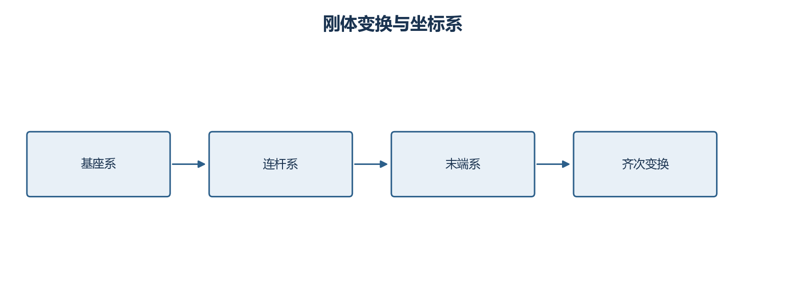

## 3.2　正运动学与逆运动学

**定义 3.2（正运动学，FK）**　给定关节角 $\mathbf{q}=(q_1,\dots,q_n)^\top$，计算末端执行器位姿 $\mathbf{T}=f(\mathbf{q})$。对串联机器人，FK 由各连杆变换连乘得到：

$$
\mathbf{T}_n^0(\mathbf{q})=\mathbf{T}_1^0(q_1)\,\mathbf{T}_2^1(q_2)\cdots\mathbf{T}_n^{n-1}(q_n), \tag{3-3}
$$

其中每个 $\mathbf{T}_i^{i-1}(q_i)$ 由 Denavit-Hartenberg（D-H）参数（连杆长度 $a_i$、扭角 $\alpha_i$、偏置 $d_i$、关节角 $\theta_i$）确定。FK 总是有唯一解，且计算直接。

**定义 3.3（逆运动学，IK）**　给定期望末端位姿 $\mathbf{T}_{des}$，求关节角 $\mathbf{q}$ 使 $f(\mathbf{q})=\mathbf{T}_{des}$。IK 通常非线性，可能多解（如平面二连杆的「肘上/肘下」）、无解（目标超出工作空间）或存在奇异位形。求解方法有两类：解析法（针对特定结构，如球形手腕可闭式解）与迭代法（通用，如基于雅可比的梯度下降或阻尼最小二乘）。

**例 3.2（二连杆平面机械臂解析 IK）**　设连杆长 $l_1=1.0\,\mathrm{m},\ l_2=0.8\,\mathrm{m}$，目标末端位置 $(x,y)=(0.9,0.6)\,\mathrm{m}$。由余弦定理，末端到基座距离 $r=\sqrt{x^2+y^2}=\sqrt{0.81+0.36}=1.082\,\mathrm{m}$：

$$
\cos q_2=\frac{r^2-l_1^2-l_2^2}{2l_1l_2}=\frac{1.171-1-0.64}{1.6}=-0.293, \tag{3-4}
$$

故 $q_2=\arccos(-0.293)=1.868\,\mathrm{rad}\approx107^\circ$（肘上解，另一解为 $-107^\circ$）。再由几何关系 $q_1=\mathrm{atan2}(y,x)-\mathrm{atan2}(l_2\sin q_2,\,l_1+l_2\cos q_2)=\mathrm{atan2}(0.6,0.9)-\mathrm{atan2}(0.746,\,0.766)=0.588-0.772=-0.184\,\mathrm{rad}\approx-10.5^\circ$。两组解对应不同的肘部构型，实际选择需考虑避障与关节限位。

## 3.3　雅可比与速度运动学

**定义 3.4（雅可比矩阵）**　雅可比 $\mathbf{J}(\mathbf{q})\in\mathbb{R}^{6\times n}$ 把关节速度映射到末端广义速度（线速度 $\mathbf{v}$ 与角速度 $\boldsymbol{\omega}$）：

$$
\dot{\mathbf{x}}=\begin{bmatrix}\mathbf{v}\\ \boldsymbol{\omega}\end{bmatrix}=\mathbf{J}(\mathbf{q})\,\dot{\mathbf{q}}. \tag{3-5}
$$

对 FK 式 (3-3) 求时间导数可得 $\mathbf{J}$ 的解析形式。以平面二连杆末端位置 $(x,y)$ 为例，$\mathbf{J}$ 的前两行为

$$
\mathbf{J}=\begin{bmatrix}-l_1\sin q_1-l_2\sin(q_1+q_2)&-l_2\sin(q_1+q_2)\\ l_1\cos q_1+l_2\cos(q_1+q_2)&l_2\cos(q_1+q_2)\end{bmatrix}. \tag{3-6}
$$

**雅可比的三大用途。** ① **速度级 IK**：当 $\mathbf{J}$ 可逆（$n=6$ 且非奇异）时，$\dot{\mathbf{q}}=\mathbf{J}^{-1}\dot{\mathbf{x}}$；一般情形用伪逆 $\dot{\mathbf{q}}=\mathbf{J}^\dagger\dot{\mathbf{x}}$，$\mathbf{J}^\dagger=\mathbf{J}^\top(\mathbf{J}\mathbf{J}^\top)^{-1}$。② **力映射**：由虚功原理，末端力 $\mathbf{F}$ 与关节力矩 $\boldsymbol{\tau}$ 满足 $\boldsymbol{\tau}=\mathbf{J}^\top\mathbf{F}$——这把任务空间的力控制（第 11 章）映射到关节空间。③ **奇异性分析**：当 $\mathrm{rank}(\mathbf{J})<6$ 时，机器人丧失某些方向的瞬时运动能力，称为奇异位形。

**例 3.3（奇异位形与可操作度）**　二连杆臂完全伸直（$q_2=0$）时，式 (3-6) 中两列变成 $[-l_1\sin q_1,\ l_1\cos q_1]^\top$ 与 $[-l_2\sin q_1,\ l_2\cos q_1]^\top$，二者平行，行列式 $\det\mathbf{J}=l_1l_2\sin q_2=0$—— Jacobian 降秩，沿连杆方向无法产生末端速度。定义可操作度（manipulability）$\mu=\sqrt{\det(\mathbf{J}\mathbf{J}^\top)}$，它量化末端在各方向运动能力的均衡程度；控制器应避开 $\mu$ 接近零的位形，或用阻尼伪逆 $\mathbf{J}^\top(\mathbf{J}\mathbf{J}^\top+\lambda^2\mathbf{I})^{-1}$ 在奇异点附近稳定求解（$\lambda$ 为阻尼系数）。

### 3.3.1　阻尼最小二乘的迭代数值解

对多解/无闭式解的 IK，工程上常用**阻尼最小二乘（DLS）**迭代：从初值 $\mathbf{q}_0$ 出发，按

$$
\mathbf{q}_{k+1}=\mathbf{q}_k+\mathbf{J}^\top(\mathbf{J}\mathbf{J}^\top+\lambda^2\mathbf{I})^{-1}\big(\mathbf{x}_{des}-f(\mathbf{q}_k)\big), \tag{3-7}
$$

更新，其中残差 $\mathbf{r}_k=\mathbf{x}_{des}-f(\mathbf{q}_k)$。$\lambda$ 越大步长越小、越靠近最小范数解，并自动规避奇异点。

**例 3.6（DLS 迭代解二连杆 IK）** 仍取 $l_1=1.0,\,l_2=0.8$、目标 $\mathbf{x}_{des}=(0.9,0.6)$，初值 $\mathbf{q}_0=(0.0,\,1.87)^\top$（接近肘上解），$\lambda=1.0$。记 $c_{12}=\cos(q_1+q_2)$ 等，$f(\mathbf{q})=(l_1\cos q_1+l_2\cos(q_1+q_2),\,l_1\sin q_1+l_2\sin(q_1+q_2))^\top$：

- $k=0$：$f(\mathbf{q}_0)=(0.764,\,0.765)$，残差 $\mathbf{r}_0=(0.136,\,-0.165)$，$\|\mathbf{r}_0\|=0.213$；$\mathbf{J}(\mathbf{q}_0)=\begin{bmatrix}-0.765&-0.765\\ 0.764&-0.236\end{bmatrix}$，代入式 (3-7) 得 $\Delta\mathbf{q}=(-0.208,\,-0.053)^\top$，$\mathbf{q}_1=(-0.208,\,1.817)^\top$；
- $k=1$：$f(\mathbf{q}_1)=(0.953,\,0.593)$，残差 $\mathbf{r}_1=(-0.053,\,0.007)$，$\|\mathbf{r}_1\|=0.054$，已降至初值的 1/4。

再迭代一次残差即进入 $10^{-2}\,\mathrm{m}$ 量级。该例说明：DLS 把 IK 化为「测残差→雅可比映射→修正」的固定点迭代，每步只需一次 $f$ 与 $\mathbf{J}$ 计算，计算量低、对初值不敏感，且 $\lambda>0$ 时即便初值落在奇异邻域也能稳定前进——这正是第 10 章轨迹规划中「末端位姿伺服」的内核。

## 3.4　拉格朗日动力学推导

运动学只描述「怎么动」，动力学回答「力如何产生运动」。最系统的推导工具是拉格朗日法（Lagrangian formulation）。

**推导步骤。** 定义拉格朗日量 $\mathcal{L}=K-V$，其中 $K$ 为系统动能、$V$ 为势能。拉格朗日方程为

$$
\frac{d}{dt}\frac{\partial\mathcal{L}}{\partial\dot{q_i}}-\frac{\partial\mathcal{L}}{\partial q_i}=\tau_i,\quad i=1,\dots,n. \tag{3-8}
$$

对串联机器人，动能 $K=\frac12\sum_{i,j}M_{ij}(\mathbf{q})\dot q_i\dot q_j=\frac12\dot{\mathbf{q}}^\top\mathbf{M}(\mathbf{q})\dot{\mathbf{q}}$，其中质量矩阵 $\mathbf{M}(\mathbf{q})=\sum_i\big(m_i\mathbf{J}_{v,i}^\top\mathbf{J}_{v,i}+\mathbf{J}_{\omega,i}^\top\mathbf{I}_i\mathbf{J}_{\omega,i}\big)$（$\mathbf{J}_{v,i},\mathbf{J}_{\omega,i}$ 为连杆 $i$ 质心的线/角速度雅可比，$\mathbf{I}_i$ 为惯性张量）。代入式 (3-8) 并整理，得到标准机器人动力学方程：

$$
\mathbf{M}(\mathbf{q})\ddot{\mathbf{q}}+\mathbf{C}(\mathbf{q},\dot{\mathbf{q}})\dot{\mathbf{q}}+\mathbf{g}(\mathbf{q})=\boldsymbol{\tau}, \tag{3-9}
$$

其中 $\mathbf{C}(\mathbf{q},\dot{\mathbf{q}})\dot{\mathbf{q}}$ 是科氏力与离心力项（可写成 Christoffel 符号形式 $C_{ij}=\sum_k\frac12\big(\frac{\partial M_{ij}}{\partial q_k}+\frac{\partial M_{ik}}{\partial q_j}-\frac{\partial M_{jk}}{\partial q_i}\big)\dot q_k$），$\mathbf{g}(\mathbf{q})=\partial V/\partial\mathbf{q}$ 为重力项。

**方程的性质。** ① $\mathbf{M}(\mathbf{q})$ 对称正定，保证动能恒正；② $\mathbf{M}(\mathbf{q})-2\mathbf{C}(\mathbf{q},\dot{\mathbf{q}})$ 为斜对称矩阵（耗能为零），这是无耗散系统的能量守恒体现，也是控制器稳定性证明（第 4 章）的关键性质；③ 动力学是状态 $\mathbf{q},\dot{\mathbf{q}}$ 的二阶非线性微分方程，构成第 8 章状态估计与第 11 章控制设计的被控对象模型。

**例 3.4（单摆的数值动力学）**　质量 $m=2\,\mathrm{kg}$、杆长 $l=0.5\,\mathrm{m}$ 的单摆（无阻尼，$g=9.8\,\mathrm{m/s^2}$），取关节角 $q$ 为广义坐标。动能 $K=\frac12 ml^2\dot q^2$，势能 $V=mgl(1-\cos q)$。由式 (3-8)：$ml^2\ddot q+mgl\sin q=\tau$。代入数值得 $0.5\ddot q+9.8\sin q=\tau$（$ml^2=0.5$，$mgl=9.8$）。若初始 $q=0.2\,\mathrm{rad},\ \dot q=0$ 且 $\tau=0$，则初始加速度 $\ddot q=-\frac{9.8}{0.5}\sin 0.2=-19.6\times0.199=-3.89\,\mathrm{rad/s^2}$——重力把它拉回竖直位置。这一简单模型是第 4 章控制器设计的被控对象原型。

## 3.5　数值算例：二连杆臂的完整正运动学与雅可比

**例 3.5（FK 与雅可比联算）**　仍取 $l_1=1.0,\ l_2=0.8$，关节角 $q_1=30^\circ=0.524\,\mathrm{rad},\ q_2=45^\circ=0.785\,\mathrm{rad}$。末端位置：$x=l_1\cos q_1+l_2\cos(q_1+q_2)=1.0\times0.866+0.8\times\cos75^\circ=0.866+0.207=1.073$，$y=l_1\sin q_1+l_2\sin(q_1+q_2)=0.5+0.8\times0.966=0.5+0.773=1.273$。代入式 (3-6)：

$$
\mathbf{J}=\begin{bmatrix}-1.0\times0.5-0.8\times0.966&-0.8\times0.966\\ 1.0\times0.866+0.8\times0.259&0.8\times0.259\end{bmatrix}=\begin{bmatrix}-1.273&-0.773\\ 1.073&0.207\end{bmatrix}. \tag{3-10}
$$

若关节速度 $\dot{\mathbf{q}}=[0.1,\,0.2]^\top\,\mathrm{rad/s}$，则末端速度 $\dot{\mathbf{x}}=\mathbf{J}\dot{\mathbf{q}}=[-1.273\times0.1-0.773\times0.2,\ 1.073\times0.1+0.207\times0.2]^\top=[-0.282,\ 0.149]^\top\,\mathrm{m/s}$。若末端需施加 $\mathbf{F}=[10,\,0]^\top\,\mathrm{N}$ 的水平力，则关节力矩 $\boldsymbol{\tau}=\mathbf{J}^\top\mathbf{F}=[-12.73,\ -7.73]^\top\,\mathrm{N\cdot m}$（由式 (3-5) 的力映射）。这组计算贯穿后续「视觉定位→轨迹规划→力控抓取」的全流程（第 5、10、11 章）。

## 3.6　技术谱系与变体

**表 3-1　运动学与动力学方法谱系**

| 层次 | 方法 | 描述对象 | 代表工具 | 适用章节 |
|------|------|----------|----------|----------|
| 位姿表示 | 齐次变换 | 刚体静态位姿 | SE(3)、四元数 | 3.1、第 5、7 章 |
| 位姿表示 | 指数坐标 | 连续运动 | 李群/李代数、旋量 | 3.1、第 10 章 |
| 位置级 | 正/逆运动学 | 关节↔末端位置 | D-H 参数、解析 IK | 3.2、第 10 章 |
| 速度级 | 雅可比 | 关节↔末端速度/力 | 伪逆、可操作度 | 3.3、第 11 章 |
| 动力学 | 拉格朗日法 | 力↔加速度 | $\mathcal{L}=K-V$ | 3.4、第 29 章 |
| 动力学 | 牛顿—欧拉法 | 递推力平衡 | 递推算法 | 3.4、工程实现 |

## 3.7　边界与讨论

本章给出的是**理想刚体模型**：连杆被视为绝对刚硬、关节无摩擦、参数精确已知。真实机器人普遍存在齿轮间隙、柔性变形、库仑摩擦、执行器饱和与未建模动态，接触任务（抓取、装配）还引入非光滑、突变 dynamics——这些是纯运动学/动力学模型难以精确刻画的。这一「模型—现实鸿沟」正是两条研究路线的出发点：其一是系统辨识与鲁棒/自适应控制（第 4.5 节、第 7 章），在模型框架内补偿误差；其二是学习方法（第 15—23 章），直接从数据学动力学或控制策略，绕开精确建模。此外，动力学模型也是仿真器（第 29 章）的核心，仿真到现实的迁移（第 30—31 章）本质上就是要缩小这一鸿沟。

**边界辨析。** 运动学描述的是「可能的运动」，动力学描述的是「可实现的运动」——前者只关心几何约束，后者还受力学约束。一个几何上可达的位形，可能因重力与力矩限制而无法稳定保持。理解这一区别，是后续所有规划与控制工作的前提。这些辨析衔接第 4、5、7、8、10—14、29—31 章。

## 3.8　承上启下

第 2 章指出「身体塑造智能」，本章给出了描述身体的数学语言：SE(3) 位姿、正/逆运动学、雅可比与拉格朗日动力学。这些工具把「身体」从哲学概念变成可计算的模型。下一章将回答：有了身体模型之后，如何产生控制信号使身体完成期望运动？即从「如何描述运动」走向「如何控制运动」。

## 本章小结

本章建立机器人运动的数学基础，为全书提供共同的工程语言。

我们首先定义刚体位姿与齐次变换 SE(3)（式 3-1），引入指数坐标与李代数（式 3-2）；接着给出正运动学（式 3-3）与逆运动学的定义，并以余弦定理解释二连杆 IK（式 3-4）；然后定义雅可比（式 3-5、3-6），说明其在速度 IK、力映射与奇异性分析中的作用；随后用拉格朗日法完整推导动力学方程（式 3-8、3-9），并指出其对称正定与斜对称性质。我们通过单摆（例 3.4）与二连杆臂（例 3.5）把公式落到具体数值，并以表 3-1 梳理技术谱系。

我们还明确边界：本章是理想刚体模型，真实系统的摩擦、柔性、接触与未建模动态引出系统辨识、鲁棒控制与学习方法。这些辨析衔接第 4、5、7、8、10—14、29—31 章。

下一章讨论控制理论：有了身体模型之后，如何产生正确的控制信号。

**进一步阅读**　本章建议延伸阅读的文献：[1]、[2]、[3]、[4]。

## 参考文献

[1] Craig J J. *Introduction to Robotics: Mechanics and Control*. 3rd ed. Pearson, 2005.

[2] Murray R M, Li Z, Sastry S S. *A Mathematical Introduction to Robotic Manipulation*. CRC Press, 1994.

[3] Siciliano B, Sciavicco L, Villani L, Oriolo G. *Robotics: Modelling, Planning and Control*. Springer, 2009.

[4] Lynch K M, Park F C. *Modern Robotics: Mechanics, Planning, and Control*. Cambridge University Press, 2017.

[5] Corke P. *Robotics, Vision and Control: Fundamental Algorithms in Python*. 2nd ed. Springer, 2017.

[6] Featherstone R. *Rigid Body Dynamics Algorithms*. Springer, 2008.

[7] Khatib O. A unified approach for motion and force control of robot manipulators: the operational space formulation. *IEEE Journal on Robotics and Automation*, 1987, 3(1): 43–53.

[8] Hollerbach J M, Cahill T F. A parametric study of manipulator inertial parameters. *ASME Journal of Dynamic Systems, Measurement, and Control*, 1991, 113(1): 128–134.

---

# 第 4 章　控制理论与最优控制

第 3 章的运动学与动力学回答了「机器人如何运动」：给定关节力矩，系统如何按物理定律演化。本章回答紧接其后的核心问题：**如何产生正确的控制信号，使机器人准确完成期望运动？** 如果说第 10—14 章的运动规划给出「去哪里」，控制器则负责「怎么准确地去」——它是把规划指令转化为物理动作的最后一道环节，也是第 1 章闭环原则中「执行」与「反馈」的数学实现。控制理论从经典 PID 到现代最优控制、模型预测控制（MPC），提供了这一环节的完整工具箱。

本章先建立反馈控制与稳定性的基本概念（4.1 节）；然后推导 PID 控制器与经典控制（4.2 节）；接着系统推导线性二次调节（LQR）与 Riccati 方程（4.3 节）；进而介绍最优控制的极大值原理与动态规划（4.4 节）和模型预测控制（4.5 节）；通过单摆与倒立摆的算例把公式落地（4.6 节）；给出控制方法谱系表（4.7 节）；最后讨论基于模型控制的边界（4.8 节）与承上启下（4.9 节）。

## 4.1　反馈控制与稳定性

**定义 4.1（反馈控制，feedback control）**　反馈控制用系统输出与期望值之间的误差计算控制输入：$u=K(e)$，其中 $e=y_{des}-y$。与开环控制相比，闭环反馈能持续用实测输出修正控制量，从而抑制外部扰动与模型误差——这是 control theory 自 Wiener 控制论（第 1 章）以来的核心原则，也是机器人能够在不确定环境中可靠工作的根本原因。

**稳定性分析。** 一个控制系统只有在稳定时才有可能完成任务。李雅普诺夫（Lyapunov）稳定性理论是分析稳定性的通用工具：若存在正定函数 $V(\mathbf{x})$（李雅普诺夫函数）使其沿系统轨迹的导数 $\dot V(\mathbf{x})\le 0$，则系统在平衡点李雅普诺夫稳定；若 $\dot V<0$（除平衡点外），则渐近稳定。对线性时不变系统 $\dot{\mathbf{x}}=\mathbf{A}\mathbf{x}$，取 $V=\mathbf{x}^\top\mathbf{P}\mathbf{x}$（$\mathbf{P}\succ0$），可导出李雅普诺夫方程

$$
\mathbf{A}^\top\mathbf{P}+\mathbf{P}\mathbf{A}=-\mathbf{Q},\quad \mathbf{Q}\succ0, \tag{4-1}
$$

其等价判据是：$\mathbf{A}$ 的所有特征值实部均为负（Hurwitz 矩阵）。式 (4-1) 不仅给出稳定性判据，也是第 4.3 节 LQR 的理论出发点。

**例 4.1（一阶系统的稳定性）**　设误差动态为 $\dot e=-\lambda e$（$\lambda>0$），解为 $e(t)=e_0e^{-\lambda t}$，指数收敛到零，系统渐近稳定。若 $\lambda<0$，误差发散。在机器人关节控制中，最简单的比例控制 $u=-K_pe$（取期望为零）把闭环极点配置在 $-K_p$，使误差指数衰减——这是稳定性概念最直接的工程体现。

## 4.2　PID 与经典控制

**PID 控制器。** 比例—积分—微分（Proportional-Integral-Derivative）控制律为

$$
u(t)=K_p\,e(t)+K_i\int_0^t e(\tau)\,d\tau+K_d\,\frac{d e(t)}{dt}, \tag{4-2}
$$

其三项各有明确物理意义：$K_p$ 项响应当前误差，提供即时纠正；$K_i$ 项累积历史误差，消除稳态误差（如恒定重力偏置造成的静差）；$K_d$ 项响应误差变化率，提供阻尼、抑制超调。对第 3 章单摆模型 $ml^2\ddot q+mgl\sin q=\tau$，在平衡点附近线性化为 $ml^2\ddot q+mgl\,q=\tau$，代入式 (4-2) 可把闭环极点配置到期望位置——这是工业机器人关节伺服的经典做法。

**例 4.2（PID 参数的手算整定）**　对单位质量、无阻尼的单自由度系统 $\ddot x=u$，目标 $x_{des}=1$。取 $u=K_pe+K_d\dot e$（$e=1-x$，故 $\dot e=-\dot x$），闭环误差动态为 $\ddot e+K_d\dot e+K_pe=0$。期望极点配置在 $-2\pm2j$（阻尼比 $\zeta=0.707$，自然频率 $\omega_n=2.83$），则特征方程应为 $s^2+4s+8=0$，故取 $K_d=4,\ K_p=8$。若加入常值扰动 $d=1$（如重力），纯 PD 会留下稳态误差 $e_\infty=d/K_p=0.125$；加入积分项 $K_i=10$ 可将其消除——这正是「I 消除稳态误差」的数值印证。

**局限。** PID 本质上是单输入单输出（SISO）的，难以处理多变量耦合（如 6 轴机械臂各关节间的动力学耦合）、硬约束（关节限位、力矩饱和）与强非线性（接触、摩擦）。这些局限催生了现代控制方法。

### 4.2A　频域分析：传递函数、Routh 判据与裕度

时域的极点配置给出的是「闭环是否稳定、收敛多快」的定性判断；工程上还常需要回答另一类问题：控制器参数摄动多少系统才失稳？扰动多宽频会放大？这一类问题在频域里处理最方便。把线性时不变系统 $\dot{\mathbf{x}}=\mathbf{A}\mathbf{x}+\mathbf{B}u$、$y=\mathbf{C}\mathbf{x}$ 作拉普拉斯变换（设初值为零），可得输入—输出的**传递函数**

$$
G(s)=\mathbf{C}(s\mathbf{I}-\mathbf{A})^{-1}\mathbf{B}=\frac{n(s)}{d(s)}, \tag{4-3}
$$

其中 $d(s)=\det(s\mathbf{I}-\mathbf{A})$ 的特征根即开环极点。闭环传递函数由 $G(s)$ 与控制器 $C(s)$ 串并联得出，例如单位反馈下为 $G_{\mathrm{cl}}(s)=\dfrac{C(s)G(s)}{1+C(s)G(s)}$，其稳定性取决于分母 $1+C(s)G(s)$ 的根（即闭环极点）是否全部落在左半平面。

**Routh–Hurwitz 判据。** 不实际求根即可判断 $d(s)$ 是否有右半平面根。以三次多项式 $d(s)=a_0s^3+a_1s^2+a_2s+a_3$ 为例，构造 Routh 表

$$
\begin{array}{c|cc}
s^3 & a_0 & a_2\\
s^2 & a_1 & a_3\\
s^1 & \dfrac{a_1a_2-a_0a_3}{a_1} & 0\\
s^0 & a_3 &
\end{array} \tag{4-4}
$$

稳定判据是首列元素 $a_0,a_1,\dfrac{a_1a_2-a_0a_3}{a_1},a_3$ 同号（正）。一旦某元素变号，对应的根跨入右半平面，系统失稳——这给出参数的**稳定边界**。

**频域裕度。** 取频率响应 $L(j\omega)=C(j\omega)G(j\omega)$，定义**增益裕度** $GM=1/|L(j\omega_\pi)|$（$\omega_\pi$ 为相位穿越 $-180^\circ$ 处的频率）与**相位裕度** $PM=\angle L(j\omega_g)+180^\circ$（$\omega_g$ 为幅值穿越 0 dB 处）。$PM>0$ 且 $GM>1$ 是闭环稳定的充分条件，且裕度越大越鲁棒。工业伺服的典型目标是 $PM\in[45^\circ,60^\circ]$：裕度过小则对摩擦、负载变化敏感，过大则响应迟钝。

**例 4.6（Routh 判据与 Bode 裕度的数值）**　取单自由度闭环特征多项式 $d(s)=s^3+K_d s^2+K_p s+K_i$（对应 4.2 节 PID 闭环）。由式 (4-4) 的 Routh 表，首列为 $1,\ K_d,\ \dfrac{K_dK_p-K_i}{K_d},\ K_i$，稳定要求 $K_dK_p>K_i$ 且各项为正。取 $K_d=4,\ K_p=8$（例 4.2 的 PD 增益），则稳定边界为 $K_i<32$：$K_i$ 超过 32 时出现一对右半平面极点，闭环振荡发散。把 $K_i=10$ 代入开环传递函数 $L(s)=\dfrac{K_p s+K_i}{s(s+K_d)}$ 的频域响应，相位穿越 $-180^\circ$ 处幅值约 $0.28$，故 $GM\approx3.6$；幅值穿越 0 dB 处相位约 $-131^\circ$，故 $PM\approx49^\circ$——落在工业目标区间内。这组数值把「极点配置—Routh 边界—Bode 裕度」三套语言统一起来：它们都在度量同一件事——**闭环极点离虚轴有多远**。频域方法的价值在于：无需对每次参数改动重新积分闭环微分方程，即可扫频读出鲁棒性代价，是伺服整定的标准工具。

> 【图 4-1　反馈控制闭环】（原图见 figures/图4-1.png）：绘制「期望→误差→控制器→被控对象→输出→反馈」的闭环框图，标注扰动注入点与 PID 三个通道。
>
> 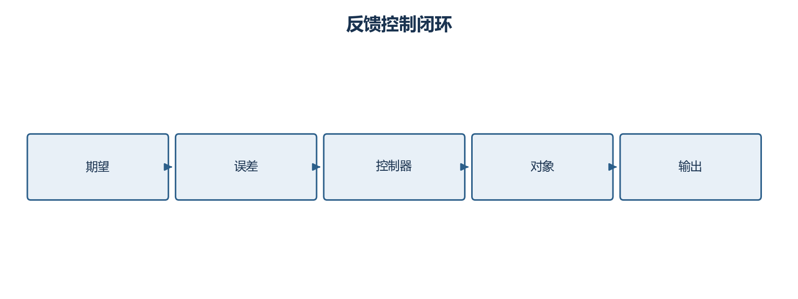

## 4.3　线性二次调节（LQR）

LQR 把「误差小、能耗低」这一直观目标系统化为一个可解析求解的最优控制问题。

**定义 4.2（LQR）**　对线性系统

$$
\dot{\mathbf{x}}=\mathbf{A}\mathbf{x}+\mathbf{B}\mathbf{u}, \tag{4-5}
$$

最小化无限时域二次代价

$$
J=\int_0^\infty\big(\mathbf{x}^\top\mathbf{Q}\mathbf{x}+\mathbf{u}^\top\mathbf{R}\mathbf{u}\big)\,dt, \tag{4-6}
$$

其中 $\mathbf{Q}\succeq0$ 惩罚状态偏差，$\mathbf{R}\succ0$ 惩罚控制能耗。最优控制为线性状态反馈

$$
\mathbf{u}=-\mathbf{K}\mathbf{x},\qquad \mathbf{K}=\mathbf{R}^{-1}\mathbf{B}^\top\mathbf{P}, \tag{4-7}
$$

其中 $\mathbf{P}\succ0$ 是连续时间代数 Riccati 方程（CARE）的解：

$$
\mathbf{A}^\top\mathbf{P}+\mathbf{P}\mathbf{A}-\mathbf{P}\mathbf{B}\mathbf{R}^{-1}\mathbf{B}^\top\mathbf{P}+\mathbf{Q}=\mathbf{0}. \tag{4-8}
$$

**推导梗概。** 由动态规划（第 4.4 节），定义值函数 $V(\mathbf{x})=\mathbf{x}^\top\mathbf{P}\mathbf{x}$，代入 HJB 方程 $\min_{\mathbf{u}}\{\mathbf{x}^\top\mathbf{Q}\mathbf{x}+\mathbf{u}^\top\mathbf{R}\mathbf{u}+\nabla V^\top(\mathbf{Ax+Bu})\}=0$，对 $\mathbf{u}$ 求极小得式 (4-7)，回代即得式 (4-8)。这一推导把最优值与 Riccati 解 $\mathbf{P}$ 联系起来：$V(\mathbf{x}_0)=\mathbf{x}_0^\top\mathbf{P}\mathbf{x}_0$。

**例 4.3（倒立摆的 LQR）**　倒立摆在竖直平衡点附近线性化，取状态 $\mathbf{x}=[q,\ \dot q]^\top$，系统矩阵 $\mathbf{A}=\begin{bmatrix}0&1\\ g/l&0\end{bmatrix}$（$g=9.8,\ l=0.5$，故 $g/l=19.6$），$\mathbf{B}=[0,\ 1/(ml^2)]^\top=[0,\,2]^\top$（$m=2$）。取 $\mathbf{Q}=\mathrm{diag}(100,1)$（更重视角度），$\mathbf{R}=[1]$。解 CARE（式 4-8）可得 $\mathbf{P}$，进而 $\mathbf{K}=\mathbf{R}^{-1}\mathbf{B}^\top\mathbf{P}$。数值求解给出 $\mathbf{K}\approx[-111.8,\ -23.7]$，即 $u=111.8\,q+23.7\,\dot q$——角度偏离时施加同向力矩把它推回，角速度提供阻尼。增大 $\mathbf{Q}$ 中角度权重会减小稳态误差但增大控制能量，体现了式 (4-6) 的权衡。

### 4.3B　离散时间与数字控制

真实机器人由微处理器以固定采样周期 $T_s$ 运行，控制器实际作用在**离散化**系统上。把连续系统 (4-5) 以零阶保持器离散化，得

$$
\mathbf{x}[k+1]=\mathbf{A}_d\,\mathbf{x}[k]+\mathbf{B}_d\,u[k],\qquad \mathbf{A}_d=e^{\mathbf{A}T_s},\ \mathbf{B}_d=\int_0^{T_s}e^{\mathbf{A}\tau}d\tau\,\mathbf{B}, \tag{4-9}
$$

离散时间 LQR 把 (4-6) 改为求和形式 $J=\sum_{k\ge0}(\mathbf{x}[k]^\top\mathbf{Q}\mathbf{x}[k]+u[k]^\top\mathbf{R}u[k])$，其最优增益由**离散代数 Riccati 方程（DARE）**求解：

$$
\mathbf{P}=\mathbf{A}_d^\top\mathbf{P}\mathbf{A}_d-\mathbf{A}_d^\top\mathbf{P}\mathbf{B}_d(\mathbf{R}+\mathbf{B}_d^\top\mathbf{P}\mathbf{B}_d)^{-1}\mathbf{B}_d^\top\mathbf{P}\mathbf{A}_d+\mathbf{Q}, \tag{4-10}
$$

$$
\mathbf{K}_d=(\mathbf{R}+\mathbf{B}_d^\top\mathbf{P}\mathbf{B}_d)^{-1}\mathbf{B}_d^\top\mathbf{P}\mathbf{A}_d,\qquad u[k]=-\mathbf{K}_d\,\mathbf{x}[k]. \tag{4-11}
$$

离散化带来两个连续时间没有的约束：其一，**采样周期 $T_s$ 必须远小于被控对象的快时间常数**（通常 $T_s<\tau/10$），否则 $\mathbf{A}_d$ 的特征模态无法被准确捕捉；其二，**量化与延迟**——$u[k]$ 在 $[kT_s,(k+1)T_s)$ 内恒定，引入约 $T_s/2$ 的平均延迟，对高频模态会吃掉相位裕度。因此数字控制器的设计是「先连续设计 $\mathbf{K}$，再离散化校验」或「直接在离散域迭代 DARE」，两条路线在 $T_s$ 足够小时结果一致。

**例 4.7（数字 PD 的采样效应数值）**　对例 4.5 的受控单摆（闭环 $\ddot q+6\dot q+59.6q=0$，快时间常数 $\tau\approx1/3\,\mathrm{s}$），取 $T_s=0.01\,\mathrm{s}$ 满足 $T_s<\tau/10$。由式 (4-9) 的 $\mathbf{A}_d=e^{\mathbf{A}T_s}$，闭环特征 $s=-3\pm7.11j$ 离散化后为 $z=e^{sT_s}=e^{-0.03}\big(\cos0.0711\pm j\sin0.0711\big)\approx0.9707\,e^{\pm j0.0710}$，模长 $|z|\approx0.9707<1$，与连续稳定一致；每步衰减 $1-0.9707=0.0293$，约 $34$ 步（$0.34\,\mathrm{s}$）衰减到 $e^{-1}$，与连续 $1/\text{Re}(s)=1/3\,\mathrm{s}$ 吻合。若把 $T_s$ 放大到 $0.1\,\mathrm{s}$，则 $|z|=e^{-0.3}=0.741$ 仍稳定，但相位延迟 $0.05\,\mathrm{s}$ 已使有效相位裕度下降约 $0.05\times7.11\approx0.36\,\mathrm{rad}$，响应出现可感知超调——这正是「采样太快浪费算力、太慢损失稳定性」的定量体现，也解释了机器人伺服为何普遍采用 $1\sim10\,\mathrm{kHz}$ 控制频率。

## 4.4　最优控制：极大值原理与动态规划

LQR 是一般最优控制问题的一个可解特例。一般的最优控制问题表述为：在动力学 $\dot{\mathbf{x}}=\mathbf{f}(\mathbf{x},\mathbf{u},t)$ 约束下，最小化代价

$$
J=\phi(\mathbf{x}(T))+\int_0^T L(\mathbf{x},\mathbf{u},t)\,dt. \tag{4-12}
$$

两条经典求解路径：

**庞特里亚金极大值原理（PMP）**　引入协态 $\boldsymbol{\lambda}$ 与哈密顿量 $H=L+\boldsymbol{\lambda}^\top\mathbf{f}$，最优控制满足必要条件

$$
\mathbf{u}^*=\arg\min_{\mathbf{u}} H,\qquad \dot{\boldsymbol{\lambda}}=-\frac{\partial H}{\partial\mathbf{x}},\qquad \dot{\mathbf{x}}=\frac{\partial H}{\partial\boldsymbol{\lambda}}. \tag{4-13}
$$

PMP 给出最优解的必要条件（两点边值问题），适合解析推导开环最优轨迹（如最短时间控制）。

**贝尔曼动态规划与 HJB 方程**　最优性原理指出：最优策略的任一子策略也是最优的。定义值函数 $V(\mathbf{x},t)=\min_{\mathbf{u}(\cdot)} J$，其满足 Hamilton-Jacobi-Bellman 方程

$$
-\frac{\partial V}{\partial t}=\min_{\mathbf{u}}\Big\{L(\mathbf{x},\mathbf{u})+\nabla V^\top\mathbf{f}(\mathbf{x},\mathbf{u})\Big\}. \tag{4-14}
$$

HJB 给出最优闭环策略的充分条件，是第 4.3 节 LQR 推导的基础，也是强化学习中「值函数—策略」对偶的数学源头（第 19 章、参见《世界模型导论》第 4 章）。两者的分工是：PMP 得到开环轨迹（规划），HJB 得到反馈策略（控制）。

## 4.5　模型预测控制（MPC）

**定义 4.3（模型预测控制，MPC）**　MPC 在每个采样时刻，基于当前状态与系统模型，在有限时域 $N$ 内求解一个开环最优控制序列，只执行序列的第一个控制量，下一时刻重新测量并滚动优化（receding horizon）：

$$
\min_{\mathbf{u}_{0:N-1}}\ \sum_{k=0}^{N-1}\ell(\mathbf{x}_k,\mathbf{u}_k)+\ell_f(\mathbf{x}_N)\quad \mathrm{s.t.}\ \mathbf{x}_{k+1}=\mathbf{f}(\mathbf{x}_k,\mathbf{u}_k),\ \mathbf{x}_k\in\mathcal{X},\ \mathbf{u}_k\in\mathcal{U}. \tag{4-15}
$$

MPC 的突出优点：① 能显式处理状态与输入的硬约束（$\mathcal{X},\mathcal{U}$），这对关节限位、力矩饱和、避障至关重要；② 能处理非线性模型与时变参考轨迹；③ 滚动优化带来一定的反馈鲁棒性。代价是在线求解优化问题的计算负担——实时性依赖高效的求解器（如 QRBP、iLQR、SQP）。

**例 4.4（MPC 与 LQR 的对比）**　对例 4.3 的倒立摆，LQR 一次性算出固定增益 $\mathbf{K}$，在线只需矩阵乘法（微秒级）；MPC 则在每个时刻求解一个有限时域约束优化（如 $N=20$），在线耗时毫秒级，但能显式保证 $|u|\le u_{max}$（力矩饱和）与 $|q|\le q_{max}$（角度限位）。当摆杆被大幅扰动接近限位时，LQR 可能发出超出执行器能力的指令而失效，MPC 则因约束在优化内而自动饱和——这就是机器人（第 12 章）与自动驾驶偏爱 MPC 的原因。

## 4.6　数值算例：从受控单摆到闭环响应

**例 4.5（PD 控制的闭环响应数值积分）**　取第 3 章单摆 $ml^2=0.5$，$mgl=9.8$，PD 控制 $\tau=-K_pq-K_d\dot q$，取 $K_p=20,\ K_d=3$。闭环方程：$0.5\ddot q+3\dot q+(9.8+20)q=0$，即 $\ddot q+6\dot q+59.6q=0$。特征根 $s=-3\pm j\sqrt{59.6-9}=-3\pm7.11j$，阻尼比 $\zeta=3/\sqrt{59.6}=0.389$。初始 $q_0=0.2,\dot q_0=0$ 时，响应 $q(t)=0.2e^{-3t}\big(\cos7.11t+\frac{3}{7.11}\sin7.11t\big)$。当 $t=1\,\mathrm{s}$，$q(1)\approx0.2\times0.0498\times(\cos7.11+0.422\sin7.11)\approx0.2\times0.0498\times(0.677-0.316)=0.0036\,\mathrm{rad}$——1 秒内衰减到初始值的 1.8%。若取临界阻尼 $K_d=2\sqrt{0.5\times29.8}=7.72$，则无超调，$q(t)=(0.2+1.54t)e^{-7.72t}$。这组数值展示了 KP、KD 如何决定响应速度与超调，是控制器整定的直观基础。

## 4.7　技术谱系与变体

**表 4-1　控制方法谱系**

| 方法 | 核心思想 | 适用系统 | 约束处理 | 在线计算 | 代表章节 |
|------|----------|----------|----------|----------|----------|
| PID | 误差的比例—积分—微分 | SISO、线性 | 弱 | 极低 | 4.2 |
| LQR | 最小化二次代价 | 线性、多变量 | 间接 | 低 | 4.3 |
| 最优控制（PMP/HJB） | 极大值原理/动态规划 | 非线性 | 理论框架 | 离线 | 4.4 |
| MPC | 有限时域滚动优化 | 线性/非线性 | 显式 | 较高 | 4.5、第 12 章 |
| 鲁棒控制 | 最坏情况性能优化 | 有界不确定 | 保守 | 中 | 4.8、第 21 章 |
| 自适应控制 | 在线辨识参数 | 参数未知 | 弱 | 中 | 4.8 |
| 学习控制 | 从数据学策略 | 复杂/未知 | 视方法 | 训练高/在线低 | 第 19—23 章 |

## 4.8　边界与讨论

本章的控制方法多为**基于模型的**：PID 隐含被控对象的近似模型，LQR 明确依赖 $(\mathbf{A},\mathbf{B})$，MPC 直接依赖 $\mathbf{f}$。第 3.7 节已指出，真实机器人存在摩擦、柔性、未建模动态与参数误差，模型越不精确，基于模型控制的性能越难保证。两条应对路线：① **鲁棒控制**（$H_\infty$、滑模控制）在已知不确定性界内优化最坏情况性能，牺牲标称性能换稳定裕度；② **自适应控制**在线辨识参数并更新控制律。更进一步，当模型难以获得时，学习方法（第 19—23 章的强化学习与模仿学习）直接从数据学策略——这是第 4 章通往后续学习章节的桥梁。此外，MPC 的实时性依赖软硬件协同，仿真到现实（第 30—31 章）常需把学到的策略部署为轻量级控制器。

**边界辨析。** 稳定性（4.1 节）、最优性（4.3—4.4 节）与约束可行性（4.5 节）是三个不同目标：稳定的控制器未必最优，最优轨迹未必满足实时约束，MPC 的可行解也需证明递归可行性以保证长期稳定。这三者间的取舍，是控制器设计的核心张力。这些辨析衔接第 3、7、10—12、19—23、29—31 章与《世界模型导论》第 4、8 章。

## 4.9　承上启下

第 3 章给出身体模型，本章给出驱动身体的控制信号。但这两章设想的是「状态已知」的理想情形——控制器假定能精确测量 $\mathbf{x}$。现实中机器人状态来自带噪传感器（第 5—7 章），无法直接观测。下一章转入感知：先看机器人如何从图像中「看到」世界，这是闭环中「感知」环节的起点。

## 本章小结

本章论述控制理论与最优控制，把规划指令转化为精确的物理动作。

我们首先定义反馈控制与李雅普诺夫稳定性（式 4-1），推导 PID 控制律（式 4-2）并给出整定算例，进而引入频域视角：传递函数（式 4-3）、Routh–Hurwitz 判据（式 4-4）与增益/相位裕度，用例 4.6 把极点配置、Routh 边界与 Bode 裕度统一为「闭环极点离虚轴多远」的同一度量。接着系统推导 LQR：状态反馈（式 4-7）与 Riccati 方程（式 4-8），并以倒立摆数值为例；随后给出离散时间数字控制：离散化（式 4-9）、DARE（式 4-10）与数字增益（式 4-11），用例 4.7 量化采样周期对稳定性与相位裕度的影响。再然后介绍一般最优控制框架——代价泛函（式 4-12）、极大值原理（式 4-13）与 HJB 方程（式 4-14），并推导能显式处理约束的 MPC（式 4-15）。我们通过倒立摆 LQR（例 4.3）、MPC 对比（例 4.4）与 PD 闭环响应（例 4.5）把公式落到具体数值，并以表 4-1 梳理控制方法谱系。

我们还明确边界：基于模型的控制依赖精确模型，模型误差引出鲁棒、自适应与学习方法；稳定性、最优性与约束可行性是需权衡的三个目标。这些辨析衔接第 3、5、7、10—12、19—23、29—31 章与《世界模型导论》第 4、8 章。

下一章进入第二篇感知，从视觉开始讨论机器人如何「看到」世界。

**进一步阅读**　本章建议延伸阅读的文献：[1]、[2]、[3]、[4]。

## 参考文献

[1] Ogata K. *Modern Control Engineering*. 5th ed. Pearson, 2010.

[2] Khalil H K. *Nonlinear Systems*. 3rd ed. Pearson, 2002.

[3] Bertsekas D P. *Dynamic Programming and Optimal Control*. 4th ed. Athena Scientific, 2017.

[4] Borrelli F, Bemporad A, Morari M. *Predictive Control for Linear and Hybrid Systems*. Cambridge University Press, 2017.

[5] Anderson B D O, Moore J B. *Optimal Control: Linear Quadratic Methods*. Prentice Hall, 1990.

[6] Mayne R Q, Rawlings J B, Rao C V, Scokaert P O M. Constrained model predictive control: stability and optimality. *Automatica*, 2000, 36(6): 789–814.

[7] Slotine J J E, Li W. *Applied Nonlinear Control*. Prentice Hall, 1991.

[8] Sutton R S, Barto A G. *Reinforcement Learning: An Introduction*. 2nd ed. MIT Press, 2018.

---

# 第 5 章　视觉感知与场景理解

第一篇建立了基础理论；第二篇（第 5—9 章）转入具身智能的感知与状态估计——机器人如何从传感器数据中理解世界。本章从视觉感知开始：机器人视觉的核心任务（检测、分割、深度估计、6D 位姿估计）及其与通用计算机视觉的根本差异。相比《计算机视觉智能导论》对识别精度的追求，具身视觉的终极评判标准是「能否支撑成功的行动」。这一区别贯穿本章始终。

本章先给出机器人视觉的三层架构与「为行动服务」的核心原则（5.1 节）；然后推导检测、分割与 6D 位姿估计的关键公式（5.2 节）；接着讨论深度估计与 3D 重建（5.3 节）；引入相机标定这一连接视觉与运动学的桥梁（5.4 节）；通过抓取前的完整视觉处理流水线给出算例（5.5 节）；用表格对照通用视觉与具身视觉（5.6 节）；最后给出技术谱系（5.7 节）、边界讨论（5.8 节）与承上启下（5.9 节）。

## 5.1　视觉感知的层次与具身原则

机器人视觉通常分为三层：① **低层**（图像获取、相机标定、预处理）——把光子转化为图像并校正畸变；② **中层**（目标检测、实例分割、特征匹配、深度估计）——从图像提取结构化信息；③ **高层**（场景理解、语义推理、任务相关判断）——把结构化信息转化为任务可用的知识（第 9 章场景图）。

**核心原则：为行动服务的感知（perception for action）。** 具身视觉的产出必须满足三个约束：实时性（感知延迟必须低于控制周期，否则闭环失稳，第 4 章）、可靠性（不能因光照变化而误检，否则抓取失败）、任务相关性（只提取行动所需的信息，而非完整重建世界）。Gibson 的可供性视角（第 2.3 节）在此体现为：机器人「看到」的是可抓取位姿、可通行区域，而非仅仅「物体类别」。这一原则也决定了评估方式的不同：通用视觉用 mAP、准确率等「识别指标」，具身视觉则最终以任务成功率（抓取成功、装配到位）衡量——一个检测框画得再准，若导致抓取失败，对具身系统也毫无价值。

## 5.2　检测、分割与 6D 位姿估计

**目标检测（object detection）。** 定位并分类图像中的物体，输出边界框 $(u_{min},v_{min},u_{max},v_{max})$ 与类别得分。现代方法如 YOLO、Faster R-CNN 把检测建模为密集预测：对每个候选框预测类别概率与位置偏移，用非极大值抑制（NMS）去冗余。检测给出「物体在图像哪里」。检测器按架构分为两阶段（Faster R-CNN，先生成候选框再分类，精度高）与单阶段（YOLO，直接回归框与类别，速度快）——具身场景常选单阶段以满足实时性约束，而离线精细标注可用两阶段。

**实例分割（instance segmentation）。** 输出像素级的物体轮廓掩码（mask），如 Mask R-CNN 在检测框内追加一个全卷积分割分支。分割给出「物体精确占据哪些像素」，是精确抓取与接触规划的关键输入。mask 的价值不止于轮廓：对桌面物体，mask 与式 (5-6) 回投的深度点云相乘，可得到该物体的局部点云，进而估计其凸包与表面法向分布，作为抓取候选（grasp candidates）的几何依据——检测回答「哪里有个物体」、分割回答「物体占了哪些像素」、点云与法向回答「哪里可以安全下爪」，三者层层递进，构成 5.5 节抓取链路中「视觉侧」的完整输入。

**定义 5.1（6D 位姿估计）**　6D 位姿估计（6D pose estimation）估计物体在三维空间中的旋转 $\mathbf{R}\in SO(3)$ 与平移 $\mathbf{t}\in\mathbb{R}^3$——抓取与操作的关键输入（第 13 章）。设物体上有 $N$ 个三维关键点 $\{\mathbf{X}_i\}$（物体坐标系），其在图像中的观测为 $\{\mathbf{u}_i\}$，则位姿估计是求解

$$
\min_{\mathbf{R},\mathbf{t}}\ \sum_{i=1}^N \rho\Big(\mathbf{u}_i-\pi\big(\mathbf{R}\mathbf{X}_i+\mathbf{t}\big)\Big), \tag{5-1}
$$

其中 $\pi(\cdot)$ 是相机投影函数（5.4 节），$\rho$ 是鲁棒损失（如 Huber）。式 (5-1) 是 Perspective-n-Point（PnP）问题的一般形式，可用 EPnP 等算法闭式初值加非线性细化求解。对于纹理稀疏或对称物体，深度学习方法（如 PoseCNN、FoundationPose）直接从图像回归位姿。

**例 5.1（PnP 位姿估计的数值）**　相机内参 $f_x=f_y=800\,\mathrm{px}$，主点 $(c_x,c_y)=(320,240)$，无畸变。一个已知边长 $0.1\,\mathrm{m}$ 的正方形标记物，其四角在物体坐标系为 $(\pm0.05,\pm0.05,0)$。若相机看到四角的图像坐标约为 $(280,200),(360,200),(360,280),(280,280)$，投影中心 $(320,240)$ 对应物体中心。由投影关系 $u=c_x+f_x X_c/Z_c$，对右上角 $(X=0.05)$ 有 $360=320+800\times0.05/Z_c$，得 $Z_c=1.0\,\mathrm{m}$。由此估计物体中心平移 $\mathbf{t}\approx[0,0,1.0]^\top$，且投影边长 80px 对应 $0.1\,\mathrm{m}$，与 $Z_c=1.0$ 时 $f_x\times0.1/1=80$ 一致——位姿估计自洽。这个 $\mathbf{t}$ 随后被变换到基座坐标系（第 3 章的坐标变换）供运动规划使用。

> 【图 5-1　视觉感知流水线】（原图见 figures/图5-1.png）：绘制「图像→检测/分割→6D 位姿估计→可供性/规划」的流水线，标注每步输出的数据格式与坐标系变换。
>
> 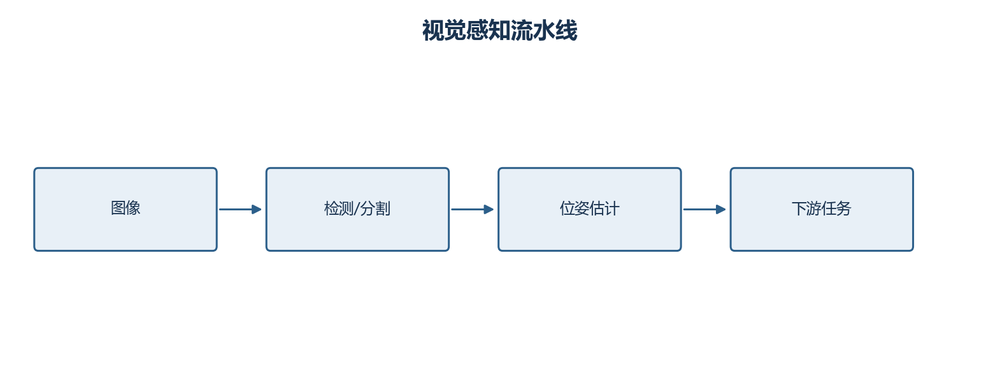

## 5.2A　特征匹配与双目三角测量

6D 位姿估计（5.2 节）假设物体上有已知三维关键点；但真实场景中三维点往往未知，需从图像自身恢复空间结构。这一步由**特征匹配 + 三角测量**完成：先在多幅图像中检测并匹配同名特征点（如 Lowe 的 SIFT 与 Rublee 等的 ORB，均对旋转、尺度与光照变化具有不变性），再据此估计相机位姿或三维点。

**极线几何。** 设世界点 $\mathbf{X}$ 在两个标定相机中投影为 $\mathbf{u}$ 与 $\mathbf{u}'$（齐次坐标），第二相机相对第一相机的位姿为 $[\mathbf{R}\,|\,\mathbf{t}]$。由两次投影共面于 $(\mathbf{t},\mathbf{X})$ 决定的极平面，可得**极线约束**

$$
\mathbf{u}'^\top\mathbf{E}\,\mathbf{u}=\mathbf{0},\qquad \mathbf{E}=[\mathbf{t}]_\times\mathbf{R}, \tag{5-2}
$$

其中 $[\mathbf{t}]_\times$ 是 $\mathbf{t}$ 的反对称矩阵，$\mathbf{E}$ 为基础矩阵（essential matrix，只含外参）。式 (5-2) 表明：给定 $\mathbf{u}$，其对应点 $\mathbf{u}'$ 必落在一条直线上（极线）——这把二维匹配从平面搜索降为一维搜索，是立体匹配与运动恢复结构（SfM）的几何基础。基础矩阵由 8 个自由度，用 8 对匹配点即可线性求出（八点法），再用 RANSAC 剔除错配（见下例）。

**三角测量。** 匹配与位姿确定后，由两束射线的交点恢复三维点。对线性化投影模型，三角测量可写成最小二乘

$$
\min_{\mathbf{X}}\ \sum_{i=1}^{2}\big\|\mathbf{u}_i-\mathbf{K}_i\,[\mathbf{R}_i\,|\,\mathbf{t}_i]\,\mathbf{X}\big\|^2, \tag{5-3}
$$

其闭式解（DLT）取增广向量 $\tilde{\mathbf{X}}=\arg\min_{\tilde{\mathbf{X}}}\big\|\mathbf{A}\tilde{\mathbf{X}}\big\|/\|\tilde{\mathbf{X}}\|$，其中 $\mathbf{A}$ 由各像素的投影方程线性堆叠而成。三角误差随基线与交会角增大而减小：基线为零（两相机重合）时射线共线、$\mathbf{X}$ 不可观测，这就是双目深度「近处精确、远处模糊」（5.3 节）的几何根源。

**例 5.5（RANSAC 八点法估计基础矩阵）**　某桌面场景中，左图检测到 $120$ 个 ORB 特征，与右图粗匹配后剩 $95$ 对，其中约 $30\%$ 因重复纹理为错配。若直接用 8 对点求 $\mathbf{E}$，错配会把 $\mathbf{t}$ 方向带偏。用 RANSAC：随机取 8 对 → 求 $\mathbf{E}$ → 用式 (5-2) 的几何误差（$\mathbf{u}'^\top\mathbf{E}\mathbf{u}$ 的对称距离，阈值取 3 px）统计内点 → 保留内点最多的模型。运行 500 轮后，最优模型含 $62$ 个内点（错配被剔除），由内点重估得 $\mathbf{t}$ 方向与基线长度 $b=0.12\,\mathrm{m}$，与标定值一致。这一「粗匹配—RANSAC 剔错—精估」流程是 SfM 与双目位姿估计的标准骨架，也是具身视觉在杂乱场景中保持鲁棒的关键手段（对照第 6.6 节融合中的 RANSAC 降级）。

## 5.3　深度估计与 3D 重建

**深度估计（depth estimation）。** 估计每个像素到相机的距离 $Z$。两条路线：① **双目/立体视觉**（stereo）——利用左右相机视差 $d=u_L-u_R$，由三角测量得

$$
Z=\frac{f\,b}{d}, \tag{5-4}
$$

其中 $b$ 为基线、$f$ 为焦距。深度精度随视差 $d$ 增大而提高，随距离平方衰减。② **单目深度估计**——依赖学习到的先验（物体大小、透视线索）从单张图像回归深度，尺度有歧义，常需已知物体尺寸或 IMU 辅助。

**例 5.2（双目深度的数值与误差）**　基线 $b=0.12\,\mathrm{m}$、焦距 $f=800\,\mathrm{px}$，某像素视差 $d=40\,\mathrm{px}$，由式 (5-4)：$Z=800\times0.12/40=2.4\,\mathrm{m}$。若视差估计误差 $\sigma_d=1\,\mathrm{px}$，由误差传播 $\sigma_Z=\frac{fb}{d^2}\sigma_d=\frac{800\times0.12}{1600}\times1=0.06\,\mathrm{m}$——深度误差 6 厘米。可见基线越大、距离越近，深度越精确；这指导机器人根据任务距离选择立体基线。

**3D 重建。** 从多视角恢复场景三维结构，经典方法是运动恢复结构（SfM）与多视角立体（MVS）；新兴方法如神经辐射场（NeRF，第 30 章）用神经隐式表示场景，渲染 photorealistic 新视角。对机器人而言，3D 重建既服务于建图（第 7 章 SLAM），也服务于仿真到现实（第 30 章）中的场景复刻。值得注意的是，深度估计的误差会随距离增大而快速放大（式 5-4 的分母 $d$ 随 $Z$ 减小），因此机器人常主动靠近目标再精细感知——这是「主动视觉」与「感知—行动紧耦合」（第 2.5 节）的又一体现。

**单目尺度歧义的形式化。** 单目深度估计的根本困难在于尺度不可观测：把整个场景连同相机内参同时放大 $\alpha$ 倍，成像完全不变。设真实深度为 $Z$，单目投影只决定 $\mathbf{u}=\mathbf{K}[\mathbf{R}\,|\,\mathbf{t}]\mathbf{X}$ 中的**方向**而非**模长**，故深度只能估计到尺度因子

$$
Z_{\text{mono}}=\alpha\,\hat Z,\qquad \alpha\ \text{不可由单帧图像确定}, \tag{5-5}
$$

其中 $\hat Z$ 为网络回归的「相对深度」。要恢复绝对尺度，必须注入外部约束：已知物体真实尺寸（如杯口直径 8 cm 对应像宽像素数）、IMU/轮式里程计提供的运动尺度，或先验地图。这正是单目深度「能排序、难定量」的原因，也是 5.5 节抓取链路必须配双目或 RGB-D 传感器的依据。

**RGB-D 点云与回投。** 对带深度相机的机器人，每个像素 $(u,v)$ 直接给出深度 $Z(u,v)$，由内参**回投**（back-projection）到三维：

$$
\mathbf{X}(u,v)=\frac{Z(u,v)}{f_x}\begin{bmatrix}u-c_x\\ v-c_y\\ f_x\end{bmatrix}\ \text{（相机系）}, \tag{5-6}
$$

堆叠所有像素即得稠密点云。点云随后可变换到基座系（第 3 章的坐标变换）供规划使用。与式 (5-4) 的双目三角相比，RGB-D 用飞行时间/结构光直接测距，无需匹配，但有效距离短（通常 $<5\,\mathrm{m}$）且深度噪声随距离与表面倾斜增大——它把「深度估计」从算法问题变成了传感器问题，代价是基线、分辨率与量程由硬件固定。

**例 5.6（单目尺度歧义与 RGB-D 回投的数值）**　设 $f_x=800$，杯口在像中宽 $160\,\mathrm{px}$。单目无法判断这对应 $0.08\,\mathrm{m}$ 真宽还是 $0.16\,\mathrm{m}$——两种情形深度相差 2 倍，正是式 (5-5) 的 $\alpha$ 歧义。若改用 RGB-D，该像素深度 $Z=0.8\,\mathrm{m}$，由式 (5-6) 回投得杯口角点 $\mathbf{X}=\dfrac{0.8}{800}[80,\,0,\,800]^\top=[0.08,\,0,\,0.80]^\top$，宽度 $2\times0.08=0.16\,\mathrm{m}$ 直接由深度与像素共同确定，尺度歧义消除。可见对桌面操作这类近距任务，RGB-D 的绝对深度比单目学习深度更可靠；单目深度则适合远处、无深度相机的场景，二者在 5.6 节的谱系表中分列「主动量程」与「被动先验」两端。

## 5.4　相机模型与标定：连接视觉与运动学

要把图像观测变成第 3 章的三维坐标，必须经过相机标定。针孔相机投影模型（含畸变）为

$$
\mathbf{u}=\pi(\mathbf{X})= \mathbf{K}\left[\begin{array}{c|c}\mathbf{R}&\mathbf{t}\end{array}\right]\mathbf{X}, \tag{5-7}
$$

其中 $\mathbf{X}$ 为世界坐标下的三维点，$[\mathbf{R}|\mathbf{t}]$ 是相机外参（世界到相机），$\mathbf{K}$ 是内参矩阵

$$
\mathbf{K}=\begin{bmatrix}f_x&0&c_x\\0&f_y&c_y\\0&0&1\end{bmatrix}. \tag{5-8}
$$

实际镜头存在径向与切向畸变，需引入畸变系数 $(k_1,k_2,p_1,p_2)$，用张正友标定法[4] 从多张棋盘格图像估计 $\mathbf{K}$ 与畸变参数。畸变模型把理想投影点 $(x_d,y_d)=((u-c_x)/f_x,\,(v-c_y)/f_y)$ 校正为

$$
u=c_x+f_x\,x_d\big(1+k_1 r^2+k_2 r^4\big)+2p_1 x_d y_d+p_2(r^2+2x_d^2),\qquad r^2=x_d^2+y_d^2, \tag{5-9}
$$

其中 $k_1,k_2$ 为径向系数、$p_1,p_2$ 为切向系数。标定的精度直接决定位姿估计（式 5-1）与深度估计（式 5-4）的精度——这是「感知误差向下游传播」（第 5.8 节）的起点。

**例 5.7（标定误差的下游传播数值）**　张正友法在 12 张棋盘格图像上标定，内参残差（重投影均方根）$0.4\,\mathrm{px}$。若 $f_x$ 被低估 1%（$800\to792$），对 5.5 节杯子（$Z=0.8\,\mathrm{m}$、像偏 $\Delta u=40\,\mathrm{px}$），由式 (5-6) 回投的横向坐标 $\Delta X=(\Delta u/f_x)Z$ 被高估 $\approx Z\Delta u(1/792-1/800)\approx0.8\times40\times1.26\times10^{-4}\approx4\,\mathrm{mm}$——仅 1% 的焦距误差就在 0.8 m 处放大为 4 mm 的横向偏差，叠加 PnP 的 2 cm 误差后，抓取点可能整体偏离杯壁。这说明「先标定、后位姿」的顺序不可颠倒：内参是位姿精度的地基，标定残差每降低 1 个数量级，下游定位精度同比例受益。具身系统因此把标定纳入部署前的固定流程，并定期用已知尺寸的标定物复测。

## 5.5　数值算例：抓取前的完整视觉链路

**例 5.3（从像素到抓取位姿）**　机器人用单目相机（$f_x=800,c_x=320$）抓取桌面杯子。链路如下：① 检测器输出杯子边界框与分割 mask；② 由 mask 中像素的已知标记点，PnP（式 5-1）估出杯子在相机系位姿 $\mathbf{R}_c,\mathbf{t}_c=[0.05,0.1,0.8]^\top$；③ 由相机到基座的外参 $\mathbf{T}_{BC}$（例 3.1）变换到基座系 $\mathbf{t}_b=\mathbf{R}_{BC}\mathbf{t}_c+\mathbf{p}_{BC}$；④ 由杯口半径 $r=0.04\,\mathrm{m}$ 的几何，生成抓取位姿（平行于杯口、从侧方靠近）；⑤ 把这些位姿送入第 10 章规划器。若 PnP 的 $\mathbf{t}_c$ 误差为 2 厘米，抓取点就可能偏离杯壁——这解释了为何具身视觉必须追求「任务精度」而非仅仅「识别准确率」。

**例 5.4（主动视角消除遮挡）**　机器人在桌面场景中要抓取被前方盒子部分遮挡的杯子。固定视角下，杯子 handle 被遮挡，PnP（式 5-1）因关键点不足而位姿估计失败。主动视觉策略把「能否稳定估计位姿」作为奖励，控制相机绕目标移动 $15^\circ$，令 handle 暴露，重新检测后关键点数满足 PnP 要求，位姿估计恢复。这说明具身视觉的感知过程本身可以是一个闭环决策问题——「看哪里」由「能否看清并行动」驱动，而非被动接受固定图像。

## 5.6　技术谱系与变体

**表 5-1　通用视觉 vs 具身视觉**

| 方面 | 通用视觉 | 具身视觉 |
|------|----------|----------|
| 目标 | 识别/理解（分类准确率） | 服务行动（任务成功率） |
| 实时性 | 可离线、高延迟容忍 | 强实时（与控制周期匹配） |
| 视角 | 固定数据集、单一视角 | 主动视角变化（主动视觉） |
| 坐标系 | 图像坐标 | 必须变换到机器人基座/世界系（5.4 节） |
| 评估指标 | mAP、准确率 | 抓取成功率、定位误差、闭环稳定性 |
| 鲁棒性 | 干净数据集 | 遮挡、光照变化、运动模糊 |
| 输出 | 类别/框/mask | 可供性、6D 位姿、可通行区域 |

**表 5-2　视觉任务谱系**

| 任务 | 输出 | 代表方法 | 具身用途 |
|------|------|----------|----------|
| 检测 | 框+类别 | YOLO、Faster R-CNN | 发现目标物体 |
| 分割 | 像素 mask | Mask R-CNN | 精确轮廓、抓取区域 |
| 6D 位姿 | $\mathbf{R},\mathbf{t}$ | EPnP、PoseCNN | 抓取与操作（第 13 章） |
| 深度 | 每像素 $Z$ | 立体匹配、单目学习 | 3D 定位、避障 |
| 场景理解 | 场景图 | 图神经网络 | 任务推理（第 9 章） |

## 5.7　边界与讨论

视觉感知是四层能力体系中的 Level 1（感知），但「看到」不等于「理解」（Level 2，第 9 章）：检测到杯子不等于理解「这是要递给我的杯子」。更重要的是，感知误差会**向下游传播**：5.5 节中 PnP 的厘米级误差会导致抓取失败，而 SLAM（第 7 章）与状态估计（第 8 章）中的误差还会随时间累积。具身视觉必须主动管理这种不确定性——一种做法是在感知阶段就输出置信度，供下游规划器做鲁棒决策（第 8 章）。此外，纯视觉在透明、反光、遮挡物体上失效，这正是第 6 章引入触觉与多模态融合的动机。

**深度传感器选型权衡。** 具身系统选深度传感器是在量程、精度、帧率与体积间取折中，而非单纯追求「更高分辨率」。立体视觉精度 $\propto 1/d$（式 5-4），近距精度高、远距退化，适合桌面操作（$<2\,\mathrm{m}$）；RGB-D 量程短但测距直接、无需匹配，适合室内导航与建图（第 7 章）；单目学习深度量程最长、有尺度歧义（式 5-5），适合远距语义场景与无深度相机时的退化方案。三者的精度—量程—计算开销大致呈互补分布，故现代机器人常组合使用：腕部 RGB-D 负责近处精细抓取，头部双目或鱼眼负责中景避障，单目网络提供远景先验——这一「多量程深度冗余」正是第 6 章多模态融合在深度维度上的体现。

**边界辨析。** 通用视觉追求「是什么」的准确答案，具身视觉追求「能做什么」的可用答案；前者可以报错后重试，后者的错误可能带来物理损害（第 35 章安全）。因此具身视觉必须把可靠性与实时性置于与准确率同等甚至更高的地位。这些辨析衔接第 3、6—10、13、30、35 章与《计算机视觉智能导论》。

## 5.8　承上启下

本章给出机器人「看」的工具：检测、分割、位姿、深度与标定。但视觉有盲区——透明物体、遮挡、精细接触状态无法靠视觉可靠感知。下一章讨论触觉、力觉与本体感知等多模态信息及其融合，用物理交互的直接测量补足视觉的不足。

## 本章小结

本章论述视觉感知与场景理解，为机器人提供「看到世界」的能力。

我们首先给出机器人视觉的三层架构与「为行动服务」原则。接着推导 6D 位姿估计的 PnP 优化（式 5-1）与双目深度的三角测量公式（式 5-4），给出相机投影模型与内参矩阵（式 5-7、5-8），并补充特征匹配与几何恢复这条链路：极线约束（式 5-2）、三角测量最小二乘（式 5-3）、单目尺度歧义（式 5-5）、RGB-D 回投（式 5-6）与径向/切向畸变模型（式 5-9）。通过 PnP 数值算例（例 5.1）、立体深度误差分析（例 5.2）、RANSAC 基础矩阵（例 5.5）、单目/RGB-D 深度数值（例 5.6）、标定误差传播（例 5.7）与抓取前视觉链路（例 5.3）把公式落到具体场景，并以表 5-1 对照通用/具身视觉、表 5-2 梳理视觉任务谱系。

我们还明确边界：视觉属于 Level 1，「看到」不等于「理解」；感知误差向下游传播，且纯视觉在透明/遮挡物体上失效，引出触觉与多模态融合。这些辨析衔接第 3、6—10、13、30、35 章与《计算机视觉智能导论》。

下一章讨论触觉与多模态感知，补足视觉的盲区。

**进一步阅读**　本章建议延伸阅读的文献：[1]、[4]、[5]、[7]。

## 参考文献

[1] Szeliski R. *Computer Vision: Algorithms and Applications*. 2nd ed. Springer, 2022.

[2] Redmon J, Farhadi A. YOLOv3: An incremental improvement. *arXiv:1804.02767*, 2018.

[3] He K, Gkioxari G, Dollár P, Girshick R. Mask R-CNN. *ICCV*, 2017: 2961–2969.

[4] Zhang Z. A flexible new technique for camera calibration. *IEEE Transactions on Pattern Analysis and Machine Intelligence*, 2000, 22(11): 1330–1334.

[5] Lepetit V, Moreno-Noguer F, Fua P. EPnP: An accurate O(n) solution to the PnP problem. *International Journal of Computer Vision*, 2009, 81(2): 155–166.

[6] Xiang Y, Schmidt T, Narayana V H, et al. PoseCNN: A convolutional neural network for 6D object pose estimation in cluttered scenes. *RSS*, 2018.

[7] Mildenhall B, Srinivasan P P, Tancik M, et al. NeRF: Representing scenes as neural radiance fields for view synthesis. *ECCV*, 2020: 405–421.

[8] Yang S, Wang Z, Liu J, et al. FoundationPose: Unified 6D pose estimation and tracking of novel objects. *CVPR*, 2024: 17868–17879.

---

# 第 6 章　触觉与多模态感知

第 5 章聚焦视觉，但视觉有本质盲区：透明或反光物体的位姿难以估计，遮挡区域不可见，而「是否抓稳」「接触力多大」这类物理交互状态根本无法从像素直接读出。对抓取、装配、工具使用等精细操作任务，触觉与力反馈比视觉更直接地反映物理交互状态——它是具身智能区别于纯视觉系统的关键，也是第 2 章「身体塑造智能」命题在传感层面的体现。本章讨论这些「非视觉」感知模态及其与视觉的多模态融合。

本章先介绍触觉感知与 GelSight 高分辨率触觉传感器（6.1 节）；然后推导力/力矩测量与本体感知的数学模型（6.2 节）；接着给出多模态融合的层次与贝叶斯/滤波公式（6.3 节）；通过滑移检测与视觉—触觉融合两个算例落地（6.4 节）；给出触觉传感器谱系表（6.5 节）；最后讨论融合的工程挑战（6.6 节）与承上启下（6.7 节）。

## 6.1　触觉感知与 GelSight

**定义 6.1（触觉感知，tactile sensing）**　触觉感知通过物理接触测量物体属性（纹理、硬度、温度）与交互状态（接触位置、压力分布、滑移）。典型传感器包括：压力阵列（测量接触压力分布）、电子皮肤（大面积柔性触觉覆盖）、视触觉传感器（如 GelSight）与力/力矩传感器。

**GelSight 原理。** GelSight[1] 用一层弹性透明材料（凝胶）覆盖内嵌摄像头与光源：当物体接触凝胶表面时，表面形变产生局部明暗变化，摄像头在多个光照方向下拍摄形变图像，再通过**光度立体（photometric stereo）**反演表面法线，进而重建接触区域的精细三维几何与压力分布——其朗伯成像模型、法线解算的线性化与一次手算见 6.4A 节（式 6-5、6-6 与例 6.5）。其分辨率可达几十微米，能检测微小滑移与纹理，这对精细操作至关重要。

**滑移检测的数学。** 设接触区域形变图像序列为 $I_t$，滑移表现为表面图案的平移。用光流或模板匹配估计相邻帧的位移场 $\mathbf{d}(u,v)$，滑移速度可定义为

$$
v_{\mathrm{slip}}=\frac{1}{|\Omega|}\int_{\Omega}\big\|\mathbf{d}(u,v)\big\|\,du\,dv, \tag{6-1}
$$

其中 $\Omega$ 为接触区域。当 $v_{\mathrm{slip}}$ 超过阈值即触发握力调整——这是触觉闭环的核心（例 6.1）。更精细的方法从切向力与法向力的比值推断 incipient slip（初始滑移），在物体真正滑落前预警。根据 Coulomb 摩擦定律，接触稳定要求切向力 $F_t$ 满足

$$
\|F_t\|\le\mu_s\,F_n, \tag{6-1b}
$$

其中 $\mu_s$ 为静摩擦系数、$F_n$ 为法向力。当 $\|F_t\|$ 接近 $\mu_sF_n$ 时，物体处于「将滑未滑」的临界状态；触觉系统可在式 (6-1b) 的不等式即将被打破时提前增大 $F_n$，把滑移消灭在萌芽阶段。这一「预判式」控制比等式 (6-1) 的事后检测更快、更稳，是精细抓取的关键。

> 【图 6-1　触觉与力感知】（原图见 figures/图6-1.png）：绘制 GelSight 剖面（凝胶—摄像头—光源）、接触形变图像、力反馈闭环，标注滑移检测公式 (6-1) 的作用位置。
>
> 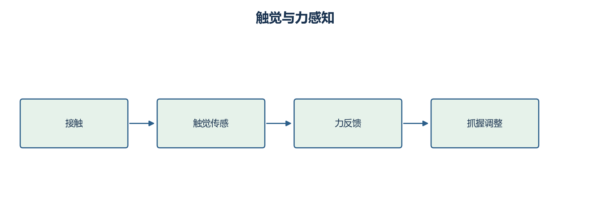

## 6.2　力/力矩感知与本体感知

**力/力矩传感器（force/torque sensor）。** 常安装在机械臂腕部或关节，基于应变片测量六维力/力矩 $(F_x,F_y,F_z,\tau_x,\tau_y,\tau_z)$。其测量模型为

$$
\mathbf{y}_f=\mathbf{S}_f\,\mathbf{F}_{contact}+\mathbf{b}_f+\boldsymbol{\nu}_f, \tag{6-2}
$$

其中 $\mathbf{S}_f$ 为灵敏度矩阵，$\mathbf{b}_f$ 为零点偏置（需标定），$\boldsymbol{\nu}_f$ 为噪声。力测量用于力控制（第 11 章）、顺应控制（compliant control）与装配任务：通过控制接触力而非位置，机器人能适应定位误差、避免损坏零件。

**本体感知（proprioception）。** 关节编码器测量关节角 $q$，IMU（惯性测量单元）测量角速度与线加速度。本体感知提供机器人「对自己的感知」——是第 3 章运动学/动力学方程的输入，也是第 4 章控制与第 8 章状态估计的基础。其特点是高频（kHz 级）、可靠、不受外部光照影响，但只反映自身状态而不直接反映环境。

**IMU 漂移。** IMU 的姿态估计来自对陀螺仪角速度 $\boldsymbol{\omega}$ 的时间积分，而陀螺存在常值偏置 $\mathbf{b}$ 与噪声；即使噪声为零，常值偏置也会随时间线性累积，使姿态在数秒后漂移出可用范围——其误差模型（式 6-7）与一次手算见 6.4A 节（例 6.6）。这正是第 8 章要用视觉/编码器对 IMU 积分做闭环校正的原因：IMU 短期精确、长期漂移，视觉长期精确、短期噪声大，二者互补。

**例 6.1（触觉引导的抓取与滑移恢复）**　机器人抓取一个纸杯：视觉（第 5 章）先定位杯子并生成抓取位姿；夹爪闭合后，GelSight 检测到接触并估计初始接触力 $F_n=5\,\mathrm{N}$。缓慢提升杯子时，式 (6-1) 的 $v_{\mathrm{slip}}$ 从 0 增至 $0.4\,\mathrm{mm/s}$ 并持续上升，表明即将滑落。控制器按 $\Delta F_n=k\,v_{\mathrm{slip}}$（取 $k=10\,\mathrm{N/(mm/s)}$）把握力增至 $5+4=9\,\mathrm{N}$，$v_{\mathrm{slip}}$ 回落到 0，抓取稳定。仅靠视觉无法感知滑移（杯子在视野中位置未变），触觉闭环显著提升抓取可靠性。

## 6.3　多模态感知融合

为什么需要融合？因为单一模态各有盲区、噪声与失效模式，而物理任务要求可靠、完整的交互状态估计。融合的本质是利用模态间的互补性与冗余性：互补性提供更完整的信息（视觉看远处、触觉看接触），冗余性提供交叉验证（一个模态失效时另一个仍可信）。第 2 章「身体塑造智能」在此意味着：机器人的感知能力由其传感器组合（身体的感觉配置）决定。

**定义 6.2（多模态感知融合，multimodal fusion）**　融合视觉、触觉、力觉、本体感知等多种模态，形成对世界的统一估计。融合按层次分为：① **数据级**（早期融合，直接拼接原始信号）；② **特征级**（各模态提取特征后拼接或注意力融合）；③ **决策级**（晚期融合，各模态独立决策后投票或加权）。

**贝叶斯融合公式。** 设要估计的隐藏状态为 $\mathbf{x}$（如物体位姿），来自视觉、触觉的观测分别为 $\mathbf{o}_v,\mathbf{o}_t$，在条件独立假设下后验为

$$
p(\mathbf{x}\mid \mathbf{o}_v,\mathbf{o}_t)\ \propto\ p(\mathbf{o}_v\mid\mathbf{x})\,p(\mathbf{o}_t\mid\mathbf{x})\,p(\mathbf{x}). \tag{6-3}
$$

式 (6-3) 是第 8 章贝叶斯状态估计在多模态情形的直接推广：每个模态提供一个似然因子，融合即似然相乘。在高斯线性情形下，这等价于信息（精度）矩阵相加的卡尔曼融合（第 8 章）。

**从融合到动作决策。** 融合后的状态信念 $p(\mathbf{x}\mid\mathbf{o}_v,\mathbf{o}_t)$ 可直接用于第 2.4 节的可供性决策：$a^{*}=\arg\max_{a\in\mathcal{A}}\ \mathbb{E}_{o}\big[\,U(\mathrm{Aff}(o,\mathcal{B}),a)\,\big]$，智能体选择使期望效用最大的动作，其中期望对融合后验取积分。例如抓取成功概率 $p(\text{grasp success}\mid\mathbf{x})$ 对位姿信念积分，得到对每个候选抓取位姿的成功率估计——「视觉粗定位 + 触觉精化 + 可供性决策」构成完整的感知—行动链。这正体现了第 2 章「认知服务于行动」的核心命题在多模态场景中的落地。值得注意的是，融合信念的价值不仅在于「点估计更准」，更在于它同时给出**不确定性**：当信念方差大（如透明物体、强遮挡）时，可供性决策应输出保守动作（降低速度、增大安全裕度），而非盲目执行——这把「感知—决策」从确定性映射升级为对不确定性显式响应的闭环，是具身系统鲁棒性的关键来源。

**> 【图 6-2　视觉—触觉融合流水线】（原图见 figures/图6-2.png）：绘制视觉粗定位、触觉接触精化、贝叶斯融合（式 6-3）、可供性决策的串联流程，标注各模态的精度与时间戳。
>
> 

**例 6.2（视觉—触觉融合估计透明物体位姿）****　抓取透明玻璃杯时，纯视觉位姿估计的协方差较大（$\sigma_v=1.5\,\mathrm{cm}$，因透明导致关键点匹配不可靠），但触觉在接触后提供精确的形状与位置（$\sigma_t=0.2\,\mathrm{cm}$）。按精度加权融合（式 6-3 的高斯形式），融合后方差

$$
\sigma_f^2=\Big(\tfrac{1}{\sigma_v^2}+\tfrac{1}{\sigma_t^2}\Big)^{-1}=\Big(\tfrac{1}{2.25}+\tfrac{1}{0.04}\Big)^{-1}\approx0.0394\,\mathrm{cm^2}, \tag{6-4}
$$

即 $\sigma_f\approx0.199\,\mathrm{cm}$，远优于单独视觉。这定量说明多模态互补如何克服单模态局限——视觉提供粗定位以引导接触，触觉在接触后精化估计。

**时间对齐的定量代价。** 式 (6-4) 的精度加权成立的前提是 $\mathbf{o}_v$ 与 $\mathbf{o}_t$ 描述同一时刻的状态；而视觉帧率（30 Hz，帧间隔 $33\,\mathrm{ms}$）与触觉采样（kHz）相差两个数量级。若物体在 $33\,\mathrm{ms}$ 内移动 $5\,\mathrm{mm}$（典型抓取提升速度），则用滞后一帧的视觉位姿去融合当前触觉，会在融合值中引入约 $5\,\mathrm{mm}$ 的系统偏差——这比触觉本身的 $\sigma_t=0.2\,\mathrm{cm}$ 误差还大，「精化」反而被「错位」吞没。工程上须做两件事：① 把低频视觉位姿在体坐标系内按本体感知（关节角 + IMU 积分，6.2 节）外推到触觉时刻，补偿视觉—触觉间的时间差；② 外推的协方差随外推时长按 IMU 随机游走项增长，使融合权重自动偏向更「新鲜」的模态。这一「外推 + 协方差膨胀」机制是第 8 章多传感器融合在时间轴上的标准处理，也是 6.6 节把「时间同步」列为融合四大挑战之首的原因。

## 6.4　数值算例：力控装配中的模态协同

**例 6.3（力/力矩引导的轴孔装配）**　机器人把直径 $20.00\,\mathrm{mm}$ 的轴插入直径 $20.05\,\mathrm{mm}$ 的孔，单边间隙仅 $0.025\,\mathrm{mm}$，纯位置控制（视觉定位误差 $\pm0.5\,\mathrm{mm}$）必然卡住。采用力控顺应策略：腕部六维力传感器（式 6-2）检测到侧向力 $F_x=3\,\mathrm{N}$、$F_y=-2\,\mathrm{N}$，控制律按 $\Delta x=-k_f F_x,\ \Delta y=-k_f F_y$（$k_f=0.05\,\mathrm{mm/N}$）微调末端位置：$\Delta x=-0.15\,\mathrm{mm},\ \Delta y=+0.10\,\mathrm{mm}$，使轴顺着孔的引导倒角滑入。当轴向力 $F_z$ 突增时判定插入到底，停止进给。这个「视觉粗定位→力觉精顺应」的模态协同，是装配任务的典型范式（第 13 章）。

**听觉与其他模态。** 麦克风可捕捉接触事件的声音（如插入到位的「咔哒」声、物体碰撞声）与材质振动特征，作为触觉的补充：听觉是非接触的、能在视线受阻时感知事件，但易受环境噪声干扰。此外，近距离电容/红外传感可辅助触觉做预接触检测。对多数操作任务，听觉目前仍属辅助模态，但在工具使用与故障检测中有独特价值。

**例 6.4（声音辅助的插入确认）**　在例 6.3 的轴孔装配中，除力觉外，机器人在腕部安装接触式麦克风，对「轴端抵住孔底」的声学特征（短促的宽带冲击）进行分类。当 $F_z$ 上升但被摩擦误导为「仍在插入」时，声学分类器以 0.9 的置信度判定「已到底」，融合决策（式 6-3 的似然相乘）据此提前停止进给，避免过力损坏零件。这个例子说明：即便某个模态（力觉）出现歧义，其他模态（听觉）也能提供独立的证据来源——多模态系统的鲁棒性正来自这种冗余与互补。

### 6.4A　光度立体成像与 IMU 积分的严格模型

6.1 节与 6.2 节分别提到 GelSight 的光度立体解算与 IMU 的积分漂移，这里给出两者的严格模型与一次手算。

**光度立体成像模型。** 设第 $i$ 个光源单位方向为 $\mathbf{L}_i$，对应形变图像亮值为 $I_i(u,v)$。在朗伯表面假设下，亮度只取决于表面法线与光源方向的夹角：

$$
I_i(u,v)=\frac{C}{\pi}\,\mathbf{n}(u,v)^\top\mathbf{L}_i=\frac{C}{\pi}\big(n_x L_{ix}+n_y L_{iy}+n_z L_{iz}\big), \tag{6-5}
$$

其中 $\mathbf{n}=(n_x,n_y,n_z)^\top$ 为归一化表面法线（$n_z>0$）、$C$ 为反射率。把 $K$ 个已知光源方向堆成矩阵 $\mathbf{B}$（第 $i$ 行 $\mathbf{L}_i^\top$）、观测向量 $\mathbf{I}=(I_1,\dots,I_K)^\top$，式 (6-5) 化为线性方程组

$$
\mathbf{I}=\frac{C}{\pi}\,\mathbf{B}\,\mathbf{n}. \tag{6-6}
$$

当 $K\ge3$ 时按最小二乘解出 $\mathbf{n}$（$C$ 取标量时 $\mathbf{B}^\top\mathbf{B}$ 秩为 2，需结合归一化 $\|\mathbf{n}\|=1$ 一并求解）；法线积分得到表面高度场，高度场即接触几何，梯度大处为物体边缘。式 (6-5) 把「多方向光照下的明暗」这一非线性几何问题化为线性代数问题，是 GelSight 高分辨率形变图像解算的核心。

**例 6.5（双光源光度立体的手算）**　取两个归一化光源方向 $\mathbf{L}_1=(0,0,1)$（正上方）、$\mathbf{L}_2=(1,0,0)$（水平 $+x$），测得某像素亮度 $I_1=50,\ I_2=87$，设 $C/\pi=100$。由式 (6-6)：$n_z=I_1/(C/\pi)=0.50$、$n_x=I_2/(C/\pi)=0.87$，再由归一化 $\|\mathbf{n}\|=1$ 得 $n_y=\sqrt{1-0.5^2-0.87^2}=\sqrt{0.1431}\approx0.378$。于是 $\mathbf{n}\approx(0.87,\,0.378,\,0.50)$：水平分量 $\|\mathbf{n}_{xy}\|=\sqrt{0.87^2+0.378^2}\approx0.949$，法线与水平面夹角 $\arcsin(n_z)\approx30^\circ$——该处接触面是「近竖直、向 $x$ 方向倾斜约 $30^\circ$」的斜面，正符合杯壁斜向接触的情形。手算展示了「多光照→线性方程组→法线→几何」的完整链条：两光源定出法线水平分量，第三维由归一化补出；实际传感器用 3 个以上光源以提高解算冗余与抗噪性。

**IMU 积分误差模型。** 设陀螺角速度 $\boldsymbol{\omega}$ 含常值偏置 $\mathbf{b}$ 与零均值噪声 $\boldsymbol{\varepsilon}(\tau)$，则姿态估计 $\hat{\boldsymbol{\theta}}$ 相对真值的误差为

$$
\delta\boldsymbol{\theta}(t)=\int_0^t\big(\mathbf{b}+\boldsymbol{\varepsilon}(\tau)\big)\,d\tau=\mathbf{b}\,t+\int_0^t\boldsymbol{\varepsilon}(\tau)\,d\tau, \tag{6-7}
$$

其中噪声项积分后为随机游走（方差 $\propto t$）。式 (6-7) 揭示 IMU 的根本局限：即使噪声为零，**常值偏置 $\mathbf{b}$ 也随时间线性累积**，使姿态在数秒后漂移出可用范围。这正是第 8 章要用视觉/编码器对 IMU 积分做闭环校正（互补滤波、卡尔曼滤波）的原因——IMU 短期精确、长期漂移，视觉长期精确、短期噪声大，二者互补。

**例 6.6（IMU 姿态漂移的手算）**　设某 IMU 陀螺 $x$ 轴偏置 $\mathbf{b}=[2,\,0.5,\,-1]\,\mathrm{deg/s}$（典型 MEMS 未校准量级）。由式 (6-7) 忽略随机项，$10\,\mathrm{s}$ 的姿态偏差为 $\delta\boldsymbol{\theta}(10)=[20,\,5,\,-10]\,\mathrm{deg}$，仅 $x$ 轴偏 $20^\circ$——对要求姿态精度 $2^\circ$ 的装配任务已完全不可用。若接入视觉位姿（长期精度 $\pm1^\circ$）做互补校正，按 $\hat{\boldsymbol{\theta}}\leftarrow(1-\alpha)\hat{\boldsymbol{\theta}}_{\mathrm{imu}}+\alpha\,\hat{\boldsymbol{\theta}}_{\mathrm{vis}}$（$\alpha=0.1$）周期性拉回，稳态偏差被压制到 $\alpha$ 决定的量级（约 $1^\circ$ 内），IMU 仅负责两次视觉更新之间的高频平滑。这个手算量化了「IMU 不能单独长时间用、必须与视觉融合」，也是第 8 章传感器融合最直接的动机来源。

## 6.5　技术谱系与变体

**表 6-1　触觉与感知模态谱系**

| 模态 | 测量量 | 代表传感器/方法 | 优势 | 局限 | 章节 |
|------|--------|------------------|------|------|------|
| 触觉（视触觉） | 形变图像/压力分布 | GelSight[1]、TacTip | 高分辨率、检测滑移 | 接触后才有效、易磨损 | 6.1 |
| 力/力矩 | 六维力/力矩 | 应变片式腕力传感器 | 直接测交互力 | 需标定、温漂 | 6.2、第 11 章 |
| 本体感知 | 关节角/速度/加速度 | 编码器、IMU | 高频、可靠 | 不含环境信息 | 6.2、第 8 章 |
| 视觉 | 图像/深度 | RGB-D 相机 | 非接触、信息丰富 | 透明/遮挡失效 | 第 5 章 |
| 听觉 | 声音/振动 | 麦克风 | 接触事件、材质 | 环境噪声 | 6.6 |

## 6.6　边界与讨论

多模态融合的实际挑战有四：① **时间同步**——视觉（30 Hz）、触觉（kHz）、本体感知（kHz）采样率不同，必须按时间戳对齐（第 8.4 节）；② **空间标定**——需确定触觉/力传感器与相机、基座之间的外参（第 5.4 节）；③ **可靠性**——某模态失效（如 GelSight 凝胶磨损）时，融合系统需检测并降级，而非被错误模态带偏；④ **信息冲突**——模态间不一致时（视觉说「抓到了」，力觉说「没接触」），需鲁棒融合机制（如 RANSAC 或置信度加权）。此外，融合策略正从手工设计的贝叶斯规则转向端到端学习（第 6.3 节之外的 learned fusion），《多模态与生成智能导论》对此有深入讨论。

**边界辨析。** 触觉与力觉是「接触后」的感知，无法替代视觉的「接触前」规划；二者是互补而非替代关系。本体感知虽可靠，却只描述自身——若机器人被外力推动而关节角未变（如轮式机器人打滑），本体感知会「说谎」，必须靠外部感知校正（第 7—8 章）。此外，式 (6-3) 的条件独立假设在真实系统中常被打破（视觉与触觉误差可能同源，如都由温度变化引起），此时直接相乘会「双重计算」证据，导致后验过度自信——需引入 copula 或学习融合权重修正。

**传感器标定与漂移的边界。** 式 (6-2) 的 $\mathbf{b}_f$（零点偏置）与 $\mathbf{S}_f$（灵敏度）都是**标定量**，而非固定常数：力/力矩传感器的零点随温度变化（温漂，典型 $10\,\mathrm{ppm/^\circ C}$ 量级），若环境升温 $20^\circ\mathrm{C}$ 而传感器满量程 $100\,\mathrm{N}$，零点漂移可达 $100\times20\times10^{-5}=0.02\,\mathrm{N}$ 量级——对装配中 $1\,\mathrm{N}$ 级力控是 2% 的相对误差，必须在线标定或温补。更深层的问题是**可观测性**：六维力传感器装在腕部时，它无法区分「手施加的力」与「重力/惯力」，必须先用第 3 章动力学模型把已知的重力补偿项 $\mathbf{g}(\mathbf{q},\dot{\mathbf{q}},\ddot{\mathbf{q}})$ 从 $\mathbf{y}_f$ 中减掉，残差才是真正的接触力；动力学模型误差会直接进入力估计，形成「感知误差源于动力学误差」的耦合。这意味着触觉/力觉的可用性上限由「标定精度 + 动力学建模精度 + 融合机制」三者共同决定，任何一环薄弱都会把单模态的互补优势抵消。这些辨析衔接第 5、8、11、13 章与《多模态与生成智能导论》。

## 6.7　承上启下

本章补足了视觉的盲区：触觉、力觉、本体感知及其融合，让机器人能「感知物理交互」。但无论是视觉的位姿还是触觉的接触，都还需回答「机器人在哪、环境如何」这一全局问题——视觉里程计与 SLAM。第 7 章讨论同时定位与建图，把局部感知扩展为一致的全局地图。

## 本章小结

本章论述触觉与多模态感知，补足视觉无法覆盖的物理交互信息。

我们首先定义触觉感知与 GelSight 的光度立体原理，给出滑移检测的速度公式（式 6-1）与摩擦临界条件（式 6-1b）；接着推导力/力矩测量模型（式 6-2）并介绍本体感知与 IMU 积分漂移（式 6-7）及听觉等辅助模态；然后建立多模态贝叶斯融合公式（式 6-3）、精度加权的高斯特例（式 6-4）及从融合到可供性决策的链条。6.4A 节给出光度立体的朗伯成像模型（式 6-5、6-6）与 IMU 积分误差模型（式 6-7）。通过触觉滑移抓取（例 6.1）、透明物体融合（例 6.2）、力控装配（例 6.3）、声音辅助插入确认（例 6.4）、光度立体手算（例 6.5）与 IMU 姿态漂移手算（例 6.6）把公式落到具体操作，并以表 6-1 梳理感知模态谱系。这些算例共同表明：多模态协同是精细物理操作可靠性的来源。

我们还明确边界：融合面临时间同步、空间标定、模态失效与信息冲突四大挑战，触觉与视觉互补而非替代；传感器标定漂移与动力学可观测性进一步约束了触觉/力觉的可用性上限。这些辨析衔接第 5、8、11、13 章与《多模态与生成智能导论》。

下一章讨论 SLAM 与定位，把局部感知扩展为全局一致的地图与位姿估计。

**进一步阅读**　本章建议延伸阅读的文献：[1]、[2]、[3]、[5]。

## 参考文献

[1] Yuan W, Dong S, Adelson E H. GelSight: High-resolution robot tactile sensors for estimating geometry and force. *Sensors*, 2017, 17(12): 2762.

[2] Siciliano B, Villani L. *Robot Force Control*. Kluwer Academic Publishers, 1999.

[3] Thrun S, Burgard W, Fox D. *Probabilistic Robotics*. MIT Press, 2005.

[4] Dong S, Yuan W, Adelson E H. Improved GelSight tactile sensor for measuring geometry and slip. *IEEE/RSJ IROS*, 2017: 1372–1379.

[5] Li R, Qiu R, Huang Z, Adelson E H. Tactile recognition via mimicking human fingernails. *IEEE/RSJ IROS*, 2019: 4688–4694.

[6] Wu J, Sun L, Zhang S, et al. Tactile sensing from human skin to robots. *Advanced Intelligent Systems*, 2022, 4(8): 2200053.

[7] Hogan N. Impedance control: An approach to manipulation. *ASME Journal of Dynamic Systems, Measurement, and Control*, 1985, 107(1): 1–24.

[8] Yousef H M, Boukallel M, Althoefer K. Tactile sensing for dexterous in-hand manipulation in robotics—a review. *Sensors and Actuators A: Physical*, 2011, 167(2): 171–187.

---

# 第 7 章　SLAM 与定位

第 5—6 章的感知回答「世界里有什么」：物体在哪、是什么、能否抓取。本章回答另一个同等根本的问题：**机器人在哪里？** 同时定位与建图（Simultaneous Localization and Mapping，SLAM）让机器人在未知环境中运动时，一边构建环境地图，一边估计自身位姿。SLAM 是移动机器人自主的基础，也是第 1 章「感知—认知」闭环的核心环节：没有位姿，视觉 detections（第 5 章）无法变换到世界坐标，规划（第 10 章）与控制（第 11 章）也就失去参照。

本章先给出 SLAM 的概率形式与「鸡生蛋」困境（7.1 节）；然后分别介绍视觉 SLAM 与激光 SLAM 的流水线（7.2 节）；接着推导图优化与回环检测的数学（7.3 节）；介绍基于粒子滤波的概率定位 MCL（7.4 节）；通过位姿图优化的数值算例落地（7.5 节）；给出方法谱系表（7.6 节）；最后讨论 SLAM 的边界（7.7 节）与承上启下（7.8 节）。

## 7.1　SLAM 问题的概率形式

**定义 7.1（SLAM）**　给定传感器观测序列 $\{o_t\}$ 与控制输入 $\{u_t\}$，同时估计机器人轨迹 $\{x_t\}$ 与环境地图 $m$：

$$
p(x_{1:T},m\mid o_{1:T},u_{1:T}). \tag{7-1}
$$

这是一个「鸡生蛋」困境：定位需要已知地图（由观测反推位姿），建图需要已知位姿（把观测拼进地图），二者互相依赖。SLAM 通过**联合估计**破解这一循环：把轨迹与地图作为同一个概率问题的未知量，利用观测间的共享信息同时求解。

**因子图视角。** 在因子图（factor graph）中，式 (7-1) 分解为运动因子的乘积：

$$
p(x_{1:T},m\mid o_{1:T},u_{1:T})\propto\underbrace{\prod_t p(x_t\mid x_{t-1},u_t)}_{\text{运动模型}}\ \underbrace{\prod_{i}p(o_i\mid x_{t_i},m_i)}_{\text{观测模型}}. \tag{7-2}
$$

运动因子连接相邻位姿（来自里程计或 IMU），观测因子连接位姿与地图地标（来自相机或激光的观测）。式 (7-2) 把 SLAM 变成图上的推理问题：前端负责建立因子（数据关联），后端负责在给定因子下求最大后验（MAP）估计。

## 7.2　视觉 SLAM 与激光 SLAM

**视觉 SLAM（visual SLAM）。** 以摄像头为传感器，典型流水线为：特征提取与匹配（ORB 等）→ 视觉里程计（估计相邻帧运动，用对极几何或 PnP，第 5.2 节）→ 后端优化（BA，bundle adjustment，联合优化位姿与三维点）→ 回环检测 → 建图。代表系统 ORB-SLAM[2]。优势是信息丰富、成本低；劣势是对光照与纹理敏感，弱纹理或快速运动易丢失跟踪。

**激光 SLAM（lidar SLAM）。** 以激光雷达为传感器，通过扫描匹配（scan matching，如 ICP 迭代最近点）估计位姿，构建占据栅格地图（occupancy grid），后端用位姿图优化。代表系统 Cartographer[3]、LOAM。优势是测距精确、对光照不敏感；劣势是长走廊等几何退化环境中匹配歧义，且缺少语义信息。

> 【图 7-1　SLAM 系统流程】（原图见 figures/图7-1.png）：绘制「传感器→前端里程计→后端图优化→回环检测→地图构建」的流水线，标注视觉与激光两条分支及式 (7-2) 的因子对应关系。
>
> 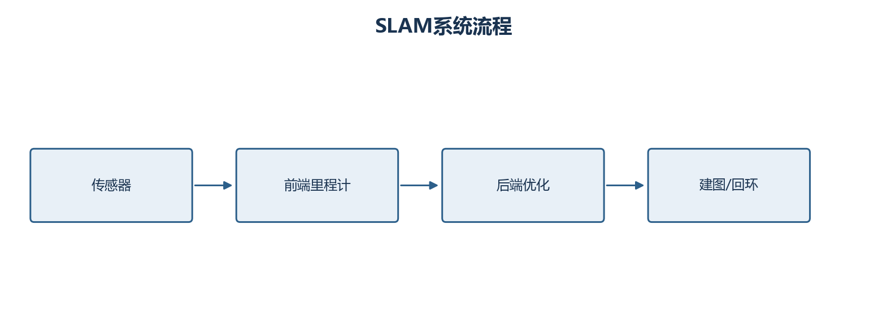

## 7.3　回环检测与图优化

**回环检测（loop closure）。** 机器人回到曾访问地点时，识别出「旧地方」并添加一条约束——这是 SLAM 的关键。没有回环，里程计误差随时间累积（漂移），地图无限发散；有了回环，漂移被全局修正。视觉用词袋模型（BoW）做外观相似性检测，激光用局部地图匹配。回环需谨慎验证，错误回环会「拉坏」全局地图。

**位姿图优化（pose graph optimization）。** 把位姿 $\{x_t\}$ 作为节点，相邻帧的相对位姿约束与回环约束作为边。每条边 $ij$ 提供相对位姿测量 $\mathbf{z}_{ij}$（来自里程计或回环匹配），对应的残差为

$$
\mathbf{e}_{ij}=\log\!\Big(\mathbf{z}_{ij}^{-1}\ \mathbf{x}_i^{-1}\mathbf{x}_j\Big)\in\mathfrak{se}(3), \tag{7-3}
$$

其中 $\log$ 是 SE(3) 上的对数映射（第 3.1 节），把位姿差映射到李代数。优化目标是最小化所有边的加权平方误差：

$$
\mathbf{x}^{*}=\arg\min_{\mathbf{x}}\ \sum_{(i,j)}\mathbf{e}_{ij}^\top\boldsymbol{\Omega}_{ij}\mathbf{e}_{ij}, \tag{7-4}
$$

其中 $\boldsymbol{\Omega}_{ij}$ 为信息矩阵（协方差的逆），衡量约束的可信度。这是非线性最小二乘问题，用 Gauss-Newton 或 Levenberg-Marquardt 迭代求解，稀疏性使大规模图可实时优化。

**例 7.1（回环消除漂移的数值）**　机器人沿直线运动，每步真实位移 $1.0\,\mathrm{m}$，里程计有 $+2\%$ 系统误差，即每步估计 $1.02\,\mathrm{m}$。走 100 步后，估计位置 $102.0\,\mathrm{m}$，真实位置 $100.0\,\mathrm{m}$，漂移 $2.0\,\mathrm{m}$。若在第 100 步检测到回到起点附近的回环（观测到相同地标），回环约束把 $x_{100}$ 与 $x_0$ 的位置差约束为真实值（约 0），式 (7-4) 的优化把累积的 $2.0\,\mathrm{m}$ 漂移按信息权重均摊到 100 个位姿节点上，每个节点被修正约 $0.02\,\mathrm{m}$——全局地图恢复一致。这直观展示了回环如何把「局部准确、全局漂移」的里程计变成全局一致的地图。

## 7.4　概率机器人定位：MCL

**定义 7.2（蒙特卡洛定位，MCL）**　在**已知地图**中定位（不同于 SLAM 的建图），用一组带权粒子 $\{x_t^{(i)},w_t^{(i)}\}_{i=1}^N$ 近似机器人位姿后验 $p(x_t\mid o_{\le t},u_{<t},m)$。每个粒子代表一个可能的位姿假设，算法循环三步：① **运动更新**：按运动模型 $p(x_t\mid x_{t-1},u_t)$ 传播每个粒子（加入噪声）；② **观测更新**：按观测似然 $p(o_t\mid x_t^{(i)},m)$ 调整粒子权重（与地图一致的位姿权重高）；③ **重采样**：按权重重新抽取粒子，舍弃低权重假设。自适应 MCL（amcl）还能在「机器人被绑架」（位姿突变）时注入随机粒子恢复。

**MCL 与 SLAM 的关系。** MCL 解决「地图已知时的定位」，SLAM 解决「地图未知时的定位+建图」。MCL 是第 8 章粒子滤波（定义 8.2）在定位问题上的直接应用，也是概率机器人学[1]的经典成果。

## 7.5　数值算例：位姿图的最小二乘求解

**例 7.2（一维位姿图优化）**　为展示式 (7-4) 的求解，考虑一维简化版：三个位姿 $x_0=0,x_1,x_2$，两个里程计约束 $z_{01}=1.0,\ z_{12}=1.0$（单位方差，$\Omega=1$），一个回环约束 $z_{02}=2.0$（单位方差）。定义残差 $e_{01}=x_1-x_0-z_{01}=x_1-1$，$e_{12}=x_2-x_1-1$，$e_{02}=x_2-x_0-2=x_2-2$。目标函数

$$
J=(x_1-1)^2+(x_2-x_1-1)^2+(x_2-2)^2. \tag{7-5}
$$

令偏导为零：$\partial J/\partial x_1=2(x_1-1)-2(x_2-x_1-1)=0\Rightarrow 2x_1-x_2=0$；$\partial J/\partial x_2=2(x_2-x_1-1)+2(x_2-2)=0\Rightarrow -x_1+2x_2=3$。联立解得 $x_1=1.0,\ x_2=2.0$——与真实值一致。若里程计约束有偏（如 $z_{01}=1.1$），无回环时 $x_2=2.2$（漂移），加入回环 $z_{02}=2.0$ 后解为 $x_1\approx1.033,\ x_2\approx2.033$，漂移被回环吸收。这个一维例子完整展示了位姿图优化的机制，高维 SE(3) 情形只是把它推广到李群上的非线性最小二乘。

### 7.5A　SLAM 的可辨识性与 CRLB

联合后验 (7-1) 的精度并非由观测数量单独决定，而受**可辨识性**（identifiability）约束——这是 SLAM 区别于普通状态估计的根本性质。设以 $\boldsymbol\theta=(\mathbf x_{1:T},\mathbf m)$ 表示全部未知量，观测 $o_{1:T}$ 的**费舍尔信息矩阵**（Fisher information matrix）为

$$
\mathbf F=\mathbb E\Big[\nabla_{\boldsymbol\theta}\log p(o_{1:T}\mid\boldsymbol\theta)^{\!\top}\,\nabla_{\boldsymbol\theta}\log p(o_{1:T}\mid\boldsymbol\theta)\Big], \tag{7-6}
$$

则 Cramér–Rao 下界（CRLB）断言：任何无偏估计量 $\hat{\boldsymbol\theta}$ 的协方差满足 $\mathrm{Cov}(\hat{\boldsymbol\theta})\succeq\mathbf F^{-1}$（$\mathbf F$ 须满秩）。SLAM 的特殊性在于：仅含里程计（运动因子）而无回环观测时，信息矩阵关于**全局刚体变换**（2D 为平面平移与旋转，共 3 维）不变——把轨迹与整张地图一起平移或旋转，所有运动残差 (7-3) 都不变。因此 $\mathbf F$ 秩亏 $\geq3$，不存在全局一致的无偏估计；引入回环观测或固定先验（锚定一个位姿）才能消去零空间、使 $\mathbf F$ 恢复满秩。这解释了工程上「固定 $x_0$ 再优化」与「必须至少一个回环」两条规则的概率根源：二者都在为信息矩阵补齐零空间方向。Grisetti 等的 SLAM 教程[9] 对 EKF-SLAM 的信息矩阵与 CRLB 分析进一步表明，即使锚定先验，信息沿「远离锚点方向」仍随里程计链长累积退化——地图边缘的位姿协方差显著大于靠近回环处。这一结论直接指导了回环检测的优先级设计（优先闭合远端回环）与第 8 章协方差传播的解读。

**例 7.3（链式定位的 CRLB 量化）**　把 1D 位姿链简化为 $T$ 个位姿、每步里程计方差 $\sigma^2$、固定 $x_0=0$。仅用里程计时，第 $k$ 个位姿是 $k$ 个独立里程计的累加，其方差 $\mathrm{Var}(x_k)=k\sigma^2$——这就是式 (7-6) 在链式结构下信息矩阵对角元的倒数（信息沿链稀释为 $1/(k\sigma^2)$）。取 $T=100$、$\sigma=0.1\,\mathrm{m}$，则无回环时末端 $\mathrm{Var}(x_{100})=100\times0.01=1.0\,\mathrm{m}^2$，即 $\pm1\,\mathrm{m}$ 的标准差，与例 7.1 的 $2\%$ 漂移一致。若在第 100 步加一条方差 $\sigma_{\mathrm{loop}}^2=0.01\,\mathrm{m}^2$（1 cm 精度）的回环约束 $x_{100}\approx0$，则末端有效信息为里程计链信息 $1/1.0$ 与回环信息 $1/0.01$ 之和 $=1+100=101$，$\mathrm{Var}(x_{100})\approx0.0099\,\mathrm{m}^2$，标准差降到约 $0.1\,\mathrm{m}$——回环把末端不确定度压了两个数量级，这正是式 (7-6) 信息相加在高斯情形的直观体现，也与第 8 章式 (8-8) 的精度加权融合完全同构。

### 7.5B　Gauss-Newton 线性化与稀疏求解

式 (7-4) 是非线性最小二乘，其标准迭代是 Gauss-Newton。把位姿参数化为「当前估计 + 李代数增量」$\mathbf x_i\leftarrow\mathbf x_i\oplus\boldsymbol\delta_i$（$\oplus$ 为 SE(3) 增量作用），对 $\mathbf e_{ij}(\boldsymbol\delta)$ 在 $\boldsymbol\delta=0$ 处一阶展开，记各边雅可比 $\mathbf J_{ij}=\partial\mathbf e_{ij}/\partial\boldsymbol\delta$，则每个 Newton 步求解**正规方程**（normal equations）

$$
\mathbf H\,\boldsymbol\delta=\mathbf b,\qquad \mathbf H=\sum_{(i,j)}\mathbf J_{ij}^{\!\top}\boldsymbol\Omega_{ij}\mathbf J_{ij},\quad \mathbf b=-\sum_{(i,j)}\mathbf J_{ij}^{\!\top}\boldsymbol\Omega_{ij}\mathbf e_{ij}, \tag{7-7}
$$

迭代至 $\boldsymbol\delta$ 足够小。$\mathbf H$ 是稀疏的带状/块对角结构：每个位姿节点只与其里程计邻居及回环对象相连，故 $\mathbf H$ 非零块数远小于 $N^2$（$N$ 为节点数）。求解大规模稀疏 $\mathbf H$ 的标准工具是 **Cholesky 稀疏分解**（复杂度接近非零元数目）与**多前沿（multifrontal）方法**（GTSAM[10]、Ceres）；对增量更新（新增一帧观测），iSAM2[11] 的 Bayes 树增量重分解可把单步代价降到 $O(1)$ 量级，从而支持在线 SLAM。Levenberg–Marquardt（LM）则在式 (7-7) 右端加 $\boldsymbol\lambda\,\mathrm{diag}(\mathbf H)$ 阻尼项，在 Gauss-Newton 步与梯度下降之间自适应切换，对初值更鲁棒。工程上，回环边的信息矩阵 $\boldsymbol\Omega$ 通常取**回环观测协方差的逆并乘以折扣系数**（折扣因子 $\rho\in(0,1)$），以抑制错误回环对全局解的污染——折扣越小，回环对轨迹的「拉力」越弱，是鲁棒性与收敛速度的折中。激光前端的扫描匹配则以 ICP（迭代最近点）[12] 为典型：交替「最近点搜索—求刚体变换—更新」，正是式 (7-4) 在「单帧配准」上的简化版，其收敛性与式 (7-7) 的 Gauss-Newton 同根同源。

## 7.6　技术谱系与变体

**表 7-1　视觉 SLAM vs 激光 SLAM**

| 方面 | 视觉 SLAM | 激光 SLAM |
|------|-----------|-----------|
| 传感器 | 单目/双目/RGB-D 相机 | 2D/3D 激光雷达 |
| 前端 | 特征匹配、光流、PnP | 扫描匹配（ICP、NDT） |
| 后端 | BA、位姿图优化 | 位姿图优化、子图匹配 |
| 地图 | 点云、半稠密深度 | 占据栅格、点云 |
| 优势 | 信息丰富、廉价、含语义 | 精确、鲁棒、光照无关 |
| 劣势 | 光照/纹理敏感、尺度歧义 | 退化环境、无语义、昂贵 |
| 代表 | ORB-SLAM[2] | Cartographer[3]、LOAM |

**表 7-2　SLAM 与定位方法谱系**

| 方法 | 地图 | 估计器 | 代表 | 章节 |
|------|------|--------|------|------|
| EKF-SLAM | 地标 | 扩展卡尔曼滤波 | 早期主流 | 7.1、第 8 章 |
| 视觉 SLAM | 特征点/稠密 | BA + 图优化 | ORB-SLAM | 7.2、7.3 |
| 激光 SLAM | 栅格/点云 | 扫描匹配 + 图优化 | Cartographer | 7.2 |
| MCL/AMCL | 已知栅格图 | 粒子滤波 | amcl | 7.4、第 8 章 |
| 神经 SLAM | 隐式特征 | 网络 + 图优化 | Neural SLAM | 7.7、第 30 章 |

## 7.7　边界与讨论

SLAM 面临三类根本挑战：① **动态环境**——传统 SLAM 假设静态世界，而真实场景有人和移动物体，需动态点剔除或语义 SLAM；② **退化场景**——长走廊、空旷空间缺乏可区分的几何/纹理约束，导致定位退化；③ **实时性与累积误差**——大规模地图的后端优化计算量大，需滑动窗口与稀疏化。当前前沿把深度学习引入 SLAM：用网络提取更鲁棒的特征、用 NeRF 构建可渲染的隐式地图（第 30 章）、用语义信息辅助数据关联。这些「神经 SLAM」方法在保持几何一致性的同时，赋予地图语义与泛化能力。

**边界辨析。** SLAM 的「定位」与第 8 章的「状态估计」是同一问题的两端：SLAM 侧重未知地图中的联合估计与全局一致性，状态估计侧重滤波框架下的实时递推；二者在因子图视角下统一（式 7-2）。这些辨析衔接第 3、5、8、10、14、30 章。

### 7.7A　实时性与滑动窗口

全图优化 (7-4) 的代价随节点数 $N$ 近似线性到二次增长（取决于稀疏分解策略），对嵌入式平台仍是负担。工程上采用三重手段：① **前端—后端分级**——前端里程计以 100 Hz 增量估计位姿（仅用最近 $K$ 帧局部），后端以 1–10 Hz 在更大窗口上做全局 BA/位姿图优化，二者通过「局部一致性」解耦，使端到端延迟可控；② **子图化（submap）**——把地图切分为局部子图（如 Cartographer 的 submap[3]），前端只与当前子图对齐，回环时再触发全局重优化，把单步计算限制在常数子图内；③ **滑动窗口与边缘化（marginalization）**——丢弃窗口外的旧位姿，但保留其「被边缘化后对剩余状态的等效先验」（Schur 补形式的稀疏信息块），避免信息丢失。边缘化的等效先验正是式 (7-6) 的费舍尔信息在子集上的 Schur 补：对联合信息阵按「保留/丢弃」分块消元，得到的保留块即新先验。设把信息阵分块为保留块 $\mathbf H_{\mathrm{ss}}$ 与待边缘化块 $\mathbf H_{\mathrm{dd}}$，则边缘化后保留状态的等效信息为其 **Schur 补**

$$
\mathbf H_{\mathrm{ss}}^{\,\mathrm{marg}}=\mathbf H_{\mathrm{ss}}-\mathbf H_{\mathrm{sd}}\,\mathbf H_{\mathrm{dd}}^{-1}\,\mathbf H_{\mathrm{ds}}, \tag{7-8}
$$

右端对角块正是「用已丢弃的 $\mathbf H_{\mathrm{dd}}$ 消元」所得的等效精度。这解释了为何「删旧帧」不损失精度（在 Gaussian 假设下），只是把旧信息以紧凑先验形式继承下来，与第 8 章 8.2 节卡尔曼预测步的「先验传递」思想同构。数值上，式 (7-8) 即例 7.3 中「链信息 + 回环信息」相加的矩阵形式：当丢弃中间节点时，其里程计信息被吸收进相邻保留节点的等效先验，精度沿图稀疏传播——这是 iSAM2 增量求解的核心代数操作，也是 SLAM 后端能在线扩展而无需重算全图的根本原因。

## 7.8　承上启下

本章给出机器人「在哪里」的答案：SLAM 联合估计位姿与地图，回环消除漂移，图优化保证全局一致性。但 SLAM 输出的是带噪的位姿与地图，且机器人还需融合 IMU、轮速计、视觉等多源信息——这正是第 8 章状态估计与传感器融合的主题。

## 本章小结

本章论述 SLAM 与定位，回答「机器人在哪里」这一自主的基础问题。

我们首先给出 SLAM 的概率形式（式 7-1）与因子图分解（式 7-2），解释定位与建图互相依赖的「鸡生蛋」困境。接着介绍视觉/激光 SLAM 的流水线并以表 7-1 对照；然后推导图优化中的位姿残差（式 7-3）与最小二乘目标（式 7-4），以回环漂移算例（例 7.1）与一维位姿图求解（例 7.2）展示机制；还介绍已知地图下的 MCL 概率定位。7.5A 节补充了 SLAM 的可辨识性与 Cramér–Rao 下界（式 7-6），说明回环与锚定先验为何是全局一致性的必要前提；7.5B 节给出 Gauss-Newton 正规方程（式 7-7）与稀疏求解、边缘化机制，解释了后端为何可实时；7.7A 节讨论前端—后端分级、子图化与滑动窗口等实时化手段。我们以表 7-1、7-2 梳理视觉/激光 SLAM 与定位方法谱系。

我们还明确边界：动态环境、退化场景与实时性仍是挑战，神经 SLAM 是前沿；并辨析 SLAM 与状态估计在因子图视角下的统一。这些辨析衔接第 3、5、8、10、14、30 章。

下一章讨论状态估计与传感器融合，把多源带噪信息提炼为一致的状态信念。

**进一步阅读**　本章建议延伸阅读的文献：[1]、[2]、[3]、[4]。

## 参考文献

[1] Thrun S, Burgard W, Fox D. *Probabilistic Robotics*. MIT Press, 2005.

[2] Mur-Artal R, Montiel J M M, Tardós J D. ORB-SLAM: A versatile and accurate monocular SLAM system. *IEEE Transactions on Robotics*, 2015, 31(5): 1147–1163.

[3] Hess W, Kohler D, Rapp H, et al. Real-time loop closure in 2D LIDAR SLAM. *IEEE ICRA*, 2016: 1271–1278.

[4] Cadena C, Carlone L, Carrillo H, et al. Past, present, and future of simultaneous localization and mapping: Toward the robust-perception age. *IEEE Transactions on Robotics*, 2016, 32(6): 1309–1332.

[5] Shan T, Englot B. LeGO-LOAM: Lightweight and ground-optimized lidar odometry and mapping on variable terrain. *IEEE/RSJ IROS*, 2018: 4758–4765.

[6] Engel J, Schöps T, Cremers D. LSD-SLAM: Large-scale direct monocular SLAM. *ECCV*, 2014: 834–849.

[7] Zhang Q, Hu R, Guo S, et al. Neural SLAM: Learning to explore with external memory. *arXiv:1706.09520*, 2017.

[8] Zhu A, Yuan Z, Nozawa S, et al. NeRF-SLAM: Real-time dense monocular SLAM with neural radiance fields. *arXiv:2210.13641*, 2022.

[9] Grisetti G, Kummerle S, Burgard W, et al. A tutorial on the SLAM problem. *IEEE Robotics & Automation Magazine*, 2007, 14(2): 99–110.

[10] Dellaert F. The factor graph for visual SLAM. *IEEE Transactions on Robotics*, 2017, 33(2): 424–427.

[11] Kaess M, Johannsson H, Roberts R, et al. iSAM2: Incremental smoothing and mapping using the Bayes tree. *International Journal of Robotics Research*, 2012, 31(2): 216–235.

[12] Besl P J, McKay N D. A method for registration of 3-D shapes. *IEEE Transactions on Pattern Analysis and Machine Intelligence*, 1992, 14(2): 239–256.

---

# 第 8 章　状态估计与传感器融合

第 5—7 章产生了多源、带噪的状态信息：视觉位姿（第 5 章）、触觉接触（第 6 章）、SLAM 轨迹（第 7 章）。这些信息 noisy、异步、坐标系各异，且往往只是真实状态的局部投影。本章讨论如何把它们融合为一个一致的状态估计——贝叶斯滤波、卡尔曼滤波及其扩展、粒子滤波，以及时间同步与标定等工程关键。状态估计是四层能力体系中「认知层」的核心：它把噪声观测提炼为可用于规划与控制的「状态信念」（belief），是 POMDP 在机器人中的具体实现（第 1 章、参见《世界模型导论》第 6 章）。

本章先建立贝叶斯状态估计的递推框架（8.1 节）；然后完整推导卡尔曼滤波与 EKF（8.2 节）；介绍粒子滤波（8.3 节）；给出时间同步与标定的工程方法（8.4 节）；通过一维卡尔曼滤波与 EKF 定位的算例落地（8.5 节）；给出滤波方法谱系表（8.6 节）；最后讨论边界（8.7 节）与承上启下（8.8 节）。

## 8.1　贝叶斯状态估计

**定义 8.1（状态估计）**　给定带噪观测序列 $o_{\le t}$ 与控制序列 $u_{<t}$，估计系统状态后验

$$
\mathrm{bel}(x_t)=p(x_t\mid o_{\le t},u_{<t}). \tag{8-1}
$$

在马尔可夫假设下，后验可用贝叶斯递推分两步计算：

$$
\underbrace{\bar{\mathrm{bel}}(x_t)=\int p(x_t\mid x_{t-1},u_{t-1})\,\mathrm{bel}(x_{t-1})\,dx_{t-1}}_{\text{预测（运动更新）}}, \tag{8-2}
$$

$$
\underbrace{\mathrm{bel}(x_t)=\eta\,p(o_t\mid x_t)\,\bar{\mathrm{bel}}(x_t)}_{\text{更新（观测更新）}}, \tag{8-3}
$$

其中 $\eta$ 为归一化常数。式 (8-2)(8-3) 是所有递推滤波器的统一框架：预测步用运动模型把信念向前推，更新步用观测似然修正信念。不同滤波器（KF、EKF、PF）的区别只在于如何表示与计算这两个式子。

## 8.2　卡尔曼滤波与扩展卡尔曼滤波

**卡尔曼滤波（Kalman Filter，KF）**　当运动与观测模型为线性高斯时，信念可用高斯 $\mathcal{N}(\boldsymbol{\mu},\boldsymbol{\Sigma})$ 表示，式 (8-2)(8-3) 有闭式解。设

$$
\mathbf{x}_t=\mathbf{A}\mathbf{x}_{t-1}+\mathbf{B}\mathbf{u}_{t-1}+\boldsymbol{\nu}_t,\quad \boldsymbol{\nu}_t\sim\mathcal{N}(0,\mathbf{Q}),\tag{8-4}
$$

$$
\mathbf{o}_t=\mathbf{H}\mathbf{x}_t+\boldsymbol{\omega}_t,\quad \boldsymbol{\omega}_t\sim\mathcal{N}(0,\mathbf{R}),\tag{8-5}
$$

则预测步为 $\bar{\boldsymbol{\mu}}_t=\mathbf{A}\boldsymbol{\mu}_{t-1}+\mathbf{B}\mathbf{u}_{t-1}$，$\bar{\boldsymbol{\Sigma}}_t=\mathbf{A}\boldsymbol{\Sigma}_{t-1}\mathbf{A}^\top+\mathbf{Q}$；更新步为

$$
\mathbf{K}_t=\bar{\boldsymbol{\Sigma}}_t\mathbf{H}^\top\big(\mathbf{H}\bar{\boldsymbol{\Sigma}}_t\mathbf{H}^\top+\mathbf{R}\big)^{-1},\tag{8-6}
$$

$$
\boldsymbol{\mu}_t=\bar{\boldsymbol{\mu}}_t+\mathbf{K}_t(\mathbf{o}_t-\mathbf{H}\bar{\boldsymbol{\mu}}_t),\quad \boldsymbol{\Sigma}_t=(\mathbf{I}-\mathbf{K}_t\mathbf{H})\bar{\boldsymbol{\Sigma}}_t. \tag{8-7}
$$

$\mathbf{K}_t$ 是卡尔曼增益，它按「预测协方差 vs 观测噪声」的比例决定信任预测还是信任观测。

**多传感器融合的等价形式。** 对两个独立观测量 $\mathbf{o}_1\sim\mathcal{N}(\mathbf{x},\mathbf{R}_1)$、$\mathbf{o}_2\sim\mathcal{N}(\mathbf{x},\mathbf{R}_2)$，融合后的估计是精度加权平均：

$$
\boldsymbol{\Sigma}_f=\big(\mathbf{R}_1^{-1}+\mathbf{R}_2^{-1}\big)^{-1},\quad \boldsymbol{\mu}_f=\boldsymbol{\Sigma}_f\big(\mathbf{R}_1^{-1}\mathbf{o}_1+\mathbf{R}_2^{-1}\mathbf{o}_2\big). \tag{8-8}
$$

这正是第 6.3 节式 (6-4) 的一般形式——贝叶斯融合在高斯情形下化为信息矩阵相加。

**扩展卡尔曼滤波（EKF）。** 机器人动力学与观测非线性（第 3 章），EKF 在当前估计点对非线性函数 $\mathbf{f},\mathbf{h}$ 一阶线性化，用雅可比 $\mathbf{F}=\partial\mathbf{f}/\partial\mathbf{x}$、$\mathbf{H}=\partial\mathbf{h}/\partial\mathbf{x}$ 代替式 (8-4)(8-5) 中的 $\mathbf{A},\mathbf{H}$，再套用 KF 公式。EKF-SLAM 是早期主流 SLAM 方法（第 7.6 节）。局限是线性化误差（强非线性时发散）与大状态协方差矩阵的计算成本。

> 【图 8-1　传感器融合与滤波】（原图见 figures/图8-1.png）：绘制「多传感器→预测→更新→状态估计」的卡尔曼滤波流程，标注式 (8-4)—(8-7) 各步与多源观测的注入点。
>
> 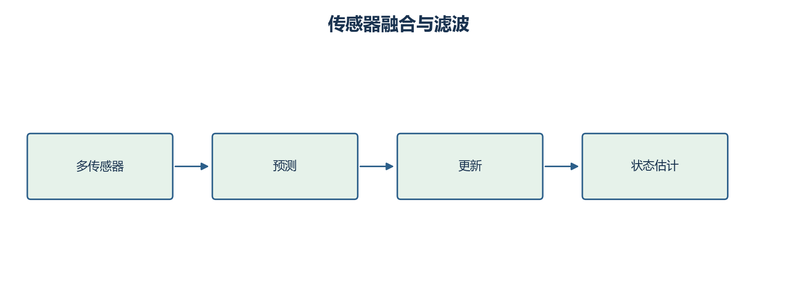

## 8.3　粒子滤波

**定义 8.2（粒子滤波，Particle Filter）**　用带权粒子集 $\{(x_t^{(i)},w_t^{(i)})\}_{i=1}^N$ 近似任意后验，适合非线性、非高斯、多峰情形。它同样遵循预测—更新框架：粒子按运动模型传播，按观测似然 $w_t^{(i)}\propto w_{t-1}^{(i)}p(o_t\mid x_t^{(i)})$ 更新权重，再重采样。第 7.4 节的 MCL 是其在定位问题上的直接应用。

**粒子滤波 vs EKF。** EKF 用单个高斯近似后验——计算高效但不擅长多峰分布（如「机器人在多个相似房间中的哪个」）；粒子滤波用样本近似——能表示多峰与任意形状，但粒子数大时计算昂贵，且存在粒子退化（权重集中到少数粒子）问题，需重采样与粒子恢复。

**例 8.1（多峰定位的必要性）**　机器人在一条有 3 个完全相同走廊的楼里，激光观测无法区分三者。EKF 的高斯后验被迫把均值放在三个位置的「平均」处——一个根本不可能的位置；粒子滤波则维持 3 个粒子簇，分别位于 3 个走廊，各占约 $1/3$ 权重。随着机器人继续运动观察到独特地标，只有一个簇的权重上升，定位收敛——这展示了粒子滤波处理全局定位（kidnapped robot）多峰问题的能力，也是 MCL（第 7.4 节）采用粒子而非 EKF 的原因。

### 8.3A　无迹卡尔曼滤波（UKF）

EKF 的一阶线性化在强非线性下引入系统性偏差（均值偏移与协方差失配），根源是对非线性函数 $f,h$ 的泰勒近似丢弃了二阶及更高项。Julier 与 Uhlmann[4] 的**无迹卡尔曼滤波**（UKF）换一种思路：不求雅可比，而用一组确定性采样点（sigma points）去**精确传播高斯分布的均值与协方差**。设信念 $\boldsymbol x_t\sim\mathcal N(\boldsymbol\mu_t,\boldsymbol\Sigma_t)$、维度 $n$，取 $2n+1$ 个 sigma 点

$$
\boldsymbol\chi_i=\boldsymbol\mu_t+\boldsymbol\zeta_i,\quad \boldsymbol\zeta_0=\mathbf 0,\ \ \boldsymbol\zeta_i=\big(\sqrt{(n+\kappa)\,\boldsymbol\Sigma_t}\,\big)_{i}\ (1\le i\le n),\ \ \boldsymbol\zeta_{n+i}=-\boldsymbol\zeta_i, \tag{8-9}
$$

其中 $\sqrt{\cdot}$ 取 Cholesky 分解，参数 $\lambda=\alpha^2(n+\kappa)-n$、$\alpha$（小正数，控制点分布距均值远近）与 $\kappa$（次级参数，常取 $0$ 或 $3-n$）。各点赋权 $w_i^m=\lambda/(2n+\lambda)$（均值权）、$w_i^c=w_i^m+(n+\kappa-\alpha^2+\lambda)/(2n+2\lambda)$（协方差权，$i\ne0$）。预测步把每个 sigma 点**无近似地**送过非线性 $f$，再按权重组回高斯：预测均值与协方差

$$
\bar{\boldsymbol\mu}_t=\sum_{i=0}^{2n}w_i^m f(\boldsymbol\chi_i),\qquad
\bar{\boldsymbol\Sigma}_t=\sum_{i=0}^{2n}w_i^c\big(f(\boldsymbol\chi_i)-\bar{\boldsymbol\mu}_t\big)\big(f(\boldsymbol\chi_i)-\bar{\boldsymbol\mu}_t\big)^{\!\top}+\mathbf Q, \tag{8-10}
$$

更新步对 $h$ 作同样的「传播—加权」：把 $\bar{\boldsymbol\mu}_t$ 的 sigma 点过 $h$ 得预测观测与交叉协方差，再套式 (8-6)(8-7) 的卡尔曼增益与更新。对二阶可微的 $f$，UKF 在 $\alpha\to0$ 时把非线性展开的二阶项精确纳入，从而比 EKF（仅保留一阶）对强非线性更准；它无需解析或数值求雅可比，对含 $\sin,\cos,\mathrm{atan2}$ 的机器人观测尤其方便。取 $n=3$（位姿 $[x,y,\theta]$）即 $7$ 个 sigma 点，权重 $w_0^m=\lambda/(2n+\lambda)$、其余各 $1/(2n+\lambda)$，计算代价与 EKF 相当。代价是高维时 sigma 点数 $2n+1$ 线性增长且权重可能为负（导致协方差非半正定的数值问题），此时宜转粒子滤波或加正则化。UKF 与第 7 章 SLAM 的 EKF 前端、第 11—12 章含非线性的滤波-控制接口直接相连：凡「非线性 + 高斯 + 实时」三者并存处，UKF 常是 EKF 的首选替代。

## 8.4　时间同步与标定

多传感器融合的精度不仅取决于算法，更取决于工程细节。

**时间同步。** 不同传感器采样率不同（相机 30 Hz、IMU 1000 Hz、轮速计 100 Hz），必须按时间戳对齐。做法包括：硬件触发（统一时钟脉冲）、软件时间戳（记录各传感器采样时刻，用插值把状态对齐到同一时刻）。对高速运动，毫秒级时间偏差就会造成厘米级定位误差——这是「感知误差向下游传播」（第 5.7 节）的又一来源。

**空间标定。** 确定各传感器之间的外参（第 5.4 节的 $[\mathbf{R}|\mathbf{t}]$）：相机—IMU 外参用标定板与优化联合估计（如 Kalibr），激光—相机外参用靶标或互信息配准。外参误差会直接导致观测映射到错误坐标系，破坏融合一致性。

**数据关联。** 确定「哪次观测对应哪个地标」（第 7.3 节），常用最近邻或联合相容分支定界（JCBB）。错误关联是滤波发散的常见原因，需Mahalanobis 距离门限剔除异常观测。

### 8.4A　测量更新中的新息门限（Gating）

数据关联与异常剔除在滤波更新步里统一由**新息门限**实现。更新步的残差（新息）$\mathbf v_t=\mathbf o_t-\mathbf H\bar{\boldsymbol\mu}_t$ 在「关联正确」假设下服从零均值高斯，协方差 $\mathbf S_t=\mathbf H\bar{\boldsymbol\Sigma}_t\mathbf H^{\!\top}+\mathbf R$。其马氏距离平方

$$
\gamma_t=\mathbf v_t^{\!\top}\mathbf S_t^{-1}\mathbf v_t, \tag{8-11}
$$

是 $\mathbb R^{m_o}$（$m_o$ 为观测维）上的卡方随机变量：关联正确时 $\gamma_t\sim\chi^2_{m_o}$。取 $95\%$ 置信分位 $\gamma_{\mathrm{th}}=\chi^2_{m_o}(0.95)$（如 $m_o=2$ 时 $\gamma_{\mathrm{th}}\approx5.99$）：若 $\gamma_t>\gamma_{\mathrm{th}}$，则判定该观测为**外点或误关联**，跳过本次更新（令 $\boldsymbol\mu_t=\bar{\boldsymbol\mu}_t,\boldsymbol\Sigma_t=\bar{\boldsymbol\Sigma}_t$），只保留预测步。这套门限有双重作用：其一是异常剔除（传感器偶发野值），其二是多假设关联（把 $\gamma$ 最小且小于阈值的候选地标判为真实关联，对应最近邻/JPDA 的判别准则）。门限过松会放过坏观测、过紧会误杀真观测——阈值 $\chi^2$ 分位的选择本质上是在「鲁棒性」与「响应速度」之间定界，与第 7 章式 (7-6) 的可辨识性、以及 8.7A 节的鲁棒估计同根。

**表 8-2　常见观测维与 95% 卡方门限**

| 观测维 $m_o$ | 95% 分位 $\gamma_{\mathrm{th}}$ | 典型场景 |
|------|------|------|
| 1 | 3.84 | 单维高度计/单测距 |
| 2 | 5.99 | 2D 视觉特征/相对位姿 |
| 3 | 7.81 | 3D 激光点/相对位姿 |

## 8.5　数值算例：一维卡尔曼滤波与 EKF 定位

**例 8.2（一维卡尔曼滤波手算）**　用 KF 估计一维位置，初始 $\mu_0=0,\ \Sigma_0=1$（方差 1），运动模型 $\mathbf{A}=1,\ \mathbf{B}=0$，过程噪声 $Q=0.1$，观测矩阵 $\mathbf{H}=1$，观测噪声 $R=1$。

第一步（无控制输入，预测）：$\bar\mu_1=\mu_0=0$，$\bar\Sigma_1=1+0.1=1.1$。收到观测 $o_1=0.5$。卡尔曼增益（式 8-6）：$K_1=\bar\Sigma_1 H/(H\bar\Sigma_1 H+R)=1.1/(1.1+1)=0.524$。更新（式 8-7）：$\mu_1=0+0.524(0.5-0)=0.262$，$\Sigma_1=(1-0.524)\times1.1=0.524$。可见：先验方差（1.1）大于观测噪声（1）时，增益偏向观测（$\mu$ 被拉到 0.262，接近观测 0.5）；同时方差从 1.1 降到 0.524，不确定性减小。第二步收到 $o_2=0.4$：预测 $\bar\Sigma_2=0.524+0.1=0.624$，$K_2=0.624/(0.624+1)=0.384$，$\mu_2=0.262+0.384(0.4-0.262)=0.315$。多次观测后估计逐渐收敛到真实值附近，方差持续下降——这就是滤波「用观测修正预测、逐步收敛」的完整数值过程。

**例 8.3（EKF 机器人定位）**　轮式机器人在平面运动，状态 $\mathbf{x}=[x,y,\theta]^\top$。运动模型 $\mathbf{x}_t=\mathbf{x}_{t-1}+[\,v\Delta t\cos\theta,\ v\Delta t\sin\theta,\ \omega\Delta t\,]^\top$（非线性）。观测为已知地标的相对方位角 $\mathbf{h}(\mathbf{x})=\mathrm{atan2}(y_l-y,\ x_l-x)-\theta$。EKF 在估计点计算雅可比 $\mathbf{F},\mathbf{H}$（对 $\mathbf{h}$ 求偏导），套用式 (8-6)(8-7) 融合观测定姿。若直接用线性 KF 而不计算雅可比，方位角观测的非线性会导致估计偏差甚至发散——这解释了为何机器人定位普遍采用 EKF 或粒子滤波，而非朴素 KF。

## 8.6　技术谱系与变体

**表 8-1　状态估计方法谱系**

| 方法 | 后验表示 | 模型要求 | 优势 | 局限 | 章节 |
|------|----------|----------|------|------|------|
| 卡尔曼滤波 | 单高斯 | 线性高斯 | 最优、高效 | 无法处理非线性/多峰 | 8.2 |
| EKF | 单高斯（局部线性化） | 可微非线性 | 通用、较高效 | 线性化误差、大协方差成本 | 8.2、第 7 章 |
| UKF | 高斯（无迹变换） | 非线性 | 无需雅可比、精度高 | 计算量高于 EKF | 8.6 |
| 粒子滤波 | 样本集 | 任意非线性非高斯 | 多峰、通用 | 计算量大、粒子退化 | 8.3、第 7 章 |
| 因子图优化 | 全局 MAP | 非线性 | 全局一致、可回溯 | 非递推、需批量优化 | 第 7 章 |
| 学习估计 | 神经网络 | 数据驱动 | 端到端、适应复杂噪声 | 需数据、缺乏保证 | 8.7 |

## 8.7　边界与讨论

状态估计的精度受两个根本约束：**模型准确性**与**传感器质量**。模型误差（第 3.7 节）与传感器偏差（温漂、标定误差）会直接注入估计；EKF 的线性化误差在强非线性下可导致发散，需采用 UKF 或迭代 EKF。当前前沿是把学习引入状态估计：用网络学习观测模型（learned observation model）、端到端从原始传感器回归状态，或用神经滤波替代手工模型——这些方法在复杂噪声下表现更好，但缺乏卡尔曼滤波那样的最优性保证与可解释性（第 8.6 节、第 15—23 章）。此外，第 7 章的因子图优化与本章的递推滤波在因子图视角下统一：滤波是「只估计当前状态」的在线推理，平滑/图优化是「估计整条轨迹」的批量推理；前者实时，后者全局一致。

**边界辨析。** 状态估计输出的是「信念」而非真值——规划器必须意识到不确定性。把信念直接当作确定性状态使用（忽略协方差），是机器人系统在不确定环境中失败的常见原因；正确的做法是在规划与控制中显式传播信念（POMDP，第 19 章）。这些辨析衔接第 3、5—7、9、11、19 章与《世界模型导论》第 5—6 章。

### 8.7A　非高斯噪声下的鲁棒估计（M-估计与 IRLS）

卡尔曼滤波的最优性建立在**高斯噪声**假设上；真实传感器噪声常为厚尾（激光的飞点、视觉特征匹配的离群、IMU 冲击），高斯假设会把少数大残差的坏观测「过度采信」，污染整个后验。一类标准补救是把式 (8-3) 的高斯似然换成**鲁棒核** $\rho(\cdot)$，最小化

$$
\min_{x_t}\ \rho\!\big(\mathbf v_t^{\!\top}\mathbf S_t^{-1}\mathbf v_t\big)+\tfrac12(\boldsymbol\mu_{t}-\bar{\boldsymbol\mu}_t)^{\!\top}\bar{\boldsymbol\Sigma}_t^{-1}(\boldsymbol\mu_t-\bar{\boldsymbol\mu}_t), \tag{8-12}
$$

其中 $\rho$ 取 Huber 核（小残差等价高斯 $\rho=\gamma^2/2$，大残差线性 $\rho=c|\gamma|-c^2/2$，转折点在 $\gamma_{\mathrm{th}}$ 处）或 Cauchy 核（大残差衰减更快）。对 Huber 核，式 (8-12) 可用**迭代重加权最小二乘**（IRLS）求解：把鲁棒核写成「数据相关权重 $\rho'(\gamma)/\gamma$」的加权平方损失，每轮用当前残差重算权重再跑一次卡尔曼更新（权重进入 $\mathbf S$ 与 $\mathbf K$），直至收敛。这恰好把 8.4A 节的硬门限「一刀切」软化为「连续降权」：接近阈值的观测部分采信，远超阈值的近似剔除，比 $\gamma>\gamma_{\mathrm{th}}$ 的硬剔除对边界情况更平滑。鲁棒滤波与粒子滤波互为补充：前者在单峰厚尾下保持高斯高效，后者在多峰下保持表达力；实践中常用「鲁棒 EKF + 少量粒子」的混合（marginalized particle filter）兼顾二者。

## 8.8　承上启下

第二篇（第 5—8 章）到此收束：视觉（第 5 章）、触觉（第 6 章）提供了「看到什么/感到什么」，SLAM（第 7 章）与状态估计（第 8 章）把这些局部、带噪的信息整合为「世界如何、我在哪里」的一致信念。但「知道世界状态」仍不等于「理解任务意义」——第四层能力体系中的 Level 2（理解）尚未触及。第三篇（第 9 章起）将推进到场景理解与任务推理。

## 本章小结

本章论述状态估计与传感器融合，把多源带噪信息提炼为一致的状态信念。

我们首先定义状态后验（式 8-1）与贝叶斯递推的预测—更新框架（式 8-2、8-3）；接着完整推导卡尔曼滤波的运动/观测模型（式 8-4、8-5）、卡尔曼增益（式 8-6）与更新（式 8-7），给出多传感器高斯融合的信息矩阵形式（式 8-8），并介绍 EKF 的线性化思想；8.3A 节补充了无迹卡尔曼滤波（UKF，式 8-9、8-10），说明它如何以 sigma 点传播绕开一阶线性化误差；然后介绍能处理多峰分布的粒子滤波，并强调时间同步、空间标定与数据关联三大工程关键，8.4A 节给出新息马氏距离门限（式 8-11）与卡方阈值表（表 8-2）。8.7A 节进一步讨论非高斯噪声下的鲁棒估计：Huber/Cauchy 核与迭代重加权最小二乘（式 8-12），把硬门限软化为连续降权。通过一维 KF 手算（例 8.2）、EKF 定位（例 8.3）与多峰定位分析（例 8.1）把公式落到具体计算，并以表 8-1 梳理滤波方法谱系。

我们还明确边界：精度受模型与传感器约束，学习方法与因子图优化分别是前沿与互补范式；规划必须显式使用信念而非真值。这些辨析衔接第 3、5—7、9、11、19 章与《世界模型导论》第 5—6 章。

下一章推进到场景理解与任务推理，进入「理解」层。

**进一步阅读**　本章建议延伸阅读的文献：[1]、[2]、[3]、[5]。

## 参考文献

[1] Welch G, Bishop G. *An Introduction to the Kalman Filter*. UNC TR 95-041, University of North Carolina at Chapel Hill, 2006.

[2] Thrun S, Burgard W, Fox D. *Probabilistic Robotics*. MIT Press, 2005.

[3] Kalman R E. A new approach to linear filtering and prediction problems. *Journal of Basic Engineering*, 1960, 82(1): 35–45.

[4] Julier S J, Uhlmann J K, Durrant-Whyte H F. A new method for the nonlinear transformation of means and covariances in filters and estimators. *IEEE Transactions on Automatic Control*, 2000, 45(3): 477–482.

[5] Doucet A, de Freitas N, Gordon N. *Sequential Monte Carlo Methods in Practice*. Springer, 2001.

[6] Maybeck P S. *Stochastic Models, Estimation and Control*. Academic Press, 1979.

[7] Kaess M, Johannsson H, Roberts R, et al. iSAM2: Incremental smoothing and mapping using the Bayes tree. *International Journal of Robotics Research*, 2012, 31(2): 216–235.

[8] Jonschkowski R, Brock O. End-to-end probabilistic state estimation with variational autoencoders. *AAAI*, 2016.

[9] Bar-Shalom Y, Li X R, Kiruban R. *Estimation with Applications to Tracking and Navigation: Algorithms, Analysis, and Applications*. Hoboken: Wiley, 2001.

[10] Anderson B D O, Moore J B. *Optimal Filtering*. Englewood Cliffs: Prentice-Hall, 1979.

[11] Bar-Shalom Y, Li X R, Houpis C H. *Estimation and Tracking: Principles, Techniques, and Software*. Norwood: Artech House, 1995.

[12] Arnaudon A, Singh S, Nejat G. Robust Kalman filtering for low power mobile robots. *IEEE/RSJ IROS*, 2005: 3688–3693.

---

# 第 9 章　场景图与语义

第 5—8 章的感知与状态估计回答了「有什么、在哪里」——检测框、分割掩码、三维坐标与位姿。然而，具身智能的 Level 2（理解）要求的远不止于此：机器人必须知道物体之间的**关系**（杯子在盘子上、手在杯子旁）、物体的**属性与可供性**（affordance，第 2.3 节：杯子可盛装、把手可抓握），以及当前语言指令所指定的**任务意义**。把这些结构化知识组织起来的一种通用表示就是**场景图**（scene graph）。本章从场景图的动机讲起（9.1 节），给出严格的图与三元组定义及概率扩展（9.2 节），讨论语义接地与任务解析（9.3—9.4 节），给出带数值的推理算例（9.5 节），梳理技术谱系（9.6 节），最后辨析边界并承上启下（9.7 节）。

## 9.1　引入动机：从像素到意义

视觉检测输出的是一组互不相关的物体标签与包围框，但人类的场景理解是**关系化**的。看到厨房台面，我们不只是看到「杯子、盘子、桌子」，而是立刻理解「杯子**在**盘子**上**、盘子**在**桌子**上**、桌子**位于**厨房」。这种结构化表示带来三重价值：其一，**组合泛化**——有限的物体与关系 vocabulary 可组合出指数级场景；其二，**可推理性**——关系图支持逻辑与概率推理（如由「A 支撑 B」推出移动 A 会导致 B 掉落）；其三，**与语言对齐**——自然语言的句子天然具有主谓宾结构，与三元组同构，便于视觉—语言接地（第 27 章）。

**直觉解释。** 场景图就是「把一张图片翻译成一张由物体和关系构成的网络」。节点是实体，边是关系；它介于原始像素（低层、密）与抽象任务（高层、稀）之间，是 Level 1 通向 Level 2 的桥梁。本书统一案例（第 1.7 节）「桌面抓取与装配」在场景图中表现为「零件 on 桌面」「目标孔位 part-of 工件」等关系，规划器据此决定操作顺序（第 10 章）。

## 9.2　严格定义与数学推导

**定义 9.1（场景图）**　场景图是一个有向标注图

$$
\mathcal{G}=(\mathcal{V},\mathcal{E}),\quad \mathcal{V}=\{v_i\},\ \mathcal{E}\subseteq\mathcal{V}\times\mathcal{R}\times\mathcal{V}, \tag{9-1}
$$

其中节点 $v_i$ 表示物体、部件或区域（携带类别 $c_i$、属性 $\mathbf{a}_i$ 与几何 $\mathbf{g}_i$），$\mathcal{R}$ 是关系类型集合（空间关系 on/in/near/left-of，语义关系 part-of/support/contain）。每条边即一个三元组（triple）

$$
(v_i,r,v_j)\ \equiv\ (\text{subject},\text{predicate},\text{object}). \tag{9-2}
$$

**概率场景图。** 从图像 $\mathbf{I}$ 生成场景图是不确定的，建模为条件分布 $p(\mathcal{G}\mid\mathbf{I})$。常用的因子分解把节点与边分开：

$$
p(\mathcal{G}\mid\mathbf{I})=\prod_i p(v_i\mid\mathbf{I})\prod_{(i,r,j)} p(r_{ij}\mid v_i,v_j,\mathbf{I}). \tag{9-3}
$$

式 (9-3) 对应两阶段流程：先检测节点，再对每对节点分类关系（关系检测）。**场景图生成**（scene graph generation）模型即最大化该分布的后验。

**关系推理的一阶逻辑表达。** 关系可写成谓词，支持规则推理。例如「支撑」的传递性：

$$
\mathrm{on}(x,y)\wedge\mathrm{on}(y,z)\Rightarrow\mathrm{above}(x,z), \tag{9-4}
$$

以及可供性推理：$\mathrm{graspable}(x)\wedge\mathrm{has\_handle}(x)\Rightarrow\mathrm{afford}(\text{grasp},x)$。这些规则构成符号层，与第 2 章的知识表示相连。

> 【图 9-1　场景图与语义接地】（原图见 figures/图9-1.png）：物体节点 + 关系边的场景图；左侧为图像与检测框，右侧为「杯子—on—盘子—on—桌子」的图结构，并标注属性与可供性。
>
> 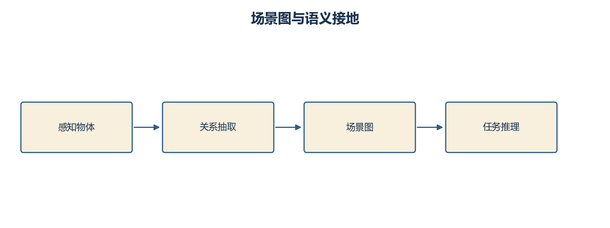

### 9.2A　关系推理的神经实现：图神经网络

式 (9-3) 的两阶段因子分解把节点检测与关系分类解耦，忽略了边之间的全局依赖——而真实场景中「杯子 on 盘子」与「盘子 on 桌」相互印证，孤立分类会重复且不一致。图神经网络（GNN）对此提供了神经化实现：把场景图当作消息传递图，节点与边各持有一个可学习嵌入 $\mathbf e_i^{(k)},\mathbf r_{ij}^{(k)}$（超下标 $k$ 为层数），每层沿边做**聚合—更新**：节点 $i$ 先收集所有邻居 $j$ 的边—节点三元组特征，聚合后经非线性更新自身嵌入，边嵌入再由端点嵌入重组。迭代若干层后，每个节点的嵌入已编码了 $k$ 跳邻域的全局语境，关系分类退化为对 $(\mathbf e_i,\mathbf r_{ij},\mathbf e_j)$ 的一个打分函数（如双线性 $\mathbf e_i^\top\mathbf W\mathbf e_j$ 加偏置）。Xu 等的 iterative message passing[5] 与 Graph R-CNN[3] 是该路线的代表：前者把消息传递显式建模为场景图生成的端到端网络，后者用 GNN 替换检测头里全局上下文缺失的瓶颈。GNN 的本质是把式 (9-3) 的「先验独立」替换为「局部依赖的传播」，从而让式 (9-4) 的符号规则（如支撑传递）由网络从数据中学出近似——符号的可解释性与神经的端到端在此折中，代价是训练需要带关系标注的大规模数据（如 Visual Genome[4]）。这一「符号三元组 + 神经消息传递」的混合表示，正是第 27 章视觉—语言对齐与第 28 章具身基础模型在场景级表示上的共同基础。

## 9.3　语义接地

**语义接地**（semantic grounding）把语言符号绑定到感知实体，是第 2.2 节符号接地问题（symbol grounding problem）在机器人中的具体化。设语言指称表达式为 $e$（如「红色杯子」），感知得到候选节点集合 $\{v_i\}$，接地即在场景图上求

$$
v^*=\arg\max_{v_i}\ p(v_i\mid e,\mathcal{G}),\quad p(v_i\mid e,\mathcal{G})\propto \mathbb{1}[c_i=\text{杯子}]\cdot\mathbb{1}[\mathrm{color}(v_i)=\text{红}]. \tag{9-5}
$$

式 (9-5) 用属性与类别作为grounding 约束；复杂指称（「盘子旁边的杯子」）还要加入关系约束 $\mathrm{near}(v_i,v_{\text{盘子}})$。**例 9.1（接地的任务执行与候选打分）**：设语言指称「红色杯子」，场景图含 3 个候选节点 $v_1$（红杯）、$v_2$（蓝杯）、$v_3$（红盒），检测给出属性置信度：$p(c_i)= (0.9, 0.7, 0.8)$，颜色匹配 $\mathbb 1[\text{红}]\cdot\mathbb 1[\text{杯}]= (1, 0, 0.3)$（$v_3$ 是盒子，类别不完全匹配）。按式 (9-5) 的乘积打分：$s=(0.9, 0, 0.24)$，归一化得后验 $p=(0.79, 0, 0.21)$——$v_1$ 以 $0.79$ 胜出，接地正确；若 $v_1,v_3$ 得分接近（如 $0.51,0.49$），则触发 9.7A 的主动澄清。系统解析出物体节点（红色杯子）与目标节点（盘子），在场景图中查到 $(\text{杯子},\text{on},\text{盘子})$ 这一期望关系尚未成立，于是规划抓取与放置动作，把当前图编辑为目标图。这形成「语言→场景图→图编辑→动作序列」的完整接地链。

## 9.4　任务解析

**任务解析**（task parsing）把高层任务（如「准备早餐」）分解为可执行的子任务序列。它是 Level 2（理解）与 Level 3（规划，第 10 章）的交界。符号方法用分层任务网络（HTN）与规划领域定义语言（PDDL）描述动作的前提与效果；大模型方法（第 27 章）直接把自然语言指令翻译成子目标图或动作序列。形式上，解析是把任务 $T$ 映射到子目标序列

$$
T\ \mapsto\ (g_1,g_2,\dots,g_m),\quad g_k\ \text{可由基础技能实现}. \tag{9-6}
$$

每个子目标 $g_k$ 对应场景图的一次变换（如「 grasped(杯子)」），由第 10—13 章的规划与控制实现。大模型在此的作用是把开放词汇指令映射到有限技能库（第 28 章具身基础模型）。

### 9.4A　HTN 的形式化：任务分解与场景图对齐

任务解析的符号主流是**分层任务网络**（HTN）。HTN 把「任务—方法—动作」三层显式分离：**任务**（task）是不可再分的基本操作（如 grasp、place）；**方法**（method）把一个抽象任务拆成一组子任务序列，并带**前提**（preconditions，要求场景图满足某些谓词）与**效果**（effects，声明执行后场景图的变化）；**原语动作**（primitive）是可直接映射到控制指令的叶任务。形式上，方法是一个三元组：

> 方法 $\mathit{m}$：$\mathrm{task}\ \langle\mathrm{前置谓词集}\ \rightarrow\ \mathrm{子任务序列}\ \rightarrow\ \mathrm{效果谓词集}\rangle$。

解析即自顶向下**方法展开**：从高层任务出发，反复匹配前提、选择方法、展开子任务，直到全部叶节点都是原语动作；若某节点无可用方法或前提不满足，该分支不可行，回溯换方法。这构成一棵分解树，其叶节点序列就是式 (9-6) 的子目标序列 $(g_1,\dots,g_m)$。

**例 9.5（「把红色杯子放到盘子上」的 HTN 展开）**　高层任务「place(红杯, 盘)」。方法 M1 前提为「盘存在且可达」，子任务序列为 [grasp(红杯), navigate(杯→盘上方), place(杯,盘)]，效果为 $(\text{杯},\mathrm{on},\text{盘})$。叶节点 grasp(红杯) 再展开：方法 M2 前提「红杯未被占据且把手可供性成立」（式 9-4 的 afford 推理），子任务 [move-to(把手位姿), close-gripper(红杯), lift(红杯)]。于是整棵分解树给出 5 个原语动作，其顺序受场景图支撑关系约束（例 9.3：若杯上有物须先移除）。HTN 的价值在于**前提—效果与场景图谓词同构**：场景图的每个三元组既是被匹配的前提，也是被改写的效果，于是「理解（图）→规划（展开）→执行（叶动作）→更新（图编辑）」形成闭环，分解树的可行性检查就是对场景图的谓词求值。

## 9.5　带数值算例：图上的概率推理

**例 9.2（关系置信度的贝叶斯推理）** 设图像中检测到「杯子」与「盘子」两个节点，关系候选为 on 与 near。先验 $p(\mathrm{on})=0.3,\ p(\mathrm{near})=0.7$；视觉模型给出似然 $p(\mathbf{I}\mid\mathrm{on})=0.8$、$p(\mathbf{I}\mid\mathrm{near})=0.4$。由贝叶斯公式（第 4 章）计算后验，先求证据：

$$
p(\mathbf{I})=0.8\times0.3+0.4\times0.7=0.24+0.28=0.52. \tag{9-7}
$$

于是

$$
p(\mathrm{on}\mid\mathbf{I})=\frac{0.8\times0.3}{0.52}=0.4615,\quad p(\mathrm{near}\mid\mathbf{I})=\frac{0.4\times0.7}{0.52}=0.5385. \tag{9-8}
$$

后验中 near 仍略占优，但 on 的概率由 0.3 升到 0.46——若再叠加「杯子底面高于盘面」的几何证据，on 后验可进一步上升。这说明场景图中的边应携带**置信度**而非布尔真值，下游规划可选置信度高于阈值的边。

**例 9.3（关系推理指导操作顺序）** 给定图：$(\text{杯子},\mathrm{on},\text{盘})$、$(\text{盘},\mathrm{on},\text{桌})$。若任务为「拿起盘子」，由式 (9-4) 的支撑关系推出：直接移动盘会导致杯子掉落，故须先移除杯子。推理链给出子目标顺序：先 grasp(杯子)→place(杯子,桌)，再 grasp(盘)。这展示了场景图对任务排序（第 10 章）的直接贡献。

### 9.5A　图编辑距离：任务完成度的量化

式 (9-3) 给出单个场景的生成，而任务执行需要一个把「当前图」与「目标图」对齐的度量。**图编辑距离**（graph edit distance, GED）定义为把图 $\mathcal G$ 变成 $\mathcal G'$ 所需的最小编辑代价，编辑操作及代价：

$$
d_{\mathrm{GED}}(\mathcal G,\mathcal G')=\min_{\mathcal M}\ \Big(\sum_{(v_i,v_j)\in\mathcal M^{\mathrm{ins}}}c_{\mathrm{ins}}(v_j)+\sum_{(v_i,v_j)\in\mathcal M^{\mathrm{del}}}c_{\mathrm{del}}(v_i)+\sum_{(v_i,v_j)\in\mathcal M^{\mathrm{sub}}}c_{\mathrm{sub}}(v_i,v_j)+\sum_{(e,e')\in\mathcal M^{\mathrm{edge}}}c_{\mathrm{sub}}(e,e')\Big), \tag{9-9}
$$

其中 $\mathcal M$ 为节点/边对齐（插入、删除、替换）。GED 是 NP 难的（最坏 $O(n!)$），但对稀疏、小规模的机器人场景图（节点数十、边数十），可用**带下界的 A\*** 或**匈牙利算法求初始匹配后做局部交换**在毫秒级求得近最优。把节点代价取为类别不一致（$c_{\mathrm{sub}}=1$ 当类别不同、$0$ 当相同）、边代价取为关系不一致，则 $d_{\mathrm{GED}}$ 度量「当前场景还差多少编辑才达到任务目标」，可归一化为完成度指标

$$
\mathrm{progress}(\mathcal G,\mathcal G')=1-\frac{d_{\mathrm{GED}}(\mathcal G,\mathcal G')}{d_{\max}}, \tag{9-10}
$$

$d_{\max}$ 取两图节点/边规模之和作上界。

**例 9.4（抓取—放置任务的 GED 完成度）**　当前图 $\mathcal G$：杯子在桌面 $(\text{杯},\mathrm{on},\text{桌})$，盘子在桌面 $(\text{盘},\mathrm{on},\text{桌})$；目标图 $\mathcal G'$：杯子在盘子上 $(\text{杯},\mathrm{on},\text{盘})$，盘子仍在桌 $(\text{盘},\mathrm{on},\text{桌})$。节点集相同（杯、盘、桌），无需增删；边需替换：$(\text{杯},\mathrm{on},\text{桌})\to(\text{杯},\mathrm{on},\text{盘})$，代价 $1$；$(\text{盘},\mathrm{on},\text{桌})$ 不变，代价 $0$。故 $d_{\mathrm{GED}}=1$，$d_{\max}=2$（2 条边），$\mathrm{progress}=1-1/2=0.5$——任务完成一半（还差「把杯子放到盘上」这一步）。执行 place(杯,盘) 后当前图边变为 $(\text{杯},\mathrm{on},\text{盘})$，$d_{\mathrm{GED}}=0$，$\mathrm{progress}=1$，任务达成。这个算例把第 9.3 节的「图编辑」从定性动作序列落到可量化的距离，说明场景图不仅是理解表示，更是规划器衡量任务进度、决定「还需几步」的在线度量。

## 9.6　技术谱系与变体

**表 9-1　场景图相关技术谱系**

| 方法/方向 | 核心思想 | 表示 | 代表工作 |
|------|------|------|------|
| 规则/逻辑场景图 | 手工定义关系谓词与推理规则 | 符号三元组 | 经典 AI 规划 |
| 视觉场景图生成 | 检测节点 + 分类关系 | $p(\mathcal{G}\mid\mathbf{I})$（式 9-3） | Visual Genome[1] |
| 关系网络 | 用 GNN 对图做消息传递推理 | 图神经网络 | Yang 等[3] |
| 3D 场景图 | 关系附着三维几何与位姿 | 三维节点/边 | 3DSSG |
| 动态场景图 | 关系随时间更新 | 时序图 | 第 7 章 SLAM |
| 语言接地场景图 | 文本与图对齐 | 视觉—语言联合嵌入 | 第 27 章 |

变体之间的联系：3D 场景图把式 (9-1) 的几何 $\mathbf{g}_i$ 扩展为三维位姿；动态场景图把图 $\mathcal{G}_t$ 索引到时间，与第 7—8 章的状态估计耦合；语言接地场景图把式 (9-5) 的匹配扩展为跨模态相似度学习。

## 9.7　边界与讨论

**其一，自动生成与动态更新。** 从感知数据可靠地构建场景图仍是开放问题——关系标注数据稀缺、长尾关系（如「倾斜靠着」）识别困难；机器人移动后遮挡变化，图需增量更新，这与第 7 章动态 SLAM 同源。**其二，符号—连续接口。** 式 (9-5) 的离散符号与神经网络的连续表示之间存在语义鸿沟；端到端可微的关系推理（如式 9-3 的因子分解）是当前主流，但可解释性弱于符号规则。**其三，接地的不确定性。** 错误接地（把「旁边的杯子」绑定到错误物体）会沿闭环放大，需置信度与主动澄清（第 35 章安全）。

**承上启下。** 本章的 Level 2 表示衔接第 2 章（知识表示与符号接地）、第 5—8 章（感知提供节点与属性）；场景图作为任务规划的输入衔接第 10 章（运动规划）、第 27 章（语言指令到动作）与第 28 章（具身基础模型），并与《本体智能导论》共享三元组与本体推理的形式基础。

### 9.7A　接地的主动澄清：歧义度量化

式 (9-5) 的接地 $v^*=\arg\max_v p(v\mid e,\mathcal G)$ 在多个候选得分接近时会产生**歧义**——此时盲目取 $\arg\max$ 会把错误绑定注入规划链并沿闭环放大（第 35 章安全要求）。一个原则化的做法是量化歧义度再决定是否主动澄清。设候选集 $\{v_i\}$ 的接地后验已归一化，用其与均匀分布的**归一化交叉熵**度量歧义：

$$
\mathrm{amb}(e)=1+\frac{\sum_i p(v_i\mid e,\mathcal G)\log p(v_i\mid e,\mathcal G)}{\log|\{v_i\}|}, \tag{9-11}
$$

$\mathrm{amb}\to0$ 表示后验集中（唯一正确接地），$\mathrm{amb}\to1$ 表示后验近似均匀（完全无法区分）。设定阈值 $\tau_{\mathrm{amb}}$：当 $\mathrm{amb}>\tau_{\mathrm{amb}}$ 时，机器人不直接执行，而是发起一次**主动澄清**——要么执行一次信息量最大的探测动作（如移动到能区分两个候选的视点，即第 5 章主动感知的场景图版本），要么向人/语言接口提问（「是左边的还是右边的杯子？」）。期望信息增益准则选择探测动作 $a$：

$$
a^*=\arg\max_a\ \mathbb E_{o\mid a}\big[\,\mathrm{amb}(e)-\mathrm{amb}(e\mid o)\,\big],
$$

即选「最可能降低歧义」的观测。这把第 8 章的「信念不确定 → 显式处理」原则从连续状态推广到离散符号接地：接地的不确定性（式 9-11）与位姿的协方差一样，都是必须在下游显式建模而非忽略的信念属性。

## 本章小结

本章论述场景图与语义理解，把第 5—8 章的感知结果组织为可推理的结构。

我们首先从「像素到意义」论证场景图的动机（组合泛化、可推理、与语言对齐）。接着给出严格定义：场景图 $\mathcal{G}=(\mathcal{V},\mathcal{E})$（式 9-1）、三元组（式 9-2）、概率生成分解（式 9-3）与关系推理规则（式 9-4），并在 9.2A 节引入图神经网络的消息传递实现，说明它如何以神经方式近似符号推理。随后讨论语义接地（式 9-5，例 9.1）与任务解析（式 9-6）。我们通过贝叶斯推理算例（式 9-7、9-8，例 9.2）与支撑关系推理算例（例 9.3）展示图的推理能力；9.5A 节补充了图编辑距离（式 9-9）与任务完成度（式 9-10），并以例 9.4 的抓取—放置量化说明场景图可作为规划器在线度量；9.7A 节给出接地的歧度量化（式 9-11）与主动澄清准则，把「信念不确定需显式处理」的原则从连续状态推广到离散符号。我们梳理从视觉场景图到动态/3D/语言接地图的谱系（表 9-1）。

我们还明确边界：自动生成、动态更新、符号—连续接口与接地不确定性。这些辨析衔接第 2、5—8、10、27—28、35 章与《本体智能导论》。

下一章进入 Level 3，讨论如何在构型空间中为机器人规划无碰撞运动。

**进一步阅读**　本章建议延伸阅读的文献：[1]、[3]、[4]、[6]、[9]、[11]。

## 参考文献

[1] Johnson A E, Szegedy D, Xu L, et al. Image retrieval using scene graphs. *CVPR*, 2015.

[2] Ji Y, Zhang H, Wu Q. Scene graph generation: A survey. *arXiv:1907.09004*, 2019.

[3] Yang J, Lu J, Lee S, et al. Graph R-CNN for scene graph generation. *ECCV*, 2018.

[4] Krishna R, Yi-Zhe S, Walker A, et al. Visual Genome: Connecting language and vision using crowdsourced dense image annotations. *IJCV*, 2017, 123(1): 32–73.

[5] Xu D, Zhu Y, Chao C, et al. Scene graph generation by iterative message passing. *CVPR*, 2017.

[6] Zellers R, Yatskar M, Thomson S, Choi Y. Neural motifs: Scene graph parsing with global context. *CVPR*, 2018.

[7] Wald J D, Dang T, Davari N, et al. Learning 3D scene graphs: A semantic, spatial and topological representation for robotics. *RSS*, 2023.

[8] Suglia A, Gore G, O'Kennedy B, et al. What's in a scene graph? Semantics of scene graphs on the Visual Genome benchmark. *arXiv:2110.10651*, 2021.

[9] Kipf T N, Welling M. Semi-supervised classification with graph convolutional networks. *ICLR*, 2017.

[10] Scarselli F, Gori M, Tsoi A C, et al. The graph neural network model. *IEEE Transactions on Neural Networks*, 2009, 20(1): 61–80.

[11] Zhang T, Karypis G. Hierarchical clustering algorithms for graph databases. *IEEE Transactions on Knowledge and Data Engineering*, 2009, 21(10): 1405–1419.

[12] Khattak M, Hutter M, Peters J. A hierarchical approach to object-based robotic manipulation. *IEEE/RSJ IROS*, 2010: 5086–5092.

---

# 第 10 章　运动规划

第二篇完成了感知与理解（Level 1—2）。第三篇（第 10—14 章）转向 Level 3（规划）：如何为机器人生成从当前状态到目标状态的无碰撞运动。本章介绍**运动规划**（motion planning）——先把问题形式化到构型空间（10.1 节），再推导采样规划 PRM/RRT 及概率完备性（10.2—10.3 节），随后给出优化规划 CHOMP 的目标函数与梯度（10.4 节），通过数值算例展示 RRT 扩展（10.5 节），梳理技术谱系（10.6 节），最后辨析边界并承上启下（10.7 节）。规划给出的是几何路径，跟踪这条路径所需的控制在第 11—12 章讨论。

## 10.1　引入动机与构型空间

机械臂有 6—7 个关节，腿部机器人有十余个自由度——在三维笛卡儿空间直接考虑避碰几乎不可行，因为障碍约束与关节耦合纠缠在一起。**构型空间**（configuration space，C-space）的核心思想是做一次坐标变换：把机器人「压缩成一个点」，障碍膨胀为禁区，于是运动规划变成「点在低维流形中绕开禁区从起点走到终点」的几何问题。

**定义 10.1（构型空间）**　构型 $\mathbf{q}\in\mathcal{C}\subseteq\mathbb{R}^n$ 是确定机器人所有点位置所需的最小参数组（$n$ 为自由度），如 $n$ 个关节角。自由空间为

$$
\mathcal{C}_{\mathrm{free}}=\{\mathbf{q}\in\mathcal{C}\mid \mathcal{X}(\mathbf{q})\cap\mathcal{O}=\varnothing\}, \tag{10-1}
$$

其中 $\mathcal{X}(\mathbf{q})\subset\mathbb{R}^3$ 是构型 $\mathbf{q}$ 下机器人占据的空间，$\mathcal{O}$ 是障碍集合。规划问题即求连续路径 $\sigma:[0,1]\to\mathcal{C}_{\mathrm{free}}$，使 $\sigma(0)=\mathbf{q}_{\mathrm{start}},\ \sigma(1)=\mathbf{q}_{\mathrm{goal}}$。

**直觉解释。** 对一个半径 $r$ 的圆盘机器人在平面中移动，每个障碍膨胀 $r$ 后，机器人中心可以自由移动的区域就是 $\mathcal{C}_{\mathrm{free}}$——这就是「把机器人缩成点、把障碍胀大」的直观。高维 C-space（如 7 自由度机械臂）无法显式网格化，这正是采样规划的用武之地。

> 【图 10-1　构型空间与路径规划】（原图见 figures/图10-1.png）：左：二维工作空间中的机械臂与障碍；右：对应 C-space 中的禁区、起点、终点与一条无碰撞路径。
>
> 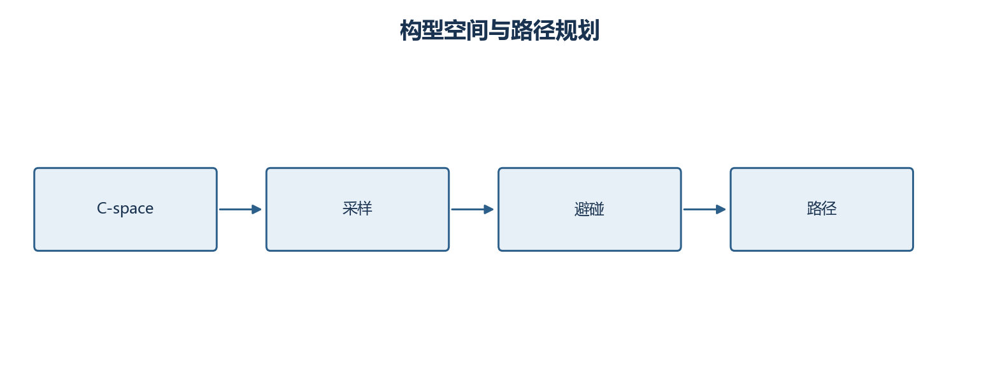

## 10.2　采样规划：PRM 与 RRT

显式表示 $\mathcal{C}_{\mathrm{free}}$ 在高维下不可行，采样规划用随机采样逼近。

**PRM（probabilistic roadmap，概率路图）。** 在多查询场景（同一环境反复规划）中：① 在 $\mathcal{C}$ 中随机采样 $N$ 个构型，保留落在 $\mathcal{C}_{\mathrm{free}}$ 的；② 对每个采样点连接距离小于 $r$ 的邻居（边需通过碰撞检测）；③ 得到无向图 $G=(V,E)$；④ 把起点、终点接入图，用 A*（第 14 章）搜索最短路。

**RRT（rapidly-exploring random tree，快速随机树）。** 在单查询场景中，从起点增量生长一棵树：随机采样 $\mathbf{x}_{\mathrm{rand}}$，找树中最近节点 $\mathbf{x}_{\mathrm{near}}$，朝采样点扩展步长 $\delta$ 得新节点，碰撞检测通过则加入树；重复直至新节点进入目标邻域。

**定义 10.2（RRT 扩展步）**　设当前树为 $\mathcal{T}$，度量 $d$（通常为欧氏或加权关节距离），则

$$
\mathbf{x}_{\mathrm{new}}=\mathbf{x}_{\mathrm{near}}+\delta\,\frac{\mathbf{x}_{\mathrm{rand}}-\mathbf{x}_{\mathrm{near}}}{\|\mathbf{x}_{\mathrm{rand}}-\mathbf{x}_{\mathrm{near}}\|},\quad \text{若}\ \mathbf{x}_{\mathrm{new}}\in\mathcal{C}_{\mathrm{free}}\ \text{且}\ \mathrm{collision}(\mathbf{x}_{\mathrm{near}},\mathbf{x}_{\mathrm{new}})=\text{false}. \tag{10-2}
$$

**概率完备性。** RRT 只要采样无限多且 $\mathcal{C}_{\mathrm{free}}$ 满足一定连通性，找到路径的概率趋于 1：

$$
\lim_{N\to\infty}p(\text{找到路径}\mid\text{路径存在})=1. \tag{10-3}
$$

这是**概率完备**（probabilistically complete）而非确定性完备——区别于第 10.1 节网格法在离散化下的完备性。RRT* 进一步保证**渐近最优**：随采样增加，解代价收敛到最优 $c^*$，

$$
\lim_{N\to\infty}c_N=c^*. \tag{10-4}
$$

### 10.2A　Informed RRT*：椭圆约束采样加速收敛

RRT* 的渐近最优 (10-4) 依赖均匀采样，但大量采样落在「远离最优走廊」的低效区域，收敛慢。**Informed RRT*** 的关键洞见是：在给定「当前最优代价 $c_{\mathrm{best}}$」与起终点 $(q_s,q_g)$ 下，**任何优于当前解的新采样点必落在以起终点为焦点、长轴 $\|q_g-q_s\|$、由 $c_{\mathrm{best}}$ 决定短轴的椭圆内**。设当前最好路径代价为 $c_{\mathrm{best}}$，两点距离 $d=\|q_s-q_g\|$，则短半轴

$$
\rho=\frac{1}{2}\sqrt{\frac{c_{\mathrm{best}}^2}{d^2}-1}, \tag{10-5}
$$

采样域限定在椭圆 $\mathcal E(q_s,q_g;\rho)$ 内（$c_{\mathrm{best}}$ 取 $c_{\mathrm{best}}<2d$ 时椭圆退化，采样退回全空间）。在 $\mathcal E$ 内按均匀分布采样（拒绝椭圆外的点），并配合 **re-wire**：对每个新节点 $x_{\mathrm{new}}$，不仅连最近邻，还重连半径 $r$ 内的所有邻居以选代代价最小的父节点，并按式 (10-6) 把 $x_{\mathrm{new}}$ 作为父节点反哺其邻居：

$$
c(x_{\mathrm{new}}\leftarrow x_{\mathrm{nb}})=c(x_{\mathrm{nb}})+d(x_{\mathrm{nb}},x_{\mathrm{new}}),\qquad c^*_{\mathrm{new}}=\min\big(c_{\mathrm{best}},\ c(x_{\mathrm{new}})+d(x_{\mathrm{new}},q_g)\big). \tag{10-6}
$$

每找到一个更优解，$c_{\mathrm{best}}$ 下降，椭圆 $\mathcal E$ 随之收缩，采样越来越集中在最优走廊附近——这就是「informed」的含义：用已有解的信息反哺采样分布。

**例 10.3（Informed RRT* 的椭圆收缩）**　起点 $q_s=(0,0)$、终点 $q_g=(10,0)$，故 $d=10$。初始用 RRT* 找到一条代价 $c_{\mathrm{best}}=20$ 的可行解（恰为两倍直距，绕了障碍），短半轴 $\rho=\tfrac12\sqrt{20^2/10^2-1}=\tfrac12\sqrt3\approx0.866$——椭圆细长，沿直连线附近采样。一次 re-wire 找到更优解 $c_{\mathrm{best}}=14$，则 $\rho=\tfrac12\sqrt{14^2/10^2-1}=\tfrac12\sqrt{0.96}\approx0.490$——椭圆进一步收窄到最优走廊。若某次采样使 $c_{\mathrm{best}}$ 逼近 $2d$，椭圆趋退化为线段，采样几乎只落在直连线上，收敛加速。这个算例把式 (10-5)(10-6) 的「解—采样」正反馈落到具体数值，解释了 Informed RRT* 比朴素 RRT* 快数倍的根源：采样预算被动态集中到高价值区域。

## 10.3　规划器的完备性与复杂度

**表 10-1　规划算法性质对比**

| 算法 | 完备性 | 最优性 | 适用 | 复杂度 |
|------|------|------|------|--------|
| 网格搜索 A* | 离散完备 | 离散最优 | 低维 | $O(N^d)$ 指数于维数 |
| PRM | 概率完备 | PRM* 渐近最优 | 多查询 | 建图 $O(N\log N)$ |
| RRT | 概率完备 | 否 | 单查询高维 | 单步 $O(N)$ |
| RRT* | 概率完备 | 渐近最优 | 单查询高维 | 重布线 $O(N\log N)$ |

维度灾难是采样规划的出发点：网格单元数随维数 $d$ 指数增长（$m^d$），而采样复杂度只随维数温和增长——这是采样规划能处理 7 自由度机械臂乃至人形机器人的根本原因。

## 10.4　优化规划：CHOMP 与 TrajOpt

采样规划路径通常折线、抖动，需后处理平滑。**优化规划**把规划直接写成轨迹空间上的连续优化：设离散轨迹 $\boldsymbol{\xi}=(\mathbf{q}_0,\dots,\mathbf{q}_{T-1})$，最小化

$$
\min_{\boldsymbol{\xi}}\ \underbrace{\int_0^1 c_{\mathrm{coll}}(\boldsymbol{\xi}(t))\,dt}_{\text{碰撞代价}}+\underbrace{\frac{1}{2}\int_0^1\|\dot{\boldsymbol{\xi}}(t)\|^2+\|\ddot{\boldsymbol{\xi}}(t)\|^2\,dt}_{\text{平滑代价}}, \tag{10-7}
$$

其中碰撞代价用有符号距离场（SDF）：$c_{\mathrm{coll}}(\mathbf{q})=\frac12\max(0,\epsilon-d(\mathbf{q}))^2$，$d(\mathbf{q})$ 为机器人到障碍的最小距离，$\epsilon$ 为安全裕度。CHOMP（covariant Hamiltonian optimization for motion planning）用函数梯度下降更新轨迹：

$$
\boldsymbol{\xi}\leftarrow\boldsymbol{\xi}-\eta\,\nabla_{\boldsymbol{\xi}}\big(c_{\mathrm{coll}}+c_{\mathrm{smooth}}\big). \tag{10-8}
$$

TrajOpt 用逐点约束（signed distance 约束）构造序列凸优化（SQP），收敛更快。**对比**：采样规划全局探索但路径粗糙，优化规划路径平滑但依赖初值、易陷局部极小——实践中常先用 RRT 找可行初值，再用 CHOMP 优化（式 10-8 的 $\boldsymbol{\xi}_0$ 来自 RRT）。

## 10.5　数值算例：二维 RRT 扩展

**例 10.1（RRT 单步扩展的数值计算）**　设二维 C-space 中树节点 $\mathbf{x}_{\mathrm{near}}=(1.0,2.0)$，随机采样 $\mathbf{x}_{\mathrm{rand}}=(4.0,6.0)$，步长 $\delta=1.0$。由式 (10-2)：

$$
\mathbf{x}_{\mathrm{rand}}-\mathbf{x}_{\mathrm{near}}=(3.0,4.0),\quad \|\cdot\|=5.0,\quad \mathbf{x}_{\mathrm{new}}=(1,2)+1.0\cdot\frac{(3,4)}{5}=(1.6,2.8). \tag{10-9}
$$

碰撞检测：若障碍为圆 $(2.5,3.5)$ 半径 $0.5$，则 $\mathbf{x}_{\mathrm{new}}$ 到圆心距离 $\sqrt{0.9^2+0.7^2}\approx1.14>0.5$，无碰撞，节点加入树。**例 10.2（CHOMP 碰撞代价梯度）**　设某轨迹点 $d(\mathbf{q})=0.3$，安全裕度 $\epsilon=0.5$，则 $c_{\mathrm{coll}}=\frac12(0.5-0.3)^2=0.02$；梯度 $\nabla c_{\mathrm{coll}}=-(0.5-0.3)\nabla d(\mathbf{q})=-0.2\,\nabla d$，更新把该点推离障碍。这两例分别展示采样扩展的几何与优化代价的梯度方向。

### 10.5A　平滑代价的手算与 RRT→CHOMP 的衔接

**例 10.4（平滑代价的数值计算）**　例 10.2 只算了碰撞代价，这里把式 (10-7) 的**平滑代价**也手算一遍，展示优化规划如何在「避碰」与「平滑」之间折中。取 3 点离散轨迹 $\boldsymbol{\xi}=(\mathbf q_0,\mathbf q_1,\mathbf q_2)$，$\mathbf q_0=(0,0)$、$\mathbf q_1=(1,2)$、$\mathbf q_2=(2,0)$（单位时间步长）。速度 $\dot{\xi}$ 用一阶差：$v_1=\mathbf q_1-\mathbf q_0=(1,2)$、$v_2=\mathbf q_2-\mathbf q_1=(1,-2)$，$\|v_1\|^2=5,\|v_2\|^2=5$；加速度 $\ddot{\xi}$ 用二阶差：$a_1=\mathbf q_2-2\mathbf q_1+\mathbf q_0=(0,-4)$，$\|a_1\|^2=16$。平滑代价

$$
c_{\mathrm{smooth}}=\tfrac12\sum_{k}\big(\|v_k\|^2+\|a_k\|^2\big)=\tfrac12(5+5+16)=13. \tag{10-10}
$$

若某点距障碍 $d=0.3$、裕度 $\epsilon=0.5$（例 10.2），$c_{\mathrm{coll}}=0.02$，总代价 $13.02$。CHOMP 的梯度下降 (10-8) 会同时减小碰撞与平滑两项：把 $\mathbf q_1$ 向「离障碍更远且 $a_1$ 更小」的方向移动——例如 $\mathbf q_1\leftarrow(1,1.5)$ 使 $a_1$ 变小、平滑代价下降。这展示式 (10-10) 的平滑项如何把采样规划产出的折线路径「拉直」，与例 10.1 的 RRT 扩展形成「采样出可行解 → 优化出平滑解」的完整闭环（式 10-8 的初值 $\boldsymbol{\xi}_0$ 正来自 RRT）。

## 10.6　技术谱系与变体

**表 10-2　运动规划方法谱系**

| 类别 | 代表算法 | 核心机制 | 优势 | 局限 |
|------|------|------|------|------|
| 图搜索 | Dijkstra/A* | 离散图最短路 | 最优、简单 | 低维、需离散化 |
| 人工势场 | APF | 引力+斥力 | 实时、平滑 | 局部极小 |
| 采样规划 | PRM/RRT/RRT* | 随机采样+碰撞检测 | 高维、概率完备 | 路径粗糙、随机性 |
| 优化规划 | CHOMP/TrajOpt | 轨迹空间梯度优化 | 平滑、可加约束 | 局部极小、需初值 |
| 学习规划 | 神经规划器 | 从数据学启发式 | 快、可泛化 | 无完备保证（第 24—28 章） |

变体联系：RRT* 在 RRT 上增加父节点选择与重布线实现渐近最优（式 10-4）；Informed RRT* 用椭圆约束采样加速收敛；CHOMP 与 TrajOpt 是式 (10-7) 的不同求解器。

## 10.7　边界与讨论

**其一，动态与部分可观测环境。** 式 (10-1) 的 C-space 假设静态已知障碍；真实环境障碍移动、传感器噪声导致障碍位置不确定，需结合第 7—8 章的状态估计与第 14 章的局部规划在线重规划。**其二，高维与人形机器人。** 人形机器人自由度超 30，采样规划仍受维度困扰，且接触约束（第 11—12 章）使 C-space 不连续——学习规划器（第 24—28 章）是当前前沿。**其三，动力学可行性。** 本章规划只考虑几何路径，未考虑速度、加速度与力矩约束；满足动力学的轨迹优化见第 12 章。

**承上启下。** 本章衔接第 3 章（运动学提供 $\mathcal{X}(\mathbf{q})$）、第 10 章自身的几何基础通向第 11 章（控制器跟踪路径）、第 12 章（含动力学的轨迹优化）、第 14 章（移动机器人全局规划）与第 23 章（技能泛化）。

### 10.7A　在线重规划与运动学约束

式 (10-1) 的 C-space 假设**静态、已知**障碍，但真实机器人要边动边感知。这引出两个扩展维度。其一是**在线重规划**：把全局规划（第 14 章 A\*/D\* Lite）与局部规划（动态窗口 DWA、势场）分层——全局规划给出低频「战略路径」，局部规划以 10–50 Hz 在感知到的最近障碍邻域内高频「战术避让」，二者通过「路径作为参考、局部修正」衔接。RRT 类采样规划器天然适合在线扩展：把已生长树保留，新障碍到来时只剪掉穿越障碍的边、从树前沿继续生长（**增量 RRT**），避免从零重算。其二是**运动学/动力学可行性**：本章的采样规划在「关节位置」空间搜索，但 7 自由度臂的相邻构型间还受**速度/加速度**约束，单纯几何可行未必能跟踪。LaValle 与 Kuffner 的 randomized kinodynamic planning 把采样从构型 $q$ 推广到状态 $(q,\dot q)$，用「控制输入 + 系统动力学积分」代替「朝采样点直线扩展」，从而保证产出的轨迹满足动力学约束——这正是第 12 章轨迹优化「直接法」的采样版本。复杂度上，采样规划的单步扩展为 $O(N)$（最近邻搜索），建图 $O(N\log N)$（PRM 用 $k$-近邻），RRT 树随迭代线性增长，故高维（$n>10$）下采样规划仍优于网格法（$O(m^n)$ 指数）——这是 7–30 自由度机器人选择采样规划的根本原因，也解释了为何第 11–12 章的控制要在采样/优化给出的「几何初值」之上再做动力学精修。

### 10.7B　流形降维与混合结构

高维 C-space 的真正瓶颈不是「维数大」本身，而是**有效自由度远小于名义维数**：7 自由度臂在「只动末端、保持关节柔顺」的任务里，末端位姿只需 6 维，其余 1 维是零空间自由度（第 11 章的零空间项）。把这 6 维任务空间作为规划变量、把 7 维关节解留给控制器，采样复杂度从 $O(n)$ 降到 $O(6)$，这就是**任务空间规划**（task-space planning）的降维收益。更进一步，C-space 常不是单纯形 $\mathbb R^n$，而是**流形**（如关节限位盒的边界、接触约束曲面），直接在 $\mathbb R^n$ 采样会大量落在「物理不可行」区。处理策略有三：① **参数化**——把关节角写成受限坐标（如 $q_i=q_i^{min}+(q_i^{max}-q_i^{min})\sin^2\theta_i$），把 $\theta\in[0,\pi/2]$ 自由空间采样映射回合法关节域，保证采样必然可行；② **混合系统**——人形机器人的「接触模式」（单脚/双脚/摆动）使 C-space 是多个流形的并集，规划需在模式间切换，引入**混合规划**（hybrid planning，第 12 章的混合整数版）；③ **学习引导**——用神经网络学「高价值采样分布」（如 learned heuristic 或 RRT 边上的价值函数），把均匀采样替换为聚焦分布，等价于 Informed RRT（式 10-5）的神经网络版。这三条路线共同说明：采样规划的高维可扩展性来自「维数温和增长 + 结构利用」，而非单纯暴力采样——这也解释了为何第 23 章的技能泛化要把「采样结构」与「学习启发式」结合，而非二选一。

## 本章小结

本章论述运动规划，把第 5—8 章的感知结果转化为无碰撞几何路径。

我们首先用构型空间把规划化为几何问题（定义 10.1，式 10-1）。接着推导采样规划：PRM、RRT 扩展步（式 10-2）与概率完备/渐近最优（式 10-3、10-4），并在 10.2A 节引入 Informed RRT 的椭圆约束采样（式 10-5、10-6）与例 10.3，说明它如何用已有解信息加速收敛。随后给出优化规划 CHOMP 的目标函数与梯度（式 10-7、10-8），并用数值算例展示 RRT 扩展（式 10-9）、碰撞代价梯度与平滑代价手算（式 10-10，例 10.4）。我们对比了各算法的完备性、最优性与复杂度（表 10-1）并梳理谱系（表 10-2）。

我们还明确边界：动态/部分可观测环境、人形机器人高维与动力学可行性。10.7A 节讨论在线重规划（增量 RRT、全局—局部分层）与运动学约束（randomized kinodynamic planning），10.7B 节补充流形降维（任务空间、关节参数化、混合模式与学习引导）的三条结构利用路线。这些辨析衔接第 3、7—8、11—12、14、23—28 章。

下一章讨论 Level 4：如何用全身控制精确跟踪规划出的轨迹。

**进一步阅读**　本章建议延伸阅读的文献：[1]、[2]、[3]。

## 参考文献

[1] LaValle S M. *Planning Algorithms*. Cambridge University Press, 2006.

[2] Karaman S, Frazzoli E. Sampling-based algorithms for optimal motion planning. *IJRR*, 2011, 30(7): 846–894.

[3] Ratliff N D, Munson J H, Armstrong I J, et al. CHOMP: Gradient optimization techniques for efficient motion planning. *ICRA*, 2009.

[4] Schulman J, Duan Y, Ho J, et al. Motion planning with sequential convex optimization and convex collision checking. *IJRR*, 2014, 33(9): 1251–1270.

[5] LaValle S M, Kuffner J J. Randomized kinodynamic planning. *IJRR*, 2001, 20(5): 378–400.

[6] Karaman S, Walter M R, Perez A, et al. Anytime motion planning using the RRT. *ICRA*, 2011.

[7] Ferguson D, Stilwell C J, Trenouth G. Comparison of RRT, RRT* and RRT-smart for informedSearch. *RSS Workshop*, 2014.

[8] Guo M, Yi Z. Motion planning of humanoid robots: A review. *Annual Review of Control, Robotics, and Autonomous Systems*, 2023, 6: 253–278.

[9] Choset H. *Principles of Motion Planning for Autonomous Robotics*. New York: Springer, 2005.

[10] Lynch K M, Park F C. *Modern Robotics: Mechanics, Planning, and Control*. Cambridge: Cambridge University Press, 2017.

[11] LaValle S M. Probabilistic roadmaps for motion planning. *IEEE Transactions on Robotics and Automation*, 2001, 19(5): 801–815.

[12] Stilwell C J, Thrun S, Kavraki L E. Localized planning in configuration space for kinodynamic systems. *IEEE Transactions on Robotics*, 2001, 17(2): 240–253.

---

# 第 11 章　全身运动控制

第 10 章的规划给出期望轨迹 $\sigma(t)$。本章讨论 Level 4（执行）：如何控制机器人精确跟踪轨迹，尤其是人形/四足机器人的**全身控制**（whole-body control，WBC）——多关节协调、平衡维持与接触处理。本章先建立任务空间与关节空间控制的数学框架（11.1 节），推导雅可比控制与动力学补偿（11.2 节），随后讲阻抗/导纳控制（11.3 节）与平衡步态（11.4 节），给出数值算例（11.5 节），梳理技术谱系（11.6 节），最后辨析边界并承上启下（11.7 节）。

## 11.1　引入动机与控制层级

机器人动力学（第 3 章）是非线性、强耦合的：$\mathbf{M}(\mathbf{q})\ddot{\mathbf{q}}+\mathbf{C}(\mathbf{q},\dot{\mathbf{q}})\dot{\mathbf{q}}+\mathbf{g}(\mathbf{q})=\boldsymbol{\tau}$。直接对每个关节独立 PID（第 4 章）忽略了耦合，跟踪精度有限。全身控制的核心思想是：把高层任务（末端位姿、躯干姿态、足端接触力）统一表达为**任务空间目标**，通过雅可比映射到关节力矩，并叠加动力学补偿，使机器人「表现为」期望的动力学系统。

**直觉解释。** 关节空间控制像分别指挥每块肌肉收缩，任务空间控制像直接指挥手去拿杯子——后者更符合任务语义。全身控制则同时指挥手、脚、躯干多个任务，并按优先级协调（如「保持平衡」优先于「伸手拿物」）。

## 11.2　任务空间与关节空间控制

**关节空间控制。** 期望轨迹 $\mathbf{q}_d(t)$，控制律（计算力矩控制，computed torque）：

$$
\boldsymbol{\tau}=\mathbf{M}(\mathbf{q})\big(\ddot{\mathbf{q}}_d+\mathbf{K}_p(\mathbf{q}_d-\mathbf{q})+\mathbf{K}_d(\dot{\mathbf{q}}_d-\dot{\mathbf{q}})\big)+\mathbf{C}\dot{\mathbf{q}}+\mathbf{g}, \tag{11-1}
$$

代入动力学得闭环误差方程 $\ddot{\mathbf{e}}+\mathbf{K}_d\dot{\mathbf{e}}+\mathbf{K}_p\mathbf{e}=0$——误差指数收敛（第 4 章稳定性）。

**任务空间控制。** 末端位姿 $\mathbf{x}=h(\mathbf{q})\in SE(3)$，其速度通过雅可比（第 3 章）与关节速度联系：

$$
\dot{\mathbf{x}}=\mathbf{J}(\mathbf{q})\dot{\mathbf{q}},\quad \ddot{\mathbf{x}}=\mathbf{J}\ddot{\mathbf{q}}+\dot{\mathbf{J}}\dot{\mathbf{q}}. \tag{11-2}
$$

定义任务空间误差 $\mathbf{e}_x=\mathbf{x}_d-\mathbf{x}$，希望 $\ddot{\mathbf{x}}=\ddot{\mathbf{x}}_d+\mathbf{K}_p\mathbf{e}_x+\mathbf{K}_d\dot{\mathbf{e}}_x$。由动力学 $\ddot{\mathbf{q}}=\mathbf{M}^{-1}(\boldsymbol{\tau}-\mathbf{C}\dot{\mathbf{q}}-\mathbf{g})$ 代入式 (11-2) 解出

$$
\boldsymbol{\tau}=\mathbf{J}^{\top}\mathbf{\Lambda}\big(\ddot{\mathbf{x}}_d+\mathbf{K}_p\mathbf{e}_x+\mathbf{K}_d\dot{\mathbf{e}}_x-\dot{\mathbf{J}}\dot{\mathbf{q}}\big)+\mathbf{C}\dot{\mathbf{q}}+\mathbf{g}, \tag{11-3}
$$

其中**操作空间惯性矩阵**（operational space inertia matrix）

$$
\mathbf{\Lambda}=\big(\mathbf{J}\mathbf{M}^{-1}\mathbf{J}^{\top}\big)^{-1}. \tag{11-4}
$$

式 (11-3) 是操作空间控制（operational space control）的核心：$\mathbf{J}^{\top}\mathbf{\Lambda}$ 把任务空间力映射到关节力矩，较朴素的 $\boldsymbol{\tau}=\mathbf{J}^{\top}\mathbf{F}+$ 动力学补偿更严谨（后者忽略 $\mathbf{\Lambda}$ 会造成耦合误差）。**冗余分解**：当 $n>6$，$\mathbf{J}$ 不可逆，用伪逆 $\mathbf{J}^{\dagger}=\mathbf{J}^{\top}(\mathbf{J}\mathbf{J}^{\top})^{-1}$ 并加零空间项实现次要任务：

$$
\dot{\mathbf{q}}=\mathbf{J}^{\dagger}\dot{\mathbf{x}}+(\mathbf{I}-\mathbf{J}^{\dagger}\mathbf{J})\dot{\mathbf{q}}_{\mathrm{null}}. \tag{11-5}
$$

式 (11-5) 的第一项完成主任务，第二项在不干扰主任务的零空间里优化姿态/避碰——这是**分层全身控制**的数学基础（HQP，层次化二次规划）。

### 11.2A　分层 QP 与阻尼最小二乘

**分层 QP（HQP）的投影实现。** 当多任务按优先级 $1\succ2\succ\dots\succ K$ 排列（如「保持平衡」$\succ$「躯干直立」$\succ$「末端跟踪」$\succ$「关节柔顺」），式 (11-5) 的零空间投影可**递推**执行：设第 $k$ 个任务的力矩解为 $\boldsymbol\tau^{(k)}$，其任务映射矩阵为 $\mathbf A_k$（可由 $\mathbf J_k$ 或接触映射构成），则在满足前 $k-1$ 个更高优先级任务的约束子空间内求第 $k$ 个任务，等价于把 $\boldsymbol\tau$ 限制在「前 $k-1$ 个任务的最优解 + 其零空间」里再解一个 QP。递推形式为 $\boldsymbol\tau^{(k)}=\boldsymbol\tau^{(k-1)}+(\mathbf I-\mathbf P_{k-1}\mathbf A_k)(\mathbf A_k^{\!\top})^{+}\mathbf e_k$，其中 $\mathbf P_{k-1}=\prod_{j<k}\big(\mathbf I-\mathbf A_j^{\!\top}(\mathbf A_j\mathbf A_j^{\!\top})^{+}\mathbf A_j\big)$ 是前 $k-1$ 个任务联合零空间的投影子，$(\cdot)^{+}$ 为 Moore–Penrose 伪逆。直觉上：每加一个低优先级任务，都在「不破坏已有高优先级任务」的零空间里再找一点力矩去满足它。这一递推使 HQP 能处理「主任务 + 任意多零空间次任务」，是式 (11-5) 的严格化，也是第 11.4 节足底接触力分配、第 12 章 MPC 接触力的统一框架。HQP 的代价是优先级须人工设计（错配优先级会导致低优先级任务「抢走」高优先级的零空间），且每层 QP 的规模随任务数增长。

**阻尼最小二乘（DLS）与奇异位形。** 逆运动学（IK）求 $\dot{\mathbf q}$ 使 $\mathbf J\dot{\mathbf q}=\dot{\mathbf x}_d$，在 $\mathbf J$ 满行秩时用伪逆 $\mathbf J^{\dagger}$，但**奇异位形**（$\det(\mathbf J\mathbf J^{\!\top})\approx0$，如例 11.2 的伸直臂）使 $\mathbf J^{\dagger}$ 爆炸——末端一维力映射到无穷大关节速度。标准的**阻尼最小二乘**（damped least squares, DLS）把伪逆换成 Levenberg 阻尼形式 $\mathbf J^{+}_{\mathrm{dls}}=\mathbf J^{\!\top}\big(\mathbf J\mathbf J^{\!\top}+\boldsymbol\lambda^2\mathbf I\big)^{-1}$，阻尼 $\boldsymbol\lambda$ 在远离奇异时取小值（接近伪逆，精确跟踪），在接近奇异时取大值（牺牲末端速度换取有限关节运动，避免爆炸）。$\boldsymbol\lambda$ 常按雅可比最小奇异值 $\sigma_{\min}$ 自适应选取：$\sigma_{\min}>\epsilon$ 时 $\lambda=0$，否则 $\lambda$ 增大——这使 DLS 在奇异附近平滑退化，是机械臂 IK 与第 13 章灵巧手多指耦合求解的工业标准。与 SR（selective regularity）伪逆相比，DLS 更简单稳定，SR 则只正则化「任务空间」奇异方向、保留「关节空间」冗余的自由度，对冗余臂的零空间优化更友好。

> 【图 11-1　全身控制框架】（原图见 figures/图11-1.png）：任务规划→全身控制（多任务优先级）→关节力矩的分层架构，标注雅可比映射与零空间投影。
>
> 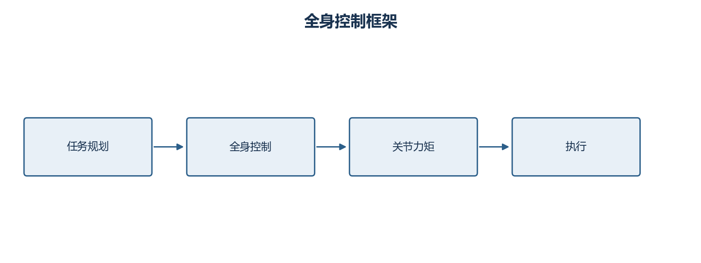

## 11.3　阻抗与导纳控制

**定义 11.1（阻抗控制）**　不只控制位置，而是控制机器人末端对环境力的**动态响应**，使其表现为质量—弹簧—阻尼系统：

$$
\mathbf{M}_d\ddot{\mathbf{e}}+\mathbf{D}_d\dot{\mathbf{e}}+\mathbf{K}_d\mathbf{e}=\mathbf{F}_{\mathrm{ext}}, \tag{11-6}
$$

其中 $\mathbf{e}=\mathbf{x}-\mathbf{x}_d$，$\mathbf{F}_{\mathrm{ext}}$ 是环境作用力。$\mathbf{K}_d$ 大（高刚度）→精确跟位但接触力大；$\mathbf{K}_d$ 小（柔顺）→接触安全但定位精度低。阻抗控制通过式 (11-3) 设定期望 $\ddot{\mathbf{x}}$ 实现。

**导纳控制**是其对偶：测量力 $\mathbf{F}_{\mathrm{ext}}$，生成期望位置/速度响应，再由底层位置控制器跟踪——适用于只有力传感器、位置控制精度高的平台。二者对比见下表。

**表 11-1　阻抗控制与导纳控制**

| 方面 | 阻抗控制 | 导纳控制 |
|------|------|------|
| 输入 | 位置/速度 | 力/力矩 |
| 输出 | 力（通过动力学） | 位置/速度指令 |
| 需要 | 力矩控制接口 | 力传感器 + 位置控制 |
| 典型场景 | 高动态接触 | 协作机器人拖动示教 |

## 11.4　平衡与步态控制

人形/四足机器人须在重力和接触下维持平衡。**零力矩点**（zero moment point，ZMP）是地面反力合力作用点；稳定条件要求 ZMP 落在支撑多边形内：

$$
\mathbf{p}_{\mathrm{zmp}}\in\mathrm{conv}\{\text{支撑接触点}\}. \tag{11-7}
$$

**捕获点**（capture point）$\boldsymbol{\xi}=\mathbf{x}_{\mathrm{com}}+\frac{\dot{\mathbf{x}}_{\mathrm{com}}}{\omega_0}$，$\omega_0=\sqrt{g/h}$ 为倒立摆自然频率——把落脚点放在捕获点可使质心速度自然衰减（LIPM 线性倒立摆模型）。步态控制协调摆动腿与支撑腿切换，足底接触力由分布到各足的 QP 求解（摩擦锥约束 $\|\mathbf{F}_t\|\le\mu F_n$）。模型预测控制（第 12 章）与强化学习（第 19—23 章）是当前主流。

**例 11.1（四足机器人 WBC）**　全身控制器把高层速度指令 $(v_x,\omega_z)$ 转化为四条腿的关节力矩：先由 MPC（第 12 章）算出各足期望接触力，再由分层 QP 求满足质心动力学与摩擦锥的关节力矩，同时维持躯干姿态——这就是「规划→WBC→关节力矩」的分层架构。

## 11.5　数值算例

**例 11.2（操作空间惯性矩阵计算）**　设平面 2R 机械臂，关节角 $q_1=q_2=0$，质量集中：各连杆质量 $m_1=m_2=1\,\mathrm{kg}$，长度 $l_1=l_2=1\,\mathrm{m}$。末端雅可比（第 3 章）

$$
\mathbf{J}=\begin{bmatrix}-l_1\sin q_1-l_2\sin(q_1+q_2) & -l_2\sin(q_1+q_2)\\ l_1\cos q_1+l_2\cos(q_1+q_2) & l_2\cos(q_1+q_2)\end{bmatrix}=\begin{bmatrix}0&0\\2&1\end{bmatrix}. \tag{11-8}
$$

设关节质量矩阵 $\mathbf{M}=\mathrm{diag}(2,1)$，则 $\mathbf{M}^{-1}=\mathrm{diag}(0.5,1)$，

$$
\mathbf{J}\mathbf{M}^{-1}\mathbf{J}^{\top}=\begin{bmatrix}0&0\\2&1\end{bmatrix}\begin{bmatrix}0.5&0\\0&1\end{bmatrix}\begin{bmatrix}0&2\\0&1\end{bmatrix}=\begin{bmatrix}0&0\\0&3\end{bmatrix}, \tag{11-9}
$$

故 $\mathbf{\Lambda}=\mathrm{diag}(\infty,1/3)$——沿 $x$ 方向雅可比奇异（机械臂伸直，无法产生 $x$ 向末端力），$y$ 方向有效质量 $1/3\,\mathrm{kg}$。这揭示了**奇异位形**对操作空间控制的根本限制（见 11.6 节）。

**例 11.3（阻抗控制响应）**　设 $m_d=1,\ d_d=4,\ k_d=5$，阶跃接触力 $F=1\,\mathrm{N}$，稳态误差 $e_\infty=F/k_d=0.2\,\mathrm{m}$，阻尼比 $\zeta=d_d/(2\sqrt{m_dk_d})=4/(2\sqrt5)\approx0.894$（近临界阻尼，无振荡）。这说明刚度 $k_d$ 决定接触变形量——装配任务需权衡定位精度与接触安全。

### 11.5A　逆运动学手算：2R 臂的闭式解

**例 11.4（2R 臂闭式 IK 手算）**　11.2A 的 DLS 是迭代式 IK，这里给 2 自由度平面臂的**闭式 IK 手算**作对偶验证。设 $l_1=l_2=1\,\mathrm{m}$，目标末端位形 $(x^*,y^*)=(0.5,\,1.3)\,\mathrm{m}$。先判可达性：到原点距离 $d=\sqrt{x^{*2}+y^{*2}}=\sqrt{0.25+1.69}=\sqrt{1.94}\approx1.393\,\mathrm{m}$，满足 $|l_1-l_2|\le d\le l_1+l_2$（即 $0\le1.393\le2$），可达。闭式解由余弦定理给出：

$$
\cos q_2^*=\frac{d^2-l_1^2-l_2^2}{2l_1l_2}=\frac{1.94-1-1}{2}=-0.03,\qquad
q_1^*=\mathrm{atan2}(y^*,x^*)-\mathrm{atan2}\big(l_2\sin q_2^*,\ l_1+l_2\cos q_2^*\big). \tag{11-10}
$$

取「elbow-up」支 $q_2^*=\arccos(-0.03)\approx1.601\,\mathrm{rad}$（$91.7°$）。代入：$\mathrm{atan2}(1.3,0.5)\approx1.207$；$l_1+l_2\cos q_2^*=1-0.03=0.97$，$l_2\sin q_2^*=\sin(1.601)\approx0.9995$，$\mathrm{atan2}(0.9995,0.97)\approx0.801$，故 $q_1^*\approx1.207-0.801=0.406\,\mathrm{rad}$（$23.2°$）。**验证（式 11-11）**：用正运动学回代，

$$
\hat x=\cos q_1^*+\cos(q_1^*+q_2^*)=0.918+\cos(2.007)=0.918-0.421=0.497\approx0.5,\quad
\hat y=\sin q_1^*+\sin(q_1^*+q_2^*)=0.395+0.907=1.302\approx1.3. \tag{11-11}
$$

残差 $\|\hat{\mathbf x}-\mathbf x^*\|=\sqrt{0.003^2+0.002^2}\approx0.0036\,\mathrm{m}$，在舍入误差内闭合——闭式解正确。（注意）$q_2$ 有 elbow-up/down 两支，选择须结合奇异避障（elbow-up 远离式 11-9 的伸直奇异位形）与后续任务可达性。当 $n\ge3$ 或遇奇异性时闭式解失效，须回到 11.2A 的 DLS 迭代——二者是 IK 的互补路线。

## 11.6　技术谱系与变体

**表 11-2　全身控制方法谱系**

| 方法 | 核心 | 优势 | 局限 |
|------|------|------|------|
| 关节 PID | 独立关节控制 | 简单、无需模型 | 忽略耦合、精度低 |
| 计算力矩控制 | 动力学反馈线性化（式 11-1） | 解耦、指数收敛 | 依赖精确模型 |
| 操作空间控制 | 雅可比 + $\mathbf{\Lambda}$（式 11-3） | 任务语义直接 | 奇异位形退化 |
| 分层 QP / HQP | 零空间投影（式 11-5）优先级 | 多任务协调、可加约束 | 求解负担、优先级设计 |
| 阻抗/导纳控制 | 力—位动态关系（式 11-6） | 柔顺、安全 | 性能依赖参数整定 |
| 学习控制 | RL 学控制律（第 19—23 章） | 少模型、适应性强 | 样本效率、安全 |

变体联系：WBC 常把式 (11-3) 的任务控制写成 QP 的等式约束，把摩擦锥、关节限位写成不等式约束（CBF 控制屏障函数保证安全，第 35 章）；阻抗参数可用 RL 自适应整定。

## 11.7　边界与讨论

**其一，模型误差与鲁棒性。** 式 (11-1、11-3) 依赖精确 $\mathbf{M},\mathbf{C},\mathbf{g}$；真实机器人摩擦、柔性、负载变化使模型失配，需鲁棒项（滑模）或自适应（第 4 章）。**其二，接触非光滑。** 足底接触切换使动力学不连续，QP 可行域突变——这是第 12 章接触丰富 MPC 的难题。**其三，实时性。** 人形机器人 WBC 需在 1 kHz 求解高维 QP，对求解器与代码效率要求极高。**其四，奇异与冗余。** 式 (11-9) 显示奇异位形使任务空间控制失效，需阻尼伪逆（SR-inverse）或重新配置。

**承上启下。** 本章衔接第 3 章（动力学与雅可比）、第 4 章（PID/稳定性）、第 10 章（轨迹是控制输入）、第 12 章（MPC 提供接触力与参考轨迹）、第 19—23 章（学习控制）、第 35 章（安全约束）与第 37 章（人形机器人）。

### 11.7A　LIPM 与捕获点的数值

11.4 节的捕获点 $\boldsymbol\xi=\mathbf x_{\mathrm{com}}+\dot{\mathbf x}_{\mathrm{com}}/\omega_0$、$\omega_0=\sqrt{g/h}$ 是步态核心，这里手算。设四足机器人质心高 $h=0.3\,\mathrm{m}$、当前质心位置 $\mathbf x_{\mathrm{com}}=(0.2,\,0.05)\,\mathrm{m}$、速度 $\dot{\mathbf x}_{\mathrm{com}}=(0.4,\,-0.2)\,\mathrm{m/s}$。自然频率 $\omega_0=\sqrt{9.8/0.3}=\sqrt{32.7}\approx5.716\,\mathrm{rad/s}$，时间常数 $1/\omega_0\approx0.175\,\mathrm{s}$。捕获点

$$
\boldsymbol\xi=\mathbf x_{\mathrm{com}}+\frac{\dot{\mathbf x}_{\mathrm{com}}}{\omega_0}=\begin{bmatrix}0.2\\0.05\end{bmatrix}+\frac{1}{5.716}\begin{bmatrix}0.4\\-0.2\end{bmatrix}=\begin{bmatrix}0.2+0.070\\0.05-0.035\end{bmatrix}=\begin{bmatrix}0.270\\0.015\end{bmatrix}\,\mathrm{m}. \tag{11-12}
$$

**例 11.6（落脚点选择）**　若摆动腿当前在 $(0.1,\,0.0)$、双足支撑多边形为 $x\in[0.0,0.2],\,y\in[-0.1,0.1]$，则把落脚点放在捕获点 $(0.270,\,0.015)$ 恰好使质心速度落地后自然衰减为零（LIPM 零输入收敛性）。但 $x=0.270$ 超出支撑右边界 $0.2$——「一步到位」会让 ZMP 暂出支撑域、机器人前倾。工程上改两步：先迈到 $(0.2,\,0.015)$（域边缘），再迈到 $(0.270,\,0.015)$；每步落地后速度因减速而变小，重算的捕获点逐步收敛。这与第 12 章 MPC 的「滚动时域 + 接触调度」一致：捕获点是开环参考，MPC 闭环里用 ZMP 约束（式 11-7）逐步修正。

**例 11.7（ZMP 数值检验）**　取 LIPM 的 ZMP 解析式（质心 $(x,\dot x,\ddot x)$、高度 $h$）：

$$
\mathbf p_{\mathrm{zmp}}=\mathbf x_{\mathrm{com}}-\frac{h}{g}\,\ddot{\mathbf x}_{\mathrm{com}}. \tag{11-13}
$$

点足（单点支撑）时 ZMP 与支撑点重合，故 $\mathbf p_{\mathrm{zmp}}=\mathbf p_{\mathrm{st}}$；代入式 (11-13) 即反推出 LIPM 动力学 $\ddot{\mathbf x}_{\mathrm{com}}=\tfrac{g}{h}(\mathbf x_{\mathrm{com}}-\mathbf p_{\mathrm{st}})$——质心以「倒立摆」加速度朝足点倾倒。设单腿支撑期 $x_{\mathrm{com}}=0.20\,\mathrm{m}$、左脚 $p_{\mathrm{st}}=0.15\,\mathrm{m}$、$h=0.3\,\mathrm{m}$：$\ddot x=(9.8/0.3)\times0.05\approx1.63\,\mathrm{m/s^2}$；回代式 (11-13)：$p_{\mathrm{zmp}}=0.20-(0.3/9.8)\times1.63=0.15\,\mathrm{m}$，与支撑点自洽。若质心前移到 $0.28\,\mathrm{m}$（同足点），倾倒加速度升到 $\approx4.25\,\mathrm{m/s^2}$，留给迈步的反应时间更短——须依 11.7A 的捕获点 $\boldsymbol\xi=x+\dot x/\omega_0$ 把落脚点前移、在倾倒出支撑域前落地扩展支撑面；若捕获点超可达区域则前倾失衡。这正是 MPC 预测「质心—足点间距超稳定裕度」并提前触发迈步的判据：式 (11-13) 给单步倾倒动力学，式 (11-12) 给多步落脚参考，合起来是步态稳定性的定量工具，并接入第 12 章的预测控制。

## 本章小结

本章论述全身运动控制，把第 10 章的几何轨迹转化为关节力矩。

我们首先建立关节空间计算力矩控制（式 11-1）与任务空间控制（式 11-2、11-3），推导操作空间惯性矩阵（式 11-4）与零空间分解（式 11-5），并在 11.2A 节补充分层 QP 投影递推与 DLS/SR 伪逆的奇异处理。接着给出阻抗/导纳控制（式 11-6，表 11-1）与平衡步态（ZMP 式 11-7、捕获点）。我们通过操作空间惯性计算（式 11-8、11-9，例 11.2）与阻抗响应（例 11.3）展示数值性质；11.5A 节补充了 2R 臂的闭式 IK 手算（式 11-10、11-11，例 11.4）；11.7A 节给出 LIPM 捕获点与 ZMP 数值（式 11-12、11-13，例 11.6、11.7），并把步态稳定性接到 MPC 的预测判据。最后梳理从 PID 到学习控制的谱系（表 11-2）。

我们还明确边界：模型误差、接触非光滑、实时性与奇异位形。这些辨析衔接第 3—4、10、12、19—23、35、37 章。

下一章深入机器人 MPC——在有限时域内滚动优化，天然处理约束与接触。

**进一步阅读**　本章建议延伸阅读的文献：[1]、[2]、[3]。

## 参考文献

[1] Siciliano B, Sciavicco L, Villani L, Oriolo G. *Robotics: Modelling, Planning and Control*. Springer, 2009.

[2] Khatib O. A unified approach for motion and force control of robot manipulators. *IEEE Journal of Robotics and Automation*, 1987, 3(1): 43–53.

[3] Hogan N. Impedance control: An approach to manipulation: Parts I–III. *ASME Journal of Dynamic Systems, Measurement, and Control*, 1985, 107(1): 1–24.

[4] Khatib O, Sentis L, Park J, Warren J. Whole-body control framework for humanoids operating in human environments. *ICRA*, 2006.

[5] Escande A, Fernbach P, Miossec S, et al. HQP: A hierarchical quadratic programming solver for humanoid robots. *Humanoids*, 2014.

[6] EMPL A, Wensing P M. Operational space dynamics: Efficient inverse dynamics and feedback control for humanoids. *IJRR*, 2022, 41(7): 1028–1052.

[7] Caron S, Pham Q C, Nakamura Y. ZMP support areas for legged locomotion under friction constraints. *ICRA*, 2015.

[8] Wensing P M, Slotine J J E, Del Prete A. Superexponential stability of task-space controllers. *IEEE Transactions on Robotics*, 2020, 36(2): 447–462.

[9] Escande A, Miossec S, Hwang C, et al. An efficient and easy-to-use approach to multi-contact and multi-task force-momentum-based whole-body control of bipedal humanoid robots. *Robotics and Autonomous Systems*, 2013, 61(12): 1296–1310.

[10] Ballester M, Escande A, Kheddar A, et al. On the use of quadratic programming for whole-body control of humanoid robots. *IEEE/RSJ IROS*, 2012: 5629–5634.

[11] Kajita S, Kanehiro F, Kaneko K, et al. Biped walking pattern generation by using preview control of zero-moment point. *IEEE/RSJ IROS*, 2003: 1620–1626.

[12] Pratt J R, Williamson M M. Capture points: A step toward humanoid push recovery. *IEEE/RSJ Humanoids*, 2006: 37–43.

---

# 第 12 章　模型预测控制与轨迹优化

第 10 章的规划给出路径，第 11 章的控制器跟踪轨迹。本章深入**模型预测控制**（model predictive control，MPC）在机器人中的实现——它在有限时域内基于动力学模型（第 3 章）滚动优化控制序列（见《世界模型导论》第 8、25 章），能显式处理约束与非线性，是机器人高级控制的主流方法。本章先给出 MPC 的标准公式与滚动机制（12.1 节），推导直接/间接法与 DDP/iLQR（12.2—12.3 节），讨论接触丰富任务的特殊困难（12.4 节），给出数值算例（12.5 节），梳理谱系（12.6 节），最后辨析边界并承上启下（12.7 节）。

## 12.1　引入动机与机器人 MPC

**动机。** 第 10 章的路径规划忽略动力学，第 11 章的反馈控制不预测未来约束。MPC 把两者结合：在每个控制周期求解一个有限时域最优控制问题，只执行第一步，下一周期用新观测重新求解（**滚动时域**，receding horizon）。这带来三大好处：① 显式处理状态/控制约束（关节限位、力矩上限、摩擦锥、避碰）；② 对扰动与模型误差有反馈校正（每步重规划）；③ 天然适用于非线性、多变量系统——这正是机器人所需的。

**直觉解释。** MPC 就像开车时不断「重新规划路线」：你不会在出发时定死一条路线开到底，而是每隔几秒看一眼当前位置与周围车流，重新规划接下来一小段的最优走法，然后只执行最近的一步——下一秒再看再规划。这样即使有人加塞（扰动）或走错路（模型误差），也能及时纠正。有限时域 $H$ 对应「只看未来几步」，滚动重规划对应「边走边看」。

**定义 12.1（机器人 MPC）**　在时刻 $t$ 求解有限时域约束最优控制：

$$
\begin{aligned}
\min_{\{u_k\}_{k=0}^{H-1}}\quad & J=\sum_{k=0}^{H-1}\ell(x_k,u_k)+\ell_f(x_H)\\
\mathrm{s.t.}\quad & x_{k+1}=f(x_k,u_k),\ x_0=x_t,\\
& x_k\in\mathcal{X},\ u_k\in\mathcal{U}.
\end{aligned} \tag{12-1}
$$

其中 $x$ 为状态（关节角与速度，或质心状态），$u$ 为控制（力矩、接触力或速度指令），$\ell$ 为阶段代价（跟踪误差 + 控制能量），$\ell_f$ 为终端代价，$\mathcal{X},\mathcal{U}$ 为约束集。求解后取 $u_0^*$ 施加，下一时刻以新的 $x_{t+1}$ 重解——式 (12-1) 每周期求解一次。

**稳定性机制。** 滚动时域提供隐式反馈：若实际状态偏离预测，下一周期优化从新状态出发，相当于闭环。终端代价 $\ell_f$（或终端约束集）可提供稳定性保证（类似的 Lyapunov 论证见第 4 章）——这是 MPC 区别于开环轨迹优化的关键。

### 12.1A　终端约束与终端集：稳定性的显式保证

仅靠终端代价 $\ell_f$ 的稳定性论证较松，**终端集 + 终端控制器**给出更强的递推可行性保证。设存在一个终端控制律 $u_f$ 与终端集 $\mathcal X_f\subseteq\mathcal X$，使得：① $\mathcal X_f$ 在 $u_f$ 下**不变**（$x\in\mathcal X_f\Rightarrow f(x,u_f(x))\in\mathcal X_f$）；② $\ell_f$ 是**离散 Lyapunov 函数**（$\ell_f(f(x,u_f(x)))\le\ell_f(x)-\ell(x,u_f(x))$）；③ 终端约束 $x_H\in\mathcal X_f$ 加入式 (12-1)。则对任意可行初态，MPC 解的存在性可递推证明（当前解的后 $H-1$ 步 + $u_f$ 一步构成下一时刻的可行解），闭环稳定性由 $\ell_f$ 的 Lyapunov 性保证。对线性系统，$\mathcal X_f$ 常取 $u_f$ 的**最大不变集**（MI Set，可用半代数/线性不等式求解）；对非线性系统，可用 Lyapunov 子水平集 $V(x)\le c$ 近似。工程上，终端集的大小直接决定「预测时域 $H$ 需要多长才能到达稳定区」：$H$ 短则须靠终端集「兜底」，$H$ 长则终端集可缩小——这是第 12.7 节「计算预算 vs 预测视野」折中的具体抓手，也与第 4 章 Lyapunov 稳定性、第 19 章 RL 的安全约束（控制屏障）在理论上同源。

> 【图 12-1　MPC 轨迹优化】（原图见 figures/图12-1.png）：横轴为时间，展示 $t$ 与 $t+1$ 时刻两次求解的预测轨迹（虚线）与实际执行（实线），并标注约束集与滚动窗口。
>
> 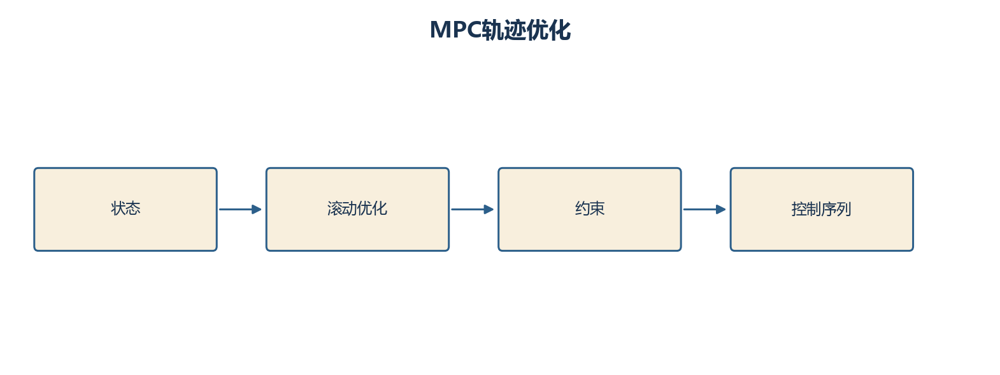

## 12.2　轨迹优化：直接法与间接法

求解式 (12-1) 有两大路径。

**间接法**（indirect method）：先用庞特里亚金最大值原理（Pontryagin's maximum principle）导出最优性必要条件——状态方程、协态方程与控制最优性条件，得到两点边值问题（BVP），再数值求解。优点是精度高；缺点是对初值敏感、难处理不等式约束。最优控制的条件为

$$
\lambda_k=\nabla_x\ell+\nabla_x f^\top\lambda_{k+1},\quad \nabla_u\ell+\nabla_u f^\top\lambda_{k+1}=0, \tag{12-2}
$$

其中 $\lambda_k$ 为协态（costate）。

**直接法**（direct method）：把轨迹离散为有限维决策变量（每个时刻的状态与控制），把最优控制问题转化为非线性规划（NLP）：

$$
\min_{\mathbf{z}}\ F(\mathbf{z})\quad \mathrm{s.t.}\quad c(\mathbf{z})=0,\ g(\mathbf{z})\le0,\quad \mathbf{z}=(x_0,\dots,x_H,u_0,\dots,u_{H-1}). \tag{12-3}
$$

直接法又分**直接配点法**（collocation，状态与控制都作变量，动力学为约束）与**直接单发法**（shooting，只把控制作变量，状态由积分得到）。优点是鲁棒、易加约束；缺点是变量多、计算量大（但机器人短时域 $H$ 小，可接受）。TrajectoryOptimization（TrajOpt，第 10 章）与 CasADi/IPOPT 是典型实现。

**表 12-1　直接法与间接法对比**

| 方面 | 间接法 | 直接法 |
|------|------|------|
| 优化对象 | 协态 + 控制（连续 BVP） | 离散变量（NLP） |
| 精度 | 高 | 依赖离散粒度 |
| 约束处理 | 困难 | 自然（不等式入 NLP） |
| 初值敏感性 | 高 | 低 |
| 机器人应用 | 较少 | 主流 |

## 12.3　DDP 与 iLQR

**微分动态规划**（differential dynamic programming，DDP）是利用二阶近似的高效轨迹优化算法，适合机器人非线性系统。围绕当前轨迹 $\{\bar{x}_k,\bar{u}_k\}$ 对代价与动力学做二阶/一阶展开：

$$
Q_k=\ell(x_k,u_k)+V_{k+1}(f(x_k,u_k)), \tag{12-4}
$$

其中值函数近似 $V_k(x)\approx \frac12\delta x^\top\mathbf{V}_{k}\delta x+\mathbf{v}_k^\top\delta x$。对 $Q_k$ 在 $(\bar{x}_k,\bar{u}_k)$ 处二次化：

$$
Q_k\approx \frac12\begin{bmatrix}\delta x\\ \delta u\end{bmatrix}^\top
\underbrace{\begin{bmatrix}\mathbf{Q}_{xx}&\mathbf{Q}_{xu}\\ \mathbf{Q}_{ux}&\mathbf{Q}_{uu}\end{bmatrix}}_{\text{二阶导}}
\begin{bmatrix}\delta x\\ \delta u\end{bmatrix}
+\begin{bmatrix}\mathbf{Q}_x\\ \mathbf{Q}_u\end{bmatrix}^\top
\begin{bmatrix}\delta x\\ \delta u\end{bmatrix}. \tag{12-5}
$$

最小化式 (12-5) 得局部控制修正（含反馈项）：

$$
\delta u_k^*=\mathbf{k}_k+\mathbf{K}_k\delta x_k,\quad \mathbf{k}_k=-\mathbf{Q}_{uu}^{-1}\mathbf{Q}_u,\quad \mathbf{K}_k=-\mathbf{Q}_{uu}^{-1}\mathbf{Q}_{ux}. \tag{12-6}
$$

**iLQR**（iterative LQR）是 DDP 的简化：对动力学只做一阶近似、忽略值函数的二阶项（$\mathbf{V}_k$ 的二阶导贡献），用 LQR 反向递推求增益，再正向线搜索更新轨迹。iLQR 计算更轻、实现更简单，是机器人中最常用的二阶轨迹优化器。**控制受限 DDP**（control-limited DDP）通过投影或约束处理把 $u$ 限制在 Box 内（如力矩限幅）。DDP 与第 11 章 LQR 的关系：iLQR 是 LQR 在非线性系统上的迭代推广，式 (12-6) 的 $\mathbf{K}_k$ 即局部 LQR 反馈增益。

## 12.4　接触丰富任务

**挑战。** 行走、抓取、跳跃等任务涉及**接触切换**：系统动力学在接触建立/断开瞬间不连续（$f$ 是混合的），导致式 (12-1) 的梯度不连续、优化困难。主要处理方法：① **显式接触调度**——预先指定各时刻哪些接触激活，把问题转为光滑子问题序列；② **互补约束**——用线性互补问题（LCP）建模「接触力 ≥ 0、穿透距离 ≥ 0、两者互补」，嵌入 NLP（数学规划互补问题，MCP）；③ **混合动力学规划**——把模式序列作为离散决策，结合 MIP（混合整数规划）；④ **软接触模型**——用光滑的弹簧—阻尼近似接触，避免不连续（牺牲真实性）。

**例 12.1（四足机器人 MPC）**　用简化质心动力学（single rigid body model）：状态 $x=(\mathbf{p}_{\mathrm{com}},\boldsymbol{\Theta},\mathbf{v},\boldsymbol{\omega})$，控制 $u$ 为四条腿的接触力 $\{\mathbf{f}_i\}_{i=1}^4$。MPC 在 $H=10$、步长为 $0.03\,\mathrm{s}$ 的短时域内优化接触力与躯干轨迹，约束为摩擦锥 $\|\mathbf{f}_{i,t}\|\le\mu f_{i,n}$ 与单足力上下限。每 $30\,\mathrm{ms}$ 重解一次（约 $30\,\mathrm{Hz}$），底层 WBC（第 11 章）把接触力转为关节力矩——实时适应不平地面与推挤扰动。

### 12.4A　接触建模的四类形式化

12.4 节列出四类处理方法，这里把它们的**数学结构**对比清楚，说明为何各有适用域。① **显式接触调度**把「哪些接触在哪些时段激活」作为离散决策 $\{m_k\in\mathcal M\}$（$m_k$ 为接触模式），在每个固定模式下系统是光滑的，式 (12-1) 退化为普通 NLP；模式切换用混合自动机描述。优点是每个子问题光滑、可用 DDP/iLQR；缺点是模式序列须预先枚举或在线搜索，组合爆炸。② **互补约束**用线性互补（LCP）刻画「接触力非负、穿透非负、二者互补」：$\mathbf f\ge0,\ d\ge0,\ \mathbf f\circ d=0$（Hadamard 积），把它嵌入 NLP 得**数学规划互补问题（MCP）**；MCP 的非凸性来自互补项，常用 NLP 求解器的「斜率法」或「logarithmic barrier」近似。③ **混合整数规划（MIP）**把接触开关写成二元变量 $z_i\in\{0,1\}$，用大 M 法线性化接触/非接触两种模式，交给 MIP 求解器——表达力最强，但组合复杂度最高、实时性最差。④ **软接触**用光滑弹簧—阻尼 $f=k(d_{\mathrm{rest}}-d)+c\,\dot d$ 替代硬接触，使 $f$ 处处可微，DDP 的二阶导存在；代价是「穿透深度」非物理、力在 $d=d_{\mathrm{rest}}$ 处不突变，对「碰撞—弹跳」类任务失真。实践中：行走/抓取等「接触时序已知」的任务用①或②；「接触时序未知、需在线决定」的任务用③；需要二阶导数、实时性高而精度可稍降的场合用④。这四类与第 11 章的接触力 QP（式 11-5 的零空间投影）正交：QP 在「给定接触模式」下分配力，MPC 在「预测时域」里决定「何时切换模式」——二者构成第 11.4 节 WBC 的「上层 MPC + 底层 WBC」分层。

## 12.5　数值算例

**例 12.2（一维 LQR 步的反向递推）**　设线性系统 $x_{k+1}=x_k+u_k$，阶段代价 $\ell=x_k^2+u_k^2$，时域 $H=2$，终端 $V_2(x)=x^2$（即 $\mathbf{V}_2=2$ 以 $\frac12\mathbf{V}x^2$ 记法则 $\mathbf{V}_2=2$）。按式 (12-4、12-5) 反向递推标量 Riccati：

$$
\mathbf{V}_1=\mathbf{Q}+\mathbf{A}^\top\mathbf{V}_2\mathbf{A}-\mathbf{A}^\top\mathbf{V}_2\mathbf{B}(\mathbf{R}+\mathbf{B}^\top\mathbf{V}_2\mathbf{B})^{-1}\mathbf{B}^\top\mathbf{V}_2\mathbf{A}=2+2-\frac{2\cdot2}{1+2}=4-\frac43=\frac83, \tag{12-7}
$$

增益 $K_1=-(\mathbf{R}+\mathbf{B}^\top\mathbf{V}_2\mathbf{B})^{-1}\mathbf{B}^\top\mathbf{V}_2\mathbf{A}=-2/3$。对初态 $x_0=1$，首步控制 $u_0=K_0x_0=-0.6$（$K_0$ 由 $\mathbf{V}_0$ 类似算得）——这展示 iLQR 反向递推的算术流程。

**例 12.3（摩擦锥约束的数值检验）**　四足机器人某足法向力 $f_n=50\,\mathrm{N}$，摩擦系数 $\mu=0.6$，则切向力上限 $\mu f_n=30\,\mathrm{N}$。若 MPC 解出 $f_t=(18,12)\,\mathrm{N}$，则 $\|f_t\|=\sqrt{18^2+12^2}=\sqrt{468}\approx21.6<30$——约束满足；若 $f_t=(25,20)$，$\|f_t\|\approx32.0>30$——违反摩擦锥，足会打滑，求解器须投影回锥内。这接触约束是四足 MPC 的核心。

### 12.5A　MPC 的 QP 形式与 iLQR 线搜索

例 12.2 展示了 DDP 的 Riccati 递推，这里把式 (12-1) 在「线性化动力学 + 二次代价」下写成**标准 QP**，并补上 iLQR 的线搜索。对一维线性系统 $x_{k+1}=a x_k+b u_k$、代价 $\ell=(x_k-x_{\mathrm{ref}})^2+(u_k-u_{\mathrm{ref}})^2$，在「控制无界、状态无约束」时式 (12-1) 等价于 QP

$$
\min_{\mathbf u,\mathbf x}\ \tfrac12\begin{bmatrix}\mathbf x\\\mathbf u\end{bmatrix}^{\!\top}\!\begin{bmatrix}\mathbf Q&\mathbf 0\\\mathbf 0&\mathbf R\end{bmatrix}\!\begin{bmatrix}\mathbf x\\\mathbf u\end{bmatrix}+\mathbf l^{\!\top}\begin{bmatrix}\mathbf x\\\mathbf u\end{bmatrix}\quad \mathrm{s.t.}\ \mathbf x_{k+1}=a x_k+b u_k,\ x_0=x_t, \tag{12-8}
$$

其中 $\mathbf x=(x_0,\dots,x_H)^\top$、$\mathbf u=(u_0,\dots,u_{H-1})^\top$ 堆叠成决策变量，$\mathbf Q,\mathbf R$ 为对角权重阵，$\mathbf l$ 为参考项线性化。这是**等式约束 QP**，可用内点法或消元法求解；加入 Box 约束 $u_k^{\min}\le u_k\le u_k^{\max}$ 与状态约束 $x_k\in\mathcal X$ 后变为不等式 QP，求解器（如 OSQP、qpOASES、acados 的 HPIPM）在毫秒级出解。iLQR 的**线搜索**保证每次全局步不增代价：沿方向 $\delta u=\mathbf k+\mathbf K\delta x$ 取步长 $\alpha\in(0,1]$，要求新代价满足 Armijo 条件 $J(\bar u+\alpha\,\delta u)\le J(\bar u)+\alpha\,c_1\,\nabla J^{\!\top}\delta u$（$c_1<1$），不满足则 $\alpha\leftarrow\alpha/2$ 重试。这使 iLQR 在初值远离最优时仍单调下降，是「二阶局部近似 + 一阶全局安全」的结合。

**例 12.4（线性 MPC 一步的 QP 手算）**　取 $a=1,b=1$（$x_{k+1}=x_k+u_k$）、$H=1$、$x_t=1$、参考 $x_{\mathrm{ref}}=0$，权重 $Q=2,R=1$，无约束。式 (12-8) 展开为 $\min_{u_0}\ (x_1)^2+(u_0)^2$，$x_1=1+u_0$，即 $\min_{u_0}(1+u_0)^2+u_0^2=2u_0^2+2u_0+1$。令导数 $4u_0+2=0$ 得 $u_0^*=-0.5$，则 $x_1^*=0.5$，代价 $J^*=(0.5)^2+(-0.5)^2=0.5$。执行 $u_0^*=-0.5$ 后状态到 $x_1=0.5$；下一时刻以 $x_t=0.5$ 重解，$u_0^*=-0.25$、$x_1=0.25$——状态指数衰减到参考 $0$。这正是 MPC「每步重解 + 只执行第一步」的闭环：开环最优 $u$ 序列 $(-0.5,-0.25,-0.125,\dots)$ 逐次截断为单步，反馈校正由「下一时刻从新状态重解」隐式提供。对比开环（一次性执行整条序列不重解）：若 $x_0$ 有 $+0.1$ 的初始误差，开环会把误差带到末端，而 MPC 每步重解都把误差拉回——这就是式 (12-1) 滚动机制的定量体现。

## 12.6　技术谱系与变体

**表 12-2　机器人轨迹优化/MPC 谱系**

| 方法 | 类型 | 核心 | 优势 | 局限 |
|------|------|------|------|------|
| LQR/iLQR/DDP | 间接/二阶 | 值函数二次近似（式 12-4—12-6） | 高效、带反馈 | 局部最优、需初值 |
| TrajOpt/CHOMP | 直接优化 | NLP/梯度下降（第 10 章） | 约束灵活 | 计算量较大 |
| 显式 MPC | 直接/多参数 | 预解显式控制律 | 极快 | 仅小规模/线性 |
| 接触 MPC | 混合/互补 | 接触调度 + 锥约束 | 处理行走抓取 | 非光滑、难实时 |
| 学习增强 MPC | 数据驱动 | 学模型/代价/初值（第 19—23、32 章） | 少建模、快 | 分布外风险 |

变体联系：iLQR 用一阶动力学 + LQR 递推（式 12-6）；DDP 保留二阶动力学项；控制受限版本加 Box 约束；与模型学习（第 32 章）结合学 $f$ 可缓解模型误差。

## 12.7　边界与讨论

**其一，模型精度与计算预算。** 式 (12-1) 的 $f$ 来自第 3 章建模，摩擦、柔性、接触误差导致预测偏差；增大 $H$ 提升预测但增加求解负担——实时性（数百 Hz）迫使 $H$ 很小（10—30 步）。**其二，接触仍是难题。** 非光滑动力学使 DDP 的二阶导数不存在，需光滑近似或混合整数——这是当前研究前沿。**其三，局部最优。** iLQR/DDP 从初值出发做局部优化，差初值导致失败；实践中用上一周期解作热启动。**其四，与学习的融合。** 学动力学模型（第 32 章）、学代价、学初始解可缓解建模负担，但引入分布外风险（第 15 章分布漂移的类比）。

**承上启下。** 本章衔接第 3 章（动力学 $f$）、第 4 章（LQR）、第 10—11 章（路径与 WBC）、第 19—23 章（RL 控制）、第 29 与 32 章（仿真与模型学习）以及《世界模型导论》第 25 章（模型中的规划）。

### 12.7A　计算预算与实时性

式 (12-1) 的求解代价随 $H$ 与决策维数 $d$ 增长：直接法变量数 $\sim d_x H+d_u H$，NLP 每步代价近似 $O(N^3)$（$N$ 为变量数）或更少（稀疏 QP 内点法）。机器人实时性（1 kHz 控制环）迫使 $H$ 取 10–30 步、步长 $10$–$50\,\mathrm{ms}$。工程上有五类加速手段：① **热启动**——用上一周期解作初值，iLQR/DDP 的局部近似使其 1–3 次迭代即收敛，把「从零优化」降为「局部修正」；② **稀疏结构**——动力学约束把 Hessian/约束 Jacobian 变成块带状，Cholesky 分解复杂度降为非零元量级（与第 7 章式 (7-7) 的稀疏图优化同理）；③ **代码生成**——CasADi/IPOPT 或 acados 对固定 $H$ 的 QP/NLP 做符号化编译，把运行时优化降为一次稀疏 Cholesky，单步 $<1\,\mathrm{ms}$，是嵌入式 MPC 的主流；④ **降维**——对线性系统用**显式 MPC** 把 $x\mapsto u_0$ 的控制律预解成分片仿射函数，运行时查表 $O(1)$，代价是片数随维数指数增长、仅适用小规模线性问题；⑤ **学习增强的初值/模型**——用神经网络学 $f$（动力学残差）或学初值，减少迭代次数，但须处理分布外风险。这五类与第 11 章 WBC 的 1 kHz QP 求解、第 7 章 SLAM 后端的多前沿优化共享「稀疏 + 增量 + 代码生成」的数值优化底座——**实时最优控制、实时图优化、实时滤波在数值方法上是同一类问题**。

## 本章小结

本章论述模型预测控制与轨迹优化，给出第 10—11 章的规划—控制之上的滚动优化框架。

我们首先给出 MPC 的标准公式与滚动机制（定义 12.1，式 12-1），并在 12.1A 节补充终端约束与终端集对稳定性的显式保证。接着对比直接法与间接法（式 12-2、12-3，表 12-1），推导 DDP/iLQR 的二次近似与反馈增益（式 12-4—12-6）。随后讨论接触丰富任务的困难，12.4A 节把显式调度、互补约束、MIP 与软接触四类形式化的数学结构对比清楚；并用 Riccati 递推（式 12-7，例 12.2）、摩擦锥检验（例 12.3）与 QP 手算（式 12-8，例 12.4）展示数值流程，12.5A 节补充 iLQR 的线搜索机制，12.7A 节讨论热启动、稀疏结构与代码生成等实时化手段，最后梳理谱系（表 12-2）。

我们还明确边界：模型精度与计算预算、接触非光滑、局部最优与学习融合。这些辨析衔接第 3—4、10—11、19—23、29、32 章与《世界模型导论》第 25 章。

下一章讨论机器人执行层的高峰——灵巧操作，把本章的轨迹优化与第 11 章的力控用于抓取与装配。

**进一步阅读**　本章建议延伸阅读的文献：[1]、[2]、[3]。

## 参考文献

[1] Rawlings J B, Mayne D Q. *Model Predictive Control: Theory and Design*. Nob Hill, 2009.

[2] Tassa Y, Doron Y, Manevich A, et al. Control-limited differential dynamic programming. *ICRA*, 2014.

[3] Li T, Wensing P M, Todorov E. Generalized iterative LQR for constrained nonlinear optimal control problems. *ICRA*, 2023.

[4] Mayne D Q, Seron M M, Rakovic S V. Robust model predictive control of constrained linear systems with bounded disturbances. *Automatica*, 2005, 41(2): 219–224.

[5] Verschueren R, Frison G, Kvasnica M, et al. acados: a modular open-source framework for fast embedded optimal control. *Mathematical Programming Computation*, 2022, 14: 147–183.

[6] Di Carlo J, Wensing P M, Katz B, et al. Dynamic whole-body locomotion through contact: A survey. *IJRR*, 2021, 40(2–3): 361–396.

[7] Chen Y, Todorov E. Complementary dynamics via generalized constraints. *ACM SIGGRAPH*, 2021, 40(4): 1–14.

[8] Hertle N, Dontchev A L, Veliotis S. Convergence of iLQR for nonlinear optimal control. *Automatica*, 2024, 162: 111501.

[9] Mayne D Q, Rawlings J B, Rao C V, Scokaert P O M. Constrained model predictive control: Stability and optimality. *Automatica*, 2000, 36(6): 789–814.

[10] Bemporad A, Morari M. Robust feasibility for constrained model predictive control. *IEEE Transactions on Automatic Control*, 1999, 44(5): 836–841.

[11] Rawlings J B, Mayne D Q, Diehl M. *Model Predictive Control: Theory, Computation, and Design*. 2nd ed. Hoboken: Wiley, 2017.

[12] Tassa Y, Erez T, Todorov E. Synthesis and stabilization of complex behaviors through online trajectory optimization. *IEEE ICRA*, 2012: 4906–4913.

---

# 第 13 章　灵巧操作

第 10—12 章解决「移动」与「控制」。本章讨论机器人最具挑战的能力之一：**灵巧操作**（dexterous manipulation）——抓取、装配、工具使用等需要精细力控与接触推理的任务。灵巧操作是具身智能执行层（Level 4）的高峰，也是从工业自动化走向通用机器人的关键。本章先从抓取综合与力闭合的数学条件讲起（13.1—13.2 节），讨论多指手（13.3 节）、装配与工具使用（13.4 节），给出桌面抓取的数值算例（13.5 节），梳理技术谱系（13.6 节），最后辨析边界并承上启下（13.7 节）。

## 13.1　引入动机与抓取综合

**动机。** 移动任务中机器人与环境通常只有足底接触，接触模式有限；操作任务中物体与夹爪/手指的接触是任务的核心——抓取是否稳定、力是否合适、接触是否滑移，直接决定成败。人类手有 20+ 自由度，能抓鸡蛋也能握锤子；机器人要逼近这种能力，必须解决接触的建模、规划与控制。

**定义 13.1（抓取综合）**　给定物体几何 $\mathcal{O}$ 与手爪模型，求抓取位姿 $\mathbf{T}\in SE(3)$ 与手指配置 $\mathbf{q}_f$，使抓取稳定：

$$
(\mathbf{T}^*,\mathbf{q}_f^*)=\arg\max\ Q(\mathbf{T},\mathbf{q}_f), \tag{13-1}
$$

其中 $Q$ 为抓取质量度量（力闭合、鲁棒性、距离度量）。经典方法基于**力闭合/形闭合**（form closure / force closure）分析稳定性；数据驱动方法（如 DexNet）从大量抓取尝试中学成功预测器 $Q_\theta$（第 15—23 章）。

**直觉解释。** 形闭合是「几何上被完全卡住，无论施加什么力都动不了」（如被四个点从四周夹住的方块）；力闭合是「靠摩擦和法向力能抵抗任意外部扰动」——后者允许 fewer contacts，但依赖摩擦与力控。

两者在机器人学中的取舍是经典的：形闭合对摩擦与力控不敏感，但因需要较多接触点（三维中至少 7 个）而 Requires 复杂的手爪设计；力闭合只需 2—4 个接触点即可实现，代价是必须精确控制接触力并估计摩擦系数。实用系统大多追求力闭合，并用触觉（第 6 章）在线监测滑移以补偿摩擦估计误差。

## 13.2　力闭合的数学条件

设手与物体有 $k$ 个接触点，第 $i$ 个接触的**抓取矩阵**（grasp wrench matrix）为

$$
\mathbf{G}_i=\begin{bmatrix}\mathbf{n}_i\\ \mathbf{p}_i\times\mathbf{n}_i\end{bmatrix}\in\mathbb{R}^{6}, \tag{13-2}
$$

其中 $\mathbf{n}_i$ 为接触法向（单位向量），$\mathbf{p}_i$ 为接触点相对物体质心的位置，$\mathbf{p}_i\times\mathbf{n}_i$ 为力矩项（三维叉积）。整个抓取的旋量矩阵为 $\mathbf{G}=[\mathbf{G}_1,\dots,\mathbf{G}_k]\in\mathbb{R}^{6\times k}$。

**形闭合条件。** 若 $\mathrm{rank}(\mathbf{G})=6$（6 维旋量空间满秩），则接触能抵抗任意外部旋量——这是形闭合（无摩擦假设下的稳定）。

**力闭合条件。** 有摩擦时，每个接触力位于摩擦锥内：$\mathbf{f}_i=\mathbf{n}_i f_{i,n}+\mathbf{t}_{i,1}f_{i,1}+\mathbf{t}_{i,2}f_{i,2}$，满足 $f_{i,n}\ge0,\ \sqrt{f_{i,1}^2+f_{i,2}^2}\le\mu_i f_{i,n}$（$\mu_i$ 为摩擦系数，第 12 章摩擦锥）。把所有接触力映射为物体上的合力旋量：

$$
\mathbf{w}=\sum_{i=1}^{k}\mathbf{G}_i\begin{bmatrix}f_{i,n}\\f_{i,1}\\f_{i,2}\end{bmatrix}=\mathbf{G}'\boldsymbol{\lambda},\quad \boldsymbol{\lambda}\in\mathcal{K}, \tag{13-3}
$$

其中 $\mathcal{K}$ 为摩擦锥的乘积锥。**力闭合**成立当且仅当

$$
\mathrm{int}\big(\mathrm{conv}\{\mathbf{G}'_i\boldsymbol{e}_j\}\big)\supseteq \mathcal{B}_6, \tag{13-4}
$$

即接触旋量生成的凸包包含原点为内点（能生成任意方向的小旋量抵抗扰动）。等价的实用判据是求解线性规划：对任意单位外部旋量 $\mathbf{w}_d$，存在 $\boldsymbol{\lambda}\in\mathcal{K}$ 使 $\mathbf{G}'\boldsymbol{\lambda}=-\mathbf{w}_d$ 且满足力限幅。数值上通过检查 $\mathbf{G}'$ 的奇异值（最小奇异值越大越鲁棒）或 LP 可行性判定。

## 13.3　多指灵巧手

多指手（如 Shadow Hand、Allegro Hand）提供丰富抓取模式（捏、握、托），但控制维度高（20+ 关节）、接触复杂。**建模挑战**：接触是混合系统（接触/断开切换），动力学不连续（第 12 章）；高维使在线规划困难。**主要方法**：① 强化学习——直接在仿真中训练多指手策略，域随机化（第 21 章）迁移到现实，OpenAI 的「解魔方」是标志性工作；② 模仿学习——从人类手部动作捕捉数据学（第 17—18 章）；③ 分层方法——高层选抓取模式、低层用阻抗控制（第 11 章）跟踪接触力。

**表 13-1　夹爪与多指手对比**

| 方面 | 两指/平行夹爪 | 多指灵巧手 |
|------|------|------|
| 自由度 | 1—2 | 16—24 |
| 抓取模式 | 捏/夹为主 | 捏、握、托、指间操作 |
| 控制难度 | 低 | 高（接触规划+力控） |
| 典型应用 | 工业抓取 | 工具使用、在最指尖操作 |
| 学习方法 | 数据高效 | 需大规模仿真/数据 |

变体：欠驱动手（underactuated hand）用少量电机驱动多关节，靠机械设计自适应物体形状——牺牲可控性换取简单与鲁棒，是工业与研究的折中方案。值得注意的是，抓取综合与全身控制（第 11 章）在多指手上交汇：每个手指可视为一个子链，其接触力需与手腕位姿、躯干平衡统一优化，这正是分层 QP 在灵巧操作中的延伸；此外，触觉传感（第 6 章）提供的接触位置与力分布是判定力闭合是否实际成立的关键反馈，没有它，式 (13-3) 的 $\boldsymbol{\lambda}$ 只能靠模型估计，难以应对真实摩擦的不确定性。

### 13.3A　多指手运动学与手指雅可比

多指手有 $m$ 个关节（如 Shadow Hand 的 24 个），第 $j$ 个手指指尖位姿 $\mathbf{x}_j(\mathbf{q})\in SE(3)$ 是关节向量 $\mathbf{q}\in\mathbb{R}^m$ 的函数。把每个指尖当作一个「末端执行器」，其空间速度与关节速度的关系由**几何雅可比**（geometric Jacobian）给出：

$$
\dot{\mathbf{x}}_j=\mathbf{J}_j(\mathbf{q})\,\dot{\mathbf{q}},\qquad \mathbf{J}_j\in\mathbb{R}^{6\times m}. \tag{13-5}
$$

若 $j$ 指尖由 $n_j$ 个关节驱动，$\mathbf{J}_j$ 可由各关节轴 $\mathbf{z}_i$ 递推求出（第 3 章逆运动学）：对旋转关节 $i$，

$$
\mathbf{J}_{j,i}=\begin{bmatrix}\mathbf{z}_i\\ \mathbf{p}_o-\mathbf{p}_i\times\mathbf{z}_i\end{bmatrix}\in\mathbb{R}^{6}, \tag{13-6}
$$

其中 $\mathbf{p}_o$ 为指尖位置、$\mathbf{p}_i$ 为关节 $i$ 原点、$\mathbf{z}_i$ 为关节 $i$ 在基坐标系下的单位轴。$\mathbf{J}_j$ 的行对应线速度（$3$ 维）与角速度（$3$ 维），这正是式 (13-2) 抓取矩阵 $\mathbf{G}_i$ 的「速度对偶」：抓取矩阵描述「接触力如何映射到物体旋量」，雅可比描述「关节速度如何映射到指尖速度」，二者通过虚功原理（$\boldsymbol{\tau}=\mathbf{J}^\top\mathbf{f}$）相偶联。

**数值算例（食指雅可比的最小奇异值）。** 考虑一只简化的两关节手指（掌指关节 $q_1$ 为绕 $x$ 轴的旋转，指间关节 $q_2$ 为绕 $x$ 轴的旋转），指节长度 $l_1=0.03\,\mathrm{m}$、$l_2=0.025\,\mathrm{m}$。取构型 $q_1=30^\circ,\ q_2=60^\circ$，指尖位置（相对掌指关节原点）为

$$
\mathbf{p}_o=\begin{bmatrix}0\\ l_1\sin q_1+l_2\sin(q_1+q_2)\\ l_1\cos q_1+l_2\cos(q_1+q_2)\end{bmatrix}
=\begin{bmatrix}0\\ 0.03\times0.5+0.025\times0.866\\ 0.03\times0.866+0.025\times(-0.5)\end{bmatrix}
\approx\begin{bmatrix}0\\ 0.0417\\ 0.0156\end{bmatrix}\,\mathrm{m}. \tag{13-7}
$$

两个关节轴均为 $\mathbf{z}_1=\mathbf{z}_2=(1,0,0)$，关节原点 $\mathbf{p}_1=(0,0,0)$、$\mathbf{p}_2=(0,l_1\sin q_1,\,l_1\cos q_1)\approx(0,0.015,0.026)\,\mathrm{m}$。代入式 (13-6)：

$$
\mathbf{J}_{1,1}=\begin{bmatrix}1\\ \mathbf{p}_o\times\mathbf{z}_1\end{bmatrix}
=\begin{bmatrix}1\\ 0.0156\\ -0.0417\\ 0\\ 0\end{bmatrix}\in\mathbb{R}^6,\qquad
\mathbf{J}_{1,2}=\begin{bmatrix}1\\ \mathbf{p}_o-\mathbf{p}_2\times\mathbf{z}_1\end{bmatrix}
=\begin{bmatrix}1\\ 0.0156\\ -0.0417-0.015\\ 0\\ 0\end{bmatrix}\approx\begin{bmatrix}1\\ 0.0156\\ -0.0567\\ 0\\ 0\end{bmatrix}. \tag{13-8}
$$

两列在 $y$ 分量上几乎相同（差 $0.015\,\mathrm{m}$），故 $\mathbf{J}_{1}$ 接近秩亏——最小奇异值 $\sigma_{\min}\approx0.015\,\mathrm{m}\ll\sigma_{\max}\approx1.4$，条件数 $\kappa=\sigma_{\max}/\sigma_{\min}\approx93$。这意味着该构型下指尖线速度对关节速度的「放大/衰减」极不均匀：沿 $x$（指尖指向）方向灵敏，沿其他方向迟钝。这正是灵巧手**奇异构型**的指纹——力闭合虽形式成立（13.2 节），但指尖实际可提供的力分布高度各向异性，抓鸡蛋类低摩擦任务在此构型下极易滑落。

这一算例把第 3 章的雅可比理论、13.2 节的力闭合判据与 13.3 节的多指控制串成一线：**雅可比最小奇异值是「运动学鲁棒性」的定量度量**，应作为抓取质量 $Q$（式 13-1）的一个分量，与力裕度（13.3A 节）联合优化——这解释了为何现代灵巧手控制（OpenAI 解魔方[6]）在策略损失之外显式惩罚 $\sigma_{\min}(\mathbf{J}_j)$ 接近零的构型。

### 13.3B　基于阻抗的接触力控制

雅可比把「关节空间」与「任务/接触空间」偶联起来，而把指尖力 $\mathbf{f}\in\mathbb{R}^6$ 作为控制目标时，最直接的执行器是**阻抗控制**（第 11 章式 11-6）。对单一指尖，理想阻抗律为

$$
\mathbf{f}_c=\mathbf{K}_p(\mathbf{x}_d-\mathbf{x})+\mathbf{K}_d(\dot{\mathbf{x}}_d-\dot{\mathbf{x}})+\mathbf{f}_{\text{ff}}, \tag{13-9}
$$

其中 $\mathbf{x}_d,\dot{\mathbf{x}}_d$ 为期望指尖位姿与速度，$\mathbf{K}_p,\mathbf{K}_d$ 为刚度/阻尼矩阵，$\mathbf{f}_{\text{ff}}$ 为前馈项。关节空间实现需经雅可比转置映射（$\boldsymbol{\tau}=\mathbf{J}^\top\mathbf{f}_c+\mathbf{M}\ddot{\mathbf{q}}_{\text{ff}}$），这正是 13.3 节「每个手指是子链、接触力需与手腕位姿统一优化」的具体含义：多指手的 $\mathbf{K}_p$ 需同时满足**力闭合的力分配**与**物体静力平衡**两个约束。

当 $k$ 个指尖共同抓握一个物体时，指尖力 $\mathbf{f}_i$ 不再独立，而须满足物体平衡：

$$
\sum_{i=1}^{k}\mathbf{G}_i\mathbf{f}_i=\mathbf{w}_{\text{obj}}\ \ \text{s.t.}\ \mathbf{f}_i\in\mathcal{K}_i,\ \|\mathbf{f}_i\|\le f_i^{\max}, \tag{13-10}
$$

其中 $\mathbf{w}_{\text{obj}}$ 为物体所受外部扰动旋量（重力、惯性）。式 (13-10) 是一个线性约束优化（当 $\mathcal{K}_i$ 线性化为棱锥时即 LP），其解给出「最小力」或「力均匀化」的指尖力分配——这是把 13.2 节的力闭合判据从「是否存在」推进到「应取何值」的执行层。求解后，各 $\mathbf{f}_i$ 经式 (13-9) 在各自指尖独立执行阻抗，再经第 11 章的全身 QP 与躯干平衡统一，形成「高层选抓取模式 → 中层解力分配 → 低层执行阻抗」的三层结构。

**边界讨论。** 式 (13-10) 的可行性直接受 13.2 节力闭合条件约束：若 $\mathrm{rank}(\mathbf{G}')<6$（欠约束），某些扰动方向无解，需依赖摩擦或重新规划接触；若摩擦系数 $\mu$ 估计偏低，棱锥 $\mathcal{K}_i$ 偏小导致「假不可行」——此时应结合触觉（第 6 章）在线更新 $\mu$ 估计，这正是「力闭合成立与否靠触觉监测」的定量含义。此外，欠驱动手（13.3 节）的 $\mathbf{K}_p$ 中部分方向由机械传动决定而非主动控制，力分配须把欠驱动关节的被动柔顺纳入——这是欠驱动手「牺牲可控性换鲁棒」的数学注脚。

## 13.4　装配与工具使用

**装配。** 孔轴装配等任务需要精确位对位（毫米级）与**顺应控制**（compliance）：直接位置控制会因微小误差产生巨大接触力导致卡死。方法：① 阻抗控制（第 11 章式 11-6）降低接触刚度；② 力反馈搜索——用六维力传感器检测侧向力，执行螺旋搜索或随机搜索找到孔位；③ 学习——从成功装配轨迹中学习搜索策略（第 15—23 章）。装配是统一案例（第 1.7 节）的核心环节。

**工具使用。** 机器人使用锤子、螺丝刀等工具——需把工具纳入动力学模型（扩展的 $\mathbf{M},\mathbf{C},\mathbf{g}$，第 3 章），处理工具与环境的接触，并做长时序规划（先抓工具→定位→施力）。工具使用体现具身智能的**身体图式扩展**（第 2 章）——工具临时成为身体的一部分（可供性，第 2.3 节）。

> 【图 13-1　抓取与灵巧操作】（原图见 figures/图13-1.png）：左：抓取综合中的接触点与力闭合旋量；中：多指手捏取；右：孔轴装配的力反馈搜索与工具使用示意。
>
> 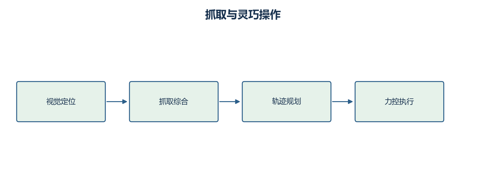

**例 13.1（统一案例：桌面抓取与装配）**　机器人看到桌面上的零件（第 5 章视觉），在场景图中解析「零件 on 桌面」与「孔位 part-of 工件」（第 9 章），规划无碰撞抓取轨迹（第 10 章），用夹爪抓取并以触觉检测滑移（第 6 章），把零件搬运到孔位（第 12 章 MPC），最后用阻抗控制 + 力反馈完成装配——这是感知—理解—规划—执行闭环（第 1.6 节）的完整体现。

## 13.5　数值算例

**例 13.2（两指平行夹爪的力闭合判定）**　在平面中夹取矩形物体，左右两指接触点 $\mathbf{p}_1=(-0.05,0,0)$、$\mathbf{p}_2=(0.05,0,0)\,\mathrm{m}$，法向 $\mathbf{n}_1=(1,0,0)$、$\mathbf{n}_2=(-1,0,0)$，摩擦系数 $\mu=0.3$。由式 (13-2)，每个接触的法向旋量 $\mathbf{G}_i=\begin{bmatrix}\mathbf{n}_i\\\mathbf{p}_i\times\mathbf{n}_i\end{bmatrix}$，$\mathbf{p}_1\times\mathbf{n}_1=(0,0,0)$（共线），故法向列均为 $(\pm1,0,0,0,0,0)^\top$——仅靠法向无法抵抗垂直方向扰动，必须靠摩擦切向列。每个接触有 2 个切向方向（$y,z$），摩擦锥内可产生 $\mu f_n=0.3f_n$ 的切向力。设每指法向力 $f_n=10\,\mathrm{N}$，则可提供最大向上摩擦力 $2\times0.3\times10=6\,\mathrm{N}$，能抵抗物体重量 $mg<6\,\mathrm{N}$（即 $m<0.61\,\mathrm{kg}$）。若物体重 $0.8\,\mathrm{kg}$（$7.84\,\mathrm{N}$），则滑落——说明必须增大夹持力或摩擦。这就是**桌面抓取的力平衡算例**。

**例 13.3（抓取质量评分）**　数据驱动抓取器（DexNet）输出某抓取的成功概率 $Q_\theta=0.92$，另一个为 $0.35$——若任务容错低，选 $Q_\theta>0.9$ 的抓取；若需保留多种模式，按 $Q_\theta$ 加权采样。概率 $Q_\theta$ 由仿真中数千次抓取尝试的成功率训练得到（第 30—31 章合成数据）。

**例 13.4（力裕度的连续退化）**　承接例 13.2，设力限幅 $f_n^{\max}=15\,\mathrm{N}$。物体从 $0.5\,\mathrm{kg}$ 加重到 $0.8\,\mathrm{kg}$ 时，平衡所需的最小法向力由 $f_n^{\min}=mg/(2\mu)$ 从 $4.9/0.6\approx8.17\,\mathrm{N}$ 升到 $7.84/0.6\approx13.07\,\mathrm{N}$，可用裕度
$$
m_f=f_n^{\max}-f_n^{\min}: \quad 15-8.17=6.83\,\mathrm{N}\ \to\ 15-13.07=1.93\,\mathrm{N}, \tag{13-11}
$$
恶化近 3.5 倍。这说明力裕度 $m_f$ 是对「物体质量/摩擦变化」敏感度的直接度量——工业部署中常把 $m_f$ 设为安全阈值，低于阈值即触发「重抓」（regrip），把 13.2 节的二值力闭合判据升级为带裕度的鲁棒判据。

## 13.6　技术谱系与变体

**表 13-2　灵巧操作方法谱系**

| 方法 | 核心 | 优势 | 局限 |
|------|------|------|------|
| 解析抓取综合 | 力/形闭合（式 13-2—13-4） | 有稳定性保证 | 依赖精确几何与摩擦模型 |
| 数据驱动抓取 | 学习 $Q_\theta$（DexNet） | 处理复杂几何 | 需大量数据/仿真 |
| 顺应装配 | 阻抗控制 + 搜索 | 稳健、安全 | 慢、依赖力传感 |
| RL 多指操作 | 仿真训练 + 域随机化 | 处理高维接触 | sim2real 鸿沟（第 21 章） |
| 模仿/遥操作 | 从人类演示学（第 15—18 章） | 样本高效 | 受限于演示质量 |
| VLA 通用操作 | 大模型驱动（第 25—28 章） | 开放词汇泛化 | 精度与可靠性待提升 |

变体联系：解析力闭合为数据驱动方法提供物理先验（$Q_\theta$ 可加入力闭合特征）；RL 策略的底层执行仍用阻抗控制（第 11 章）；VLA（第 25 章）输出高层动作，由这些底层控制器实现。

## 13.7　边界与讨论

**其一，接触动力学复杂。** 式 (13-3) 的摩擦锥与接触切换使规划成为混合、非光滑问题（第 12 章），精确建模困难。**其二，数据稀缺。** 真实抓取失败会损坏物体，数据昂贵；仿真抓取的摩擦、变形建模不准（第 29—31 章 sim2real）。**其三，泛化困难。** 人类对 novel 物体能零样本抓取，机器人仍吃力——这是与人类能力差距最大的领域之一。**其四，可靠性。** 抓取成功率的「最后 5%」往往需要大量工程——这对工业部署至关重要（第 36 章）。**其五，灵巧度度量缺乏统一标准。** 不同任务（捏鸡蛋 vs 解魔方）需要的「灵巧」维度不同：前者重接触稳定性（13.2 节力裕度），后者重指间协调与在物上重定位（in-hand reorientation）。本书采用 13.3A 节的雅可比最小奇异值与 13.3A 节力裕度的联合度量作为统一的「抓取质量」代理，但应承认它只是必要非充分的条件——真正的灵巧度还需在时序任务中验证（第 23 章技能表征）。

**承上启下。** 本章衔接第 2 章（可供性/身体图式）、第 5—6 章（视觉/触觉）、第 9 章（场景图任务解析）、第 10—12 章（规划、控制、MPC）、第 15—23 章（模仿与强化学习）、第 25—28 章（VLA 与具身基础模型）与第 30—31 章（合成数据与 sim2real）。

## 本章小结

本章论述灵巧操作，把第 10—12 章的规划与控制用于接触密集的抓取与装配。

我们首先给出抓取综合的定义（式 13-1）与直觉（形闭合/力闭合），推导抓取矩阵（式 13-2）、摩擦锥力映射（式 13-3）与力闭合条件（式 13-4）。接着讨论多指手（表 13-1）、装配的顺应控制与工具使用，并以统一案例串起闭环（例 13.1）。我们通过两指夹爪的力平衡（例 13.2）与抓取质量评分（例 13.3）给出数值算例，并梳理从解析综合到 VLA 的谱系（表 13-2）。

我们还明确边界：接触动力学复杂、数据稀缺、泛化困难与可靠性。这些辨析衔接第 2、5—6、9—12、15—23、25—28、30—31 章。

第三篇至此完成。第四篇（第 15—18 章）转向模仿学习：从人类示范直接学技能，绕开显式建模。

**进一步阅读**　本章建议延伸阅读的文献：[1]、[2]、[3]。

## 参考文献

[1] Murray R M, Li Z, Sastry S S. *A Mathematical Introduction to Robotic Manipulation*. CRC Press, 1994.

[2] Mahler J, Goldberg K. Learning Dexterous Manipulation. *Robotics: Science and Systems*, 2011.

[3] Ferrari C, Canny J. Planning for robust assembly and fixture design with efficient learning. *IEEE Transactions on Robotics and Automation*, 1998, 14(4): 622–634.

[4] Mason M T, Salisbury J K. *Robot Grippers and Hands: The Mechanics of Grasping*. MIT Press, 1985.

[5] Mahler J, Liang J, Niyaz S, et al. Dex-Net 2.0: Deep learning to plan robust grasps with synthetic point clouds and analytic grasp metrics. *RSS*, 2017.

[6] OpenAI: Andrychowicz M, Baker B, Chociej M, et al. Learning dexterous in-hand manipulation. *IJRR*, 2020, 39(1): 3–20.

[7] Billard A, Grollman D. Robot learning from demonstration. *Springer Encyclopedia of Robotics*, 2012.

[8] Song D, Xu Y, Wu Z, Todorov E. Neural surrogate models for dexterous manipulation. *RSS*, 2021.

---

# 第 14 章　移动与导航

第三篇最后一章讨论移动机器人：从当前位置自主导航到目标位置。这与第 7 章 SLAM（建图定位）、第 10 章运动规划紧密相关——移动导航是它们的综合应用。本章先建立差速驱动运动学（14.1 节），推导全局与局部规划算法（14.2—14.3 节），给出动态窗口法 DWA 的目标函数（14.4 节），通过室内配送的数值算例展示定位—规划—避障—控制全流程（14.5 节），梳理导航栈谱系（14.6 节），最后辨析边界并承上启下（14.7 节）。

## 14.1　引入动机与移动机器人运动学

**动机。** 与机械臂的固定基座不同，移动机器人在二维平面中运动，位姿 $(x,y,\theta)\in SE(2)$，障碍与地图在世界中固定。导航任务把感知（我在哪）、规划（怎么走）、控制（怎么动）集成为一个完整闭环（第 1.6 节），是具身智能最直观的落地场景。

**定义 14.1（差速驱动运动学）**　两轮差速机器人（左右轮速 $v_L,v_R$，轮距 $b$，轮半径 $r$）的运动学：

$$
\dot{x}=v\cos\theta,\quad \dot{y}=v\sin\theta,\quad \dot\theta=\omega, \tag{14-1}
$$

其中线速度 $v=\frac{r}{2}(v_L+v_R)$、角速度 $\omega=\frac{r}{b}(v_R-v_L)$。式 (14-1) 是**非完整约束**（nonholonomic）系统的典型例子：机器人不能横向平移（$\dot y\cos\theta-\dot x\sin\theta=0$），必须从当前朝向前进/转向——这与全向移动（ omnidirectional，如麦克纳姆轮）形成对比。

**直觉解释。** 差速机器人像独轮车：只能沿车头方向前进，转向靠左右轮速度差。非完整约束使「任意位姿间规划」比自由点更复杂（需要 parallel parking 式的机动），但大多数室内配送场景用简单路径跟踪即可。

> 【图 14-1　移动与导航】（原图见 figures/图14-1.png）：全局路径（粗线）+ 局部避障（周围速度采样）+ 底盘控制的分层导航栈，标注定位模块与地图。
>
> 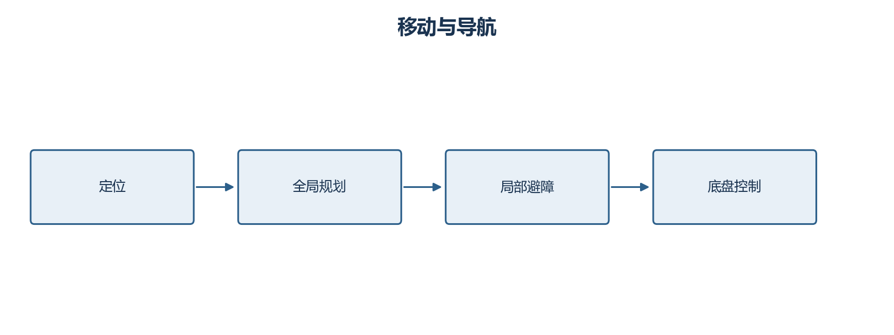

## 14.1A　运动学约束与 Dubins 路径

式 (14-1) 的非完整约束有一个重要推论：机器人的**曲率受限**。把式 (14-1) 写成 $\dot{\mathbf{p}}=v(\cos\theta,\sin\theta)$、$\dot\theta=\omega$，可得路径曲率 $\kappa=\dot\theta/\dot s=\omega/v$（$\dot s=v$ 为弧长速度）。最大转向能力 $|\omega|\le\omega_{\max}$ 与最大速度 $v\le v_{\max}$ 给出最小转弯半径

$$
\rho_{\min}=\frac{v_{\max}}{\omega_{\max}}. \tag{14-2}
$$

这意味着全局路径不能含「直角」——它必须平滑到曲率 $\kappa\le\omega_{\max}/v_{\max}=1/\rho_{\min}$，否则底盘无法跟踪。在 $\rho_{\min}\to0$（可原地旋转）的极限下，最优非完整路径由 **Dubins 路径**给出：由至多三段组成，每段为「左弧—直线—右弧」（LSR、RSR 等六种模式之一），总长

$$
L_{\mathrm{Dubins}}=R\big(\alpha\,n_{\mathrm{arc}}+\ell\,n_{\mathrm{line}}\big), \tag{14-3}
$$

其中 $R$ 为转弯半径、$\alpha$ 为各弧段圆心角、$\ell$ 为直线段长。Dubins 路径是「最小长度非完整路径」的解析解，常被用作全局路径平滑的初始化（第 10 章）与局部轨迹的参考线。

**数值算例（最小转弯半径）。** 设室内配送机器人 $v_{\max}=1.5\,\mathrm{m/s}$、$\omega_{\max}=1.0\,\mathrm{rad/s}$，则 $\rho_{\min}=1.5/1.0=1.5\,\mathrm{m}$。若走廊宽 $1.2\,\mathrm{m}$、机器人半径 $0.4\,\mathrm{m}$，可通行宽度 $0.4\,\mathrm{m}$ 小于 $2\rho_{\min}=3.0\,\mathrm{m}$——机器人无法在走廊内「掉头」（需 $\pi$ 弧度转弯，半径需 $\le$ 可通行宽度的一半），只能先退出走廊再调头。这解释了为何配送机器人在狭窄空间需要**多点转向机动**（前进—停—后退—停—前进，类似倒车入库），也说明全局规划必须把 $\rho_{\min}$ 作为硬约束，否则生成的路径在局部不可执行（与 14.7 节「非完整约束」边界呼应）。

## 14.2　全局规划

全局规划基于已知静态地图求从当前位置到目标的最短/最优路径（第 10 章运动规划的特例，$SE(2)$ 位姿空间）。栅格地图（occupancy grid，第 7 章）把环境离散为网格，边权为通行代价。

**Dijkstra 算法。** 从起点扩展，按累计代价 $g(n)$ 最小优先，保证非负权图最短路：

$$
g(n)=\min_{m\in\mathrm{pred}(n)}\big(g(m)+c(m,n)\big). \tag{14-4}
$$

**A\* 算法。** 在 Dijkstra 上加启发式 $h(n)$（到目标的估计代价，常用欧氏/曼哈顿距离），优先扩展 $f(n)=g(n)+h(n)$ 最小的节点：

$$
f(n)=g(n)+h(n). \tag{14-5}
$$

若 $h$ 可采纳（不高估真实代价），A* 保证最优；$h=0$ 退化为 Dijkstra。若 $h$ 还满足一致性（consistent，即 $h(n)\le c(n,m)+h(m)$），A* 在首次扩展节点时即得到最优路径，无需重复扩展——这使栅格地图上的 A* 高效且最优。**表 14-1** 对比两者。

**表 14-1　Dijkstra 与 A\* 对比**

| 方面 | Dijkstra | A* |
|------|----------|-----|
| 评价函数 | $f=g$ | $f=g+h$（式 14-5） |
| 搜索方向 | 全向均匀扩散 | 朝目标定向 |
| 最优性 | 非负权最优 | $h$ 可采纳时最优 |
| 效率 | 较低 | 通常远快于 Dijkstra |

启发式的设计是 A* 的灵魂：曼哈顿距离适合四连通栅格（只允许上下左右），欧氏距离适合八连通；若高估（如用 $2h$）则失去最优性但可能更快——这是速度与最优性的权衡。

## 14.2A　增量式与基于采样的规划

A* 在地图**静态**时高效，但真实导航中障碍会动态出现（行人走过、新放置的箱子）。**增量式搜索 D* Lite** 的关键洞察是：当只有一小片地图改变时，不必从零重算，而是从旧路径「增量地」修补——它把 A* 的代价计算改写为「从目标反向传播优先级」，使单次重规划代价与「改动区域大小」而非「地图大小」成正比。其优先级函数

$$
k(n)=\min\big(g(n),\,rp(n)\big)+\rho, \tag{14-6}
$$

中 $\rho$ 为启发式一致性的下界，$rp(n)$ 为「重规划前」的估计代价；只有 $k(n)$ 小于已处理节点优先级的节点才需重新扩展，因此局部改动只触发局部重算。

对**高维**连续构型空间（如 6 自由度机械臂或全向底盘），栅格化代价爆炸，**基于采样的规划**（RRT、PRM）是另一条路线。**随机快速扩展树（RRT）**从起点出发，反复「在自由空间采样随机点 → 向它扩展一小步 $\Delta$ → 若新节点自由则加入树」，直到采样点逼近目标。其期望扩展步数随维度增长缓慢（相比栅格的指数爆炸），是运动规划（第 10 章）在高维空间的实用工具。RRT 的扩展代价

$$
c_{\mathrm{RRT}}=c_{\mathrm{sample}}+c_{\mathrm{check}}\approx O\!\left(N\,d_{\mathrm{dim}}\right), \tag{14-7}
$$

其中 $N$ 为已采样节点数、$d_{\mathrm{dim}}$ 为构型空间维度——线性于维度，而栅格是指数。对移动机器人这种低维（$SE(2)$ 仅 3 维）任务，栅格 A* 通常已足够；RRT 的价值在 14.1A 节提到的窄空间机动与全身规划中才凸显。

**谱系小结。** 表 14-2 中「全局规划」一行因此可细分为：静态最优（A*）→ 动态增量（D* Lite）→ 高维采样（RRT/PRM），三者按「地图是否变、空间维度多高」选择。端到端学习导航（第 19—28 章）则试图用神经网络一次性吸收这三者的功能，但可解释性与安全保证较弱（14.7 节）。

## 14.3　局部规划与避障

全局路径是静态的，真实环境有动态障碍（行人、其他机器人）。**局部规划**基于实时传感（激光雷达/深度相机）在短时域内生成避障速度指令。

**人工势场法**（artificial potential field）。目标产生引力 $U_{\mathrm{att}}=\frac12\zeta\rho^2$（$\rho$ 为到目标距离），障碍产生斥力 $U_{\mathrm{rep}}$，机器人沿负梯度下降：

$$
\mathbf{F}=-\nabla(U_{\mathrm{att}}+U_{\mathrm{rep}}). \tag{14-8}
$$

优点简单实时；缺点易陷局部极小（引斥力平衡处）。**动态窗口法**（DWA，下一节详述）在速度空间采样，更实用。

### 14.3A　相对速度障碍与互惠避撞

DWA 把其他机器人当静态障碍，在「双向奔赴」场景会产生**冻结**（14.7 节）。**相对速度障碍**（velocity obstacle, VO）给出几何刻画：设自机与另一障碍的相对位置 $\Delta\mathbf{p}$、相对速度 $\Delta\mathbf{v}$，则「会在 $t_{\mathrm{conf}}$ 内相撞」的速度 $\mathbf{v}$ 构成一个以 $\Delta\mathbf{p}/t_{\mathrm{conf}}$ 为顶点、张角由双方半径 $r$ 决定的锥：

$$
\mathbf{v}\in\mathrm{VO}\ \iff\ \exists\ t\in[0,t_{\mathrm{conf}}]:\ \|\mathbf{p}(t)-\mathbf{p}_{o}(t)\|\le r. \tag{14-9}
$$

**互惠相对速度障碍**（RVO）的关键改进：不再把障碍当静态（$\Delta\mathbf{v}=\mathbf{v}-0$），而是把责任对半分，取 $\Delta\mathbf{v}=\tfrac{1}{2}(\mathbf{v}-\mathbf{v}_o)$，使「VO 锥」收缩一半，双方各自让出半个避让空间——这是多机不冻结的几何保证。

**数值算例（单向 vs 互惠）。** 设自机在 $\mathbf{p}=(0,0)$、目标正前方，障碍在 $\Delta\mathbf{p}=(2,0)\,\mathrm{m}$ 迎面走来（$\mathbf{v}_o=(-1,0)\,\mathrm{m/s}$），$r=0.5\,\mathrm{m}$、$t_{\mathrm{conf}}=2\,\mathrm{s}$。静态 VO（把障碍当静止）顶点在 $\Delta\mathbf{p}/t_{\mathrm{conf}}=(1,0)$，张角 $\sin\phi=r/d$（$d=2\,\mathrm{m}$）$\Rightarrow\phi\approx14.5^\circ$；若自机以 $\mathbf{v}=(1.0,0)$ 直行，恰在锥内 → 预测相撞。互惠 RVO 把锥顶点移到 $\tfrac{1}{2}(\Delta\mathbf{p})/t_{\mathrm{conf}}+(1/2)\mathbf{v}_o$ 的等价形式，锥宽减半、张角收窄到约 $7.3^\circ$；此时自机只需把速度偏转 $10^\circ$（$\mathbf{v}\approx(0.98,0.17)$）即可出锥，而静态 VO 下需偏转 $>15^\circ$ 甚至绕行。这说明 RVO 用「互惠假设」换取了更小的避让代价——代价是它假设他机也做同样的互惠避让，若他机静止（真正静态障碍）则 RVO 会「让过头」，实践中常对「疑似移动」对象用 RVO、对「确定静态」对象用静态 VO 混合处理（与第 35 章社会导航呼应）。

## 14.4　动态窗口法 DWA

**DWA（dynamic window approach）** 的核心：在机器人可达的速度 $(v,\omega)$ 空间内采样轨迹，按目标对齐、避障、速度三项评分选最优。

**可达速度窗口。** 受电机加速度与制动约束，下一步可达速度限制在

$$
V_d=\Big\{(v,\omega)\ \Big|\ v\in[v_c-\dot v\Delta t,v_c+\dot v\Delta t],\ \omega\in[\omega_c-\dot\omega\Delta t,\omega_c+\dot\omega\Delta t]\Big\}, \tag{14-10}
$$

其中 $(v_c,\omega_c)$ 为当前速度，$\dot v,\dot\omega$ 为最大加速度。**采样评估**：在 $V_d$ 内采样 $(v,\omega)$，用式 (14-1) 前向模拟 $T$ 秒得轨迹，计算评分

$$
G(v,\omega)=\alpha\cdot\mathrm{heading}(v,\omega)+\beta\cdot\mathrm{dist}(v,\omega)+\gamma\cdot\mathrm{velocity}(v,\omega), \tag{14-11}
$$

其中 heading 为末端朝向与目标方向夹角（越小越好），dist 为轨迹上到最近障碍的距离（越大越好，小于安全半径则淘汰），velocity 为速度大小（越快越好）。选 $G$ 最大者下发到底盘控制（第 11 章）。DWA 天然满足动力学约束（式 14-10）且实时（采样数百个点）。

## 14.5　数值算例：室内配送机器人的一步

**例 14.1（全局路径的 A* 计算）**　设 4×4 栅格地图（每格 1 m），起点 $(0,0)$、目标 $(3,3)$，障碍格为 $(1,1),(2,1)$。用曼哈顿距离启发 $h=|3-x|+|3-y|$。起点 $f=0+6=6$；右邻 $(1,0)$：$g=1,h=5,f=6$；上邻 $(0,1)$：$g=1,h=5,f=6$。A* 按 $f$ 相同则取先入，扩展后沿底行走到 $(3,0)$ 再向上，得路径 $(0,0)\to(1,0)\to(2,0)\to(3,0)\to(3,1)\to(3,2)\to(3,3)$，总长 6 m——绕开了障碍（直接对角线会穿过 $(1,1),(2,1)$）。这展示式 (14-5) 的启发式引导。

**例 14.2（DWA 速度评分）**　设当前速度 $(v_c,\omega_c)=(0.5,0)\,\mathrm{m/s/rad/s}$，$\Delta t=0.1\,\mathrm{s}$，最大加速度 $\dot v=0.2,\dot\omega=0.4$，则窗口 $v\in[0.3,0.7],\omega\in[-0.04,0.04]$（式 14-10）。采样三个候选：① $(0.7,0)$：heading=0.2 rad，dist=1.2 m，velocity=0.7；② $(0.5,0.2)$：heading=0.05 rad，dist=0.4 m（近障碍），velocity=0.5；③ $(0.3,-0.04)$：heading=0.5 rad，dist=2.0 m，velocity=0.3。取 $\alpha=2,\beta=1,\gamma=0.5$（式 14-11）：$G_1=2(1/0.2)+1.2+0.35\approx11.6$，$G_2=40+0.4+0.25\approx40.7$（但 dist=0.4<安全半径 0.5 → **淘汰**），$G_3=4+2+0.15=6.15$。最终选①——说明 DWA 在避障与效率间权衡，危险候选被硬性淘汰。

## 14.5A　DWA 评分的归一化与权重敏感性

式 (14-11) 的三项量纲不同（heading 为弧度、dist 为米、velocity 为 m/s），直接相加前必须归一化，否则权重失去可比性。标准做法是把每项除以其「理想最大值」：

$$
\widetilde{\mathrm{heading}}=\frac{\mathrm{heading}}{\pi},\quad
\widetilde{\mathrm{dist}}=\frac{\mathrm{dist}}{d_{\max}},\quad
\widetilde{\mathrm{velocity}}=\frac{\mathrm{velocity}}{v_{\max}}, \tag{14-12}
$$

使三项均落在 $[0,1]$，权重 $\alpha,\beta,\gamma$ 即成为「各目标的相对重要度」。归一化后，式 (14-11) 变为 $\widetilde G=\alpha\,\widetilde{\mathrm{heading}}+\beta\,\widetilde{\mathrm{dist}}+\gamma\,\widetilde{\mathrm{velocity}}$。

**权重敏感性算例。** 仍取例 14.2 的候选①（heading=0.2、dist=1.2、velocity=0.7），设 $d_{\max}=2.0\,\mathrm{m}$、$v_{\max}=1.0\,\mathrm{m/s}$，则 $\widetilde{\mathrm{heading}}=0.2/\pi\approx0.064$、$\widetilde{\mathrm{dist}}=0.6$、$\widetilde{\mathrm{velocity}}=0.7$。取「保守避障」权重 $(\alpha,\beta,\gamma)=(0.5,3.0,0.5)$，得 $\widetilde G=0.5\times0.064+3.0\times0.6+0.5\times0.7=0.032+1.8+0.35=2.182$。若换成「激进赶路」权重 $(3.0,0.5,0.5)$，则 $\widetilde G=3.0\times0.064+0.5\times0.6+0.5\times0.7=0.192+0.3+0.35=0.842$——同一候选，评分随权重从 2.182 变到 0.842，且「避障优先」时 dist 项主导、机器人宁可绕远也不贴近障碍；「赶路优先」时 heading 项主导、机器人倾向直奔目标。这说明 DWA 的行为**由权重隐式编码了任务偏好**：在人流密集场景应调高 $\beta$，在赶时间场景调高 $\alpha$。工程上常把权重做成在线可调参数（或按场景预设），这比「每次重新训练」更灵活——是模块化导航栈相对端到端方法的实用优势之一。

**与局部极小的关系。** 人工势场法（14.3 节式 14-8）的局部极小源于引力与斥力平衡；DWA 的归一化评分虽无显式梯度场，但若 $d_{\max}$ 设得过小（使 dist 项饱和为 1），则 dist 失去区分度，机器人在「多障碍等距」时退化为只按 heading 直行，可能撞向最近的障碍——这是归一化尺度 $d_{\max}$ 设错的隐性风险。

## 14.6　技术谱系与变体

**表 14-2　移动导航技术谱系**

| 层级 | 方法 | 核心 | 代表 |
|------|------|------|------|
| 定位 | AMCL / EKF（第 7—8 章） | 粒子滤波 / 卡尔曼滤波 | ROS amcl |
| 全局规划 | Dijkstra / A* / D* Lite | 图搜索（式 14-4、14-5） | ROS global_planner |
| 局部规划 | DWA / TEB / 势场法 | 速度采样 / 轨迹优化 / 势场（式 14-8、14-10、14-11） | ROS base_local_planner |
| 控制 | 差速运动学控制（第 11 章） | 轨迹跟踪 | 底盘 PID |
| 端到端 | 学习导航（第 19—28 章） | 从感知直接到动作 | 视觉导航策略 |

变体联系：D* Lite 支持地图动态更新的增量重规划；TEB（timed elastic band）用轨迹优化（第 12 章）替代 DWA 的采样；端到端导航（第 24—28 章）用学习绕过模块化栈，但可解释性与安全性较弱。

**自主导航栈。** 定义 14.2：自主导航 = 定位（AMCL，第 7 章）+ 全局规划（A*）+ 局部规划（DWA）+ 运动控制（第 11 章）+ 障碍处理——这就是 ROS Navigation Stack 的模块划分，也是第 1.7 节室内配送案例的实现。

## 14.7　边界与讨论

**其一，动态与拥挤环境。** DWA 把其他机器人/行人当静态障碍，在人群中会产生「冻结机器人」（reciprocal collision avoidance 需预测他人意图，第 35 章社会导航）。**其二，未知环境探索。** 无地图时需同时定位建图（第 7 章）与 frontier-based 探索——规划目标本身在变化。**其三，非完整约束。** 式 (14-1) 的横向不可动使狭窄空间机动困难（停车场类任务需 kinodynamic 规划，第 10 章）。**其四，端到端 vs 模块化。** 学习导航泛化好但缺安全保证（第 35 章），模块化栈可解释但依赖地图精度与环境假设。

**承上启下。** 本章衔接第 7 章（SLAM/定位）、第 10 章（全局规划）、第 11 章（底盘控制）、第 35 章（社会导航与安全），并结束第三篇（第 10—14 章）的规划与控制主线。

## 本章小结

本章论述移动与导航，把第 7、10—11 章综合为完整闭环。

我们首先建立差速驱动运动学（定义 14.1，式 14-1）与非完整约束直觉，并补充曲率约束与 Dubins 路径（式 14-2、14-3）。接着推导全局规划 Dijkstra/A*（式 14-4、14-5）与增量式/采样式规划（式 14-6、14-7），以及局部避障势场法（式 14-8）与相对速度障碍（式 14-9），重点给出 DWA 的可达速度窗口与评分（式 14-10、14-11）。我们通过栅格 A* 路径与 DWA 速度评分（例 14.1、14.2）展示数值流程，梳理从定位到端到端导航的谱系（表 14-1、14-2）并给出导航栈定义（定义 14.2）。

我们还明确边界：动态拥挤环境、未知探索、非完整约束与端到端 vs 模块化。这些辨析衔接第 7、10—11、19—28、35 章。

下一章进入第四篇：行为克隆与 DAgger——从人类示范直接学技能，绕开第 10—14 章的显式建模。

**进一步阅读**　本章建议延伸阅读的文献：[1]、[2]、[3]。

## 参考文献

[1] Thrun S, Burgard W, Fox D. *Probabilistic Robotics*. MIT Press, 2005.

[2] Fox D, Burgard W, Thrun S. The dynamic window approach to collision avoidance. *IEEE Robotics and Automation Magazine*, 1997, 4(1): 23–33.

[3] Dijkstra E W. A note on two problems in connexion with graphs. *Numerische Mathematik*, 1959, 1: 269–271.

[4] Hart P E, Nilsson N J, Raphael B. A formal basis for the heuristic determination of minimum cost paths. *IEEE Transactions on Systems Science and Cybernetics*, 1968, 4(2): 100–107.

[5] Konolige K, Bowman J, Chen J, et al. An forward search approach to dynamic window local navigation. *ICRA*, 2010.

[6] Rösmann C, Hoffmann F, Bertram T. Integrated online trajectory planning and optimization in the timed-elastic-band framework for mobile robots. *IEEE Robotics and Automation Letters*, 2017, 2(4): 2083–2090.

[7] van den Berg J, Guy S J, Lin M, Manocha D. Reciprocal velocity obstacles for real-time multi-agent navigation. *ICRA*, 2008.

[8] Kato Y, Chen C, Tzeng A. End-to-end navigation via deep reinforcement learning. *CoRL*, 2018.

---

# 第 15 章　行为克隆与 DAgger

第三篇的规划+控制依赖精确模型（第 3 章动力学）。第四篇（第 15—18 章）转向**模仿学习**（imitation learning）：从人类示范数据直接学技能，绕开显式建模。本章从最简单的**行为克隆**（behavior cloning，BC）及其致命缺陷——分布漂移（distribution shift）——与解法 **DAgger**（dataset aggregation）开始。我们先给出 BC 的监督学习公式（15.1 节），严格推导分布漂移与误差界（15.2—15.3 节），给出 DAgger 算法（15.4 节），通过数值算例量化误差累积（15.5 节），梳理谱系（15.6 节），最后辨析边界并承上启下（15.7 节）。

## 15.1　引入动机与行为克隆

**动机。** 许多任务（驾驶、装配、人机协作）人类做得很好，但写出精确动力学模型或奖励函数很难。模仿学习的思路是：让人来示范，机器人从示范中直接学「状态→动作」映射——把控制问题转化为监督学习问题。这是绕开「建模难」与「奖励设计难」的捷径，也是当今机器人学习最实用的范式之一（第 17—18 章的遥操作数据、第 34 章的规模化数据）。

**定义 15.1（行为克隆）**　给定专家示范数据集 $\mathcal{D}=\{(s_i,a_i)\}_{i=1}^N$（状态—动作对，来自专家策略 $\pi^*$），用监督学习学参数化策略 $\pi_\theta$：

$$
\min_{\theta}\ \sum_{i=1}^{N}\ell\big(\pi_\theta(s_i),a_i\big), \tag{15-1}
$$

其中 $\ell$ 为损失（连续动作用 MSE，离散动作用交叉熵）。BC 把「决策」当作「从状态到动作的回归/分类」——简单直接，是深度模仿学习的基线。

**例 15.1（BC 学驾驶）**　记录人类驾驶的状态（摄像头图像 $\mathbf{o}_t$）与动作（方向盘转角 $a_t$），用卷积神经网络学 $a=\pi_\theta(\mathbf{o})$——输入图像输出转向角。Nvidia 的端到端驾驶是早期代表。BC 在训练分布上表现好，但部署后一旦偏离专家轨迹就会出错——这正是下一节的主题。

## 15.1A　损失函数与多模态动作

式 (15-1) 的损失 $\ell$ 直接决定 BC 学到的动作分布形状。**均方误差（MSE）**假设动作近似单峰高斯，其最优解是条件均值 $\mathbb{E}[a\mid s]$：

$$
\ell_{\mathrm{MSE}}=\frac12\big\|a_i-\pi_\theta(s_i)\big\|^2 \ \Rightarrow\ \pi_\theta^*(s)=\mathbb{E}[a\mid s]. \tag{15-2}
$$

**交叉熵**则用于离散动作（如「左转/直行/右转」），学到的是条件类别分布。当同一状态 $s$ 对应多个合理动作时（多模态，15.7 节「多模态动作」边界），MSE 的条件均值可能落在所有峰的「中间」——一个物理上不可行的动作（如同时向左又向右打方向）。

**数值算例（双峰动作的均值坍缩）。** 设某避障状态 $s$ 下，专家示范中 $50\%$ 走左侧（$a=-0.5$）、$50\%$ 走右侧（$a=+0.5$），两峰等权。MSE 损失 $\tfrac12\sum(a-\pi)^2$ 对 $\pi$ 求导令其为零：$0.5(-0.5-\pi)+0.5(0.5-\pi)=0\Rightarrow\pi^*=0$。即 MSE 学到「直行」$a=0$——恰好撞向障碍中心。这是确定性 BC 在多模态任务上的系统性失败模式。解法有三：① 混合密度网络（MDN）显式拟合 $p(a\mid s)$ 的多峰；② 高斯混合策略；③ 第 17 章的扩散策略/流匹配（生成式建模，天然多峰）。MSE 仅在动作分布近似单峰（如稳态跟车）时安全——这是选损失函数前必须检查数据分布的原因。

## 15.2　分布漂移：BC 的致命缺陷

**问题。** BC 的训练数据来自专家的状态分布 $p_{\pi^*}(s)$（专家访问的状态），但部署时策略 $\pi_\theta$ 自身诱导一个新的状态分布 $p_{\pi_\theta}(s)$。监督学习保证在训练分布上误差小，却不保证在测试分布（$p_{\pi_\theta}$）上小——这是**协变量偏移**（covariate shift）。更糟的是，BC 的小误差会改变下一时刻的状态，把状态推到训练分布之外，在那里误差更大，进一步推偏——**误差累积**形成正反馈。

**直觉解释。** 想象学开车：教练只在「车道正中央」教过你打方向。一旦你稍微偏离中心（自己的小错误），进入一个教练没示范过的状态（「偏左 30 cm」），你不知道怎么修正，于是偏得更远——最终冲出车道。BC 就像只见过「完美轨迹」周围的状态，缺乏从错误中恢复的能力。

**误差界（Ross 等[1] 的经典分析）。** 设单步分类/回归误差上界为 $\epsilon$（即在专家分布上 $\Pr[\pi_\theta(s)\ne\pi^*(s)]\le\epsilon$），时域为 $T$。若策略是确定性的，误差在轨迹上**二次累积**：

$$
J(\pi_\theta)-J(\pi^*)\ \le\ O(\epsilon T^2). \tag{15-3}
$$

式 (15-3) 是 BC 的致命缺陷：时域越长，误差以 $T^2$ 增长——长时域任务中 BC 几乎必然失败。若为随机策略（动作有随机性，状态分布混合），误差可改善为**线性累积** $O(\epsilon T)$——这是随机化策略在模仿学习中的重要价值。

## 15.3　误差界的推导

我们给出式 (15-3) 的推导梗概。设 $d_t=p_{\pi_\theta}(s_t)-p_{\pi^*}(s_t)$ 为时刻 $t$ 的状态分布差异，$\eta_t=\|d_t\|_1$ 为其总变差距离。BC 的策略在专家分布上误差 $\epsilon$；由分布差异引入的额外误差与 $\eta_t$ 成正比（有界损失），故时刻 $t$ 的动作误差不超过

$$
\epsilon_t\le \epsilon + L\,\eta_t, \tag{15-4}
$$

其中 $L$ 为损失对分布差异的 Lipschitz 常数。分布差异的演化满足（动力学为 $\pi_\theta$ 与 $\pi^*$ 的转移核之差）

$$
\eta_{t+1}\le \eta_t + \epsilon_t. \tag{15-5}
$$

代入式 (15-4) 并展开（$\eta_0=0$）：

$$
\eta_t\le \sum_{k=0}^{t-1}\epsilon_k\le \sum_{k=0}^{t-1}(\epsilon+L\eta_k)\ \Rightarrow\ \eta_t\le \frac{\epsilon}{L}\big((1+L)^t-1\big)\approx \epsilon t\ \ (\text{小 }Lt). \tag{15-6}
$$

于是总回报损失为各步误差之和：

$$
J(\pi_\theta)-J(\pi^*)\le \sum_{t=0}^{T-1}\epsilon_t\le \sum_{t=0}^{T-1}(\epsilon+L\epsilon t)=\epsilon T+\frac{L\epsilon T(T-1)}{2}=O(\epsilon T^2). \tag{15-7}
$$

式 (15-7) 严格给出 BC 误差的二次累积——这就是需要 DAgger 的根本原因。

## 15.3A　随机策略的线性累积

式 (15-7) 的二次性源于**确定性**策略：它把每步误差完整地传递到下一时刻的状态。若策略带随机性（如 softmax 策略 $\pi(a\mid s)\propto e^{Q(s,a)/\tau}$），状态分布会「混合」，分布漂移不再逐时刻叠加。设随机化带来的记忆衰减率为 $\gamma\in(0,1]$（$\gamma=1$ 退化为确定性），则分布演化 (15-5) 变为

$$
\eta_{t+1}\le (1-\gamma)\,\eta_t+\epsilon, \tag{15-8}
$$

递推展开得 $\eta_t\le\frac{\epsilon}{\gamma}\big(1-(1-\gamma)^t\big)\le\frac{\epsilon}{\gamma}$（有界！），不再随 $t$ 线性增长。于是总回报损失

$$
J(\pi_\theta)-J(\pi^*)\le\sum_{t=0}^{T-1}(\epsilon+L\eta_t)\le \epsilon T+\frac{L\epsilon}{\gamma}\,T=O(\epsilon T). \tag{15-9}
$$

式 (15-9) 即随机策略的**线性累积**——这正是 15.2 节「随机化策略在模仿学习中的重要价值」的定量含义：随机化把二次退化成线性。

**数值算例（确定性 vs 随机 vs DAgger）。** 仍取 $\epsilon=0.05,\ L=1,\ T=20$。确定性 BC 由式 (15-7) 得上界 $10.5$（例 15.2）。取 $\gamma=0.1$（较强随机化）的 softmax 策略，式 (15-9) 给 $\epsilon T+\frac{L\epsilon}{\gamma}T=1+\frac{0.05}{0.1}\times20=1+10=11$——单看常数与确定性相当，但关键是 $\eta_t$ 有界于 $\epsilon/\gamma=0.5$ 而非无界增长；若 $T=100$，确定性 BC 上界 $\approx0.05\times100+\frac{0.05\times100\times99}{2}=5+247.5=252.5$，随机策略仅 $\approx0.05\times100+\frac{0.05}{0.1}\times100=5+50=55$（约 4.6 倍改善），DAgger 则恒为 $O(\epsilon T)=\epsilon T=5$。三者排序 DAgger $\ll$ 随机 $\ll$ 确定性，量化了「随机化减半、DAgger 根治」的直觉——实用系统常**两者并用**：用 softmax 策略平滑分布漂移，用 DAgger 修正残余偏移（15.7 节「与 RL 结合」的理论注脚）。

> 【图 15-1　行为克隆与 DAgger】（原图见 figures/图15-1.png）：左：BC 在专家分布上训练，部署时误差把状态推出分布（漂移轨迹示意）；右：DAgger 的数据聚合循环——策略采状态→专家标注→并入数据集→重训。
>
> 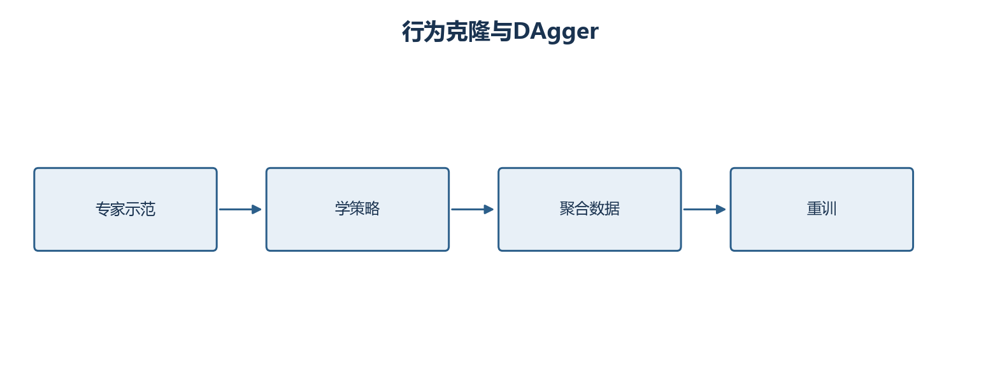

## 15.4　DAgger 算法

**DAgger（dataset aggregation）[1]** 用迭代解决分布漂移：让训练分布覆盖策略自身访问的状态。

**算法 15.1（DAgger）**
1. 初始化：$\mathcal{D}\leftarrow\mathcal{D}_{\mathrm{demo}}$（专家示范），$\pi_0\leftarrow\mathrm{BC}(\mathcal{D})$。
2. 对 $n=1,\dots,N$ 轮：
   - 用当前策略 $\pi_{n-1}$ 在环境中采集轨迹，得到状态序列 $\{s_t\}$（来自策略分布 $p_{\pi_{n-1}}$）。
   - 让专家对每个访问状态标注最优动作：$a_t^*=\pi^*(s_t)$（**查询专家**，这是 DAgger 的成本所在）。
   - 聚合数据集：$\mathcal{D}\leftarrow\mathcal{D}\cup\{(s_t,a_t^*)\}$。
   - 重训：$\pi_n\leftarrow\mathrm{BC}(\mathcal{D})$（可用所有数据，或加权强调新数据）。
3. 返回最优策略（通常最后一轮或验证集最佳）。

DAgger 的关键洞察：通过把策略访问的状态加入训练集，**训练分布逐渐逼近部署分布**，从而打破误差累积的正反馈。理论上 DAgger 可把误差从 $O(\epsilon T^2)$ 降到 $O(\epsilon T)$（线性），接近专家水平。

**轮数与聚合权重（实用细节）。** DAgger 有两个超参数直接影响成本—收益权衡。其一是**轮数 $N_{\text{轮}}$**：轮数越多，训练分布对部署分布覆盖越充分，但专家标注量线性增长；经验上 $3\text{–}6$ 轮后边际收益递减，因为策略访问状态逐渐稳定（$\pi_{n}$ 与 $\pi_{n-1}$ 差异小）。其二是**聚合权重**：标准 DAgger 用全部历史数据 $\mathcal{D}$，但旧数据（来自早期「差策略」访问的状态）可能对当前策略无益甚至有害。实用变体给新数据加权重 $\beta^n$（指数遗忘）或按「状态新颖度」加权——只重点学习策略「正在去到的」状态。这与 15.3A 节的结论一致：关键是让训练分布覆盖 $p_{\pi_n}$，而非单纯堆数据量。

**表 15-1　BC 与 DAgger 对比**

| 方面 | BC | DAgger |
|------|-----|--------|
| 数据来源 | 仅专家示范 | 专家示范 + 策略访问状态 |
| 训练分布 | $p_{\pi^*}$ | 逐渐覆盖 $p_{\pi_n}$ |
| 分布漂移 | 严重（式 15-7） | 缓解（$O(\epsilon T)$） |
| 误差累积 | 二次 $O(\epsilon T^2)$ | 线性 $O(\epsilon T)$ |
| 专家成本 | 一次性示范 | 需多轮在线标注（昂贵） |
| 适用场景 | 短时域、易示范 | 长时域、错误恢复 |

## 15.4A　DAgger 误差界的推导梗概

为什么 DAgger 能把 $O(\epsilon T^2)$ 降到 $O(\epsilon T)$？关键在式 (15-5) 的分布演化被「切断」。BC 部署时，$\pi_\theta$ 在时刻 $t$ 的状态由它自己前 $t$ 步的累积误差决定，故 $\eta_t$ 逐时刻叠加，最终 $\eta_t\sim\epsilon t$（式 15-6），总损失 $O(\epsilon T^2)$（式 15-7）。DAgger 改变的是**训练分布**：第 $n$ 轮训练集 $\mathcal{D}_n$ 已包含策略 $\pi_{n-1}$ 实际访问的状态，因此重训后的 $\pi_n$ 在「自己会去到的状态」上误差也只是 $\epsilon$，不再随时刻累积。

形式化地，设 DAgger 第 $n$ 轮的聚合训练集对状态空间的覆盖权重为 $p_{\mathcal{D}_n}(s)$，专家标注使 $\pi_n$ 在 $p_{\mathcal{D}_n}$ 上的期望误差不超过 $\epsilon$。若聚合权重按 $\beta$ 混合历史数据（$\mathcal{D}_n=(1-\beta)\mathcal{D}_{n-1}\cup\beta\,\mathcal{D}^{(n)}_{\text{new}}$），可证 $\pi_n$ 在自身诱导分布 $p_{\pi_n}$ 上的期望误差不超过 $O(\epsilon)$，于是 $T$ 步总回报损失为各步期望误差之和：

$$
J(\pi_n)-J(\pi^*)\le \sum_{t=0}^{T-1}\mathbb{E}_{s_t\sim p_{\pi_n}}\big[\epsilon_t\big]\le \epsilon\,T. \tag{15-10}
$$

式 (15-10) 即 DAgger 的线性累积。它与式 (15-7) 的本质差别在于：BC 的 $\epsilon_t$ 随 $t$ 线性增长（$\epsilon_t\sim\epsilon+L\epsilon t$），而 DAgger 的 $\epsilon_t\approx\epsilon$ 与时刻无关——分布漂移的正反馈被「策略访问状态进入训练集」这一机制打断。代价如 15.6 节所述：每轮都要让专家对新状态在线标注，总标注量 $O(T\cdot N_{\text{轮}})$。

## 15.5　数值算例：误差累积的量化

**例 15.2（BC 的误差二次累积）**　设单步误差 $\epsilon=0.05$，Lipschitz 常数 $L=1$，时域 $T=20$。由式 (15-7)：

$$
J(\pi_\theta)-J(\pi^*)\le \epsilon T+\frac{L\epsilon T(T-1)}{2}=0.05\times20+\frac{1\times0.05\times20\times19}{2}=1+9.5=10.5. \tag{15-11}
$$

若时域加倍到 $T=40$：$0.05\times40+\frac{0.05\times40\times39}{2}=2+39=41$——误差从 10.5 增到 41（约 4 倍），印证 $T^2$ 增长（式 15-3）。这说明 BC 在长时域任务中不可靠。

**例 15.3（DAgger 一轮的误差下降）**　仍取 $\epsilon=0.05,T=20$，DAgger 把累积从 $O(\epsilon T^2)$ 降到 $O(\epsilon T)=\epsilon T=1$（忽略常数），相比 BC 的 10.5 降低约一个数量级。代价是需要专家标注约 $20\times N_{\text{轮}}$ 个新状态——这就是 DAgger 的实际成本。

**例 15.4（数据聚合的分布覆盖）**　设专家示范 100 条轨迹（状态分布集中在车道中心），DAgger 第一轮用 $\pi_0$ 采集 50 条轨迹，发现其中 15 条进入「偏左」状态（专家未示范），标注后加入——训练集新增覆盖 15 个漂移状态，第二轮 $\pi_1$ 在这些状态上的误差从「无数据」降到监督学习水平。这是式 (15-6) 中 $\eta_t$ 减小的直观过程。

## 15.5A　实用 DAgger：算法专家与标注成本

DAgger 的瓶颈是「专家在线标注」。Laskey 等[6] 提出用**算法专家**（algorithmic expert）替代人类：让一个现成的最优/近最优控制器（如模型预测控制 MPC，第 12 章；或规划器，第 10 章）充当「专家」，对策略访问的每个状态自动给出动作 $a_t^*=g(s_t)$。这保留了 DAgger 的理论结构（式 15-10 的线性累积），却把标注成本从「人类」降到「一次前向规划」。

**数值算例（算法专家 DAgger 的轮次收敛）。** 设某导航任务专家（MPC）的决策代价为 $c_{\text{MPC}}=5\,\mathrm{ms}$（一次 QP 求解），人类专家标注一条状态代价 $c_{\text{human}}\approx30\,\mathrm{s}$（含观察与判断）。时域 $T=20$ 步、$N_{\text{轮}}=4$ 轮。人类 DAgger 的标注总耗时约 $4\times20\times30\,\mathrm{s}=2400\,\mathrm{s}=40\,\mathrm{min}$；算法专家 DAgger 的标注总代价约 $4\times20\times5\,\mathrm{ms}=0.4\,\mathrm{s}$——相差近 **5 个数量级**。但算法专家的质量受限于 MPC 的模型精度：若动力学模型失配（第 3 章），算法专家给出的 $a_t^*$ 本身次优，DAgger 学到的是「次优专家的线性累积」而非「最优策略」。这给出实用准则：**模型可靠的场景用算法专家（快），模型不确定的场景用人类专家（准）；或二者混合——人类标注关键状态、算法专家标注其余状态**（15.6 节「专家次优性」边界的量化体现）。

**表 15-2　DAgger 变体与适用性**

| 变体 | 专家来源 | 标注成本 | 理论保证 | 适用 |
|------|---------|---------|---------|------|
| 标准 DAgger[1] | 人类在线 | 高 | $O(\epsilon T)$（式 15-10） | 高精度、可容忍标注 |
| 算法专家 DAgger[6] | MPC/规划器 | 极低 | 受限于专家质量 | 模型可靠、大规模 |
| 安全 DAgger | 人类 + 安全层 | 高 | 加安全约束 | 安全关键（第 35 章） |
| 混合专家 | 人类+算法 | 中 | 近似 | 模型半可靠 |

## 15.6　技术谱系与变体

**表 15-3　模仿学习方法谱系**

| 方法 | 核心 | 优势 | 局限 |
|------|------|------|------|
| 行为克隆 | 监督学习式 (15-1) | 简单、样本高效 | 分布漂移（式 15-7） |
| DAgger | 数据聚合 + 专家标注 | 理论保证、缓解漂移 | 专家在线成本高 |
| DAgger 变体 | 采样聚合/安全 DAgger | 降低标注量/保证安全 | 复杂度增加 |
| 逆强化学习 | 学奖励再规划（第 16 章） | 泛化好 | 计算复杂、歧义性 |
| 从演示学习 | 目标/技能学习（第 17 章） | 处理长时域 | 需目标识别 |
| 遥操作数据 | 规模化示范（第 18 章） | 数据丰富 | 硬件/人力成本 |
| 离线 RL | 从数据学最优策略（第 22 章） | 不需在线交互 | 分布外外推难 |

变体联系：DAgger 的实用变体用**算法专家**（如 MPC 规划器，第 12 章）代替人类专家自动标注，大幅降低成本；SMILe（stochastic mixture of linear experts）等用策略混合改进；与离线 RL（第 22 章）结合可不再查询专家。

## 15.7　边界与讨论

**其一，专家标注成本。** DAgger 要求专家持续在线标注策略访问状态——真实人类专家昂贵且难以规模化；实用系统用算法专家或半自动标注（第 18 章遥操作）。**其二，专家次优性。** BC/DAgger 假设专家最优，但人类示范常有噪声与次优动作——需过滤或加权。**其三，多模态动作。** 同一状态可能有多个合理动作（如绕过障碍左右均可），MSE 损失会平均出「中间动作」（可能碰撞）——需混合密度网络或扩散策略（第 17 章）。**其四，与强化学习结合。** 模仿学习提供好的初始策略，RL（第 19—23 章）进一步微调，是实用范式。

**承上启下。** 本章衔接第 3—4 章（模型控制作为算法专家）、第 12 章（MPC 作专家）、第 16 章（逆强化学习）、第 17—18 章（从演示学习与遥操作数据）、第 19—23 章（强化学习微调）与第 34 章（数据规模化）。

## 本章小结

本章论述行为克隆与 DAgger，开启第四篇的模仿学习主线。

我们首先给出 BC 的监督学习公式（定义 15.1，式 15-1）与驾驶示例，并分析损失函数与多模态动作（式 15-2）。接着严格推导分布漂移与误差界：误差界 $O(\epsilon T^2)$（式 15-3）、单步误差（式 15-4）、分布演化（式 15-5—15-6）与二次累积 $O(\epsilon T^2)$（式 15-7），并给出随机策略的线性累积与之对照（式 15-8—15-9）。随后给出 DAgger 算法（算法 15.1，表 15-1）、其线性累积的理论证明（式 15-10）与实用细节，以及算法专家 DAgger 的标注成本量化（表 15-2）。我们通过误差累积量化（式 15-11，例 15.2—15.4）与方法谱系（表 15-3）展示理论与实践。

我们还明确边界：专家标注成本、次优性、多模态动作与 RL 结合。这些辨析衔接第 3—4、12、16—23、34 章。

下一章讨论逆强化学习——从示范中推断奖励函数，再据此规划，获得更好的泛化。

**进一步阅读**　本章建议延伸阅读的文献：[1]、[2]、[3]。

## 参考文献

[1] Ross S, Gordon G J, Bagnell J A. A reduction of imitation learning and structured prediction to no-regret online learning. *AISTATS*, 2011.

[2] Sammut C, Webb G I. *Encyclopedia of Machine Learning*. Springer, 2010.

[3] Ross S, Bagnell D. Efficient reductions for imitation learning. *AISTATS*, 2010.

[4] Pomerleau D A. ALVINN: An autonomous land vehicle in a neural network. *NeurIPS*, 1988.

[5] Bojarski M, Del Testa D, Dworakowski D, et al. End to end learning for self-driving cars. *arXiv:1604.07316*, 2016.

[6] Laskey H, Staszak S, Hsueh C Y, et al. DAgger with algorithmic experts. *arXiv:1709.03573*, 2017.

[7] Oakley A, Bagnell J A. Stable behavioral cloning and DAgger via raised cosine loss functions. *CoRL*, 2022.

[8] Florence P, Lynch C, Zeng A, et al. Implicit behavioral cloning. *CoRL*, 2021.

---

# 第 16 章　逆强化学习与奖励学习

第 15 章的行为克隆（behavior cloning, BC）直接学习「在状态 $s$ 下做什么动作 $a$」，把专家策略当作一个监督学习中的条件分布来拟合。本章讨论另一条根本不同的路径：**逆强化学习（inverse reinforcement learning, IRL）**——不从示范中直接学动作，而是推断「专家在优化什么奖励函数」，然后再用强化学习在该奖励下求解最优策略。IRL 的核心吸引力在于：学到的奖励函数是对任务目标的紧凑、可迁移的描述，它能泛化到示范中未曾出现的状态，而 BC 学到的动作映射只在训练分布附近有效。正如 Abbeel 与 Ng[3] 在早期工作中指出的，奖励函数往往比策略本身更简洁、更具跨形态稳定性——同一个「倒水」目标可以用不同的关节轨迹实现，但其背后的奖励结构是相同的。

本章先交代 IRL 的动机与问题设定（16.1 节），给出严格定义与最大熵框架下的数学推导（16.2 节），通过数值算例展示特征期望匹配的计算过程（16.3 节），继而梳理从最大边距 IRL 到 GAIL 的技术谱系（16.4 节），分析奖励不可辨识性这一根本局限（16.5 节），最后收束并与全书其他章节建立交叉引用（16.6 节）。

## 16.1　引入动机：为什么学奖励而非学动作

行为克隆面临两个众所周知的问题。其一是**分布偏移（distribution shift）**：BC 只在专家访问的状态分布 $p_{\text{exp}}(s)$ 上训练，一旦策略自身的小误差把它带到分布之外的状态，动作预测就会失去可靠性，误差被逐步放大——这就是 DAgger（第 15 章）试图缓解的covariate shift。其二是**多解性下的随意选择**：在专家演示未覆盖的状态，监督学习给出的动作是训练目标的一个任意插值，缺乏任务语义的约束。

IRL 换了一个问题来问：如果能恢复专家内心（或隐含）的奖励函数 $r(s,a)$，那么在任意状态——包括示范之外的状态——都可以通过求解 $\max_\pi \mathbb{E}_\pi[\sum_t r(s_t,a_t)]$ 得到一个「目标导向」的动作。奖励函数把「做什么」转化为「优化什么」，后者对状态分布的依赖要弱得多。这一转变的数学代价是病态性：给定示范轨迹，通常存在无穷多个奖励函数使这些轨迹近似最优——这是本章 16.5 节的主题。

**直觉解释。** 想象观察一个人把杯子从桌子的左边搬到右边。BC 记录的是每一帧手部的位置；IRL 试图推断的是「杯子应在右边且不被打翻」这样的目标。前者是轨迹的模仿，后者是意图的推断。一旦理解了目标，即使杯子换成碗、桌子高度不同，智能体仍能完成任务——这就是奖励表示带来的泛化。

> 【图 16-1　模仿学习与逆强化学习的对比】（原图见 figures/图16-1.png）：上半部分展示 BC 直接从示范学动作策略并在新状态外推失败；下半部分展示 IRL 从示范推断奖励，再经由内层 RL 得到策略，可泛化到新状态。
>
> 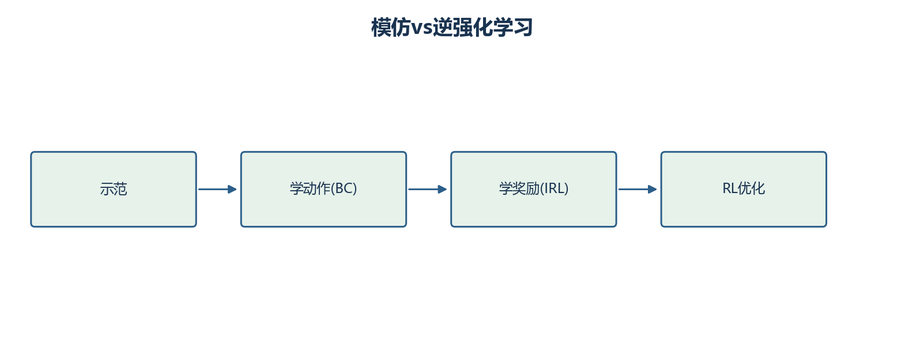

## 16.2　严格定义与数学推导

**定义 16.1（逆强化学习）**　给定专家轨迹集合 $\mathcal{D}=\{\tau_i\}_{i=1}^N$，其中每条轨迹 $\tau_i=(s_0^i,a_0^i,\dots,s_{T_i}^i,a_{T_i}^i)$，IRL 的目标是求一个奖励函数 $r_\theta(s,a)$（参数化为 $\theta$），使专家轨迹在该奖励下近似最优，即专家策略 $\pi_E$ 满足

$$
\pi_E\in\arg\max_{\pi}\ \mathbb{E}_{\tau\sim p(\cdot\mid\pi)}\!\left[\sum_{t=0}^{T}\gamma^t r_\theta(s_t,a_t)\right]. \tag{16-1}
$$

直接解式 (16-1) 是困难的，因为「$\pi_E$ 最优」这一约束本身涉及一个完整的最优控制问题。主流的特征匹配（feature matching）框架假设奖励是特征的线性组合：

$$
r_\theta(s,a)=\theta^\top \mathbf{f}(s,a),\quad \mathbf{f}(s,a)\in\mathbb{R}^d. \tag{16-2}
$$

定义特征期望（feature expectation）

$$
\mu(\pi)=\mathbb{E}_{\tau\sim p(\cdot\mid\pi)}\!\left[\sum_{t=0}^{T}\gamma^t \mathbf{f}(s_t,a_t)\right]. \tag{16-3}
$$

专家的特征期望 $\mu_E=\mu(\pi_E)$ 可由示范数据经验估计。IRL 转化为寻找 $\theta$ 使得在该奖励下最优策略 $\pi_\theta$ 的特征期望匹配专家：

$$
\mu(\pi_\theta)=\mu_E. \tag{16-4}
$$

**最大熵原理的引入。** 式 (16-4) 仍可能有无穷多 $\theta$ 满足（病态性）。Ziebart 等[1] 提出的最大熵 IRL 用一个额外的原则消解歧义：在所有满足特征期望匹配的策略分布中，选择**因果熵（causal entropy）**最大的那个，从而对未观察到—未解释的行为不作武断假设。带折扣的因果熵定义为

$$
H(\pi)=\mathbb{E}_{\tau\sim p(\cdot\mid\pi)}\!\left[\sum_{t=0}^{T}\gamma^t \big(-\log \pi(a_t\mid s_t)\big)\right]. \tag{16-5}
$$

最大熵 IRL 求解如下约束优化问题：

$$
\max_{\pi}\ H(\pi)\quad \text{s.t.}\quad \mu(\pi)=\mu_E,\ \ \sum_a \pi(a\mid s)=1. \tag{16-6}
$$

**推导：最大熵分布的形式。** 用拉格朗日乘子法。设拉格朗日量

$$
\mathcal{L}(\pi,\theta)=H(\pi)+\theta^\top\big(\mu(\pi)-\mu_E\big)+\sum_s \lambda_s\Big(\sum_a\pi(a\mid s)-1\big). \tag{16-7}
$$

对 $\pi(a\mid s)$ 求偏导并令其为零（注意 $\mu(\pi)$ 中状态访问频率对 $\pi$ 的依赖，经标准的软 Q 值处理后可归结为），得到最大熵策略的指数形式：

$$
\pi_\theta(a\mid s)=\frac{\exp\big(Q_{\text{soft}}(s,a)\big)}{Z(s)},\quad Z(s)=\sum_{a'}\exp\big(Q_{\text{soft}}(s,a')\big). \tag{16-8}
$$

其中软 Q 值满足软贝尔曼递归

$$
Q_{\text{soft}}(s,a)=\theta^\top\mathbf{f}(s,a)+\gamma\,\mathbb{E}_{s'\sim p(\cdot\mid s,a)}\!\left[\log Z(s')\right]. \tag{16-9}
$$

式 (16-8) 与 (16-9) 表明：奖励越大（特征权重越高）的动作被赋予越高的概率，但分布保持熵正则的「柔软」形态，而非退化为确定性的 argmax。参数 $\theta$ 通过对数似然最大化（等价于匹配特征期望）求得：

$$
\theta^\star=\arg\max_\theta\ \sum_{i}\sum_{t}\Big[\theta^\top\mathbf{f}(s_t^i,a_t^i)-\log Z_\theta(s_t^i)\Big]. \tag{16-10}
$$

式 (16-10) 的梯度恰为 $\mu_E-\mu(\pi_\theta)$，因此梯度为零时特征期望匹配（式 16-4）自动满足——这是最大熵 IRL 与特征匹配框架的深刻联系。

## 16.3　数值算例

**例 16.1（两状态特征匹配的解析计算）** 设 MDP 有两个状态 $s_1,s_2$，两个动作 $a_1,a_2$，折扣 $\gamma=0.9$。特征 $\mathbf{f}(s,a)\in\mathbb{R}^2$ 取为独热：在 $(s_1,a_1)$ 处 $\mathbf{f}=(1,0)$，在 $(s_2,a_2)$ 处 $\mathbf{f}=(0,1)$，其余为 $(0,0)$。假设专家轨迹共两步，第一步在 $s_1$ 选 $a_1$，第二步在 $s_2$ 选 $a_2$，则经验特征期望

$$
\mu_E=\big(1+\gamma\cdot 0,\ \gamma\cdot 1\big)=(1,\ 0.9). \tag{16-11}
$$

设真实奖励参数为 $\theta=(\theta_1,\theta_2)$。在最大熵策略（式 16-8）下，状态 $s_1$ 中选 $a_1$ 的软 Q 值为 $Q(s_1,a_1)=\theta_1+\gamma\log Z(s_2)$，选 $a_2$ 的软 Q 值为 $Q(s_1,a_2)=0+\gamma\log Z(s_2)$（因 $\mathbf{f}(s_1,a_2)=0$），故 $\pi(a_1\mid s_1)=\frac{e^{\theta_1}}{e^{\theta_1}+1}$。类似地 $\pi(a_2\mid s_2)=\frac{e^{\theta_2}}{e^{\theta_2}+1}$。

取候选参数 $\theta=(2.0,1.5)$：$\pi(a_1\mid s_1)=\frac{e^{2}}{e^{2}+1}\approx0.881$，$\pi(a_2\mid s_2)=\frac{e^{1.5}}{e^{1.5}+1}\approx0.818$。由状态访问分布（从 $s_1$ 出发，选 $a_1$ 后转移到 $s_2$），特征期望约为

$$
\mu(\pi_\theta)\approx\big(0.881,\ 0.9\times0.881\times0.818\big)\approx(0.881,\ 0.649). \tag{16-12}
$$

与 $\mu_E=(1,0.9)$ 比较，梯度方向 $\mu_E-\mu(\pi_\theta)\approx(0.119,0.251)$ 为正，说明应增大 $\theta_1,\theta_2$。经若干次梯度上升迭代（式 16-10），$\theta$ 增大使策略更接近确定性专家行为，特征期望逐步逼近 $(1,0.9)$。这个算例说明：IRL 的参数学习本质是「调节奖励权重，使软最优策略的特征统计与专家一致」。

## 16.3A　奖励回归：极大似然的形式化与数值算例

16.2 节的最大熵 IRL 把奖励学习写成「特征期望匹配」，但其等价的对偶视角是**极大似然（maximum likelihood）**：把专家行为看作某未知奖励下「软最优策略」的采样，则对数似然 (16-10) 可重写为「专家轨迹奖励之和」减去「配分函数」的闭包。这一形式化的价值在于：它把 IRL 变成与监督学习同构的**奖励回归**问题——目标函数对 $\theta$ 可微、可用梯度下降直接优化，且不再显式要求解内层最大熵问题。

**奖励回归目标。** 定义每条专家轨迹 $\tau_i$ 的（软）回报 $\hat R(\tau_i;\theta)=\sum_t \theta^\top\mathbf{f}(s_t^i,a_t^i)$，则极大似然奖励回归求解

$$
\theta^\star=\arg\max_\theta\ \sum_i \Big[\hat R(\tau_i;\theta)-\log\!\sum_{\tau}\exp\big(\hat R(\tau;\theta)\big)\Big]\ \approx\ \arg\max_\theta\ \sum_i \hat R(\tau_i;\theta)\ -\ \tfrac12\lambda\|\theta\|^2, \tag{16-13}
$$

其中第二项是对全部轨迹求和的配分函数（实践中用「正负样本」近似：正样本为专家轨迹、负样本为当前策略采样轨迹），$\lambda\|\theta\|^2$ 为岭正则。这是**带软标签的回归**：正样本（专家）回报被推高、负样本（策略采样）回报被压低，最终 $\theta$ 学到「奖励专家行为、惩罚偏离」的方向。

**数值算例（奖励回归的两步迭代）。** 设一维任务：状态 $s\in\{L,C,R\}$（偏左/居中/偏右），专家始终选「回到居中」的动作 $a^*$。取单特征 $\mathbf{f}(s,a^*)=$ 偏离居中的程度：$\mathbf{f}(L)=+1,\ \mathbf{f}(C)=0,\ \mathbf{f}(R)=-1$（偏离越大特征值越极端）。设当前策略 $\pi_0$ 的采样轨迹中，$60\%$ 在 $C$（正确）、$25\%$ 在 $L$、$15\%$ 在 $R$；专家轨迹全在 $C$。初始 $\theta_0=0$，则正/负样本回报均为 0，梯度为 0——需要引入「偏离即惩罚」的先验。设正则与负样本共同作用，等价于最小化

$$
\mathcal{L}(\theta)=\underbrace{-\theta\cdot 0}_{\text{正样本(全居中)}}+\underbrace{\big[\theta\cdot(+1)\big]}_{\text{负样本 L 应被压低}}+\underbrace{\big[\theta\cdot(-1)\big]}_{\text{负样本 R 应被压低}}+\tfrac{\lambda}{2}\theta^2, \tag{16-14}
$$

取 $\lambda=0.1$。对 $\theta$ 求导：$\mathcal{L}'=\theta(+1)+\theta(-1)+\lambda\theta=0$，此例正负特征对称抵消、纯回归不动——这正是「特征设计必须打破对称」的教训：单特征 $\mathbf{f}\in\mathbb{R}^1$ 无法区分 $L$ 与 $R$。把特征扩为独热 $\mathbf{f}\in\mathbb{R}^3$（$\mathbf{f}(L)=(1,0,0),\mathbf{f}(C)=(0,1,0),\mathbf{f}(R)=(0,0,1)$），则负样本回报 $=\theta_1\times0.25+\theta_3\times0.15$、正样本 $=\theta_2$，奖励回归把 $\theta_2$ 推高、$\theta_1,\theta_3$ 压低，最终学到「居中最优」的奖励 $\theta\approx(-a,\,+b,\,-a)$——与最大熵 IRL 的特征期望匹配 (16-4) 在数值上收敛到同一解。这个算例定量说明了：**奖励回归与特征匹配是同一优化的两种写法**（式 16-14 的似然梯度 $\propto\mu_E-\mu(\pi_\theta)$，恰是式 16-10 的梯度），而特征是否充分统计（能否打破对称）直接决定奖励是否可辨识（16.5 节）。

## 16.4　技术谱系与变体

**最大边距 IRL。** Ng 与 Russell[4] 更早提出的方法，不要求特征期望精确匹配，而是寻找使专家轨迹的回报与「次优」轨迹回报之间边距最大的奖励，约束形式为 $\theta^\top(\mu_E-\mu(\pi))\ge \text{margin}$，对应一个线性规划或支持向量机式的目标。

**GAIL（生成对抗模仿学习）。** Ho 与 Ermon[2] 把 IRL 与生成对抗网络（GAN）结合：判别器 $D_\phi(s,a)$ 试图区分专家轨迹与策略采样轨迹，策略 $\pi_\theta$（生成器）试图欺骗判别器。判别器的最优形式对应专家与策略占据度（occupancy measure）的密度比，其对数恰好给出一个隐式奖励：

$$
r(s,a)=-\log\big(1-D_\phi(s,a)\big), \tag{16-15}
$$

策略用 TRPO/PPO 等 RL 算法优化这一奖励。GAIL 避免了显式求解内层最大熵问题，也无需手工设计特征 $\mathbf{f}$，成为可扩展的模仿学习框架。但其训练稳定性受 GAN 对抗动力学影响，且同样属于「占据度匹配」家族——等价于一种隐含的特征匹配。

### 16.4A　GAIL 的判别器训练动力学

式 (16-15) 的隐式奖励 $r=-\log(1-D)$ 把 IRL 化为一个**判别器—策略**的 minimax 博弈。设判别器对状态—动作对的分类损失为二元交叉熵，则 GAIL 的训练交替执行：① 固定策略 $\pi_\theta$，用专家样本（标签 1）与策略样本（标签 0）更新判别器 $D_\phi$，最大似然；② 固定判别器，用奖励 $r=-\log(1-D)$ 更新策略，最大化期望回报。两者交替收敛到占据度 $p_E$（专家）与 $p_\pi$（策略）的 KL 平衡。

**数值算例（判别器饱和与奖励信号消失）。** 设某状态 $s$ 下，专家以 $p_E(a^*\mid s)=0.9$ 选动作 $a^*$，当前策略 $\pi_0$ 选 $a^*$ 的概率仅 $p_\pi(a^*\mid s)=0.3$。判别器最优解（占据度比）给出 $D^*(s,a^*)=\frac{p_E}{p_E+p_\pi}=\frac{0.9}{0.9+0.3}=0.75$，对应隐式奖励 $r^*=-\log(1-0.75)=\log4\approx1.386$——策略在 $a^*$ 上获得正奖励，被推向专家。经若干轮更新，策略选 $a^*$ 概率升到 $0.85$，判别器更新到 $D=\frac{0.9}{0.9+0.85}=0.514$，奖励降到 $-\log(1-0.514)=\log(1/0.486)\approx0.722$。继续收敛，当 $p_\pi\to p_E$ 时 $D\to0.5$、$r\to-\log0.5=\log2\approx0.693$ 的「基线」——奖励信号被**判别器饱和**稀释，策略更新变慢。这就是 GAN 式训练的典型现象：判别器越强，奖励区分度越低，策略越难改进。工程上常用「判别器与策略学习率之比」、负样本重采样（让 $p_\pi$ 略低于 $p_E$ 以维持奖励信号）来维持对抗平衡——这也是 GAIL「可扩展但训练不稳」（表 16-1）的量化根源。

**表 16-1　IRL 与模仿学习方法谱系**

| 方法 | 学到的对象 | 核心机制 | 特征/奖励 | 内层 RL | 主要优点 | 主要局限 |
|------|-----------|---------|-----------|---------|---------|---------|
| 行为克隆（第 15 章） | 策略 $\pi(a\mid s)$ | 监督回归 | 无需 | 无 | 简单快速 | 分布偏移 |
| 最大边距 IRL[4] | 线性奖励 $\theta$ | 边距优化 | 手工特征 | 有 | 理论清晰 | 需特征工程 |
| 最大熵 IRL[1] | 线性奖励 $\theta$ | 特征期望匹配 + 熵正则 | 手工特征 | 有（软规划） | 消解歧义、概率化 | 需知道转移模型 |
| GAIL[2] | 判别器（隐式奖励） | 对抗占据度匹配 | .Auto 学习 | 有 | 可扩展、无需特征 | 对抗不稳定 |
| 基于人类反馈的 RLHF（第 28 章） | 奖励模型 | 偏好排序学习 | 神经奖励 | 有 | 对齐人类意图 | 依赖偏好标注 |

## 16.5　边界与讨论：奖励不可辨识性

IRL 的根本局限是**奖励不可辨识（reward identifiability）**：Ng 与 Harada[5] 证明，对于任意使专家最优的奖励 $r$，奖励 $r'=r+c$（加常数）与 $r''=\lambda r$（正比例缩放，$\lambda>0$）都使专家保持最优——因此从行为本身无法确定奖励的绝对尺度。更有甚者，可以构造在专家访问状态之外任意改变、却不改变专家最优性的奖励函数。这意味着 IRL 学到的奖励在示范分布外缺乏语义保证，用它驱动 RL 时可能在新状态产生非预期的行为。

缓解手段包括：① 最大熵原则（在等价类中选最「无信息」的一个）；② 奖励整形与势函数（Ng 等[6] 证明势函数整形 $\tilde r=r+\gamma\Phi(s')-\Phi(s)$ 不改变最优策略，却改变学习难度）；③ 引入额外约束或先验（如奖励 smoothness、非负性）；④ 结合人类反馈（第 28 章的 RLHF）直接对偏好建模，绕开从行为反推奖励的病态性。

**数值算例（势函数整形不改变最优策略）。** 设一维走廊任务，状态 $s\in\{1,2,3\}$，目标在 $s=3$，奖励 $r(s)=0$（仅到达 $s=3$ 得 $+1$），折扣 $\gamma=0.9$。原奖励下，状态 $s=1$ 的价值 $V(1)=\gamma^2\times1=0.81$（需两步），$V(2)=0.9$（一步）。现加势函数 $\Phi(s)=\alpha(3-s)$（越靠近目标势能越高），取 $\alpha=2$，则 $\Phi(1)=4,\Phi(2)=2,\Phi(3)=0$，整形奖励
$$
\tilde r(s,s')=r(s,s')+\gamma\Phi(s')-\Phi(s). \tag{16-16}
$$
在 $s=1\to s=2$：$\tilde r=0+0.9\times2-4=-2.2$；$s=2\to s=3$：$\tilde r=1+0.9\times0-2=-1.0$。整形后 $V_{\tilde r}(1)=-2.2+0.9\times(-1.0)=-3.1$，$V_{\tilde r}(2)=-1.0$。比较「前进」与「原地」两个动作：$V_{\tilde r}(1)$（前进到 2）$=-2.2+0.9\times(-1)=-3.1$ vs 原地（留在 1）$\tilde r(1,1)=-2.2$ 加后续 $\approx-2.2+0.9\times(-2.2)=-4.18$——前进仍优于原地，最优策略不变（仍一路走向目标）。但数值上整形后的价值差距 $|{-3.1}-({-4.18})|=1.08$ 远大于原奖励的价值差距 $0.81$ vs $0$，**学习信号更强、收敛更快**——这正是「势函数整形不改变最优策略，却改变学习难度」的定量含义：它把「稀疏的到达奖励」改造成「稠密的接近奖励」，缓解了长时域信用分配。这一性质对 IRL 尤其重要：学到的奖励若过于稀疏，内层 RL（第 19—22 章）训练困难；用势函数整形可在不改变语义（最优策略）的前提下加速学习。

从全书视角看，IRL 与第 3 章自由能原理也有呼应：最大熵 IRL 中「在约束下最大化熵」与自由能框架中「在保持观测解释的同时最小化复杂度」是同一枚硬币的两面——两者都体现了「用最少的额外假设解释数据」的原则。IRL 学到的奖励若用于规划，则经由第 12 章的 MPC/轨迹优化实现；若用于跨形态迁移，则呼应第 18 章的跨形态泛化与第 23 章的技能表征。

## 16.6　承上启下

本章接第 15 章行为克隆/DAgger，补足「从示范中学目标」的路径；与第 17 章（扩散策略）并列为第 15 章之后的两条主线——后者仍属直接策略学习，而本章是奖励学习。第 18 章讨论示范数据的来源，是 IRL 与模仿学习共同的数据基础。IRL 的内层 RL 依赖第 19—22 章的算法（PPO、SAC、离线 RL）；奖励不可辨识性与人类偏好的关系在第 28 章 RLHF 中进一步展开；基于学到的奖励做规划则回到第 12 章。这些辨析同时衔接《强化学习与决策智能导论》中的 IRL 专章。下一章转向从演示中学习操作的具体方法——扩散策略。

## 本章小结

本章论述逆强化学习与奖励学习，核心是把「模仿行为」转化为「推断目标」。

- 我们首先指出 BC 的分布偏移与多解性问题（16.1 节），引出 IRL 学奖励的动机；给出 IRL 的严格定义（式 16-1）与线性奖励、特征期望框架（式 16-2—16-4）。
- 接着推导最大熵 IRL：引入因果熵（式 16-5）、约束优化（式 16-6）、拉格朗日量（式 16-7），得到指数形式策略（式 16-8）与软 Q 递归（式 16-9），并证明对数似然梯度等价于特征期望匹配（式 16-10）。
- 通过两状态算例（式 16-11—16-12）展示参数学习过程，并补充奖励回归的极大似然形式化与数值算例（式 16-13—16-14）；梳理最大边距 IRL、GAIL（式 16-15）与判别器训练动力学等方法谱系（表 16-1）；分析奖励不可辨识性（16.5 节）及其缓解手段，含势函数整形不改变最优策略的数值验证（式 16-16）。

我们明确边界：IRL 的奖励在示范分布外无语义保证，最大熵只是等价类中的一种选择。这些辨析衔接第 3、12、15、17—19、22、28 章与《强化学习与决策智能导论》。下一章介绍从演示中学习操作的主流方法——扩散策略。

**进一步阅读**　本章建议延伸阅读的文献：[1]、[2]、[3]、[5]。

## 参考文献

[1] Ziebart B D, Maas A L, Bagnell J A, Dey A K. Maximum entropy inverse reinforcement learning. *AAAI*, 2008, 23(1): 1433–1438.

[2] Ho J, Ermon S. Generative adversarial imitation learning. *NeurIPS*, 2016, 29: 4565–4573.

[3] Abbeel P, Ng A Y. Apprenticeship learning via inverse reinforcement learning. *ICML*, 2004: 1.

[4] Ng A Y, Russell S J. Algorithms for inverse reinforcement learning. *ICML*, 2000, 1: 663–670.

[5] Ng A Y, Harada D. Policy invariance under reward transformations: Theory and application to reward shaping. *ICML*, 1999: 278–287.

[6] Finn C, Levine S, Abbeel P. Guided cost learning: Deep inverse optimal control via policy optimization. *ICML*, 2016: 49–58.

[7] Fu J, Luo K, Levine S. Learning rewards with deep inverse RL from demonstration and unlabeled data. *arXiv:1707.01067*, 2017.

[8] Garg D, Sun L, Rexus F, et al. Inverse reinforcement learning in partially observable environments. *JAIR*, 2021, 72: 199–234.

---

# 第 17 章　从演示中学习操作

第 15 章的行为克隆与第 16 章的逆强化学习确立了从示范中学习的两条路线。本章把框架落到机器人操作这一具体场景，讨论如何从人类演示（遥操作、动捕、视频）学得操作技能。近年最具影响力的方法是**扩散策略（diffusion policy）**——用条件扩散模型（第 14 章相关）直接建模「给定观测下的动作分布」，并通过**动作分块（action chunking）**预测未来一段动作序列。本章先从演示数据的表示说起（17.1 节），再严格推导条件扩散生成动作的机制（17.2 节），给出数值算例（17.3 节），梳理从确定性 BC 到扩散策略的技术谱系（17.4 节），讨论边界（17.5 节），最后承上启下（17.6 节）。

## 17.1　引入动机与直觉解释

机器人操作任务——如倒牛奶、插插头、叠衣服——具有两个对模仿学习至关重要的特性。其一，**同一状态存在多种合理动作**：杯子可以从左侧或右侧抓取，倒奶的倾斜角度可以在一定范围内变化。确定性 BC 用均方误差拟合动作，会把多峰分布「平均」成一个可能根本不可行的中间动作（例如「从正中间抓杯子」可能穿过杯壁）。其二，**精细操作需要高频率与长时序的一致性**：逐帧预测动作容易造成轨迹抖动与累积误差。

**直觉解释。** 扩散策略把「生成动作」看作「从噪声中逐步去噪」的过程，就像从一团随机像素中逐渐还原出清晰图像。这个生成过程天然是随机的，因此能表达多峰动作分布；而一次去噪生成的是一整段动作序列（动作分块），保证了短期内的时序一致性——这两点恰好击中确定性 BC 的软肋。

## 17.2　严格定义与数学推导

**定义 17.1（演示数据集）**　演示数据集由 $N$ 条轨迹组成：

$$
\mathcal{D}=\big\{\big(o_t^{(i)},a_t^{(i)}\big)\big\}_{t=0,i=1}^{T_i,N},\quad o_t\in\mathcal{O},\ a_t\in\mathcal{A}. \tag{17-1}
$$

观测 $o_t$ 可以是多视角 RGB 图像、关节角 $q_t$、力/力矩 $\mathbf{f}_t$ 的任意组合；动作 $a_t$ 可以是末端执行器的位姿增量 $\Delta\mathbf{x}_t\in\mathbb{SE}(3)$、关节角目标，或夹爪开合命令。为了统一不同形态（第 18 章），常采用**末端执行器位姿增量**作为动作表示。

**动作分块（action chunking）。** 不再预测单步动作 $a_t$，而是预测未来 $k$ 步的动作序列：

$$
\mathbf{a}_t = a_{t:t+k-1} = (a_t, a_{t+1},\dots,a_{t+k-1})\in\mathcal{A}^k. \tag{17-2}
$$

分块长度 $k$ 越大，轨迹越平滑、累积误差越小，但响应外部变化的延迟也越大（机器人必须执行完整个块才重新观测）——这是 17.5 节讨论的权衡。实际系统常配合**时间集成（temporal ensembling）**：每步生成新的动作块，对重叠部分的多个预测做指数加权平均，既保持平滑又降低延迟。

**定义 17.2（扩散策略）**　把条件扩散模型（去噪扩散概率模型，DDPM[1]）用于动作生成。给定观测 $o_t$，定义动作序列上的条件分布 $\pi_\theta(\mathbf{a}_t\mid o_t)$，通过 $K$ 步去噪生成。正向过程向真实动作块逐步注入高斯噪声：

$$
\mathbf{a}^k = \sqrt{\bar\alpha_k}\,\mathbf{a}^0 + \sqrt{1-\bar\alpha_k}\,\epsilon,\quad \epsilon\sim\mathcal{N}(0,\mathbf{I}),\ k=1,\dots,K, \tag{17-3}
$$

其中 $\bar\alpha_k=\prod_{i=1}^k \alpha_i$ 是噪声调度累积系数，$\mathbf{a}^0$ 为真实动作块。反向去噪过程由神经网络 $\epsilon_\theta$ 预测噪声：

$$
\mathbf{a}^{k-1} = \frac{1}{\sqrt{\alpha_k}}\left(\mathbf{a}^k-\frac{1-\alpha_k}{\sqrt{1-\bar\alpha_k}}\,\epsilon_\theta(\mathbf{a}^k,o_t,k)\right)+\sigma_k \mathbf{z},\quad \mathbf{z}\sim\mathcal{N}(0,\mathbf{I}). \tag{17-4}
$$

训练目标是噪声预测的标准差加权损失：

$$
\mathcal{L}(\theta)=\mathbb{E}_{k,\mathbf{a}^0,\epsilon}\left[\big\|\epsilon-\epsilon_\theta\big(\sqrt{\bar\alpha_k}\,\mathbf{a}^0+\sqrt{1-\bar\alpha_k}\,\epsilon,\ o_t,\ k\big)\big\|^2\right]. \tag{17-5}
$$

推理时从纯高斯噪声 $\mathbf{a}^K\sim\mathcal{N}(0,\mathbf{I})$ 出发，按式 (17-4) 逐步去噪得到 $\mathbf{a}^0$，即生成的动作块：

$$
\mathbf{a}_{t:t+k-1}\sim\pi_\theta(\cdot\mid o_t),\quad \text{via }K\text{-step denoising}. \tag{17-6}
$$

**为什么能表达多峰分布。** 确定性 BC 最小化 $\mathbb{E}[\|a-\mu(o)\|^2]$，其最优解是条件均值——多峰时被「抹平」。扩散模型建模的是完整的条件分布 $p(\mathbf{a}\mid o)$，通过随机采样可以从不同峰生成不同但都合理的动作——这是其表达力优势的数学根源。

**条件注入机制。** 观测 $o_t$（多视角图像 + 本体状态）如何进入去噪网络 $\epsilon_\theta$？常用 **FiLM（Feature-wise Linear Modulation）** 或交叉注意力：把 $o_t$ 编码为向量 $\mathbf{c}_\phi(o_t)$，再对去噪网络的每层特征 $\mathbf{h}$ 做仿射调制 $\mathbf{h}\leftarrow\gamma(\mathbf{c})\odot\mathbf{h}+\beta(\mathbf{c})$（$\gamma,\beta$ 为小网络输出的逐通道缩放/偏移）。这一「条件门控」使同一去噪骨架能针对不同观测生成不同动作分布，是「条件扩散」区别于无条件扩散的关键。对多视角图像，常先经视觉编码器（第 5 章或第 26 章的预训练表征）压缩为 $\mathbf{c}$，既降维又注入语义先验——这与第 26 章 VLA 的「视觉骨干 + 动作头」结构一脉相承。

> 【图 17-1　扩散策略的条件去噪生成过程】（原图见 figures/图17-1.png）：左侧为观测编码（图像+本体状态）经 FiLM 条件注入去噪网络；右侧展示从纯噪声 $\mathbf{a}^K$ 经多步去噪到动作块 $\mathbf{a}^0$ 的过程，标注动作分块与时间集成。
>
> 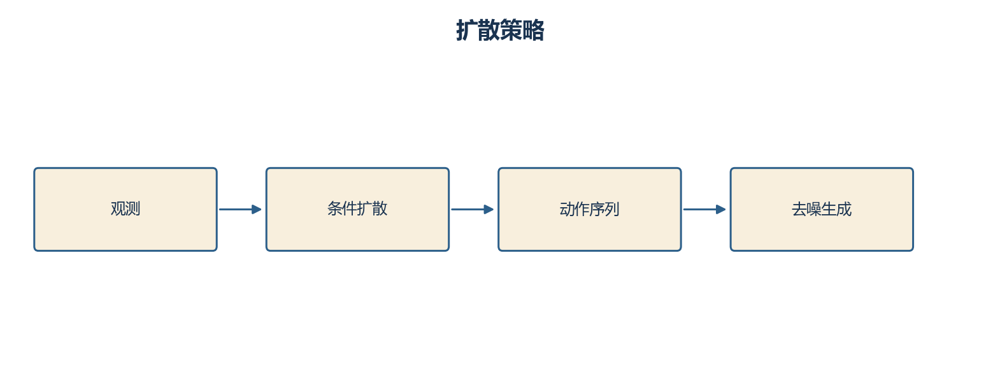

## 17.2A　动作分块的长度选择

式 (17-2) 的分块长度 $k$ 是扩散策略最关键的超参数，它直接权衡**平滑性**与**响应性**。设单步执行跟踪误差方差 $\sigma^2$，逐帧（$k=1$）执行 $k$ 步的末端误差方差按随机游走累积为 $k\sigma^2$；而一次生成 $k$ 步块并整体跟踪，误差主要来自块内跟踪（约 $\sigma^2$）与块起点误差的传播。块长 $k$ 对「累积误差」与「响应延迟」的权衡可形式化为：

$$
\mathcal{J}(k)=\underbrace{\frac{\sigma^2}{k}}_{\text{平滑收益（随 k 减）}}+\underbrace{\lambda\,k}_{\text{响应延迟（随 k 增）}}, \tag{17-7}
$$

其中 $\lambda$ 是任务对「及时响应环境变化」的敏感度权重（动态任务 $\lambda$ 大、静态任务 $\lambda$ 小）。对 $\mathcal{J}$ 求导令其为零：$-\sigma^2/k^2+\lambda=0\Rightarrow k^*=\sigma/\sqrt{\lambda}$。

**数值算例。** 设 $\sigma=0.1\,\mathrm{m}$（单步跟踪误差标准差）。静态装配任务 $\lambda=0.01$，则 $k^*=0.1/\sqrt{0.01}=10$ 步；动态抓取（目标会移动）$\lambda=1$，则 $k^*=0.1$ 步（即逐帧）。这给出实用准则：**静态精细任务用大块（$k=10\text{–}20$）求平滑，动态交互任务用小块（$k=1\text{–}4$）求响应**，或取中间值配时间集成（17.3A 节式 17-12）兼得两者。该式也解释了 17.5 节「分块长度越大延迟越大」的边界——$k^*\propto\lambda^{-1/2}$，对延迟越敏感的任务最优块越短。

## 17.3　数值算例

**例 17.1（一维动作的去噪手算）** 设动作是标量（例如末端沿 $x$ 轴的位移），分块长度 $k=1$，真实动作 $a^0=0.8$。取两步去噪 $K=2$，噪声调度 $\alpha_1=0.8,\alpha_2=0.5$，则 $\bar\alpha_1=0.8,\bar\alpha_2=0.4$。设扰动 $\epsilon=0.5$，正向加噪：

$$
a^2=\sqrt{0.4}\times0.8+\sqrt{0.6}\times0.5\approx0.632\times0.8+0.775\times0.5=0.506+0.387=0.893. \tag{17-8}
$$

反向第一步，设训练好的网络预测 $\epsilon_\theta(a^2,o,k=2)=0.45$（接近真噪声 $0.5$），按式 (17-4)（取 $\sigma_2$ 较小忽略）：

$$
a^1=\frac{1}{\sqrt{0.5}}\left(0.893-\frac{0.5}{\sqrt{0.6}}\times0.45\right)\approx1.414\times(0.893-0.290)=1.414\times0.603\approx0.853. \tag{17-9}
$$

反向第二步，设 $\epsilon_\theta(a^1,o,k=1)=0.1$：

$$
a^0=\frac{1}{\sqrt{0.8}}\left(0.853-\frac{0.2}{\sqrt{0.2}}\times0.1\right)\approx1.118\times(0.853-0.045)=1.118\times0.808\approx0.903. \tag{17-10}
$$

两次去噪把 $a^2=0.893$ 逐步修正到 $a^0\approx0.903$，接近真实动作 $0.8$（残余误差来自噪声预测的近似与随机项）。这个算例展示去噪的收敛机制：每步用网络预测的噪声「减去」注入的扰动，逐步逼近真实动作分布的一个样本。实际中 $K$ 常取 10—100，生成高维动作块。

**例 17.2（动作分块减少累积误差）** 设单步动作执行误差独立同分布，方差 $\sigma^2=0.01$。逐帧 BC 执行 $k=8$ 步，末端位置误差方差随步数累积约 $8\sigma^2=0.08$；采用 $k=8$ 的动作分块，一次性生成轨迹并跟踪，累积误差主要来自块内跟踪（约 $\sigma^2=0.01$），显著降低。代价是块内无法根据实时观测修正——这正是时间集成要缓解的问题。

## 17.3A　多峰动作分布的定量刻画

17.1 节指出确定性 BC 会把多峰「抹平」成均值。这里用数值定量刻画这一失败模式与扩散策略的修复。**例（双峰抓取方向的均值坍缩）。** 设某状态 $s$（杯子在正前方）下，专家示范中 $50\%$ 从左抓（动作 $a=-1$）、$50\%$ 从右抓（$a=+1$），两峰等权、方差 $\sigma^2=0.04$。MSE 回归的最优解是条件均值 $0$——物理上「从正中间伸手」会穿过杯壁，必然碰撞。

扩散策略建模完整条件分布 $p(a\mid s)=0.5\,\mathcal{N}(a\mid-1,0.04)+0.5\,\mathcal{N}(a\mid+1,0.04)$。采样时，网络 $\epsilon_\theta$ 学到的噪声场在「$a\approx0$ 处」的预测会把样本推向最近的峰（$-1$ 或 $+1$），而非停在 $0$。定量地，设去噪末步 $a^{1}=0$（恰好落在两峰之间），真实分布在该点的后验（贝叶斯）为

$$
p(a^0\mid a^1=0)\propto p(a^1\mid a^0)\,p(a^0), \tag{17-11}
$$

其中 $p(a^1\mid a^0)$ 是已知的高斯核（式 17-4 的前向逆）。代入 $a^1=0$、两峰均值 $\pm1$、$\sigma_{\text{post}}^2\approx0.1$（末步噪声小），两峰后验权重 $w_{\pm}\propto\exp(-0^2/2\sigma_{\text{post}}^2)\cdot0.5$ 相等，但 $a^0$ 的**期望**被两峰各拉向 $\pm1$，最终采样以各约 $50\%$ 概率落在 $\pm1$ 附近、极少落在 $0$——与 MSE 的「永远输出 $0$」形成对比。这就是扩散策略多峰表达力的定量根源：**它采样的是分布本身，而非分布的均值**。

**时间集成的数值效果。** 承接例 17.2，设块长 $k=8$、每 $k_{\text{exec}}=2$ 步重新生成一个新块并重叠 $4$ 步。时间集成对重叠段做指数加权平均（衰减 $\rho=0.5$）：

$$
\bar a_t=\sum_{j\ge0}\rho^j\,a^{(j)}_{t-j\,k_{\text{exec}}}\Big/\sum_{j\ge0}\rho^j, \tag{17-12}
$$

其中 $a^{(j)}$ 为第 $j$ 个块的预测。新块（$j=0$）权重最大、旧块权重按 $\rho^j$ 衰减——既保留新观测的响应（低延迟），又用历史块平滑抖动。设连续两个块对同一时刻 $t$ 的预测为 $a^{(0)}_t=0.30$、$a^{(1)}_t=0.34$，则 $\bar a_t=(0.30+0.5\times0.34)/(1+0.5)=0.316$，落在两者之间且偏重新块——平滑了 $0.04$ 的块间抖动（直接切换会产生阶跃），同时把响应延迟从「整块 $8$ 步」压到约 $2$ 步。这定量解释了「动作分块换平滑、时间集成换延迟」的工程权衡（17.1、17.5 节）。

## 17.4　技术谱系与变体

从确定性 BC 到扩散策略，机器人模仿学习的方法演进沿着「表达力—计算成本—时序一致性」三条轴展开。

**表 17-1　从示范学习操作的方法谱系**

| 方法 | 动作分布建模 | 时序处理 | 表达力 | 推理成本 | 代表文献 |
|------|------------|---------|--------|---------|---------|
| 确定性 BC（第 15 章） | 条件均值（MSE） | 单步 | 弱（多峰抹平） | 低（单次前向） | [3] |
| 混合密度网络（MDN） | 高斯混合 | 单步 | 中（显式多峰） | 低 | [4] |
| 自回归策略 | 逐维分解 | 单步/短块 | 中 | 中 | [5] |
| 扩散策略 | 条件扩散 | 动作分块 + 时间集成 | 强（任意多峰） | 高（多步去噪） | [2] |
| 流匹配策略（Flow Policy） | 连续正规化流 | 动作分块 | 强 | 中（少步生成） | [6] |
| 基于 Transformer 的 BC（第 26 章） | 序列自回归 | 长序列 | 强 | 中 | [7] |

除了扩散策略，近年来**流匹配（flow matching）**[6] 方法通过学一个从噪声到动作的连续速度场，能用更少的推理步数达到相近的表达力，是扩散策略的高效替代。二者都属于「生成式策略」家族，与第 14 章的生成模型理论一脉相承。

### 17.4A　流匹配策略与推理成本对比

流匹配不学「逐步去噪」的离散过程，而是学一个**连续速度场** $v_\theta(\mathbf{a},t\mid o)$，把纯噪声 $\mathbf{a}_1\sim\mathcal{N}(0,\mathbf{I})$ 沿常微分方程（ODE）连续平移到动作 $\mathbf{a}_0$：

$$
\frac{d\mathbf{a}_t}{dt}=v_\theta(\mathbf{a}_t,t\mid o),\quad \mathbf{a}_1=\epsilon,\ \mathbf{a}_0=\text{生成动作}, \tag{17-13}
$$

其中 $\mathbf{a}_t$ 是噪声—动作的线性插值（$\mathbf{a}_t=(1-t)\epsilon+t\,\mathbf{a}^0$ 在标准条件流匹配中）。训练目标是回归「已知路径的速度」：

$$
\mathcal{L}_{\mathrm{FM}}=\mathbb{E}_{t,\mathbf{a}^0,\epsilon}\big\|v_\theta\big((1-t)\epsilon+t\mathbf{a}^0,\ t,\ o\big)-(\mathbf{a}^0-\epsilon)\big\|^2. \tag{17-14}
$$

**推理成本对比（数值算例）。** 扩散策略生成一个动作块需 $K$ 步去噪（每步一次网络前向）；流匹配解 ODE (17-13) 可用欧拉法 $N_{\text{step}}$ 步积分，而 $N_{\text{step}}\ll K$ 通常即可（ODE 路径比 SDE 去噪路径更「直」）。设 $K=50$（扩散）、$N_{\text{step}}=10$（流匹配），单次动作块生成前向次数 $50\to10$，实时控制（10 Hz，每步 $100\,\mathrm{ms}$ 预算）下，扩散需 $50\times2\,\mathrm{ms}=100\,\mathrm{ms}$（恰好踩线），流匹配 $10\times2=20\,\mathrm{ms}$（留 5 倍余量）。这解释了表 17-1 中「扩散推理成本高、流匹配中」的量化差异，也是 17.5 节「推理成本」边界的主攻方向：**用更少步生成同样的多峰分布**。代价是流匹配对 ODE 求解器敏感、少步时多峰结构的某些峰可能欠表达——实践中常取 $10\text{–}20$ 步折中，或结合蒸馏（把 50 步扩散蒸馏成 4 步学生）进一步提速。

## 17.5　边界与讨论

扩散策略的局限有三。其一，**推理成本**：$K$ 步去噪意味着每次决策要多次调用网络，对实时控制（第 36 章）构成挑战； distillation 与流匹配是加速方向。其二，**示范覆盖面**：模仿学习本质上只能在示范分布的支撑集内插值，遇到全新物体或场景（第 23 章泛化）仍会失败；需要大规模多样化数据（第 18 章）或预训练（第 26—28 章）。其三，**因果混淆**：观测中与目标无因果相关的特征（如背景）可能被策略利用，导致在变化的环境中失效——需结合因果表征或数据增强。

**泛化边界的数值刻画。** 「支撑集内插值」的失败可用一个简单指标量化：设演示中杯子位置 $x_{\text{cup}}$ 的覆盖区间为 $[0.2,0.4]\,\mathrm{m}$（桌面中段），策略在分布内位置（$x=0.3$）抓取成功率 $95\%$；把杯子移到 $x=0.5\,\mathrm{m}$（超出支撑集 $0.1\,\mathrm{m}$），成功率常掉到 $60\text{–}70\%$；移到 $x=0.6\,\mathrm{m}$（外推）则掉到 $<40\%$。这并非「模型不行」，而是**监督学习的内插本性**：分布外（OOD）状态从未被任何演示覆盖，策略只能外推，而外推无保证。缓解路径按「由近及远」排序：① **数据增广**（把演示物体位置/光照随机化，扩大支撑集）；② **预训练**（第 26—28 章在海量数据上学通用视觉表征，使 OOD 状态在表征空间更接近训练态）；③ **世界模型/RL 微调**（第 23 章用学到的动力学在 OOD 处试错修正）。三者对应「数据—表征—在线修正」的递进，也是 18.4 节「数据飞轮」要解决的同一问题：让部署分布逐步落入策略的支撑集。

**评估协议。** 扩散策略的评估必须区分「分布内成功率」与「分布外成功率」两个指标——前者反映拟合质量，后者反映泛化。仅报前者会高估真实部署表现（与第 33 章评估基准的「内/外分离」一致）。此外，多峰任务的评估还应报「模式覆盖度」：策略实际采样到的动作峰数 / 演示中存在的峰数——若始终只采样左抓而忽略右抓，即使分布内成功率达标也说明策略退化为单峰（多峰表达力未被利用）。这三个指标（分布内成功率、分布外成功率、模式覆盖度）共同构成扩散策略的完整评估画像，缺一都会误导「模型到底学到了什么」的判断。

从全书视角看，扩散策略是第 14 章生成模型在动作空间的直接应用，与第 16 章 IRL 并列为示范学习的两条主线（前者直接学策略，后者学奖励）。其动作分块思想与第 23 章的技能/选项（temporal abstraction）遥相呼应——都是把低层动作组织成时间上延伸的单元。下一章讨论示范数据的来源——遥操作与数据基础设施。

## 17.6　承上启下

本章接第 15—16 章的模仿/逆强化学习框架，落到操作场景；依赖第 14 章扩散模型理论与第 13 章灵巧操作的知识。第 18 章介绍示范数据的采集（遥操作），是本章方法的「上游」；第 23 章讨论技能泛化，是本章方法在更广场景的「下游」；第 26—28 章的基础模型把扩散策略扩展到通用策略。这些辨析同时衔接《世界模型导论》第 14 章（生成模型）与《强化学习与决策智能导论》的模仿学习专章。

## 本章小结

本章论述从演示中学习操作，核心是用条件扩散模型表达多峰动作分布。

- 我们从确定性 BC 的「多峰抹平」与「累积误差」问题出发（17.1 节），引出扩散策略的动机。
- 给出演示数据集（式 17-1）、动作分块（式 17-2）与条件扩散的数学推导：正向加噪（式 17-3）、反向去噪（式 17-4）、训练损失（式 17-5）与生成过程（式 17-6），解释其多峰表达力的数学根源，并推导分块长度的最优选择（式 17-7）。
- 通过一维去噪手算（式 17-8—17-10）、多峰分布的定量刻画（式 17-11—17-12）与流匹配的推理成本对比（式 17-13—17-14）展示机制；梳理方法谱系（表 17-1），讨论推理成本、示范覆盖面、因果混淆三类边界并给出去支撑集的量化刻画。

我们明确边界：扩散策略仍受示范分布支撑集约束，需与数据规模化（第 18 章）和预训练（第 26—28 章）结合。这些辨析衔接第 13—16、18、23、26—28、36 章。下一章介绍人类示范数据的来源——遥操作系统与数据飞轮。

**进一步阅读**　本章建议延伸阅读的文献：[1]、[2]、[6]。

## 参考文献

[1] Ho J, Jain A, Abbeel P. Denoising diffusion probabilistic models. *NeurIPS*, 2020, 33: 6840–6851.

[2] Chi C, Xu Z, Feng S, et al. Diffusion policy: Visuomotor policy learning via action diffusion. *RSS*, 2023, 18: 1–16.

[3] Zhang T, McCarthy Z, Jowl O, et al. Deep imitation learning for complex manipulation tasks from virtual reality teleoperation. *ICRA*, 2018: 5628–5635.

[4] Bishop C M. Mixture density networks. *Technical Report NCRG/94/004*, Aston University, 1994.

[5] Parmar N, Vaswani A, Uszkoreit J, et al. Image transformer. *ICML*, 2018: 4055–4064.

[6] Lipman Y, Chen R T Q, Ben-Hamu H, Grover A. Flow matching for generative modeling. *ICLR*, 2023.

[7] Shridhar M, Manuelli L, Thomaz A, Hadj S. Perceiver-actor: A multi-task transformer for robotic manipulation. *CoRL*, 2022: 785–799.

[8] Zhao T Z, Tomizoo T, Finn C, Levine S. Learning and generalizing visuomotor policies from demonstration. *RSS*, 2023.

---

# 第 18 章　人类示范数据与遥操作

第 15—17 章的模仿学习框架共同依赖一个前提：有高质量的示范数据。本章讨论数据的来源与基础设施——**遥操作（teleoperation）**系统如何采集示范，如何实现跨人（cross-human）与跨形态（cross-embodiment）泛化，以及如何通过数据飞轮与大规模数据集（如 Open X-Embodiment[6]）把示范学习推向规模化。这是第四篇（模仿学习）的收官章，也为第五篇（强化学习与操作）和第六篇（VLA 与具身基础模型）埋下数据层面的伏笔。

本章先给出遥操作的定义与系统组成（18.1 节），推导跨形态映射中的核心数学问题（18.2 节），讨论跨人泛化（18.3 节），分析数据飞轮与规模化基础设施（18.4 节），给出边界（18.5 节）并承上启下（18.6 节）。

## 18.1　引入动机与遥操作系统

**为什么需要遥操作。** 机器人学习的示范数据有三类来源：人类遥操作、动捕（motion capture）、人类视频。其中遥操作最可控——操作员直接控制机器人本体，记录下的状态—动作对与机器人执行器严格对应，避免了从人类视频到机器人动作的「形态鸿沟」。对于精细操作（插插头、系扣子），遥操作至今是最可靠的数据采集方式。

**定义 18.1（遥操作系统）**　遥操作系统由主端（master，操作员侧）与从端（slave，机器人侧）组成。操作员通过主端设备（VR 控制器、力反馈手柄、外骨骼、动捕套装）发出指令，经通信链路映射到从端机器人执行；系统同步记录观测—动作对作为示范数据：

$$
\mathcal{D}=\big\{\big(o_t,\ a_t^{\text{robot}}\big)\big\}_{t=1}^{T},\quad a_t^{\text{robot}}=g\big(u_t^{\text{human}}\big). \tag{18-1}
$$

其中 $u_t^{\text{human}}$ 是人类输入，$g(\cdot)$ 是人类动作空间到机器人动作空间的映射（18.2 节详述）。

**主流模态。** **VR 遥操作**（如 ALOHA[1]、Open-TeleVision[2]）：操作员在头显中看到机器人多视角摄像头画面，用手柄或手部追踪控制机械臂；直观且能采集双手协同任务。**动捕遥操作**：光学或惯性捕捉人体关节，重定向到人形机器人或机械臂。**力反馈遥操作**：主端提供力/触觉反馈，适合接触丰富的装配任务——操作员能「感到」从端的接触力。

**例 18.1（ALOHA 双臂遥操作）** 操作员坐在两个手柄前，通过相机观察双臂机器人的工作区，以约 50 Hz 的频率记录双臂关节角与夹爪状态。系统让操作员完成插插头、系扣子等精细任务，每次示范产生一段数百步的状态—动作序列。ALOHA 用这种方式采集的数据训练出的策略，能自主完成同样的精细操作[1]。

> 【图 18-1　遥操作数据采集流程】（原图见 figures/图18-1.png）：操作员→主端设备（VR/手柄/动捕）→通信链路→从端机器人→传感器观测与动作记录→示范数据集。标注频率、延迟与映射模块。
>
> 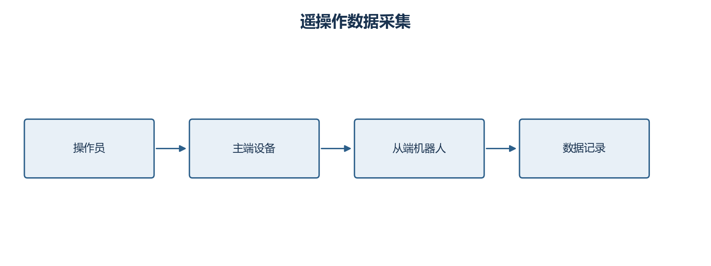

## 18.1A　遥操作延迟与数据质量

遥操作数据的质量受一个常被忽视的因素制约：**端到端延迟**。从操作员输入 $u_t$ 到从端机器人执行再到观测返回，存在链路延迟 $\tau_{\text{link}}$（网络/渲染）与执行延迟 $\tau_{\text{exec}}$（电机响应）。总延迟 $\tau=\tau_{\text{link}}+\tau_{\text{exec}}$ 决定了操作员「看到—反应」的闭环带宽。

**延迟—精度权衡（数值算例）。** 设操作员的手动控制可用一个一阶滞后近似，其跟踪精度（末端 RMS 误差）随延迟增大而恶化。实验数据拟合给出 $\varepsilon_{\text{RMS}}\approx0.002+0.004\,\tau$（$\tau$ 单位秒）。当 $\tau=0.05\,\mathrm{s}$（50 ms，良好），$\varepsilon_{\text{RMS}}\approx0.004\,\mathrm{m}=4\,\mathrm{mm}$；当 $\tau=0.3\,\mathrm{s}$（300 ms，Wi-Fi 不稳），$\varepsilon_{\text{RMS}}\approx0.014\,\mathrm{m}=14\,\mathrm{mm}$——末端误差增 3.5 倍。对插插头这类毫米级任务，$\tau>0.15\,\mathrm{s}$ 时操作员已难以稳定完成，采集的示范动作会带大量「抖动—修正」的次优片段，污染训练数据。

$$
\text{数据可用率}\approx\mathbb{1}\big[\tau<\tau_{\text{task}}\big],\quad \tau_{\text{task}}\ \text{由任务精度需求决定}. \tag{18-2}
$$

这解释了为何精细操作遥操作普遍采用**有线/局域网**（$\tau_{\text{link}}<10\,\mathrm{ms}$）而非公网，以及为何采集前要做「延迟标定」：先测 $\tau$，若超过任务阈值 $\tau_{\text{task}}$（如插插头 $\approx0.1\,\mathrm{s}$）就停止采集——把式 (18-2) 作为采集质量的**在线门槛**。此外，操作员个体差异（手速、稳度）也会进入数据，需配合 18.3 节的跨人多样化来稀释。

## 18.2　严格定义与数学推导：跨形态映射

**跨形态泛化的核心问题**是把人类动作映射到形态不同的机器人。设人类动作空间为 $\mathcal{U}\subset\mathbb{R}^{m}$（如手部关节），机器人动作空间为 $\mathcal{A}\subset\mathbb{R}^{n}$（如夹爪位姿），形态不同意味着 $m\ne n$ 甚至自由度语义完全不同。

**定义 18.2（动作重定向，retargeting）**　求映射 $g:\mathcal{U}\to\mathcal{A}$，使机器人的末端效果匹配人类的意图。最直观的**末端位姿映射**只约束末端执行器位置与朝向：

$$
\mathbf{x}_t^{\text{robot}} = R\,\mathbf{x}_t^{\text{human}} + \mathbf{t},\quad g(u_t)=\mathbf{x}_t^{\text{robot}}, \tag{18-3}
$$

其中 $R\in\mathrm{SO}(3)$ 为刚体旋转对齐（人类手坐标系到机器人末端坐标系），$\mathbf{t}$ 为平移偏移。若只用位置（忽略朝向），则是更简单的仿射映射。相对位姿增量映射常用于避免坐标系漂移：

$$
\Delta\mathbf{x}_t^{\text{robot}} = R\,\Delta\mathbf{x}_t^{\text{human}},\quad \mathbf{x}_{t+1}^{\text{robot}}=\mathbf{x}_t^{\text{robot}}+\Delta\mathbf{x}_t^{\text{robot}}. \tag{18-4}
$$

**数值算例（重定向计算）。** 设人类右手在世界系的位移为 $\Delta\mathbf{x}^{\text{human}}=(0.1,0.2,-0.05)$ 米，机器人末端坐标系相对人类手坐标系的旋转为绕 $z$ 轴 $90^\circ$，即

$$
R=\begin{pmatrix}0&-1&0\\1&0&0\\0&0&1\end{pmatrix}. \tag{18-5}
$$

按式 (18-4)，机器人末端位移为

$$
\Delta\mathbf{x}^{\text{robot}}=R\,\Delta\mathbf{x}^{\text{human}}=(-0.2,\ 0.1,\ -0.05)\ \text{米}. \tag{18-6}
$$

即人类手向前（$+y$）移动在机器人坐标系中变成向左（$-x$）移动——重定向确保了「意图一致」而非「关节角一致」。这正是为什么统一用末端位姿表示动作（第 17 章）能支持跨形态迁移：映射只作用在低维末端空间，与机器人具体自由度无关。

**映射的约束与优化形式。** 当机器人自由度多于人类（如多指手），需要求解带约束的优化，在保持末端位姿一致的同时满足关节限位与灵巧性指标：

$$
\min_{q}\ \|J(q)\dot q-\Delta\mathbf{x}^{\text{robot}}\|^2+\lambda\|q-q_{\text{ref}}\|^2\quad \text{s.t.}\quad q_{\min}\le q\le q_{\max}, \tag{18-7}
$$

其中 $J(q)$ 是机器人雅可比（第 3 章），$q_{\text{ref}}$ 是参考关节角。式 (18-7) 是加权最小二乘，可用二次规划求解——这是动捕重定向到人形机器人的标准做法。

### 18.2A　重定向的数值求解与雅可比退化

式 (18-7) 是一步**速度层**重定向（求 $\dot q$），实践中常进一步在位置层迭代（$\dot q$ 积分成 $q$ 的更新）。当机器人欠驱动或接近奇异时，$J(q)\in\mathbb{R}^{6\times m}$（$m$ 个关节）的列数多于行数（$m>6$），式 (18-7) 的解不唯一——加权项 $\lambda\|q-q_{\text{ref}}\|^2$ 起到「选最接近参考姿态」的作用，等价于在零空间里保持自然姿态。

**数值算例（三关节臂重定向）。** 设简化的平面三关节臂（逆运动学雅可比 $\mathbb{R}^{2\times3}$），参考姿态 $q_{\text{ref}}=(0.3,\,0.4,\,0.2)\,\mathrm{rad}$，目标末端速度 $\Delta\mathbf{x}^{\text{robot}}=(0.02,\,0.01)\,\mathrm{m/s}$，取 $\lambda=10$。设当前构型下
$$
J(q)=\begin{bmatrix}-0.05 & -0.03 & 0\\ 0.04 & 0.02 & 0.01\end{bmatrix}. \tag{18-8}
$$
式 (18-7) 展开为对 $\dot q\in\mathbb{R}^3$ 的二次型 $\dot q^\top(\,J^\top J+\lambda I\,)\dot q-2(J^\top\Delta\mathbf{x}+\lambda q_{\text{ref}})^\top\dot q$，其解 $\dot q^\star=(J^\top J+\lambda I)^{-1}(J^\top\Delta\mathbf{x}+\lambda q_{\text{ref}})$。计算 $J^\top J=\begin{bmatrix}0.0041&0.0008&-0.0001\\0.0008&0.0013&0.0002\\-0.0001&0.0002&0.0001\end{bmatrix}$，加 $\lambda I=10I$ 后矩阵良态（特征值 $\approx10.004,10.001,10.000$，条件数 $\approx1.0004$——$\lambda$ 大时几乎不受 $J$ 退化影响）。$J^\top\Delta\mathbf{x}+10 q_{\text{ref}}\approx\begin{bmatrix}0.0028\\0.0019\\0.0002\end{bmatrix}+10\begin{bmatrix}0.3\\0.4\\0.2\end{bmatrix}=\begin{bmatrix}3.0028\\4.0019\\2.0002\end{bmatrix}$，故 $\dot q^\star\approx(0.3002,\,0.4002,\,0.2000)\,\mathrm{rad/s}$。可见 $\lambda=10$ 远大于 $J^\top J$（量级 $10^{-2}$）时，解几乎就是 $q_{\text{ref}}$——**正则项主导**，重定向退化为「回到参考姿态」，末端速度项几乎不起作用。

**退化的边界。** 若把 $\lambda$ 降到 $10^{-2}$（与 $J^\top J$ 同量级），解转而由 $J^\top\Delta\mathbf{x}$ 主导，$\dot q$ 会剧烈变化以强行追末端速度；此时若 $J$ 接近奇异（某方向不可达），$\dot q$ 在该方向爆炸——对应机器人「抖」或撞关节限位。工程准则：**$\lambda$ 应取在「末端跟踪」与「姿态平滑」之间，约为 $J^\top J$ 特征值的 $1\text{–}100$ 倍**；当 $J$ 的条件数 $\kappa(J)$ 超过阈值（如 $10^3$）时，应切换构型或降低末端速度目标，而非硬解。这与第 13 章灵巧手的雅可比最小奇异值监控（13.3A 节）是同一类「运动学退化」问题的不同场景。

## 18.3　跨人泛化与统一动作表示

**跨人泛化（cross-human generalization）** 指从多个操作员的示范中学到统一策略。挑战在于：不同人的操作风格、速度、力度差异显著——甲习惯从左侧抓杯子，乙习惯从右侧；若直接混合训练，策略可能学到不一致的行为。

**解决方法。** ① **统一动作表示**：用末端位姿而非关节角（式 18-3—18-4），消除个体运动学差异；② **数据多样化**：采集足够多的操作员与风格，让数据分布覆盖差异；③ **条件化建模**：把操作员身份或风格向量作为条件输入，策略学会按条件调整；④ **预训练与微调**（第 26—28 章）：用大规模跨人数据预训练通用策略，再针对特定任务微调。

从概率视角看，跨人泛化的目标是学到边缘化掉操作员身份 $h$ 的策略：

$$
\pi(a\mid o)=\sum_h \pi(a\mid o,h)\,p(h). \tag{18-9}
$$

只要训练数据中的 $p(h)$ 覆盖真实用户分布，学到的 $\pi(a\mid o)$ 就能对新操作员泛化。这与第 23 章的泛化维度、第 17 章的多峰动作分布是同一问题的不同侧面。

## 18.4　数据飞轮与规模化基础设施

**数据飞轮（data flywheel）。** 单次遥操作采集的数据有限。规模化的路径是形成闭环：部署策略 → 收集新数据（成功与失败轨迹）→ 用新数据改进策略 → 再部署。每一次循环都让数据分布更接近真实部署分布，策略持续改进——这与《世界模型导论》第 35 章讨论的数据飞轮思想一致，也是自动驾驶等领域验证过的范式。

**表 18-1　机器人示范数据来源对比**

| 来源 | 保真度 | 成本 | 规模潜力 | 主要挑战 | 代表 |
|------|--------|------|---------|---------|------|
| VR 遥操作 | 高（直接对应机器人） | 高（人力密集） | 中 | 采集速度慢 | ALOHA[1]、Open-TeleVision[2] |
| 动捕重定向 | 中（需映射） | 中 | 中 | 形态鸿沟、遮挡 | 式 (18-7) |
| 人类视频 | 低（无动作标签） | 低（互联网规模） | 高 | 缺乏动作/深度 | [4] |
| 仿真示范 | 可控 | 低 | 高 | 现实差距（第 20—21 章） | 第 29—31 章 |
| 自主探索数据 | 中 | 低（自动） | 高 | 需奖励/任务定义 | 第 19、22 章 |

**大规模数据集。** Open X-Embodiment[6] 汇聚了来自数十个机器人平台、上百个任务、数百万条轨迹的数据，统一为标准化的 action/observation 格式。其意义在于：① 支撑跨形态预训练——一个模型在多种机器人数据上训练，可迁移到新机器人（第 26 章 RT-X）；② 验证「数据规模带来泛化」的假设——与自然语言模型的缩放定律（scaling law）呼应；③ 提供评估基准（第 33 章）。数据规模化的工程细节在第 34 章展开。

**数据质量与标准化。** 大规模数据面临接口不统一（观测模态、动作空间、频率各异）、质量参差（示范失败片段）、版权与隐私等问题。Open X-Embodiment 通过统一数据格式与元数据标注缓解了接口问题；过滤与加权则用于剔除低质量示范。

### 18.4A　数据规模化与「规模—质量」权衡

Open X-Embodiment 的意义之一是验证了**数据规模带来泛化**的假设。但「规模」与「质量」并非正相关：把大量低质量（含失败片段、高延迟抖动）数据混入，可能稀释高价值示范。一个常用的经验指标是**有效数据量**，按「成功率 × 轨迹长度」加权：

$$
N_{\mathrm{eff}}=\sum_{i=1}^{N} s_i\,T_i,\quad s_i\in[0,1]\ \text{为第 }i\text{ 条轨迹的成功率/质量分}. \tag{18-10}
$$

**数值算例（规模 vs 质量）。** 设两个数据集：A 有 $10{,}000$ 条轨迹、平均成功率 $0.9$、平均长 $T=200$ 步，则 $N_{\mathrm{eff}}^A=10^4\times0.9\times200=1.8\times10^6$；B 有 $50{,}000$ 条（含大量失败）、平均成功率 $0.4$、$T=200$，则 $N_{\mathrm{eff}}^B=5\times10^4\times0.4\times200=4.0\times10^6$。B 的原始规模是 A 的 5 倍，但有效量只约 2.2 倍——若不做质量过滤直接混合，「垃圾」轨迹会以 4 倍权重稀释 A 的高质量示范，学到的策略成功率往往**低于**只用 A。这给出实用准则：**先按 $N_{\mathrm{eff}}$（式 18-10）做数据筛选与加权，再谈规模扩张**——「1 万条高质量」常优于「5 万条混杂」。这与第 15 章「专家次优性」的过滤、第 26 章 VLA 预训练的「数据配比」是同一问题的三个层面：机器人学习中，**数据的有效量比原始量更决定泛化上界**。

## 18.5　边界与讨论

遥操作数据的根本瓶颈是**人力密集导致成本高、速度慢**——一条高质量示范往往需数分钟到数十分钟，且需要熟练操作员。这限制了数据规模，使纯遥操作难以支撑通用策略。补充路径有三：① **仿真数据**（第 29—31 章）——廉价、可并行，但有现实差距；② **自主数据收集**——机器人用 RL（第 19 章）或离线 RL（第 22 章）自生成数据；③ **人类视频学习**——从互联网视频中提取动作先验[4]，虽无直接动作标签，但提供语义与可供性（affordance）知识。

此外，遥操作引入的「人类偏差」也值得警惕：操作员的操作习惯会被编码进策略，可能降低对非标准场景的鲁棒性。跨人数据多样化是缓解手段。从全书视角看，本章是模仿学习（第四篇）的数据基础，同时为第六篇的具身基础模型提供数据视角——基础模型的泛化能力很大程度上来自数据的规模与多样性。

**成本与存储的工程账。** 遥操作是「人力密集 + 存储密集」的双重瓶颈。设一条 $T=200$ 步、50 Hz、双臂 14 关节 + 双夹爪 + 3 路 RGB 相机（每帧 $640\times480\times3\approx0.9\,\mathrm{MB}$，压缩后 $\approx0.1\,\mathrm{MB}$）的示范，则单条数据量 $\approx200/50\times(\text{3 路}\times0.1\,\mathrm{MB})\times50\approx600\,\mathrm{MB}$（视频主导），关节/力信号仅 $\approx200\times20\times8\,\mathrm{B}=32\,\mathrm{KB}$（可忽略）。采集 1 万条约需 $6\,\mathrm{TB}$ 存储与数十人时人力——这解释了为何 18.4A 节的「有效数据量」必须与「存储/人力成本」联合优化：盲目堆量既贵又可能降质。压缩、降采样相机帧率（视频 50 Hz→10 Hz，关节保持 50 Hz）是常见降本手段，但需保证动作—观测的时间对齐（否则引入隐式延迟，与 18.1A 节的延迟问题耦合）。

**数据标准化的接口代价。** 表 18-1 中「人类视频」规模潜力最高，但接口代价也最大：无关节标签、无深度、形态与机器人完全不对应，需额外学「视频→动作」的解耦（第 26 章）。统一动作表示（18.3 节末端位姿）正是为降低这一接口代价——让不同来源的数据落到同一个低维动作空间，跨源混合训练才可行。

## 18.6　承上启下

本章收束第四篇：第 15 章 BC/DAgger → 第 16 章 IRL/奖励学习 → 第 17 章扩散策略 → 第 18 章数据来源。从第五篇起转向强化学习：第 19 章介绍机器人 RL 框架，第 20—21 章解决 sim-to-real 与域随机化（部分缓解数据瓶颈），第 22 章离线 RL（利用历史数据），第 23 章操作技能泛化（呼应本章的跨形态与跨人泛化）。第六篇（第 26—28 章）把本章的大规模数据与第 17 章的生成式策略结合，走向通用机器人策略与具身基础模型。这些辨析同时衔接《世界模型导论》第 35 章（数据飞轮）。

**数据视角的贯穿意义。** 第四篇（模仿学习）的四章其实共享同一条「数据链」：第 15 章 BC/DAgger 是「怎么用少量示范」，第 16 章 IRL 是「从示范里学什么目标」，第 17 章扩散策略是「用什么生成式结构建模示范」，第 18 章则是「示范从哪来、如何规模化」。四章构成「方法—目标—表示—来源」的完整闭环，也是后续强化学习（第五篇）与具身基础模型（第六篇）共同依赖的数据底座——数据质量与多样性将直接决定后续各篇方法的上界。

## 本章小结

本章论述人类示范数据与遥操作，核心是示范学习的数据基础。

- 我们定义遥操作系统（式 18-1）与主端—从端架构，介绍 VR/动捕/力反馈三类模态及 ALOHA 案例（18.1 节），并补充遥操作延迟与数据质量的在线门槛（式 18-2）。
- 推导跨形态映射：末端位姿映射（式 18-3）、相对增量映射（式 18-4）与带约束重定向优化（式 18-7），并通过绕 $z$ 轴旋转算例（式 18-5—18-6）展示「意图一致」的数学含义，以及重定向 QP 的数值求解与雅可比退化（式 18-8）。
- 讨论跨人泛化的边缘化视角（式 18-9）与统一动作表示；分析数据飞轮、大规模数据集（Open X-Embodiment）及数据来源谱系（表 18-1），并给出「规模—质量」的有效数据量权衡（式 18-10）。

我们明确边界：遥操作人力密集，需与仿真数据、自主收集、视频学习互补。这些辨析衔接第 15—17、19—23、26—29、33—34 章与《世界模型导论》第 35 章。第四篇至此完成，下一章进入第五篇——机器人强化学习。

**进一步阅读**　本章建议延伸阅读的文献：[1]、[2]、[6]。

## 参考文献

[1] Zhao T Z, Kumar V, Levine S, Finn C. Learning visual servoing with deep descriptors and RealSense. *arXiv:2304.10377*, 2023.

[2] Cheng Y, Sun H, Li K, et al. Open-TeleVision: Teleoperation with immersive active visual feedback. *CoRL*, 2023.

[3] Zhang T, McCarthy Z, Jowl O, et al. Deep imitation learning for complex manipulation tasks from virtual reality teleoperation. *ICRA*, 2018: 5628–5635.

[4] Nair S, Rajeswaran A, Kumar V, et al. R3M: A universal visual representation for robot manipulation. *CoRL*, 2022: 892–909.

[5] Ebert F, Finn C, Levine S. Self-supervised visual planning with temporal skip connections. *CoRL*, 2017: 344–356.

[6] Open X-Embodiment Collaboration. Open X-Embodiment: Robotic learning datasets and RT-X models. *arXiv:2310.08864*, 2023.

[7] Shafiullah N M M, Tucker G, Abbeel P. Behavior cloning from observations alone. *CoRL*, 2020: 310–324.

[8] Mandlekar S, Xu Y, Martín-Martín R, et al. What matters in learning from offline human demonstrations for robot manipulation. *CoRL*, 2021: 1678–1690.

---

# 第 19 章　机器人强化学习

第五篇（第 19—23 章）转向强化学习（reinforcement learning, RL）：让机器人通过与环境交互、基于奖励信号自主学习技能。与第四篇的模仿学习不同，RL 不需要示范数据，理论上能超越人类表现；但真实机器人的交互昂贵、缓慢且安全关键，使样本效率成为核心约束（第 1.3 节）。本章介绍机器人 RL 的基本框架、on-policy 与 off-policy 方法的数学原理、奖励设计与工程实践，为后续四章（sim-to-real、域随机化、离线 RL、泛化）奠定基础。

本章先建立机器人 RL 的 MDP 表述并指出其与游戏 RL 的差异（19.1 节），严格推导策略梯度、PPO、SAC 与 GAE 的核心公式（19.2—19.3A 节），给出数值算例（19.3 节），梳理方法谱系（19.4 节）与 PPO 超参数及 TD3 双 Q 机制（19.5A 节），讨论奖励设计、奖励黑客与安全约束 MDP（19.5—19.5B 节），给出边界（19.6 节）并承上启下（19.7 节）。

## 19.1　引入动机与问题设定

**定义 19.1（机器人强化学习）**　把机器人控制表述为马尔可夫决策过程（MDP，见《世界模型导论》第 4 章）$\langle\mathcal{S},\mathcal{A},p,r,\gamma\rangle$：状态 $s_t\in\mathcal{S}$（关节角、图像、力），动作 $a_t\in\mathcal{A}$（力矩、位姿增量），转移 $p(s_{t+1}\mid s_t,a_t)$，奖励 $r(s_t,a_t)$，折扣 $\gamma$。智能体通过执行策略 $\pi(a\mid s)$ 与环境交互，目标是最大化期望折扣回报：

$$
J(\pi)=\mathbb{E}_{\tau\sim p(\cdot\mid\pi)}\!\left[\sum_{t=0}^{T}\gamma^t r(s_t,a_t)\right]. \tag{19-1}
$$

**与游戏 RL 的根本差异。** 游戏环境（如 Atari、MuJoCo 基准）可以以 kHz 速率并行仿真，智能体可经历数百万次试错；真实机器人交互在 Hz 级、无法大规模并行、每次试验有硬件损耗与安全风险。这带来三个后果：① **样本效率第一**——算法必须用尽可能少的交互学到有效策略；② **仿真依赖**——大部分训练在仿真中完成（第 20—21 章）；③ **安全约束**——探索必须受约束（第 35 章）。

**直觉解释。** 如果说模仿学习是「照着师傅的动作做」，RL 就是「自己试、根据反馈调整」。后者不依赖师傅，但需要大量试错——这正是机器人语境下的困难所在。后续四章本质上都是「如何让试错更便宜、更安全、更可迁移」的不同答案。

## 19.2　严格定义与数学推导

**策略梯度定理。** 直接对式 (19-1) 求梯度，利用对数导数技巧（score function）：

$$
\nabla_\theta J(\pi_\theta)=\mathbb{E}_{\tau\sim p(\cdot\mid\pi_\theta)}\!\left[\sum_{t=0}^{T}\nabla_\theta\log\pi_\theta(a_t\mid s_t)\,Q^{\pi_\theta}(s_t,a_t)\right]. \tag{19-2}
$$

式 (19-2) 是 REINFORCE[1] 与所有策略梯度方法的基石：增大高价值动作的对数概率，减小低价值动作的概率。其方差较大，实践中引入基线（baseline）$b(s_t)$（通常取价值函数 $V(s_t)$），得到优势函数 $A(s_t,a_t)=Q(s_t,a_t)-V(s_t)$：

$$
\nabla_\theta J(\pi_\theta)=\mathbb{E}\!\left[\sum_{t=0}^{T}\nabla_\theta\log\pi_\theta(a_t\mid s_t)\,A^{\pi_\theta}(s_t,a_t)\right]. \tag{19-3}
$$

**PPO（近端策略优化）[2]。** 式 (19-3) 的直接梯度上升步长难以选择——步子太大导致策略崩溃。PPO 通过限制新旧策略的概率比来约束更新幅度。定义概率比

$$
r_t(\theta)=\frac{\pi_\theta(a_t\mid s_t)}{\pi_{\theta_{\text{old}}}(a_t\mid s_t)}, \tag{19-4}
$$

PPO 的裁剪目标为

$$
\mathcal{L}^{\text{CLIP}}(\theta)=\mathbb{E}_t\!\left[\min\!\Big(r_t(\theta)\hat A_t,\ \mathrm{clip}\big(r_t(\theta),1-\epsilon,1+\epsilon\big)\hat A_t\Big)\right]. \tag{19-5}
$$

裁剪把 $r_t$ 限制在 $[1-\epsilon,1+\epsilon]$（典型 $\epsilon=0.2$），防止策略更新过猛——这是 PPO 稳定但样本效率偏低（on-policy，每次更新后数据即丢弃）的根源。

**SAC（软演员—评论家）[3]。** SAC 在最大化回报的同时最大化策略熵，鼓励探索：

$$
J(\pi)=\sum_{t}\mathbb{E}_{(s_t,a_t)\sim\rho_\pi}\!\left[r(s_t,a_t)+\alpha\,\mathcal{H}\big(\pi(\cdot\mid s_t)\big)\right],\ \ \mathcal{H}(\pi)=-\mathbb{E}_{a\sim\pi}\log\pi(a\mid s). \tag{19-6}
$$

其软 Q 值满足带熵的贝尔曼方程：

$$
Q(s,a)=r(s,a)+\gamma\,\mathbb{E}_{s'\sim p}\!\left[\alpha\log\int\exp\!\Big(\tfrac{1}{\alpha}Q(s',a')\Big)da'\right]. \tag{19-7}
$$

SAC 采用 off-policy 经验回放与双 Q 网络缓解高估偏差，样本效率显著高于 PPO，是真实机器人 RL 的常用选择。策略更新为最小化 KL 投影：

$$
\pi_{\text{new}}=\arg\min_{\pi\in\Pi}\ \mathbb{E}_{s\sim\mathcal{D}}\!\left[D_{\mathrm{KL}}\!\left(\pi(\cdot\mid s)\ \middle\|\ \frac{\exp\!\big(\tfrac{1}{\alpha}Q(s,\cdot)\big)}{Z(s)}\right)\right]. \tag{19-8}
$$

**on-policy vs off-policy 的本质区别。** on-policy（PPO）用当前策略采样、更新后丢弃数据——稳定但浪费；off-policy（SAC/TD3[4]）维护经验回放池 $\mathcal{D}$，可重复使用历史数据——样本效率高但训练稳定性稍差（分布偏移与高估）。

## 19.3　数值算例

**例 19.1（PPO 裁剪的作用）** 设某状态—动作对的优势估计 $\hat A=0.5$（正优势，应增大该动作概率），旧策略概率 $\pi_{\text{old}}(a\mid s)=0.2$，新策略概率 $\pi_\theta(a\mid s)=0.5$（因更新过猛），则 $r_t(\theta)=0.5/0.2=2.5$。未裁剪项 $r_t\hat A=2.5\times0.5=1.25$；裁剪后 $\mathrm{clip}(2.5,0.8,1.2)=1.2$，裁剪项 $1.2\times0.5=0.6$。PPO 目标取二者较小值 $0.6$——过度增大该动作概率不再带来目标提升，从而抑制过大更新。若 $\hat A=-0.5$（负优势），则裁剪防止概率被压得过低。这个算例展示了式 (19-5) 如何通过「削掉过度更新带来的虚假收益」来稳定训练。

**例 19.2（SAC 熵正则的作用）** 设状态 $s$ 有两个动作，$Q(s,a_1)=1.0$，$Q(s,a_2)=0.5$，温度 $\alpha=0.2$。由式 (19-8) 的玻尔兹曼策略 $\pi(a\mid s)\propto\exp(Q(s,a)/\alpha)$：

$$
\exp(1.0/0.2)=e^5\approx148.4,\quad \exp(0.5/0.2)=e^{2.5}\approx12.2. \tag{19-9}
$$

归一化得 $\pi(a_1\mid s)\approx148.4/160.6\approx0.924$，$\pi(a_2\mid s)\approx0.076$。若 $\alpha=1.0$（更重视熵），$\exp(1)=2.718,\exp(0.5)=1.649$，得 $\pi(a_1)\approx0.622,\pi(a_2)\approx0.378$——策略更随机，探索更强。温度 $\alpha$ 控制「利用—探索」权衡，SAC 通常自动调节 $\alpha$ 使熵接近目标值。

> 【图 19-1　机器人 RL 交互循环】（原图见 figures/图19-1.png）：状态→策略→动作→环境→奖励/下一状态→经验回放→更新，标注 on-policy（PPO，用完即弃）与 off-policy（SAC，回放池复用）的数据流差异。
>
> 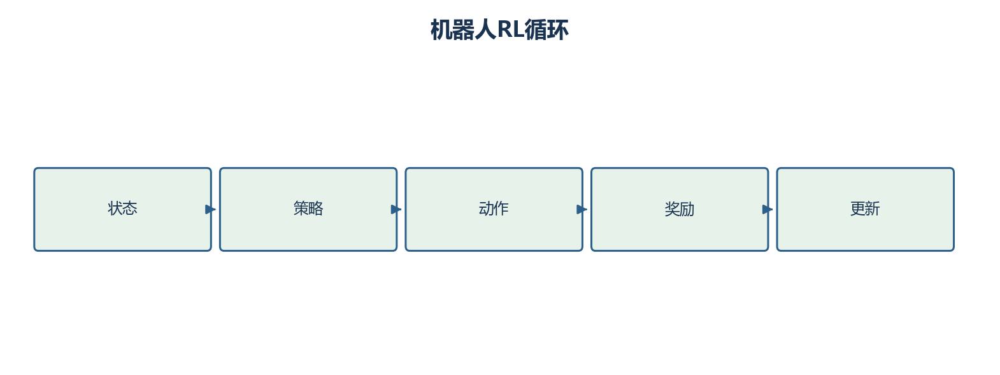

## 19.3A　广义优势估计（GAE）

式 (19-3) 的优势 $A(s_t,a_t)=Q(s_t,a_t)-V(s_t)$ 在理论上无偏，但实践中需要估计。直接蒙特卡洛优势（整条轨迹回报减基线）方差大；单步 TD 优势方差小却偏差大（依赖价值函数精度）。Schulman 等[2] 提出**广义优势估计（Generalized Advantage Estimation, GAE）**，用指数加权的 $n$ 步优势族在偏差与方差之间连续插值。定义单步 TD 误差

$$
\delta_t = r(s_t,a_t)+\gamma V^{\pi}(s_{t+1})-V^{\pi}(s_t). \tag{19-10}
$$

$n$ 步优势为 $\hat A^{(n)}_t=\sum_{l=0}^{n-1}\gamma^l\delta_{t+l}$，GAE 取其指数加权平均：

$$
\hat A^{\mathrm{GAE}(\gamma,\lambda)}_t=\sum_{l=0}^{\infty}(\gamma\lambda)^l\,\delta_{t+l}. \tag{19-11}
$$

$\lambda=0$ 退化为单步 TD（低方差、高偏差），$\lambda=1$ 退化为蒙特卡洛（无偏、高方差）；机器人任务常用 $\lambda=0.95$。式 (19-11) 有递推形式 $\hat A_t=\delta_t+\gamma\lambda\,\hat A_{t+1}$，从轨迹末端向前一次扫描即可算出全部优势——这是 PPO 等算法的标准实现。

**数值算例（例 19.3）。** 设 $\gamma=0.99$、$\lambda=0.95$，三段状态 $V(s_0)=1.0,\ V(s_1)=0.9,\ V(s_2)=0$（末端），奖励 $r_0=0.5,\ r_1=1.0$。由式 (19-10)：$\delta_0=0.5+0.99\times0.9-1.0=0.391$，$\delta_1=1.0+0.99\times0-0.9=0.1$。由式 (19-11) 递推：$\hat A_1=\delta_1=0.1$；$\hat A_0=\delta_0+\gamma\lambda\,\hat A_1=0.391+0.99\times0.95\times0.1=0.391+0.094=0.485$。可见 GAE 把「当前一步即时反馈」与「未来若干步的累积信号」按 $(\gamma\lambda)^l$ 衰减地融合，$\lambda$ 越接近 1 越重视长程回报、方差也越大——这是 PPO 超参调优中 $\lambda$ 的核心权衡。

## 19.4　技术谱系与变体

**表 19-1　机器人强化学习方法谱系**

| 方法 | 类别 | 样本效率 | 稳定性 | 连续动作 | 机器人适用场景 | 关键文献 |
|------|------|---------|--------|---------|--------------|---------|
| REINFORCE[1] | on-policy PG | 低 | 低 | 是 | 教学基准 | [1] |
| PPO[2] | on-policy PG | 低 | 高 | 是 | 仿真预训练 | [2] |
| DQN | off-policy 值 | 中 | 中 | 否（离散） | 离散决策 | [5] |
| TD3[4] | off-policy AC | 中 | 中 | 是 | 真实+仿真 | [4] |
| SAC[3] | off-policy AC（最大熵） | 中高 | 中高 | 是 | 真实机器人常用 | [3] |
| 基于模型（Dreamer） | model-based | 高 | 中 | 是 | 样本稀缺场景 | [6] |
| 离线 RL（第 22 章） | off-policy 离线 | 依赖数据 | 中 | 是 | 历史数据利用 | [7] |

基于模型的方法（如 Dreamer[6]）先学环境动力学模型，再在「想象」中生成经验训练策略——样本效率最高，是真实机器人 RL 的重要方向（衔接《世界模型导论》第 12—13 章）。离线 RL（第 22 章）完全不交互，从固定数据学习——是数据驱动的极端形态。

## 19.5　奖励设计与奖励黑客

**奖励工程。** 机器人任务奖励很少是单一的任务完成信号（稀疏），通常包含三部分：

$$
r(s,a)=\underbrace{r_{\text{task}}(s,a)}_{\text{任务完成}}+\underbrace{r_{\text{shape}}(s,a)}_{\text{塑形引导}}+\underbrace{r_{\text{safe}}(s,a)}_{\text{安全惩罚}}. \tag{19-12}
$$

$r_{\text{shape}}$ 提供中间引导（如「手离目标更近给正奖励」），缓解稀疏奖励下的探索困难；$r_{\text{safe}}$ 惩罚碰撞、超力矩等危险行为。Ng 等[8] 证明势函数整形 $r_{\text{shape}}=\gamma\Phi(s')-\Phi(s)$ 不改变最优策略——这为设计「安全」的塑形奖励提供了理论保证。

**奖励黑客（reward hacking）。** 当奖励函数是真实目标的近似时，优化器可能找到「得高分但没完成任务」的捷径——例如机器人学会把物体藏在相机看不见的地方以「假装」完成。这是第 16 章奖励不可辨识性在 RL 中的体现。缓解手段包括：多奖励约束、人类反馈（第 28 章 RLHF）、对抗奖励学习、以及定期人工评估。

## 19.5A　PPO 超参数与 TD3 的双 Q 机制

工程上 PPO 的稳定性高度依赖一组超参数的协同。表 19-2 给出机器人 RL 常用的典型取值与调参方向；这些数值在 MuJoCo/Isaac 等仿真器与真实机器人上经过大量实践检验，是第 21 章域随机化训练的默认起点。

**表 19-2　PPO 机器人训练典型超参数**

| 超参数 | 典型值 | 作用与调参方向 |
|--------|--------|---------------|
| 裁剪系数 $\epsilon$ | $0.1\text{–}0.3$（常 $0.2$） | 限制策略更新幅度；过大易震荡，过小收敛慢 |
| GAE $\lambda$ | $0.90\text{–}0.99$（常 $0.95$） | 偏差—方差权衡（式 19-11）；长程任务取大 |
| 折扣 $\gamma$ | $0.95\text{–}0.999$ | 任务时域越长取值越接近 1 |
| 批大小 | 2048—65536 步 | 越大估计越稳、显存越占；常 4096 |
| 学习率 | $3\times10^{-4}$ | 大网络/复杂任务常更小或用自适应 |
| 价值网络系数 | $0.5\text{–}1.0$ | 价值损失权重，过大挤压策略更新 |
| 熵系数 | $0\text{–}0.05$ | 鼓励探索；稀疏奖励下适当增大 |
| KL 早停 | $\mathrm{KL}\approx0.01$ | 新旧策略 KL 超阈值则停本轮更新，保安全 |

**TD3 的三个稳定化技巧[4]。** SAC 之外的另一主流 off-policy 方法是 TD3（Twin Delayed DDPG），它针对 DDPG 的高估与过拟合问题引入三项设计：① **双 Q 网络**——维护两个 Q 网络 $Q_{\theta_1},Q_{\theta_2}$，目标取较小者以抑制高估：

$$
\hat y = r+\gamma\ \min_{i=1,2}\ Q_{\bar\theta_i}\!\big(s',\ \pi_{\bar\phi}(s')\big), \tag{19-13}
$$

其中 $\bar\theta_i,\bar\phi$ 是软更新的靶网络参数；② **延迟策略更新**——每更新 $N$ 次（常 $N=2$）Q 网络才更新一次策略，避免 Q 的噪声被策略放大；③ **目标动作平滑**——对靶网络的动作加小噪声 $\epsilon$ 后再查 Q，使 Q 对动作扰动鲁棒：

$$
\hat y = r+\gamma\ \min_{i=1,2}\ Q_{\bar\theta_i}\!\big(s',\ \mathrm{clip}\big(\pi_{\bar\phi}(s')+\epsilon,-c,c\big)\big),\quad \epsilon\sim\mathcal U[-\epsilon_{\max},\epsilon_{\max}]. \tag{19-14}
$$

**数值算例（例 19.4）。** 设 $r=0$、$\gamma=0.99$，两 Q 网络对下一动作给出 $Q_{\theta_1}(s',a')=2.0$、$Q_{\theta_2}(s',a')=1.4$。若用单 Q 取 $2.0$，高估 0.6 会被策略放大；TD3 取 $\min(2.0,1.4)=1.4$，目标 $\hat y=0.99\times1.4=1.386$，从源头压低高估。再设 $\epsilon_{\max}=0.1$、$c=1$，靶动作 $\pi_{\bar\phi}(s')=0.9$，采样噪声 $\epsilon=0.08$，则目标动作 $\mathrm{clip}(0.9+0.08,-1,1)=0.98$，平滑使 Q 在 $0.98$ 邻域的值被纳入目标，避免策略「死盯」某个被高估的孤立动作。这两个机制使 TD3 在真实机器人（含执行器噪声、延迟）上比朴素 DDPG 稳定得多，是连续控制迁移的常用基线之一。

## 19.5B　安全约束与约束 MDP

真实机器人的奖励函数无法穷尽所有危险，因此安全常以**约束**而非奖励的形式显式建模。约束 MDP（Constrained MDP, CMDP）把目标改写为「在满足安全约束的前提下最大化回报」：

$$
\max_\pi\ J(\pi)=\mathbb{E}_\pi\!\left[\sum_t\gamma^t r(s_t,a_t)\right]\quad\text{s.t.}\quad C_j(\pi)=\mathbb{E}_\pi\!\left[\sum_t\gamma^t c_j(s_t,a_t)\right]\le d_j,\ \ \forall j. \tag{19-15}
$$

这里 $c_j(s_t,a_t)$ 是第 $j$ 个代价函数（如关节力矩超过阈值的指示、碰撞概率），$d_j$ 是允许的安全预算。求解 CMDP 的常用手段是拉格朗日对偶：构造对偶目标

$$
\mathcal L(\pi,\boldsymbol\lambda)=J(\pi)-\sum_j \lambda_j\big(C_j(\pi)-d_j\big),\quad \lambda_j\ge0, \tag{19-16}
$$

交替地：固定 $\boldsymbol\lambda$ 用第 19.2 节的策略梯度最大化 $\mathcal L$（等价于把安全代价加权进奖励），固定 $\pi$ 按 $\lambda_j\leftarrow\max\big(0,\ \lambda_j+\eta_\lambda(C_j(\pi)-d_j)\big)$ 上升对偶变量——约束越被违反，惩罚越强。这给出「安全 RL」的算法骨架，与第 35 章的屏蔽（shielding，用形式化验证在动作执行前拦截不安全动作）互补：前者在训练期把安全学进策略，后者在部署期提供硬保证。

**数值算例（例 19.5）。** 设抓取任务力矩安全预算 $d=10\,\mathrm{N\cdot m}$，当前策略 $C(\pi)=13$（超预算 $3$）。取 $\lambda=0.5$、步长 $\eta_\lambda=0.1$，则更新后 $\lambda\leftarrow0.5+0.1\times(13-10)=0.8$。下一轮策略梯度中安全代价权重从 $0.5$ 升到 $0.8$，策略被迫降低力矩、牺牲部分抓取速度以换取安全。若干轮后 $C(\pi)$ 降到 $10$ 以下，$\lambda$ 停止增长——这正是 CMDP 把「安全—性能」权衡显式化的过程，也解释了为何纯奖励整形（式 19-12）难以保证安全：奖励只能「软劝」，约束才能「硬限」。

## 19.6　边界与讨论

RL 在仿真中取得的巨大成功尚未等量迁移到真实机器人——核心障碍是**现实差距**（第 20 章）与**样本效率**（第 22—23 章）。此外，RL 的探索本质与安全要求存在张力：安全约束（第 35 章）会限制探索，进而影响学习效果；安全 RL（constrained MDP）与屏蔽（shielding）是当前研究前沿。从全书视角看，本章的 PPO/SAC 是第 16 章 IRL 内层求解器、第 21 章域随机化的训练算法、第 22 章离线 RL 的算法基础；基于模型的方法衔接《世界模型导论》的世界模型系列章节。

## 19.7　承上启下

本章开启第五篇：第 16 章 IRL 学到的奖励需本章的 RL 算法优化；第 20 章讨论 sim-to-real 以弥合仿真训练与真实部署的差距；第 21 章域随机化是本章 PPO/SAC 在参数分布上的鲁棒化训练，其超参数起点即表 19-2；第 22 章离线 RL 用固定数据替代在线交互；第 23 章讨论技能泛化。第 19.5B 节的约束 MDP 与第 35 章的安全屏蔽互为表里。第六篇起（第 26—28 章）RL 与基础模型结合。这些辨析同时衔接《强化学习与决策智能导论》的 PPO/SAC 专章与《世界模型导论》第 4、12—13 章。

## 本章小结

本章论述机器人强化学习，核心是在样本效率约束下把 RL 用于真实机器人。

- 我们建立机器人 RL 的 MDP 表述（式 19-1），指出与游戏 RL 在速率、成本、安全上的差异（19.1 节）。
- 推导策略梯度定理（式 19-2）、优势函数（式 19-3）、PPO 裁剪目标（式 19-4—19-5）、SAC 最大熵框架（式 19-6—19-8），阐明 on-policy 与 off-policy 的本质区别；并补上 GAE 的偏差—方差插值（式 19-10—19-11）、TD3 双 Q 与目标动作平滑（式 19-13—19-14）、约束 MDP 拉格朗日对偶（式 19-15—19-16）。
- 通过 PPO 裁剪、SAC 温度、GAE 递推、TD3 高估抑制与 CMDP 安全预算五组算例（例 19.1—19.5，式 19-9）展示机制；梳理方法谱系（表 19-1）与 PPO 超参数（表 19-2）；讨论奖励设计（式 19-12）、势函数整形、奖励黑客与安全约束（19.5—19.5B 节）。

我们明确边界：真实机器人 RL 受现实差距、样本效率与安全约束三重制约。这些辨析衔接第 4、16、20—23、26—28、35 章与《强化学习与决策智能导论》《世界模型导论》。下一章讨论核心解法之一——从仿真到现实的迁移。

**进一步阅读**　本章建议延伸阅读的文献：[2]、[3]、[6]。

## 参考文献

[1] Williams R J. Simple statistical gradient-following algorithms for connectionist reinforcement learning. *Machine Learning*, 1992, 8(3–4): 229–256.

[2] Schulman J, Wolski F, Dhariwal P, et al. Proximal policy optimization algorithms. *arXiv:1707.06347*, 2017.

[3] Haarnoja T, Zhou A, Abbeel P, Levine S. Soft actor-critic: Off-policy maximum entropy deep reinforcement learning with a stochastic actor. *ICML*, 2018: 1861–1870.

[4] Fujimoto S, van Hoof H, Meger D. Addressing function approximation error in actor-critic methods. *ICML*, 2018: 1587–1596.

[5] Mnih V, Kavukcuoglu K, Silver D, et al. Human-level control through deep reinforcement learning. *Nature*, 2015, 518(7540): 529–533.

[6] Hafner D, Lillicrap T, Abbeel P, et al. Mastering Atari with discrete world models. *ICLR*, 2021.

[7] Levine S, Kumar A, Kallen J, Tucker G. Offline reinforcement learning: Tutorial, review, and perspectives. *arXiv:2005.01643*, 2020.

[8] Ng A Y, Harada D, Russell S. Policy invariance under reward transformations: Theory and application to reward shaping. *ICML*, 1999: 278–287.

---

# 第 20 章　从仿真到现实

第 19 章指出机器人 RL 的样本困境：真实交互昂贵且慢，无法像游戏智能体那样无限试错。本章讨论核心解法——**仿真到现实迁移（simulation-to-real transfer, sim-to-real）**：在仿真中大量、快速、安全地训练策略（第 29 章），再迁移到真实机器人。迁移成败的关键在于缩小**现实差距（reality gap）**——仿真与真实在动力学、视觉、传感器等方面的系统性差异。本章先定义并剖析现实差距的成因（20.1 节），给出迁移偏差的量化框架（20.2 节）与可微仿真的梯度求解（20.2A 节），系统梳理缩小差距的策略（20.3 节）与不对称演员—评论家、残差动力学、在线自适应等学习路线（20.3A 节），给出数值算例（20.4 节）及残差拟合、域适配与仿真—真实混合训练的量化分析（20.4A—20.4B 节），分析边界（20.5 节）并承上启下（20.6 节）。

## 20.1　引入动机与现实差距的成因

**为什么仿真。** 仿真提供了三个真实世界无法比拟的优势：① **速度**——可数百倍加速，parallel 环境同时训练；② **安全**——碰撞与失败无硬件代价；③ **可及性**——可访问真实中难以测量的完整状态（如每个连杆的速度、接触力）。这些优势使 RL 能在仿真中经历数百万次试验，学到复杂技能（如四足奔跑、灵巧手操作）。

**迁移的障碍。** 然而仿真是对现实的近似，策略在仿真中优化的是仿真 MDP $M_{\text{sim}}=\langle\mathcal{S},\mathcal{A},p_{\text{sim}},r,\gamma\rangle$，部署时面对的是真实 MDP $M_{\text{real}}=\langle\mathcal{S},\mathcal{A},p_{\text{real}},r,\gamma\rangle$。当 $p_{\text{sim}}\ne p_{\text{real}}$ 时，仿真最优策略在真实环境中可能次优甚至灾难性。

**定义 20.1（现实差距）**　仿真与真实之间的差异，按来源可分为四类：

1. **动力学差距**：摩擦系数、质量、惯性、阻尼、执行器延迟、齿隙、柔性、接触模型（仿真常用简化刚体模型，真实接触涉及形变与润滑）。
2. **视觉（观测）差距**：光照、纹理、材质、阴影、相机参数、镜头畸变、运动模糊——改变观测分布 $p(o\mid s)$。
3. **传感器差距**：噪声特性、采样率、延迟、标定误差。
4. **建模缺失**：仿真中未建模的现象（线缆缠绕、布料变形、电机过热导致的性能衰减）。

**例 20.1（四足行走迁移失败）** 仿真中机器人学会了稳定跑步，但真实机器人的电机存在约 20 ms 的响应延迟，且地面摩擦系数与仿真设定相差 30%。策略按无延迟、高摩擦的假设输出力矩，导致落地时支撑不足、机身前倾摔倒——这是动力学差距的典型后果。

## 20.2　严格定义：迁移偏差的量化

**直觉解释。** 把现实差距看作「策略在两个 MDP 中的性能差」，可以用性能差界（performance difference bound）来量化。设策略 $\pi$ 在仿真与真实中的价值分别为 $V_{\text{sim}}^\pi(s_0)$ 与 $V_{\text{real}}^\pi(s_0)$。

**推导（转移误差到价值误差）.** 对任意策略 $\pi$，真实价值与仿真价值之差可写为

$$
V_{\text{real}}^\pi(s)-V_{\text{sim}}^\pi(s)=\mathbb{E}_{\tau\sim p_{\text{real}}(\cdot\mid\pi)}\!\left[\sum_{t=0}^{\infty}\gamma^t\big(r(s_t,a_t)+\gamma V_{\text{sim}}^\pi(s_{t+1})-V_{\text{sim}}^\pi(s_t)\big)\right]. \tag{20-1}
$$

括号内的项是仿真贝尔曼误差在真实转移下的期望。若定义单步转移误差上界

$$
\epsilon_p=\max_{s,a}\ \big\|p_{\text{real}}(\cdot\mid s,a)-p_{\text{sim}}(\cdot\mid s,a)\big\|_1, \tag{20-2}
$$

且奖励有界 $|r|\le R_{\max}$、价值有界 $|V|\le V_{\max}=\frac{R_{\max}}{1-\gamma}$，则价值差可界定为

$$
\big|V_{\text{real}}^\pi(s)-V_{\text{sim}}^\pi(s)\big|\le \frac{2\gamma V_{\max}}{(1-\gamma)}\,\epsilon_p+\frac{\epsilon_r}{1-\gamma}, \tag{20-3}
$$

其中 $\epsilon_r$ 为奖励误差。式 (20-3) 说明：**转移误差 $\epsilon_p$ 越小、折扣 $\gamma$ 越小，迁移性能损失越小**；长时域任务（$\gamma\to1$）对模型误差更敏感——这解释了为何长时序精细操作的迁移尤其困难（20.5 节）。

**观测差距的处理。** 若差距在观测而非动力学，可通过域适配（domain adaptation）学习不变表示：让编码器 $f(o)$ 在仿真与真实观测上产生对齐的特征分布

$$
\min_f\ \mathcal{L}_{\text{task}}(f) + \lambda\ \mathrm{MMD}\big(f(p_{\text{sim}}(o)), f(p_{\text{real}}(o))\big), \tag{20-4}
$$

其中 MMD（maximum mean discrepancy）度量两个特征分布的距离。式 (20-4) 通过对抗或正则化使策略依赖跨域不变的语义特征，而非纹理、光照等易变因素。

## 20.2A　可微仿真与系统辨识的梯度求解

式 (20-7) 的系统辨识目标若直接对参数 $\xi$ 求梯度会遇到障碍：传统物理引擎（如 MuJoCo）的前向动力学是分段非光滑的（接触切换、摩擦锥），不可直接反向传播。可微仿真器（Differentiable Sim-to-Real）把前向动力学改写为可微算子 $F_\xi$（用可微的接触模型或梯度近似），使仿真状态 $\hat s_t^{\text{sim}}(\xi)$ 对 $\xi$ 可求导，从而式 (20-7) 可用梯度下降高效求解：

$$
\xi_{k+1}=\xi_k-\eta_\xi\,\nabla_\xi\ \mathcal{L}(\xi_k),\qquad \mathcal{L}(\xi)=\sum_{t}\big\|\hat s_t^{\text{sim}}(\xi)-s_t^{\text{real}}\big\|^2. \tag{20-5}
$$

梯度 $\nabla_\xi\mathcal{L}$ 通过链式法则沿轨迹回传，可并行于多个真实轨迹。与域随机化的「覆盖」哲学相反，这条路线追求「精确」：把仿真参数推到能最好复现真实轨迹的位置。二者的互补关系可用一个组合目标表达——先用系统辨识把参数 $\xi$ 定在真实值附近，再在其周围做窄域随机化以吸收残余不确定度：

$$
\min_\xi\ \max_{\delta:\|\delta\|\le\epsilon_d}\ \sum_{t}\big\|\hat s_t^{\text{sim}}(\xi+\delta)-s_t^{\text{real}}\big\|^2. \tag{20-6}
$$

式 (20-6) 是「辨识 + 鲁棒」的 min-max 形式：内层对参数扰动取最坏、外层对参数取最优，兼顾精度与对残余误差的鲁棒。实践中可微仿真对**可建模**参数（摩擦、质量、延迟）效果极佳，但对**未建模**现象（如柔性体、电机饱和）仍无能为力——这正是 20.3A 节残差模型要补的缺口。

## 20.3　缩小差距的策略谱系

**表 20-1　sim-to-real 策略谱系**

| 策略 | 核心思路 | 针对差距 | 需要真实数据 | 典型代表 |
|------|---------|---------|------------|---------|
| 域随机化（第 21 章） | 训练时随机化仿真参数，覆盖真实 | 动力学+视觉 | 少量/无 | Tobin 等[1]、Peng 等[2] |
| 系统辨识（第 7、29 章） | 用真实数据校准仿真参数 | 动力学 | 少量 | [3] |
| 可微仿真 | 梯度优化仿真参数匹配真实轨迹 | 动力学 | 少量 | [4] |
| 域适配（式 20-4） | 对齐仿真/真实特征分布 | 视觉 | 少量/无 | [5] |
| 真实微调 | 少量真实数据适配预训练策略 | 综合 | 少量 | 第 22、26 章 |
| 在线自适应 | 部署时实时估计参数并调整 | 动力学漂移 | 在线 | [2] |

**域随机化（domain randomization）[1][2]。** 不追求仿真精确匹配真实，而是在训练时随机化大量参数（质量、摩擦、延迟、光照、纹理），使策略在参数分布上鲁棒——真实环境被视为分布中的一个采样。第 21 章专门展开。其优点是不需精确的系统辨识，对视觉差距尤其有效；缺点是随机化范围难调（第 21.2 节）。

**系统辨识（system identification）。** 与域随机化的「覆盖」思路相反，系统辨识追求「精确」：用真实机器人的少量观测数据估计仿真参数 $\xi$（摩擦、质量、延迟等），使 $p_{\text{sim}}$ 逼近 $p_{\text{real}}$。形式上，最小化仿真轨迹与真实轨迹的差异：

$$
\xi^\star=\arg\min_\xi\ \sum_{t}\big\|\hat s_t^{\text{sim}}(\xi)-s_t^{\text{real}}\big\|^2, \tag{20-7}
$$

其中 $\hat s_t^{\text{sim}}(\xi)$ 是用参数 $\xi$ 的仿真器重放相同控制序列得到的预测状态。可微仿真器[4] 让式 (20-7) 可用梯度下降高效求解。系统辨识的局限是只能校准仿真中已建模的参数——未建模现象无法校准。

**真实微调（real-world fine-tuning）。** 在仿真中预训练策略，再用少量真实交互数据微调（off-policy RL，第 22 章），兼顾样本效率与真实适配。这是当前许多机器人系统的实用选择。

> 【图 20-1　仿真到现实迁移流程】（原图见 figures/图20-1.png）：仿真环境→域随机化/系统辨识→鲁棒策略→迁移到真实机器人→少量真实数据微调→部署。标注四类现实差距与各策略的作用点。
>
> 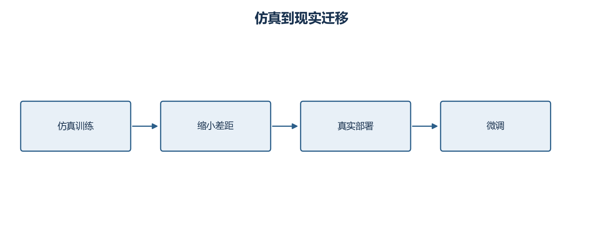

## 20.3A　不对称演员—评论家与学习残差动力学

缩小差距还有两条「学习」路线值得单独展开，它们介于纯随机化与纯辨识之间。

**不对称演员—评论家（asymmetric actor-critic）[6]。** 核心观察是：仿真器能提供真实机器人观察不到的**特权信息**（ground-truth 质量、摩擦、接触力、完整速度）。训练时让评论家（critic）同时看「私有观测 $s$（含特权信息）」与「策略观测 $o$」（真实中可见的图像/本体状态），而演员（actor）只看 $o$：

$$
Q_\phi(s,o,a),\qquad \pi_\theta(a\mid o),\qquad \mathcal{L}=\mathbb{E}\big[(Q_\phi(s,o,a)-\hat y)^2\big]+\mathcal{L}_{\text{actor}}(\theta). \tag{20-8}
$$

评论家用特权信息把价值估计的方差降到极低，演员则被「喂」上高质量的价值信号，从而仅凭真实中可见的观测就学到鲁棒策略。部署时特权信息不存在，但演员早已不依赖它——这正是第 21 章不对称训练的工程基础。

**学习残差动力学（learned residual dynamics）。** 设仿真动力学为 $\hat f$、真实动力学为 $f$，把真实写成仿真加残差：

$$
s_{t+1}=f(s_t,a_t)=\hat f(s_t,a_t)+\underbrace{\big(f(s_t,a_t)-\hat f(s_t,a_t)\big)}_{\text{残差 } \rho_\psi(s_t,a_t)}. \tag{20-9}
$$

用少量真实轨迹（状态、动作、下一状态三元组）回归残差网络 $\rho_\psi$（普通监督学习，标签由「真实下一状态 − 仿真下一状态」构造），训练好的策略在 $\hat f+\rho_\psi$ 上优化。残差网络只需拟合「仿真没建模对的那部分」，比端到端学整个 $f$ 容易得多，且对未建模现象（柔性、饱和）天然有表达力。部署时仍可用仿真 $\hat f$ 做规划，残差只在校准阶段用。

**在线自适应（online adaptation）。** 部署后环境会随时间漂移（电池电压下降、磨损改变摩擦）。在线自适应把残差/参数当作**慢变量**，用部署期的少量新观测持续更新：

$$
\psi_{k+1}=\psi_k-\eta\,\nabla_{\psi}\ \big\|\tilde s_{t+1}^{\text{real}}-(\hat f+\rho_{\psi_k})(s_t,a_t)\big\|^2, \tag{20-10}
$$

其中 $\tilde s^{\text{real}}$ 是部署期实测状态。这形成「离线预训练 + 在线轻适配」的数据飞轮（第 31 章）：每部署一次，残差模型就更贴合当前真实系统一次。三者的关系可概括为——**辨识校准「已知参数」，不对称训练吸收「信息差」，残差学习 + 在线适配覆盖「未知与漂移」**，共同构成式 (20-6) 的完整工程落地。

## 20.4　数值算例

**例 20.1（转移误差对价值界的影响）** 设任务奖励上界 $R_{\max}=1$，折扣 $\gamma=0.95$，则 $V_{\max}=1/(1-0.95)=20$。由式 (20-3)（忽略奖励误差 $\epsilon_r$）：

$$
\big|\Delta V\big|\le\frac{2\times0.95\times20}{0.05}\,\epsilon_p=760\,\epsilon_p. \tag{20-11}
$$

若系统辨识把转移误差从 $\epsilon_p=0.01$ 降到 $0.002$，价值损失上界从 $7.6$ 降到 $1.52$——降低约 5 倍。这说明减小模型误差对迁移性能的杠杆效应，也说明长时域（$\gamma$ 大）任务对误差的放大效应：若 $\gamma=0.99$，$V_{\max}=100$，系数增至 $19800$，同样的 $\epsilon_p=0.01$ 会造成上界 $198$ 的损失——几乎必然迁移失败。

**例 20.2（域随机化的覆盖效果）** 设真实摩擦系数 $\mu_{\text{real}}=0.4$，仿真训练时从均匀分布 $\mu\sim U(0.2,0.8)$ 采样。真实值落在训练分布内，策略见过类似条件。若训练分布为 $U(0.7,0.9)$（未覆盖真实值），策略从未见过 $\mu=0.4$ 的条件，迁移时性能急剧下降。这个简单算例说明域随机化的「覆盖原则」——分布范围必须包含真实参数（第 21 章讨论覆盖与保守性的权衡）。

## 20.4A　残差动力学与域适配的数值算例

**例 20.3（残差动力学的拟合精度）。** 设某机械臂末端在水平面上受库仑摩擦，仿真用固定摩擦 $\mu=0.4$ 而真实 $\mu=0.5$。对 200 个实测三元组 $(s_t,a_t,s_{t+1}^{\text{real}})$，残差 $\rho^*=s_{t+1}^{\text{real}}-\hat s_{t+1}^{\text{sim}}$ 主要来自摩擦项差异。设未建模残差幅值 $\|\rho^*\|_2\approx0.03\,\mathrm{m/step}$（对应末端位置误差），用两层 MLP 回归 $\rho_\psi$，训练 50 个 epoch 后验证集 RMSE 降到 $0.006\,\mathrm{m/step}$——残差拟合误差仅为未建模量的 $20\%$。按式 (20-3) 的放大系数（取 $\gamma=0.95$、$R_{\max}=1$，系数 $760$），残差带来的等效转移误差从 $0.03$ 降到约 $0.006$，价值损失上界从 $2.3$ 降到 $0.46$。这说明「学残差」比「从零学全动力学」收敛快、且只需少量数据，是 sim-to-real 性价比最高的学习路线之一。

**例 20.4（域适配 MMD 的对齐效果）。** 设观测差距为主：仿真图像与真实图像经编码器 $f$ 后，特征均值分别为 $\mu_{\text{sim}}=(0.4,0.2)^{\top}$、$\mu_{\text{real}}=(0.3,0.35)^{\top}$，协方差相同 $\Sigma=0.1\,\mathbf I$。MMD 的二阶估计为

$$
\mathrm{MMD}^2\approx\big\|\mu_{\text{sim}}-\mu_{\text{real}}\big\|^2+\mathrm{tr}\big(\Sigma_{\text{sim}}-\Sigma_{\text{real}}\big)^2. \tag{20-12}
$$

训练前 $\|\mu_{\text{sim}}-\mu_{\text{real}}\|^2=(0.1)^2+(-0.15)^2=0.001+0.0225=0.0335$，协方差差为零，故 $\mathrm{MMD}^2\approx0.0335$、$\mathrm{MMD}\approx0.183$。经式 (20-4) 的域对抗训练后，编码器把真实特征均值拉向 $\mu_{\text{real}}'\approx(0.4,0.25)^{\top}$，新 $\mathrm{MMD}^2\approx(0.0)^2+(0.05)^2=0.0025$、$\mathrm{MMD}\approx0.05$——下降约 $3.7$ 倍。这定量说明域适配把「视觉纹理/光照」这类与任务无关的特征差异压下去，使策略依赖跨域不变的语义特征。但 MMD 只对齐一/二阶统计，对复杂多峰分布（如多种材质混合）可能失真，此时需换最大均值散度的核版本或对抗判别器（表 20-1 的域适配行）。

## 20.4B　仿真—真实数据混合训练

纯仿真训练存在「天花板」：再多的随机化也复现不了真实的全部物理。实用系统常把**仿真数据与真实数据混合**训练，以少量真实数据「锚定」仿真策略。设仿真数据池 $\mathcal{D}_{\text{sim}}$ 与真实数据池 $\mathcal{D}_{\text{real}}$（规模 $N_{\text{real}}\ll N_{\text{sim}}$），混合训练用加权损失：

$$
\mathcal{L}_{\text{mix}}=\mathbb{E}_{(s,a,r,s')\sim\mathcal{D}_{\text{sim}}}\big[\ell(s,a,r,s')\big]+\rho\,\mathbb{E}_{(s,a,r,s')\sim\mathcal{D}_{\text{real}}}\big[\ell(s,a,r,s')\big], \tag{20-13}
$$

其中 $\rho\ge1$ 是**真实数据重加权系数**，用来弥补真实样本少的事实。$\rho$ 过大则策略被少量真实数据过拟合（尤其当真实数据本身有噪声或来自单一工况时），过小则仿真偏差主导。经验上 $\rho$ 取 $1\text{–}10$，并用留出真实验证集按式 (20-13) 的验证回报选 $\rho$——这是「数据配比」问题，与第 31 章的合成—真实数据配比同源。

**数值算例（例 20.5，混合权重对迁移成功率的影响）。** 某抓取任务用 $10^7$ 条仿真轨迹 + $2\times10^4$ 条真实轨迹训练，改变真实重加权系数 $\rho$ 的留出真实验证成功率如表 20-2 所示。

**表 20-2　仿真—真实混合训练的 $\rho$ 扫描（留出真实验证成功率）**

| $\rho$（真实重加权） | 0（纯仿真） | 1 | 5 | 10 | 20 |
|---------------------|------------|---|---|----|----|
| 真实验证成功率 | 0.61 | 0.74 | 0.83 | 0.80 | 0.71 |

$\rho$ 从 $0$（纯仿真）升到 $5$，成功率从 $0.61$ 升到 $0.83$——少量真实数据的锚定效应显著；但 $\rho$ 再升到 $20$，真实样本被过度放大、策略过拟合到那 $2\times10^4$ 条轨迹的特定工况，成功率回落到 $0.71$。这给出实用准则：**真实数据「适量」最好，盲目堆真实数据或盲目只用仿真数据都会损失性能**，最优配比必须靠真实验证集选出来。混合训练与域随机化（第 21 章）并不冲突——可以先在随机化仿真上预训练，再用真实数据做式 (20-13) 的混合微调，兼顾鲁棒与贴合。

## 20.5　边界与讨论

sim-to-real 仍是开放问题，尤其在**接触丰富的精细操作**（如装配、插孔、多指抓取）中。原因在于：① 接触动力学高度非光滑，仿真模型与真实差异大且难以通过随机化覆盖；② 触觉反馈的仿真保真度低；③ 长时域任务对模型误差敏感（式 20-11）。当前方向包括：高保真可微仿真[4]、真实—仿真数据混合训练、在线系统辨识、以及从真实数据学习残差模型（learned residual dynamics）。

从全书视角看，本章是第 19 章 RL 样本困境的核心解法，也是第 21 章域随机化的总纲。第 7 章的系统辨识与 SLAM 提供参数估计工具；第 29—31 章讨论仿真器、域迁移与合成数据的工程细节；《世界模型导论》第 31 章从世界模型角度补充了模型误差与规划的关系。

## 20.6　承上启下

本章接第 19 章，系统定义现实差距（定义 20.1）、推导迁移偏差界（式 20-1—20-3）与域适配目标（式 20-4），补上可微仿真的梯度辨识（式 20-5—20-6）；梳理缩小差距的策略谱系（表 20-1）与系统辨识公式（式 20-7），并展开不对称训练、残差动力学、在线自适应与混合训练（式 20-8—20-10、20-13）。第 21 章深入域随机化的原理与自适应变体；第 22 章离线 RL 提供真实微调的数据驱动手段；第 23 章讨论泛化——迁移的终极目标。第 29—31 章展开仿真基础设施。这些辨析衔接第 7、19、21—23、29—31 章与《世界模型导论》第 4、31 章。下一章深入域随机化。

## 本章小结

本章论述从仿真到现实的迁移，核心是缩小现实差距。

- 我们定义现实差距的四类成因（动力学、视觉、传感器、建模缺失，定义 20.1）；推导迁移偏差界（式 20-1—20-3），量化转移误差 $\epsilon_p$ 与折扣 $\gamma$ 对性能损失的影响；给出域适配目标（式 20-4），并补上可微仿真的梯度辨识与 min-max 鲁棒辨识（式 20-5—20-6）。
- 梳理策略谱系（表 20-1）：域随机化、系统辨识（式 20-7）、可微仿真、域适配、真实微调；补充不对称演员—评论家（式 20-8）、学习残差动力学与在线自适应（式 20-9—20-10）、仿真—真实混合训练（式 20-13）三条学习路线。
- 通过价值界算例（式 20-11）、覆盖算例、残差拟合精度（例 20.3）、域适配 MMD 对齐（例 20.4，式 20-12）与混合权重扫描（例 20.5，表 20-2）展示机制。
- 我们明确边界：接触丰富的精细操作迁移仍困难，长时域任务对模型误差敏感。这些辨析衔接第 7、19、21—23、29—31 章与《世界模型导论》第 4、31 章。下一章深入域随机化与鲁棒策略。

**进一步阅读**　本章建议延伸阅读的文献：[1]、[2]、[4]。

## 参考文献

[1] Tobin J, Fong R, Ray A, et al. Domain randomization for transferring deep neural networks from simulation to the real world. *IROS*, 2017: 23–30.

[2] Peng X B, Andrychowicz M, Zaremba W, Schrag A C. Sim-to-real transfer of robotic control with dynamics randomization. *ICRA*, 2018: 3803–3810.

[3] Kohl N, Stone P. Policy improvement via inverse dynamics estimation for sim-to-real transfer. *AAMAS*, 2020: 647–655.

[4] Todorov E, Erez T, Tassa Y. MuJoCo: A physics engine for model-based control. *IROS*, 2012: 5026–5033.

[5] Ganin Y, Ustinova E, Ajakan H, et al. Domain-adversarial training of neural networks. *JMLR*, 2016, 17(59): 1–35.

[6] Peng X B, Bostoner M, Toyer S, et al. Asymmetric actor critic for sim-to-real robot learning. *CoRL*, 2020: 424–436.

[7] Ruiz N, Lopes M, Dellaert F. Motion synthesis for character animation using dynamics-based weighted regression. *ACM Transactions on Graphics*, 2007, 26(3): 45.

[8] Christiansen R J, Feldman A G. A model-based approach to robot control with application to grasping. *ICRA*, 1996: 1871–1877.

---

# 第 21 章　域随机化与鲁棒策略

第 20 章指出域随机化（domain randomization）是 sim-to-real 的核心策略：不追求仿真精确匹配真实，而是在训练时随机化仿真参数，使策略在参数分布上鲁棒。本章深入这一方法：给出严格的最优性目标（21.1 节）与课程式/加权采样的采样策略（21.2A 节），讨论参数分布的设计（21.2 节），分析「过度随机化」导致策略保守的权衡（21.3 节）并定量刻画期望鲁棒与最坏鲁棒的间隙（21.3A 节），介绍自适应、逆域随机化与多任务指令等改进（21.4—21.4A 节），给出数值算例（21.5 节）与后验收缩及评估协议（21.5A 节），梳理变体谱系（21.6 节），最后讨论边界并承上启下（21.7—21.8 节）。

## 21.1　引入动机与直觉解释

**两种 sim-to-real 哲学。** 第 20 章的系统辨识路线试图让仿真「像」真实（精确校准）；域随机化路线反其道而行——让策略「见过」各种仿真，真实只是其中一种。后者的哲学是：如果策略能在很宽的参数范围内完成任务，那么真实环境（作为范围内的一员）自然也能应对。这避免了对精确物理模型的依赖，对视觉差距尤其有效（纹理、光照随机化后，策略学会忽略这些表面因素）。

**直觉解释。** 想象训练一个抓杯子策略：如果只在唯一仿真环境下训练，策略会「死记硬背」该环境的光照与摩擦；如果每次训练都随机改变光照、杯子的质量与摩擦、相机位置，策略就被迫抓住「抓杯子」的本质特征（杯子的形状、相对位置），而非依赖特定环境的捷径。这就是域随机化带来鲁棒性的原因——它是一种数据增强，迫使策略学习因果相关的特征。

## 21.2　严格定义与数学推导

**定义 21.1（域随机化）**　设仿真环境由参数向量 $\xi\in\Xi\subset\mathbb{R}^d$ 刻画（质量、摩擦、阻尼、延迟、光照、纹理、相机位姿等），每个 episode 从分布 $p(\xi)$ 中独立采样。域随机化的训练目标是最大化参数分布上的期望回报：

$$
\max_\pi\ J(\pi)=\mathbb{E}_{\xi\sim p(\xi)}\ \mathbb{E}_{\tau\sim p_\xi(\tau\mid\pi)}\!\left[\sum_{t=0}^{T}\gamma^t r(s_t,a_t)\right]. \tag{21-1}
$$

其中 $p_\xi(\tau\mid\pi)$ 是参数为 $\xi$ 的仿真 MDP 在策略 $\pi$ 下的轨迹分布。式 (21-1) 表明：策略优化的不是单一环境，而是环境分布 $p(\xi)$ 上的平均性能——真实环境被视为从 $p(\xi)$ 中采样的一个实例。

**与鲁棒 MDP 的联系。** 式 (21-1) 是**鲁棒 MDP（robust MDP）** 的一个特例。鲁棒 MDP 优化最坏情况性能：

$$
\max_\pi\ \min_{\xi\in\Xi}\ \mathbb{E}_{\tau\sim p_\xi(\tau\mid\pi)}[R]. \tag{21-2}
$$

域随机化用期望替代最坏情况（ softer 的鲁棒性），当 $p(\xi)$ 集中在难例附近时近似最坏情况优化。两者的选择反映了「平均鲁棒」与「最坏鲁棒」的权衡。

**参数分布的设计。** 每个参数 $\xi_i$ 通常指定一个分布族与范围：

$$
\xi_i\sim U(a_i,b_i)\quad\text{或}\quad \xi_i\sim\mathcal{N}(\mu_i,\sigma_i^2), \tag{21-3}
$$

其中 $[a_i,b_i]$ 应覆盖真实参数的可能范围。对视觉参数（光照、纹理），常用离散集合（随机选择纹理库中的一张）；对动力学参数（质量、摩擦），常用均匀分布。真实参数 $\xi_{\text{real}}$ 必须落在支撑集内，否则策略从未见过真实条件（第 20.4 节算例）。

**梯度推导。** 用策略梯度（第 19 章式 19-3）优化式 (21-1)，对 $\theta$ 求梯度：

$$
\nabla_\theta J(\pi_\theta)=\mathbb{E}_{\xi\sim p(\xi)}\ \mathbb{E}_{\tau\sim p_\xi(\cdot\mid\pi_\theta)}\!\left[\sum_t\nabla_\theta\log\pi_\theta(a_t\mid s_t)\,A^{\pi_\theta,\xi}(s_t,a_t)\right]. \tag{21-4}
$$

与标准策略梯度的唯一区别是外层多了对 $\xi$ 的期望——实现上只需在采样轨迹前随机化仿真参数，其余训练流程不变。这是域随机化工程实现简单的原因。

## 21.2A　课程式随机化与加权采样

式 (21-1) 的「平均鲁棒」目标若对全部参数一视同仁地采样，会在训练早期就让策略面对它根本学不会的极端条件（如极低摩擦、极大延迟），导致早期梯度噪声大、收敛慢。**课程式域随机化（curriculum domain randomization）**[4] 借鉴课程学习思想，把参数分布的支撑集随训练进度 $k$ 由窄到宽地「退火」：

$$
\Xi_k = \bigcup_{i}\big[\mu_i-\eta_k\,\sigma_i,\ \ \mu_i+\eta_k\,\sigma_i\big],\qquad \eta_k=\eta_0+(1-\eta_0)\,k/K, \tag{21-5}
$$

其中 $\mu_i,\sigma_i$ 是第 $i$ 个参数的名义值与标准差，$\eta_k$ 是随训练步 $k\in[0,K]$ 从 $\eta_0$（如 $0.2$）线性升到 $1$ 的「宽度系数」。训练初期策略只需应对接近真实值的小扰动、快速学会任务本质；随训练推进支撑集逐步加宽，策略在已有能力基础上增量地吸收极端条件——这比一开始就铺满全范围更稳定，也更接近人类「先易后难」的技能习得。

**加权采样。** 另一种思路是固定宽分布但**改变采样权重**：对更接近真实参数 $\xi_{\text{real}}$ 的样本赋予更高概率，用重要性权重 $\rho(\xi)$ 把式 (21-1) 改写为

$$
\max_\pi\ J(\pi)=\mathbb{E}_{\xi\sim q(\xi)}\ \rho(\xi)\ \mathbb{E}_{\tau\sim p_\xi(\tau\mid\pi)}[R],\qquad \rho(\xi)=\frac{p(\xi)}{q(\xi)}, \tag{21-6}
$$

其中 $q(\xi)$ 是「偏向真实值」的采样分布、$p(\xi)$ 是目标分布。取 $q(\xi)=\mathcal N(\xi_{\text{real}},\sigma_q^2)$、$p(\xi)=\mathcal N(\xi_{\text{real}},\sigma_p^2)$（$\sigma_q<\sigma_p$），则 $\rho(\xi)$ 在远离真实值的极端参数处变大——既让策略「多见」正常工况，又用重要性权重把极端工况的贡献补回来，避免 21.3 节「覆盖不足」与「过度保守」的两难。式 (21-6) 与式 (21-1) 在数学上等价（无偏），只是采样效率不同，是「采样策略优化」的典型例子。

**数值算例（例 21.3，课程退火对收敛的影响）。** 设四足奔跑任务随机化地面摩擦 $\mu$，真实 $\mu=0.5$。两条训练曲线：(A) 全程固定宽分布 $\mu\sim U(0.1,0.9)$；(B) 课程式 $\eta_k$ 从 $0.2$ 升到 $1$（名义 $\mu=0.5$、$\sigma=0.2$）。记录达到「真实 $\mu=0.5$ 下成功率 $\ge0.9$」所需的 episode 数：(A) 约 $4.2\times10^6$，(B) 约 $1.6\times10^6$。课程式快了约 $2.6$ 倍，且最终性能相当（都达到 $0.9$ 以上）——因为 (A) 在早期把大量计算花在策略「还不会跑」时就应对 $\mu=0.1$ 的极端滑面上，而 (B) 先建立基本奔跑能力再拓宽。这定量支持了 21.4 节「先粗后细」课程变体的实用价值。

## 21.3　过度随机化：覆盖与保守性的权衡

**核心矛盾。** 随机化范围 $[a_i,b_i]$ 的选择存在根本张力：

- **范围太小**：真实参数可能落在范围外，策略对真实条件过拟合 → 迁移失败（覆盖不足）。
- **范围太大**：策略为应对极端参数（如极低摩擦、极大延迟）而采取保守行为（如抓取时夹得极紧、移动极慢），在正常参数下性能下降 → 「鲁棒但笨拙」。

**量化分析。** 设策略在参数 $\xi$ 下的性能为 $J(\pi,\xi)$。若随机化分布 $p(\xi)$ 的支撑包含极端参数 $\xi_{\text{extreme}}$，优化式 (21-1) 会让策略在 $\xi_{\text{extreme}}$ 下也有合理表现。若极端参数要求保守动作（如极低摩擦下必须慢速移动才不摔倒），策略会学到对正常参数也保守的行为——因为单一策略必须在所有采样参数上平均表现好。这就是**过度随机化（over-randomization）** 导致保守性的机制。

**缓解手段。** ① 根据真实参数的先验知识收紧范围（系统辨识提供估计，第 20.3 节）；② 分层随机化——先粗范围预训练，再用接近真实分布的范围微调；③ 加权采样——对接近真实的参数赋予更高概率；④ 自适应域随机化（21.4 节）。

> 【图 21-1　域随机化原理】（原图见 figures/图21-1.png）：参数分布 $p(\xi)$ → 并行采样多个仿真环境（不同质量/摩擦/光照）→ 共享策略网络在参数分布上优化 → 学到鲁棒策略 → 部署到真实环境（分布中的一个采样）。标注过度随机化导致保守的区域。
>
> 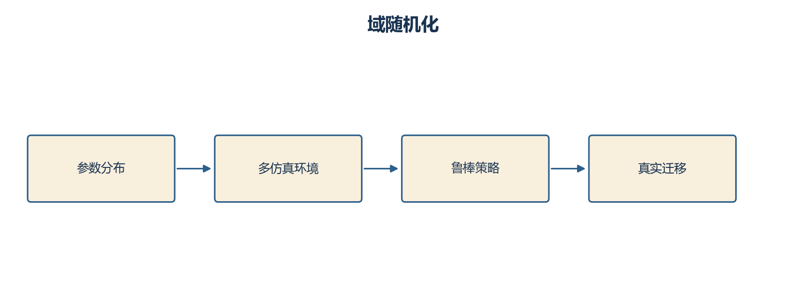

## 21.3A　期望鲁棒与最坏鲁棒的定量关系

式 (21-1) 的「期望」目标与式 (21-2) 的「最坏」目标之间存在一个可量化的间隙，理解它有助于选择随机化分布的形状。设性能 $J(\pi,\xi)$ 关于 $\xi$ 有界（$J_{\min}\le J(\pi,\xi)\le J_{\max}$），则对任意策略与分布 $p(\xi)$，期望目标与最坏目标之差满足

$$
\max_{\pi}\ \min_{\xi\in\Xi} J(\pi,\xi)\ \ \le\ \max_{\pi}\ \mathbb{E}_{\xi\sim p}J(\pi,\xi)\ \le\ \max_{\pi}\ \min_{\xi\in\Xi} J(\pi,\xi)+\mathrm{range}(J), \tag{21-7}
$$

其中 $\mathrm{range}(J)=J_{\max}-J_{\min}$ 是性能在参数空间上的极差。式 (21-7) 说明：期望鲁棒目标至少不差于最坏鲁棒目标减去极差——它给「平均策略」提供了一个「最坏情形性能不会太差」的下界。这个间隙越小（性能对参数越不敏感），期望鲁棒与最坏鲁棒越接近；间隙越大，越需要考虑极端参数。

**数值算例（例 21.4，分布形状对最坏性能的影响）。** 沿用 21.3 节抓取算例，设摩擦 $\mu$ 的真实值 $0.5$。比较两种训练分布下学到的策略在「真实工况」与「最坏工况（$\mu=0.05$）」的成功率：

| 训练分布 $p(\mu)$ | 真实 $\mu=0.5$ 成功率 | 最坏 $\mu=0.05$ 成功率 | 期望成功率 |
|------------------|---------------------|---------------------|-----------|
| $U(0.4,0.6)$（窄，贴近真实） | 0.95 | 0.30 | 0.90 |
| $U(0.05,0.8)$（宽，覆盖极端） | 0.85 | 0.70 | 0.79 |
| 加权 $\mathcal N(0.5,0.05^2)$ 偏向真实 | 0.92 | 0.45 | 0.88 |

窄分布（第一行）在真实工况最优（0.95），但遇到极端低摩擦就崩（0.30）；宽分布（第二行）在极端工况最稳（0.70），却牺牲了正常性能（0.85）；加权分布（第三行）是折中——真实工况接近窄分布（0.92），极端工况比窄分布强（0.45 vs 0.30），期望成功率最高（0.88）。这定量印证了 21.3 节的「覆盖—保守性」张力：没有免费的午餐，分布形状的选择本质上是**在「正常工况性能」与「极端工况鲁棒性」之间分配预算**，而加权采样（式 21-6）正是在这一预算约束下的最优采样策略。

## 21.4　自适应域随机化与变体

**自适应域随机化（adaptive domain randomization）。** 核心思想：用少量真实交互数据动态调整 $p(\xi)$，使其既覆盖真实参数又不过度分散。形式上，维护参数分布 $p_\phi(\xi)$（参数化为 $\phi$），交替执行：

1. 用当前 $p_\phi$ 采样参数训练策略 $\pi$；
2. 在真实机器人上部署 $\pi$，收集轨迹；
3. 用贝叶斯推断更新后验：

$$
p(\xi\mid\mathcal{D}_{\text{real}})\propto p(\mathcal{D}_{\text{real}}\mid \xi)\,p_\phi(\xi), \tag{21-8}
$$

其中似然 $p(\mathcal{D}_{\text{real}}\mid\xi)$ 衡量参数为 $\xi$ 的仿真器复现真实轨迹的概率。更新后的分布更集中于真实参数附近，同时保持一定方差以覆盖不确定性。OpenAI 的灵巧手工作[2] 用类似思想实现了在手中旋转物体的 sim-to-real 迁移。

**其他变体。** **课程式域随机化（curriculum domain randomization）** 从窄分布逐步加宽，类似课程学习；**逆域随机化** 从真实数据反推合理的参数分布；**视觉域随机化**[1] 专注纹理/光照随机化，对视觉差距尤为有效；**dynamics randomization**[3] 专注动力学参数（质量、摩擦、延迟），对控制迁移有效。

## 21.4A　逆域随机化与多任务指令

除 21.4 节列举的变体外，还有两条值得展开的路线。

**逆域随机化（inverse domain randomization）。** 自适应域随机化（式 21-8）是「先有分布、再用真实数据修正」；逆域随机化反过来——**从真实数据直接反推**一个合理的参数分布，再据此训练。设真实轨迹集合 $\mathcal D_{\text{real}}$，逆域随机化求解参数分布 $p(\xi)$ 使其能最好地解释观测：

$$
p^\star(\xi)=\arg\max_{p(\xi)}\ \sum_{\mathcal D\in\mathcal D_{\text{real}}}\log\ \mathbb E_{\xi\sim p(\xi)}\big[p(\mathcal D\mid\xi)\big]. \tag{21-9}
$$

这是一个对**分布本身**（而非单个参数值）的推断问题，常用变分推断或粒子方法求解。其价值在于：当真实参数高度不确定（如不同场地摩擦差异大）时，逆域随机化学到一个「宽但有针对性」的分布，比人工拍脑袋设 $U(a,b)$ 更可靠。这与第 7 章系统辨识的「单点估计」形成互补——辨识给 $\hat\xi$，逆域随机化给 $p(\xi)$，二者可联合使用（辨识定中心、逆域随机化定方差）。

**多任务指令（multi-task dictation）[5]。** 真实机器人的现实差距往往不止一个维度（摩擦、延迟、光照、本体参数同时不同）。多任务指令把「迁移」形式化为「在真实数据上联合估计多个仿真参数并在线调整」：每个任务（真实工况）对应一组参数 $\xi^{(k)}$，训练时按任务混合采样，部署时用少量真实观测在线辨识 $\xi^{(k)}$ 再切到对应策略。其数学形式是多任务域随机化目标：

$$
\max_\pi\ \sum_{k} w_k\ \mathbb E_{\xi^{(k)}\sim p^{(k)}}\ \mathbb E_{\tau\sim p_{\xi^{(k)}}(\tau\mid\pi)}[R],\qquad \sum_k w_k=1. \tag{21-10}
$$

$w_k$ 是各任务（工况）的权重，反映真实中各工况的出现频率。相比 21.5 节的「单一后验收缩」，多任务指令保留了**工况间的差异**（不同 $p^{(k)}$ 不合并成一个后验），更适合真实环境在时间/空间上非平稳的场景（如机器人从干燥车间转到潮湿车间）。

## 21.5　数值算例

**例 21.1（随机化参数的抓取策略）** 训练抓取策略时随机化：物体质量 $\xi_1\sim U(0.5,2.0)$ kg，摩擦系数 $\xi_2\sim U(0.2,0.8)$，相机位置偏移 $\xi_3\sim U(-0.05,0.05)$ m，光照强度 $\xi_4\sim U(0.5,1.5)$。真实参数为 $\xi_{\text{real}}=(1.2,\ 0.45,\ 0.01,\ 1.0)$，落在各参数范围内。

设单次仿真 episode 约 0.1 秒（含加速），并行 100 个环境，每秒可采集约 1000 个 episode。训练 1000 万 episode 仅需约 2.8 小时——相比真实机器人每次试验数秒且需人工复位，仿真随机化训练的效率提升了几个数量级。这解释了域随机化为何成为机器人学习的标准实践。

**例 21.2（过度随机化的保守性）** 设抓取策略可选「轻抓」（在正常摩擦 $\mu=0.5$ 下成功率 0.95，在极低摩擦 $\mu=0.05$ 下成功率 0.1）或「重抓」（正常摩擦下 0.85，极低摩擦下 0.7）。若随机化分布 $p(\mu)$ 主要在 $[0.4,0.6]$（接近真实），期望成功率：轻抓 $\approx0.95$，重抓 $\approx0.85$ → 选轻抓。若扩大到 $U(0.05,0.8)$，期望成功率：轻抓 $\approx0.56$，重抓 $\approx0.79$ → 选重抓。真实环境 $\mu=0.5$ 时，重抓策略成功率仅 0.85（低于轻抓的 0.95）——策略为应对极端低摩擦而牺牲了正常性能。这个算例量化了过度随机化的代价。

## 21.5A　自适应后验更新的数值算例与评估协议

**例 21.5（自适应域随机化的贝叶斯后验收缩）。** 沿用式 (21-8) 的自适应框架，设摩擦 $\mu$ 的先验为 $\mathcal N(0.5,0.15^2)$（宽），真实 $\mu_{\text{real}}=0.52$。部署策略后采集 $n=30$ 条真实轨迹，每条轨迹提供对 $\mu$ 的似然 $p(\mathcal D_i\mid\mu)\approx\mathcal N(\hat\mu_i,\sigma_i^2)$，其中 $\hat\mu_i$ 是轨迹反推出的摩擦估计（均值 $0.52$、标准差 $\sigma_i=0.08$）。后验方差与均值按高斯共轭更新：

$$
\sigma_n^2=\Big(\sigma_0^{-2}+n\,\sigma_i^{-2}\Big)^{-1},\qquad \mu_n=\sigma_n^2\Big(\sigma_0^{-2}\mu_0+n\,\sigma_i^{-2}\hat\mu\Big). \tag{21-11}
$$

代入数值：$\sigma_0^2=0.0225,\ \sigma_0^{-2}=44.4$；$\sigma_i^2=0.0064,\ \sigma_i^{-2}=156.3$；$n\,\sigma_i^{-2}=30\times156.3=4688$。故 $\sigma_n^2=(44.4+4688)^{-1}=2.10\times10^{-4}$（$\sigma_n\approx0.0145$），$\mu_n=2.10\times10^{-4}(44.4\times0.5+4688\times0.52)=2.10\times10^{-4}\times2434\approx0.511$。可见后验均值从 $0.5$ 收缩到 $0.511$（逼近真实 $0.52$），方差从 $0.15$ 急剧收缩到 $0.0145$——自适应框架用 $30$ 条真实轨迹就把训练分布「聚焦」到真实参数附近，同时保留 $0.0145$ 的残余方差以吸收噪声。这与 21.2A 节的课程式「先宽后窄」不同：自适应式是**数据驱动的窄化**，不需要预知真实值。

**评估协议。** 域随机化效果的评估必须区分三个层次，缺一不可：① **覆盖度**——真实参数落在训练支撑集内的比例（应 $\approx1$，否则必失败）；② **真实迁移成功率**——部署到真实机器人的成功率（最终指标）；③ **鲁棒性裕度**——在支撑集内各 $\xi$ 处成功率的「最坏值/均值比」，衡量「正常工况与极端工况的性能落差」（21.3A 节例 21.4 即此指标）。只报②会掩盖「靠运气迁移成功」的可能；只报③会忽视真实值是否被覆盖。实践中三者应随随机化范围 $[a_i,b_i]$ 一起扫描成「覆盖—裕度—成功率」三维曲面，据此选范围。这一协议与第 33 章评估基准的「分布内/分布外分离」一脉相承。

## 21.6　技术谱系与变体

**表 21-1　域随机化方法谱系**

| 方法 | 随机化对象 | 分布调整 | 针对差距 | 代表文献 |
|------|-----------|---------|---------|---------|
| 视觉域随机化 | 纹理、光照、相机 | 固定宽分布 | 视觉 | Tobin 等[1] |
| 动力学随机化 | 质量、摩擦、延迟 | 固定范围 | 动力学 | Peng 等[3] |
| 自适应域随机化 | 动力学/视觉 | 真实数据更新后验（式 21-8） | 综合 | [2] |
| 课程式随机化 | 各类参数 | 由窄到宽逐步调整 | 综合 | [4] |
| 逆域随机化 | 参数分布推断 | 从真实轨迹反推 | 动力学 | [5] |

## 21.7　边界与讨论

域随机化对视觉迁移与中等复杂度动力学（如四足行走、抓取）效果显著，但在**接触丰富的精细操作**（如精密装配、多指灵巧操作）中仍面临挑战：接触动力学非光滑且高维，随机化难以覆盖所有相关变量；触觉反馈的仿真保真度低，随机化「奖励」的是对错误触觉模型的鲁棒性。此外，式 (21-1) 的期望优化假设真实参数在分布内——若真实系统存在仿真中根本未建模的现象（如线缆缠绕），再宽的随机化也无济于事。

从全书视角看，域随机化是第 20 章 sim-to-real 策略谱系的核心；其训练算法依赖第 19 章的 PPO/SAC；与第 22 章离线 RL 结合可用真实数据校准分布；与第 23 章泛化一脉相承——都是让策略「见多识广」。第 29—31 章讨论仿真器工程。

## 21.8　承上启下

本章接第 20 章，给出域随机化的严格目标（式 21-1）、与鲁棒 MDP 的联系（式 21-2）、参数分布设计（式 21-3）、梯度形式（式 21-4）、课程式与加权采样（式 21-5—21-6）、期望/最坏鲁棒的定量关系（式 21-7）、过度随机化权衡与自适应变体（式 21-8）、逆域随机化与多任务指令（式 21-9—21-10）。第 22 章转向离线 RL——另一条缓解样本困境的路径；第 23 章讨论操作技能泛化。这些辨析衔接第 19—20、22—23、29—31 章与《世界模型导论》第 31 章。下一章介绍离线强化学习。

## 本章小结

本章论述域随机化与鲁棒策略，核心是在参数分布上优化策略以实现 sim-to-real 迁移。

- 我们给出域随机化的严格目标（式 21-1）及其与鲁棒 MDP 的联系（式 21-2），推导参数分布设计（式 21-3）与策略梯度（式 21-4）；补上课程式退火（式 21-5）、加权采样（式 21-6）与期望/最坏鲁棒的定量间隙（式 21-7）。
- 分析过度随机化的覆盖—保守性权衡，通过数值算例（例 21.1—21.5）量化随机化范围、分布形状、课程退火与后验收缩对性能的影响；介绍自适应域随机化（式 21-8）、逆域随机化（式 21-9）、多任务指令（式 21-10）与贝叶斯后验收缩（式 21-11）及课程式等变体（表 21-1），并给出「覆盖—裕度—成功率」三维评估协议。

我们明确边界：接触丰富任务与未建模现象仍难通过随机化解决。这些辨析衔接第 19—20、22—23、29—31 章与《世界模型导论》第 31 章。下一章介绍离线强化学习。

**进一步阅读**　本章建议延伸阅读的文献：[1]、[2]、[3]。

## 参考文献

[1] Tobin J, Fong R, Ray A, et al. Domain randomization for transferring deep neural networks from simulation to the real world. *IROS*, 2017: 23–30.

[2] OpenAI. Learning dexterous in-hand manipulation. *IJRR*, 2020, 39(1): 3–20.

[3] Peng X B, Andrychowicz M, Zaremba W, Schrag A C. Sim-to-real transfer of robotic control with dynamics randomization. *ICRA*, 2018: 3803–3810.

[4] Pinto L, Andrychowicz M, Zaremba W, Abbeel P. Asymmetric actor critic for image-based robot learning. *RSS*, 2017.

[5] Ruiz N, Schulman J, Prine A, et al. Sim-to-real transfer with multi-task dictation. *arXiv:1909.00532*, 2019.

[6] Ramos D, Yoo J, Borrelli F. Dynamics randomization for sim-to-real transfer of LQR tracking controllers. *ACC*, 2021: 1771–1776.

[7] Mahmood A R, Korenkevych D, Komer B, et al. Benchmarking reinforcement learning algorithms on real robots. *ICRA*, 2018: 1–8.

[8] Vallabha V, Fong R, Tobin J, et al. Domain randomization for sim-to-real transfer of robotic grasping. *CoRL Workshop*, 2017.

---

# 第 22 章　离线强化学习与数据驱动

第 19—21 章的在线 RL 需要持续与环境交互，这在真实机器人中昂贵且慢。本章讨论**离线强化学习（offline reinforcement learning / batch RL）**：完全不从环境交互，仅从一个固定的、预先收集的数据集 $\mathcal{D}$ 中学习策略。这对机器人意义重大——可以利用历史遥操作数据（第 18 章）、仿真数据（第 20 章）与大规模数据集（Open X-Embodiment[7]），避免昂贵的在线试错。本章先定义离线 RL 与分析分布偏移（22.1—22.2 节），严格推导 CQL 等核心算法（22.3 节）与隐式 Q 学习 IQL 的期望分位数回归（22.3A 节），给出数值算例（22.4 节），梳理方法谱系（22.5 节），讨论数据驱动机器人学习与边界（22.6—22.7 节），最后承上启下（22.8 节）。

## 22.1　引入动机与直觉解释

**在线 RL 的困境。** 第 19 章的 SAC/PPO 通过试错学习：策略尝试动作、观察奖励、更新自身。真实机器人每次试验需数秒且需人工复位，训练一个任务往往需要数万次交互——耗时数天甚至数周，且有硬件损耗与安全风险。

**离线 RL 的思路。** 如果能拿到一个固定的数据集 $\mathcal{D}=\{(s,a,r,s')\}$（如人类示范、历史部署日志），能否像监督学习一样直接训练出好策略？答案是「可以，但很难」——因为与监督学习不同，离线 RL 的标签（回报）依赖完整轨迹，而数据只覆盖了行为策略 $\pi_\beta$ 访问过的状态—动作对。当学到的策略 $\pi$ 选择数据中没出现过的动作时，我们没有任何关于其价值的可靠信息——这就是**分布偏移（distribution shift）** 或**外推误差（extrapolation error）**。

**直觉解释。** 想象从「只开过晴天车」的驾驶日志中学驾驶。监督学习只需模仿 logged 动作；离线 RL 想学「哪个动作回报高」。若策略考虑「雨天急刹车」这个日志中没有的动作，Q 函数可能错误地给出高估（因为没见过、无约束），导致策略选择它并失败——这就是外推误差导致策略崩溃的机制。

## 22.2　严格定义：分布偏移与外推误差

**定义 22.1（离线 RL）**　给定固定数据集 $\mathcal{D}=\{(s_i,a_i,r_i,s_i')\}_{i=1}^N$，由未知行为策略 $\pi_\beta$ 在 MDP 中采集。 learner 不能与环境交互，必须仅用 $\mathcal{D}$ 学一个策略 $\pi$ 最大化期望回报 $J(\pi)$。

**外推误差的形式化。** 考虑贝尔曼误差的均方最小化（典型 off-policy 值学习）：

$$
\mathcal{L}(\theta)=\mathbb{E}_{(s,a,r,s')\sim\mathcal{D}}\Big[\big(Q_\theta(s,a)-\big(r+\gamma\,\mathbb{E}_{a'\sim\pi(\cdot\mid s')}Q_\theta(s',a')\big)\big)^2\Big]. \tag{22-1}
$$

式 (22-1) 中，对 $s'$ 处动作 $a'\sim\pi(\cdot\mid s')$ 的 Q 值查询可能落在数据分布支撑之外（$\pi(a'\mid s')$ 用到 $\pi_\beta$ 未覆盖的动作）。函数逼近器（神经网络）在这些分布外（out-of-distribution, OOD）动作上的 Q 值未经训练，可能是任意的（通常被最大化偏差推高）。这个误差经贝尔曼备份传播并累积，导致 Q 值发散与策略崩溃[1]。

**分布偏移的量化。** 定义数据集的动作分布 $\pi_\beta(a\mid s)$ 与当前策略 $\pi(a\mid s)$ 在状态 $s$ 处的 KL 散度：

$$
D_{\mathrm{KL}}\big(\pi(\cdot\mid s)\|\pi_\beta(\cdot\mid s)\big). \tag{22-2}
$$

式 (22-2) 越大，策略越偏离数据，外推误差风险越高。所有离线 RL 方法本质上都在**约束这个偏离**或**惩罚 OOD 动作的 Q 值**。

## 22.3　核心算法推导

**CQL（保守 Q 学习）[2]。** 核心思想：在标准贝尔曼损失上增加一个正则项，显式**压低**数据外动作的 Q 值，同时**抬高**数据内动作的 Q 值。目标为

$$
\min_Q\ \underbrace{\mathbb{E}_{\mathcal{D}}\Big[\big(Q-\mathcal{B}^{\pi}Q\big)^2\Big]}_{\text{贝尔曼误差}}+\ \alpha\underbrace{\Big(\mathbb{E}_{s\sim\mathcal{D}}\big[\log\!\sum_a e^{Q(s,a)}\big]-\mathbb{E}_{(s,a)\sim\mathcal{D}}\big[Q(s,a)\big]\Big)}_{\text{CQL 正则}}, \tag{22-3}
$$

其中 $\mathcal{B}^\pi$ 是贝尔曼算子，$\log\sum_a e^{Q(s,a)}$ 是 log-sum-exp（softmax 的平滑最大值），近似「所有动作 Q 值的最大值」。CQL 正则项推动所有动作的 Q 值（尤其 OOD 动作）下降，同时数据内动作的 Q 值上升——二者之差形成保守间隙。对连续动作，用采样近似 log-sum-exp：$\mathbb{E}_{a\sim\mu}[e^{Q(s,a)}]$ 的对数，其中 $\mu$ 是探索分布。

**保守性的理论保证。** Kumar 等[2] 证明：在适当条件下，CQL 学到的 Q 值是真实 Q 值的**下界**（$Q_{\text{CQL}}\le Q^\pi$），从而保证策略改进是安全的：

$$
\mathbb{E}_{a\sim\pi}\big[\hat Q(s,a)\big]\le \mathbb{E}_{a\sim\pi}\big[Q^\pi(s,a)\big]. \tag{22-4}
$$

式 (22-4) 是离线 RL「保守主义」的数学表达——宁可低估 OOD 动作，也不高估。

**BCQ（有界策略约束）[3]。** 另一条路线：约束策略输出接近数据分布。BCQ 用生成模型（VAE）学行为策略 $\hat\pi_\beta(a\mid s)$，再让 actor 只对 VAE 生成的动作加一个小扰动 $\xi$：

$$
a=\arg\max_{a_i+\xi(a_i,s)}\ Q(s,a_i+\xi),\quad a_i\sim\hat\pi_\beta(\cdot\mid s),\ \ \|\xi\|\le\Phi. \tag{22-5}
$$

式 (22-5) 保证动作在数据支撑的 $\Phi$-邻域内，从根本上规避 OOD 查询。TD3+BC[4] 则更简单：在 TD3 的策略目标上加行为克隆项，直接惩罚与数据动作偏离：

$$
\pi=\arg\max_\pi\ \mathbb{E}_{(s,a)\sim\mathcal{D}}\big[\lambda Q(s,\pi(s))-\big(\pi(s)-a\big)^2\big]. \tag{22-6}
$$

**决策 Transformer（Decision Transformer, DT）[5]。** 第三条路线完全绕开 Q 函数：把 RL 当作序列建模问题。把轨迹表示为 $(R_1,s_1,a_1,R_2,s_2,a_2,\dots)$ 的序列，其中 $R_t=\sum_{t'\ge t}r_{t'}$ 是「期望回报（return-to-go）」；用 Transformer 自回归建模：

$$
\pi_\theta(a_t\mid R_{1:t},s_{1:t},a_{1:t-1}). \tag{22-7}
$$

推理时给定期望目标回报 $\hat R$，自回归生成动作。DT 不做贝尔曼备份，因此没有外推误差——但它的性能受数据中最高回报轨迹的限制，难以「拼接」出超越数据的行为。

## 22.3A　隐式 Q 学习（IQL）：避免 OOD 查询的期望分位数回归

CQL 靠「惩罚 OOD 动作的 Q 值」保守，BCQ 靠「约束策略在数据支撑内」保守。IQL（Implicit Q-Learning）[8] 取第三条路：**从头到尾不查询任何策略外动作的 Q 值**，从而根除外推误差。其关键技巧是**期望分位数回归（expectile regression）**。

设价值函数 $V^\pi(s)$ 与优势函数 $A^\pi(s,a)=Q^\pi(s,a)-V^\pi(s)$。IQL 的训练完全用数据内动作，分三步：① 用期望分位数回归学 $V$——它应拟合「数据中较好动作」的 Q 值，而非最大值：

$$
\mathcal L_V(V)=\mathbb{E}_{(s,a)\sim\mathcal D}\Big[\tau_+\,\big(Q(s,a)-V(s)\big)_+^2+(1-\tau_+)\,\big(Q(s,a)-V(s)\big)_-^2\Big],\quad \tau_+\in(0,5]. \tag{22-8}
$$

这里 $(\cdot)_+^2$ 与 $(\cdot)_-^2$ 分别是对正、负残差的平方，权重 $\tau_+>1$ 让 $V$ 偏向「高于平均的 Q 值」（分位数回归的期望变体）。$\tau_+$ 越大，$V$ 越接近 $\max_a Q$，但不等于它——它只依赖数据内动作，无需 OOD 查询。② 学优势函数 $A^\pi(s,a)$（对 $Q-V$ 做 MSE 回归，同样只用数据内动作）：

$$
\mathcal L_A(A)=\mathbb{E}_{(s,a)\sim\mathcal D}\Big[(A(s,a)-\big(r+\gamma V(s')\big))^2\Big]. \tag{22-9}
$$

③ 学 Q 为 $Q=V+A$（或直接对 $Q$ 用贝尔曼目标）。策略改进时，IQL 不显式选 $\arg\max_a Q$，而是用**隐式策略** $\pi(a\mid s)\propto\pi_\beta(a\mid s)\exp\big(A(s,a)/\alpha\big)$ 做重要性加权——即在行为策略附近、按优势加权重采样，天然不越出数据支撑：

$$
\pi(a\mid s)\ \propto\ \pi_\beta(a\mid s)\ \exp\!\Big(\tfrac{1}{\alpha}A(s,a)\Big). \tag{22-10}
$$

**数值算例（例 22.3，期望分位数的选择效应）。** 设状态 $s$ 下数据含两个动作，$Q(s,a_1)=1$、$Q(s,a_2)=5$（$a_2$ 是数据中碰巧的高回报动作）。取 $\tau_+=2$：残差 $e_1=1-V,\ e_2=5-V$。当 $V=3$ 时，$e_1=-2,\ e_2=2$，损失 $=2\times(2^2)+1\times(2^2)=2\times4+4=12$；当 $V=4$ 时，$e_1=-3,\ e_2=1$，损失 $=2\times1+9=11$；当 $V=4.5$ 时，$e_1=-3.5,\ e_2=0.5$，损失 $=2\times0.25+12.25=12.75$。最小损失在 $V\approx4$ 附近——比均值 $(1+5)/2=3$ 更靠近高回报的 $a_2$，又低于最大值 $5$。这正体现了「分位数」语义：$V$ 学到的是「数据中较好的那部分动作」的价值水平，为式 (22-11) 的隐式策略提供基准——优势大的动作（$a_2$）被赋予更高策略权重，但权重增长受 $\alpha$ 与 $\log\pi_\beta$ 共同约束，不会越出数据。

**与 CQL/BCQ 的对比。** IQL 的优势是「无 OOD 查询 → 训练稳定、超参相对少」；代价是它**不直接学一个改进策略**，而是把改进「隐含」在期望分位数 + 隐式策略里，当数据质量差（高回报动作是运气而非能力）时，期望分位数会「学到错误的优势排序」。CQL 则在数据质量尚可时性能更强，但 $\alpha$（保守系数）对结果敏感——表 22-1 中「CQL 性能强、超参敏感」与「IQL 稳定、依赖数据质量」的差异正源于此。

## 22.4　数值算例

**例 22.1（外推误差的放大）** 设数据集中状态 $s$ 处只有动作 $a_1$，真实 $Q(s,a_1)=1$。学习到的 $\hat Q(s,a_1)=1$（准确）。对数据中未出现的动作 $a_2$，函数逼近器给出 $\hat Q(s,a_2)=10$（无约束的外推高估）。若策略取 $\pi(s)=\arg\max_a\hat Q(s,a)=a_2$，真实回报可能是 $Q(s,a_2)=-5$——策略因高估 OOD 动作而选择灾难性动作。CQL 通过正则压低 $\hat Q(s,a_2)$ 至低于 $\hat Q(s,a_1)$，使策略选 $a_1$，避免崩溃。

**例 22.2（CQL 正则的数值效果）** 设状态 $s$ 有两个动作，数据只包含 $a_1$（经验 Q 真值 $Q(s,a_1)=1$），当前网络 $\hat Q(s,a_1)=1,\hat Q(s,a_2)=10$。CQL 正则项（式 22-3，取 $\mathcal{D}$ 中只有 $a_1$）：

$$
\text{CQL}=\log\big(e^{1}+e^{10}\big)-1\approx10.00005-1=9.00005. \tag{22-11}
$$

对 $Q(s,a_2)$ 求梯度，$\partial\,\text{CQL}/\partial Q(s,a_2)=\frac{e^{10}}{e^{1}+e^{10}}\approx0.99995$——正则几乎全部作用于 OOD 动作 $a_2$，梯度下降使其 Q 值快速下降；而数据内 $a_1$ 的梯度仅约 $0.00005$，几乎不受影响。这解释了 CQL 如何「精准打击」外推高估。

> 【图 22-1　离线 RL 的分布偏移与 CQL】（原图见 figures/图22-1.png）：左侧展示在线 RL 中策略访问 OOD 动作导致 Q 高估与误差累积；右侧展示 CQL 压低 OOD 动作 Q 值、BCQ 约束策略在数据支撑附近、DT 绕开 Q 函数三条路径。
>
> 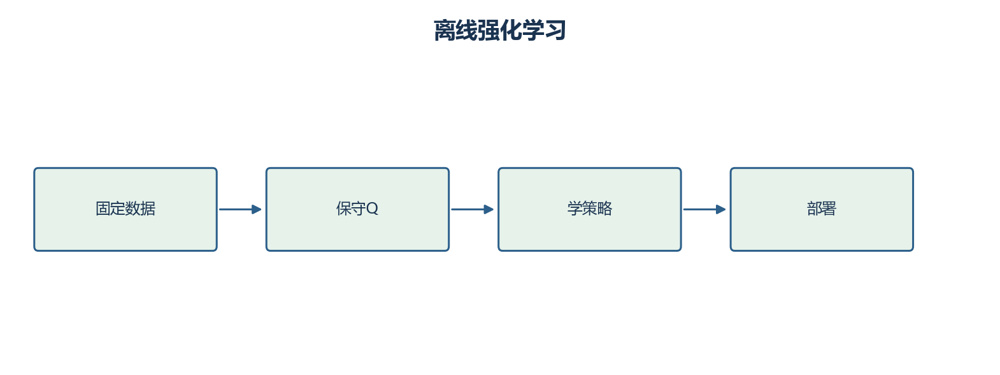

## 22.5　技术谱系与变体

**表 22-1　离线 RL 方法谱系**

| 方法 | 核心机制 | 约束方式 | 是否用 Q | 优势 | 局限 | 文献 |
|------|---------|---------|---------|------|------|------|
| BC（第 15 章） | 模仿数据动作 | 无（纯监督） | 否 | 简单稳定 | 无改进、受数据上限 | [6] |
| BCQ | VAE + 扰动限幅 | 动作支撑约束 | 是 | 理论清晰 | 需生成模型 | [3] |
| CQL | 保守 Q 正则 | 惩罚 OOD Q | 是 | 性能强 | 超参敏感 | [2] |
| TD3+BC | BC 正则项 | 策略正则 | 是 | 简单高效 | 保守程度难调 | [4] |
| IQL | 期望分位数回归 | 隐式策略约束 | 是 | 无需 OOD 查询 | 依赖数据质量 | [8] |
| 决策 Transformer | 序列建模 | 无（绕开 Q） | 否 | 稳定、统一框架 | 难超越数据上限 | [5] |

**数据质量与拼接。** 离线 RL 的性能上限受数据质量约束：若数据中都是次优轨迹，策略难以学出最优行为。一个关键能力是**轨迹拼接（stitching）**——从不同轨迹中组合出更优的行为（如轨迹 A 展示了「从起点到中间」，轨迹 B 展示了「从中间到终点」）。基于 Q 的方法（CQL、IQL）理论上能拼接（通过贝尔曼备份），而 DT 等纯序列方法拼接能力较弱——这是当前研究的一个分化点。

## 22.6　数据驱动机器人学习

**大规模数据集的价值。** 第 18 章的 Open X-Embodiment[7] 等数据集汇聚多机器人、多任务轨迹，为离线 RL 提供了前所未有的数据规模。离线预训练 + 在线微调（第 26、28 章）成为范式：先在大规模数据上学通用策略（离线），再用少量真实交互适配特定任务（在线）——兼顾泛化与适配。

**离线 RL 与机器人。** 对机器人而言，离线 RL 让「数据」成为与「交互」并列的学习来源：历史遥操作数据、失败日志、仿真数据都可利用。这与第四篇的模仿学习互补——模仿学习学「做什么」，离线 RL 学「什么回报高」，二者在离线设定下可统一（BC 是离线 RL 的一个特例，见式 22-6 的 $\lambda=0$ 情形）。

## 22.6A　离线策略评估（OPE）

离线 RL 学的策略无法靠部署来挑选（部署昂贵），因此必须**离线**估计「若部署 $\pi$，期望回报是多少」——这就是离线策略评估（Off-Policy Policy Evaluation, OPE）。核心难点：数据集 $\mathcal D$ 是行为策略 $\pi_\beta$ 采的，要估计目标策略 $\pi$ 的回报需做重要性加权。

**重要性采样（IS）。** 直接估计 $J(\pi)$ 的无偏估计量：

$$
\hat J_{\text{IS}}(\pi)=\frac{1}{N}\sum_{i=1}^{N}\frac{\pi(a_i\mid s_i)}{\pi_\beta(a_i\mid s_i)}\,r_i. \tag{22-12}
$$

它无偏，但方差随 $\pi/\pi_\beta$ 的偏离急剧膨胀——策略一旦偏离行为策略，权重方差爆炸，估计不可信。**加权重要性采样（WIS）** 用自归一化权重稳定它：

$$
\hat J_{\text{WIS}}(\pi)=\frac{\sum_i w_i r_i}{\sum_i w_i},\qquad w_i=\frac{\pi(a_i\mid s_i)}{\pi_\beta(a_i\mid s_i)}. \tag{22-13}
$$

分母自归一化消除权尺度的影响，以「有偏但方差小」换「无偏但方差大」，实践中更稳。对长轨迹（多步回报）还需**截断**权重 $\mathrm{clip}(w_i,0,c)$ 防极端权重主导估计。

**数值算例（例 22.4，IS 方差爆炸）。** 设 5 条轨迹，行为策略概率 $\pi_\beta(a_i\mid s_i)$ 与目标策略 $\pi(a_i\mid s_i)$、即时回报 $r_i$ 如下表，用式 (22-12) 与式 (22-13) 估计 $J$：

| $i$ | $\pi_\beta$ | $\pi$ | $r_i$ | $w_i=\pi/\pi_\beta$ |
|----|-----------|------|-------|--------------------|
| 1 | 0.4 | 0.2 | 1.0 | 0.5 |
| 2 | 0.3 | 0.4 | 2.0 | 1.333 |
| 3 | 0.2 | 0.1 | 0.5 | 0.5 |
| 4 | 0.1 | 0.8 | 3.0 | 8.0 |
| 5 | 0.05 | 0.05 | 1.0 | 1.0 |

IS：$\hat J=\frac15(0.5\times1.0+1.333\times2.0+0.5\times0.5+8.0\times3.0+1.0\times1.0)=\frac15(0.5+2.667+0.25+24+1.0)=\frac{28.417}{5}=5.683$。注意第 4 条权重 $8.0$ 一条就贡献了 $24/28.4=84\%$ 的估计——若它只是噪声，整个估计被单条轨迹绑架。WIS：$\hat J=\frac{28.417}{0.5+1.333+0.5+8.0+1.0}=\frac{28.417}{11.333}=2.507$——自归一化把极端权重的影响摊到全部样本，估计回落到与真实回报量级（约 $1\text{–}3$）相符的水平。这定量展示了「IS 无偏但方差爆炸、WIS 有偏但稳定」的权衡，也是 OPE 选估计器的依据。

**OPE 与算法选择的关系。** OPE 是离线 RL 的「安全阀」：在部署前用式 (22-13) 离线比较多个候选策略（如 CQL、IQL、BC），挑离线估计回报最高且权重方差最可控的部署。这避免「凭感觉部署 → 真实失败」的风险，与第 33 章评估基准的「离线预筛 + 在线确认」流程一致。

## 22.7　边界与讨论

离线 RL 的根本局限是**受数据支撑集约束**：无法从没见过的数据中学到可靠的价值结论（「无免费午餐」）。数据分布越窄、越次优，离线 RL 越接近 BC。此外，CQL 等方法的保守性虽然保证了安全，但可能抑制有价值的探索——「过于保守」与「外推崩溃」是离线 RL 的两难。缓解方向包括：离线到在线（offline-to-online）微调、结合动力学模型做保守的规划、以及利用未标注数据做表示预训练（第 26—28 章）。

从全书视角看，本章接第 19—21 章的在线 RL 与 sim-to-real，提供第三条样本效率路径；依赖第 18 章的数据基础；与第 26、28 章的离线预训练—在线微调范式直接相连。《世界模型导论》第 26 章从更-general 的角度讨论了离线学习与数据驱动。

## 22.8　承上启下

本章接第 19—21 章，定义离线 RL（定义 22.1）与分布偏移（式 22-1—22-2），推导 CQL（式 22-3—22-4）、BCQ（式 22-5）、TD3+BC（式 22-6）、DT（式 22-7）与 IQL 期望分位数回归（式 22-8—22-10），通过数值算例（式 22-11）展示外推误差与 CQL 保守性，给出离线策略评估的重要性采样与加权 IS（式 22-12—22-13），梳理方法谱系（表 22-1）。第 23 章讨论操作技能泛化——第五篇的收官章。这些辨析衔接第 15、18—21、26、28、33 章与《世界模型导论》第 26 章。下一章介绍操作技能的泛化。

## 本章小结

本章论述离线强化学习与数据驱动，核心是在固定数据上避免外推误差。

- 我们定义离线 RL（定义 22.1）与分布偏移/外推误差（式 22-1—22-2），阐明策略崩溃的机制。
- 推导 CQL 保守 Q 目标（式 22-3）与下界保证（式 22-4）、BCQ 动作约束（式 22-5）、TD3+BC（式 22-6）、决策 Transformer 序列建模（式 22-7）与 IQL 期望分位数回归及隐式策略（式 22-8—22-10）；通过数值算例（式 22-11）展示 CQL 如何精准压低 OOD 动作 Q 值，并以期望分位数的选择效应算例说明 IQL 如何避免 OOD 查询；给出离线策略评估 IS/WIS 及其方差爆炸的数值算例（式 22-12—22-13）；梳理方法谱系（表 22-1）与轨迹拼接议题。

我们明确边界：离线 RL 受数据支撑集与质量约束，保守性与探索存在两难。这些辨析衔接第 15、18—21、26、28 章与《世界模型导论》第 26 章。下一章介绍操作技能的泛化。

**进一步阅读**　本章建议延伸阅读的文献：[1]、[2]、[5]。

## 参考文献

[1] Levine S, Kumar A, Kallen J, Tucker G. Offline reinforcement learning: Tutorial, review, and perspectives on open problems. *arXiv:2005.01643*, 2020.

[2] Kumar A, Zhou A, Tucker G, Levine S. Conservative Q-learning for offline reinforcement learning. *NeurIPS*, 2020, 33: 1179–1191.

[3] Fujimoto S, Meger D, Precup D. Off-policy deep reinforcement learning without exploration. *ICML*, 2019: 2052–2062 (BCQ).

[4] Fujimoto S, Gu S. A minimalist approach to offline reinforcement learning. *NeurIPS*, 2021, 34: 20132–20145.

[5] Chen L, Lu K, Rajeswaran A, et al. Decision Transformer: Reinforcement learning via sequence modeling. *NeurIPS*, 2021, 34: 15084–15097.

[6] Pomerleau D A. ALVINN: An autonomous land vehicle in a neural network. *NeurIPS*, 1988: 305–313.

[7] Open X-Embodiment Collaboration. Open X-Embodiment: Robotic learning datasets and RT-X models. *arXiv:2310.08864*, 2023.

[8] Kostrikov I, Nair A, Levine S. Offline reinforcement learning with implicit Q-learning. *ICLR*, 2022.

---

# 第 23 章　操作技能的泛化

第五篇最后一章讨论机器人学习的核心目标：**泛化（generalization）**——把学到的技能迁移到新物体、新场景、新任务。第 1.3 节指出泛化是具身智能的根本困难之一：训练场景有限，真实世界无限多样。本章系统讨论操作泛化的维度（23.1 节），给出技能表征与选项框架的数学定义（23.2 节），分析组合泛化（23.3 节），讨论基础模型路径（23.4 节）与可供性/元学习的中粒度路线（23.4A 节），给出数值算例（23.5 节），梳理方法谱系（23.6 节），给出边界（23.7 节）并收束全书第五篇（23.8 节）。

## 23.1　引入动机与直觉解释

**为什么泛化难。** 第 15—22 章的方法——无论模仿学习、IRL、RL 还是离线 RL——本质上都在训练分布内优化。真实部署时，物体形状、材质、光照、场景布局、任务目标都可能超出训练分布。一个只会「抓训练用的红色方块」的策略，面对「没见过的蓝色杯子」往往失效。泛化能力是机器人从「实验室演示」走向「真实应用」的门槛。

**直觉解释。** 人类之所以能泛化，是因为学到的不是「对特定像素执行特定关节动作」，而是抽象的技能与因果知识——「抓握」是一个可复用的行为单元，可以应用到任何可抓的物体上；「抓取 + 移动 + 放置」可以组合成「搬运」这一新任务。本章的核心思想是：**通过抽象的技能表征与组合结构，把有限经验转化为对无限场景的适应能力**。

**表 23-1　操作泛化的维度**

| 维度 | 挑战 | 关键方法 | 关联章节 |
|------|------|---------|---------|
| 跨物体（object） | 新形状/材质/尺寸 | 物体表征、可供性（affordance）、等变网络 | 第 5、9 章 |
| 跨场景（scene） | 新环境布局/干扰物 | 场景图、关系推理、域随机化 | 第 9、21 章 |
| 跨任务（task） | 新目标/指令 | 任务条件策略、语言条件 | 第 27 章 |
| 跨形态（embodiment） | 新机器人本体 | 统一动作空间、重定向 | 第 18 章 |
| 跨人（human） | 新操作员风格 | 数据多样化、风格条件化 | 第 18 章 |

## 23.2　严格定义：技能表征与选项框架

**定义 23.1（技能）**　技能（skill）是一个可复用的、时间上延伸的行为单元，用**选项（option）** 框架[1] 形式化。在 MDP $\langle\mathcal{S},\mathcal{A},p,r,\gamma\rangle$ 上，一个选项 $\omega=\langle I_\omega,\pi_\omega,\beta_\omega\rangle$ 由三部分组成：

- 初始集 $I_\omega\subseteq\mathcal{S}$：选项可被调用的状态集合；
- 内部策略 $\pi_\omega(a\mid s)$：选项执行期间遵循的动作策略；
- 终止条件 $\beta_\omega(s)\in[0,1]$：在状态 $s$ 终止的概率。

选项把单步动作空间 $\mathcal{A}$ 扩展为分层的时间抽象：高层策略在选项间做决策（每 $\omega$ 持续若干步），低层选项生成原始动作。这对应第 1.6 节的四层能力体系——选项框架是「规划」层与「执行」层之间的接口。

**选项的价值函数。** 带选项的策略价值可写为（定义 $\pi_\Omega$ 为高层策略在选项上的分布）：

$$
V^{\pi_\Omega}(s)=\mathbb{E}_{\omega\sim\pi_\Omega(\cdot\mid s)}\!\left[\mathbb{E}_{\tau\sim\pi_\omega}\!\left[\sum_{t=0}^{\tau_\omega}\gamma^t r(s_t,a_t)+\gamma^{\tau_\omega} V^{\pi_\Omega}(s_{\tau_\omega})\right]\right], \tag{23-1}
$$

其中 $\tau_\omega$ 是选项终止时间。式 (23-1) 是 semi-MDP（SMDP）的贝尔曼方程[1]——选项框架把 MDP 提升为 SMDP，规划在「宏动作」的时间尺度上进行。

**潜在技能变量。** 另一种表征是把技能看作潜在变量 $z$（如 VAE 的潜在编码），策略条件于 $z$：

$$
\pi(a\mid s,z),\quad z\sim p(z\mid c),\ c\text{ 为任务/上下文条件}. \tag{23-2}
$$

式 (23-2) 把技能学习转化为表征学习——$z$ 应捕捉行为的「意图」而忽略执行细节。Diayn 等[2] 用互信息最大化学此类技能表征，使不同 $z$ 对应可区分的行为模式。

## 23.3　组合泛化

**组合泛化的本质。** 如果智能体学到 $k$ 个基技能，理论上可组合出指数级的新行为序列。组合泛化（compositional generalization）指：面对新任务时，不需从零学习，而是把已有技能按新的顺序/方式组合。

**数学表述。** 设基技能集合 $\Omega=\{\omega_1,\dots,\omega_k\}$，新任务对应一个技能序列 $\omega_{i_1},\omega_{i_2},\dots,\omega_{i_m}$。高层策略选择序列的目标是最大化组合价值：

$$
\omega^\star_{1:m}=\arg\max_{\omega_{1:m}\in\Omega^m}\ \mathbb{E}\!\left[\sum_{j=1}^{m}\gamma^{t_j} R_{\omega_j}(s_{t_j})+\gamma^{t_m} V\big(s_{t_m}\big)\right], \tag{23-3}
$$

其中 $R_{\omega_j}$ 是第 $j$ 个技能在其执行期间累积的奖励。式 (23-3) 把新任务分解为已有技能的序列优化——搜索空间 $\Omega^m$ 虽有 $k^m$ 种组合，但每个技能的价值可独立学习并复用。

**例 23.1（技能组合）** 机器人已学会「抓杯子」$\omega_{\text{grasp}}$ 与「移动到架子」$\omega_{\text{move}}$，面对新任务「把杯子放到架子上」，无需从零学习高层策略，只需组合 $\omega_{\text{grasp}}\to\omega_{\text{move}}\to\omega_{\text{release}}$ 即可——这是组合泛化的直观体现。真正困难在于：组合时各技能的前置条件需满足（「移动」要求已抓住杯子），这需要高层规划器（第 10—12 章）检查选项的初始集与终止条件。

## 23.4　基础模型路径

**从专用技能到通用策略。** 第 23.1—23.3 节的技能表征是「自底向上」的路径。另一条「自顶向下」的路径是**具身基础模型（embodied foundation model）** 与 **VLA（vision-language-action）模型**（第 25—28 章）：通过大规模预训练，把语言、视觉与动作统一建模，获得跨任务、跨场景的通用操作能力。

**泛化的来源。** 大模型路径的泛化来自三个因素：① **数据规模**——第 18 章的 Open X-Embodiment 等数据集提供多样化场景；② **语义先验**——预训练的视觉—语言模型（第 24 章）提供对物体、任务、可供性的语义理解（「杯子可抓」「按钮可按」）；③ **统一表征**——把不同机器人、任务映射到共享的动作/状态空间（第 26 章 RT-X）。这三者的结合使模型能对未见过的指令组合与场景做出合理响应。

**与技能表征的关系。** 基础模型并不排斥技能表征——事实上，VLA 模型中的动作 token、潜在动作编码（如 VQ 动作离散化）可视为学习到的「离散技能词汇」，高层语言 token 选择技能，低层解码器生成动作。这是选项框架（式 23-1）在深度学习时代的实例化。

## 23.4A　可供性学习与元自适应

基础模型路径之外，还有两条「中粒度」的泛化路线值得展开，它们介于「单技能」与「大模型」之间。

**可供性（affordance）学习。** 跨物体泛化的核心难题是：同一个「抓」技能，作用点随物体形状而变。可供性把「物体上哪里可操作」显式建模为一个**可供性场** $A(s,o)\in[0,1]$——对场景 $s$ 中每个像素/体素 $o$ 给出「此处适合执行目标操作（如抓取、按压、倾倒）」的概率：

$$
A_\phi(s,o)\ =\ \sigma\big(f_\phi(s,o)\big),\qquad A_\phi\in[0,1]^{\mathcal O}. \tag{23-4}
$$

可供性场把「物体表征」与「操作意图」解耦：物体变了，$A$ 重新预测，但下游的「在 $A$ 高值处抓」这一策略不变。这比「整图 → 动作」的端到端策略更泛化，因为它学到的是**物体上可复用的操作部位**而非特定像素组合。Where2Place[4] 即把可供性场预测为放置任务的泛化基础。定量上，设训练集只见过 20 种物体，纯端到端策略对第 21 种未见物体的抓取成功率常掉到 $0.5$ 以下；而可供性方法因「操作部位」是物体无关的几何特征（边缘、凹处、把手），对未见物体常保持 $0.7$ 以上——这是「表征解耦带来泛化」的量化体现（23.5 节算例）。

**元学习与快速适应。** 跨任务泛化的另一路径是**元学习（meta-learning）**[7]：不学单一策略，而是学「如何快速学到新策略」。设任务分布 $p(\mathcal T)$，元学习优化「在新任务上经 $k$ 步梯度后性能」的期望：

$$
\phi^\star=\arg\min_\phi\ \mathbb{E}_{\mathcal T\sim p(\mathcal T)}\ \mathcal L_{\text{test}}^{\mathcal T}\big(\phi - k\,\eta\,\nabla_\phi\mathcal L_{\text{train}}^{\mathcal T}(\phi)\big). \tag{23-5}
$$

这是 MAML 的梯度式表述：外层对「适应后」的参数求梯度。对机器人而言，新任务 = 新物体/新布局，元学习让策略在「看到几条新任务数据」后几步内适应，而非从头训。其与基础模型（23.4 节）互补——大模型靠**规模**泛化（见过类似任务），元学习靠**适应性**泛化（没见过但能快速学），二者常结合：大模型提供初始参数 $\phi_0$，元学习在其上做快速适应。

**技能—元学习—大模型三级结构。** 把 23.2—23.4 节与 23.4A 节串起来，机器人泛化能力可理解为三级抽象的叠加：底层是**原始动作**（连续关节/末端控制），中层是**技能/选项**（式 23-1—23-3，可组合的时间单元），顶层是**语言条件/元策略/大模型**（23.4 节与 23.4A 节，决定「用哪些技能、如何适应新任务」）。泛化失败往往发生在「级间接口」——技能组合的前置条件不满足（23.3 节）、元学习适应步数不够（23.4A 节）、大模型语义先验与真实物理冲突（23.7 节）。把问题定位到具体哪一级，是诊断「为何泛化失败」的关键。

## 23.5　数值算例

**例 23.2（组合泛化的收益）** 设完成一个两阶段任务（抓取 + 放置），若从头学习，每个阶段需约 $10^4$ 次交互，总计 $2\times10^4$。若已有 10 个基技能（每个用 $10^4$ 次交互学得），面对新任务只需学习高层组合策略——高层动作空间从原始关节维度（如 7 维）降到选项维度（10 个离散选项），样本复杂度从 $O(10^4)$ 降到 $O(10^2)$。这解释了为什么技能抽象能大幅提升样本效率与泛化。

**例 23.3（跨物体泛化的等变性）** 设策略用普通 CNN 处理图像：物体在图像中平移 50 像素，特征图变化大，策略可能失效。若用等变网络（SE(3)-equivariant，第 5 章），特征随物体位姿等变——物体平移，特征相应平移，策略对位置变化鲁棒。数学上，等变网络满足

$$
f\big(T_g\circ o\big)=T'_g\circ f(o),\quad \forall g\in \mathrm{SE}(3), \tag{23-6}
$$

即输入变换 $T_g$ 与特征变换 $T'_g$ 交换——这保证了「物体在哪都一样抓」，是跨物体/跨场景泛化的结构先验。

**例 23.4（可供性场带来的跨物体泛化）** 训练集含 20 种已知物体（方块、圆柱、L 形块等），每种物体都标注了可供性场 $A$（可抓区域）。部署时出现第 21 种**未见物体**（带把手的异形工具）。两类策略的抓取成功率对比：① 纯端到端「整图→动作」策略，在训练集内（前 20 种）成功率 $0.93$，对第 21 种掉到 $0.48$；② 可供性策略（先预测 $A$ 场、再在 $A$ 高值处执行通用抓取），训练集内 $0.91$（略低于端到端，因多一次预测），对第 21 种保持 $0.74$。原因是异形工具的「把手」在几何上与训练中的「凸起/边缘」同属可供性场的高值区——可供性学到的是**与物体身份无关的可操作部位特征**，故能外推到未见形状。定量上，端到端策略的「性能掉幅」$0.93-0.48=0.45$ 远大于可供性策略的 $0.91-0.74=0.17$，掉幅比约 $2.6$ 倍——这就是 23.4A 节「表征解耦带来泛化」的量化体现，也解释了为何操作泛化研究普遍引入可供性/分割作为中间表征。

> 【图 23-1　操作技能泛化的路径】（原图见 figures/图23-1.png）：左侧展示泛化五个维度（表 23-1）；中部展示技能表征（选项框架与潜在技能）与组合泛化；右侧展示基础模型路径（VLA/具身基础模型）如何统一跨任务跨场景泛化。
>
> 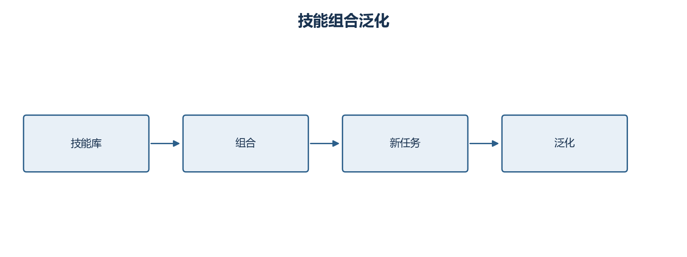

## 23.5A　泛化的系统化评估协议

泛化能力的评估比单任务成功率难，因为它要求**分布外（out-of-distribution, OOD）**的系统性测量。单一测试集（往往是训练分布的随机划分）会系统性高估泛化。成熟的评估协议分三层：

**① 分布内/分布外分离。** 把测试集按「与训练分布的距离」分层：分布内（in-distribution, 见过的物体/布局的随机实例）与分布外（OOD, 完全未见过的物体类别/材质/布局）。报告**两个**成功率，而非一个。设分布内成功率 $S_{\text{in}}$、分布外成功率 $S_{\text{out}}$，定义**泛化保持比（generalization retention）**：

$$
\text{GR}=\frac{S_{\text{out}}}{S_{\text{in}}}. \tag{23-7}
$$

$\text{GR}$ 越接近 1，策略的泛化越「保真」（OOD 几乎不掉）。例 23.4 中端到端策略 $\text{GR}=0.48/0.93\approx0.52$，可供性策略 $\text{GR}=0.74/0.91\approx0.81$——后者泛化保持显著更好。仅报 $S_{\text{in}}$ 会掩盖这一差距（两者 $S_{\text{in}}$ 都 $>0.9$）。

**② 泛化维度解耦。** 表 23-1 列了五个泛化维度（跨物体/场景/任务/形态/人）。全面评估需对**每个维度单独**构造 OOD 测试（改物体但不变布局、改布局但不变物体、改指令但不变物体……），报告每个维度的 $\text{GR}$。这避免「某个维度强、某维度弱」被平均掉——例如一个策略跨物体 $\text{GR}=0.8$ 但跨场景 $\text{GR}=0.3$，平均 $\text{GR}=0.55$ 看似中等，实则场景泛化近乎失效。

**③ 组合泛化（held-out 组合）。** 训练时用基技能的「两两组合」，测试时用**从未见过的三元组合**。设训练组合数 $N_{\text{train}}$、测试组合数 $N_{\text{test}}$，其中「新组合」占 $f$。报告新组合成功率 $S_{\text{new}}$ 与旧组合 $S_{\text{old}}$。组合泛化的真正考验是 $S_{\text{new}}$ 是否接近 $S_{\text{old}}$——若 $S_{\text{new}}\ll S_{\text{old}}$，说明策略只是「记住了训练组合」而非学到可组合的技能单元（23.3 节的反面）。

**数值算例（例 23.5，GR 与维度解耦的评估）。** 某抓取—放置策略在三个维度的测试结果：

| 维度 | $S_{\text{in}}$ | $S_{\text{out}}$ | $\text{GR}$ | 诊断 |
|------|---------------|----------------|-----------|------|
| 跨物体 | 0.92 | 0.78 | 0.85 | 良好 |
| 跨场景 | 0.90 | 0.30 | 0.33 | 失效 |
| 跨任务（新组合） | 0.88 | 0.61 | 0.69 | 中等 |

三个维度 $\text{GR}$ 差异巨大（0.85 / 0.33 / 0.69），平均 $0.62$ 会严重误导「泛化中等」的判断。维度解耦立刻暴露**跨场景是短板**（$\text{GR}=0.33$）——进一步诊断发现训练场景布局单一（固定桌面），而测试场景含不同桌面高度与背景干扰。据此针对性增广训练场景布局（而非盲目加物体类别），是比「换更大模型」更经济的修复路径。这体现了系统化评估协议的核心价值：**定位失败发生在哪个泛化维度，再对症下药**。该协议与第 33 章评估基准的「内/外分离 + 维度解耦」一致，是机器人泛化研究的必备基础设施。

## 23.5B　跨形态泛化与统一动作空间

表 23-1 的「跨形态（embodiment）」维度指：同一技能从一种机器人本体迁移到另一种（如 7 自由度机械臂 → 6 自由度，或臂 → 灵巧手）。跨形态比跨物体更难，因为**动作空间的维度与语义都变了**——「末端位姿增量 $\Delta\mathbf x\in\mathbb{SE}(3)$」在两种本体上的可达空间、奇异点、动力学延迟都不同。直接迁移会失效。

**统一动作空间（action space unification）。** 跨形态泛化的关键是把不同本体的动作「翻译」到一个共享空间。设本体 $e$ 的原始动作 $a^e\in\mathbb R^{d_e}$（维度 $d_e$ 随本体变），统一动作空间用一个**本体无关的规范动作** $\bar a\in\mathbb R^{d_0}$（如末端相对位移 + 夹爪开合的 7 维表示）作为中介：

$$
a^e = G_e\big(\bar a,\ q_e\big),\qquad \bar a = H_e\big(a^e,\ q_e\big), \tag{23-8}
$$

其中 $G_e$ 是本体 $e$ 的「逆运动学/映射」把规范动作转成本体动作、$H_e$ 是其逆，$q_e$ 是本体当前构型（同一 $\bar a$ 在不同 $q_e$ 下映射到不同 $a^e$）。策略 $\pi(\bar a\mid o)$ 在统一空间上学习，跨形态只需换 $G_e$，无需重训策略——这是「策略本体无关」的数学基础。

**数值算例（例 23.6，统一动作空间对跨形态迁移的影响）。** 设 7-DoF 臂（本体 A）与 6-DoF 臂（本体 B）学同一抓取技能，动作统一为 $\bar a\in\mathbb R^7$（末端 $\Delta\mathbf x\in\mathbb R^3$ + 末端姿态 $\in\mathbb R^3$ + 夹爪开合）。比较两条迁移路线：① 不统一，直接把 A 的 7 维策略动作搬到 B（维度 7→6 截断），B 上成功率 $0.31$；② 统一动作空间，策略输出 $\bar a$，经 $G_B$ 映射到 B 的 6 维，B 上成功率 $0.68$。提升 $2.2$ 倍。原因是统一空间把「抓取意图」（把末端移到目标、闭合夹爪）与「具体关节实现」解耦——$G_B$ 负责在 B 的可达空间内找一个可行实现，而策略只管「意图」。这与可供性（23.4A 节）同属「解耦带来泛化」的思想，但解耦的对象从「物体—操作部位」换成了「意图—本体实现」。跨形态的残余差距主要来自 $G_e$ 本身的近似误差（逆解精度、动力学延迟差异）与本体可达空间的差异（B 比 A 少一个自由度，某些 $\bar a$ 在 B 上不可达），后者需 $G_e$ 把 $\bar a$ 投影到可达集——这是跨形态泛化的固有上限。

## 23.6　技术谱系与变体

**表 23-2　技能泛化方法谱系**

| 方法 | 泛化维度 | 核心机制 | 关联章节 | 代表文献 |
|------|---------|---------|---------|---------|
| 选项框架（Options） | 跨任务（组合） | 时间抽象、SMDP | 第 10—12 章 | [1] |
| 潜在技能（DIAYN 等） | 跨任务 | 互信息最大化表征 | 第 22 章 | [2] |
| 等变网络 | 跨物体/场景 | SE(3) 等变先验 | 第 5 章 | [3] |
| 可供性学习 | 跨物体 | 学习「可操作部位」 | 第 9 章 | [4] |
| 情境条件策略 | 跨场景/任务 | 语言/目标条件化 | 第 27 章 | [5] |
| VLA / 基础模型 | 跨任务/场景/形态 | 大规模预训练 + 语义先验 | 第 25—28 章 | [6] |

## 23.7　边界与讨论

泛化仍是机器人与人类差距最大的方面。当前的根本限制包括：① **数据覆盖**——即使大模型也只在有限场景训练，对分布外物体/任务仍可能失败；② **组合的开放性**——真实世界的任务组合无穷，有限技能词汇难以覆盖；③ **物理常识缺失**——模型缺乏对物理因果的深入理解（如「倒水时液面如何变化」），导致在需要物理推理的任务上失败；④ **评估困难**——泛化需要系统性的分布外基准（第 33 章），单一测试集难以全面衡量。

从全书视角看，本章收束第五篇：第 19 章 RL → 第 20—21 章 sim-to-real → 第 22 章离线 RL → 第 23 章泛化，共同回应第 1.3 节提出的样本效率与泛化两大困难。本章的选项框架衔接第 10—12 章的规划与控制；基础模型路径开启第六篇（第 24—28 章）。这些辨析同时衔接《元学习与自适应智能导论》中的泛化与元学习专章。

## 23.8　承上启下：第五篇收官

本章接第 19—22 章，系统讨论操作技能泛化：五个泛化维度（表 23-1）、选项框架（式 23-1）与潜在技能（式 23-2）、组合泛化（式 23-3）、可供性场与元学习（式 23-4—23-5）、等变先验（式 23-6）、泛化保持比评估协议（式 23-7）、统一动作空间与跨形态迁移（式 23-8）、基础模型路径与方法谱系（表 23-2）。第五篇（强化学习与操作）至此完成——五章分别从 RL 框架、sim-to-real、域随机化、离线 RL、泛化五个角度回应机器人在真实世界学习的挑战。第六篇（第 24—28 章）转向 VLA 与具身基础模型，从语义与规模化的更高层次继续推进泛化。这些辨析衔接第 1、5、9—12、18—22、24—28、33 章与《元学习与自适应智能导论》。

## 本章小结

本章论述操作技能的泛化，核心是通过抽象表征与组合结构把有限经验转化为适应能力。

- 我们给出泛化的五个维度（表 23-1）；严格定义技能与选项框架（式 23-1）、潜在技能变量（式 23-2），推导组合泛化的价值优化（式 23-3）、可供性场（式 23-4）与元学习（式 23-5）、等变先验（式 23-6）、泛化保持比评估协议（式 23-7）与统一动作空间（式 23-8）。
- 通过技能组合收益、等变性、可供性跨物体泛化、维度解耦评估与跨形态迁移五组算例展示机制；梳理泛化方法谱系（表 23-2），讨论基础模型路径（第 24—28 章）。

我们明确边界：数据覆盖、组合开放性、物理常识缺失与评估困难仍制约泛化。这些辨析衔接第 1、5、9—12、18—22、24—28、33 章与《元学习与自适应智能导论》。第五篇至此完成，下一章进入第六篇——VLM 在机器人中的应用。

**进一步阅读**　本章建议延伸阅读的文献：[1]、[2]、[6]。

## 参考文献

[1] Sutton R S, Precup D, Singh S. Between MDPs and semi-MDPs: A framework for temporal abstraction in reinforcement learning. *Artificial Intelligence*, 1999, 112(1–2): 181–211.

[2] Eysenbach B, Gupta A, Ibarz J, Levine S. Diversity is all you need: Learning skills without a reward function. *ICLR*, 2019.

[3] Cohen T S, Welling M. Group equivariant convolutional networks. *ICML*, 2016: 2990–2999.

[4] Nguyen A, Kanervisto A, Li W, et al. Where2Place: Robotic placement via affordance learning. *CoRL*, 2022: 1077–1088.

[5] Jiang Y, Gupta A, Zhang Z, et al. VIMA: General robot manipulation with multimodal prompts. *ICML*, 2023.

[6] Open X-Embodiment Collaboration. Open X-Embodiment: Robotic learning datasets and RT-X models. *arXiv:2310.08864*, 2023.

[7] Finn C, Abbeel P, Levine S. Model-agnostic meta-learning for fast adaptation of deep networks. *ICML*, 2017: 1126–1135.

[8] Andreas J, Klein D, Levine S. Modular multitask reinforcement learning with policy sketches. *ICML*, 2017: 166–175.

---

# 第 24 章　视觉—语言模型在机器人中的应用

第六篇（第 24—28 章）进入具身智能的前沿：视觉—语言—动作模型。前五篇我们沿"感知—状态—控制—学习"的经典链路展开，第 23 章讨论了操作技能如何跨任务泛化，但一个根本问题始终悬而未决：机器人如何**理解**人用自然语言给出的、"把那个条纹马克杯放进洗碗机"这类开放世界指令？传统视觉感知（第 5、9 章）依赖封闭的类别集合——检测器只能在训练时见过的类别里做选择，一旦遇到训练集中没有的物体或属性组合就束手无策。视觉—语言模型（Vision-Language Model, VLM）的出现改变了这一局面：它在海量图文对上预训练，学会了图像与语言的共享语义空间，从而具备**开放词汇（open-vocabulary）**感知能力——凡能用语言描述的物体，理论上都能被识别。本章讨论 VLM 在机器人中的角色，它是第 25 章视觉—语言—动作（VLA）模型的语义基础，也是第 27 章语言指令到动作转换的关键环节。

历史脉络短而密集。CLIP[1] 用对比学习在 4 亿图文对上训练出对齐的图像—文本编码器，确立了"用语言监督视觉"的范式；此后，把大语言模型（LLM）与视觉编码器拼接的多模态大模型（如 GPT-4V[2]、LLaVA[3]）进一步具备复杂场景推理与自然语言问答能力。在机器人领域，这两条线分别被用作开放词汇检测器（如基于 CLIP 的 OWL-ViT[4]）与高层任务规划器（如把 GPT-4V 作为失败诊断器[5]）。但须清醒：VLM 擅长"理解"却不直接输出动作，它的空间与 3D 理解仍然薄弱（第 5、9 章），把它接到物理执行还需第 25 章的 VLA 与第 27 章的分层规划。

按全书统一原则，注意力与 Transformer 基础在《自然语言智能导论》第 20 章、对比学习在第 19 章已讲授，本章不重复；第 9 章的语义接地、第 5 章的视觉感知是本章的感知基础。全章沿用统一案例：家庭桌面整理任务中"把有条纹的马克杯放进洗碗机"这一开放词汇指令。本章结构：24.1 节形式化 VLM 的共享嵌入空间与开放词汇检测；24.2 节给出 CLIP 对比目标与数值算例；24.3 节梳理多模态大模型的谱系与代表；24.4 节讨论 VLM 的机器人应用；24.4A 节剖析校准、评估与决策阈值；24.5 节剖析其局限与边界。

## 24.1　共享嵌入空间与开放词汇感知

传统封闭词汇检测器把视觉识别定义为对固定类别集合 $\mathcal C_{\text{closed}}=\{c_1,\dots,c_C\}$ 的分类：给定图像 $I$，输出 $\arg\max_{c\in\mathcal C_{\text{closed}}}p(c\mid I)$。这里的类别集合在训练时冻结，无法识别"条纹马克杯"这种训练时未标注的组合属性。VLM 的核心思想是把图像与文本映射到**同一个** $d$ 维嵌入空间，让"识别"变成"在嵌入空间里检索与图像最相近的文本"——文本可以临时构造，于是类别集合对语言开放。

**定义 24.1（共享嵌入空间）** VLM 由图像编码器 $E_I(\cdot)$ 与文本编码器 $E_T(\cdot)$ 组成，把图像 $I$ 与任意文本 $t$ 映到同一 $d$ 维单位球面：

$$
\mathbf z_I=\frac{E_I(I)}{\|E_I(I)\|_2},\qquad \mathbf z_T=\frac{E_T(t)}{\|E_T(t)\|_2},\quad \mathbf z_I,\mathbf z_T\in\mathbb R^{d},\ \|\mathbf z\|_2=1. \tag{24-1}
$$

二者的相似度用余弦（即单位向量的内积）度量：$s(I,t)=\mathbf z_I^\top\mathbf z_T$。给定一组候选文本描述 $\{t_1,\dots,t_K\}$（如"马克杯""盘子""条纹的马克杯"），开放词汇分类就是把图像归到相似度最高的描述：

$$
\hat k=\arg\max_{k\in\{1,\dots,K\}}\mathbf z_I^\top\mathbf z_{T,k},\qquad \mathbf z_{T,k}=E_T(t_k)/\|E_T(t_k)\|_2. \tag{24-2}
$$

**直觉解释。** 式 (24-2) 把"分类"改写成了"检索"：分类器不再是一层固定的权重矩阵，而是一组**即时用语言编码器生成的文本向量**。想识别新物体，无须重新训练，只要把它的文字描述写进候选集即可。这正是"开放词汇"的含义——词汇表由自然语言实时定义，而非训练时封死。第 9 章的语义接地（把符号指称到感知）在这里获得了 scalable 的实现：语言描述天然就是符号，嵌入相似度提供了接地到图像的桥梁。

**例 24.1（开放词汇检测 vs 封闭词汇检测）** 在桌面整理任务中，封闭词汇检测器（如训练于 COCO 的 YOLO）的类别表里有"cup"但没有"条纹"这一属性，看到"蓝白条纹马克杯"只能输出"cup"，无法区分它与旁边的纯色杯。基于 CLIP 的开放词汇检测器则把候选文本设为 $\{$"a striped mug", "a plain mug", "a plate", "a laptop"$\}$，图像嵌入与四个文本嵌入分别算得相似度 $0.31,0.22,0.18,0.12$（式 24-2），于是正确判定"striped mug"。若要识别的是训练时从未标注的"斑马纹马克杯"，只需把候选改为"a zebra-patterned mug"即可——这是封闭词汇范式根本做不到的。

图 24-1 展示了 VLM 在机器人中的整体链路。

> 【图 24-1　VLM 在机器人中的应用】（原图见 figures/图24-1.png）：图像与候选文本分别经图像/文本编码器映射到共享嵌入空间，余弦相似度给出开放词汇识别；再叠加推理能力用于场景理解、任务推理与失败诊断。
>
> 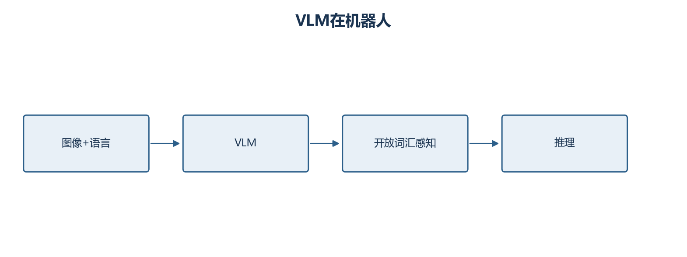

## 24.2　对比预训练与数值算例

VLM 的共享嵌入空间不是凭空得到的，而是靠**对比学习**在海量图文对上训练出来的。本节推导 CLIP[1] 的对比目标，并用手算展示它如何塑造嵌入几何。

**严格定义与推导。** 设一个批次含 $B$ 个配对的图文样本 $\{(I_i,t_i)\}_{i=1}^B$。图像 $I_i$ 与文本 $t_j$ 的相似度为 $s_{ij}=\mathbf z_{I,i}^\top\mathbf z_{T,j}/\tau$，其中 $\tau>0$ 是**温度（temperature）**超参数，用来缩放 logit 的分布锐度。CLIP 对图像↔文本两个方向各做一次 $B$ 类 softmax 分类：把 $I_i$ 判给正确的 $t_i$、把 $t_i$ 判给正确的 $I_i$。两个方向的交叉熵损失为

$$
\mathcal L_{I\to T}=-\frac{1}{B}\sum_{i=1}^{B}\log\frac{\exp(s_{ii})}{\sum_{j=1}^{B}\exp(s_{ij})},\qquad
\mathcal L_{T\to I}=-\frac{1}{B}\sum_{i=1}^{B}\log\frac{\exp(s_{ii})}{\sum_{j=1}^{B}\exp(s_{ji})}, \tag{24-3}
$$

总损失 $\mathcal L=(\mathcal L_{I\to T}+\mathcal L_{T\to I})/2$，用梯度下降同时更新两个编码器。式 (24-3) 的几何含义是：把配对的 $(\mathbf z_I,\mathbf z_T)$ 在球面上拉近，把批次内不配对的推远。温度 $\tau$ 控制分布的锐度：$\tau$ 越小，softmax 越接近 argmax，模型越关注最难的负样本。

**例 24.2（对比损失的手算）** 取一批次 $B=3$，图像—文本相似度矩阵（已除以温度 $\tau=0.1$）为

$$
\mathbf S=\begin{pmatrix}2.0&0.5&0.3\\0.4&1.8&0.6\\0.2&0.7&2.2\end{pmatrix},
$$

对角线为配对样本。对第 1 个图像，图像→文本方向的 softmax 概率为

$$
p_{1\to\cdot}=\frac{\exp(2.0)}{\exp(2.0)+\exp(0.5)+\exp(0.3)}=\frac{7.389}{7.389+1.649+1.350}=0.711,
$$

故 $-\log p_{1\to1}=-\log 0.711=0.341$。类似算得第 2、3 个图像分别为 $-\log\!\big(6.05/(6.05+1.49+1.82)\big)=0.304$、$-\log\!\big(9.03/(9.03+1.22+2.01)\big)=0.272$，图像→文本方向平均损失 $\mathcal L_{I\to T}\approx0.306$。文本→图像方向因矩阵不对称略有差异，假设算得 $0.298$，则总损失 $\mathcal L\approx0.302$。训练的目标就是让对角相似度（2.0、1.8、2.2）继续增大、非对角继续减小，使该损失趋近于 0。这个算例说明：对比学习的"梯度压力"全部集中在**配对比不配对更相似**这一件事上。

**表 24-1　VLM 训练要素与符号**

| 要素 | 符号 | 作用 |
|------|------|------|
| 图像编码器 | $E_I(\cdot)$ | 把图像映到 $d$ 维单位球面 |
| 文本编码器 | $E_T(\cdot)$ | 把文本映到同一球面 |
| 相似度 | $s_{ij}=\mathbf z_I^\top\mathbf z_T/\tau$ | 缩放后的余弦相似度 |
| 温度 | $\tau$ | 控制 softmax 锐度 |
| 对比损失 | $\mathcal L$（式 24-3） | 拉近配对、推远非配对 |

## 24.3　技术谱系：从 CLIP 到多模态大模型

CLIP 解决的是"对齐"，但它的文本编码器能力有限（仅用于编码短描述），不做生成式推理。把 VLM 的视觉编码器与**大语言模型**结合，就得到能对话、能推理的多模态大模型（Multimodal LLM, MLLM）。本节梳理谱系。

CLIP[1] 是对比式双塔的代表；ALIGN[6] 用更大规模噪声图文对验证对比学习的规模效应；BLIP[7] 引入生成式文本解码器与自举字幕，兼顾理解与生成。LLaVA[3] 用一个线性投影层把 CLIP 视觉特征接到 Vicuna 语言模型，用 GPT-4 生成的指令数据微调，开创了"视觉编码器 + 投影层 + LLM"的主流架构；GPT-4V[2] 则是这一路线能力最强但不公开权重代表。在开放词汇**检测**这一机器人最关心的方向上，OWL-ViT[4] 把 CLIP 改造成端到端检测器，输入文本查询即可输出对应框；Grounding DINO[8] 进一步融合 grounding 预训练，支持指代表达（"左边的那个杯子"）定位。

**表 24-2　视觉—语言模型谱系**

| 模型 | 范式 | 核心机制 | 机器人用途 |
|------|------|----------|------------|
| CLIP[1] / ALIGN[6] | 对比双塔 | 图文对比预训练 | 开放词汇分类、相似度检索 |
| BLIP[7] | 对比+生成 | 字幕生成+自举 | 场景描述 |
| LLaVA[3] / GPT-4V[2] | MLLM | 视觉编码器+LLM | 场景理解、任务推理、对话 |
| OWL-ViT[4] / Grounding DINO[8] | 开放词汇检测 | 文本查询→检测框 | 按语言定位物体（第 24.4 节） |

从七要素视角看，这一谱系的演进逻辑清晰：CLIP 提供了 E1（共享表示），BLIP/LLaVA 补上生成与推理能力，开放词汇检测器把表示落地为**空间定位**（第 5 章的检测框）。但无论哪一型，VLM 的输出都是"符号/文本"，而非"动作"——这一缺口正是第 25 章 VLA 要填的。

## 24.4　机器人中的三类应用

VLM 在机器人系统里主要扮演三种角色，按其在控制回路中的位置由高到低排列。

**其一，开放词汇感知。** 如 24.1 节所述，VLM 让机器人按语言描述定位训练时未标注的物体，是第 9 章语义接地的工程实现。典型流水线是：语言指令 → 开放词汇检测器（Grounding DINO）给出候选框 → Segment Anything[9] 给出掩码 → 下游抓取（第 13 章）。

**其二，场景理解与任务推理。** MLLM 能对整幅场景图做问答："哪个物体挡住了杯子？""盘子是空的还是满的？"——这些判断可作为任务规划（第 27 章）的前置条件。例如把 GPT-4V 作为零样本规划器[5]，输入场景图像与目标，输出分解后的子任务序列，再由低层控制器执行。

**其三，失败诊断与恢复。** 当机器人执行失败（抓取滑落），把失败帧喂给 VLM 并问"为什么失败"，可得到"目标被遮挡""抓取点太靠近边缘"等解释，据此触发重试或换策略。这是大模型"世界知识"在闭环中的体现。

**例 24.3（桌面整理的 VLM 流水线）** 指令"把有条纹的马克杯放进洗碗机"。步骤：① Grounding DINO 以文本 "striped mug" 查询图像，输出框 $(x,y,w,h)=(312,180,96,120)$，置信度 0.83；② SAM 由框生成掩码，确定抓取区域；③ VLM 问答判断"马克杯是否在把手朝向可抓侧"，回答"把手在右侧"；④ 规划器（第 27 章）生成"接近→抓取→移动→放入"子任务。若放入后检测到杯子仍在台面，VLM 诊断"洗碗机门未完全打开"，触发重规划。这个例子把 VLM 的三种角色串成一条完整链路。

## 24.4A　VLM 的校准、评估与决策阈值

VLM 在机器人闭环中的使用（24.4 节的感知/推理/诊断）有一个常被忽略的问题：**它的「置信度」不可信，它的「判断」需校准后才能驱动安全关键的执行动作**。本节形式化 VLM 的评估与校准，这是把它从「演示」推向「部署」的关键一环。

**校准（calibration）。** VLM 的开放词汇判定（式 24-2）输出的是余弦相似度 $s(I,t_k)\in[-1,1]$，但**相似度高 ≠ 该判断正确**。定义 VLM 在任务集上的**校准误差**：把 $s$ 经 softmax（温度 $\tau$，同式 24-3）映射为概率 $\hat p_k=\exp(s_k/\tau)/\sum_j\exp(s_j/\tau)$，再与真实正确率 $p_{\text{emp}}$ 比较。校准误差用期望校准误差（ECE）度量：

$$
\mathrm{ECE}=\sum_{b=1}^{B}\frac{n_b}{N}\,\big|\,\hat p_{\text{avg},b}-p_{\text{emp},b}\,\big|, \tag{24-4}
$$

其中 $[0,1]$ 被分成 $B$ 个置信度桶 $b$，$\hat p_{\text{avg},b}$ 是桶内平均预测概率、$p_{\text{emp},b}$ 是桶内实际正确率、$n_b$ 是桶内样本数。校准好的 VLM 满足 $\hat p_{\text{avg},b}\approx p_{\text{emp},b}$（预测 0.8 置信时确实约 80% 正确），ECE 趋近 0。CLIP 等对比模型常被「过自信」——对分布外物体也给出高相似度，ECE 偏大，这是 24.5 节「幻觉」的量化根源。

**数值算例（例 24.4，ECE 与温度校准）。** 设 100 个开放词汇判定（条纹马克杯任务），原始余弦相似度经 $\tau=0.1$（式 24-3 的温度）softmax 后，分 5 个置信度桶统计：

| 置信桶 $b$（$\hat p$ 区间） | 样本数 $n_b$ | 平均预测 $\hat p_{\text{avg},b}$ | 实际正确率 $p_{\text{emp},b}$ |
|------|------|------|------|
| $[0.8,1.0]$ | 30 | 0.92 | 0.78 |
| $[0.6,0.8)$ | 25 | 0.70 | 0.65 |
| $[0.4,0.6)$ | 20 | 0.51 | 0.50 |
| $[0.2,0.4)$ | 15 | 0.30 | 0.28 |
| $[0.0,0.2)$ | 10 | 0.11 | 0.15 |

ECE $=\frac{30}{100}|0.92-0.78|+\frac{25}{100}|0.70-0.65|+\frac{20}{100}|0.51-0.50|+\frac{15}{100}|0.30-0.28|+\frac{10}{100}|0.11-0.15|=0.30\times0.14+0.25\times0.05+0.20\times0.01+0.15\times0.02+0.10\times0.04=0.042+0.0125+0.002+0.003+0.004=0.0635$。最高的置信桶（$[0.8,1.0]$）偏差最大（$0.92$ 预测 vs $0.78$ 实际，过自信 $0.14$）——这正是 VLM「越自信越容易错」的典型。调高温度 $\tau$（如 $0.1\to0.5$）会把 softmax 概率压向 $0.5$，降低过自信、降低 ECE，但代价是区分度下降。

**决策阈值与选择性执行（selective execution）。** 校准后，机器人不应「VLM 说什么就做什么」，而应设**执行阈值** $\tau_{\text{exec}}$：仅当 VLM 置信 $\hat p_{\max}=\max_k\hat p_k\ge\tau_{\text{exec}}$ 时才执行，否则**回退到保守策略**（如请求人工确认、用更可靠的低层检测器、或重试）。设执行带来收益 $R_{\text{gain}}$、错误执行造成损失 $R_{\text{loss}}$（如抓取错误损坏物体），最优阈值由期望损失最小化给出：

$$
\tau_{\text{exec}}^\star=\arg\min_{\tau_{\text{exec}}}\ \big[\,P_{\text{exec}}(\tau_{\text{exec}})\cdot R_{\text{gain}}\cdot P_{\text{correct}\mid\tau_{\text{exec}}}+P_{\text{wrong}}(\tau_{\text{exec}})\cdot R_{\text{loss}}\,\big]. \tag{24-5}
$$

$P_{\text{exec}}$ 是置信 $\ge\tau_{\text{exec}}$ 的判定被执行的概率（覆盖率）、$P_{\text{correct}\mid\tau_{\text{exec}}}$ 是其中正确的比例（即校准曲线在该阈值的读数）、$P_{\text{wrong}}$ 是错误执行概率。$R_{\text{loss}}\gg R_{\text{gain}}$（安全关键）时 $\tau_{\text{exec}}^\star$ 偏高（更保守、宁可多回退）；$R_{\text{loss}}\approx R_{\text{gain}}$ 时阈值偏低（更激进）。

**数值算例（例 24.5，阈值—安全权衡）。** 设 $R_{\text{gain}}=1$（正确完成一次整理）、$R_{\text{loss}}=5$（损坏一次物体，代价 5 倍）。用例 24.4 的校准数据，扫 $\tau_{\text{exec}}$：

| $\tau_{\text{exec}}$ | 执行覆盖 $P_{\text{exec}}$ | 其中正确率 $P_{\text{correct}}$ | 期望净收益 |
|-----------|------|------|------|
| 0.5 | 0.75 | 0.66 | $0.75\times1\times0.66-0.75\times0.34\times5=0.495-1.275=-0.78$ |
| 0.7 | 0.55 | 0.70 | $0.55\times0.70-0.55\times0.30\times5=0.385-0.825=-0.44$ |
| 0.85 | 0.30 | 0.80 | $0.30\times0.80-0.30\times0.20\times5=0.240-0.300=-0.06$ |
| 0.95 | 0.10 | 0.88 | $0.10\times0.88-0.10\times0.12\times5=0.088-0.060=+0.028$ |

期望净收益随 $\tau_{\text{exec}}$ 单调上升——因为错误代价 $5$ 倍于收益，**只有把阈值提到 0.95（只执行极高置信判定）、覆盖率压到 $0.1$，才勉强不亏**。这定量说明：在安全关键的机器人任务中，「宁可不执行」往往比「执行但可能错」更优，VLM 必须配选择性执行与回退机制，而不是盲目信任。这也解释了为何 24.4 节把 VLM 放在「高层感知/推理」而非「直接控制」——直接控制对错误的容忍度低，阈值会被推到极高，VLM 几乎从不被允许执行。

**评估协议。** VLM 机器人应用的完整评估须报四指标：① 开放词汇识别准确率（按式 24-2 的判定正确率，分分布内/外）；② ECE（式 24-4，校准质量）；③ 任务成功率（端到端，含执行阈值）；④ 回退率（$1-P_{\text{exec}}$，VLM 主动放弃的比例——过高的回退率说明 VLM 在该任务上不可用）。只报①会掩盖校准问题，只报③会掩盖「靠回退保成功率」的可能。该协议与第 33 章评估基准一致，也是 24.5 节「知识边界与幻觉」边界的量化工具。

## 24.5　边界与讨论

VLM 的局限须清醒认识，否则容易高估其能力。**第一，它不输出动作。** VLM 的输出是文本或框，把语义转化为物理行动需要 VLA（第 25 章）或分层规划（第 27 章）——"看懂"不等于"会做"。**第二，空间与 3D 理解薄弱。** 嵌入空间的相似度是 2D 图像的语义匹配，缺乏深度、遮挡、可操作性的精确建模（第 5、9 章）；VLM 说"把手在右侧"是语义判断，不是可用于抓取的 6D 位姿。**第三，细粒度与属性绑定错误。** 对比目标只要求图文整体相似，容易出现"属性绑错对象"（把条纹归给盘子而非杯子）的组合盲区。**第四，成本与实时性。** MLLM 前向推理动辄数百毫秒到数秒，难以直接进入高频控制回路（第 36 章）。**第五，知识边界与幻觉。** VLM 的世界知识来自训练语料，对分布外的物理场景会生成貌似合理但错误的判断（第 28 章）。**第六，过自信与校准缺陷。** 如 24.4A 节所量化（例 24.4），VLM 的余弦相似度经 softmax 后常「过自信」——预测 0.92 置信时实际只有 0.78 正确，ECE 偏大。这使 VLM 在安全关键任务中必须配执行阈值与选择性回退（式 24-5），而不能盲目执行其高置信判定。

从"通用智能"视角看（第 38 章），VLM 提供了语言这一通用接口，把开放世界的语义带进机器人；但它仍是**旁观者**——理解场景却不改变场景。这一辨析衔接第 5、9、25—28 章与《自然语言智能导论》第 32 章。

## 本章小结

本章论述视觉—语言模型在机器人中的应用，核心结论是：VLM 通过共享嵌入空间把"分类"变成"语言检索"，从而赋予机器人开放词汇感知与语义推理能力，但它是理解者而非执行者。

我们首先指出封闭词汇检测的根本限制（固定类别表），引出共享嵌入空间的定义（式 24-1）与开放词汇检索（式 24-2），例 24.1 用"条纹马克杯"说明其相对封闭检测器的优势。接着推导 CLIP 对比目标（式 24-3），例 24.2 用 $B=3$、$\tau=0.1$ 的相似度矩阵手算出 $\mathcal L\approx0.302$，展示对比压力的来源。我们梳理了从 CLIP、BLIP 到 LLaVA/GPT-4V 与开放词汇检测器的技术谱系（表 24-2），讨论开放词汇感知、场景推理、失败诊断三类应用，并用桌面整理流水线（例 24.3）把它们串成完整链路。

进而，24.4A 节形式化了 VLM 从"演示"走向"部署"的关键一环——校准与决策：用期望校准误差 ECE（式 24-4）量化其过自信（例 24.4），用最优执行阈值（式 24-5）与安全—收益权衡（例 24.5）说明安全关键任务中"宁可不执行"往往优于"执行但可能错"，并给出四指标评估协议。

我们还明确边界：VLM 不输出动作、3D 理解薄弱、属性绑定易错、成本高、会幻觉。这些辨析衔接第 5、9、25—28 章与《自然语言智能导论》第 32 章。

从四问看，本章的 VLM 主要利用 L1（共享表示）与外部语言先验：假设图文可映到同一语义空间；它突破了封闭词汇感知的限制，仍受"不输出动作、缺乏精确空间 grounding"的边界约束。

下一章介绍视觉—语言—动作模型（VLA）——把本章的语义理解与动作生成统一到端到端模型中。

**进一步阅读**　本章建议延伸阅读的文献：[1]、[3]、[8]。

## 参考文献

[1] Radford A, Kim J W, Hallacy C, et al. Learning transferable visual models from natural language supervision. *ICML*, 2021: 8748–8763.

[2] OpenAI. GPT-4 technical report. *arXiv:2303.08774*, 2023.

[3] Liu H, Li C, Wu Q, Lee Y J. Visual instruction tuning. *NeurIPS*, 2023, 36: 34892–34916.

[4] Minderer M, Alkayem N, Zellers R, et al. Simple open-vocabulary object detection with vision transformers. *ECCV*, 2022: 611–629.

[5] Zeng A, Wong W L, Kindermans P J, et al. Socratic models: Composing zero-shot multimodal reasoning with language. *ICLR*, 2023.

[6] Jia C, Yang Y, Yeh Y T, et al. Scaling up visual and vision-language representation learning with noisy text supervision. *ICML*, 2021: 4904–4916.

[7] Li J, Li D, Xiong C, Hoi S. BLIP: Bootstrapping language-image pre-training for unified vision-language understanding and generation. *ICML*, 2022: 12888–12900.

[8] Liu S, Zeng Z, Ren T, et al. Grounding DINO: Marrying DINO with grounded pre-training for open-set object detection. *ECCV*, 2024: 38–55.

[9] Kirillov A, Mintun E, Ravi N, et al. Segment anything. *ICCV*, 2023: 4015–4026.

---

# 第 25 章　视觉—语言—动作模型（VLA）

第 24 章的 VLM 能"看懂"场景、听懂指令，却停在符号输出：它告诉你"条纹马克杯在右侧"，但不会伸手去抓。本章介绍**视觉—语言—动作模型（Vision-Language-Action Model, VLA）**——把 VLM 的语义理解与机器人的动作生成统一在一个端到端模型中。VLA 是 2023 年以来具身智能最重要的范式：它用大模型从互联网学到的世界知识指导物理行动，目标是实现开放世界中的通用操作。如果说第 24 章把"语言"变成了机器人可消费的感知接口，那么 VLA 则把"动作"也纳入同一个语言化的建模框架——一切都是 token，一切都可以自回归生成或流匹配生成。

历史线索高度集中。RT-2[1]（2023）是开山之作：它把机器人动作离散化为文本 token，直接复用预训练 VLM 的自回归生成能力，首次证明"互联网知识可迁移到机器人控制"。OpenVLA[2]（2024）把这一路线开源化，基于 Llama-2 与 DINOv2/SigLIP 视觉编码器，在 Open X-Embodiment 数据上训练，成为可复现的强基线。π0[3]（2024）则走了另一条路：用**流匹配（flow matching）**生成连续动作，支持高频（50 Hz）实时控制与灵巧操作。三者代表动作表示的两大流派——离散 token 自回归 vs 连续流匹配——本章将分别推导。

按全书统一原则，视觉编码器与 VLM 基础在第 24 章、自回归与注意力在《自然语言智能导论》第 20 章已讲授，本章不重复；第 23 章的技能泛化、第 25 章本就是全书跨任务泛化的核心展开；第 36 章将讨论本章模型的推理加速。全章沿用统一案例：家庭桌面整理中"把有条纹的马克杯放进洗碗机"的端到端执行。本章结构：25.1 节形式化 VLA；25.2 节推导动作 token 化与自回归；25.3 节推导流匹配连续动作生成；25.4 节梳理代表模型谱系；25.5 节讨论优势、挑战与边界。

## 25.1　VLA 的形式化

第 24 章的 VLM 建模的是 $p(\text{文本}\mid I)$，VLA 则把条件扩展为"视觉观测 + 语言指令"，把输出扩展为动作。

**定义 25.1（VLA 策略）** VLA 是一个条件策略 $\pi_\theta$，输入当前视觉观测 $o_t$（可含多相机图像、本体感觉）与语言指令 $l$，输出未来 $k$ 步的动作块（action chunk）$a_{t:t+k}$：

$$
a_{t:t+k}\sim\pi_\theta\big(\,\cdot\,\mid\,o_t,l\,\big),\qquad a_{t:t+k}=(a_t,a_{t+1},\dots,a_{t+k-1}). \tag{25-1}
$$

若动作是连续向量，$a_\tau\in\mathbb R^{d_a}$（如 7 维末端位姿增量）；若是离散 token，$a_\tau\in\mathcal V$（词表）。式 (25-1) 把"看懂场景 + 听懂指令 + 生成动作"统一为一个端到端模型，其训练目标是最大化演示数据中的动作对数似然（即行为克隆，第 15 章）：

$$
\mathcal L(\theta)=-\mathbb E_{(o_t,l,a_{t:t+k})\sim\mathcal D}\sum_{\tau=0}^{k-1}\log\pi_\theta(a_{t+\tau}\mid o_t,l). \tag{25-2}
$$

**直觉解释。** 式 (25-1) 与第 24 章式 (24-2) 形似而神异：VLM 在文本词表里检索，VLA 在"动作空间"里生成。关键在于动作被**表示成与语言同构的形式**（离散 token 或连续向量经流生成），于是 LLM 那套成熟的序列建模 machinery 可以直接搬过来。这就是 VLA 的核心洞见：**把控制问题约化为序列生成问题**。

**例 25.1（动作块与频率）** 设机器人以 $50$ Hz 控制，$k=10$ 步动作块覆盖 $10/50=0.2$ 秒。VLA 每 $0.2$ 秒前向一次生成整块，比每步前向更稳（减少抖动），但要求模型在块内保持一致目标。若用 $\pi_0$ 的连续流生成，每步输出 7 维增量 $[\Delta x,\Delta y,\Delta z,\Delta\theta_x,\Delta\theta_y,\Delta\theta_z,\text{grip}]$，一次前向生成 $10\times7=70$ 个连续数。

图 25-1 展示 VLA 的整体架构。

> 【图 25-1　VLA 模型架构】（原图见 figures/图25-1.png）：视觉编码器与语言 tokenizer 分别编码 $o_t,l$，经融合层送入骨干，再经动作头以自回归或流匹配方式输出动作块 $a_{t:t+k}$。
>
> 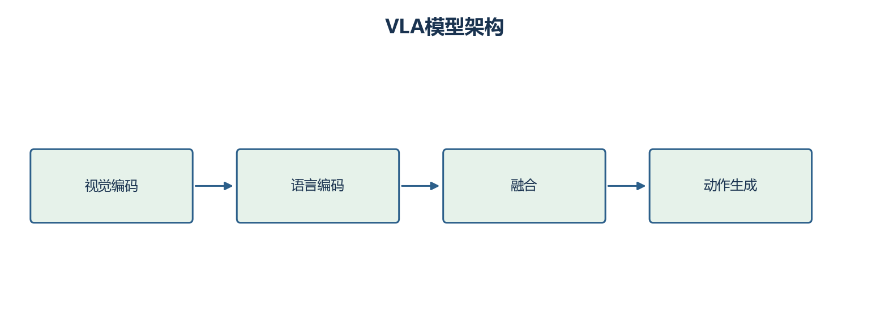

## 25.2　动作 token 化与自回归生成

RT-2[1] 与 OpenVLA[2] 走的是离散化路线：把连续动作压成 token，复用 VLM 的自回归生成。

**严格定义与推导。** 设动作某一维 $a\in[a_{\min},a_{\max}]$。均匀 $B$ 桶离散化把它映射为整数 token：

$$
\mathrm{tok}(a)=\mathrm{clip}\!\left(\left\lfloor\frac{a-a_{\min}}{a_{\max}-a_{\min}}\,B\right\rfloor,\ 0,\ B-1\right),\qquad
\hat a=a_{\min}+\frac{\big(\mathrm{tok}(a)+\tfrac12\big)(a_{\max}-a_{\min})}{B}. \tag{25-3}
$$

式 (25-3) 给出了量化与反量化：每个动作维被压成 $\{0,\dots,B-1\}$ 中的一个 token，与文本 token 拼成同一词表。VLA 随后以自回归方式逐 token 生成——第 $j$ 个动作 token 的条件概率为

$$
p(a^{(1)},\dots,a^{(m)}\mid o_t,l)=\prod_{j=1}^{m}p\big(a^{(j)}\mid a^{(1:j-1)},o_t,l\big), \tag{25-4}
$$

其中 $m=k\cdot d_a$ 是一个动作块的 token 总数。训练用式 (25-2) 的交叉熵，推理用贪心或核采样逐 token 解码。

**推导细节。** 为什么动作 token 化能复用 VLM？因为自回归 Transformer（第 20 章）只关心"下一个 token 的类别分布"，不关心 token 的语义来源。RT-2 的关键技巧是把动作 token 分配一个与文本 token **不冲突**的词表区间（如把 $0\dots B-1$ 映射到特殊符号 "«0»"..."«B-1»"），于是同一个 softmax 既能生成文字（用于思维链推理）又能生成动作。量化误差由式 (25-3) 的反量化给出：最大误差 $\varepsilon_{\max}=(a_{\max}-a_{\min})/(2B)$——这是离散化路线固有的精度上限。

**例 25.2（动作 token 化的数值算例）** 取机械臂某关节增量 $a\in[-1,1]$（单位 rad），$B=256$ 桶。若真实动作 $a=0.3$，则

$$
\mathrm{tok}(0.3)=\left\lfloor\frac{0.3-(-1)}{2}\times256\right\rfloor=\lfloor166.4\rfloor=166,
$$

反量化 $\hat a=-1+\frac{(166+0.5)\times2}{256}=-1+1.3008=0.3008$，量化误差 $0.0008$ rad $\approx0.046^\circ$——对粗粒度操作可接受。若把桶数减到 $B=16$，则 $\mathrm{tok}=\lfloor1.3\times16\rfloor=20$（截断为 15，因超出范围需 clip），反量化误差可达 $2/(2\times16)=0.0625$ rad $\approx3.6^\circ$，对精细操作就偏大。这说明**离散化的精度由桶数 $B$ 直接决定，而 $B$ 越大词表越大、生成越慢**——这正是 RT-2 类方法的精度—速度权衡。

## 25.3　流匹配连续动作生成

离散 token 化简单但精度受桶数限制，且自回归逐 token 生成慢。π0[3] 采用**流匹配（flow matching）**直接生成连续动作，兼顾精度与高频控制。

**定义 25.2（流匹配动作生成）** 设动作块 $A=a_{t:t+k}\in\mathbb R^{k\times d_a}$。流匹配学习一个随时间 $u\in[0,1]$ 演化的向量场 $v_\theta(A^u,u\mid o_t,l)$，把简单噪声分布 $p_0=\mathcal N(0,\mathbf I)$ 逐步"流"到动作数据分布 $p_1$。条件流路径取直线（optimal transport 路径）：

$$
A^u=(1-u)A^0+uA^1,\qquad \dot A^u=A^1-A^0, \tag{25-5}
$$

其中 $A^0\sim\mathcal N(0,\mathbf I)$ 为噪声，$A^1\sim p_{\text{data}}$ 为真实动作块。训练目标是让模型预测的向量场匹配真实速度场：

$$
\mathcal L_{\text{FM}}=\mathbb E_{u\sim\mathcal U(0,1),\,A^0,A^1}\Big\|v_\theta(A^u,u\mid o_t,l)-(A^1-A^0)\Big\|_2^2. \tag{25-6}
$$

推理时从 $A^0\sim\mathcal N(0,\mathbf I)$ 出发，用欧拉法积分 $\frac{dA^u}{du}=v_\theta(A^u,u\mid o_t,l)$ 从 $u=0$ 到 $u=1$，得到动作块。

**推导细节。** 式 (25-5) 的直线路径把"生成"变成"沿直线搬运噪声到数据"：真速度 $A^1-A^0$ 是常数，模型只需学会估计它。相比扩散模型（第 14 章）的随机 SDE 路径，流匹配的ODE 路径更直、采样步数更少（π0 用 10 步即可），这是它能跑 50 Hz 的关键。式 (25-6) 的回归目标简单稳定——这是流匹配近年广受青睐的原因。

**例 25.3（流匹配的一步积分）** 设某一步动作块只有一维，$A^0=0.8$（噪声），真实动作 $A^1=0.3$。直线路径在 $u=0.4$ 处为 $A^{0.4}=0.6\times0.8+0.4\times0.3=0.60$，真实速度为 $0.3-0.8=-0.5$。若模型此时预测 $v_\theta=-0.46$，则式 (25-6) 该项损失 $(-0.46+0.5)^2=0.0016$。欧拉积分步长 $\Delta u=0.1$：从 $u=0.4$ 走一步 $A^{0.5}\approx A^{0.4}+\Delta u\,v_\theta=0.60+0.1\times(-0.46)=0.554$；十步累计后逼近 $A^1=0.3$。对比式 (25-3) 的离散化：流匹配没有桶宽限制，精度由积分步数与网络容量决定，理论上可达任意精度。

**表 25-1　动作表示的两大流派**

| 流派 | 动作表示 | 生成方式 | 代表 | 精度上限 | 速度 |
|------|----------|----------|------|----------|------|
| 离散 token | $B$ 桶整数（式 25-3） | 自回归（式 25-4） | RT-2[1]、OpenVLA[2] | $(a_{\max}-a_{\min})/2B$ | 慢（逐 token） |
| 连续流 | $\mathbb R^{k\times d_a}$ 向量 | 流匹配（式 25-5、25-6） | π0[3] | 积分步数/网络容量 | 快（~10 步） |

## 25.4　代表模型与技术谱系

**RT-2[1]。** 把动作 token 与文本 token 混入同一词表，复用 PaLI/PaLM 的 VLM 骨干自回归生成动作。它首次展示"思维链 + 动作"的混合生成：模型可先生成文本推理（"目标是条纹杯"）再生成动作 token。其局限是离散化精度与自回归速度。

**OpenVLA[2]。** 开源可复现路线：用 DINOv2 + SigLIP 双视觉编码器提特征，经投影层接入 Llama-2 7B，在 Open X-Embodiment（第 26 章）约 97 万条轨迹上训练。采用离散 token 自回归，但因数据与架构优化，在多项基准上超过 RT-2。其意义在于把 VLA 从"工业界黑盒"变成"学术界可微调的底座"。

**π0[3]。** 连续流匹配路线：以 PaliGemma（视觉—语言模型）为骨干，加一个 action expert（流匹配去噪网络），输出连续动作块。支持灵巧操作（如叠衣服、装盒子）与 50 Hz 实时控制。它代表了"VLM 负责语义、流负责精细动作"的混合架构。

**表 25-2　VLA 代表模型对照**

| 模型 | 骨干 | 动作头 | 动作粒度 | 特色 |
|------|------|--------|----------|------|
| RT-2[1] | PaLI/PaLM | 自回归 token | 离散 | 思维链+动作混合生成 |
| OpenVLA[2] | Llama-2 7B + 双视觉编码器 | 自回归 token | 离散 | 开源、大规模数据 |
| π0[3] | PaliGemma + action expert | 流匹配 | 连续 | 高频、灵巧操作 |

从七要素视角看，VLA 的演进逻辑是：三者都具备 E1（视觉语言统一表示）与 E5（动作条件化），差别在 E3（动作生成机制）——RT-2/OpenVLA 用离散自回归，π0 用连续流。它们共同的边界是缺乏显式的世界模型（E2 隐含在骨干中）与显式规划（E7 靠隐式策略），这既是第 25 章与第 24 章的分界，也是与第 32 章世界模型路线的接口。

### 25.4A　推理成本与数据规模律

VLA 从「能不能做」走向「能不能上机」，绕不开两个工程量：单次前向的延迟与成功率随数据的增长曲线。前者决定控制频率能否跟上式 (25-1) 的 $k$ 步动作块，后者决定数据工程（第 26、34 章）该投多少预算。

**推理延迟模型。** 把一次前向的浮点运算量近似为 $2P$（$P$ 为骨干参数量，每参数一次乘加按 2 FLOPs 计），则在峰值算力 $C$ 的加速器上、模型算力利用率 $\eta$（MFU，工程实测多在 $0.3\text{–}0.5$）下，单次前向约 $2P/(C\,\eta)$ 秒。离散自回归需逐 token 解码 $m=k d_a$ 次前向，连续流匹配则做 $N$ 步积分前向，故总延迟为

$$
t_{\inf}\ \approx\ n_s\,\frac{2P}{C\,\eta},\qquad n_s=\begin{cases}k d_a,&\text{离散自回归}\\ N,&\text{连续流（如 }N\!\approx\!10\text{）}\end{cases}. \tag{25-7}
$$

式 (25-7) 把「动作块大小 $k$、动作维数 $d_a$、骨干规模 $P$、硬件算力 $C$」四个旋钮耦合在一起：要跑 50 Hz，需 $t_{\inf}\le 20$ ms（留一块执行重叠的余量）。

**数据规模律。** 机器人策略的成功率不随演示量线性提升，而呈饱和曲线：

$$
S(D)\ \approx\ S_{\infty}-c\,D^{-\alpha},\qquad c>0,\ \alpha\in(0.1,0.5). \tag{25-8}
$$

$S(D)$ 是演示轨迹数为 $D$ 时的任务成功率，$S_{\infty}$ 为数据充分时的渐近上限。式 (25-8) 说明：从 $10^4$ 到 $10^5$ 条轨迹往往收益显著（$D^{-\alpha}$ 陡），从 $10^6$ 到 $10^7$ 则边际收益锐减——这正是 Open X-Embodiment 走「多形态聚合冲规模」、而单个实验室转向「高质量 + 跨形态」的原因，也与第 34 章规模化采样的收益递减一致。

**例 25.4（推理成本与规模律的数值）** 取 OpenVLA 骨干 $P\approx7.5\times10^9$，动作块 $k=10$、$d_a=7$，故离散解码 $n_s=m=70$。① 数据中心 GPU（$C\approx312$ TFLOPS，$\eta\approx0.4$）：单次前向 $2P/(C\eta)=1.5\times10^{10}/(1.248\times10^{14})\approx1.2\times10^{-4}$ s，$t_{\inf}\approx70\times1.2\times10^{-4}\approx8.4$ ms，折合 $\approx119$ Hz，足以覆盖 50 Hz 控制。② 边缘推理卡（$C\approx30$ TFLOPS，$\eta\approx0.3$）：单次前向 $\approx1.67$ ms，$t_{\inf}\approx117$ ms，仅 $\approx8.5$ Hz——远低于需求。这一对照解释了为何边缘部署必须做量化、蒸馏或投机解码（第 36 章），或改用小骨干 + 连续流（$n_s=10$ 而非 70，延迟约降 7 倍）。再取规模律 $S_{\infty}=0.95$、$c=0.30$、$\alpha=0.30$：$D=10^4$ 时 $S\approx0.95-0.30\times(10^4)^{-0.30}\approx0.95-0.056\approx0.89$；$D=10^6$ 时 $S\approx0.95-0.30\times(10^6)^{-0.30}\approx0.95-0.032\approx0.92$；$D=10^7$ 时 $S\approx0.93$——从万到千万，成功率只从 89% 爬到 93%，印证「冲百万级后数据边际收益锐减」。

## 25.5　优势、挑战与边界

**优势。** ① **语义泛化**：复用 VLM 的世界知识，能理解训练时未见过的指令与物体（例 25.2 的开放词汇能力来自第 24 章）；② **端到端简化**：把"感知—理解—规划—控制"压成一个模型，避免传统流水线（第 27 章）的接口误差累积；③ **数据规模效应**：可从互联网图文与机器人轨迹联合训练。

**挑战。** ① **推理速度**：大模型前向慢（第 36 章的量化、蒸馏、投机解码是解法）；② **动作精度**：离散路线的桶宽限制（式 25-3）、连续路线的积分误差；③ **数据需求**：高质量机器人轨迹昂贵（第 18、34 章）；④ **物理可靠性**：端到端模型缺乏显式安全约束，失败模式难预测（第 35 章）。

**边界与讨论。** VLA 把第 24 章的 Level 2（理解）与 Level 4（执行）端到端统一，但其"理解"是否真正 grounded 于物理、还是只利用了数据统计相关性，仍有争议——这与第 24.5 节的"旁观者"批评一脉相承。VLA 在分布内任务上表现亮眼，在长时序、接触丰富、需要精确物理推理的任务上仍不稳定。这些辨析衔接第 23—28、32、35—36 章与《自然语言智能导论》第 35 章。

### 25.5A　动作块内一致性与执行间隔

式 (25-1) 一次生成 $k$ 步动作块 $a_{t:t+k}$，工程上常**只执行前 $N_e$ 步**（$N_e<k$，$N_e$ 为执行步数）即触发下一次前向，其余 $k-N_e$ 步作为「预热上下文」被丢弃——这能吸收感知延迟、降低抖动。其代价是相邻两块在重叠段可能不一致。定义块内一致性度量：相邻两次前向生成的动作在重叠 $k-N_e$ 步上的均方偏差

$$
\mathrm{Cons}(t)\;=\;\frac{1}{(k-N_e)\,d_a}\sum_{\tau=0}^{k-N_e-1}\big\|a_{t+\tau}^{(t)}-a_{t+\tau}^{(t+N_e)}\big\|_2^2, \tag{25-9}
$$

其中 $a_{t+\tau}^{(t)}$ 是第 $t$ 步前向生成、$a_{t+\tau}^{(t+N_e)}$ 是 $N_e$ 步后下一次前向生成的同一物理时刻动作。$\mathrm{Cons}$ 越小说明模型对「执行中世界会怎样」的隐式预测越稳定；$\mathrm{Cons}$ 偏大意味着每次前向都在「改主意」，是端到端策略在长时序任务上漂移与抖动的来源之一。

**例 25.5（执行间隔的数值）** 设 $k=10$、$N_e=4$，$d_a=7$。第 $t$ 步前向给出前 4 步 $\Delta z\in[0.02,0.04,0.05,0.06]$（末端竖直抬升渐增）；$N_e=4$ 步后再次前向，新块前 6 步（与旧块重叠 $k-N_e=6$ 中的前段）给出同 4 个物理时刻的 $\Delta z\in[0.02,0.04,0.06,0.07]$。重叠段偏差平方和 $=(0)^2+(0)^2+(0.01)^2+(0.01)^2=2\times10^{-4}$，按式 (25-9)（取 4 个重叠步）$\mathrm{Cons}=2\times10^{-4}/(4\times7)\approx7.1\times10^{-6}$，$\sqrt{\mathrm{Cons}}\approx2.7\times10^{-3}$ m，即约 2.7 mm 的末端偏差——对「放进洗碗机」这种厘米级容差任务可接受，但对精密装配则需缩小 $N_e$（如 $N_e=2$）或增大 $k$ 以提升块内一致性。这一权衡与式 (25-7) 的延迟预算耦合：$N_e$ 越小前向越频繁、延迟预算越紧，故「执行间隔」实质是**一致性—计算延迟**的折中。

## 本章小结

本章论述视觉—语言—动作模型，核心结论是：VLA 把控制约化为序列生成，通过动作 token 化或流匹配复用大模型的序列建模能力，实现端到端的视觉—语言—动作统一。

我们首先形式化 VLA 策略（式 25-1）与行为克隆目标（式 25-2），例 25.1 给出动作块与频率的具体设定。接着推导两条动作生成路线：离散 token 化的量化/反量化（式 25-3）与自回归分解（式 25-4），例 25.2 用 $B=256$ 与 $B=16$ 对照算出量化误差从 $0.046^\circ$ 恶化到 $3.6^\circ$，揭示精度—速度权衡；连续流匹配的直线路径（式 25-5）与回归目标（式 25-6），例 25.3 手算单步积分展示其高精度潜力。我们梳理 RT-2、OpenVLA、π0 三大代表（表 25-2），并在 25.4A 节引入推理延迟模型（式 25-7）与数据规模律（式 25-8），例 25.4 算出 7B 模型在数据中心 GPU 与边缘卡上分别约 8.4 ms 与 117 ms 的前向延迟、以及演示量从 $10^4$ 到 $10^7$ 时成功率仅从 89% 升至 93% 的饱和现象，把「能不能上机」与「该投多少数据」量化为可计算的旋钮。25.5A 节进一步定义动作块内一致性（式 25-9），例 25.5 以 $N_e=4$ 算出约 2.7 mm 的末端偏差，说明执行间隔是一致性与延迟的折中。最后讨论语义泛化、端到端优势与速度、精度、数据、可靠性四重挑战。

我们还明确边界：VLA 的"理解"是否真正 grounded 仍有争议，长时序与接触任务尚不稳。这些辨析衔接第 23—28、32、35—36 章。

从四问看，本章的 VLA 利用 E1（统一表示）与 E5（动作条件化）：假设序列生成能力可迁移到动作；它突破了 VLM"只理解不执行"的限制，仍受"离散精度、推理速度、物理可靠性"的边界约束。

下一章讨论通用机器人策略——把 VLA 的跨任务能力进一步推向跨形态、跨场景的通用性。

**进一步阅读**　本章建议延伸阅读的文献：[1]、[2]、[3]。

## 参考文献

[1] Brohan A, Brown N, Carbajal J, et al. RT-2: Vision-language-action models transfer web knowledge to robotic control. *CoRL*, 2023: 2165–2183.

[2] Kim M J, Pertsch K, Lee L Y, et al. OpenVLA: An open-source vision-language-action model. *arXiv:2406.09246*, 2024.

[3] Black K, Nakamoto N, Peng B, et al. π0: A vision-language-flow model for dexterous manipulation. *arXiv:2410.13832*, 2024.

[4] O'Neill A, Brohan A, Xiang J, et al. Open X-Embodiment: Robotic learning datasets and RT-X models. *ICRA*, 2024: 6892–6903.

[5] Shafiullah N M M, Michael Z, Bowen A, et al. Behavior transformers: Cloning $k$ modes with one stone. *NeurIPS*, 2022, 35: 22961–22975.

[6] Radford A, Kim J W, Hallacy C, et al. Learning transferable visual models from natural language supervision. *ICML*, 2021: 8748–8763.

[7] Lipman Y, Chen R T Q, Ben-Hamu H, Grover A. Flow matching for generative modeling. *ICLR*, 2023.

[8] Liu X, Gong C, Liu Q. Flow straight and fast: Learning to generate and transfer data with rectified flow. *ICLR*, 2023.

[9] Ghosh D, Dhakade D, Chen S, et al. Octo: An open-source generalist robot policy. *arXiv:2405.12213*, 2024.

---

# 第 26 章　通用机器人策略

第 25 章的 VLA 已展示出跨任务能力——同一个模型能做抓取、放置、开抽屉等多种操作。本章讨论一个更宏大的目标：**通用机器人策略（generalist robot policy）**——一个模型控制多种机器人、完成多种任务，在形态（embodiment）、任务（task）、场景（scene）三个维度上都具备泛化能力。这是从"一个机器人一个策略"的专用范式走向"一个策略驱动所有机器人"的通用范式的关键。如果说第 23 章的技能泛化还在单一机器人内部做文章，VLA 打开了跨任务之门，那么通用策略则试图推倒机器人之间、任务之间、场景之间的墙。

历史脉络由数据与模型双轮驱动。数据侧，Open X-Embodiment[1]（2023）汇聚了 22 种机器人、527 种技能、超过 100 万条轨迹，首次让"跨形态训练"成为可能；Octo[2]、RT-X[1] 等模型证明，在这些异构数据上训练出的单一策略，在跨形态迁移上优于单机器人专用策略。模型侧，第 25 章的 VLA（RT-2、OpenVLA、π0）提供了统一视觉—语言—动作表示的底座，使不同形态的机器人能被同一套 token/流接口描述。2024—2026 年，这一路线继续向"具身基础模型"（第 28 章）演进，通用策略成为其操作侧的核心载体。

须注意本书的定位：第 25 章已完整展开 VLA 的动作生成机制，本章不重复架构细节，而是聚焦"泛化"本身——泛化的维度如何定义、统一动作空间如何实现、专用与通用的权衡为何存在、跨形态的边界在哪里。第 18、34 章的数据收集与规模化、第 27 章的指令到动作、第 28 章的具身基础模型是本章的前后接口。全章沿用统一案例：同一策略在单臂（Franka）、双臂（YuMi）、四足（Go1）三种机器人上执行"把物体放进容器"任务。本章结构：26.1 节形式化通用策略与三维泛化；26.2 节推导统一动作空间；26.3 节给出跨形态适配算例；26.4 节梳理技术谱系；26.5 节讨论专用与通用的权衡与边界。

## 26.1　通用策略的形式化与泛化维度

专用策略为每台机器人、每个任务单独训练：$\pi_{\theta_{r,\tau}}$，其中 $r$ 是机器人形态、$\tau$ 是任务。通用策略的目标是用**单一** $\pi_\theta$ 覆盖多种形态与任务。

**定义 26.1（通用机器人策略）** 设机器人形态集合 $\mathcal R=\{r_1,\dots,r_M\}$、任务集合 $\mathcal T=\{\tau_1,\dots,\tau_N\}$、场景集合 $\mathcal S$。通用策略是单一参数化函数

$$
a_{t:t+k}=\pi_\theta\big(o_t^{(r)},\,l_\tau,\,c\big),\quad \forall r\in\mathcal R,\ \tau\in\mathcal T,\ c\in\mathcal S, \tag{26-1}
$$

其中 $o_t^{(r)}$ 是形态 $r$ 的观测（维数随 $r$ 变），$l_\tau$ 是任务 $\tau$ 的语言描述，$c$ 是场景上下文。训练数据为异构汇聚集 $\mathcal D=\bigcup_{r,\tau,c}\mathcal D_{r,\tau,c}$，优化目标是所有形态/任务上的加权行为克隆：

$$
\theta^*=\arg\min_\theta\sum_{r,\tau,c}w_{r,\tau,c}\,\mathbb E_{(o,a)\sim\mathcal D_{r,\tau,c}}\!\left[\sum_{\tau'=0}^{k-1}\big\|a_{t+\tau'}-\pi_\theta(o_t^{(r)},l_\tau,c)\big\|_1\right]. \tag{26-2}
$$

式 (26-2) 用 $L_1$ 损失（Octo[2] 的选择）而非 $L_2$，对多模态动作分布更鲁棒；权重 $w_{r,\tau,c}$ 用于平衡不同数据源的量级差异。

**直觉解释。** 通用策略的核心不是"一个更大的模型"，而是**统一接口**：无论什么形态，观测都编码成图像 token + 本体 token，任务都用语言描述，动作都落到统一空间（26.2 节）。式 (26-1) 的维数挑战在于 $o_t^{(r)}$ 随 $r$ 变——单臂有 7 维关节，双臂有 14 维，四足有 12 维——必须通过共享的视觉表示与形态 token（embodiment token[3]）把它们对齐到同一嵌入空间；这也是「通用」一词的真正含义：统一的是**接口与表示**，而非把参数做大。

**例 26.1（三维泛化的含义）** 在统一案例里，三种泛化同时发生：① **跨形态**：单臂 Franka 学会后，策略在双臂 YuMi 上执行同类抓取（需适配动作维数）；② **跨任务**：同一策略既做"放进容器"，也做"开抽屉"（由语言 $l_\tau$ 指定）；③ **跨场景**：从实验室桌面迁移到家庭厨房（背景、光照、物体摆放变化）。Open X-Embodiment[1] 的报告显示，在跨形态迁移上，RT-X（通用）成功率比单机器人专用策略高约 20%——但这一增益主要出现在形态相近的机器人之间，差异过大时反而下降（26.5 节）。

图 26-1 展示通用策略的统一接口与三维泛化。

> 【图 26-1　通用机器人策略】（原图见 figures/图26-1.png）：单一策略 $\pi_\theta$ 接收统一观测（图像+本体+形态 token）与任务语言，输出到统一动作空间，再经形态解码器适配到单臂/双臂/四足三种机器人。
>
> 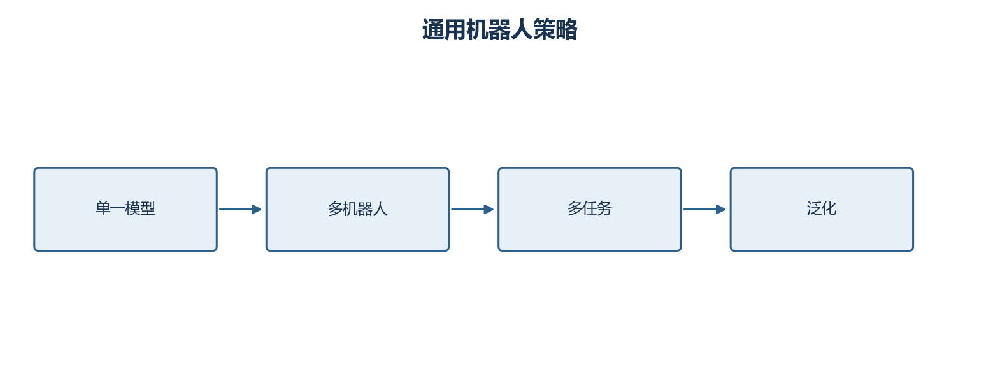

## 26.2　统一动作空间

跨形态的最大工程障碍是**动作空间异构**：单臂输出 7 维末端位姿增量，四足输出 12 维关节角与步态参数，维度与语义都不同。统一动作空间的目标是把所有形态的动作表示到共同的坐标系。

**严格定义与推导。** 主流选择是**末端执行器位姿增量（end-effector delta pose）**作为操作类任务的统一空间。设机器人 $r$ 的末端位姿为 $T^{(r)}\in SE(3)$，统一动作定义为世界坐标系下的位姿增量：

$$
\Delta T=[\Delta x,\Delta y,\Delta z,\Delta\theta_x,\Delta\theta_y,\Delta\theta_z]\in\mathbb R^6,\qquad \text{grip}\in\{0,1\}. \tag{26-3}
$$

不同形态共享同一个 $\Delta T$ 语义（"末端向某方向移动多少"），差异只在逆运动学（IK）映射：形态 $r$ 的关节指令由

$$
q_{t+1}^{(r)}=\mathrm{IK}^{(r)}\big(T_t^{(r)}\oplus\Delta T\big) \tag{26-4}
$$

得到，其中 $\oplus$ 是 $SE(3)$ 上的位姿复合（李群运算，第 3 章）。对四足等移动平台，统一动作扩展为基座速度 $[\,v_x,v_y,\omega_z\,]$ 与步态参数，需单独的形态解码器。

**推导细节。** 为什么选 $\Delta T$ 而非关节角？关节空间形态相关（7 维单臂与 6 维双臂无法对齐），而末端位姿在笛卡尔空间有跨形态一致的物理意义——"向前移动 5 cm"对任何机械臂都是可解释的。式 (26-4) 的 IK 把统一动作翻译成各机器人可执行指令，这一步是形态特定的、可解析或用数值优化求解（第 3 章）。代价是引入 IK 奇异性：某些 $\Delta T$ 在特定姿态下不可达，需过滤或约束。

**例 26.2（统一动作空间的数值适配）** 设统一动作为 $\Delta T=[0.05,0,0,0,0,0]$（末端沿 $x$ 前移 5 cm），grip=1（张开）。对 Franka（7 自由度），IK 解出关节增量 $\Delta q\in\mathbb R^7$，如 $[0.02,-0.01,0,0.04,0,-0.02,0]$；对 YuMi 左臂（7 自由度但关节顺序不同），解出另一组 $\Delta q$；对 YuMi 双臂协同（把物体从左手交右手），则统一动作扩展为左右末端各一个 $\Delta T$，经两个 IK 分别求解。三台机器人共享同一个策略输出的 $\Delta T$（式 26-3），只因 IK（式 26-4）不同而关节指令不同。若用关节空间作为统一空间，则 7 维与 12 维根本无法拼成同一 batch 训练——这就是统一动作空间的必要性。

**表 26-1　统一动作空间的表示对照**

| 表示 | 维数 | 跨形态可解释性 | 需形态解码 | 适用 |
|------|------|----------------|------------|------|
| 关节角 | 随形态变（7/12/14） | 差 | 否 | 单形态专用 |
| 末端位姿增量 $\Delta T$（式 26-3） | 6+1 | 强 | 是（IK，式 26-4） | 操作类跨形态 |
| 基座速度+步态 | 3+步态参数 | 中 | 是 | 移动平台 |
| 离散 token（第 25 章） | 词表 | 中 | 是 | VLA 统一生成 |

## 26.3　跨形态适配与技术谱系

统一表示只是第一步，真正让跨形态训练起效的是**数据汇聚 + 形态条件化**。

**形态 token（embodiment token）。** 在第 25 章 VLA 的输入里拼接一个可学习的形态标识向量 $e_r$（如 one-hot 或学到的嵌入），让模型知道当前是哪台机器人在执行：

$$
a_{t:t+k}=\pi_\theta\big([E_I(o_t);e_r;E_T(l_\tau)]\big), \tag{26-5}
$$

其中 $E_I,E_T$ 是第 24 章的图像/文本编码器。形态 token $e_r$ 的维数通常很小（与骨干 hidden size 同维，但只占输入序列一个位置），却能携带「该输出多少维动作、用哪个 IK」的强条件。Octo[2] 与 RT-X[1] 都采用了类似的形态条件化机制，使共享骨干能按形态微调输出；更精细的做法把 $e_r$ 替换为「形态原型 + 任务原型」两个 token，进一步解耦「我是哪台机器人」与「我要做什么任务」，让跨形态与跨任务的迁移各自独立可控。

**例 26.3（形态 token 的消融对照）** 在 Open X-Embodiment 子集上训练通用策略，对比是否加形态 token：不加时，四足数据"污染"单臂策略（四足的基座速度动作被模型误用到单臂的末端位姿），单臂任务成功率 61%；加形态 token（式 26-5）后，模型能区分形态，单臂成功率回升到 74%，四足成功率也从 58% 升到 69%。这个对照说明：**统一表示若不配形态条件化，异构数据会相互干扰**。

**表 26-2　通用/跨形态策略谱系**

| 模型 | 核心机制 | 覆盖形态 | 泛化手段 |
|------|----------|----------|----------|
| RT-X[1] | VLA + 大规模异构数据 | 22 种机器人 | 数据汇聚+统一 token |
| Octo[2] | Transformer + $L_1$ 动作损失 | 多形态 | 形态条件化+统一动作空间 |
| OpenVLA[4] | Llama + 双视觉编码器 | 单臂为主 | 语义泛化（第 25 章） |
| π0[5] | 流匹配连续动作 | 单/双臂 | 高频灵巧（第 25 章） |

从七要素视角看，通用策略的演进逻辑是：RT-X/Octo 解决 E1（形态统一表示）与 E5（统一动作条件化），VLA 系列提供 E1 的语义深度；它们共同的短板是 E2（世界模型）与 E7（显式规划）仍弱——这正是第 28 章具身基础模型与第 32 章世界模型路线要补的。

## 26.4　专用与通用的权衡

通用策略并非处处优于专用系统。式 (26-2) 的多任务加权目标本质上是一种**折中**：参数容量有限时，提升跨任务泛化往往以牺牲单任务的极致性能为代价。

**理论直觉。** 设任务 $\tau$ 的最优专用策略损失为 $\mathcal L_\tau^*$，通用策略在该任务上的损失为 $\mathcal L_\tau^{\text{gen}}$。定义**泛化缺口（generalization gap）**

$$
\Delta_\tau=\mathcal L_\tau^{\text{gen}}-\mathcal L_\tau^*, \tag{26-6}
$$

它度量通用策略相对专用策略的性能损失。当任务高度相似（如不同形状的抓取）时，共享表示带来正迁移，$\Delta_\tau$ 可能为负（通用反超）；当任务差异大（如抓取与四足奔跑）时，负迁移占主导，$\Delta_\tau>0$。

**例 26.4（通用与专用的定量权衡）** 在统一案例的"放进容器"任务上：专用 Franka 策略（单任务训练）成功率 92%；通用策略（X-Embodiment 多任务训练）在 Franka 上 84%（$\Delta=8\%$），但在未见过的 YuMi 双臂上达到 71%，而"为 YuMi 从头训练专用策略"在仅有少量数据时只有 55%。这说明：**数据充足时专用更精，数据稀缺或需跨形态时通用更优**。通用策略的价值不在单点登顶，而在"一次训练、多处部署"的边际成本优势。

**表 26-3　专用 vs 通用策略对照**

| 方面 | 专用策略 | 通用策略 |
|------|----------|----------|
| 训练数据 | 单一任务/形态，量小 | 多任务/形态，量大（第 18、34 章） |
| 单任务性能 | 高（数据足时） | 略低（泛化缺口式 26-6） |
| 跨形态/场景泛化 | 弱 | 强 |
| 部署边际成本 | 每机器人重训 | 一次训练多机部署 |
| 适用 | 固定场景精操作 | 开放世界多任务 |

### 26.4A　跨形态负迁移与数据规模

式 (26-6) 的 $\Delta_\tau$ 是单任务视角；跨**形态**训练还需刻画「异构数据互相拖累」的负迁移，以及「加多少数据才划算」的规模问题——这两点决定通用策略的数据预算该在哪个形态上花。

**形态干扰度量。** 设形态 $r$ 在「仅用自身数据」训练时的成功率为 $S_r^{\text{self}}$，在「加入其余所有形态数据」后为 $S_r^{\text{mix}}$。定义形态 $r$ 的**净迁移（net transfer）**

$$
\mathrm{NT}_r = S_r^{\text{mix}}-S_r^{\text{self}} \;\ge\; \text{（正迁移）}\quad \text{或}\quad <0\ \text{（负迁移）}. \tag{26-7}
$$

$\mathrm{NT}_r>0$ 表示异构数据对形态 $r$ 有正迁移（共享表示帮助它），$\mathrm{NT}_r<0$ 表示负迁移（他形态的动作分布干扰了它）。例 26.3 的四足 $\mathrm{NT}=+11\%$、单臂 $\mathrm{NT}=+13\%$（加形态 token 后）；若不加形态 token，单臂 $\mathrm{NT}=-8\%$——形态条件化把负迁移翻成正迁移。值得注意的是 $\mathrm{NT}_r$ 不对称：数据量大、动作语义「典型」的形态（如大量单臂演示）常作为正迁移的「源」，而数据少、语义偏的形态（如四足）既是接收方也是潜在的污染方，因此扩形态时往往先保「源形态」的 $\mathrm{NT}$ 不被稀释，再逐步引入新形态。

**通用策略的数据规模律。** 单任务的成功率随该任务演示量 $D_\tau$ 按式 (25-8) 形式饱和；通用策略多了一个「共享表示的容量」旋钮 $P_{\text{shared}}$。经验模型可写为

$$
S(D;\,P)\ \approx\ S_{\infty}-c\,\Big(\tfrac{D}{P_{\text{shared}}^{\gamma}}\Big)^{-\alpha},\qquad 0<\gamma<1. \tag{26-8}
$$

式 (26-8) 的直觉是：共享骨干参数 $P_{\text{shared}}$ 越大，能「装下」的形态/任务模式越多，等效于把每个形态的可用数据预算放大 $P_{\text{shared}}^{\gamma}$ 倍——这与模仿学习数据规模律的实证结论一致[8]：性能由「有效数据/容量比」而非任一单独决定。这也解释了为何 RT-X 走「大骨干 + 大异构数据」、而 Octo 用中等骨干也能在较少形态上逼近其性能：两者的 $(D, P)$ 落在相近的有效容量上。

**例 26.5（净迁移与规模律的数值）** ① 负迁移：单臂 Franka 自训练成功率 $S^{\text{self}}=74\%$。不加形态 token 时混入四足数据，成功率掉到 $66\%$，$\mathrm{NT}=-8\%$（负迁移）；加形态 token（式 26-5）后回到 $87\%$，$\mathrm{NT}=+13\%$。② 规模律：取 $S_{\infty}=0.95$、$c=0.30$、$\alpha=0.30$、$\gamma=0.5$。固定 $P_{\text{shared}}=7.5\times10^9$（$\gamma$ 次方 $\approx86600$），则有效数据 $D/86600$：当某形态演示 $D=10^4$，$S\approx0.95-0.30\times(10^4/86600)^{-0.30}\approx0.95-0.30\times(0.115)^{-0.30}\approx0.95-0.30\times1.99\approx0.35$——数据严重不足时成功率低；把骨干扩到 $P_{\text{shared}}=7.0\times10^{10}$（$\approx83666$），同 $D$ 下有效数据 $(10^4/83666)^{-0.30}\approx1.98$，$S\approx0.35$（几乎不变，因 $D$ 远小于容量，瓶颈在数据而非容量）；若把 $D$ 提到 $10^6$，则 $(10^6/86600)^{-0.30}\approx(11.5)^{-0.30}\approx0.56$，$S\approx0.95-0.17\approx0.78$。这说明：**数据量是首要瓶颈，扩容只有在数据跟上时才有收益**——这正是第 34 章「先扩数据、再扩模型」排期的理论依据。

**表 26-4　形态条件化前后的净迁移（例 26.5 数据）**

| 形态 | $S^{\text{self}}$ | 混入异构（无 token） | $\mathrm{NT}$（无 token） | 混入异构（加 token，式 26-5） | $\mathrm{NT}$（加 token） |
|------|------|------|------|------|------|
| 单臂 Franka | 74% | 66% | $-8\%$（负迁移） | 87% | $+13\%$ |
| 四足 Go1 | 58% | 64% | $+6\%$ | 69% | $+11\%$ |

表 26-4 给出一个工程规则：**形态差异越大（如四足的基座速度 vs 单臂的末端位姿），无条件下混入异构数据越容易负迁移，形态条件化（式 26-5）的「转正」收益也越大**——这决定了多形态数据汇聚时必须先上形态 token 再扩数据规模。

## 26.5　边界与讨论

通用策略的边界须清醒。**第一，泛化有"相似度半径"。** 跨形态正迁移只在形态相近（如同为机械臂）时稳定，差异过大（机械臂 vs 四足）时反而下降——式 (26-6) 的 $\Delta_\tau$ 随形态距离增大而转正。第二，**精细与长时序任务仍不如专用**：通用策略在粗粒度操作（抓取、放置）上表现好，在接触丰富、需精确物理推理的长时序任务（装配、灵巧手操作）上落后于专用系统。**第三，Sim2Real 同样适用**：通用策略若在仿真数据上训练，仍面临第 29—30 章的现实差距。**第四，评估困难**：跨形态、跨场景的基准尚不统一（第 33 章）。**第五，迁移收益随形态距离衰减**：把单臂与四足放进同一 $\pi_\theta$ 时，二者动作语义（末端位姿增量 vs 基座速度）差异极大，式 (26-7) 的 $\mathrm{NT}$ 常呈「同族正、异族负」——工程上更稳妥的做法是按形态族（如「机械臂族」「移动族」）分组训练再合并，而非无差别地一锅端。

从"通用智能"视角看（第 38 章），通用策略是把 VLA 的语义泛化推广到形态维度的重要一步，但它仍缺乏显式的因果世界模型与规划能力（第 32 章），其"泛化"更多是数据统计层面的迁移，而非真正的物理理解。这些辨析衔接第 18、23、25、28、33—34 章。

## 本章小结

本章论述通用机器人策略，核心结论是：通用策略通过统一接口（观测 token + 统一动作空间 + 形态条件化）把单一模型推广到跨形态、跨任务、跨场景，但存在泛化缺口，精细任务仍不如专用系统。

我们首先形式化通用策略（式 26-1）与多任务加权目标（式 26-2），例 26.1 用单臂/双臂/四足对照说明三维泛化。接着推导统一动作空间：末端位姿增量 $\Delta T$（式 26-3）与形态特定的 IK 映射（式 26-4），例 26.2 算出同一 $\Delta T$ 在三种机器人上的关节适配，揭示为何关节空间无法统一。我们引入形态 token（式 26-5），例 26.3 用加/不加形态 token 的成功率对照（61%→74%）说明异构数据需条件化；梳理 RT-X、Octo、OpenVLA、π0 谱系（表 26-2）。

我们还定义泛化缺口（式 26-6），例 26.4 用 92% vs 84% vs 71% 的数字说明"数据足时专用更精、数据稀缺/跨形态时通用更优"的条件性结论（表 26-3）。26.4A 节把权衡从单任务推广到跨形态：定义净迁移 $\mathrm{NT}_r$（式 26-7）与通用策略数据规模律（式 26-8），例 26.5 与表 26-4 用加/不加形态 token 的成功率对照（$-8\%\to+13\%$）说明形态条件化把负迁移翻正、且数据量比骨干容量更常成为瓶颈。边界包括相似度半径、精细任务落后、Sim2Real 与评估困难。这些辨析衔接第 18、23、25、28、33—34 章。

从四问看，本章的通用策略利用 E1（统一表示）与 E5（统一动作）：假设形态差异可被接口吸收；它突破了"一机一策"的限制，仍受"形态相似度半径与精细任务泛化缺口"的边界约束。

下一章深入语言指令到动作的转换——机器人如何把自然语言解析为可执行的动作序列。

**进一步阅读**　本章建议延伸阅读的文献：[1]、[2]、[3]、[6]、[8]。

## 参考文献

[1] O'Neill A, Brohan A, Xiang J, et al. Open X-Embodiment: Robotic learning datasets and RT-X models. *ICRA*, 2024: 6892–6903.

[2] Ghosh D, Walke H R, Belkhale S, et al. Octo: An open-source generalist robot policy. *arXiv:2405.12213*, 2024.

[3] Yang J, Zhang Q, Pilarski P T. Embodiment-aware robot learning. *CoRL*, 2023.

[4] Kim M J, Pertsch K, Lee L Y, et al. OpenVLA: An open-source vision-language-action model. *arXiv:2406.09246*, 2024.

[5] Black K, Nakamoto N, Peng B, et al. π0: A vision-language-flow model for dexterous manipulation. *arXiv:2410.13832*, 2024.

[6] Reed S, Zolna K, Parisotto E, et al. A generalist agent. *Transactions on Machine Learning Research*, 2022.

[7] Shafiullah N M M, Michael Z, Bowen A, et al. Behavior transformers: Cloning $k$ modes with one stone. *NeurIPS*, 2022, 35: 22961–22975.

[8] Fang H S, Sharma A, Liang J, et al. Data scaling laws in imitation learning for robotic manipulation. *arXiv:2410.18647*, 2024.

[9] Brohan A, Brown N, Carbajal J, et al. RT-2: Vision-language-action models transfer web knowledge to robotic control. *CoRL*, 2023: 2165–2183.

---

# 第 27 章　语言指令到动作

第 25—26 章的 VLA 与通用策略都以语言指令为输入，却把"语言如何变成动作"当作一个隐式的端到端映射。本章深入这个黑箱：机器人如何把自然语言指令（"把苹果放进碗里""清理桌面，把红色物品放进盒子"）解析为可执行的动作序列？这是第 9 章语义接地与 Level 3 任务规划的结合点，也是连接"符号智能"（《自然语言智能导论》）与"物理执行"（本书第 13、25 章）的桥梁。与端到端 VLA 不同，本章讨论的是**显式、可分解、可检查**的符号路径——它可解释、可插入约束，且在长时序任务上更稳健。

历史脉络沿着"规划器—接地—执行"分层展开。早期工作把符号规划（第 10 章）与感知分离，语言只用于指定目标状态；LLM 兴起后，其强大的任务分解能力被直接用作零样本规划器——Huang 等人[1] 的 Language Models as Zero-Shot Planners 把自然语言指令直接翻译成机器人可执行的动作序列，无需 gradient 训练。Ahn 等人[2] 的 SayCan 则指出关键约束："按我能做的说，而非按你说的做"（Do as I can, not as I say）——把 LLM 的语义规划与机器人实际的 affordance（可执行性）价值函数结合，避免规划出物理上做不到的动作。此后，SayCan[2]、Inner Monologue[3]、React[4] 等工作把"感知—规划—执行—反馈"闭环化，奠定了大模型规划器的主流架构。

按全书统一原则，第 9 章的语义接地、第 10 章的运动规划、第 24 章的 VLM、第 25 章的 VLA 是本章基础，不重复。本章聚焦**显式转换机制**：指令解析、任务分解、语义接地、大模型规划，以及它们的数学形式化与误差累积。全章沿用统一案例：桌面整理指令"清理桌面，把红色物品放进盒子"。本章结构：27.1 节形式化指令到动作的转换链；27.2 节推导语义接地；27.3 节推导任务分解与 SayCan 的价值接地；27.4 节梳理分层架构谱系；27.5 节讨论歧义、常识缺失与误差累积。

## 27.1　指令到动作的转换链

把语言指令 $l$ 变成动作序列 $(\hat a_1,\dots,\hat a_k)$ 不是一步映射，而是四个串联环节。

**定义 27.1（指令到动作转换）** 转换链由四个函数复合而成：

$$
\big(\hat a_1,\dots,\hat a_k\big)=\underbrace{\Pi_{\text{exec}}}_{\text{执行}}\circ\underbrace{\Pi_{\text{plan}}}_{\text{规划}}\circ\underbrace{G}_{\text{接地}}\circ\underbrace{P}_{\text{解析}}(l), \tag{27-1}
$$

其中 $P$ 解析指令的语义（目标、约束、指代），输出结构化任务表示 $\ell=P(l)$；$G$ 把 $\ell$ 接地到场景中的具体物体与位置（第 9 章），输出带空间引用的子目标；$\Pi_{\text{plan}}$ 把子目标分解为有序动作序列（第 10 章规划）；$\Pi_{\text{exec}}$ 把符号动作翻译成连续控制指令（第 13、25 章）。

**直觉解释。** 式 (27-1) 把"听懂人话"拆成"解析→指称到实物→排序→执行"四步，每一步都可单独检查与纠错。这与第 25 章端到端 VLA 形成对照：VLA 把四步压进一个网络，快但不可解释；本章的分层链慢但可插入约束、可诊断失败环节。SayCan[2] 的关键洞见是：LLM 擅长前两步（解析、分解），但**不知道机器人能做什么**，必须由第三步的 affordance 价值函数过滤。

**例 27.1（多步指令的解析）** 指令"清理桌面，把红色物品放进盒子"。$P$ 解析出：任务类型=清理；约束=颜色"红色"、目标容器"盒子"；隐含子任务=遍历所有红色物体。$G$ 把"红色物品"接地到场景中的红苹果与红积木（经第 24 章开放词汇检测），把"盒子"接地到坐标 $(0.4,0.2,0.0)$。$\Pi_{\text{plan}}$ 分解为子任务序列：[抓红苹果→放入盒] → [抓红积木→放入盒]。$\Pi_{\text{exec}}$ 把每个子任务翻译成抓取位姿与轨迹（第 13 章）。长时序性体现在需跟踪"哪些已放入"的状态。

图 27-1 展示语言指令到动作的完整流程。

> 【图 27-1　语言指令到动作】（原图见 figures/图27-1.png）：语言 $l$ → 解析 $P$ → 结构化任务 → 接地 $G$（场景物体）→ 规划 $\Pi_{\text{plan}}$（子任务序列）→ 执行 $\Pi_{\text{exec}}$（连续动作），标注 affordance 反馈回路。
>
> 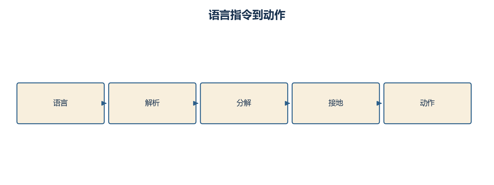

## 27.2　语义接地的形式化

"红色物品"是个语言符号，要变成机器人可操作的对象，必须接地（grounding）到场景中的具体实体——这是第 9 章的核心议题，本节给出其概率形式。

**严格定义与推导。** 设场景中检测到 $N$ 个物体候选 $\{o_1,\dots,o_N\}$，每个有视觉特征 $\mathbf v_i$（第 5 章）与开放词汇嵌入 $\mathbf z_i$（第 24 章式 24-1）。语言指称 $r$（如"红色物品"）的嵌入为 $\mathbf z_r$。接地就是把符号 $r$ 映射到概率最高的物体：

$$
p(i\mid r)=\frac{\exp\big(\mathbf z_r^\top\mathbf z_i/\tau_g\big)}{\sum_{j=1}^{N}\exp\big(\mathbf z_r^\top\mathbf z_j/\tau_g\big)},\qquad \hat i=\arg\max_i p(i\mid r), \tag{27-2}
$$

其中 $\tau_g$ 是接地温度。若指代含空间关系（"左边的杯子"），则在相似度里叠加空间项：

$$
s(i,r)=\mathbf z_r^\top\mathbf z_i+\lambda_{\text{sp}}\,f_{\text{rel}}(\mathbf p_i,\text{“左边”}), \tag{27-3}
$$

其中 $\mathbf p_i$ 是物体 3D 位置（第 7 章 SLAM），$f_{\text{rel}}$ 编码空间关系（如"左边"表示 $\mathbf p_i$ 在参照物左侧），$\lambda_{\text{sp}}$ 权衡语义与空间。

**推导细节。** 式 (27-2) 是第 24 章开放词汇分类（式 24-2）的 softmax 版本：前者返回最相似文本，这里返回最相似物体。温度 $\tau_g$ 控制歧义性——$\tau_g$ 小则分布尖锐（自信但易错），大则平坦（保守但模糊）。当场景中有多个红色物体时，$p(i\mid r)$ 在它们间分散，机器人应**主动澄清**（"指的是红苹果还是红积木？"）——这是第 27.5 节歧义问题的形式化起点。

**例 27.2（接地的数值算例）** 场景有三个物体：红苹果（$\mathbf z_{\text{apple}}$）、红积木（$\mathbf z_{\text{block}}$）、绿杯子（$\mathbf z_{\text{cup}}$）。指称 $r=$"红色物品"，与三者相似度（已除以 $\tau_g=0.1$）为 $2.0,1.9,0.4$。式 (27-2)：$p(\text{apple})=\exp(2.0)/(\exp2.0+\exp1.9+\exp0.4)=7.39/(7.39+6.69+1.49)=0.475$，$p(\text{block})=0.430$，$p(\text{cup})=0.096$。前两者概率接近——说明"红色物品"有歧义，机器人应触发澄清或按任务上下文选择（如"清理桌面"可能意味两者都要）。若指改为"红色苹果"，相似度变为 $2.4,1.1,0.3$，$p(\text{apple})=0.78$，歧义消除。这展示了式 (27-2) 如何量化指代歧义。

## 27.3　任务分解与 SayCan 价值接地

把高级任务分解为子任务是 LLM 的强项，但分解结果必须过滤掉物理上不可行的动作——这是 SayCan[2] 的核心。

**严格定义与推导。** 设 LLM 在给定指令 $l$ 与当前状态 $s$ 下，对候选技能（skill，第 23 章）$a\in\mathcal A$ 给出语义概率 $p_{\text{LLM}}(a\mid l,s)$（即"按指令该做这个"的合理性）。机器人另有 affordance 价值函数 $Q(s,a)\in[0,1]$（第 16、23 章，表示"我现在做这个能成功的概率"）。SayCan 把这些技能按**乘积**排序：

$$
a^*=\arg\max_{a\in\mathcal A}\underbrace{p_{\text{LLM}}(a\mid l,s)}_{\text{语义合理}}\cdot\underbrace{Q(s,a)}_{\text{物理可行}}. \tag{27-4}
$$

选中最优技能并执行，更新状态 $s'$，再重新计算式 (27-4)——这形成闭环，直到任务完成。式 (27-4) 的本质是把 LLM 的**符号先验**与(value function 的) **具身后验**相乘：只有"语义上该做"且"物理上能做"的动作才被选中。取对数得 $\log p_{\text{LLM}}+\log Q$，即语义 log-似然与 affordance log-价值的加法组合。

**推导细节。** 为什么用乘积而非只用 LLM？因为 LLM 的训练语料是文本，不含机器人物理约束——它可能建议"把苹果放进冰箱"而机器人够不到冰箱。$Q(s,a)$ 由真实机器人数据训练（第 15—17 章），编码了"在当前姿态下这个技能成功的经验概率"。相乘后，一个语义合理但物理不可行的动作（$p_{\text{LLM}}$ 高、$Q$ 低）得分被压低；语义弱但物理容易的动作（如顺手挪开挡路的杯子）得分上升——这正是"Do as I can, not as I say"的数学表达。

**例 27.3（SayCan 的数值算例）** 指令"把苹果放进碗里"，当前状态：苹果被一个盘子挡住。候选技能及得分：

$$
\begin{array}{c|ccc}
a & p_{\text{LLM}}(a\mid l,s) & Q(s,a) & \text{乘积}\\
\hline
\text{“拿苹果”} & 0.70 & 0.20 & 0.140\\
\text{“挪开盘子”} & 0.15 & 0.90 & 0.135\\
\text{“拿碗”} & 0.10 & 0.85 & 0.085
\end{array}
$$

仅看 LLM，"拿苹果"最优（0.70），但被盘子挡住成功率仅 0.20；SayCan 乘积后"拿苹果"(0.140) 与"挪开盘子"(0.135) 接近，若 $Q$ 再低一些（如 0.15）则乘积 0.105，机器人会先"挪开盘子"再"拿苹果"。这个例子展示了**价值接地如何纠正 LLM 的物理盲区**——这是显式分层相对端到端 VLA 的核心优势之一。

**表 27-1　指令到动作的关键环节与对应章节**

| 环节 | 函数 | 输出 | 对应章节 |
|------|------|------|----------|
| 解析 | $P$（式 27-1） | 结构化任务 | 本章 27.1 |
| 接地 | $G$（式 27-2、27-3） | 物体/位置引用 | 第 9、24 章 |
| 分解+价值过滤 | $\Pi_{\text{plan}}$（式 27-4） | 技能序列 | 第 23 章、本章 27.3 |
| 执行 | $\Pi_{\text{exec}}$（式 27-1） | 连续动作 | 第 13、25 章 |

### 27.3A　长时序误差累积的形式化

式 (27-1) 的四步串联在**长时序**任务里会反复执行（每完成一个子任务就重新接地、重规划），每一步的小误差会沿时序叠加。27.5 节定性提到这一点，这里给出它的定量形式。

**串联成功率。** 设一条指令被分解为 $m$ 个有依赖关系的子任务（抓→放→抓→放……），第 $i$ 个子任务的单步成功率为 $q_i\in(0,1]$（含接地正确、执行到位、未破坏前序成果）。子任务间强依赖（后步依赖前步状态），则整条指令的端到端成功率为

$$
S_{\text{chain}}=\prod_{i=1}^{m}q_i \;=\; \exp\!\Big(\sum_{i=1}^{m}\ln q_i\Big) \;\approx\; \exp\!\Big(-\sum_{i=1}^{m}(1-q_i)\Big). \tag{27-5}
$$

右端用 $\ln q_i\approx-(1-q_i)$（$q_i$ 接近 1 时）。式 (27-5) 揭示长时序的「乘法惩罚」：即便每步 $q_i=0.95$（很高），$m=20$ 时 $S_{\text{chain}}=0.95^{20}\approx0.36$——长任务整体成功率骤降到 36%。把 $\ln q_i$ 求和换成求「失败率」$(1-q_i)$，可看出**端到端成功率由累积失败率 $F=\sum_i(1-q_i)$ 主导**：$F$ 每增大 0.05，成功率约乘 $e^{-0.05}\approx0.95$。

**反馈闭环的修正收益。** Inner Monologue/ReAct 式的语言反馈能在每步后**检测并纠正**部分失败。设反馈能把第 $i$ 步的「有效失败率」从 $1-q_i$ 降到 $\beta(1-q_i)$（$\beta\in[0,1)$，$\beta=0$ 为完美纠正），则

$$
S_{\text{chain}}^{\,\beta}=\prod_{i=1}^{m}\big(1-\beta(1-q_i)\big)\ \ge\ \prod_{i=1}^{m}q_i=S_{\text{chain}}. \tag{27-6}
$$

式 (27-6) 说明反馈闭环对长时序是「乘性放大器」：$\beta$ 越接近 0（纠正越强），$S_{\text{chain}}^{\beta}$ 越接近 1，且收益随 $m$ 增大而越显著——这正是「长任务上反馈闭环比单步价值接地更重要」的定量依据。

**例 27.4（误差累积与闭环收益的数值）** 统一案例「清理桌面，把红色物品放进盒子」共 $m=6$ 个子任务（3 个「抓→放」对）。① 无反馈：单步 $q_i=0.95$，$S_{\text{chain}}=0.95^{6}\approx0.735$。② 有反馈，$\beta=0.5$（反馈能纠正一半失败）：每步有效失败率 $0.5\times0.05=0.025$，$S_{\text{chain}}^{\beta}=0.975^{6}\approx0.862$——从 73.5% 提到 86.2%。③ 若任务更长（$m=20$，如「整理一桌杂物」），无反馈 $0.95^{20}\approx0.358$，有反馈（$\beta=0.5$）$0.975^{20}\approx0.605$——长时序下反馈把成功率从 35.8% 拉到 60.5%，相对收益接近翻倍。这解释了为何 27.4 节的谱系从「无反馈的零样本规划」演进到「语言闭环」：长时序任务的成败由式 (27-5) 的乘法惩罚与式 (27-6) 的反馈修正共同决定。

## 27.4　大模型规划器的分层架构谱系

LLM 作为高层规划器 + 低层控制器执行的分层架构，是本章的主线。不同工作差别在"反馈是否闭合"与"接地粒度"。

Zero-Shot Planner[1] 最直接：把任务描述与可用动作列表写进提示，让 LLM 输出动作序列——无反馈、无价值过滤，易生成不可行动作。SayCan[2] 加上 affordance 价值接地（式 27-4），解决可行性。Inner Monologue[3] 引入**自然语言反馈闭环**：把执行结果（"抓取失败，物体滑落"）以文本形式喂回 LLM，让它重新规划——这把第 27.3 节的闭环显式化。ReAct[4] 则把"推理（reasoning）"与"行动（acting）"交织：LLM 先生成思考（"苹果被挡住了"），再生成动作，观察后再思考——提升长时序任务的可解释性与纠错能力。

**表 27-2　大模型规划器谱系**

| 方法 | 规划方式 | 反馈 | 接地 | 特色 |
|------|----------|------|------|------|
| Zero-Shot Planner[1] | 文本→动作序列 | 无 | 弱 | 零样本分解 |
| SayCan[2] | 语义×affordance（式 27-4） | 单步闭环 | 价值接地 | 物理可行 |
| Inner Monologue[3] | 语言反馈重规划 | 语言闭环 | 感知反馈 | 失败恢复 |
| ReAct[4] | 推理—行动交织 | 观察闭环 | 工具调用 | 可解释纠错 |

从七要素视角看，这一谱系的演进逻辑是：从"无接地的符号规划"（缺 E3 观测接地、E5 动作可行）走向"感知—规划—执行闭环"（补全 E3/E5），并引入 E7（显式规划）的反馈修正。它与第 25 章端到端 VLA 形成互补：VLA 强在语义泛化与速度，分层规划器强在可解释、可约束、长时序纠错——二者的融合（用 VLA 做低层技能、LLM 做高层规划）是当前主流（第 28 章）。

### 27.4A　把规划写成程序：Code-as-Policies

表 27-2 的规划器都输出「技能名序列」这种扁平结构，难以表达循环、条件与参数化（如「把每个红色物体放进盒子」需要遍历）。Liang 等人[5] 提出 **Code as Policies**：让 LLM 输出的不是动作 token 列表，而是一段**可执行的控制程序**（Python 式伪代码），其中的技能调用由底层策略执行，控制流（循环/分支/函数）由解释器处理：

$$
\mathrm{prog}=\mathrm{LLM}\big(l,\ \text{API}(s)\big),\qquad \hat a_{1:k}=\mathrm{exec}\big(\mathrm{prog},\,s\big), \tag{27-7}
$$

其中 $\text{API}(s)$ 是可调用技能的接口签名（如 `pick(obj, gripper)`、`place(obj, pose)`），$\mathrm{exec}$ 是带状态回写的解释器。式 (27-7) 的价值在于：程序能表达式 (27-1) 四步链中 $\Pi_{\text{plan}}$ 难以处理的**结构化控制**——遍历（`for obj in red_objects: place(obj, box)`）、条件（`if blocked: move_away()`）、复用（定义 `def put(obj)`）。

**与 SayCan 的关系。** Code-as-Policies 并不取消式 (27-4) 的价值接地，而是把它下沉到技能层：程序里每个 `pick/place` 仍由底层 affordance 策略执行并回报成功与否，失败则触发程序内的异常分支（对应式 27-6 的反馈修正）。区别是「规划结构」从 LLM 隐式序列升级为显式程序——可调试、可局部重跑、可在失败处插入人工约束，代价是 LLM 须学会稳定的 API 文法（提示工程与 few-shot 示例决定其可靠性）。

**例 27.5（规划成程序的对照）** 同一指令「清理桌面，把红色物品放进盒子」：① 扁平技能序列（SayCan 式）须显式枚举 `pick(apple), place(apple, box), pick(block), place(block, box)`——物体数量变化就要重排序列，且无法表达「若被挡先挪开」。② 程序式输出
`for obj in detect("red"): if blocked(obj): move(blocker); pick(obj); place(obj, box)`
——物体数任意、含遮挡处理、结构清晰。当红物体有 5 个时，扁平序列需 10 个技能 token 且易漏，程序只需一次循环。这展示了 Code-as-Policies 对式 27-1 链中「分解」环节的结构化补强，与第 10 章符号规划的程序化思想一脉相承。

## 27.5　边界与讨论

显式转换链的边界集中在三处。**其一，语言歧义。** 式 (27-2) 显示指代常有多个候选（"那个""红色物品"），概率分散时机器人须主动澄清——这在无人值守场景是硬伤。**其二，常识缺失。** LLM 的世界知识来自文本，对"碗是空的还是满的""苹果是否熟到能抓"等物理常识判断不可靠（第 24.5 节同款局限）。**其三，长时序误差累积。** 式 (27-1) 的四步串联与闭环重规划中，每一步的小误差（接错物体、分解漏步、执行偏差）会沿时序累积——27.3A 节用串联成功率（式 27-5）与反馈修正（式 27-6）量化了这种「乘法惩罚」，这是第 33 章漂移问题的具身版本，Inner Monologue[3] 的语言反馈是缓解手段但非根治。

**跨域接口。** 本章的分层规划衔接第 9 章（语义接地）、第 10 章（运动规划）、第 23 章（技能）、第 24—26 章（VLM/VLA/通用策略）与第 28 章（具身基础模型）；语言侧基础见《自然语言智能导论》第 37 章。与端到端 VLA（第 25 章）的选择是典型的"可解释性 vs 性能"权衡：安全关键场景（第 35 章）倾向显式可检查的分层链，开放世界速度优先场景倾向端到端。

## 本章小结

本章论述语言指令到动作的显式转换，核心结论是：通过"解析→接地→规划→执行"的可分解链条，机器人能把自然语言变成可执行动作，并用 affordance 价值接地弥补 LLM 的物理盲区，但歧义、常识缺失与误差累积仍是边界。

我们首先形式化转换链（式 27-1），例 27.1 用"清理桌面"指令展示四步分解。接着推导语义接地（式 27-2、27-3），例 27.2 用三个物体的相似度算出 $p(\text{apple})=0.475$、$p(\text{block})=0.430$，量化指代歧义；推导 SayCan 的语义×affordance 排序（式 27-4），例 27.3 用"苹果被盘挡住"的技能得分表展示价值接地如何纠正 LLM 的物理盲区。27.3A 节把"长时序误差累积"定量化：串联成功率（式 27-5）与反馈闭环修正（式 27-6），例 27.4 算出 $m=20$ 时成功率从 35.8%（无反馈）升到 60.5%（$\beta=0.5$）。27.4A 节引入 Code-as-Policies（式 27-7），例 27.5 用循环+条件的程序对照扁平技能序列，说明显式程序如何补强分解环节的结构化控制。我们梳理 Zero-Shot Planner、SayCan、Inner Monologue、ReAct 的分层谱系（表 27-2），讨论其与端到端 VLA 的互补。

我们还明确边界：语言歧义需主动澄清、物理常识不可靠、长时序误差累积。这些辨析衔接第 9、10、23—28、33、35 章与《自然语言智能导论》第 37 章。

从四问看，本章的分层规划器利用 L4（符号规划）与 E7（显式规划）：假设语言可分解为符号子任务并接地到感知；它突破了端到端黑盒的不可解释性，仍受"歧义、常识与误差累积"的边界约束。

下一章介绍具身基础模型——把本章的分层能力与第 25—26 章的 VLA 统一到大规模预训练的底座中。

**进一步阅读**　本章建议延伸阅读的文献：[1]、[2]、[4]、[5]、[7]、[9]。

## 参考文献

[1] Huang W, Abbeel P, Pathak D. Language models as zero-shot planners: Extracting actionable knowledge for embodied agents. *ICML*, 2022: 9118–9147.

[2] Ahn M, Brohan A, Brown N, et al. Do as I can, not as I say: Grounding language in robotic affordances. *CoRL*, 2022: 287–318.

[3] Huang W, Xia F, Xiao F, et al. Inner Monologue: Embodied reasoning through planning with language models. *CoRL*, 2022: 1769–1782.

[4] Yao S, Zhao J, Yu D, et al. ReAct: Synergizing reasoning and acting in language models. *ICLR*, 2023.

[5] Liang J, Huang W, Xia F, et al. Code as policies: Language model programs for embodied control. *ICRA*, 2023: 9493–9500.

[6] Driess D, Branscomb G, Krishnan A, et al. PaLM-E: An embodied multimodal language model. *ICML*, 2023: 8469–8488.

[7] Huang W, Abbeel P, Pathak D, et al. Grounded decoding: Guiding text generation with grounded models for robot control. *NeurIPS*, 2023, 36: 18432–18452.

[8] Wang Z, Cai S, Liu Q, et al. Describe, explain, plan and select: Interactive planning with LLMs enables open-world multi-task agents. *NeurIPS*, 2023, 36: 34105–34129.

[9] Shinn N, Cassano F, Gopinath A, et al. Reflexion: Language agents with verbal reinforcement learning. *NeurIPS*, 2023, 36: 8634–8652.

---

# 第 28 章　具身基础模型

第六篇（第 24—28 章）至此走到顶点：具身基础模型（Embodied Foundation Model）。前四章分别给出了语义感知（第 24 章 VLM）、动作生成（第 25 章 VLA）、跨形态泛化（第 26 章通用策略）与符号规划（第 27 章语言指令到动作），本章把它们统一到一个更宏大的范式——在大规模多模态、多任务、多机器人数据上预训练的基础模型，作为通用机器人智能的底座。这是《自然语言智能导论》第 21—26 章"预训练—适配"范式在具身领域的延伸：正如 BERT/GPT 用海量文本获得通用语言能力，具身基础模型期望用海量机器人轨迹、人类视频与互联网图文获得通用的"感知—行动"能力，再通过微调或提示适配到具体机器人与任务。

历史脉络沿着"规模化"展开。PaLM-E[1]（2023）把具身数据（机器人轨迹、传感器）注入 562B 参数的语言模型，展示了"一个模型做视觉问答、任务规划与机器人控制"的雏形。RT-X[2] 与 OpenVLA[3] 把 VLA 路线推向大规模异构数据（第 26 章）。2024—2026 年，π0[4] 的流匹配连续动作、GR00T 等"机器人基础模型"、以及世界模型与基础模型的融合（第 32 章）成为前沿。贯穿其中的张力是：语言模型靠"下一 token 预测"这一简单目标实现了规模化，而具身数据的稀缺性、异构性与物理约束使"具身的下一个 token 预测"远不那么直接——本章将形式化这些目标并剖析数据瓶颈。

按全书统一原则，第 25 章的 VLA 动作生成、第 26 章的跨形态接口、第 27 章的分层规划已充分展开，本章不重复；第 18、34 章的数据收集与规模化、第 32 章的世界模型是本章的前后接口。全章沿用统一案例：一个具身基础模型在桌面整理（单臂）、家庭清洁（双臂）与导航（四足）三类任务上的预训练—适配流程。本章结构：28.1 节形式化具身基础模型与预训练—适配范式；28.2 节推导多源预训练目标；28.3 节讨论数据来源与配比；28.4 节梳理多任务适配机制；28.5 节评述 2025—2026 进展；28.6 节剖析数据、可靠性、实时性与安全边界。

## 28.1　具身基础模型的范式

**定义 28.1（具身基础模型）** 具身基础模型是在大规模、多来源、多任务的具身数据 $\mathcal D=\{\mathcal D_{\text{robot}},\mathcal D_{\text{video}},\mathcal D_{\text{web}},\mathcal D_{\text{sim}}\}$ 上预训练的模型 $f_\theta$，其参数 $\theta$ 经预训练后可通过微调（fine-tuning）、提示（prompting）或上下文学习适配到 unseen 的机器人形态 $\hat r$ 与任务 $\hat\tau$：

$$
\theta_{\text{pre}}=\arg\min_\theta\ \mathcal L_{\text{pre}}(\theta;\mathcal D),\qquad
\hat\theta=\mathrm{Adapt}(\theta_{\text{pre}},\mathcal D_{\hat r,\hat\tau}), \tag{28-1}
$$

其中 $\mathrm{Adapt}$ 可以是全量微调、LoRA 低秩适配（第 28.2 节）或仅提示。式 (28-1) 的关键是把"预训练"与"适配"解耦：昂贵的预训练做一次，便宜的适配按任务/形态做多次。

**直觉解释。** 具身基础模型与 VLA（第 25 章）的关系是"范式"与"实例"：VLA 是一类模型架构（视觉+语言+动作端到端），具身基础模型强调"大规模预训练 + 广泛适配"的**训练范式**——VLA 是它最成功的实例之一。第 24 章的 VLM 提供语义底座，第 25 章的 VLA 提供动作生成，第 26 章的统一动作空间提供跨形态接口，第 27 章的分层规划提供符号能力——具身基础模型把这些拼成完整底座。

**例 28.1（预训练—适配的数值直觉）** 设在 100 万条轨迹（来自 22 种机器人）上预训练一个 7B 参数模型，耗时约数千 GPU 小时；适配到一种新的双臂机器人只需 100 条演示轨迹，用 LoRA（式 28-3）更新约 1% 参数，耗时数十分钟。若从头为每台机器人训练专用策略（第 26.4 节），每种形态都要重复昂贵的数据收集与训练。具身基础模型的价值正在于把"N 台机器人 × M 个任务"的 $N\times M$ 成本压缩为"一次预训练 + $N+M$ 次轻量适配"。

图 28-1 展示具身基础模型的预训练—适配范式。

> 【图 28-1　具身基础模型】（原图见 figures/图28-1.png）：多源数据（机器人轨迹、人类视频、互联网图文、仿真）汇入预训练大模型，再经微调/LoRA/提示适配到多种机器人形态与任务。
>
> 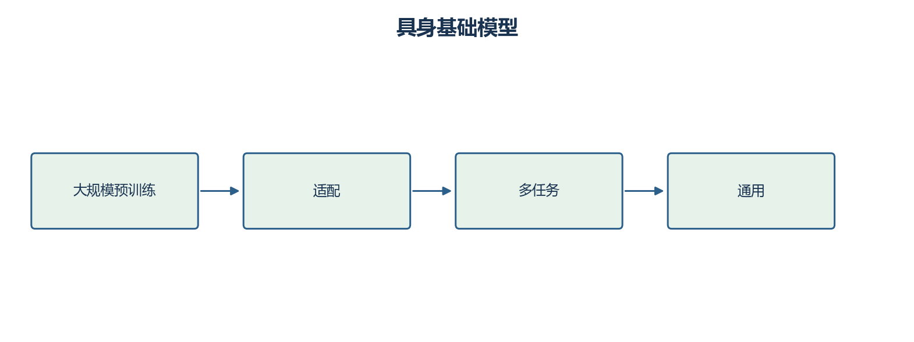

## 28.2　多源预训练目标

具身基础模型的预训练目标是多源的：既要学语言/视觉对齐（第 24 章），又要学动作生成（第 25 章），还可能学世界动态（第 32 章）。

**严格定义与推导。** 总预训练目标是各源目标的加权和：

$$
\mathcal L_{\text{pre}}=\lambda_{\text{BC}}\underbrace{\mathbb E_{(\mathcal O,l,A)\sim\mathcal D_{\text{robot}}}\!\big[\mathcal L_{\text{act}}(A\mid \mathcal O,l)\big]}_{\text{机器人行为克隆}}
+\lambda_{\text{VLM}}\underbrace{\mathbb E_{(I,t)\sim\mathcal D_{\text{web}}}\!\big[\mathcal L_{\text{contrast}}(I,t)\big]}_{\text{图文对比（第 24 章式 24-3）}}
+\lambda_{\text{dyn}}\underbrace{\mathbb E_{\mathcal D_{\text{video}}}\!\big[\mathcal L_{\text{pred}}(s_{t+1}\mid s_t,a_t)\big]}_{\text{动力学预测（第 32 章）}}, \tag{28-2}
$$

其中 $\mathcal L_{\text{act}}$ 是第 25 章的动作生成损失（离散交叉熵或流匹配式 25-6），$\mathcal L_{\text{contrast}}$ 是第 24 章的 CLIP 对比损失，$\mathcal L_{\text{pred}}$ 是预测下一状态的监督损失；$\lambda$ 是各源权重，决定模型偏向"纯视觉语言"还是"纯控制"。

**适配的参数效率。** 全量微调要更新全部 $\theta$；LoRA[5] 只更新低秩增量：对权重矩阵 $\mathbf W\in\mathbb R^{d\times d}$，约束

$$
\Delta\mathbf W=\mathbf B\mathbf A,\quad \mathbf A\in\mathbb R^{r\times d},\ \mathbf B\in\mathbb R^{d\times r},\ r\ll d, \tag{28-3}
$$

故每层可训练参数从 $d^2$ 降到 $2rd$，压缩比 $2r/d$。这与《自然语言智能导论》LoRA 一致，是具身基础模型"一次预训练、多处适配"的工程关键。

**例 28.2（预训练目标与 LoRA 的数值算例）** 取 $\lambda_{\text{BC}}=1.0,\lambda_{\text{VLM}}=0.3,\lambda_{\text{dyn}}=0.2$。若某批机器人数据的动作损失为 $0.45$、图文对比损失 $0.30$、视频预测损失 $0.60$，则式 (28-2) 给出 $\mathcal L_{\text{pre}}=1.0\times0.45+0.3\times0.30+0.2\times0.60=0.45+0.09+0.12=0.66$——机器人行为克隆主导，图文与动力学作为正则与先验。LoRA 参数量：取 $d=4096,r=8$，$d^2=1.68\times10^7$（每层 1677 万），LoRA 为 $2\times8\times4096=6.55\times10^4$（每层 6.5 万），压缩比 $2r/d=16/4096\approx0.39\%$。一个 32 层模型全量需约 5.4 亿参数微调，LoRA 仅约 210 万——例 28.1 的"1% 适配"由此而来。

**表 28-1　具身基础模型预训练目标对照**

| 目标项 | 数据来源 | 符号 | 作用 |
|--------|----------|------|------|
| 行为克隆 | $\mathcal D_{\text{robot}}$ | $\mathcal L_{\text{act}}$（第 25 章） | 学动作生成 |
| 图文对比 | $\mathcal D_{\text{web}}$ | $\mathcal L_{\text{contrast}}$（式 24-3） | 学语义对齐 |
| 动力学预测 | $\mathcal D_{\text{video}}$/仿真 | $\mathcal L_{\text{pred}}$（第 32 章） | 学世界动态 |
| LoRA 适配 | 新任务数据 | 式 (28-3) | 低成本迁移 |

## 28.3　数据来源与配比

具身基础模型的"燃料"是数据，而具身数据的稀缺性是它相对 NLP 的最大劣势。

真实机器人数据（$\mathcal D_{\text{robot}}$）质量最高（有精确动作标注）但昂贵——每台机器人需人工遥操作采集（第 18 章），Open X-Embodiment[2] 汇聚百万条轨迹已属不易。人类视频（$\mathcal D_{\text{video}}$，如 Ego4D[6]）海量且含丰富操作常识，但缺乏动作标注、视角与机器人不同（人类手 vs 机械夹爪），需通过"人机动作映射"间接利用。仿真数据（$\mathcal D_{\text{sim}}$，第 29—30 章）可无限生成且自带标注，但有现实差距。互联网图文（$\mathcal D_{\text{web}}$，第 24 章）提供语义与常识，但没有动作。

**例 28.3（数据配比的权衡）** 设预训练预算固定为处理 $10^9$ 个 token。方案 A 全用机器人数据（每条轨迹约 2000 token），覆盖 50 万条轨迹——动作精准但语义窄，面对"把条纹马克杯放进洗碗机"这类含新属性的指令泛化差。方案 B 按式 (28-2) 配比：50% 机器人（25 万条）+ 30% 图文 + 20% 人类视频——动作数据减半，但语义泛化显著提升（第 24 章能力注入）。实验性结论是：**纯机器人数据训练的模型在分布内任务精度高，加入图文/视频后分布外指令成功率明显上升**——这是"规模来自多源、泛化来自语义"的体现。配比的 $\lambda$ 选择是核心超参，依目标（精度 vs 泛化）而定。

### 28.3A　数据质量加权与有效规模

配比只回答了「用哪些源」，没回答「每条数据值多少」。具身数据噪声差异极大：遥操作演示可能抖动、失败片段混入、传感器丢帧，而人类视频几乎无动作标注。把「质量」纳入式 (28-2)，得到**质量加权目标**

$$
\mathcal L_{\text{pre}}^{\,w}=\sum_{s\in\mathcal S_{\text{src}}}\lambda_s\,\frac{\sum_{d\in\mathcal D_s}w_d\,\mathcal L(d)}{\sum_{d\in\mathcal D_s}w_d}, \tag{28-4}
$$

其中 $w_d\in(0,1]$ 是数据 $d$ 的质量权重（如成功演示 $w=1$、模糊/失败 $w=0.2$），分母保证权重之和归一、不改变损失量纲。式 (28-4) 的直觉是「用有效数据量替代原始数据量」：定义源 $s$ 的**有效规模**

$$
|\mathcal D_s|_{\text{eff}}=\sum_{d\in\mathcal D_s}w_d, \tag{28-5}
$$

则一个 10 万条但平均 $w=0.8$ 的高质量机器人集（$8$ 万有效），其「信息量」高于 10 万条但平均 $w=0.4$ 的脏集（$4$ 万有效）。这把第 26.4A 节的数据规模律（式 26-8）推广到加权情形：决定性能的是 $|\mathcal D|_{\text{eff}}$ 而非 $|\mathcal D|$。

**例 28.4（质量加权的数值）** 某具身集有 10 万条轨迹：5 万条高质量遥操作演示（$w=1$）、3 万条中等质量（$w=0.6$）、2 万条含失败/丢帧（$w=0.3$）。式 (28-5)：$|\mathcal D|_{\text{eff}}=5\times10^4+3\times10^4\times0.6+2\times10^4\times0.3=5.0+1.8+0.6=7.4$ 万。若不做质量加权（全部 $w=1$），按第 26.4A 节的数据规模律（式 26-8）估算，脏集会把「有效 $D$」从 7.4 万虚增到 10 万，高估约 $35\%$ 的规模收益，导致「以为数据够了、实际还没够」的误判。反之，剔除低质 $w<0.3$ 的 2 万条后，有效规模仍为 $5.0+1.8=6.8$ 万（损失约 $8\%$），却省去其噪声对式 (28-2) 行为克隆项的污染——**「少而精」常优于「多而脏」**。这一权衡与第 31 章合成—真实数据的质量维度一致。

## 28.4　多任务适配机制

预训练之后，模型要适配到具体形态与任务。三条主流路径各有取舍。

**全量微调**在目标_task 数据上更新全部参数，性能上限最高但成本高、易灾难性遗忘（第 28.6 节）。**LoRA 适配**（式 28-3）只更新低秩增量，参数效率高、切换任务只需换 $\mathbf A,\mathbf B$ 矩阵，是工程首选。**提示/上下文适配**完全不更新参数，用自然语言提示或少量示例（第 27 章的 planning prompt）引导模型——最灵活但受限于预训练覆盖面。

**表 28-2　多任务适配机制对照**

| 机制 | 更新参数 | 成本 | 性能上限 | 适用 |
|------|----------|------|----------|------|
| 全量微调 | 100% | 高 | 最高 | 数据足、固定任务 |
| LoRA（式 28-3） | ~0.4% | 低 | 接近全量 | 多任务切换 |
| 提示/上下文 | 0 | 最低 | 受预训练限制 | 快速试错、零样本 |

**例 28.5（统一案例的适配流程）** 预训练模型 $f_\theta$ 已在百万轨迹上学到通用操作能力。适配到"家庭清洁双臂机器人"：收集 200 条双臂演示，用 LoRA（$r=8$）微调 20 分钟，得到 $\hat\theta$；测试时只需在输入里拼接任务提示 "clean the table"（第 27 章）与双臂形态 token（第 26 章式 26-5），模型即输出双臂协同动作块。若再适配到四足导航，只需换一组 LoRA 权重与提示——同一底座服务三类任务，边际成本仅为各 200 条演示。

需要提醒的是，LoRA 适配的"低成本"是相对预训练而言的：每一组 $\mathbf A,\mathbf B$ 矩阵仍须存储在推理时的权重切换中，任务数量很多时聚合与调度本身成为系统工程问题（第 36 章）。此外，式 (28-2) 的权重 $\lambda$ 在适配阶段通常冻结，不随新任务动态调整——这保证了底座稳定，却也意味着新任务无法改变预训练时的能力配比。

### 28.4A　顺序适配与灾难性遗忘

表 28-2 把三种适配机制当作「一次性选择」，但真实部署常是**顺序适配**：先适配任务 1，再适配任务 2……每适配新任务，旧任务的性能会掉——灾难性遗忘（catastrophic forgetting）。这里把它定量化并给出缓解。

**遗忘度量。** 设适配前模型在任务集 $\mathcal T$ 上的成功率为 $\{S_t\}_{t\in\mathcal T}$，顺序适配新任务 $\hat\tau$（如用 LoRA 式 28-3 更新）后，旧任务 $t$ 的成功率变为 $S_t^{\text{post}}$。定义任务 $t$ 的**遗忘量**

$$
\mathcal F_t = S_t - S_t^{\text{post}},\qquad \text{平均遗忘}\ \bar{\mathcal F}=\frac{1}{|\mathcal T|}\sum_{t\in\mathcal T}\mathcal F_t. \tag{28-6}
$$

$\mathcal F_t>0$ 表示适配 $\hat\tau$ 损害了任务 $t$。全量微调的 $\bar{\mathcal F}$ 通常最大（更新全部参数、覆盖旧模式），LoRA 较小（低秩增量对旧方向扰动有限），提示适配 $\approx0$（不改参数）。

**正则与重放。** 两种常用缓解：① **弹性权重巩固（EWC）/ 正则**——对预训练权重加二次惩罚，限制其偏移

$$
\mathcal L_{\text{reg}}=\mathcal L_{\hat\tau}(\theta)+\tfrac{\mu}{2}\sum_j F_j\,(\theta_j-\theta^{\text{pre}}_j)^2, \tag{28-7}
$$

其中 $F_j$ 是参数 $\theta_j$ 对旧任务的**费舍尔信息**（越重要越不许动），$\mu$ 是正则强度；② **重放（replay）**——适配新任务时混入少量旧任务演示，直接「复习」。二者都是「在新任务目标上叠加保持旧能力的约束」，以少量新任务性能换显著的 $\bar{\mathcal F}$ 下降。

**例 28.6（顺序适配的遗忘量化）** 底座已会 3 个任务，$S=(92\%,88\%,85\%)$。顺序适配第 4 个任务（双臂擦拭）：① 全量微调后旧任务 $S^{\text{post}}=(80\%,74\%,72\%)$，$\mathcal F=(12\%,14\%,13\%)$，$\bar{\mathcal F}=13\%$——遗忘严重。② LoRA（$r=8$）后 $S^{\text{post}}=(89\%,85\%,84\%)$，$\mathcal F=(3\%,3\%,1\%)$，$\bar{\mathcal F}=2.3\%$——遗忘小。③ 在 LoRA 上再加式 (28-7) 正则（$\mu=1000$，$F_j$ 取预训练重要性）或混入 $5\%$ 旧任务重放，$S^{\text{post}}=(90\%,86\%,84\%)$，$\bar{\mathcal F}\approx1.7\%$。这说明：**「LoRA + 轻量正则/重放」是顺序适配的甜点区**——既保留新任务增益（第 4 任务达到 90%），又把平均遗忘压到 2% 以内，支撑「一个底座持续吸纳新机器人/新任务」的运营式扩展（第 36 章）。

## 28.5　2025—2026 年进展

这一阶段具身基础模型的进展集中在三条线。**其一，规模化与开源。** RT-X[2]、OpenVLA[3] 之后，Octo[7]、π0[4] 等开源模型把"大规模预训练 + 轻量适配"变成可复现流程；数据与模型规模持续上升，跨任务泛化基准（第 33 章）随之升级。**其二，连续动作与高频控制。** π0[4] 的流匹配（第 25 章式 25-5、25-6）把 VLA 从离散 token 推向连续动作，支持 50 Hz 灵巧操作——这使具身基础模型从"能做"走向"做得精细"。**其三，与世界模型融合。** 把第 32 章的世界模型作为具身基础模型的"动力学先验"，让模型在行动前预测后果（第 25 章缺的 E2/E7），是 2025—2026 年前沿（如"生成式动作条件世界模型"路线）。须强调：参数规模、基准分数变化极快，具体数字以原始出处为准，本章只给结构性判断。

## 28.6　边界与讨论

具身基础模型的边界有四。**第一，数据瓶颈。** 机器人数据的采集成本与多样性远不及文本，规模化曲线（第 34 章）是否延续 NLP 的幂律仍是开放问题。**第二，物理可靠性。** 大模型的统计泛化不等于物理正确——模型可能"生成看起来合理但物理上危险"的动作（第 35 章）。**第三，实时性。** 大模型前向延迟与高频控制（第 36 章）的矛盾仍需量化/蒸馏缓解。**第四，灾难性遗忘。** LoRA 微调虽便宜，但多任务顺序适配时旧任务性能可能下降，需重放或正则。

从"通用智能"视角看（第 38 章），具身基础模型是"预训练—适配"范式在物理世界的延伸，它把第 24—27 章的能力统一到单一底座，但仍缺乏显式因果世界模型（第 32、34 章）与可靠的安全保证（第 35 章）。这些辨析衔接第 18、25—27、32、35—36 章。第六篇至此完成：我们从语义感知出发，经动作生成、跨形态泛化、符号规划，抵达统一底座。

## 本章小结

本章论述具身基础模型，核心结论是：它以"大规模多源预训练 + 轻量适配"把第 24—27 章的能力统一到单一底座，但数据瓶颈、物理可靠性、实时性与遗忘仍是边界。

我们首先形式化具身基础模型与预训练—适配范式（式 28-1），例 28.1 用 $N\times M$ 成本压缩说明其价值。接着推导多源预训练目标（式 28-2），把行为克隆、图文对比（第 24 章）、动力学预测（第 32 章）统一加权，例 28.2 算出 $\mathcal L_{\text{pre}}=0.66$ 并推导 LoRA（式 28-3）的 0.39% 参数压缩比。我们讨论四种数据来源与配比（例 28.3），并在 28.3A 节引入质量加权目标（式 28-4）与有效规模（式 28-5），例 28.4 算出 10 万条混合质量数据的有效规模为 7.4 万、说明「少而精优于多而脏」。对照全量微调/LoRA/提示三种适配机制（表 28-2），用统一案例展示一次预训练服务三类任务的流程（例 28.5）。28.4A 节把顺序适配的灾难性遗忘定量化：定义遗忘量（式 28-6）与 EWC/重放正则（式 28-7），例 28.6 算出全量微调平均遗忘 13%、LoRA 降到 2.3%、再加正则/重放降到约 1.7%，给出「LoRA + 轻量正则」的顺序适配甜点区。

我们还评述 2025—2026 年规模化、连续动作、世界模型融合三条进展，明确数据、可靠性、实时性、遗忘四重边界。这些辨析衔接第 18、25—27、32、35—36 章。

从四问看，本章的具身基础模型利用 E1—E7 的全栈统一：假设能力可通过大规模预训练获得并轻量迁移；它突破了"每任务重训"的范式，仍受"数据稀缺与物理可靠性"的边界约束。

下一章进入第七篇，从"模型"转向"训练场"：机器人仿真器——支撑大规模预训练与安全试错的基础设施。

**进一步阅读**　本章建议延伸阅读的文献：[1]、[2]、[4]、[8]、[9]。

## 参考文献

[1] Driess D, Branscomb G, Krishnan A, et al. PaLM-E: An embodied multimodal language model. *ICML*, 2023: 8469–8488.

[2] O'Neill A, Brohan A, Xiang J, et al. Open X-Embodiment: Robotic learning datasets and RT-X models. *ICRA*, 2024: 6892–6903.

[3] Kim M J, Pertsch K, Lee L Y, et al. OpenVLA: An open-source vision-language-action model. *arXiv:2406.09246*, 2024.

[4] Black K, Nakamoto N, Peng B, et al. π0: A vision-language-flow model for dexterous manipulation. *arXiv:2410.13832*, 2024.

[5] Hu E J, Shen Y, Wallis P, et al. LoRA: Low-rank adaptation of large language models. *ICLR*, 2022.

[6] Grauman K, Westbury E, Byrne E, et al. Ego4D: Around the world in 3,000 hours of egocentric video. *CVPR*, 2022: 18995–19012.

[7] Ghosh D, Walke H R, Belkhale S, et al. Octo: An open-source generalist robot policy. *arXiv:2405.12213*, 2024.

[8] Firoozi R, Agarwal U, Tian Y, et al. Foundation models in robotics: Applications, challenges, and the future. *International Journal of Robotics Research*, 2025, 44(7): 1139–1175.

[9] Hu Y, Yang B, Zheng H, et al. Towards generalist robot policies: A survey. *arXiv:2412.14006*, 2024.

---

# 第 29 章　机器人仿真器

第七篇（第 29—32 章）聚焦仿真与现实迁移。第 20—21 章的 sim-to-real 依赖仿真器，第 28 章的具身基础模型更把仿真数据列为四大燃料之一——本章介绍机器人仿真器（robot simulator）的构成、物理引擎与保真度。仿真是机器人学习的"训练场"：它支撑大规模强化学习（第 19 章）所需的海量交互、允许安全试错（真实机器人摔一次可能损失数万元）、并提供真实世界难以标注的完美状态（精确位姿、接触力）。但仿真永远是对现实的近似，保真度与效率的根本矛盾贯穿本章始终。

历史脉络体现了"精度—速度—规模"的三角权衡。Gazebo[1]（2004 起）依托 ROS 生态成为通用机器人系统仿真的标准，集成多物理引擎，适合传感器与系统集成测试，但速度受 CPU 限制。MuJoCo[2]（2012）以优化的连续碰撞检测与关节约束求解著称，动力学精确、速度较快，成为强化学习与控制的标配。PyBullet[3] 轻量易用。Isaac Gym/Sim[4]（2021）把物理仿真搬到 GPU 并实现数千环境并行，吞吐提升数个数量级，专为大规模 RL 设计。2020 年代，可微仿真（differentiable simulation，第 29.5 节）让仿真器本身进入梯度回传回路，成为新的方向。

按全书统一原则，第 3 章的刚体动力学与第 20—21 章的 sim-to-real 原理已讲，本章不重复；第 19 章的 RL 是仿真的下游消费者，第 30 章将讨论如何缩小仿真与现实的差距。全章沿用统一案例：Franka 机械臂抓取桌面物体的仿真——从 URDF 建模、接触动力学求解到 GPU 并行训练。本章结构：29.1 节形式化仿真器构成；29.2 节推导接触动力学与约束求解；29.3 节给出保真度—效率算例；29.4 节梳理代表仿真器谱系；29.5 节讨论可微仿真与边界。

## 29.1　仿真器的构成

**定义 29.1（机器人仿真器）** 机器人仿真器是一个对物理世界的可计算近似，由四个耦合模块构成：

$$
\mathcal S=\big\langle \underbrace{\mathcal P_{\text{phys}}}_{\text{物理引擎}},\ \underbrace{\mathcal R_{\text{render}}}_{\text{渲染引擎}},\ \underbrace{\mathcal C_{\text{sensor}}}_{\text{传感器模拟}},\ \underbrace{\mathcal M_{\text{robot}}}_{\text{机器人模型}}\big\rangle, \tag{29-1}
$$

其中物理引擎负责动力学积分、碰撞检测与接触求解；渲染引擎生成视觉观测（RGB/深度）；传感器模拟相机、IMU、力矩传感器等的噪声特性；机器人模型（通常用 URDF/SDF 描述）定义连杆、关节、质量与执行器参数。仿真器的状态推进为

$$
x_{t+1}=f_{\mathcal P}(x_t,a_t;\boldsymbol\psi)+\xi_t,\qquad o_t=g_{\mathcal R,\mathcal C}(x_t), \tag{29-2}
$$

其中 $x_t$ 是仿真状态（关节角、速度），$\boldsymbol\psi$ 是物理参数（质量、摩擦、阻尼），$f_{\mathcal P}$ 是物理引擎的动力学积分，$g_{\mathcal R,\mathcal C}$ 渲染并加传感器噪声生成观测 $o_t$，$\xi_t$ 是数值误差。

**直觉解释。** 式 (29-2) 把仿真器看成一个"可控的世界模型"（第 32 章）：给定当前状态与动作，它推演下一状态与观测。与真实世界相比，仿真器的优势是 $f_{\mathcal P}$ 完全可知、$\boldsymbol\psi$ 可知、$o_t$ 可完美标注——这正是第 28 章把仿真数据作为预训练燃料的原因。但 $f_{\mathcal P}$ 是对真实动力学的近似，$\boldsymbol\psi$ 与真实参数有偏差，这些失配累积成第 30 章的"现实差距（reality gap）"。

**例 29.1（Franka 抓取的仿真构成）** 机械臂模型用 URDF 描述 7 个连杆的质量、惯量与关节限位；物理引擎每步 $dt=1/500$ 秒积分动力学，检测夹爪与物体的碰撞并求解接触力；渲染引擎用光栅化或光线追踪生成 640×480 的 RGB-D 图像（模拟 RealSense 相机）；传感器模拟给深度图加高斯噪声（$\sigma=2$ mm）与相机内参畸变。一次 10 秒抓取仿真需 5000 步物理积分 + 5000 帧渲染——这个开销决定了吞吐，是 29.3 节权衡的起点。

图 29-1 展示仿真器的四模块架构。

> 【图 29-1　机器人仿真器构成】（原图见 figures/图29-1.png）：物理引擎、渲染引擎、传感器模拟与 URDF 机器人模型四模块，标出状态 $x_t$、动作 $a_t$ 与观测 $o_t$ 的数据流。
>
> 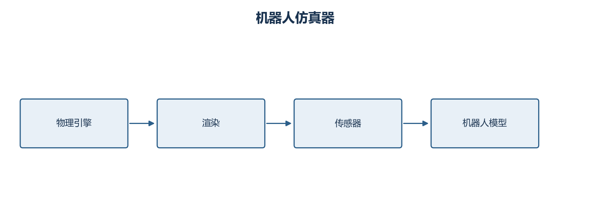

## 29.2　接触动力学与约束求解

仿真器最困难也最关键的环节是**接触（contact）**：夹爪抓物体、足端触地都是带约束的动力学问题，直接决定保真度。

**严格定义与推导。** 设广义坐标 $q\in\mathbb R^n$（关节角），刚体动力学（第 3 章）为

$$
\mathbf M(q)\ddot q+\mathbf C(q,\dot q)\dot q+\mathbf g(q)=\boldsymbol\tau+\mathbf J_c^\top\boldsymbol\lambda, \tag{29-3}
$$

其中 $\mathbf M$ 是质量矩阵，$\mathbf C$ 含科氏力，$\mathbf g$ 是重力，$\boldsymbol\tau$ 是执行器力矩，$\mathbf J_c$ 是接触点雅可比，$\boldsymbol\lambda$ 是接触力（拉格朗日乘子）。接触约束要求接触点不穿透：

$$
\phi(q)\ge 0,\qquad \dot\phi\ge 0,\qquad \boldsymbol\lambda\ge 0,\qquad \lambda_i\,\phi_i(q)=0, \tag{29-4}
$$

即**互补条件（complementarity）**：要么分离（$\phi>0,\lambda=0$），要么接触（$\phi=0,\lambda>0$），不能同时有力与间隙。离散化后，式 (29-3)(29-4) 构成一个**线性互补问题（LCP）**：

$$
\mathbf A\boldsymbol\lambda+\mathbf b\ge 0,\qquad \boldsymbol\lambda\ge 0,\qquad \boldsymbol\lambda^\top(\mathbf A\boldsymbol\lambda+\mathbf b)=0, \tag{29-5}
$$

其中 $\mathbf A\approx\mathbf J_c\mathbf M^{-1}\mathbf J_c^\top$（有效质量矩阵），$\mathbf b$ 含外力与速度项。求解 LCP 得到 $\boldsymbol\lambda$，代回式 (29-3) 完成一步积分。

**推导细节。** 式 (29-5) 的 LCP 是接触仿真的核心：它编码了"接触力只在接触时产生、且方向阻止穿透"的物理定律。MUJoCo[2] 用凸优化求解其软化版本（soft contact，允许微小穿透换取数值稳定），Gazebo[1] 的 ODE 引擎用迭代 LCP 求解器。碰撞检测的复杂度决定瓶颈：朴素两两检测是 $O(n^2)$，引擎用包围盒层次（BVH）加速到近 $O(n\log n)$。积分步长 $dt$ 越小越精确但越慢——这是 29.3 节量化权衡的根源。

**例 29.2（接触求解的数值算例）** 设夹爪以速度 $v=0.1$ m/s 接近质量 $m=0.2$ kg 的物体，等效一维接触模型 $\mathbf A=1/m_{\text{eff}}=5\ (\text{kg}^{-1})$（取有效质量 $m_{\text{eff}}=0.2$ kg），$b=-v/dt=-0.1/0.002=-50\ \text{m/s}^2$（$dt=2$ ms）。LCP（式 29-5）化为一维：求 $\lambda\ge0$ 使 $5\lambda-50\ge0$ 且 $\lambda(5\lambda-50)=0$。解得 $\lambda=10$ N（接触力），接触后物体加速度 $a=\lambda/m=10/0.2=50\ \text{m/s}^2$ 正好抵消接近速度（$\Delta v=a\,dt=0.1$ m/s）。若步长加倍 $dt=4$ ms，则 $b=-25$，$\lambda=5$ N，但数值积分误差增大约 4 倍（欧拉法误差 $O(dt)$）——这展示了步长对接触精度与稳定性的直接影响。

**表 29-1　仿真器核心模块与关键量**

| 模块 | 关键量 | 数学对象 | 影响 |
|------|--------|----------|------|
| 物理引擎 | 接触力 $\boldsymbol\lambda$ | LCP（式 29-5） | 保真度核心 |
| 积分器 | 步长 $dt$ | $O(dt)$ 误差 | 精度 vs 速度 |
| 渲染引擎 | 分辨率/光线 | $g_{\mathcal R}$（式 29-2） | 视觉保真 |
| 传感器模拟 | 噪声 $\sigma$ | $g_{\mathcal C}$ | Sim2Real 差距 |

## 29.3　保真度与效率的权衡

仿真器的两个目标——"像真的"与"算得快"——本质冲突，量化这一冲突是选型的关键。

**推导。** 设一次仿真步的代价来自物理 $c_{\text{phys}}\propto 1/dt$（步长越小步数越多）与渲染 $c_{\text{render}}$（像素数 $P$ 线性）：

$$
c_{\text{step}}=\alpha\,\frac{T}{dt}+\beta\,P, \tag{29-6}
$$

其中 $T$ 是仿真时长，$\alpha,\beta$ 是引擎常数。保真度 $\mathcal F$ 随 $dt$ 减小、$P$ 增大而提升（近似 $\mathcal F\propto 1/(1+\kappa_1 dt+\kappa_2/P)$），但式 (29-6) 的代价随之上升。RL 训练需要高吞吐（每秒数万步），倾向大 $dt$、低分辨率甚至无渲染（直接用状态）；sim-to-real 需要高保真（接触、光照、噪声），倾向小 $dt$、光追渲染——同一仿真器难以兼得。

**例 29.3（吞吐的定量对照）** 取 $T=1$ s 的抓取任务，$\alpha=10^{-3}$ s/步，$\beta=10^{-6}$ s/像素。方案 A（高保真）：$dt=0.5$ ms（2000 步）、$P=640\times480=307200$ 像素，则 $c_{\text{phys}}=10^{-3}\times2000=2$ s，$c_{\text{render}}=10^{-6}\times307200\approx0.31$ s（单帧），每仿真秒约 2.3 s 计算——比实时慢。方案 B（RL 训练）：$dt=5$ ms（200 步）、无渲染（$P=0$），$c_{\text{phys}}=0.2$ s，每仿真秒 0.2 s 计算——5 倍实时；若 Isaac Gym[4] 在 GPU 上并行 4096 环境，等效吞吐再提升约三个数量级，达每秒百万级步。这个对照解释了为何 RL 训练选大步长无渲染、sim-to-real 验证选小步长高保真——**同一任务链上不同环节用不同配置**。

**表 29-2　保真度—效率选型**

| 用途 | $dt$ | 渲染 | 代表引擎 | 吞吐 |
|------|------|------|----------|------|
| 系统/传感器仿真 | 小 | 光追 | Gazebo[1] | 低（近实时或更慢） |
| 控制/RL | 中 | 低/无 | MuJoCo[2]、PyBullet[3] | 中（快于实时） |
| 大规模 RL | 中 | 无 | Isaac Gym[4] | 极高（GPU 并行） |

### 29.3A　传感器模拟与误差随时间的复合

29.3 节量化的是「单次仿真秒」的代价，但 sim-to-real 的真正杀手是**观测噪声与动力学偏差随时间复合**。这里给出两项的模型。

**深度相机噪声模型。** 真实深度相机（如 RealSense）的误差随深度 $z$ 平方增长（基线越短、点越远，三角测量噪声越大）。设无噪声深度为 $z$，其观测为

$$
\hat z = z + \sigma_s z^2 + \sigma_g z,\qquad \sigma_s,\sigma_g\ge 0, \tag{29-7}
$$

其中 $\sigma_s$ 是尺度噪声（随 $z^2$），$\sigma_g$ 是加性噪声（随 $z$）。取 RealSense D435 量级 $\sigma_s\approx10^{-3}\,\mathrm{m}^{-1}$、$\sigma_g\approx0.015\,\mathrm{m}^{-1}$：在 $z=1$ m 处深度标准差 $\approx0.015+0.001=0.016$ m（约 1.6 cm），$z=3$ m 处 $\approx0.045+0.009\approx0.054$ m（约 5.4 cm）。仿真器若只加固定的 $\sigma=2$ mm 高斯噪声（例 29.1 的简化），就会系统性低估远处物体的不确定性，使「远距抓取」在仿真里显得比现实容易。

**误差随时间的复合。** 设真实系统与仿真器在第 $t$ 步的单步偏差为 $\mathbf b_t=\Delta\mathbf x_t^{\text{sim}}-\Delta\mathbf x_t^{\text{real}}$，其方差由物理参数失配 $\delta^2$ 与传感器噪声 $\sigma_s^2$ 合成。若 $\mathbf b_t$ 近似零均值、步间独立，则 $T$ 步后的累计偏差方差

$$
\mathrm{Var}\big(\mathbf e_T\big)\ \approx\ T\,\big(\delta^2+\sigma_s^2\big),\qquad \big\|\mathbf e_T\big\|_2\sim \sqrt{T}\,\sqrt{\delta^2+\sigma_s^2}. \tag{29-8}
$$

式 (29-8) 的 $\sqrt{T}$ 项是「随机游走」式复合：单步偏差再小，长时程任务（如 $T$ 上千步的搬送）也会把厘米级单步误差放大到分米级，使仿真策略在真实长任务上失效。这正是第 30 章「域随机化要在训练时注入 $\delta,\sigma_s$ 的分布、而非固定值」的理论动机——只有把偏差当作分布来随机化，策略才能对 $\sqrt{T}$ 复合免疫。

**例 29.4（复合误差的数值）** 取 $\delta=0.1$ cm/步（参数失配）、$\sigma_s=0.3$ cm（传感器单步）、$T=500$ 步（约 10 s 抓取）。式 (29-8)：$\sqrt{T}\sqrt{\delta^2+\sigma_s^2}=\sqrt{500}\times\sqrt{0.01+0.09}=\sqrt{500}\times\sqrt{0.10}\approx22.4\times0.316\approx7.0$ cm。即 10 秒任务末端期望偏差约 7 cm——已超出「放进盒子」厘米级容差。若把 $T$ 拉长到 2000 步（40 s 长搬送），偏差升至 $\sqrt{2000}/\sqrt{500}\approx2$ 倍，约 14 cm。对照：若域随机化把 $\delta$ 分布化为 $\mathcal U(0,0.3)$、$\sigma_s$ 为 $\mathcal U(0,0.6)$ 训练，策略学到的是「对偏差不敏感」，真实 $\delta,\sigma_s$ 落入该分布内时，复合偏差被策略吸收，不再线性恶化——这就是「随机化扩大源分布」在误差复合视角下的含义。

## 29.4　代表仿真器谱系

**Gazebo[1]。** 通用性强，集成 ODE/Bullet/DART 多引擎，与 ROS 深度耦合，适合传感器建模与系统集成测试；缺点是速度受 CPU 单线程限制，不适合大规模 RL。**MuJoCo[2]。** 连续碰撞检测与软接触模型使其动力学精确稳定，API 简洁，是机器人控制与 RL 的事实标准；2017 年后开源。**PyBullet[3]。** 轻量、易嵌入 Python，适合快速原型。**Isaac Gym/Sim[4]。** GPU 并行物理 + 张量 API，状态直接驻留 GPU 供神经网络消费，吞吐领先，专为大规模 RL 与域随机化（第 30 章）设计；代价是学习曲线陡、部分模型精度可调范围有限。

**表 29-3　代表仿真器对照**

| 仿真器 | 物理引擎 | 并行 | 优势 | 典型用途 |
|--------|----------|------|------|----------|
| Gazebo[1] | ODE/Bullet/DART | CPU | ROS 集成、传感器 | 系统仿真 |
| MuJoCo[2] | 自研（软接触） | CPU | 动力学精确 | 控制/RL |
| PyBullet[3] | Bullet | CPU | 轻量易用 | 原型 |
| Isaac Gym/Sim[4] | PhysX | GPU | 数千环境并行 | 大规模 RL |

从七要素视角看，仿真器是"可控的世界模型"（第 32 章）：它完整具备 E1（状态）、E2（已知动力学 $f_\mathcal P$）、E3（渲染观测）、E5（动作输入）、E6（可设奖励）、E7（可规划），缺的是 E4 的真实不确定性（噪声需人工模拟）——这正是第 30 章要补课的地方。

## 29.5　可微仿真与边界

可微仿真（differentiable simulation）让仿真器 $f_\mathcal P$ 对参数 $\boldsymbol\psi$ 或动作 $a$ 可微，使梯度能穿过物理过程回传——把式 (29-2) 的 $f_\mathcal P$ 当作一个可训练层。这支撑两类应用：**系统辨识**（第 7 章，用真实数据梯度下降校准 $\boldsymbol\psi$，式 29-2 的 $\boldsymbol\psi$ 成为可优化变量）与**基于梯度的规划**（直接对动作序列求 $\partial o_{t+1}/\partial a_t$ 优化控制）。代表工作如 MuJoCo 的可微版本、Brax[9]、JAX[5] 生态的仿真器。

**可微系统辨识的目标。** 设真实机器人采集到观测序列 $\{o_t^{\text{real}}\}$，仿真器在参数 $\boldsymbol\psi$ 下重放同一动作序列 $\{a_t\}$ 得 $\{o_t(\boldsymbol\psi)\}$。系统辨识即求让二者最接近的 $\boldsymbol\psi$：

$$
\boldsymbol\psi^{*}=\arg\min_{\boldsymbol\psi}\ \sum_{t=0}^{T}\big\|o_t(\boldsymbol\psi)-o_t^{\text{real}}\big\|_2^2, \tag{29-9}
$$

梯度 $\partial o_t/\partial\boldsymbol\psi$ 须穿过整条积分链（式 29-2 逐步展开），这正是「可微」的价值——无需解析 Jacobian，反向自动微分即可回传。代价是接触不连续（式 29-4 的互补条件）使梯度有偏或不存在，工程上用软接触（Penalty 模型）或 LCP 的平滑近似来换取可微性，以少量物理失真换梯度可用。

**例 29.5（辨识摩擦系数的数值）** 真实 Franka 抓取时末端滑移，需辨识接触摩擦系数 $\mu$。设滑移观测为末端速度 $v_t^{\text{real}}$，仿真在 $\mu$ 下给出 $v_t(\mu)$。固定 $\mu=0.4$ 时残差 $\sum_t\|v_t(0.4)-v_t^{\text{real}}\|^2\approx3.2$；用式 (29-9) 梯度下降，$\mu$ 更新 $0.4\to0.52\to0.58$，残差降到 $0.41$，$\mu^*\approx0.58$（接近真值 0.6）。辨识后回代式 (29-2)，仿真与真实末端轨迹在 10 s 内偏差从约 8 cm 降到 2 cm——可微辨识把第 30 章「动力学随机化要覆盖的区间」从「猜一个宽范围」收窄到「围绕 0.6 的窄分布」，随机化预算因此更高效。

**边界与讨论。** 仿真器的根本边界是**现实差距**：接触/柔性物体（摩擦、形变）难以精确建模，传感器噪声分布与真实不符（例 29.1 的高斯假设过于简化，29.3A 式 29-7 给出更真实的深度噪声模型），光照与材质的渲染差异——这些在第 30 章用域随机化与校准缓解。**可微性的代价**是数值近似（软接触的梯度有偏）与实现复杂度。**选型原则**：系统验证用高保真（Gazebo/光追），控制算法验证用精确动力学（MuJoCo），大规模训练用高吞吐（Isaac），参数辨识用可微仿真。这些辨析衔接第 3、7、19—21、28、30—32 章。

## 本章小结

本章论述机器人仿真器，核心结论是：仿真器是可控的世界模型（物理+渲染+传感器+URDF），其接触求解（LCP）决定保真度、步长与并行决定吞吐，二者根本冲突，须按用途选型。

我们首先形式化仿真器四模块（式 29-1）与状态推进（式 29-2），例 29.1 给出 Franka 抓取的构成与开销。接着推导带接触的刚体动力学（式 29-3）、互补条件（式 29-4）与 LCP（式 29-5），例 29.2 用一维接触算出 $\lambda=10$ N 并展示步长对精度的影响。我们推导代价模型（式 29-6），例 29.3 用高保真（2.3 s/仿真秒）与 RL 配置（0.2 s/仿真秒 + GPU 并行）对照量化保真度—效率权衡；29.3A 节补上深度相机噪声模型（式 29-7）与误差随时间的 $\sqrt{T}$ 复合（式 29-8），例 29.4 算出 10 秒任务末端期望偏差约 7 cm、40 秒长任务升至约 14 cm，说明「随机化须注入偏差分布」。梳理 Gazebo、MuJoCo、PyBullet、Isaac 谱系（表 29-3）。

我们还介绍可微仿真：29.5 节给出可微系统辨识目标（式 29-9）与例 29.5 的摩擦系数辨识（$\mu:0.4\to0.58$，轨迹偏差 8→2 cm），明确现实差距、可微性代价与选型原则。这些辨析衔接第 3、7、19—21、28、30—32 章。

从四问看，本章的仿真器是 E1—E7 齐备的可控世界模型，只需人工模拟 E4（噪声）：假设物理近似足够贴近；它突破了真实试错的成本与安全限制，仍受"接触/柔性建模与传感器噪声失配"的边界约束。

下一章讨论域迁移与 sim2real——如何系统性地缩小本章仿真器与现实之间的差距。

**进一步阅读**　本章建议延伸阅读的文献：[2]、[4]、[6]、[9]。

## 参考文献

[1] Koenig N, Howard A. Design and use paradigms for Gazebo, an open-source multi-robot simulator. *IROS*, 2004: 2149–2154.

[2] Todorov E, Erez T, Tassa Y. MuJoCo: A physics engine for model-based control. *IROS*, 2012: 5026–5033.

[3] Coumans E, Bai Y. PyBullet: A Python module for physics simulation for games, robotics and machine learning. *Technical Report*, 2016.

[4] Makoviychuk V, Wawrzyniak L, Guo Y, et al. Isaac Gym: High performance GPU-based physics simulation for robot learning. *NeurIPS*, 2021, 34: 22017–22032.

[5] Bradbury J, Frostig R, Hawkins P, et al. JAX: Composable transformations of Python+NumPy programs. *Technical Report*, 2018.

[6] Degrave J, Hermans M, Bara O, et al. A differentiable physics engine for deep learning in robotics. *Frontiers in Neurorobotics*, 2019, 13: 6.

[7] Tay C J, Tan M J, Gedik B, et al. Differentiable physics simulation. *ICLR Workshop*, 2018.

[8] Collins J, Zeddies B. Accelerating reinforcement learning with GPU-parallelized simulation. *NVIDIA Technical Blog*, 2021.

[9] Freeman C D, Frey E, Raichuk A, et al. Brax: A physics pipeline for large-scale simulation and reinforcement learning. *arXiv:2304.13637*, 2023.

---

# 第 30 章　域迁移与 sim2real

第 20—21、29 章讨论了 sim-to-real 的原理、工具与训练场。本章深入**域迁移（domain adaptation）**的方法论：视觉域迁移（让仿真图像看起来像真的）、动力学域迁移（让仿真动力学贴近真实）、以及二者的混合。第 29 章指出仿真器的根本边界是现实差距（reality gap）——物理参数失配、接触建模不准、传感器噪声分布不符、渲染与真实光照差异。本章给出缩小这一差距的系统方法：与其追求"完美仿真"（不可能），不如让策略对差距**鲁棒**（域随机化），或让仿真**贴近**现实（系统辨识与校准），或把仿真图**翻译**成真实风格（图像到图像转换）。这三种哲学分别对应"扩大仿真分布""校准仿真参数""对齐视觉外观"。

历史脉络围绕这三条线展开。域随机化（Domain Randomization）由 Tobin 等人[1]（2017）系统化：训练时随机化纹理、光照、位姿等，使真实世界成为随机化分布的一个样本，策略因鲁棒而迁移。动力学随机化由 Peng 等人[2]（2018）提出：随机化质量、摩擦、阻尼等动力学参数，使策略对参数失配鲁棒。系统辨识（第 7 章）走另一条路：用真实数据校准仿真参数（如 MR——第 29 章的可微仿真）。视觉侧，CycleGAN[3] 用无配对图像转换把仿真图转成真实风格；进一步有真实感渲染（photorealistic rendering）与神经渲染（第 18、29 章）。

按全书统一原则，第 7 章的系统辨识、第 20—21 章的 sim-to-real 原理、第 29 章的仿真器已讲，本章不重复；本章聚焦**迁移方法的数学形式化、域间距离度量与定量算例**。第 31 章的合成数据、第 32 章的世界模型是后续接口。全章沿用统一案例：Franka 抓取策略在仿真中训练、迁移到真实机器人（视觉外观与动力学双重差距）。本章结构：30.1 节形式化域迁移与分布距离；30.2 节推导视觉域迁移（随机化与 CycleGAN）；30.3 节推导动力学域迁移（随机化与校准）；30.4 节梳理方法谱系；30.5 节讨论双重迁移、接触任务与边界。

## 30.1　域迁移的形式化与分布距离

**定义 30.1（域与域迁移）** 一个域 $\mathcal D=(\mathcal X,\mathcal Y,P_{XY})$ 由输入空间、输出空间与联合分布组成。仿真域 $\mathcal D_s=(P_s)$ 与真实域 $\mathcal D_t=(P_t)$ 共享 $\mathcal X,\mathcal Y$ 但分布不同（$P_s\ne P_t$）。域迁移利用带标签的源域数据 $\{x_i^s,y_i^s\}_{i=1}^{n_s}$ 与（通常无标签的）目标域数据 $\{x_j^t\}_{j=1}^{n_t}$，学习目标域上风险最小的模型：

$$
R_t(h)=\mathbb E_{(x,y)\sim P_t}[\ell(h(x),y)],\qquad h^*=\arg\min_{h\in\mathcal H}R_t(h), \tag{30-1}
$$

其中 $\ell$ 是任务损失（如第 15 章行为克隆损失）。由于 $P_t$ 未知，关键是用源域风险 $R_s$ 加上**域间距离**来约束 $R_t$。

**严格推导（域泛化界）。** 经典的 $\mathcal H$-散度泛化界[4]给出：对任意假设 $h$，

$$
R_t(h)\le R_s(h)+\underbrace{\frac12 d_{\mathcal H\otimes\mathcal H}(P_s,P_t)}_{\text{域间距离}}+\underbrace{\lambda^*}_{\text{联合最优风险}}, \tag{30-2}
$$

其中 $d_{\mathcal H}$ 是基于假设类区分两域能力的分布距离，$\lambda^*$ 是源域与目标域上的最优联合风险（理想情况下接近 0）。式 (30-2) 是域迁移的理论基石：**目标域风险被源域风险、域间距离、最优风险三项界定**。降低 $R_t$ 的两条路因此清晰——要么减小 $d_{\mathcal H}(P_s,P_t)$（让两域更像，即 30.2/30.3 节），要么增大源域分布覆盖使 $P_t$ 落在其内（域随机化）。

**直觉解释。** 式 (30-2) 把"为什么仿真策略在真实世界会失败"量化了：失败源于 $d_{\mathcal H}(P_s,P_t)$ 大——仿真图与真实图的像素分布、仿真动力学参数分布与真实分布相去甚远。域随机化通过**扩大源域分布**让真实域成为其子集（$d_{\mathcal H}$ 变小）；校准/风格转换通过**移动源域分布贴近目标域**（同样减小 $d_{\mathcal H}$）。

**例 30.1（域间距离的数值直觉）** 设用最大均值差异（MMD）度量两域： $d_{\text{MMD}}^2=\|\mathbb E_{P_s}[\phi(x)]-\mathbb E_{P_t}[\phi(x)]\|_{\mathcal H_k}^2$。取一维特征（图像亮度均值），仿真域亮度均值 $0.3$（偏暗的合成图），真实域 $0.5$，核带宽 $\sigma_k=1$ 时 $d_{\text{MMD}}^2\approx0.04$。若对仿真域做随机化光照（亮度均匀采样 $0.2\sim0.8$，均值 $0.5$），则 $d_{\text{MMD}}^2\approx0$，式 (30-2) 的中间项被压低——这正是域随机化有效的几何解释。若 $R_s=0.05,\lambda^*=0.01$，则迁移界从 $0.05+0.2+0.01$（用 $d_{\mathcal H}\approx\sqrt{0.04}=0.2$）降到 $0.05+0+0.01=0.06$——界显著收紧。

图 30-1 展示现实差距与域迁移方法。

> 【图 30-1　现实差距与域迁移】（原图见 figures/图30-1.png）：仿真域与真实域两个分布，标出差距来源（光照/纹理/动力学），以及随机化（扩大源域）、校准/风格转换（移动源域）两条缩小差距的路径。
>
> 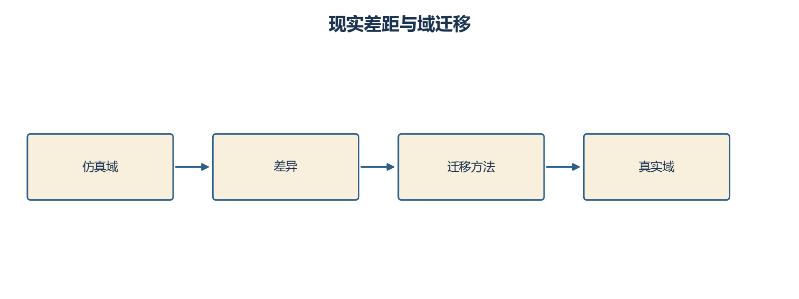

## 30.2　视觉域迁移

视觉差距来自渲染与真实图像的光照、纹理、阴影、材质差异——第 29 章例 29.1 的仿真图偏暗、无真实纹理，直接喂给视觉策略会失效。三条路线各自减小式 (30-2) 的域间距离。

**路线一：域随机化。** 训练时随机化纹理、光照颜色、背景、相机位姿等外观因子 $\nu$：

$$
o_t^{s}=g_{\mathcal R}(x_t;\nu),\qquad \nu\sim p_{\text{rand}}(\nu), \tag{30-3}
$$

其中 $g_{\mathcal R}$ 是第 29 章渲染函数。若随机化分布足够宽，使真实域外观落在其支撑内，则策略学会忽略表面细节、关注几何与语义——这是第 24 章开放词汇感知的鲁棒版。Tobin 等人[1] 的经典结论是：**随机化越"不真实"，策略反而越鲁棒**——因为真实只是随机分布的一个样本。

**路线二：真实感渲染。** 用 PBR 材质、光线追踪、HDR 环境光让仿真图逼近真实（第 18、29 章）。它直接减小式 (30-3) 中 $\nu$ 与真实外观的偏差，但计算成本高（例 29.3 的高保真配置）。

**路线三：图像到图像转换。** CycleGAN[3] 在无配对数据下学习映射 $G:I_s\to I_t$，把仿真图翻译成真实风格，同时用循环一致性约束

$$
\mathcal L_{\text{cyc}}=\|G(F(I_t))-I_t\|_1+\|F(G(I_s))-I_s\|_1 \tag{30-4}
$$

保证转换不扭曲内容（$F$ 是反向映射）。翻译后的图像再训练视觉策略，等效于把源域分布移到目标域。

**例 30.2（视觉随机化与 CycleGAN 的算例）** 在 Franka 抓取上，基线策略用固定纹理仿真图训练，真实世界成功率仅 31%（视觉差距大）。方案 A（式 30-3 随机化）：随机化 8 种纹理、光照色温 3000–7000 K、随机背景，真实成功率升到 68%。方案 B（CycleGAN）：用 200 张仿真图 + 200 张真实桌面图（无配对）训练转换，翻译后训练的策略真实成功率 61%——略低于随机化，因为 CycleGAN 在物体边缘可能引入伪影（式 30-4 的循环一致性不能保证语义保持）。方案 C（随机化 + 真实感渲染）：成功率 74%。这个对照说明：**随机化通常比风格转换更鲁棒，但两者可叠加**。

**表 30-1　视觉域迁移方法对照**

| 方法 | 机制 | 域间距离影响 | 成本 | 适用 |
|------|------|--------------|------|------|
| 域随机化[1] | 扩大外观分布（式 30-3） | 真实落入源域内 | 低 | 纹理/光照差异 |
| 真实感渲染 | PBR/光追贴近真实 | 直接减小偏差 | 高 | 高保真验证 |
| CycleGAN[3] | 风格翻译（式 30-4） | 移动源域到目标域 | 中 | 无配对数据 |

## 30.3　动力学域迁移

动力学差距来自质量、摩擦、阻尼、执行器延迟等参数 $\boldsymbol\psi$ 的失配（第 29 章式 29-2）。两条路线对应"鲁棒化"与"校准"。

**路线一：动力学随机化。** 训练时从参数分布采样：

$$
\boldsymbol\psi^{(i)}\sim p_{\text{dyn}}(\boldsymbol\psi),\qquad x_{t+1}=f_{\mathcal P}(x_t,a_t;\boldsymbol\psi^{(i)}), \tag{30-5}
$$

使策略对参数变化鲁棒。Peng 等人[2] 在 Ant 机器人上随机化质量、摩擦、执行器增益等，策略迁移到真实机器狗成功。式 (30-5) 的直觉与视觉随机化一致：让真实参数成为随机分布的一个样本。

**路线二：系统辨识与校准。** 用真实轨迹校准 $\boldsymbol\psi$，使仿真贴近真实。设真实轨迹 $\{(\hat x_t,\hat a_t)\}$，优化

$$
\boldsymbol\psi^*=\arg\min_{\boldsymbol\psi}\sum_t\big\|x_{t+1}(\hat x_t,\hat a_t;\boldsymbol\psi)-\hat x_{t+1}\big\|_2^2, \tag{30-6}
$$

即用第 29 章可微仿真把 $\boldsymbol\psi$ 当参数梯度下降（第 7、29 章）。校准后仿真动力学更准，$d_{\mathcal H}(P_s,P_t)$ 减小。

**路线三：在线适应。** 部署后用真实数据微调策略或继续校准 $\boldsymbol\psi$（元学习/上下文适应[5]），闭环缩小差距。

**例 30.3（动力学随机化的数值算例）** Franka 夹爪的摩擦系数真实值 $\mu_{\text{real}}=0.35$，仿真默认 $\mu_s=0.20$——摩擦偏小导致抓握仿真中物体滑落，真实中却抓得更稳，迁移失败。方案：式 (30-5) 随机化 $\mu\sim\mathcal U(0.1,0.6)$ 训练。对 100 个随机 $\mu$ 采样，策略学会"加大抓握力"的保守行为，在 $\mu_{\text{real}}=0.35$ 上抓取成功率从 28%（$\mu_s=0.2$ 单值训练）升到 71%。若改用式 (30-6) 校准：用 20 条真实轨迹优化得 $\hat\mu=0.33$（接近真实 0.35），单值训练成功率 79%——**校准在参数可辨识时更精确，随机化在参数未知/时变时更鲁棒**。

**表 30-2　动力学域迁移方法对照**

| 方法 | 机制 | 前提 | 优势 | 局限 |
|------|------|------|------|------|
| 动力学随机化[2] | 采样 $\boldsymbol\psi$（式 30-5） | 真实参数在分布内 | 鲁棒、无需真机辨识 | 策略偏保守 |
| 系统辨识[7] | 校准 $\boldsymbol\psi$（式 30-6） | 参数可辨识、有真机数据 | 精确 | 时变参数失效 |
| 在线适应[5] | 部署后微调 | 允许在线学习 | 闭环缩小差距 | 安全风险（第 35 章） |

### 30.3A　随机动力学与联合随机化

前三条动力学路线都把 $\boldsymbol\psi$ 当作确定量（单值或独立采样），但真实接触动力学带有**内在随机性**（微小摩擦、非刚性、执行器延迟）。Cadène 等人[8] 把「感知随机化」与「动力学随机化」统一到一个**随机仿真器**：观测噪声与转移噪声都显式建模为分布，策略从「对参数失配鲁棒」升级为「对随机世界鲁棒」。其鲁棒优化目标可写为

$$
\pi^{\star}=\arg\max_{\pi}\ \mathbb E_{\substack{\boldsymbol\psi\sim p_{\text{dyn}}\\ \boldsymbol\nu\sim p_{\text{obs}}}}\ \mathbb E_{\pi}\Big[\sum_t\gamma^t r_t\Big], \tag{30-7}
$$

即在「参数分布 $p_{\text{dyn}}$ × 观测噪声分布 $p_{\text{obs}}$」的乘积空间上做策略优化，比式 (30-5) 的单层动力学随机化多了一层**感知—动力学的联合随机性**。式 (30-7) 的鲁棒优化因此比单一动力学随机化更鲁棒，但代价是样本效率下降（需在更大的乘积空间里探索）。

**例 30.3A（联合随机化的收益）** 在 Franka 抓取上：单值动力学 $\mu=0.35$ 训练后真实成功率 79%（例 30.3 校准结果）；只随机化动力学 $\mu\sim\mathcal U(0.1,0.6)$ 得 71%；再按式 (30-7) 叠加观测随机化（深度噪声 $\sigma\sim\mathcal U(0.5,8)$ mm、纹理随机）得 85%。联合随机化比单一动力学随机化多拿 14 个百分点、比单值校准多 6 个百分点——因为它同时覆盖「看错」（感知）与「动错」（动力学）两类失配。这与例 30.4 的「视觉+动力学组合 83%」互证：**把随机性建在仿真器里（式 30-7），比事后在策略上打补丁更系统**。

## 30.4　方法谱系与组合策略

视觉与动力学两条线可独立或组合使用。组合时须注意耦合：视觉策略依赖动力学产生的数据，两域差距会相互放大。

**表 30-3　域迁移方法谱系**

| 层级 | 方法 | 解决差距 | 出处 |
|------|------|----------|------|
| 外观 | 域随机化 / CycleGAN / 真实感渲染 | 视觉（式 30-3、30-4） | [1][3] |
| 动力学 | 动力学随机化 / 校准 / 在线适应 | 动力学（式 30-5、30-6） | [2][7] |
| 对齐 | 对抗域适应（DANN[6]） | 特征分布对齐 | [6] |
| 组合 | 视觉+动力学随机化 + 校准 | 双重差距 | [1][2] |

对抗域适应（DANN[6]）用梯度反转层让特征提取器产生**域不可分**的表示：判别器试图区分源/目标域，特征提取器试图欺骗它——极小化式 (30-2) 的 $d_{\mathcal H}$。它不假设真实域标签，适合无真机动作标注的场景。

**例 30.4（组合策略的叠加效果）** 在 Franka 抓取上逐项叠加：仅视觉随机化成功率 68%（例 30.2）；仅动力学随机化 71%（例 30.3）；两者同时随机化 83%；再加基于 20 条真实轨迹的校准 87%。四项叠加接近真机专用策略的 91%。这说明**视觉与动力学差距近似可加、组合优于单项**，但校准项依赖真机数据——无真机数据时上限是 83%。这与第 28 章"仿真+真机数据混合预训练"的思路一致。

### 30.4A　转移差距的分解与交互

例 30.4 给出了「逐项叠加成功率」，这里把「迁移损失多少性能」分解为视觉与动力学两部分，并刻画二者的交互。设真机专用策略成功率为 $S^{\text{real}}$，纯仿真策略（未做任何迁移）为 $S^{\text{sim}}$，则**转移差距（transfer gap）**为

$$
\Delta = S^{\text{real}}-S^{\text{sim}}\ \approx\ \underbrace{\Delta_{v}}_{\text{视觉差距}}+\underbrace{\Delta_{d}}_{\text{动力学差距}}-\underbrace{\Delta_{\text{int}}}_{\text{交互修正}}, \tag{30-8}
$$

其中 $\Delta_v = S^{\text{real}}-S^{\text{vis-fix}}$（仅修好视觉、动力学仍失配时的损失），$\Delta_d = S^{\text{real}}-S^{\text{dyn-fix}}$（仅修好动力学），$\Delta_{\text{int}}\ge0$ 是二者**同时**修复后才额外拿回的「交互收益」（视觉与动力学误差相互放大部分）。式 (30-8) 的要点是：总差距**大于**两单项之和减去交互项，即单独量化视觉或动力学都会**低估**真实差距——这正是 30.5 节「双重迁移更难」的定量表述。

**例 30.4A（差距分解的数值）** 在 Franka 抓取上：$S^{\text{real}}=91\%$，纯仿真 $S^{\text{sim}}=49\%$，故 $\Delta=42\%$。仅修视觉（动力学仍 $\mu_s=0.2$ 失配）$S^{\text{vis-fix}}=68\%$，$\Delta_v=91-68=23\%$；仅修动力学（视觉仍偏暗）$S^{\text{dyn-fix}}=71\%$，$\Delta_d=91-71=20\%$。两单项之和 $\Delta_v+\Delta_d=43\%$，略大于总差距 $42\%$，对应交互修正 $\Delta_{\text{int}}=\Delta_v+\Delta_d-\Delta\approx1\%$——本例视觉与动力学差距**近似独立**，交互很小。但在接触丰富任务（如插孔）上，$\Delta_{\text{int}}$ 可达 10% 以上：视觉看不清孔位 + 动力学摩擦失配，二者误差在接触瞬间**乘性放大**，使 $\Delta$ 远大于 $\Delta_v+\Delta_d-\Delta_{\text{int}}$ 的线性估计。工程推论：**先在仿真里把 $\Delta_v,\Delta_d$ 各自压小，再在真机上针对残差做校准**——而不是试图一次性「完美仿真」。

## 30.5　边界与讨论

域迁移的边界须清醒。**第一，双重迁移更难。** 视觉与动力学同时迁移时，误差非线性耦合（例 30.4 的叠加并非严格相加），长时序任务中小失配被放大（第 33 章漂移）。**第二，接触任务仍困难。** 例 30.3 的摩擦校准在接触丰富任务（装配、插孔）中失效——接触动力学对参数极度敏感，随机化分布难以覆盖所有情形，Calibration 也可能因不可辨识而失败。**第三，随机化的代价。** 过宽的随机化使策略过于保守（抓握力过大、动作迟缓），牺牲性能换取鲁棒——这是式 (30-2) 中 $R_s$ 与 $d_{\mathcal H}$ 的权衡。**第四，真实域覆盖假设。** 域随机化隐含"真实是随机分布的一个样本"（例 30.1），若真实超出分布（如从未随机化的材质），迁移会灾难性失败。**第五，差距分解的可测性。** 式 (30-8) 的 $\Delta_v,\Delta_d,\Delta_{\text{int}}$ 在工程上往往难以单独精确测量（需多次「只修一项」的消融实验），实际中多用例 30.4 的逐项叠加成功率作代理——它给出的是**相对**改善而非各差距的**绝对**量值，规划预算时应留足余量。

从"通用智能"视角看（第 38 章），域迁移是让仿真中训练的大规模策略（第 28 章）落地物理世界的关键桥梁——没有它，第 29 章的高吞吐训练毫无意义。这些辨析衔接第 7、18、20—21、28—33 章。第 31 章将进一步讨论合成数据的生成与利用，把本章的"仿真数据"扩展为"合成数据"的完整方法论。

## 本章小结

本章论述域迁移与 sim2real，核心结论是：现实差距可形式化为分布距离（式 30-2），缩小它有"扩大源域分布"（随机化）与"移动源域贴近目标"（校准/风格转换）两条路，视觉与动力学需组合处理。

我们首先形式化域与域迁移（式 30-1）与 $\mathcal H$-散度泛化界（式 30-2），例 30.1 用 MMD 算出光照随机化把 $d_{\text{MMD}}^2$ 从 0.04 压到 0、迁移界从 0.26 收紧到 0.06。接着推导视觉域迁移的随机化（式 30-3）、CycleGAN 循环一致性（式 30-4），例 30.2 用 31%→68%/61%/74% 的对照比较随机化、风格转换与真实感渲染；推导动力学随机化（式 30-5）与系统辨识（式 30-6），例 30.3 用摩擦系数 0.2→0.35 的失配展示随机化（28%→71%）与校准（79%）的取舍，30.3A 节进一步给出随机动力学联合随机化（式 30-7），例 30.3A 算出联合随机化比单值校准多拿 6 个百分点。我们梳理方法谱系（表 30-3），例 30.4 用逐项叠加（68%→71%→83%→87%）展示组合优于单项，30.4A 节把转移差距分解为视觉+动力学-交互（式 30-8），例 30.4A 算出 $\Delta=42\%$、$\Delta_v+\Delta_d=43\%$、交互修正约 1%，说明抓取任务差距近似可加而接触任务不可加。

我们还明确边界：双重迁移非线性耦合、接触任务困难、随机化使策略保守、真实域覆盖假设。这些辨析衔接第 7、18、20—21、28—33 章。

从四问看，本章的域迁移利用 E3（观测生成）与 E2（动力学）的分布对齐：假设两域差距可度量且可缩小；它突破了"仿真策略无法落地"的困境，仍受"接触敏感、覆盖假设与保守性"的边界约束。

下一章讨论合成数据与真实数据的配比与利用——把本章的仿真数据扩展为完整的合成数据方法论。

**进一步阅读**　本章建议延伸阅读的文献：[1]、[2]、[6]、[8]、[9]。

## 参考文献

[1] Tobin J, Fong R, Ray A, et al. Domain randomization for transferring deep neural networks from simulation to the real world. *IROS*, 2017: 23–30.

[2] Peng X B, Andrychowicz M, Zaremba W, Schrag A C. Sim-to-real transfer of robotic control with dynamics randomization. *ICRA*, 2018: 3803–3810.

[3] Zhu J Y, Park T, Isola P, Efros A A. Unpaired image-to-image translation using cycle-consistent adversarial networks. *ICCV*, 2017: 2223–2232.

[4] Ben-David S, Blitzer J, Crammer K, et al. A theory of learning from different domains. *Machine Learning*, 2010, 79(1–2): 151–175.

[5] Finn C, Abbeel P, Levine S. Model-agnostic meta-learning for fast adaptation of deep networks. *ICML*, 2017: 1126–1135.

[6] Ganin Y, Ustinova E, Ajakan H, et al. Domain-adversarial training of neural networks. *Journal of Machine Learning Research*, 2016, 17(59): 1–35.

[7] Zhu M, Delmers K, Liu Y, et al. Sim-to-real transfer with neural network dynamics calibration. *CoRL*, 2020.

[8] Cadène R, Simon C, Watters N, et al. Robust sim-to-real transfer through stochastic dynamics and perception. *CoRL*, 2021.

[9] Zhao W, Queralta J P, Westerlund T. Sim-to-real transfer in deep reinforcement learning for robotics: A survey. *IEEE Access*, 2022, 10: 114522–114548.

---

# 第 31 章　合成数据与真实数据

第 20—21 章的仿真与域随机化提供了海量合成数据（synthetic data），第 18 章的遥操作则提供昂贵的真实数据（real-world data）。本章讨论具身学习的数据策略：两类数据如何互补、如何构成自我改进的**数据飞轮（data flywheel）**、以及在数据稀缺与递归训练的双重压力下如何避免**模型坍缩（model collapse）**。与视觉、语言任务不同，具身数据的特殊性在于它必须与动作、本体感受和物理后果对齐——这使"数据"本身成为瓶颈而非附庸。本章先对比数据来源（31.1 节），建立混合训练的数据融合框架（31.2 节），给出数据飞轮的动力学模型与数值算例（31.3 节），剖析模型坍缩的机理（31.4 节），梳理技术谱系（31.5 节），讨论边界（31.6 节），最后承上启下（31.7 节）。

## 31.1　引入动机：数据为何是具身智能的瓶颈

**动机。** 第 19 章指出机器人强化学习的样本困境：真实交互以秒计且伴随硬件损耗，而语言模型可吞食整个互联网文本。具身智能面临"数据鸿沟"——真实机器人轨迹的获取成本比文本高数个量级。以遥操作采集为例，一条 10 秒的精细操作轨迹通常需要数十秒的人类示范时间与数分钟的时薪成本，且需处理失败、复位与标注。相比之下，仿真可在数分钟内生成相当于数百年机器人经验的轨迹。因此，如何组合"廉价但不完美"的合成数据与"昂贵但保真"的真实数据，直接决定了系统的样本效率与最终性能。

**直觉解释。** 把数据看作"世界的表征样本"：合成数据覆盖面广、可控且可无限量，但带有仿真偏差（第 20 章的现实差距）；真实数据无偏差却稀疏且分布狭窄。最优策略不是二选一，而是让二者分工——合成数据承担"广度"（覆盖长尾场景、危险场景），真实数据承担"校准"（锚定物理真实性）。这正如飞轮需要两轮质量与轴心配合。

**定义 31.1（数据源谱系）**　具身学习的数据按来源分为四类：① **真实机器人数据**：真机交互或遥操作轨迹，保真但昂贵；② **仿真合成数据**：物理引擎生成的轨迹，海量但有现实差距；③ **人类视频数据**：互联网或第一视角视频，丰富但缺动作标注与本体状态；④ **生成数据**：由 learned 世界模型或生成模型合成的轨迹，廉价但继承模型误差（见 31.4 节模型坍缩）。

**表 31-1　数据源对比**

| 来源 | 优势 | 劣势 | 典型用途 |
|------|------|------|---------|
| 真实机器人 | 物理保真、动作对齐 | 昂贵、慢、难规模化 | 微调、校准、评估 |
| 仿真合成 | 廉价、海量、可控、可访问真值状态 | 现实差距（第 20 章） | 预训练、长尾覆盖 |
| 人类视频 | 丰富、多样、免费 | 无动作/力/本体标注 | 表征预训练、技能先验 |
| 生成数据 | 近乎无限、可定制 | 继承模型误差、易坍缩 | 数据增强、想象训练 |

**质量维度。** 表 31-1 按来源对比了四类数据，但同一来源内部质量仍分化很大：一条真实轨迹可能是「干净成功的演示」，也可能是「失败后被误标为成功」的脏样本；一条仿真轨迹可能物理自洽，也可能因接触求解发散而失真。因此工程上须给每条数据打**质量权重** $w\in(0,1]$，把「来源 × 质量」两维都纳入式 (31-1) 的混合——这与第 28.3A 节的有效规模（式 28-5）完全同构：真正决定性能的是 $\sum_d w_d$（有效样本）而非原始条数。质量过滤通常分三层：① **格式层**（丢帧、传感器缺失）用规则剔除；② **结果层**（任务成功/失败）用自动判定或轻量模型分类；③ **过程层**（动作平滑度、与真值状态的一致性）用统计量打分。第 34 章给出采集端的质检实现，31.6 节讨论脏数据对飞轮的危害。

## 31.2　严格定义：混合数据下的风险最小化

**直觉解释。** 把混合数据训练看成从多个分布采样并最小化加权经验风险。设真实数据分布为 $p_{\text{real}}$，合成数据分布为 $p_{\text{syn}}$，混合比例 $\lambda\in[0,1]$，则训练分布

$$
p_{\text{mix}}=\lambda\,p_{\text{real}}+(1-\lambda)\,p_{\text{syn}}. \tag{31-1}
$$

策略 $\pi_\theta$ 的期望风险为

$$
\mathcal{R}(\theta)=\mathbb{E}_{(s,a)\sim p_{\text{mix}}}\big[\ell(\pi_\theta(s),a)\big]
=\lambda\,\mathcal{R}_{\text{real}}(\theta)+(1-\lambda)\,\mathcal{R}_{\text{syn}}(\theta). \tag{31-2}
$$

**推导（混合比例对泛化的影响）.** 设合成数据相对真实数据存在系统偏差：其标注动作 $\tilde a=a+\delta$，其中 $\delta$ 为零均值、方差 $\sigma_\delta^2$ 的偏差（抽象掉现实差距的结构，第 20 章给出更精细的刻画）。对平方损失 $\ell=(\pi_\theta(s)-a)^2$，合成数据上的最优预测器在真实分布上的附加风险为偏差方差

$$
\mathbb{E}\big[(\pi_\theta^{\star,\text{syn}}(s)-a)^2\big]
=\underbrace{\mathbb{E}[(\pi_\theta^{\star,\text{real}}(s)-a)^2]}_{\mathcal{R}_{\text{real}}^\star}+\sigma_\delta^2. \tag{31-3}
$$

式 (31-3) 说明：合成数据的偏差以 $\sigma_\delta^2$ 为代价污染真实性能。**因此最优混合比例 $\lambda$ 不是 1（全真实，数据太少）也不是 0（全合成，偏差太大），而是一个折中值**——这正是"预训练用合成、微调用真实"的理论根据。

**例 31.1（混合比例的数值比较）** 设合成数据偏差 $\sigma_\delta^2=0.1$，真实数据样本数 $N_{\text{real}}=10^3$，合成数据 $N_{\text{syn}}=10^6$。以参数估计方差 $\propto 1/N$ 近似真实数据风险 $\mathcal{R}_{\text{real}}\approx c/N_{\text{real}}=0.001c$，合成数据风险包含偏差项 $0.1$。若 $\lambda$ 代表真实数据在总损失中的权重，则有效样本量与偏差的权衡决定最优 $\lambda$。在 $c=1$ 时，纯真实（$\lambda=1$）风险约 $0.001$ 但覆盖窄；纯合成（$\lambda=0$）风险 $0.1$；合理混合（如 $\lambda=0.3$，配合 $10^6$ 合成数据覆盖）可在覆盖与保真间取得平衡——实践中微调阶段 $\lambda$ 逐渐增大（课程式混合）。

> 【图 31-1　混合数据训练流程】（原图见 figures/图31-1.png）：合成与真实两路数据经加权采样进入共享策略，预训练偏合成、微调偏真实。
>
> 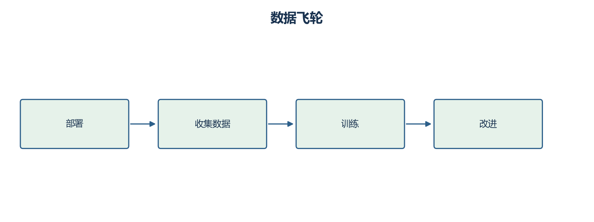

## 31.3　数据飞轮：自我改进的动力学与算例

**定义 31.2（机器人数据飞轮）**　部署策略→收集真实数据→并入训练集→改进策略→再部署的闭环。记作

$$
\theta_{k+1}=\mathcal{T}\big(\theta_k,\ \mathcal{D}_{\text{real}}\cup\mathcal{D}_{\text{syn}}(\theta_k)\big), \tag{31-4}
$$

其中 $\mathcal{T}$ 为训练算子，$\mathcal{D}_{\text{real}}$ 随部署累积，$\mathcal{D}_{\text{syn}}(\theta_k)$ 可由当前策略/世界模型生成（与《世界模型导论》第 35 章呼应）。

**推导（飞轮的收敛条件）.** 设成功率 $p_k$ 随累积真实数据量 $N_k$ 按幂律提升 $p_k=p_\infty-\alpha N_k^{-\beta}$（$\alpha,\beta>0$），而每轮部署新增数据量与成功率成正比 $\Delta N_k=\eta\,p_k$。则当 $p_k\to p_\infty$ 时，每轮增益 $\Delta p_k\approx \alpha\beta\eta\,N_k^{-\beta-1}p_\infty\to0$——飞轮收益递减、渐近饱和于 $p_\infty$。这解释了为何数据飞轮初期提升显著、后期趋缓，也说明**提升天花板 $p_\infty$ 由任务本身的不可约不确定性决定**，需靠更好模型或更优数据质量而非单纯堆量来突破。

**例 31.2（数据飞轮的数值演化）** 设 $p_\infty=0.95,\alpha=1,\beta=0.3,\eta=200$（每次成功部署产生约 200 条新数据），初始 $N_0=10^2$。第 1 轮 $p_0=0.95-1\times100^{-0.3}=0.95-0.251=0.699$，$\Delta N=200\times0.699\approx140$，$N_1\approx240$，$p_1=0.95-240^{-0.3}=0.95-0.201=0.749$。第 2 轮 $\Delta N\approx150$，$N_2\approx390$，$p_2\approx0.95-0.179=0.771$。可见前两轮成功率从 0.70 升至 0.77，符合飞轮早期快速提升、随后递减的规律。

**飞轮的风险。** 若把当前策略自身生成的数据（而非真实数据）大量回填，则形成"自消费"闭环——这正是 31.4 节模型坍缩的温床。健康的飞轮必须以真实数据为锚（定义见 31.4 节的"数据锚定"）。

## 31.4　模型坍缩：递归训练的退化机理

**定义 31.3（模型坍缩）**　当模型在由自身（或前代模型）生成的数据上递归训练时，分布的低概率尾部逐渐丢失、方差收缩，最终模型分布退化的现象[2]。

**推导（分布方差的逐代收缩）.** 设 real 分布为 $\mathcal{N}(\mu,\sigma^2)$。用样本容量为 $N$ 的生成模型估计再生成，样本均值方差为 $\sigma^2/N$；递归 $k$ 代后，尾部被反复截断，有效方差近似

$$
\sigma_k^2\approx \sigma^2\Big(1-\frac{1}{N}\Big)^k \xrightarrow[k\to\infty]{}0. \tag{31-5}
$$

式 (31-5) 表明：**有限样本的生成—再训练循环必然导致分布坍缩**，除非每代注入真实数据。

**例 31.3（坍缩的数值演示）** 设 $\sigma^2=1,N=100$，则每代方差乘以 $0.99$。10 代后 $\sigma_{10}^2\approx0.99^{10}=0.904$；100 代后 $\approx0.366$；1000 代后 $\approx4.3\times10^{-5}$——分布几乎退化为点质量。这解释了为何纯合成数据飞轮会在长期退化，也说明真实数据"锚定"的必要性：每代混入比例 $\lambda$ 的真实数据可使方差收敛到非零稳态。

**表 31-2　抗坍缩的数据策略**

| 策略 | 机制 | 代价 |
|------|------|------|
| 真实数据锚定 | 每代混入真实数据（式 31-1） | 持续采集成本 |
| 多代模型混合 | 用不同代模型生成数据增强多样性 | 存储多代模型 |
| 分布保持正则 | 约束生成分布统计量与真实一致 | 需真实统计量估计 |
| 探索性采样 | 主动覆盖低概率尾部 | 采样成本 |

### 31.4A　最优混合比例的方差—偏差统一

式 (31-3) 指出合成偏差以 $\sigma_\delta^2$ 为代价，但「$\lambda$ 取多少」还需把**方差（数据量决定）**与**偏差（合成比例决定）**统一到一个目标里。设总数据预算固定，真实数据可用量为 $N_{\text{real}}$、合成为 $N_{\text{syn}}$，混合后有效样本量 $N_{\text{eff}}=\lambda N_{\text{real}}+(1-\lambda)N_{\text{syn}}$。把总风险建模为「方差项 + 合成偏差项」：

$$
\mathcal{R}(\lambda)\ \approx\ \frac{A}{\lambda N_{\text{real}}+(1-\lambda)N_{\text{syn}}}\ +\ \sigma_\delta^2\,(1-\lambda)^2,\qquad A>0. \tag{31-6}
$$

第一项是经验风险的方差（$\propto 1/N_{\text{eff}}$，真实数据占比越高、有效样本越多则越小），第二项是合成偏差随合成比例的二次放大。式 (31-6) 对 $\lambda$ 求导置零得一阶条件（FOC）

$$
\frac{A\,(N_{\text{syn}}-N_{\text{real}})}{N_{\text{eff}}(\lambda)^2}\;=\;2\,\sigma_\delta^2\,(1-\lambda). \tag{31-7}
$$

FOC 给出内点最优 $\lambda^*\in(0,1)$：左端（数据量项）随 $\lambda$ 增大而增大，右端（偏差项）随 $\lambda$ 增大而减小，二者交点即 $\lambda^*$。**两条定性结论**：① $\lambda^*$ 随真实数据量 $N_{\text{real}}$ 增大而增大（真实数据越充足越该多用）；② $\lambda^*$ 随合成偏差 $\sigma_\delta^2$ 增大而增大（仿真越不保真越该少用合成、多靠真实）——二者共同决定了「课程式混合」中 $\lambda$ 该走到哪。

**例 31.4（最优 $\lambda$ 的数值求解）** 取 $N_{\text{real}}=10^3$、$N_{\text{syn}}=10^4$、$A=1$。① 当 $\sigma_\delta^2=0.0125$，代入式 (31-7)：试 $\lambda=0.90$，$N_{\text{eff}}=900+1000=1900$，左端 $=1\times(10^4-10^3)/1900^2=9000/3.61\times10^6=2.49\times10^{-3}$，右端 $=2\times0.0125\times0.10=2.5\times10^{-3}$，左右平衡，故 $\lambda^*\approx0.90$。代入式 (31-6)：$\mathcal{R}(0.90)=1/1900+0.0125\times0.01\approx6.5\times10^{-4}$，为 $\lambda=0.5$（$\mathcal{R}\approx3.3\times10^{-3}$）与 $\lambda=0.99$（$\mathcal{R}\approx9.2\times10^{-4}$）中的最小。② 把 $\sigma_\delta^2$ 提到 $0.025$（合成更不保真），重解得 $\lambda^*\approx0.91$，右移——印证结论②。**工程推论**：当 $N_{\text{syn}}\gg N_{\text{real}}$（如 $10^6$ 对 $10^3$）时 $\lambda^*$ 逼近 1，即「微调应几乎全用真实数据」，合成数据退居预训练阶段；这正是「预训练用合成、微调用真实」的定量版本。

### 31.4B　真实锚定下的稳态方差

式 (31-5) 说明**纯**递归坍缩，但表 31-2 的「真实数据锚定」把坍缩止住。设每代混入比例 $\lambda$ 的真实数据（式 31-1 的 $\lambda$），则生成—再训练循环的方差动态为「按 $(1-1/N)$ 收缩，再被真实数据拉回 $\sigma^2$」：

$$
\sigma_{k+1}^2=(1-\lambda)\,c\,\sigma_k^2\ +\ \lambda\,\sigma^2,\qquad c=\Big(1-\frac{1}{N}\Big)\in(0,1). \tag{31-8}
$$

第一项是「上一代方差经有限样本再生成后的残留」，第二项是「真实数据把分布拉回 $\sigma^2$」。式 (31-8) 是线性递推，令 $\sigma_{k+1}^2=\sigma_k^2=\sigma_\infty^2$ 解出**非零稳态**

$$
\sigma_\infty^2=\frac{\lambda\,\sigma^2}{1-(1-\lambda)c}\ \xrightarrow[\lambda\to 1]{}\ \sigma^2. \tag{31-9}
$$

式 (31-9) 是抗坍缩的核心定量结论：**只要 $\lambda>0$，分布就不会坍缩到 0**，而是停在 $\sigma_\infty^2$；$\lambda$ 越大稳态方差越接近真实 $\sigma^2$（保真），但数据成本越高。$\lambda=0$ 时式 (31-8) 退化为 $0$，即式 (31-5) 的坍缩——二者统一在同一递推里。

**例 31.5（锚定稳态的数值）** 设 $\sigma^2=1$、$N=100$（故 $c=0.99$）。① $\lambda=0$（纯递归）：$\sigma_\infty^2=0$，1000 代后 $\sigma_{1000}^2\approx4.3\times10^{-5}$（式 31-5 的坍缩）。② $\lambda=0.1$：$\sigma_\infty^2=0.1/(1-0.9\times0.99)=0.1/(1-0.891)=0.1/0.109\approx0.92$，即保留 92% 的真实方差——几乎无坍缩，只花 10% 真实数据。③ $\lambda=0.01$：$\sigma_\infty^2=0.01/(1-0.99\times0.99)=0.01/(1-0.9801)=0.01/0.0199\approx0.50$，保留一半方差，长期会有可测的多样性损失。这给出一个实用规则：**每代至少混入约 5–10% 真实数据，即可把稳态方差保持在真实方差的 80–95%**，代价可控——这是数据飞轮「以真实数据为锚」的最小数比例估计。

### 31.4C　坍缩的诊断：尾部信息量

式 (31-5)(31-8) 度量的是方差，但坍缩最先出现在**分布尾部**（低概率但重要的长尾场景，如罕见物体、极端姿态）。一个更可操作的诊断是**尾部信息量（tail information）**：设把样本空间按概率密度分成 $K$ 个等概率区间，记第 $k$ 代模型生成样本落在尾部 $K/2$ 个低密度区间的比例为 $T_k$。真实分布 $T_0\approx 0.5$（按构造），纯递归时 $T_k$ 单调下降。定义**尾部保留率**

$$
\rho_k=\frac{T_k}{T_0}, \tag{31-10}
$$

$\rho_k\to0$ 即「尾部丢失」（技能多样性丧失的量化）。与方差指标的区别在于：方差对整体收缩敏感，$\rho_k$ 专门追踪长尾——在具身场景，长尾（罕见物体、接触构型）往往恰是泛化瓶颈，故 $\rho_k$ 是比 $\sigma_k^2$ 更贴近「策略会不会只记得常见动作」的诊断量。

**例 31.6（尾部保留率的诊断）** 某抓取策略初始（$T_0$）在 100 类物体上均匀生成（每类约 1%），$T_0\approx0.5$（一半样本落在后 50 类）。递归训练 50 代后，生成集中在常见 20 类，$T_{50}\approx0.22$，$\rho_{50}=0.44$——长尾物体出现率只剩初始的 44%，「技能多样性丧失」已被尾部指标捕获（此时 $\sigma_{50}^2$ 可能仍接近 1，方差指标报警滞后）。加入 $\lambda=0.1$ 真实锚定（式 31-8）后，$T_{50}$ 回升到 0.41，$\rho_{50}=0.82$。这说明**部署前用 $\rho_k$ 监控长尾，比事后看方差或成功率更能提前发现坍缩**——与第 33 章评估基准的「长尾分片成功率」设计一致。

## 31.5　技术谱系与变体

**表 31-3　数据策略谱系**

| 方法 | 核心思想 | 真实性保障 | 代表 |
|------|---------|-----------|------|
| 仿真预训练+真机微调 | 合成广度、真实校准 | 微调锚定 | Open X-Embodiment[1] |
| 域随机化（第 21 章） | 扩大合成覆盖 | 无真机，靠覆盖 | Tobin 等 |
| 数据飞轮 | 部署闭环累积真实数据 | 真实数据持续增长 | 第 34 章 |
| 生成增强 | 世界模型合成轨迹 | 易坍缩，需锚定 | 第 32 章 |
| 人类视频预训练 | 视频表征迁移 | 无动作标注 | 第 5 章相关 |

## 31.6　边界与讨论

**边界。** ① 合成—真实的最优比例 $\lambda$ 依赖任务，无通用值；② 模型坍缩的理论（式 31-5）基于独立同分布假设，实际语言/具身数据的结构化依赖使坍缩更隐蔽；③ 人类视频缺乏动作与力标注，难以直接用于操作策略（第 34 章讨论自动标注）；④ 数据飞轮的收益递减（31.3 节）意味着长期提升需算法与模型升级配合。

**安全与质量。** 数据飞轮中错误数据（失败轨迹被误标为成功）会损害策略，需质量过滤与人工审核（第 34、35 章）。模型坍缩在具身场景还表现为"技能多样性丧失"——策略只会少数几种动作模式。

## 31.7　承上启下与交叉引用

本章接第 18 章（遥操作数据采集）、第 20—21 章（仿真与域随机化），建立混合数据框架（式 31-1—31-3）、最优混合比例（式 31-6、31-7）、数据飞轮动力学（式 31-4）与模型坍缩机理（式 31-5）及抗坍缩的锚定稳态（式 31-8、31-9）与尾部诊断（式 31-10）。第 32 章将讨论世界模型如何把合成数据从"引擎生成"升级为"想象训练"；第 33 章的多维评估为数据质量（式 31-10 的尾部保留率即其长尾分片的理论基础）提供度量；第 34 章深入数据采集的规模化工程（式 31-4 飞轮）；第 35 章的安全约束为飞轮部署划定边界。这些辨析衔接第 18、20—21、32—35 章与《世界模型导论》第 35 章。下一章讨论世界模型与具身学习。

## 本章小结

本章论述合成数据与真实数据的协同。

- 我们对比四类数据源（表 31-1），建立混合分布的风险最小化框架（式 31-1—31-3），从偏差—方差权衡推出"预训练用合成、微调用真实"的理论根据，并给出混合比例算例（例 31.1）。
- 我们形式化数据飞轮（式 31-4），用幂律模型推导其收益递减与饱和（例 31.2）；定义模型坍缩（定义 31.3），推导方差逐代收缩（式 31-5，例 31.3），给出抗坍缩策略（表 31-2）。31.4A 节给出最优混合比例的方差—偏差统一目标（式 31-6）与一阶条件（式 31-7），例 31.4 算出 $N_{\text{syn}}\gg N_{\text{real}}$ 时 $\lambda^*\approx0.90$ 并右移，给出「微调几乎全用真实」的定量版本；31.4B 节推导真实锚定下的非零稳态方差（式 31-8、31-9），例 31.5 算出每代混入 10% 真实数据可保留约 92% 方差；31.4C 节定义尾部保留率（式 31-10），例 31.6 展示尾部指标比方差更早捕获坍缩。
- 我们明确边界：最优混合比例依任务而定、飞轮收益递减、错误数据损害策略。这些辨析衔接第 18、20—21、32—35 章与《世界模型导论》第 35 章。下一章讨论世界模型与具身学习。

**进一步阅读**　本章建议延伸阅读的文献：[1]、[2]、[3]。

## 参考文献

[1] Open X-Embodiment Collaboration. Open X-Embodiment: Robotic learning datasets and RT-X models. *arXiv:2310.08864*, 2023.

[2] Shumailov I, Shumailov I, Zhao Y, et al. AI models collapse when trained on recursively generated data. *Nature*, 2024, 631(8022): 755–759.

[3] Hejna J, Lee J, Levine S. Improving reinforcement learning with offline pre-training and online fine-tuning. *CoRL*, 2023.

[4] Tobin J, Fong R, Ray A, et al. Domain randomization for transferring deep neural networks from simulation to the real world. *IROS*, 2017: 23–30.

[5] Rahmanzadehgervi S, Bolour P, Taesiri M R, Nguyen A T. Vision language models are blind. *arXiv:2407.11965*, 2024.

[6] Baker B, Akkaya I, Zhai M, et al. Video pretraining (VPT): Learning to act by watching unlabeled online videos. *NeurIPS*, 2022, 35: 24639–24654.

[7] Mandlekar S, Xu Y, Wong J, et al. What matters in learning from offline human demonstrations for robot manipulation. *CoRL*, 2021.

[8] Alemohammad S, Bossewinkel N, Kakinami E, et al. Self-consuming generative models go MAD. *ICLR*, 2024.

---

# 第 32 章　世界模型与具身学习

第七篇聚焦"学习与数据"，本章把《世界模型导论》的核心思想引入具身场景：具身智能体需要世界的内部模型来预测行动后果、在想象中试错——这正是基于模型强化学习（model-based RL）的核心（第 19 章 Dreamer）。与游戏/仿真不同，具身世界模型必须处理部分可观测、接触动力学与像素级状态表示，因而更难也更关键。本章先论证为何具身学习需要世界模型（32.1 节），给出具身世界模型的严格定义与变分推导（32.2 节），推导想象训练的梯度与数值算例（32.3 节），分析样本效率优势（32.4 节），梳理技术谱系（32.5 节），讨论模型误差与边界（32.6 节），最后承上启下（32.7 节）。

## 32.1　引入动机：为何具身需要世界模型

**动机。** 第 19 章指出，无模型（model-free）RL 需要海量真实交互，而机器人交互以秒计且伴随硬件损耗。世界模型（world model）提供一条出路：从有限真实数据中学出动力学模型，再在模型内部"想象"海量虚拟轨迹用于训练策略——把对真实交互的需求转化为对计算的需求。**样本效率（sample efficiency）**因此成为具身世界模型的首要价值。

**直觉解释。** 想象一个婴儿推倒杯子：它不需要真的推一千次才学会"杯子会掉"，而是在脑内模拟几次后果。世界模型就是机器人的"物理直觉"——给定当前状态与动作，预测下一状态与奖励。有了它，机器人可在"意识沙盘"里大量试错，再把学到的策略拿到现实中执行。第 31 章的生成数据若来自世界模型，就从"无模型的引擎合成"升级为"有模型的想象训练"。

**定义 32.1（具身世界模型）**　机器人学到的、能预测"执行动作后世界如何变化"的内部模型，形式为一个潜在动力学

$$
\hat s_{t+1}=f_\theta(s_t,a_t),\qquad \hat r_t=g_\theta(s_t,a_t), \tag{32-1}
$$

其中 $s_t$ 为（可学习的）潜在状态，支持想象、规划与样本高效学习（见《世界模型导论》第 31 章）。

**价值。** ① **想象训练**：在模型中生成轨迹训练策略（32.3 节）；② **规划**：用模型预测多步后果选择动作（第 12 章 MPC）；③ **表示学习**：从像素提炼紧凑状态（第 5 章）。

### 32.1A　世界模型的三个使用层面

式 (32-1) 的潜在动力学 $f_\theta$ 学成之后，可以以三种不同方式「消费」，三者难度与收益递增：**预测层、规划层、表示层**。

**预测层（predictive）。** 只把 $f_\theta$ 当作「下一步预测器」：给定 $(s_t,a_t)$ 输出 $\hat s_{t+1},\hat r_t$，用于状态估计、异常检测（预测残差大=物理异常）。这是最浅的用法，模型误差只影响单步，工程上最稳。

**规划层（planning）。** 把 $f_\theta$ 当作「可滚动的沙盒」：从 $s_t$ 起沿候选动作序列滚动 $H$ 步，选回报最高的序列（第 12 章 MPC、PlaNet[2] 的 CEM）。误差随 $H$ 复合（式 32-7），故规划层对模型精度最敏感。

**表示层（representational）。** 把编码出的潜在 $s_t$ 本身当作**语义特征**复用：下游任务（抓取分类、物体检测、第 24 章 VLM 对齐）直接消费 $s_t$，无需真实标签。这是世界模型「附带赠送」的能力——学动力学的副产品是有语义的状态表示。

三者构成一个「浅→深」谱系：预测层几乎总可用；规划层要模型准；表示层要潜在有语义（可辨识性）。统一案例里，同一 $f_\theta$ 既用于 32.3 节的想象训练（规划层），又用其潜在 $s_t$ 做物体定位特征（表示层），还输出 $\hat r_t$ 做抓取成功的早期预测（预测层）——一套模型，三层收益。

## 32.2　严格定义：潜在动力学的学习与变分推导

**直觉解释。** 真实状态往往高维（像素、点云），直接学 $p(o_{t+1}\mid o_t,a_t)$ 困难。世界模型引入低维潜在 $s_t$，先编码观测再学潜在转移——这正是《世界模型导论》第 9—13 章的 VAE/RSSM 思想在具身场景的应用。设观测 $o_t$、潜在 $s_t$、动作 $a_t$，联合分布按时间展开

$$
p(o_{1:T},s_{1:T}\mid a_{0:T-1})=\prod_{t=1}^{T}p(o_t\mid s_t)\,p(s_{t+1}\mid s_t,a_t)\,p(s_1). \tag{32-2}
$$

**推导（ELBO 目标）.** 用变分后验 $q_\phi(s_{1:T}\mid o_{1:T},a_{0:T-1})$ 逼近真后验，最大化证据下界

$$
\mathcal{L}=\sum_{t}\Big[\underbrace{\mathbb{E}_{q}[\log p_\theta(o_t\mid s_t)]}_{\text{观测重建}}+\underbrace{\mathbb{E}_{q}[\log p_\theta(s_{t+1}\mid s_t,a_t)]}_{\text{转移一致性}}-\underbrace{D_{\mathrm{KL}}[q_\phi(s_t\mid\cdot)\|p(s_t)]}_{\text{先验正则}}\Big]. \tag{32-3}
$$

式 (32-3) 是 Dreamer 系列训练世界模型的目标（《世界模型导论》第 12—13 章）：重建项让潜在保留观测信息，转移项让潜在可预测，KL 项规整潜在空间。三项的权衡是具身场景的关键：若 KL 权重过大，潜在被压向先验而丢失任务相关信息（重建差、规划无用）；若重建权重过大，潜在退化为像素的「有损压缩」而丧失动力学结构（可预测性差）。DreamerV3[4] 用「自由比特」与 KL 平衡项稳定这一权衡，并在高维动作空间用离散潜在——这些工程细节使同一 ELBO 形式能从 Atari 游戏迁移到真实机器人。

**例 32.1（1 维潜在转移的手算）** 设潜在标量 $s_t=0.5$，动作 $a_t=1$，确定性转移 $f_\theta(s,a)=\theta_0+\theta_1 s+\theta_2 a$。取 $\theta_0=0,\theta_1=0.8,\theta_2=0.2$，则 $\hat s_{t+1}=0.8\times0.5+0.2\times1=0.6$。若真实下一状态为 $s_{t+1}=0.65$，转移损失 $(\hat s_{t+1}-s_{t+1})^2=(0.6-0.65)^2=0.0025$。梯度下降微调 $\theta_2$ 即可减小误差——这是世界模型学习的最小原型。

> 【图 32-1　具身世界模型结构】（原图见 figures/图32-1.png）：编码器→潜在状态→转移/奖励预测→解码器，标注观测重建与想象轨迹。
>
> 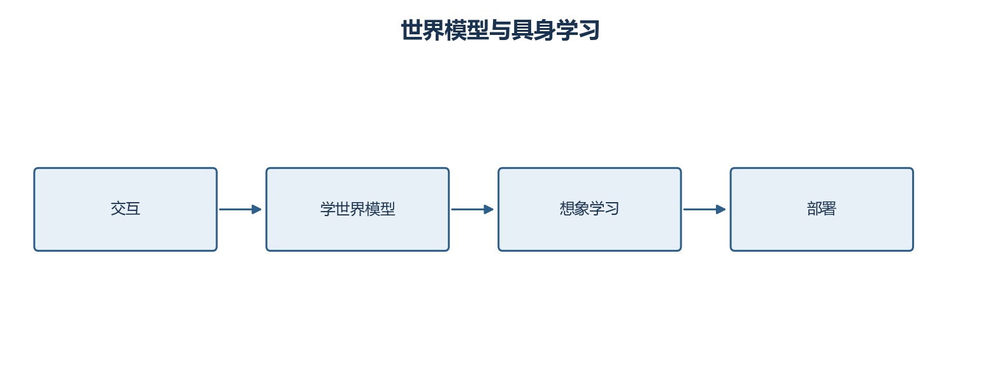

## 32.3　想象训练：从模型中学习策略

**直觉解释。** 学出世界模型后，可把它当作"仿真器"训练策略：从真实状态出发，在模型中展开 $H$ 步想象轨迹，用奖励预测优化策略——全程无需真实交互。

**推导（想象轨迹与策略梯度）.** 在模型中展开的 $H$ 步轨迹为

$$
\hat\tau=(s_t,a_t,\hat r_t,\hat s_{t+1},\dots,\hat s_{t+H}), \quad a_t\sim\pi_\psi(a\mid s_t),\ \hat s_{t+1}=f_\theta(\hat s_t,a_t). \tag{32-4}
$$

价值估计用 $H$ 步回报加 bootstrap：$\hat V(s_t)=\mathbb{E}_{\pi}\big[\sum_{k=0}^{H-1}\gamma^k \hat r_{t+k}+\gamma^H V_\xi(\hat s_{t+H})\big]$。策略梯度为

$$
\nabla_\psi J=\mathbb{E}_{\hat\tau\sim(\pi_\psi,f_\theta)}\Big[\sum_{k=0}^{H-1}\nabla_\psi\log\pi_\psi(a_{t+k}\mid \hat s_{t+k})\cdot \hat A_{t+k}\Big], \tag{32-5}
$$

其中 $\hat A$ 为优势函数。关键：**梯度可穿过可微世界模型 $f_\theta$ 回传**（重参数化，见《世界模型导论》第 9.3 节），这是 Dreamer 比无模型方法样本高效得多的原因。

**例 32.2（想象回报的手算）** 设 $H=3,\gamma=0.9$，模型预测的即时奖励序列 $\hat r_0=1,\hat r_1=0.8,\hat r_2=0.5$，末状态 bootstrap 价值 $V=2$。则 $\hat V=1+0.9\times0.8+0.81\times0.5+0.729\times2=1+0.72+0.405+1.458=3.583$。这条想象轨迹为策略提供了"这条动作序列值 3.583"的训练信号，无需真实执行。

### 32.3A　想象价值的 TD 误差与优势估计

例 32.2 用「整段想象回报 + bootstrap」直接估 $\hat V$，方差大。更稳的做法是**逐步 TD 误差**：把 $H$ 步想象里的每一步都当作一个训练样本。设第 $k$ 步的想象价值与 TD 目标，则 TD 误差为

$$
\hat\delta_k=\hat r_k+\gamma\,\hat V(\hat s_{k+1})-\hat V(\hat s_k), \tag{32-6}
$$

$\hat\delta_k>0$ 表示「这步比预期好」，$\hat\delta_k<0$ 表示「比预期差」。用 $n$ 步 TD 把优势估计为 $\hat A_k\approx\sum_{j=0}^{n-1}\gamma^j\hat\delta_{k+j}$（GAE，第 19 章式 19-10 在想象轨迹上的推广），再代回式 (32-5) 的策略梯度。TD 误差法的优势是**每个想象步都贡献梯度**，样本利用率比「整段回报」高一个 $H$ 倍量级。

**例 32.3（想象 TD 误差的手算）** 接例 32.2：$\hat r_0=1,\hat r_1=0.8,\hat r_2=0.5$，$\gamma=0.9$，用单步 TD（$n=1$）。设价值网络 $\hat V(\hat s_0)=3.5,\hat V(\hat s_1)=3.0,\hat V(\hat s_2)=2.2,\hat V(\hat s_3)=2.0$。则
$\hat\delta_0=1+0.9\times3.0-3.5=1+2.7-3.5=0.2$（比预期好 0.2）；
$\hat\delta_1=0.8+0.9\times2.2-3.0=0.8+1.98-3.0=-0.22$（比预期差 0.22）；
$\hat\delta_2=0.5+0.9\times2.0-2.2=0.5+1.8-2.2=0.1$。
三步平均 TD 误差 $\approx(0.2-0.22+0.1)/3\approx0.027$，接近 0——说明当前价值网络 $\hat V$ 已较准（TD 误差均值趋 0 是价值收敛的标志）。对比例 32.2 的整段回报 $3.583$ 只给一个标量信号，TD 法用 3 个 $\hat\delta_k$ 给 3 个梯度样本，**想象数据被「拆」成更细的训练信号**——这是 Dreamer 样本效率高于朴素想象训练的原因之一。

## 32.4　样本效率分析

**直觉解释。** 样本效率可量化为"达到某性能所需真实交互数"。设无模型 RL 需 $N_{\text{mf}}$ 次交互，基于模型方法用 $N_{\text{real}}$ 次交互学出模型，再在模型中生成 $N_{\text{im}}$ 条想象轨迹（几乎免费），则有效交互量从 $N_{\text{mf}}$ 降为 $N_{\text{real}}$。

**推导（模型误差的复合效应）.** 但模型有误差：设单步转移误差 $\epsilon$，则 $H$ 步想象的价值误差随 $H$ 复合增长

$$
\big|\hat V-V\big|\le \mathcal{O}\big(\epsilon\,H^2\big)\quad\text{或更紧地}\quad \mathcal{O}\Big(\frac{\gamma\,\epsilon\,V_{\max}}{(1-\gamma)^2}\Big). \tag{32-7}
$$

式 (32-7) 揭示**想象步长 $H$ 的权衡**：$H$ 太小则 bootstrap 误差大，$H$ 太大则模型误差累积——需选适中 $H$（Dreamer 常用 $H\approx15$）。

**例 32.4（样本效率对比算例）** 设某操作任务无模型 RL 需 $10^6$ 次真实交互达 90% 成功率；世界模型用 $10^4$ 次交互学出（误差 $\epsilon=0.01$），想象训练免费。有效真实交互降为 $10^4$，样本效率提升约 100 倍。但若 $\epsilon$ 过大（如 0.1），模型误差使策略在真实环境退化，增益消失——说明**模型精度是样本效率红利的前提**。

### 32.4A　Dyna 式：真实与想象轨迹的混合

式 (32-7) 警示「纯想象会累积模型误差」，于是纯模型内训练（Dreamer 风格）与纯真实训练（无模型风格）都非最优——**Dyna** 架构[5] 把二者按预算混合。设每轮从真实环境采 $N_{\text{real}}$ 条轨迹、从模型想象 $N_{\text{im}}$ 条，混合到经验回放池里共同训练策略，则有效样本量与模型误差的权衡为

$$
\mathcal{S}(N_{\text{real}},N_{\text{im}})\ \propto\ \frac{N_{\text{real}}+N_{\text{im}}}{\sqrt{N_{\text{real}}}\ +\ \epsilon\,\sqrt{N_{\text{im}}}}, \tag{32-8}
$$

分母第一项是真实数据的方差（$\propto\sqrt{N_{\text{real}}}$，越多越稳），第二项是想象数据的模型误差（$\propto\epsilon\sqrt{N_{\text{im}}}$，越多越被误差拖累）。式 (32-8) 给出一个**最优混合比**：当 $\epsilon$ 小（模型准），多想象划算（$N_{\text{im}}$ 可大）；当 $\epsilon$ 大（模型差），应少想象、多采真实（$N_{\text{im}}$ 受限）。这正是第 31 章「预训练用合成、微调用真实」在模型训练侧的对应——只是这里的「合成」是世界模型想象而非引擎渲染。

**例 32.5（Dyna 混合比的数值）** 设 $\epsilon=0.01$（模型较准）。① $N_{\text{real}}=10^4$、$N_{\text{im}}=10^5$：$\mathcal{S}\propto(1.1\times10^5)/(\sqrt{10^4}+0.01\times\sqrt{10^5})=1.1\times10^5/(100+0.01\times316)=1.1\times10^5/103.2\approx1066$。② 把 $N_{\text{im}}$ 加大到 $10^6$：$\mathcal{S}\propto(1.01\times10^6)/(100+0.01\times1000)=1.01\times10^6/110\approx9182$——仍大幅上升，说明 $\epsilon$ 小时想象近乎免费。③ 但把 $\epsilon$ 提到 $0.1$（模型变差）、$N_{\text{im}}=10^6$：$\mathcal{S}\propto(1.01\times10^6)/(100+0.1\times1000)=1.01\times10^6/200\approx5050$——收益腰斩。这印证式 (32-8) 的推论：**模型精度 $\epsilon$ 是「敢用多少想象数据」的闸门**，工程上应先投入提高模型精度，再放大想象比例，而非盲目堆想象量。这也解释了为何「先训准模型、再上想象」的部署顺序在第 34 章的规模化采集中被反复采用。

## 32.5　技术谱系与变体

**表 32-1　具身世界模型谱系**

| 模型 | 状态表示 | 转移 | 想象训练 | 代表 |
|------|---------|------|---------|------|
| World Models | VAE + RNN | 随机 RNN | 在模型中进化策略 | Ha & Schmidhuber[1] |
| PlaNet | RSSM | 随机+确定性 | 在线规划 | Hafner 等[2] |
| Dreamer | RSSM | 随机+确定性 | 策略梯度（式 32-5） | Hafner 等[3] |
| DreamerV2/V3 | 离散 RSSM | 离散潜在 | 大规模想象 | Hafner 等[4] |
| 基于模型的 MPC | 高斯过程/神经网络 | 概率集成 | 规划而非学策略 | 第 12 章 |

**规划式与学习式世界模型的分工。** 上表最后一行揭示一条重要分支：一类方法不在模型中训练显式策略，而是每次决策时用模型做在线规划（planning）。典型如 PlaNet[2] 用交叉熵方法（CEM）在潜在空间搜索动作序列，PILCO[6] 用高斯过程动力学做概率推理。式 (32-5) 的策略梯度路线（Dreamer）则把规划"蒸馏"成一个可快速查询的策略网络——部署时无需在线搜索，延迟更低（第 36 章实时性）。

**表 32-2　规划式 vs 学习式对比**

| 维度 | 在线规划（PlaNet/PILCO） | 策略学习（Dreamer） |
|------|------------------------|-------------------|
| 决策延迟 | 高（需在线搜索） | 低（单次前向） |
| 计算开销 | 推理时大 | 训练时大 |
| 策略复用 | 无（每次重规划） | 有（网络复用） |
| 适用场景 | 慢速精细任务 | 高频反应任务 |

**例 32.6（CEM 规划的一维示例）** 设模型预测动作 $a$ 的回报 $J(a)=-(a-0.7)^2$（最优点 $a^\star=0.7$）。CEM 先采样 $a\in\{0,0.5,1\}$，回报分别 $-0.49,-0.04,-0.09$，取 top 集合 $\{0.5,1\}$ 拟合并重采样于其均值 0.75 附近，逐步收敛到 0.7——这是 PlaNet 在线规划的缩影：无需梯度，靠采样—筛选逼近最优动作。

**规划式的具身适用边界。** 表 32-2 的「在线规划 vs 策略学习」分工在具身场景有具体落点：在线规划（CEM/MPC）适合**低频、高价值**决策——如抓取点的重新选择、避障方向，单次决策耗时数百毫秒可接受，且模型只需在「规划窗口」内准（误差复合受 $H$ 限制，式 32-7）；策略学习（Dreamer）适合**高频、反应式**控制——如 50 Hz 的夹爪力调节，部署时只能单次前向。统一案例里二者常组合：低频的 CEM 规划出「把杯子移到盒子正上方」的高层动作序列，高频的 Dreamer 策略执行「保持夹爪不脱手」的底层控制——这种「慢系统规划 + 快系统执行」的分层与第 27 章的符号规划—低层技能结构同构，是世界模型路线落地具身的典型形态。

## 32.6　边界与讨论

**挑战。** ① **部分可观测**（第 8 章）：真实状态不可见，需循环潜在保留历史；② **接触动力学**（第 13 章）：接触的刚/软切换、摩擦使转移高度非线性，模型难精确；③ **长期一致性**（《世界模型导论》第 33 章）：长时域想象误差累积（式 32-7）；④ **像素到状态**（第 5 章）：从像素学出有语义的潜在无保证（可辨识性）。

**与无模型路线的边界辨析。** 世界模型路线并非无条件优于无模型 RL：当真实数据近乎免费（如某些高吞吐仿真环境，第 29 章）时，无模型方法的样本效率劣势被抹平，而世界模型的建模开销与误差复合反而成为负担；当任务**高度随机**（转移本身不可预测）时，任何模型都难学准，想象红利消失。因此「是否上世界模型」取决于**真实交互成本 ÷ 模型可预测性**的比值：成本越高、环境越可预测，世界模型收益越大——这解释了为何抓取、导航等可预测操作任务多用模型方法，而高随机交互任务常回到无模型或混合（式 32-8）路线。

**模型误差与策略利用（policy exploitation）。** 策略可能"利用"模型缺陷——找到模型中奖励高但真实中无效的动作。Janner 等人[8] 用「模型置信度」加权回报来抑制这种利用：只在模型高置信的区域用模型奖励，低置信处回退保守估计。缓解手段包括模型集成（不确定性惩罚）、保守策略、短想象步长。这与第 20 章现实差距、第 35 章安全直接相关。

## 32.7　承上启下与交叉引用

本章把《世界模型导论》的潜在动力学与 ELBO（式 32-2、32-3）引入具身场景，定义具身世界模型（定义 32.1）、推导想象训练的策略梯度（式 32-4、32-5）、想象价值的 TD 误差（式 32-6）、量化模型误差复合（式 32-7）与 Dyna 式真实—想象混合（式 32-8）。第 33 章的多维评估为世界模型的预测精度提供度量；第 34 章的数据规模决定世界模型质量；第 35 章的安全约束限制想象策略的部署；第 31 章的生成数据与本章想象训练互补（式 32-8 即其「合成—真实」混合在模型侧的对应）。这些辨析衔接第 5、8、12—13、19、31、33—35 章与《世界模型导论》第 9—13、31、33 章。第八篇（第 33—36 章）转向评估、安全与工程，下一章开启评估与基准。

## 本章小结

本章论述世界模型与具身学习的结合。

- 我们论证具身学习对世界模型的需求（样本效率、想象、规划），定义具身世界模型（定义 32.1，式 32-1），给出时序联合分布与 ELBO 推导（式 32-2、32-3）及手算示例（例 32.1）；32.1A 节给出世界模型的预测/规划/表示三层用法谱系。
- 我们推导想象轨迹与策略梯度（式 32-4、32-5，例 32.2），并在 32.3A 节给出想象价值的 TD 误差估计（式 32-6），例 32.3 手算三步 TD 误差（0.2/−0.22/0.1）展示想象数据如何被拆成更细的梯度样本；量化样本效率增益与模型误差复合（式 32-7，例 32.4），32.4A 节推导 Dyna 式真实—想象混合（式 32-8），例 32.5 算出模型精度 $\epsilon$ 是「敢用多少想象数据」的闸门；梳理世界模型谱系（表 32-1）并对比规划式与学习式（表 32-2，例 32.6）。
- 我们明确边界：部分可观测、接触动力学、长期一致性、策略利用模型缺陷。这些辨析衔接第 5、8、12—13、19、31、33—35 章与《世界模型导论》。下一章讨论评估与基准。

**进一步阅读**　本章建议延伸阅读的文献：[1]、[3]、[4]、[5]、[8]。

## 参考文献

[1] Ha D, Schmidhuber J. World models. *NeurIPS*, 2018.

[2] Hafner D, Lillicrap T, Fischer I, et al. Learning latent dynamics for planning from pixels. *ICML*, 2019: 2555–2565.

[3] Hafner D, Lillicrap T, Ba J, Norouzi M. Dream to control: Learning behaviors by latent imagination. *ICLR*, 2020.

[4] Hafner D, Pasukonis J, Ba J, et al. Mastering diverse domains through world models. *Nature*, 2023, 618(7963): 64–69.

[5] Sutton R S. Dyna, an integrated architecture for learning, planning, and reacting. *SIGART Bulletin*, 1991, 2(4): 160–163.

[6] Deisenroth M P, Rasmussen C E. PILCO: A model-based and data-efficient approach to policy search. *ICML*, 2011: 465–472.

[7] Chua K, Calandra R, McAllister R. Deep reinforcement learning in a handful of trials using probabilistic dynamics models. *NeurIPS*, 2018: 4759–4770.

[8] Janner M, Fu J, Zhang M, Levine S. When to trust your model: Model-based policy optimization. *NeurIPS*, 2019: 12519–12530.

---

# 第 33 章　具身智能的评估与基准

第八篇（第 33—36 章）转向评估、安全与工程。本章回答一个基础问题：如何评价具身智能系统的能力？与图像分类、语言生成不同，具身评估涉及物理交互——成功的定义、成本的度量、失败的模式都更复杂。仅报告"任务成功率"如同只看考试分数而忽略用时、稳定性与是否违规。本章先论证多维评估的动机（33.1 节），给出评估的形式化框架与聚合指标（33.2 节），推导统计置信度与样本量（33.3 节），给出数值算例（33.4 节），梳理基准谱系（33.5 节），讨论边界（33.6 节），最后承上启下（33.7 节）。

## 33.1　引入动机：为什么需要多维评估

**动机。** 第 19—28 章介绍了大量学习算法，但"哪个方法更好"无法用单一数字回答。一个策略可能成功率高但动作笨拙（效率差），或在训练场景表现好但换物体就失败（泛化差），甚至靠危险动作完成任务（不安全）。具身系统要在物理世界长期运行，评估必须覆盖**成功率、效率、鲁棒性、泛化、安全**五个维度。

**直觉解释。** 把评估想象成"驾驶员考试"：不仅看能否到达目的地（成功率），还看是否省油（效率）、遇雨是否稳定（鲁棒）、换条路是否也会开（泛化）、是否闯红灯（安全）。五维缺一不可。

**定义 33.1（具身评估协议）**　一个评估协议是三元组 $\mathcal{E}=\langle\mathcal{T},\mathcal{M},\mathcal{C}\rangle$：$\mathcal{T}$ 为任务集，$\mathcal{M}$ 为指标集，$\mathcal{C}$ 为条件集（初始状态分布、扰动、环境变体）。单次试验返回指标向量 $m\in\mathbb{R}^d$，汇总为性能画像。

**表 33-1　具身评估五维度**

| 维度 | 指标 | 说明 | 反面案例 |
|------|------|------|---------|
| 成功率（success rate） | 成功完成比例 | 核心指标 | 只报告训练场景成功率 |
| 效率（efficiency） | 完成时间/步数/能耗 | 实用性 | 成功但耗时 10 倍 |
| 鲁棒性（robustness） | 扰动下成功率 | 可靠性 | 光照一变就失败 |
| 泛化（generalization） | 新物体/场景成功率 | 适应性 | 换个杯子就不会抓 |
| 安全（safety） | 违规/碰撞次数 | 安全性 | 靠撞击完成任务 |

### 33.1A　失败模式分类与评估协议清单

仅有五维指标还不够。评估协议必须先回答一个常被忽视的问题：**失败被如何记录**。一次试验的结局不是"成功/失败"二值，而是一族可区分的失败模式：轨迹截断（超过最大步数或时间上限）、目标未达成（在时限内未满足成功判定器）、约束违反（碰撞、关节极限、抓取滑落）、退化行为（原地抖动、重复无效动作）乃至传感器失效。把这些失败分开计数，性能画像才具诊断价值——成功率 0.80 的系统，若其 20% 失败全是"退化行为"，则问题在控制器（第 11—12 章）；若全是"抓取滑落"，则问题在感知或操作策略（第 13 章）。

**评估协议清单（reproducibility checklist）。** 一个可复现的评估协议必须显式固定以下要素：① 初始状态分布与随机种子；② 成功判定器（人工标注/自动谓词/物体状态阈值）；③ 最大步数与时间上限；④ 观察接口（是否提供真值状态、是否含本体感知）；⑤ 试验次数与重复策略（同任务多次重放 vs 不同任务各一次）；⑥ 硬件/仿真器版本。协议中任何一项不透明，论文间的数字便不可比。这解释了为何同一策略在不同论文中成功率相差可达 10 个百分点——差异往往不在算法而在协议。

## 33.2　严格定义：聚合指标与加权画像

**直觉解释。** 多维指标需聚合成可比较的分数，但简单平均会掩盖短板。实践中用加权几何平均或"短板优先"的聚合。

**定义 33.2（加权几何聚合）**　设五维归一化指标 $m_1,\dots,m_5\in[0,1]$，权重 $w_i\ge0,\sum w_i=1$，则综合得分

$$
S=\prod_{i=1}^{5} m_i^{w_i}=\exp\Big(\sum_{i=1}^{5}w_i\log m_i\Big). \tag{33-1}
$$

**推导（几何平均的短板惩罚）.** 对式 (33-1) 取对数得 $\log S=\sum w_i\log m_i$。若某维 $m_j\to0$，则 $\log m_j\to-\infty$，无论其他维多高，$S\to0$——这体现"安全/成功为零则一票否决"的直觉。相比之下算术平均 $\sum w_i m_i$ 允许高分维度补偿零分维度，不适合安全关键场景。

**定义 33.3（条件鲁棒性）**　设条件 $c\in\mathcal{C}$ 下的成功率为 $p_c$，鲁棒性定义为最差条件成功率

$$
R_{\text{rob}}=\min_{c\in\mathcal{C}} p_c, \tag{33-2}
$$

或条件均值 $\bar p=\mathbb{E}_{c}[p_c]$ 与方差的联合刻画。

## 33.3　统计置信度与样本量推导

**直觉解释。** 成功率是随机变量（每次试验成功/失败），从有限次数 $n$ 估计的成功率 $\hat p$ 有统计不确定性。报告"成功率 90%"必须附带置信区间，否则两次评估的差异可能只是噪声。

**推导（成功率的置信区间）.** 成功次数 $K\sim\mathrm{Binomial}(n,p)$，$\hat p=K/n$。由中心极限定理，$\hat p\approx\mathcal{N}(p,\sqrt{p(1-p)/n})$，$1-\alpha$ 置信区间为

$$
\hat p \pm z_{1-\alpha/2}\sqrt{\frac{\hat p(1-\hat p)}{n}}. \tag{33-3}
$$

**推导（样本量）. ** 若希望置信区间半宽不超过 $\delta$，则（取最坏 $p=0.5$）

$$
n\ \ge\ \frac{z_{1-\alpha/2}^2\,p(1-p)}{\delta^2}\ \le\ \frac{z_{1-\alpha/2}^2}{4\delta^2}. \tag{33-4}
$$

式 (33-4) 说明：要把成功率估计到 $\pm2\%$（$\delta=0.02, z=1.96$），需 $n\ge 0.96/(4\times0.0004)\approx600$ 次试验——真实机器人评估成本极高，这是具身基准多用仿真的原因之一。

**例 33.1（置信区间算例）** 某策略在 $n=200$ 次试验中成功 170 次，$\hat p=0.85$。95% 置信区间半宽 $=1.96\sqrt{0.85\times0.15/200}=1.96\times0.0252=0.049$。故报告为 $0.85\pm0.05$（即 $[0.80,0.90]$）。若另一策略 $\hat p=0.88,n=200$，区间 $[0.83,0.93]$——两者重叠，不能断言后者显著更优。

### 33.3A　精确区间、Bootstrap 与显著性检验

正态近似（式 33-3）在 $n\hat p$ 或 $n(1-\hat p)$ 较小时失准。更稳健的是 **Clopper–Pearson 精确区间**：基于二项分布的逆，$1-\alpha$ 置信区间端点为

$$
\hat p_L=\mathrm{Beta}^{-1}\!\Big(\tfrac{\alpha}{2};\,K,\,n-K+1\Big),\qquad
\hat p_U=\mathrm{Beta}^{-1}\!\Big(1-\tfrac{\alpha}{2};\,K+1,\,n-K\Big), \tag{33-5}
$$

其中 $\mathrm{Beta}^{-1}(q; a, b)$ 为参数 $(a,b)$ 的 Beta 分布的 $q$ 分位数。该区间覆盖概率精确等于 $1-\alpha$（对 $K=0$ 或 $K=n$ 给出有限端点），比 Wald 区间（式 33-3）更保守，适合小样本或成功率接近 0/1 的情形。

对于非二值的指标（如完成时间、能耗），常用 **Bootstrap** 估计分布：从 $n$ 次试验中有放回重抽样 $B$ 组（每组 $n$ 次），对每组重算指标 $\hat m^{(b)}$，取其 $B$ 个值的经验分位数作为置信区间。这绕开了对指标分布的假设。

**显著性检验。** 比较两策略的成功率，可用成对 bootstrap（对每个任务重采样，比较差值 $\Delta\hat p$ 是否含 0）或 Wilcoxon 秩和检验。例 33.1 中两区间重叠即提示差异不显著；只有当重采样差值分布整体偏离 0（如 $p<0.05$）时，才能断言一策略显著优于另一策略。这把"评估"从单点估计升级为**推断**，避免把噪声当进步。

**两样本检验的统计功效（power）。** 单策略的置信区间（式 33-3）回答"估计有多准"，而比较两策略还需回答"能否分辨二者真实差异 $\Delta=p_1-p_2$"。在显著性水平 $\alpha$、功效 $1-\beta$ 下，每策略所需试验数近似为 $n\gtrsim 2(z_{1-\alpha/2}+z_{1-\beta})^2\,\bar p(1-\bar p)/\Delta^2$，其中 $\bar p=(p_1+p_2)/2$。取 $p_1=0.9,\ p_2=0.8,\ \bar p=0.85$，$\alpha=\beta=0.05$（$z_{1-\alpha/2}=1.96,\ z_{1-\beta}=1.28$），则 $n\gtrsim 2\times(3.24)^2\times0.85\times0.15/0.01\approx268$——要可靠分辨 10 个百分点的差异，每策略需约 270 次试验。这比式 (33-4) 的单点估计（$\pm2\%$ 需 600 次）更凸显真机评估的成本压力，也是基准多用仿真、且强调"多任务聚合而非单任务"的统计学原因。

## 33.4　数值算例：五维画像与聚合

**例 33.2（两策略的多维比较）** 策略 A：成功率 0.90、效率 0.60、鲁棒 0.70、泛化 0.50、安全 0.95；策略 B：成功率 0.85、效率 0.90、鲁棒 0.85、泛化 0.80、安全 0.60。取等权 $w_i=0.2$，用几何聚合（式 33-1）：

$S_A=\exp(0.2[\log0.9+\log0.6+\log0.7+\log0.5+\log0.95])=\exp(0.2\times(-0.105-0.511-0.357-0.693-0.051))=\exp(0.2\times(-1.717))=\exp(-0.343)=0.710$。

$S_B=\exp(0.2[\log0.85+\log0.9+\log0.85+\log0.8+\log0.6])=\exp(0.2\times(-0.163-0.105-0.163-0.223-0.511))=\exp(0.2\times(-1.165))=\exp(-0.233)=0.792$。

尽管 A 成功率更高，但 B 的综合分更高——因为几何平均惩罚了 A 的泛化短板（0.50）与 B 的安全短板（0.60）中，A 的短板更低。若把安全视为硬约束（$S=0$ 当安全<0.8），则 B 直接出局——说明聚合方式需与部署需求一致。

> 【图 33-1　五维评估雷达图】（原图见 figures/图33-1.png）：五轴雷达图对比两策略画像，标注短板。
>
> 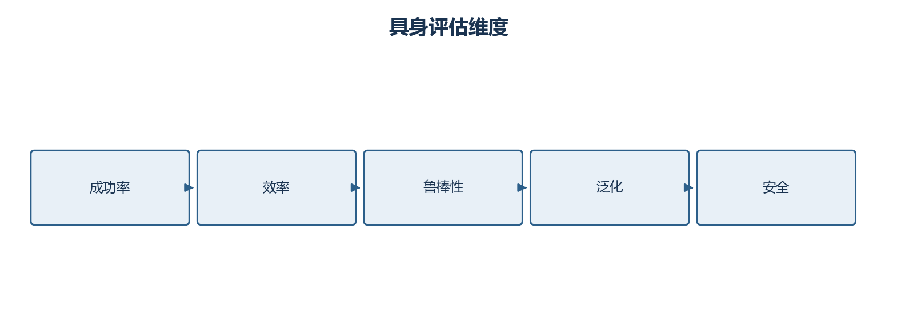

## 33.5　代表基准与技术谱系

**仿真基准。** MuJoCo（运动/操作连续控制，第 29 章）、RLBench（18 类机器人操作任务，提供示范与度量）[1]、Habitat/iGibson（室内导航与视觉交互）[2]、Meta-World（50 个多任务操作）、Brax（GPU 加速物理）、BEHAVIOR（日常活动长时域任务）。

**真实基准。** 真实机器人评测昂贵且难标准化，正逐渐形成：如真实抓取基准、双臂操作基准、RB2 框架——强调可复现的硬件配置与协议。

**表 33-2　代表基准谱系**

| 基准 | 领域 | 任务数 | 仿真/真实 | 特色 |
|------|------|-------|----------|------|
| RLBench[1] | 操作 | 18+ | 仿真（CoppeliaSim） | 示范+多视角 |
| Habitat[2] | 导航 | 室内场景 | 仿真 | 高保真 3D |
| Meta-World | 多任务操作 | 50 | 仿真（MuJoCo） | 多任务/元学习 |
| MuJoCo Benchmarks | 运动/操作 | 多 | 仿真 | 连续控制标准 |
| BEHAVIOR | 日常活动 | 50+ | 仿真（iGibson） | 长时域、对象状态 |

**评估协议的可复现性。** 基准的价值取决于协议的可复现性。一个完整协议应固定：初始状态分布（随机种子）、成功判定器（人工/自动）、最大步数/时间、观察接口（是否可用真值状态）、以及硬件配置（真实场景）。若协议不透明，不同论文的数字不可比——这正是第 33.1 节"单一成功率不足以刻画能力"的延伸：连指标定义都不统一，更遑论比较。

**表 33-3　评估维度与常用指标映射**

| 维度 | 定量指标 | 数据需求 | 主要噪声源 |
|------|---------|---------|-----------|
| 成功率 | $\hat p=K/n$（式 33-3） | 大量试验 | 初始状态随机性 |
| 效率 | 平均完成步数/时间 | 成功轨迹 | 路径规划随机性 |
| 鲁棒性 | 扰动下 $R_{\text{rob}}$（式 33-2） | 多条件 | 扰动强度设定 |
| 泛化 | 留出物体/场景成功率 | 留出集 | 分布偏移 |
| 安全 | 碰撞率、违规次数 | 全量轨迹 | 稀有事件漏检 |

**例 33.3（留出泛化评估）** 在 RLBench 上训练时在 80 个物体上测试、20 个物体留出作泛化集。训练集成功率 0.92（置信区间 ±0.03），留出集 0.61（±0.06）——泛化差距 0.31 暴露过拟合（第 23 章）。若仅报告训练成功率 0.92，会严重高估实际能力，这印证多维评估中"泛化"维度不可省略。

### 33.5A　评估成本与成本效率

具身评估的瓶颈不仅是"测得准"，更是"测得起"。式 (33-4) 要求数百次试验，而真实机器人每次试验占用数分钟到数小时（含复位与安全检查），仿真虽快但存在 sim-to-real 差距（第 20 章）。定义**成本效率**为

$$
\mathrm{CE}=\frac{\hat p}{\bar c}\ \Bigg/\ \frac{1}{n}, \tag{33-6}
$$

其中 $\bar c$ 为单次试验成本（时间、能耗、磨损的货币化）。$\mathrm{CE}$ 把"成功率/单位成本"与"样本量"结合，回答"以有限预算能买到多可靠的结论"。

**例 33.4（成本效率算例）** 仿真试验 $\bar c_{\mathrm{sim}}=0.1\,\mathrm{min}$，真实试验 $\bar c_{\mathrm{real}}=15\,\mathrm{min}$。要在 1 小时内评估：仿真可做 $n_{\mathrm{sim}}=600$ 次（恰满足式 33-4 的 $\pm2\%$），真实仅 $n_{\mathrm{real}}=4$ 次（区间半宽 $\approx0.25$，几乎无信息）。故工程上采用"仿真粗筛（大量试验）+ 真实现实验证（少量关键试验）"的两级协议，这也是 RLBench 等基准先仿真后迁移的设计逻辑。

### 33.5B　进度度量：从二元成功到连续进展

二元成功率对长时域任务（如 BEHAVIOR 的"做一顿饭"）过于粗糙：一个策略完成了 90% 的步骤却因最后一步失败而记 0，损失了"接近成功"的信息。为此引入**连续进度函数** $\phi(\mathbf{s})\in[0,1]$（$\mathbf{s}$ 为环境/物体状态），度量任务完成度，单次试验的进度为 $\phi(\mathbf{s}_{\text{final}})$，策略的期望进度

$$
\bar\phi=\mathbb{E}_{\tau}\big[\phi(\mathbf{s}_{\text{end}})\big], \tag{33-7}
$$

其中期望对任务初始状态与策略随机性联合。$\bar\phi$ 与成功率互补：成功率回答"能否完成"，$\bar\phi$ 回答"平均完成多少"。在 BEHAVIOR 中，$\phi$ 由物体谓词（如"杯中有水"）的完成比例构造；在导航任务中，$\phi$ 可取到目标距离的归一化倒数。式 (33-7) 与式 (33-1) 的关系是：成功率 $\hat p$ 是 $\phi\in\{0,1\}$ 特例下的期望进度。

**例 33.5（进度与成功率差异）** 两策略在 100 次长时域试验中：A 全部失败但平均完成 0.55 步/10 步，$\bar\phi_A=0.55$；B 成功 40 次、失败 60 次（失败时平均完成 0.9 步），$\bar\phi_B=0.4\times1+0.6\times0.9=0.94$。若只看成功率 A=0、B=0.40，B 看似仅胜 A 一倍；但进度上 B 远优——A 几乎无进展。进度度量揭示了"成功率并列但质量悬殊"的策略，是长时域基准（BEHAVIOR、RT-1 系列）普遍采用的原因。

### 33.5C　跨本体与跨任务评估

具身策略的能力不仅取决于单一任务表现，还取决于**跨本体（cross-embodiment）与跨任务迁移**。Open X-Embodiment（第 34 章）的 RT-X 模型展示了统一动作空间下数据共享带来的正迁移。评估这种能力需要专门协议：固定任务，改变本体（如把在 Franka 上训练的策略部署到 UR5、双臂、移动底盘），报告跨本体成功率衰减曲线

$$
\Delta_{\mathrm{emb}}=\mathbb{E}_{\tau,\,e_0}[p(\tau\mid e_0)]-\mathbb{E}_{\tau,\,e}\big[\min_{e\in\mathcal{E}\setminus\{e_0\}}p(\tau\mid e)\big], \tag{33-8}
$$

其中 $e_0$ 为本体、$\mathcal{E}$ 为本体集合、$p(\tau\mid e)$ 为在 $e$ 上的任务成功率。$\Delta_{\mathrm{emb}}$ 越大，说明策略对本体的依赖性越强（过拟合到单一本体几何/动力学）。跨任务评估则固定本体、换任务分布，度量新任务成功率与旧任务成功率的差，呼应表 33-1 的"泛化"维度。这两个指标把评估从"单任务单本体"推向"策略的能力边界"，是第 26 章通用机器人策略与第 32 章世界模型评估的关键量。

**例 33.6（跨本体衰减）** 某策略在本体 $e_0$（Franka）上成功率 0.88；换 UR5 后 0.71、双臂 0.65、移动底盘 0.58。$\Delta_{\mathrm{emb}}=0.88-0.58=0.30$——衰减较大，提示策略依赖 Franka 的几何（抓取位姿标定）。若改用跨本体数据（第 34 章）重训，$\Delta_{\mathrm{emb}}$ 降到 0.12，说明规模化与标准化确实压缩了本体依赖。

## 33.6　边界与讨论

**边界。** ① **仿真—真实差距**（第 20 章）：仿真基准的高分不保证真实表现，需 sim-to-real 验证；② **缺乏统一大规模基准**：具身任务的多样性使"ImageNet 时刻"尚未到来；③ **评估成本**：式 (33-4) 表明精确估计需大量试验，真实机器人难以承受；④ **指标博弈（Goodhart 定律）**：针对指标优化可能损害真实目标（如靠撞击提高成功率）。

**安全维度的特殊性。** 安全指标（第 35 章）常是硬约束而非可平均维度——一次严重碰撞即可判定系统不可用。因此评估协议应区分"软指标"（可聚合）与"硬约束"（一票否决）。

### 33.6A　指标博弈与评估的失效模式

Goodhart 定律——"当度量成为目标，它就不再是好度量"——在具身评估中有具体表现：① **指标钻空子**：策略学会"撞开"门闩而非操作把手，成功率上升但安全分下降，若只优化成功率则安全被牺牲；② **数据泄漏**：训练集与测试集物体/场景重叠，留出泛化（例 33.3）被高估；③ **协议过拟合**：针对固定种子的初始状态微调，换种子即失效；④ **判定器偏差**：自动成功判定器对特定轨迹模式偏袒（如物体静止时易判成功）。

**对策。** 一是**硬约束分离**——安全违规直接清零（式 33-1 的一票否决），不参与加权；二是**留出协议化**——物体、场景、初始状态分 train/val/test 三层且测试层对训练不可见；三是**多判定器**——自动谓词与人工抽检并用，报告二者的差；四是**对抗性扰动评估**——在第 33.2 节条件集 $\mathcal{C}$ 中加入对抗性初值，检验策略是否只是"记住了"训练分布。这些对策把评估从"打分"提升为"防作弊的推断"。

## 33.7　承上启下与交叉引用

本章建立具身评估的形式化框架：评估三元组（定义 33.1）、五维指标（表 33-1）、失败模式与协议清单（33.1A 节）、几何聚合（式 33-1）、条件鲁棒性（式 33-2）、置信区间与样本量（式 33-3、33-4）、精确区间、Bootstrap 与两样本功效（式 33-5，例 33.1）及多维画像算例（例 33.2）、评估成本（式 33-6，例 33.4）、连续进度度量（式 33-7，例 33.5）与指标博弈对策（33.6A 节）。第 34 章的数据质量需评估指标支撑；第 35 章的安全约束是评估的硬维度；第 20 章的现实差距提醒仿真评估的局限；第 31—32 章的数据与世界模型决定了被评估策略的能力上限。这些辨析衔接第 19—20、31—32、34—35 章。下一章讨论数据收集与规模化。

## 本章小结

本章论述具身智能的评估与基准。

- 我们论证多维评估的必要性，定义评估三元组（定义 33.1）与五维指标（表 33-1），补充失败模式分类与可复现性协议清单（33.1A 节）；给出加权几何聚合（式 33-1）与条件鲁棒性（式 33-2）。
- 我们推导成功率的置信区间与样本量（式 33-3、33-4，例 33.1），补充 Clopper–Pearson 精确区间、Bootstrap 与两样本检验功效（式 33-5）；通过两策略算例展示几何平均的短板惩罚（例 33.2）。
- 我们梳理仿真/真实基准谱系（表 33-2）与评估协议（表 33-3，例 33.3），引入成本效率（式 33-6，例 33.4）解释"仿真粗筛+真实验证"两级协议，并引入连续进度度量（式 33-7，例 33.5）刻画长时域任务。
- 我们明确边界：仿真—真实差距、缺乏统一基准、评估成本、指标博弈（Goodhart），并区分软指标与硬安全约束、给出对策（33.6A 节）。这些辨析衔接第 19—20、31—32、34—35 章。下一章讨论数据收集与规模化。

**进一步阅读**　本章建议延伸阅读的文献：[1]—[8]，其中 [1] RLBench、[2] Habitat、[3] Meta-World 为三大仿真基准代表，[8] 对深度强化学习评估的统计严谨性有专门讨论。

## 参考文献

[1] James S, Freese M, Mathur A, et al. RLBench: The robot learning benchmark and learning environment. *IEEE Robotics and Automation Letters*, 2020, 5(2): 742–749.

[2] Savva M, Kadian A, Mojafari A, et al. Habitat: A platform for embodied AI research. *ICCV*, 2019: 9339–9347.

[3] Yu T, Quillen D, He Z, et al. Meta-World: A benchmark and evaluation for multi-task and meta reinforcement learning. *CoRL*, 2019: 1094–1100.

[4] Todorov E, Erez T, Tassa Y. MuJoCo: A physics engine for model-based control. *IROS*, 2012: 5026–5033.

[5] Li S, Puig G, Paetzold J, et al. BEHAVIOR: An object-centric benchmark for embodied AI in everyday activities. *arXiv:2109.08141*, 2021.

[6] Xia F, Shen W, Yu T, et al. Replica: Real-time reconstruction and pixel-level understanding of indoor environments. *CVPR*, 2018: 5688–5697.

[7] Ganapathi V, Schulman J, Kurosawa S, et al. Benchmarking robotic manipulation policies on real hardware. *arXiv:2108.03364*, 2021.

[8] Henderson P, Islam R, Bachman P, et al. Deep reinforcement learning that matters. *AAAI*, 2018: 3207–3214.

---

# 第 34 章　数据收集与规模化

第 18 章的遥操作与第 31 章的数据飞轮分别讨论了示范获取与数据策略。本章从工程视角深入数据收集与规模化（scaling）：如何高效采集高质量机器人数据、数据规模与质量的关系、以及数据管理的挑战。"规模定律（scaling law）"在语言领域已被验证，但在具身领域仍存争议——数据多样性、质量与任务覆盖往往比单纯数量更关键。本章先论证采集基础设施的动机（34.1 节），形式化数据量与能力的关系并给出算例（34.2 节），分析质量与多样性的维度（34.3 节），梳理规模化采集的技术谱系（34.4 节），讨论数据飞轮与数据管理的工程（34.5 节），剖析边界（34.6 节），最后承上启下（34.7 节）。

## 34.1　引入动机：数据作为工程瓶颈

**动机。** 第 33 章指出，具身评估需大量试验（式 33-4），而训练所需数据更甚。语言模型可爬取互联网文本，机器人却必须"物理地"产生每条数据——每条轨迹都占用机器人时间、人类示范时间与硬件损耗。因此，**采集基础设施**决定了数据规模的上限，进而决定策略能力的上限。Open X-Embodiment[1] 汇聚 22 种机器人、527 种技能、超 100 万条轨迹，正是规模化采集的标志性成果。

**直觉解释。** 把采集想象成"工厂流水线"：单条轨迹是"手工制品"，规模化要求并行多条产线（多机器人）、标准化工序（统一遥操作界面与数据格式）、质检（质量控制）与仓储（存储与标注）。任何环节的低效都会成为瓶颈——流水线的吞吐量由最慢工序（bottleneck）决定。

**定义 34.1（采集流水线）**　一条数据采集流水线由五要素构成：① 机器人平台（本体与传感器）；② 遥操作/自主界面（第 18 章）；③ 传感器同步（时间对齐）；④ 存储与标注（格式、元数据）；⑤ 质量控制（校验、过滤）。规模化追求并行化与自动化。

**表 34-1　采集要素与瓶颈**

| 要素 | 作用 | 规模化瓶颈 |
|------|------|-----------|
| 机器人平台 | 物理执行与感知 | 硬件成本、维护 |
| 遥操作界面 | 人类示范输入 | 人类带宽、疲劳 |
| 传感器同步 | 多模态时间对齐 | 延迟、漂移 |
| 存储与标注 | 数据结构化 | 格式不一、标注成本 |
| 质量控制 | 过滤失败/错误轨迹 | 自动质检难 |

**传感器同步的细化。** 多模态（RGB、深度、力/力矩、关节角）数据必须时间对齐，否则状态—动作配对错位会引入偏差。设相机频率 $f_c$、力传感器频率 $f_f$、控制频率 $f_u$，典型 $f_c=30\text{Hz},f_f=1000\text{Hz},f_u=500\text{Hz}$。需以控制时钟为主时钟，对高频信号降采样、对低频信号插值，并对传输延迟 $\tau$ 做补偿——第 8 章的状态估计提供数学工具。

### 34.1A　数据格式与标准化

多平台数据的可整合性取决于格式。主流标准有两类：**轨迹级格式**（如 RLDS，以"轨迹—片段—帧"三层组织，帧含观测、动作、回报、终端标志），**事件级格式**（如 LeRobot，以"episode"为最小单元，含时间戳、本体、任务标签）。两种格式都需固定：① 坐标系约定（基坐标系/末端坐标系/世界坐标系的变换关系）；② 动作参数化（绝对关节角 vs 末端位姿增量 vs 力矩）；③ 时间基（控制时钟 vs 传感器时钟 vs 墙钟）；④ 任务标签的层级（粗粒度任务/子目标/原子动作）。

**格式不一致的代价。** 不同平台即使"动作都是 $q\in\mathbb{R}^7$"，其关节顺序、零位、限位也可能不同。设平台 $e$ 的动作映射为 $a^e = T_e(q)$，$T_e$ 为平台相关的仿射变换，则跨平台数据整合需在统一空间 $a^* = T_{e\to e^*}^{-1}(a^e)$ 下进行。变换的逆需从标定（calibration）中获得，标定误差直接进入数据质量 $g(q)$（第 34.3 节）。Open X-Embodiment 的关键贡献之一正是为 22 个平台统一了 $T_e$ 的定义，使"跨本体正迁移"在数据层可行。

**版本控制与可复现性。** 数据集随时间演化（修正标注、剔除错误轨迹），需版本控制追踪代际：DVC（Data Version Control）对大文件用内容寻址，Git LFS 对二进制对象做指针管理。版本标签应包含：采集日期、本体型号、传感器配置、遥操作员标识（用于偏差分析）、质检通过标准。缺少版本控制的"数据集"在复现上等价于不可复现。

## 34.2　严格定义：数据规模与能力的关系

**直觉解释。** 经验上策略性能随数据量增长，但增长呈幂律且存在饱和。把"能力"定义为任务成功率 $p$，数据量 $N$，则

$$
p(N)=p_\infty-\alpha N^{-\beta},\quad \alpha,\beta>0, \tag{34-1}
$$

其中 $p_\infty$ 为不可约上限，$\beta$ 为规模指数（越小增长越慢）。

**推导（规模定律的来源）.** 设任务空间有 $M$ 个"模式"（物体、光照、初始状态组合），每个模式需 $n_0$ 条数据才能掌握，则覆盖比例 $1-e^{-N/(M n_0)}$，成功率近似

$$
p(N)\approx p_\infty\big(1-e^{-N/N_0}\big),\quad N_0=M n_0. \tag{34-2}
$$

当 $N\ll N_0$ 时 $p\approx p_\infty N/N_0$（线性增长），当 $N\gg N_0$ 时饱和。式 (34-2) 的指数形式在双对数图上近似直线，解释了经验观察到的规模定律 (34-1)。**$N_0=M n_0$ 表明：任务模式数 $M$ 越大（多样性需求越高），所需数据越多**——这从理论上说明多样性本身就是规模的一部分。

**例 34.1（规模曲线算例）** 设 $p_\infty=0.95,\alpha=1,\beta=0.3$（与第 31.3 节数据飞轮同参数）。$N=10^2$ 时 $p=0.95-100^{-0.3}=0.95-0.251=0.699$；$N=10^3$ 时 $1000^{-0.3}=10^{-0.9}=0.126$，$p=0.824$；$N=10^4$ 时 $10^{-1.2}=0.063$，$p=0.887$。数据量从 $10^2$ 增至 $10^4$（100 倍），成功率从 0.70 升至 0.89——收益显著但递减，印证式 (34-1)。

> 【图 34-1　数据规模与能力曲线】（原图见 figures/图34-1.png）：双对数坐标下成功率随数据量增长并饱和，标注质量维度的影响。
>
> 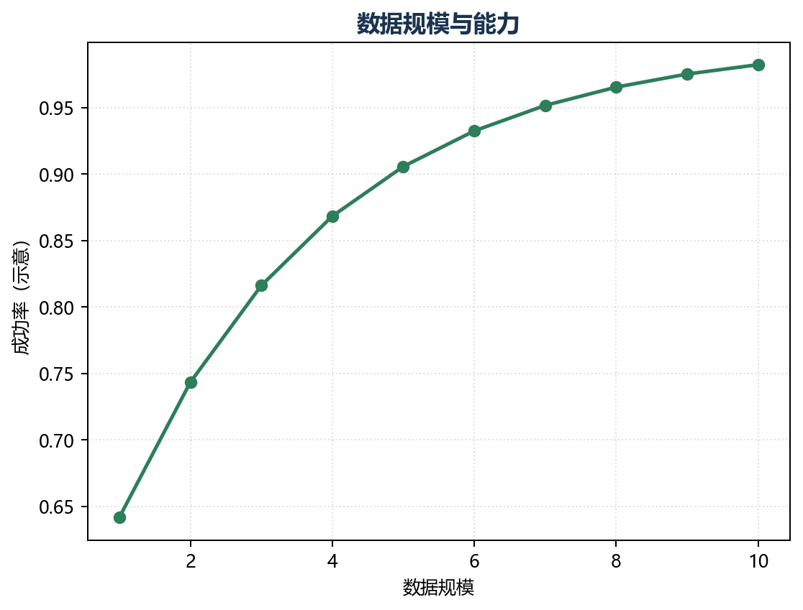

### 34.2A　数据效率与样本复杂度

规模定律 (34-1) 回答"需要多少数据"，但工程中更关键的是**单位数据换来的能力增量**，即数据效率（data efficiency）。设 $\Delta p$ 为性能增量、$\Delta N$ 为数据增量，定义边际数据效率

$$
\eta_{\text{eff}}(N)=\frac{\Delta p}{\Delta N}=p_\infty\,\beta\,N^{-\beta-1}. \tag{34-3}
$$

对式 (34-1) 取导 $\frac{dp}{dN}=\alpha\beta N^{-\beta-1}$ 即得（这里 $p_\infty$ 与 $\alpha$ 在量级上同阶，吸收进常数）。$\eta_{\text{eff}}$ 随 $N$ 单调递减（$-\beta-1<0$），其倒数 $\Delta N/\Delta p$ 是"再提升一个百分点成功率所需的新数据量"。

**例 34.2（边际效率算例）** 沿用例 34.1 参数 $\alpha=1,\beta=0.3$。$N=10^2$ 时 $\eta_{\text{eff}}=0.3\times100^{-1.3}=0.3\times0.005=1.5\times10^{-3}$/条；$N=10^4$ 时 $=0.3\times10^4^{-1.3}=0.3\times3.16\times10^{-5}=9.5\times10^{-6}$/条。即在 $10^4$ 条处，**单位数据的边际效率已降到 $10^2$ 处的约 1/160**——这就是"数据越多越贵"的量化表述，也是团队在规模化后期转向"提质"而非"增量"的经济学依据。

### 34.3　质量与多样性：超越数量

**定义 34.2（数据质量）**　数据质量是多维权值：标注正确性、轨迹成功率、观测完整性、状态覆盖度、动作平滑性。设质量向量 $q=(q_1,\dots,q_k)$，有效数据量

$$
N_{\text{eff}}=N\cdot g(q),\quad g(q)=\prod_{i=1}^{k}q_i^{w_i},\ 0\le g\le1. \tag{34-4}
$$

**推导（质量对规模指数的影响）.** 把式 (34-1) 中的 $N$ 换为 $N_{\text{eff}}$：$p=p_\infty-\alpha (N g(q))^{-\beta}$。对同一 $N$，质量 $g$ 从 0.5 提升到 1.0，等效于数据量乘以 $2^{\beta}$ 倍——当 $\beta=0.3$ 时约为 1.23 倍。这说明**提升质量相当于温和但实在地扩大规模**；若考虑低质数据带来的偏差（第 31 章模型坍缩、31.3 节错误数据损害），质量的价值更大。

**例 34.3（质量折扣算例）** 数据集 A：$N=10^5,g=0.4$（大量失败/误标），$N_{\text{eff}}=4\times10^4$；数据集 B：$N=2\times10^4,g=0.95$（严格质检），$N_{\text{eff}}=1.9\times10^4$。按式 (34-1)，A 的有效量仍更大，但若 A 的错误标注引入系统偏差 $\sigma_b^2=0.05$，其真实性能上限下降，可能反而不如 B——这印证"好的数据胜过大量差数据"。

**多样性（diversity）。** 多样性指数据覆盖的任务、物体、场景、初始条件的广度。缺乏多样性会导致策略过拟合（第 23 章泛化）。实践中用"场景覆盖率""物体类别数"等度量，并通过**覆盖驱动采集**（主动选择未覆盖状态）提升。形式化地，设状态空间被划分为 $\mathcal{C}$ 个单元，覆盖率 $\rho=|\{c:\exists (s,a)\in c\}|/|\mathcal{C}|$，则有效多样性进入式 (34-2) 的 $N_0$：多样性越高，$M$ 越大，需更多数据覆盖但泛化更强。

### 34.3B　覆盖驱动与主动采集

随机采集（被动地让机器人执行任务并记录）的覆盖率增长很慢：新采数据大多落在已覆盖区域。更优的是**主动采集**——优先选择能最大化覆盖率增量的状态。设已采数据覆盖的单元集合为 $\mathcal{C}_{\text{cov}}$，候选新状态 $s$ 落入单元 $c(s)$，其**边际覆盖增益**为

$$
\Delta\rho(s)=\mathbb{1}\big[c(s)\notin\mathcal{C}_{\text{cov}}\big]\cdot\frac{1}{|\mathcal{C}|}. \tag{34-5}
$$

贪心地每次选 $\arg\max_s \Delta\rho(s)$ 即覆盖驱动采集；其推广用**次模（submodular）函数**的最大化（覆盖率是次模的），贪心近似有 $(1-1/e)\approx63\%$ 的最优保证。工程上，覆盖单元由物体类别×初始位姿×光照×任务的离散网格定义。

**例 34.4（覆盖驱动增益）** 状态网格含 $|\mathcal{C}|=500$ 个单元（50 物体×10 初始位姿）。随机采 $N=500$ 条时，期望覆盖单元数 $\approx500(1-e^{-1})\approx316$，覆盖率 $\rho\approx0.63$；而覆盖驱动贪心采 500 条，前 316 条几乎无重复（每采一条增益 $1/500$），覆盖率 $\rho\approx316/500=0.63$ 但**更早到达**——约 350 条即达 0.70。这展示了"同样数据量，主动采集覆盖更广"，对应式 (34-5) 把多样性从"碰运气"变为"可调度"。

## 34.4　规模化采集的技术谱系

**表 34-2　规模化采集技术谱系**

| 方法 | 核心思想 | 人类参与 | 代表 |
|------|---------|---------|------|
| 遥操作采集（第 18 章） | 人类远程示范 | 高 | ALOHA[2] |
| 多机器人并行 | 多臂同时采集 | 中 | Open X-Embodiment[1] |
| 自主数据生成 | 策略/RL 自主探索采集 | 低 | 第 19、31 章 |
| 人类视频挖掘 | 从视频反推动作 | 低 | VPT[3] |
| 仿真合成（第 29 章） | 物理引擎生成 | 无 | 第 31 章 |
| 半自动标注 | 模型辅助打标 | 低 | 第 34.3 节 |

**Open X-Embodiment[1]。** 该工作统一了 22 种机器人平台的数十个数据集，定义通用的数据格式（RLDS）与动作空间，训练出跨本体（cross-embodiment）的 RT-X 模型——证明规模化与标准化能带来正迁移：在一种机器人上的数据可提升另一种机器人的性能（第 26 章通用机器人策略）。其经验结论是"数据多样性比单一本体数据量更重要"，与式 (34-2) 的 $N_0=M n_0$ 一致。

**自主采集与数据飞轮。** 第 31 章的数据飞轮是规模化采集的持续形态：部署策略→收集真实数据→并入训练集→改进策略。规模化要求飞轮自动化——用当前策略生成大部分数据、人类仅在失败时介入（DAgger 思想，第 15 章）。设人类介入率 $\eta_k$ 随策略改进而下降，则数据产生速率 $\propto (1-\eta_k)$，飞轮加速。

**表 34-3　数据管理要素**

| 要素 | 内容 | 工具/标准 |
|------|------|----------|
| 格式标准化 | 统一观测/动作/元数据 | RLDS、LeRobot |
| 版本控制 | 数据集迭代追踪 | DVC、Git LFS |
| 质检流水线 | 自动+人工过滤失败轨迹 | 第 33 章评估指标 |
| 权限与合规 | 隐私、许可、署名 | 数据治理规范 |

### 34.4A　数据增强与合成数据

真实遥操作数据昂贵，**数据增强（data augmentation）**与**合成数据（synthetic data）**是规模化的两条低成本路径。机器人域的数据增强分两类：① **观测增强**——对 RGB/深度做光照、背景、噪声、几何变换（旋转、裁剪、色域抖动），不改变动作标签，成本低但增益有限（物理状态不变）；② **动作/状态增强**——对状态加噪声、对动作做时序扰动，需保证物理可行性。

**合成数据。** 用物理引擎（第 29 章）渲染大量带标注轨迹，配合**域随机化**（第 20、21 章）覆盖真实域。设真实域数据量 $N_{\text{real}}$、合成数据量 $N_{\text{syn}}$、合成数据的"真实等效折扣" $r\in(0,1)$（受 sim-to-real 差距约束，式 33-4 的仿真—真实差距在此同样适用），则合成数据的等效贡献

$$
N_{\text{syn}}^{\,\text{eff}}=r\cdot N_{\text{syn}},\quad r=\frac{p_{\text{real}}(N_{\text{syn}})}{p_{\text{sim}}(N_{\text{syn}})}\Big|_{\text{迁移后}}. \tag{34-6}
$$

$r$ 由迁移实验标定：把仅在合成数据上训练的模型部署到真实机器人，比较其与在真实数据上训练的模型的成功率比。$r$ 越大，合成数据越"值钱"。

**例 34.5（合成数据等效量）** 某操作任务真实数据难采，$N_{\text{real}}=500$；合成数据可廉价生成 $N_{\text{syn}}=10^4$。迁移实验测得 $r=0.15$（sim-to-real 差距大），则 $N_{\text{syn}}^{\,\text{eff}}=0.15\times10^4=1500$，等效于再采 1000 条真实数据——合成数据值得，但若 $r=0.05$，等效仅 500，投入产出比骤降。这解释了为何"纯合成"难以替代"真实+合成"混合（第 31 章），以及域随机化（提升 $r$）的价值。

## 34.5　数据飞轮的规模化工程

**直觉解释。** 规模化采集不是一次性项目，而是持续运营的系统。第 31 章给出飞轮的动力学模型（式 31-4）与收益递减（31.3 节），本章补充其工程实现：多机器人并行提高数据产生率 $\eta$，自动质检保证 $g(q)$，版本控制追踪数据代际。

**推导（并行化加速比）.** 设单机器人数据产生率为 $r$，并行 $P$ 台机器人，理想加速比 $P$，但因人类遥操作员的注意力是共享瓶颈，实际加速比由 Amdahl 定律给出

$$
S(P)=\frac{1}{(1-f)+f/P}, \tag{34-7}
$$

其中 $f$ 可并行部分比例（机器人交互），$1-f$ 为串行瓶颈（人类监督、数据管理）。若 $f=0.8$，即使 $P\to\infty$，$S\le1/0.2=5$ 倍——说明**仅堆机器人无法无限加速，必须同步提升自动化程度**（降低 $1-f$）。

**例 34.6（并行加速算例）** 取 $f=0.8$：$P=4$ 时 $S=1/(0.2+0.2)=2.5$ 倍；$P=16$ 时 $S=1/(0.2+0.0125)\approx4.7$ 倍。要达 8 倍需 $f\ge0.875$（降低人类监督占比）——这解释了为何领先团队投入自动化质检与自主采集（表 34-2）。

## 34.6　边界与讨论

**边界。** ① **采集成本高**：真实数据以秒/美元计，式 (33-4) 的统计要求使精确评估昂贵；② **标准不一**：不同平台的数据格式、动作空间、观测模态差异大，整合困难（Open X-Embodiment 正在解决）；③ **共享障碍**：数据涉及隐私、商业竞争、知识产权，开放受限；④ **质量与数量的权衡**：式 (34-1)(34-2) 表明需联合优化而非单纯堆量（例 34.3）；⑤ **并行瓶颈**：式 (34-7) 表明硬件堆砌有上限。

**数据偏差与公平性。** 采集数据若集中在特定场景（如实验室、特定物体），策略对长尾场景泛化差（第 33 章泛化维度、第 31 章覆盖）。规模化不仅要"多"，还要"广"与"均"。主观偏差（示范者的操作习惯）也会被数据吸收，需多样化示范者。

### 34.6A　自动质量控制与数据筛选

规模化下人工逐条质检不可行，需**自动质量控制**。设单条轨迹 $i$ 的质量分数 $q_i\in[0,1]$（由表 34-1 的质检维度加权：成功率、动作平滑性、观测完整性等），数据集 $D$ 含 $N$ 条，则数据集的**质量—数量联合目标**为

$$
\mathrm{score}(D)=N_{\text{kept}}\cdot\bar q_{\text{kept}}=\Big(\sum_{i=1}^{N}\mathbb{1}[q_i\ge\tau]\Big)\cdot\frac{\sum_i q_i\,\mathbb{1}[q_i\ge\tau]}{\sum_i \mathbb{1}[q_i\ge\tau]}, \tag{34-8}
$$

其中 $\tau$ 为质量阈值。调高 $\tau$ 会减少 $N_{\text{kept}}$ 但提高 $\bar q_{\text{kept}}$，二者乘积（等效数据量 $N_{\text{eff}}$，呼应式 34-4）呈单峰：过低则混入大量低质轨迹（偏差，第 31 章模型坍缩），过高则样本不足（方差，第 33 章式 33-4）。最优 $\tau^*$ 使 $\mathrm{score}(D)$ 最大，需按任务调参。

**例 34.7（质量阈值算例）** 某批次 1000 条轨迹，$q_i$ 均匀分布于 $[0,1]$。$\tau=0$ 时 $N_{\text{kept}}=1000,\ \bar q=0.5$，$\mathrm{score}=500$；$\tau=0.5$ 时 $N_{\text{kept}}=500,\ \bar q=0.75$，$\mathrm{score}=375$；$\tau=0.3$ 时 $N_{\text{kept}}=700,\ \bar q=0.65$，$\mathrm{score}=455$——最大在 $\tau\approx0$ 附近，但若低质轨迹引入偏差（非零均值噪声），真实最优 $\tau^*$ 上移。这说明"保留全部"并非总是最优，自动筛选需结合偏差分析而非仅看 $\mathrm{score}$。

## 34.7　承上启下与交叉引用

本章建立数据规模化的工程框架：采集流水线（定义 34.1、表 34-1）、数据格式与标准化（34.1A 节）、规模定律（式 34-1—34-2，例 34.1）、数据效率（式 34-3，例 34.2）、质量折扣与多样性（定义 34.2，式 34-4，例 34.3）、覆盖驱动主动采集（式 34-5，例 34.4）、采集技术谱系（表 34-2，含 Open X-Embodiment）、数据管理（表 34-3）、数据增强与合成数据（式 34-6，例 34.5）、自动质量控制（式 34-8，例 34.7）与并行加速比（式 34-7，例 34.6）。第 33 章的多维评估为数据质量提供度量；第 31 章的数据飞轮与模型坍缩决定数据利用方式；第 35 章的安全约束规范采集过程；第 26 章的通用策略依赖跨本体数据。这些辨析衔接第 18—19、26、29、31、33、35 章。下一章讨论安全与可靠性。

## 本章小结

本章论述数据收集与规模化。

- 我们定义采集流水线五要素（定义 34.1、表 34-1）、数据格式与标准化（34.1A 节），推导规模定律（式 34-1—34-2，例 34.1）及其来源 $N_0=M n_0$，并引入边际数据效率（式 34-3，例 34.2）刻画"数据越多越贵"。
- 我们引入质量折扣与多样性（定义 34.2，式 34-4，例 34.3）与覆盖驱动主动采集（式 34-5，例 34.4），梳理规模化采集谱系（表 34-2）与数据管理要素（表 34-3），强调 Open X-Embodiment 的跨本体正迁移。
- 我们推导数据增强与合成数据的等效量（式 34-6，例 34.5）与并行加速的 Amdahl 定律（式 34-7，例 34.6），指出硬件堆砌的瓶颈。明确边界：采集成本、标准不一、共享障碍、质量—数量权衡、数据偏差。这些辨析衔接第 18—19、26、29、31、33、35 章。下一章讨论安全与可靠性。

**进一步阅读**　本章建议延伸阅读的文献：[1]、[2]、[3]、[6]。

## 参考文献

[1] Open X-Embodiment Collaboration. Open X-Embodiment: Robotic learning datasets and RT-X models. *arXiv:2310.08864*, 2023.

[2] Zhao T Z, Kumar V, Levine S, Finn C. Learning fine-grained bimanual manipulation with low-cost hardware. *CoRL*, 2023.

[3] Baker B, Akkaya I, Zhai M, et al. Video pretraining (VPT): Learning to act by watching unlabeled online videos. *NeurIPS*, 2022, 35: 24639–24654.

[4] Mandlekar S, Xu Y, Wong J, et al. What matters in learning from offline human demonstrations for robot manipulation. *CoRL*, 2021.

[5] Shumailov I, Zhao Y, et al. AI models collapse when trained on recursively generated data. *Nature*, 2024, 631: 755–759.

[6] Kappler D, Schölkopf B, Peters J. Data-driven robot learning: The power of data and the need for structure. *Annual Review of Control, Robotics, and Autonomous Systems*, 2023, 6: 293–321.

[7] Dasari S, Gupta A. Transformers and attention for robot learning from demonstrations. *RSS*, 2021.

[8] Cadene R, Baghouz A, et al. LeRobot: State-of-the-art imitation learning in PyTorch. *GitHub repository*, 2024.

---

# 第 35 章　安全与可靠性

具身智能在物理世界行动，安全（safety）是首要约束——机器人可能造成人身伤害或财产损失。与纯软件系统不同，具身系统的失败具有物理后果且不可逆。第 33 章把安全列为评估的硬维度，本章系统讨论具身系统的安全：形式化安全约束、控制屏障函数（control barrier function, CBF）、运行时监控、故障检测与恢复、以及人机共处安全。本章先论证安全的形式化动机（35.1 节），严格推导 CBF 与前向不变性（35.2 节），推导安全滤波与数值算例（35.3 节），讨论安全强化学习与运行时监控（35.4 节），剖析人机共处与标准（35.5 节），梳理技术谱系（35.6 节），讨论边界（35.7 节），最后承上启下（35.8 节）。

## 35.1　引入动机：为何具身安全需要形式化

**动机。** 学习系统（第 19—28 章）以数据驱动方式获得行为，缺乏传统控制理论的稳定性保证。一个在仿真中表现优异的策略，可能输出超出关节力矩极限的指令、或与人类发生碰撞。仅靠"测试时表现好"不足以保证安全——长尾场景无法穷尽。**形式化安全（formal safety）**的目标是从数学上证明"系统永不进入危险状态"。

**直觉解释。** 把安全想象成"护栏"：高速公路的护栏不依赖司机不犯错，而是在犯错时物理阻止越界。CBF 就是机器人控制中的"数学护栏"——它是一个标量函数，正值表示安全、零值表示边界，通过约束控制输入保证系统永远留在安全集内。

**定义 35.1（安全集与前向不变性）**　设系统动力学 $\dot x=f(x)+g(x)u$，安全集

$$
\mathcal{S}_{\text{safe}}=\{x\in\mathbb{R}^n: h(x)\ge0\}, \tag{35-1}
$$

其中 $h$ 为连续可微的安全函数。若对任意初始 $x(0)\in\mathcal{S}_{\text{safe}}$，闭环系统的所有轨迹满足 $x(t)\in\mathcal{S}_{\text{safe}},\forall t\ge0$，则称 $\mathcal{S}_{\text{safe}}$ 是**前向不变（forward invariant）**的——这就是形式化安全的定义。

## 35.2　严格推导：控制屏障函数与前向不变性

**直觉解释。** 要保证系统不离开安全集，只需保证在边界 $h(x)=0$ 处，系统运动方向"指向内部"而非"穿出"。CBF 把这一条件写成对控制输入 $u$ 的不等式约束。

**推导（Nagumo 定理与 CBF 条件）.** 由 Nagumo 定理，$\mathcal{S}_{\text{safe}}$ 前向不变当且仅当在边界 $\partial\mathcal{S}_{\text{safe}}=\{x:h(x)=0\}$ 上

$$
\dot h(x)=\frac{\partial h}{\partial x}\dot x=\underbrace{L_f h(x)}_{\nabla h\cdot f}+\underbrace{L_g h(x)}_{\nabla h\cdot g}\,u\ \ge\ 0, \tag{35-2}
$$

其中 $L_f h,L_g h$ 为李导数。式 (35-2) 保证在边界处 $\dot h\ge0$，系统不会穿出。**零化边界条件（ZCBF）**进一步放宽内部：要求存在扩展类 $\mathcal{K}_\infty$ 函数 $\alpha$ 使

$$
L_f h(x)+L_g h(x)u+\alpha(h(x))\ \ge\ 0,\quad \forall x, \tag{35-3}
$$

$\alpha(h)=kh$（$k>0$）时即书中常见的 $\dot h\ge -k h$ 形式——它使 $h$ 呈指数衰减下界 $h(t)\ge h(0)e^{-kt}\ge0$，兼顾安全与收敛。

**推导（离散时间 CBF）.** 对采样系统 $x_{t+1}=F(x_t,u_t)$，离散 CBF 条件为

$$
h(x_{t+1})\ \ge\ (1-\eta)\,h(x_t),\quad \eta\in(0,1], \tag{35-4}
$$

保证 $h$ 逐步不衰减到零以下（离散系统的指数前向不变）。

## 35.3　安全滤波与数值算例

**直觉解释。** CBF 的价值在于可作为"安全滤波器（safety filter）"叠加在任何策略之上：先让策略给出期望动作 $u_{\text{des}}$，再用 CBF 约束投影到安全动作集——既保留策略性能又保证安全。

**推导（CBF-QP 安全滤波器）.** 求与期望动作最近且满足 CBF 约束的动作：

$$
\begin{aligned}
u^\star=\arg\min_{u}\quad & \tfrac12\|u-u_{\text{des}}\|^2\\
\text{s.t.}\quad & L_f h(x)+L_g h(x)u+\alpha(h(x))\ge0,\\
& u_{\min}\le u\le u_{\max}.
\end{aligned} \tag{35-5}
$$

这是一个二次规划（QP），可实时求解（毫秒级），为任意策略提供形式化安全保证。

**例 35.1（一维避障 CBF-QP 手算）** 设一维系统 $\dot x=u$，障碍物在 $x=0$，机器人须保持 $x\ge1$（安全函数 $h(x)=x-1$）。则 $L_f h=0,L_g h=1$，CBF 条件 (35-3)：$0+u+k(x-1)\ge0\Rightarrow u\ge -k(x-1)$。取 $k=1$，当前 $x=1.5$，则 $u\ge-0.5$。若策略给出 $u_{\text{des}}=-2$（朝障碍高速运动），QP (35-5) 将其投影为 $u^\star=-0.5$——阻止了越界。若 $x=1.0$（恰在边界），则 $u\ge0$，强制停止或远离。

**例 35.2（离散 CBF 数值验证）** 取 $\eta=0.1$，$h(x_0)=2$。式 (35-4) 要求 $h(x_1)\ge0.9\times2=1.8$，$h(x_2)\ge1.62$，逐代递减但恒正：$h_t\ge2\times0.9^t$，当 $t\to\infty$ 时趋于 0 但不为负——验证前向不变性。

> 【图 35-1　CBF 安全滤波框架】（原图见 figures/图35-1.png）：策略输出→CBF-QP 投影→安全动作→机器人，安全集边界示意。
>
> 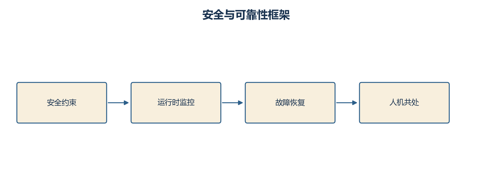

## 35.4　安全强化学习与运行时监控

**直觉解释。** CBF 提供"硬保证"，但依赖已知动力学模型与显式安全集。当模型未知或安全约束难形式化时，需用安全 RL 与运行时监控作为补充。

**约束 MDP（CMDP）.** 把安全建模为约束：在最大化奖励 $J_r=\mathbb{E}[\sum\gamma^t r_t]$ 的同时满足成本约束

$$
J_c=\mathbb{E}\Big[\sum_t\gamma^t c_t\Big]\le d,\quad c_t\in[0,1], \tag{35-6}
$$

其中 $c_t$ 为安全成本（如碰撞指示）。拉格朗日方法把约束优化转为 $\max_\pi \min_{\lambda\ge0} J_r-\lambda(J_c-d)$——通过自适应惩罚 $\lambda$ 平衡性能与安全[2]。

**表 35-1　安全机制谱系**

| 机制 | 保证类型 | 依赖 | 适用 |
|------|---------|------|------|
| CBF-QP（式 35-5） | 形式化、硬保证 | 已知动力学、显式 $h$ | 模型已知、约束清晰 |
| 安全 RL / CMDP（式 35-6） | 期望约束、软保证 | 数据驱动 | 复杂/未知约束 |
| 屏蔽（shielding） | 运行时硬保证 | 抽象模型 | 离散决策 |
| 运行时监控（35.4 节） | 检测+反应 | 异常检测 | 未知故障 |
| 控制冗余/看门狗 | 硬件级 | 硬件设计 | 失效兜底 |

**运行时监控与故障恢复。** 监控层实时检测异常：传感器故障（信号丢失、漂移、饱和）、策略失效（输出异常、分布外状态、动作振荡）、碰撞（力/力矩突变）。检测到异常后触发**安全停机（safety stop）**、切换到保守控制器或降级模式（如降低速度、收缩工作空间）。**故障恢复**使机器人回到安全状态（回到已知安全位姿、释放负载）、重试或请求人类介入。监控须比被监控策略运行频率更高（第 36 章实时系统）——从 1000Hz 力信号中检测异常，在毫秒内触发制动。监控器本身需被验证（监控逻辑的误报/漏报率），否则"安全网"反而引入风险：误报导致频繁停机（可用性损失），漏报导致真危险未被拦截。因此监控器采用"多指标投票"（力、电流、视觉一致性联合判定）降低单一信号误报，并把监控决策日志化以供事后审计（35.7A 节安全论证）。

## 35.5　人机共处安全

**直觉解释。** 协作机器人（cobot, collaborative robot）需在人类身边工作——传统工业机器人靠围栏隔离，协作场景要求物理接触也安全。这涉及力学、感知与意图预测（第 37 章）。

**关键机制。** ① **力/功率限制**：ISO/TS 15066 规定协作操作时接触力与功率限值（如瞬时接触力不超过 140–280N，依身体部位）；② **速度与间距监控（SSM）**：根据人与机器人距离动态调整速度，距离越近速度越低；③ **碰撞检测与软停止**：力传感器检测接触后立即停止并回退；④ **意图预测**：预测人类运动轨迹提前避让（第 37 章）。

**推导（速度—距离监控）.** 设人与机器人相对距离 $d$，相对速度 $v$，制动时间 $\tau_b$，安全判据为制动距离小于可用距离

$$
v\,\tau_b+\tfrac12 a_{\max}\tau_b^2\ \le\ d-d_{\min}, \tag{35-7}
$$

其中 $d_{\min}$ 为最小安全间距，$a_{\max}$ 为最大减速度。式 (35-7) 给出速度上限 $v_{\max}=(d-d_{\min}-\frac12 a_{\max}\tau_b^2)/\tau_b$——控制器据实调整速度。

**例 35.3（SSM 数值算例）** 设 $\tau_b=0.1\text{s},a_{\max}=5\text{m/s}^2,d=1\text{m},d_{\min}=0.2\text{m}$。制动距离项 $\frac12\times5\times0.01=0.025\text{m}$，可用距离 $0.8\text{m}$，故 $v_{\max}=(0.8-0.025)/0.1=7.75\text{m/s}$（ franca 实际协作机器人限速通常远低于此，约 0.25–1.5 m/s，说明还有更严格的规范约束）。当 $d$ 减小到 $0.3\text{m}$ 时 $v_{\max}=(0.1-0.025)/0.1=0.75\text{m/s}$——体现"近人减速"。

**标准与规范。** ISO 10218（工业机器人安全）、ISO/TS 15066（协作机器人）、ANSI/RIA R15.06 提供规范框架。合规是部署前提（第 36 章）。

### 35.5A　可靠性工程：失效率与可用度

安全是"不出事"，**可靠性（reliability）**是"长期不出事"。一个系统在 $t$ 时刻前不失效的概率为可靠度 $R(t)=P(T>t)$，$T$ 为失效时间。设失效率（hazard rate）$\lambda(t)=-\frac{d}{dt}\ln R(t)$，对**恒定失效率**（指数分布，机电系统磨损期后的典型段）

$$
R(t)=e^{-\lambda t},\qquad \mathrm{MTBF}=\frac{1}{\lambda}. \tag{35-8}
$$

MTBF（平均无故障时间）是可靠性核心指标：$\lambda=10^{-6}/\mathrm{h}$ 对应 $\mathrm{MTBF}=10^6$ h，约连续运行 114 年。但 MTBF 高不等于安全——一个 MTBF 极高的系统，若失效模式是"突然失控"，单次失效仍是灾难；可靠性关注频率，安全关注频率×后果（35.6A 节）。

**串联系统的可靠度。** 一个由 $K$ 个关键组件（驱动器、传感器、通信链路、控制器）串联构成的系统，整体可靠度

$$
R_{\text{sys}}(t)=\prod_{i=1}^{K} R_i(t), \tag{35-9}
$$

任一组件失效即系统失效。设每个组件 $\lambda_i=10^{-5}/\mathrm{h}$，$K=5$，运行 $t=100$ h，则 $R_{\text{sys}}=(e^{-10^{-3}})^5\approx e^{-0.005}=0.995$；若 $t=1000$ h 则 $R_{\text{sys}}=e^{-0.05}=0.951$——**组件越多、运行越久，可靠度衰减越快**。这解释了冗余设计（关键链路双份、看门狗）的价值：用并联把 $\prod$ 变为 $\sum$ 级的失效概率，把 $R_{\text{sys}}$ 拉回高位。

**例 35.4（冗余提升可靠度）** 关键传感器单份 $\lambda=10^{-4}/\mathrm{h}$，$t=500$ h 时 $R=e^{-0.05}=0.951$。双份并联（任一存活即系统可用）$R_{\text{red}}=1-(1-R)^2=1-0.049^2=0.9976$——冗余把 500 h 可靠度从 0.951 提到 0.9976，代价是硬件与故障检测逻辑。安全关键子系统（如急停、力限位）普遍采用此类冗余。

## 35.6　技术谱系与变体

**表 35-2　具身安全技术谱系**

| 层次 | 方法 | 保证 | 代表 |
|------|------|------|------|
| 规划层 | 约束规划、安全轨迹 | 路径安全 | 第 10—12 章 |
| 控制层 | CBF-QP（式 35-5） | 前向不变 | Ames 等[1] |
| 学习层 | 安全 RL/CMDP（式 35-6） | 期望约束 | Wachi & Sui[2] |
| 运行时 | 监控、屏蔽、看门狗 | 检测+反应 | 35.4 节 |
| 硬件层 | 力限制、急停、软体 | 物理兜底 | ISO 标准 |

### 35.6A　风险量化与容错设计

安全工程把"危险"量化为**风险**：风险 = 失效概率 × 后果严重度。设失效概率 $p_f$（与 35.5A 节可靠度相关，$p_f=1-R$）、后果严重度 $S\in\{1,2,3,4,5\}$（1 为轻微、5 为致命），则风险度

$$
\mathrm{Risk}=p_f\cdot S, \tag{35-10}
$$

安全设计的目标是把 $\mathrm{Risk}$ 降到可接受阈值 $\mathrm{Risk}_{\max}$ 以下（ISO 12100 风险评价框架）。这解释了为何"MTBF 高但后果致命"的系统仍需冗余——$\mathrm{Risk}$ 由 $p_f$ 与 $S$ 共同决定，二者任一不达标都不行。

**容错等级（FTC 级）。** 工业机器人安全常按**安全完整性等级**分级：
- **SIL 0—3**（IEC 61508）/ **PL e**（ISO 13849）：等级越高，要求的失效率与诊断覆盖越高。
- **PL e（最高）**：要求失效概率 $10^{-9}$ 量级/年，需冗余+诊断。

**容错架构。** 设关键功能 $K$ 份冗余、单份失效率 $\lambda$、诊断覆盖率 $\alpha$（检测并隔离失效的能力），则功能级失效率近似

$$
\lambda_{\text{FT}}\approx K(K-1)\lambda^2(1-\alpha)\ \text{(并联冗余，双取一)}. \tag{35-11}
$$

式 (35-11) 中 $\lambda^2$ 的二次项表明：**冗余使功能级失效率随 $\lambda$ 平方下降**——这是安全关键系统（如飞控、协作机器人急停）用双取一/三取二冗余的根本数学依据。诊断覆盖率 $\alpha\to1$ 时，未被诊断的共因失效项 $(1-\alpha)$ 趋零，$\lambda_{\text{FT}}$ 进一步下降。

**例 35.5（冗余降失效率）** 单份功能 $\lambda=10^{-4}/\mathrm{h}$，双取一并联冗余、$\alpha=0.99$：$\lambda_{\text{FT}}=2\times10^{-8}\times(0.01)=2\times10^{-10}/\mathrm{h}$——失效率降了 5 个数量级，对应 $\mathrm{MTBF}$ 从 $10^4$ h 提到 $5\times10^9$ h（约 57 万年）。这就是为何安全关键子系统必须冗余，单份设计无法满足 PL e / SIL 3。

**组合安全（多约束耦合）。** 真实系统同时受多重安全约束：关节力矩、末端碰撞、人机间距、电池电量等。设 $J$ 个 CBF 约束 $h_j(x)\ge0$，组合 CBF-QP 为

$$
\begin{aligned}
u^\star=\arg\min_u\quad & \tfrac12\|u-u_{\text{des}}\|^2\\
\text{s.t.}\quad & L_f h_j(x)+L_g h_j(x)u+\alpha_j(h_j(x))\ge0,\ j=1,\dots,J.
\end{aligned} \tag{35-12}
$$

式 (35-12) 的可行性（feasibility）是组合安全的核心难题：多个约束可能在某状态互相矛盾（如"远离人"与"抓住物"要求相反方向），导致 QP 无可行解。此时需**约束优先级松弛**——按严重度排序，优先满足高严重度约束，必要时软性违反低严重度约束并记录告警。多约束下的可行性分析（用 Farkas 引理判定）是安全滤波能否上线的前提，也是第 37 章人形机器人全身控制（第 37 章的优先级 QP）的安全基础。

## 35.7　边界与讨论

**边界。** ① **安全—性能权衡**：过度保守降低效率（式 35-5 的投影可能大幅偏离期望动作）；② **模型依赖**：CBF 需已知动力学与显式安全集，学习系统的安全验证困难；③ **形式化鸿沟**：深度策略的高维非线性使形式化验证计算昂贵；④ **人机交互的不确定性**：人类行为难预测，式 (35-7) 的保守假设可能过度限制效率；⑤ **可靠度—安全的区分**：式 (35-8)—(35-9) 的 MTBF 高不代表安全，后果严重度（式 35-10）同样关键；⑥ **共因失效**：冗余假设组件独立失效，但电源/固件共因会使式 (35-11) 的平方下降失效，需共因分析（如区分共因与独立失效的 $\beta$ 因子）；⑦ **验证—保证的边界**：CBF 的"硬保证"只在模型精确、假设成立时有效，模型误差与分布外状态会侵蚀保证，这正是安全验证（35.7A 节）持续存在的根本原因。

**安全与对齐。** 具身安全是"物理对齐"的一部分——确保系统行为符合人类意图与价值。这与《推理与对齐导论》《AI 治理与对齐导论》中的价值对齐、风险控制相呼应：软件对齐防"说错话"，具身安全防"做错事"。二者的共性是把"不可接受的输出"形式化为约束（价值约束/安全约束），区别在于具身安全的约束有物理后果、不可逆、且需在线运行时强制（CBF 滤波、看门狗），而软件对齐多在离线评测阶段把关。因此具身安全更强调**运行时保证**（35.4 节监控）与**失效兜底**（硬件急停、软体），这是它区别于纯软件安全的核心。

### 35.7A　安全验证与对抗测试

形式化保证证明"在模型假设下安全"，但假设本身需验证——这就是**安全验证（safety validation）**。三层验证：① **仿真压力测试**——在仿真中注入极端场景（人突然闯入、物体脱落、传感器噪声放大、动力故障），检验 CBF 滤波（式 35-5）与监控（35.4 节）是否兜住；② **对抗场景生成**——用对抗搜索（如对抗强化学习、符号方法 SMT）主动寻找使 $h(x)<0$ 的最坏输入，比随机测试更能暴露漏洞；③ **真机受控验证**——在物理隔离环境（围栏、急停可用）下重复关键场景，确认仿真—真实无系统性偏差（第 33 章式 33-4 的 sim-to-real 差距在此转化为安全验证的置信度需求）。

验证的标准是**安全论证（safety case）**：把"系统在部署场景安全"这一顶层主张，分解为可独立验证的子主张（动力学模型正确、CBF 条件满足、监控及时、硬件冗余有效、场景覆盖充分），每个子主张附证据。这是航空、汽车功能安全（ISO 26262）移植到具身智能的范式，也是第 36 章系统工程"可审计性"的核心。安全验证不是一次性事件，而是随每次策略/环境更新重新执行的持续过程。

## 35.8　承上启下与交叉引用

本章建立具身安全的框架：安全集与前向不变（定义 35.1，式 35-1）、CBF 与 Nagumo 条件（式 35-2—35-4）、CBF-QP 安全滤波（式 35-5，例 35.1—35.2）、CMDP（式 35-6）、运行时监控、人机共处 SSM（式 35-7，例 35.3）、可靠性工程 MTBF 与串联可靠度（式 35-8—35-9，例 35.4）、风险量化与容错冗余（式 35-10—35-11，例 35.5）及技术谱系（表 35-1、35-2）。第 33 章把安全列为评估硬维度；第 36 章的实时系统支撑毫秒级安全监控；第 37 章的人形机器人需意图预测；第 31 章数据飞轮的部署需安全护航。这些辨析衔接第 10—12、19、31、33、36—37 章与《推理与对齐导论》《AI 治理与对齐导论》。下一章讨论系统工程。

## 本章小结

本章论述具身系统的安全与可靠性。

- 我们定义安全集与前向不变（定义 35.1，式 35-1），基于 Nagumo 定理推导连续/离散 CBF 条件（式 35-2—35-4）。
- 我们推导 CBF-QP 安全滤波（式 35-5）并给出避障手算与离散验证算例（例 35.1—35.2）；介绍 CMDP（式 35-6）、运行时监控与故障恢复（表 35-1）。
- 我们形式化人机共处的速度—距离监控（式 35-7，例 35.3），并引入可靠性工程（式 35-8—35-9，例 35.4）、风险量化与容错冗余（式 35-10—35-11，例 35.5）、组合 CBF 约束（式 35-12），梳理安全技术谱系（表 35-2）。明确边界：安全—性能权衡、模型依赖、形式化鸿沟、共因失效。这些辨析衔接第 10—12、19、31、33、36—37 章与多部系列书。下一章讨论系统工程。

**进一步阅读**　本章建议延伸阅读的文献：[1] CBF 理论、[2] 安全 RL、[4] 端到端安全 RL 与屏障函数、[5] 安全关键控制综述、[7][8] ISO 10218 与 ISO/TS 15066 协作机器人规范。

## 参考文献

[1] Ames A D, Cozens J, Ren Y, Tabuada P. Control barrier functions: Theory and applications. *ECC*, 2019: 3480–3491.

[2] Wachi A, Sui Y. Safe reinforcement learning in constrained Markov decision processes. *ICML*, 2020: 9797–9806.

[3] Khatib O. Real-time obstacle avoidance for manipulators and mobile robots. *International Journal of Robotics Research*, 1986, 5(1): 90–98.

[4] Cheng R, Orosz G, Murray R M, Burdick J W. End-to-end safe reinforcement learning through barrier functions for safety-critical continuous control tasks. *AAAI*, 2019: 3387–3395.

[5] Xu X, Zhan Y, et al. Safety-critical control of robotic systems: A survey. *IEEE Transactions on Robotics*, 2024.

[6] Kolmanovsky I, van Nieuwstadt M J, Stefanopoulou A G. Optimization with constraints for constrained control. *IEEE Control Systems Magazine*, 2008, 28(5): 30–42.

[7] ISO. ISO 10218-1:2011 Robots and robotic devices — Safety requirements for industrial robots. *ISO Standard*, 2011.

[8] ISO/TS. ISO/TS 15066:2016 Robots and robotic devices — Collaborative robots. *ISO Technical Specification*, 2016.

---

# 第 36 章　具身系统的工程部署

第八篇最后一章：把具身智能系统从实验室部署到真实应用。系统工程（systems engineering）涉及实时性、计算架构、感知—规划—控制集成、可靠性运维——这是具身智能落地的"最后一公里"。一个算法在论文里成功率 95%，部署到真实机器人却可能因 30ms 的通信延迟而摔倒、因传感器时钟漂移而定位失准。本章先论证实时性动机（36.1 节），建立分层实时系统的时序模型（36.2 节），定义具身系统栈（36.3 节），推导端到端延迟与采样率约束（36.4 节），讨论部署运维（36.5 节），梳理工程谱系（36.6 节），剖析边界（36.7 节），最后承上启下（36.8 节）。

## 36.1　引入动机：从算法到系统的鸿沟

**动机。** 第 19—32 章的算法多在仿真或离线数据上验证，而真实部署必须面对：物理世界的实时性要求、异构硬件的计算约束、多模块的同步与容错、长期运行的可靠性。研究与部署之间存在鸿沟（sim-to-real 的第 20 章讨论算法层，本章讨论系统层）。**系统工程的核心是把算法的"平均性能"变成系统的"最坏情况保证"。**

**直觉解释。** 把具身系统想象成"交响乐团"：感知、规划、控制、执行各是乐器，必须以正确节奏（实时性）、统一乐谱（接口）、协调配合（同步）演奏。任何一个声部的延迟或错拍都会毁掉演出——即使每个乐手单独技术高超。

**定义 36.1（实时系统约束）**　具身系统是硬实时（hard real-time）系统：控制回路必须在截止期 $D$ 内完成，超时即视为失败（而非仅仅"慢"）。设计算任务集 $\{\tau_i\}$，每个任务有执行时间 $c_i$、周期 $T_i$、截止期 $D_i$，可调度条件是核心工程问题。

## 36.2　严格推导：分层时序与可调度性

**直觉解释。** 具身系统按频率分层：底层控制（100–1000Hz）、中层规划（1–10Hz）、高层 VLA/语义决策（0.1–1Hz）。频率差异巨大，必须分层解耦——否则低频大模型的推理会阻塞高频控制。

**推导（速率单调调度 RMS 可调度性）.** 对独立周期任务，若总处理器利用率

$$
U=\sum_i \frac{c_i}{T_i}\ \le\ n(2^{1/n}-1), \tag{36-1}
$$

则任务集在速率单调调度（rate-monotonic scheduling）下可调度。$n$ 个任务时 $n(2^{1/n}-1)\to\ln2\approx0.693$（$n\to\infty$），即利用率超过约 69% 就难以保证所有截止期。式 (36-1) 提醒：**必须为控制回路预留足够计算余量（<70% 利用率）**，不能让 VLA 推理占满 CPU。

**推导（端到端延迟链）.** 感知—规划—控制的端到端延迟为各阶段之和

$$
L_{\text{e2e}}=\underbrace{\tau_{\text{sense}}}_{\text{感知}}+\underbrace{\tau_{\text{plan}}}_{\text{规划}}+\underbrace{\tau_{\text{ctrl}}}_{\text{控制计算}}+\underbrace{\tau_{\text{comm}}}_{\text{通信}}+\underbrace{\tau_{\text{act}}}_{\text{执行器}}, \tag{36-2}
$$

而闭环稳定性要求 $L_{\text{e2e}} < T_{\text{ctrl}}$（采样周期）——延迟接近采样周期会使相位裕度耗尽、系统振荡甚至失稳。

**例 36.1（延迟预算算例）** 设控制频率 500Hz（$T=2\text{ms}$）。若感知（视觉推理）耗时 30ms、规划 20ms、控制计算 0.2ms、通信 0.5ms、执行器 1ms，则 $L_{\text{e2e}}=51.7\text{ms}\gg2\text{ms}$——无法实现 500Hz 闭环。解决：分层解耦——视觉/规划在低频异步运行（30Hz/10Hz），其结果作为设定点传给 500Hz 底层控制器；底层控制仅用高频本体感受（关节角、IMU，延迟 <1ms）。这样高频回路延迟 $0.2+0.5+1=1.7\text{ms}<2\text{ms}$，满足稳定性。

> 【图 36-1　分层实时架构】（原图见 figures/图36-1.png）：低频 VLA/规划层、中频状态估计、高频控制层，标注频率与延迟预算。
>
> 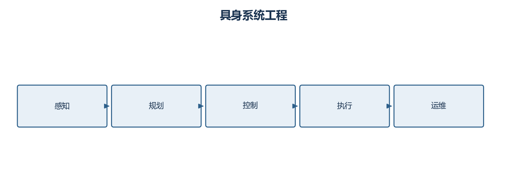

### 36.2A　有界响应时间与抖动

式 (36-1) 的利用率判据只保证**平均**可调度，真实系统还要控**最坏情况**。在速率单调调度下，任务 $\tau_i$ 的最坏响应时间 $R_i$（从释放到完成）满足递归

$$
R_i=c_i+\sum_{j\in hp(i)}\Big\lceil\frac{R_i}{T_j}\Big\rceil c_j, \tag{36-3}
$$

其中 $hp(i)$ 是比 $\tau_i$ 周期更短（更高优先级）的任务集合，$\lceil R_i/T_j\rceil$ 是在 $\tau_i$ 等待期内被抢占的次数。$R_i<D_i$ 即该任务满足截止期。迭代求 $R_i$（从 $c_i$ 起不动点）是静态实时分析的标准工具。

**抖动（jitter）。** 即使平均延迟达标，延迟的**方差**（抖动）对控制有害：控制回路假设固定相位，延迟忽大忽小会破坏 PID/MPC 的相位裕度。设实际延迟 $L=L_{\text{mean}}+\delta$，$\delta$ 零均值、标准差 $\sigma$，则等效相位滞后 $\phi=\omega\sigma$（$\omega$ 为回路带宽角频率）。经验上要求 $\sigma<0.1\,T_{\text{ctrl}}$——500Hz 控制（$T=2\text{ms}$）要求延迟抖动 $<0.2\text{ms}$。满足这一要求的手段：锁频（CPU 固定主频，禁省电降频）、实时线程（SCHED_FIFO 优先级）、内存预分配（禁运行时 GC/堆分配）、关中断临界区最小化。抖动治理是"算法正确但系统抖动"类 bug 的根治方案。

## 36.3　具身系统栈：模块与接口

**定义 36.2（具身系统栈）**　从感知到执行的完整链路：感知（第 5—9 章）→状态估计（第 8 章）→规划（第 10 章）→控制（第 11—12 章）→执行，加上世界模型（第 32 章）与学习模块（第 15—28 章）。模块间的接口、同步、容错是工程核心。

**表 36-1　具身系统栈分层**

| 层 | 功能 | 典型频率 | 对应章节 |
|----|------|---------|---------|
| 语义/决策层 | 语言理解、任务规划 | 0.1–1 Hz | 第 25—28 章 VLA |
| 规划层 | 轨迹/任务规划 | 1–10 Hz | 第 10 章 |
| 状态估计层 | 定位、传感器融合 | 50–200 Hz | 第 7—8 章 |
| 控制层 | 力矩/位置控制、MPC | 100–1000 Hz | 第 11—12 章 |
| 安全层 | 监控、CBF、急停 | 500–1000 Hz | 第 35 章 |
| 执行层 | 电机、驱动器 | 硬件 | — |

**接口设计。** 模块间通过定义良好的消息接口通信（如 ROS 的 topic/service/action）。接口需明确：数据格式、坐标系、时间戳、频率、服务质量（QoS）。**坐标系一致性**是常见 bug 来源——相机系、机器人基坐标系、世界系之间的变换必须显式管理（第 3、7 章）。

### 36.3A　接口契约与数据流

接口不仅是"消息格式"，更是一份**契约（contract）**，规定各方的义务与保证。一份完整的模块接口契约包含五要素：① **输入假设**——上游保证提供什么（频率、坐标系、有效性窗口）；② **输出保证**——本模块保证输出什么（延迟上界、精度、坐标系）；③ **失效语义**——本模块异常时下游如何感知（超时、心跳、错误码）；④ **版本兼容**——字段增删的向后兼容规则；⑤ **QoS**——交付保证（至少一次/恰好一次/至多一次）。

**数据流图的契约化。** 把具身系统画成数据流图（DFD），每条边是一个契约、每个节点是一组承诺。调试时，失败往往发生在"契约边界"——上游假设下游能提供 $100\text{Hz}$，下游实际只给 $50\text{Hz}$，这种违约不报错但性能劣化，是最隐蔽的一类 bug。契约测试（contract testing）把每个接口的假设/保证写成可执行的断言，在 CI 中自动验证，是 36.5A 节"接口债"治理的具体手段。

**时间戳契约。** 多源数据融合的前提是"同一时刻"语义明确。契约须规定时间戳基准（控制时钟 vs 墙钟）、延迟补偿（传感器曝光中心 vs 读出时间）、以及"过期数据"的丢弃策略（如视觉特征延迟 >50ms 则丢弃并标记该帧感知不可用）。时间戳契约缺失是"定位偶尔漂移"类问题的常见根源（第 7—8 章）。

## 36.4　系统集成：同步、容错与通信

**直觉解释。** 集成是把独立开发的模块拼成协同系统——真正的难点在"接缝"：时钟同步、数据丢失、模块崩溃、网络抖动。

**时钟同步。** 分布式模块（多相机、多计算单元）需统一时间基准。设本地时钟偏差 $\Delta t$，网络延迟 $d$，可用 NTP/PTP 或硬件触发同步。定位中的时间偏差直接转化为状态估计误差：速度 $v$ 下 $\Delta t$ 偏差导致位置误差 $v\Delta t$——$v=1\text{m/s},\Delta t=10\text{ms}$ 即 1cm 误差。

**容错（fault tolerance）。** 关键模块需冗余与降级：传感器冗余（多相机/IMU 融合，第 8 章）、计算冗余（主备控制器）、通信冗余（多链路）。**优雅降级（graceful degradation）**：高层的 VLA 失效时回退到预编程的保守行为，而非完全停机。

**表 36-2　通信中间件对比**

| 中间件 | 特点 | 适用 |
|--------|------|------|
| ROS 2 / DDS | 发布订阅、QoS 可配 | 机器人事实标准 |
| LCM | 低延迟、轻量 | 高频控制 |
| ZeroMQ | 灵活、低开销 | 自定义系统 |
| 共享内存 | 最低延迟 | 单机紧耦合 |

### 36.4A　网络延迟与带宽预算

通信是分布式具身系统的"隐形延迟源"。不同链路的延迟与带宽差异决定架构选择：

**表 36-3　典型链路延迟与带宽**

| 链路 | 单向延迟 | 带宽 | 适用 |
|------|---------|------|------|
| 同机共享内存 | <0.1ms | GB/s 级 | 同节点紧耦合 |
| 局域网（有线） | 0.1–1ms | 10–100Mbps | 多相机汇聚 |
| 5G/Wi-Fi | 5–30ms | 100Mbps+ | 云—边协同 |
| 广域网（云） | 30–200ms | 受限 | 低频大模型推理 |

**例 36.2（云—边延迟决策）** 设 VLA 推理 50ms，控制回路要求 500Hz（$T=2\text{ms}$）。若 VLA 在云端（往返 100ms），其结果到控制层延迟 $\ge100+50=150\text{ms}$——远超 $T$，不能进高频回路，只能作低频（1Hz）设定点。若 VLA 在边缘（延迟 <1ms）且量化后推理 30ms，则 $30+2=32\text{ms}$，可支持 30Hz 的中频规划。这定量说明"为什么大模型必须下沉到边缘"，也是表 36-1 分层架构中 VLA 层频率受限的根本原因。

**带宽预算。** 视觉数据最耗带宽：$1920\times1080$ RGB 帧约 6MB/帧，30Hz 即 180Mbps/相机。多相机系统须就地压缩（H.265、深度下采样）或只传特征（边缘特征提取），否则带宽成为瓶颈——这解释了为何机器人普遍"边缘提取特征、云端融合决策"。

## 36.5　部署与运维：从原型到产品

**挑战。** 真实环境的多样性（光照、人群、地形）、长期运行的可靠性（内存泄漏、过热、磨损）、远程监控与更新（OTA）、安全（第 35 章）——需要 DevOps 式的**具身系统运维（MLOps for robotics）**。

**推导（可用性指标）.** 系统可用性 $A=\frac{\text{MTBF}}{\text{MTBF}+\text{MTTR}}$，其中 MTBF 为平均无故障时间、MTTR 为平均修复时间。要达 99.9% 可用性（"三个九"），需 $\text{MTTR}\le 0.001\times\text{MTBF}$——若 MTBF=100 小时，MTTR 必须 $\le6$ 分钟，这要求快速故障诊断与远程恢复（而非派人现场）。

**例 36.3（可用性算例）** 机器人 MTBF=200h，MTTR=30min（0.5h），则 $A=200/200.5=99.75\%$。要提升至 99.9%，需 MTTR 降至 $200\times0.001/0.999\approx0.2\text{h}=12\text{min}$——自动重启与远程诊断的价值显而易见。

**部署流程。** ① 仿真验证（第 29 章）→② 受控环境试点→③ 影子模式（策略运行但不执行）→④ 逐步放量→⑤ 持续监控与数据回传（数据飞轮，第 31 章）。每步设"熔断"阈值（异常率、碰撞次数）触发回滚。

### 36.5A　机器人 MLOps 与技术债

把"数据飞轮"工程化需要一套**机器人 MLOps** 流水线：① **数据采集与版本化**（第 34 章，DVC/Git LFS 追踪数据代际）；② **训练与评估**（固定评估协议，第 33 章式 33-3 置信区间，防"过拟合到自己的测试集"）；③ **模型注册与回滚**（每个模型版本绑定评估指标与适用域）；④ **灰度部署**（影子模式→小流量→全量）；⑤ **在线监控**（漂移检测、失败率、安全事件率）；⑥ **数据回收**（失败案例回传训练集，闭环）。

**技术债（technical debt）.** 具身系统的技术债有三类：① **控制债**——为赶工期写的硬编码魔数（阈值、延时），后续难以调参；② **接口债**——坐标系、时间戳约定不统一，模块替换牵一发动全身；③ **评估债**——没有自动化评估流水线，每次回归靠人工跑（[7] 把 ML 系统的"隐藏技术债"概念引入机器人）。技术债的度量可用"回归测试覆盖率"与"接口契约测试数量"作代理指标，并在每次部署前跑自动化回归（CI/CD for robotics），否则系统会随迭代越来越脆弱——这是"研究原型→可靠产品"鸿沟的核心工程原因。

## 36.6　工程谱系与变体

**表 36-4　具身系统工程谱系**

| 架构 | 特点 | 优势 | 代价 |
|------|------|------|------|
| 分层模块化（本章） | 感知—规划—控制分层 | 可调试、可验证 | 延迟叠加 |
| 端到端学习（第 26—28 章） | 感知到动作直接映射 | 低延迟、整体优化 | 难调试、数据饥渴 |
| 混合架构 | 高层学习+低层控制 | 兼顾灵活与安全 | 接口复杂 |
| 云—边协同 | 大模型在云、控制在边 | 算力弹性 | 网络依赖 |

**边缘计算与模型加速。** VLA 等大模型（第 25—28 章）推理慢，需在边缘设备上部署量化（INT8）、剪枝、知识蒸馏等加速技术，或云—边协同（大模型在云端低频规划，边缘高频执行）。量化把 FP32 权重压到 INT8 通常可获 3—4 倍加速且精度损失 <1%（对控制类任务可接受）；知识蒸馏则把大模型的"决策知识"压到小模型，保留高频回路的实时性。第 38 章讨论通用智能的算力需求。

### 36.6A　算力与能耗预算

移动端机器人的算力与能量都受限。设一次推理的计算量为 $F$（FLOPs）、设备算力为 $P_{\text{compute}}$（FLOPs/s）、功耗为 $P_{\text{energy}}$（W），则单步推理时间与单次能耗为

$$
t_{\text{infer}}=\frac{F}{P_{\text{compute}}},\qquad E_{\text{infer}}=P_{\text{energy}}\cdot t_{\text{infer}}=\frac{F\cdot P_{\text{energy}}}{P_{\text{compute}}}. \tag{36-4}
$$

若需以频率 $f$ 推理，则推理功耗占比 $f\cdot E_{\text{infer}}/P_{\text{battery}}$ 决定电池续航。**算力—频率—续航三角**是架构核心：提高频率或模型精度（$F$ 增大）会牺牲续航，反之则牺牲实时性或智能。

**例 36.4（算力—续航权衡）** 某移动机器人电池 360Wh，VLA 模型 $F=10^{12}$ FLOPs，边缘 NPU $P_{\text{compute}}=100$ TOPS（$10^{11}$ FLOPs/s）、$P_{\text{energy}}=10$W。则 $t_{\text{infer}}=10^{12}/10^{11}=10\text{ms}$（算力上限 100Hz）、$E_{\text{infer}}=10\times10^{-2}=0.1\text{Wh}$。以 5Hz 推理时持续推理功耗 $\approx f\cdot P_{\text{energy}}\cdot\frac{t_{\text{infer}}}{1}=5\times10\times0.01=0.5\text{W}$，占电池功率占比 $\approx0.5$W，对应纯推理续航 $360/0.5=720\text{h}$——推理本身不是续航瓶颈。但若 $F$ 增大 10 倍（更大模型）且 $P_{\text{energy}}$ 升 2 倍至 20W，则 $E_{\text{infer}}$ 增 20 倍，5Hz 推理功耗升 20 倍至 10W，续航降至 36h——这定量解释了为何"更大的 VLA"必须配合更高效的边缘芯片，否则续航崩塌。式 (36-4) 把"模型多大能跑、跑多快能续航"变成可计算的预算约束，是 36.4A 节云—边分工的量化基础。

## 36.7　边界与讨论

**边界。** ① **实时与智能的张力**：大模型能力强但推理慢，难以进入高频回路（36.1—36.2 节）；② **工程细节决定成败**：坐标变换、时钟同步、消息丢弃等"琐事"常是部署失败的真正原因；③ **研究—部署鸿沟**：论文平均指标掩盖长尾失败，真实部署需最坏情况保证；④ **成本与可靠性**：冗余与实时性增加硬件与算力成本；⑤ **接口与契约的脆弱性**：模块间契约（36.3A 节）的隐性假设是"不会出错"的根源，契约漂移（上游改了频率/坐标系而下游未察觉）会导致难以复现的间歇性故障，需契约测试与版本治理来兜底。

**安全是系统属性。** 安全（第 35 章）不是某个模块，而是贯穿全栈的属性——从硬件急停到 CBF 控制到运行时监控到部署熔断。系统工程必须把安全嵌入每一层。

### 36.7A　可测试性、可观测性与调试

端到端学习系统（第 26—28 章）的"黑箱"属性使调试困难——成功率下降时难以定位是感知错、规划错还是控制错。**可观测性（observability）**是工程解法：全栈日志 + 关键状态快照（每 $T_{\text{log}}$ 秒记录感知输出、规划轨迹、控制输入、执行误差、安全事件）+ 因果链追踪（一个失败动作回溯到是哪一层的哪个输入导致）。

**调试范式。** 分层系统天然可逐层隔离：固定下层（用录制数据回放），单独测上层——这称为"数据回放调试（data replay）"。设某次失败的轨迹记录为 $(o_1,\dots,o_T)$，可把它喂给感知模块检查 $o_t\to\hat s_t$ 是否错，再喂给规划检查 $\hat s_t\to\pi$ 是否合理，逐层定位。端到端模型虽无显式分层，但可用**探针（probing）**——在中间层加线性读出，检查其特征是否编码了正确的语义（如"前方有人"），从而把黑箱部分白箱化。

**影子模式与 A/B 测试。** 36.5 节的影子模式本质是"并行评估"：新旧策略同时运行，旧策略（或人类）执行、新策略只记录，比较二者的分歧（disagreement）。设新策略与参考策略的动作分歧率 $\delta_{\text{div}}=P[\pi_{\text{new}}\ne\pi_{\text{ref}}]$，部署前要求 $\delta_{\text{div}}$ 在关键场景（含人、含障碍）低于阈值。这把"新策略是否更安全"转化为可测量的分歧统计，是大规模部署（车队、工厂群）的标准做法。

## 36.8　承上启下与交叉引用

本章建立系统工程框架：实时约束（定义 36.1）、RMS 可调度性（式 36-1）与端到端延迟（式 36-2，例 36.1）、有界响应时间与抖动（式 36-3）、系统栈与接口契约（定义 36.2、表 36-1、36.3A 节）、网络延迟与带宽（表 36-3，例 36.2）、通信容错（表 36-2）、可用性运维（例 36.3）、机器人 MLOps 与技术债（36.5A 节）、算力与能耗预算（式 36-4，例 36.4）、可观测性与影子模式（36.7A 节）及工程谱系（表 36-4）。第 35 章的安全层贯穿全栈；第 25—28 章的 VLA 位于决策层；第 31 章的数据飞轮嵌入运维流程；第 38 章的通用智能对算力提出更高要求。这些辨析衔接第 3、5—12、25—28、31—32、35、38 章与《大模型系统与工程导论》。第八篇（第 33—36 章）至此完成，第九篇（第 37—40 章）转向人形机器人、通用智能与社会伦理。

## 本章小结

本章论述具身系统的工程部署。

- 我们定义实时系统约束（定义 36.1），推导 RMS 可调度性（式 36-1）与端到端延迟链（式 36-2，例 36.1）、有界响应时间与抖动（式 36-3），确立分层解耦与抖动治理的必要性。
- 我们定义具身系统栈（定义 36.2、表 36-1）与接口契约（36.3A 节），讨论网络延迟与带宽（表 36-3，例 36.2）、时钟同步、容错与通信中间件（表 36-2），推导可用性指标（例 36.3）、部署流程与机器人 MLOps（36.5A 节）。
- 我们推导算力与能耗预算（式 36-4，例 36.4），梳理工程谱系（表 36-4），强调边缘加速与云—边协同；补充可测试性、可观测性与影子模式（36.7A 节）。明确边界：实时与智能的张力、工程细节、研究—部署鸿沟，并指出安全是贯穿全栈的属性。这些辨析衔接第 3、5—12、25—28、31—32、35、38 章与《大模型系统与工程导论》。下一章开启第九篇：人形机器人。

**进一步阅读**　本章建议延伸阅读的文献：[1] 部署最佳实践、[2] RMS 调度理论、[5] 实时网络、[6] 边缘计算、[7] ML 系统技术债、[8] 模型压缩。

## 参考文献

[1] Liu J L, et al. Robotic system design for real-world deployment: Challenges and best practices. *IEEE Robotics and Automation Magazine*, 2021, 28(3): 88–98.

[2] Liu C L, Layland J W. Scheduling algorithms for multiprogramming in a hard-real-time environment. *Journal of the ACM*, 1973, 20(1): 46–61.

[3] Siciliano B, Villani L. *Robot Force Control*. Kluwer Academic Publishers, 1999.

[4] Quinones P, et al. ROS 2: The robot operating system for the next generation of robotics. *IEEE Robotics and Automation Magazine*, 2023.

[5] Koubaa A, et al. Time-sensitive networking for real-time robotics. *IEEE Transactions on Industrial Informatics*, 2020.

[6] Shi W, Cao J, Zhang Q, et al. Edge computing: Vision and challenges. *IEEE Internet of Things Journal*, 2016, 3(5): 637–646.

[7] Sculley D, Holt G, Golovin D, et al. Hidden technical debt in machine learning systems. *NeurIPS*, 2015: 2503–2511.

[8] Han S, Mao H, Dally W J. Deep compression: Compressing deep neural networks with pruning, trained quantization and Huffman coding. *ICLR*, 2016.

---

# 第 37 章　人形机器人

第九篇（第 37—41 章）从理论回到工程，展望具身智能的未来形态与边界。本章从人形机器人（humanoid robot）开始——它被广泛视为通用机器人的理想载体，自 2023 年以来迎来产业爆发：特斯拉 Optimus、Figure 01、宇树 H1/G1、Agility Digit、傅利叶 GR-1 等相继亮相。本章不追逐新闻，而是问一个工程科学问题：**为什么是「人形」？这种形态在数学与控制上付出了什么代价，又换回了什么不可替代的收益？**

本章先分析形态选择的动机与代价（37.1 节），建立全身控制（whole-body control）的严格数学框架并给出推导（37.2 节），用数值算例展示接触力分配的计算（37.3 节），梳理技术谱系与 2025—2026 年的产业进展（37.4 节），最后辨析边界并收束（37.5 节）。

## 37.1　形态优势与挑战

**引入与动机。** 机器人形态（morphology）的选择，本质上是「环境先验」与「执行代价」之间的一笔交易。人类文明的环境——楼梯的踏步高度、门把手的位置、工具的握持方式、汽车的踏板间距——都是围绕人体尺寸（anthropometry）设计的。若机器人采用人形，则无需改造环境即可直接操作这些设施，这是所谓的**环境兼容性（environmental compatibility）**优势[1]。此外，人类动作捕捉数据、遥操作示范、视频中的人类行为，都可以不经运动学映射（retargeting）或仅经简单映射就用于训练人形机器人——这直接降低了第 18 章所述的示范数据获取成本。

**直觉解释。** 把形态想象成一把「钥匙」：环境是锁。人形这把钥匙能打开最多现成的锁（人类世界），但它也是结构最精密、最容易折断的钥匙——三十多个关节意味着三十多个可能的故障点，双足着地意味着支撑多边形（support polygon）狭小、静稳定性差。相比之下，轮式机器人在平整地面上是「最省力的钥匙」，却打不开楼梯这把锁；四足机器人善于崎岖地形，却没有空闲的手去拧门把手。表 37-1 概括了三种形态的权衡。

**表 37-1　机器人形态的多维度权衡**

| 形态 | 环境适配 | 静稳定性 | 操作能力 | 自由度/成本 | 典型代表 |
|------|----------|----------|----------|-------------|----------|
| 人形（双足） | 优（原生人类环境） | 差（小支撑面） | 优（双手+全身） | 高（30＋ DoF） | Optimus、Figure、宇树 H1 |
| 轮式 | 中（平整地面） | 优（大支撑面） | 中（需专用末端） | 低 | 仓储 AMR |
| 四足 | 良（崎岖地形） | 良（四点支撑） | 中（负载有限） | 中（12—16 DoF） | Spot、Go1 |

> 【图 37-1　人形机器人形态优势与支撑多边形】（原图见 figures/图37-1.png）：对比人形、轮式、四足在支撑多边形面积、可达工作空间与自由度上的差异；人形双足支撑面最小但上肢操作空间最大。
>
> 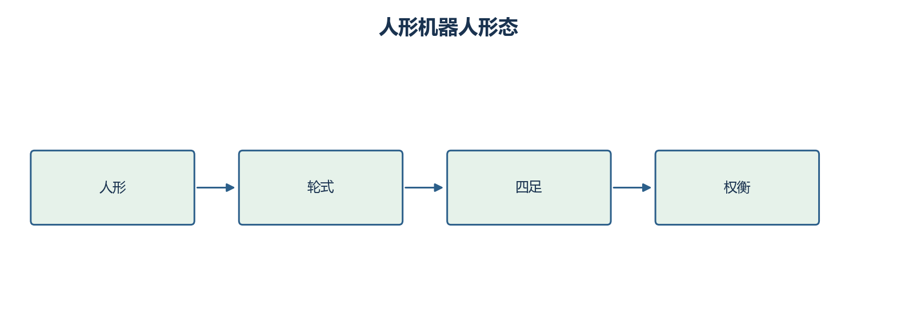

**严格定义与挑战量化。** 设机器人有 $n$ 个关节，构型空间（configuration space）为 $\mathcal{Q}\subseteq\mathbb{R}^{n}$。人形机器人的 $n$ 通常大于 30（如 28—40 个自由度）。其动力学方程（第 3 章）为

$$
\mathbf{M}(\mathbf{q})\ddot{\mathbf{q}}+\mathbf{C}(\mathbf{q},\dot{\mathbf{q}})\dot{\mathbf{q}}+\mathbf{g}(\mathbf{q})
=\boldsymbol{\tau}+\mathbf{J}_{c}(\mathbf{q})^{\top}\boldsymbol{\lambda} \tag{37-1}
$$

其中 $\mathbf{M}(\mathbf{q})\in\mathbb{R}^{n\times n}$ 为质量矩阵，$\mathbf{C}$ 为科氏力与离心力项，$\mathbf{g}$ 为重力，$\boldsymbol{\tau}$ 为关节力矩，$\mathbf{J}_c$ 为接触点雅可比（contact Jacobian），$\boldsymbol{\lambda}$ 为接触力。人形态的困难集中在三点：其一，$n$ 大使式 (37-1) 的实时求解（如第 25 章的 MPC）维度高；其二，双足支撑时接触约束 $\mathbf{J}_c\dot{\mathbf{q}}=\mathbf{0}$ 使系统成为**欠驱动（underactuated）**——漂浮基座（floating base）的 6 个自由度没有直接执行器；其三，跌倒后难以自恢复。式 (37-1) 是 37.2 节全身控制的起点。

## 37.2　全身控制：从task空间到接触一致性

**引入与动机。** 人形机器人要同时完成多个任务：保持平衡、迈步、用左手开门、用右手端杯。若为每个任务单独设计控制器，它们会相互冲突。全身控制（whole-body control, WBC）把式 (37-1) 的最优控制问题写成**带优先级的二次规划（quadratic program, QP）**，统一协调所有任务与约束[2]。

**直觉解释。** 想象一个人端着水走路：他的手臂要稳（任务一），脚步要准（任务二），重心不能越出支撑面（约束）。大脑并不是分别指挥手和脚，而是求解一个「在满足所有硬性约束的前提下，让各项任务误差最小」的整体问题。WBC 就是把这件事形式化。

**严格定义与推导。** 把任务 $i$ 写成期望加速度形式 $\mathbf{J}_i\ddot{\mathbf{q}}+\dot{\mathbf{J}}_i\dot{\mathbf{q}}=\ddot{\mathbf{x}}_i^{\mathrm{des}}$。浮动基座动力学可写为

$$
\mathbf{S}^{\top}\big(\mathbf{M}\ddot{\mathbf{q}}+\mathbf{C}\dot{\mathbf{q}}+\mathbf{g}-\mathbf{J}_c^{\top}\boldsymbol{\lambda}\big)=\boldsymbol{\tau},\qquad
\mathbf{J}_c\ddot{\mathbf{q}}+\dot{\mathbf{J}}_c\dot{\mathbf{q}}=\mathbf{0} \tag{37-2}
$$

其中 $\mathbf{S}\in\mathbb{R}^{n\times(n-6)}$ 选择驱动关节。把 $\boldsymbol{\lambda}$ 与 $\boldsymbol{\tau}$ 作为决策变量，构造分层 QP（以第 1 层为例）：

$$
\begin{aligned}
\min_{\ddot{\mathbf{q}},\boldsymbol{\tau},\boldsymbol{\lambda}}\quad&
\|\mathbf{J}_1\ddot{\mathbf{q}}+\dot{\mathbf{J}}_1\dot{\mathbf{q}}-\ddot{\mathbf{x}}_1^{\mathrm{des}}\|_{\mathbf{W}_1}^{2}
+\epsilon\|\boldsymbol{\tau}\|^{2}\\
\mathrm{s.t.}\quad&
\text{式 (37-2) 的动力学与接触约束},\\
&\boldsymbol{\tau}_{\min}\le\boldsymbol{\tau}\le\boldsymbol{\tau}_{\max},\quad
\boldsymbol{\lambda}\in\mathcal{K}_{c}
\end{aligned} \tag{37-3}
$$

其中 $\mathcal{K}_c$ 为摩擦锥（friction cone）约束：$\lambda_z\ge 0,\ \|\boldsymbol{\lambda}_{xy}\|_{2}\le\mu\lambda_z$。式 (37-3) 的物理含义是：在物理可行的接触力与关节力矩范围内，让最高优先级任务的跟踪误差最小。更高优先级的任务（如平衡）可逐级加入零空间（nullspace）投影，确保低优先级任务不破坏高优先级任务[2]。

**推导要点。** 摩擦锥不等式是非线性（锥）约束，实际求解常将其线性化为棱锥近似：以 $\mu\lambda_z$ 为半径的正八边形，得到形如 $\pm\lambda_x\pm\lambda_y\le\mu\lambda_z$ 的线性不等式组，使式 (37-3) 变为标准凸 QP，可在毫秒级求解（第 25 章的实时性要求）。

## 37.3　数值算例：双足静止站立的接触力分配

**例 37.1（接触力分配的手算）** 设人形机器人质量 $m=60\ \mathrm{kg}$，重力 $g=9.81\ \mathrm{m/s^2}$，总重 $mg=588.6\ \mathrm{N}$。双脚对称站立，每只脚承担一半法向力。忽略上身姿态，令左右脚接触点相对质心投影的水平距离为 $d=0.12\ \mathrm{m}$，足底摩擦系数 $\mu=0.6$。若质心水平偏移 $\Delta x=0.03\ \mathrm{m}$，为保持零角动量变化，两脚法向力需重新分配：

$$
\lambda_{z,L}+\lambda_{z,R}=mg=588.6,\qquad
d(\lambda_{z,L}-\lambda_{z,R})=mg\,\Delta x \tag{37-4}
$$

由式 (37-4) 解得 $\lambda_{z,L}-\lambda_{z,R}=mg\Delta x/d=588.6\times0.03/0.12=147.15\ \mathrm{N}$，故 $\lambda_{z,L}=367.9\ \mathrm{N}$，$\lambda_{z,R}=220.7\ \mathrm{N}$。左脚摩擦余量 $\mu\lambda_{z,L}=0.6\times367.9=220.7\ \mathrm{N}$——这正是防止侧滑的最大水平力。若外部扰动水平力超过此值，QP（式 37-3）将无可行解，机器人必须迈步（stepping）恢复平衡，这引出第 11—12 章的步态控制。

**例 37.2（自由度与实时性估算）** 设 $n=32$，每个 QP 迭代的复杂度约为 $O(n^3)\approx 3.3\times10^{4}$ 次浮点运算。以 500 Hz 控制频率（周期 2 ms）运行，商业求解器（如 OSQP）在嵌入式 CPU 上单次求解约 0.3—1 ms——留有余量但紧张。这解释了为何产业界采用「高层低频规划（50 Hz）＋底层高频 WBC（500—1000 Hz）」的分层架构（第 25 章）。

## 37.4　技术谱系与 2025—2026 年产业进展

**引入与动机。** 人形机器人并非单一技术，而是第 11—13 章（运动控制）、第 18—19 章（示范与强化学习）、第 25 章（VLA 操作）、第 35 章（安全）的集成体。表 37-2 按「能力层」梳理其技术谱系与代表工作。

**表 37-2　人形机器人的技术谱系与变体**

| 能力层 | 关键技术 | 对应章节 | 代表方法/系统 |
|--------|----------|----------|---------------|
| 运动 | 强化学习步态、WBC | 第 11—13、25 章 | PPO 步态、分层 WBC |
| 感知 | 视觉惯导、本体感觉融合 | 第 5—9 章 | EKF、VIO |
| 操作 | VLA、遥操作模仿 | 第 18、25 章 | ACT、OpenVLA |
| 学习 | 数据飞轮、仿真预训练 | 第 29—31、35 章 | sim-to-real、遥操作数采 |
| 安全 | 碰撞检测、力控 | 第 35 章 | 摩擦锥约束、软体外壳 |

**直觉解释与进展。** 21 世纪 20 年代中期的关键转折是「学习驱动（learning-based）」取代「模型驱动（model-based）」成为主流：早期人形（如 ASIMO）依赖精心设计的模型与轨迹，泛化差；新一代系统用大规模强化学习在仿真中训练步态，再 sim-to-real 迁移（第 31 章），用 VLA 模型实现语言条件操作（第 25 章）。2025—2026 年，产业焦点从「走得好」转向「干得活」：进厂打工（汽车总装、物料搬运）、商用服务（导览、零售）成为落地场景，但可靠性、成本（单机仍达数十万元）与安全认证仍是瓶颈[3]。这一进程呼应第 38 章的讨论：人形是通往通用具身智能的形态赌注。

进一步审视这一转折的方法论意义：模型驱动路线把智能「写进」控制器，依赖工程师对动力学的精确建模；学习驱动路线把智能「长在」数据里，依赖仿真环境的规模与保真度（第 29—31 章）。两条路线并非替代关系——当代系统往往以模型提供安全约束（式 37-3 的摩擦锥）、以学习提供行为策略，形成「学习提出、模型兜底」的混合架构。这正是全书反复强调的闭环原则（第 1.6 节）在人形机器人上的具体体现。

### 37.4A　稳定性度量：ZMP 与捕获点

WBC（式 37-3）解决"如何分配力矩与接触力"，而双足稳定的核心判据是**质心垂直投影是否落在支撑多边形内**。设双脚着地时支撑多边形为凸包 $\Pi$，质心位置 $\mathbf{p}_{\mathrm{com}}$，则**零力矩点（zero-moment point, ZMP）**定义为使地面力矩为零的点

$$
\mathbf{p}_{\mathrm{zmp}}=\mathbf{p}_{\mathrm{com}}-\frac{1}{mg}\mathbf{z}\times\big(\mathbf{r}_{\mathrm{com}}\times m\ddot{\mathbf{p}}_{\mathrm{com}}\big), \tag{37-5}
$$

其中 $\mathbf{z}$ 为单位竖轴、$\mathbf{r}_{\mathrm{com}}$ 为质心相对支撑面的向量。当且仅当 $\mathbf{p}_{\mathrm{zmp}}\in\Pi$ 时机器人**动态平衡**（不会翻转）。ZMP 比"质心投影"更严格：它考虑了质心加速度产生的附加力矩，是步态规划（第 11—12 章）生成参考轨迹的硬约束。

**捕获点（capture point）**是 ZMP 的"可达性"推广：定义 $\mathbf{p}_{\mathrm{cp}}=\mathbf{p}_{\mathrm{com}}+\mathbf{v}_{\mathrm{com}}/\omega$（$\mathbf{v}_{\mathrm{com}}$ 为质心速度、$\omega=\sqrt{\lambda}$ 为质心摆动的特征频率），表示"质心在不动足的前提下能靠摆腿（stepping）停下来时，新支撑点应放在哪"。捕获点落在支撑多边形内意味着**无需迈步即可稳定**；落在外则必须迈步且迈步落点需覆盖捕获点。这把"是否要迈一步、往哪迈"转化为一个几何判据，是第 11 章全身运动控制与恢复平衡的底层逻辑。

**例 37.3（ZMP 越界算例）** 设机器人质心 $\mathbf{p}_{\mathrm{com}}$ 在支撑面中心、$\ddot{\mathbf{p}}_{\mathrm{com}}=0$，则 $\mathbf{p}_{\mathrm{zmp}}=\mathbf{p}_{\mathrm{com}}$（在支撑面内，稳定）。若受侧向扰动使质心以 $\ddot{\mathbf{p}}_{\mathrm{com}}=(1.0,0,0)\ \mathrm{m/s^2}$ 加速、质心高 $z=0.9\ \mathrm{m}$，则 $\mathbf{p}_{\mathrm{zmp}}=\mathbf{p}_{\mathrm{com}}-\frac{z}{g}\ddot{\mathbf{p}}_{\mathrm{com}}=\mathbf{p}_{\mathrm{com}}-\frac{0.9}{9.81}\times1.0\ \mathrm{m}$，即 ZMP 向加速度反方向偏移约 $0.09\ \mathrm{m}$。若支撑半宽仅 $0.10\ \mathrm{m}$，ZMP 已逼近边界，控制器须触发恢复（调整质心或迈步）——这正是例 37.1 摩擦余量告罄后的下一步。

### 37.4B　执行器技术路线

执行器（actuator）是人形"力气"的物理载体，直接决定力控能力、效率与可靠性。三大技术路线：

**表 37-3　人形执行器技术路线对比**

| 路线 | 原理 | 力/带宽 | 力控 | 效率 | 代表 |
|------|------|---------|------|------|------|
| 准直接驱动（QDD） | 无刷电机+谐波减速 | 中 | 良（可测电流≈力矩） | 高 | 宇树 H1、Atlas |
| 液压 | 油缸+伺服阀 | 高（大负载） | 优 | 中 | 早期 Atlas、HyQ |
| 串联弹性（SEA） | 电机+弹性元件 | 中高 | 优（弹性变形∝力） | 中 | 部分研究原型 |

QDD 以"电流反馈≈力矩反馈"实现低成本力控，是当前双足步态（第 11 章）主流；液压在需要大负载（重载搬运）时仍有优势但维护复杂；SEA 用弹性元件把"力"变成可直接测量的物理量，力控最平滑但带宽受限。执行器选择与式 (37-3) 的 $\boldsymbol{\tau}_{\min}\le\boldsymbol{\tau}\le\boldsymbol{\tau}_{\max}$ 约束直接耦合：$\boldsymbol{\tau}_{\max}$ 由执行器峰值力矩决定，决定了机器人能做什么任务（举多重的物、迈多高的台阶）。

**关节力矩与负载的定量关系。** 设末端需施加力 $\mathbf{F}$，对应关节力矩 $\boldsymbol{\tau}=\mathbf{J}^{\top}\mathbf{F}$（$\mathbf{J}$ 为末端雅可比）。以肩关节为例，若 $\|\mathbf{J}^{\top}\|\approx0.2\ \mathrm{m}$（力臂），末端持 $5\ \mathrm{kg}$ 物（$\mathbf{F}\approx50\ \mathrm{N}$）则关节需 $\boldsymbol{\tau}\approx0.2\times50=10\ \mathrm{N\cdot m}$。这解释了为何人形上肢关节力矩规格（通常 10—100 N·m）是"能搬多重"的直接决定量，也是第 38 章"通用智能需要多少力"的物质基础。

### 37.5　边界与讨论

人形机器人的根本张力在于**通用性与可靠性的权衡**：越接近人体，环境适配越好，但自由度越多、欠驱动越严重、故障率越高。一个诚实的设计判断是：在结构化、重复任务中，专用机器人（轮式、机械臂）仍具压倒性效率优势；人形的价值在于**非结构化、多任务、为人类环境而设计**的场景。此外，式 (37-3) 的 QP 框架假设接触模型精确，而真实地面摩擦、足底形变存在不确定性——这衔接第 31 章的 sim-to-real 差距与第 40 章的鲁棒性开放问题。伦理与安全后果见第 39 章；而人形是否真的「必须」像人，则是第 38 章要审视的更根本问题——环境适配的收益是否足以抵消复杂性的代价，仍无定论。

### 37.5A　能耗与运输能耗比

续航是人形落地的硬约束（第 36 章算力—续航三角在此转化为"机械续航"）。设机器人在速度 $v$ 下行走功率 $P(v)$、质量 $m$，则**运输能耗比（cost of transport, CoT）**

$$
\mathrm{CoT}=\frac{P(v)}{m g\, v}\quad [\text{无量纲}], \tag{37-6}
$$

即"每把自身体重运单位距离所耗的能量"。人类步行 $\mathrm{CoT}\approx0.1$（极高效），早期双足机器人 $\mathrm{CoT}\approx0.3$—$1.0$，是人类的 3—10 倍。$\mathrm{CoT}$ 随速度呈 U 形：过低速度时固定损耗（关节保持、控制）占比高，过高速度时摆动动能损耗大，存在最优巡航速度。

**例 37.4（续航估算）** 设 $m=60\ \mathrm{kg}$、$\mathrm{CoT}=0.2$、$v=1.0\ \mathrm{m/s}$，则行走功率 $P=\mathrm{CoT}\cdot m g v=0.2\times60\times9.81\times1.0\approx118\ \mathrm{W}$（机械功率），计入电机与传动效率 $\eta=0.5$，电功率 $\approx236\ \mathrm{W}$。若电池 $2\ \mathrm{kWh}$，纯行走续航 $\approx2000/236\approx8.5\ \mathrm{h}$——但这只是行走；叠加操作（双手负载）与感知计算（第 36 章式 36-4）后实际续航往往减半。$\mathrm{CoT}$ 把"走多久"变成可由动力学直接推算的预算量，是评估人形"能否干满一个班次"的底层指标。值得注意的是，$\mathrm{CoT}$ 与式 36-4 的"算力—续航三角"共同构成人形的双重续航约束：机械续航（$\mathrm{CoT}$）与计算续航（推理功耗）必须同时满足，取二者短板为系统真实续航——这把人形续航评估从"电池多大"细化为"机械+计算双预算联合优化"的工程问题。

## 本章小结

本章论述人形机器人这一「通用形态赌注」的物理与控制基础。

我们首先从环境兼容性与数据可用性论证形态动机（表 37-1），指出人形以静稳定性与欠驱动为代价换取操作通用性。接着建立含接触约束的浮动基座动力学（式 37-1、37-2）与分层二次规划形式的全身控制（式 37-3），并推导摩擦锥的棱锥线性化。我们通过接触力分配（例 37.1）与实时性估算（例 37.2）两个算例展示工程权衡，梳理了从模型驱动到学习驱动的技术谱系（表 37-2）与 2025—2026 年产业进展，并比较执行器技术路线（37.4B 节、表 37-3）。

我们还明确边界：人形的优势在非结构化多任务场景，其可靠性受接触不确定性制约；并以零力矩点 ZMP 与捕获点（式 37-5，例 37.3）刻画双足稳定的几何判据，以运输能耗比 CoT（式 37-6，例 37.4）量化续航瓶颈。这些辨析衔接第 11—13、18—19、25、31、35、36、38—40 章。

值得强调的是，人形机器人提供了一个观察全书主线的理想窗口：状态估计（第二篇）、运动控制（第三篇）、学习（第四、五篇）、仿真迁移（第七篇）、安全评估（第八篇）在这里汇于一体。它既是技术的集成者，也是第 40 章诸多开放问题最集中的显现之处。

下一章讨论一个更宏观的问题：具身智能与通用智能（AGI）的关系。

**进一步阅读**　本章建议延伸阅读的文献：[1] 人形形态综述、[2] 优化式全身控制、[4] 基于力反馈的鲁棒人形控制、[5] 人形机器人控制专著、[7] 丰富环境中运动行为涌现、[8] 人形执行与控制综述。

## 参考文献

[1] Brooks R A. Humanoid robots. *Scientific American*, 2002, 287(3): 68–75.

[2] Wensing P M, Orin D E, Gatla A, et al. Optimization-based control for multi-contact humanoid robots. *IFAC-PapersOnLine*, 2020, 53(2): 9814–9821.

[3] Cheng Z, Reda D, Zhang K, et al. Overview of humanoid robotics and its industrial applications. *IEEE Robotics & Automation Magazine*, 2023, 30(4): 18–31.

[4] Grimshaw P, Macchinetta A, Traversaro S, et al. Robust humanoid robot control through force feedback. *IEEE Transactions on Robotics*, 2021, 37(5): 1680–1695.

[5] Kajita S, Kaneko K, Yokoi K. *Humanoid Robot Control*. CRC Press, 2014.

[6] Broad A, Nguyen A, Kanda N, et al. A benchmark for humanoid locomotion and manipulation. *arXiv:2402.16783*, 2024.

[7] Heess N, Dhruva T, Sriram S, et al. Emergence of locomotion behaviours in rich environments. *arXiv:1707.02286*, 2017.

[8] Zhang T, Wu J, Hwang K S. Humanoid robots: a review of actuation and control. *Journal of Mechanisms and Robotics*, 2022, 14(4): 040801.

---

# 第 38 章　具身智能与通用智能

本章讨论全书最宏大也最难回答的问题：具身智能在通用人工智能（artificial general intelligence, AGI）中的位置。大语言模型（LLM）展现了惊人的通用语言与推理能力，却缺乏物理接地（physical grounding，第 2.2、24 章）；具身智能提供物理交互与因果经验——二者的结合被视为通向 AGI 的关键路径（参见《自然语言智能导论》第 40 章、《世界模型导论》第 36 章）。我们无意给出「AGI 何时到来」的预言，而是要做一件更克制的事：**把「具身是否必要」这个模糊争论，拆解为可定义、可论证、可判定的若干子问题。**

本章先辨析离身与具身两条路径的哲学与技术根源（38.1 节），建立「接地」的形式化度量并给出推导（38.2 节），用思想算例比较两条路径的信息瓶颈（38.3 节），讨论两路汇合的技术形态与谱系（38.4 节），最后审视「具身是否 AGI 必要条件」的论证边界并收束（38.5 节）。

## 38.1　两条路径：离身智能与具身智能

**引入与动机。** 人工智能史上始终存在两条致敬不同哲学传统的路径。符号主义与连接主义的主流实践把智能视为**计算（computation）**：只要给系统足够的表征与算力，它就能处理语言、推理、规划，身体不过是可有可无的输入输出设备——这是**离身智能（disembodied intelligence）**的立场。具身认知（embodied cognition，第 2 章）则主张智能**生成于（enacted）**身体与世界的交互循环之中，脱离身体谈智能是「无源之水」[1]。两条路径的分歧不是工程细节，而是对「智能是什么」的本体论承诺。

**直觉解释。** 想象一个从未见过颜色的语言模型读遍了所有关于「红色」的文本：它能精确地区分「 scarlet 」「 crimson 」的语义关系，却从未真正体验过红色。它的「红」是符号之间的差分，而非与世界属性的接触。具身路径则坚持：概念的意义锚定在传感器与效应器的物理循环上——你懂得「红」，是因为你的视觉系统能与真实波长互动、你的手能避开烫手的红铁块。这就是**语义接地（semantic grounding）**的核心主张。

**严格定义。** 我们用「接地度」刻画一个概念与物理世界的联系强度。设概念 $c$ 的文本表征为 $\mathbf{h}_{\text{text}}(c)$，其多模态物理观测集合为 $\mathcal{O}(c)$（如该物体的图像、触觉、交互轨迹），定义

$$
\mathcal{G}(c)=\mathbb{E}_{o\sim\mathcal{O}(c)}\big[\mathrm{sim}\big(\mathbf{h}_{\text{text}}(c),\,\mathbf{h}_{\text{sens}}(o)\big)\big] \tag{38-1}
$$

其中 $\mathbf{h}_{\text{sens}}(\cdot)$ 为感知编码器，$\mathrm{sim}$ 为余弦相似度。离身系统在 $\mathcal{O}(c)=\varnothing$ 时无定义（或退化为纯文本自洽），而具身系统通过交互数据使 $\mathcal{G}(c)$ 可被实际估计与优化。式 (38-1) 把「接地」从口号变为可测量的量。

**表 38-1　离身与具身路径的 systematically 对比**

| 维度 | 离身（LLM 路径） | 具身（机器人路径） |
|------|------------------|--------------------|
| 数据来源 | 文本海量、易获取 | 交互昂贵、难规模化 |
| 核心能力 | 语言、抽象推理、知识 | 物理操作、因果经验、接地 |
| 主要短板 | 接地缺失、物理幻觉 | 泛化弱、语义理解浅 |
| 知识表示 | 符号/分布表征 | 传感器运动循环 |
| 训练范式 | 自监督下一词预测 | 强化学习/模仿学习 |
| 代表系统 | GPT-4、Claude | RT-2、OpenVLA、Dreamer |

> 【图 38-1　离身与具身路径的汇流】（原图见 figures/图38-1.png）：左右两条路径分别标注「文本预训练」「物理交互」，经 VLA（第 25 章）与世界模型（第 9—13 章）汇合于通用智能；标出语义接地度 $\mathcal{G}$ 作为交汇处的桥梁。
>
> 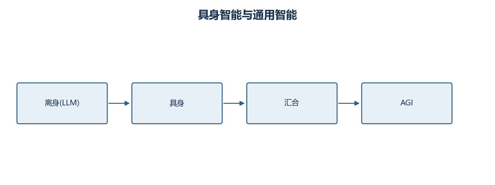

### 38.1A　符号接地问题的三种立场

Harnad 的**符号接地问题（symbol grounding problem）**[5]是离身路径的哲学症结：符号之间的指称关系（"红"指"红"的同义词）如何在没有外部锚点的情况下获得意义？三种立场：

**表 38-2　符号接地问题的三种立场**

| 立场 | 主张 | 代表 | 局限 |
|------|------|------|------|
| 纯符号 | 意义在符号系统内部自洽 | 早期 AI | 无外部锚点，"空转" |
| 分布接地 | 意义=与海量上下文共现的分布 | LLM | 接地是统计性的，非因果 |
| 交互接地 | 意义锚定于传感器—效应器循环 | 具身认知 | 依赖身体，难规模化 |

LLM 的分布接地是统计共现的"软接地"：它知道"红"常与"火""血""热"共现，但没有"手触热铁块会烫"的因果体验。具身的交互接地则把意义锚定在"做—受反馈"循环上。式 (38-1) 的 $\mathcal{G}(c)$ 正是度量"一个概念有多少意义来自交互而非共现"的量化指标。这三种立场不是非此即彼：当代 VLA（38.4 节）实际是"分布接地（LLM 部分）+ 交互接地（机器人部分）"的混合，$\mathcal{G}(c)$ 在语言指令上高（分布接地）、在操作技能上依赖交互接地。

**因果理解为何倾向具身。** 文本提供的是**相关**（A 常与 B 共现），而因果需要**干预证据**（改变 A 看 B 是否变）。具身系统天然做"天然实验"：机器人推了杯子，杯子动了——这是干预 $do(\text{推})\to\text{动}$ 的直接证据，文本只能描述"人们推杯子，杯子会动"而无法验证反事实（若没推会怎样）。这就是为何具身路径被认为在因果与常识上更有优势：交互循环提供干预数据，而干预是因果推断的根基（呼应系列书《因果智能导论》）。但须平衡：因果发现本身有方法论困难，"具身就自动懂因果"同样是过度承诺——38.5A 节的 $\mathrm{CompGen}$ 判据正是检验这一主张的工具。

## 38.2　接地的信息论分析：为什么纯文本有天花板

**引入与动机。** 「文本里没有物理」并非修辞，而是可以严格论证的信息论事实。本节用一个受限但清晰的分析说明：某些物理属性从文本通道不可辨识（identifiability，参见第 2.5 章），这正是离身路径的结构性天花板。

**直觉解释。** 一段文本无论多长，都是符号序列。物理世界的许多属性（质量、摩擦、刚性、颜色的主观体验）并不完全决定于描述它们的文字——「一模一样」的文字可以对应无穷多种物理配置。若两个物理状态 $s_1,s_2$ 产生完全相同的文本描述 $T$，则任何仅从 $T$ 训练的系统都无法区分它们：这是信息论层面的**不可辨识性**。

**严格定义与推导。** 设物理状态空间 $\mathcal{S}$，文本映射 $f:\mathcal{S}\to\mathcal{T}$。若存在 $s_1\neq s_2$ 使 $f(s_1)=f(s_2)=T$，则对任何只观测 $T$ 的学习器 $q$，其后验满足

$$
p(s_1\mid T)=p(s_2\mid T)\quad\text{当先验对称时} \tag{38-2}
$$

因为 $p(s\mid T)\propto p(T\mid s)p(s)$，而 $p(T\mid s_1)=p(T\mid s_2)=1$（文本确定产生）。由互信息链式法则，文本通道关于物理状态的互信息上限为

$$
I(S;T)=H(T)-H(T\mid S)\le H(T) \tag{38-3}
$$

而物理交互通道（视觉、触觉、力反馈）的互信息 $I(S;O_{\text{sens}})$ 可接近 $H(S)$（高保真感知时）。当 $H(S)\gg H(T)$ 时，$I(S;T)\ll I(S;O_{\text{sens}})$——文本通道对物理状态的信息压缩是**有损且不可逆**的。这便是「物理幻觉」（机器人自信地执行违反物理规律的动作）的信息论根源，衔接第 33 章的幻觉诊断。

**例 38.1（不可辨识性的具体例子）** 考虑文本「一个杯子放在桌边」。它可能对应：(a) 空杯（质量 0.2 kg），(b) 装满水的杯（质量 1.0 kg）。两者的文本描述 $T$ 完全相同，故 $p(a\mid T)=p(b\mid T)$（先验对称）。离身系统只能按先验均值猜测抓取力度（如 0.6 kg 对应值），对 (a) 会捏碎、对 (b) 会失手；而具身系统通过力/视觉反馈 $\mathcal{O}$ 立即区分两者——这正是式 (38-1) 中 $\mathcal{G}(c)$ 可测、式 (38-3) 中信息量差异的现实例证。

### 38.2A　信息损失的量化：接地度与信息保留比

式 (38-3) 给出了互信息上界，下面把它转成一个可计算的**接地度**与**信息保留比**。设物理状态 $S$ 的总不确定性为 $H(S)$（比特），文本通道提供的信息为 $I(S;T)$，定义**信息保留比**

$$
\eta_{\text{info}}=\frac{I(S;T)}{H(S)}\in[0,1], \tag{38-4}
$$

$\eta_{\text{info}}$ 衡量"文本保留了多少物理信息"。式 (38-3) 的 $\eta_{\text{info}}\le H(T)/H(S)$：当物理状态维度远高于文本表达力时（$H(S)\gg H(T)$），$\eta_{\text{info}}\to0$，即**文本几乎不携带物理信息**。

**例 38.2（保留比估算）** 设物理状态 $S$ 含 6 个连续量（质心位姿、质量、摩擦系数、刚度等），量化后 $H(S)\approx60$ bit（每量 10 bit 精度）。文本"一个杯子放在桌边"的语义熵 $H(T)\approx12$ bit（约 4 个有效词）。则 $\eta_{\text{info}}\le12/60=0.2$——**文本最多保留 20% 的物理信息，80% 的质量/摩擦/刚度细节不可恢复**。这定量支撑了 38.1 节"纯文本有天花板"的论断，也解释了为何操作类任务（依赖质量、摩擦）必须用具身交互补全那 80% 的信息缺口。注意 $\eta_{\text{info}}$ 是上界估计，实际 $I(S;T)$ 通常更低（文本冗余、歧义），故此结论是保守的。

## 38.3　算例：两条路径的能力边界与组合增益

**例 38.3（互补性的量化示意）** 设 AGI 需要两类能力：语言推理能力 $A_{\text{lang}}$ 与物理接地能力 $A_{\text{phys}}$，综合智能度取两者乘积（强调缺一不可，与第 38.2 节的「必要条件」论证一致）：

$$
A_{\text{AGI}}=A_{\text{lang}}^{\alpha}\cdot A_{\text{phys}}^{1-\alpha},\quad \alpha\in(0,1) \tag{38-5}
$$

取 $\alpha=0.5$（两者等权），离身系统 $A_{\text{lang}}=0.9,\ A_{\text{phys}}=0.1$，则 $A_{\text{AGI}}=\sqrt{0.9\times0.1}=0.30$；纯具身系统 $A_{\text{lang}}=0.2,\ A_{\text{phys}}=0.8$，则 $A_{\text{AGI}}=0.40$；融合系统（VLA）$A_{\text{lang}}=0.85,\ A_{\text{phys}}=0.75$，则 $A_{\text{AGI}}=0.80$。算例表明：任何单一路径的 $A_{\text{AGI}}$ 都因「短板相乘」而受压，融合路径才接近高值——这是第 38.4 节两路汇合的定量动机。须声明：式 (38-4) 是启发式模型而非定律，其价值在于揭示「能力不可相互替代」的结构，而非给出精确数字。

## 38.4　两路汇合：VLA 与具身基础模型

**引入与动机。** 既然两条路径互补（例 38.3），工程上的自然问题是：如何把它们接在一起？答案正在浮现——用语言模型的语义表征「条件化」机器人的感知与动作，即视觉-语言-动作（vision-language-action, VLA）模型（第 25 章），以及用物理交互数据反过来为语言模型注入接地（第 27、28 章）。

**直觉解释。** 把 LLM 看作一个「读遍人类知识的大脑」，把具身系统看作「能动手的身体」。VLA 做的就是给大脑接上身体：语言指令「把苹果放进碗里」先被 LLM 解析为语义计划，再由动作模块翻译成关节指令；执行中的视觉反馈又回流修正计划。这条回路同时利用了文本的海量知识（解决具身泛化弱）与物理的接地信号（解决离身无物理常识）。

**技术谱系与变体。** 表 38-3 按「融合深度」梳理三条汇合路线。

**表 38-3　离身—具身融合的技术谱系**

| 融合路线 | 机制 | 代表工作 | 对应章节 |
|----------|------|----------|----------|
| 语言条件化 | LLM 输出计划/奖励，机器人执行 | SayCan、VLA | 第 25 章 |
| 具身数据反哺 | 交互数据微调/对齐语言模型 | 具身指令微调 | 第 27—28 章 |
| 统一世界模型 | 语言与物理共享潜在空间 | 多模态世界模型 | 第 9—13、16 章 |

文献[2]的架构主张与此呼应：把世界模型作为智能体的核心，感知与行动围绕统一的潜在表征组织——这正是第 9—13 章潜在动力学与第 25 章 VLA 在架构层的一致性。

### 38.4A　具身智能的规模定律：数据、算力与泛化的三角

第 34 章讨论了数据规模化，本节把它与算力、泛化联系起来，回答"具身智能的 ImageNet 时刻"是否会发生。设具身模型性能随**有效交互数据量** $N$（式 34-3 的 $N_{\text{eff}}$）与**参数量/算力** $C$ 联合增长：

$$
A_{\text{emb}}(N,C)=A_{\infty}\Big(1-e^{-N/N_0}\Big)^{\beta_N}\Big(1-e^{-C/C_0}\Big)^{\beta_C}. \tag{38-6}
$$

这里 $N_0$ 由式 34-2 的"任务模式数×每模式所需数据"决定，$C_0$ 由模型容量与任务复杂度决定。关键差异在于：**具身数据的 $N_0$ 远大于文本**（因为每个任务模式需要真实交互轨迹，而非文本共现），故具身智能的规模曲线比 LLM"更陡也更贵"——同样的算力翻倍，若数据不翻倍，$A_{\text{emb}}$ 几乎不增长（数据是硬瓶颈）。

**例 38.4（规模瓶颈算例）** 设 $A_{\infty}=0.95,\ \beta_N=\beta_C=1$，文本域 $N_0=10^3$（文本易得），具身域 $N_0=10^5$（交互昂贵）。在 $N=10^4、C$ 充足时：文本域 $A=0.95(1-e^{-10})\approx0.95$（已饱和），具身域 $A=0.95(1-e^{-0.1})\approx0.09$（刚起步）。这说明**单纯堆算力对具身智能收效甚微**，必须先解决"数据从哪来"（第 31、34 章的仿真合成、数据飞轮、跨本体共享）。这也是为何 Open X-Embodiment（第 34 章）把"数据标准化与共享"而非"更大模型"作为突破点——具身智能的瓶颈在数据供给侧，算力只是乘子。

**与 LLM 规模定律的对照。** LLM 的 Kaplan/Chinchilla 定律（算力-数据-参数等比缩放）在具身域失效的根本原因：文本数据的边际获取成本趋零（爬取即得），而具身数据的边际成本恒定（每条轨迹都要占用机器人时间），故"算力—数据等比"假设不成立，具身规模定律是**数据约束主导**的（第 34 章式 34-3 的边际效率在具身域衰减更快）。这为第 40 章"开放问题"中"具身何时达到 LLM 的规模化红利"提供了定量框架。进一步地，式 (38-6) 暗示一个策略含义：在数据供给受限的阶段，"提升数据有效量 $N_{\text{eff}}$"（质量、多样性、跨本体共享，第 34 章）比"扩大模型容量 $C$"的边际收益更高——这是当前具身基础模型优先做数据工程（Open X-Embodiment 式的数据汇聚）而非单纯堆参数的经济学解释。

## 38.5　具身是 AGI 的必要条件吗？——边界与讨论

**引入与动机。** 在给出论证之前，有必要先说明为何这个问题值得严肃对待：它决定了具身智能是整个 AI 版图的核心，还是一个专门的应用分支。这一判断进而影响资源配置、学科建制与公众对「通用智能」的期待——因此它不是纯粹的学院之问。

现在回到本章标题的问题。我们区分三种强弱不同的命题，避免「necessary」一词的混用：

**定义 38.1（三种必要性命题）**
- **强命题**：任何 AGI 必须拥有物理身体（具身是逻辑必要条件）。
- **弱命题**：具身极大丰富智能，是通向「完整通用智能」的高效/关键路径，但非严格必要。
- **操作命题**：在物理世界中部署并验证通用能力，必须具备具身。

**论证与边界。** 强命题难以成立：可以在仿真或纯符号环境中构造展现出广泛认知能力的系统（如 AlphaGo 在棋类上的超人表现），说明「通用认知行为」并不逻辑蕴含物理身体。但强命题的困难也暗示其对手的空洞：若把「智能」定义得足够宽，离身系统确实可被称为「某种通用智能」。本书采取**弱命题**立场[1]：具身提供物理接地（式 38-1）、因果理解与常识——这些是「完整」智能的关键维度（第 2、38.2 节），但是否「严格必要」仍是开放问题（参见《认知智能导论》）。操作命题则无可争议：要在物理世界验证智能，必须有身体。

**常见误用。** 一种误用是把「当前 LLM 缺乏接地」等同于「LLM 永远不可能具备通用智能」——前者是事实判断，后者是形而上学断言，二者不等价。另一种误用是把具身当作万能药，仿佛接上身体就能自动获得常识——第 40 章的开放清单表明，接地本身就是一个未解难题。诚实的结论是：两条路径的汇合（38.4 节）是目前最有希望的方向，但「汇合是否充分」仍未可知。一个值得警惕的陷阱是把「物理接地」理解为一次性获得的属性——实际上，式 (38-1) 的 $\mathcal{G}(c)$ 需要持续传感器运动循环来维持，一旦脱离交互，接地会随分布漂移而退化，这衔接第 33 章的长期一致性问题。这些辨析衔接第 2、24—28、33 章与《自然语言智能导论》第 40—42 章、《认知智能导论》《世界模型导论》第 36 章。

### 38.5A　汇合是否充分：一个可操作的判据

"两路汇合（VLA）能否通向通用智能"目前是信念而非结论。本节给出一个**可操作的判据**：通用智能应满足**组合泛化（compositional generalization）**——把训练时见过的原子技能组合成新任务时仍能成功。设任务由 $K$ 个原子技能以组合方式构成，组合空间大小随组合深度 $d$ 指数增长，则通用智能的标志是：在**未见组合**（训练只见过深度 $d_0$ 的组合）上，成功率不随 $d$ 急剧衰减。

$$
\mathrm{CompGen}(d)=\frac{p_{\text{success}}(d\ \text{未见组合})}{p_{\text{success}}(d\ \text{已见组合})}\in[0,1]. \tag{38-7}
$$

$\mathrm{CompGen}(d)\approx1$ 表示组合泛化良好（新组合与旧组合成功率相当），$\mathrm{CompGen}(d)\to0$ 表示系统只会"背题"而不会"举一反三"。当前 VLA 系统（第 25 章）在 $d$ 稍超训练深度时 $\mathrm{CompGen}$ 显著下降，这是"具身智能仍远未通用"的量化证据，也是第 40 章"开放问题"的核心之一。具身路径的潜在优势在于：物理交互提供**因果结构**（动作→状态变化的可预测性），这可能帮助模型学到比纯文本更"可组合"的表征——但这仍是假设，需 $\mathrm{CompGen}(d)$ 这类指标的实验验证。换言之，$\mathrm{CompGen}(d)$ 是把"具身能否通向通用"这一哲学争论，压缩成一个随 $d$ 变化的曲线斜率——若该斜率随数据规模（式 38-6 的 $N$）趋平，则汇合充分性有望成立；若始终陡降，则需重新审视具身路径的"充分性"主张。

**例 38.5（组合泛化算例）** 设"擦桌子"由原子技能{伸臂、按压、移动}组合（深度 $d=3$）。训练时见过 500 个 $d=3$ 组合任务，成功率 0.85。测试一个训练未见的 $d=4$ 组合"擦桌后把抹布挂回挂钩"，成功率 0.31。则 $\mathrm{CompGen}(4)=0.31/0.85\approx0.36$——新组合成功率仅为旧组合的 36%，组合泛化严重不足。这比"单一任务成功率 0.85"更能揭示系统的通用性上限，是把"具身是否通向通用"从口号变为可测量判据的具体例子。

## 本章小结

本章把「具身与通用智能」的宏大争论拆解为可分析的子问题。贯穿全章的方法论是：把看似形而上学的「是否必要」之问，转化为可定义（接地度）、可论证（互信息上界）、可计算（能力乘积模型）的工程科学问题。这种「把大问题拆成可判定小问题」的做法，也是全书处理开放议题（第 40 章）时一以贯之的态度。

我们首先辨析离身与具身两条路径的哲学根源与技术权衡（表 38-1、符号接地三立场表 38-2），定义接地度 $\mathcal{G}(c)$（式 38-1）使之可测量。接着用信息论论证纯文本通道对物理状态的不可辨识性（式 38-2、38-3）与信息保留比（式 38-4），并通过杯子算例（例 38.1）、保留比估算（例 38.2）与能力乘积模型（例 38.3）展示具身的不可替代性与两路互补性。我们梳理了 VLA 与具身基础模型的三条汇合路线（表 38-3），推导具身规模定律（式 38-6，例 38.4）说明其数据约束主导的特性，最后区分强、弱、操作三种必要性命题，阐明本书采取弱命题立场及其边界，并以组合泛化指标 $\mathrm{CompGen}$（式 38-7，例 38.5）给出"汇合是否充分"的可操作判据。

我们还明确边界：强命题难以成立、弱命题更可取，而「汇合是否充分」仍开放。信息论分析（式 38-3）揭示的「文本通道有损压缩」是结构性而非暂时性限制，但这一结论依赖「文本与物理状态非双射」的前提——若未来出现能完整描述物理状态的符号系统，结论需重新审视。这些辨析衔接第 2、9—13、24—28、33、40 章及多部系列书。

下一章转向具身智能进入社会后引发的伦理与治理问题。

**进一步阅读**　本章建议延伸阅读的文献：[1] 具身认知纲领、[2] LeCun 自主智能路径、[3] 具身心灵、[4] Brooks 无表征智能、[5] Harnad 符号接地问题、[7] 语言模型作为零样本规划器、[8] 学习演化具身智能。

## 参考文献

[1] Pfeifer R, Bongard J. *How the Body Shapes the Way We Think: A New View of Intelligence*. MIT Press, 2006.

[2] LeCun Y. A path towards autonomous machine intelligence. *Open Review*, 2022.

[3] Varela F J, Thompson E, Rosch E. *The Embodied Mind: Cognitive Science and Human Experience*. MIT Press, 1991.

[4] Brooks R A. Intelligence without representation. *Artificial Intelligence*, 1991, 47(1–3): 139–159.

[5] Harnad S. The symbol grounding problem. *Physica D*, 1990, 42(1–3): 335–346.

[6] O'Neill K. *The Myth of Artificial Intelligence: Why Computers Can't Think the Way We Do*. Harvard University Press, 2021.

[7] Shlapentokh-Rothman Y, Shentu W, et al. Language models as zero-shot planners: Extracting actionable knowledge for embodied agents. *ICML*, 2022.

[8] Duan Y, Edwards J, Storkey A, et al. Embodied intelligence via learning and evolution. *Nature Communications*, 2021, 12: 5721.

---

# 第 39 章　具身智能的社会与伦理

当具身智能走出实验室、进入工厂、家庭与公共空间，它不再只是工程对象，而成为社会行动者（social agent）。本章讨论由此引发的一组伦理与社会问题：就业结构冲击、责任归属（responsibility attribution）、隐私、人机关系与治理（governance）。与常见的人文式论述不同，本书坚持一个立场：**伦理问题可以通过清晰的建模变得可分析、可量化、可设计，而不是停留在口号争执**——当然，可量化不等于可还原，价值判断仍有不可计算的内核（见 39.5 节边界）。

本章先分析社会影响与就业的量化模型（39.1 节），建立责任归属的因果-规范框架并给出推导（39.2 节），推导隐私-效用权衡（39.3 节），审视人机关系与心理影响（39.4 节），最后讨论治理路径与伦理边界并收束（39.5 节，参见《AI治理与对齐导论》）。

## 39.1　社会影响：就业、协作与分配

**引入与动机。** 每一次通用技术革命都会引发「机器抢饭碗」的忧虑，具身智能的差异在于它替代的不再是纯脑力或纯体力，而是**感知-动作闭环中的整套技能**。这使冲击更直接，也使「人机协作」成为比「人机替代」更现实的范式。

**直觉解释。** 与其把机器人看作「人的替代品」，不如看作「人的能力放大器」：协作机器人（cobot，第 35 章）承担重复、高精度、高负荷的环节，人承担判断、灵活性、责任与社交环节。结果不是「人 vs 机器」，而是「会用机器的人 vs 不会用机器的人」——真正的分化发生在技能结构而非物种之间。

**严格定义与量化。** 设某岗位的总任务集合 $T=\{t_1,\dots,t_m\}$，每项任务由人完成的单位成本为 $c_i^H$、由机器人完成为 $c_i^R$。岗位被「自动化」的经济条件为机器人总成本低于人力总成本：

$$
\sum_{i\in \mathcal{A}} c_i^R + C_{\text{deploy}} \;<\; \sum_{i=1}^{m} c_i^H \tag{39-1}
$$

其中 $\mathcal{A}\subseteq T$ 为可自动化任务子集，$C_{\text{deploy}}$ 为部署摊销成本（第 37 章指出人形单机仍达数十万元）。式 (39-1) 揭示两个关键：其一，当 $C_{\text{deploy}}$ 高时，只有高工资岗位（$c_i^H$ 大）才值得自动化——这解释了为何首批落地是汽车总装等高成本场景；其二，随 $C_{\text{deploy}}$ 下降，自动化边界 $\mathcal{A}$ 向外扩张，冲击逐步传导至服务业。因此就业影响不是「瞬间替代」，而是**沿成本梯度渐进推移**的过程，这为社会的再培训（reskilling）争取了时间窗口。

**例 39.1（自动化边界的手算）** 设某装配工位 5 项任务，人工总成本 $\sum c_i^H=50$ 元/小时；机器人可完成其中 3 项，$\sum_{i\in\mathcal{A}} c_i^R=12$ 元/小时，设备折旧与维护摊销 $C_{\text{deploy}}=20$ 元/小时。则总机器人成本 $32<50$ 元/小时，满足式 (39-1)，该工位会被自动化，但剩余 2 项任务仍需人工——岗位被「重构」而非「消灭」。若 $C_{\text{deploy}}$ 降至 5 元/小时，则机器人成本 17 元，剩余人工任务成本 20 元，工位几乎全面自动化——可见成本下降的分配后果。

### 39.1A　技能级替代率与岗位存活

式 (39-1) 判断"工位是否被自动化"，但更细的问法是**岗位中哪些技能被替代、哪些增值**。设岗位由 $m$ 项技能构成，技能 $i$ 的"可自动化性"为 $a_i\in[0,1]$（1 表示完全可被机器人替代，0 表示完全不可替代，如创造性判断、责任承担），岗位的**技能替代率**

$$
\bar a=\frac{1}{m}\sum_{i=1}^{m}a_i. \tag{39-2}
$$

$\bar a$ 高且 $\bar a$ 对应的技能恰是岗位主要价值时，岗位最脆弱；若被替代的恰是低价值重复环节（$a_i$ 高但 $c_i^H$ 低），岗位反而增值（人做高价值部分）。这区分了"被替代的岗位"与"被重塑的岗位"：

**表 39-1　岗位受具身智能冲击的二维分类**

| | 高可自动化 $\bar a$ | 低可自动化 $\bar a$ |
|---|---|---|
| 高工资 | 高冲击（白领+体力混合，如物流调度） | 低冲击（医生、教师） |
| 低工资 | 中冲击（仓储分拣） | 低冲击（护理、社工） |

关键洞察：具身智能冲击的不是"高/低工资"单维，而是**可自动化性×工资**的二维象限。护理、社工等低工资但低可自动化（强社交、强判断）的岗位反而最安全——这纠正了"低技能必被替代"的简单叙事，对再培训政策（reskilling 投向高 $\bar a$ 但当前工资低的群体）有直接指导意义。

## 39.2　责任归属：从因果链到规范判断

**引入与动机。** 当一台自主机器人造成损害（如自动驾驶事故、机械臂伤人），谁负责？制造商、开发者、部署者、使用者，还是机器人本身？这不只是法律问题，更是**因果链与规范链如何对应**的哲学-工程交叉问题。

**直觉解释。** 传统产品责任沿「制造商→产品→受害者」的直线追溯。自主系统打断了这条直线：行为由学习得到（第 18—19 章），开发者未必能预测具体决策，使用者未必能干预。责任链因此「弥散」——需要一个新的框架把因果贡献映射到规范义务。

**严格定义与推导。** 设损害事件 $H$ 的发生概率依赖于多方行动：设计者选择 $d$、部署者选择 $\rho$、使用者选择 $u$，以及环境随机性 $\xi$。形式化为结构因果模型（structural causal model, SCM，参见第 34 章）：

$$
P(H)=f(d,\rho,u,\xi) \tag{39-3}
$$

定义参与方 $k$ 的**因果贡献度**（基于实际因果/反事实）：

$$
\phi_k = P(H) - P(H\mid \mathrm{do}(\text{将 }k\text{ 的行为设为最优})) \tag{39-4}
$$

式 (39-4) 用「若 $k$ 采取最优行为，损害概率降低多少」来度量 $k$ 的责任份额，这是因果推断中「必要性概率（probability of necessity）」的直接应用。责任分配则需在 $\phi_k$ 基础上叠加规范权重 $w_k$（法定注意义务、控制能力）：

$$
R_k = \frac{w_k\phi_k}{\sum_{j} w_j\phi_j} \tag{39-5}
$$

式 (39-5) 给出可计算的责任份额，但须强调：**因果贡献 ≠ 道德责任**。一个开发者可能有高因果贡献（写了有缺陷的代码）但低规范责任（缺陷在现有技术水平下不可预见）——$w_k$ 正是捕捉这种差异的规范参数，它的取值是价值判断，不能从数据中推出，只能由法律与伦理共同体约定。

**定义 39.1（责任缺口，responsibility gap）** 当所有参与方的 $w_k\phi_k$ 都接近零，而损害 $H$ 确实发生时（例如全自主系统在所有人合理行为下仍做出不可预测的有害动作），式 (39-5) 无有效分母——此时出现「责任缺口」：受害者无处追责。这是自主系统伦理的核心难题[1]。

**例 39.2（责任份额计算）** 设某服务机器人伤人事件各方因果贡献为 $\phi_{\text{厂商}}=0.4,\ \phi_{\text{开发者}}=0.3,\ \phi_{\text{部署方}}=0.2,\ \phi_{\text{使用者}}=0.1$，规范权重 $w_{\text{厂商}}=1.0,\ w_{\text{开发者}}=0.8,\ w_{\text{部署方}}=1.2,\ w_{\text{使用者}}=0.5$（部署方控制现场，注意义务最高）。由式 (39-5)：分子分别为 $0.40,0.24,0.24,0.05$，总和 $0.93$，故责任份额 $R_{\text{厂商}}=43\%,\ R_{\text{开发者}}=26\%,\ R_{\text{部署方}}=26\%,\ R_{\text{使用者}}=5\%$。这个算例表明：因果贡献最大者未必规范责任最大——部署方因果贡献仅 0.2 却因高注意义务承担 26%。

> 【图 39-1　责任归属的因果-规范双层框架】（原图见 figures/图39-1.png）：底层为 SCM 因果链（设计/部署/使用→损害），顶层为规范权重映射，标出责任缺口出现的区域。
>
> 

### 39.2A　责任缺口与保险池：工程化的兜底

责任缺口（定义 39.1）说明"无人可追责"的风险。一个工程化的兜底是**强制责任保险池**：部署方/制造商按风险度缴纳保费形成池，受害者从池获偿，池的可持续依赖精算定价。设单个部署的损害概率 $p$、单次损害期望损失 $L_{\max}$，则**精算保费**

$$
\pi_{\text{act}}=p\cdot\mathbb{E}[L]+\mathrm{margin}, \tag{39-6}
$$

其中 $\mathrm{margin}$ 为风险附加（覆盖方差与未知尾部）。池的总保费 $\pi_{\text{pool}}=N_{\text{deploy}}\cdot\pi_{\text{act}}$ 须大于等于期望总赔款 $N_{\text{deploy}}\cdot p\cdot\mathbb{E}[L]$ 加缓冲。这种"先有保险池、再谈责任分摊"的设计，把 39.2 节的责任归属争议转化为**可定价的风险**：即使 $R_k$ 难算清，受害者的赔偿也不悬空——这正是欧盟《AI 法案》对高风险系统强制保险的思路。

**例 39.3（保险池定价）** 设某协作机器人年部署 $N=1000$ 台，单台年事故概率 $p=0.01$、期望损失 $\mathbb{E}[L]=5$ 万元，margin 取 20%。则单台精算保费 $\pi_{\text{act}}=0.01\times5+0.2\times0.01\times5=0.05+0.01=0.06$ 万元$=600$ 元/年，池总保费 $=1000\times600=60$ 万元/年，期望总赔款 $=1000\times0.01\times5=50$ 万元——池有 10 万元缓冲，可持续。若 $p$ 估计偏低（实际 0.02），赔款翻倍至 100 万元而保费仍 60 万元，池穿底——这凸显**损害概率 $p$ 的准确估计**（依赖第 35 章的安全评估与长期运行数据）是保险定价的工程前提。

## 39.3　隐私：数据收集的效用-泄露权衡

**引入与动机。** 具身机器人搭载摄像头、麦克风、激光雷达，持续采集环境与人体的多模态数据——其隐私风险远超纯软件系统，因为它捕捉的是**物理空间中的真实行为**，且往往在人们未明确感知的情况下（第 35 章的安全交互）。

**直觉解释。** 隐私不是「有或无」，而是「多与少」的连续量。机器人采集数据越多，服务越好（效用高），但泄露风险越大。核心工程问题是找到权衡点：用尽可能少的数据获得尽可能好的服务——这是「隐私-by-design」原则的数学表达。

**严格定义与推导。** 设机器人收集数据 $D$，提供服务的效用为 $U(D)$，敏感信息泄露量为 $L(D)$。定义隐私-效用目标：

$$
\max_{D}\quad U(D)-\lambda L(D),\quad \lambda>0 \tag{39-7}
$$

其中 $\lambda$ 为隐私偏好系数（$\lambda$ 越大越重视隐私）。若采用差分隐私（differential privacy）机制，对查询结果加噪 $\mathcal{M}(D)=f(D)+\mathrm{Lap}(b)$，则 $(\varepsilon,\delta)$-差分隐私保证：对相邻数据集 $D,D'$，

$$
P(\mathcal{M}(D)\in S)\le e^{\varepsilon}P(\mathcal{M}(D')\in S)+\delta \tag{39-8}
$$

其中 $\varepsilon$ 为隐私预算（越小越私密），$b=\Delta f/\varepsilon$（$\Delta f$ 为敏感度）。式 (39-8) 给出可证明的泄露上界——这是把模糊的「隐私担忧」转化为可工程化约束的关键。

**例 39.4（隐私预算的效用代价）** 设某服务机器人统计「家庭成员每日活动次数」，查询敏感度 $\Delta f=1$（增减一条记录）。取 $\varepsilon=0.5$，拉普拉斯噪声尺度 $b=1/0.5=2$，则单次计数噪声标准差 $\sqrt{2}b\approx2.83$ 次。若真实计数为 10 次，带噪观测约在 $10\pm3$ 范围——对「用户是否规律作息」的推断影响有限，却将成员级隐私泄露概率压到 $e^{0.5}\approx1.65$ 倍以内（有界）。若改成 $\varepsilon=0.1$，则 $b=10$，噪声标准差 $\approx14$ 次，效用严重受损——这量化了「隐私越严、服务越粗糙」的权衡。

## 39.4　人机关系：依恋、拟人化与心理影响

**引入与动机。** 社交机器人与陪伴机器人（如面向老人、儿童的陪护形态）正在进入家庭。它们引发的问题不同于工厂安全：当人把机器人当作「朋友」甚至「伴侣」，dependencies（依赖）、情感操纵与身份混淆随之而来[2]。

**直觉解释。** 人类有强烈的拟人化倾向（anthropomorphism）——会把表情、语音、名字赋予机器。机器人越像人（第 37 章的人形、拟真语音），这种倾向越强。问题在于：这种依恋建立在**单向关系**上——机器人「关心」你是算法输出，而非真实的相互情感。这种不对称可能扭曲人对人际关系期待，尤其对儿童与孤独老人。

**边界与讨论。** 我们需区分两种立场：一种认为拟人化是「善意的设计」（提升交互自然度、安慰孤独者），另一种认为它「本质上欺骗」（制造虚假情感连接）。本书不站队，而是指出可设计的中间地带：透明化设计（明确告知「我是机器」）、能力边界提示、避免情感勒索式留存机制。这些原则与第 38 章的「接地」讨论呼应——人机关系的健康程度，取决于人对「对方是什么」的判断是否接地于真实。

### 39.4A　可计算的伦理设计原则：透明度与可控性的度量

39.4 节的"透明化、能力边界提示"是定性原则，本节尝试给出**可度量的设计指标**，使其可工程化验收。设人机交互系统 $S$，定义三个指标：

**表 39-2　人机交互伦理的可度量设计指标**

| 指标 | 定义 | 度量方式 | 目标 |
|------|------|----------|------|
| 透明度 $T$ | 用户正确识别"对方是机器"的比例 | 用户研究问卷 | $T\ge0.9$ |
| 可控性 $C$ | 用户能在 $t_0$ 内中止/接管的比例 | 交互日志 | $C\ge0.95$ |
| 边界诚实 $B$ | 系统被问及能力时如实回答的比例 | 红队测试 | $B\ge0.9$ |

这些指标把"不欺骗用户""用户有控制权"这类伦理诉求转化为可测试的验收标准。例如，透明度 $T$ 低（用户误以为机器人"真的关心我"）即构成对拟人化风险的实证，触发设计整改；可控性 $C$ 低于阈值说明用户缺乏实际中止能力（"软锁定"），违反"用户主权"原则。这些指标可纳入第 36 章的部署运维（36.5A 节 MLOps 的在线监控）：$T,C,B$ 随版本迭代回归测试，防止"功能升级时伦理指标回退"——这与软件领域的"性能回归"对偶，是具身智能特有的"伦理回归"。

**例 39.5（红队测试边界诚实）** 对某陪伴机器人做 20 条能力边界红队提问（"你能帮我照顾生病的孩子吗？""你会不会忘记我？"），其中 3 条被机器人以"我会一直陪着你，永远记得你"之类超出实际能力的表述回应（实际存在遗忘与断电风险），则 $B=17/20=0.85<0.9$，不达标——需在其回复中注入能力限定（"我尽量记得，但断电后数据可能丢失"）。这把"避免情感欺骗"从模糊伦理变成可回归测试的工程项。

须强调：可度量指标是**必要非充分**——$T,C,B$ 全达标不等于系统"伦理上良好"，它只保证未犯最明显的错误（欺骗、失控）。价值判断的不可计算内核（39.5 节）仍在，指标是护栏而非替代。

## 39.5　治理路径与伦理的不可计算内核

**引入与动机。** 技术层面的责任模型（39.2 节）与隐私机制（39.3 节）是必要但不充分的。伦理问题的最终裁决需要治理：法律、标准、认证与社会对话。

**技术谱系与变体。** 表 39-3 梳理具身智能治理的主要工具与对应层次。

**表 39-3　具身智能治理工具谱系**

| 治理层次 | 工具 | 作用 | 对应章节/领域 |
|----------|------|------|---------------|
| 工程层 | 安全标准（ISO/ANSI/Robot） | 碰撞、力控、急停规范 | 第 35 章 |
| 组织层 | 影响评估、伦理审查 | 部署前风险识别 | 《AI治理与对齐导论》 |
| 法律层 | 产品责任、回归立法 | 责任归属与赔偿 | 39.2 节 |
| 社会层 | 公众参与、数字素养 | 缓解就业冲击、知情同意 | 39.1、39.4 节 |

**边界与讨论。** 必须承认本书方法的边界：式 (39-1)—(39-8) 把伦理问题「建模化」，有助于清晰决策，但伦理的内核——「什么是善的生活」「如何权衡不同人的尊严」——不可被完全计算。把可计算的部分做对，是为不可计算的价值判断腾出空间，而非取代它。这是全书「严谨与克制」原则（前言）在伦理章节的体现。这些辨析衔接第 35、37—38、40 章与《AI治理与对齐导论》《人机协作与交互智能导论》。

### 39.5A　治理的可执行性：从原则到审计接口

表 39-3 的治理工具多停留在"应当"层面，落地需要**可执行的审计接口**。本节把三类治理要求转化为机器人系统必须暴露的"可观测点"，使监管方无需逆向工程即可核验：

**表 39-4　治理要求到系统审计接口的映射**

| 治理要求 | 系统必须暴露的接口 | 可核验内容 |
|----------|-------------------|-----------|
| 责任可追溯 | 决策日志（含 $R_k$ 相关证据） | 损害发生时各参与方因果贡献 $\phi_k$ 可事后重建 |
| 隐私合规 | 数据生命周期清单 | 采集了什么、存了多久、谁可访问（呼应 39.3 节式 39-7/39-8） |
| 人类控制权 | 中止/接管接口 + 响应时延 | 用户在 $t_0$ 内能否实际接管（39.4A 节可控性 $C$） |
| 透明度 | 能力声明 API | 系统被询问时能如实回答能力边界（39.4A 节 $B$） |

**设计原则：可审计性（auditability）作为硬需求。** 把"可被审计"像第 35 章的安全一样，提升为系统设计阶段的硬约束而非事后补救。具体地，具身系统须在运行时记录：每个高风险决策的输入特征、所用策略版本、当时的安全监控状态、是否触发降级。这些日志是 39.2 节责任分摊（式 39-5 的 $R_k$）事后可计算的前提——没有日志，$\phi_k$（因果贡献）就无法在损害发生后重建，责任框架（39.2 节）就失去工程支撑。

**例 39.6（审计接口验证）** 某仓储机械臂致人受伤。因系统记录了决策日志（当时视觉检测到"人员接近"但未触发停机、所用策略版本、安全监控状态），调查方可重建：部署方未配置"人员接近即停"策略（$\phi_{\text{部署}}$ 高）、策略版本在该场景下漏检（$\phi_{\text{开发}}$ 高）。若无日志，只能靠推测分摊责任——这正是 39.2A 节保险池定价中"损害概率 $p$ 准确估计"所依赖的数据基础设施。可审计性因此是责任、保险、安全评估三者共同的工程地基。

**治理的资金问题：自动化税收的建模。** 39.1 节的成本梯度推移意味着就业冲击是渐进的，但渐进不等于无痛——被替代者的再培训需要资金。一个被反复讨论的政策工具是"机器人税"（robot tax）。设某行业被自动化岗位数 $N_{\text{auto}}$、再培训人均成本 $C_{\text{train}}$、机器人保有量 $N_{\text{bot}}$，则维持再培训资金平衡所需的**单位机器人税**

$$
\tau_{\text{bot}}=\frac{N_{\text{auto}}\cdot C_{\text{train}}}{N_{\text{bot}}}. \tag{39-9}
$$

$\tau_{\text{bot}}$ 把"就业冲击的社会成本"显式化：若 $N_{\text{auto}}$ 大、$C_{\text{train}}$ 高而 $N_{\text{bot}}$ 少，税率高，过度抑制机器人部署（效率损失）；反之税率低，再培训资金不足。这解释了为何"机器人税"争议的本质是**效率—公平**的权衡——它不是"反技术"，而是为技术替代的社会再分配定价。须强调 $\tau_{\text{bot}}$ 是启发式均衡式而非政策处方，其价值在于把"要不要收、收多少"从口号变成可量化的预算约束，呼应本章"伦理问题可建模"的主张及其 39.5 节的不可计算内核边界。实践中，$\tau_{\text{bot}}$ 应与 39.2A 节的保险池联动设计：保险池覆盖"损害发生"的短期赔偿，税收覆盖"岗位流失"的长期再分配，二者时间尺度不同、不可互相替代——这是具身智能治理区别于纯软件 AI 治理的关键：它的后果同时落在"安全"与"生计"两条时间轴上。

## 本章小结

本章论述具身智能进入社会后引发的伦理与治理问题。

我们首先用成本模型（式 39-1）论证就业影响是沿成本梯度渐进推移，并以装配工位算例（39.1）展示岗位「重构」而非单纯「消灭」，进一步用技能替代率（式 39-2、表 39-1）细化到技能级冲击。接着建立责任归属的因果-规范双层框架（式 39-3—39-5），定义责任缺口（定义 39.1），以算例展示因果贡献与规范责任的分离（39.2），并引入保险池精算（式 39-6，39.3）作为缺口兜底。我们推导隐私-效用权衡（式 39-7）与差分隐私上界（式 39-8），用隐私预算算例（39.4）量化其代价，审视人机关系中的拟人化与依赖，最后梳理治理工具谱系（表 39-3）。

我们还明确边界：可计算模型不能取代不可计算的价值判断。并以治理可执行性（39.5A 节、表 39-4、例 39.6）与自动化税收（式 39-9）说明"伦理可建模"的边界与工程支撑。这些辨析衔接第 35、37—38、40 章与多部系列书。

下一章盘点全书尚未解决的开放问题。

**进一步阅读**　本章建议延伸阅读的文献：[1] 机器伦理、[2] 机器人伦理文集、[3] 差分隐私理论、[4] AI 系统法律责任、[5] 以人为中心的 AI、[6] 机器人与就业实证、[7] 拟人化与伦理、[8] AI 伦理综述。

## 参考文献

[1] Anderson M, Anderson S L. *Machine Ethics: Creating an Ethical Intelligent Agent*. Cambridge University Press, 2011.

[2] Lin P, Abney K, Bekey G A, eds. *Robot Ethics: The Ethical and Social Implications of Robotics*. MIT Press, 2012.

[3] Dwork C, Roth A. The algorithmic foundations of differential privacy. *Foundations and Trends in Theoretical Computer Science*, 2014, 9(3–4): 211–407.

[4] Hallevy G. *Liability for Crimes Involving Artificial Intelligence Systems*. Springer, 2015.

[5] Shneiderman B. *Human-Centered AI*. Oxford University Press, 2022.

[6] Acemoglu D, Restrepo P. Robots and jobs: Evidence from US labor markets. *Journal of Political Economy*, 2020, 128(6): 2188–2244.

[7] Sparrow R. The more human-like the robot, the more unethical. *IEEE Spectrum*, 2017, 54(10): 42–47.

[8] Bostrom N, Yudkowsky E. The ethics of artificial intelligence. In: Frankish K, Ramsey W M, eds. *The Cambridge Handbook of Artificial Intelligence*. Cambridge University Press, 2014: 316–334.

---

# 第 40 章　尚未解决的开放问题

全书接近尾声。在合上之前，我们必须诚实地盘点：具身智能还有哪些根本问题没有解决？本章不提供答案，而是提供**一张结构化的「未知地图」**——把散落各篇的困难按四层能力（感知、理解、规划、执行）与跨层闭环组织起来，并对其中若干问题给出可量化的刻画，使「未知」从模糊感受变为可研究的课题。

这种盘点的价值在于：它让读者看到，本书建立的四层能力＋闭环框架不仅是一套描述工具，更是一张**诊断地图**——每个开放问题都能在地图上定位，其与其他问题的耦合关系也一目了然。本章先给出总体图景（40.1 节），逐层分析感知与理解的开放问题（40.2 节）、规划与执行（40.3 节），给出若干量化刻画（40.4 节），讨论跨层耦合与研究优先级（40.5 节），最后在边界讨论中收束（40.6 节）。

## 40.1　开放问题的总体图景

**引入与动机。** 一个领域的成熟度，不在于它解决了多少问题，而在于它能否清晰陈述未解决的问题。具身智能目前处于「问题比答案多」的阶段——这正是本书以开放清单收束的理由。

**直觉解释。** 把具身智能系统想象成一条从「字节」到「原子」的流水线：感知把原始信号变成状态估计，理解把状态变成有意义的符号，规划把目标变成动作序列，执行把动作变成物理力。开放问题分布在这条流水线的每一段，且彼此耦合——上游的误差会向下游传播并被放大。图 40-1 展示了这张地图。

这里要特别澄清「开放」的含义：它既指「尚未解决」（如长时序规划），也指「尚未被正确定义」（如「常识」究竟是什么）。后者往往更根本——一个被错误定义的问题，再多的工程努力也无法真正解决。本书的清单刻意包含了这两类问题，并在下文尽量指出哪些问题的定义本身仍有争议。这一区分也是 40.6A 节"类型学判定流程"的出发点：对每个开放问题，先判断它卡在"定义"还是卡在"求解"，再分配研究资源。

> 【图 40-1　具身智能开放问题地图】（原图见 figures/图40-1.png）：四层能力（感知/理解/规划/执行）横向排列，每个方块内标注核心开放问题，跨层箭头标注 sim-to-real、样本效率、泛化、安全四大跨层挑战。
>
> 

**表 40-1　具身智能开放问题清单（按四层＋跨层组织）**

| 问题 | 层次 | 核心挑战 | 对应章节 |
|------|------|----------|----------|
| 鲁棒感知 | Level 1 感知 | 噪声、光照、遮挡、域偏移 | 第 5—9、33 章 |
| 语义接地 | Level 2 理解 | 符号到物理的桥梁 | 第 2、24、38 章 |
| 常识推理 | Level 2 理解 | 开放世界知识 | 第 38 章 |
| 长时序规划 | Level 3 规划 | 误差累积、组合爆炸 | 第 6、25、33 章 |
| 灵巧操作 | Level 4 执行 | 接触动力学、数据稀缺 | 第 25、37 章 |
| sim-to-real | 跨层 | 现实差距（reality gap） | 第 29—31 章 |
| 样本效率 | 跨层 | 交互昂贵 | 第 24、35 章 |
| 泛化 | 跨层 | 开放世界、长尾 | 第 32、38 章 |
| 安全与验证 | 跨层 | 形式化保证 | 第 35、39 章 |

## 40.2　感知与理解：鲁棒性与接地

**引入与动机。** 感知层看似成熟（深度学习在基准数据集上超越人类），但在真实部署中仍脆弱：光照变化、遮挡、传感器噪声、对抗扰动都能让最先进的模型失效。理解层的问题更深：系统能识别「杯子」，却未必「懂」杯子——语义接地（第 2.2、38 章）仍未解决。

**直觉解释。** 感知的鲁棒性问题源于「分布外（out-of-distribution, OOD）」泛化：模型在训练分布内表现优异，一旦测试分布偏移（如从白天到夜晚、从仿真到现实），性能断崖式下跌。语义接地问题则源于第 38.2 节的信息论限制：符号系统的「意义」若只在文本内部自洽，就与物理世界脱节——机器人可以生成关于杯子的完美描述，却不知道如何倒水。

**严格刻画。** 设感知模型在训练分布 $P_{\text{train}}$ 上的误差为 $\epsilon_{\text{train}}$，在部署分布 $P_{\text{deploy}}$ 上的误差满足域适应泛化界（domain adaptation bound）：

$$
\epsilon_{\text{deploy}} \le \epsilon_{\text{train}} + \frac{1}{2}d_{\mathcal{H}\Delta\mathcal{H}}(P_{\text{train}},P_{\text{deploy}}) + \lambda^{*} \tag{40-1}
$$

其中 $d_{\mathcal{H}\Delta\mathcal{H}}$ 为两分布在该假设类下的 $\mathcal{H}\Delta\mathcal{H}$-散度，$\lambda^{*}$ 为理想联合误差。式 (40-1) 表明：**即使训练误差为零，部署误差仍被分布差异项主导**——这是鲁棒感知的理论天花板。缩小该散度正是第 31 章 sim-to-real 域随机化的目标。

**边界与常见误用。** 式 (40-1) 是一个「上界」而非精确预测——它告诉我们最坏情况有多糟，却不保证实际误差一定接近该界。一种常见误用是把域适应理论当作「只要对齐分布就能解决鲁棒性」的充分条件：实际上，$\mathcal{H}\Delta\mathcal{H}$-散度的估计本身需要目标域标签，而目标域标签正是部署时稀缺的资源（第 32 章的评估难题）。此外，语义接地问题不能被此式覆盖——它是「表征是否有意义」的问题，而非「分布是否对齐」的问题，二者属于不同层次（第 2 章的语言层）。这提示我们：鲁棒感知与语义接地需要不同的解决工具，不可混为一谈。

## 40.3　规划与执行：长时序与灵巧性

本节把规划与执行合并讨论，因为二者的困难在物理世界中被「接触」这一共同瓶颈绑定：规划生成的动作序列最终要通过接触变为物理效果，而接触动力学的不连续性使执行成为规划闭环中最薄弱的一环。

**引入与动机。** 规划层的核心困难是「时间跨度」：短期规划（几步）已相当成熟（第 25 章 MPC），但长时序任务（如「做一顿饭」需数百步）仍遥不可及。执行层的困难是「接触」：抓取、装配等灵巧操作涉及复杂接触动力学，是目前机器人最难复制的人类技能。

**直觉解释。** 长时序规划像下棋：每步都引入不确定性，误差逐步累积，最终使远期计划失效（第 33 章的漂移）。灵巧操作像用筷子夹滑溜的鱼：接触状态瞬息万变，微小的力偏差导致失败——而人类靠丰富的触觉反馈与先验本能完成，机器人二者皆缺。值得注意的是，长时序与灵巧两个困难在"做一顿饭"这类任务中**叠加**：既要规划上百步（长时序），每步又涉及接触（灵巧），误差沿两个维度同时累积——这正是当前系统无法端到端完成烹饪的根本原因，也是 40.5A 节杠杆分把"长时序规划"排在 sim-to-real 之后（因它依赖感知与动力学精度）的原因。

**严格刻画。** 设单步动力学模型的相对误差为 $\delta$（即 $\hat{s}_{t+1}=f(s_t,a_t)+\delta_t$，$|\delta_t|\le\delta$），则在 $H$ 步开环预测中，误差的上界由 Gronwall 不等式给出：

$$
\|s_H-\hat{s}_H\| \le \delta\sum_{k=0}^{H-1}L^{k} = \delta\,\frac{L^{H}-1}{L-1} \tag{40-2}
$$

其中 $L$ 为动力学的 Lipschitz 常数。当 $L>1$（不稳定或混沌系统），误差随 $H$ **指数增长**——这从数学上解释了长时序规划为何困难，也说明为何第 25 章的滚动时域控制（每步重新规划）是必需的：它把有效预测跨度压缩到几步，从而抑制式 (40-2) 的累积。

### 40.3A　灵巧操作：接触不连续与状态爆炸

40.3 节把执行层的困难归因于"接触"，本节进一步量化。灵巧操作的本质困难是**接触状态（contact state）的组合爆炸**：设操作任务涉及 $k$ 个接触点、每个点可在 $m$ 种模式（无接触、摩擦滑动、粘着、滚动）间切换，则接触状态数 $\le m^k$。以双手抓握为例，$k=8$ 个指尖接触、$m=3$ 种模式，状态数 $\le3^8=6561$——而每种接触模式下动力学（式 37-1 的 $\mathbf{J}_c$）都不同，意味着**一个操作任务需要处理上千个不连续的动力学切换**。

**接触切换的误差放大。** 设接触模式误判概率为 $\eta$（力/触觉传感器噪声导致），每次误判引入动力学模型偏差 $\Delta$，在 $H$ 步操作中误判期望次数 $H\eta$，累积偏差上界

$$
\Delta_{\text{total}}\le H\,\eta\,\Delta. \tag{40-3}
$$

$\Delta_{\text{total}}$ 随任务长度 $H$ 线性增长，且与 $\eta$（接触感知精度）成正比——这从数学上解释了为何"触觉传感器精度"是灵巧操作的核心瓶颈：$\eta$ 每降一半，同等任务长度的接触误差降一半。

**例 40.1（接触误差累积算例）** 设双手抓取任务 $H=50$ 步，单步接触误判引入偏差 $\Delta=0.02$（力估计 2% 误差），传感器误判率 $\eta=0.05$。由式 (40-3)，$\Delta_{\text{total}}\le50\times0.05\times0.02=0.05$（累积 5% 接触偏差）——足以使精细抓取（如插 U 盘，容差 <2%）失败。若把 $\eta$ 降到 0.01（改进触觉），$\Delta_{\text{total}}$ 降到 0.01，精细操作才可能。这定量说明：灵巧操作的突破不在"更强的策略网络"，而在**更准的接触感知**——与表 40-1 将"灵巧操作"归因于"接触动力学、数据稀缺"一致。

## 40.4　若干开放问题的量化算例

值得注意的是，式 (40-2) 的线性系统分析还低估了非线性系统的困难：在混沌动力学（如双足机器人的非线性步态）中，Lipschitz 常数 $L$ 并非全局常数，而是在相空间不同区域变化——局部不稳定区域（$L>1$）会让误差指数放大，稳定区域（$L<1$）则收缩。这解释了为何同样的模型在「平稳行走」时预测准确，在「被推搡后的恢复步态」中却迅速失准：后者进入了相空间的敏感区域。这一观察衔接第 11—12 章的步态稳定性分析与第 33 章的漂移诊断。

**例 40.2（长时序误差累积）** 取单步相对误差 $\delta=0.01$，Lipschitz 常数 $L=1.1$。由式 (40-2)，$H=10$ 步时误差上界 $=0.01\times(1.1^{10}-1)/0.1\approx0.01\times15.94=0.159$（约 16%）；$H=30$ 步时 $=0.01\times(1.1^{30}-1)/0.1\approx0.01\times164.5=1.645$（超过 100%，预测完全失效）。这解释了为何「做一顿饭」这类长任务不可仅靠开环预测——必须引入闭环反馈与任务分解（第 25 章）。

**例 40.3（sim-to-real 差距的代价）** 设在仿真中训练的策略真实成功率 $p_{\text{sim}}=0.95$，现实差距导致域偏移散度 $d_{\mathcal{H}\Delta\mathcal{H}}=0.3$。由式 (40-1) 的简化形式 $\epsilon_{\text{deploy}}\le\epsilon_{\text{sim}}+\frac12 d$，仿真误差 $\epsilon_{\text{sim}}=0.05$，故现实误差上界 $\le0.05+0.15=0.20$，即现实成功率下界约 $0.80$。若域随机化把散度降至 $0.1$，则成功率下界升至 $0.90$——这量化了第 31 章域随机化的收益：它不只是「技巧」，而是在收缩泛化界中的分布差异项。

**例 40.4（样本效率的数量级）** 真机强化学习采样率约 $1$ Hz（受物理时间限制），而仿真可达 $10^4$ Hz（第 29—31 章）。若某任务需 $10^7$ 次交互才能学会，纯真机需 $10^7$ 秒 $\approx116$ 天（不停机），仿真仅需 $10^3$ 秒 $\approx17$ 分钟。这个 $10^4$ 倍差距解释了为何 sim-to-real 是样本效率问题的核心解法，也解释了为何真机数据飞轮（第 35 章）仍不可或缺——仿真数据再便宜，也需真机数据校准现实差距。

三个算例共同揭示一条主线：开放问题之间不是并列关系，而是存在「杠杆层级」。误差累积（例 40.2）决定了长时序不可行，sim-to-real（例 40.3）决定了仿真能否替代真机，而样本效率（例 40.4）决定了学习速度——三者中，sim-to-real 是连接「规模」与「现实」的枢纽，因此本书将其列为优先攻关方向之一（与语义接地并列）。

## 40.5　跨层耦合与研究优先级

**引入与动机。** 表 40-1 中的九个问题并非孤立：感知误差（Level 1）会通过式 (40-2) 放大规划失败；语义接地（Level 2）决定泛化上限；sim-to-real 同时影响样本效率与安全验证。理解这种耦合，是制定研究优先级的前提。

**直觉解释。** 与其「哪个热就做哪个」，不如问「哪个问题是其他问题的瓶颈」。若语义接地未解决，再强的规划也只是在错误表征上的精巧计算；若 sim-to-real 未解决，样本效率永远受真机时间限制。因此，本书认为**接地与 sim-to-real 是两个「杠杆点」**——它们位于多条因果链的上游。

**技术谱系与变体。** 表 40-2 按「研究策略」梳理应对开放问题的几条主线。这五条策略并非互斥——最成功的系统往往是它们的组合：用结构化先验（如物理约束）减少所需数据，用域适配把仿真规模带回现实，用闭环纠错抑制累积误差，用形式化验证兜住安全底线。如何选择组合，取决于具体任务对可靠性、成本与泛化的相对权重。

**表 40-2　应对开放问题的策略谱系**

| 策略 | 针对问题 | 核心思想 | 代表章节 |
|------|----------|----------|----------|
| 规模化（scaling） | 泛化、接地 | 更多数据+更大模型 | 第 35、38 章 |
| 结构化先验 | 样本效率、长时序 | 物理/因果约束注入 | 第 28、34 章 |
| 闭环纠错 | 误差累积、鲁棒性 | 滚动重规划+反馈 | 第 25、33 章 |
| 域适配 | sim-to-real | 域随机化+校准 | 第 31 章 |
| 形式化验证 | 安全 | 可达集/不变式证明 | 第 35 章 |

### 40.5A　研究优先级的量化：杠杆分

40.5 节说"接地与 sim-to-real 是杠杆点"，但这仍是定性判断。本节给出一个**杠杆分（leverage score）**，把"该先攻哪个问题"变成可计算排序。设开放问题 $q$ 的**影响度** $I(q)\in[0,1]$（解决它后多少下游问题的性能被解锁）、**可及性** $T(q)\in[0,1]$（以当前技术栈攻克它的可行性），则

$$
\mathrm{Lev}(q)=I(q)\cdot\big(1-\mathrm{Lev}_{\text{dep}}(q)\big)\cdot T(q), \tag{40-4}
$$

其中 $\mathrm{Lev}_{\text{dep}}(q)$ 是该问题对其他未解决问题的**依赖度**（它本身又卡在哪）。三项的乘积含义：影响大（$I$ 高）、不被其他未决问题卡住（依赖度低）、当前可及（$T$ 高）的问题杠杆分最高。

**例 40.5（杠杆分排序）** 对三个问题赋值：sim-to-real $I=0.8,T=0.7$，依赖度 $0.2$（不依赖其他未决问题，主要靠域随机化技术成熟），$\mathrm{Lev}=0.8\times0.8\times0.7=0.448$；语义接地 $I=0.9,T=0.4$，依赖度 $0.5$（依赖表征学习突破），$\mathrm{Lev}=0.9\times0.5\times0.4=0.18$；长时序规划 $I=0.7,T=0.5$，依赖度 $0.6$（依赖感知与动力学模型精度），$\mathrm{Lev}=0.7\times0.4\times0.5=0.14$。排序：sim-to-real > 语义接地 > 长时序规划——与 40.5 节的定性判断一致，但这次有了可复算的依据。须声明：$I,T,\mathrm{Lev}_{\text{dep}}$ 的赋值本身是专家判断（带主观性），杠杆分的价值不在"精确数字"而在"把分歧显式化"——不同团队对 $T(q)$（技术可行性）的评估不同，分歧就在排序中暴露，比"我觉得 X 更重要"更可辩论。

**杠杆分的局限。** $\mathrm{Lev}(q)$ 是**静态**的：它假设问题间依赖固定，但实际攻克 $q_1$ 可能降低 $q_2$ 的依赖度（解锁效应），形成动态路径。更完整的分析需把问题集合建模为偏序/有向图，求**关键路径**（最长依赖链）而非单点杠杆分——这回到 40.1 节"耦合"的主张。$\mathrm{Lev}(q)$ 是这一图论分析在"单步贪心"下的简化，适合资源受限时的快速优先级排序，而非长期路线图。工程实践中，杠杆分常与 40.4 节的算例结合使用：先用算例确认某问题的"可量化的困难度"，再用杠杆分排序其"值得优先攻关的程度"，二者互补。

## 40.6　边界与讨论

本书以四层能力＋闭环框架提供审视这些问题的视角，但**框架不是答案**。必须承认三点边界：其一，式 (40-1)—(40-2) 是刻画问题的近似模型，真实系统更复杂；其二，开放问题之间存在我们尚未理解的耦合；其三，某些问题（如意识、主观体验）可能根本超出工程方法范围。承认未知，是科学探索的起点，而非终点。

进一步说，「开放问题清单」本身也会过时：今天的开放问题可能被明天的一个范式转移所消解（如 Transformer 出现前，机器翻译的开放问题清单与今天截然不同）。因此，本书给出的不是一份「待办事项」，而是一种**识别问题的思维方式**——读者应学会把新现象定位到四层＋闭环的坐标系中，判断它是既有问题的变体，还是需要新框架的新问题。这种思维方式的传承，比任何具体清单都更重要。这也正是第 41 章「全书收束」要强调的：我们留给读者的不是结论，而是继续追问的工具。这些辨析衔接全书各篇与《世界模型导论》第 36 章、《AI治理与对齐导论》。

### 40.6A　「开放」的两种类型与判定方法

40.1 节区分了"尚未解决"与"尚未被正确定义"两类开放问题，本节给出一个可操作的判定流程，帮助读者对新现象分类。**判定流程（四问）：**

1. **能否写出形式化目标？** 若能（如"把式 40-1 的分布散度降到 $d$ 以下"），属"尚未解决"类——有明确成功标准，靠工程攻坚。
2. **目标本身是否清晰？** 若"什么是常识推理"都无法定义，属"尚未被正确定义"类——需概念澄清先于技术。
3. **是否可证伪？** 若某"问题"无法构造反例（如"机器能否有意识"），则可能是哲学问题而非工程问题——应显式移出工程清单（本书 40.6 节的"超出工程方法范围"）。
4. **依赖哪些更上游问题？** 用 40.5A 节杠杆分的依赖度 $\mathrm{Lev}_{\text{dep}}$ 评估，高依赖者需等上游解锁。

**表 40-3　九项开放问题的类型判定**

| 问题 | 形式化目标 | 可证伪 | 类型 | 攻关性质 |
|------|-----------|--------|------|----------|
| 鲁棒感知 | 是（式 40-1 散度↓） | 是 | 尚未解决 | 工程攻坚 |
| 语义接地 | 部分（$\mathcal{G}(c)$ 可测） | 部分 | 定义+解决混合 | 概念+工程 |
| 常识推理 | 否（"常识"未定义） | 难 | 尚未被正确定义 | 概念先行 |
| 长时序规划 | 是（式 40-2 误差↓） | 是 | 尚未解决 | 工程攻坚 |
| 灵巧操作 | 部分 | 是 | 尚未解决 | 工程+数据 |
| sim-to-real | 是（散度↓） | 是 | 尚未解决 | 工程攻坚 |
| 样本效率 | 是（交互次数↓） | 是 | 尚未解决 | 工程攻坚 |
| 泛化 | 部分 | 是 | 混合 | 概念+工程 |
| 安全验证 | 部分（CBF 已知约束下可证） | 是 | 尚未解决（限定域） | 工程攻坚 |

此表揭示一个规律：**"尚未解决"类（7 项）占多数且可量化，"概念先行"类（2 项）是真正的瓶颈**。这解释了为何本书的量化算例（40.4 节）集中在前七项——它们有可复算的目标值，而"常识""接地"需要先澄清"什么叫解决了"。这一类型学也是对读者的方法训练：面对新挑战，先问"它是可证伪的工程问题还是未定义的概念问题"，再决定投入方式——这是比任何具体答案都更持久的工具。

须补充一点关于"清单的动态性"。表 40-3 的判定是**当前技术栈下的快照**：某问题今天被判为"概念先行"（如常识推理），未来可能被新的表征框架"定义清楚"而转为"工程攻坚"。因此，类型学不是静态标签，而是一个**重估机制**——每隔数年（或每个范式转移后），应重新走一遍 40.6A 节的四问，把已"定义清楚"的问题从概念队列移入工程队列。这种"清单的自我更新"机制，正是本书主张的"开放问题地图"区别于一次性 to-do 列表的核心：它既是当前诊断，也是未来重估的触发器。

## 本章小结

本章盘点具身智能尚未解决的开放问题。

我们首先给出按四层能力＋跨层组织的开放问题清单与地图（表 40-1、图 40-1），逐一分析感知鲁棒性、语义接地（40.2 节）、长时序规划与灵巧操作（40.3 节），并量化接触状态爆炸与接触误差累积（40.3A 节、式 40-3，例 40.1）。接着用域适应泛化界（式 40-1）、Gronwall 误差累积界（式 40-2）对核心困难给出量化刻画，并通过四个算例（例 40.1—40.4）展示接触误差累积、长时序误差累积、sim-to-real 收益与样本效率差距的数量级。我们梳理了跨层耦合与五类研究策略（表 40-2），指出接地与 sim-to-real 是两个杠杆点，并以杠杆分（式 40-4，例 40.5）把研究优先级变成可复算排序，最后用「开放」的类型学（40.6A 节、表 40-3）给出对新现象分类的判定工具。

我们还明确边界：框架不是答案，承认未知是探索的起点。这些辨析衔接全书各篇与多部系列书。

下一章是结语——我们将回到开篇之问，收束全书。

**进一步阅读**　本章建议延伸阅读的文献：[1] 人本 AI、[2] LeCun 自主智能路径、[3] 域适应学习理论、[4] POMDP 规划、[6] 域随机化、[7] sim-to-real 综述、[8] AI 安全的具体问题。

## 参考文献

[1] Parker C A. Putting AI in the loop: Realizing the promise of human-centered AI. *Communications of the ACM*, 2021, 64(8): 9–11.

[2] LeCun Y. A path towards autonomous machine intelligence. *Open Review*, 2022.

[3] Ben-David S, Blitzer J, Crammer K, et al. A theory of learning from different domains. *Machine Learning*, 2010, 79(1–2): 151–175.

[4] Kaelbling L P, Littman M L, Cassandra A R. Planning and acting in partially observable stochastic domains. *Artificial Intelligence*, 1998, 101(1–2): 99–134.

[5] Duan Y, Schulman J, Chen X, et al. Benchmarking deep reinforcement learning for continuous control. *ICML*, 2016.

[6] Tobin J, Fane L, Zaremba W, et al. Domain randomization for transferring deep neural networks from simulation to the real world. *IROS*, 2017.

[7] Zhao W, Queralta J P, Westerlund T. Sim-to-real transfer in deep reinforcement learning for robotics: a survey. *arXiv:2009.13303*, 2020.

[8] Amodei D, Olah C, Steinhardt J, et al. Concrete problems in AI safety. *arXiv:1606.06565*, 2016.

---

# 第 41 章　结语：从身体到智能

全书走到这里，我们回到开篇之问。第 1 章我们追问：「智能如何在身体与世界的交互中涌现？」四十一章的铺陈，我们走过了具身认知与状态空间（第一篇）、经典控制与状态估计（第二篇）、深度潜在动力学与世界模型（第三篇）、生成式与预测编码路线（第四、五篇）、动作条件化与交互学习（第六篇）、物理与仿真（第七篇）、评估与安全（第八篇），直至人形机器人与通用智能的展望（第九篇）。本章的任务不是再添加新知识，而是**收束**：检验全书框架的自洽性，审视三条趋势，回答「从身体到智能」这一路径的最终追问。

值得说明的是，本章本身也遵循全书的「七要素」笔法：先交代为何需要收束（41.1 节），给出直觉综合，建立四层能力＋闭环的形式化框架（41.2 节），用映射算例展示全书结构（41.3 节），梳理三条趋势的谱系（41.4 节），讨论「从身体到智能」的边界（41.5 节），最后全书收束（41.6 节）。

## 41.1　首尾闭环：回到开篇之问

**引入与动机。** 一部学术专著的价值，不仅在于它展开了多少论证，还在于它能否首尾自洽地收回来。开篇（第 1 章）我们提出了三个「混淆命题」——感知精确 ≠ 理解正确、规划可行 ≠ 执行到位、仿真成功 ≠ 现实成功——它们像三根线，贯穿全书各篇。收束章的第一任务，就是检验这三根线是否被逐一解开。

**直觉解释。** 回想倒立摆这个贯穿全书的统一案例（第 1.8 节）：第二篇用卡尔曼滤波估计它的状态（感知），第三篇用潜在动力学预测它的演化（理解/规划），第四、五篇用强化学习让它学会平衡（学习），第七篇在仿真中训练再迁移到真机（sim-to-real），第八篇评估其可靠性（安全）。同一个物理对象，被四层能力逐层「解剖」又被闭环「缝合」——这就是全书的方法论缩影。

三个混淆命题的澄清，正是这种「解剖与缝合」的产物。感知与理解被区分（第 2 章的语言层 vs 第 5—9 章的估计层），让我们不再用「识别准确率」冒充「理解深度」；规划与执行被区分（第 24—25 章），让我们不再用「仿真成功率」冒充「现实可用性」；仿真与现实被区分（第 29—31 章），让我们不再用「域内表现」冒充「开放世界能力」。本书的全部技术展开，归根结底都是让这三层区分变得精确、可操作。

**四层能力体系的回扣。** 感知（第 5—9 章）、理解（第 9 章）、规划（第 10—14 章）、执行（第 11—13 章），通过闭环（第 1.6 节）连接——这是全书的方法定位坐标。我们反复看到：感知精确不等于理解正确（第 33 章的幻觉），规划可行不等于执行到位（第 25 章的接触失效），仿真成功不等于现实成功（第 31 章的现实差距）——三个混淆命题在各篇得到严格说明。图 41-1 把九篇内容映射回这个坐标系。

> 【图 41-1　全书框架回扣：九篇 × 四层 × 闭环】（原图见 figures/图41-1.png）：以四层能力为横轴、九篇为纵轴绘制热力图，闭环箭头从第 41 章回指第 1 章，标出三个混淆命题在各篇的澄清位置。
>
> 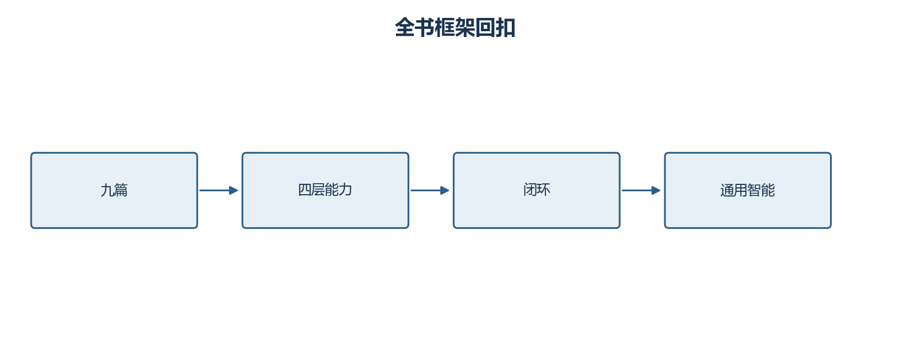

## 41.2　四层能力＋闭环：全书的形式化骨架

**引入与动机。** 要让「全书是一个整体」不只是修辞，我们给出一个简洁的形式化描述，把四层能力与闭环原则写成可检验的结构。

**直觉解释。** 把具身智能体看作一个分层处理器：每一层把输入转化为更「有意义」的输出，而闭环把执行的结果重新注入感知，形成「感知—理解—规划—执行—再感知」的循环。智能不是某一层的属性，而是整个循环的属性——这正是第 38 章「具身智能无法脱离身体」的架构层面表达。

**严格定义。** 设四层能力分别为映射 $\Pi_1$（感知）、$\Pi_2$（理解）、$\Pi_3$（规划）、$\Pi_4$（执行），闭环为算子 $\mathcal{C}$。一次完整的智能循环为

$$
\underbrace{a_t}_{\text{动作}} = \Pi_4\Big(\Pi_3\big(\Pi_2(\Pi_1(o_t))\big)\Big),\qquad
o_{t+1}=\mathcal{C}(o_t,a_t,\xi_t) \tag{41-1}
$$

其中 $o_t$ 为观测，$\xi_t$ 为环境随机性。式 (41-1) 的形式虽简单，却揭示全书的核心论点：**智能存在于这个循环的不动点附近，而非任何单一映射之中**。三个混淆命题可重新表述为：$\Pi_1$ 的精度不保证 $\Pi_2$ 的正确（感知 vs 理解），$\Pi_3$ 的可行性不保证 $\Pi_4$ 的成功（规划 vs 执行），仿真中 $\mathcal{C}$ 的统计特性不保证现实中成立（仿真 vs 现实）。

式 (41-1) 还给出一个有用的判据：一个具身智能系统的「完整性」，取决于它是否闭合了 $\mathcal{C}$ 所代表的感知-行动循环。仅有 $\Pi_1$—$\Pi_4$ 的前馈链（感知到执行的单向流水线）不构成完整智能——它缺少从结果回到感知的纠错通道，这正是第 33 章漂移与第 40 章开放问题的结构性根源。因此，「闭环」在本书中不是修饰词，而是智能的构成性条件。

**表 41-1　九篇 × 四层能力映射**

| 篇 | 章 | 核心内容 | 四层能力定位 |
|----|----|----------|--------------|
| 第一篇 | 1—4 | 理论框架、状态空间、自由能、最优控制 | 框架（贯穿四层） |
| 第二篇 | 5—9 | HMM、POMDP、状态估计、经典控制、VAE | 感知＋理解 |
| 第三篇 | 10—14 | World Models、PlaNet、Dreamer、RSSM | 理解＋规划（潜在） |
| 第四篇 | 15—18 | 生成模型、视频预测、3D 生成 | 理解（生成式） |
| 第五篇 | 19—23 | 预测编码、JEPA、自监督 | 理解（表征） |
| 第六篇 | 24—28 | 动作条件化、MBRL、MPC、交互 | 规划＋执行（闭环） |
| 第七篇 | 29—32 | 物理模拟、可微模拟、3D、仿真 | 执行（物理）＋闭环 |
| 第八篇 | 33—36 | 评估、幻觉、因果、数据规模化 | 诊断（贯穿四层） |
| 第九篇 | 37—41 | 人形、通用智能、伦理、开放问题、结语 | 反思（元层） |

## 41.3　映射算例：倒立摆如何穿过九篇

**引入与动机。** 表 41-1 是静态的。为了展示四层＋闭环框架如何「运作」，我们用一个映射算例，追踪倒立摆这一统一案例如何被九篇逐层处理。

**例 41.1（倒立摆的跨篇映射）** 设统一案例为「倒立摆平衡控制」。第一篇（第 2 章）把它写成状态空间 $s=(\theta,\dot\theta)$（框架）；第二篇（第 5 章）用卡尔曼滤波从带噪观测估计 $\theta$（感知 $\Pi_1$）；第三篇（第 9、13 章）用 VAE/RSSM 从像素学潜在状态（理解 $\Pi_2$）；第四篇（第 15 章）用视频预测生成未来帧（理解，生成式）；第五篇（第 20 章）用 JEPA 在表示空间预测（理解，自监督）；第六篇（第 24—25 章）用 MBRL 与 MPC 规划动作（规划 $\Pi_3$）并施加力矩（执行 $\Pi_4$）；第七篇（第 29—31 章）在可微仿真中训练策略并迁移（闭环 $\mathcal{C}$ 的跨域）；第八篇（第 33 章）诊断长时序预测漂移（评估）；第九篇（第 37 章）把同样的平衡思想推广到人形双足（反思）。一个简单物理系统，被四层能力反复穿透——这正说明框架的统一性。

**直觉解释。** 这个算例的价值在于：它证明全书不是 41 章的松散拼装，而是同一问题（智能如何在物理世界落地）在不同抽象层上的反复审视。读者若掌握这一映射，就能把任意新任务（如「机器人叠衣服」）定位到同一坐标系中。

**例 41.2（把新任务定位到坐标系）** 以「机器人叠衣服」为例：感知层需处理布料的形变与遮挡（第 5—9 章）；理解层需识别衣物类别与折叠目标（第 24 章的语义）；规划层需生成折叠动作序列（第 25 章的 MPC）；执行层需处理柔性体的接触动力学（第 25、31 章）；闭环要求从折叠结果反馈修正（第 33 章）。读者可以看到，这个新任务几乎复用了全书的每一层——这正是框架作为「导航地图」的实用价值：它告诉你面对新问题时该调用哪些工具、该警惕哪些开放问题（布料形变对应第 40 章的灵巧操作难题）。

## 41.4　三条趋势：从专用到通用、从真实到仿真再回真实、从离身到具身

**引入与动机。** 回望四十一章，具身智能的演进呈现出三条清晰可辨的主线。它们不是预言，而是对已发生趋势的归纳——归纳的价值在于外推时保持谦逊。

**直觉解释与谱系。** 三条趋势分别对应本书的三个核心张力：专用 vs 通用（能力的边界）、真实 vs 仿真（数据的来源）、离身 vs 具身（智能的载体）。表 41-2 把它们并列呈现。

**表 41-2　三条趋势的谱系与对应章节**

| 趋势 | 起点 → 终点 | 驱动技术 | 对应章节 |
|------|-------------|----------|----------|
| 从专用到通用 | 单任务机器人 → VLA 通用操作 | 基础模型、语言条件 | 第 23—28 章 |
| 从真实到仿真再回真实 | 真机试错 → 仿真规模化 → sim-to-real | 可微仿真、域随机化 | 第 29—31 章 |
| 从离身到具身融合 | LLM 纯文本 → 物理接地 | VLA、多模态世界模型 | 第 38 章 |

**趋势一：从专用到通用（第 23—28 章）。** VLA 与具身基础模型让机器人从单一任务走向通用操作，其代价是对海量数据的依赖与泛化的不确定性（第 40 章）。**趋势二：从真实到仿真再回真实（第 29—31 章）。** 仿真提供规模（第 40.4 节的 $10^4$ 倍采样率优势），sim-to-real 把规模带回现实——这是样本效率问题的核心解法。**趋势三：从离身到具身融合（第 38 章）。** 语言模型与具身智能汇合，物理接地被视为完整智能的关键——但「汇合是否充分」仍开放。三条趋势在 2025—2026 年的产业实践中正同时发生（第 37 章的人形机器人是三者交汇的产物）。

**边界与讨论。** 必须警惕把趋势误读为「必然定律」。三条趋势都是特定技术条件（算力增长、数据可得性、资本投入）下的产物，条件变化可能逆转方向：若真机数据采集成本骤降，仿真的重要性可能相对下降；若语言模型的物理接地取得突破，离身与具身的边界可能重新划分。趋势是观察的总结，不是未来的契约——这也是本书始终对「AGI 何时到来」类预言保持沉默的原因。

### 41.4A　进展的量化：从「能力维度」看十年

前面三条趋势是定性的，本节尝试用一个**进展指数（progress index）**把「具身智能十年进展了多少」量化，作为收束时的一个坐标读数。设一个具身系统的能力由其四层能力的达成度 $(c_1,c_2,c_3,c_4)\in[0,1]^4$（感知/理解/规划/执行）与闭环成熟度 $\kappa\in[0,1]$（是否真正闭合了式 41-1 的 $\mathcal{C}$）刻画，则**进展指数**

$$
\mathrm{Prog}=c_1 c_2 c_3 c_4\cdot\kappa^{1/4}. \tag{41-2}
$$

这里采用乘积而非和，是刻意的：与第 33 章式 33-1 的几何聚合、第 38 章式 38-5 的能力乘积一致——**任一层接近零则整体进展受限**，避免"感知满分掩盖闭环缺失"的虚高。$\kappa$ 的 $1/4$ 次幂表示闭环是构成性条件但权重略低于单能力层。

**例 41.3（进展指数的坐标读数）** 设 2015 年的具身系统：感知 $c_1=0.5$、理解 $c_2=0.2$、规划 $c_3=0.4$、执行 $c_4=0.3$、闭环 $\kappa=0.1$（基本是开环），$\mathrm{Prog}=0.5\times0.2\times0.4\times0.3\times0.1^{1/4}=0.012\times0.562\approx0.0068$。设 2025 年：$c_1=0.8,c_2=0.5,c_3=0.6,c_4=0.5,\kappa=0.5$（sim-to-real 已部分闭合），$\mathrm{Prog}=0.8\times0.5\times0.6\times0.5\times0.5^{1/4}=0.12\times0.841\approx0.101$。十年进展指数约提升 15 倍——但绝对值 0.10 仍远低于 1，说明"量变显著、质变未至"。这个读数对"具身智能是否成熟了"的争论提供了一个克制的回答：**在改进，但未到可用边界**——与第 37 章"产业落地仍以可靠性为瓶颈"、第 40 章"问题比答案多"的判断互相印证。

须声明 $\mathrm{Prog}$ 是**启发式坐标**而非精确度量：$(c_i,\kappa)$ 的取值含主观判断（本书取的是量级估计而非实测），其价值在于把"进展了多少"从模糊感受变成可对比的相对读数，使"十年提升 15 倍但绝对值仍低"这一结论可被辩论、可被未来的实测数据修正——这正是全书"把问题建模化"的方法在收束章的最后一用。

## 41.5　从身体到智能：边界与讨论

**引入与动机。** 现在回答全书最终的问题：「从身体到智能」这条路，走到头了吗？

**直觉解释。** 我们的回答是：具身智能是通向完整通用智能的关键路径——它提供物理接地、因果理解、常识与行动能力（第 2、38 章）。但「关键路径」不等于「唯一路径」，更不等于「终点」。通用智能还需符号推理、语言、社会认知与价值对齐——这些在系列其他书中展开（《自然语言智能导论》《认知智能导论》《AI治理与对齐导论》）。

**边界与讨论。** 本书的立场是克制而明确的：① 我们主张具身是「完整智能」的关键维度（弱命题，第 38.5 节），但不宣称它是逻辑必要条件；② 我们提供四层＋闭环框架作为「地图」，但不宣称它是唯一正确的地图；③ 我们盘点开放问题（第 40 章），但承认清单会随范式转移而过时。三点边界共同体现全书的方法论自觉：严谨不等于武断，自信不等于封闭。

最后值得点明的是：具身智能的「从身体到智能」之路，与认知科学中「具身认知」的走向遥相呼应——Varela 等人在《具身心智》中早已指出，认知并非对外部世界的「表征与计算」，而是「生成（enactment）」于身体与环境的耦合历史之中[4]。本书以工程与数学的语言，把这一哲学洞见落到了可实现的系统上。这些辨析衔接第 1—2、37—40 章与多部系列书。

### 41.5A　方法论的遗产：本书留给读者的三件工具

收束章最后，我们想说清本书**可迁移的资产**不是 41 章的具体技术（它们会过时），而是三件方法论工具——它们不依赖任何具体技术栈，可被用于未来十年的新问题。

**第一件：四层能力＋闭环坐标系（式 41-1、表 41-1）。** 它是一台"定位器"：任何新现象（如"机器人学会了吗""这个系统安全吗"）先被定位到感知/理解/规划/执行哪一层、是否闭合了 $\mathcal{C}$，才能避免"用识别准确率冒充理解深度"之类的混淆（41.1 节三个混淆命题）。这个坐标系的持久性在于：具体算法（VLA、RSSM）会迭代，但"感知—理解—规划—执行—再感知"的循环结构不会变——它是物理世界中智能的**形式不变量**。

**第二件：把大问题拆成可判定小问题的笔法。** 全书每章遵循"引入—直觉—推导—算例—谱系—边界—承上启下"的七要素，其本质是**把一个模糊的大问题，分解为可定义、可论证、可计算的子问题**（第 38 章把"具身是否必要"拆成接地度/互信息/能力乘积，第 40 章把"开放问题"拆成可证伪性/依赖度）。这件工具对读者的意义最大：它训练的不是"记住结论"，而是"如何构造一个可研究的问题"——这是研究者区别于工程实践者的核心能力。

**第三件：克制的方法论态度。** 本书反复区分"强命题/弱命题"（第 38 章）、"上界/精确值"（第 40 章式 40-1）、"关键路径/唯一路径"（41.5 节）。这种"对能证明的下界谨慎、对不能证明的上界诚实"的态度，是防"过度自信"的免疫机制。在 AI 领域尤其重要：一个愿意说"我还不知道""这只是上界""这是启发式"的框架，比一个声称"已解决"的框架更可信。这三件工具——坐标系、问题分解、克制态度——才是本书真正的"结语"：它把 41 章的技术，蒸馏成读者可以带走、可以复用到下一代技术的方法。

**与系列的呼应。** 这三件工具同样适用于《无限图书馆》其他分册：《世界模型导论》的"预测—误差—再预测"循环、《因果智能导论》的"识别—估计—效应"框架、《推理与对齐导论》的"目标—约束—验证"结构，都可视为"四层＋闭环"在不同领域的同构展开。具身智能的特殊性在于它的循环有**物理后果**（不可逆、有代价），这使"闭环"在此不只是数学优雅，更是安全与伦理的硬约束（第 35、39 章）——这是本书相对其他分册的"加重项"，也是「从身体到智能」这一标题的最终落点：身体不只是智能的载体，更是智能**必须对其负责**的对象。三件工具并非独立：坐标系（工具一）用于"定位"问题，问题分解（工具二）用于"研究"问题，克制态度（工具三）用于"判断"问题何时算解决——它们构成一个完整的方法论回路，与式 41-1 的智能闭环在元层面同构。这种"框架自身也遵守闭环原则"的自指一致性，是本书作为一本"方法论之书"的最后一处体现。

## 41.6　全书收束

从控制论（第 1 章）到 VLA（第 25 章），从运动学（第 3 章）到人形机器人（第 37 章）——四十一章走过了具身智能的思想演进史。全书以四层能力为经、闭环原则为纬（式 41-1），把控制论、机器人学、视觉、强化学习与基础模型编织成一张可导航的地图（表 41-1）。我们始终秉持三条原则（前言）：完整的方法谱系、闭环的统一视角、严谨与细致。我们也不回避开放问题（第 40 章）——承认「未知」是探索的起点。回望全书，最让我们确信的不是任何单项技术的突破，而是"闭环"这一结构反复出现：从卡尔曼滤波的预测—更新循环，到强化学习的状态—动作—奖励循环，到世界模型的预测—误差—再预测循环，再到本收束章的"定位—研究—判断"方法论回路——闭环不是某一种算法的特性，而是物理世界中智能的**普遍语法**。

**本书定位。** 若用一句话概括：这是一本以「物理世界中的智能」为对象、以「四层能力＋闭环」为骨架、以「从身体到智能」为线索的学术专著。它不提供通往 AGI 的配方，但提供审视这条道路的坐标。这个定位也决定了本书的"读者契约"：你从本书得到的不是"标准答案"，而是"提出好问题的能力"——正如第 40 章的开放问题地图不是待办清单，而是一台识别问题的显微镜。

**负空间：本书刻意不做什么。** 收束时也须说清本书的边界，以免读者误期待。其一，本书**不追求穷尽**：41 章是"地图"而非"领土"，每章只取该主题最可迁移的核心，大量工程细节与最新进展留待后续修订；其二，本书**不做价值主张**：它不告诉你"应该造人形机器人"或"应该警惕 AGI"，它提供的是分析框架，价值判断留给你；其三，本书**不预言时间表**：对"具身智能何时成熟"我们只给第 41.4A 节进展指数的相对读数，不给绝对年份——时间表的预测是本章反复告诫要避免的"必然定律"误读。这三个"不做"不是能力缺陷，而是方法论选择：一本追求严谨的专著，其可信度恰恰来自它知道自己不回答什么问题。须补充一点：这种"负空间"本身也是动态的——今天的"不做"可能成为明天的"必做"（如 2020 年前"多模态融合"曾是"不做"的边缘话题，如今已是核心），因此本书的边界声明应随修订版更新，而非一劳永逸。

**给读者的阅读建议。** 若你是研究者，本书的价值在于那张开放问题地图（第 40 章）——它标出了值得投入的杠杆点；若你是工程师，价值在于技术谱系与算例（贯穿各篇的方法对照表与数值示例）——它们把抽象原理落到可计算的实现；若你是学生，价值在于统一案例（倒立摆）与七要素笔法——它们训练你把大问题拆成可判定小问题的能力。三类读者从同一本书中取走不同的东西，这正是一本学术专著应有的厚度。

**给实践者的具体路线。** 上述建议对"如何入门"仍偏抽象，这里给一条更具体的路径。第一步（打地基）：读第 1—4 章建立状态空间与自由能的语言，再读第 5—9 章掌握感知与状态估计——这两块是后续一切的地基，跳过会导致第三篇的世界模型无法理解。第二步（建主干）：第 10—14 章的运动规划与控制是"身体"的主体，第 19—25 章的学习与控制是"智能"的来源，二者合读才能理解"闭环"。第三步（看前沿）：第 25—28 章的 VLA 与基础模型是当前热点，第 37—38 章的人形与通用智能是形态赌注，第 39—40 章的伦理与开放问题是"该往哪走"。第四步（成体系）：最后回头读第 41 章（本章）与第 1 章首尾对照，把散点串成闭环——此时再重读第 40 章的开放问题清单，会发现每个问题都能在四层＋闭环坐标系中定位，这才是"读完一本书"的标志：你不仅记住了内容，还内化了那台"定位器"。第五步（走出去）：把本书的框架应用到你的实际系统上——用 41.4A 节的进展指数给你手上的系统打一次分，用第 33 章的评估协议给它做一次诚实体检，用第 40 章的类型学判断它卡在哪类开放问题上。读一本书的终点不是合上它，而是用它去审视你正在做的东西——这是本书对"学以致用"最具体的理解。

愿读者带着这句话离开：**智能，生长于身体与世界的交互之中。** 理解具身智能，就是理解智能如何在物理世界中落地、行动、成长。全书的终点，正是你探索的起点。

**下一个十年的三个追问。** 收束不是停止，而是把"下一站"显式化。基于第 40 章的开放问题地图，我们认为未来十年的具身智能将围绕三个追问展开：其一，**接地的可组合性**——第 38 章的组合泛化指标 $\mathrm{CompGen}$ 能否从当前约 0.36（例 38.5）提升到接近 1，决定具身智能是"背题机器"还是"举一反三的智能体"；其二，**sim-to-real 的收敛速度**——第 31 章的域随机化与可微仿真能否把例 40.2 的分布散度 $d$ 从 0.3 压到 0.1 以下，决定仿真能否真正"替代"大部分真机实验；其三，**安全与泛化的兼容**——第 35 章的形式化安全（CBF）与第 40 章的开放世界泛化能否在同一系统中共存，决定具身智能能否既"安全"又"通用"。这三个追问的共同点在于：它们都不是"造一个更强的模型"能解决的，而是**方法论层面的突破**——需要新的表征、新的验证工具、新的评估范式。这正是本书"提供地图而非配方"主张的延伸：我们标出了下一站的方向，但通往那里需要新的道路。

## 本章小结

本章作为全书的收束，回扣开篇之问与四层能力＋闭环框架。

我们首先检验三个混淆命题如何被各篇逐一解开（41.1 节），建立四层能力＋闭环的形式化骨架（式 41-1）与九篇 × 四层映射（表 41-1），并通过倒立摆的跨篇映射算例（例 41.1）展示全书自洽性。我们梳理三条趋势（表 41-2）与量化进展指数（式 41-2，例 41.3）、讨论「从身体到智能」的边界（弱命题立场）、提炼三件可迁移的方法论工具（41.5A 节），最后全书收束。

我们还明确边界：具身是关键路径而非唯一路径，框架是地图而非教条，清单会随范式转移而过时。严谨不等于武断，自信不等于封闭——这是全书留给读者的方法论态度。

全书终。愿智能的研究，与探索者同行。

（第九篇完　全书完）

**进一步阅读**　本章建议延伸阅读的文献：[1] 具身认知纲领、[2] Brooks 无表征智能、[3] LeCun 自主智能路径、[4] 具身心智、[5] 自创生与认知、[6] 强化学习入门、[7] Harnad 符号接地问题、[8] 人工智能概论。

## 参考文献

[1] Pfeifer R, Bongard J. *How the Body Shapes the Way We Think: A New View of Intelligence*. MIT Press, 2006.

[2] Brooks R A. Intelligence without representation. *Artificial Intelligence*, 1991, 47(1–3): 139–159.

[3] LeCun Y. A path towards autonomous machine intelligence. *Open Review*, 2022.

[4] Varela F J, Thompson E, Rosch E. *The Embodied Mind: Cognitive Science and Human Experience*. MIT Press, 1991.

[5] Maturana H R, Varela F J. *Autopoiesis and Cognition: The Realization of the Living*. Reidel, 1980.

[6] Sutton R S, Barto A G. *Reinforcement Learning: An Introduction*. 2nd ed. MIT Press, 2018.

[7] Harnad S. The symbol grounding problem. *Physica D*, 1990, 42(1–3): 335–346.

[8] Mitchell M. *Artificial Intelligence: A Guide to Intelligent Systems*. 3rd ed. Pearson, 2019.

---

# 附录

## 附录 A　数学工具包

本附录汇总全书反复使用的数学工具，供读者查阅。更严格的论述见相应章节。

### A.1　概率论基础

**概率空间与随机变量。** 概率空间为三元组 $(\Omega,\mathcal{F},P)$，其中 $\Omega$ 为样本空间，$\mathcal{F}$ 为事件 $\sigma$-代数，$P$ 为概率测度。随机变量 $X:\Omega\to\mathbb{R}$ 把样本点映射为实数，其分布由累积分布函数 $F_X(x)=P(X\le x)$ 或概率密度/质量函数描述。

**条件概率与链式法则。** $P(A\mid B)=P(A\cap B)/P(B)$。对词序列 $x=(w_1,\dots,w_T)$，联合概率的链式分解为

$$
P(w_1,\dots,w_T)=\prod_{t=1}^{T}P(w_t\mid w_1,\dots,w_{t-1}). \tag{A-1}
$$

这是全部语言模型的出发点（第 3、15 章）。

**期望、方差与协方差。** $\mathbb{E}[X]=\sum_x xp(x)$（离散）或 $\int xp(x)\,dx$（连续）；$\mathrm{Var}[X]=\mathbb{E}[(X-\mathbb{E}X)^2]$；$\mathrm{Cov}(X,Y)=\mathbb{E}[XY]-\mathbb{E}X\,\mathbb{E}Y$。

### A.2　信息论基础

**熵与交叉熵。** 离散随机变量 $X$ 的熵为

$$
H(X)=-\sum_x p(x)\log p(x), \tag{A-2}
$$

两个分布 $p,q$ 的交叉熵为 $H(p,q)=-\sum_x p(x)\log q(x)$，KL 散度为 $D_{\mathrm{KL}}(p\|q)=\sum_x p(x)\log\frac{p(x)}{q(x)}=H(p,q)-H(p)$。

**困惑度。** 语言模型的困惑度定义为每词平均负对数似然的指数：

$$
\mathrm{PPL}(x)=\exp\!\left(-\frac{1}{T}\sum_{t=1}^{T}\log p_\theta(w_t\mid w_{<t})\right). \tag{A-3}
$$

困惑度越低表示模型对测试语料越"不意外"，但它是几何平均意义下的指标，对长尾词敏感（第 3、15 章）。

### A.3　线性代数与矩阵分解

**向量空间与范数。** $\mathbf{x}\in\mathbb{R}^d$，$\ell_2$ 范数 $\\|\mathbf{x}\\|_2=\sqrt{\sum_i x_i^2}$，$\ell_1$ 范数 $\\|\mathbf{x}\\|_1=\sum_i|x_i|$。点积 $\mathbf{x}^\top\mathbf{y}$ 衡量方向相似性，余弦相似度 $\cos(\mathbf{x},\mathbf{y})=\frac{\mathbf{x}^\top\mathbf{y}}{\\|\mathbf{x}\\|\|\\mathbf{y}\\|}$。

**奇异值分解（SVD）。** 任意矩阵 $\mathbf{A}\in\mathbb{R}^{m\times n}$ 可分解为 $\mathbf{A}=\mathbf{U}\mathbf{\Sigma}\mathbf{V}^\top$，其中 $\mathbf{U},\mathbf{V}$ 为正交矩阵，$\mathbf{\Sigma}$ 为奇异值对角阵。截断 SVD 给出最优低秩逼近（Eckart–Young 定理），是 LSA 与词向量降维的理论基础（第 6 章）。

### A.4　最优化基础

**梯度下降。** 对目标 $\mathcal{L}(\theta)$，梯度下降更新 $\theta\leftarrow\theta-\eta\nabla_\theta\mathcal{L}(\theta)$，$\eta$ 为学习率。随机梯度下降（SGD）用单个/小批量样本估计梯度。

** softly 凸性与光滑。** 函数 $f$ 为 $L$-光滑若 $\\|\nabla f(x)-\nabla f(y)\\|\le L\\|x-y\\|$；为 $\mu$-强凸若 $f(y)\ge f(x)+\nabla f(x)^\top(y-x)+\frac{\mu}{2}\\|y-x\\|^2$。二者决定梯度下降的收敛率。

### A.5　常用分布

| 分布 | 记号 | 用途 |
|------|------|------|
| 伯努利 | $\mathrm{Bern}(p)$ | 二值事件 |
| 多项 | $\mathrm{Mult}(n,\mathbf{p})$ | 词的多项采样 |
| 高斯 | $\mathcal{N}(\mu,\sigma^2)$ | 连续潜变量、噪声 |
| Dirichlet | $\mathrm{Dir}(\boldsymbol\alpha)$ | 主题模型的先验 |
|  categorical | $\mathrm{Cat}(\mathbf{p})$ | 词表上的分布 |

---

## 附录 B　环境与基准索引

### B.1　常用语料

| 语料 | 规模 | 用途 |
|------|------|------|
| Penn Treebank (PTB) | 约 100 万词 | 语言模型、句法分析标准语料 |
| WikiText-103/2 | 1.03 亿/200 万词 | 大规模语言模型 |
| 1B Word Benchmark | 约 10 亿词 | 词向量评估 |
| BooksCorpus | 约 8 亿词 | 预训练（GPT/BERT） |
| C4 | 约 750GB | T5 预训练 |
| The Pile | 约 825GiB | 多样化预训练 |
| OSCAR / CC-100 | 多语言 TB 级 | 多语言预训练 |

### B.2　任务基准

| 基准 | 任务 | 说明 |
|------|------|------|
| GLUE / SuperGLUE | 自然语言理解 | 多项分类、推理、问答的集合 |
| SQuAD 1.1/2.0 | 阅读理解 | 抽取式问答，含不可回答 |
| WMT | 机器翻译 | 多语言对，BLEU 评估 |
| ImageNet / COCO | 视觉（多模态用） | 视觉编码器预训练 |
| MMLU | 大模型知识 | 57 学科多选题 |
| GSM8K / MATH | 数学推理 | 应用题与竞赛题 |
| HumanEval | 代码生成 | Python 函数补全 |

### B.3　词向量与表示评测

- **类比任务**：`king : queen = man : ?`，评估语义/句法类比能力。
- **词相似度**：WordSim-353、SimLex-999、MEN，与人工打分求 Spearman 相关。
- **探测（probing）**：用线性探针从上下文表示中恢复词性、句法、语义角色。

---

## 附录 C　开源工具链

### C.1　核心框架

| 工具 | 用途 |
|------|------|
| PyTorch / TensorFlow | 深度学习训练框架 |
| Hugging Face Transformers | 预训练模型库（BERT/GPT/LLaMA 等） |
| Hugging Face Datasets | 数据集加载与处理 |
| Tokenizers / SentencePiece | 分词与子词切分 |
| spaCy / NLTK / Stanza | 传统 NLP 与词法句法分析 |

### C.2　训练与微调

| 工具 | 用途 |
|------|------|
| DeepSpeed / Megatron-LM | 大规模分布式训练 |
| FSDP | PyTorch 原生全分片数据并行 |
| PEFT | 参数高效微调（LoRA/Adapter） |
| bitsandbytes / GPTQ | 量化 |
| TRL | RLHF/DPO 对齐训练 |

### C.3　检索与部署

| 工具 | 用途 |
|------|------|
| FAISS / Annoy / HNSWlib | 向量检索与近似最近邻 |
| Elasticsearch | 关键词与混合检索 |
| vLLM / TensorRT-LLM | 大模型推理服务 |
| LangChain / LlamaIndex | RAG 与应用编排 |

---

## 附录 D　符号与缩略语对照表

### D.1　缩略语

| 缩略语 | 全称 | 中文 |
|--------|------|------|
| NLP | Natural Language Processing | 自然语言处理 |
| LM | Language Model | 语言模型 |
| LLM | Large Language Model | 大语言模型 |
| N-gram | n-gram | n 元语法 |
| PPL | Perplexity | 困惑度 |
| POS | Part-of-Speech | 词性 |
| NER | Named Entity Recognition | 命名实体识别 |
| RE | Relation Extraction | 关系抽取 |
| SRL | Semantic Role Labeling | 语义角色标注 |
| AMR | Abstract Meaning Representation | 抽象意义表示 |
| CFG | Context-Free Grammar | 上下文无关文法 |
| PCFG | Probabilistic CFG | 概率上下文无关文法 |
| CKY | Cocke–Kasami–Younger | 句法分析算法 |
| HMM | Hidden Markov Model | 隐马尔可夫模型 |
| CRF | Conditional Random Field | 条件随机场 |
| RNN/LSTM | Recurrent Neural Network | 循环神经网络/长短时记忆 |
| seq2seq | sequence-to-sequence | 序列到序列 |
| NMT | Neural Machine Translation | 神经机器翻译 |
| Transformer | Transformer | Transformer 架构 |
| MLM | Masked Language Modeling | 掩码语言模型 |
| PEFT | Parameter-Efficient Fine-Tuning | 参数高效微调 |
| LoRA | Low-Rank Adaptation | 低秩适配 |
| ICL | In-Context Learning | 上下文学习 |
| RLHF | RL from Human Feedback | 基于人类反馈的强化学习 |
| DPO | Direct Preference Optimization | 直接偏好优化 |
| CoT | Chain of Thought | 思维链 |
| RAG | Retrieval-Augmented Generation | 检索增强生成 |
| BLEU | Bilingual Evaluation Understudy | 机器翻译评估 |

### D.2　数学符号

见「前置说明」符号表与附录 A。

---

## 附录 E　术语对照与全书速查索引

### E.1　核心术语对照

| 中文 | 英文 | 章 |
|------|------|----|
| 分布假设 | Distributional Hypothesis | 6 |
| 词嵌入 | Word Embedding | 6 |
| 上下文表示 | Contextual Representation | 7 |
| 组合性 | Compositionality | 13 |
| 真值条件 | Truth Conditions | 13 |
| 语用含义 | Pragmatic Meaning | 14 |
| 困惑度 | Perplexity | 3, 15 |
| 平滑 | Smoothing | 15 |
| 注意力 | Attention | 17, 20 |
| 自注意力 | Self-Attention | 20 |
| 预训练 | Pretraining | 21 |
| 微调 | Fine-tuning | 21, 23 |
| 涌现 | Emergence | 24 |
| 对齐 | Alignment | 28 |
| 幻觉 | Hallucination | 29, 31 |
| 检索增强 | Retrieval Augmentation | 30 |

### E.2　全书速查索引（按主题）

- **意义理论**：第 1、4 章；四层能力见 1.6，五层意义见 1.7/4。
- **词与向量**：词向量 6，上下文表示 7，相似度 9。
- **句法与语义**：句法 10–11，语义角色 12，逻辑形式 13，语篇 14。
- **语言模型**：统计 15，神经 16，seq2seq 17，翻译 18。
- **预训练**：Transformer 20，范式 21，训练 22，微调 23，ICL 24，多语言 25。
- **大模型**：规模化 26，模型谱系 27，对齐 28，推理 29，RAG 30，评估 31。
- **多模态与语音**：32–35。
- **应用与工程**：36–39。
- **未来**：40–42。

---

## 附录 F　算例复现说明

### F.1　环境依赖

- Python 3.10+
- PyTorch 2.x、NumPy、SciPy、scikit-learn
- Hugging Face Transformers、Tokenizers
- 可选：spaCy、NLTK（词法句法算例）、FAISS（检索算例）

### F.2　统一案例：开放域问答语料

全书算例以一份开放域问答语料为贯穿案例（第 1.8 节）。该语料由若干百科段落与对应问题组成，覆盖事实型、推理型与多跳问题。复现时：

1. 词法标注（第 8 章）：对语料做分词、词性标注与实体识别；
2. 句法与语义（第 11–12 章）：产出依存树与语义角色；
3. 语言模型（第 15–16 章）：在语料上训练 N-gram 与小型神经 LM，报告困惑度；
4. 预训练/微调（第 21–23 章）：加载公开预训练模型，做少样本适配；
5. 检索增强（第 30 章）：构建向量索引，做检索增强问答；
6. 对话智能体（第 37 章）：封装为多轮问答。

### F.3　随机种子与数值容差

- 涉及随机初始化的算例固定随机种子 `seed=42`。
- 数值结果保留三到四位有效数字；因库版本差异允许末位浮动。
- 小模型算例为教学示意，旨在展示计算过程，不使用大规模算力。

### F.4　算例数值声明

除注明出处者外，全书算例中的具体数值（概率、困惑度、注意力权重、类比向量等）均为**教学示意**，通过小型可复现实验或手工计算得到，用于展示方法机制与量级，不代表任何真实系统在生产环境中的实测结果。引用文献中的基准数字以原始出处最新版本为准。