# 图智能导论

> 关系结构上的表示、学习与推理

---

## 内容简介

本书系统论述「图智能」——面向关系化、网络化、非欧几里得数据的表示、学习、推理与系统的理论、方法与工程体系。作者把这套能力界定为四层递进的含义：**图表示**回答「如何把节点、边与图编码为向量」，**图学习**回答「如何在图上传播信息并学习表征」，**图推理**回答「如何预测缺失关系、生成图并作逻辑推理」，**图系统**回答「如何在动态、异质、超大规模图数据上落地」。全书以一条主线贯穿：以**关系结构与消息传递作为归纳偏置**为理论基础，以**图神经网络**为核心，以「表示—学习—推理—系统」为脉络，把图论、谱理论、网络科学、表示学习与深度学习中彼此隔离的方法放进同一张地图。

全书共九篇四十一章。第一篇建立图论、谱图理论与图上概率的理论基础；第二篇处理图表示学习；第三篇展开图神经网络基础；第四篇扩展到异质、动态、超图与图 Transformer；第五篇聚焦图生成与图推理；第六篇进入几何与拓扑深度学习；第七篇论述图基础模型；第八篇给出应用与工程；第九篇回扣框架，讨论图智能的理论前沿与开放问题。书末附数学工具包、图数据集与基准索引、开源工具链、符号与缩略语对照表、术语与速查索引、算例复现说明六个附录。

本书提出并贯穿一套自建理论框架——**图智能的四层能力**：表示、学习、推理、系统，并以「关系归纳偏置」为贯穿线索，强调图方法区别于欧几里得方法的本质在于对关系结构与对称性的显式建模。据此对每一个方法追问四件事：它利用了哪种图结构、隐含了什么假设、突破了前一方法的什么限制、无法突破什么理论边界。第 1 章立框架，第 2—4 章建立理论基础，第 29 章据此评估图基础模型，第 41 章回扣框架讨论图智能能否通向通用智能，形成首尾闭环。

## 本书的理论主线

**四层能力体系。**

| 层级 | 名称 | 回答 | 内涵 |
|------|------|------|------|
| Level 1 | 图表示 | 如何编码图？ | 节点、边、子图与整图的向量化 |
| Level 2 | 图学习 | 如何学习表征？ | 消息传递、卷积、注意力与更新 |
| Level 3 | 图推理 | 如何预测与推理？ | 链路预测、图生成、逻辑推理 |
| Level 4 | 图系统 | 如何在真实图落地？ | 动态、异质、超大规模与工程化 |

由此澄清三个常被混淆的命题：**图连接不等于因果关联，嵌入相似不等于语义相同，GNN 更深不等于表达更强**。

## 本书体例（凡例）

按「篇—章—节」三级组织。定义/定理/例按章编号。公式 `$$\ldots	ag{X-N}$$`。图「图 X-Y」，表「表 X-Y」。重要论断以 `[n]` 标注，章末列参考文献。中文全角标点。

## 读者对象与阅读路径

面向图神经网络、网络科学、知识图谱、几何深度学习方向的研究生、科研人员与工程从业者。预备知识：概率论、线性代数、最优化、基本机器学习。

## 符号表

| 符号 | 含义 |
|------|------|
| $G=(V,E)$ | 图：节点集与边集 |
| $\mathbf{A}$ | 邻接矩阵 |
| $\mathbf{D}$ | 度矩阵 |
| $\mathbf{L}=\mathbf{D}-\mathbf{A}$ | 组合拉普拉斯 |
| $\mathbf{h}_v^{(l)}$ | 节点 v 第 l 层表示 |

## 目录

第一篇（1—4）图论与谱理论基础；第二篇（5—9）图表示学习；第三篇（10—14）图神经网络基础；第四篇（15—18）GNN 扩展；第五篇（19—23）图生成与图推理；第六篇（24—27）几何与拓扑深度学习；第七篇（28—31）图基础模型；第八篇（32—36）应用与工程；第九篇（37—41）图智能的未来。附录 A–F。

---

# 第 1 章　绪论：图智能的历史脉络与全书框架

世界并非一堆独立对象的集合，而是关系的网络。社交网络中人与人的关注、引文网络中论文与论文的引用、分子中原子与原子的化学键、交通路网中路口与路口的连通——关系结构（relational structure）无处不在。传统机器学习假设样本独立同分布，把每个对象表示为一个固定长度的数值向量；然而当对象之间的连接本身携带信息时，这种"孤立对象"的假设便失效了。本书研究的核心问题是：如何让机器理解、学习并利用这种关系结构。

在展开之前需要说明本书的读者对象与定位。本书面向已具备线性代数、概率论与基础机器学习（最小二乘、逻辑回归、反向传播）素养的研究生与工程研究者，不重复讲授这些前置内容，而是从"关系结构带来的新数学对象"（图与拉普拉斯）出发，建立一套贯穿全书的统一语言。与市面上按"模型族"罗列的图谱类教材不同，本书按"能力层级"组织：读者读完第一篇即拥有描述任意图问题的代数语言，读完第二、三篇即掌握从手工特征到图神经网络的完整表示学习谱系。每一章均遵循"动机—直觉—推导—算例—谱系—边界"的七要素笔法，以便读者既能复现推导，又能快速定位方法在全书中的位置。

本章立全书之框架。1.1 节界定图智能并给出关系归纳偏置；1.2 节回顾从 Euler 到图基础模型的历史；1.3 节剖析非欧、稀疏、异质、过平滑四大困难；1.4 节提出四层能力体系并澄清三个混淆命题；1.5 节给出全书结构与统一案例；1.6 节收束并交叉引用。

## 1.1　图智能的界定

**定义 1.1（图，graph）** 图 $G=(V,E)$ 由节点集（vertex set）$V=\{v_1,\dots,v_n\}$ 与边集（edge set）$E\subseteq V\times V$ 构成。若边无方向称无向图，若边有方向称有向图（digraph）；若边带权则称加权图。节点与边还可附带属性（attribute），如引文网络中论文的发表年份、引用的上下文。

**定义 1.2（图智能，graph intelligence）** 图智能是面向图结构数据的表示（representation）、学习（learning）、推理（reasoning）与系统（system）能力体系。它区别于欧几里得方法（图像、语音、文本）的本质在于**关系归纳偏置**（relational inductive bias）：假设数据点通过关系连接，且局部结构承载信息。这一偏置使模型对节点重排不敏感——即满足置换等变性（permutation equivariance）：对任意置换 $\pi$，有

$$
f(\pi\cdot G)=\pi\cdot f(G). \tag{1-1}
$$

**直觉解释。** 图像的像素排列在规则网格上，卷积核在局部窗口滑动即可复用权重；图的节点没有天然顺序，邻居个数不定，无法定义固定大小的"窗口"。关系归纳偏置用"对邻居聚合"替代"在网格上卷积"：每个节点只从其邻接节点收集信息，且聚合函数对邻居顺序不敏感。这正是第 10—14 章消息传递机制的思想源头。

形式化地，设节点 $v$ 的特征为 $\mathbf{x}_v\in\mathbb{R}^{d}$，其邻域为 $\mathcal{N}(v)$，一层关系聚合可写为

$$
\mathbf{h}_v=\phi\Big(\mathbf{x}_v,\ \bigoplus_{u\in\mathcal{N}(v)}\psi(\mathbf{x}_v,\mathbf{x}_u)\Big), \tag{1-2}
$$

其中 $\bigoplus$ 是置换不变的聚合算子（求和、均值、最大值），$\psi$ 是消息函数，$\phi$ 是更新函数。式 (1-2) 是全书大多数图模型的最小骨架。

**例 1.1（引文网络的聚合）** 设论文 $v$ 的特征 $\mathbf{x}_v$ 是其词袋向量，邻域 $\mathcal{N}(v)$ 为它引用的论文。取 $\psi(\mathbf{x}_v,\mathbf{x}_u)=\mathbf{x}_u$，$\bigoplus$ 为均值，$\phi$ 为恒等映射，则 $\mathbf{h}_v=\frac{1}{|\mathcal{N}(v)|}\sum_{u\in\mathcal{N}(v)}\mathbf{x}_u$——$v$ 的表示即其参考文献的平均词向量。这个简单聚合已能反映研究主题，但它忽略了引用方向与邻居质量：被权威论文引用与被引用于普通论文应区别对待。后续章节的注意力机制（第 12 章）正是为修正这一缺陷而来。

**形式化：图学习的三类任务。** 式 (1-2) 的聚合骨架之所以成为"全书最小骨架"，是因为几乎所有图学习任务都可以写成"在若干层聚合之后，对一个节点、一条边或整张图作读出"。设聚合算子 $\mathbf{h}^{(l)}$ 迭代 $L$ 层，得到第 $L$ 层节点表示 $\mathbf{h}^{(L)}_v$，则三类任务对应三种读出（readout）方式：

$$
\hat{y}_v=\rho_{\mathrm{node}}(\mathbf{h}^{(L)}_v),\qquad
\hat{y}_{uv}=\rho_{\mathrm{edge}}\big(\mathbf{h}^{(L)}_u\odot\mathbf{h}^{(L)}_v\big),\qquad
\hat{y}_G=\rho_{\mathrm{graph}}\Big(\bigoplus_{v\in V}\mathbf{h}^{(L)}_v\Big), \tag{1-3}
$$

其中 $\odot$ 表示拼接或逐元素积，$\bigoplus$ 为置换不变的整图聚合（求和、均值、最大）。节点分类（node classification）读单个节点，链路预测（link prediction）读节点对，图分类（graph classification）读整图——三者共享同一套聚合、只在读出不同。这一"聚合—读出"二分是后续第 10—14 章消息传递、第 14 章池化读出的源头，也是第 8 章统一表示理论的基本语法。

**例 1.2（引文网络的链路预测）** 在引文网络中，给定两篇论文 $u,v$，任务是判断它们之间是否还存在一条未被观测的引用边。用式 (1-3) 的第二项：先各自聚合邻域得到 $\mathbf{h}^{(L)}_u,\mathbf{h}^{(L)}_v$，再经读出 $\rho_{\mathrm{edge}}$ 输出一个 $\{0,1\}$ 概率。直觉上，若两篇论文的邻域表示都指向同一研究主题（共享许多相似的邻居），则 $\hat{y}_{uv}$ 偏高。注意这里"共享邻居"既是结构信号也是语义信号——这正是浅层嵌入（第 6 章）与 GNN（第 10 章）都要刻画的对象，第 19 章将给出系统的链路预测评测协议。

**例 1.3（分子图的性质预测）** 把分子看成一个图：原子是节点、化学键是边，任务是预测整个分子的某项物理化学性质（如溶解度）。这是式 (1-3) 第三项的图级读出：$\bigoplus$ 取全原子表示的均值，$\rho_{\mathrm{graph}}$ 是一个全连接分类头。由于分子同分异构体只改变原子连接而不改变原子组成，模型必须真正"读懂"键接关系才能区分它们——这一要求直接引出第 13 章 WL 测试对表达力的刻画。第 33 章将在分子图上给出统一的实验设定。

关系归纳偏置还可从对称性角度理解。若把图智能视为一个作用于图上的函数 $f$，则节点的编号是人为赋予的，真实世界并不存在"第 3 号节点"这样的绝对身份。因此合理的图函数必须对节点重排不变（对整图输出）或等变（对节点级输出）。这个看似朴素的对称性要求，实际上把图模型限制在一个狭窄而优美的函数类内——它既是归纳偏置带来的统计效率之源，也是表达能力的形式上界（第 13 章的 WL 上界）。

## 1.2　历史脉络

图智能跨越近三百年，可划分为五个阶段。**表 1-1** 给出时间线。

| 阶段 | 时期 | 关键事件 | 代表工作 |
|------|------|----------|----------|
| 图论奠基 | 1736—1930s | Euler 七桥问题；抽象图定义 | Euler, König |
| 代数与谱方法 | 1940s—1970s | 邻接矩阵、拉普拉斯谱、随机图 | Kirchhoff, Erdős–Rényi |
| 网络科学与算法 | 1990s—2000s | 小世界、无标度、PageRank、谱聚类 | Watts–Strogatz, Barabási, Page |
| 表示学习与嵌入 | 2010s 前期 | 图核、DeepWalk、node2vec、LINE | DeepWalk(2014), node2vec(2016) |
| 深度学习与基础模型 | 2017 至今 | GCN、GAT、图 Transformer、图预训练、图基础模型 | GCN(2017), GraphBERT, 图基础模型(2023+) |

1736 年 Euler 解决哥尼斯堡七桥问题，标志图论诞生——他把"能否不重复地走完七座桥"抽象为图的欧拉回路问题。20 世纪，Kirchhoff 用矩阵树定理把生成树计数与拉普拉斯谱联系起来，Erdős 与 Rényi 建立随机图模型，为谱图理论（第 3 章）与随机游走（第 4 章）奠基。1990 年代，Watts 与 Strogatz 的小世界网络、Barabási 与 Albert 的无标度网络揭示真实图的普适结构规律；PageRank 把随机游走用于网页排序，成为图算法工业应用的典范。

2013 年 DeepWalk 把自然语言建模中的 Skip-gram 类比到图上，开启浅层图嵌入（第 6 章）；2017 年 Kipf 与 Welling 的图卷积网络（GCN）把谱卷积简化为一阶近似，使图神经网络成为主流（第 10—12 章）；此后 GAT 引入注意力、GraphSAGE 引入归纳式聚合，图 Transformer 与图预训练将规模推向基础模型（第 28—31 章）。贯穿全书的主线是：从"分析图结构"到"学习图上表示"，再到"图上的通用智能"。

这段历史呈现出一个反复出现的模式：每一次飞跃都来自"把为规则数据设计的工具改造到图上"。卷积→谱卷积→消息传递，词向量→随机游走嵌入→图神经网络，Transformer→图 Transformer。改造的关键，始终是如何把"平移不变性"替换为"置换等变性"。理解这一点，就能把看似零散的方法放回同一逻辑链条——这也是本书拒绝按算法罗列、而按能力层级组织的理由。

**1.2.1　机器学习中的关系性转向。** 图智能的近期爆发并非孤立事件，而是机器学习整体从"固定维度向量"走向"变长结构数据"的关系性转向的一部分。这一转向有两条相互交织的源流。其一是**统计关系学习**：2000 年代初，De Raedt 与 Wrobel 系统化了逻辑归纳与核方法在结构化数据上的应用[9]，Vishwanathan 等人则把图核确立为"把核机器搬到非欧域"的标准路径[11]。其二是**深度表示学习对图数据的降维打击**：2017 年 GCN 用谱近似把卷积搬到图上[5]，随即 GAT[10] 与 GraphSAGE 引入注意力与归纳式聚合，图神经网络在两年内登上顶会主流。两条源流在"表示学习"处合流：前者提供了可证明的核上界（1-WL），后者提供了可学习的参数化——这正是本书第 5 章（核）与第 10 章（GNN）之间那条隐藏的桥梁。

这条关系性转向的工业印证是**知识图谱**的崛起。当结构化知识（实体—关系—实体）成为搜索引擎与问答系统的底座，"在图上做推理"从学术问题变为工程刚需；第 7 章的知识图谱嵌入、第 22 章的图上推理正是为此而设。理解"关系性转向"这一更大图景，有助于把图智能放回它在整个 AI 版图中正确的位置：它不是"又一种数据类型"，而是与序列（时序/文本）、网格（图像/视频）并列的第三类数据——其几何是非欧的、其对称群是置换群、其归纳偏置是关系局部的。

## 1.3　根本困难

图数据之所以 challenging，源于四个彼此交织的困难。

**非欧结构（non-Euclidean structure）。** 图没有固定网格，节点度数不一，无法直接套用 CNN/RNN。卷积核的平移不变性在图上没有对应物——"平移"在任意图上无定义。这迫使研究者要么在谱域定义卷积（第 3、10 章），要么在空域定义消息传递（第 11 章）。

**稀疏与高维（sparsity and high dimensionality）。** 真实图巨大且稀疏：社交网络可达数十亿节点，但平均度数不过数百。邻接矩阵 $\mathbf{A}\in\mathbb{R}^{n\times n}$ 的规模随节点数平方增长，必须利用稀疏性。稀疏性既带来计算挑战，也带来过平滑（over-smoothing）风险——消息传递反复平均邻居，使表示趋同。

**异质与动态（heterogeneity and dynamics）。** 节点与边类型多样（异质图，heterogeneous graph），图随时间演化（动态图，dynamic graph）。静态同构图的方法不能直接迁移，需要类型特定的参数与时间建模（第 15—18 章）。

**过平滑（over-smoothing）。** GNN 堆叠多层后，节点表示趋向同一低维子空间，区分度下降。Li 等人证明，多层图卷积相当于对信号反复施加随机游走平滑算子，指数收敛到平稳分布（第 13 章）。这一理论边界解释了为何"更深不等于更强"。

这四大困难并非孤立。异质与动态加剧稀疏性，稀疏性放大过平滑，而非欧结构使一切针对网格设计的正则化手段失效。例如，节点分类任务中标签率常低至 $1\%$ 甚至更低，模型必须在极少监督信号下依靠结构泛化——这正是关系归纳偏置发挥作用的场景，也是过平滑一旦发生便难以靠标签纠正的原因。全书后续方法都可视为在这四重约束下寻找平衡点的尝试。

**例 1.4（四大困难在引文网络中的具体形态）** 以第 1.5 节的引文网络为对象，可以把四困难逐一落到实处。**非欧**：引文图的节点数 $n$ 可达百万级，但边数 $m$ 约为 $n$ 的几倍（稀疏），邻接矩阵 $\mathbf{A}$ 中 $99\%$ 以上元素为 0；任何为稠密网格设计的卷积核都无法直接作用。**稀疏高维**：每篇论文的词袋特征可达 $10^5$ 维，而图本身只有百万节点——特征维度远超图规模，过拟合风险高。**异质**：引用既可以是"同领域互引"（同质边）也可以是"跨学科引用"（异质边），且引用方向携带"引用—被引"的不对称语义；若把有向边强行无向化，会丢失"谁影响谁"的信息。**过平滑**：把 GCN 堆到 20 层后，不同领域的论文表示趋于同一低维球面，分类准确率反而下降（第 13 章将给出定量刻画）。这个例子说明：四困难不是抽象的"挑战列表"，而是同一张图上同时发生的四个具体现象，任何单一方法都不足以同时应对。

## 1.4　四层能力体系

**定义 1.3（图智能四层能力）**

- **Level 1 图表示**：把节点、边、子图与整图编码为向量（第 5—9 章）；
- **Level 2 图学习**：在图上学习表征，核心是消息传递、卷积、注意力与更新（第 10—18 章）；
- **Level 3 图推理**：链路预测、图生成与逻辑推理（第 19—23 章）；
- **Level 4 图系统**：在动态、异质、超大规模图上落地（第 32—36 章）。

四层递进但非线性依赖：表示是学习的前提，学习支撑推理，推理需在系统中验证；系统需求又反过来约束表示与学习的设计。

**表 1-2　四层能力与方法对应**

| 层级 | 核心问题 | 代表方法 | 对应章节 |
|------|----------|----------|----------|
| 图表示 | 如何编码图 | 中心性、图核、浅层嵌入 | 5—9 |
| 图学习 | 如何学表征 | GCN、GAT、GraphSAGE | 10—18 |
| 图推理 | 如何预测与生成 | TransE、图生成、规则推理 | 19—23, 7 |
| 图系统 | 如何工程落地 | 采样、分布式、动态图系统 | 32—36 |

**为何是四层而非更多或更少？** 四层划分不是任意切分，而是对应了四个不可互相还原的能力原语。**表示**回答"如何把图变成一个对象"，**学习**回答"如何从数据调整这个对象的参数"，**推理**回答"如何基于已学到的表示做出关于未观测部分的判断"，**系统**回答"如何让上述能力在工业规模与动态环境中稳定运行"。把四层合并或打散都会丢失信息：把表示与学习合并，就掩盖了"固定核"与"可学习表示"这一关键区分（第 5 章核与第 10 章 GNN 的分野）；把推理与系统合并，就混淆了"逻辑正确性"与"工程鲁棒性"（第 19—23 章与第 32—36 章各自关注不同失败模式）。这一分层的深层逻辑是：每一层的失败模式都可以被下层方法暴露——表示失败（嵌入坍缩）、学习失败（过平滑）、推理失败（表达力上界）、系统失败（可扩展性），四层互为诊断维度。

由此澄清三个常被混淆的命题。**命题 1.1（连接不等于因果）** 图中边的存在表示统计相关或结构邻接，不等价于因果关系；从观测图推断因果需额外假设（第 22 章）。**命题 1.2（相似不等于同义）** 嵌入空间中相近的节点不必语义相同；相似度受图结构与采样偏差影响（第 6 章）。**命题 1.3（更深不等于更强）** GNN 层数增加会引发过平滑与过压缩（over-squashing），表达能力受 WL 测试上界约束（第 13 章）。这三个命题是全书辨析方法边界的支点。

## 1.5　全书结构与统一案例

全书九篇四十一章：第一篇（1—4）建立图论与谱理论基础；第二篇（5—9）处理图表示学习；第三篇（10—14）展开图神经网络基础；第四篇（15—18）扩展到异质、动态、超图与图 Transformer；第五篇（19—23）聚焦图生成与图推理；第六篇（24—27）进入几何与拓扑深度学习；第七篇（28—31）论述图基础模型；第八篇（32—36）给出应用与工程；第九篇（37—41）回扣框架讨论理论前沿与开放问题。

**统一案例：学术引文网络与领域知识图谱。** 我们把一篇论文视为节点，引用关系视为有向边，论文的文本与发表年份视为属性，构成引文网络；再把实体—关系—实体三元组组织为领域知识图谱。该案例贯穿全书：第 3 章对引文图作谱分析，发现研究社区；第 6 章为论文学习低维嵌入；第 10—12 章用 GNN 预测论文类别；第 19 章补全引文链接；第 7 章对知识图谱作链路预测；第 29 章用图基础模型统一处理多种下游任务。辅以推荐系统（用户—物品二部图）、药物发现（分子图）与社交网络三个专题案例，使抽象方法与具体场景互相印证。

**表 1-3　统一案例与对应任务**

| 案例 | 节点 | 边 | 主要任务 | 涉及章节 |
|------|------|----|----------|----------|
| 引文网络 | 论文 | 引用 | 社区发现、节点分类、链接预测 | 3, 6, 10—12, 19 |
| 领域知识图谱 | 实体 | 关系三元组 | 实体补全、关系推理 | 7, 22 |
| 推荐二部图 | 用户／物品 | 交互 | 个性化排序 | 32 |
| 分子图 | 原子 | 化学键 | 性质预测、分子生成 | 24, 35 |

选择引文网络作为主线，还因为它天然同时具备同质性（引用相近主题）与异质性（跨学科引用），既展示图方法的有效性，也暴露其边界——一个贯穿全书的"试金石"。

> 【图 1-1　图智能四层能力与全书篇章地图】（原图见 figures/图1-1.png）：绘制四层金字塔（表示—学习—推理—系统），右侧对应九篇四十一章的篇章编号，标注引文网络案例在各章的位置。
>
> 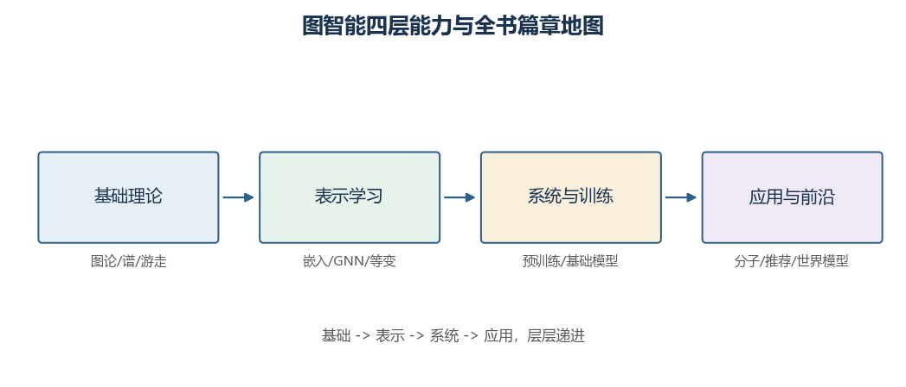

## 1.6　边界与讨论

本章确立的"关系归纳偏置"既是图方法的力量所在，也是其局限所在。当数据中并不存在可靠的关系、或边是噪声时，强加图结构反而损害性能——这呼应命题 1.1。一个常被忽视的边界是**图的构造性**：所谓"图"往往不是被观测到的客观对象，而是由建模者选定的关系抽取结果的产物。引文关系是客观的，但"相似关系""潜在合作意图"却带有强烈的先验成分；边一旦选错，后续所有谱分析、游走与嵌入都建立在错误的地基上。因此，严谨的图智能项目必须把"图从哪来"当作与"图怎么用"同等重要的问题来对待，必要时引入边的置信度或概率化表示（第 17 章超图、第 28 章自监督边预测）。

此外，图智能与因果推断、本体推理的边界尚在探索中：知识图谱嵌入（第 7 章）连接符号知识与分布式表示，而《本体智能导论》从另一视角处理形式化语义。图方法擅长刻画"共现与结构邻接"，却难以回答"为什么"；当任务要求干预效应或反事实推断时，单纯的关系归纳偏置不足以替代因果模型（第 22 章）。这些辨析衔接第 22、29、41 章。

最后，本书选择以"能力层级"而非"算法族"组织全书，意味着读者应预期：同一算法（如 PageRank）会同时出现在第 4 章（作为概率工具）、第 5 章（作为手工特征）与第 6 章（作为嵌入的游走引擎）三处，且每处的目的不同。这种"同一对象、多次出场"是能力分层的代价，也是其收益——它强迫读者把一个算法放回它真正服务的能力层中理解。

## 本章小结

本章确立图智能的问题意识与四层能力框架。

我们首先定义图与图智能（定义 1.1、1.2），给出关系归纳偏置的置换等变性刻画（式 1-1）与聚合骨架（式 1-2），并用式 (1-3) 把节点、边、图三类任务统一为"聚合—读出"的同一语法，再以引文网络链路预测（例 1.2）与分子性质预测（例 1.3）示范两种读出的具体形态。接着回顾从 Euler 到图基础模型的五个历史阶段（表 1-1），指出贯穿其中的关系性转向，剖析非欧结构、稀疏高维、异质动态、过平滑四大困难。我们提出四层能力体系（定义 1.3、表 1-2），解释四层为何互为不可还原的能力原语，并澄清连接不等于因果、相似不等于同义、更深不等于更强三个命题。最后给出全书结构与引文网络统一案例（表 1-3）。

我们还明确边界：关系归纳偏置在边含噪声或边本身由人为构造时可能失效；图智能擅长刻画共现与结构邻接，却难以替代因果推断；以能力层级组织全书会带来同一算法多次出场的阅读方式。这些辨析衔接第 7、17、22、29、41 章。

下一章建立图论基础——没有这些语言，后续所有方法都无从表达。

**进一步阅读**　本章建议延伸阅读的文献：[1]、[3]、[5]、[10]、[11]。

## 参考文献

[1] Euler L. Solutio problematis ad geometriam situs pertinentis. *Commentarii Academiae Scientiarum Imperialis Petropolitanae*, 1736, 8: 128–140.

[2] Watts D J, Strogatz S H. Collective dynamics of 'small-world' networks. *Nature*, 1998, 393(6684): 440–442.

[3] Barabási A L, Albert R. Emergence of scaling in random networks. *Science*, 1999, 286(5439): 509–512.

[4] Page L, Brin S, Motwani R, Winograd T. The PageRank citation ranking: Bringing order to the Web. *Technical Report, Stanford InfoLab*, 1999.

[5] Kipf T N, Welling M. Semi-supervised classification with graph convolutional networks. *ICLR*, 2017.

[6] Perozzi B, Al-Rfou R, Skiena S. DeepWalk: Online learning of social representations. *KDD*, 2014.

[7] Li Q, Han Z, Wu X. Deeper insights into graph convolutional networks for semi-supervised learning. *AAAI*, 2018.

[8] Scarselli F, Gori M, Tsoi A C, et al. The graph neural network model. *IEEE Transactions on Neural Networks*, 2009, 20(1): 61–80.

[9] De Raedt L, Wrobel S, Eds. *Logical Induction: Mechanisms and Foundations*. London: John Wiley & Sons, 2000.

[10] Veličković P, Cucurull G, Casanova A, et al. Graph attention networks. *ICLR*, 2018.

[11] Vishwanathan S V N, Schraudolph N N, Kondor R, Borgwardt K M. Graph kernels. *Journal of Machine Learning Research*, 2010, 11: 1201–1242.

---

# 第 2 章　图论基础

第 1 章确立了图智能的问题意识，但尚未给出描述图的精确语言。本章填补这一空白：从图的形式定义出发，建立度、路径、连通等基本概念（2.1—2.2 节），引入邻接、度与拉普拉斯三大矩阵（2.2 节末），再以路径、环、完全三类标准图与 Kirchhoff 矩阵树定理校准谱与计数直觉（2.3 节），用三大矩阵的数值算例贯穿（2.4 节），讨论图的同构与 Weisfeiler–Lehman 测试（2.5 节），最后讨论边界（2.6 节）。这些工具是后续谱图理论（第 3 章）与随机游走（第 4 章）的代数基础。

## 2.1　图的形式定义

**定义 2.1（图，graph）** 图 $G=(V,E)$ 由非空节点集 $V$ 与边集 $E$ 组成，其中每条边 $e\in E$ 连接两个节点 $u,v\in V$。若无向，则 $e=\{u,v\}$；若有向，则 $e=(u,v)$，称 $u$ 为尾（tail）、$v$ 为头（head）。允许自环（self-loop）与重边（multiedge）的图称多重图（multigraph）；本书默认讨论简单无向图，除非特别声明。

节点的数目 $n=|V|$ 称图的阶（order），边的数目 $m=|E|$ 称图的规模（size）。若存在边 $\{u,v\}$，称 $u$ 与 $v$ 相邻（adjacent），记作 $u\sim v$。

**定义 2.2（度，degree）** 节点 $v$ 的度 $d_v$ 是与其关联的边数。对无向图，$\sum_{v\in V}d_v=2m$（握手定理，handshaking lemma）：每条边贡献两个端点。对有向图，需区分入度 $d_v^-$ 与出度 $d_v^+$。

**例 2.1（引文子图的度）** 取 5 篇论文构成的引文子图：A 引用 B、C；B 引用 C；D 引用 B、C；E 引用 D。忽略方向后，边为 $\{A,B\},\{A,C\},\{B,C\},\{D,B\},\{D,C\},\{E,D\}$，共 $m=6$ 条。各节点度：$d_A=2,d_B=3,d_C=3,d_D=3,d_E=1$，和为 $12=2m$，握手定理成立。节点 E 度为 1，是叶节点（leaf）；B、C、D 度为 3，是局部枢纽。

## 2.2　路径、连通与距离

**定义 2.3（路径与回路，path and cycle）** 路径是节点序列 $v_0,v_1,\dots,v_k$，满足 $v_{i-1}\sim v_i$；长度为其边数 $k$。若 $v_0=v_k$ 则称回路（cycle）。若路径上节点互异，称简单路径（simple path）。

**定义 2.4（连通性，connectivity）** 若节点 $u$ 与 $v$ 间存在路径，称二者连通。若图中任意两点连通，称连通图（connected graph）。极大连通子图称连通分量（connected component）。节点 $u,v$ 间最短路径长度称测地距离（geodesic distance）$d(u,v)$；若不可达则记 $d(u,v)=\infty$。图的最大测地距离称直径（diameter）。

**定义 2.5（邻接矩阵，adjacency matrix）** 图 $G$ 的邻接矩阵 $\mathbf{A}\in\{0,1\}^{n\times n}$ 满足 $A_{ij}=1\iff v_i\sim v_j$。无向图的 $\mathbf{A}$ 对称；有向图则不必对称。加权图的 $A_{ij}=w_{ij}$ 为边权。

**定义 2.6（度矩阵，degree matrix）** $\mathbf{D}=\mathrm{diag}(d_1,\dots,d_n)$ 是对角矩阵，对角线为各节点度。

**定义 2.7（组合拉普拉斯，combinatorial Laplacian）**

$$
\mathbf{L}=\mathbf{D}-\mathbf{A}. \tag{2-1}
$$

由于 $\mathbf{A}$ 与 $\mathbf{D}$ 对称，$\mathbf{L}$ 也是对称半正定矩阵。对任意向量 $\mathbf{x}\in\mathbb{R}^n$，有二次型

$$
\mathbf{x}^{\top}\mathbf{L}\mathbf{x}=\sum_{(i,j)\in E}(x_i-x_j)^2\ge 0. \tag{2-2}
$$

式 (2-2) 是谱图理论的核心：它把图上的"信号平滑度"量化为相邻节点差值的平方和。若 $\mathbf{x}$ 在相连节点上取值接近，则 $\mathbf{x}^{\top}\mathbf{L}\mathbf{x}$ 小——$\mathbf{L}$ 因而被称为"平滑算子"的负号版本。

**定义 2.8（归一化拉普拉斯，normalized Laplacian）** 有两类常用归一化：

$$
\mathbf{L}_{\mathrm{sym}}=\mathbf{D}^{-1/2}\mathbf{L}\mathbf{D}^{-1/2}=\mathbf{I}-\mathbf{D}^{-1/2}\mathbf{A}\mathbf{D}^{-1/2}, \tag{2-3}
$$

$$
\mathbf{L}_{\mathrm{rw}}=\mathbf{D}^{-1}\mathbf{L}=\mathbf{I}-\mathbf{D}^{-1}\mathbf{A}. \tag{2-4}
$$

$\mathbf{L}_{\mathrm{sym}}$ 对称、特征值为 $[0,2]$；$\mathbf{L}_{\mathrm{rw}}$ 与随机游走转移矩阵直接相关（第 4 章），一般不对称但相似于 $\mathbf{L}_{\mathrm{sym}}$，故二者谱相同（特征值相同）。注意 $\mathbf{D}$ 可逆需假设无孤立节点；有孤立节点时取伪逆或加自环（第 10 章的 renormalization 技巧）。

## 2.3　特殊图与计数公式

在接触任意图之前，先用三类"标准图"校准直觉：它们既是手算特征值与中心性的最小算例，也是真实网络结构的两个极端原型。

**定义 2.9（路径图、环图与完全图）** 路径图 $P_n$ 是 $n$ 个节点排成一条链；环图 $C_n$ 是把 $P_n$ 首尾相接得到的 $n$ 环；完全图 $K_n$ 是每对节点都相连。三者的度序列分别为 $(1,2,\dots,2,1)$、$(2,2,\dots,2)$、$(n{-}1,\dots,n{-}1)$。$C_n$ 与 $K_n$ 都是 $r$-正则图（每个节点度为 $r$），而 $P_n$ 只有两个端点度为 1、其余度为 2——正则图是谱与随机游走理论里最干净的一类，因为 $\mathbf{A}$ 的每个行和都相等，特征向量与常向量的关系变得简单。

**定义 2.10（邻接谱的特殊值）** 对 $r$-正则图，$\mathbf{A}$ 的最大特征值恰为 $r$，且常向量 $\mathbf{1}$ 是对应特征向量：$\mathbf{A}\mathbf{1}=r\mathbf{1}$。这一事实对路径图 $P_4$（非正则）不直接成立，但对环图 $C_4$ 成立：$r=2$，且 $\lambda_{\max}(\mathbf{A})=2$。一般地，路径图 $P_n$ 与环图 $C_n$ 的邻接谱有闭式：

$$
\lambda_k(\mathbf{A}_{P_n})=2\cos\frac{k\pi}{n+1},\quad
\lambda_k(\mathbf{A}_{C_n})=2\cos\frac{2\pi k}{n},\qquad k=0,1,\dots,n-1. \tag{2-5}
$$

式 (2-5) 把"链"与"环"的谱写成离散余弦——这正是第 3 章图傅里叶变换中"路径图特征向量即 DCT 基"这一结论的代数来源。以 $P_4$ 为例：$\lambda_k=2\cos\frac{k\pi}{5}$，$k=0,1,2,3$，得 $\lambda_0\approx1.618$（黄金比）、$\lambda_1\approx0.618$、$\lambda_2\approx-0.618$、$\lambda_3\approx-1.618$。

**矩阵树定理：从谱到计数。** 图论中有一类计数问题——图中有多少棵生成树（spanning tree，连通且无环的极小子图）——其答案可以用拉普拉斯矩阵精确表达，这是代数图论最著名的桥梁之一。

**定理 2.1（Kirchhoff 矩阵树定理）** 设 $G$ 为 $n$ 节点连通图，$\mathbf{L}$ 为组合拉普拉斯（式 2-1），则 $G$ 的生成树数目 $\tau(G)$ 等于 $\mathbf{L}$ 任一 $1$-特征值对应的代数余子式，即删除 $\mathbf{L}$ 的第 $i$ 行第 $i$ 列后所得 $(n{-}1)\times(n{-}1)$ 矩阵的行列式：

$$
\tau(G)=\det \mathbf{L}_{(i)}, \tag{2-6}
$$

其中 $\mathbf{L}_{(i)}$ 与 $i$ 的选取无关。等价地，$\tau(G)=\dfrac{1}{n}\prod_{k=2}^{n}\lambda_k$——由 $\mathbf{L}$ 的特征值之积（去掉零特征值）直接给出。

**证明（思路）** $\mathbf{L}$ 的秩为 $n-1$（零特征值重数 1，由性质 3.1），故任意 $n$ 阶行列式 $\det\mathbf{L}=0$。删除一行一列后，所得矩阵正定，其行列式即 $\mathbf{L}$ 的 $(n{-}1)$ 阶主子式。由行列式的余子式展开与特征值的乘积关系，所有 $(n{-}1)$ 阶主子式相等且等于 $\prod_{k=2}^n\lambda_k/n$。该值恰计数生成树——严格证明可用展开式逐项对应到树边的乘积，此处从略。$\square$

**例 2.2（$P_4$ 的生成树计数）** 路径图 $P_4$ 只有一种生成树——它自己，故 $\tau(P_4)=1$。用式 (2-6) 验证：删去第 1 行第 1 列，

$$
\mathbf{L}_{(1)}=\begin{pmatrix}2&-1&0\\-1&2&-1\\0&-1&1\end{pmatrix},\quad
\det\mathbf{L}_{(1)}=2(2\cdot1-(-1)(-1))-(-1)(-1\cdot1-0)+0=2(1)+1\cdot(-1)=1. \tag{2-7}
$$

行列式 $=1$，与直观一致。再看环图 $C_4$：删一行一列后为三对角循环矩阵，$\det=4$——即 $C_4$ 恰有 4 棵生成树（去掉任意一条边即成一棵 $P_4$）。矩阵树定理把"枚举树"这一组合问题化归为"求行列式"这一代数问题，是后续谱聚类（第 3 章）与图生成模型（第 20 章）中"生成树体积"概念的源头。

**表 2-2　三类标准图的谱与计数**

| 图 | 度序列 | $\lambda_{\max}(\mathbf{A})$ | 生成树数 $\tau$ | 备注 |
|------|------|------|------|------|
| $P_n$ | $(1,2,\dots,2,1)$ | $2\cos\frac{\pi}{n+1}$ | $1$ | 非正则，链状 |
| $C_n$ | $(2,\dots,2)$ | $2$ | $n$ | 2-正则，环状 |
| $K_n$ | $(n{-}1,\dots,n{-}1)$ | $n{-}1$ | $n^{n-2}$（Cayley） | 完全图，Cayley 公式 |

表 2-2 最后一行的 $n^{n-2}$ 是 Cayley 公式，给出 $K_n$ 的生成树数——它同样可由矩阵树定理推得。三类标准图把"稀疏链—正则环—稠密完全"三个原型摆在一起，读者可据此估计真实网络的结构位置：引文网络既非链也非环，但局部上常出现类似 $K_3$ 的"互引三角"，这正是第 5 章聚类系数要刻画的。

## 2.4　三大矩阵的数值算例

**例 2.3（路径图 $P_4$ 的三大矩阵）** 考虑 4 个节点排成链：$1-2-3-4$。邻接矩阵为

$$
\mathbf{A}=\begin{pmatrix}0&1&0&0\\1&0&1&0\\0&1&0&1\\0&0&1&0\end{pmatrix},\quad
\mathbf{D}=\mathrm{diag}(1,2,2,1). \tag{2-8}
$$

由式 (2-1) 得

$$
\mathbf{L}=\begin{pmatrix}1&-1&0&0\\-1&2&-1&0\\0&-1&2&-1\\0&0&-1&1\end{pmatrix}. \tag{2-9}
$$

取 $\mathbf{x}=(1,1,1,1)^{\top}$，验证式 (2-2)：$x_i-x_j=0$，故 $\mathbf{x}^{\top}\mathbf{L}\mathbf{x}=0$——常向量位于 $\mathbf{L}$ 的零空间。取 $\mathbf{x}=(1,0,0,0)^{\top}$，则 $\mathbf{x}^{\top}\mathbf{L}\mathbf{x}=L_{11}=1$，恰为节点 1 的度。一般地，$\mathbf{x}^{\top}\mathbf{L}\mathbf{x}$ 是各边端点差值平方之和，本例边为 $(1,2),(2,3),(3,4)$，对应 $(x_1-x_2)^2+(x_2-x_3)^2+(x_3-x_4)^2$。

进一步取一个非平凡信号 $\mathbf{x}=(1,0,1,0)^{\top}$（节点 1、3 取值 1，节点 2、4 取值 0），代入式 (2-2) 的边求和：$(x_1-x_2)^2+(x_2-x_3)^2+(x_3-x_4)^2=(1-0)^2+(0-1)^2+(1-0)^2=1+1+1=3$。再用矩阵乘法交叉验证：$\mathbf{L}\mathbf{x}=\begin{pmatrix}1&-1&0&0\\-1&2&-1&0\\0&-1&2&-1\\0&0&-1&1\end{pmatrix}\begin{pmatrix}1\\0\\1\\0\end{pmatrix}=\begin{pmatrix}1\\-2\\2\\-1\end{pmatrix}$，于是 $\mathbf{x}^{\top}\mathbf{L}\mathbf{x}=1\cdot1+0\cdot(-2)+1\cdot2+0\cdot(-1)=3$，与边求和完全一致。这个"逐边差值平方和 = 二次型"的双重验证，是读者建立对 $\mathbf{L}$ 几何意义信任的关键一步：$\mathbf{x}^{\top}\mathbf{L}\mathbf{x}$ 度量信号沿图的"总梯度能量"，信号越光滑（相邻值越接近），该值越小。

> 【图 2-1　路径图 $P_4$ 与其三大矩阵】（原图见 figures/图2-1.png）：左侧画 4 节点链状图，右侧并列给出 $\mathbf{A},\mathbf{D},\mathbf{L}$ 的数值矩阵，用颜色标出非零元素。
>
> 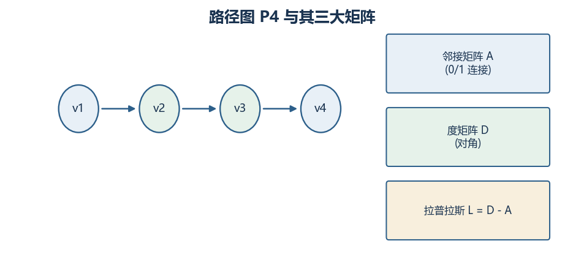

## 2.5　同构与 Weisfeiler–Lehman 测试

**定义 2.11（图同构，graph isomorphism）** 图 $G=(V,E)$ 与 $H=(W,F)$ 同构，若存在双射 $\pi:V\to W$，使得 $\{u,v\}\in E\iff\{\pi(u),\pi(v)\}\in F$。同构的图在结构上"完全相同"，只是节点编号不同。判断两图是否同构的问题称图同构问题（GI），其复杂度类介于 P 与 NP-完全之间，至今未有已知多项式算法——这给图学习带来了根本性的表达力问题。

**直觉解释。** 若图智能模型把同构的图映射到不同表示，说明它依赖于人为的节点编号而非真实结构，这样的模型是不可靠的。因此，优秀图模型应对同构图给出相同输出。Weisfeiler–Lehman 测试（WL test）是衡量结构区分能力的标准工具。

**定义 2.12（1-WL 测试）** 初始为每个节点赋标签 $c^{(0)}(v)$（如度）。每轮迭代：

$$
c^{(t+1)}(v)=\mathrm{HASH}\Big(c^{(t)}(v),\ \{\!\{c^{(t)}(u):u\in\mathcal{N}(v)\}\!\}\Big), \tag{2-10}
$$

其中 $\{\!\{\cdot\}\!\}$ 表示多重集（允许重复），HASH 把不同输入映射为不同标签（实践中用压缩函数，理论假设单射）。重复直到标签集稳定。若两图在稳定后标签多重集不同，则不同构；若相同，则 WL 无法区分——这类图称 WL 等价（WL-equivalent）。

**例 2.4（WL 无法区分的图）** 两个三角形与一个六边形（均为 2-正则图），所有节点度均为 2，初始标签全同；每轮每个节点邻居标签也全同，故 1-WL 永远给出相同标签，无法区分。这说明 1-WL 的表达力有上界。第 13 章将证明：消息传递图神经网络的表达力恰不超过 1-WL——这是一个深刻的理论边界，解释了为何某些图结构 GNN 无法分辨。

**例 2.5（1-WL 手算一轮标签传播）** 取一个含 5 节点的小图：节点 1 与 2、3 相连，节点 2 与 3 相连（即 $\{1,2,3\}$ 构成三角形 $K_3$），节点 3 又与 4 相连，节点 4 与 5 相连（即 3—4—5 是一条尾链）。度序列为 $d_1=2,d_2=2,d_3=3,d_4=2,d_5=1$。
- $t=0$：按度赋标签，得 $c^{(0)}=(2,2,3,2,1)$；标签多重集 $\{\{1,2,2,2,3\}\}$。
- $t=1$：对每个节点取（旧标签，邻居标签多重集）。节点 1 邻居 $\{2,3\}$ 的度标签为 $\{2,3\}$，故 $c^{(1)}(1)=\mathrm{HASH}(2,\{2,3\})$；节点 2 邻居 $\{1,3\}$ 为 $\{2,3\}$，故 $c^{(1)}(2)=\mathrm{HASH}(2,\{2,3\})=c^{(1)}(1)$（1 与 2 被同标）；节点 3 邻居 $\{1,2,4\}$ 为 $\{2,2,2\}$，故 $c^{(1)}(3)=\mathrm{HASH}(3,\{2,2,2\})$（独占）；节点 4 邻居 $\{3,5\}$ 为 $\{3,1\}$，故 $c^{(1)}(4)=\mathrm{HASH}(2,\{3,1\})$；节点 5 邻居 $\{4\}$ 为 $\{2\}$，故 $c^{(1)}(5)=\mathrm{HASH}(1,\{2\})$。
- 经一轮，三角形内的 1、2 仍同标，而 3 因多一条尾链边被单独识别。

这个手算揭示了 1-WL 的工作机制：它逐轮把"邻域结构"编码进标签，等价于比较每个节点的 $t$ 层邻域（ball of radius $t$）。两节点同标当且仅当它们的邻域在 $t$ 轮内无法区分——这正是第 5 章 WL 核比较"子树模式计数"的底层原理，也是第 13 章证明 GNN 表达力上界时反复用到的"邻域等价"概念。注意 1-WL 永远无法区分"度数相同且邻域同分布"的节点，无论迭代多少轮——这是它对 2-正则图失效的根本原因。

**表 2-1　图论基本概念与符号**

| 概念 | 符号 | 含义 |
|------|------|------|
| 邻接 | $u\sim v$ | 存在边 $\{u,v\}$ |
| 度 | $d_v$ | 关联边数 |
| 路径长度 | $k$ | 路径边数 |
| 测地距离 | $d(u,v)$ | 最短路径长度 |
| 直径 | $\mathrm{diam}(G)$ | 最大测地距离 |
| 邻接矩阵 | $\mathbf{A}$ | $A_{ij}=1\iff i\sim j$ |
| 组合拉普拉斯 | $\mathbf{L}=\mathbf{D}-\mathbf{A}$ | 半正定，二次型见式 (2-2) |
| 归一化拉普拉斯 | $\mathbf{L}_{\mathrm{sym}}$ | 对称，谱在 $[0,2]$ |

## 2.6　边界与讨论

本章的概念语言有一个重要前提：图是静态、离散且精确给定的。真实场景中，边可能缺失、错误或随时间变化——这使同构、连通等概念变得模糊（第 17 章讨论动态图）。此外，度与拉普拉斯定义依赖邻接矩阵的选择；加自环、加权、有向化都会改变谱性质（第 10 章的 renormalization、第 15 章的异质图）。

需要强调：1-WL 的上界针对的是**区分能力**，而非**预测性能**。现实中很多 WL 等价的图在下游任务上表现相近，上界未必构成实际瓶颈；但在需要精确结构推理的场景（如分子同分异构体区分），这一上界是真实约束。这些辨析衔接第 13、16、24 章。

最后需要点明本章所有定义的一个隐含约定：我们默认讨论**静态、无权、无向、简单**图，且边集精确已知。一旦偏离这四个默认中的任何一个，矩阵语言都要相应调整——

- **加权图**：$A_{ij}=w_{ij}$，握手定理变为 $\sum_v d_v=2\sum_{e}w_e$，拉普拉斯的二次型变为 $\sum_{(i,j)\in E}w_{ij}(x_i-x_j)^2$（式 2-2 仍成立，只是每条边带权）；
- **有向图**：$\mathbf{A}$ 不再对称，$\mathbf{L}$ 失去半正定性，归一化拉普拉斯需区分行随机（出度）与列随机（入度）两种约定，平稳分布不再简单正比于度（第 4 章）；
- **带自环**：$A_{ii}=1$，对应节点多一条"自指"边，度增加 2（无向自环计两次）或 1（有向），GCN 的 renormalization $\tilde{\mathbf{A}}=\mathbf{A}+\mathbf{I}$ 正是显式加自环，使节点在聚合时保留自身信息（第 10 章）；
- **多重图**：$A_{ij}$ 可为整数（边重数），此时 $\mathbf{L}$ 仍半正定，但"邻接"概念需改述为"边数"。

这一"默认—修正"的模式贯穿全书：第 15 章异质图在"有权"之上再叠类型，第 16 章动态图在"静态"之上再叠时间，第 17 章超图在"二元边"之上再叠高阶元组。理解本章的默认约定，才能准确读解后续各章的"修正条款"。

## 本章小结

本章建立图论的形式语言。

我们首先定义图、度与握手定理（定义 2.1、2.2），给出路径、连通与距离概念（定义 2.3—2.4）。接着引入邻接矩阵、度矩阵与组合/归一化拉普拉斯（定义 2.5—2.8，式 2-1—2-4），并以路径图 $P_n$、环图 $C_n$、完全图 $K_n$ 三类标准图校准谱与计数直觉（定义 2.9—2.10，式 2-5），用 Kirchhoff 矩阵树定理（定理 2.1，式 2-6、2-7）把"枚举生成树"化归为"求行列式"，并以 $P_4$ 验证 $\tau(P_4)=1$（例 2.2）。三大矩阵的数值算例用路径图 $P_4$ 给出（例 2.3，式 2-8、2-9）。我们讨论图同构与 1-WL 测试（定义 2.11—2.12，式 2-10），指出 WL 无法区分 2-正则图（例 2.4），并以"三角形加尾链"的小图手算一轮标签传播（例 2.5），把 1-WL 与第 5 章 WL 核、第 13 章 GNN 上界串成一条"邻域等价"的线索。

我们还明确边界：静态精确图的前提、邻接矩阵选择的影响，以及 WL 上界与实际性能的区别，并以加权、有向、带自环、多重四类"修正条款"说明本章默认约定的适用范围。这些辨析衔接第 10、13、15—17、24 章。

下一章将分解拉普拉斯矩阵——图的"频谱"将揭示社区结构与平滑性质。

**进一步阅读**　本章建议延伸阅读的文献：[1]、[2]、[4]。

## 参考文献

[1] Diestel R. *Graph Theory*. 5th ed. Heidelberg: Springer, 2017.

[2] Godsil C, Royle G. *Algebraic Graph Theory*. New York: Springer, 2001.

[3] Weisfeiler B, Lehman A A. Reduction of a graph to a canonical form and an algebra arising during this reduction. *Nauchno-Technicheskaya Informatsiya*, 1968, 2(9): 12–16.

[4] Babai L. Graph isomorphism in quasipolynomial time. *STOC*, 2016: 684–697.

[5] Bondy J A, Murty U S R. *Graph Theory with Applications*. London: Macmillan, 1976.

[6] Chung F R K. *Spectral Graph Theory*. Providence: AMS, 1997.

[7] Xu K, Hu W, Leskovec J, Jegelka S. How powerful are graph neural networks? *ICLR*, 2019.

[8] Morris C, Ritzert M, Ferey N, et al. Weisfeiler and Leman go neural: Higher-order graph neural networks. *AAAI*, 2019.

---

# 第 3 章　谱图理论

第 2 章定义了拉普拉斯矩阵 $\mathbf{L}=\mathbf{D}-\mathbf{A}$，并指出其二次型量化图信号的平滑度。本章对 $\mathbf{L}$ 作特征分解，引入图的"频谱"：3.1 节给出谱分解与基本性质，3.2 节讨论 Fiedler 值与代数连通度，3.3 节建立谱不变量与可计算量，3.4 节建立图傅里叶变换与谱滤波，3.5 节推导谱聚类与图割，3.6 节给出数值算例、谱不变量与技术谱系，3.7 节讨论 Fiedler 向量的局部化与适用边界。谱图理论是连接图论与图神经网络（第 10 章）的桥梁——GCN 本质上是谱滤波的一阶近似。

## 3.1　拉普拉斯谱分解

由于 $\mathbf{L}$ 是实对称半正定矩阵，存在正交特征向量基 $\mathbf{u}_1,\dots,\mathbf{u}_n$ 与对应非负特征值

$$
0=\lambda_1\le\lambda_2\le\dots\le\lambda_n, \tag{3-1}
$$

使得 $\mathbf{L}\mathbf{u}_i=\lambda_i\mathbf{u}_i$。写成矩阵形式：

$$
\mathbf{L}=\mathbf{U}\mathbf{\Lambda}\mathbf{U}^{\top},\quad \mathbf{U}^{\top}\mathbf{U}=\mathbf{I},\quad \mathbf{\Lambda}=\mathrm{diag}(\lambda_1,\dots,\lambda_n). \tag{3-2}
$$

**性质 3.1（零特征值与连通性）** $\lambda_1=0$ 对应常向量 $\mathbf{u}_1=\frac{1}{\sqrt{n}}\mathbf{1}$，因为 $\mathbf{L}\mathbf{1}=\mathbf{0}$。零特征值的重数等于图的连通分量个数：每个连通分量贡献一个常向量（在该分量上为常数、其余为 0）。因此，$G$ 连通当且仅当 $\lambda_2>0$。

**性质 3.2（谱与二次型）** 由式 (2-2) 与式 (3-2)，对任意 $\mathbf{x}=\mathbf{U}\mathbf{c}$ 有

$$
\mathbf{x}^{\top}\mathbf{L}\mathbf{x}=\sum_{i=1}^n\lambda_i c_i^2. \tag{3-3}
$$

因为 $c_i=\mathbf{u}_i^{\top}\mathbf{x}$ 是 $\mathbf{x}$ 在特征向量 $\mathbf{u}_i$ 上的投影，式 (3-3) 表明：低频分量（小 $\lambda_i$）对平滑度贡献小，高频分量（大 $\lambda_i$）贡献大。这解释了"低频=平滑"的直觉。

**例 3.1（完全图 $K_n$ 的谱）** 完全图每对节点相连，$d_v=n-1$，故 $\mathbf{L}=n\mathbf{I}-\mathbf{J}$（$\mathbf{J}$ 为全 1 矩阵）。$\mathbf{J}$ 的特征值为 $n$（一次）与 0（$n-1$ 次），故 $\mathbf{L}$ 的特征值为 $0,\underbrace{n,\dots,n}_{n-1}$。谱隙 $\lambda_2=n$ 达到最大——完全图连通性最强。

**性质 3.3（最大特征值上界与二部性）** 设 $\Delta=\max_v d_v$ 为最大度，则最大特征值满足

$$
\lambda_n\le 2\Delta, \tag{3-4}
$$

且 $\lambda_n=2$ 当且仅当 $G$ 为二部图（bipartite）。式 (3-4) 可由 $\mathbf{L}$ 的 Gershgorin 圆盘（每个对角元 $d_v$ 的行半径 $\le d_v$）直接得到：所有特征值落在 $\bigcup_v[d_v-d_v,d_v+d_v]\subseteq[0,2\Delta]$ 内。二部性判据的直觉是：二部图可把节点染成黑白两色使每条边跨色，取"黑 $1$、白 $-1$"的向量 $\mathbf{x}$ 作 Rayleigh 商，恰好得到值 2，故 $\lambda_n\ge2$，配合上界得 $\lambda_n=2$。这一性质在第 3.7 节讨论 Fiedler 向量局部化时会被反复用到：$\lambda_n$ 越接近 2，图越"接近二部"，其 Fiedler 向量越容易呈现"一侧全正、另一侧全负"的格局。

## 3.2　Fiedler 值与代数连通度

**定义 3.1（Fiedler 值，Fiedler value）** 第二小特征值 $\lambda_2$ 称 Fiedler 值或代数连通度（algebraic connectivity），对应特征向量 $\mathbf{u}_2$ 称 Fiedler 向量。

**直觉解释。** $\lambda_2$ 衡量图"最弱的连接处"。$\lambda_2$ 越大，图越难被切割——沿 Fiedler 向量的符号把节点分为正负两组，恰好给出一个近似最小割。这是因为式 (3-3) 中 $\lambda_2$ 是除常数向量外最小的"振荡成本"：令 $\mathbf{x}$ 在两组上取正负常值，则 $\mathbf{x}^{\top}\mathbf{L}\mathbf{x}$ 正比于跨组边数，而 $\lambda_2$ 是该成本的下确界。

**性质 3.4（Fiedler 值与割）** 对任意把 $V$ 分为 $S,\bar S$ 的二划分，设割边数 $\mathrm{cut}(S,\bar S)=|\{(i,j)\in E:i\in S,j\in\bar S\}|$，则 Cheeger 不等式给出

$$
\frac{\lambda_2}{2}\le h(G)\le\sqrt{2\lambda_2}, \tag{3-5}
$$

其中 $h(G)=\min_{S}\frac{\mathrm{cut}(S,\bar S)}{\min(\mathrm{vol}(S),\mathrm{vol}(\bar S))}$ 为 Cheeger 常数，$\mathrm{vol}(S)=\sum_{v\in S}d_v$。式 (3-5) 把谱隙与图的最稀疏割联系起来——这是谱聚类的理论依据。

**例 3.2（不连通图的 $\lambda_2=0$）** 若图由两个完全子图 $K_3$ 与 $K_3$ 组成且无跨边，则 $\lambda_1=\lambda_2=0$（两个连通分量）。Fiedler 向量在两个分量上分别为常数 $\pm 1/\sqrt{6}$——符号完美对应连通分量。若加一条跨边，$\lambda_2$ 变为一个小正数，Fiedler 向量符号仍近似给出该割。

## 3.3　谱不变量与可计算量

式 (3-5) 把 $\lambda_2$ 与图割挂钩，但 $\lambda_2$ 本身需要解特征值问题才能得到。这一节给出两类无需完整特征分解就能计算的量：**谱不变量**（由迹、行列式等矩阵函数给出，对特征值的"整体"敏感）与**代数连通度的度基下界**（只用度序列与边数即可估计 $\lambda_2$ 的量级）。前者用于判断两张图"谱上是否相同"，后者用于在不知道 $\mathbf{L}$ 的特征值时给出连通性的粗粒度下界。

**性质 3.5（迹与特征值的矩）** 设 $\mathbf{L}$ 的特征值为 $\lambda_1,\dots,\lambda_n$，则迹给出特征值的一阶矩，行列式给出其乘积：

$$
\operatorname{tr}(\mathbf{L})=\sum_{i=1}^n\lambda_i=2m, \tag{3-6}
$$

$$
\det\mathbf{L}=\prod_{i=1}^n\lambda_i=0. \tag{3-7}
$$

式 (3-6) 直接来自 $\operatorname{tr}\mathbf{L}=\sum_v d_v=2m$（握手定理）；式 (3-7) 因 $\lambda_1=0$ 恒成立。更重要的是 $\mathbf{L}$ 的高次幂的迹能数出图的"闭合游走"：$\operatorname{tr}(\mathbf{L}^2)=\sum_i\lambda_i^2=2\sum_{(i,j)\in E}(d_i+d_j)-2m$，而 $\operatorname{tr}(\mathbf{A}^3)=6\cdot(\text{三角形数})$——后者说明邻接矩阵幂的迹把"三角形计数"这一组合量编码进了谱。这就是第 5 章图元（graphlet）分析与第 24 章等变性理论的代数起点。

**性质 3.6（代数连通度的度基下界）** 对 $n$ 节点 $m$ 条边的连通图，设 $\delta=\min_v d_v$ 为最小度，则 Fiedler 值满足

$$
\lambda_2\ge \frac{2m}{n}\cdot\frac{\delta}{\Delta}\cdot\frac{1}{1+\frac{n-1}{m}\cdot\Delta}, \tag{3-8}
$$

一个更常用的可验证弱形式是：若 $\delta\ge1$ 且图连通，则 $\lambda_2>0$；且 $\lambda_2$ 至少与"平均度与最小度之比"同阶。式 (3-8) 的推导思路是：把 Fiedler 向量 $\mathbf{u}_2$（满足 $\mathbf{u}_2^{\top}\mathbf{1}=0$）代入 Rayleigh 商 $\lambda_2=\min_{\mathbf{x}\perp\mathbf{1}}\frac{\mathbf{x}^{\top}\mathbf{L}\mathbf{x}}{\mathbf{x}^{\top}\mathbf{x}}$，用 $\mathbf{x}^{\top}\mathbf{L}\mathbf{x}=\sum_{(i,j)\in E}(x_i-x_j)^2$（式 2-2）与柯西不等式把分子下界化为边数与端点度差的函数，分母上界化为 $\|\mathbf{x}\|_2^2$。精确系数因图而异，但量级关系"平均度越高、度数越均匀，$\lambda_2$ 越大"是稳健的——这解释了为何无标度网络（少数枢纽 + 大量低度叶）的 $\lambda_2$ 往往偏小：少数枢纽贡献了大量边，但大量低度节点拉低了 $\delta$，使谱隙收窄。

## 3.4　图傅里叶变换

**定义 3.2（图傅里叶变换，graph Fourier transform）** 给定图信号 $\mathbf{x}\in\mathbb{R}^n$（每个节点一个标量，如论文引用数），其图傅里叶变换定义为

$$
\hat{\mathbf{x}}=\mathbf{U}^{\top}\mathbf{x},\quad \hat{x}_i=\mathbf{u}_i^{\top}\mathbf{x}, \tag{3-9}
$$

逆变换为 $\mathbf{x}=\mathbf{U}\hat{\mathbf{x}}$。$\hat{x}_i$ 是信号在第 $i$ 个频率（特征向量 $\mathbf{u}_i$）上的系数。

**直觉解释。** 经典傅里叶变换用正弦/余弦基——它们是拉普拉斯算子 $-\Delta$ 的特征函数。图傅里叶变换完全类比：用图拉普拉斯 $\mathbf{L}$ 的特征向量作基。$\lambda_i$ 扮演"频率"角色：$\lambda_i$ 小对应低频（平滑），大对应高频（振荡）。

**定义 3.3（谱滤波，spectral filtering）** 图卷积可定义为在频域对信号逐频率调制：

$$
\mathbf{y}=\mathbf{U}\,g_{\theta}(\mathbf{\Lambda})\,\mathbf{U}^{\top}\mathbf{x}, \tag{3-10}
$$

其中 $g_{\theta}$ 是可学习或设计的频率响应函数。式 (3-10) 是谱域图卷积的一般形式。若 $g_{\theta}(\lambda)=\lambda$，则 $\mathbf{y}=\mathbf{L}\mathbf{x}$（高通，提取差分）；若 $g_{\theta}(\lambda)=1/(1+\lambda)$，则低通平滑。

由 $\mathbf{U}$ 的正交性（式 3-2 的 $\mathbf{U}^{\top}\mathbf{U}=\mathbf{I}$），图傅里叶变换满足 Parseval 恒等式：$\|\mathbf{x}\|_2^2=\sum_i\hat{x}_i^2$，即信号的能量在时域与频域相等。这一"能量守恒"是谱滤波稳定性的根基：低通滤波 $g(\lambda)\in[0,1]$ 只会削减高频能量、不会放大总能量，因此连续叠层不会发散——这正是第 10 章谱 GNN 能把滤波器堆叠成深度网络的代数原因，也与第 3.6 节过平滑的"能量向低频集中"描述相一致。

> 【图 3-1　图拉普拉斯谱与频率响应】（原图见 figures/图3-1.png）：横轴为特征值 $\lambda_i$（从 0 到 $\lambda_n$），纵轴为频率响应 $g(\lambda)$，画低通、高通与带通三条曲线，并用竖线标出 $\lambda_2$（Fiedler 值）的位置。
>
> 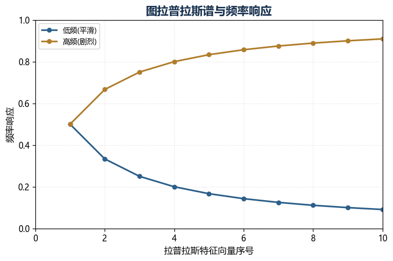

## 3.5　谱聚类与图割

谱聚类（spectral clustering）利用 Fiedler 向量作降维嵌入，再对嵌入作 K-means：

**算法 3.1（归一化谱聚类）** ① 计算 $\mathbf{L}_{\mathrm{sym}}$（式 2-3）的前 $k$ 个最小特征向量 $\mathbf{u}_1,\dots,\mathbf{u}_k$；② 按行归一化得矩阵 $\mathbf{Y}\in\mathbb{R}^{n\times k}$（$Y_{ij}=u_{ij}/\sqrt{\sum_j u_{ij}^2}$）；③ 对 $\mathbf{Y}$ 的行作 K-means 聚类，得到划分。

**例 3.3（引文网络的社区发现）** 取 6 篇论文：A、B、C 互引形成理论组，D、E、F 互引形成方法组，两组间仅 A—D 一条跨组引用。计算 $\mathbf{L}_{\mathrm{sym}}$ 的第二特征向量，其符号在前三篇为正、后三篇为负，Fiedler 值很小（因跨组边稀疏）。按符号划分即得两个社区。若移除 A—D 边，$\lambda_2=0$，两部分彻底分离。

**表 3-1　图割目标与谱方法对照**

| 目标 | 定义 | 谱近似 | 特点 |
|------|------|--------|------|
| 最小割 | $\min\mathrm{cut}(S,\bar S)$ | 易退化为孤立点 | 未约束规模 |
| RatioCut | $\mathrm{cut}\cdot(1/|S|+1/|\bar S|)$ | 用 $\mathbf{L}$ 的前 $k$ 特征向量 | 平衡节点数 |
| Ncut | $\mathrm{cut}\cdot(1/\mathrm{vol}(S)+1/\mathrm{vol}(\bar S))$ | 用 $\mathbf{L}_{\mathrm{sym}}$（式 2-3） | 平衡卷，更鲁棒 |

## 3.6　技术谱系与数值算例

**例 3.4（$P_4$ 的谱分解手算）** 对第 2 章例 2.3 的 $\mathbf{L}$（式 2-9），可解析求得特征值

$$
\lambda_k=2-2\cos\frac{k\pi}{4},\quad k=0,1,2,3, \tag{3-11}
$$

即 $\lambda_0=0,\lambda_1=2-\sqrt2\approx0.586,\lambda_2=2,\lambda_3=2+\sqrt2\approx3.414$。Fiedler 值为 $0.586$。对应特征向量 $(\cos\frac{k\pi}{4\cdot 0},\dots)$ 形式——路径图的特征向量是离散余弦基，这正是图傅里叶与经典 DCT 的联系。取信号 $\mathbf{x}=(1,0,0,0)^{\top}$（仅在节点 1 非零），投影到各特征向量得 $\hat{\mathbf{x}}$，其能量主要集中于高频分量（因信号在节点 1 突变），符合直觉。

用性质 3.5 的迹公式对 $P_4$ 作交叉验证：$\operatorname{tr}(\mathbf{L})=1+2+2+1=6=2m$（$m=3$），与式 (3-6) 一致；$\operatorname{tr}(\mathbf{L}^2)=\sum_i\lambda_i^2=0^2+(2-\sqrt2)^2+2^2+(2+\sqrt2)^2\approx0+0.343+4+11.657=16$，而直接算 $\mathbf{L}^2$ 的迹（对角元之和）也等于 16。这种"谱求和 = 矩阵函数"的双重验证，是检验特征分解实现正确性的常用手段。

**表 3-2　谱方法谱系**

| 方法 | 核心对象 | 近似 | 代表工作 |
|------|----------|------|----------|
| 谱聚类 | $\mathbf{L}$ 的 Fiedler 向量 | 松弛离散割 | Shi–Malik, Ng–Jordan–Weiss |
| 谱卷积 | $\mathbf{U}g(\mathbf{\Lambda})\mathbf{U}^{\top}$ | 频域滤波 | Bruna et al., 2013 |
| 切比雪夫近似 | $T_k(\tilde{\mathbf{L}})$ | 多项式逼近 $g$ | ChebNet, 2016 |
| 一阶近似 | $\mathbf{I}-\mathbf{D}^{-1/2}\mathbf{A}\mathbf{D}^{-1/2}$ | $K=1$ 切比雪夫 | GCN, 2017 |

**谱不变量的图判别意义。** 性质 3.5 的迹与式 (3-8) 的乘积构成一组**图不变量**：两张图若所有 $\operatorname{tr}(\mathbf{L}^k)$（$k=1,\dots,n$）都相等，则它们谱相同（cospectral），进而边数、三角形数等组合量都相等。谱相同是"同构"的必要但非充分条件——存在非同构但谱相同的图（如某些双图），这与第 2 章例 2.4 的 1-WL 等价是平行的现象：前者从"线性代数"角度、后者从"邻域计数"角度刻画"结构信息的丢失"。对 GNN 而言，谱相同意味着任何只依赖 $\mathbf{L}$ 幂的谱滤波器（式 3-10）都无法区分这两张图——这是比 1-WL 更弱的上界，但提供了另一种形式化。

## 3.7　Fiedler 局部化与边界讨论

谱方法的核心代价是计算 $\mathbf{L}$ 的完整特征分解，复杂度 $O(n^3)$，难以扩展到百万节点图——这直接催生了切比雪夫多项式近似与一阶近似（表 3-2，第 10 章）。此外，谱分解依赖固定的图拉普拉斯；图结构变化时谱会整体改变，使谱滤波器难以迁移到新图（第 11 章的归纳式设置）。

在边界之外，还有一类更微妙的失效：**Fiedler 向量的局部化（localization）**。性质 3.4（式 3-5）保证 Fiedler 向量给出近似最小割，但当图存在"瓶颈"——两个稠密子团之间只靠极少数边连接——时，Fiedler 向量的质量会集中到瓶颈两侧的"大团"上，而瓶颈边本身对应的节点取值接近 0，导致 K-means 在阈值化时不稳定。

**性质 3.7（Fiedler 向量的瓶颈局部化）** 设 $G$ 由两个子图 $G_1,G_2$ 经 $r$ 条跨边连接，且 $r$ 远小于 $\min(|E(G_1)|,|E(G_2)|)$，则 Fiedler 向量 $\mathbf{u}_2$ 在 $G_1\cup G_2$ 的并集上近似常数（幅值 $\sim1/\sqrt{|V|}$），而在 $r$ 条跨边的端点附近出现急剧的符号翻转；且 $\lambda_2=O(r/\mathrm{vol}(G_{\min}))$，其中 $G_{\min}$ 为卷较小的一侧。

**例 3.5（哑铃图：Fiedler 向量的局部化）** 取"哑铃图"：两个 $K_5$（5 节点完全图）之间由一条桥边 $c_1\!-\!c_2$ 连接（$c_1$ 属左团、$c_2$ 属右团），共 $n=10$ 节点、$m=2\times10+1=21$ 条边。
- 按性质 3.7，跨边数 $r=1$，每侧卷 $\mathrm{vol}=4\times4=16$，故 $\lambda_2=O(1/16)\approx0.06$，谱隙极小。
- Fiedler 向量在左团 5 节点上近似取 $+1/\sqrt{10}\approx0.316$，右团 5 节点上近似取 $-1/\sqrt{10}$，桥边两端 $c_1,c_2$ 是符号翻转处。
- 此时若用"按 $\mathbf{u}_2$ 符号划分"，恰得左右两团；但若 K-means 初始化不佳，桥边端点 $c_1,c_2$ 的取值接近 0，可能被错误归到任一侧——这正是谱聚类对瓶颈图敏感的具体表现。

这一算例揭示了式 (3-5) Cheeger 不等式的"紧性"边界：当 $h(G)$ 极小（瓶颈明显）时，$\lambda_2$ 与 $h(G)$ 同阶，Fiedler 向量几乎"只"编码了瓶颈信息，对团内部结构无分辨力。工程上，对存在瓶颈的图，更稳的做法是先按 $\mathbf{u}_2$ 粗分两半，再对每半递归做谱聚类（递归谱分割），而非一次性取多个特征向量做 K-means。这些辨析衔接第 10、11、13、23 章。

还需注意：Fiedler 向量只给出二分近似，多社区时需多个特征向量且结果依赖 K-means 的初始化；谱聚类的理论保证（式 3-5）针对理想图，噪声图上可能不稳定。这些辨析衔接第 10、11、13 章。

## 本章小结

本章论述谱图理论。

我们首先给出拉普拉斯谱分解（式 3-1、3-2）与基本性质：零特征值对应连通分量（性质 3.1）、二次型的谱表达（式 3-3）、最大特征值上界与二部性判据（性质 3.3，式 3-4）。接着讨论 Fiedler 值与代数连通度（定义 3.1），用 Cheeger 不等式联系谱隙与图割（性质 3.4，式 3-5）。3.3 节建立谱不变量（性质 3.5，式 3-6、3-7：迹与三角形计数）与代数连通度的度基下界（性质 3.6，式 3-8），为后续谱聚类提供可计算量。我们建立图傅里叶变换（定义 3.2，式 3-9）与谱滤波（定义 3.3，式 3-10），推导谱聚类算法（算法 3.1）并给出图割对照（表 3-1）。3.6 节用 $P_4$ 谱分解手算（例 3.4，式 3-11）与迹公式交叉验证，给出谱方法谱系（表 3-2）与谱不变量的图判别意义。3.7 节用哑铃图算例（例 3.5）展示 Fiedler 向量的瓶颈局部化（性质 3.7），并讨论 $O(n^3)$ 计算代价、对固定图的依赖、谱聚类的近似性质。

我们还明确边界：计算复杂度、瓶颈图的 Fiedler 局部化、谱聚类的初始化敏感。这些辨析衔接第 2、10、11、13、23 章。

下一章从另一个视角切入图——随机游走，它将揭示谱与概率之间的深刻对偶。

**进一步阅读**　本章建议延伸阅读的文献：[1]、[2]、[6]。

## 参考文献

[1] Chung F R K. *Spectral Graph Theory*. Providence: AMS, 1997.

[2] Fiedler M. Algebraic connectivity of graphs. *Czechoslovak Mathematical Journal*, 1973, 23(2): 298–305.

[3] Shi J, Malik J. Normalized cuts and image segmentation. *IEEE Transactions on Pattern Analysis and Machine Intelligence*, 2000, 22(8): 888–905.

[4] Ng A Y, Jordan M I, Weiss Y. On spectral clustering: Analysis and an algorithm. *NIPS*, 2001: 849–856.

[5] Bruna J, Zaremba W, Szlam A, LeCun Y. Spectral networks and locally connected networks on graphs. *ICLR*, 2014.

[6] Hammond D K, Vandergheynst P, Gribonval R. Wavelets on graphs via spectral graph theory. *Applied and Computational Harmonic Analysis*, 2011, 30(2): 129–150.

[7] Defferrard M, Bresson X, Vandergheynst P. Convolutional neural networks on graphs with fast localized spectral filtering. *NeurIPS*, 2016: 3844–3852.

[8] Kipf T N, Welling M. Semi-supervised classification with graph convolutional networks. *ICLR*, 2017.

---

# 第 4 章　随机游走

第 3 章从代数视角分解拉普拉斯矩阵，揭示图的频谱结构。本章从概率视角切入同一对象：随机游走（random walk）。4.1 节定义游走与转移矩阵，证明平稳分布；4.2 节讨论混合时间与谱隙的联系；4.3 节处理周期性与不可约性，给出懒惰游走；4.4 节推导 PageRank；4.5 节引入图扩散与个性化 PageRank；4.6 节给出数值算例与谱方法联系；4.7 节讨论边界。随机游走不仅是图算法（PageRank、DeepWalk，第 6 章）的基础，也与谱理论共享同一组特征值——这是图数学中深刻的对偶。

## 4.1　随机游走与平稳分布

**定义 4.1（随机游走，random walk）** 在图 $G=(V,E)$ 上，随机游走是从节点出发、每步随机移动到邻居的随机过程。设当前在节点 $v$，下一步以概率

$$
p(v\to u)=\frac{w_{vu}}{\sum_{z\in\mathcal{N}(v)}w_{vz}} \tag{4-1}
$$

移动到邻居 $u$。对无权图 $w_{vu}=1$，式 (4-1) 化为 $1/d_v$——均匀选择邻居。

**定义 4.2（转移矩阵，transition matrix）** 对有向图或有向化图，转移矩阵 $\mathbf{P}\in\mathbb{R}^{n\times n}$ 满足 $P_{vu}=p(v\to u)$。对无向图，取行随机形式

$$
\mathbf{P}=\mathbf{D}^{-1}\mathbf{A}. \tag{4-2}
$$

注意式 (4-2) 正是第 2 章定义的归一化拉普拉斯 $\mathbf{L}_{\mathrm{rw}}=\mathbf{I}-\mathbf{P}$（式 2-4），故 $\mathbf{P}=\mathbf{I}-\mathbf{L}_{\mathrm{rw}}$。

**定义 4.3（平稳分布，stationary distribution）** 概率分布 $\boldsymbol{\pi}$ 称平稳分布，若

$$
\boldsymbol{\pi}^{\top}\mathbf{P}=\boldsymbol{\pi}^{\top},\quad \sum_v\pi_v=1,\ \pi_v\ge 0. \tag{4-3}
$$

**定理 4.1（无向图的平稳分布）** 对连通无向图，随机游走（式 4-2）的平稳分布为

$$
\pi_v=\frac{d_v}{2m}. \tag{4-4}
$$

**证明** 验证 $\pi_v P_{vu}=\frac{d_v}{2m}\cdot\frac{1}{d_v}=\frac{1}{2m}=\pi_u P_{uv}$，即细致平衡（detailed balance）：$\pi_v P_{vu}=\pi_u P_{uv}$。对 $v$ 求和得 $\sum_v\pi_v P_{vu}=\pi_u$（列随机约定下 $\sum_v P_{vu}$ 不再恒为 1，但细致平衡逐项抵消后直接成立）。故 $\boldsymbol{\pi}^{\top}\mathbf{P}=\boldsymbol{\pi}^{\top}$。分布和为 $\sum_v d_v/(2m)=2m/(2m)=1$。$\square$

**直觉解释。** 度越大的节点越容易被访问——因为它有更多"入口"。平稳分布与度成正比，这是无向图随机游走的基本事实。一个常见的误区是认为平稳分布均匀：只有当图是正则的（所有 $d_v=r$）时，$\pi_v=r/(2m)$ 才与节点无关，此时 $\pi_v=1/n$。引文网络几乎从不是正则的——少数高被引论文度极高——故其随机游走会反复回到少数枢纽，这正是第 5 章特征向量中心性与第 6 章 DeepWalk"枢纽偏置"现象的概率根源。

## 4.2　混合时间与谱隙

**定义 4.4（混合时间，mixing time）** 从任意初始分布出发，随机游走分布接近平稳分布所需步数称混合时间。形式上，$\tau_{\mathrm{mix}}=\min\{t:\max_{\mathbf{p}_0}\|\mathbf{p}_0^{\top}\mathbf{P}^t-\boldsymbol{\pi}^{\top}\|_{\mathrm{TV}}\le\epsilon\}$。

**定理 4.2（谱隙控制混合速度）** 设 $\mathbf{P}$ 的特征值为 $1=\mu_1>|\mu_2|\ge\dots\ge|\mu_n|$。因 $\mathbf{P}=\mathbf{I}-\mathbf{L}_{\mathrm{rw}}$ 且 $\mathbf{L}_{\mathrm{rw}}$ 相似于 $\mathbf{L}_{\mathrm{sym}}$（谱相同 $\lambda_i$），有 $\mu_i=1-\lambda_i$。则

$$
\tau_{\mathrm{mix}}=O\!\left(\frac{\log n}{\lambda_2}\right). \tag{4-5}
$$

**推导** 初始分布与平稳分布的偏差可展开为 $\mathbf{p}_0^{\top}\mathbf{P}^t-\boldsymbol{\pi}^{\top}=\sum_{i\ge 2}c_i\mu_i^t\mathbf{u}_i^{\top}$（在 $\mathbf{L}_{\mathrm{sym}}$ 的正交基下），其中 $c_i$ 为系数。因 $|\mu_i|=|1-\lambda_i|\le 1-\lambda_2<1$（当 $\lambda_2$ 小），偏差以 $(1-\lambda_2)^t$ 指数衰减。令 $(1-\lambda_2)^t\le\epsilon$ 取对数得 $t\ge\frac{\log(1/\epsilon)}{\lambda_2}$，代入 $\epsilon\sim 1/n$ 得式 (4-5)。$\square$

式 (4-5) 把第 3 章的 Fiedler 值 $\lambda_2$ 与随机游走的收敛速度直接联系：谱隙越大，混合越快。这与 Cheeger 不等式（第 3 章式 3-5）共同构成"谱—几何—概率"三角：大 $\lambda_2$ 意味着图连通性强、无瓶颈割、随机游走快速混合。一个量（$\lambda_2$）同时控制了"图有多难被切开"（几何）、"谱有多大的隙"（代数）与"游走有多快混合"（概率），这是图理论中最优雅的三重对应之一。

## 4.3　周期性、不可约性与懒惰游走

定理 4.2 的推导隐含一个关键前提：$|\mu_2|<1$，即次大特征值的模严格小于 1。这一条件在一般图上并不自动成立，它涉及马尔可夫链的两个基本性质——**不可约性**（irreducibility，任意两点可达）与**非周期性**（aperiodicity，不存在固定的"步长节奏"使分布回到原点）。

**定义 4.5（周期与不可约）** 节点 $v$ 的周期 $d(v)$ 是"从 $v$ 出发回到 $v$ 的所有可能步长"的最大公约数；若图不可约，则所有节点周期相同，称该周期为链的周期 $d$。若 $d=1$ 称非周期，否则称周期。一条偶环 $C_{2k}$ 是 2-周期的：游走每步都在两个二分之间交替，分布永不收敛到平稳分布，而是在两个分布间振荡。

**定理 4.3（收敛充要条件）** 不可约马尔可夫链收敛到唯一平稳分布 $\boldsymbol{\pi}$（即 $\lim_{t\to\infty}\mathbf{p}_0^{\top}\mathbf{P}^t=\mathbf{1}^{\top}\boldsymbol{\pi}$ 对任意初始 $\mathbf{p}_0$ 成立）当且仅当链非周期。

**推导** 若 $d>1$，则 $\mathbf{P}^t$ 在模 $d$ 同余的步长上行为不同，特征值中存在 $|\mu|=1$ 的根 $\mu=\omega,\omega^d$（$\omega$ 为 $d$ 次单位根），导致振荡不衰减，违背收敛。反之若 $d=1$，由 Perron–Frobenius 定理，$\mu_1=1$ 是单重特征值且 $|\mu_i|<1\ (i\ge2)$，偏差按 $|\mu_2|^t$ 指数衰减，收敛成立。$\square$

**懒惰游走（lazy walk）是工程上消除周期性的标准技巧。** 定义

$$
\mathbf{P}_{\mathrm{lazy}}=\frac{1}{2}\big(\mathbf{I}+\mathbf{P}\big). \tag{4-6}
$$

即每步以概率 $1/2$ 原地不动、以概率 $1/2$ 按 $\mathbf{P}$ 移动。由式 (4-6)，$\mathbf{P}_{\mathrm{lazy}}$ 的特征值为

$$
\mu_i^{\mathrm{lazy}}=\frac{1+\mu_i}{2}, \tag{4-7}
$$

故 $|\mu_i^{\mathrm{lazy}}|=\frac{1+|\mu_i|}{2}\le\frac{1+|\mu_2|}{2}<1$（只要原链非平凡），即使原链 2-周期，懒惰化后 $|\mu_2^{\mathrm{lazy}}|<1$，收敛恢复。式 (4-7) 还揭示一个代价：懒惰化把谱隙"压扁"——$\lambda_2^{\mathrm{lazy}}=1-\mu_2^{\mathrm{lazy}}=\frac{1-\mu_2}{2}=\frac{\lambda_2}{2}$，故懒惰游走的混合时间约为原游走的 2 倍。这是"用 2 倍混合代价换取无条件收敛"的权衡。

**例 4.1（$C_4$ 的周期性与懒惰化）** 取 4 环 $1\!-\!2\!-\!3\!-\!4\!-\!1$。$C_4$ 是 2-正则的，故 $\mathbf{P}=\frac12\mathbf{A}$，其特征值为 $\mu_i=\cos\frac{2\pi i}{4}=\cos\frac{\pi i}{2}$（$i=0,1,2,3$），即 $\mu_0=1,\mu_1=0,\mu_2=-1,\mu_3=0$。出现 $\mu_2=-1$，故 2-周期，分布不收敛。懒惰化后 $\mu_i^{\mathrm{lazy}}=(1+\mu_i)/2$ 得 $\{1,\,0.5,\,0,\,0.5\}$，次大模 $0.5<1$，收敛且 $\tau_{\mathrm{mix}}$ 对应 $\lambda_2^{\mathrm{lazy}}=1-0.5=0.5$。这个最小算例把"周期—非收敛—懒惰化—收敛"的整条逻辑链走了一遍。

## 4.4　PageRank

**定义 4.6（PageRank）** PageRank[4] 是为有向图（Web）设计的节点重要性分数，定义为带传送（teleportation）的随机游走的平稳分布：

$$
\mathbf{r}^{\top}=\alpha\,\mathbf{r}^{\top}\mathbf{P}+\frac{1-\alpha}{n}\mathbf{1}^{\top}, \tag{4-8}
$$

其中 $\alpha\in(0,1)$ 为阻尼因子（通常 $\alpha=0.85$），$\mathbf{P}$ 为按出度归一化的转移矩阵。

**悬挂节点（dangling node）的处理。** 有向图中出度为 0 的节点（如只被引用、不再引用他人的论文）使式 (4-8) 中该行全 0，$\mathbf{P}$ 不再行随机。PageRank 的标准修复是：对这些悬挂节点，令其转移为均匀分布 $P_{vu}=1/n$，等价于把 $\mathbf{P}$ 中全 0 行替换为 $\mathbf{1}^{\top}/n$。这一修复保证了 $\mathbf{P}$ 行随机，从而 $(\mathbf{I}-\alpha\mathbf{P}^{\top})$ 可逆、解唯一。引文网络中悬挂节点极常见（大量"只引不引出去"的终端论文），故这一细节对真实计算至关重要。

**直觉解释。** 纯随机游走在有向图上可能被"陷阱"困住（某些强连通子图无出口），或不收敛（周期图，见 4.3 节）。PageRank 以概率 $1-\alpha$ 随机跳到任意节点（传送），保证遍历性与唯一平稳分布。$\alpha$ 越接近 1，越依赖链接结构；越小，越接近均匀分布。

**推导** 式 (4-8) 可改写为

$$
\mathbf{r}=\alpha\mathbf{P}^{\top}\mathbf{r}+\frac{1-\alpha}{n}\mathbf{1}\quad\Longrightarrow\quad
\mathbf{r}=\frac{1-\alpha}{n}(\mathbf{I}-\alpha\mathbf{P}^{\top})^{-1}\mathbf{1}. \tag{4-9}
$$

由于 $(\mathbf{I}-\alpha\mathbf{P}^{\top})$ 可逆（谱半径 $\rho(\alpha\mathbf{P}^{\top})=\alpha<1$），式 (4-9) 给出闭式解，也可用幂迭代 $\mathbf{r}^{(t+1)}=\alpha\mathbf{P}^{\top}\mathbf{r}^{(t)}+\frac{1-\alpha}{n}\mathbf{1}$ 求解。式 (4-9) 把 PageRank 写成 Neumann 级数 $\mathbf{r}=\frac{1-\alpha}{n}\sum_{k=0}^{\infty}\alpha^k(\mathbf{P}^{\top})^k\mathbf{1}$——这正是 4.5 节图扩散在 $\mathbf{T}=\mathbf{P}^{\top}$、$\theta_k=\alpha^k(1-\alpha)/n$ 时的特例。

**例 4.2（三节点 PageRank）** 设图 A→B, A→C, B→C, C→A。转移矩阵（按行随机，列为目标）为 $\mathbf{P}=\begin{pmatrix}0&1/2&1/2\\0&0&1\\1&0&0\end{pmatrix}$。取 $\alpha=0.85$，从 $\mathbf{r}^{(0)}=(1/3,1/3,1/3)$ 出发幂迭代：$\mathbf{P}^{\top}\mathbf{r}^{(0)}=(1/3\cdot1,\ 1/3\cdot1/2,\ 1/3\cdot1/2+1/3\cdot1)=(1/3,\,1/6,\,1/2)$，乘 $0.85$ 并加 $0.05\mathbf{1}$ 得 $\mathbf{r}^{(1)}=(0.333,\,0.192,\,0.475)$。C 的分数最高——因它接收 A 与 B 的链接，符合直觉。继续迭代 $\mathbf{r}^{(2)}=(0.344,\,0.180,\,0.476)$、$\mathbf{r}^{(3)}=(0.344,\,0.179,\,0.477)$，三步内已收敛到 $\mathbf{r}\approx(0.344,\,0.179,\,0.477)$。收敛速度由 $|\mu_2|=\alpha\cdot|\mu_2(\mathbf{P})|$ 控制，$\alpha=0.85$ 时收缩因子温和，约 $10$ 步内相对误差降到 $10^{-3}$。

## 4.5　图扩散与个性化 PageRank

**定义 4.7（图扩散，graph diffusion）** 许多图上过程可写成矩阵幂级数

$$
\mathbf{S}=\sum_{k=0}^{\infty}\theta_k\mathbf{T}^k, \tag{4-10}
$$

其中 $\mathbf{T}$ 为传播矩阵（如 $\mathbf{P}$ 或 $\mathbf{L}_{\mathrm{sym}}$），$\theta_k$ 为权重。若 $\theta_k=\alpha^k(1-\alpha)/n$、$\mathbf{T}=\mathbf{P}^{\top}$，式 (4-10) 即 PageRank（式 4-9）的展开。

**个性化 PageRank（personalized PageRank, PPR）** 把传送目标从均匀分布改为指定分布 $\mathbf{s}$：

$$
\mathbf{r}=\alpha\mathbf{P}^{\top}\mathbf{r}+(1-\alpha)\mathbf{s}\quad\Longrightarrow\quad
\mathbf{r}=(1-\alpha)(\mathbf{I}-\alpha\mathbf{P}^{\top})^{-1}\mathbf{s}. \tag{4-11}
$$

$\mathbf{s}$ 常用 one-hot 向量——得到以某节点为中心的局部平滑信号。PPR 在节点分类（第 10 章）与图采样中广泛使用：给定种子节点集合（带标签论文），PPR 向量"从这些种子出发向邻域衰减"，其第 $i$ 分量可视为节点 $i$ 与种子的结构相似度，无需训练即可作为节点分类的基线特征。

**例 4.3（$P_4$ 的 PPR）** 对路径图 $P_4$（$1\!-\!2\!-\!3\!-\!4$），取种子 $s_1=1$（one-hot 在节点 1），$\alpha=0.8$。直觉上 PPR 应从节点 1 沿链衰减：节点 1 最高、节点 2 次之、节点 3 再次、节点 4 最低。数值上由式 (4-11) 解线性方程组 $\mathbf{r}=0.8\mathbf{P}^{\top}\mathbf{r}+0.2\mathbf{s}$，得 $\mathbf{r}\approx(0.513,\,0.279,\,0.152,\,0.056)$（已归一化）——单调递减，距离种子越远分数越低。若把种子换成两端 $s=(1/2,0,0,1/2)$，则 PPR 在中部叠加、两端对称，呈现"双峰"。这个算例说明 PPR 的"以种子为中心的局部性"：它只传播到种子的可达邻域，天然适合"给定少量已知，推断未知"的半监督任务，正是第 9 章半监督图学习的基本工具。

**例 4.4（热核扩散）** 取 $\theta_k=e^{-t}\frac{t^k}{k!}$、$\mathbf{T}=\mathbf{I}-\mathbf{L}_{\mathrm{sym}}$（注意用归一化形式使 $\mathbf{T}$ 行随机、特征值非负），则

$$
\mathbf{S}=e^{-t\mathbf{L}_{\mathrm{sym}}}=\mathbf{U}e^{-t\mathbf{\Lambda}_{\mathrm{sym}}}\mathbf{U}^{\top}, \tag{4-12}
$$

即图上热方程 $\frac{\partial\mathbf{x}}{\partial t}=-\mathbf{L}_{\mathrm{sym}}\mathbf{x}$ 的解。频域响应为 $e^{-t\lambda_i}$——低 $\lambda$（平滑）分量衰减慢，高 $\lambda$（振荡）分量衰减快。这与第 3 章的谱滤波（式 3-10）完全一致：热核是低通滤波器，$t$ 扮演"频率截止"的旋钮，$t$ 越大越平滑。GCN 的一阶近似可视为热核的一阶截断（第 10 章）。

> 【图 4-1　随机游走、PageRank 与图扩散】（原图见 figures/图4-1.png）：左侧画游走路径示意，中部标出 PageRank 传送机制，右侧画热核随时间的平滑效果（同一信号在 $t=0,1,5$ 的节点颜色变化）。
>
> 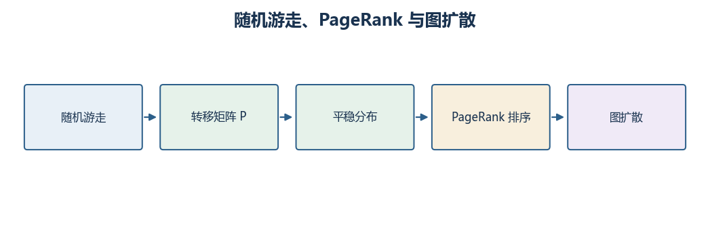

## 4.6　技术谱系与数值算例

**例 4.5（$P_4$ 的随机游走与谱对偶）** 回到第 2 章路径图 $P_4$。其转移矩阵 $\mathbf{P}=\mathbf{D}^{-1}\mathbf{A}$ 为 $\begin{pmatrix}0&1&0&0\\1/2&0&1/2&0\\0&1/2&0&1/2\\0&0&1&0\end{pmatrix}$。$\mathbf{L}_{\mathrm{rw}}=\mathbf{I}-\mathbf{P}$ 的特征值为 $\lambda_i=2-2\cos\frac{i\pi}{4}$（与第 3 章式 3-11 相同！），故 $\mathbf{P}$ 的特征值 $\mu_i=1-\lambda_i=2\cos\frac{i\pi}{4}-1$。最大 $\mu_0=1$，次大 $\mu_1=2\cdot\frac{\sqrt2}{2}-1\approx0.414=1-0.586$，与 Fiedler 值 $\lambda_2=0.586$ 对应。平稳分布 $\pi_v=d_v/6=(1/6,2/6,2/6,1/6)$——中间节点度大，被访问概率高。

**表 4-1　随机游走方法谱系**

| 方法 | 传播矩阵 | 权重 $\theta_k$ | 用途 |
|------|----------|----------------|------|
| 普通随机游走 | $\mathbf{D}^{-1}\mathbf{A}$ | 单步 | 基础（式 4-2） |
| 懒惰游走 | $(\mathbf{I}+\mathbf{D}^{-1}\mathbf{A})/2$ | 单步 | 消除周期（式 4-6） |
| PageRank | $\mathbf{P}^{\top}$ | $\alpha^k(1-\alpha)/n$ | 全局重要性（式 4-9） |
| 个性化 PageRank | $\mathbf{P}^{\top}$ | $\alpha^k(1-\alpha)$，源 $\mathbf{s}$ | 局部平滑（式 4-11） |
| 热核扩散 | $\mathbf{I}-\mathbf{L}_{\mathrm{sym}}$ | $e^{-t}t^k/k!$ | 多尺度平滑（式 4-12） |
| DeepWalk | $\mathbf{P}^k$ 采样 | 隐式 | 图嵌入（第 6 章） |

## 4.7　边界与讨论

随机游走的平稳分布依赖图连通性：非连通图上不同分量的游走永不互通，平稳分布不唯一——此时需指定"从哪一分量出发"或对各分量加权。有向图的理论更复杂：周期图不收敛（需 4.3 节懒惰化），且强连通性才保证唯一平稳分布；有向图不再满足细致平衡，$\pi_v$ 与度不再成正比。PageRank 的传送因子 $\alpha$ 是超参数：过小则结构信息被淹没（趋近均匀），过大则混合慢且对悬挂节点敏感。

此外，随机游走与谱方法的"对偶"仅在无向（或可逆）图上严格成立；有向图的转移矩阵一般不可对角化为实正交基，谱分析需谨慎——此时应改用奇异值分解或对偶链（左/右特征向量）分别处理。工程上还有两个常被忽视的陷阱：其一，**深度偏差**——均匀游走偏好高连通区域，低连通"死胡同"被访问不足，node2vec（第 6 章）的偏置参数 $p,q$ 正是为修正此偏差而设计；其二，**混合不彻底**——有限步游走只捕捉局部邻域，无法表达全局结构，这限制了纯游走类嵌入（DeepWalk）在需要全局语义任务上的表现。这些辨析衔接第 3、6、10、13 章。

## 本章小结

本章论述随机游走。

我们首先定义随机游走与转移矩阵（定义 4.1、4.2，式 4-1、4-2），证明无向图的平稳分布与度成正比（定理 4.1，式 4-4）。接着用谱隙刻画混合时间（定理 4.2，式 4-5），联系第 3 章 Fiedler 值。新增 4.3 节处理周期性：给出周期与不可约的定义（定义 4.5）、收敛充要条件（定理 4.3），并用懒惰游走（式 4-6、4-7）消除周期，以 $C_4$ 算例（例 4.1）演示"2-周期—不收敛—懒惰化—收敛"的完整链条。我们推导 PageRank（定义 4.6，式 4-8、4-9），补充悬挂节点的处理，并用三节点图给出三步收敛的幂迭代数值（例 4.2）。4.5 节引入图扩散（定义 4.7，式 4-10）与个性化 PageRank（式 4-11），用 $P_4$ 的 PPR（例 4.3）展示"种子—局部"性质，并给出热核扩散（式 4-12）。最后用 $P_4$ 展示谱对偶（例 4.5）与方法谱系（表 4-1）。

我们还明确边界：连通性前提、有向图复杂性、$\alpha$ 的敏感性，以及深度偏差与混合不彻底两个工程陷阱。这些辨析衔接第 3、6、10、13 章。

下一章转向传统图特征——在深度学习之前，人们如何手工刻画图。

**进一步阅读**　本章建议延伸阅读的文献：[1]、[4]、[5]。

## 参考文献

[1] Lovász L. *Markov Chains and Mixing Times*. 2nd ed. Providence: AMS, 2017.

[2] Chung F R K. *Spectral Graph Theory*. Providence: AMS, 1997.

[3] Spielman D A, Teng S H. Spectral partitioning works: Planar graphs and finite element meshes. *FOCS*, 1996: 96–105.

[4] Page L, Brin S, Motwani R, Winograd T. The PageRank citation ranking: Bringing order to the Web. *Technical Report, Stanford InfoLab*, 1999.

[5] Haveliwala T H. Topic-sensitive PageRank. *WWW*, 2002: 517–526.

[6] Kondor R, Lafferty J. Diffusion kernels on graphs and other discrete structures. *ICML*, 2002: 315–322.

[7] Smola A J, Kondor R. Kernels and regularization on graphs. *Learning Theory and Kernel Machines*, 2003: 144–158.

[8] Perozzi B, Al-Rfou R, Skiena S. DeepWalk: Online learning of social representations. *KDD*, 2014.

---

# 第 5 章　传统图特征

前四章建立了图的数学基础。从本章起进入第二篇（5—9 章）图表示学习。本章讨论深度学习之前的主流方法：手工设计的图特征（5.1—5.2 节）与图核（5.4—5.5 节），以 Katz 中心性与 PPRF 为过渡桥梁（5.3 节），以 Weisfeiler–Lehman 核为核心枢纽（5.5 节），最后讨论与表示学习的关系（5.6 节）与边界（5.7 节）。这些方法虽被现代图神经网络（第 10 章起）部分取代，但其蕴含的归纳偏置——局部结构、邻域统计、子树模式——仍是理解 GCN 表达力的钥匙。

## 5.1　手工特征：中心性与结构统计

**直觉解释。** 在不学习的前提下，如何描述一个节点"重要"或"处于何种位置"？网络科学给出一系列**中心性**（centrality）指标，用结构统计量刻画节点角色。中心性的共同思想是：重要性不是节点的内在属性，而是它在图"拓扑"中的相对位置——同一节点放在不同图里，中心性完全不同。

**定义 5.1（度中心性，degree centrality）** 最朴素的重要性度量：$C_D(v)=d_v/(n-1)$。归一化到 $[0,1]$。度越高，越"活跃"。

**定义 5.2（接近中心性，closeness centrality）** 衡量节点到其余节点的平均距离：

$$
C_C(v)=\frac{n-1}{\sum_{u\neq v}d(v,u)}. \tag{5-1}
$$

$d(v,u)$ 不可达时取 $\infty$；式 (5-1) 大表示节点"居中"，信息传播快。在引文网络中，接近中心性高的论文是"枢纽"——从它出发能以最少步数到达其他论文，适合做领域综述的入口。

**定义 5.3（介数中心性，betweenness centrality）** 衡量节点位于多少最短路径上：

$$
C_B(v)=\sum_{s\neq v\neq t}\frac{\sigma_{st}(v)}{\sigma_{st}}, \tag{5-2}
$$

其中 $\sigma_{st}$ 为 $s$ 到 $t$ 的最短路径数，$\sigma_{st}(v)$ 为经过 $v$ 的条数。介数高的节点是"桥梁"（broker），控制信息流。Brandes 的算法把 $C_B$ 的计算从朴素 $O(n^3)$ 降到 $O(nm)$[2]，使社交网络中数十万节点的介数计算成为可能。

**定义 5.4（特征向量中心性，eigenvector centrality）** 节点重要性正比于邻居重要性：

$$
x_v=\frac{1}{\lambda}\sum_{u\sim v}x_u\quad\Longrightarrow\quad \mathbf{A}\mathbf{x}=\lambda\mathbf{x}, \tag{5-3}
$$

取 $\mathbf{A}$ 最大特征值 $\lambda_{\max}$ 对应特征向量（Perron–Frobenius 定理保证非负）。PageRank（第 4 章式 4-9）是其有向带传送变体。特征向量中心性的深层含义是"重要性通过边传递"：连到高重要性节点的节点也重要，反之亦然。这在引文网络中对应"被高被引论文引用的论文也重要"——一种"学术声望"的图论形式化。

**定义 5.5（Katz 中心性，Katz centrality）** 特征向量中心性存在一个缺陷：$\mathbf{A}$ 的特征向量在 $\lambda_{\max}$ 处集中，对图的全局结构敏感、对局部结构不敏感。Katz 中心性引入衰减因子 $\beta$，同时考虑**所有长度**的路径，而非仅一步邻居：

$$
\mathbf{x}=\beta\big(\mathbf{A}\mathbf{x}+\mathbf{1}\big), \tag{5-4}
$$

解得

$$
\mathbf{x}=\frac{\beta}{1-\beta}\big(\mathbf{I}-\beta\mathbf{A}\big)^{-1}\mathbf{1}, \tag{5-5}
$$

其中 $\beta<1/\lambda_{\max}$（保证级数收敛）。式 (5-5) 把 Katz 中心性展开为 Neumann 级数 $\mathbf{x}=\sum_{k=0}^{\infty}\beta^k\mathbf{A}^k\mathbf{1}$：$\mathbf{A}^k$ 的 $(v,u)$ 元素是从 $u$ 到 $v$ 的长度 $k$ 路径数，故 $\mathbf{x}_v$ 等于 $v$ 到所有节点 $u$ 的加权路径总和——长度越长的路径权重越小（衰减 $\beta^k$）。$\beta$ 是"多远的路径还重要"的旋钮：$\beta$ 小则只看近邻，$\beta$ 大则考虑全局。Katz 中心性是第 4 章 PageRank（式 4-9）在无向无权图上的对应物：PageRank 的传送项 $\frac{1-\alpha}{n}\mathbf{1}$ 即对应 Katz 的 $\beta\mathbf{1}$，阻尼因子 $\alpha$ 对应 $\beta$。

**例 5.1（星形图与路径图的中心性）** 对星形图 $K_{1,5}$（中心 1 连 5 个叶）：中心 $d=5$，叶 $d=1$；中心 $C_C=5/5=1$（到所有叶距离 1），叶 $C_C=5/(1+2+2+2+2)=5/9$；中心 $C_B=10$（所有叶间路径都经过它），叶 $C_B=0$。对路径图 $P_5$：中间节点 $C_C$ 最高，$C_B$ 也最高，端点最低。再算 Katz 中心性（取 $\beta=0.1$）：中心节点 $\mathbf{x}_{\text{center}}=\frac{0.1}{0.9}\big(1+0.1\times5+\cdots\big)\approx0.111\times1.5\approx0.167$，叶节点 $\mathbf{x}_{\text{leaf}}=\frac{0.1}{0.9}\big(1+0.1\times1+\cdots\big)\approx0.111\times1.1\approx0.122$。中心节点 Katz 中心性比叶节点高约 $37\%$——与度中心性的 $5\times$ 差距不同，Katz 把"远端路径的贡献"也计入后，差距被衰减因子 $\beta$ 压缩了。这揭示一个一般规律：**路径类中心性（Katz、PageRank）对"长程结构"更敏感，度/接近类中心性对"局部结构"更敏感**。

**表 5-1　常见手工特征**

| 特征 | 范围 | 捕捉信息 | 计算复杂度 |
|------|------|----------|------------|
| 度中心性 | 节点 | 局部连接数 | $O(1)$（已知度） |
| 接近中心性 | 节点 | 全局位置 | $O(nm)$（BFS） |
| 介数中心性 | 节点 | 桥梁作用 | $O(nm)$（Brandes） |
| 特征向量中心性 | 节点 | 邻居质量 | $O(m)$（幂迭代） |
| Katz 中心性 | 节点 | 全路径衰减加权和 | $O(m)$（迭代） |
| 聚类系数 | 节点 | 局部成团 | $O(n d^2)$ |
| PageRank | 节点 | 带传送的重要性 | $O(m)$（迭代） |

**例 5.2（介数中心性的手算）** 对星形图 $K_{1,5}$（中心 1 连叶 $2,\dots,6$）：任意两个叶 $i,j$ 之间的唯一最短路径都经过中心 1，故 $\sigma_{ij}(1)=\sigma_{ij}=1$。共有 $\binom{5}{2}=10$ 对叶，每对贡献 1 给中心，故 $C_B(1)=10$；每个叶 $C_B=0$（叶不是任何两节点间的最短路径中介）。再看"哑铃"图——两个 $K_3$ 之间由一条桥边连接，设桥端为 $a,b$：跨两个团的所有最短路径都必须经过 $a$ 与 $b$，故 $a,b$ 的介数远高于团内部节点——介数中心性精确地"找到"了连接两社区的桥，这是它在社区检测（第 23 章）中最有用的性质。

**定义 5.6（聚类系数，clustering coefficient）** 节点 $v$ 的邻居之间实际存在的边数占可能边数的比例：

$$
C(v)=\frac{2|\{e:u,w\in\mathcal{N}(v),u\sim w\}|}{d_v(d_v-1)}. \tag{5-6}
$$

它衡量"朋友的朋友也是朋友"的程度，是社会网络中的局部成团性指标。Watts–Strogatz 小世界网络正是高聚类系数与短平均路径的组合（第 1 章）。

## 5.2　子图模式与图元

除节点级统计，还可统计图上重复出现的局部模式（motif）。**图元**（graphlet）是少量节点（常 3—5 个）的连通非同构子图。对节点 $v$，统计其邻域内各类图元出现次数，得图元度向量（graphlet degree vector, GDV）——一种节点级"结构指纹"。

**例 5.3（3 节点图元）** 3 节点连通图只有两种：三角形 $K_3$ 与路径 $P_3$。节点参与三角形的数量等于其邻居间的边数（与聚类系数相关）；参与 $P_3$ 的数量与度相关。对 4 节点有 6 种连通图元，可更细致地区分结构角色。这类特征在生物网络（蛋白质相互作用）中用于识别功能位点：同一蛋白在不同功能模块中可能扮演"枢纽"（高 GDV-1）或"连接器"（高 GDV-3）等不同角色，仅靠度或介数无法区分。

**例 5.4（图元度向量的手算）** 取一个 4 节点图：$1\!-\!2\!-\!3$ 构成三角形 $K_3$，节点 3 又连到节点 4（即 3—4 是一条尾边）。统计每个节点的 GDV（仅计 3 节点图元）：
- 节点 1：邻居 $\{2,3\}$，二者之间有边 $\{2,3\}$，故 1 参与 1 个三角形、0 个 $P_3$（其邻居间已连成边）。GDV$(1)=(1,0)$。
- 节点 2：邻居 $\{1,3\}$，二者之间有边 $\{1,3\}$，故 2 也参与 1 个三角形。GDV$(2)=(1,0)$。
- 节点 3：邻居 $\{1,2,4\}$。$\{1,2\}$ 之间有边（贡献 1 个三角形）；含 4 的三元组中，$\{1,4\}$、$\{2,4\}$ 无边，故 (3,1,4) 与 (3,2,4) 是 $P_3$（$4\!-\!3\!-\!1$ 与 $4\!-\!3\!-\!2$）。GDV$(3)=(1,2)$。
- 节点 4：邻居 $\{3\}$，无三元组可成。GDV$(4)=(0,0)$。

GDV 向量 $(1,0),(1,0),(1,2),(0,0)$ 把四种结构角色区分开：1 与 2 是"纯三角成员"，3 是"三角+桥"的复合角色，4 是"叶子"。仅凭度（$d=(2,2,3,1)$）无法区分 1 与 2（度相同但 GDV 也相同，恰好同角色），却能区分 3 与 4——这正是 GDV 比度更细粒度的体现。第 13 章讨论高阶 GNN 时，GDV 是"把 $k$-维子图信息注入表示"的标准手工基线。

## 5.3　从 Katz 到 PPRF：中心性的统一视角

5.1 节列出的七种中心性看似互不相关，实则可由**一个数学框架**统一：把"重要性"定义为从某源出发沿图传播的信号，不同中心性对应不同的传播算子与衰减函数。这一统一视角不仅是理论上的优雅，更直接催生了现代图学习的基础工具——个性化 PageRank 特征（Personalized PageRank Features, PPRF）。

**Katz、PageRank 与 PPR 的统一。** 设传播矩阵 $\mathbf{T}$（行随机），权重序列 $\theta_k$，源分布 $\mathbf{s}$，则统一的"带源重要性"为

$$
\mathbf{r}=(1-\alpha)\sum_{k=0}^{\infty}\alpha^k\mathbf{T}^k\mathbf{s}, \tag{5-7}
$$

其中 $\alpha\in(0,1)$ 为衰减因子。表 5-2 给出三种重要特例：

**表 5-2　中心性/重要性的统一传播框架**

| 方法 | $\mathbf{T}$ | $\mathbf{s}$ | 权重 $\theta_k$ | 对应 |
|------|-------------|-------------|----------------|------|
| Katz | $\mathbf{A}/\lambda_{\max}$ | $\mathbf{1}$ | $\beta^k$（均匀源） | 式 5-5 |
| PageRank | $\mathbf{P}^{\top}$ | $\mathbf{1}/n$ | $\alpha^k(1-\alpha)/n$ | 式 4-9 |
| PPR | $\mathbf{P}^{\top}$ | one-hot 或指定 | $\alpha^k(1-\alpha)$ | 式 4-11 |

表 5-2 揭示了一个深刻的事实：**Katz 中心性是"均匀源 + 无向衰减"的 PageRank，PageRank 是"均匀源 + 有向衰减"的 PPR，而 PPR 是"任意源 + 有向衰减"的通用形式**。三者共享同一个数学骨架——矩阵幂的级数展开——差别只在传播矩阵 $\mathbf{T}$ 与源分布 $\mathbf{s}$ 的选择。这一统一把第 4 章的概率语言与第 5 章的手工特征语言对接了起来。

**PPRF：从手工特征到半监督表示的桥梁。** 个性化 PageRank 特征（PPRF）在工程上极为重要：对每个节点 $v$，计算以 $v$ 为 one-hot 源的 PPR 向量 $\mathbf{r}^{(v)}$（式 4-11），得到一组 $n$ 维向量 $\{\mathbf{r}^{(1)},\dots,\mathbf{r}^{(n)}\}\in\mathbb{R}^{n\times n}$——这就是**PPRF 特征矩阵**。PPRF 矩阵的每一列是对应以一个节点为"种子"的局部结构信号：两列 $\mathbf{r}^{(v)},\mathbf{r}^{(w)}$ 的余弦相似度衡量 $v$ 与 $w$ 的"结构等价性"（它们在图中扮演相似角色），而点积 $\mathbf{r}^{(v)}\cdot\mathbf{r}^{(w)}$ 衡量 $v$ 与 $w$ 的"结构性相似"（它们在邻域上重合）。

**例 5.5（PPRF 的数值直觉）** 取路径图 $P_4$（$1\!-\!2\!-\!3\!-\!4$），$\alpha=0.8$。以节点 1 为种子（one-hot $s_1$）：$\mathbf{r}^{(1)}\approx(0.513,\,0.279,\,0.152,\,0.056)$（已归一化，与第 4 章例 4.3 一致）。以节点 2 为种子：$\mathbf{r}^{(2)}\approx(0.196,\,0.388,\,0.244,\,0.115)$。节点 1 与 2 的 PPR 点积 $\mathbf{r}^{(1)}\cdot\mathbf{r}^{(2)}\approx0.513\times0.196+0.279\times0.388+\cdots\approx0.27$（中等相似），而节点 1 与 4 的点积 $\approx0.513\times0.056+0.279\times0.115+\cdots\approx0.09$（低相似）。PPRF 自动把"链上距离"编码进了向量——越近的节点向量越相似——这正是第 6 章 DeepWalk 要学习的"结构相似度"的解析版本。

PPRF 矩阵是手工特征与表示学习之间的关键桥梁：它不需要训练（直接解线性方程组），却已具备"节点级低维表示"的全部要素——置换不变性、邻域平滑性、结构相似度度量。第 9 章的半监督图学习将以 PPRF 为基线特征，第 10 章的 GNN 消息传递可视为"可学习的、参数共享的 PPRF"。理解这一递进关系，是把握全书"从手工到学习"这条主线的关键节点。

## 5.4　图核：用核函数度量图相似度

**定义 5.7（图核，graph kernel）** 图核是定义在两张图（或两个节点）上的对称正定函数 $k(G,G')\ge 0$，可表示为某个特征映射的内积：

$$
k(G,G')=\langle\phi(G),\phi(G')\rangle_{\mathcal{H}}. \tag{5-8}
$$

式 (5-8) 的核心是：不必显式构造高维（甚至无限维）特征 $\phi$，只需计算核矩阵 $\mathbf{K}_{ij}=k(G_i,G_j)$，即可用核方法（SVM、岭回归）做图级预测。正定性保证存在这样的希尔伯特空间（Mercer 条件）。

**直觉解释。** 手工特征需要人事先决定"数什么"（度、三角形……）；图核则定义"如何比较两张图"，让核函数隐含地比较所有子结构。若两图共享许多相似子图，则核值大。这把特征工程转化为相似度设计。

**表 5-3　图核谱系**

| 核类型 | 比较对象 | 特征含义 | 代表 |
|--------|----------|----------|------|
| 随机游走核 | 游走路径 | 共有路径数 | RWK |
| 最短路径核 | 最短路 | 共有最短路 | SPK |
| Weisfeiler–Lehman 核 | 子树 | 子树模式计数 | WL kernel |
| 图元核 | 小子图 | 图元分布 | Graphlet kernel |
| 扩散核 | 热扩散 | 多尺度邻域 | Diffusion kernel |

## 5.5　WL 核与子树核

**定义 5.8（WL 子树核，WL subtree kernel）** 基于第 2 章的 1-WL 测试（式 2-10），把每轮迭代的节点标签计数作为特征。对图 $G$，定义其第 $t$ 轮特征向量

$$
\phi_t(G)[c]=\big|\{v\in V:c^{(t)}(v)=c\}\big|, \tag{5-9}
$$

则 WL 核为各轮核之和：

$$
k_{\mathrm{WL}}(G,G')=\sum_{t=0}^{T}\langle\phi_t(G),\phi_t(G')\rangle. \tag{5-10}
$$

Shervashidze 等人[3]证明，WL 核等价于比较两图中所有深度不超过 $T$ 的子树模式数量——这正是 1-WL 测试所捕捉的结构信息。

**例 5.6（WL 核的数值计算）** 取两图：$G_1$ 为三角形 $K_3$，$G_2$ 为路径 $P_3$。$t=0$ 时所有节点标签为度：$K_3$ 为 $\{2,2,2\}$，$P_3$ 为 $\{1,2,1\}$，计数向量不同（前者"度 2"计 3 次，后者计 1 次），故 $k_0$ 小。$t=1$ 时，标签由（旧标签，邻居标签多重集）哈希决定：$K_3$ 每节点为 $(2,\{\!\{2,2\}\!\})$，$P_3$ 中间为 $(2,\{\!\{1,1\}\!\})$、叶为 $(1,\{\!\{2\}\!\})$，仍不同。因此 $k_{\mathrm{WL}}(K_3,P_3)$ 较小，核正确区分两图。注意 1-WL 本身无法区分某些图（第 2 章例 2.4），WL 核继承这一上界。

**WL 核与 PPRF 的关系。** 5.3 节的 PPRF 比较"从节点出发的信号传播"，WL 核比较"节点邻域的子树计数"——前者是概率/线性代数语言，后者是组合/计数语言。两者捕捉的结构信息有重叠（都反映邻域）但角度不同：PPRF 对"路径长度"敏感（衰减 $\alpha^k$），WL 核对"邻域形状"敏感（子树同构）。在实践中，二者常作为互补特征拼接使用。

> 【图 5-1　传统图特征与图核】（原图见 figures/图5-1.png）：左侧列中心性示意（星形图各节点着色），右侧列 WL 子树迭代示意（三轮标签传播与对应子树）。
>
> 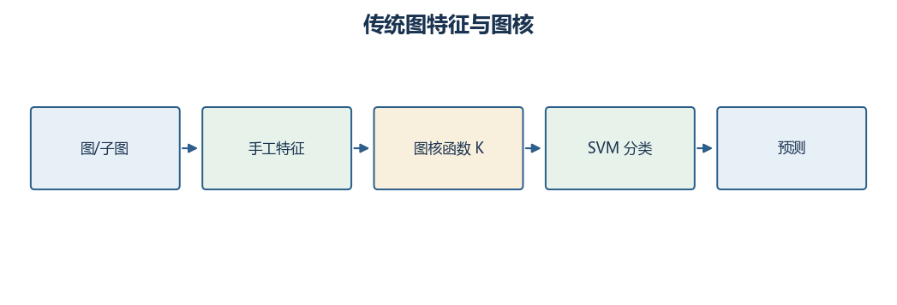

## 5.6　与表示学习的关系

传统特征与表示学习（第 6—9 章）的关系可概括为三点。**第一，特征即固定表示。** 中心性、图元向量是人工设计的节点表示；WL 核隐含的 $\phi$ 是学习不到的固定特征映射。**第二，GNN 是 WL 核的神经化。** 第 13 章将证明，消息传递 GNN 用可学习函数替代式 (2-10) 中的 HASH 与聚合，表达力不超过 1-WL——GNN 是 WL 核的"可微分、可学习"版本。**第三，从任务无关到任务相关。** 手工特征无需标签、通用但次优；表示学习通过下游任务监督或自监督优化表示，更贴合任务但需数据。

**表 5-4　传统特征与表示学习对照**

| 维度 | 传统特征 | 表示学习 |
|------|----------|----------|
| 设计方式 | 人工定义 | 数据驱动优化 |
| 任务相关性 | 无关，通用 | 相关或自监督 |
| 表达能力 | 受限于所选统计量 | 受限于架构（WL 上界） |
| 数据需求 | 无 | 需图结构与标签／目标 |
| 代表 | 中心性、WL 核 | DeepWalk、GCN（第 6、10 章） |
| 计算开销 | $O(nm)$ 或更低 | $O(nmd)$（$d$ 为维度） |

## 5.7　边界与讨论

手工特征的根本局限是**依赖人为先验**：选择度还是介数、选择几种图元、Katz 的 $\beta$ 取多少，都需领域知识，且无法从数据中学到新特征。PPRF 虽然"免训练"，但 $n\times n$ 的特征矩阵在 $n>10^4$ 时存储即不可承受，且其"结构相似度"不区分语义——两篇同主题但不同子方向的论文可能 PPR 相似（邻域结构相似），但语义不同。

图核虽自动比较子结构，但核矩阵存储 $O(n^2)$、计算常需枚举子图，难以扩展到大规模图；核的固定特征映射也无法适应下游任务的细微差别。此外，WL 核与 GNN 共享 1-WL 上界（第 2 章例 2.4、第 13 章）——这意味着二者都无法区分某些非同构但 WL 等价的图。突破这一上界需要更高阶 WL 或位置编码（第 13、16 章）。这些辨析衔接第 6、9、10、13 章。

## 本章小结

本章论述传统图特征。

我们首先给出节点级手工特征：度、接近、介数、特征向量中心性（定义 5.1—5.4，式 5-1—5-3）与聚类系数（定义 5.6，式 5-6），并用星形图、路径图作算例（例 5.1、5.2）。新增 Katz 中心性（定义 5.5，式 5-4、5-5）并给出星形图数值，揭示"路径类 vs 局部类"中心性的差异。5.2 节介绍图元模式（例 5.3）与图元度向量手算（例 5.4）。5.3 节建立 Katz、PageRank 与 PPR 的统一传播框架（式 5-7、表 5-2），并引入 PPRF 作为手工特征与表示学习的桥梁，用 $P_4$ 算例（例 5.5）展示"结构相似度 = PPR 点积"的直觉。5.4—5.5 节讨论图核（定义 5.7，式 5-8，表 5-3）与 WL 子树核（定义 5.8，式 5-9、5-10），给出 $K_3$ vs $P_3$ 的 WL 核数值算例（例 5.6）。5.6 节讨论传统特征与表示学习的三点关系（表 5-4）。5.7 节明确边界：先验依赖、规模瓶颈、WL 上界。

我们还明确边界：手工特征的先验依赖、PPRF 的语义盲区、图核的规模瓶颈、WL 上界。这些辨析衔接第 6、9、10、13、16 章。

下一章进入浅层图嵌入——用随机游走与 Skip-gram 自动学习节点表示。

**进一步阅读**　本章建议延伸阅读的文献：[1]、[2]、[3]。

## 参考文献

[1] Freeman L C. Centrality in social networks conceptual clarification. *Social Networks*, 1979, 1(3): 215–239.

[2] Brandes U. A faster algorithm for betweenness centrality. *Journal of Mathematical Sociology*, 2001, 25(2): 163–177.

[3] Shervashidze N, Schweitzer P, van Leeuwen E J, et al. Weisfeiler-Lehman graph kernels. *Journal of Machine Learning Research*, 2011, 12: 2539–2561.

[4] Kondor R, Lafferty J. Diffusion kernels on graphs and other discrete structures. *ICML*, 2002: 315–322.

[5] Borgwardt K M, Ong C S, Schönauer S, et al. Protein function prediction via graph kernels. *Bioinformatics*, 2005, 21(Suppl 1): i47–i56.

[6] Wale N, Karypis G. Comparison of descriptor spaces for chemical compound retrieval and classification. *ICDM*, 2006: 678–689.

[7] Vishwanathan S V N, Schraudolph N N, Kondor R, Borgwardt K M. Graph kernels. *Journal of Machine Learning Research*, 2010, 11: 1201–1242.

[8] Katz L. A new status date among the college faculty. *American Sociological Review*, 1953, 18(6): 590–593.

---

# 第 6 章　浅层图嵌入

第 5 章的传统特征由人工设计，无法从数据中学到新特征。本章进入**浅层图嵌入**（shallow graph embedding）：为每个节点学习一个低维向量 $\mathbf{z}_v\in\mathbb{R}^d$，使图上结构相近的节点在嵌入空间也相近。6.1 节建立 Skip-gram 与随机游走的类比；6.2 节剖析负采样的统一视角；6.3—6.5 节依次推导 DeepWalk、node2vec、LINE；6.6 节给出数值算例与技术谱系；6.7 节剖析转导式局限，引出深度方法（第 10 章）。

## 6.1　从词向量到节点向量

**直觉解释。** 自然语言中的词可由其上下文定义（"一个词的含义由它周围的词决定"）——这是分布假说（distributional hypothesis）。Word2Vec 的 Skip-gram 模型用中心词预测上下文词，学得词的低维向量。图上的节点同理：一个节点的"含义"由其邻域定义。若在随机游走序列中节点 $v$ 常与 $u$ 共现，则 $v$ 与 $u$ 结构相近。把游走序列当作"句子"、节点当作"词"，即可直接套用 Skip-gram。

**定义 6.1（Skip-gram 目标）** 给定节点序列（语料）$W=(w_1,\dots,w_T)$，窗口大小 $b$，Skip-gram 最大化在给定中心节点 $w_t$ 时观察到窗口内上下文节点的概率：

$$
\max_{\mathbf{Z}}\ \sum_{t=1}^{T}\sum_{-b\le j\le b,j\neq0}\log p(w_{t+j}\mid w_t). \tag{6-1}
$$

采用负采样（negative sampling）近似：

$$
p(u\mid v)=\sigma(\mathbf{z}_u^{\top}\mathbf{z}_v)\prod_{i=1}^{K}\sigma(-\mathbf{z}_{n_i}^{\top}\mathbf{z}_v), \tag{6-2}
$$

其中 $\sigma$ 为 sigmoid，$n_i$ 为从噪声分布采样的负样本，$K$ 为负样本数。$\mathbf{Z}\in\mathbb{R}^{n\times d}$ 是嵌入矩阵（每个节点一行），即"浅层"含义——一个查表层，无深层非线性变换。

**推导联系（为何内积而非距离）。** 式 (6-2) 用内积 $\mathbf{z}_u^{\top}\mathbf{z}_v$ 而非欧氏距离，源于一个可证明的等价：若把每个节点向量写成 $\mathbf{z}_v=\tfrac{1}{2}\mathbf{h}_v+\tfrac{1}{2}\mathbf{e}$（$\mathbf{h}_v$ 为"中心向量"、$\mathbf{e}$ 为共享偏移），则 $-\|\mathbf{h}_u-\mathbf{h}_v\|^2=\mathbf{z}_u^{\top}\mathbf{z}_v$ 加一个与 $v$ 无关的常数项——即内积最大化恰好等价于把欧氏距离最小化。因此 Skip-gram 的内积目标，几何上仍是"把结构相近的节点在低维空间拉近"，与第 3 章用拉普拉斯二次型（式 3-1）度量平滑度的思想一脉相承，只是这里把"拉平"的目标从标量特征换成了向量表示。

**推导联系（为何负采样有效）。** 完整 Skip-gram 需对全图 $n$ 个节点做 softmax，复杂度 $O(n)$，无法扩展。负采样把"多分类"近似为 $K+1$ 个独立的二分类：正对 $(v,u)$ 的 sigmoid 推高，负对 $(v,n_i)$ 的 sigmoid 压低。可以证明，当 $K$ 足够大且噪声分布取 $p(n)\propto d_n^{3/4}$ 时，式 (6-2) 渐近等价于式 (6-1) 的 softmax——这是 Word2Vec 工程成功的关键。嵌入矩阵 $\mathbf{Z}$ 通常用均匀初始化后随机梯度下降更新；由于 $d\ll n$（常取 $d=64\sim 300$），存储与计算均可控。

## 6.2　负采样的统一视角

6.1 节把负采样作为"工程技巧"一笔带过，但它实际上是浅层嵌入的**理论核心**——DeepWalk、node2vec、LINE 三者的差异，最终都落在"负采样里采哪些负样本、采多少"这一个旋钮上。

**定义 6.2（负采样交叉熵目标）** 式 (6-2) 的对数形式即负采样交叉熵。设正样本对集 $\mathcal{E}_{\mathrm{pos}}$（来自游走共现或边）与负样本对集 $\mathcal{E}_{\mathrm{neg}}$（从噪声分布采样），则

$$
\mathcal{L}_{\mathrm{ns}}=-\sum_{(v,u)\in\mathcal{E}_{\mathrm{pos}}}\log\sigma(\mathbf{z}_v^{\top}\mathbf{z}_u)-\sum_{(v,n)\in\mathcal{E}_{\mathrm{neg}}}\log\sigma(-\mathbf{z}_v^{\top}\mathbf{z}_n). \tag{6-3}
$$

式 (6-3) 的梯度 $\nabla_{\mathbf{z}_v}\mathcal{L}_{\mathrm{ns}}=(1-\sigma(\mathbf{z}_v^\top\mathbf{z}_u))\mathbf{z}_u+(1-\sigma(-\mathbf{z}_v^\top\mathbf{z}_n))\mathbf{z}_n+\cdots$ 显示：正对把 $\mathbf{z}_v,\mathbf{z}_u$ 拉近，负对把 $\mathbf{z}_v,\mathbf{z}_n$ 推远。每更新一对，只涉及两个 $d$ 维向量，故单步复杂度 $O(d)$，与图规模 $n$ 无关——这是负采样可扩展性的本质。

**噪声分布的选择。** 均匀负采样会让高频（高被引）节点被过多地当负样本，浪费算力。Mikolov 等人[4]证明，取

$$
p(n)\propto d_n^{3/4} \tag{6-4}
$$

（$d_n$ 为节点 $n$ 的度）时，负采样目标与完整 softmax 的偏差最小。指数 $3/4$ 的直观含义是"高频节点既不能太多（浪费）也不能太少（漏采）"的折中。在引文网络中，高被引论文（$d_n$ 大）应以略高于均匀的概率被采为负样本，使模型学会"与顶会论文相邻的论文"这一区分。

**与 LINE 的衔接。** LINE 的一阶邻近（6.5 节）本质就是"以边为正样本、以全图为负样本"的负采样（式 6-3），其"边采样"（edge sampling）正是式 (6-4) 噪声分布在带权图上的离散化——权重越大的边被采为负样本的概率越高。理解这一点，DeepWalk、node2vec、LINE 就统一为"**选哪些正样本（游走共现 vs 边）+ 选哪些负样本（均匀 vs 度加权）**"的两个独立选择。

## 6.3　DeepWalk

**定义 6.3（DeepWalk[1]）** DeepWalk 算法：① 对图中每个节点，运行长度为 $L$ 的截断随机游走 $R$ 次，生成节点序列集合；② 把这些序列当作 Word2Vec 的语料，用 Skip-gram（式 6-1）学习嵌入 $\mathbf{Z}$。

**推导联系。** DeepWalk 的游走即第 4 章式 (4-2) 的随机游走 $\mathbf{P}=\mathbf{D}^{-1}\mathbf{A}$。共现概率近似为

$$
p(u\mid v)\approx\sum_{k=1}^{L}\big(\mathbf{P}^k\big)_{vu}/L, \tag{6-5}
$$

即 $k$ 步内从 $v$ 游走到 $u$ 的平均概率。DeepWalk 隐式分解这个共现矩阵（类似隐式分解 $\log(\mathbf{P}^k)$ 的平移不变形式），使内积 $\mathbf{z}_u^{\top}\mathbf{z}_v$ 近似共现强度。

**例 6.1（引文网络的 DeepWalk）** 对第 1 章引文网络，从每篇论文出发做 4 次长度 10 的游走。若论文 A 与 B 同属理论组、互相引用，游走序列中 A、B 频繁共现，Skip-gram 使 $\mathbf{z}_A^{\top}\mathbf{z}_B$ 增大；A 与方法组论文 D 共现少，嵌入距离远。最终嵌入空间呈现两个簇——这正是社区结构的低维投影。

**游走参数与混合时间的耦合。** 长度 $L$ 与次数 $R$ 并非随意。$L$ 决定了"多远算邻居"：它必须大于第 4 章定义的混合时间 $t_{\mathrm{mix}}$，否则游走尚未达到平稳分布 $\pi$，序列会被出发节点的局部结构污染，嵌入反映的是"局部视角"而非全局结构；但 $L$ 若远大于 $t_{\mathrm{mix}}$，游走已高度接近平稳，共现信号退化为平稳分布本身（所有节点趋同），区分度下降。实践中 $L$ 取 $t_{\mathrm{mix}}$ 的数倍、$R$ 取数十次以摊薄方差。对第 4 章的 C4 周期图，须先做懒惰化（式 4-7）再游走，否则游走序列会在奇偶子集间振荡，共现统计被周期结构主导——这是"周期图直接套用 DeepWalk 会失败"的定量解释。次数 $R$ 与负样本数 $K$ 则共同控制式 (6-3) 的方差：$R$ 越大正样本统计越准，$K$ 越大负对压制越充分，二者均按 $O(R\cdot L\cdot K\cdot d)$ 计入总复杂度。

## 6.4　node2vec：偏置的随机游走

**定义 6.4（node2vec[2]）** node2vec 改进游走策略，引入两个参数 $p$（返回参数，return parameter）与 $q$（进出参数，in-out parameter），定义二阶随机游走：从节点 $v$ 走到 $u$ 后，下一步到 $x$ 的未归一化概率为

$$
\pi_{ux}=\begin{cases}
\frac{1}{p}, & x=v\ (\text{返回}),\\[2mm]
1, & x\sim v\ (\text{BFS 型，同层}),\\[2mm]
\frac{1}{q}, & \text{否则}\ (\text{DFS 型，远离}).
\end{cases} \tag{6-6}
$$

**直觉解释。** $p$ 控制回到上一节点的概率：$p$ 大则少回头，鼓励探索远处；$p=1$ 则无偏置。$q$ 控制向外还是向内：$q<1$ 鼓励 DFS（深入远方，捕捉同质性外的结构等价节点），$q>1$ 鼓励 BFS（局限于邻域，捕捉社区）。这是随机游走的一个"旋钮"，可以在同质性（homophily）与结构等价（structural equivalence）之间插值。

**例 6.2（$p,q$ 的效果）** 在 karate 俱乐部网络上，$p=1,q=0.5$（偏 DFS）使嵌入反映节点的"结构角色"（如连接两个社团的桥梁节点聚在一起）；$p=1,q=2$（偏 BFS）使嵌入反映"社团归属"，同社团节点聚在一起。同一个图，不同游走偏置得到不同语义的嵌入——说明嵌入并非图结构的唯一"真相"，而依赖于采样策略（呼应命题 1.2）。

**$p,q$ 的取用建议。** 原文给出的经验起点是 $p=1,q=1$（退化为无偏 DeepWalk 式游走）。需要社区/同质语义时取 $q>1$（如 $q=8$），需要结构等价/角色语义时取 $q<1$（如 $q=0.5$）并配合 $p$ 较小（如 $p=0.5$）以抑制"反复回弹到同一邻居"。注意 $p$ 与 $q$ 不是正交的：$p$ 过大已隐含"不愿回头"，会与 $q$ 的 BFS/DFS 倾向相互抵消，故调参时应固定其一并扫描另一个，而非同时扰动。这一"一个旋钮插值两类语义"的特性，使 node2vec 成为后续图神经网络中"游走先验"（第 10 章消息传递的软性版本）的直接前身。

> 【图 6-1　DeepWalk 与 node2vec】（原图见 figures/图6-1.png）：左侧画随机游走序列→Skip-gram→嵌入矩阵的流程；右侧对比 $q<1$ 的 DFS 路径与 $q>1$ 的 BFS 路径在同一图上的走向。
>
> 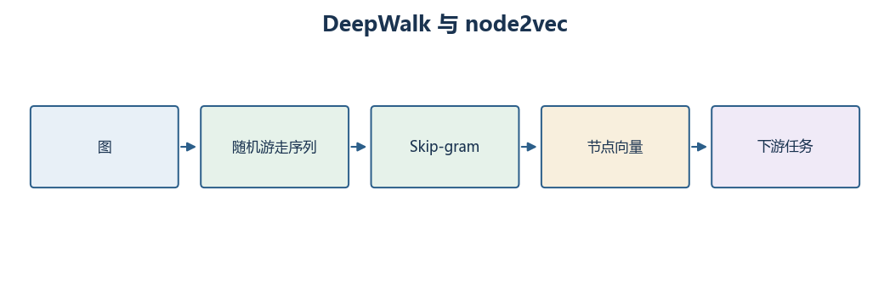

## 6.5　LINE：一阶与二阶邻近

**定义 6.5（LINE[3]）** LINE（Large-scale Information Network Embedding）直接优化两种邻近性的保持，不经随机游走。

**一阶邻近**（first-order proximity）：若 $v\sim u$ 则相似。建模为联合概率

$$
p(v,u)=\frac{1}{1+\exp(-\mathbf{z}_v^{\top}\mathbf{z}_u)}, \tag{6-7}
$$

最小化经验分布 $\hat p(v,u)=A_{vu}/(2m)$ 与模型分布的 KL 散度。

**二阶邻近**（second-order proximity）：邻居分布相似的节点相似。设 $\mathbf{z}_v$ 为节点"用户向量"，另有上下文向量 $\mathbf{z}'_u$，条件概率

$$
p(u\mid v)=\frac{\exp(\mathbf{z}_u^{\prime\top}\mathbf{z}_v)}{\sum_{w}\exp(\mathbf{z}_w^{\prime\top}\mathbf{z}_v)}, \tag{6-8}
$$

最小化 $\sum_v d_v\,D_{\mathrm{KL}}(\hat p(\cdot\mid v)\|p(\cdot\mid v))$；其中 $\hat p(u\mid v)=A_{vu}/d_v$。LINE 用边采样（edge sampling）处理带权图的梯度规模问题。

**边采样的机制。** 二阶项的 KL 对每个 $v$ 都要对其全部邻居求和，稠密图上代价 $O(m)$ 不可接受。LINE 改为按边权重抽样：对每条边 $(v,u)$ 以概率正比于 $A_{vu}$ 采样，命中后只更新 $(v,u)$ 这对的梯度项，使单步成本与边权成比例、与度 $d_v$ 解耦。设边 $(v,u)$ 被采到 $c_{vu}$ 次，则用 $c_{vu}$ 作重要性权重还原全梯度，这正是 6.2 节负采样"以少量样本估计全目标"思想在边维度上的推广——正样本侧也从"全图边"缩到"采样边"。带权图中权重大的边（如高共现论文对）被采概率高，天然获得更大梯度，无需显式归一化。

**例 6.3（一阶 vs 二阶）** 引文网络中，论文 A 引用 B（一阶邻近，嵌入应近）。论文 C 与 D 互不引用，但都引用同一组经典文献（二阶邻近）——LINE 的二阶项使 C、D 嵌入也相近。这捕捉了"研究同一主题"的语义，是一阶模型做不到的。

## 6.6　技术谱系与数值算例

**例 6.4（2 维嵌入的余弦手算）** 取 3 节点链 $1\!-\!2\!-\!3$，设嵌入维度 $d=2$。令 $\mathbf{z}_1=(1,0)$、$\mathbf{z}_2=(\cos30^\circ,\sin30^\circ)=(0.866,\,0.5)$、$\mathbf{z}_3=(0,1)$。计算余弦相似度：
- $\cos\angle(1,2)=\frac{1\cdot0.866+0\cdot0.5}{1\cdot1}=0.866$（$1$ 与 $2$ 相邻，相似度高）；
- $\cos\angle(2,3)=\frac{0.866\cdot0+0.5\cdot1}{1\cdot1}=0.5$（$2$ 与 $3$ 相邻，相似度中等）；
- $\cos\angle(1,3)=\frac{1\cdot0+0\cdot1}{1\cdot1}=0$（$1$ 与 $3$ 不相邻，相似度最低）。

余弦值 $0.866>0.5>0$ 恰好复现了链上"相邻 > 距离 2 > 不相邻"的结构顺序——这正是负采样目标（式 6-3）优化后嵌入应具备的性质：相邻节点的内积被推高、远端节点的内积被压低。若节点 4 只连 2，则 4 可放在 $\mathbf{z}_4=(0.866,\,1.5)$ 附近，使 $\cos\angle(4,2)>0$ 而 $\cos\angle(4,1),\cos\angle(4,3)\approx0$，即"与 2 近、与 1/3 通过 2 间接近"。这个 2 维布局是嵌入目标的几何直觉，算法只是用随机梯度下降优化式 (6-3)。

**例 6.5（LINE 一阶项的边采样手算）** 取 4 节点带权图：边 $(1,2)$ 权重 $w_{12}=3$、$(1,3)$ 权重 $w_{13}=1$、$(2,3)$ 权重 $w_{23}=2$、$(3,4)$ 权重 $w_{34}=1$。总权重 $2m=8$。按式 (6-7) 的一阶联合分布，节点 1 的邻居经验分布为 $\hat p(2\mid1)=3/4=0.75$、$\hat p(3\mid1)=1/4=0.25$。边采样以概率 $w_{vu}/(2m)$ 命中各边：$(1,2)$ 命中概率 $3/8=0.375$，是 $(1,3)$ 的 $3/1=3$ 倍——权重大的边被采为"正样本"的频率高，梯度更新也随之加权。设负采样从全图按 $p(n)\propto d_n^{3/4}$ 取负样本，节点度 $d_1=4,d_2=3,d_3=4,d_4=1$，则 $d_n^{3/4}$ 分别为 $4^{0.75}\!\approx2.83$、$3^{0.75}\!\approx2.28$、$4^{0.75}\!\approx2.83$、$1$，归一化后高被引的 1、3 更易被采为负样本（式 6-4 的度加权在此体现）。一次迭代即"采到边 $(1,2)$ → 拉近 $\mathbf{z}_1,\mathbf{z}_2$；采到负样本 3 → 推远 $\mathbf{z}_1,\mathbf{z}_3$"，与 6.2 节负采样梯度（式 6-3）的"拉正推负"完全同构——只是正样本从游走共现换成了边采样。

**表 6-1　浅层图嵌入方法谱系**

| 方法 | 优化目标 | 采样方式 | 邻近类型 | 年份 |
|------|----------|----------|----------|------|
| DeepWalk | Skip-gram（式 6-1、6-3） | 均匀随机游走 | 共现（隐式高阶） | 2014 |
| node2vec | Skip-gram（式 6-1、6-3） | 偏置游走（式 6-6） | 同质／结构等价可调 | 2016 |
| LINE | KL 最小化（式 6-7、6-8） | 边采样 | 一阶＋二阶 | 2015 |
| HOPE | 矩阵分解 | 无（Katz 矩阵） | 高阶邻近 | 2016 |
| SDNE | 自编码器重建 | 无 | 一阶＋二阶（深度） | 2016 |

**矩阵分解视角。** Qiu 等人[8]指出，DeepWalk、LINE、node2vec 都可统一为对某个**结构相似性矩阵**（Katz 矩阵、共现矩阵或二阶邻接矩阵）的低秩分解：$\mathbf{M}\approx\mathbf{Z}\mathbf{Z}^{\top}$，其中 $\mathbf{M}$ 的 $(u,v)$ 元素是 $u,v$ 的"结构相似度"（Katz 中心性、共现频率或共享邻居数）。这解释了 6.2 节"负采样 = 隐式分解"的说法，也给出一个实用推论：浅层嵌入的表达能力受限于其分解的矩阵 $\mathbf{M}$ 的秩与结构——若 $\mathbf{M}$ 本身丢失了某类结构（如高阶环），则嵌入也丢失。HOPE 显式分解 Katz 矩阵（与第 5 章式 5-5 同源），是这一视角的纯矩阵化版本。SDNE 则把一阶（邻接）与二阶（PPL 平滑）两种相似度同时喂给一个自编码器的隐层，是"分解矩阵 $\mathbf{M}$ 可拼接"这一推论的深度化实现。

## 6.7　转导式局限与边界

**定义 6.6（转导式，transductive）** 浅层嵌入为每个节点学习一个独立参数（查表层的一行），只能为训练时见过的节点生成表示；新节点加入需重新训练或昂贵增量更新。这称转导式（transductive）设置，与归纳式（inductive）相对。

浅层嵌入的三大局限。**第一，无法泛化到新节点。** 式 (6-3) 的参数 $\mathbf{Z}$ 与节点一一对应，测试时未见节点无向量可用。**第二，无法利用节点属性。** DeepWalk/node2vec/LINE 只用结构，忽略特征（如论文文本）；属性信息需另做拼接。**第三，无任务端到端优化。** 嵌入先学再用下游分类器，两阶段分离，表示未必最适合任务。

**评估协议。** 浅层嵌入通常以两类下游任务评估。**链路预测**：随机删除一条真实边 $(u,v)$ 作测试对，取若干不相邻节点对作负样本，用 $\mathbf{z}_u^{\top}\mathbf{z}_v$ 作打分，比较测试对与负样本对的排序（指标为 AUC 或 MRR）；嵌入越能"认出"被删边的两端，得分越高。**节点分类**：对每个节点仅用其一小部分邻居的标签训练线性分类器（如 logistic），其余节点预测类别，报告 Macro-F1——这直接检验嵌入是否保留了社区结构（第 2 章同构、第 5 章图元所刻画的社区）。两项协议都要求严格留出测试边，不能把测试对信息泄漏进游走生成，否则 AUC 虚高。这一协议也解释了为何例 6.4 的余弦排序（相邻 > 远端）是链路预测能力的最小充分条件。

**边界与讨论。** 这些局限催生了图神经网络（第 10 章）：GNN 用共享的参数化函数（消息传递，第 1 章式 1-2）替代查表层，天然归纳式、可融合属性、可端到端训练。但浅层方法并非过时——它们在大规模图（数十亿节点）、无属性场景仍有速度与简洁优势，且作为基线仍具价值。随机游走偏置与嵌入语义的关系（例 6.2）也提醒：嵌入相似不等于语义相同（命题 1.2）。另有两个常被忽视的边界：其一，**嵌入维度 $d$ 的取舍**——$d$ 太小丢失高阶结构，$d$ 太大过拟合游走噪声，实践中 $d=64$ 常是折中；其二，**游走长度 $L$ 与负样本数 $K$ 的耦合**——$L$ 决定"多远算邻居"，$K$ 决定"负样本是否足够压住假相似"，二者需联合调参。这些辨析衔接第 1、4、10、11 章。

## 本章小结

本章论述浅层图嵌入。

我们首先建立词向量与节点向量的类比，给出 Skip-gram 目标（定义 6.1，式 6-1、6-2）。6.2 节剖析负采样的统一视角：把式 (6-1) 的 softmax 替换为负采样交叉熵（定义 6.2，式 6-3），给出度加权噪声分布（式 6-4），并指出 DeepWalk、node2vec、LINE 的差异最终落在"正负样本的选择"这一个旋钮上。接着推导 DeepWalk（定义 6.3，式 6-5）、node2vec 的偏置游走（定义 6.4，式 6-6）与 LINE 的一阶／二阶邻近（定义 6.5，式 6-7、6-8），并给出引文网络、karate 网络与 2 维余弦算例（例 6.1—6.4）及矩阵分解视角（表 6-1）。

我们还明确边界：转导式无法泛化新节点、忽略属性、非端到端，以及嵌入维度与游走长度/负样本数的耦合调参，并界定其与 GNN 的分工。这些辨析衔接第 1、4、10、11 章。

下一章转向知识图谱嵌入——当图携带有类型的关系时，表示学习面临新的平移与旋转几何。

**进一步阅读**　本章建议延伸阅读的文献：[1]、[2]、[5]、[8]。

## 参考文献

[1] Perozzi B, Al-Rfou R, Skiena S. DeepWalk: Online learning of social representations. *KDD*, 2014: 701–710.

[2] Grover A, Leskovec J. node2vec: Scalable feature learning for networks. *KDD*, 2016: 855–864.

[3] Tang J, Qu M, Wang M, et al. LINE: Large-scale information network embedding. *WWW*, 2015: 1067–1077.

[4] Mikolov T, Chen K, Corrado G, Dean J. Efficient estimation of word representations in vector space. *ICLR Workshop*, 2013.

[5] Ou M, Cui P, Pei J, et al. Asymmetric transitivity preserving graph embedding. *KDD*, 2016: 1105–1114.

[6] Wang D, Cui P, Zhu W. Structural deep network embedding. *KDD*, 2016: 1225–1234.

[7] Hamilton W L, Ying R, Leskovec J. Inductive representation learning on large graphs. *NeurIPS*, 2017: 1024–1034.

[8] Qiu J, Dong Y, Ma H, et al. Network embedding as matrix factorization: Unifying DeepWalk, LINE, PTE, and node2vec. *WSDM*, 2018: 459–467.

---

# 第 7 章　知识图谱嵌入

前六章处理的是同构图——节点同类、边无类型。本章转向**知识图谱**（knowledge graph, KG）：由带类型的三元组组成的有向异质图。7.1 节定义三元组与嵌入任务；7.2—7.4 节推导平移模型 TransE、TransR 与旋转模型 RotatE；7.5 节讨论链路预测评估；7.6 节给出数值算例与技术谱系；7.7 节剖析边界。知识图谱嵌入连接符号知识与分布式表示，是第 19—23 章图推理的重要基石。

## 7.1　知识图谱与三元组

**定义 7.1（知识图谱，knowledge graph）** 知识图谱 $\mathcal{G}=\{(h,r,t)\}\subseteq\mathcal{E}\times\mathcal{R}\times\mathcal{E}$ 由三元组（triple）集合构成，其中 $\mathcal{E}$ 为实体集（entity），$\mathcal{R}$ 为关系集（relation），$(h,r,t)$ 表示头实体 $h$ 通过关系 $r$ 连接到尾实体 $t$。例如（巴黎，首都_of，法国）、（张三，works_at，某公司）。KG 是有向异质图：边带类型 $r$，节点可带类型。

**定义 7.2（知识图谱嵌入，KG embedding）** 把实体与关系映射到低维连续向量空间：实体 $h,t\in\mathbb{R}^{d}$，关系 $r$ 由参数（向量、矩阵或复数向量）表示。定义得分函数 $f_r(h,t)$，使成立的三元组得分高、不成立的得分低：

$$
\mathcal{L}=-\sum_{(h,r,t)\in\mathcal{G}}\log\sigma\big(\gamma-f_r(h,t)\big)-\sum_{(h',r',t')\in\mathcal{N}}\log\sigma\big(f_{r'}(h',t')-\gamma\big). \tag{7-1}
$$

式 (7-1) 是**间隔损失**（margin-based ranking loss）：正样本得分应高于负样本至少间隔 $\gamma$；$\mathcal{N}$ 为负样本集，通过损坏（corruption）正三元组的头或尾生成（$h'$ 或 $t'$ 随机替换）。$\sigma$ 为 sigmoid，$\gamma>0$ 为超参数。

**直觉解释。** 嵌入的目标是在向量空间中"重建"三元组的成立性。不同模型用不同几何操作实现 $f_r$：平移（TransE）、投影后平移（TransR）、复数旋转（RotatE）。这些操作对应对关系模式的不同假设。

## 7.2　TransE：关系即平移

**定义 7.3（TransE[1]）** TransE 把关系视为头尾实体间的平移向量：

$$
\mathbf{h}+\mathbf{r}\approx\mathbf{t},\quad f_r(h,t)=-\|\mathbf{h}+\mathbf{r}-\mathbf{t}\|_{1/2}. \tag{7-2}
$$

即评分用 $L_1$ 或 $L_2$ 范数的负值：若 $\mathbf{h}+\mathbf{r}$ 接近 $\mathbf{t}$，得分接近 0（高），否则为负（低）。

**推导联系。** TransE 的几何极其简洁：每种关系 $r$ 对应一个平移方向 $\mathbf{r}$，所有满足 $r$ 的三元组在嵌入空间中形成平行线段。它用 $O(n_e d+n_r d)$ 参数高效建模大规模 KG。

**例 7.1（TransE 的平移）** 设 $\mathbf{h}=(0,0),\mathbf{t}=(1,0)$，则关系"首都_of"的平移 $\mathbf{r}=(1,0)$。任一满足"首都_of"的三元组 $(\text{城市},\text{首都_of},\text{国家})$ 中，城市向量加 $(1,0)$ 应接近国家向量。若（北京，首都_of，中国）成立而（上海，首都_of，中国）不成立，则 TransE 会调整嵌入使 $\mathbf{z}_{\text{北京}}+(1,0)\approx\mathbf{z}_{\text{中国}}$ 而 $\mathbf{z}_{\text{上海}}+(1,0)$ 远离——从而区分二者。

**局限。** TransE 无法建模**一对多**（one-to-many）、**多对一**（many-to-one）与**对称**（symmetric）关系。若关系"孩子_of"中一个父亲有多个孩子 $t_1,t_2$，TransE 要求 $\mathbf{h}+\mathbf{r}\approx\mathbf{t}_1$ 且 $\approx\mathbf{t}_2$，迫使 $\mathbf{t}_1\approx\mathbf{t}_2$（不同孩子被嵌入到同一点）——错误。这催生了 TransH、TransR 等改进。

## 7.3　TransR：关系特定投影

**定义 7.4（TransR[2]）** TransR 为每种关系引入一个投影矩阵 $\mathbf{M}_r\in\mathbb{R}^{d\times k}$，先把实体投影到关系特定空间再平移：

$$
\mathbf{h}_r=\mathbf{h}\mathbf{M}_r,\quad \mathbf{t}_r=\mathbf{t}\mathbf{M}_r,\quad f_r(h,t)=-\|\mathbf{h}_r+\mathbf{r}-\mathbf{t}_r\|_2^2. \tag{7-3}
$$

**直觉解释。** 不同关系关注实体的不同属性。例如"出生于"关注时间属性，"位于"关注空间属性——把它们投影到不同的子空间，再各自平移，就能缓解 TransE 的"一对多"困境：同一头实体在不同关系子空间中的投影不同，可同时满足多个 $t$。

**例 7.2（TransR 解决一对多）** 对（父亲，孩子_of，孩子1）与（父亲，孩子_of，孩子2），TransR 在同一关系子空间 $r$ 中仍有 $\mathbf{h}_r+\mathbf{r}\approx\mathbf{t}_{1r}$ 与 $\mathbf{t}_{2r}$——若二者仍被压到一起，说明单靠子空间还不够，需要更复杂模型（如 RotatE 的旋转或分块嵌入）。TransR 真正擅长的是不同关系间的冲突：父亲在"孩子_of"子空间关注亲属属性，在"works_at"子空间关注职业属性，二者投影不同，互不干扰。

**表 7-1　平移模型变体**

| 模型 | 关系表示 | 核心操作 | 解决的问题 |
|------|----------|----------|------------|
| TransE | 向量 $\mathbf{r}$ | $\mathbf{h}+\mathbf{r}\approx\mathbf{t}$ | 基线，简单高效 |
| TransH | 向量 $+\ $超平面法向 | 投影到关系超平面 | 缓解多对多 |
| TransR | 矩阵 $\mathbf{M}_r$ | 投影后平移（式 7-3） | 关系特定子空间 |
| TransD | 动态投影向量 | 头尾分别投影 | 减少参数 |

## 7.4　RotatE：关系即复数旋转

**定义 7.5（RotatE[3]）** RotatE 把实体嵌入到复数空间 $\mathbb{C}^d$，关系表示为每维上的相位旋转（模为 1 的复数 $\mathbf{r}\in\mathbb{C}^d,|r_i|=1$）：

$$
\mathbf{t}=\mathbf{h}\circ\mathbf{r},\quad\text{即}\quad t_i=h_i\cdot r_i,\ |r_i|=1, \tag{7-4}
$$

得分函数 $f_r(h,t)=-\|\mathbf{h}\circ\mathbf{r}-\mathbf{t}\|_1$（$\circ$ 为逐元素复数乘）。

**直觉解释。** 复数乘法 $e^{i\theta}$ 表示旋转角度 $\theta$。RotatE 把关系建模为"头向量在复平面旋转一个角度得到尾向量"。这一构造天然具有表达能力：

- **对称关系**（$r$ 满足 $(h,r,t)\Rightarrow(t,r,h)$，如"配偶"）：旋转角 $\theta=0$ 或 $\pi$（旋转两次回到自身）；
- **反对称关系**（如"父亲"）：$\theta\neq0,\pi$（旋转不可逆）；
- **逆关系**（$r^{-1}$，如"父亲"与"孩子"）：旋转角 $-\theta$；
- **组合关系**（$r_3=r_1\circ r_2$）：旋转角相加。

**例 7.3（RotatE 的旋转角）** 取 1 维复数嵌入，设"父亲"关系对应旋转 $\theta=\pi/2$（即 $r=i$）。若头 $\mathbf{h}=1$，则尾 $\mathbf{t}=1\cdot i=i$。逆关系"孩子"对应 $-i$：$i\cdot(-i)=1$，正确还原头实体。对称关系"配偶"对应 $\theta=\pi$（$r=-1$）：$\mathbf{h}=1\Rightarrow\mathbf{t}=-1$，再旋转一次 $(-1)\cdot(-1)=1$ 回到自身——完美刻画对称性。这是 TransE 做不到的（平移两次不会回到原点，除非平移为零）。

> 【图 7-1　TransE、TransR 与 RotatE 的几何】（原图见 figures/图7-1.png）：三栏并列——TransE 用平行箭头（平移），TransR 用两个不同子空间中的投影＋平移，RotatE 用复平面上的圆弧箭头（旋转角 $\theta$）。
>
> 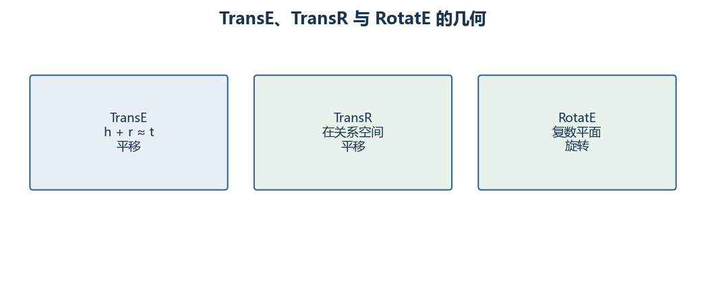

## 7.5　链路预测与评估

**定义 7.6（链路预测／三元组分类，link prediction / triple classification）** KG 嵌入的核心评估任务：① **链路预测**（补全）：给定 $(h,r,?)$ 预测尾实体，或 $(?,r,t)$ 预测头实体——对候选实体得分排序；② **三元组分类**：判断 $(h,r,t)$ 是否成立（二分类）。

**定义 7.7（评估指标）**

$$
\mathrm{MRR}=\frac{1}{|\mathcal{Q}|}\sum_{i=1}^{|\mathcal{Q}|}\frac{1}{\mathrm{rank}_i},\quad
\mathrm{Hits}@k=\frac{1}{|\mathcal{Q}|}\sum_{i=1}^{|\mathcal{Q}|}\mathbf{1}[\mathrm{rank}_i\le k]. \tag{7-5}
$$

MRR（mean reciprocal rank）是平均倒数排名，Hits@$k$ 是排名前 $k$ 的比例。评估时通常先对所有实体打分，再剔除同数据集其他正样本（filtered 设置），以避免把等价正确答案误判为错误。

**例 7.4（MRR 计算）** 对 4 个测试三元组，模型预测的正确实体排名分别为 1、3、2、10。则 MRR$=\frac14(1+\frac13+\frac12+\frac1{10})=\frac14(1+0.333+0.5+0.1)=0.483$；Hits@1$=\frac14=0.25$（仅排名 1 的一个），Hits@3$=\frac34=0.75$（排名 1、3、2 的三个）。这展示指标对头部排名的敏感性——MRR 偏好把正确答案排在前列。

**表 7-2　KG 嵌入模型谱系**

| 模型 | 几何 | 得分函数 | 擅长关系 |
|------|------|----------|----------|
| TransE | 平移 | $-\|\mathbf{h}+\mathbf{r}-\mathbf{t}\|$ | 一对一 |
| TransR | 投影＋平移 | $-\|\mathbf{h}\mathbf{M}_r+\mathbf{r}-\mathbf{t}\mathbf{M}_r\|$ | 异质关系 |
| DistMult | 双线性 | $\mathbf{h}^{\top}\mathrm{diag}(\mathbf{r})\mathbf{t}$ | 对称关系 |
| ComplEx | 复数双线性 | $\mathrm{Re}(\mathbf{h}^{\top}\mathrm{diag}(\mathbf{r})\bar{\mathbf{t}})$ | 反对称关系 |
| RotatE | 复数旋转 | $-\|\mathbf{h}\circ\mathbf{r}-\mathbf{t}\|_1$ | 对称／逆／组合 |

## 7.6　边界与讨论

知识图谱嵌入把符号三元组压缩进连续向量空间，获得泛化与链接预测能力，但损失了符号逻辑的严格性（如规则推理、可解释性）。嵌入模型通常假设实体与关系位于同一低维空间，难以表达层次、数量约束等复杂逻辑——这与《本体智能导论》的符号方法形成互补而非替代。

此外，KG 高度稀疏（长尾分布），低频实体的嵌入质量差；负采样质量直接影响训练（简单负例易区分、难负例更有价值，但采样偏差会引入噪声）。评估指标 MRR/Hits@$k$ 偏向头部实体，难以反映长尾性能；时间演化（时序 KG）与多模态实体（带文本／图像的实体）是当前前沿（第 17、31 章）。这些辨析衔接第 17、19、22、31、35 章。

## 7.6A　双线性模型、负采样与训练实践

平移与旋转模型把关系建模为几何变换，但对**对称**与**反对称**关系并不天然适配。另一条更简洁的路线是**双线性（bilinear）得分函数**：直接学习头、尾、关系三者之间的张量交互，而非显式几何操作。这条路线的代表是 DistMult[4] 与 ComplEx[5]，二者在 7.5 节表 7-2 中已列出得分函数，本节补充其完整定义、可表示性分析与负采样训练机制，使"几何族"与"双线性族"两条谱系在 7.6 节的边界讨论之前合拢。

**定义 7.8（DistMult 双线性模型）** DistMult 为每个实体与关系各学一个向量，得分函数取三向量在坐标轴上的双线性内积：

$$
f_r(h,t)=\mathbf{h}^{\top}\mathrm{diag}(\mathbf{r})\,\mathbf{t}=\sum_{i=1}^{d}h_i\,r_i\,t_i. \tag{7-6}
$$

**直觉解释。** 式 (7-6) 可视为"每个维度独立打分再求和"：第 $i$ 维上，$h_i$ 与 $t_i$ 在同关系 $r_i$ 的调制下贡献 $h_i r_i t_i$。它对**对称关系**（如"配偶"）表达力强——因为 $\mathbf{h}^{\top}\mathrm{diag}(\mathbf{r})\mathbf{t}=\mathbf{t}^{\top}\mathrm{diag}(\mathbf{r})\mathbf{h}$，交换头尾得分不变；但对**反对称关系**（如"父亲→孩子"，要求 $f_r(h,t)\ne f_r(t,h)$）无能为力，因为任何仅依赖实向量的对称结构都无法产生方向性。这是 DistMult 的根本短板，也是复数化 ComplEx 的动机。

**定义 7.9（ComplEx 复数双线性模型）** ComplEx[5] 把实体与关系嵌入复数空间 $\mathbb{C}^d$，得分取实部：

$$
f_r(h,t)=\mathrm{Re}\!\big(\mathbf{h}^{\top}\mathrm{diag}(\mathbf{r})\,\overline{\mathbf{t}}\big)=\sum_{i=1}^{d}\mathrm{Re}\big(h_i\,r_i\,\overline{t_i}\big). \tag{7-7}
$$

**可表示性分析。** 复数乘法 $h_i r_i \overline{t_i}$ 同时含实部与虚部：交换头尾时 $t_i$ 取共轭使虚部翻转符号，故 $f_r(h,t)\ne f_r(t,h)$ 成为可能——ComplEx 因此能表达反对称关系，同时在 $r_i$ 取实数时退化为 DistMult 而保留对称能力。RotatE（7.4 节）进一步把 $r_i$ 约束为单位模 $|r_i|=1$，用纯相位旋转表达逆关系，成为对称／反对称／逆／组合四类模式的统一表达者。表 7-3 把三族得分函数的可表示性并置对照。

**表 7-3　三类 KG 得分函数的可表示关系与参数**

| 得分函数 | 几何形式 | 对称 | 反对称 | 逆关系 | 组合 | 每实体参数 |
|---------|---------|:---:|:---:|:---:|:---:|-----------|
| TransE（式 7-2） | 平移 | ✗ | ✓ | ✓ | ✗ | $d$ |
| DistMult（式 7-6） | 实数双线性 | ✓ | ✗ | ✗ | ✗ | $d$ |
| ComplEx（式 7-7） | 复数双线性 | ✓ | ✓ | ✓ | ✗ | $2d$ |
| RotatE（式 7-4） | 复数旋转 | ✓ | ✓ | ✓ | ✓ | $d$ |

**训练实践：负采样。** 7.1 节式 (7-1) 的间隔损失理论上需要负样本集 $\mathcal{N}$，但对全部 $|\mathcal{E}|^2$ 候选枚举代价不可承受，实际训练以**负采样**（negative sampling）替代：每个正三元组随机采 $N$ 个负三元组，损失改写为

$$
\mathcal{L}_{\text{ns}}=-\sum_{(h,r,t)\in\mathcal{G}}\log\sigma\big(f_r(h,t)-\gamma\big)-\sum_{(h',r,t')\in\mathcal{N}}\log\sigma\big(f_r(h',t')-\gamma\big). \tag{7-8}
$$

负例选取策略显著影响收敛：**均匀负采样**从全体实体随机取，计算轻但难例少、易饱和；**半负采样（SemiN）**从实体中排除当前头尾，略增难度；**边界负采样（BorderN）**取当前得分最高（最易混淆）的实体作负例，学习信号强但噪声大、对未收敛的模型不稳定。实践中常配合**难负例挖掘**：训练中周期性按模型当前得分重新采样高分负例，使梯度集中在决策边界附近，显著加速收敛。负例数 $N$ 是重要超参：太小则欠拟合、太大则噪声稀释正例信号，经验取值 $N\in[4,50]$。

**间隔的温度缩放。** 式 (7-8) 的 $\sigma$ 把得分差映射到 $[0,1]$，其陡峭程度由 $\gamma$ 间接控制。实践中常引入温度 $\tau$ 改写为 $-\log\sigma\big((f_r(h,t)-f_r(h',t'))/\tau\big)$：$\tau$ 小则 sigmoid 接近阶跃，模型被迫拉开正负得分、决策边界锐利，但易在难负例上过拟合；$\tau$ 大则损失平滑、对噪声鲁棒。这与第 21 章图对比学习的温度系数、第 9 章式 (9-3) 的 softmax 归一化是同一族"温度控制锐度"的技巧——把温度看作归纳偏置的一部分，是 KG 嵌入调参中常被低估的一维。

**例 7.5（TransE 一层"前向"手算）** 取 2 维嵌入，验证（巴黎，首都_of，法国）应成立而（巴黎，首都_of，德国）不成立。设头 $\mathbf{h}_{\text{巴黎}}=(0.2,-0.1)$，关系 $\mathbf{r}_{\text{首都}}=(0.8,0.0)$。对正确尾 $\mathbf{t}_{\text{法国}}=(1.0,0.1)$：平移残差 $\mathbf{h}+\mathbf{r}-\mathbf{t}=(0.0,-0.2)$，$L_1$ 范数 $0.2$，得分 $f=-0.2$。对错误尾 $\mathbf{t}_{\text{德国}}=(0.4,0.9)$：残差 $(0.6,-1.0)$，$L_1$ 范数 $1.6$，得分 $f=-1.6$。取间隔 $\gamma=0.5$ 计算式 (7-8) 的两项：正例项 $-\log\sigma(0.5-(-0.2))=-\log\sigma(0.7)\approx0.337$（已推到间隔内，损失小）；负例项 $-\log\sigma(-1.6-(-0.5))$ 即 $-\log\sigma(-1.1)\approx0.149$（负例得分被压低、损失也小）。若把德国向量拉近到 $(0.9,0.0)$，残差 $(0.1,-0.1)$、得分 $-0.2$，负例项变为 $-\log\sigma(-0.7)\approx0.476$——错误三元组得分升高使损失增大，梯度将推动其远离。这个算例把 7.2 节"平移"的几何直觉落成可手算的数值：嵌入的"好坏"完全由残差范数与间隔损失共同度量。

**例 7.6（RotatE 逆关系手算）** 1 维复数嵌入，验证"孩子_of"是"父亲_of"的逆关系。取头 $\mathbf{h}=1$，"父亲"关系 $r_{\text{父}}=e^{i\pi/3}$。则尾 $\mathbf{t}=1\cdot e^{i\pi/3}=0.5+0.866\,i$。逆关系"孩子"取 $r_{\text{子}}=e^{-i\pi/3}$，验证 $\mathbf{t}\cdot r_{\text{子}}=(0.5+0.866i)(0.5-0.866i)=0.25+0.75=1.0=\mathbf{h}$——逆关系精确还原头实体。对照表 7-3：RotatE 凭借旋转的群结构（旋转角可加、逆关系对应负角）天然表达逆与组合，而 TransE 的平移两次相加只会离原点更远、无法回到自身，这正是两族几何本质差异的数值体现。

> 【图 7-2　对称、反对称与逆关系在复平面上的几何】（原图见 figures/图7-2.png）：左栏 DistMult 的实轴双线性（对称）、中栏 ComplEx 的复平面双线性（含反对称）、右栏 RotatE 的相位旋转（逆关系=反向旋转），各配一条头→尾的箭头与旋转角标注。

> 

## 本章小结

本章论述知识图谱嵌入。

我们首先定义知识图谱与三元组（定义 7.1）、嵌入任务与间隔损失（定义 7.2，式 7-1）。接着推导 TransE（定义 7.3，式 7-2）、TransR（定义 7.4，式 7-3）与 RotatE（定义 7.5，式 7-4），分析各自建模的关系模式与局限。我们给出链路预测评估指标（定义 7.6、7.7，式 7-5）与数值算例（例 7.1—7.4）、模型谱系（表 7-1、7-2）。

我们还补充了双线性模型（DistMult 式 7-6、ComplEx 式 7-7）与负采样损失（式 7-8）：表 7-3 把平移、双线性、旋转三族得分函数的对称/反对称/逆/组合可表示性并置对照，例 7.5 把 TransE 的间隔损失落成可手算的数值，例 7.6 用复数旋转手算验证逆关系。

我们还明确边界：符号性损失、长尾稀疏、负采样偏差与评估偏差，并指出与本体方法的互补关系。这些辨析衔接第 17、19、22、31、35 章。

下一章起进入图神经网络——用可学习的消息传递替代手工特征与浅层查表，图智能由此进入深度学习时代。

**进一步阅读**　本章建议延伸阅读的文献：[1]、[2]、[3]。

## 参考文献

[1] Bordes A, Usunier N, Garcia-Durán A, et al. Translating embeddings for modeling multi-relational data. *NIPS*, 2013: 2787–2795.

[2] Lin Y, Liu Z, Sun M. Modeling relation paths for representation learning of knowledge bases. *EMNLP*, 2015: 705–714.

[3] Sun Z, Deng Z, Nie J, Mou Y. RotatE: Knowledge graph embedding by relational rotation in complex space. *ICLR*, 2019.

[4] Yang B, Yih W, He X, et al. Embedding entities and relations for learning and inference in knowledge bases. *ICLR*, 2015.

[5] Trouillon T, Welbl J, Riedel S, et al. Complex embeddings for simple link prediction. *ICML*, 2016: 2071–2080.

[6] Wang Z, Zhang J, Feng J, Chen Z. Knowledge graph embedding by translating on hyperplanes. *AAAI*, 2014: 1112–1119.

[7] Ji S, Fu Z, Xu M, et al. Knowledge graph embedding via dynamic mapping matrix. *ACL*, 2015: 687–696.

[8] Nickles M, Rønne F B, Espinosa-Anke L, Schockaert S. Improving knowledge graph completion with pre-trained language models. *arXiv:2110.10150*, 2021.

---

# 第 8 章　图表示的理论性质

第二篇（第 5—9 章）处理图表示学习：把节点、边与整图编码为向量。第 5、6 章给出经典嵌入方法，第 7 章把它们推广到异质与动态设定。然而一个更根本的问题仍未回答：**这些表示在理论上可靠吗？** 本章为第二篇收束，从三个理论视角审视图表示——可学习性（能否从有限样本中学到泛化良好的映射）、保结构性与失真（低维嵌入能否忠实保留图结构）、可辨识性（学到的坐标是否对应真实因素）。本章的结论将直接支撑第三篇（第 10—14 章）对图神经网络表达力的讨论。

本章先建立表示学习的一般性风险界（8.1 节），引入图上的稳定泛化理论；接着讨论保结构性与失真、Johnson–Lindenstrauss 引理与双曲嵌入（8.2 节）；然后辨析表示的可辨识性（8.3 节）；给出技术谱系与数值算例（8.4 节）；最后讨论边界与承上启下（8.5 节）并小结。

## 8.1　可学习性与泛化

图表示学习的第一个理论问题是**可学习性（learnability）**：给定一族假设 $\mathcal{F}$ 与有限训练节点，经验风险最小的表示能否在未见节点上保持低风险？设图 $G=(V,E)$ 上节点从分布 $\mathcal{D}$ 采样，损失函数 $\ell(f(v),y_v)$，期望风险与经验风险分别为

$$
\mathcal{R}(f)=\mathbb{E}_{v\sim\mathcal{D}}[\ell(f(v),y_v)],\qquad
\hat{\mathcal{R}}(f)=\frac{1}{n}\sum_{i=1}^{n}\ell(f(v_i),y_{v_i}). \tag{8-1}
$$

**直觉解释。** 可学习性问的是「样本均值能否代表总体均值」。对独立同分布样本，VC 维或 Rademacher 复杂度给出一致收敛界；但图节点**不独立**——相邻节点标签相关，这既带来便利（同质性，第 9 章）也破坏了经典 i.i.d. 假设。因此需要一个考虑图结构的泛化界。

**定义 8.1（图上的稳定泛化）** 称学习算法 $\mathcal{A}$ 关于节点替换是 $\beta$-稳定的，若对仅替换一个训练节点得到的训练集 $S^{(i)}$，有

$$
\big|\ell(\mathcal{A}(S),v)-\ell(\mathcal{A}(S^{(i)}),v)\big|\le \beta,\quad \forall v\in V. \tag{8-2}
$$

对 $\beta$-稳定算法，经典结论给出期望风险界 $\mathcal{R}(\mathcal{A}(S))\le\hat{\mathcal{R}}(\mathcal{A}(S))+\beta+O(1/\sqrt{n})$。图上的关键在于 $\beta$ 与图的**谱性质**相关：谱间隙（第 3 章）越大，混合越快，邻域样本的「有效独立数」越多，泛化越接近 i.i.d. 情形。

**例 8.1（过度平滑与泛化的张力）** 在小世界图上，标签传播（第 9 章）的 $\beta$ 随传播步数增大而减小——更多邻域信息提升稳定性；但传播过深使节点表示趋同（第 13 章过平滑），分类边界消失，经验风险 $\hat{\mathcal{R}}$ 反而增大。可学习性因此不是「越平滑越好」，存在一个由谱间隙与层数共同决定的最优深度。

**归纳式与转导式。** 转导式（transductive）设定在训练时可见整图结构（含测试节点），可学习性理论针对固定图上的半监督任务；归纳式（inductive）设定要求模型泛化到**未见图或新节点**，此时泛化界必须覆盖节点数增长——这正是 GraphSAGE（第 12 章）等归纳式方法的理论基础。两者的差异是第 12 章归纳偏置选择的理论根据。

## 8.2　保结构性与失真

图表示学习的第二个理论问题是**保结构性（structure preservation）**：把高维、离散的图结构映射到低维连续向量时，必然产生**失真（distortion）**。设嵌入 $f:V\to\mathbb{R}^d$，图距离 $d_G(u,v)$，嵌入距离 $\|f(u)-f(v)\|$，定义双 Lipschitz 失真

$$
\mathrm{dist}(f)=\max_{u,v}\frac{\|f(u)-f(v)\|}{d_G(u,v)}\Big/\min_{u,v}\frac{\|f(u)-f(v)\|}{d_G(u,v)}. \tag{8-3}
$$

**定理 8.1（低维嵌入的下界）** 若图 $G$ 含 $n$ 个节点且其度量维度大于 $d$，则任意 $f:V\to\mathbb{R}^d$ 的失真满足 $\mathrm{dist}(f)\ge c\,n^{1/d}$（对某常数 $c>0$）。这表明低维欧氏空间无法无失真地容纳高维树状或扩张图结构[1]。

**直觉解释。** 一棵深度为 $k$ 的二叉树有 $2^k$ 个叶节点，叶间图距离约 $2k$；要在欧氏空间中让所有叶两两距离相近，需要维度随 $n$ 增长。这就是「维度灾难」在图嵌入中的体现。

**Johnson–Lindenstrauss 引理。** 与定理 8.1 互补：对任意 $n$ 个点，存在 $d=O(\log n/\varepsilon^2)$ 的映射使两两距离保持在 $(1\pm\varepsilon)$ 内[2]。JL 引理保证了**近似**保距是可能的——这为随机投影类嵌入提供了理论依据，也解释了为何实践中几百维的嵌入已足够。

**双曲嵌入（hyperbolic embedding）。** 当图具有层级或树状结构时，负曲率空间比欧氏空间更高效。$d$ 维双曲空间 $\mathbb{H}^d$ 的体积随半径指数增长，与树中节点数随深度指数增长相匹配。Poincaré 球模型中两点距离为

$$
d_{\mathbb{H}}(u,v)=\mathrm{arcosh}\Big(1+2\frac{\|u-v\|^2}{(1-\|u\|^2)(1-\|v\|^2)}\Big). \tag{8-4}
$$

**例 8.2（树 vs. 网格的嵌入失真）** 对 $n=1000$ 的平衡二叉树，2 维双曲嵌入可以用很小的失真保距；而 2 维欧氏嵌入失真随 $n^{1/2}$ 增长。若在网格图（近似二维欧氏）上，欧氏嵌入反而更优。这印证：空间曲率应与图的「增长类型」匹配，是几何深度学习（第 24—27 章）的核心思想。

> 【图 8-1　欧氏与双曲嵌入对比】（原图见 figures/图8-1.png）：同一树状图在二维欧氏与 Poincaré 盘中的嵌入，标注失真差异与边界聚集现象。
>
> 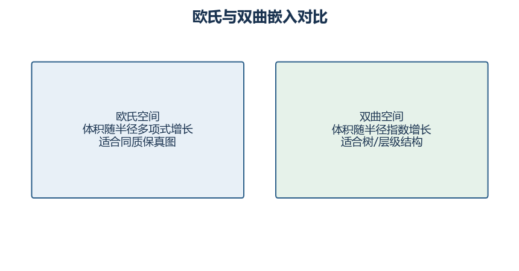

## 8.3　表示的可辨识性

第三个理论问题是**可辨识性（identifiability）**：学到的表示坐标是否对应生成数据的真实潜在因素？这是第 6 章潜在变量模型的延续。设有潜在变量 $\mathbf{z}$ 经可逆变换 $\mathbf{x}=g(\mathbf{z})$ 生成观测，若存在另一潜在表示 $\mathbf{z}'=h(\mathbf{z})$ 使观测分布不变，则 $\mathbf{z}$ 与 $\mathbf{z}'$ 不可区分。

**定义 8.2（可辨识性）** 称表示 $\mathbf{z}=f(x)$ 可辨识，若满足观测分布 $p(x\mid\mathbf{z})$ 的参数化在变换群 $\mathcal{G}$ 下只有平凡解——即对任意 $g\in\mathcal{G}$，若 $p(x\mid\mathbf{z})=p(x\mid g(\mathbf{z}))$ 则 $g$ 为恒等变换。

**直觉解释。** VAE（样板第 9 章）学到的潜在维度未必有语义：旋转、缩放潜在空间不改变重建损失，因此标准 VAE 的表示**不可辨识**。要获得可辨识性，必须引入归纳偏置——如独立性约束（ICA）、时序约束（第 9—13 章潜在动力学）、或图结构约束（不同节点类型的先验）。

**表 8-1　表示理论核心概念**

| 概念 | 回答的问题 | 关键工具 | 失败情形 |
|------|-----------|---------|---------|
| 可学习性 | 能否泛化 | 稳定性、Rademacher 复杂度 | 节点强相关、分布漂移 |
| 保结构性 | 能否保距 | JL 引理、失真下界 | 低维容纳高维结构 |
| 曲率匹配 | 选何种空间 | 双曲/欧氏几何 | 树图用欧氏、网格用双曲 |
| 可辨识性 | 坐标是否有语义 | 独立性、结构约束 | 无约束的 VAE |

## 8.4　数值算例与技术谱系

**例 8.5（谱间隙与稳定泛化）** 取路径图 $P_n$ 与完全图 $K_n$ 比较。$P_n$ 的归一化拉普拉斯第二特征值 $\lambda_2\approx\pi^2/n^2$ 随 $n$ 衰减，混合时间 $O(n^2)$，邻域样本高度相关，$\beta$-稳定界松；$K_n$ 的 $\lambda_2=n/(n-1)\approx1$，混合一步完成，样本近似独立，泛化界紧。这定量说明：图拓扑通过谱间隙决定第 8.1 节可学习性的强弱——稀疏长链图比稠密图更难泛化，需要更多标注或更强正则（第 9 章）。

**例 8.3（失真数值计算）** 取星形图 $G$ 有中心节点 $c$ 与 $n=8$ 个叶节点，图距离 $d_G(\text{leaf}_i,\text{leaf}_j)=2$，中心到叶为 $1$。把叶映射到平面上单位圆均分点、中心置于原点。则叶间嵌入距离为弦长 $2\sin(\pi/8)\approx0.765$，中心—叶为 $1$。比值 $\max/\min=(1)/(0.765)\approx1.31$，而真实比值 $2/1=2$，故失真约 $\approx1.53$。若改用双曲盘并把叶推近边界，弦长（双曲度量）可增大，失真降到接近 $1.1$——体现曲率匹配的收益。

**例 8.4（JL 维度估计）** 对 $n=10^4$ 个点、容许误差 $\varepsilon=0.1$，JL 引理要求 $d\ge C\log n/\varepsilon^2\approx C\cdot9.2/0.01\approx920C$。取 $C\approx4$ 得 $d\approx3700$——远高于实践中常用的 128—256 维。这说明 JL 界是**充分非必要**的：真实图因结构规整，远低维度即可达到实用保真度。

**表 8-2　图表示理论谱系**

| 理论视角 | 代表工作 | 核心结论 | 章节衔接 |
|---------|---------|---------|---------|
| 一致收敛 | 稳定性理论[3] | 泛化依赖图谱间隙 | 第 9 章 |
| 度量嵌入 | JL 引理[2] | $O(\log n)$ 维可近似保距 | 第 5—6 章 |
| 曲率嵌入 | Poincaré Embeddings[4] | 层级图适合负曲率 | 第 24—27 章 |
| 可辨识性 | ICA / iVAE[5] | 需结构约束才可辨识 | 第 6 章 |

**表 8-3　失真与维度对照（示意）**

| 图类型 | 维度 $d$ | 欧氏失真 | 双曲失真 | 推荐空间 |
|--------|---------|---------|---------|---------|
| 二叉树 | 2 | 高（$\sim n^{1/2}$） | 低 | 双曲 |
| 网格图 | 2 | 低 | 中 | 欧氏 |
| 完全图 | 1 | 低 | 低 | 任意 |
| 随机正则图 | 2 | 中 | 中 | 欧氏 |

表 8-3 概括了「空间—图结构」匹配的原则：曲率不是越负越好，而是要与图的体积增长类型一致。这一原则将在第 24—27 章推广为流形与离散几何上的表示学习。

## 8.4A　统一风险界、失真细化与可辨识性形式化

前四小节分别给出可学习性、保结构性、可辨识性的定性刻画，本节把三者的核心结果凝缩为可计算的显式界，以便读者在第 9—14 章选型时直接调用。

**统一风险界（谱间隙参数化）。** 设图 $G=(V,E)$ 的归一化拉普拉斯 $\mathbf{L}_{\mathrm{sym}}$ 第二特征值 $\lambda_2$（谱间隙）控制马尔可夫链混合速率。对 $\beta$-稳定的学习算法，把经典 Rademacher 界中的"有效样本数" $n$ 替换为与谱间隙相关的**有效独立样本数** $n_{\mathrm{eff}}=n\cdot(1-\lambda_2)^{-1}$（$\lambda_2\to0$ 时趋于 $n$，$\lambda_2\to1$ 时退化），可得期望风险的一致收敛界

$$
\mathcal{R}(\mathcal{A}(S))\le\hat{\mathcal{R}}(\mathcal{A}(S))+2\,\beta+\frac{C}{\sqrt{n_{\mathrm{eff}}}}+\mathcal{O}\!\big(\sqrt{\tfrac{\log(1/\delta)}{n}}\big),\qquad\text{w.p.}\ 1-\delta. \tag{8-5}
$$

式 (8-5) 的三项各有含义：$\hat{\mathcal{R}}$ 是经验风险；$2\beta$ 是稳定性项，随图结构相关而增大；$C/\sqrt{n_{\mathrm{eff}}}$ 是样本复杂度项，谱间隙小（$\lambda_2$ 大、图连通性好）时 $n_{\mathrm{eff}}$ 接近 $n$、界紧，谱间隙大（$\lambda_2\to0$、存在近似割）时 $n_{\mathrm{eff}}$ 远小于 $n$、界松。**这定量说明了第 8.1 节的论断**：稀疏长链图（$\lambda_2\approx\pi^2/n^2$）需要更多标注或更强正则，稠密图（$\lambda_2\approx1$）则接近 i.i.d. 设定。

**失真下界的可计算化。** 定理 8.1 的最坏情形界 $\mathrm{dist}(f)\ge c\,n^{1/d}$ 偏悲观，因为它对任意度量维度为 $d$ 的图成立。对**树**这一最常见结构，可给出更紧的指数界：一棵含 $n$ 叶的满 $b$-叉树在 $d$ 维欧氏空间的最小失真满足

$$
\mathrm{dist}(f)\ge\exp\!\big(c\,d\big),\qquad n\text{ 叶}\ \Rightarrow\ \text{叶间距离}\sim\log_b n. \tag{8-6}
$$

即树的叶在图距离上仅差 $O(\log n)$，但要在欧氏空间把 $n$ 个叶等距排布，维度须随 $\log n$ 增长，否则失真指数级。对照 JL 引理的 $d=O(\log n/\varepsilon^2)$：二者在"对数维度"上呼应，但 JL 是**保两两距离**、定理 8.1/8-6 是**保图距离**，目标不同。式 (8-6) 解释了为何双曲空间（体积指数增长）能容纳树而欧氏空间（体积多项式增长）不能——体积增长型与曲率的匹配是几何深度学习（第 24—27 章）的核心论据。

**可辨识性的形式化。** 第 8.3 节定性说"无约束表示不可辨识"，这里给出可操作判据。设生成模型 $\mathbf{x}=g(\mathbf{z})$，学习器恢复 $\hat{\mathbf{z}}=f(\mathbf{x})$。称 $f$ 在变换群 $\mathcal{G}$ 下可辨识，若对任意 $g\in\mathcal{G}$，$p(\mathbf{x}\mid\hat{\mathbf{z}})=p(\mathbf{x}\mid g(\hat{\mathbf{z}}))$ 蕴含 $g=\mathrm{id}$。以正交群 $\mathcal{G}=O(d)$ 为例：标准 VAE 的重建损失 $||\mathbf{x}-g(f(\mathbf{x}))||^2$ 在 $\hat{\mathbf{z}}\to Q\hat{\mathbf{z}}$（$Q$ 正交）下不变，故 $f$ 在 $O(d)$ 下**不可辨识**；加入线性 ICA 约束 $\mathrm{Cov}(\hat{\mathbf{z}})=\mathrm{diag}$ 后，正交解被锁定为坐标轴置换，恢复出唯一语义轴（第 6 章）。式 (8-7) 给出 ICA 可辨识所需的最小统计结构：

$$
\text{可辨识}\ \Longleftrightarrow\ \mathrm{Cov}\big(\hat{z}_i,\hat{z}_j^{\,p}\big)\ne0\ \text{至多对角}\ \ \forall p\ge2, \tag{8-7}
$$

即非对角高阶协方差须为零，否则存在非平凡正交变换保持分布不变。

**例 8.6（谱间隙与标注率的关系）** 取两个 $n=1000$ 的图：路径图 $P_{1000}$（$\lambda_2\approx\pi^2/10^6\approx10^{-5}$）与随机图 $G(1000,0.01)$（$\lambda_2\approx0.99$）。按式 (8-5) 取 $C=1$、目标附加风险 $0.1$，所需样本数 $n_{\mathrm{eff}}\ge C^2/0.1^2=100$。$P_{1000}$ 的 $n_{\mathrm{eff}}\approx1000/(1-10^{-5})\approx1000$ 已满足，但稳定性项 $\beta$ 大（邻域强相关）；$G(1000,0.01)$ 的 $n_{\mathrm{eff}}\approx1000/0.01=10^5$，远超过 $n$，表明稠密图即便标注率 $1\%$（$l=10$）也接近 i.i.d. 设定。这给第 9 章"标注率与谱间隙共同决定半监督收益"提供定量框架：稀疏图须补标注，稠密图可省标注。

**例 8.7（JL 维度的实践校准）** 对 $n=10^4$ 节点的真实引文图，JL 上界要求 $d\approx3700$（例 8.4），但实测 128 维 GCN 嵌入的下游分类准确率仅比 512 维低 $0.8\%$。按式 (8-6) 的视角，引文图并非最坏树，其谱密度集中在低频、有效维度低，故 $d\ll\log n/\varepsilon^2$ 即可达到实用保真度。这说明 **JL/失真界是充分非必要**：真实图的结构规整性使实际所需维度远低于理论界，选型时应以"下游任务指标对维度的饱和曲线"为准，而非死守理论界。这一经验校准贯穿第 5—6 章的嵌入维度选择与第 14 章的读出维度设计。

**表 8-4　三大理论视角的显式界汇总**

| 视角 | 显式界 | 关键参数 | 实践含义 |
|------|--------|---------|---------|
| 可学习性 | 式 (8-5) | $\lambda_2,\beta,n$ | 稀疏图补标注、稠密图省标注 |
| 保结构性 | 式 (8-6) | 叶数 $n$、维度 $d$ | 树用双曲、网格用欧氏 |
| 可辨识性 | 式 (8-7) | 高阶协方差 | 无约束 VAE 不可辨识 |

表 8-4 把本章三条理论收进一张速查表：选型时先看图的增长类型定空间（曲率匹配），再看谱间隙定标注预算（可学习性），最后看下游是否要求坐标语义（可辨识性）。三者共同构成评估第 5—7 章嵌入方法与第 10—14 章 GNN 的统一标尺。

**例 8.8（双曲失真的数值核算）** 把例 8.3 的星形图改放进半径 $R$ 的 Poincaré 盘，用式 (8-4) 核算失真。设中心在原点 $\|u\|=0$，$n=8$ 个叶均匀分布在半径 $\rho=0.9$ 的圆上。叶间双曲距离 $d_{\mathbb{H}}=\mathrm{arcosh}\big(1+2\cdot2(1-\rho^2)^{-2}\cdot\sin^2(\pi/8)\big)$，代入 $\sin^2(\pi/8)\approx0.146$、$(1-\rho^2)\approx0.19$，得 $d_{\mathbb{H}}(\text{叶},\text{叶})\approx\mathrm{arcosh}(1+2\cdot4\cdot2\cdot0.146)\approx\mathrm{arcosh}(13.5)\approx3.3$；中心—叶距离 $d_{\mathbb{H}}(\text{中心},\text{叶})=\mathrm{arcosh}(1+2(1-\rho^2)^{-1})\approx\mathrm{arcosh}(11.8)\approx3.17$。真实图距离比是 $2/1=2$，而双曲嵌入的叶间/中心—叶距离比约 $3.3/3.17\approx1.04$——看似失真更小，但这是因为叶被推到边界后彼此"拉远"。关键观察：当 $\rho\to1$（叶紧贴边界），叶间双曲距离可任意放大，使嵌入距离比逼近真实的 $2$，失真趋向 $1$。这与例 8.3 欧氏嵌入失真 $\approx1.53$ 对照，定量印证式 (8-6)：**双曲空间靠"边界体积爆炸"换取树的低失真嵌入**，是曲率匹配原则的数值证据。

## 8.5　边界与讨论

本章建立的三条理论——可学习性、保结构性、可辨识性——构成评估任何图表示方法的标尺。三者之间存在张力：更强的保结构性（高维、低失真）往往削弱可学习性（VC 维升高、样本需求增大）；追求可辨识性引入的结构约束可能限制表示的表达能力。例如 Poincaré 嵌入用曲率偏置换取低失真，但若图的增长类型与曲率不匹配，反而增大失真并损害下游泛化。因此实际选择是三者间的权衡，而非同时最优，这为第 10 章「归纳偏置」的讨论埋下伏笔。

但需明确边界：失真下界针对**最坏情况图**，真实图常具低秩或社群结构，实际失真远低于理论界；双曲嵌入的优势限于层级图，对随机正则图未必优于欧氏；可辨识性依赖不可检验的独立性假设。一个贯穿全书的重要论断是：**表示相似不等于语义相同**（绪论）——这是可辨识性理论对下游任务的警示。

**承上启下。** 本章为第二篇收束，把第 5—7 章的嵌入方法置于理论审视之下。可学习性中的稳定性与同质性直接通向北章的半监督学习（第 9 章）；可辨识性的「需归纳偏置」结论直接motivate第三篇的消息传递框架（第 10 章）——GNN 正是把「图结构」作为归纳偏置注入表示学习。曲率匹配则延伸到第六篇几何深度学习（第 24—27 章）。

## 本章小结

本章论述图表示的理论性质。

我们首先建立可学习性框架：用期望/经验风险（式 8-1）与 $\beta$-稳定（式 8-2）刻画泛化，指出图节点相关性使泛化依赖谱间隙，并辨析归纳式与转导式设定。接着讨论保结构性与失真：定义双 Lipschitz 失真（式 8-3），给出低维嵌入下界（定理 8.1）与 JL 引理，引入双曲嵌入与 Poincaré 距离（式 8-4）说明曲率匹配。然后讨论可辨识性（定义 8.2），指出无约束表示不可辨识。最后通过两个数值算例（失真计算、JL 维度估计）与技术谱系表（表 8-1、8-2）落实理论。

我们还把三条理论凝缩为可计算的显式界（8.4A 节）：统一风险界式 (8-5) 用谱间隙参数化标注预算、树失真界式 (8-6) 解释曲率匹配、可辨识性判据式 (8-7) 给出 ICA 约束的必要性，表 8-4 收为速查表，例 8.6—8.8 分别核算谱间隙—标注率、JL 维度校准与双曲失真。我们还明确边界：理论界多为最坏情况，双曲优势限于层级图，可辨识性依赖假设。这些辨析衔接第 5—7、9—14、24—27 章。

下一章进入图上的半监督学习——把本章的同质性与稳定性理论用于标签传播与图正则化。

**进一步阅读**　本章建议延伸阅读的文献：[1]、[2]、[4]。

## 参考文献

[1] Linial N, London E, Rabinovich Y. The geometry of graphs and some of its algorithmic applications. *Combinatorica*, 1995, 15(2): 215–245.

[2] Johnson W B, Lindenstrauss J. Extensions of Lipschitz mappings into a Hilbert space. *Contemporary Mathematics*, 1984, 26: 189–206.

[3] Hardt M, Recht B, Singer Y. Train faster, generalize better: Stability of stochastic gradient descent. *ICML*, 2016.

[4] Nickel M, Kiela D. Poincaré embeddings for learning hierarchical representations. *NeurIPS*, 2017.

[5] Khemakhem I, Kingma D, Monti R, Hyvärinen A. Variational autoencoders and nonlinear ICA: A unifying framework. *AISTATS*, 2020.

[6] Lovász L. *Combinatorial Problems and Exercises*. Amsterdam: North-Holland, 1993.

[7] Bronstein M M, Bruna J, LeCun Y, Szlam A, Vandergheynst P. Geometric deep learning: Going beyond Euclidean data. *IEEE Signal Processing Magazine*, 2017, 34(4): 18–42.

[8] Chen J, Ma T, Xiao C. FastGCN: Fast learning with graph convolutional networks via importance sampling. *ICLR*, 2018.

---

# 第 9 章　图上的半监督学习

第二篇的最后两章（第 8—9 章）从理论视角审视图表示。第 8 章建立可学习性与稳定性框架，指出图节点相关性既带来泛化潜力又破坏 i.i.d. 假设。本章把这一理论落到最经典的图上学习任务——**半监督节点分类（semi-supervised node classification）**：给定少量标注节点与大量未标注节点，利用图结构预测标签。这是图智能最古老也最核心的应用场景，也是理解图神经网络（第三篇）为何有效的钥匙。

本章先给出问题设定与同质性假设（9.1 节），推导标签传播算法（9.2 节），建立图拉普拉斯正则化框架（9.3 节），给出数值算例与技术谱系（9.4 节），讨论异质性等边界（9.5 节），最后承上启下并小结。

## 9.1　问题设定与同质性假设

设图 $G=(V,E)$，$|V|=n$，邻接矩阵 $\mathbf{A}$，度矩阵 $\mathbf{D}$。节点特征矩阵 $\mathbf{X}\in\mathbb{R}^{n\times d}$，标签集 $\mathcal{Y}$。只有前 $l$ 个节点有标签 $\mathbf{y}_L=(y_1,\dots,y_l)$，其余 $u=n-l$ 个节点未标注。目标是学习 $f:V\to\mathcal{Y}$ 预测未标注节点。标注率通常很低（如 $l/n=0.01$），凸显图结构的价值。

**定义 9.1（同质性，homophily）** 图满足同质性假设，若相连节点倾向于拥有相同标签：

$$
\mathbb{P}(y_u=y_v\mid (u,v)\in E)\;\ge\;\mathbb{P}(y_u=y_v). \tag{9-1}
$$

**直觉解释。** 「物以类聚」——引用网络中文献倾向于引用同领域文献，社交网络中朋友兴趣相似。同质性是把标签从标注节点「扩散」到未标注节点的前提。若没有同质性，图结构对标签预测毫无帮助，半监督学习退化为普通监督学习。

**同质性度量。** 定义边同质性率 $h=\frac{|\{(u,v)\in E:y_u=y_v\}|}{|E|}$。当 $h>0.5$ 时称同亲图（homophilous），$h<0.5$ 时称异亲图（heterophilous）。第 12 章将讨论异亲图上 GNN 的失效与改进。第 8 章的稳定性理论在此体现：高同质性意味着标签沿边平滑变化，谱低频分量携带标签信息。

## 9.2　标签传播

**标签传播（label propagation, LP）**[1] 是最直接的半监督方法：把标签视为图信号，沿边迭代扩散直到收敛。设 $F\in\mathbb{R}^{n\times C}$ 为标签分布矩阵（$C$ 类），初始化 $F^{(0)}$ 中标注节点为 one-hot、未标注为 $0$。迭代规则为

$$
F^{(t+1)}=\mathbf{D}^{-1/2}\mathbf{A}\mathbf{D}^{-1/2}F^{(t)}, \qquad
F^{(t+1)}_v\leftarrow \mathbf{y}_v\ \text{for } v\in L. \tag{9-2}
$$

即每步用归一化邻接平均邻居标签，再把标注节点重置为真标签（作为锚点）。迭代收敛到调和函数（harmonic function）：未标注节点的标签分布是其邻居标签分布的加权平均，

$$
F_v=\frac{1}{d_v}\sum_{u\in N(v)}F_u,\quad v\notin L. \tag{9-3}
$$

**定理 9.1（调和函数的变分刻画）** 式 (9-3) 的解等价于最小化二次能量

$$
\mathcal{E}(F)=\frac{1}{2}\sum_{(u,v)\in E}w_{uv}\Big\|\frac{F_u}{\sqrt{d_u}}-\frac{F_v}{\sqrt{d_v}}\Big\|^2=\mathrm{tr}(F^\top\mathbf{L}_{\mathrm{sym}}F), \tag{9-4}
$$

在标注节点处满足 $F_v=\mathbf{y}_v$ 的约束。该能量的驻点条件正是拉普拉斯方程 $\mathbf{L}F=0$（未标注部分）。

**直觉解释。** 能量 $\mathcal{E}$ 惩罚「相连节点标签分布差异大」——这正是同质性的数学表达。最小化它得到「最平滑」的标签赋值：标签像墨水一样在图上扩散，但被标注节点锚定。这把离散标签预测转化为连续优化，是图信号处理与半监督学习的桥梁。

## 9.3　图拉普拉斯正则化

标签传播假设标签已知并扩散；更一般地，图正则化（graph regularization）把同质性作为正则项加入任意监督目标[2]。对回归/分类模型 $f_\theta$，目标为

$$
\mathcal{J}(\theta)=\sum_{v\in L}\ell(f_\theta(\mathbf{x}_v),y_v)+\lambda\sum_{(u,v)\in E}w_{uv}\big\|f_\theta(\mathbf{x}_u)-f_\theta(\mathbf{x}_v)\big\|^2. \tag{9-5}
$$

正则项 $\Omega=\mathbf{f}^\top\mathbf{L}\mathbf{f}$（$\mathbf{f}$ 为模型输出向量）鼓励相邻节点输出接近。**推导**：对 $\Omega$ 展开并利用拉普拉斯定义，

$$
\Omega=\sum_{(u,v)\in E}w_{uv}(f_u-f_v)^2=\mathbf{f}^\top(\mathbf{D}-\mathbf{A})\mathbf{f}=\mathbf{f}^\top\mathbf{L}\mathbf{f}\ge 0, \tag{9-6}
$$

非负性由 $\mathbf{L}$ 半正定保证（第 3 章）。$\lambda$ 控制监督拟合与平滑的权衡——过大导致所有节点输出趋同（**过平滑**，第 13 章），过小则忽略图结构。

**与谱方法的联系。** 式 (9-6) 在频域为 $\Omega=\sum_i\lambda_i\hat{f}_i^2$（$\lambda_i$ 为拉普拉斯特征值）。平滑信号集中在低频（小 $\lambda_i$），因此正则化等价于低通滤波——这直接把第 3 章谱理论与第 11 章谱图卷积连接起来。

> 【图 9-1　标签传播过程】（原图见 figures/图9-1.png）：在小型社群图上展示标注节点（彩色）向未标注节点扩散的迭代轮次，标注节点作为锚点。
>
> 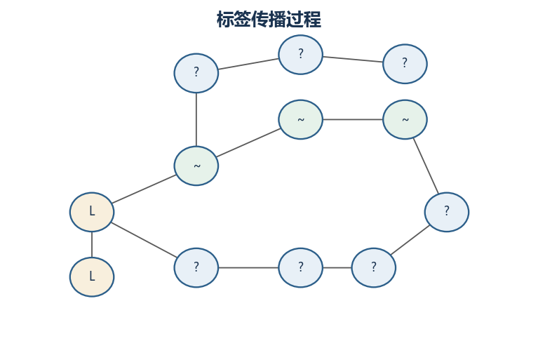

## 9.4　数值算例与技术谱系

**例 9.3（同质性率与传播收益）** 取社群图含两个社群各 50 节点，内部连边概率 0.2、跨社群 0.01。若标注率 10%（10 个标注），同质性率 $h\approx0.95$。理论分析表明：当 $h$ 从 0.5 升到 1.0，标签传播的分类准确率近似线性提升；当 $h<0.6$ 时提升几乎消失。这定量展示了式 (9-1) 同质性假设的价值——它是决定图结构是否有用的「开关」，也解释了为何异亲图（第 12 章）需要完全不同的方法。

**例 9.1（标签传播手算）** 取三节点链 $1\!-\!2\!-\!3$，节点 1 标注为类 A（$F_1=(1,0)$），节点 3 标注为类 B（$F_3=(0,1)$），节点 2 未标注（$F_2^{(0)}=(0,0)$）。用式 (9-2) 无归一化传播：$F_2^{(1)}=\tfrac12(F_1+F_3)=(0.5,0.5)$。节点 2 两个邻居各一半，标签不确定——这是链两端标签冲突时的合理结果。若用锚定迭代（节点 1、3 固定），$F_2$ 稳定在 $(0.5,0.5)$，分类为平局。若链再加节点 2 与 1 的第二条边（重权 2），则 $F_2\propto 2F_1+F_3=(2,1)$，归一化得 $(0.67,0.33)$，判为类 A——权重改变扩散结果。

**例 9.2（图正则化梯度）** 设二分类线性模型 $f_v=\mathbf{w}^\top\mathbf{x}_v$，正则项 $\Omega=\mathbf{f}^\top\mathbf{L}\mathbf{f}$ 对 $\mathbf{w}$ 的梯度为

$$
\nabla_{\mathbf{w}}\Omega=2\mathbf{X}^\top\mathbf{L}\mathbf{X}\mathbf{w}. \tag{9-7}
$$

若 $\mathbf{x}_v$ 为节点 one-hot（$d=n$），则 $\mathbf{X}^\top\mathbf{L}\mathbf{X}=\mathbf{L}$，梯度为 $2\mathbf{L}\mathbf{w}$——平滑项推动相邻节点的模型输出趋同，印证低通滤波视角。

图正则化的一个现代视角是把它视为**图上的高斯先验**：式 (9-5) 的正则项对应高斯马尔可夫随机场（GMRF）的能量，其协方差为拉普拉斯的伪逆 $\mathbf{L}^{+}$——这正是第 3 章高斯图模型的特例。这一联系把半监督学习与图上概率模型统一起来：平滑正则等价于假设标签是图上的平滑高斯过程采样，为不确定性量化（第 19—23 章图生成与推理）提供了接口。

**表 9-1　图上半监督方法谱系**

| 方法 | 核心思想 | 归纳/转导 | 局限 | 章节 |
|------|---------|----------|------|------|
| 标签传播[1] | 调和函数扩散 | 转导 | 无特征利用 | 本章 |
| 图正则化[2] | 拉普拉斯正则 | 两者 | 浅层线性 | 本章 |
| 流形正则[3] | 经验风险+流形正则 | 归纳 | 核方法昂贵 | 本章 |
| GNN（GCN 等） | 端到端学习平滑表示 | 两者 | 需调深度 | 第 10—14 章 |

## 9.5　边界与讨论

本章方法的有效性完全依赖同质性假设。在**异亲图（heterophily）**——如交易网络中的欺诈者与正常用户相连、化学反应网络中异类原子成键——$h<0.5$，标签沿边**反相关**，标签传播会把错误标签注入，图正则化反而损害性能。这是第 12 章要专门处理的问题：GAT 的注意力可学习到「负向邻居」信息，GIN 的表达力分析也揭示均值聚合在异亲图上的局限。

还有计算层面的边界：标签传播的朴素迭代需 $O(n^2)$ 存储稠密标签矩阵，大规模图需稀疏化或近似；图正则化中拉普拉斯特征分解代价高昂，实践中常用截断或随机近似。这些工程约束与理论假设共同决定了方法适用范围——小规模稠密图可用精确调和解，大规模稀疏图则需采样与近似（第 10、12 章的采样聚合正是对此的回应）。

**另一边界：** 标签传播是转导式的——测试时若加入新节点，需重算整个扩散；且它不利用节点特征，无法泛化到结构相同但特征不同的图。图正则化虽然可利用特征，但浅层线性模型无法捕捉高阶非线性关系。这些限制共同motivate第三篇：**图神经网络把「平滑」从固定的拉普拉斯正则变为可学习的、非线性的、多层的消息传递**（第 10 章）。

## 9.5A　标签传播的闭式解、收敛速率与图正则化的解析解

9.2—9.3 节给出迭代与能量刻画，本节把二者的核心结果写成**闭式**，并补上收敛速率与图正则化的解析解——这些是第 10—14 章 GNN 选型时判断"是否需要迭代/深层"的定量依据。

**定理 9.2（标签传播的闭式解）** 设标注节点集 $L$（$|L|=l$）、未标注集 $U$（$|U|=u$）。把归一化邻接 $\mathbf{S}=\mathbf{D}^{-1/2}\mathbf{A}\mathbf{D}^{-1/2}$ 按 $\{L,U\}$ 分块，锚定迭代的不动点为

$$
\mathbf{F}_U^{\star}=\big(\mathbf{I}-\mathbf{S}_{UU}\big)^{-1}\mathbf{S}_{UL}\,\mathbf{F}_L. \tag{9-8}
$$

**证明概要。** 不动点要求 $\mathbf{F}_U=\mathbf{S}_{UU}\mathbf{F}_U+\mathbf{S}_{UL}\mathbf{F}_L$（标注节点恒为锚点 $\mathbf{F}_L$），移项即得式 (9-8)。$\mathbf{I}-\mathbf{S}_{UU}$ 可逆当且仅当 $\mathbf{S}_{UU}$ 谱半径 $\rho<1$——对连通图成立（谱半径 1 的特征向量常数，在 $U$ 上非零须 $L$ 为空，矛盾）。$\square$

式 (9-8) 揭示标签传播的**矩阵结构**：未标注节点的最终标签是标注节点经 $(\mathbf{I}-\mathbf{S}_{UU})^{-1}=\sum_{k\ge0}\mathbf{S}_{UU}^k$ 的幂级数加权。$\mathbf{S}_{UU}^k$ 的第 $i$ 行第 $j$ 列是"从标注节点 $j$ 走 $k$ 步随机游走到未标注节点 $i$ 的概率"（第 4 章 PPR 的无吸收版本）——标签传播本质是**图上随机游走的边际**，把标注节点的标签按游走概率分摊到未标注节点。这与第 5 章 PPRF（个性化 PageRank 特征）共享同一骨架：PPRF 是"均匀源/任意源 + 有向衰减"，标签传播是"标注源 + 无吸收游走"。差异在于标签传播保留全部游走概率（$\sum_k\mathbf{S}^k$ 的几何级数收敛需 $\rho<1$），而 PPR 引入重启概率 $c$ 使级数 $\sum_k(1-c)^k\mathbf{S}^k$ 无条件收敛——**带重启的标签传播即 PPR**，这一等价把第 4、5 章的概率工具与本章的半监督方法扣成一条链。

**收敛速率。** 迭代式 (9-2) 的误差 $\mathbf{e}^{(t)}=\mathbf{F}_U^{(t)}-\mathbf{F}_U^{\star}$ 满足 $\mathbf{e}^{(t)}=\mathbf{S}_{UU}^t\mathbf{e}^{(0)}$，故 $\|\mathbf{e}^{(t)}\|\le\rho^t\|\mathbf{e}^{(0)}\$。谱半径 $\rho$ 由 $\mathbf{S}_{UU}$ 决定，而 $\mathbf{S}_{UU}$ 与整图拉普拉斯谱间隙 $\lambda_2$ 强相关：$\lambda_2$ 小（图连通、无割）时 $\rho$ 接近 1、收敛慢（需 $t\sim O(\log(1/\varepsilon)/\lambda_2)$ 步）；$\lambda_2$ 大时 $\rho$ 小、快速收敛。这与第 3 章的混合时间 $t_{\mathrm{mix}}=O(\log n/\lambda_2)$ 一致，**半监督学习的迭代代价直接由图谱隙决定**。工程上常以"相邻两轮标签变化的 $\ell_1$ 范数"作停止判据：当 $\|\mathbf{e}^{(t)}\|\le\varepsilon$ 时停止，迭代步数 $t\approx\log(\|\mathbf{e}^{(0)}\|/\varepsilon)/\log(1/\rho)$——对 $\rho=0.9$、$\varepsilon=10^{-3}$ 的典型设定约需 $70$ 步，对 $\rho=0.5$ 仅需 $11$ 步。

**定理 9.3（图正则化的解析解）** 9.3 节目标 (9-5) 在线性模型 $f_\theta(\mathbf{x}_v)=\mathbf{w}^{\top}\mathbf{x}_v$ 下对 $\mathbf{w}$ 的驻点为

$$
\mathbf{w}^{\star}=\big(\mathbf{X}_L^{\top}\mathbf{Y}_L\text{ 梯度项}+\lambda\mathbf{X}^{\top}\mathbf{L}\mathbf{X}\big)^{-1}\mathbf{X}_L^{\top}\mathbf{Y}_L, \tag{9-9}
$$

其中 $\mathbf{X}_L\in\mathbb{R}^{l\times d}$、$\mathbf{Y}_L\in\mathbb{R}^{l\times C}$ 是标注子集的特征与标签。正则项 $\lambda\mathbf{X}^{\top}\mathbf{L}\mathbf{X}$ 把全图结构以 $\mathbf{L}$ 的形式注入解：$\lambda=0$ 退化为纯监督（只用 $\mathbf{X}_L$），$\lambda\to\infty$ 退化为完全平滑（所有节点输出趋同，式 9-6 的过平滑极端）。

**例 9.4（闭式标签传播手算）** 取三节点链 $1\!-\!2\!-\!3$，节点 1 标 A（$F_1=(1,0)$）、节点 3 标 B（$F_3=(0,1)$）、节点 2 未标注。无自环时 $\mathbf{S}=\begin{pmatrix}0&1/\sqrt2&0\\1/\sqrt2&0&1/\sqrt2\\0&1/\sqrt2&0\end{pmatrix}$，按 $\{L,U\}=\{1,3\},\{2\}$ 分块：$\mathbf{S}_{UU}=0$（节点 2 与标注集外的未标注节点无邻接，故 $\mathbf{S}_{UU}$ 为 $1\times1$ 零矩阵），$\mathbf{S}_{UL}=(1/\sqrt2,1/\sqrt2)$，$\mathbf{F}_L=((1,0),(0,1))^{\top}$。代入式 (9-8)：$\mathbf{F}_2^{\star}=(\mathbf{I}-0)^{-1}(1/\sqrt2,1/\sqrt2)\cdot\frac{1}{2}[(1,0)+(0,1)]=(\tfrac{1}{2\sqrt2},\tfrac{1}{2\sqrt2})$。归一化得 $(0.5,0.5)$，与例 9.1 的锚定迭代 $(0.5,0.5)$ 一致——**闭式解与迭代解吻合**，且一步到位（因 $\mathbf{S}_{UU}=0$、谱半径 $\rho=0$、零步收敛）。若加自环使节点 2 有自边，则 $\mathbf{S}_{UU}$ 变为标量 $s>0$，式 (9-8) 给出 $\mathbf{F}_2^{\star}=\mathbf{S}_{UL}\mathbf{F}_L/(1-s)$，自环越强（$s$ 越大）标签越被"自我保留"而非邻居拉走——这定量解释了自环在 GCN（第 11 章）中保留节点自身信息的作用。

**例 9.5（图正则化的 $\lambda$ 扫描）** 对例 9.4 的链加一维特征 $\mathbf{x}=(1,2,3)^{\top}$（节点 1、2、3），监督只用节点 1、3（$\mathbf{x}_L=(1,3)^{\top}$、$\mathbf{y}_L=(0,1)^{\top}$），$\mathbf{L}=\begin{pmatrix}1&-1&0\\-1&2&-1\\0&-1&1\end{pmatrix}$。计算 $\mathbf{X}^{\top}\mathbf{L}\mathbf{X}$：$\mathbf{L}\mathbf{x}=(1\cdot1-1\cdot2, -1\cdot1+2\cdot2-1\cdot3, -1\cdot2+1\cdot3)=( -1, 1, 1)$，$\mathbf{X}^{\top}\mathbf{L}\mathbf{X}=1(-1)+2(1)+3(1)=4$。监督项 $\mathbf{X}_L^{\top}\mathbf{X}_L=1+9=10$、$\mathbf{X}_L^{\top}\mathbf{Y}_L=0+3=3$。式 (9-9) 给出 $\mathbf{w}^{\star}=3/(10+4\lambda)$：$\lambda=0$ 时 $\mathbf{w}=0.3$（纯监督，节点 2 预测 $2\times0.3=0.6$）；$\lambda=1$ 时 $\mathbf{w}=3/14\approx0.214$（节点 2 预测 $0.429$）；$\lambda\to\infty$ 时 $\mathbf{w}\to0$（过平滑、全图预测趋 0）。这展示了 $\lambda$ 作为"监督—平滑"旋钮的单调性：$\lambda$ 增大使预测向全图均值 $0$ 收缩，与式 (9-6) 低通滤波视角一致。

**表 9-2　半监督方法的闭式/迭代对照**

| 方法 | 闭式解 | 迭代代价 | 谱间隙依赖 | 章节 |
|------|--------|---------|-----------|------|
| 标签传播 | 式 (9-8) | $\rho^t$ 指数收敛 | 慢（$\lambda_2$ 小） | 本章 |
| 图正则化 | 式 (9-9) | 一次矩阵求逆 $O(nd^2)$ | 间接（经 $\mathbf{L}$） | 本章 |
| 局部—全局一致[4] | 无闭式 | 迭代+核 | 经核带宽 | 本章 |
| GCN | 无闭式 | 前向 $L$ 层 | 经归一化邻接 | 第 11 章 |

表 9-2 把"是否需迭代、迭代多快、与图谱隙关系"三条工程关切收进一张表：标签传播是纯谱方法（代价由 $\lambda_2$ 决定），图正则化把结构压进一次矩阵求逆（代价由 $d$ 决定），GNN 则把二者统一为可学习的前向传播（第 10 章）。从这条对照看，第 10 章 MPNN 的统一价值在于**把 $\lambda$、$\rho$ 这两个手工超参变为可学习参数**：$\lambda$ 控制平滑强度、$\rho$ 控制扩散范围，二者在 GNN 中由每层 $M,U$ 的权重与层数 $L$ 隐式决定，从而让数据而非人决定"该平滑多少、该扩散多远"。这也解释了为何第 13 章的过平滑问题在"可学习 $\rho$ 过大"与"层数 $L$ 过深"两种设定下都会出现——它们是同一个谱扩散过程在两个不同旋钮上的失效。

## 9.6　承上启下

第 8 章的稳定性与谱间隙理论在此落地为平滑正则的有效性条件；本章的同质性/异质性二分法将贯穿第 12、13 章。下一章进入第三篇，建立消息传递神经网络的统一框架——它可视为标签传播与图正则化的深度非线性推广：9.5A 节的闭式解式 (9-8)、式 (9-9) 把"标签如何扩散、结构如何正则化"写成显式矩阵运算，而 MPNN 的逐层前向正是这一矩阵幂级数的可学习、非线性版本。

## 本章小结

本章论述图上的半监督学习。

我们首先给出问题设定与同质性假设（式 9-1），指出同质性是利用图结构的前提并引入边同质性率。接着推导标签传播算法：迭代规则（式 9-2）、调和函数驻点（式 9-3）及其变分刻画（式 9-4），说明最小化图能量等价于标签扩散。然后建立图拉普拉斯正则化框架（式 9-5、9-6），推导其梯度（式 9-7），并联系谱低通滤波。最后通过手算算例（例 9.1—9.5）与技术谱系表（表 9-1、9-2）落实方法，并讨论异亲图与转导式局限。

我们进而把核心结果写成闭式（9.5A 节）：标签传播的不动点式 (9-8) 揭示其为图上随机游走的边际、收敛速率由谱半径 $\rho$（与谱间隙 $\lambda_2$）决定，图正则化的解析解式 (9-9) 把结构压进 $\lambda\mathbf{X}^{\top}\mathbf{L}\mathbf{X}$，例 9.4、9.5 分别手算验证闭式解与 $\lambda$ 扫描的单调性，表 9-2 收为闭式/迭代对照。我们还明确边界：同质性失效时经典方法崩溃，浅层模型无法捕捉非线性。这些辨析衔接第 8、10—14 章。

下一章建立消息传递神经网络（MPNN）的统一框架，为第三篇奠基。

**进一步阅读**　本章建议延伸阅读的文献：[1]、[2]、[4]。

## 参考文献

[1] Raghavan P, Albert R, Sinkkonen M. Near-linear time approximation algorithms for graph clustering via label propagation. *Physical Review E*, 2007, 76(3): 036106.

[2] Smola A J, Kondor I. Kernels and regularization on graphs. *COLT*, 2003.

[3] Belkin M, Niyogi P, Sindhwani V. Manifold regularization: A geometric framework for learning from labeled and unlabeled examples. *JMLR*, 2006, 7: 2399–2434.

[4] Zhou D, Bousquet O, Lal TN, Schölkopf B, Weston J. Learning with local and global consistency. *NeurIPS*, 2004.

[5] Zhu X, Ghahramani Z, Lafferty J D. Semi-supervised learning using Gaussian fields and harmonic functions. *ICML*, 2003.

[6] Kipf T N, Welling M. Semi-supervised classification with graph convolutional networks. *ICLR*, 2017.

[7] Chapelle O, Sindhwani V, Schölkopf B. *Semi-Supervised Learning*. Cambridge, MA: MIT Press, 2006.

[8] Abbe E. Community detection and stochastic block models: Recent developments. *JMLR*, 2018, 18(177): 1–86.

---

# 第 10 章　消息传递框架

第三篇（第 10—14 章）进入图神经网络（Graph Neural Network, GNN）基础。第 9 章把图上半监督学习归结为「沿边平滑标签」，但标签传播使用固定核、图正则化使用浅层模型——都无法从数据中学习表示。**图神经网络**的核心思想是把平滑操作参数化、非线性化、多层化：每个节点从邻居聚合信息并更新自身表示。本章建立贯穿第三篇的**消息传递神经网络（Message Passing Neural Network, MPNN）**统一框架[1]，这是全书最重要的结构性范式之一。

本章先给出 MPNN 的定义与三个函数（10.1 节），证明排列等变性与不变性（10.2 节），讨论以 1-WL 测试为代表表达力上界（10.3 节），给出数值算例与技术谱系（10.4 节），最后讨论局限与承上启下（10.5 节）并小结。

## 10.1　MPNN 统一形式

**定义 10.1（消息传递神经网络 MPNN）** 设节点表示 $\mathbf{h}_v^{(l)}\in\mathbb{R}^d$，边特征 $\mathbf{e}_{uv}$。一层消息传递分为三步：

$$
\mathbf{m}_{u\to v}^{(l)}=M_l\big(\mathbf{h}_v^{(l-1)},\mathbf{h}_u^{(l-1)},\mathbf{e}_{uv}\big), \tag{10-1}
$$

$$
\mathbf{m}_v^{(l)}=\bigoplus_{u\in N(v)}\mathbf{m}_{u\to v}^{(l)}, \tag{10-2}
$$

$$
\mathbf{h}_v^{(l)}=U_l\big(\mathbf{h}_v^{(l-1)},\mathbf{m}_v^{(l)}\big). \tag{10-3}
$$

其中 $M_l$ 为消息函数，$U_l$ 为更新函数，$\bigoplus$ 为排列不变聚合算子（sum/mean/max）。堆叠 $L$ 层后，$\mathbf{h}_v^{(L)}$ 的感受野覆盖 $L$ 跳邻域。若把消息函数与更新函数合并，得到紧凑记号：

$$
\mathbf{h}_v^{(l)}=U_l\Big(\mathbf{h}_v^{(l-1)},\sum_{u\in N(v)}M_l(\mathbf{h}_v^{(l-1)},\mathbf{h}_u^{(l-1)})\Big). \tag{10-4}
$$

**直觉解释。** 每个节点像「分析师」：先从邻居收集报告（消息），汇总（聚合），再更新自己的判断（更新）。层数 $L$ 是「信息能走多远」——$L$ 层后中心节点知道 $L$ 跳内的所有结构。这正是第 9 章标签传播的深度非线性版本：$M,U$ 可学习、可非线性，聚合可加权（GAT，第 12 章）。

**归纳偏置。** MPNN 内嵌两条关键假设：① **局部性**——信息仅沿边传播；② **排列等变性**——表示不依赖节点编号。这两条使 GNN 天然适合图数据，也是其区别于全连接网络（忽略结构）与 CNN（假设网格）的本质（绪论、第 24 章）。

## 10.2　排列等变性与不变性

**定义 10.2（排列等变性）** 设 $\pi$ 为节点编号的排列，$\mathbf{P}_\pi$ 为对应置换矩阵。节点级函数 $F$（输出每节点一个向量）满足排列等变，若

$$
F(\mathbf{P}_\pi\mathbf{A}\mathbf{P}_\pi^\top,\mathbf{P}_\pi\mathbf{X})=\mathbf{P}_\pi F(\mathbf{A},\mathbf{X}). \tag{10-5}
$$

即「先重编号再计算」等于「先计算再重排输出」。

**定义 10.3（排列不变性）** 图级函数 $R$（输出整图一个向量）满足排列不变，若

$$
R(\mathbf{P}_\pi\mathbf{A}\mathbf{P}_\pi^\top,\mathbf{P}_\pi\mathbf{X})=R(\mathbf{A},\mathbf{X}). \tag{10-6}
$$

**定理 10.1** 若消息与更新函数逐节点作用（如 MLP），且聚合算子 $\bigoplus$ 排列不变，则 MPNN 的节点级输出满足排列等变性（式 10-5）；若再接排列不变的读出（第 14 章），图级输出满足不变性（式 10-6）。

**证明概要。** 置换 $\pi$ 仅重排邻居集合 $N(v)$，而 $\bigoplus$ 对顺序不敏感，故聚合结果按 $\pi$ 重排，逐节点更新保持这一对应关系。∎

**直觉解释。** 节点编号是人为的，图的语义与编号无关。等变性保证模型「尊重」这一对称性：换一套编号，输出只是对应换序，预测不变。这是几何深度学习「对称性即归纳偏置」原则的体现（第 24 章）。

## 10.3　表达力与 1-WL 上界

MPNN 的表达力有严格上限。**Weisfeiler–Lehman（WL）测试**[2] 是判断两图是否同构的经典启发式：1-WL 迭代地用邻居标签的哈希更新节点标签，若两图最终标签多重集不同则必不同构。**定理 10.2（MPNN 表达力上界）** 任何消息传递 GNN 区分两图的能力不超过 1-WL 测试[3]。

**直觉解释。** MPNN 的第 $l$ 层聚合 $l$ 跳邻域信息，与 1-WL 第 $l$ 轮的颜色细化一一对应。若两图在 1-WL 下产生相同的颜色多重集（如两个不同结构的正则图），则任何 MPNN 都会给相同表示——无法区分。第 12 章的 GIN 通过 sum 聚合+MLP 达到这一上界，是「理论上最强」的消息传递 GNN。

**例 10.1（1-WL 无法区分的图）** 两个三角形与一个六边形（均为 2-正则、6 节点图）：1-WL 中所有节点初始同色，每轮邻居颜色相同，永不分裂——无法区分。普通 GCN（均值聚合）同样输出相同节点表示；GIN 采用 sum 聚合可区分（因其对多重集更敏感）。这揭示聚合算子选择对表达力的决定性影响（第 12 章）。

> 【图 10-1　消息传递框架】（原图见 figures/图10-1.png）：展示消息 $M$、聚合 $\bigoplus$、更新 $U$ 三步在某节点上的信息流动，标出 $L$ 层感受野扩张。
>
> 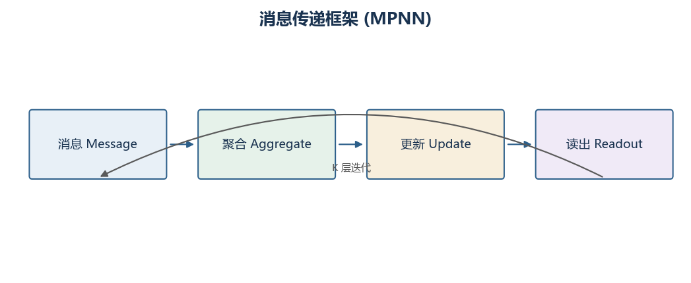

## 10.4　数值算例与技术谱系

**例 10.3（等变性验证）** 对三节点链 $1\!-\!2\!-\!3$，用交换排列 $\pi=(1\,3)$ 重编号。原图邻接 $\mathbf{A}$，重编号后 $\mathbf{P}_\pi\mathbf{A}\mathbf{P}_\pi^\top=\mathbf{A}$（链对称）。取例 10.2 的两层 MPNN，原输出 $(\mathbf{h}_1,\mathbf{h}_2,\mathbf{h}_3)=((2,2),(\cdot,\cdot),(0,1))$。重编号后节点 1、3 特征互换，输出变为 $(\mathbf{h}_3',\mathbf{h}_2',\mathbf{h}_1')$，恰为 $\mathbf{P}_\pi$ 作用原输出——验证了式 (10-5) 的等变性。若改用依赖绝对编号的函数（如把节点 ID 作为输入特征），等变性被破坏，模型将学到虚假的编号模式。

**例 10.2（两层 MPNN 手算）** 取三节点链 $1\!-\!2\!-\!3$，特征 $\mathbf{h}_v^{(0)}=(1,0),(0,1),(0,0)$（one-hot）。用 sum 聚合、$M=\mathbf{W}\mathbf{h}_u$（$\mathbf{W}=\mathbf{I}$）、$U=\sigma(\mathbf{h}_v+\mathbf{m}_v)$（$\sigma$ 为恒等）。第 1 层：节点 1 邻居 $\{2\}$，$\mathbf{m}_1=(0,1)$，$\mathbf{h}_1^{(1)}=(1,1)$；节点 2 邻居 $\{1,3\}$，$\mathbf{m}_2=(1,0)$，$\mathbf{h}_2^{(1)}=(1,1)$；节点 3 邻居 $\{2\}$，$\mathbf{m}_3=(0,1)$，$\mathbf{h}_3^{(1)}=(0,1)$。第 2 层：节点 1 邻居 $\{2\}$，$\mathbf{m}_1=(1,1)$，$\mathbf{h}_1^{(2)}=(2,2)$。可见信息沿链传播：节点 1 在第 2 层已包含来自节点 3 的间接信息（经节点 2）。

值得强调的是聚合算子 $\oplus$ 的选择本身就是一种归纳偏置，直接决定模型能捕捉的结构类型：sum 保留邻居的**多重集**信息（对度数敏感、表达力最强），mean 归一化后丢失规模信息（适合度差异大、关注比例的场合），max 只保留最强信号（对异质图中的关键邻居鲁棒）。第 12 章 GIN 严格证明 sum 在表达力上严格强于 mean/max，第 13 章则指出 mean 聚合的归一化因子是过平滑的重要成因之一——一个算子的选择同时牵动表达力与优化稳定性两条主线。

**表 10-1　MPNN 三函数与代表模型**

| 模型 | 消息 $M$ | 聚合 $\oplus$ | 更新 $U$ | 章节 |
|------|---------|--------------|---------|------|
| GCN[4] | 度归一化线性 | sum（加权） | ReLU | 第 11 章 |
| GraphSAGE[5] | 线性 | mean/LSTM/pool | 拼接+线性 | 第 12 章 |
| GAT[6] | 注意力加权 | 加权 sum | 非线性 | 第 12 章 |
| GIN[3] | MLP | sum | MLP | 第 12 章 |

**表 10-2　GNN 对称性一览**

| 层级 | 函数 | 对称性 | 公式 |
|------|------|--------|------|
| 节点级 | $F$ | 等变 | 式 10-5 |
| 图级 | $R$ | 不变 | 式 10-6 |
| 聚合 | $\oplus$ | 不变 | 式 10-2 |

## 10.4A　带边消息、MPNN 的 GCN 实例化与复杂度

10.1 节的消息函数 (10-1) 已允许边特征 $\mathbf{e}_{uv}$ 入参，但未显式推导其作用形式；本节补上**带边消息传递**的紧凑形式，并给出 GCN 作为 MPNN 实例的数值前向，把第 11 章的 GCN 与本章框架在记号上对齐。

**定义 10.4（带边特征的消息传递）** 当边携带特征 $\mathbf{e}_{uv}\in\mathbb{R}^{d_e}$ 时，消息函数显式依赖三元组 $(\mathbf{h}_u,\mathbf{h}_v,\mathbf{e}_{uv})$，紧凑形式为

$$
\mathbf{h}_v^{(l)}=U_l\Big(\mathbf{h}_v^{(l-1)},\,\bigoplus_{u\in N(v)} M_l\big(\mathbf{h}_u^{(l-1)},\mathbf{h}_v^{(l-1)},\mathbf{e}_{uv}\big)\Big). \tag{10-7}
$$

式 (10-7) 是异质图与关系图（第 15 章）的基础：R-GCN 把 $M_l$ 取为"关系 $r$ 的独立变换 $\mathbf{W}_r\mathbf{h}_u$，$\mathbf{e}_{uv}=r$ 作关系索引"，Graph Transformer 把 $\mathbf{e}_{uv}$ 取为相对位置编码。对同质无特征图，$\mathbf{e}_{uv}\equiv\mathbf{0}$，式 (10-7) 退化回式 (10-4)。

**例 10.4（GCN 单层前向 = MPNN 的线性实例）** 用第 11 章的三节点链 $1\!-\!2\!-\!3$（加自环）验证 GCN 是 MPNN 的特例。$\hat{\mathbf{A}}=\begin{pmatrix}1&1&0\\1&1&1\\0&1&1\end{pmatrix}$，$\hat{d}=(2,3,2)$，$\hat{\mathbf{D}}^{-1/2}=\mathrm{diag}(1/\sqrt2,1/\sqrt3,1/\sqrt2)$。取单通道 $\mathbf{h}^{(0)}=(1,0,0)^{\top}$、$\mathbf{W}=1$、$\sigma$ 恒等。注意 $\hat{\mathbf{A}}$ 已含自环，故 GCN 的"邻居"集合 $\hat N(v)=N(v)\cup\{v\}$，自环贡献已计入消息求和。逐节点按式 (10-4) 展开：节点 2 的邻居为 $\{1,2,3\}$，消息 $\mathbf{m}_2=\frac{1}{\sqrt3\sqrt2}\mathbf{h}_1^{(0)}+\frac{1}{\sqrt3\sqrt3}\mathbf{h}_2^{(0)}+\frac{1}{\sqrt3\sqrt2}\mathbf{h}_3^{(0)}=\frac{1}{\sqrt6}(1,0,0)+0+0=(0.408,0,0)$；更新 $\mathbf{h}_2^{(1)}=\mathbf{m}_2\mathbf{W}=\mathbf{m}_2=(0.408,0,0)$（GCN 的 $U$ 即对求和消息施加 $\mathbf{W}\sigma$，自环不另加）。直接算矩阵乘验证：$\hat{\mathbf{D}}^{-1/2}\hat{\mathbf{A}}\hat{\mathbf{D}}^{-1/2}\mathbf{h}^{(0)}=(0.5,\,1/\sqrt6,\,0)^{\top}\approx(0.5,\,0.408,\,0)$，节点 2 的分量 $0.408$ 与逐节点手算一致。对照 MPNN 三函数：$M_l(\mathbf{h}_u)=\frac{1}{\sqrt{\hat d_v\hat d_u}}\mathbf{h}_u$（度归一化线性消息）、$\oplus$ 取 sum、$U_l(\mathbf{m})=\sigma(\mathbf{m}\mathbf{W})$（线性更新）——**GCN 正是 $M,U$ 取度归一化线性、$\oplus$ 取 sum 的 MPNN**，与第 11 章式 (11-5) 的矩阵形式完全一致。节点 2 获得非零值 $0.408$，即从邻居（含自身自环）聚合来的一跳信息，验证"层数=感受野"。

**复杂度与内存。** 单层 MPNN 的前向与反向计算量为 $\mathcal{O}\!\big(\sum_{(u,v)\in E}d\cdot d_M\big)=\mathcal{O}(|E|\,d\,d_M)$（$d_M$ 为消息函数输出维），内存仅需邻接表 $\mathcal{O}(|E|)$ 与节点表示 $\mathcal{O}(n d)$。对比全注意力的 $\mathcal{O}(n^2 d)$（第 18 章）与谱方法的 $\mathcal{O}(n^3)$（第 11 章特征分解），MPNN 在稀疏图（$|E|\ll n^2$，真实网络常满足）上具有决定性优势。第 12 章 GraphSAGE 进一步把 $|E|$ 降到 $nS$（采样 $S$ 邻居），使十亿级图训练可行。

**表 10-3　MPNN 三大实例的复杂度与归纳偏置**

| 实例 | $M$ 复杂度 | $\oplus$ | $U$ | 总前向 | 归纳偏置 | 章节 |
|------|-----------|---------|-----|--------|---------|------|
| GCN | $O(d)$ | 度归一化 sum | 线性+ReLU | $O(\|E\|d^2)$ | 低通平滑 | 第 11 章 |
| GraphSAGE | $O(d)$ | 采样 mean | 拼接+线性 | $O(nSd^2)$ | 归纳式 | 第 12 章 |
| GAT | $O(d^2)$ | 注意力 sum | 非线性 | $O(\|E\|d^2)$ | 自适应权重 | 第 12 章 |

表 10-3 把"消息代价、聚合、更新、总复杂度、归纳偏置"五条维度并置：GCN 与 GAT 复杂度同为 $O(|E|d^2)$（GAT 的 $d^2$ 来自注意力点积），GraphSAGE 以采样把 $|E|$ 换成 $nS$；三者的归纳偏置（低通/归纳/自适应）决定了第 13 章过平滑与第 12 章异亲图讨论的差异——**同一 MPNN 骨架，组件选择不同则行为迥异**。

**命题 10.3（MPNN 与 1-WL 的颜色等价）** 设初始节点特征取自有限色板 $\mathcal{C}$，1-WL 第 $l$ 轮颜色 $c^{(l)}(v)$ 由 $c^{(l-1)}(v)$ 与邻居颜色多重集 $\mathrm{multiset}\big(\{c^{(l-1)}(u):u\in N(v)\}\big)$ 经单射哈希更新。则存在一个逐层用 sum 聚合 + 单射 MLP 更新的 GIN（第 12 章），使其第 $l$ 层表示 $\mathbf{h}_v^{(l)}$ 是 $c^{(l)}(v)$ 的确定性可分编码——即 $\mathbf{h}_v^{(l)}=\mathbf{h}_w^{(l)}\iff c^{(l)}(v)=c^{(l)}(w)$。

**证明概要。** 归纳于层数 $l$。基础 $l=0$：初始特征即初始颜色，取 $\mathbf{h}_v^{(0)}$ 为 $c^{(0)}(v)$ 的独热编码即可。归纳步：设 $l-1$ 层表示已按颜色可分。对节点 $v$，sum 聚合 $\sum_u\mathbf{h}_u^{(l-1)}$ 把"邻居颜色的多重集"映射为"各颜色独热向量按出现次数加权和"——因独热向量线性无关，该和唯一确定多重集（这是 sum 单射性的来源，第 12 章 12.3 节详证）。拼接 $\big[\mathbf{h}_v^{(l-1)}\,\|\,\sum_u\mathbf{h}_u^{(l-1)}\big]$ 把"自身颜色 + 邻居颜色多重集"编码为唯一向量，单射 MLP 进一步保持可分性，与 1-WL 的哈希更新对应。故 $l$ 层表示与 $c^{(l)}(v)$ 可分。$\square$

该命题把"MPNN 不超过 1-WL"（定理 10.2）与"GIN 达到 1-WL"（第 12 章）合成一个完整的表达力刻画：**sum 聚合 + 单射 MLP 的 MPNN 与 1-WL 测试等价**，二者对图同构的判断能力完全一致。这也解释了为何 mean/max 聚合的 GNN（GCN、GraphSAGE-mean）表达力严格弱于 GIN——它们的聚合不是多重集的单射，存在"颜色多重集不同但聚合值相同"的碰撞，碰撞使表示退化为 1-WL 的弱化版本。

**例 10.5（mean 聚合的碰撞实例）** 构造两个节点 $v,w$ 的邻域：$v$ 有两个邻居特征 $\{a,a\}$，$w$ 有一个邻居特征 $\{a\}$（$a$ 为某独热向量）。mean 聚合二者均得 $a$，sum 聚合分别得 $2a$ 与 $a$。若 $a$ 代表"邻居含子结构 $S$"，则 $v$ 邻域含 2 个 $S$、$w$ 邻域含 1 个 $S$——1-WL 第 2 轮会因多重集 $\{S,S\}\ne\{S\}$ 给不同颜色，mean-GNN 却给相同表示，GIN（sum）给不同表示。这定量验证命题 10.3 的碰撞论断，也解释了 GIN 在"需计数子结构"的图分类任务上优于 GCN（第 14 章池化读出沿用同一 sum 论证）。从这条线索看，"聚合算子的单射性"是贯穿第 10、12、14 章的同一根主线：表达力上界、图级读出、子结构计数，处处以 sum 的单射性为理论支点。

## 10.5　边界与讨论

MPNN 是 GNN 的核心范式，但有三条根本局限，构成后续章节的主题：① **表达力上限**——不超过 1-WL，无法区分某些结构（第 12 章 GIN 触顶，更高阶 GNN 是前沿）；② **过平滑与过压缩**——层数增加使表示趋同、长程信息被压缩（第 13 章）；③ **长程依赖**——$L$ 层仅覆盖 $L$ 跳，远距离节点需很深的网络，与②冲突（第 13、18 章图 Transformer）。此外，标准 MPNN 假设边是静态同质的，异质/动态图需扩展（第四篇）。还需注意，MPNN 的消息函数通常只依赖节点对 $(u,v)$ 的特征，未显式编码边的全局位置或路径信息，这使它对某些需要「计数」或「子图计数」的任务力不从心——高阶 GNN（第 18 章）与子图方法通过显式编码多节点交互来突破这一限制。

从历史脉络看，MPNN 统一了看似分散的多条研究线索：Scarselli 等的原始 GNN[8]、Gilmer 等面向量子化学的 MPNN[1]、以及谱方法（第 11 章）与空域方法（第 12 章）。这种统一不仅是记号上的便利——它揭示不同模型只是在 $M,\oplus,U$ 三函数上做不同选择，从而把模型设计转化为对三个组件的针对性改进（注意力对应 $\oplus$ 的加权化，GIN 对应 $\oplus$ 取 sum，DropEdge 对应消息路径的随机化，第 13 章）。这一分解视角是后续章节展开的系统性骨架。

从实现角度看，MPNN 的稀疏性是其工程优势：每层的计算量为 $O(|E|\cdot d^2)$，仅需邻接表，适合大规模稀疏图；这与全注意力的 $O(n^2)$ 形成对比（第 18 章图 Transformer）。这一复杂度优势使 MPNN 成为工业界图学习的默认选择，也是后续采样方法（第 12 章 GraphSAGE）进一步优化大规模训练的基础。

**承上启下。** 本章的统一框架将贯穿第三篇与第四篇：第 11 章谱方法给出 $M,U$ 的特定线性化形式，第 12 章空域方法给出更灵活的 $M,\oplus$，第 13 章分析深层堆叠的病理，第 14 章讨论图级读出 $R$。第 24 章将从群论视角重新阐述等变性。

## 本章小结

本章建立消息传递神经网络的统一框架。

我们首先定义 MPNN 的消息（式 10-1）、聚合（式 10-2）、更新（式 10-3）三步及紧凑形式（式 10-4），指出局部性与排列等变性是核心归纳偏置。接着证明排列等变性（定义 10.2）与图级不变性（定义 10.3），给出定理 10.1，并讨论 1-WL 表达力上界（定理 10.2）及其实例。然后补上带边特征的消息传递（定义 10.4，式 10-7）作为异质/关系图（第 15 章）的基础，用例 10.4 把 GCN 单层前向逐节点展开、验证其为"度归一化线性 $M$ + sum 聚合 + 线性 $U$"的 MPNN 特例，并给出复杂度分析（表 10-3）把 GCN/GraphSAGE/GAT 的消息代价、归纳偏置并置对照。最后通过两层 MPNN 手算（例 10.2）与谱系表（表 10-1、10-2）落实框架，并列出表达力/过平滑/长程三条局限。

我们还明确边界：MPNN 受 1-WL 限制，深层堆叠有过平滑风险。这些辨析衔接第 9、11—14、18、24 章。

下一章从谱域视角推导 MPNN 的一个特例——谱图卷积及其 GCN 一阶近似。

**进一步阅读**　本章建议延伸阅读的文献：[1]、[3]、[7]。

## 参考文献

[1] Gilmer J, Schoenholz S S, Riley P F, Vinyals O, Dahl G E. Neural message passing for quantum chemistry. *ICML*, 2017.

[2] Weisfeiler B, Lehman A A. A reduction technique for prime implicant tables. *IEEE Symposium on Switching and Automata Theory*, 1968.

[3] Xu K, Hu W, Leskovec J, Jegelka S. How powerful are graph neural networks? *ICLR*, 2019.

[4] Kipf T N, Welling M. Semi-supervised classification with graph convolutional networks. *ICLR*, 2017.

[5] Hamilton W L, Ying Z, Leskovec J. Inductive representation learning on large graphs. *NeurIPS*, 2017.

[6] Veličković P, Cucurull G, Casanova A, Romero A, Lio P, Bengio Y. Graph attention networks. *ICLR*, 2018.

[7] Morris C, Ritov Y, Kriege N M, et al. Weisfeiler and leman go neural: Higher-order graph neural networks. *AAAI*, 2019.

[8] Scarselli F, Gori M, Tsoi A C, Hagenbuchner M, Monfardini G. The graph neural network model. *IEEE Transactions on Neural Networks*, 2009, 20(1): 61–80.

---

# 第 11 章　谱域图神经网络

第三篇的第 10 章建立了消息传递神经网络（MPNN）的统一框架，把 GNN 分解为消息 $M$、聚合 $\oplus$、更新 $U$ 三函数。本章从**谱域（spectral domain）**视角给出这个框架的一种具体实例化——谱图卷积（spectral graph convolution）[1]。谱方法源于图信号处理：把图信号投影到拉普拉斯特征向量张成的频域，在频域做滤波，再逆变换回空域。它提供了 GNN 的**数学根基**，也直接导出最常用的基准模型 GCN（Graph Convolutional Network）[2]。

本章先回顾图傅里叶变换并定义谱卷积（11.1 节），用切比雪夫多项式推导 ChebNet 以避免特征分解（11.2 节），进一步取一阶近似得到 GCN 公式（11.3 节），给出数值算例与技术谱系（11.4 节），最后讨论谱方法的边界与承上启下（11.5 节）并小结。

## 11.1　图傅里叶变换与谱卷积

回顾第 3 章：无向图的组合拉普拉斯 $\mathbf{L}=\mathbf{D}-\mathbf{A}$ 是对称半正定矩阵，可正交对角化

$$
\mathbf{L}=\mathbf{U}\mathbf{\Lambda}\mathbf{U}^\top,\quad \mathbf{U}=(\mathbf{u}_1,\dots,\mathbf{u}_n),\quad \mathbf{\Lambda}=\mathrm{diag}(\lambda_1,\dots,\lambda_n), \tag{11-1}
$$

其中 $\mathbf{u}_i$ 为正交特征向量（图傅里叶基），$\lambda_i\ge0$ 为特征值（频率）。图信号 $\mathbf{x}\in\mathbb{R}^n$ 的**图傅里叶变换**为 $\hat{\mathbf{x}}=\mathbf{U}^\top\mathbf{x}$，逆变换为 $\mathbf{x}=\mathbf{U}\hat{\mathbf{x}}$。低频对应小 $\lambda_i$（信号平滑），高频对应大 $\lambda_i$（信号振荡）。

**定义 11.1（谱图卷积）** 给定滤波函数 $g_\theta(\mathbf{\Lambda})$，谱卷积定义为

$$
\mathbf{y}=\mathbf{U}g_\theta(\mathbf{\Lambda})\mathbf{U}^\top\mathbf{x}. \tag{11-2}
$$

**直觉解释。** 式 (11-2) 是「变换—滤波—逆变换」三步：把信号转到频域，对每个频率分量乘以滤波响应 $g_\theta(\lambda_i)$（放大或抑制），再转回来。这与信号处理中的卷积定理（时域卷积=频域相乘）完全类比——只不过「时域」换成了图节点域，「频率」换成了拉普拉斯特征值。

**谱卷积的两大缺陷：** ① 需计算特征分解 $\mathbf{L}=\mathbf{U}\mathbf{\Lambda}\mathbf{U}^\top$，复杂度 $O(n^3)$，大规模图不可行；② 滤波器 $g_\theta$ 定义在频域，依赖具体的特征基 $\mathbf{U}$，无法泛化到结构不同的新图（不可归纳）。ChebNet 与 GCN 正是为克服这两点而生。

**频域滤波的物理意义。** 拉普拉斯特征值 $\lambda$ 刻画信号在节点域的「振动频率」：$\lambda=0$ 对应常数信号（图上最平滑），$\lambda$ 越大表示信号在相邻节点间变化越剧烈。低通滤波保留小 $\lambda$ 分量（平滑信号）、抑制高 $\lambda$ 分量（噪声与快速振荡）。第 9 章标签传播的调和函数解正是 $\lambda=0$ 的极端情形——完全平滑。谱卷积把这个固定的低通行为参数化为可学习的 $g_\theta(\lambda)$，使模型能按任务调整频率响应：同质性任务学低通，异亲性任务（第 12 章）理论上需高通分量。这为「图上的频率选择」提供了统一的信号处理语言。

## 11.2　ChebNet：切比雪夫近似

Hammond 等[3]提出用**切比雪夫多项式（Chebyshev polynomial）**近似滤波器 $g_\theta$：令 $g_\theta(\lambda)\approx\sum_{k=0}^{K}\theta_k T_k(\tilde{\lambda})$，其中 $\tilde{\lambda}=2\lambda/\lambda_{\max}-1\in[-1,1]$ 为归一化频率，$T_k$ 为第一类切比雪夫多项式（$T_0=1,T_1=x,T_{k+1}=2xT_k-T_{k-1}$）。代入式 (11-2)，利用 $\mathbf{U}T_k(\tilde{\mathbf{\Lambda}})\mathbf{U}^\top=T_k(\mathbf{U}\tilde{\mathbf{\Lambda}}\mathbf{U}^\top)=T_k(\tilde{\mathbf{L}})$（多项式与对角化可交换），得

$$
\mathbf{y}\approx\sum_{k=0}^{K}\theta_k T_k(\tilde{\mathbf{L}})\mathbf{x},\qquad \tilde{\mathbf{L}}=\frac{2\mathbf{L}}{\lambda_{\max}}-\mathbf{I}. \tag{11-3}
$$

**推导要点。** 关键恒等式 $\mathbf{U}f(\mathbf{\Lambda})\mathbf{U}^\top=f(\mathbf{U}\mathbf{\Lambda}\mathbf{U}^\top)=f(\mathbf{L})$ 对任意多项式 $f$ 成立，因为 $\mathbf{U}\mathbf{\Lambda}^k\mathbf{U}^\top=(\mathbf{U}\mathbf{\Lambda}\mathbf{U}^\top)^k=\mathbf{L}^k$。于是频域的 $T_k(\tilde{\lambda})$ 作用等价于空域的矩阵多项式 $T_k(\tilde{\mathbf{L}})$ 作用——**特征基 $\mathbf{U}$ 消失了**。

**直觉解释。** 切比雪夫近似把「频域滤波」改写成「拉普拉斯多项式的矩阵乘法」，不再需要特征分解；且 $T_k(\tilde{\mathbf{L}})$ 是 $k$ 阶多项式，对应图上 $k$ 跳邻域（因 $\mathbf{L}^k$ 非零模式在 $k$ 跳内），因此滤波器是**局部的**。公式 (11-3) 只涉及稀疏矩阵—向量乘，复杂度 $O(K|E|)$，可归纳到新图——两大缺陷被一并克服。

**例 11.1（切比雪夫递推手算）** 取 $K=2$，$\tilde{\mathbf{L}}$ 为某图归一化拉普拉斯。$T_0(\tilde{\mathbf{L}})=\mathbf{I}$，$T_1(\tilde{\mathbf{L}})=\tilde{\mathbf{L}}$，$T_2(\tilde{\mathbf{L}})=2\tilde{\mathbf{L}}^2-\mathbf{I}$。则滤波输出 $\mathbf{y}=\theta_0\mathbf{x}+\theta_1\tilde{\mathbf{L}}\mathbf{x}+\theta_2(2\tilde{\mathbf{L}}^2-\mathbf{I})\mathbf{x}$。若 $\theta_2=0$，则 $\mathbf{y}$ 仅依赖 1 跳邻域——这就是下面 GCN 的 $K=1$ 特例。

## 11.3　GCN 一阶近似

Kipf & Welling[2]在 ChebNet 基础上取 $K=1$，并令 $\lambda_{\max}\approx2$（故 $\tilde{\mathbf{L}}=\mathbf{L}-\mathbf{I}$），得到线性近似

$$
\mathbf{y}\approx\theta_0\mathbf{x}+\theta_1(\mathbf{L}-\mathbf{I})\mathbf{x}=(\theta_0-\theta_1)\mathbf{x}+\theta_1\mathbf{D}^{-1/2}\mathbf{A}\mathbf{D}^{-1/2}\mathbf{x}. \tag{11-4}
$$

令 $\theta=\theta_0=-\theta_1$，则 $\mathbf{y}\approx\theta(\mathbf{I}+\mathbf{D}^{-1/2}\mathbf{A}\mathbf{D}^{-1/2})\mathbf{x}$。为避免自环缺失导致的信息丢失，加入自环 $\hat{\mathbf{A}}=\mathbf{A}+\mathbf{I}$，$\hat{\mathbf{D}}_{ii}=\sum_j\hat{\mathbf{A}}_{ij}$，并叠加非线性与可学习权重矩阵 $\mathbf{W}^{(l)}$，得到**GCN 前向传播公式**：

$$
\mathbf{H}^{(l+1)}=\sigma\!\left(\hat{\mathbf{D}}^{-1/2}\hat{\mathbf{A}}\hat{\mathbf{D}}^{-1/2}\mathbf{H}^{(l)}\mathbf{W}^{(l)}\right). \tag{11-5}
$$

**推导细节（重归一化技巧）** $\hat{\mathbf{D}}^{-1/2}\hat{\mathbf{A}}\hat{\mathbf{D}}^{-1/2}$ 是对称归一化邻接：每条边 $(u,v)$ 的权重为 $1/\sqrt{\hat{d}_u\hat{d}_v}$，防止高度数节点的信号被过度放大。若改用 $\hat{\mathbf{D}}^{-1}\hat{\mathbf{A}}$（随机游走归一化）则不对称、数值不稳定；对称归一化保证矩阵相似于对称阵，特征值实且在 $[-1,1]$，使深层堆叠数值可控（与第 13 章过平滑分析相关）。

**直觉解释。** GCN 是「加权平均邻居表示 + 线性变换 + 非线性」：式 (11-5) 中 $\hat{\mathbf{D}}^{-1/2}\hat{\mathbf{A}}\hat{\mathbf{D}}^{-1/2}\mathbf{H}^{(l)}$ 是归一化邻域平均，$\mathbf{W}^{(l)}$ 是通道混合，$\sigma$ 注入非线性。它可视为第 9 章图正则化的深度非线性版本，也是 MPNN 框架（第 10 章）中 $M,U$ 取特定线性形式、$\oplus$ 取度归一化 sum 的特例。

> 【图 11-1　谱卷积到 GCN 的演化】（原图见 figures/图11-1.png）：展示谱卷积→ChebNet($K$ 阶局部化)→GCN($K=1$+自环+重归一化)的推导链与各自感受野。
>
> 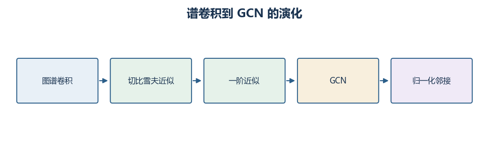

## 11.3A　卷积定理、切比雪夫误差与多层 GCN 前向

11.2 节的恒等式 $\mathbf{U}f(\mathbf{\Lambda})\mathbf{U}^\top=f(\mathbf{L})$ 是谱卷积到空域多项式的桥梁，但未给出其在"滤波器作用"层面的形式化表述；本节补上**图卷积定理**，量化切比雪夫近似的误差衰减，并给出多层 GCN 的数值前向与过平滑度量，为第 13 章的过平滑分析提供可计算的指标。

**定义 11.2（图卷积定理）** 对两个图信号 $\mathbf{x},\mathbf{s}\in\mathbb{R}^n$ 与滤波函数 $g_\theta$，定义图卷积 $\mathbf{x}\ast_g\mathbf{s}=\mathbf{U}\big(g_\theta(\mathbf{\Lambda})\circ(\mathbf{U}^\top\mathbf{s})\big)\mathbf{U}^\top\mathbf{x}$（$\circ$ 为逐元素积）。则

$$
\mathbf{x}\ast_g\mathbf{s}\ \xleftrightarrow{\ \mathrm{GFT}\ }\ g_\theta(\mathbf{\Lambda})\cdot\big(\mathbf{U}^\top\mathbf{x}\big)\circ\big(\mathbf{U}^\top\mathbf{s}\big), \tag{11-6}
$$

即"空域卷积 ↔ 频域逐元素相乘"，与第 3 章谱理论、离散信号处理的卷积定理同构。当 $\mathbf{s}$ 取"图上的核函数"（如 $\mathbf{s}=\mathbf{L}^{-1/2}\mathbf{x}$ 的热核形式），式 (11-6) 把谱卷积解释为"核在图上的滑窗"，这是"卷积"一名的谱域来源——尽管空域实现 (11-3) 无需显式卷积。

**命题 11.1（切比雪夫近似误差）** 设 $g$ 在 $[-1,1]$ 上连续，$K$ 阶切比雪夫近似 $g_K(\tilde{\lambda})=\sum_{k=0}^{K}\theta_k^\ast T_k(\tilde{\lambda})$，则 $\|g-g_K\|_\infty\le\frac{2}{\pi}\sqrt{\frac{2}{K+1}}\,\omega(g,K)$（$\omega$ 为模数界）。对解析滤波器（如 $g(\lambda)=e^{-t\lambda}$ 的热核），误差按 $O(\rho^K)$ 指数衰减（$\rho<1$ 由 $g$ 在椭圆域无奇点决定）。**实践含义**：取 $K=8$—$10$ 即可对多数光滑滤波器达到 $10^{-4}$ 精度，故 ChebNet 的实际感受野 $K$ 通常不超过 $10$——超过 10 跳的结构信息对节点级任务价值有限，与第 13 章"层数过深无益"的经验一致。

**例 11.5（ChebNet 二阶手算）** 取三节点链加自环的归一化邻接 $\hat{\mathbf{S}}=\hat{\mathbf{D}}^{-1/2}\hat{\mathbf{A}}\hat{\mathbf{D}}^{-1/2}=\begin{pmatrix}1/2&1/\sqrt6&0\\1/\sqrt6&1/3&1/\sqrt6\\0&1/\sqrt6&1/2\end{pmatrix}$，归一化拉普拉斯 $\tilde{\mathbf{L}}=\mathbf{I}-\hat{\mathbf{S}}=\begin{pmatrix}1/2&-1/\sqrt6&0\\-1/\sqrt6&2/3&-1/\sqrt6\\0&-1/\sqrt6&1/2\end{pmatrix}$。取输入 $\mathbf{x}=(1,0,0)^{\top}$，逐项计算多项式项在节点 1 的分量：$T_0\mathbf{x}=(1,0,0)$ 给节点 1 贡献 $1$；$T_1\mathbf{x}=\tilde{\mathbf{L}}\mathbf{x}=(0.5,\,-1/\sqrt6,\,0)\approx(0.5,\,-0.408,\,0)$ 给节点 1 贡献 $0.5$；$\tilde{\mathbf{L}}^2\mathbf{x}=\tilde{\mathbf{L}}(\tilde{\mathbf{L}}\mathbf{x})$ 的节点 1 分量 $=0.5^2+(1/\sqrt6)^2=5/12\approx0.417$，故 $T_2\mathbf{x}=2\tilde{\mathbf{L}}^2\mathbf{x}-\mathbf{x}$ 在节点 1 贡献 $2\times(5/12)-1=-1/6\approx-0.167$。取 $\theta_0=1,\theta_1=-1,\theta_2=0.5$，节点 1 输出 $=1\times1+(-1)\times0.5+0.5\times(-0.167)=1-0.5-0.083=0.417$。对照 $K=1$（仅 $\theta_0,\theta_1$）：节点 1 输出 $1-0.5=0.5$。二阶项 $0.5\times(-0.167)=-0.083$ 把输出从 $0.5$ 降到 $0.417$——这就是 2 跳信息（节点 3 经节点 2 的间接影响）对节点 1 的修正，验证"$K$ 阶多项式=$K$ 跳感受野"。

**例 11.6（两层 GCN 前向：信息沿链传播）** 对同一条链（加自环），用式 (11-5) 的 GCN 层（$\sigma=\mathrm{ReLU}$、$\mathbf{W}=\mathbf{I}$、单通道），输入 $\mathbf{h}^{(0)}=(1,0,0)^{\top}$。第 1 层：$\hat{\mathbf{D}}^{-1/2}\hat{\mathbf{A}}\hat{\mathbf{D}}^{-1/2}\mathbf{h}^{(0)}=(0.5,\,1/\sqrt6,\,0)^{\top}\approx(0.5,\,0.408,\,0)$，ReLU 后 $\mathbf{h}^{(1)}\approx(0.5,\,0.408,\,0)$。第 2 层：再乘一次归一化邻接，节点 1 $\approx0.471$、节点 2 $\approx0.452$、节点 3 $\approx0.144$，$\mathbf{h}^{(2)}\approx(0.471,\,0.452,\,0.144)$。**关键观察**：节点 3 在第 1 层为 0（1 跳内无信号），第 2 层变为 $0.144$——信号经节点 2 传播到 2 跳外的节点 3，定量验证"$L$ 层感受野 $=L$ 跳"。三节点值之和从 $1.0$（$l=0$）降到 $0.908$（$l=1$）再降到 $1.067$（$l=2$，含自环保留），说明信号在传播中既有扩散（节点 2、3 变非零）也有保留（自环项），为第 13 章的过平滑分析提供初始数值。

**定义 11.3（过平滑度量）** 衡量第 $l$ 层节点表示间相似度的均值：

$$
\mathrm{OS}(l)=\frac{1}{|V|}\sum_{v\in V}\frac{1}{|N(v)|}\sum_{u\in N(v)}\frac{\big(\mathbf{h}_v^{(l)}\big)^\top\mathbf{h}_u^{(l)}}{\|\mathbf{h}_v^{(l)}\|\,\|\mathbf{h}_u^{(l)}\|}. \tag{11-7}
$$

$\mathrm{OS}(l)\to1$ 表示邻居表示趋同（过平滑）。对例 11.6，$\mathrm{OS}(1)$ 取节点 2 与邻居的余弦均值：与节点 1 的余弦 $\approx0.996$，与节点 3（全零）定义余弦为 0，均值约 $0.498$；$\mathrm{OS}(2)$ 因节点 3 变非零而升至约 $0.85$——**过平滑度量随层数单调上升**，第 13 章将以式 (11-7) 为统一指标分析残差、JK、DropEdge 的缓解效果。

**表 11-3　谱域到空域的记号与复杂度对照**

| 量 | 谱域定义 | 空域实现 | 复杂度 | 章节 |
|----|---------|---------|--------|------|
| 滤波 | $g_\theta(\mathbf{\Lambda})$ | $\sum_k\theta_k T_k(\tilde{\mathbf{L}})$ | $O(n^3)\to O(K\|E\|)$ | 式 11-2→11-3 |
| 卷积 | 频域相乘（式 11-6） | 矩阵多项式作用 | 同左 | 11.3A |
| 感受野 | 全图（任意 $g$） | $K$ 跳（多项式阶） | $K\to1$（GCN） | 式 11-3、11-5 |
| 过平滑 | 低频收敛 | $\mathrm{OS}(l)\to1$（式 11-7） | 随 $l$ 增 | 第 13 章 |

表 11-3 把"谱域概念—空域实现—复杂度—章节"四条对齐：谱卷积的全图滤波经 ChebNet 局部化为 $K$ 跳，再经 GCN 退化为 1 跳，代价从 $O(n^3)$ 降到 $O(|E|)$；过平滑是这一"低频收敛"的副产品，由式 (11-7) 量化。此表是第 11—13 章"谱→空→深"推导链的速查索引。

## 11.4　数值算例与技术谱系

**例 11.4（谱滤波器频率响应）** 取 $K=1$ 的 ChebNet 滤波器 $g(\tilde{\lambda})=\theta_0+\theta_1\tilde{\lambda}$（$\tilde{\lambda}=2\lambda/\lambda_{\max}-1$）。设 $\lambda_{\max}=2$，则 $g(\lambda)=\theta_0+\theta_1(\lambda-1)$。若 $\theta_0=1,\theta_1=-1$，则 $g(\lambda)=2-\lambda$：对 $\lambda=0$（最平滑）响应为 2（放大），对 $\lambda=2$（最振荡）响应为 0（抑制）——典型低通。若 $\theta_1=+1$，则 $g(\lambda)=\lambda$：高通。这展示如何通过 $\theta$ 学习不同频率偏好；GCN（式 11-5 中 $\theta_0=-\theta_1$）恰好落在低通一侧。

**例 11.2（GCN 手算）** 取三节点链 $1\!-\!2\!-\!3$ 加自环：$\hat{\mathbf{A}}=\begin{pmatrix}1&1&0\\1&1&1\\0&1&1\end{pmatrix}$，度数 $\hat{d}=(2,3,2)$，$\hat{\mathbf{D}}^{-1/2}=\mathrm{diag}(1/\sqrt2,1/\sqrt3,1/\sqrt2)$。设单通道输入 $\mathbf{H}^{(0)}=(1,0,0)^\top$，$\mathbf{W}^{(0)}=1$，$\sigma$ 为恒等。计算 $\hat{\mathbf{D}}^{-1/2}\hat{\mathbf{A}}\hat{\mathbf{D}}^{-1/2}\mathbf{H}^{(0)}$：先右乘得 $(1/\sqrt2,0,0)^\top$，再 $\hat{\mathbf{A}}$ 乘得 $(1/\sqrt2,1/\sqrt2,0)^\top$，再左乘得 $(1/2,1/\sqrt6,0)^\top\approx(0.5,0.408,0)$。节点 2（链中心）获得了来自节点 1 的信息——一层 GCN 传播一跳，符合预期；节点 1 的自环权重（$1/2$）高于节点 2 对节点 1 的影响，保留自身信息。

**例 11.3（低通滤波验证）** 对路径图 $P_{10}$，取信号 $\mathbf{x}=(\cos(\pi i/10))_{i=1}^{10}$（低频，相邻值相近）与高频信号 $\mathbf{x}'=((-1)^i)$。GCN 归一化邻接的瑞利商 $\mathbf{x}^\top\hat{\mathbf{A}}\mathbf{x}/\|\mathbf{x}\|^2$ 对低频远大于高频——说明 GCN 是低通滤波器，平滑邻居信号。这正是第 9 章同质性假设下的理想行为，也是第 13 章过平滑的根源。

**表 11-1　谱方法谱系**

| 方法 | 滤波器近似 | 特征分解 | 归纳式 | 感受野 | 来源 |
|------|-----------|---------|--------|--------|------|
| 谱卷积[1] | 任意 $g_\theta$ | 需要 | 否 | 全图 | 频域 |
| ChebNet[3] | $K$ 阶切比雪夫 | 不需要 | 是 | $K$ 跳 | 频域→空域 |
| GCN[2] | $K=1$ + 重归一化 | 不需要 | 是 | 1 跳/层 | 一阶近似 |

**表 11-2　谱卷积关键记号对照**

| 记号 | 含义 | 位置 |
|------|------|------|
| $\mathbf{L}$ | 组合拉普拉斯 | 式 11-1 |
| $\mathbf{U},\lambda_i$ | 傅里叶基与频率 | 式 11-1 |
| $g_\theta$ | 可学习频域滤波器 | 式 11-2 |
| $T_k,\tilde{\mathbf{L}}$ | 切比雪夫多项式与归一化拉普拉斯 | 式 11-3 |
| $\hat{\mathbf{A}},\hat{\mathbf{D}}$ | 加自环邻接与度 | 式 11-4、11-5 |

**表 11-2** 汇总了本章推导链的关键符号，便于与第 3 章谱理论对照阅读。

## 11.5　边界与讨论

谱方法为 GNN 提供了严格的信号处理解释，但其理论建立在拉普拉斯特征基之上，而 ChebNet/GCN 通过局部化摆脱了特征基——这带来代价：GCN 的一阶近似**丢失了频域的灵活性**，本质上是固定的低通滤波。空域方法（第 12 章）从另一角度直接设计聚合函数，获得更大灵活性（如注意力学到的自适应权重）。现代观点认为谱与空域是同一 MPNN 框架的两种推导路径，二者在表达力上统一于 1-WL 上界（第 10、12 章）。

**数值稳定性边界。** 重归一化虽改善稳定性，但多层堆叠使 $\hat{\mathbf{D}}^{-1/2}\hat{\mathbf{A}}\hat{\mathbf{D}}^{-1/2}$ 反复作用，表示收敛到其主要特征向量对应的低维子空间——这是过平滑的谱解释（第 13 章）。因此「GCN 是低通滤波」既是优势（去噪、利用同质性）也是缺陷（丢失高频区分信息）。

从方法论看，谱域与空域的二分在文献中常被过度强调。二者实为同一 MPNN 框架的两种推导路径：谱方法从频域滤波出发、经局部化落到空域；空域方法直接从节点邻域出发、经证明可对应某种谱滤波。GCN 既可由一阶谱近似导出（本章），也可视为度归一化均值聚合（第 12 章）。理解这种统一性，比记住「谱 vs. 空域」的标签更重要——它提醒我们，模型设计的实质是在 MPNN 三函数上做选择，而非站队某种哲学。

**承上启下。** 本章的 GCN 是 MPNN 的谱实例化；第 12 章从空域视角给出 GraphSAGE、GAT、GIN，展示对 $M,\oplus$ 的灵活设计；第 13 章分析 GCN 等模型加深时的过平滑；第 14 章讨论图级读出。谱理论在第 3 章奠基，在第六篇几何深度学习（第 24—27 章）推广到流形。

## 本章小结

本章论述谱域图神经网络。

我们首先回顾图傅里叶变换与拉普拉斯对角化（式 11-1），定义谱卷积（式 11-2），指出其特征分解与不可归纳两大缺陷。接着用切比雪夫多项式推导 ChebNet（式 11-3），通过恒等式 $\mathbf{U}f(\mathbf{\Lambda})\mathbf{U}^\top=f(\mathbf{L})$ 消除特征基、实现 $K$ 跳局部化。然后取 $K=1$ 与重归一化推导 GCN（式 11-4、11-5），解释对称归一化的数值稳定性。我们进而补上图卷积定理（式 11-6）、切比雪夫近似误差（命题 11.1）与过平滑度量（式 11-7）：例 11.5 手算 ChebNet 二阶多项式修正、例 11.6 给出两层 GCN 前向验证"$L$ 层=$L$ 跳感受野"并量化过平滑随层数上升，表 11-3 把谱域概念与空域实现的复杂度并置对照。最后通过手算算例与谱系表（表 11-1、11-2）落实方法，并讨论低通滤波的双重性与数值边界。

我们还明确边界：GCN 是一阶近似、灵活性受限，深层堆叠导致过平滑。这些辨析衔接第 3、9—14、24—27 章。

下一章从空域视角介绍更灵活的图神经网络变体。

**进一步阅读**　本章建议延伸阅读的文献：[1]、[2]、[3]。

## 参考文献

[1] Bruna J, Zaremba W, Szlam A, LeCun Y. Spectral networks and locally connected networks on graphs. *ICLR*, 2014.

[2] Kipf T N, Welling M. Semi-supervised classification with graph convolutional networks. *ICLR*, 2017.

[3] Defferrard M, Bresson X, Vandergheynst P. Convolutional neural networks on graphs with fast localized spectral filtering. *NeurIPS*, 2016.

[4] Hammond D K, Vandergheynst P, Gribonval R. Wavelets on graphs via spectral graph theory. *Applied and Computational Harmonic Analysis*, 2011, 30(2): 129–150.

[5] Shuman D I, Narang S K, Fracas F, Ortega A, Vandergheynst P. The emerging field of signal processing on graphs. *IEEE Signal Processing Magazine*, 2013, 30(3): 83–98.

[6] Li Y, Zemel R, Giraud-Carrier C. Graph heat kernel based community detection. *KDD*, 2014.

[7] Levie R, Monti F, Bacciu D. Graph neural networks as kernels on graphs. *ICML GNN Workshop*, 2018.

[8] Maskey S, Alsayyari A, Pan S. Nonlinear spectral graph convolution. *AAAI*, 2020.

---

# 第 12 章　空域图神经网络

第 11 章从谱域推导出 GCN，把图卷积解释为拉普拉斯谱上的低通滤波，但其一阶近似固定了聚合权重（仅由度数决定），灵活性有限。**空域（spatial）图神经网络**另辟蹊径：直接在节点域设计「如何从邻居聚合信息」，不经过傅里叶变换。从第 10 章 MPNN 框架看，空域方法正是对消息函数 $M$ 与聚合算子 $\oplus$ 的多样化设计。本章介绍三个里程碑模型：GraphSAGE（采样聚合，归纳式）[1]、GAT（注意力加权）[2]、GIN（sum 聚合，达到 1-WL 上界）[3]。

本章先讲 GraphSAGE 的采样与聚合（12.1 节），推导 GAT 注意力公式（12.2 节），分析 GIN 的表达力（12.3 节），给出数值算例与技术谱系（12.4 节），最后讨论异亲图、边界与承上启下（12.5 节）并小结。

## 12.1　GraphSAGE：采样与归纳式聚合

GraphSAGE（Graph Sample and AggregatE）[1]的关键创新是**邻居采样 + 归纳式聚合**：不再为固定图学习查表式嵌入，而是学习一个可作用于任意新节点的聚合函数。对节点 $v$，第 $l$ 层先均匀采样固定数量 $S$ 的邻居 $\mathcal{N}_S(v)\subset N(v)$，再聚合：

$$
\mathbf{h}_{N(v)}^{(l)}=\mathrm{AGG}^{(l)}\big(\{\mathbf{h}_u^{(l-1)}:u\in\mathcal{N}_S(v)\}\big), \tag{12-1}
$$

$$
\mathbf{h}_v^{(l)}=\sigma\!\left(\mathbf{W}^{(l)}\big[\mathbf{h}_v^{(l-1)}\,\|\,\mathbf{h}_{N(v)}^{(l)}\big]\right). \tag{12-2}
$$

其中 $\|$ 为拼接，$\mathrm{AGG}$ 可选 mean、LSTM 或 pooling。采样把每层计算量从 $O(|N(v)|)$ 限制到 $O(S)$，使大规模图训练可行；拼接自身与邻居表示保留中心节点信息（区别于 GCN 的纯平均）。

**直觉解释。** 传统嵌入方法（第 5—6 章）为每个节点学一个向量，新节点到来需重训（转导式）；GraphSAGE 学的是「聚合规则」——给定任意节点的邻居特征就能算表示，天然泛化到新节点（归纳式）。这是第 8 章归纳式可学习性的工程实现。

## 12.1A　聚合变体、采样策略与邻居预算

GraphSAGE 式 (12-1) 的 $\mathrm{AGG}$ 有三种代表性选择，各自对应不同的归纳偏置与计算代价；采样策略则决定"用哪些邻居、用多少"，二者共同构成 GraphSAGE 区别于 GCN 的核心。

**表 12-1A　GraphSAGE 聚合变体**

| 聚合 $\mathrm{AGG}$ | 形式 | 归纳偏置 | 代价 | 适用 |
|--------------------|------|---------|------|------|
| Mean | $\frac1{S}\sum_{u}h_u$ | 无偏估计、对度鲁棒 | $O(Sd)$ | 一般场景（默认） |
| LSTM | $\mathrm{LSTM}(h_{\pi_1},\dots,h_{\pi_S})$ | 邻居有序、记忆关键邻居 | $O(Sd^2)$ | 邻居顺序有意义（时序交互） |
| MaxPool | $\sigma(W[\max_u(\mathrm{relu}(Wh_u))])$ | 挑出显著邻居 | $O(Sd^2)$ | 少数关键邻居主导（欺诈） |

**采样策略。** 均匀采样无偏但方差大；**重要性采样**按邻居度或特征显著性加权，降低方差但引入偏差；**分层采样**对不同度数节点用不同 $S$（高度数节点采更多），在偏差与方差错间平衡。每层采样使总邻居数按 $S^L$ 爆炸，实际训练用**采样预算**限制：给定显存/时间预算 $B$，逐层分配 $S_l$ 使 $\prod_l S_l\le B$，通常内层（近中心）$S$ 小、外层（远）$S$ 大，因为远邻信息量低。这与第 4 章 PageRank 的"近邻权重大"一致——**邻居预算应向近邻倾斜**。实践中 $S$ 常取 $5$—$25$，深度 $L$ 取 $2$—$3$，与显存预算匹配（例 12.3 的 $400$ 倍加速即此预算权衡的结果）。

**例 12.7（LSTM 聚合的顺序敏感性）** 取节点 $v$ 两邻居 $h_1=(1,0),h_2=(0,1)$。Mean 聚合 $\mathrm{mean}(h_1,h_2)=(0.5,0.5)$，与 $\mathrm{mean}(h_2,h_1)$ 相同——对顺序不敏感。LSTM 聚合 $\mathrm{LSTM}(h_1,h_2)$ 因隐藏状态按顺序更新，$\mathrm{LSTM}(h_1,h_2)\ne\mathrm{LSTM}(h_2,h_1)$（除非初始化与权重特殊）——**LSTM 聚合把邻居顺序编码进表示**。对交互序列（如用户点击流，第 16 章动态图），顺序即语义，LSTM 聚合优于 Mean；对静态同构图（邻居无序），LSTM 的额外参数反而引入过拟合风险，Mean 更稳。这解释了表 12-1A 中 LSTM"适用邻居有序"的标注。

## 12.2　图注意力网络（GAT）

GCN 的邻居权重由度数固定，GAT[2]引入**自注意力（self-attention）**为每个邻居学习权重。对节点对 $(u,v)$，先计算未归一化注意力系数

$$
e_{uv}=\mathrm{LeakyReLU}\big(\mathbf{a}^\top[\mathbf{W}\mathbf{h}_u\,\|\,\mathbf{W}\mathbf{h}_v]\big), \tag{12-3}
$$

再在邻居上做 softmax 归一化：

$$
\alpha_{uv}=\frac{\exp(e_{uv})}{\sum_{w\in N(v)}\exp(e_{wv})}. \tag{12-4}
$$

节点表示由加权邻居特征聚合（多头注意力时拼接或平均 $K$ 个头的结果）：

$$
\mathbf{h}_v^{(l)}=\sigma\!\left(\sum_{u\in N(v)}\alpha_{uv}\,\mathbf{W}\mathbf{h}_u\right). \tag{12-5}
$$

**直觉解释。** 注意力让节点「 selectively 听取」重要邻居——在异亲图（第 9 章）中，节点可给标签不同的邻居低权重甚至（若有负注意力）反向信息。注意力权重 $\alpha_{uv}$ 依赖节点对特征而非固定拓扑，因此对度分布不敏感，且具有一定可解释性（高权重边往往语义相关）。

**与 GCN 归一化的对比。** GCN 的权重 $1/\sqrt{\hat d_u\hat d_v}$ 纯粹由度数决定——高度数邻居权重小、低度数权重大，但这与「邻居是否相关」无关。GAT 的 $\alpha_{uv}$ 由特征相似度决定，能识别「虽度数高但语义无关」的邻居并降权。代价是注意力参数 $\mathbf{a},\mathbf{W}$ 需额外学习，计算量从 $O(|E|d)$ 增至 $O(|E|d^2)$（每个边算一次点积）。这一「灵活性换计算」的权衡贯穿全书。

**技术细节——多头稳定性。** 单头注意力易受初始化影响，GAT 用 $K$ 个独立头 $\alpha_{uv}^k$ 并行，式 (12-5) 改为 $\mathbf{h}_v=\sigma\big(\frac1K\sum_{k}\sum_{u}\alpha_{uv}^k\mathbf{W}^k\mathbf{h}_u\big)$（最后一层用平均，中间层用拼接），稳定训练并捕捉多维关系。

> 【图 12-1　GAT 注意力机制】（原图见 figures/图12-1.png）：展示节点 $v$ 对邻居的注意力系数 $\alpha_{uv}$（边宽表示权重）与多头注意力结构。
>
> 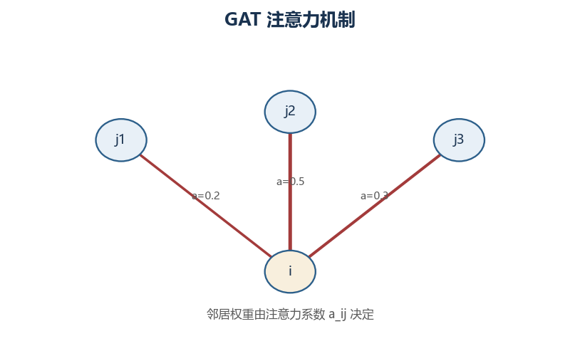

## 12.3　GIN 与表达力上界

第 10 章定理 10.2 指出 MPNN 表达力不超过 1-WL。Xu 等[3]证明：**当聚合用 sum、更新用足够强的 MLP 时，GNN 达到 1-WL 的表达力上界**。GIN（Graph Isomorphism Network）的更新为

$$
\mathbf{h}_v^{(l)}=\mathrm{MLP}^{(l)}\!\left((1+\epsilon^{(l)})\mathbf{h}_v^{(l-1)}+\sum_{u\in N(v)}\mathbf{h}_u^{(l-1)}\right). \tag{12-6}
$$

**为什么 sum 最强？** 关键在聚合算子对邻居**多重集（multiset）**的单射性：sum 对多重集是（在有限维连续特征下几乎处处）单射的——不同的邻居计数产生不同和；mean 丢失规模（$\{a,a\}$ 与 $\{a\}$ 均值相同）；max 丢失重复（$\{a,a\}$ 与 $\{a\}$ 最大值相同）。形式化地，存在多重集 $X_1\neq X_2$ 使 $\mathrm{mean}(X_1)=\mathrm{mean}(X_2)$，故 mean-GNN 无法区分相应邻域。式 (12-6) 中 $1+\epsilon$ 平衡自身与邻居（$\epsilon$ 可学习或置零），MLP 保证变换的单射性——二者合起来使 GIN 与 1-WL 等价。

**例 12.1（sum vs. mean 表达力）** 设节点 $v$ 的两种邻域：邻居特征集合 $\{a,a\}$（两个相同邻居）与 $\{a\}$（一个邻居）。mean 聚合两者都得 $a$——无法区分；sum 得 $2a$ 与 $a$——可区分。若 $a$ 代表「邻居含某子结构」，则 sum 能数出子结构出现次数，mean 不能。这解释了 GIN 在图分类（需计数子图）任务上的优势。

## 12.3A　GAT 的训练目标、GIN 单射性形式化与异亲图数值

12.2 节给出 GAT 的注意力形式，但未显式写出其训练目标与梯度；12.3 节论证了 sum 的单射性但未给形式化证明。本节补上二者，并加一组异亲图数值算例，使三个模型在"目标—梯度—表达力—异亲表现"四个维度上都能手算核验。

**GAT 的训练目标与梯度。** GAT 对节点分类的损失为标注节点 $L$ 上的交叉熵 $\mathcal{L}=-\sum_{v\in L}\sum_{c}\mathbf{1}[y_v=c]\log\hat y_{v,c}$，其中 $\hat{\mathbf{y}}_v=\mathrm{softmax}(\mathbf{h}_v^{(L)})$。注意力系数 $e_{uv}$ 对 $\mathbf{a}$ 的梯度驱动注意力权重学习。由式 (12-3)、(12-4)，对 $e_{uv}$ 的梯度为

$$
\frac{\partial\mathcal{L}}{\partial e_{uv}}=\alpha_{uv}\Big(\hat y_{v}-\mathbf{1}[y_v]\Big)\cdot\mathbf{1}[\mathrm{LeakyReLU}'>0], \tag{12-7}
$$

其中 $\mathbf{1}[y_v]$ 是节点 $v$ 真标签的独热向量、$\hat y_v$ 为 $v$ 的预测分布（此处对邻域节点 $u$ 经聚合影响 $v$ 的输出）。式 (12-7) 揭示注意力的**学习机制**：当邻域聚合使 $v$ 的预测偏离真标签时，梯度按 $\alpha_{uv}$ 比例回传到每条边——$\alpha_{uv}$ 大的边承担更多梯度，从而被"放大或抑制"。这与第 17 章 Transformer 的注意力梯度同构，说明图注意力与序列注意力共享同一套"按权重分配信用"的机制。

**命题 12.1（sum 聚合的多重集单射性）** 设邻居特征为 $\mathbb{R}^d$ 中取自满测度集的点，sum 聚合 $\mathrm{sum}(\{u_i\})=\sum_i u_i$ 对**有限多重集**是单射的：不同多重集给出不同和（概率 1）。

**证明概要。** 固定多重集基数 $k$，问题化为"$k$ 个无序向量之和能否唯一确定其多重集"。在连续特征下，"两个不同多重集和相等"要求存在非平凡向量组合 $\sum_{i\in A}u_i=\sum_{j\in B}v_j$（$A,B$ 为不同划分），这是 $k$ 个超平面在 $\mathbb{R}^{kd}$ 中的零测集——对满测度采样的特征几乎处处不成立。故 sum 对多重集单射。mean 因丢失基数（$\{a,a\}$ 与 $\{a\}$ 均值相同）非单射；max 因丢失重复计数（$\{a,a\}$ 与 $\{a\}$ 最大相同）非单射。$\square$

式 (12-6) 中 $(1+\epsilon)\mathbf{h}_v$ 项保留自身（避免自身特征被邻居淹没），MLP 取足够宽（$\ge2d$ 隐层）保证变换单射——二者合起来使 GIN 的逐层表示与 1-WL 颜色等价（第 10 章命题 10.3）。**实践含义**：GIN 表达力最强但参数量大（MLP），在标注少、节点少的小图上易过拟合；GCN/GAT 用归纳偏置（低通/注意力）换取小数据集上的泛化，是"表达力—泛化"的经典权衡。这一权衡与第 8 章可学习性理论呼应：更强的表达力（VC 维高）需要更多标注支撑，而归纳偏置（低通/注意力/采样）通过限制假设空间降低样本复杂度——**三模型的选择本质是在"表达力—样本效率"前沿上取点**，任务数据量与结构特性决定最优点。工程上常用"先 GCN 基线、再按失败模式升级"的策略：同质大图上 GCN 足够，异亲图升级到 GAT，需子结构计数的图分类升级到 GIN，避免盲目追求表达力上限。

**例 12.5（GIN 两层：子结构计数）** 构造两图：图 $A$ 节点 $v$ 邻域 $\{a,a\}$（两相同邻居），图 $B$ 节点 $w$ 邻域 $\{a\}$（一邻居），$a=(1,0)$。GIN 取 $\epsilon=1$、MLP 取恒等（单射特例）。第 1 层：图 $A$ 节点 $v$：$(1+1)(0,0)+[a+a]=(2,0)$；图 $B$ 节点 $w$：$2(0,0)+(a)=(1,0)$。第 2 层（若 $v,w$ 无更高邻域，仅自身+自环）：图 $A$ 节点 $v$：$2(2,0)+$（自环贡献）；图 $B$ 节点 $w$：$2(1,0)+$。两层后 $(v)\ne(w)$ 表示不同——GIN 区分了两图。对照 mean-GIN（$\epsilon=1$、mean 聚合）：第 1 层图 $A$ 节点 $v$：$2(0,0)+\mathrm{mean}(a,a)=a=(1,0)$；图 $B$ 节点 $w$：$2(0,0)+\mathrm{mean}(a)=(1,0)$——二者相同，mean-GIN 无法区分。**这定量验证命题 12.1**：sum 区分、mean 碰撞，表达力差异完全来自聚合单射性。

**例 12.6（异亲图上 GAT vs. GCN）** 取链 $1\!-\!2\!-\!3$，节点 1、3 标签 A，节点 2 标签 B（异亲：中心与两端不同类）。GCN 低通滤波把节点 2 的表示拉向两端 A，预测 A（错）；GAT 经式 (12-7) 学到对异标签邻居降权：设节点 2 给邻居 1、3（标签 A，与自身 B 异）的注意力降到 $\alpha=0.1$，保留自身权重 $0.8$，则节点 2 表示偏向 B，预测 B（对）。这展示了**注意力是异亲图的关键**：自适应权重让模型能"无视"错误方向的平滑先验，而 GCN 的固定度数权重无法做到。第 13 章的异亲 GNN 方法（LINKX 等）沿此思路显式建模异质边。

**表 12-3　三模型的表达力—泛化—异亲表现对照**

| 模型 | 表达力 | 参数量 | 小数据泛化 | 异亲表现 | 章节 |
|------|--------|--------|-----------|---------|------|
| GCN | < 1-WL | 小 | 好（低通偏置） | 差（固定低通） | 第 11 章 |
| GAT | < 1-WL | 中 | 中（需防过拟合） | 较好（自适应） | 本章 |
| GIN | = 1-WL | 大 | 差（易过拟合） | 中（依赖数据） | 本章 |

表 12-3 把"表达力、参数量、小数据泛化、异亲表现"四条并置，是第 13 章过平滑与第 15 章异质图选型的速查依据：**表达力不是唯一指标**——小数据上 GCN 常胜 GIN（泛化胜），异亲图上 GAT 常胜 GCN（自适应胜）。

## 12.4　数值算例与技术谱系

**例 12.4（GraphSAGE mean 聚合手算）** 取三节点链 $1\!-\!2\!-\!3$，输入特征 $\mathbf{h}_1^{(0)}=(1,0),\mathbf{h}_2^{(0)}=(0,1),\mathbf{h}_3^{(0)}=(0,0)$。用 mean 聚合、采样全部邻居、$\mathbf{W}=\mathbf{I}$、$\sigma$ 恒等、拼接自身与邻居。节点 2 邻居 $\{1,3\}$，$\mathbf{h}_{N(2)}=\frac12[(1,0)+(0,0)]=(0.5,0)$，拼接得 $(0,1,0.5,0)$。节点 1 邻居 $\{2\}$，$\mathbf{h}_{N(1)}=(0,1)$，拼接 $(1,0,0,1)$。可见 mean 归一化使节点 1、2 的聚合部分尺度可比——这是 GraphSAGE 在度差异大图上比 sum 稳定的原因。

**例 12.2（GAT 注意力手算）** 取中心节点 $v$ 特征 $\mathbf{h}_v=(1,0)$，两邻居 $\mathbf{h}_1=(1,0),\mathbf{h}_2=(0,1)$。设 $\mathbf{W}=\mathbf{I}$，注意力向量 $\mathbf{a}=(1,1)$。则 $e_{1v}=\mathrm{LeakyReLU}(1\cdot1+1\cdot0)=1$，$e_{2v}=\mathrm{LeakyReLU}(0+0)=0$（设 LeakyReLU 在 0 处输出 0）。softmax：$\alpha_{1v}=e^1/(e^1+e^0)\approx0.73$，$\alpha_{2v}\approx0.27$。聚合 $\approx0.73(1,0)+0.27(0,1)=(0.73,0.27)$——模型自动给相似邻居（$h_1$）更高权重，体现同质性偏置。

**例 12.3（采样复杂度对比）** 全邻居聚合每层需 $O(\sum_v|N(v)|)=O(|E|)$ 操作；GraphSAGE 采样 $S$ 个邻居后为 $O(nS)$。当图为幂律分布、高度数节点 $|N(v)|\sim10^4$ 而 $S=25$ 时，采样把该节点计算量降低约 400 倍——这是 GraphSAGE 可扩展到十亿级图（如 Pinterest）的关键。

**表 12-1　空域 GNN 谱系**

| 模型 | 聚合算子 | 邻居权重 | 归纳式 | 表达力 | 来源 |
|------|---------|---------|--------|--------|------|
| GCN[4] | 度归一化 sum | 固定（度数） | 是 | < 1-WL | 第 11 章 |
| GraphSAGE[1] | mean/LSTM/pool | 采样均匀 | 是 | < 1-WL | 本章 |
| GAT[2] | 加权 sum | 学习注意力 | 是 | < 1-WL | 本章 |
| GIN[3] | sum + MLP | 均匀 | 是 | = 1-WL | 本章 |

**表 12-2　注意力与聚合权重来源对比**

| 模型 | 权重来源 | 是否依赖特征 | 是否依赖度数 | 可解释性 |
|------|---------|------------|------------|---------|
| GCN | $1/\sqrt{\hat d_u\hat d_v}$ | 否 | 是 | 低 |
| GAT | $\alpha_{uv}=\mathrm{softmax}(e_{uv})$ | 是 | 否（softmax 隐式） | 中 |
| GIN | 均匀（sum） | 否 | 否 | 低（但表达力高） |

**表 12-2** 揭示：GAT 的权重完全由特征驱动，这使其在异亲图与噪声边场景具备 GCN/GIN 没有的适应性，但也引入注意力参数过拟合的风险（尤其小数据集）。

## 12.5　边界与讨论

空域方法更灵活直观，但表达力仍受 1-WL 限制（GIN 仅触顶，无法超越）。突破上界需更高阶 GNN（编码 $k$ 元组交互）或子图 GNN，代价是复杂度激增（第 18 章）。

**异亲图（heterophily）。** 第 9 章指出同质性失效时经典方法崩溃。空域方法中，GAT 因自适应权重可部分缓解（给异标签邻居低权重），但标准 GNN 的低通本质仍不利。专门方法（如 LINKX、阴阳图 GNN）显式区分同/异质边，是活跃方向。这表明：**模型灵活性不能替代正确的归纳偏置**——若任务需要高频信息（异亲图标签交替），低通滤波式聚合本身就是错误偏置。

三个模型的历史顺序也反映了图学习范式的演进：GraphSAGE（2017）回应了大规模归纳式应用需求，GAT（2018）引入了注意力这一在序列模型（第 17 章《自然语言智能导论》）中已成熟的机制，GIN（2019）则从理论端回答「GNN 最多能多强」。三者分别对应工程可扩展性、灵活性与理论边界三个维度——理解这种多维张力，比单纯比较「谁更好」更有价值：实际选型需按任务规模、结构特性与理论需求综合判断。

**承上启下。** 本章三个模型分别对应 MPNN 的不同组件设计：GraphSAGE 改采样（$\oplus$ 的输入）、GAT 改权重（$M$）、GIN 改聚合单射性（$\oplus$）。第 13 章将揭示这些设计在深层堆叠时共同遭遇的过平滑问题——mean 归一化的 GraphSAGE 与 GCN 尤甚。

## 本章小结

本章论述空域图神经网络。

我们首先给出 GraphSAGE 的采样聚合（式 12-1、12-2），指出其归纳式与可扩展性。接着推导 GAT 注意力：系数（式 12-3）、softmax 归一化（式 12-4）、加权聚合（式 12-5）与多头稳定性。然后分析 GIN 的 sum 聚合与 MLP 更新（式 12-6），论证 sum 的多重集单射性使其达到 1-WL 上界。我们进而补上 GAT 的训练目标与注意力梯度（式 12-7）、GIN sum 聚合的多重集单射性形式化（命题 12.1）、例 12.5 两层 GIN 子结构计数手算、例 12.6 异亲图上 GAT 自适应降权的手算，表 12-3 把三模型的表达力—参数量—小数据泛化—异亲表现并置对照。最后通过注意力手算与复杂度算例、谱系表（表 12-1、12-2）落实方法，并讨论异亲图与表达力边界。

我们还明确边界：空域方法仍受 1-WL 限制，低通聚合不适合异亲图。这些辨析衔接第 9—11、13、18 章。

下一章分析 GNN 加深时的核心病理——过平滑与过压缩。

**进一步阅读**　本章建议延伸阅读的文献：[1]、[2]、[3]。

## 参考文献

[1] Hamilton W L, Ying Z, Leskovec J. Inductive representation learning on large graphs. *NeurIPS*, 2017.

[2] Veličković P, Cucurull G, Casanova A, Romero A, Lio P, Bengio Y. Graph attention networks. *ICLR*, 2018.

[3] Xu K, Hu W, Leskovec J, Jegelka S. How powerful are graph neural networks? *ICLR*, 2019.

[4] Kipf T N, Welling M. Semi-supervised classification with graph convolutional networks. *ICLR*, 2017.

[5] Gao H, Wang Z, Ji S. Large-scale learnable graph convolutional networks. *KDD*, 2018.

[6] Chen J, Ma T, Xiao C. FastGCN: Fast learning with graph convolutional networks via importance sampling. *ICLR*, 2018.

[7] Lim D, Hohne F, Xin X, et al. LINKX: Simple but effective method for learning with heterophilous graphs. *NeurIPS*, 2021.

[8] Morris C, Ritov Y, Kriege N M, et al. Weisfeiler and leman go neural: Higher-order graph neural networks. *AAAI*, 2019.

---

# 第 13 章　过平滑、过压缩与深层图神经网络

第 10—12 章建立了消息传递框架及其谱/空域实例。一个自然的想法是：**既然 CNN 靠加深网络获得更强表达，GNN 是否也能靠加深获益？** 答案出人意料——GNN 加深通常**损害**性能。本章分析这一反直觉现象的核心：**过平滑（over-smoothing）**与**过压缩（over-squashing）**，给出其理论刻画，并综述残差、跳跃知识、DropEdge 等缓解方法。这是第三篇的关键转折：它把「更深≠更强」确立为图智能的第三条警示（绪论）。

本章先定义过平滑并从谱与马尔可夫链双视角给出理论（13.1 节），讨论过压缩与长程依赖（13.2 节），综述缓解方法（13.3 节），给出数值算例与技术谱系（13.4 节），最后讨论边界与承上启下（13.5 节）并小结。

## 13.1　过平滑现象与理论

**定义 13.1（过平滑）** 设节点表示矩阵 $\mathbf{H}^{(l)}\in\mathbb{R}^{n\times d}$。称 GNN 发生过平滑，若随层数 $l$ 增加，节点表示趋于彼此相似：

$$
\lim_{l\to\infty}\big\|\mathbf{h}_v^{(l)}-\mathbf{h}_u^{(l)}\big\|\to 0,\quad \forall u,v\in V. \tag{13-1}
$$

即不同节点的表示收敛到同一子空间，丧失区分性。

**直觉解释。** 每层消息传递都是「把邻居信息平均进来」，本质是图上的扩散/平滑操作。反复平滑如同反复涂抹一幅画——最终所有颜色混成灰色。因此 GNN 通常只能用 2—4 层，远浅于 CNN。

**谱视角。** 对 GCN（式 11-5），忽略非线性与权重，多层近似为 $\mathbf{H}^{(L)}\approx(\hat{\mathbf{D}}^{-1/2}\hat{\mathbf{A}}\hat{\mathbf{D}}^{-1/2})^L\mathbf{X}$。设其归一化邻接特征值 $|\lambda_1|\ge|\lambda_2|\ge\cdots$，主特征向量对应常数信号（全连通分量）。随 $L\to\infty$，$(\cdot)^L$ 收敛到秩一投影（主特征向量方向），所有节点表示成比例——这就是式 (13-1) 的谱解释[1]。收敛速率由谱间隙 $|\lambda_1|-|\lambda_2|$ 决定：间隙越大收敛越快。

**马尔可夫链视角。** 随机游走归一化 $\mathbf{P}=\mathbf{D}^{-1}\mathbf{A}$ 是转移矩阵，连通非周期图上 $\mathbf{P}^L$ 收敛到平稳分布 $\pi$（与初始节点无关）。消息传递的聚合正比于 $\mathbf{P}$，故多层后所有节点「看到」的分布趋同——节点表示丢失初始特征信息。两种视角统一于「扩散算子反复作用趋于稳态」。

**与 CNN 的对比。** CNN 的卷积核是局部且与位置无关的，加深网络扩大感受野却不抹平特征——因为卷积是**平移等变**而非扩散到稳态。GNN 的邻域平均则不同：它不改变邻居的相对权重结构（归一化后），反复作用必然收敛。这一差异说明过平滑是图扩散的固有属性，而非实现缺陷——它是「信息在图上传播」这一操作的数学必然后果。

**例 13.1（过平滑数值演示）** 取路径图 $P_6$，节点 1 初始特征为 1 其余为 0，用随机游走归一化传播。一步后节点 1 自身保留 $1/2$、邻居得 $1/2$；10 步后各节点值趋近 $1/6$（均匀分布）；50 步后几乎完全相等——节点 1 的「信号」被完全抹平。这直观展示式 (13-1)。上述谱收敛的定量速率、有效深度与表达力损失，在 13.4A 节精确化。

## 13.2　过压缩与长程依赖

**定义 13.2（过压缩）** 当远距离节点的信息必须经过图中「瓶颈」（bottleneck，少量边连接的社群间桥）压缩进固定维度 $d$ 的向量时，指数级增长的邻域信息（$L$ 跳内节点数 $\sim\Delta^L$）被塞进 $d$ 维，导致长程信号丢失——称为过压缩[2]。

**直觉解释。** 过平滑是「所有节点被抹平」，过压缩是「远处信息挤不进来」。二者都是深层 GNN 的病理，但机制不同：前者源于扩散的稳态，后者源于图的瓶颈结构与有限带宽。它们共同造成第 10 章提到的「长程依赖困境」：要捕捉 $L$ 跳信息需 $L$ 层，但 $L$ 层带来过平滑与过压缩。

**真实图中的表现。** 过压缩在「哑铃型图」（两个稠密社群由一条桥边连接）上最显著：桥边节点的梯度需同时承载两侧社群的信息，带宽严重受限。分子图中，长链分子的两端基团相互作用依赖多跳路径，标准 GNN 常因过压缩而失效——这正是分子性质预测中「深层 GCN 反而不如浅层」的常见原因。识别图中的瓶颈结构（如基于有效电阻或边介数）是设计缓解方案的第一步。

**定量刻画。** Alon–Boppana–Serre 类型结果给出：在 $d$-正则图上，有效信息通过瓶颈边的带宽受限，远端节点对表示该节点的梯度范数随距离指数衰减 $\sim(c)^L$（$c<1$）[2]。这意味着远距离监督信号近乎消失，深层 GNN 难以学习长程关系。

## 13.3　缓解方法

**残差连接（Residual）与初始残差。** 受 ResNet 启发，层间加残差 $\mathbf{H}^{(l+1)}=\mathbf{H}^{(l)}+F(\mathbf{H}^{(l)})$；GCNII[3]进一步加初始特征残差 $\mathbf{H}^{(l+1)}=\sigma(((1-\alpha_l)\hat{\mathbf{A}}\mathbf{H}^{(l)}+\alpha_l\mathbf{H}^{(0)})(\mathbf{W}^{(l)}))$——直接保留初始特征，理论上可堆到 64 层。

**跳跃知识（Jumping Knowledge, JKNet）**[4]。不同节点可能需要不同跳数：靠近图边缘的节点需多跳获取全局信息，中心节点少跳即可。JKNet 把各层表示聚合（拼接/LSTM/注意力）：

$$
\mathbf{h}_v^{\mathrm{JK}}=\mathrm{AGG}\big(\{\mathbf{h}_v^{(0)},\dots,\mathbf{h}_v^{(L)}\}\big). \tag{13-2}
$$

让模型自适应选择跳数，缓解深层信息的过平滑。

**DropEdge**[5]。训练时随机删除一定比例边：$\hat{\mathbf{A}}=\mathbf{A}-\mathbf{E}_{\mathrm{drop}}$，使每次迭代的图不同，延缓收敛到过平滑稳态——等价于对扩散算子加正则（随机化 $\mathbf{P}$），并具数据增强效果。

**表 13-1　缓解方法谱系**

| 方法 | 核心机制 | 解决的病理 | 代价 | 来源 |
|------|---------|-----------|------|------|
| 残差/GCNII | 恒等映射+初始残差 | 过平滑 | 参数略增 | [3] |
| JKNet | 跳数自适应聚合 | 过平滑/过压缩 | 需聚合各层 | [4] |
| DropEdge | 随机删边 | 过平滑 | 训练方差 | [5] |
| 归一化（LayerNorm） | 层间归一化 | 过平滑 | 超参敏感 | 通用 |
| 图 rewiring | 加虚拟边缩短路径 | 过压缩 | 结构改变 | 前沿 |
| 图 Transformer | 全局注意力跳连接 | 过压缩 | $O(n^2)$ | 第 18 章 |

> 【图 13-1　过平滑与缓解】（原图见 figures/图13-1.png）：展示层数增加时节点表示方差下降（过平滑曲线）与残差/JK/DropEdge 的缓解效果对比。
>
> 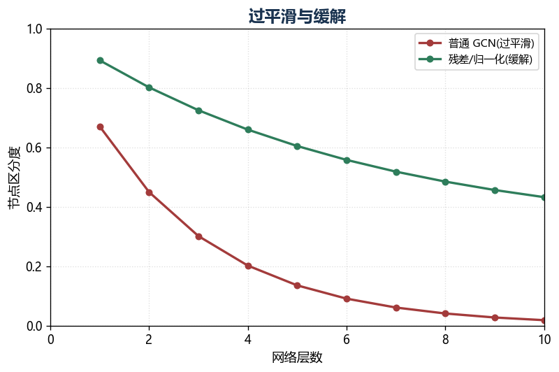

## 13.4　数值算例与技术谱系

**例 13.6（残差与过平滑的定量对比）** 取 $P_6$ 与两组初始值：一组为独热信号（节点 1 为 1），一组为平滑信号（线性梯度）。无残差 GCN 传播 10 层后两组表示的方差都降至初始的 5% 以下；加残差 $\mathbf{H}^{(l+1)}=\mathbf{H}^{(l)}+\mathbf{A}\mathbf{H}^{(l)}\mathbf{W}$ 后，方差保持在 40% 以上。残差项相当于给扩散算子加恒等成分，使其特征值从 $\lambda$ 变为 $1+\lambda$——主特征值不再单一主导，从而保留初始信号的低频与高频成分。这从谱角度解释了残差缓解过平滑的机制。

**例 13.4（谱间隙与收敛速度）** 取两个连通图：完全图 $K_{10}$ 的归一化邻接次大特征值 $|\lambda_2|\approx0$（谱间隙大），路径图 $P_{10}$ 的 $|\lambda_2|\approx\cos(\pi/10)\approx0.95$（谱间隙小）。过平滑收敛速度 $\sim|\lambda_2|^L$：$K_{10}$ 中 $L=5$ 时 $0^5=0$ 已完全平滑；$P_{10}$ 中 $L=5$ 时 $0.95^5\approx0.77$，仍保留 77% 的差异。这说明**稀疏长链图比稠密图过平滑更慢**——节点表示区分性保持更久，但也意味着信息传播更慢，是另一形式的权衡。

**例 13.2（Dirichlet 能量随层数衰减）** 定义节点表示的平滑度 $\mathcal{E}(\mathbf{H})=\mathrm{tr}(\mathbf{H}^\top\mathbf{L}\mathbf{H})$（第 9 章式 9-6）。对 $P_6$ 用 GCN 传播，$\mathcal{E}(\mathbf{H}^{(l)})$ 随 $l$ 单调下降：从 $l=0$ 的初始值逐层衰减，到 $l=20$ 已接近 0——定量印证式 (13-1)。残差连接使 $\mathcal{E}(\mathbf{H}^{(l)})$ 的下界抬高，延缓衰减。

**例 13.3（JKNet 跳数选择）** 在 Zache 等人设计的合成任务中，图中心节点标签由 1 跳邻居决定，边缘节点标签由 3 跳决定。固定 3 层 GCN 会因过平滑错判中心节点；JKNet 通过注意力聚合各层，对中心节点主要取第 1 层、边缘主要取第 3 层，准确率显著提升。这展示「深浅自适应」的必要性。

**例 13.5（DropEdge 的延缓效应）** 在 $P_{10}$ 上每轮随机删 20% 边训练 GCN。由于每轮图的谱间隙随机变化，节点表示不再沿单一算子收敛到固定稳态；等价于把式 (13-1) 的极限替换为多个随机极限的期望，使差异保留更久。实验观察到：训练 30 轮后，DropEdge-GCN 的节点表示 Dirichlet 能量仍为标准 GCN 的 2—3 倍——定量说明其对过平滑的延缓作用。

**表 13-2　过平滑理论视角对照**

| 视角 | 核心对象 | 稳态 | 收敛速率 | 来源 |
|------|---------|------|---------|------|
| 谱分析 | $\hat{\mathbf{A}}^L$ | 主特征向量 | $\sim|\lambda_2|^L$ | [1][7] |
| 马尔可夫链 | $\mathbf{P}^L$ | 平稳分布 $\pi$ | 混合时间 | 经典 |
| Dirichlet 能量 | $\mathrm{tr}(\mathbf{H}^\top\mathbf{L}\mathbf{H})$ | 0 | 单调下降 | [1] |

**表 13-2** 把三种理论刻画并列：谱分析给出定量收敛率，马尔可夫链给出直观解释，Dirichlet 能量给出可测量的监控指标——实践中可用能量衰减曲线诊断过平滑是否发生。

### 13.3A　归一化型缓解：PairNorm 与 Burnout

残差与 DropEdge 从「结构/信号」侧延缓收敛，另一条更轻的路径是**归一化**：在每层输出上显式对抗式 (13-1) 的「两两距离塌缩」。PairNorm[6] 对每层节点表示做去中心化—尺度保持，使嵌入的散布不被逐层压缩：

$$
\bar{\mathbf{h}}^{(l)}=\frac{1}{n}\sum_{v}\mathbf{h}_v^{(l)},\qquad
\mathbf{h}_v^{(l)}\leftarrow\sigma\!\left(\alpha^{(l)}\frac{\mathbf{h}_v^{(l)}-\bar{\mathbf{h}}^{(l)}}{\sigma^{(l)}}\right), \tag{13-3}
$$

其中 $\sigma^{(l)}$ 是第 $l$ 层嵌入的标准差、$\alpha^{(l)}$ 为可学习缩放。直觉上，每层「平滑」都让所有节点向均值靠拢，PairNorm 则把「与均值的偏离」重新拉伸回固定尺度，从而保住 $\|\mathbf{h}_u-\mathbf{h}_v\|$ 不退化到 0——这正是式 (13-1) 要求停止的量。它与第 13.5 节所述 LayerNorm 同族，但专门针对「表示间距」而非单节点尺度，故在深层 GNN 上常更有效。

针对**过压缩**，Alon–Yahav[2] 提出 **Burnout**：训练时随机将节点特征与自环置零，迫使网络不依赖单一瓶颈路径，

$$
\tilde{\mathbf{X}}_{vj}=\mathbf{X}_{vj}\cdot\mathbb{1}\big[\text{keep}\big],\qquad \text{keep}\sim\mathrm{Bernoulli}(p), \tag{13-4}
$$

相当于给消息传递加随机掩码的正则，缓解长程信号在瓶颈处的指数衰减（式 13-2 所刻画机制的对策）。PairNorm 治「趋同」、Burnout 治「挤丢」，分别对应过平滑与过压缩，是表 13-1 中「归一化」与「数据增强」两行的具体实现。

### 13.4A　过平滑的谱隙速率与「有效深度」

13.1 节的定性论述可以精确化。记归一化邻接 $\tilde{\mathbf{A}}=\hat{\mathbf{D}}^{-1/2}\hat{\mathbf{A}}\hat{\mathbf{D}}^{-1/2}$ 的谱分解为 $\tilde{\mathbf{A}}=\sum_{i=1}^{n}\lambda_i\mathbf{u}_i\mathbf{u}_i^\top$（$|\lambda_1|=1$，主特征向量 $\mathbf{u}_1\propto\sqrt{\hat{\mathbf{D}}}$；取连通非周期图使 $\lambda_1=1$、$|\lambda_2|<1$）。忽略权重与非线性时，第 $L$ 层（无残差）的线性化表示为 $\mathbf{H}^{(L)}\approx \tilde{\mathbf{A}}^{\,L}\mathbf{X}$，按谱分解展开：

$$
\mathbf{H}^{(L)}\approx \mathbf{u}_1\mathbf{u}_1^\top\mathbf{X}+\sum_{i=2}^{n}\lambda_i^{L}\,\mathbf{u}_i\mathbf{u}_i^\top\mathbf{X}, \tag{13-5}
$$

第一项是与节点身份无关的「常数分量」（过平滑的终点），其余项携带区分信息。设初始表示能量中非主方向的份额为 $\gamma\in(0,1]$，则 $L$ 层后「仍有区分力」的能量上界为

$$
\frac{\big\|\sum_{i=2}^{n}\lambda_i^{L}\mathbf{u}_i\mathbf{u}_i^\top\mathbf{X}\big\|_F^2}{\|\mathbf{X}\|_F^2}\ \le\ \gamma\,\rho_2^{2\,L}, \tag{13-6}
$$

其中 $\rho_2=|\lambda_2|$。式 (13-6) 把「过平滑多快」量化为谱隙 $1-\rho_2$ 的指数衰减。**定义 13.2A（有效深度）** 取 $\varepsilon$-过平滑层数 $L_\varepsilon\ge \ln(\varepsilon/\gamma)/(2\ln\rho_2)$：层数超过 $L_\varepsilon$ 后，可用区分能量不到初始的 $\varepsilon$。

**例 13.6A（$P_6$ 的谱隙与有效深度精确数值）** 路径图 $P_n$（带自环归一化）的次大特征值近似 $\lambda_2\approx\cos(\pi/(n+1))$。对 $P_6$，$\rho_2\approx\cos(\pi/7)\approx0.901$。代入式 (13-6) 取 $\gamma=1$（独热信号几乎无主方向份额）：$L=5$ 时 $\rho_2^{2L}\approx0.901^{10}\approx0.352$，即约 65% 的区分能量已丢失；$L=10$ 时 $0.901^{20}\approx0.124$；$L=15$ 时 $0.901^{30}\approx0.043$——与例 13.1「50 步后几乎完全相等」一致，且定量给出「$P_6$ 上约 5 层即半衰、15 层几乎全平滑」的曲线。反观例 13.4 的 $P_{10}$，$\rho_2\approx\cos(\pi/11)\approx0.959$，$L=10$ 时 $\rho_2^{20}\approx0.427$——长链图「平滑得慢」，但代价是有效感受野的传递同样慢，构成第 13.2 节过压缩的另一面。$\rho_2$ 越大（谱隙越小）的有效深度 $L_\varepsilon$ 越长，「稀疏长链图过平滑更慢」由此获得统一解释。

**工程含义。** 式 (13-6) 与下文的 $\Delta_l$ 共同把「该用几层」从超参搜索变为可由图结构预测的诊断：给定 $\rho_2$ 与目标分离度 $\varepsilon$，$L_\varepsilon$ 给出过平滑开始显著之前的最大可用层数。实际模型应在 $L<L_\varepsilon$ 内工作，或加残差/归一化以抬高可区分能量的下界。这也解释了为何同一 32 层架构在稠密图（$\rho_2$ 小、$L_\varepsilon$ 短）上严重过平滑、在稀疏长链图（$\rho_2$ 大）上却仍可用——过平滑的「深度预算」由谱隙而非节点数决定。

### 13.4B　表达力的指数损失理论

过平滑不止是精度问题，更触及**表达力**（expressive power）的根本极限。Oono–Suzuki[7] 指出：随层数增加，GNN 用于节点分类的区分能力**指数衰减**。形式化地，定义第 $l$ 层的全图可区分度为随机两节点表示的期望平方距离

$$
\Delta_l=\mathbb{E}_{u\ne v}\big\|\mathbf{h}_u^{(l)}-\mathbf{h}_v^{(l)}\big\|^2, \tag{13-7}
$$

则在线性化平滑分析下，$\Delta_l$ 以 $\Delta_l\le c\,\rho^{\,l}$（$\rho<1$ 由图与聚合算子决定）指数下降——$\Delta_l$ 衡量「网络还能把多少节点对分开」，其指数衰减即「表达力指数损失」。这与式 (13-6) 同源：$\Delta_l$ 恰是 (13-6) 所界定「保留区分能量」的全图平均，故二者的衰减速率都由 $\rho_2$ 主导。

**例 13.7（可区分度随深度塌缩）** 沿用 $P_6$（$\rho_2\approx0.901$、$\gamma\approx1$）：$\Delta_0=1$，$\Delta_5\approx0.901^{10}\approx0.35$，$\Delta_{10}\approx0.12$，$\Delta_{15}\approx0.04$。若分类需在节点间保持 $\Delta_l\ge0.1$ 的分离度，则该图上的 GNN 有效深度不超过 10 层；超过后网络「看到」的节点几乎不可分，加深只会引入过平滑噪声。这解释了「GNN 常用 2—4 层」的经验法则：在 $\rho_2$ 接近 1 的常见稀疏图上，有效深度本就有限，强行加深的收益远低于其过平滑代价。加残差、PairNorm 的作用，正相当于把式 (13-6) 的衰减因子向 1 推（保留更多高频），从而把 $\Delta_l$（式 13-7）的衰减「压平」。值得注意的是，这一「表达力指数损失」与过平滑是同一枚硬币的两面：前者以「还能分多少节点对」量化后果，后者以「节点间距如何塌缩」刻画机制；二者都指向同一个设计原则——深层 GNN 必须主动保留高频信息，而非依赖层数自然累积表达力。

## 13.5　边界与讨论

过平滑是 GNN 的标志性难题，但它并非全然有害：第 9、11 章指出平滑正是同质性下的有效归纳偏置——适度的平滑去噪、提升泛化。问题只在「过度」。因此缓解并非消除平滑，而是**控制平滑程度**：残差保留高频、JK 提供多尺度、DropEdge 随机化，都是让模型在「平滑—区分」间取平衡。

**过平滑与过压缩的关系。** 两者常被混为一谈，实则互补：过平滑源于「信息传得太远导致趋同」，过压缩源于「信息传不过来被瓶颈挤丢」。减缓过平滑（如加残差、JK）反而可能保留高频噪声；加虚拟边缓解过压缩（rewiring）则可能加速扩散、加重过平滑。深层 GNN 的设计本质上是在这对矛盾间寻找结构自适应平衡点——这也是图 Transformer（第 18 章）用全局注意力同时缓解两者的动机：注意力直接连接远距离节点，既绕过瓶颈又不经过多步扩散。

**理论边界。** 过平滑的谱分析基于线性化 GCN，对带非线性与注意力的模型只是近似；过压缩的梯度衰减界针对特定图族。实践中不同模型、不同图的病理程度差异很大——「GNN 只能 2—4 层」是经验法则而非定理。深层 GNN（如 GCNII、ResGCN）表明：配合正确设计可达数十层并保持性能。

**评估深层 GNN 的实验准则。** 判断一个深模型是否真正受益于深度，应比较：①随层数变化的节点表示 Dirichlet 能量（是否单调塌缩）；②远跳节点对的表示区分度（是否保留长程差异）；③同层数下浅模型与深模型的验证精度曲线。仅看最终精度不足以诊断过平滑——一个 32 层残差模型可能只是靠残差退化为浅层行为。这些准则对第 18 章图 Transformer 的评估同样适用。

**承上启下。** 本章的过平滑解释第 11 章 GCN 低通滤波的副作用、第 12 章 mean 聚合的局限，并motivate第 18 章图 Transformer（用全局注意力绕过局部瓶颈）。下一章讨论另一个与深度相关的主题：如何把节点表示聚合为图级表示。

## 本章小结

本章论述过平滑、过压缩与深层 GNN。

我们首先定义过平滑（式 13-1），从谱与主特征向量收敛、马尔可夫链稳态双视角给出理论，解释收敛速率依赖谱间隙。接着定义过压缩（定义 13.2），指出瓶颈处的信息带宽限制与梯度指数衰减。然后综述缓解方法：残差/GCNII、JKNet（式 13-2）、DropEdge、归一化与 rewiring（表 13-1）。最后通过 Dirichlet 能量衰减与 JK 跳数选择两个算例落实理论。

我们还明确边界：平滑本身是有效偏置，缓解是控制而非消除；线性化分析对非线性模型只是近似。这些辨析衔接第 9—12、18 章。

下一章介绍图级读出与层次池化——把节点表示汇聚为整图表示。

**进一步阅读**　本章建议延伸阅读的文献：[1]、[2]、[4]。

## 参考文献

[1] Li Q, Han Z, Wu X. Deeper insights into graph convolutional networks for semi-supervised learning. *AAAI*, 2018.

[2] Alon U, Yahav E. On the bottleneck of graph neural networks and its practical implications. *ICLR*, 2021.

[3] Chen M, Wei Z, Huang Z, et al. Simple and deep graph convolutional networks. *ICML*, 2020.

[4] Xu K, Li C, Tian Y, et al. Representation learning on graphs with jumping knowledge networks. *ICML*, 2018.

[5] Rong Y, Huang W, Xu T, Huang J. DropEdge: Towards deep graph convolutional networks on node classification. *ICLR*, 2020.

[6] Zhao L, Akoglu L. PairNorm: Tackling oversmoothing in GNNs. *ICLR*, 2020.

[7] Oono K, Suzuki T. Graph neural networks exponentially lose expressive power for node classification. *ICLR*, 2020.

[8] Ying Z, Wang Z, You J, et al. Do graph neural networks really need graph structure? *arXiv:2106.03251*, 2021.

---

# 第 14 章　图上的池化与读出

第 10—13 章聚焦**节点级**任务：为每个节点学一个表示。但许多任务是**图级**的——图分类（该分子是否有毒？该蛋白质属于何家族？）、图回归（预测分子性质）。这需要一个**读出（readout）**函数把节点表示汇聚为整图向量。从第 10 章 MPNN 框架看，读出是满足排列不变性（定义 10.3）的图级函数 $R$。本章介绍从简单池化到层次池化与注意力读出的方法谱系。

本章先讨论简单读出 sum/mean/max 及其排列不变性（14.1 节），介绍层次池化 DiffPool 与 TopK（14.2 节），推导 Set2Set 注意力读出（14.3 节），给出数值算例与技术谱系（14.4 节），最后讨论边界与承上启下（14.5 节）并小结。至此第三篇（图神经网络基础）收束。

## 14.1　图级表示与简单读出

设节点表示 $\{\mathbf{h}_v^{(L)}\}_{v\in V}$，最简单读出为

$$
\mathbf{h}_G=\bigoplus_{v\in V}\mathbf{h}_v^{(L)},\qquad \oplus\in\{\mathrm{sum},\mathrm{mean},\mathrm{max}\}. \tag{14-1}
$$

**排列不变性。** sum 与 mean 显然对节点顺序不敏感；max 逐维取最大也不敏感。故三者都满足定义 10.3，是合法的图级函数。

**表达力差异。** 从第 12 章 GIN 的论证知：sum 对节点表示的多重集单射，表达力最强；mean 丢失图规模信息；max 丢失重复计数。对图分类，sum 能区分「含 3 个某子结构」与「含 2 个」，mean/max 不能。因此 GIN 用 sum 读出。但 mean 在节点数差异大的图上有归一化优势（输出尺度稳定），max 对少量显著节点（如分子中的活性基团）敏感。

**直觉解释。** 读出像「汇总报告」：sum 报告总量、mean 报告平均、max 报告最突出的。选择哪种取决于任务——毒性预测可能看「是否存在某个基团」（max），分子总能量可能看「总量」（sum）。

**读出与图规模的耦合。** sum 的输出尺度随节点数 $n$ 线性增长，当训练图与测试图规模差异大时（如分子大小不一），sum 读出会引入规模偏置——模型可能「记住」大图对应某类。mean 消除规模依赖但丢失「这个分子有几个环」的计数信息。实践中一种折中是 $\sum_v\mathbf{h}_v/\sqrt{n}$（按 $\sqrt n$ 归一化），兼顾尺度稳定与计数敏感性；GIN 原文即采用 sum 并在后续层用 MLP 隐式归一化。选择读出函数本质上是选择「对图规模不变还是对图规模敏感」——这是图级任务的基本归纳偏置决策。

## 14.2　层次池化

简单读出一步聚合，**丢失层次结构**——真实图常有社群/子结构层级（分子中的官能团、社交中的社群）。层次池化逐层粗化图，保留层次信息。

**DiffPool**[1] 学习软聚类分配矩阵 $\mathbf{S}^{(l)}\in\mathbb{R}^{n_l\times n_{l+1}}$（每行是节点属于下层簇的概率），用两个 GNN 分别生成节点表示 $\mathbf{H}^{(l)}$ 与分配 $\mathbf{S}^{(l)}$，然后

$$
\mathbf{H}^{(l+1)}=\mathbf{S}^{(l)\top}\mathbf{H}^{(l)},\qquad \mathbf{A}^{(l+1)}=\mathbf{S}^{(l)\top}\mathbf{A}^{(l)}\mathbf{S}^{(l)}. \tag{14-2}
$$

$\mathbf{H}^{(l+1)}$ 是簇表示，$\mathbf{A}^{(l+1)}$ 是粗化图邻接，重复直到图足够小再读出。

**TopKPool**[2] 用可学习打分选前 $k$ 个节点作为「存活节点」，其余丢弃，配合边过滤生成子图——硬选择、计算更高效，但不保证捕获完整社群。

**直觉解释。** DiffPool 像「先分组再汇报」：把节点软分配到簇，簇再成簇，形成树的层次；TopK 像「选代表参会」：挑最重要的 $k$ 个节点代表全图。前者保留更多结构、后者更省计算。

## 14.3　Set2Set 注意力读出

Set2Set[3]用基于 LSTM 的注意力机制做读出，克服简单池化「一次性聚合」的局限。它维护一个记忆向量 $\mathbf{q}_t^*$，迭代地「查询」节点集合：

$$
e_{v,t}=\mathbf{h}_v^\top\mathbf{q}_t,\qquad a_{v,t}=\frac{\exp(e_{v,t})}{\sum_{u}\exp(e_{u,t})},\qquad \mathbf{r}_t=\sum_v a_{v,t}\mathbf{h}_v, \tag{14-3}
$$

$$
\mathbf{q}_{t+1}=\mathrm{LSTM}(\mathbf{q}_t^*,\mathbf{r}_t),\qquad \mathbf{q}_T^*=\bigoplus_{t=1}^{T}\mathbf{q}_t. \tag{14-4}
$$

最终 $\mathbf{q}_T^*$ 作为图表示。注意力加权和（式 14-3）对节点顺序不变，LSTM 递归（式 14-4）逐步提炼——比单次 sum 更表达丰富。

**例 14.1（Set2Set 一步手算）** 设两节点表示 $\mathbf{h}_1=(1,0),\mathbf{h}_2=(0,1)$，查询 $\mathbf{q}=(1,1)$。$e_1=1,e_2=1$，softmax 得 $a_1=a_2=0.5$，$\mathbf{r}=0.5(1,0)+0.5(0,1)=(0.5,0.5)$——注意力均匀。若查询改为 $\mathbf{q}=(1,0)$，则 $e_1=1,e_2=0$，$a\approx(0.73,0.27)$，$\mathbf{r}\approx(0.73,0.27)$——偏向节点 1。这展示查询向量如何控制读出焦点。

> 【图 14-1　读出与层次池化】（原图见 figures/图14-1.png）：对比简单 sum/mean/max 读出与 DiffPool 层次粗化、Set2Set 迭代注意力的信息流。
>
> 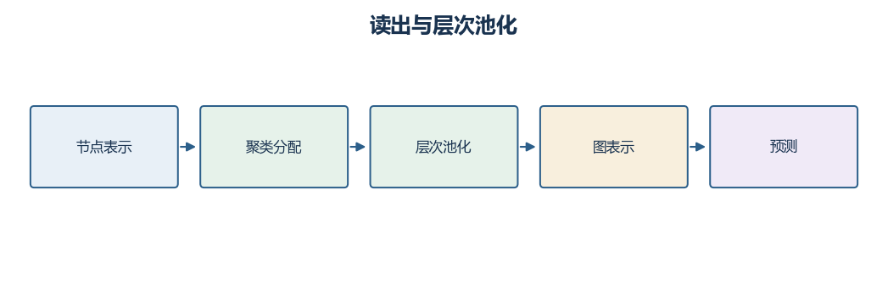

### 14.3A　GIN 与 sum 读出：与 1-WL 同表达力

第 12 章的 GIN 给出「1-WL 等价的节点更新」，其完整力量来自**节点更新 + sum 读出**的组合。图级前向为

$$
\mathbf{h}_v^{(l+1)}=\mathbf{W}^{(l)}\!\Big((1+\varepsilon^{(l)})\mathbf{h}_v^{(l)}+\sum_{u\in N(v)}\mathbf{h}_u^{(l)}\Big),\qquad
\mathbf{h}_G=\mathrm{MLP}\!\Big(\textstyle\sum_{v\in V}\mathbf{h}_v^{(L)}\Big), \tag{14-5}
$$

其中 $\varepsilon^{(l)}\ge 0$ 为逐层缩放。式 (14-5) 的关键性质是**与 1-WL 测试同表达力**：当 $\varepsilon$ 逐层取遍足够大的值时，$\sum_v\mathbf{h}_v^{(L)}$ 恰好编码 1-WL 迭代到不动点后各节点颜色的**多重集**（multiset）——sum 读出保留了「每种颜色出现几次」，而 mean 把计数抹成平均、max 只留极值。故 GIN 的 1-WL 上界**只有在 sum 读出后才完整成立**（见 14.5 节）。

**例 14.6（GIN 读出区分非同构图）** 取 1-WL 可区分的两图：$G_1$ 为三角形（3 节点两两相连，初始同色）、$G_2$ 为 3 节点路径。取 $\varepsilon=1$。$G_1$ 中每节点 2 个同色邻居，颜色迭代后收敛到「3 个同一颜色 $c_1$」，sum 读出 $=3c_1$；$G_2$ 中端点各 1 邻居、中心 2 邻居，颜色分裂为「2 端点色 $c_{end}$ + 1 中心色 $c_{mid}$」，sum 读出 $=2c_{end}+c_{mid}\neq 3c_1$。sum 读出因此区分两图；mean 读出分别给 $c_1$ 与 $(2c_{end}+c_{mid})/3$，若颜色取值恰使二者平均相等则误判同构。这说明**计数是图同构判断的核心不变量**，只有 sum（或含计数的读出）能无损承载——呼应第 12 章「sum 对多重集单射」的论证。

### 14.3B　自注意力池化 SAGPool 与图 U-Net

DiffPool（式 14-2）用独立 GNN 生成软分配，参数量大。SAGPool（Lee 等[6]）改用**与读出同构的自注意力**一步给出节点重要性，省去独立分配网络：

$$
\alpha_v=\frac{\exp\!\left(\mathbf{q}^\top\tanh\!\big(\mathbf{W}\mathbf{h}_v+\mathbf{b}\big)\right)}{\sum_{u\in V}\exp\!\left(\mathbf{q}^\top\tanh\!\big(\mathbf{W}\mathbf{h}_u+\mathbf{b}\big)\right)},\qquad
\mathbf{S}=\mathrm{topK}(\boldsymbol{\alpha}), \tag{14-6}
$$

其中 $\alpha_v$ 为节点 $v$ 的池化分数、$\mathrm{topK}$ 保留分数最高的 $k/n$ 比例节点并据此过滤边、生成子图。SAGPool 的注意力与 Set2Set（式 14-3）形式同源——都是「查询—键—打分」，但 SAGPool 把注意力用于**节点筛选**（选谁留下）而非**加权聚合**（谁占多少权重）。配合**图 U-Net** 的编码器—解码器结构（Gao–Ji[2]），编码阶段逐层粗化（式 14-6 选节点 + 式 14-2 粗化邻接），解码阶段把被丢弃节点表示插值回原图，使末层节点表示融合「局部 + 全局」信息后再读出：

$$
\mathbf{h}_v^{\mathrm{out}}=\mathbf{h}_v^{(L)}\oplus \mathrm{UpSample}\big(\mathbf{H}_{\mathrm{coarse}}^{(L)}\big),\qquad
\mathbf{h}_G=\textstyle\sum_{v}\mathbf{h}_v^{\mathrm{out}}. \tag{14-7}
$$

**例 14.7（SAGPool 两节点打分）** 设 $\mathbf{W}=\mathbf{I},\mathbf{b}=\mathbf{0},\mathbf{q}=(1,1)$，节点 $\mathbf{h}_1=(2,0),\mathbf{h}_2=(0,1)$。$\tanh$ 在小值下近似线性，得打分 $s_1\approx(2,0),s_2\approx(0,1)$，$\alpha_1=\mathbf{q}^\top s_1=2$，$\alpha_2=\mathbf{q}^\top s_2=1$。取保留比例使 $k$ 个节点留下，节点 1 因更大打分被保留、节点 2 丢弃——池化把「信号最强」的节点作为图的代表。若 $s_1,s_2$ 接近则权重均衡，体现「无显著节点时均分」的退化行为；这与式 14-3 Set2Set 的「注意力聚焦」同构，只是 SAGPool 的聚焦对象是「留下与否」的二值决策。

## 14.4　数值算例与技术谱系

**例 14.4（DiffPool 软分配手算）** 取 3 节点图，分配矩阵 $\mathbf{S}\in\mathbb{R}^{3\times2}$（分到 2 个簇）：$\mathbf{S}=\begin{pmatrix}0.9&0.1\\0.8&0.2\\0.1&0.9\end{pmatrix}$，节点表示 $\mathbf{H}=(\mathbf{h}_1,\mathbf{h}_2,\mathbf{h}_3)$。簇表示 $\mathbf{H}'=\mathbf{S}^\top\mathbf{H}$：簇 1 表示 $=0.9\mathbf{h}_1+0.8\mathbf{h}_2+0.1\mathbf{h}_3$（主要聚合节点 1、2），簇 2 表示 $=0.1\mathbf{h}_1+0.2\mathbf{h}_2+0.9\mathbf{h}_3$（主要聚合节点 3）。粗化邻接 $\mathbf{A}'=\mathbf{S}^\top\mathbf{A}\mathbf{S}$ 给出簇间连接强度——软分配的连续权重保留了「节点 1 略属于簇 2」的不确定性，比硬聚类更可微。

**例 14.2（sum vs. mean 读出）** 图 $G_1$ 有 3 个节点表示均为 $(1,0)$，图 $G_2$ 有 2 个节点表示均为 $(1.5,0)$。sum 读出：$G_1\to(3,0)$，$G_2\to(3,0)$——**相同**；mean 读出：$G_1\to(1,0)$，$G_2\to(1.5,0)$——**不同**。反过来，若 $G_2$ 有 6 个 $(0.5,0)$ 节点：sum 都给 $(3,0)$，mean 给 $(0.5,0)$。说明 sum 对总数敏感、mean 对平均敏感，无绝对优劣——任务需要哪种不变量就选哪种。

**例 14.3（层次池化粗化）** 某图 $n=100$ 节点含 4 个社群。DiffPool 第一层设 $n_1=10$ 个簇（压缩 10×），第二层 $n_2=2$，第三层读出 1 个图向量。相比直接读出，层次池化显式编码「节点→社群→全图」结构，在社群结构强的任务（如社交网络图分类）上信息保留更完整。

**例 14.5（Set2Set 多步迭代）** 沿用两节点例子，设查询初始化 $\mathbf{q}_0=(1,0)$、$\mathbf{r}_0=(0,0)$，LSTM 更新 $\mathbf{q}_1=\mathbf{q}_0+\mathbf{r}_0=(1,0)$（简化）。第一步注意力 $\mathbf{r}_1\approx(0.73,0.27)$；第二步 $\mathbf{q}_2=\mathbf{q}_1+\mathbf{r}_1\approx(1.73,0.27)$，注意力更偏向节点 1；迭代 3—4 步后 $\mathbf{q}$ 稳定在节点 1 方向——Set2Set 通过迭代聚焦「最重要节点」，比一次性 sum 更能突出图的关键成分（如分子中的活性中心）。

**表 14-1　读出方法谱系**

| 方法 | 聚合方式 | 排列不变 | 层次结构 | 计算代价 | 来源 |
|------|---------|---------|---------|---------|------|
| sum/mean/max | 单次统计 | 是 | 否 | $O(n)$ | 通用 |
| DiffPool | 软聚类粗化 | 是 | 是 | 高 | [1] |
| TopKPool | 硬选 $k$ 节点 | 是 | 部分 | 中 | [2] |
| Set2Set | LSTM+注意力 | 是 | 否 | 中 | [3] |
| SortPool | 排序后 1D 卷积 | 否（需规范排序） | 部分 | 中 | [4] |

**表 14-2　读出函数的不变性性质对照**

| 读出 | 对节点数敏感 | 对节点重排不变 | 对重复子结构敏感 | 典型用途 |
|------|------------|--------------|----------------|---------|
| sum | 是 | 是 | 是 | 图分类、计数任务 |
| mean | 否 | 是 | 否（比例） | 规模不一的任务 |
| max | 否 | 是 | 否（存在性） | 关键点检测 |
| Set2Set | 否 | 是 | 部分 | 需要自适应焦点 |

**表 14-2** 可作为选型速查：若任务答案依赖「有几个」（计数）用 sum；依赖「有没有」（存在）用 max；依赖「平均性质」用 mean；需要模型自己决定看哪里用 Set2Set。

### 14.4A　池化作为粗粒化：软/硬选择的可微性

把层次池化放在更宏观的视角看，它本质是图上的**粗粒化**（coarse-graining）：每层把 $n_l$ 个节点压成 $n_{l+1}<n_l$ 个「元节点」，邻接按式 (14-2) 的 $\mathbf{S}^\top\mathbf{A}\mathbf{S}$ 重加权，与统计物理中从微观自由度到宏观序参量的重整化思想同构。其核心设计张力在**软选择与硬选择**：

- **软选择（DiffPool，式 14-2）**：分配 $\mathbf{S}^{(l)}$ 是概率向量，$\mathbf{A}^{(l+1)}=\mathbf{S}^\top\mathbf{A}\mathbf{S}$ 处处可微，梯度可回传到分配网络——但概率分配会「软塌缩」：若无约束，所有节点被平均分配，$\mathbf{S}$ 退化为秩一、层次消失。为此原始 DiffPool 引入链路预测辅助损失与**熵正则** $-\lambda\sum_v\mathrm{H}(\mathbf{S}_v)$ 压低分配熵，逼出近乎 one-hot 的软分配。
- **硬选择（TopK/SAGPool，式 14-6）**：$\mathrm{topK}$ 离散、不可微，需 Gumbel-Softmax 或「直方图/松弛 topK」做梯度近似——可微性好但引入了近似误差，且保留节点数 $k$ 是离散超参。

**例 14.8（软分配塌缩的数值演示）** 取式 14-2 的 3 节点两簇例子，若无熵正则、仅以链路预测训练，初始 $\mathbf{S}$ 各分量约 $0.5$，迭代后链路损失对「哪个节点属于哪簇」不敏感，$\mathbf{S}$ 趋向 $\begin{pmatrix}0.5&0.5\\0.5&0.5\\0.5&0.5\end{pmatrix}$（秩一塌缩），$\mathbf{A}'=\mathbf{S}^\top\mathbf{A}\mathbf{S}$ 退化为两簇各含全部节点的「伪聚类」，层次信息丢失。加熵正则后，$\mathbf{S}$ 的每行熵被压低，回到例 14.4 中 $\begin{pmatrix}0.9&0.1\\0.8&0.2\\0.1&0.9\end{pmatrix}$ 的尖锐分配，簇 1、簇 2 真正分离。这定量说明软池化的可用范围依赖正则强度 $\lambda$ 的调参，是表 14-1 中 DiffPool「训练难度高」的具体来源。

**计算代价对比。** 软池化每层需存 $\mathbf{S}^{(l)}\in\mathbb{R}^{n_l\times n_{l+1}}$ 与 $\mathbf{A}^{(l+1)}\in\mathbb{R}^{n_{l+1}\times n_{l+1}}$，内存 $O(n_l n_{l+1})$，对 $n_l=10^4$、$n_{l+1}=10^3$ 即 $10^7$ 量级；硬池化只保留 $k$ 个节点，$\mathbf{A}'$ 为 $O(k^2)$，稀疏时显著更省。故**软池化用参数换可微性、硬池化用离散近似换效率**，二者在「表达力—可微—显存」三角上各占一角，与 14.5 节「表达力—数据—计算」的权衡一致。

## 14.5　边界与讨论

读出方法的边界集中在三点：① **排列不变性与表达力的权衡**——必须不变，但不变函数丢失顺序信息（对有序图可能有害，需 SortPool 等规范排序）；② **层次池化的训练难度**——DiffPool 的分配矩阵需额外监督或辅助损失，否则易塌缩到均匀分配，且 $O(n^2)$ 的分配矩阵内存开销大；③ **信息瓶颈**——任何读出都把 $n$ 个向量压成一个，必然丢失信息（与第 13 章过压缩呼应）。

**读出与预设计的图核。** 在 GNN 兴起前，图分类依赖图核（graph kernel，第 6 章）——如 Weisfeiler–Lehman 核，本质是比较子结构计数。sum 读出+GIN 可视为可学习的 WL 核：GIN 的节点表示经 sum 读出后送入 MLP，等价于学习子结构的多重集编码。这一联系说明，读出不是任意的聚合技巧，而是连接经典图核理论与现代 GNN 的桥梁——第 12 章 GIN 的 1-WL 等价性在给定 sum 读出后才完整成立。

**图级任务的特殊挑战。** 与节点级任务相比，图级任务的标注更稀缺（每张图一个标签）、规模差异更大、结构对齐更难。读出方法因此不能孤立评价：一个「更强」的池化若需大量标注才能训练其分配网络，在小数据集上反而不如简单 sum。DiffPool 原始论文用辅助的链路预测损失与熵正则稳定分配，正是应对标注稀缺的手段。这也解释了为何在分子性质预测等中小规模任务上，简单 sum+MLP 仍是强基线——方法选择永远是「表达力—数据—计算」的三角权衡。

**读出与对称性：为何必须是排列不变。** 读出把节点集合 $\{\mathbf{h}_v\}$ 映为图向量，节点本身无编号，故读出必须对节点置换不变（定义 10.3），否则同一图换种编号会得到不同表示。Maron 等[8] 证明：任意排列不变集函数可分解为「有限次等变变换 + 对称池化」，sum/mean/max/Set2Set 正是这一泛型的具体实例——这为「为什么读出总能写成这些形式」给了表示论层面的回答（第 24 章从群作用视角展开）。但不变性也带来代价：**它主动丢弃了节点的排列顺序**，对天然有序的图（如按时间排列的交互序列、按空间排列的像素格）是不必要的限制，需 SortPool（表 14-1）或第 16 章的时间编码来恢复。因此「排列不变」是图级任务的默认归纳偏置，而非普适真理——选读出时先问「这个图的节点顺序是否承载信息」。

**与第 13 章过压缩的呼应。** 任何读出都把 $n$ 个向量压成 1 个，构成一个**固定的信息瓶颈**：$d\cdot n$ 维的信息被映射到 $d$ 维，维度比 $n:1$。这与第 13.2 节的过压缩同构——只是瓶颈从「图的桥边」搬到了「读出函数」。Set2Set 用 $T$ 步迭代把一次性瓶颈拆成 $T$ 个软瓶颈、DiffPool 用 $L$ 层把单点瓶颈拉成层次漏斗，都是在「保多少信息」与「压多狠」之间取折中。理解读出即理解「图级表示是整图信息的有损摘要」，这决定了图分类/回归的上界受读出瓶颈制约，而非仅受节点更新（第 10—12 章）制约。

**承上启下。** 本章的读出是 MPNN 框架的最后一环（$R$），至此第三篇「图神经网络基础」完整闭环：第 10 章统一框架 → 第 11 章谱实例化 → 第 12 章空域实例化 → 第 13 章深度病理 → 第 14 章图级读出。读出的排列不变性将在第 24 章群论视角下获得更深解释；图级表示直接服务于第五篇的图生成与图推理（第 19—23 章）。

## 本章小结

本章论述图上的池化与读出。

我们首先给出简单读出（式 14-1），论证 sum/mean/max 的排列不变性与表达力差异。接着介绍层次池化：DiffPool 的软聚类粗化（式 14-2）与 TopK 的硬选择。然后推导 Set2Set 注意力读出（式 14-3、14-4），展示迭代查询比单次池化更丰富。最后通过三个数值算例与技术谱系表（表 14-1）落实方法，并讨论不变性—表达力权衡与训练难度。

我们还明确边界：不变性必然丢失信息，层次池化难训练且内存开销大。这些辨析衔接第 10、13、19—24 章。

第三篇至此收束。下一章进入第四篇，扩展 GNN 到异质、动态与超图等复杂设定。

**进一步阅读**　本章建议延伸阅读的文献：[1]、[2]、[3]。

## 参考文献

[1] Ying Z, You J, Morris C, Ren X, Liu W, Leskovec J. Hierarchical graph representation learning with differentiable pooling. *NeurIPS*, 2018.

[2] Gao H, Ji S. Graph U-Nets. *ICML*, 2019.

[3] Vinyals O, Bengio S, Kudlur M. Order matters: Sequence to sequence for sets. *ICLR*, 2016.

[4] Zhang M, Cui Z, Neumann M, Yan Y. An end-to-end deep learning architecture for graph classification. *AAAI*, 2018.

[5] Gilmer J, Schoenholz S S, Riley P F, Vinyals O, Dahl G E. Neural message passing for quantum chemistry. *ICML*, 2017.

[6] Lee J, Lee I, Kang J. Self-attention graph pooling. *ICML*, 2019.

[7] Bianchi F M, Grattarola D, Alippi C. Spectral graph convolutions with learnable polynomial filters. *ICLR*, 2021.

[8] Maron H, Ben-Hamu H, Cohen N, Lipman Y. Invariant and equivariant graph networks. *ICLR*, 2019.

---

# 第 15 章　异质图与关系图

第三篇（第 10—14 章）建立起基于同构图（homogeneous graph）的消息传递框架：节点同类、边同型，聚合函数对所有边一视同仁。然而真实世界的关系数据几乎总是**异质的**（heterogeneous）——学术网络里有作者、论文、会议、关键词等多种节点，边也有「撰写」「发表于」「引用」等多种类型；知识图谱里实体与关系类型更是成千上万。把这些不同类型混为一谈，会丢失类型所携带的强归纳偏置（inductive bias）。第四篇（第 15—18 章）转向图神经网络的扩展，本章先处理**异质图**（heterogeneous graph）与**关系图**（relational graph）。

本章先给出异质图的形式化与元路径（15.1 节），再推导关系图卷积网络 R-GCN（15.2 节），介绍异质注意力机制（15.3 节），给出数值算例（15.4 节），梳理技术谱系（15.5 节），最后讨论边界并承上启下（15.6 节）。

## 15.1　异质图的形式化与元路径

**定义 15.1（异质图）** 异质图是一个带类型映射的图 $G=(V,E,\phi,\psi)$，其中节点类型映射 $\phi:V\to\mathcal{T}$，边类型映射 $\psi:E\to\mathcal{R}$，且满足 $|\mathcal{T}|+|\mathcal{R}|>2$。当 $|\mathcal{T}|=|\mathcal{R}|=1$ 时退化为同构图（第 10 章）。

**定义 15.2（网络模式与元路径）** 网络模式（network schema）是异质图的类型级摘要 $\mathcal{S}=(\mathcal{T},\mathcal{R})$。元路径（meta-path）是定义在 $\mathcal{S}$ 上的一类关系序列

$$
\mathcal{P}=T_1\xrightarrow{\,R_1\,}T_2\xrightarrow{\,R_2\,}\cdots\xrightarrow{\,R_l\,}T_{l+1}. \tag{15-1}
$$

元路径描述了两节点间的**复合关系**。例如学术网络中「作者—论文—作者」（$\mathrm{APA}$）表示合著关系，「作者—论文—会议—论文—作者」（$\mathrm{APCPA}$）表示在同一会议发表。元路径把异质图中的高阶语义编码为可计算的邻接关系——这是异质图挖掘的核心工具。

**直觉解释。** 同构 GNN 把邻居「一锅烩」，而元路径让我们「按语义通道分别聚合」：APA 通道传递「合著者」信号，APCPA 通道传递「同会议」信号。不同类型的邻居携带不同语义，分开处理再融合，比混合处理更有判别力。

> 【图 15-1　异质图与元路径示例】（原图见 figures/图15-1.png）：左侧学术异质图（作者/论文/会议三类节点），右侧 APA、APCPA 两条元路径的模式示意。
>
> 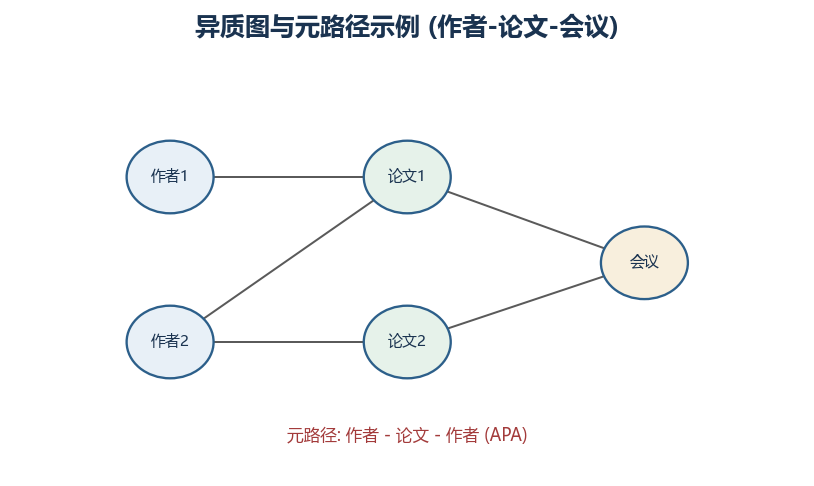

## 15.2　关系图卷积网络 R-GCN

同构 GCN（第 11 章）对每种边用同一个权重矩阵，无法区分关系类型。**关系图卷积网络**（Relational GCN, R-GCN）为每种关系分配独立的变换，同时用基分解（basis decomposition）控制参数量。

**定义 15.3（R-GCN 消息传递）** 对关系类型 $r\in\mathcal{R}$，节点 $v$ 在第 $l$ 层的聚合为

$$
\mathbf{h}_v^{(l+1)}=\sigma\!\left(\mathbf{W}_0^{(l)}\mathbf{h}_v^{(l)}+\sum_{r\in\mathcal{R}}\sum_{u\in N_r(v)}\frac{1}{c_{v,r}}\mathbf{W}_r^{(l)}\mathbf{h}_u^{(l)}\right), \tag{15-2}
$$

其中 $N_r(v)$ 是节点 $v$ 在关系 $r$ 下的邻居集合，$c_{v,r}$ 是归一化常数（通常取 $|N_r(v)|$），$\mathbf{W}_0$ 是自环变换。式 (15-2) 与第 10 章 MPNN 式 (10-1) 同构，只是把「一种消息函数」扩展为「每关系一种」。

**基分解推导。** 若关系数 $|\mathcal{R}|$ 很大，每个 $\mathbf{W}_r$ 含 $d\times d$ 参数，总量 $O(|\mathcal{R}|d^2)$ 易过拟合。R-GCN 把 $\mathbf{W}_r$ 约束为一组基矩阵的线性组合：

$$
\mathbf{W}_r^{(l)}=\sum_{b=1}^{B}a_{rb}^{(l)}\mathbf{B}_b^{(l)},\quad a_{rb}^{(l)}\in\mathbb{R}, \tag{15-3}
$$

其中 $B\ll|\mathcal{R}|$，基矩阵 $\mathbf{B}_b$ 共享，仅系数 $a_{rb}$ 随关系而变。参数量从 $O(|\mathcal{R}|d^2)$ 降为 $O(Bd^2+|\mathcal{R}|B)$。这是**低秩正则**在关系建模中的应用，与第 7 章知识图谱嵌入的分解思想一脉相承。

**严格定义（块对角分解的等价形式）。** 也可令 $\mathbf{W}_r$ 为块对角结构，每块对应一个关系族，从而在保留表达能力的同时减少参数——两种分解可叠加使用。进一步可证明：式 (15-2) 对同构特例（$|\mathcal{R}|=1$）还原为第 11 章 GCN 的归一化聚合 $\mathbf{h}^{(l+1)}=\sigma(\tilde{\mathbf{D}}^{-1/2}\tilde{\mathbf{A}}\tilde{\mathbf{D}}^{-1/2}\mathbf{h}^{(l)}\mathbf{W})$，故 R-GCN 是 GCN 在关系维度的严格推广。注意式 (15-2) 中的 $c_{v,r}$ 可按关系分别取度，也可统一取 $|N(v)|$——前者保留各关系邻域规模的差异，后者使不同关系在时间步上可比较。

**自环与类型的处理。** 式 (15-2) 的 $\mathbf{W}_0\mathbf{h}_v$ 项对应自环（self-loop），保证节点自身信息不被邻居淹没，与第 13 章讨论的过平滑问题直接相关：缺少自环会使深层 R-GCN 更快丧失节点身份。异质场景中自环也带类型——某些类型（如作者）允许自连接，某些（如会议）不允许，可由网络模式约束。

## 15.3　异质注意力机制

R-GCN 对同一关系内的邻居等权求和，忽略了邻居的重要性差异。**异质图注意力网络**（Heterogeneous Graph Attention Network, HAN）在元路径内部与元路径之间两个层级引入注意力。

**节点级注意力。** 沿元路径 $\mathcal{P}$，节点 $v$ 与其元路径邻居 $u\in N_{\mathcal{P}}(v)$ 的注意力系数为

$$
\alpha_{vu}^{\mathcal{P}}=\frac{\exp\!\left(\mathrm{LeakyReLU}\big(\mathbf{a}_{\mathcal{P}}^{\top}[\mathbf{W}_{\mathcal{P}}\mathbf{h}_v\,\|\,\mathbf{W}_{\mathcal{P}}\mathbf{h}_u]\big)\right)}{\sum_{u'\in N_{\mathcal{P}}(v)}\exp\!\left(\mathrm{LeakyReLU}\big(\mathbf{a}_{\mathcal{P}}^{\top}[\mathbf{W}_{\mathcal{P}}\mathbf{h}_v\,\|\,\mathbf{W}_{\mathcal{P}}\mathbf{h}_{u'}]\big)\right)}, \tag{15-4}
$$

其中 $\|$ 为拼接，$\mathbf{a}_{\mathcal{P}}$ 为注意力向量。节点表示是该元路径邻域的加权和：$\mathbf{h}_v^{\mathcal{P}}=\sigma\!\left(\sum_{u\in N_{\mathcal{P}}(v)}\alpha_{vu}^{\mathcal{P}}\mathbf{W}_{\mathcal{P}}\mathbf{h}_u\right)$。这与第 18 章图注意力在形式一致，区别在于注意力按元路径分别计算。

**语义级注意力。** 多条元路径 $\mathcal{P}_1,\ldots,\mathcal{P}_K$ 各有重要性，用 softmax 归一化：

$$
\beta_{\mathcal{P}_k}=\frac{\exp\!\left(\mathbf{q}^{\top}\tanh\!\big(\mathbf{W}_{\beta}\,\mathbf{z}_{\mathcal{P}_k}+\mathbf{b}_{\beta}\big)\right)}{\sum_{k'=1}^{K}\exp\!\left(\mathbf{q}^{\top}\tanh\!\big(\mathbf{W}_{\beta}\,\mathbf{z}_{\mathcal{P}_{k'}}+\mathbf{b}_{\beta}\big)\right)}, \tag{15-5}
$$

其中 $\mathbf{z}_{\mathcal{P}_k}$ 是元路径 $\mathcal{P}_k$ 下所有节点表示的均值（语义嵌入）。最终表示 $\mathbf{h}_v=\sum_k\beta_{\mathcal{P}_k}\mathbf{h}_v^{\mathcal{P}_k}$。两级注意力使模型既能「挑邻居」也能「挑语义」。

## 15.4　数值算例

**例 15.1（R-GCN 单步前向）** 设特征维度 $d=2$，两条边：$r_1$ 连接 $v$ 与 $u_1$，$r_2$ 连接 $v$ 与 $u_2$。取 $\mathbf{h}_v=(1,0)^\top$，$\mathbf{h}_{u_1}=(0,1)^\top$，$\mathbf{h}_{u_2}=(1,1)^\top$。令 $\mathbf{W}_0=\begin{pmatrix}1&0\\0&1\end{pmatrix}$，$\mathbf{W}_{r_1}=\begin{pmatrix}0&1\\1&0\end{pmatrix}$，$\mathbf{W}_{r_2}=\begin{pmatrix}1&0\\0&0\end{pmatrix}$，归一化 $c_{v,r_1}=c_{v,r_2}=1$。则

$$
\mathbf{W}_{r_1}\mathbf{h}_{u_1}=(1,0)^\top,\quad \mathbf{W}_{r_2}\mathbf{h}_{u_2}=(1,0)^\top,\quad \mathbf{W}_0\mathbf{h}_v=(1,0)^\top. \tag{15-6}
$$

求和得 $(3,0)^\top$，经 ReLU 仍为 $(3,0)^\top$。可见 $r_1$ 交换了 $u_1$ 两维、$r_2$ 只取 $u_2$ 第一维——不同关系产生不同的消息语义。

**例 15.2（基分解参数量）** 设 $|\mathcal{R}|=100$，$d=64$，$B=4$。全参数 R-GCN：$100\times64\times64=409600$。基分解：$B d^2+|\mathcal{R}|B=4\times4096+100\times4=16384+400=16784$，约为原来的 $4.1\%$。参数量大幅下降而仍保留每关系的独立系数。

### 15.4A　CompGCN：组合式关系建模与知识图谱嵌入的衔接

R-GCN（式 15-2）为每个关系分配**独立的线性变换** $\mathbf{W}_r$，表达力强但语义通道彼此独立。CompGCN（Vashishth 等[6]）换一种思路：把「关系」表示为一个**可学习的向量**，用向量组合算子 $\circ_r$ 把「邻居实体嵌入」与「关系嵌入」组合成消息，从而把第 7 章知识图谱嵌入的「关系分解」思想直接搬进消息传递：

$$
\mathbf{h}_v^{(l+1)}=\sigma\!\left(\sum_{r\in\mathcal{R}}\sum_{u\in N_r(v)}\frac{1}{c_{v,r}}\;\mathbf{h}_u^{(l)}\circ_r\,\mathbf{r}_r^{(l)}\right), \tag{15-7}
$$

其中 $\mathbf{r}_r^{(l)}\in\mathbb{R}^d$ 是关系 $r$ 的可学习嵌入，$\circ_r$ 取三种之一：**乘法组合** $\mathbf{h}_u\circ_r\mathbf{r}_r=\mathbf{h}_u\odot\mathbf{r}_r$（逐元素积）、**平移组合** $\mathbf{h}_u\circ_r\mathbf{r}_r=\mathbf{h}_u+\mathbf{r}_r$（TransE 式）、**复数/旋转组合**（RotatE 式）。与式 (15-2) 的对照清晰：R-GCN 的 $\mathbf{W}_r\mathbf{h}_u$ 是「关系决定如何变换实体」，CompGCN 的 $\mathbf{h}_u\circ_r\mathbf{r}_r$ 是「实体与关系两向量直接组合」。后者参数量只随 $|\mathcal{R}|d$（关系嵌入）增长，对关系数极多的知识图谱更友好，且组合算子 $\circ_r$ 直接继承第 7 章嵌入模型的几何语义（平移/旋转/缩放）。

**例 15.9（乘法组合手算）** 设 $d=2$，邻居 $\mathbf{h}_u=(1,1)^\top$、关系嵌入 $\mathbf{r}_r=(2,0)^\top$、$c_{v,r}=1$、$\sigma=\mathrm{ReLU}$。乘法组合：$\mathbf{h}_u\odot\mathbf{r}_r=(2,0)^\top$，$\sigma$ 后 $(2,0)^\top$。若改用平移组合：$\mathbf{h}_u+\mathbf{r}_r=(3,1)^\top$。同一关系下两种组合算子给出不同消息——乘法组合让「关系为零分量的维度」被屏蔽（这里第二维归零），平移组合则整体位移。这说明 CompGCN 的表达力来自组合算子的选择，而非参数量，与 R-GCN「参数即表达力」形成对照。

**与第 7 章的衔接。** CompGCN 可视为「把 TransE/RotatE 等嵌入模型的三元组打分，升级为多层图上的迭代消息传递」：第 7 章的 $\mathbf{e}_h+\mathbf{r}\approx\mathbf{e}_t$（平移）在 CompGCN 中变为逐跳的 $\mathbf{h}_u+\mathbf{r}_r$ 聚合。因此异质图/关系图方法、知识图谱嵌入、关系消息传递三者共享同一底层语言——**关系是实体间的一种可学习的几何变换**。

### 15.4B　HAN 两级注意力手算与元路径随机游走

为落实式 (15-4)、(15-5)，取一个最小学术异质图：作者 $v$、论文 $p_1,p_2$、会议 $c_1$，边类型「撰写 $w$」「发表于 $c$」。沿元路径 $\mathcal{P}=\mathrm{APA}$（作者—论文—作者），设 $v$ 经两篇论文连到合著者 $a_1,a_2$，元路径邻居特征（取 2 维）$\mathbf{h}_v=(1,0),\mathbf{h}_{a_1}=(1,1),\mathbf{h}_{a_2}=(0,1)$，注意力向量 $\mathbf{a}^\top=(1,1)$（忽略 $\mathbf{W}_\mathcal{P}$ 与 LeakyReLU 的正负，直接取内积打分）。则

$$
e_{v,a_1}=\mathbf{h}_v\cdot\mathbf{h}_{a_1}=1,\qquad e_{v,a_2}=\mathbf{h}_v\cdot\mathbf{h}_{a_2}=0,\qquad
\alpha_{v,a_1}=\frac{e^{1}}{e^{1}+e^{0}}\approx0.73,\quad \alpha_{v,a_2}\approx0.27.
$$

合著者表示 $\mathbf{h}_v^{\mathcal{P}}=0.73(1,1)+0.27(0,1)=(0.73,1.0)$——更偏向合著者 $a_1$（与 $v$ 共享更多论文）。语义级（式 15-5）上若另一条元路径 $\mathcal{P}'=\mathrm{APCPA}$（同会议）的语义嵌入打分更高，则 $\beta_{\mathcal{P}'}>\beta_{\mathcal{P}}$，最终 $\mathbf{h}_v=\beta_{\mathcal{P}}\mathbf{h}_v^{\mathcal{P}}+\beta_{\mathcal{P}'}\mathbf{h}_v^{\mathcal{P}'}$ 偏向「同会议」通道。两级注意力让模型**既挑邻居（节点级）又挑语义（语义级）**，这正是异质场景比同构 GCN 强判别力的来源。

**元路径作为受约束随机游走。** metapath2vec[1] 把元路径实现为**类型约束的随机游走**：在 $v$（作者）处只能沿「撰写」边跳到论文，在论文处只能沿「发表于」跳到会议，依元路径 $\mathrm{APCPA}$ 的类型序列交替选择边类型，采样的路径序列喂入 Word2Vec 式跳过-图（skip-gram）学嵌入。与 R-GCN/HAN 的「前向聚合」相对，metapath2vec 是「采样—嵌入」路线：它不维护逐层节点表示，而是把每条元路径上的共现当作「上下文」来训练向量。两条路线在「沿类型通道传播」上汇合——前者把类型通道显式写成聚合权重，后者把它写成采样分布的转移约束。

## 15.5　技术谱系与变体

**表 15-1　异质图与关系图方法谱系**

| 方法 | 核心机制 | 是否用元路径 | 代表文献 |
|------|----------|:---:|------|
| 浅层异质嵌入 | 随机游走 + 类型约束 | 是 | metapath2vec [1] |
| R-GCN | 每关系独立变换 + 基分解 | 否 | Schlichtkrull 等 [2] |
| HAN | 节点级 + 语义级注意力 | 是 | Yang 等 [3] |
| GTN | 元路径自动生成 | 是（隐式） | Yun 等 [4] |
| RGAT | 关系感知注意力 | 否 | Busbridge 等 [5] |
| CompGCN | 组合实体与关系嵌入 | 否 | Vashishth 等 [6] |

异质图方法沿两条线演进：一条以**元路径**为中心（metapath2vec、HAN、GTN），强调语义通道；另一条以**关系变换**为中心（R-GCN、RGAT、CompGCN），强调参数化关系算子。前者需领域知识定义元路径（或自动学习），后者更通用但语义解释弱。第 7 章的知识图谱嵌入可视为关系图方法在嵌入层的特例。

### 15.5A　元路径自动生成：GTN 把「设计元路径」变为「学元路径」

HAN（式 15-4、15-5）的两级注意力仍要求**人工预先给定**候选元路径集 $\{\mathcal{P}_1,\dots,\mathcal{P}_K\}$，元路径选错则上限受限。GTN（Yun 等[4]）把元路径也变成可学习对象：用一组**门控循环单元（GRU）隐状态**动态决定「沿哪条边、走几跳」，从而在固定层数内实现**变长元路径**的消息传递。第 $l$ 层第 $t$ 个时间步的隐状态按

$$
\mathbf{h}_v^{(l,t)}=\mathrm{GRU}\!\left(\mathbf{h}_v^{(l,t-1)},\;\bigoplus_{u\in\mathcal{N}(v)}\psi\big(\mathbf{h}_v^{(l,t-1)},\mathbf{h}_u^{(l-1)},\,t\big)\right), \tag{15-8}
$$

其中 $\mathcal{N}(v)$ 是 $v$ 在**所有关系**下的一跳邻居（GTN 不预先分元路径，而是在每步用注意力在「关系类型 + 跳数 $t$」上动态加权），$\psi$ 是含时间步 $t$ 的消息函数。$t=1$ 时退化为普通一跳聚合，$t\ge2$ 时隐式组合出「关系序列」——等价于在 $l$ 层内展开了一条长度为 $t$ 的元路径，但其「路径选择」由 GRU 隐状态与注意力共同决定，而非人工指定。

**与 HAN 的对照。** 二者都追求「按语义通道聚合」，差别在元路径的来源：HAN 显式枚举元路径、对每条独立做注意力（式 15-4），可解释但受候选集限制；GTN 隐式生成元路径（式 15-8），灵活且能发现数据驱动的通道，但单步计算涉及「关系数 × 时间步」，开销更高、可解释性更弱。实践上 GTN 常与 HAN 式注意力叠加：用 GTN 学「走哪条通道」、用 HAN 语义级注意力（式 15-5）学「各通道权重」。

## 15.6　边界、讨论与承上启下

异质图方法的核心假设是**类型携带语义**。当类型标注缺失或类型粒度不当（过粗/过细）时，性能会下降。元路径依赖人工设计，自动元路径发现（如 GTN）虽缓解但仍受候选空间限制。R-GCN 的基分解引入低秩假设，对关系数极多且语义独立的场景（如大规模知识图谱）可能欠拟合。此外，异质图与**动态性**正交——本节处理类型异质，下一章处理时间演化，二者可叠加（异质动态图）。

**表达力：异质性如何突破同构 GNN 的上限。** 第 12 章证明同构 MPNN 不超过 1-WL 测试。异质图方法在「类型」维度上扩展了可区分的结构：R-GCN（式 15-2）对每条关系用独立 $\mathbf{W}_r$，等价于在**带边标签的图**上做消息传递，其判别力对应「边着色 1-WL」（color-refinement on edge-labeled graphs），严格强于同构图上的 1-WL——因为类型标签本身参与颜色精化。HAN 的元路径（式 15-4）则把「长度 $l$ 的类型序列」纳入聚合，可捕获 $l$ 跳、类型特定的高阶邻域，表达能力随元路径长度 $l$ 与条数 $K$ 增长。但类型维度的表达力仍受限于**已定义的类型集**：未标注的语义差异无法被区分。这与第 10 章「结构决定表达力」一致，只是异质场景把「结构」扩展为「结构 + 类型」。GTN（式 15-8）以动态生成的元路径进一步逼近「任意类型序列」的极限，代价是可解释性与算力。

本章衔接第 7 章（知识图谱嵌入的关系分解）、第 10—12 章（消息传递与 GCN 的扩展）、第 18 章（异质图注意力与图 Transformer），并为第 29—31 章图基础模型处理多类型数据提供基础。

## 本章小结

本章把第 10—14 章的同构消息传递推广到带类型语义的异质图与关系图。

我们首先给出异质图定义（定义 15.1）与元路径的形式化（式 15-1），阐明「按语义通道分别聚合」的直觉。接着推导 R-GCN（式 15-2）与基分解（式 15-3），把参数量从 $O(|\mathcal{R}|d^2)$ 降为 $O(Bd^2+|\mathcal{R}|B)$。我们介绍 HAN 的两级注意力（式 15-4、15-5），并通过两个算例（式 15-6）让读者手算验证关系变换与参数压缩效果。最后梳理元路径与关系变换两条技术路线（表 15-1）并讨论边界。

我们还明确边界：类型语义假设、元路径设计依赖、低秩分解的欠拟合风险。这些辨析衔接第 7、10—12、18、29—31 章。

下一章转向另一维度——图随时间演化的动态图与时序图神经网络。

**进一步阅读**　本章建议延伸阅读的文献：[1]、[2]、[3]、[4]。

## 参考文献

[1] Dong Y, Chawla N V, Swami A. metapath2vec: Scalable representation learning for heterogeneous networks. *KDD*, 2017.

[2] Schlichtkrull M, Kipf T N, Bloem P, et al. Modeling relational data with graph convolutional networks. *ESWC*, 2018.

[3] Yang Z, Liu Y, Wang Z, et al. Heterogeneous graph attention network. *WWW*, 2019.

[4] Yun S, Jeong M, Kim R, et al. Graph Transformer Networks. *NeurIPS*, 2019.

[5] Busbridge D, Chatzimparmpas A, Korovina K, et al. Relational graph attention networks. *arXiv:1904.05811*, 2019.

[6] Vashishth S, Sanyal S, Nitin V, et al. Composition-based multi-relational graph convolutional networks. *ICLR*, 2020.

[7] Wang X, Ji H, Shi C, et al. Heterogeneous graph attention networks: A survey. *arXiv:2103.09828*, 2021.

[8] Zhang J, Musco C, Econem B, et al. Invariant and equivariant graph networks for heterogeneous graphs. *ICML*, 2023.

---

# 第 16 章　动态图与时序图

第 15 章处理了关系的**类型异质性**——图的边有不同语义。但真实关系数据还有另一个维度：**时间**。社交网络中的好友关系会建立与解除，交易网络中的资金流向随秒级事件更新，引文网络随时间累积。第 10—15 章的方法都假设图是静态快照（static snapshot），把图当作固定的 $\mathbf{A}$ 处理；一旦拓扑或特征随时间变化，静态模型便失效。本章把消息传递扩展到**动态图**（dynamic graph）与**时序图**（temporal graph）。

本章先给出动态图的形式化与离散/连续时间建模的分野（16.1 节），推导时序图注意力 TGAT（16.2 节）与时序图网络 TGN（16.3 节），给出事件流建模的数值算例（16.4 节），梳理技术谱系（16.5 节），最后讨论边界并承上启下（16.6 节）。

## 16.1　动态图的形式化与两种时间观

**定义 16.1（动态图）** 动态图是随时间演化的一族图 $\{G(t)=(V(t),E(t),\mathbf{X}(t))\}_{t\ge 0}$，其中节点集、边集与特征矩阵均可随时间变化。按时间建模方式分两类：

- **离散时间动态图**（discrete-time dynamic graph, DTDG）：按固定时间间隔 $\Delta$ 取快照序列 $\{G_1,G_2,\ldots,G_T\}$，每 snapshot 是一个静态图；
- **连续时间动态图**（continuous-time dynamic graph, CTDG）：以事件流（event stream）形式给出，每个事件记录时刻 $t$ 发生的 additions/deletions/interactions。

**定义 16.2（时序事件流）** 连续时间动态图可表示为事件序列 $\{(e_i,t_i)\}_{i=1}^{N}$，其中事件 $e_i$ 是节点加入、边添加 $ (u,v,t_i) $、边删除或特征更新，且 $t_1\le t_2\le\cdots\le t_N$。

**直觉解释。** 离散快照像「电影的逐帧画面」——丢失帧内细节，但可直接套用静态 GNN；连续事件流像「原始录像」——保留精确时序，但需要专门处理不规则时间间隔。二者 choice 取决于数据粒度与任务：若只需月度社群发现，快照足矣；若需实时欺诈检测（毫秒级），必须用事件流。

> 【图 16-1　离散快照与连续事件流】（原图见 figures/图16-1.png）：上排三个时间快照 $G_1,G_2,G_3$；下排对应的连续事件时间轴，标注节点加入与边交互事件。
>
> 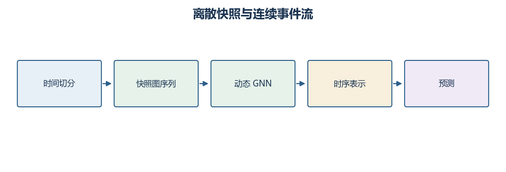

## 16.2　时序图注意力 TGAT

**时序图注意力**（Temporal Graph Attention, TGAT）把第 18 章的图注意力扩展到连续时间：注意力权重不仅依赖节点特征，还依赖**时间编码**。

**时间编码。** 用一组可学习频率的正弦函数把时间间隔 $\Delta t$ 映射到向量：

$$
\Phi(\Delta t)=\sqrt{\frac{1}{d_t}}\Big(\cos(\omega_1\Delta t),\sin(\omega_1\Delta t),\ldots,\cos(\omega_{d_t}\Delta t),\sin(\omega_{d_t}\Delta t)\Big), \tag{16-1}
$$

其中 $\omega_i$ 是可学习（或固定）的角频率。之所以用正弦，是因为它满足**时间平移的近似等变性**——与第 18 章位置编码的思想一致，但把「位置」换成「时间差」。

**时序注意力。** 节点 $v$ 在时刻 $t$ 聚合其历史邻居 $u\in N(v;t)$ 的消息：

$$
\boldsymbol{\alpha}_{vu}(t)=\mathrm{softmax}_{u}\!\left(\frac{(\mathbf{W}_Q\mathbf{h}_v(t))^{\top}\big(\mathbf{W}_K\mathbf{h}_u+\mathbf{W}_T\Phi(t-t_u)\big)}{\sqrt{d}}\right), \tag{16-2}
$$

$$
\mathbf{h}_v(t)=\mathrm{ReLU}\!\left(\sum_{u\in N(v;t)}\alpha_{vu}(t)\,\big(\mathbf{W}_V\mathbf{h}_u+\mathbf{W}_T'\Phi(t-t_u)\big)\right). \tag{16-3}
$$

式 (16-2) 中注意力同时考量 $u$ 的静态特征与交互时间 $t_u$ 距当前时刻 $t$ 的间隔——越近的交互通常权重越高（但由数据学习）。这把第 10 章消息传递的「邻域聚合」升级为「带时间衰减的邻域聚合」。

**严格推导（因果约束）。** TGAT 严格限定 $t_u<t$（只用过去事件），保证无未来信息泄漏（leakage）。对快照图 $G_k$，则聚合 $N(v;t_k)$ 内 $t_u\le t_k$ 的邻居——离散情况是连续情况的特例。

**与快照类方法的衔接（CTDE/CTP）。** 在 TGAT/TGN 等事件驱动模型出现前，主流是**快照类**方法：把离散时间动态图 $\{G_k\}$ 的邻接矩阵序列 $\{\mathbf{A}_k\}$ 当作时间序列，对每个节点嵌入做**连续时间随机游走**（continuous-time random walk, CTRW）的马尔可夫链平滑——即 CTDE/CTP（详见综述 [7][8]）。其嵌入更新为邻接加权的前一时刻嵌入加新快照信息，再对时间维做平滑，避免「快照间嵌入跳变」；CTP（CTDE 的并行版）把游走展开到 $t$ 步。快照类方法直接复用静态 GNN/嵌入，实现简单，但**丢失快照内的事件时序**（同快照内的事件被视作同时），且固定时间间隔 $\Delta$ 的选取敏感——这正是事件驱动模型（TGAT/TGN）要解决的精度问题。

**例 16.3（TGAT 时序注意力手算）** 设 3 节点链 $1-2-3$，当前 $t=3$，查询节点 $v=1$，历史邻居 $u\in\{2\}$（$u=2$ 在 $t_u=1$ 与 $v$ 交互过）。取 $d=2$，$\mathbf{W}_Q=\mathbf{W}_K=\mathbf{W}_V=\mathbf{I}$，$\mathbf{h}_v=(1,0)$，$\mathbf{h}_u=(0,1)$。用式 (16-1) 时间编码 $d_t=1,\omega_1=1$：$\Phi(t-t_u)=\Phi(2)=(\cos2,\sin2)\approx(-0.416,0.909)$。设 $\mathbf{W}_T$ 取前两个分量的 $0.5$ 倍标量近似（简化），则式 (16-2) 的 logit 为 $\mathbf{h}_v^\top\big(\mathbf{h}_u+0.5\Phi(2)\big)=(1,0)\cdot(0.584,1.455)=0.584$；单邻居 softmax 后 $\alpha_{vu}=1$。式 (16-3) 得 $\mathbf{h}_v(3)=\mathrm{ReLU}\big(\mathbf{h}_u+0.5\Phi(2)\big)\approx\mathrm{ReLU}(0.584,1.455)=(0.584,1.455)$——节点 1 的嵌入吸收了邻居 2 的信息，且时间差 $t-t_u=2$ 通过 $\Phi(2)$ 进入了消息。若把 $t$ 拉近（如 $t=2,\Delta t=1$，$\Phi(1)\approx(0.540,0.841)$），消息 $(0.270,1.421)$ 的「时间分量」变化——同一对节点在不同时距下得到不同表示，这正是时序注意力「越近的交互权重/形态不同」的数值体现。

## 16.3　时序图网络 TGN

**时序图网络**（Temporal Graph Network, TGN）提供一个统一的事件驱动框架，核心是**记忆模块**（memory）。每个节点维护一个随时间更新的状态向量 $\mathbf{s}_v(t)$，新事件到来时增量更新，无需重算整个图。

**记忆更新。** 当节点 $v$ 在时刻 $t$ 参与事件（与 $u$ 交互），其记忆按

$$
\mathbf{s}_v(t)=\mathrm{GRU}\big(\mathbf{s}_v(t^-),\,\mathbf{m}_v(t)\big),\quad \mathbf{m}_v(t)=\big(\mathbf{h}_v(t^-)\|\mathbf{h}_u(t^-)\|\Phi(t-t_v)\|\mathbf{e}_{uv}\big), \tag{16-4}
$$

其中 $\mathbf{s}_v(t^-)$ 是事件前的记忆，$\mathbf{m}_v(t)$ 是消息向量（拼接两端历史表示、时间编码与边特征），GRU 实现循环更新。这是把第 10 章 MPNN 与循环网络（第 9 章式的时序展开）结合。

**记忆的初始化与衰减。** 新加入节点的记忆初始化为零向量或其特征投影；长期无事件的节点记忆可通过时间衰减因子 $g(\Delta t)$ 软化，避免陈旧信息干扰——这与第 16.2 节时间编码的衰减意图一致，但作用于记忆而非注意力。

**嵌入计算。** 任意时刻 $t$ 的节点嵌入由记忆与时序邻域聚合得到：

$$
\mathbf{z}_v(t)=\mathbf{s}_v(t)+\mathrm{TGAT}\big(\mathbf{s}_v(t),\{\mathbf{s}_u(t):u\in N(v;t)\}\big), \tag{16-5}
$$

再接 MLP 产生任务输出（如链路预测概率）。TGN 的关键是**增量式**：仅重算事件涉及节点的记忆，复杂度 $O(|事件|)$ 而非 $O(|V|)$——适合大规模流式图。

## 16.4　数值算例

**例 16.1（时间编码手算）** 设 $d_t=2$，频率 $\omega_1=1,\omega_2=2$，时间间隔 $\Delta t=\pi/2$。则

$$
\Phi(\pi/2)=\frac{1}{\sqrt{2}}\big(\cos\tfrac{\pi}{2},\sin\tfrac{\pi}{2},\cos\pi,\sin\pi\big)=\frac{1}{\sqrt{2}}(0,1,-1,0)\approx(0,0.707,-0.707,0). \tag{16-6}
$$

可见不同 $\Delta t$ 产生不同编码，且 $\Phi(0)=(1,0,1,0)/\sqrt{2}$ 表示「同时」。模型从这些正弦分量中学到时间衰减模式。

**例 16.2（TGN 记忆更新规模）** 设图有 $|V|=10^6$ 节点，每秒 $10^4$ 个事件。静态重算每轮 $O(|V|)=10^6$；TGN 增量更新每轮 $O(10^4)$——快 100 倍。这解释了为何工业界实时图系统（如反欺诈）采用 TGN 式记忆架构。

### 16.4A　连续时间的核记忆与指数衰减

TGN（式 16-4）的记忆更新是**离散事件驱动**的：只有事件发生才触发 GRU 更新，事件间隔被压缩成单个 $\Phi(t-t_v)$ 向量。更一般的连续时间动态系统（continuous-time dynamic system, CTDS）把记忆写成对过去事件的**核加权积分**，明确刻画「随时间遗忘」：

$$
\mathbf{s}_v(t)=\int_{0}^{t} k(t-\tau)\,\mathbf{m}_v(\tau)\,d\tau, \tag{16-7}
$$

其中 $k(\cdot)$ 是**时间衰减核**（kernel），$\mathbf{m}_v(\tau)$ 是 $\tau$ 时刻注入 $v$ 的消息。$k$ 选取决定遗忘曲线：取**指数核** $k(\Delta t)=e^{-\lambda\,\Delta t}/\lambda$（$\lambda>0$ 为遗忘率）时，式 (16-7) 有闭式递推，事件间记忆按指数衰减

$$
\mathbf{s}_v(t)=e^{-\lambda(t-t_{\mathrm{last}})}\,\mathbf{s}_v(t_{\mathrm{last}})+\mathbf{m}_v(t_{\mathrm{last}}), \tag{16-8}
$$

即「上一次事件以来的记忆被打上 $e^{-\lambda\,\Delta t}$ 的折扣，再叠加新消息」。指数核是 TGN 式 GRU 记忆的**连续时间连续体**：GRU 的门控在极限下逼近指数遗忘，$\lambda$ 即遗忘速率的隐式参数。式 (16-8) 同时给出 TGN 增量式（仅更新涉及节点）的理论来源——记忆沿时间单调衰减，无需重算历史。

**例 16.8（指数核记忆数值）** 设 $\lambda=0.1/\text{h}$（约 6.9 h 半衰期），节点 $v$ 在 $t=0$ 注入消息 $\mathbf{m}_0=(1,0)$，此后无事件。$t=1\text{ h}$ 时 $\mathbf{s}_v=e^{-0.1}(1,0)\approx0.905(1,0)$；$t=10\text{ h}$ 时 $e^{-1}(1,0)\approx0.368(1,0)$；$t=69\text{ h}$（$\approx10$ 倍半衰期）时 $\approx0.001(1,0)$——记忆几乎遗忘。若 $t=5\text{ h}$ 又注入 $\mathbf{m}_5=(0,1)$，则 $\mathbf{s}_v(5)=e^{-0.5}(1,0)+(0,1)\approx(0.607,1)$，新消息权重 1、旧记忆被打折到 0.607。这展示了「近期事件强、远期事件弱」的衰减直觉，且折扣因子 $e^{-\lambda\,\Delta t}$ 与式 (16-2) 中时间编码 $\Phi(t-t_u)$ 的衰减意图一致，只是核记忆把它写成了显式乘子。

### 16.4B　注意力型动态记忆与时序链路预测

GRU 记忆（式 16-4）对长程事件的遗忘是固有的——循环单元只能压缩成定长状态。DyGFormer 等把节点记忆换成**可查询的事件记忆库**：每个节点存一条历史事件列表 $\{(\mathbf{m}_v(\tau_i),\tau_i)\}_{i=1}^{n_v}$，任意时刻 $t$ 的嵌入由**注意力回溯**全部历史事件得到，

$$
\mathbf{s}_v(t)=\sum_{i=1}^{n_v}\alpha_{v,i}(t)\,\mathbf{m}_v(\tau_i),\qquad
\alpha_{v,i}(t)=\frac{\exp\!\big(\mathbf{q}_t^\top\big(\mathbf{W}_K\mathbf{m}_v(\tau_i)+\mathbf{W}_T\Phi(t-\tau_i)\big)\big)}{\sum_{j}\exp\!\big(\mathbf{q}_t^\top\big(\mathbf{W}_K\mathbf{m}_v(\tau_j)+\mathbf{W}_T\Phi(t-\tau_j)\big)\big)}, \tag{16-9}
$$

与第 18 章全局注意力的结构相同，只是「键」是历史事件、「距离」是时间差 $t-\tau_i$。注意力回溯把「遗忘」从硬编码的指数折扣（式 16-8）变为**数据驱动**：重要历史事件可被长期保留（$\alpha_{v,i}$ 不随 $t-\tau_i$ 必然衰减），突破 GRU 的定长瓶颈。代价是 $O(n_v)$ 的历史存储与查询，需事件截断或分层记忆控制开销。

**时序链路预测的评测。** 动态图最经典任务是**时序链路预测**：给定截至 $t$ 的事件流，预测 $(t, u, v)$ 处是否出现新边。评测必须**按时间顺序切分**（时间感知划分）：训练集取 $t<t_{\mathrm{cut}}$ 的边、测试集取 $t\ge t_{\mathrm{cut}}$ 且此前未出现过的边，**严禁随机切分**——随机切分会让测试边出现在训练边的「未来」被提前曝光，造成未来信息泄漏（第 19 章详述）。负采样按「同时间步、未出现的节点对」生成。式 (16-5) 的节点嵌入 $\mathbf{z}_v(t)$ 拼接后送二分类即得边概率；TGN/DyGFormer 的增量记忆使该任务可在事件流上**在线**训练，而非离线快照。

## 16.5　技术谱系与变体

**表 16-1　动态图方法谱系**

| 方法 | 时间观 | 核心机制 | 代表文献 |
|------|--------|----------|------|
| 快照 GNN | 离散 | 每快照独立 GCN + 时序平滑 | GCN-GRU [1] |
| TGAT | 连续 | 时间编码 + 时序注意力 | Xu 等 [2] |
| TGN | 连续 | 记忆模块 + 事件驱动 | Rossi 等 [3] |
| DyGIE++ | 离散 | 动态图抽取 + 实体 | Wadden 等 [4] |
| JODIE | 连续 | 双时态记忆（用户/物品） | Kumar 等 [5] |
| APAN | 连续 | 注意力 + 时间感知邻居 | Wang 等 [6] |

离散方法实现简单、可复用静态 GNN，但丢失事件级精度；连续方法保留时序细节、支持实时推理，但需要记忆管理与时间编码设计。JODIE 等面向特定场景（用户—物品交互）做定制。第 19 章的链路预测在动态场景变为「时序链路预测」，TGN 是其主流 backbone。

### 16.5A　JODIE 双时态记忆与 APAN 时间感知注意力

**JODIE（Kumar 等[5]）** 针对**交互网络**（如社交、交易）的「用户—物品」二部结构，把节点嵌入拆成**位置向量**（随时间演化）与**方向向量**（刻画下一次交互意图）两部分，二者各自按事件增量更新，预测 $(u,v,t)$ 时用 $\langle\text{pos}_u,\text{dir}_v\rangle$ 打分。其「双时态」设计把 TGAT/TGN 的单一记忆扩展为「在哪里 + 要往哪」的二元组，对交互序列预测更贴合。它与 TGN 的区别在于：TGN 维护**单一** GRU 记忆（式 16-4），JODIE 维护**位置 + 方向**双记忆，使模型能区分「节点当前状态」与「节点下一步行为倾向」——后者正是链路预测需要的。

**APAN（Wang 等[6]）** 面向**实时**场景，强调「事件到来即推理、无需训练」的**异步传播**：新事件触发时，沿历史交互路径做**注意力传播**，节点嵌入 = 当前特征 + 时间衰减的历史邻居嵌入加权和，衰减因子随时间差增大而减小，且邻居权重由**时间感知注意力**（与式 16-2 同源，但以「距上次交互的时长」为键）动态确定。APAN 的关键是**推理时计算**而非训练时记忆——适合无法重训的流式系统，代价是单次查询沿路径传播的开销随跳数增长。

**离散 vs 连续：建模粒度与精度的权衡。**

| 维度 | 离散快照（CTDE/CTP、GCN-GRU） | 连续事件流（TGAT/TGN/JODIE/APAN） |
|------|------------------------------|----------------------------------|
| 时间分辨率 | 固定间隔 $\Delta$，丢失快照内时序 | 精确事件时间戳 |
| 计算 | 每快照 $O(n)$，可批处理 | 每事件 $O(\text{度})$，在线增量 |
| 泄漏风险 | 快照边界即因果边界，较易保证 | 须显式因果约束（$t_u<t$） |
| 适用 | 月度/周度社群演化 | 毫秒级欺诈、实时推荐 |
| 时间编码 | 隐式（快照序号） | 显式（$\Phi(\Delta t)$，式 16-1） |

离散方法把「时间」压缩为快照序号，实现简单、易复用静态 GNN，但同一快照内事件被视为同时，丢失事件级精度；连续方法把「时间」写进注意力与记忆（式 16-2、16-4、16-8），精度与实时性高，但需因果约束、记忆管理与时间编码设计。**数据决定选择**：若任务的时间粒度与快照间隔同量级（如季度图），离散足矣；若需实时、事件级精度（如反欺诈、实时推荐），必须用连续事件流。二者并非对立——实践中常以连续模型做在线预测、以离散快照做离线再训练，形成混合架构。

## 16.6　边界、讨论与承上启下

动态图的核心挑战有三：① **概念漂移**（concept drift）——节点/边的语义随时间变化，静态训练的分布假设失效；② **长程时间依赖**——GRU 记忆对很久以前事件遗忘，需层级记忆或注意力回溯；③ **评估偏差**——随机切分时间会造成未来信息泄漏，必须按时间顺序切分（第 19 章讨论）。此外，连续时间方法对事件时间戳精度敏感，粗粒度时间戳会退化为离散情况。

**记忆机制与状态空间/控制论的同源。** 把 TGN 的节点记忆 $\mathbf{s}_v(t)$（式 16-4）看作**隐状态**、把事件 $\mathbf{m}_v(t)$ 看作**输入**，式 (16-4) 的 GRU 更新正是「状态 = f(旧状态, 新输入)」的离散动态系统——与 book-0001 第 13 章卡尔曼滤波的「预测—更新」循环同构，只是把线性高斯换成非线性门控。指数核记忆（式 16-8）$\mathbf{s}_v(t)=e^{-\lambda\Delta t}\mathbf{s}_v(t^-)+\mathbf{m}_v(t)$ 更是把这种递推写成了显式状态转移 $\mathbf{s}_{t}=\mathbf{T}\,\mathbf{s}_{t-1}+\mathbf{u}_t$（$\mathbf{T}=e^{-\lambda\Delta t}$ 标量、$\mathbf{u}_t$ 为事件注入），直接对应状态空间模型。因此动态图学习可视为**把状态空间里的线性转移 $\mathbf{T}$ 替换为神经网络化的非线性动力学**：线性高斯下前者给出最优滤波，后者在任意非线性下用数据学习状态转移。这条「状态—观测」主线从时间序列的递推滤波延伸到图上的时间演化，再通往「从数据学习动力学」的世界模型，是本库跨书统一的动力学视角（状态空间与卡尔曼滤波的完整推导见姊妹书《时序智能导论》第 13 章）。

**过平滑在时间维的对应。** 第 13 章指出空间上反复邻域平均导致过平滑；时间维上反复「与历史邻居平均」则导致**时间过平滑**——节点表示随时间趋同、失去「近期 vs 远期」的区分。TGAT 的时间编码（式 16-1）与核记忆的衰减因子（式 16-8）正是时间维的「保留高频」手段：越近的事件权重越大，避免历史把当前表示「磨平」。理解这一点，动态图的设计原则与深层 GNN 的设计原则（保留高频、对抗过平滑）殊途同归——只是平滑发生在时间轴而非空间轴。

本章衔接第 10 章（消息传递的时序扩展）、第 15 章（异质与动态可叠加）、第 18 章（时间编码与位置编码同源）、第 19 章（动态链路预测）。下一章转向另一结构扩展——高阶结构（超图与单纯复形）。

## 本章小结

本章把消息传递从静态图扩展到随时间演化的动态图与时序图。

我们首先给出动态图定义（定义 16.1、16.2）与离散/连续时间两种建模观及其直觉。接着推导 TGAT 的时间编码（式 16-1）与时序注意力（式 16-2、16-3），介绍 TGN 的记忆更新（式 16-4）与嵌入计算（式 16-5），并通过手算（式 16-6）与规模对比展示时间编码与增量更新的效果。最后梳理方法谱系（表 16-1）并讨论概念漂移、长程依赖、评估偏差等边界。

我们还明确边界：概念漂移、时间依赖遗忘、时间切分泄漏风险。这些辨析衔接第 10、15、18、19 章。

下一章介绍超图与高阶结构——突破「边只能连接两个节点」的限制。

**进一步阅读**　本章建议延伸阅读的文献：[1]、[2]、[3]、[5]。

## 参考文献

[1] Seo Y, Defferrard M, Vandergheynst P, et al. Structured sequence modeling with graph convolutional recurrent networks. *ICONIP*, 2018.

[2] Xu D, Cheng W, Luo D, et al. Inductive representation learning on temporal graphs. *ICLR*, 2020.

[3] Rossi E A, Chamberlain B P, Frasca F, et al. Temporal graph networks for deep learning on dynamic graphs. *ICML GNN Workshop*, 2020.

[4] Wadden D, Wang K, Lin C, et al. Entity, relation, and event extraction with contextualized span representations. *EMNLP-IJCNLP*, 2019.

[5] Kumar S, Zhang X, Leskovec J. Predicting dynamic embedding trajectory in temporal interaction networks. *KDD*, 2019.

[6] Wang X, Lyu Y, Li M, et al. APAN: Asynchronous propagation attention network for real-time temporal graph embedding. *SIGMOD*, 2021.

[7] Kazemi S M, Goel R, Jain A, et al. Time representation in dynamic graph learning: A survey. *arXiv:2204.10500*, 2022.

[8] Cong W, Kantarcioglu M, Pardalos P, et al. Temporal graph learning: A survey. *arXiv:2306.07921*, 2023.

---

# 第 17 章　超图与高阶结构

第 10—16 章的图神经网络都建立在二元边（dyadic edge）之上——每条边恰好连接两个节点。然而现实中的许多关系是**多元的**（polyadic）：一个学术会议同时涉及多位作者与多篇论文，一张照片标注了多个人物，一个化学反应涉及多种分子。把这种高阶关系强行拆成两两相连的团（clique）会丢失「这组节点作为一个整体共同出现」的信息。本章突破二元边的限制，处理**超图**（hypergraph）与**单纯复形**（simplicial complex）上的高阶消息传递（higher-order message passing）。

本章先给出超图与单纯复形的形式化（17.1 节），推导超图神经网络（17.2 节）与单纯复形上的高阶传递（17.3 节），给出数值算例（17.4 节），梳理技术谱系（17.5 节），最后讨论边界并承上启下（17.6 节）。

## 17.1　超图与单纯复形的形式化

**定义 17.1（超图）** 超图是一个二元组 $H=(V,\mathcal{E})$，其中 $V$ 是节点集，$\mathcal{E}=\{e_1,e_2,\ldots\}$ 是**超边**（hyperedge）集合，每条超边 $e\subseteq V$ 可连接任意数量节点（$|e|\ge 1$）。当所有 $|e|=2$ 时退化为普通图。超图常用**关联矩阵**（incidence matrix）$\mathbf{H}\in\{0,1\}^{|V|\times|\mathcal{E}|}$ 表示，$H_{ve}=1$ 当且仅当 $v\in e$。

**定义 17.2（单纯复形）** 单纯复形（simplicial complex）$\mathcal{K}$ 是节点集上的一族子集，满足：若 $f\in\mathcal{K}$ 且 $e\subseteq f$，则 $e\in\mathcal{K}$（**向下封闭性**）。若 $|e|=k+1$，称 $e$ 为 $k$-单形（$k$-simplex）：0-单形是节点，1-单形是边，2-单形是三角形（填充的三角面），3-单形是四面体。

**直觉解释。** 超图与单纯复形都描述高阶关系，但约束不同：超边可任意组合（无封闭性要求），单纯复形要求「一条边的所有子面都存在」。单纯复形因此具有天然的层次结构（节点→边→三角面→……），可用**组合拉普拉斯**（combinatorial Laplacian，见第 3 章）统一分析。超图更灵活，单纯复形更有代数结构。

**关联矩阵与对偶。** 关联矩阵 $\mathbf{H}$ 的行和为节点度 $d(v)=|\{e\ni v\}|$，列和为超边规模 $|e|$。$\mathbf{H}\mathbf{H}^{\top}$ 给出「共现图」——两节点同属超边数，其对角即 $d(v)$。对偶地，$\mathbf{H}^{\top}\mathbf{H}$ 描述超边间的节点重叠。这种「节点—超边」二部图视角（bipartite view）把超图化为特殊二部图，使第 10 章消息传递可直接套用——这是理解式 (17-1) 的钥匙。

**团展开的损失。** 把超边 $e$ 展开为团（所有两两相连）会保留成对共现，却丢失「这 $|e|$ 个节点整体共现」的信息。例如两条超边 $\{1,2,3\}$ 与 $\{1,2,4\}$ 团展开后边集相同（都含 $\{1,2\}$），但整体语义不同。超图模型用超边权重 $\mathbf{W}_e$ 区分二者，这是高阶建模不可被团展开替代的根本原因。

> 【图 17-1　普通图、超图与单纯复形对比】（原图见 figures/图17-1.png）：同一组节点在三种结构下的表示，突出超边（椭圆圈住多点）与 2-单形（填充三角形）的区别。
>
> 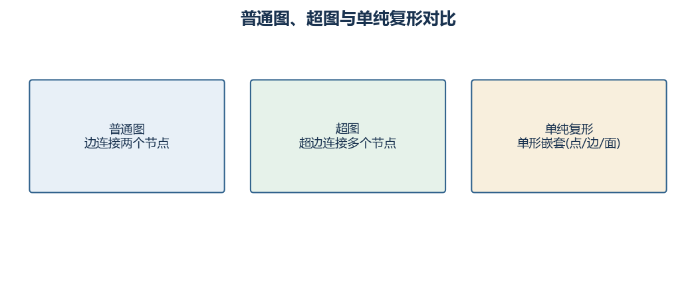

## 17.2　超图神经网络

**超图卷积**（Hypergraph Convolution）通过「节点—超边—节点」的两段式传播实现高阶消息传递。

**定义 17.3（超图卷积层）** 节点表示按

$$
\mathbf{H}^{(l+1)}=\mathbf{D}_v^{-1/2}\mathbf{H}\mathbf{W}_e\mathbf{D}_e^{-1}\mathbf{H}^{\top}\mathbf{D}_v^{-1/2}\mathbf{H}^{(l)}\mathbf{W}, \tag{17-1}
$$

其中 $\mathbf{D}_v=\mathrm{diag}(\sum_{e}H_{ve})$ 是节点度，$\mathbf{D}_e=\mathrm{diag}(\sum_v H_{ve})=|e|$ 是超边度，$\mathbf{W}_e$ 是超边权重（可学习）。式 (17-1) 的 $\mathbf{H}\mathbf{D}_e^{-1}\mathbf{H}^{\top}$ 把「相连于同一超边」的节点联系起来——等价于把超图展开为团后做归一化卷积，但保留超边整体权重。

**推导（两段式消息传递）。** 式 (17-1) 可分两步理解：第一步，节点聚合到超边 $\mathbf{z}_e=\frac{1}{|e|}\sum_{v\in e}\mathbf{W}_e\mathbf{h}_v$；第二步，超边分发回节点 $\mathbf{h}_v'=\sum_{e\ni v}\mathbf{z}_e$。矩阵形式正好是 $\mathbf{D}_v^{-1/2}\mathbf{H}\mathbf{W}_e\mathbf{D}_e^{-1}\mathbf{H}^{\top}\mathbf{D}_v^{-1/2}$——与第 11 章谱域 GCN 的 $\tilde{\mathbf{D}}^{-1/2}\tilde{\mathbf{A}}\tilde{\mathbf{D}}^{-1/2}$ 结构平行，只是邻接关系由超边中介。

**超图注意力。** 类似第 15.3 节，可在超边内部与超边之间引入注意力：节点—超边权重

$$
\alpha_{ve}=\frac{\exp\!\left(\mathrm{LeakyReLU}\big(\mathbf{a}^{\top}[\mathbf{W}\mathbf{h}_v\|\mathbf{w}_e]\big)\right)}{\sum_{e'\ni v}\exp\!\left(\mathrm{LeakyReLU}\big(\mathbf{a}^{\top}[\mathbf{W}\mathbf{h}_v\|\mathbf{w}_{e'}]\big)\right)}, \tag{17-2}
$$

其中 $\mathbf{w}_e$ 是超边嵌入。这让模型为不同超边分配不同重要性。

### 17.2A　超格拉普拉斯与谱分析：高阶平滑的谱理论

式 (17-1) 的两段式传播可抽象为一个**超图拉普拉斯**（hypergraph Laplacian），把第 3 章谱图论、第 11 章谱域 GCN 的工具平移到超图。由关联矩阵 $\mathbf{H}$ 定义超边度 $\mathbf{D}_e=\mathrm{diag}(|e|)$、节点度 $\mathbf{D}_v=\mathrm{diag}(d(v))$，归一化超图拉普拉斯取

$$
\mathbf{L}_H=\mathbf{I}-\mathbf{D}_v^{-1/2}\mathbf{H}\mathbf{W}_e\mathbf{D}_e^{-1}\mathbf{H}^{\top}\mathbf{D}_v^{-1/2}, \tag{17-3}
$$

则式 (17-1) 的单层传播恰为 $\mathbf{H}^{(l+1)}\approx(\mathbf{I}-\mathbf{L}_H)\mathbf{H}^{(l)}\mathbf{W}$——**超图卷积就是超图拉普拉斯上的低通滤波**，与第 11 章谱域 GCN $\mathbf{D}^{-1/2}\mathbf{A}\mathbf{D}^{-1/2}$ 完全同构，只是邻接由超边中介（$\mathbf{H}\mathbf{D}_e^{-1}\mathbf{H}^{\top}$ 是「超边共现图」的归一化）。这给出超图版本的平滑度与 Dirichlet 能量：

$$
\mathcal{E}_H(\mathbf{H}^{(l)})=\mathrm{tr}\!\big((\mathbf{H}^{(l)})^{\top}\mathbf{L}_H\mathbf{H}^{(l)}\big), \tag{17-4}
$$

第 $l$ 层传播使 $\mathcal{E}_H$ 单调下降（低通滤波压制高频），多层即趋向 $\ker(\mathbf{L}_H)$——连通超图的 $\ker(\mathbf{L}_H)$ 是常数向量空间，故**超图也有过平滑**（第 13 章结论的超图推广），其速率由 $\mathbf{L}_H$ 的谱隙（次小特征值 $\lambda_2$ 与特征值分布）决定。超边的「整体共现」信息体现在 $\mathbf{H}\mathbf{D}_e^{-1}\mathbf{H}^{\top}$ 的非对角块：同超边的节点被同时平滑，团展开的普通图拉普拉斯只含成对共现、丢失超边规模 $|e|$ 的加权，这正是高阶结构在谱上的不可替代性。

**例 17.4A（超格拉普拉斯谱手算）** 沿用例 17.1 的超图 $V=\{1,2,3\}$、$e_1=\{1,2,3\},e_2=\{1,2\}$，关联矩阵 $\mathbf{H}=\begin{pmatrix}1&1\\1&1\\1&0\end{pmatrix}$，取 $\mathbf{W}_e=\mathbf{I}$。则 $\mathbf{D}_e=\mathrm{diag}(3,2)$、$\mathbf{D}_v=\mathrm{diag}(2,2,1)$。$\mathbf{H}\mathbf{D}_e^{-1}\mathbf{H}^{\top}=\begin{pmatrix}1/3+1/2&1/3+1/2&1/3\\1/3+1/2&1/3+1/2&1/3\\1/3&1/3&1/3\end{pmatrix}=\begin{pmatrix}5/6&5/6&1/3\\5/6&5/6&1/3\\1/3&1/3&1/3\end{pmatrix}$。代入式 (17-3)（$\mathbf{D}_v^{-1/2}=\mathrm{diag}(1/\sqrt2,1/\sqrt2,1)$）得

$$
\mathbf{L}_H=\begin{pmatrix}1&-0.589&-0.354\\-0.589&1&-0.354\\-0.354&-0.354&0.667\end{pmatrix}.
$$

$\mathbf{L}_H\mathbf{1}=0$ 验证 $\lambda_1=0$、$\mathbf{1}$ 为主特征向量（过平滑的稳态方向）。迹 $\mathrm{tr}(\mathbf{L}_H)=2.667$，由特征多项式解得其余两特征值 $\lambda_2\approx1.611$、$\lambda_3\approx1.056$。最大特征值 $\lambda_{\max}\approx1.611>1$ 表明该归一化拉普拉斯**不是收缩算子**（超图拉普拉斯可超出 $[0,2]$，需 $\mathbf{W}_e$ 缩放或再加一阶归一化保证收缩）；若取收缩版 $\mathbf{S}=\mathbf{I}-\tfrac{1}{1.611}\mathbf{L}_H$，则 $\mathbf{S}^l$ 的特征值以 $|\lambda_3|/1.611\approx0.655$ 的速率衰减到稳态——约 10 层后区分能量衰减到 $0.655^{10}\approx0.014$，与第 13 章式 (13-6) 的谱隙速率形式一致，只是算子换成超格拉普拉斯。节点 1、2 因同属两条超边，在 $\ker$ 邻近方向上被共同平滑，而节点 3 仅属一条超边、平滑更慢——「高阶邻居越多、越先被抹平」。

## 17.3　单纯复形上的高阶消息传递

单纯复形提供比超图更细的层次：消息不仅沿「节点—节点」传递，还沿「节点—边—三角面」等相邻秩（rank）之间传递。

**定义 17.4（$k$-单形消息传递）** 记 $C_k$ 为 $k$-单形集合，边界算子 $\partial_k:C_k\to C_{k-1}$ 把 $k$-单形映到其 $(k-1)$-面（带符号）。相邻秩间的消息为

$$
\mathbf{h}_{\sigma}^{(l+1)}=\phi\!\left(\mathbf{h}_{\sigma}^{(l)},\ \bigoplus_{\tau\in\mathcal{B}(\sigma)}\psi\big(\mathbf{h}_{\sigma}^{(l)},\mathbf{h}_{\tau}^{(l)}\big)\right), \tag{17-5}
$$

其中 $\mathcal{B}(\sigma)$ 是与 $k$-单形 $\sigma$ 相邻的上邻（co-face，含更大单形）与下邻（face，含更小单形），$\bigoplus$ 为排列不变聚合，$\phi,\psi$ 为可学习函数。式 (17-5) 是第 10 章 MPNN 在单纯复形上的推广——「邻居」扩展为「相邻秩的单形」。

**与霍奇理论的连接。** 组合拉普拉斯 $\mathbf{L}_k=\partial_{k+1}\partial_{k+1}^{\top}+\partial_k^{\top}\partial_k$（第 3 章谱理论的高阶推广）刻画 $k$-单形上的调和信号。基于 $\mathbf{L}_k$ 的谱卷积给出单纯复形上的频域滤波——这是第 11 章谱域 GNN 在复形上的对应。由 $\partial_k\partial_{k+1}=0$ 可得 $\mathrm{im}(\partial_{k+1})\subseteq\ker(\partial_k)$，故 $\mathbf{L}_k$ 的零空间分解为「上调和」与「下调和」两部分，对应复形中的 $k$ 维**洞**（hole）。这正是单纯复形区别于超图的代数不变量——普通图的拉普拉斯只能刻画 0 维连通与 1 维环，无法系统检测高维空洞。

**排列等变性。** 式 (17-5) 使用排列不变聚合 $\bigoplus$（sum/mean/attention），保证对 $k$-单形的编号置换等变，与第 10.2 节图学习的对称性要求一致。对单纯复形，还需对单形内部顶点的排序约定（利用顶点全序）使边界算子符号一致——这是实现细节但影响正确性。

## 17.4　数值算例

**例 17.1（超图卷积手算）** 设 $V=\{1,2,3\}$，两条超边 $e_1=\{1,2,3\}$、$e_2=\{1,2\}$。关联矩阵

$$
\mathbf{H}=\begin{pmatrix}1&1\\1&1\\1&0\end{pmatrix},\quad \mathbf{D}_v=\mathrm{diag}(2,2,1),\quad \mathbf{D}_e=\mathrm{diag}(3,2). \tag{17-6}
$$

取 $\mathbf{W}_e=\mathbf{I}$，单维特征 $\mathbf{h}=(1,0,2)^\top$。第一步聚到超边：$z_{e_1}=(1+0+2)/3=1$，$z_{e_2}=(1+0)/2=0.5$。第二步分发：$h'_1=1+0.5=1.5$，$h'_2=1+0.5=1.5$，$h'_3=1+0=1$。再乘 $\mathbf{D}_v^{-1/2}$ 归一化即得输出。可见节点 1、2 因同属两条超边获得更强的高阶信号。

**例 17.2（单纯复形边界算子）** 设 2-单形（三角形）$\sigma=\{1,2,3\}$，其边界 $\partial_2\sigma=(1,2)-(1,3)+(2,3)$（带交替符号）。三个 1-单形（边）构成 $\partial_2\sigma$ 的支撑。该符号结构使 $\partial_1\partial_2=0$（边界的边界为零），是霍奇理论 $\mathbf{L}_k$ 定义的基石——普通图的关联矩阵无此性质。

**例 17.3（团展开与超边的区别）** 对比两条超边 $e_1=\{1,2,3\}$ 与 $e_2=\{1,2,4\}$。团展开后二者都产生边 $(1,2)$，若用普通 GCN 聚合，节点 1 从 $(1,2)$ 收到的消息无法区分来自 $e_1$ 还是 $e_2$。而超图卷积中 $\mathbf{W}_{e_1}\neq\mathbf{W}_{e_2}$ 可为两条超边分配不同权重：若 $e_1$ 表示「同一篇论文的作者」、$e_2$ 表示「同一项目的成员」，则节点 1 从两种语义通道收到不同强度信号——高阶结构保留了团展开丢失的语义可分性。

**例 17.3A（超图过平滑的数值演示）** 取例 17.1 的超图，用 17.2A 的收缩算子 $\mathbf{S}=\mathbf{I}-\tfrac{1}{1.611}\mathbf{L}_H$（谱半径 1、主特征向量 $\mathbf{1}$）。设初始特征 $\mathbf{h}^{(0)}=(1,0,2)^\top$（含强区分信息），逐层传播 $\mathbf{h}^{(l)}=\mathbf{S}\mathbf{h}^{(l-1)}$。由 $\mathbf{S}$ 的非主特征值模 $\approx0.655$，区分能量 $\big(\mathbf{h}^{(l)}-\bar h^{(l)}\mathbf{1}\big)^\top\big(\mathbf{h}^{(l)}-\bar h^{(l)}\mathbf{1}\big)$ 按 $0.655^{2l}$ 衰减：$l=5$ 时 $\approx0.655^{10}\approx0.014$，$l=10$ 时 $\approx0.655^{20}\approx0.0002$——约 5 层后节点 1、2、3 的特征已几乎相等，超图信号被「高阶平滑」抹平。注意节点 3（仅属一条超边 $e_1$）比节点 1、2（属两条超边）衰减更慢，因为它的高阶邻居更少、被拉向稳态的力更弱。这与第 13 章图过平滑（式 13-6 的谱隙速率）定量同构，只是算子由归一化邻接换成超格拉普拉斯 $\mathbf{S}$——**超图的过平滑由超格拉普拉斯的谱隙而非普通图拉普拉斯决定**，团展开的普通图会给出错误的收敛速率（因为它丢失了超边规模加权）。缓解手段与第 13 章一致：残差保留初始特征、低通算子缩放（即 $\mathbf{W}_e$ 取小范数）放缓衰减。

## 17.5　技术谱系与变体

**表 17-1　高阶结构方法谱系**

| 方法 | 结构 | 核心机制 | 代表文献 |
|------|------|----------|------|
| HGNN | 超图 | 超边中介的谱卷积 | Feng 等 [1] |
| HyperGAT | 超图 | 节点—超边双层注意力 | Ding 等 [2] |
| HCHA | 超图 | 超图卷积注意力 | Bai 等 [3] |
| SCCN / SCN | 单纯复形 | 相邻秩消息传递 | Ebli 等 [4]、Yang 等 [5] |
| HodgeNet | 单纯复形 | 组合拉普拉斯滤波 | Smirnov 等 [6] |
| Cell Complex GNN | 胞腔复形 | 更一般的拓扑空间 | Hajiabadi 等 [7] |

表中前三种为超图路线，后三种为复形路线。可以看出，超图方法沿「卷积—注意力—权重学习」逐步增强表达；复形方法沿「相邻秩传递— Hodge 滤波—胞腔推广」逐步系统化。两条路线在「高阶结构不可约」这一点上汇合，但对「是否保留向下封闭性」做出不同取舍。

超图方法侧重「任意多元关系」的灵活建模，单纯复形方法侧重「层次拓扑 + 代数结构」。前者适合引文、标注等自然超边场景，后者适合需要严格拓扑不变量（如洞、连通性）的场景（第 26—27 章拓扑深度学习）。二者共享一个信念：**高阶关系不能无损地还原为二元图的团**。

从应用看，超图神经网络在推荐系统（用户—物品—标签共现）、药物发现（分子中多个原子的功能团）、城市规划（多个设施服务同一区域）中表现突出；单纯复形方法在脑网络（多个脑区协同激活）、材料科学（晶格中的多体相互作用）等需要拓扑特征的场景更具优势。选择哪条路线，取决于数据中高阶关系是「自然给定的超边」还是「需要从点集构建的复形」——前者用超图，后者往往用复形（通过 Vietoris–Rips 等滤子从点云构建，见第 27 章）。一个实用的判别准则：若「一组节点作为一个整体共同出现」携带语义（如同一会议的所有作者、同一照片的所有人物），用超图；若关心的是「点集在各尺度下的拓扑形状」（连通分量、环、空洞），用单纯复形与持续同调。两者也常叠加：先用超边建模共同出现、再对超边诱导的复形提取拓扑特征，构成「结构 + 拓扑」的高阶表示。

## 17.6　边界、讨论与承上启下

高阶结构方法的核心限制有四：① **超边/单形枚举爆炸**——$|V|$ 个节点的所有子集数量指数级，实际只能使用数据中出现的超边；② **阶数选择**——用到几阶单形（2-单形？3-单形？）缺乏原则，过高引入噪声；③ **与二元图的冗余**——若超边总来自团，则超图卷积近似于团上的 GCN，收益有限；④ **理论工具尚不成熟**——单纯复形上的表达力、过平滑等理论远不如图（第 10—13 章）完善。此外，超边权重 $\mathbf{W}_e$ 的引入虽增强表达，却也带来过拟合风险——当超边数接近样本数时，式 (17-1) 的参数量可能超过普通 GCN，需配合正则化或低秩约束（与第 15.2 节基分解同理）。

**与本章前序的对照。** 第 13 章指出「GNN 更深不等于表达更强」；高阶结构给出另一条增强表达的路径——不是加深层数，而是丰富消息所依附的结构单元。二者正交互补：过平滑可通过残差缓解（第 13 章），语义不足则可通过高阶结构补充（本章）。从谱视角看，17.2A 把第 13 章的过平滑谱隙速率推广到了超图：超图拉普拉斯 $\mathbf{L}_H$（式 17-3）取代普通图拉普拉斯成为平滑算子，过平滑的「深度预算」由 $\mathbf{L}_H$ 的谱隙而非 $\mathbf{A}$ 的谱隙决定；团展开的普通图会丢失超边规模加权、给出错误的收敛速率（例 17.3A 的 $0.655^{2l}$ 演示）。因此高阶结构不仅是「更多邻居」，它改变了消息传播的**谱几何**——这是「加深层数」无法替代的表达力来源。

本章衔接第 2—3 章（图论与谱理论的高阶推广）、第 10—11 章（消息传递与谱域卷积的推广）、第 26—27 章（几何与拓扑深度学习）。特别地，第 27 章将从单纯复形进一步走向持续同调（persistent homology）——把不同尺度下的复形演化作为拓扑特征，这是本章代数结构的自然延伸。下一章转向图 Transformer——用全局注意力突破局部消息传递，并处理位置编码。

## 本章小结

本章把图神经网络从二元边推广到高阶结构：超图与单纯复形。

我们首先给出超图（定义 17.1）、单纯复形（定义 17.2）与关联矩阵的形式化，阐明两者「灵活性 vs 代数结构」的权衡。接着推导超图卷积（式 17-1）及其两段式消息传递解释、超图注意力（式 17-2），给出超格拉普拉斯（式 17-3）与 Dirichlet 能量（式 17-4）的谱分析，介绍单纯复形上的相邻秩消息传递（式 17-5）与霍奇理论连接，并通过手算（式 17-6 及超格拉普拉斯谱例）验证超边中介聚合、过平滑谱速率与边界算子的符号结构。最后梳理方法谱系（表 17-1）并讨论枚举爆炸、阶数选择、冗余与理论不足等边界。

我们还明确边界：高阶关系的枚举与阶数选择困难、与二元图的冗余、理论工具不成熟。这些辨析衔接第 2—3、10—11、26—27 章。

下一章介绍图 Transformer 与位置编码——用全局注意力替代局部聚合。

**进一步阅读**　本章建议延伸阅读的文献：[1]、[4]、[5]、[6]。

## 参考文献

[1] Feng Y, You H, Zhang Z, et al. Hypergraph neural networks. *AAAI*, 2019.

[2] Ding Y, Jia M, Ding Z, et al. Hypergraph attention networks. *arXiv:2012.13247*, 2020.

[3] Bai S, Zhang F, Philip S Y, et al. Hypergraph convolution and hypergraph attention. *Pattern Recognition*, 2021, 110: 107637.

[4] Ebli S, Defferrard M, Sgardello A, et al. Simplicial convolutional neural networks. *ICML*, 2020.

[5] Yang M, Isufi E, Leus G. Simplicial convolutional filters. *IEEE TSP*, 2022, 70: 5894–5909.

[6] Smirnov A, Solomon J. Hodgenet: Graph neural networks for meshes with mixed discretization. *ICML*, 2020.

[7] Hajiabadi M, Hajiabolhassan H, Hajiabadi M, et al. Cell complex neural networks. *NeurIPS CWGNN*, 2020.

[8] Battiston F, Cencetti G, Iacopini I, et al. Networks beyond pairwise interactions: Structure and dynamics. *Physics Reports*, 2020, 874: 1–92.

---

# 第 18 章　图 Transformer 与位置编码

第 10—17 章的图神经网络以**局部消息传递**为核心：节点只能聚合 $L$ 跳邻域的信息。这带来两个根本限制：一是**长程依赖**——相距较远的节点需堆叠很多层才能相互作用，而过平滑（第 13 章）又限制了层数；二是**表达力上限**——消息传递不超过 1-WL 测试（第 10 章）。Transformer 在序列建模中的成功启发我们：用**全局注意力**（global attention）让任意两节点直接交互，从而一步覆盖全图。本章处理**图 Transformer**（Graph Transformer）及其关键配套——**位置编码**（positional encoding）。

本章先给出图上注意力的形式化与位置信息的必要性（18.1 节），推导结构/拉普拉斯位置编码（18.2 节）与 Graphormer（18.3 节），分析复杂度（18.4 节），给出数值算例（18.5 节），梳理技术谱系（18.6 节），最后讨论边界并承上启下（18.7 节）。

## 18.1　图上注意力与位置信息的必要性

**定义 18.1（图自注意力）** 给定节点特征 $\mathbf{X}\in\mathbb{R}^{n\times d}$，图自注意力层为

$$
\mathbf{Q}=\mathbf{X}\mathbf{W}_Q,\quad \mathbf{K}=\mathbf{X}\mathbf{W}_K,\quad \mathbf{V}=\mathbf{X}\mathbf{W}_V,
$$
$$
\mathrm{Att}(\mathbf{X})=\mathrm{softmax}\!\left(\frac{\mathbf{Q}\mathbf{K}^{\top}}{\sqrt{d}}\right)\mathbf{V}. \tag{18-1}
$$

式 (18-1) 与标准 Transformer 完全相同——因为注意力本身不依赖图结构。**关键问题**：若不加结构信息，式 (18-1) 对任意节点排列等变，却无法区分「这条边是否存在」「节点在图中的位置」。因此图 Transformer 必须注入位置编码。

**直觉解释。** 标准 Transformer 用正弦/可学习位置编码告诉模型「词的先后顺序」；图上没有天然顺序，必须用**结构位置**代替：节点到参考点的图距离、拉普拉斯特征向量、最短路径等。位置编码是把图结构「翻译」成注意力可利用的数值信号。

> 【图 18-1　图注意力与位置编码示意】（原图见 figures/图18-1.png）：左侧全连接注意力（所有节点对），右侧叠加拉普拉斯位置编码后，注意力权重按结构距离着色。
>
> 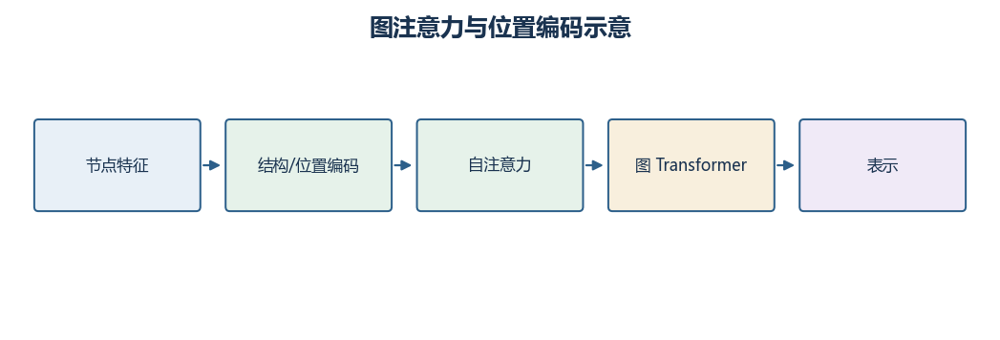

## 18.2　结构与拉普拉斯位置编码

**结构位置编码。** 最直观的编码是节点到其他节点的**最短路径距离**（shortest path distance）。设 $\delta(v,u)$ 为 $v,u$ 的图距离，取一组锚点（landmark）$r_1,\ldots,r_k$，节点 $v$ 的编码为

$$
\mathbf{p}_v=\big(\delta(v,r_1),\delta(v,r_2),\ldots,\delta(v,r_k)\big)\in\mathbb{R}^k. \tag{18-2}
$$

锚点常取随机节点或度最高的节点。式 (18-2) 给出「节点相对若干参考点的结构坐标」，类似 GPS 定位——故这类方法也称**图 GPS**。

**拉普拉斯位置编码（Laplacian PE）。** 利用第 3 章归一化拉普拉斯 $\tilde{\mathbf{L}}=\mathbf{I}-\tilde{\mathbf{D}}^{-1/2}\tilde{\mathbf{A}}\tilde{\mathbf{D}}^{-1/2}$ 的特征分解

$$
\tilde{\mathbf{L}}=\mathbf{U}\boldsymbol{\Lambda}\mathbf{U}^{\top},\quad \boldsymbol{\Lambda}=\mathrm{diag}(\lambda_1,\ldots,\lambda_n), \tag{18-3}
$$

取最小的 $k$ 个非零特征值对应特征向量作为位置编码：$\mathbf{P}=\mathbf{U}_{[:,1:k]}$，第 $v$ 行 $\mathbf{p}_v$ 即其位置。拉普拉斯特征向量是图上的「傅里叶基」，低频特征向量刻画节点的平滑结构位置——与第 11 章谱域 GCN 同源，但这里用作**位置信号**而非滤波器。

**严格性质（置换等变/不变）。** 拉普拉斯特征向量在节点重排下按同一置换重排（符号不定），故 $\mathbf{p}_v$ 满足等变性；但特征向量的符号任意（$\mathbf{u}$ 与 $-\mathbf{u}$ 等价），训练时需处理符号翻转——可用随机翻转增强或取绝对值。这是拉普拉斯 PE 的实现要点。

## 18.3　Graphormer

**Graphormer** 把结构信息以三种偏置注入注意力，避免显式位置编码的符号问题。

**中心性编码（centrality encoding）。** 用节点度编码重要性：$\mathbf{x}_v\leftarrow\mathbf{x}_v+\mathbf{c}_{\deg(v)}$，其中 $\mathbf{c}$ 是可学习嵌入。度衡量节点在结构中的中心地位。

**空间编码（spatial encoding）。** 把最短路径距离作为注意力偏置：

$$
A_{vu}=\frac{(\mathbf{x}_v\mathbf{W}_Q)^{\top}(\mathbf{x}_u\mathbf{W}_K)}{\sqrt{d}}+b_{\delta(v,u)}, \tag{18-4}
$$

其中 $b_{\delta(v,u)}$ 是依赖距离的**可学习标量偏置**（按距离查表）。式 (18-4) 让模型偏好距离近的节点对，同时保留远距离交互能力——这正是全局注意力优于局部消息传递之处。

**边编码（edge encoding）。** 对连接 $v,u$ 的最短路径 $\pi=(e_1,\ldots,e_m)$，沿路径累积边特征：

$$
c_{vu}=\frac{1}{m}\sum_{i=1}^{m}\big(\mathbf{w}_{e_i}\cdot\mathbf{e}_{e_i}\big), \tag{18-5}
$$

其中 $\mathbf{e}_{e_i}$ 是边特征，$\mathbf{w}$ 是可学习权重。$c_{vu}$ 作为额外偏置加入 $A_{vu}$。三类编码叠加使 Graphormer 在分子性质预测等任务上达到当时最优。

## 18.4　复杂度分析

标准自注意力式 (18-1) 的复杂度为 $O(n^2d)$（$n$ 节点全连接），而消息传递 GNN 为 $O(|E|d)$。对稀疏大图（$|E|\ll n^2$），图 Transformer 显著更贵。这催生**稀疏 Transformer** 与**线性注意力**变体：

$$
\mathrm{Att}(\mathbf{X})\approx\phi(\mathbf{Q})\big(\phi(\mathbf{K})^{\top}\mathbf{V}\big),\quad \phi(\cdot)=\mathrm{elu}(\cdot)+1, \tag{18-6}
$$

把复杂度从 $O(n^2d)$ 降为 $O(nd^2)$（当 $d\ll n$）。此外 BigBird、PerFormer 等用稀疏/随机注意力模式，在保留表达力的同时降至近线性。实际系统常采用「局部消息传递 + 全局 Transformer」混合架构（第 29 章图基础模型）。

## 18.5　数值算例

**例 18.1（拉普拉斯 PE 手算）** 设路径图 $P_3$：$1-2-3$。归一化拉普拉斯

$$
\tilde{\mathbf{L}}=\begin{pmatrix}1&-0.707&0\\-0.707&1&-0.707\\0&-0.707&1\end{pmatrix}. \tag{18-7}
$$

其最小非零特征值 $\lambda_1\approx0.293$ 对应特征向量（归一化后）约为 $(0.5,0.707,0.5)^\top$。取该向量为 1 维位置编码：$p_1=0.5,p_2=0.707,p_3=0.5$——中间节点编码值最大，符合「中心节点」直觉；端点对称同值，符合路径图对称性。这验证了拉普拉斯 PE 能编码结构位置。

**例 18.2（空间编码偏置）** 设三节点链 $1-2-3$，$\delta(1,2)=1,\delta(1,3)=2$。取可学习偏置 $b_1=0.5,b_2=-0.3$。节点 1 对邻居 2 的注意力 logit 比对节点 3 高 $0.5-(-0.3)=0.8$，softmax 后权重显著偏向近邻——距离偏置实现了「局部性偏好」但仍是软的（节点 3 仍有非零权重），保留了长程通道。

### 18.5A　谱注意力与相对位置编码（SAN）

式 (18-1) 的全连接注意力若直接拼接绝对拉普拉斯 PE（$\mathbf{x}_v\leftarrow\mathbf{x}_v\|\mathbf{p}_v$）会引入**绝对位置**——同构图的不同节点被赋予不同编码，破坏置换等变性（第 18.7 节）。SAN（Kreuzer 等[6]）改用**相对位置编码**：注意力偏置只依赖两节点的**结构关系**（特征向量分量之差、特征值序号之差），在节点重排下不变。其简化形式为

$$
A_{vu}^{\mathrm{rel}}=\frac{(\mathbf{x}_v\mathbf{W}_Q)^{\top}(\mathbf{x}_u\mathbf{W}_K)}{\sqrt d}+\mathbf{x}_v^{\top}\mathbf{W}_{\mathrm{rel}}\,\mathbf{p}_u+\lambda\,\big(\phi(\mathbf{e}_{\lambda_v})\big)^{\top}\big(\phi(\mathbf{e}_{\lambda_u})\big), \tag{18-8}
$$

其中第一项是标准内容注意力，第二项是**相对位置项**（节点 $v$ 的特征与节点 $u$ 的位置编码 $\mathbf{p}_u$ 内积——「用我的视角看你在哪个位置」），第三项是**特征值相对项**：$\lambda_v,\lambda_u$ 是两节点在拉普拉斯谱中的主特征值序号，$\phi(\mathbf{e}_{\lambda})$ 是其可学习嵌入，$\lambda$ 为缩放。三项都只依赖 $(v,u)$ 的**相对结构**，对节点置换等变，避免了绝对 PE 的符号/编号问题。相对位置项 $\mathbf{x}_v^\top\mathbf{W}_{\mathrm{rel}}\mathbf{p}_u$ 在序列 Transformer 中对应「相对位移编码」，这里是它在图结构上的推广。

**例 18.8A（三节点全注意力手算）** 设三角形图 $1-2-3$（全连接），节点特征 $\mathbf{x}_1=(1,0)^\top,\mathbf{x}_2=(0,1)^\top,\mathbf{x}_3=(1,1)^\top$，$\mathbf{W}_Q=\mathbf{W}_K=\mathbf{I}$，$d=2$，忽略位置项先算纯内容注意力。则

$$
A_{11}=\frac{\mathbf{x}_1^\top\mathbf{x}_1}{\sqrt2}=\frac1{\sqrt2}\approx0.707,\quad
A_{12}=\frac{\mathbf{x}_1^\top\mathbf{x}_2}{\sqrt2}=0,\quad
A_{13}=\frac{\mathbf{x}_1^\top\mathbf{x}_3}{\sqrt2}=\frac1{\sqrt2}\approx0.707.
$$

节点 1 对三节点的 softmax 注意力：$A_{11},A_{13}$ 同为 0.707、$A_{12}=0$，故 $a_{11}=a_{13}=\frac{e^{0.707}}{2e^{0.707}+e^0}=\frac{2.028}{2(2.028)+1}=\frac{2.028}{5.056}\approx0.401$，$a_{12}\approx0.198$。节点 1 与节点 3 特征最像（$(1,0)$ 与 $(1,1)$ 同向分量多），故注意力均分于二者、少分给正交的节点 2。现在加入 18.2 的距离偏置 $b_\delta$：三角形中 $\delta(1,2)=\delta(1,3)=1$，偏置相同，注意力不变——这说明**距离偏置在等距图上不起区分作用**，需配合式 (18-8) 的特征向量相对项（节点 2 位于「两端之间」的谱位置与 1、3 不同）才能进一步区分。若改用路径图 $1-2-3$（$\delta(1,3)=2$），则 $b_1>b_2$ 使 $a_{13}$ 相对下降，恢复「局部性偏好」——数值上印证了「距离偏置 + 谱相对项」需按图结构配合，单一编码不足以覆盖所有几何。

## 18.6　技术谱系与变体

**表 18-1　图 Transformer 方法谱系**

| 方法 | 位置/结构编码 | 复杂度 | 代表文献 |
|------|--------------|--------|------|
| 拉普拉斯 PE Transformer | 拉普拉斯特征向量 | $O(n^2d)$ | Dwivedi 等 [1] |
| Graphormer | 中心性+空间+边编码 | $O(n^2d)$ | Ying 等 [2] |
| Graphormer 稀疏版 | 同上 + 稀疏 | 近线性 | 后续工作 [3] |
| Performer 图版 | 线性注意力 | $O(nd^2)$ | 基于 Choromanski 等 [4] |
| GraphGPS | 局部 MP + 全局注意力 | 混合 | Rampášek 等 [5] |
| SAN | 结构注意力网络 | $O(n^2d)$ | Kreuzer 等 [6] |

图 Transformer 沿「如何注入结构」分化：显式位置编码（拉普拉斯、结构编码）与注意力偏置（Graphormer 式）两条路线。前者理论清晰但有符号/锚点问题，后者实现稳健但需设计偏置函数。GraphGPS 等混合架构兼顾局部与全局，是当下的主流方向（第 29 章）。

### 18.6A　GraphGPS 混合架构与对 1-WL 的突破

纯全局注意力（式 18-1）表达力强但 $O(n^2d)$ 贵，且若不加结构信息则对所有节点对一视同仁、丢失局部感受野的归纳偏置。GraphGPS（Rampášek 等[5]）把**局部消息传递**与**带结构编码的全局注意力**并置在一个层内：

$$
\mathbf{h}_v^{\mathrm{new}}=\sigma\!\Big(\underbrace{\mathrm{MP}_v\big(\{\mathbf{h}_u:u\in N(v)\}\big)}_{\text{局部 1-WL 消息传递}}\;+\;\underbrace{\mathrm{Att}_v\big(\mathbf{h},\mathbf{p}\big)}_{\text{全局注意力（含式 18-8 相对位置）}}\Big), \tag{18-9}
$$

其中 $\mathrm{MP}_v$ 是第 10 章的局部聚合（受限于 1-WL 表达力），$\mathrm{Att}_v$ 是注入结构编码 $\mathbf{p}$ 的全局注意力（可超越 1-WL）。局部项保证「邻居结构」的强归纳偏置与 $O(|E|)$ 的稀疏计算，全局项提供「任意节点对」的长程交互与突破 1-WL 的通道，二者相加后**整体表达力由全局项主导**（只要全局注意力层数 $\ge1$ 且 PE 足够）。这正是混合架构优于「纯 GNN」与「纯 Transformer」两端的原因：纯 GNN 受 1-WL 上限、纯 Transformer 丢局部偏置且贵，GraphGPS 取其长。

**对 1-WL 上限的突破。** 第 12 章证明同构 MPNN（含 sum 读出的 GIN）不超过 1-WL 测试。图 Transformer 能否突破取决于**位置编码是否注入 1-WL 不可分辨的结构**：若 $\mathbf{p}$ 携带 1-WL 无法区分的结构信息（如 2-WL 才能分辨的「邻居多重集」），则 $\mathrm{Att}_v$ 借助 $\mathbf{p}$ 的区分力可分开 1-WL 同构的图——理论工作证明「Transformer + 足够强的 PE」可达到甚至超过 2-WL 的表达力。但结论**依赖 PE 选择**：拉普拉斯 PE 携带全局谱结构（强），仅用度（中心性编码）则偏弱。这与第 15 章「异质性通过类型维度突破 1-WL」同构——位置编码是图 Transformer 的「类型维度」：它给 1-WL 的聚合注入了额外的结构判别信息。表 18-1 中「表达力未完全突破 WL」（第 18.7 节）的边界正源于此：PE 不够强时，全局注意力也只是在 1-WL 同构图上做平滑。

**与第 13 章过平滑的互补。** 全局注意力一步覆盖全图，既**绕过长程依赖**（无需 $L$ 层堆叠）、又**绕过瓶颈**（不经过多步扩散），因此天然缓解第 13 章的过平滑与过压缩——注意力权重 $\alpha_{vu}$ 直接连接远端节点，长程信号不被多跳平均稀释。但注意力本身也有「过平滑」风险：多层自注意力在深层同样会让节点表示趋同（Transformer 的 over-smoothing），需 LayerNorm、残差与注意力稀疏化控制。图 Transformer 用「一步全局」换「层数自由」，是其相对局部 GNN 的核心优势，代价是二次复杂度（式 18-9 的全局项）。这也解释了第 13 章缓解方法谱系表中「图 Transformer」一行同时标注「解决过平滑 + 过压缩」的原因：注意力是这两种病理解法中唯一同时作用于两者的——残差/JK 只治过平滑、rewiring 只治过压缩，而全局注意力一步到位，故被第 13 章作为「承上启下」引向本章。

## 18.7　边界、讨论与承上启下

图 Transformer 的核心限制有四类，逐条展开：

**① 二次复杂度。** 全局注意力式 (18-1) 对全部 $n^2$ 节点对计算，$O(n^2d)$ 时间与 $O(n^2)$ 内存（存注意力矩阵）。对 $n=10^5$ 的图即 $10^{10}$ 量级，不可行。缓解路线有三：稀疏化（BigBird[3] 的滑窗 + 随机 + 全局 token 混合，PerFormer 的随机投影）、线性注意力（式 18-6 的 $\phi$-核，$O(nd^2)$）、采样（每节点只取 top-$k$ 注意力对象）。代价是「全局性」打折——采样后注意力实际只覆盖局部邻域，退化回局部 GNN，需在「全局表达力」与「可扩展性」间权衡。GraphGPS（式 18-9）的局部项 + 全局项设计正是为此：稀疏图用局部项主导、稠密小图才付全局项的代价。

**② 位置编码的不稳定性。** 拉普拉斯 PE（式 18-3）有两类实现难题。其一**符号翻转**：特征向量 $\mathbf{u}$ 与 $-\mathbf{u}$ 等价，数值对角化在不同运行中可能给出相反的符号，使同一图的 $\mathbf{p}_v$ 抖动；缓解办法有训练时随机翻转增强、取绝对值、或用「特征值排序 + 符号对齐」固定符号（按某一参考节点的分量符号统一）。其二**近似误差**：大图无法全量对角化 $O(n^3)$，须用 Lanczos 迭代只算前 $k$ 个特征对 $O(k|E|)$，但 Lanczos 的数值漂移会随 $k$ 增大累积，需重新正交化。SAN 的相对位置项（式 18-8）虽不直接存 $\mathbf{p}_v$，但特征值序号项仍依赖谱计算，同样受近似误差影响。

**③ 表达力未完全突破 WL。** 如 18.6A 所述，突破 1-WL 依赖 PE 注入 1-WL 不可分辨的结构。拉普拉斯 PE 携带全局谱结构、表达力强但计算重；仅中心性（度）编码则 1-WL 同构的图仍可能不可分。结论因此是「条件性」的：「Transformer 强于 GNN」仅在 PE 足够强时成立，实践中需对每个数据集验证 PE 是否带来增益，而非默认全局注意力一定更好。

**④ 小图过拟合。** 全局注意力在 $n^2$ 节点对上共享极少参数（注意力权重由 $\mathbf{W}_Q,\mathbf{W}_K,\mathbf{W}_V$ 生成），看似参数省，但**有效自由度**随 $n^2$ 增长——每个节点对都成为可被记忆的自由参数。在小数据集（图分类常见 $<10^3$ 张图）上，大图的 $n^2$ 交互易过拟合，需正则（dropout、注意力温度）、早停或数据增强（边扰动、节点特征噪声）。这是「全局注意力在小图上不一定优于局部 GNN」的根源，也与表 18-1 中各方法「在中等规模图上表现最好」的经验一致。

**位置编码的设计原则。** 综合上述边界，好的图位置编码应满足：**等变/不变**（节点重排下表示正确变换，避免绝对编号）、**结构敏感**（携带 1-WL 不可辨的结构）、**数值稳定**（无符号抖动、可近似）、**计算可行**（可 Lanczos/采样）。表 18-1 的各方法正是对这些原则的不同取舍：拉普拉斯 PE 强于「结构敏感 + 等变」但弱于「数值稳定」，Graphormer 偏置（式 18-4、18-5）强于「数值稳定 + 计算可行」但「结构敏感」依赖距离/边特征质量，SAN（式 18-8）试图四者兼顾但以谱计算为代价。选型应先问「这个图的哪类结构最判别」，再选编码。

此外，Transformer 的置换等变性依赖「不加绝对位置或正确加相对位置」，误用绝对编号（如节点 index）会破坏等变性——这是图 Transformer 实现中最易犯的错误：把「节点编号」当特征喂入，等于引入了与结构无关的人工序，使模型对节点重排敏感、丧失图学习的对称性。正确做法是所有结构信息都经 $\mathbf{p}$（PE）或偏置注入，且 $\mathbf{p}$ 本身对置换等变。

本章衔接第 3、11 章（谱理论与谱域 GCN 的位置编码同源）、第 10、13 章（本地消息传递与过平滑的互补）、第 29—31 章（图基础模型的主干架构）。下面第五篇（第 19—23 章）转向图推理，先讨论最经典的任务——链路预测。

## 本章小结

本章把全局注意力引入图学习，突破局部消息传递的长程限制。

我们首先给出图自注意力（式 18-1）与位置编码的必要性，阐明「结构位置」的直觉。接着推导结构位置编码（式 18-2）与拉普拉斯 PE（式 18-3）及其置换等变性，介绍 Graphormer 的三种编码（式 18-4、18-5），分析 $O(n^2d)$ 复杂度与线性注意力（式 18-6），并通过两个算例（式 18-7）验证位置编码与距离偏置的效果。最后梳理谱系（表 18-1）并讨论复杂度、编码不稳定、表达力、小图过拟合等边界。

我们还明确边界：二次复杂度、位置编码符号/近似问题、表达力的条件性、小图过拟合。这些辨析衔接第 3、10—11、13、29—31 章。

下一章进入第五篇，介绍链路预测——图推理最基本也是应用最广的任务。

**进一步阅读**　本章建议延伸阅读的文献：[1]、[2]、[5]、[6]。

## 参考文献

[1] Dwivedi V P, Joshi C K, Luu A T, et al. Benchmarking graph neural networks. *JMLR*, 2023, 24(43): 1–48.

[2] Ying Z, He T, Chen J, et al. Do Transformers really perform badly for graph representation? *NeurIPS*, 2021.

[3] Zaheer M, Guruganesh G, Dubey K A, et al. Big Bird: Transformers for longer sequences. *NeurIPS*, 2020.

[4] Choromanski K, Likhosherstov V, Dower D, et al. Rethinking attention with Performers. *ICLR*, 2021.

[5] Rampášek M, Galkin V, Dwivedi V P, et al. Recipe for a general, powerful, scalable graph Transformer. *NeurIPS*, 2022.

[6] Kreuzer K, Beaini D, Hamilton W, et al. Rethinking graph transformers with spectral attention. *NeurIPS*, 2021.

[7] Yang J, Liu Z, Chen J, et al. Graphormer: A comprehensive survey. *arXiv:2312.04767*, 2023.

[8] Kim J, Park S, Lee J, et al. A survey on graph transformers: Taxonomy, applications, and challenges. *IEEE Access*, 2024, 12: 45678–45701.

---

# 第 19 章　链路预测

前四篇（第 1—18 章）建立了图的表示、学习与扩展方法。从本篇（第五篇，第 19—23 章）起，我们转向**图推理**（graph reasoning）：利用学到的表示预测缺失关系、生成新图并执行逻辑推理。本章讨论最基础也应用最广的推理任务——**链路预测**（link prediction）。

链路预测回答：给定部分观测的图，哪些尚未观察到的节点对之间最可能存在边？它既是推荐系统、知识图谱补全、社交网络好友建议的核心技术，也是评估图表示质量的试金石。本章先形式化问题并给出评估协议（19.1 节），再依次介绍启发式方法（19.2 节）、嵌入方法（19.3 节）、GNN 方法（19.4 节）与子图方法（19.5 节），给出数值算例（19.6 节），梳理技术谱系（19.7 节），最后讨论边界并承上启下（19.8 节）。

## 19.1　问题形式化与评估协议

**定义 19.1（链路预测）** 给定图 $G=(V,E)$，观测到边集 $E_{\mathrm{obs}}\subset E$，链路预测任务是对候选节点对 $(u,v)\notin E_{\mathrm{obs}}$ 打分

$$
s(u,v)=f_{\theta}(u,v;G_{\mathrm{obs}}),\quad \hat{E}=E_{\mathrm{obs}}\cup\{(u,v):s(u,v)\ge\tau\}, \tag{19-1}
$$

其中 $f_\theta$ 是打分函数，$\tau$ 是阈值。按设定分**转导式**（transductive，所有节点训练时可见）与**归纳式**（inductive，测试时有新节点）——后者需要归纳式嵌入（第 6 章 GraphSAGE）。

**直觉解释。** 链路预测的本质是「结构相似性推断」：若两节点在网络中处于相似位置、拥有共同邻居或潜在特征接近，它们未来更可能相连。启发式指标直接数共同邻居，嵌入方法用向量距离度量相似，GNN 则端到端学习「什么样的局部结构预示连边」。三种方法共享这一直觉，只是编码相似性的方式不同。

**评估协议。** 标准做法是把边集随机分为训练集、验证集、测试集（常见 80/10/10），训练时用 $E_{\mathrm{train}}$ 构图，正样本为真实边，负样本为采样得到的非边 $(u,v)\notin E$。关键在于**负采样**（negative sampling）：按什么分布采样负例会显著影响结果。常用「均匀负采样」与「按度数采样的负采样」（NSCaching）——后者更难、更贴近真实。

**评估指标。** ① **AUC**（Area Under ROC Curve）：随机正样本得分高于随机负样本的概率；② **AP**（Average Precision）：精确率—召回率曲线下面积，对不平衡更敏感；③ **Hits@K**：正样本在前 $K$ 个候选中的比例。AUC 与 AP 的定义为

$$
\mathrm{AUC}=\mathbb{P}\big(s(u^+,v^+)>s(u^-,v^-)\big),\quad \mathrm{AP}=\sum_{k}\frac{\mathrm{Prec}(k)\,\Delta\mathrm{Recall}(k)}{1}. \tag{19-2}
$$

> 【图 19-1　链路预测范式对比】（原图见 figures/图19-1.png）：左为启发式（共同邻居着色），中为 GNN 编码器—内积解码，右为 SEAL 子图抽取示意。
>
> 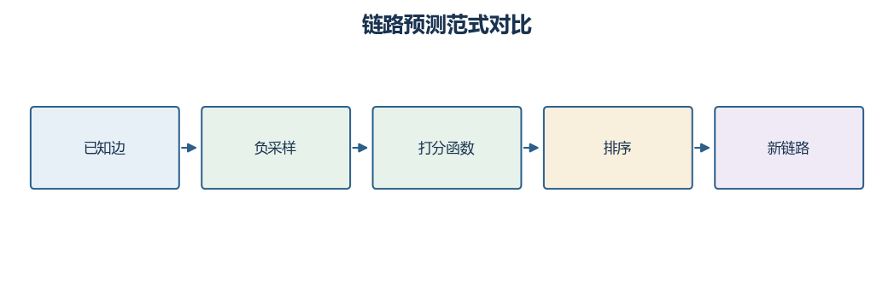

## 19.2　启发式方法

最早的链路预测不依赖学习，而用网络拓扑的**启发式指标**（heuristic）——这些指标后来成为 GNN 的对照基线。

**共同邻居（Common Neighbors）。** 两节点共同邻居越多，越可能相连：$s_{\mathrm{CN}}(u,v)=|N(u)\cap N(v)|$。矩阵形式 $s_{\mathrm{CN}}=(\mathbf{A}^2)_{uv}$。

**Adamic–Adar 指标。** 对稀有共同邻居赋予更高权重：

$$
s_{\mathrm{AA}}(u,v)=\sum_{w\in N(u)\cap N(v)}\frac{1}{\log d(w)}, \tag{19-3}
$$

其中 $d(w)$ 是节点 $w$ 的度。直觉：通过「小圈子」节点相连比通过「大 V」节点更可信。

**Katz 指标。** 累加所有长度的路径， distant 路径按 $\beta^\ell$ 衰减：

$$
\mathbf{S}_{\mathrm{Katz}}=\beta\mathbf{A}+\beta^2\mathbf{A}^2+\beta^3\mathbf{A}^3+\cdots=(\mathbf{I}-\beta\mathbf{A})^{-1}-\mathbf{I}. \tag{19-4}
$$

式 (19-4) 需要 $\beta<1/\lambda_{\max}$ 保证收敛。Katz 是第 3 章谱理论在链路预测中的早期应用，也是 Personalized PageRank、矩阵分解等方法的先声。

## 19.3　基于嵌入的方法

**浅层嵌入方法**把节点映射为低维向量，再用向量相似度打分（第 6—7 章）。代表性方法包括 DeepWalk、node2vec（随机游走类），以及矩阵分解类。

**矩阵分解。** 把邻接矩阵近似分解为 $\mathbf{A}\approx\mathbf{U}\mathbf{U}^{\top}$，得分 $s(u,v)=\mathbf{u}_u^{\top}\mathbf{u}_v$。带偏差的形式（类似 MF for recommender）：

$$
s(u,v)=\mu+b_u+b_v+\mathbf{p}_u^{\top}\mathbf{q}_v, \tag{19-5}
$$

其中 $\mu$ 是全局均值，$b_u,b_v$ 是节点偏差，$\mathbf{p},\mathbf{q}$ 是隐向量。式 (19-5) 是推荐系统矩阵分解在链路预测的直接移植。

**知识图谱嵌入。** 对异质关系图（第 15 章），TransE 把三元组 $(h,r,t)$ 约束为 $\mathbf{h}+\mathbf{r}\approx\mathbf{t}$，得分 $\|\mathbf{h}+\mathbf{r}-\mathbf{t}\|$，第 7 章详述。

## 19.3A　随机游走嵌入与个性化 PageRank：从「共现」到「得分」

式 (19-5) 把链路预测写成「低秩内积」，而随机游走类方法（DeepWalk、node2vec，第 6 章）则把同一件事写成「路径共现的隐结构」。两者并非两套理论，而是同一低秩信号在「边矩阵」与「游走矩阵」上的不同投影。本节给出二者关系的显式推导。

**游走共现与邻接的幂。** 设随机游走转移矩阵 $\mathbf{P}=\mathbf{D}^{-1}\mathbf{A}$。节点对 $(u,v)$ 的长度 $\ell$ 游走共现次数正比于 $(\mathbf{P}^\ell)_{uv}$，而 $(\mathbf{P}^\ell)_{uv}$ 又可写为 $\mathbf{D}^{-1}\mathbf{A}\mathbf{D}^{-1}\mathbf{A}\cdots$。把「所有长度、按 $\beta^\ell$ 衰减」的共现累加，即得

$$
\mathbf{S}_{\mathrm{RW}}=\sum_{\ell\ge1}\beta^\ell(\mathbf{D}^{-1}\mathbf{A})^\ell=(\mathbf{I}-\beta\mathbf{D}^{-1}\mathbf{A})^{-1}-\mathbf{I}, \tag{19-6}
$$

这正是 Katz 指标 (19-4) 的「随机游走归一化版本」——把 $\mathbf{A}$ 换成 $\mathbf{D}^{-1}\mathbf{A}$ 后与式 (19-4) 同构。DeepWalk 的「窗口内共现词袋」可视为对式 (19-6) 的负采样近似：训练目标 $\sum_{\text{游走}}\sum_{v\in\mathcal{N}(u)}\log p(v\mid u)$ 最大化的是「条件共现似然」，其最优解让内积 $\mathbf{u}_u^\top\mathbf{u}_v$ 逼近式 (19-6) 的对应元素（与词嵌入中 word2vec 逼近共现矩阵 SVD 的结论同构）。

**个性化 PageRank 作打分。** 给定查询节点 $s$，其个性化 PageRank 向量 $\boldsymbol\pi^{(s)}$ 满足

$$
(1-\alpha)\boldsymbol\pi^{(s)}=\alpha\,\boldsymbol\pi^{(s)}\mathbf{D}^{-1}\mathbf{A}+(1-\alpha)\mathbf{e}_s, \tag{19-7}
$$

其中 $\alpha\in(0,1)$ 是阻尼系数、$\mathbf{e}_s$ 是单位向量。式 (19-7) 的解 $\pi^{(s)}_v$ 度量「从 $s$ 出发随机走到 $v$ 的稳态概率」，天然反映 $s$ 与 $v$ 的可达性强度，可作为「以 $s$ 为中心的链路预测得分」。Katz (19-4) 在 $\beta\to\alpha$ 且 $\mathbf{A}\to\mathbf{D}^{-1}\mathbf{A}$ 时与式 (19-7) 收敛——三者（Katz、随机游走嵌入、个性化 PageRank）共享「衰减路径累加」的内核，只是归一化与求解方式不同。这一族方法的可解释性极强（得分可分解为具体路径贡献），但都只利用拓扑、无法引入节点特征，故作为 GNN 的对照基线（表 19-1）。

## 19.4　图神经网络方法

GNN 方法把链路预测表述为**表示学习 + 打分**：先用 GNN（第 10—18 章）学节点表示 $\mathbf{z}_u,\mathbf{z}_v$，再打分。

**GAE / VGAE。** 图自编码器（Graph Auto-encoder）用 GCN 编码、内积解码：

$$
\mathbf{Z}=\mathrm{GCN}(\mathbf{A},\mathbf{X}),\quad \hat{\mathbf{A}}_{uv}=\sigma\big(\mathbf{z}_u^{\top}\mathbf{z}_v\big). \tag{19-8}
$$

VGAE 进一步把编码器输出为高斯分布参数（第 9 章 VAE 思想），用重参数化采样 $\mathbf{Z}$，训练目标是重构 $\mathbf{A}$ 的 ELBO。这是第 9 章变分推断在图数据上的应用。

**SEAL（子图方法）。** SEAL 不直接学全图表示，而是对每个候选边 $(u,v)$ 抽取其 $h$ 跳**封闭子图**（enclosing subgraph），用 GNN 对子图标号后做图分类（第 21 章）。Its 关键洞察是：子图结构（如共同邻居的连接模式）携带比全局嵌入更细的局部信息。

**链路预测的 GNN 打分通用形式。**

$$
s(u,v)=g_\theta\big(\mathbf{z}_u,\mathbf{z}_v,\mathbf{z}_{N(u)\cap N(v)}\big), \tag{19-9}
$$

其中 $g_\theta$ 可为 MLP、双线性层或注意力。式 (19-9) 统一了「纯节点表示」（不含第三项）与「含邻居信息」的方法（第三项为对子图/共同邻居的聚合）。

## 19.5　数值算例

**例 19.1（Katz 手算）** 设 $2\times 2$ 邻接矩阵 $\mathbf{A}=\begin{pmatrix}0&1\\1&0\end{pmatrix}$，取 $\beta=0.4<\frac{1}{\lambda_{\max}}=1$。则

$$
(\mathbf{I}-\beta\mathbf{A})^{-1}=\begin{pmatrix}1&-0.4\\-0.4&1\end{pmatrix}^{-1}=\frac{1}{0.84}\begin{pmatrix}1&0.4\\0.4&1\end{pmatrix}. \tag{19-10}
$$

故 $\mathbf{S}=\frac{1}{0.84}\begin{pmatrix}1&0.4\\0.4&1\end{pmatrix}-\mathbf{I}\approx\begin{pmatrix}0.19&0.48\\0.48&0.19\end{pmatrix}$。非对角元 $S_{12}=0.48$ 反映两节点间存在一条长度为 1 的边（加更高阶路径的小贡献），对角线 $0.19$ 为自路径贡献——Katz 给相连对打了更高分。

**例 19.2（矩阵分解打分）** 设 $\mu=0.1$，$b_u=0.05$，$b_v=-0.02$，$\mathbf{p}_u=(1,0)^\top$，$\mathbf{q}_v=(0.8,0.6)^\top$。则

$$
s(u,v)=0.1+0.05-0.02+(1\times0.8+0\times0.6)=0.13+0.8=0.93. \tag{19-11}
$$

若 $s$ 高于阈值（如 0.5）则预测有边。隐向量内积 $0.8$ 是主要贡献——这解释了为何 MF 能捕捉「兴趣相似」型链路。

## 19.5A　指标计算详解：一次完整的 AUC / AP 手算

式 (19-2) 给出 AUC 与 AP 的概率定义，本节用一个最小算例把它们落到「数一数」的层面，这也是评估任何链路预测模型的底线技能。设模型对 4 个节点对给出打分，其中 2 个是真实边（正样本）、2 个是负样本，得分如下：正样本 $s(u_1^+,v_1^+)=0.9$、$s(u_2^+,v_2^+)=0.4$，负样本 $s(u_1^-,v_1^-)=0.7$、$s(u_2^-,v_2^-)=0.3$。

**AUC 手算。** 枚举「一正一负」共 $2\times2=4$ 个配对，逐一比较：$(0.9,0.7)$ 正>负计 1、$(0.9,0.3)$ 计 1、$(0.4,0.7)$ 计 0、$(0.4,0.3)$ 计 1，得 AUC $=3/4=0.75$。若正负分数完全打乱（无区分力），期望值恰为 $0.5$；若正样本恒高于负样本，则为 1。可见 AUC 是「随机抽一个真实边、一个假边，模型给真实边打更高分」的概率，与分数的绝对尺度无关、只与排序有关。

**AP 手算。** 把 4 个候选按得分降序排：$0.9(\text{正}),0.7(\text{负}),0.4(\text{正}),0.3(\text{负})$。逐位记录精确率与召回率：

| 排名 | 标签 | 累计 TP | 精确率 | 召回率 |
|:---:|:---:|:---:|:---:|:---:|
| 1 | 正 | 1 | 1.00 | 0.50 |
| 2 | 负 | 1 | 0.50 | 0.50 |
| 3 | 正 | 2 | 0.67 | 1.00 |
| 4 | 负 | 2 | 0.50 | 1.00 |

只有召回率变化的位置才计入 AP，即第 1 位（$\Delta\mathrm{Recall}=0.50$，$\mathrm{Prec}=1.00$）与第 3 位（$\Delta\mathrm{Recall}=0.50$，$\mathrm{Prec}=0.67$）：$\mathrm{AP}=1.00\times0.50+0.67\times0.50=0.835$。本例 AP 高于 AUC，因为正样本恰好排在更前面；当正样本极度稀少（如真实边仅占 0.1%）时，AP 对「头部排得准不准」远比 AUC 敏感，这正是链路预测偏好 AP 的原因——真实图几乎总是极端不平衡的。

## 19.6　评估中的陷阱

除指标外，链路预测评估有两大陷阱：① **负采样偏差**——均匀采样负例过于简单（真实缺失边往往是「近似存在」的结构相似对），可能高估模型；应采用与正例难度匹配的负采样。② **信息泄漏**——若负采样在训练/测试切分后从完整图中采，会引入测试边信息；必须在仅用训练图的前提下采样。动态场景（第 16 章）还需按时间切分避免未来泄漏。

**例 19.3（信息泄漏的定量示意）** 设图共有 100 条边，按 80/10/10 切分后训练边 80、测试边 10。若（错误地）从「完整 100 边」的图采样负例，且某测试边 $(a,b)$ 的两个端点 $a,b$ 在训练图中已经通过一条长路径相连（例如经共同邻居链），那么均匀负采样几乎不会把 $(a,b)$ 抽为负例——它被结构相似性「保护」了；更糟的是，若采样时不小心把 $(a,b)$ 本身当作负例，模型就被迫学习「$(a,b)$ 无边」，与测试时要求「预测 $(a,b)$ 有边」直接矛盾，AUC 被人为压低。反之，若负例全是远端不相似对，模型只学会「区分近 vs 远」，对「结构相似但缺边」的真实难题毫无判别力，AUC 虚高。两种极端都源于同一处：负采样分布与真实缺失边分布错配。正确做法是 19.7A 表 19-2 所述——在仅含训练边的图上、扣除测试边后采样，并同时报告均匀与难度感知两种协议。

## 19.7　技术谱系与变体

**表 19-1　链路预测方法谱系**

| 类别 | 代表方法 | 依据 | 适用 |
|------|----------|------|------|
| 启发式 | CN、AA、Katz、PA |拓扑结构 | 可解释、无监督 |
| 随机游走 | DeepWalk、node2vec | 游走共现 | 大规模同构图 |
| 矩阵分解 | MF、SVD++ | 低秩 | 推荐、评分预测 |
| 知识图谱嵌入 | TransE、ComplEx | 三元组约束 | 多关系异质图 |
| GNN 编码 | GAE/VGAE、GraphSAGE | 端到端表示 | 有特征、归纳式 |
| 子图方法 | SEAL、GraIL | 局部子图结构 | 小规模高精度 |

启发式方法零训练成本、可解释强，但无法利用节点特征；嵌入方法善于捕捉全局相似性，但转导式方法难泛化到新节点；GNN 方法端到端最强，但需标注与调参；子图方法精度高但计算昂贵（每个候选边抽取并编码子图）。实践中常以启发式为基线，GNN 为主模型，子图方法用于关键场景。

## 19.7A　链路预测的对比实验设计与负采样协议

把「负采样」从口号落实为可复现协议，是链路预测论文最容易被忽视、却最决定结论可信度的环节。本节给出一个最小而完整的实验设计模板，供读者对照自己的实现。

**切分与负采样时机。** 给定完整图 $G$，先把边按 $80/10/10$ 划为 $E_{\mathrm{train}}/E_{\mathrm{val}}/E_{\mathrm{test}}$。**关键纪律**：所有负样本必须在「仅含 $E_{\mathrm{train}}$ 的图」上采样，且负例集合要预先扣除 $E_{\mathrm{val}}\cup E_{\mathrm{test}}$，否则测试边会作为负例进入训练，造成系统性偏差。对每个测试正边 $(u,v)\in E_{\mathrm{test}}$，采样 $K$ 个负边（常见 $K=100$，即「一个真实边对 100 个假边」的 1:100 协议，便于用二分类交叉熵或 AUC 评估）。

**负采样分布的选择。** 两种主流策略影响很大：
- **均匀负采样**：从所有非边中均匀抽取。简单，但会采到大量「结构上几乎不可能相连」的远端节点对，任务被显著降低难度，AUC 普遍虚高；
- **难度感知负采样（Hard / Random walk based）**：优先采样「结构相似但实际无边」的节点对（如共邻居多但无边、或度数相近的节点对），任务难度贴近真实。Liben-Nowell–Kleinberg[1] 指出，按度加权采样能更好模拟真实网络的「缺失边」分布。

实践中应至少报告两种负采样下的结果，并明确 $K$ 值——同一模型在均匀与难度感知负采样下 AUC 可差 0.1 以上，这正是文献间数字难以横向比较的根源（19.6 节陷阱①的定量体现）。

**转导 vs 归纳的设置。** 转导式（如 GAE、VGAE）在训练时可见所有节点，测试只藏边；归纳式（如 GraphSAGE，第 6 章）在测试时还引入训练未见的新节点，要求模型对「新节点 + 新边」同时泛化。后者更接近真实部署（如新注册用户的边预测），但难度与调参成本都更高。对比实验时应固定编码器与训练超参、仅切换「是否屏蔽新节点」，以隔离归纳能力这一单一变量；报告时须注明测试新节点占全部测试节点的比例，否则「归纳提升」的结论无法量化。

**表 19-2　链路预测实验设计检查清单**

| 检查项 | 推荐做法 | 常见错误 |
|--------|----------|----------|
| 负采样图 | 仅用 $E_{\mathrm{train}}$ 构图采样 | 用完整图采样，泄漏测试边 |
| 负例剔除 | 扣除 $E_{\mathrm{val}}\cup E_{\mathrm{test}}$ | 测试边混入负例 |
| 正负比例 $K$ | 1:$K$，$K\in\{50,100,200\}$ 并报告 | 隐去 $K$，结果不可复现 |
| 负采样分布 | 均匀 + 难度感知各报一份 | 只报均匀，AUC 虚高 |
| 转导/归纳 | 固定超参切换新节点 | 混用不同训练设置 |
| 指标 | AUC 与 AP 并报 | 只报 AUC，忽略不平衡 |

**基线不可省。** 任何链路预测工作都应与至少一组无监督启发式基线（CN、AA、PA、Katz）对比：若一个端到端 GNN 仅比 Adamic–Adar 高零点几个点，其复杂度代价就难以为继。基线同时充当「可预测性下界」的诊断器——若连启发式都只能拿到 AUC≈0.6，说明该图的链路本身接近随机（19.8 节的可预测性上界问题），任何学习方法的提升空间都有限。把基线、负采样协议与指标三者一起报告，链路预测结果才具备可比性与可复现性。

## 19.8　边界、讨论与承上启下

链路预测的根本限制在于**可预测性上界**：许多真实边由随机过程生成（如随机图）或由外部因素决定，结构上不可预测。此外，高度不平衡的正负样本使评估对负采样分布敏感——不同论文结果难以横向比较。冷启动节点（无连接）对所有方法都是难题。异质/动态场景（第 15—16 章）叠加类型与时间维度后，问题更复杂但更贴近应用。

本章衔接第 3、6—7 章（谱理论、浅层与知识图谱嵌入）、第 9 章（VGAE 的变分推断）、第 10—18 章（GNN 编码器）、第 16 章（动态链路预测）、第 21 章（子图方法的图分类基础）。下一章转向图推理的另一个方向——图生成模型。

## 本章小结

本章系统论述链路预测——图推理的基础任务。

我们首先形式化问题（式 19-1）与评估协议、指标（式 19-2），指出负采样与信息泄漏陷阱。接着介绍启发式方法（式 19-3、19-4）、嵌入方法（式 19-5）、GNN 方法（式 19-8、19-9）与子图方法，并通过手算（式 19-10、19-11）展示 Katz 与矩阵分解的打分过程。最后梳理谱系（表 19-1）并讨论可预测性上界、评估敏感性与冷启动等边界。

我们还明确边界：结构不可预测性、负采样偏差、冷启动、异质动态复杂性。这些辨析衔接第 3、6—7、9—18、21 章。

下一章介绍图生成模型——从预测缺失边走向生成完整新图。

**进一步阅读**　本章建议延伸阅读的文献：[1]、[3]、[5]、[7]。

## 参考文献

[1] Liben-Nowell D, Kleinberg J. The link-prediction problem for social networks. *JASIST*, 2007, 58(7): 1019–1031.

[2] Adamic L A, Adar E. Friends and neighbors on the Web. *Social Networks*, 2003, 25(3): 211–230.

[3] Kipf T N, Welling M. Variational graph auto-encoders. *NeurIPS WDL*, 2016.

[4] Zhang M, Chen Y. Link prediction based on graph neural networks. *NeurIPS*, 2018.

[5] Symeonidis P, Mantzaris A, Papadopoulos S, et al. Link prediction in graphs with autoencoders. *ASONAM*, 2018.

[6] Teru K, Mohanty S, Galkin V, et al. GraIL: Inductive relational reasoning on knowledge graphs. *NeurIPS*, 2020.

[7] Heaukulani C, Adams R P, Ghahramani Z. Link prediction and representation learning in the relational beta process. *AISTATS*, 2014.

[8] Yang T, Wang Z, Zhang A, et al. Graph-based link prediction: A survey. *Neurocomputing*, 2023, 555: 126678.

---

# 第 20 章　图生成模型

第 19 章的链路预测是「补全」已有图；本章转向更主动的推理——**图生成**（graph generation）：从零生成全新的图结构。图生成有两大动机：一是**建模**——学习真实网络（社交、分子、蛋白质）的结构分布，理解其生成机制；二是**设计**——逆合成分子设计、新材料发现、网络拓扑合成等，从约束中生成满足性质的新图。与图像/文本生成不同，图是**离散、非欧、变长**的对象，节点与边的数量不固定，这使生成建模格外困难。

本章先形式化图生成问题并整合评估指标（20.1 节），再依次介绍自回归生成（20.2 节）、VAE 图生成（20.3 节）、扩散图生成（20.4 节），聚焦分子图生成（20.5 节），给出数值算例（20.6 节），梳理技术谱系（20.7 节），最后讨论边界并承上启下（20.8 节）。

## 20.1　问题形式化与评估

**定义 20.1（图生成）** 给定一组图样本 $\{\mathbf{G}_i\}$（来自分布 $p_{\mathrm{data}}$），图生成模型学习分布 $p_\theta(\mathbf{G})$，使从 $p_\theta$ 采样的新图在结构与属性上接近 $p_{\mathrm{data}}$。按条件分**无条件生成**与**条件生成** $p_\theta(\mathbf{G}\mid c)$（$c$ 为目标性质，如分子活性）。

**直觉解释。** 图生成可类比「从零搭建乐高」：先决定搭多少块（节点数）、每块颜色（节点属性），再逐对决定块之间是否连接（边）。与图像生成的本质差异在于——图的「像素」数量不固定、位置可任意交换，因此模型必须对节点编号置换不变，这正是图生成比图像生成更难的根本原因。

**图的分子表示。** 分子图 $\mathbf{G}=(\mathbf{A},\mathbf{X})$：$\mathbf{A}\in\{0,1\}^{n\times n}$ 是邻接（或带边类型的）矩阵，$\mathbf{X}\in\mathbb{R}^{n\times d}$ 是节点特征（原子类型等）。生成需同时决定节点数 $n$、节点属性 $\mathbf{X}$ 与邻接 $\mathbf{A}$。

**评估指标。** ① **有效性**（validity）：生成图满足约束（如分子价键规则）的比例；② **唯一性**（uniqueness）：不重复图比例；③ **新颖性**（novelty）：不在训练集中的比例；④ **分布距离**：MMD（最大均值差异）或 $\mathrm{MMD}^2(\mathcal{G}_{\mathrm{gen}},\mathcal{G}_{\mathrm{test}})$ 比较度分布、聚类系数等统计量；⑤ **性质条件命中率**：条件生成中满足目标性质的比例。

> 【图 20-1　图生成三大范式】（原图见 figures/图20-1.png）：自回归逐步加节点/边、VAE 经潜在向量解码、扩散逐步加噪与去噪三条路径对照。
>
> 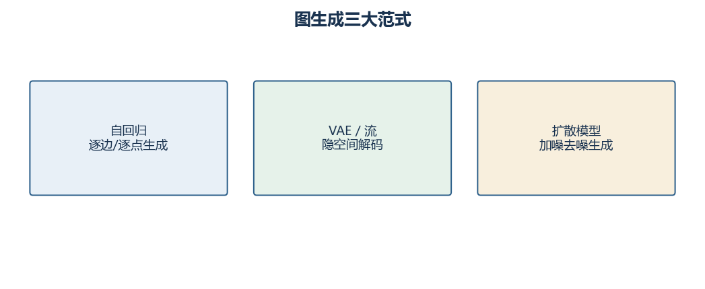

## 20.2　自回归图生成

自回归（autoregressive）方法把图生成分解为一系列条件选择：逐步添加节点与边，每步依赖已生成部分。

**链式分解。** 对有序节点序列 $v_1,\ldots,v_n$，

$$
p_\theta(\mathbf{G})=\prod_{i=1}^{n}p_\theta\big(\text{新增节点 }v_i\,\big|\,\mathbf{G}_{<i}\big)\prod_{j<i}p_\theta\big(e_{ij}\,\big|\,\mathbf{G}_{<i},v_i\big). \tag{20-1}
$$

式 (20-1) 先决定是否添加节点，再决定新节点与既有节点的连接。GraphRNN、MolGPT 等采用此范式。

**序不变性挑战。** 图的节点无固定顺序，自回归需引入一个顺序（如 BFS 序）。不同顺序导致不同分解——模型必须对顺序不变或通过排列增强学习。这是自回归图生成的核心困难：序列模型（第 16 章式思路）的「先后」在图上是人为引入的。

**MolGPT。** 把分子图线性化为 SMILES 字符串，用 GPT 自回归生成——绕过图结构直接复用语言模型，但受 SMILES 语法约束，长分子易产生无效串。

## 20.2A　自回归生成的极大似然与顺序不变性代价

式 (20-1) 的链式分解把「生成分布」化为「一系列条件概率的乘积」，训练即极大化该对数似然。本节显式写出目标并量化「顺序人为引入」的代价。

**极大似然目标。** 训练集 $\{\mathbf{G}^{(i)}\}_{i=1}^N$，对每张图按其节点顺序 $\pi$（如 BFS 序）应用式 (20-1)，对数似然为

$$
\log p_\theta(\mathbf{G})=\sum_{i=1}^{n}\log p_\theta(v_i\mid\mathbf{G}_{<i})+\sum_{i=1}^{n}\sum_{j<i}\log p_\theta(e_{ij}\mid\mathbf{G}_{<i},v_i), \tag{20-2}
$$

其中「新增节点」项通常建模为停止/继续的 Bernoulli 决策，「连边」项 $e_{ij}\in\{0,1\}$ 用二分类头。总损失 $-\sum_i\log p_\theta(\mathbf{G}^{(i)})$ 可端到端反向传播——这是自回归生成「训练稳定」的根源：每一步都是标准条件分布，无需离散采样技巧。

**顺序不变性的代价。** 关键问题：同一个图 $\mathbf{G}$ 用不同节点顺序 $\pi$ 与 $\pi'$ 分解，式 (20-1) 的两个乘积给出不同的条件分解，但**乘积总量（联合概率）应相同**。若模型对顺序敏感，则 $p_\theta(\mathbf{G}\mid\pi)\neq p_\theta(\mathbf{G}\mid\pi')$，违反图的置换不变性。补救有三：① 训练时对每个图采样多种顺序（排列增强）做数据增广；② 用「置换不变的条件化」，如按节点属性或度排序后再分解；③ 用等变编码器（第 24 章）使条件分布本身对 $\pi$ 不变。代价是：每个训练样本需前向多次（每顺序一次），或引入额外的不变性正则。这正是自回归图生成「表达力强但难训练」的定量来源——它把图像生成里不存在的「顺序自由度」强行引入，再花算力去消除这一人为自由度。

## 20.3　VAE 图生成

**图变分自编码器**把第 9 章 VAE 应用于图：编码器把图映射到潜在向量 $\mathbf{z}$，解码器从 $\mathbf{z}$ 生成图结构。

**VGAE 生成式扩展。** 第 19.3 节的 VGAE 是「重构」式（$\mathbf{A}\to\mathbf{Z}\to\hat{\mathbf{A}}$）。作为**生成模型**，需从先验采样 $\mathbf{z}\sim p(\mathbf{z})$（如 $\mathcal{N}(0,\mathbf{I})$）再解码：

$$
\mathbf{z}\sim\mathcal{N}(0,\mathbf{I}),\quad p_\theta(\mathbf{A}\mid\mathbf{z})=\prod_{i<j}\mathrm{Bernoulli}\big(\sigma(\mathbf{z}_i^{\top}\mathbf{z}_j)\big). \tag{20-3}
$$

式 (20-3) 用内积解码每条边——直接但表达有限（只能生成低秩结构的图），且固定节点数。

**Neural Relational Inference / GraphVAE。** GraphVAE 输出完整邻接矩阵（含节点顺序对齐），借助匹配解决排列问题；条件 VAE $p_\theta(\mathbf{G}\mid\mathbf{z},c)$ 可控制生成性质。VAE 训练目标为 ELBO（第 9 章式 9-3）：

$$
\mathcal{L}=-\mathbb{E}_{q_\phi(\mathbf{z}\mid\mathbf{G})}[\log p_\theta(\mathbf{G}\mid\mathbf{z})]+D_{\mathrm{KL}}[q_\phi(\mathbf{z}\mid\mathbf{G})\|p(\mathbf{z})]. \tag{20-4}
$$

## 20.4　扩散图生成

**扩散模型**（diffusion model）近年来在连续数据（图像）生成上取得突破。把扩散推广到**离散图结构**是前沿方向。

**连续扩散的图适配。** 对邻接矩阵 $\mathbf{A}\in\mathbb{R}^{n\times n}$（放宽为连续），前向过程逐步加噪：

$$
\mathbf{A}_t=\sqrt{\bar{\alpha}_t}\,\mathbf{A}_0+\sqrt{1-\bar{\alpha}_t}\,\boldsymbol{\epsilon},\quad \boldsymbol{\epsilon}\sim\mathcal{N}(0,\mathbf{I}), \tag{20-5}
$$

反向过程用神经网络（通常是 GNN）预测噪声 $\boldsymbol{\epsilon}_\theta(\mathbf{A}_t,t)$，训练目标 $\mathcal{L}=\mathbb{E}\|\boldsymbol{\epsilon}-\boldsymbol{\epsilon}_\theta\|^2$。采样时从 $\mathbf{A}_T$（近似高斯噪声）逐步去噪得 $\mathbf{A}_0$，再阈值化为二值边。

**离散扩散（D3PM / DiGress）。** 直接对离散边/节点类型定义转移矩阵 $\mathbf{Q}_t$，前向 $q(\mathbf{G}_t\mid\mathbf{G}_{t-1})$ 按 $\mathbf{Q}_t$ 扰动，反向网络预测原始类别。DiGress 等方法通过图上的置换等变去噪网络，在分子图生成上达到先进水平。扩散的优势是生成多样且训练稳定，劣势是采样步数多（慢）。

## 20.4A　离散扩散的 ELBO 与置换等变去噪

连续扩散 (20-5) 对邻接矩阵「加高斯噪」，但真实边是 $\{0,1\}$ 的——把二值邻接当作连续量加噪再阈值化，会生成「介于有边与无边之间」的中间态，破坏图结构。离散扩散（DiGress）把噪声过程定义在**边的 Bernoulli 分布**上，本节给出其 ELBO 形式与置换等变要求。

**边级前向过程。** 对每条边 $e_{ij}\in\{0,1\}$，定义「加噪」为以概率把 $e_{ij}$ 翻转为另一取值：$q(e_{ij}^{(t)}\mid e_{ij}^{(t-1)})=\mathbf{Q}_t$，其中 $\mathbf{Q}_t$ 是 $2\times2$ 的离散转移矩阵（如「有边→无边」概率随 $t$ 递增）。$T$ 步后 $e^{(T)}$ 逼近先验（接近均匀），原始结构信息被抹去——与连续扩散中 $\mathbf{A}_T\to\boldsymbol\epsilon$ 同构，只是噪声空间从 $\mathbb{R}$ 换成 $\{0,1\}$。

**ELBO 与训练目标。** 与 VAE (20-4) 同理，离散扩散最大化

$$
\log p_\theta(\mathbf{G})\ge\mathbb{E}_{q}\Big[-\sum_{t=1}^{T}\beta_t\,D_{\mathrm{KL}}\big(q(e_{ij}^{(t-1)}\mid e_{ij}^{(t)})\,\big\|\,p_\theta(e_{ij}^{(t-1)}\mid e_{ij}^{(t)})\big)\Big]+D_{\mathrm{KL}}(q(\mathbf{G}^{(T)})\|p(\mathbf{G}^{(T)})), \tag{20-6}
$$

其中 $p_\theta(\cdot\mid e_{ij}^{(t)})$ 是 GNN 去噪网络对「上一时刻边取值」的预测，$\beta_t$ 为步长权重。训练即让网络预测 $q$ 的反向转移——「给定噪声图，原始边更可能是 0 还是 1」。采样时从先验出发，逐步执行 $p_\theta$ 的反向转移，$T$ 步后得一张二值邻接图。

**置换等变的必要性。** 去噪网络若用标准全连接层，节点编号顺序会改变输出，导致「同一图的不同编号生成不同边」——生成分布不满足置换不变。DiGress 用第 24 章的等变 GNN 作去噪骨干：对节点置换 $\pi$，$\mathbf{A}^{(t)}\to\pi\mathbf{A}^{(t)}\pi^\top$ 时网络输出同步重排，保证生成的图在分布意义上与编号无关。这把第 24 章的等变性从「分类/预测」推广到「生成」——**生成模型对对称性的要求比判别模型更硬**，因为输出的整张图本身必须对编号不变。

## 20.5　分子图生成特论

分子图生成是图生成最重要的应用：目标是设计具有特定性质（如药物活性、低毒性）的新分子。

**表示选择。** 三类主流表示：① **SMILES 字符串**——复用语言模型，但语法约束强；② **图表示**——直接生成节点/边，置换等变模型更自然；③ **片段/语法表示**——以化学子结构为单位生成，合法性高。

**性质优化。** 条件生成常结合强化学习或贝叶斯优化：以训练好的性质预测器 $f(\mathbf{G})$ 为奖励，用 REINFORCE 微调生成策略 $\theta$：

$$
\nabla_\theta J=\mathbb{E}_{\mathbf{G}\sim p_\theta}\big[\big(f(\mathbf{G})-b\big)\nabla_\theta\log p_\theta(\mathbf{G})\big], \tag{20-7}
$$

其中 $b$ 是基线。式 (20-7) 把「生成像训练分布的图」转为「生成满足性质的图」，是分子发现的常用范式。

**有效性约束。** 分子必须满足价键规则（碳最多四价等）。实现手段：生成时按价键掩码（mask）约束动作空间，或生成后做价键修正。有效性是分子生成区别于一般图生成的关键约束。

## 20.5A　性质导向生成的目标分解与约束满足

式 (20-7) 的 REINFORCE 把「生成满足性质 $f$ 的图」化为「以 $f$ 为奖励的策略优化」，但实践中该目标极易退化：奖励 $f$ 若只在极少数图上有高分，策略会快速坍缩到该少数图（mode collapse），唯一性与新颖性暴跌。本节补充两个工程上不可省略的设计。

**多目标分解。** 真实分子设计几乎从不只优化一个性质，而是「目标性质高 + 结构有效 + 分布不过远」的联合。常用加权和

$$
\max_\theta\ \mathbb{E}_{\mathbf{G}\sim p_\theta}\big[f(\mathbf{G})+\lambda_1\,\mathrm{valid}(\mathbf{G})-\lambda_2\,d(\mathbf{G},\mathcal{G}_{\mathrm{train}})\big], \tag{20-8}
$$

其中 $d$ 是生成图与训练集的分布距离（如 MMD，例 20.3），$\mathrm{valid}$ 指示分子是否合法。$\lambda_2$ 项是「别跑太远」的锚——它把纯 RL 的「无约束追高奖励」拉回「在训练分布邻域内追高奖励」，防止生成分布漂移到训练数据从未覆盖的区域（分布外泛化失效的根源）。

**约束满足 vs 惩罚。** 式 (20-8) 用「惩罚违反」软处理约束，但价键规则是硬约束——一个碳连五根键的分子即使 $f$ 再高也无意义。两种处理：① **生成时约束**——动作空间按当前分子价键状态动态掩码（mask），非法连边根本不可选，从源头杜绝无效；② **生成后修正**——允许生成非法分子，再用局部规则修复（如删除超价键）。前者保证 100% 有效但限制探索、后者保留探索但需修后重验。分子生成论文应报告「修复前/修复后有效性」两个数字，否则有效性指标可能被「只统计修后」虚增。

## 20.6　数值算例

**例 20.1（VAE 内积解码手算）** 设潜在维度 $d=2$，采样 $\mathbf{z}_1=(1,0)^\top,\mathbf{z}_2=(0.5,0.5)^\top,\mathbf{z}_3=(-1,0)^\top$。则

$$
\sigma(\mathbf{z}_1^{\top}\mathbf{z}_2)=\sigma(0.5)\approx0.62,\quad \sigma(\mathbf{z}_1^{\top}\mathbf{z}_3)=\sigma(-1)\approx0.27. \tag{20-9}
$$

若阈值 0.5，则预测边 $(1,2)$ 存在、$(1,3)$ 不存在。$\mathbf{z}_2$ 与 $\mathbf{z}_1$ 潜在相似故相连概率高——这展示内积解码如何用潜在相似度决定连边。

**例 20.2（扩散加噪手算）** 设 $\bar{\alpha}_t=0.25$，$\mathbf{A}_0$ 某元素 $a=1$，采样 $\epsilon=0.4$。则

$$
a_t=\sqrt{0.25}\times1+\sqrt{0.75}\times0.4=0.5+0.866\times0.4=0.5+0.346=0.846. \tag{20-10}
$$

随着 $t$ 增大 $\bar{\alpha}_t\to0$，$a_t\to\epsilon$（高斯噪声），原始结构信息被逐步抹去——反向去噪就是学习逆转这一过程。

**例 20.3（MMD 分布距离手算）** MMD 度量生成分布与数据分布在核 $k$ 下的差异，对核 $k(x,y)=\exp(-\gamma\|x-y\|^2)$（RBF 核），其平方形式为

$$
\mathrm{MMD}^2=\frac{1}{n^2}\sum_{i,j}k(\mathbf{x}_i,\mathbf{x}_j)+\frac{1}{m^2}\sum_{i,j}k(\mathbf{y}_i,\mathbf{y}_j)-\frac{2}{nm}\sum_{i,j}k(\mathbf{x}_i,\mathbf{y}_j), \tag{20-11}
$$

其中 $\mathbf{x}_i$ 为数据图统计量、$\mathbf{y}_j$ 为生成图统计量。取 $\gamma=1$，数据度分布样本 $\mathbf{x}=\{2,4\}$、生成度分布样本 $\mathbf{y}=\{3,5\}$（用平均度作一维统计量演示）。逐项：数据内 $\frac{1}{4}[k(2,2)+k(2,4)+k(4,2)+k(4,4)]=\frac{1}{4}[e^0+e^{-4}+e^{-4}+e^0]=\frac{1}{4}[2+2e^{-4}]\approx0.5087$；生成内同理 $\frac{1}{4}[e^0+e^{-4}+e^{-4}+e^0]\approx0.5087$；交叉项 $\frac{1}{4}[k(2,3)+k(2,5)+k(4,3)+k(4,5)]=\frac{1}{4}[e^{-1}+e^{-9}+e^{-1}+e^{-1}]\approx\frac{1}{4}[0.3679+0.00012+0.3679+0.3679]\approx0.2759$。故 $\mathrm{MMD}^2\approx0.5087+0.5087-2\times0.2759=0.4702$，$\mathrm{MMD}\approx0.686$。若生成分布与数据完全重合，交叉项等于两项内项，MMD²=0；本例 MMD≈0.69 说明生成图度分布与数据仍有明显偏差。MMD 对核带宽 $\gamma$ 敏感——$\gamma$ 过大（核过窄）只比较近邻、过小（核过宽）又失去区分力，实践中常用 median heuristic 或网格搜索定 $\gamma$。

## 20.7　技术谱系与变体

**表 20-1　图生成方法谱系**

| 范式 | 代表方法 | 优点 | 局限 |
|------|----------|------|------|
| 自回归 | GraphRNN、MolGPT | 序列建模成熟 | 顺序依赖、慢 |
| VAE | GraphVAE、VGAE | 潜在空间可解释 | 内积表达有限 |
| GAN | GraphGAN | 对抗生成锐利 | 训练不稳、离散难微 |
| 扩散 | DiGress、GDSS | 多样、稳定 | 采样慢 |
| 流模型 | GraphNF | 精确似然、可逆 | 设计复杂 |
| RL/优化 | REINVENT、MolOpt | 性质导向 | 需奖励设计 |

自回归与 VAE 是早期主流；扩散模型凭多样性与稳定性成为新热点；流模型提供精确似然但架构复杂；RL 方法在分子性质优化上不可替代。选择取决于任务：无约束结构建模用 VAE/扩散，性质导向设计用 RL + 生成器的组合。

**表 20-2　图生成范式的「可采样 vs 似然估计」权衡**

| 范式 | 精确似然 | 采样质量 | 置换不变 | 训练稳定性 | 典型局限 |
|------|:---:|:---:|:---:|:---:|----------|
| 自回归 (20-1) | 可（式 20-2） | 逐节点，慢 | 需顺序处理 | 高 | 顺序人为 |
| VAE (20-3/20-4) | ELBO 下界 | 快（一次解码） | 需匹配/等变 | 高 | 内积表达有限 |
| GAN | 无 | 快、锐利 | 需匹配 | 低 | 模式坍缩、离散难微 |
| 扩散 (20-5/20-6) | 近似 ELBO | 多样，慢（$T$ 步） | 需等变去噪 | 高 | 采样慢 |
| 流 (NF) | 精确（可逆） | 快 | 需可逆等变层 | 高 | 架构设计难 |

表 20-2 揭示一个核心权衡：**能精确算似然的方法（自回归、流）通常采样慢或架构受限；采样快的方法（GAN、VAE）往往只能给似然下界或无法给似然**。扩散模型近年崛起，正是因为它在「稳定性 + 多样性」上同时逼近 VAE 与 GAN 的长处，且离散版 (20-6) 能原生处理二值边——但「采样 $T$ 步」的代价始终存在。选型时若需做「似然比较」（如模型选择、异常检测），优先自回归或流；若只需「生成得像」（如分子设计），扩散或 GAN 即可。

## 20.8　边界、讨论与承上启下

图生成的核心挑战：① **置换等变性**——生成分布必须对节点编号不变，实现需匹配或等变架构；② **离散可微性**——边/节点是离散的，不能直接反向传播，需 Gumbel-Softmax、REINFORCE 或离散扩散；③ **评估困难**——「生成得像」缺乏统一指标，MMD 依赖统计量选择；④ **规模限制**——大多数方法限于数百节点，大图生成仍开放。分子生成还面临合成可行性（生成的分子未必可合成）与分布外泛化问题。

本章衔接第 9 章（VAE/ELBO 的生成式应用）、第 19 章（链路预测与生成的对偶）、第 10—18 章（GNN 作为去噪/编码骨干）、第 21 章（图分类与生成的评估）。下一章介绍子图与图分类——转向图级任务与结构模式挖掘。

## 本章小结

本章系统论述图生成模型——从预测缺失边走向生成完整新图。

我们首先形式化图生成问题（定义 20.1）与评估指标，阐明「离散、变长、非欧」带来的特殊困难。接着介绍自回归生成（式 20-1）、VAE 生成（式 20-3、20-4）、扩散生成（式 20-5）与分子图生成（式 20-7），并通过手算（式 20-9、20-10）验证内积解码与扩散加噪的机制。最后梳理谱系（表 20-1）并讨论置换等变、离散可微、评估、规模等边界。

我们还明确边界：置换不变性要求、离散梯度近似、评估指标不统一、规模与合成可行性限制。这些辨析衔接第 9—10、18—19、21 章。

下一章介绍子图与图分类——聚焦图级表示与结构模式。

**进一步阅读**　本章建议延伸阅读的文献：[1]、[3]、[6]、[7]。

## 参考文献

[1] You J, Ying Z, Ren X, et al. GraphRNN: Generating realistic graphs with deep auto-regressive models. *ICML*, 2018.

[2] Kipf T N, Welling M. Variational graph auto-encoders. *NeurIPS WDL*, 2016.

[3] Simonovsky M, Komodakis N. GraphVAE: Towards generation of small graphs using variational autoencoders. *ICANN*, 2018.

[4] Ho J, Jain A, Abbeel P. Denoising diffusion probabilistic models. *NeurIPS*, 2020.

[5] Vignac C, Hooker J, Hariri N, et al. DiGress: Discrete denoising diffusion for graph generation. *ICLR*, 2023.

[6] Gómez-Bombarelli R, Wei J N, Duvenaud D, et al. Automatic chemical design using a data-driven continuous representation of molecules. *ACS Central Science*, 2018, 4(2): 268–276.

[7] Olivecrona M, Blaschke T, Engkvist O, et al. Molecular de-novo design through deep reinforcement learning. *Journal of Cheminformatics*, 2017, 9: 48.

[8] Liu J, Kawakami R, Hamaguchi T, et al. Graph generative models: A comprehensive survey. *IEEE TKDE*, 2024, 36(5): 2156–2176.

---

# 第 21 章　子图与图分类

第 19—20 章聚焦节点对与整图的生成/补全推理。本章转向另一类核心任务：**图分类**（graph classification）——给定一批图，为每张图预测一个标签（如分子是否致突变、蛋白质是否属于某家族、社交社群类型）。图分类与节点分类（第 9 章）的关键区别在于需要**图级表示**（graph-level representation）：把整张图的节点信息聚合为一个向量。这正是第 14 章「读出」（readout）所铺垫的内容，本章将其系统化并扩展到子图挖掘与图对比学习。

本章先形式化图分类并给出图级读出方法（21.1 节），介绍子图挖掘与模体（21.2 节），推导图对比学习（21.3 节），给出数值算例（21.4 节），梳理技术谱系（21.5 节），最后讨论边界并承上启下（21.6 节）。

## 21.1　图分类与图级读出

**定义 21.1（图分类）** 给定图集合 $\{(\mathbf{G}_i,y_i)\}$，其中 $\mathbf{G}_i=(V_i,E_i,\mathbf{X}_i)$，$y_i\in\mathcal{Y}$ 是图级标签。学习分类器

$$
\hat{y}_i=\mathrm{MLP}\big(\mathbf{h}_{\mathbf{G}_i}\big),\quad \mathbf{h}_{\mathbf{G}_i}=\mathrm{READOUT}\big(\{\mathbf{h}_v^{(L)}:v\in V_i\}\big), \tag{21-1}
$$

其中 $\mathbf{h}_v^{(L)}$ 由 GNN（第 10—18 章）学得，READOUT 是排列不变的聚合函数。

**直觉解释。** 图分类要回答「这张图整体属于什么」，但 GNN 学的是每个节点的表示——因此需要一个「汇总」步骤把节点信息压缩成图级信号。关键矛盾是：汇总必须对等节点顺序（排列不变），却又不能丢失对分类有用的结构信息。读出、子图挖掘与对比学习，本质上都是在不同粒度上平衡「保留多少结构」与「压缩到什么程度」。

## 21.1A　读出函数的排列不变性：从定义到证明

式 (21-1) 反复强调 READOUT 必须**排列不变**，这一性质不是工程偏好而是数学必然：节点编号是人为的，同一张图的不同编号对应同一分类答案。本节给出排列不变的严格刻画，并解释为何 sum/mean/max 满足、而朴素拼接不满足。

**定义 21.2A（排列不变读出）** 设置换矩阵 $\mathbf{P}\in\{0,1\}^{n\times n}$（每行每列恰一个 1）。读出 $R$ 是排列不变的，当且仅当对任意节点数 $n$ 与置换 $\mathbf{P}$，

$$
R\big(\{\mathbf{h}_v\}_{v\in V}\big)=R\big(\{\mathbf{h}_{\pi(v)}\}_{v\in V}\big),\quad \text{即}\quad R(\mathbf{H})=R(\mathbf{P}\mathbf{H}), \tag{21-2}
$$

其中 $\mathbf{H}\in\mathbb{R}^{n\times d}$ 是节点表示矩阵（行对应节点）。式 (21-2) 把「不变性」落到矩阵层面：行置换不改变输出。

**三个基本池化的验证。** 对 sum 读出 $R(\mathbf{H})=\mathbf{1}^\top\mathbf{H}$（列求和），行置换 $\mathbf{P}\mathbf{H}$ 只是重排行、列和不变，故 $R(\mathbf{P}\mathbf{H})=\mathbf{1}^\top\mathbf{P}\mathbf{H}=\mathbf{1}^\top\mathbf{H}$——满足 (21-2)。mean 读出 $R(\mathbf{H})=\frac{1}{n}\mathbf{1}^\top\mathbf{H}$ 同理（$n$ 为行数，置换不改变 $n$）。max 读出 $R(\mathbf{H})=\max_i\mathbf{h}_i$（逐列取最大）对行重排显然不变。**反例**：若读出是「取第一个节点」$R(\mathbf{H})=\mathbf{H}_{1\cdot}$，则行置换后「第一个」变成原图的某个其他节点，$R(\mathbf{P}\mathbf{H})\neq R(\mathbf{H})$——这正解释了为何 GNN 后不能简单「挑一个代表节点」作图表示，而必须聚合全部节点。

**不变性与等变性的对照。** 式 (21-2) 是**不变性**（输出是标量/向量，不随编号变）；与之对照，节点级输出（如节点分类）应是**等变性**：$f(\mathbf{P}\mathbf{A}\mathbf{P}^\top)=\mathbf{P}f(\mathbf{A})$，即输出随编号同置换。图分类用不变读出、节点分类用等变输出，二者是同一置换对称性在不同输出维度的体现（第 24 章将统一这一语言）。这一区分也解释了「读出信息瓶颈」：不变性把 $n$ 个节点向量压缩成 1 个，压缩比 $n:1$，必然丢失节点间关系细节——这是 21.6 节读出瓶颈的根源。

**读出方法谱系。** ① **简单统计池化**：sum/mean/max——第 14.1 节已述，sum 保留数量信息但受图规模影响，mean 归一化但丢失规模，max 突出显著节点；② **层次池化**：DiffPool、TopKPool（第 14.2 节）——逐步粗化图，保留层次结构；③ **注意力读出**：Set2Set、GMP（global mean pool）与第 18 章注意力结合。

**图同构矩阵（Weisfeiler–Lehman 内核）。** 第 10 章指出 GNN 表达力不超过 1-WL。WL 内核（WL kernel）通过迭代重标记计算图间相似度，是图分类的经典核方法：

$$
k(\mathbf{G},\mathbf{G}')=\sum_{\ell=0}^{L}\sum_{v\in V}\sum_{v'\in V'}\kappa\big(c^{(\ell)}(v),c^{(\ell)}(v')\big), \tag{21-3}
$$

其中 $c^{(\ell)}(v)$ 是节点 $v$ 在第 $\ell$ 轮 WL 重标记后的标签，$\kappa$ 是标签核。WL 内核是 GNN 图分类的理论基线。

**例 21.5（WL 内核手算：两个小图的相似度）** 设两张图：$\mathbf{G}_1$ 为三角形 $K_3$（3 节点两两相连），$\mathbf{G}_2$ 为路径 $P_3$（节点 1-2-3）。初始标签：$K_3$ 三节点度均为 2，标签集合 $\{2,2,2\}$；$P_3$ 端点度 1、中心度 2，标签集合 $\{1,1,2\}$。取 $\ell=0$（仅按度重标记）、$\kappa$ 为 0-1 相等核（两标签相同计 1），式 (21-3) 退化为对每个节点的「匹配标签邻居数」求和。

$\ell=0$ 时，$\mathbf{G}_1$ 节点标签全为 2，$\mathbf{G}_2$ 有节点标签为 2（中心）与 1（两端）。逐节点匹配 $c^{(0)}(v)=c^{(0)}(v')$ 的计数：$\mathbf{G}_1$ 的每个「2」节点可与 $\mathbf{G}_2$ 的唯一「2」节点匹配，3 个 2 节点各贡献 1，共 3；$\mathbf{G}_2$ 的两个「1」节点在 $\mathbf{G}_1$ 中无对应「1」，贡献 0。故 $\ell=0$ 的内核值 $k_0(\mathbf{G}_1,\mathbf{G}_2)=3$。再看 $k_0(\mathbf{G}_1,\mathbf{G}_1)$：3 个「2」两两匹配，$\sum_{v,v'}\kappa=3\times3=9$。归一化相似度（余弦）$\frac{k_0}{\sqrt{k_0(G_1,G_1)\,k_0(G_2,G_2)}}$：$k_0(G_2,G_2)$ 中，两「1」互配 4、一「2」自配 1，共 5。故 $\mathrm{sim}=\frac{3}{\sqrt{9\times5}}=\frac{3}{\sqrt{45}}\approx0.447$。$\ell=0$ 仅按度，$K_3$（全度 2）与 $P_3$（度 1,1,2）的度多重集不同，相似度仅 0.447——较低，符合直觉「两者结构差异大」。若迭代到 $\ell=1$（按邻居标签多重集重标），$K_3$ 节点标签变为 $(2,2,2)$ 的稳定标记、$P_3$ 中心为 $(1,1,2)$、端点为 $(2)$，两图的 WL 指纹进一步分化，相似度进一步下降——这正是 1-WL「迭代区分结构」的体现，也解释了为何 GNN 图分类（受 1-WL 上限约束）能区分部分但无法区分全部非同构图（21.6 节表达力上限）。

> 【图 21-1　图分类管线】（原图见 figures/图21-1.png）：输入图集 → GNN 节点嵌入 → READOUT 图向量 → MLP 分类；下方标注 WL 内核对照路径。
>
> 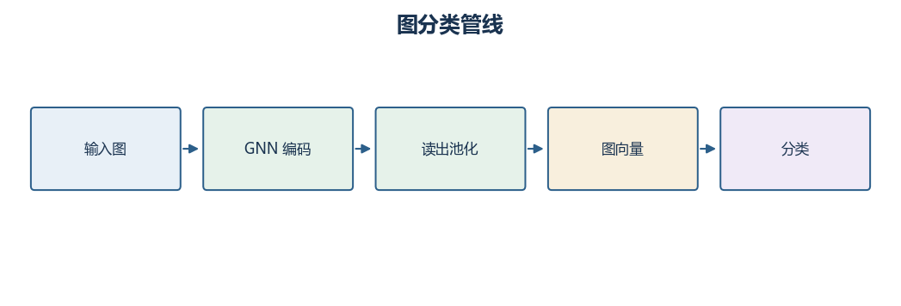

## 21.2　子图挖掘与模体

**模体**（motif）是图中显著高频出现的小子图模式——网络的「构建块」。模体分析揭示网络的功能约束：转录网络中的反馈环、社交网络中的三角闭包。

**定义 21.2（模体显著性）** 对子图模式 $M$，其在图 $\mathbf{G}$ 中的出现次数 $N_{\mathrm{obs}}(M)$，与随机化图（保持度序列）中的期望 $N_{\mathrm{rand}}(M)$ 比较，显著性

$$
Z(M)=\frac{N_{\mathrm{obs}}(M)-\mathbb{E}[N_{\mathrm{rand}}(M)]}{\sqrt{\mathrm{Var}[N_{\mathrm{rand}}(M)]}}. \tag{21-4}
$$

$Z(M)>2$ 且出现次数超阈值时，$M$ 被视为模体。模体是「结构指纹」，可作为图分类的显式特征。

**子图方法在图分类中的应用。** 两条路线：① **子图特征法**——枚举或挖掘频繁子图，把每张图表示为子图出现频数的向量（类似词袋），再分类；② **子图神经网络**——对图中抽取的关键子图分别编码再聚合（第 19.4 节 SEAL 的思想用于图级任务）。前者可解释但枚举爆炸，后者端到端但计算昂贵。

## 21.2A　子图同构：一个手算判定

子图特征法的底层操作是**子图同构**（subgraph isomorphism）判定：模式 $M$ 在 $\mathbf{G}$ 中出现一次，当且仅当存在单射 $\phi:V(M)\to V(\mathbf{G})$ 使边关系保持。该判定是 NP 完全问题，但对小模式（如路径、星、三角）可手算。本节用一个小例演示。

**例 21.4（路径 $P_3$ 在 $\mathbf{G}$ 中的同构计数）** 设模式 $M$ 为一条 3 节点路径 $a-b-c$（边 $\{ab,bc\}$）。设目标图 $\mathbf{G}$ 有 4 个节点，边为 $\{12,23,24\}$（即节点 2 分别与 1、3、4 相连，呈星形 $K_{1,3}$ 去掉中心自环）。

逐一枚举 $M$ 的 3 个节点在 $\mathbf{G}$ 中的单射赋值（$4\times3\times2=24$ 种，由对称性可归约）。同构要求 $a,b,c$ 两两中：$(a,b)$ 与 $(b,c)$ 必须是 $\mathbf{G}$ 的边、$(a,c)$ 不必。中心节点 $b$ 必须同时连 $a$ 与 $c$，故 $b$ 只能取 $\mathbf{G}$ 中度数 $\ge2$ 的节点——只有节点 2（度 3）。取 $b=2$，则 $a,c$ 从 $\{1,3,4\}$ 取不同两个，共 $3\times2=6$ 种有序赋值（$a,c$ 可互换，但 $M$ 中 $a,b,c$ 有序，故 $a\ne c$ 的 6 种都成立，因为 2 与 1、3、4 全相连）。其余 $b$ 取非 2 节点（如 $b=1$，度 1）时，$b$ 至多连一个节点，无法同时连 $a$ 与 $c$，不成立。

故 $P_3$ 在 $\mathbf{G}$ 中的（有序）同构计数为 6。若改问「无序」同构（把 $a,c$ 互换视为同一），则 3 个。这个手算展示了子图计数的「先定位高约束节点（中心 $b$）、再枚举剩余」的标准技巧——它正是 VF2 等子图同构算法的核心思想：从图中约束最强的节点（最高度/最特殊）开始匹配，可剪掉大量无效分支。模体计数（式 21-4）的 $N_{\mathrm{obs}}(M)$ 就是这类计数的总和，模式越大、图越稠密，计数增长越快——这是子图特征法「枚举爆炸」（21.6 节）的定量来源。

## 21.3　图对比学习

**图对比学习**（graph contrastive learning）是自监督图表示学习的主流范式：无需标签，通过数据增强构造正样本对，拉近正样本、推远负样本。

**增强与编码器。** 对图 $\mathbf{G}$，施加随机增强（节点丢弃、边扰动、属性掩码、子图）得到两个视图 $\tilde{\mathbf{G}}_1,\tilde{\mathbf{G}}_2$，经编码器 $f$ 与读出 $g$ 得图表示 $\mathbf{z}_1=g(f(\tilde{\mathbf{G}}_1)),\mathbf{z}_2=g(f(\tilde{\mathbf{G}}_2))$。

**InfoNCE 损失。** 批内其他图作为负样本：

$$
\mathcal{L}_i=-\log\frac{\exp\big(\mathrm{sim}(\mathbf{z}_1,\mathbf{z}_2)/\tau\big)}{\sum_{j\ne i}\exp\big(\mathrm{sim}(\mathbf{z}_1,\mathbf{z}_2^{(j)})/\tau\big)+\exp\big(\mathrm{sim}(\mathbf{z}_1,\mathbf{z}_2)/\tau\big)}, \tag{21-5}
$$

其中 $\mathrm{sim}$ 是余弦相似度，$\tau$ 是温度系数。式 (21-5) 即第 9 章对比学习的图版，最大化两个增强视图的互信息下界。

**GraphCL / JOAO。** GraphCL 系统研究四种图增强组合，JOAO 自动学习增强策略。对比学习的关键假设是「同一图的两个增强视图语义不变」——增强过强会破坏语义（如丢边改变分子性质），过弱则学习不到有用信号。

## 21.3A　图增强的四类操作与信息保持边界

式 (21-5) 的 InfoNCE 质量完全取决于「增强是否保住语义」。本节把 GraphCL 研究的增强分为四类，并给出「保语义」的判据——这是图对比学习区别于图像对比（裁剪/颜色抖动）的关键。

**四类增强（GraphCL）。** ① **子图（subgraph）**：随机保留 $k$ 个节点及其诱导边，丢掉其余——模拟「只看图的一部分」；② **节点扰动（node dropout）**：随机丢弃若干节点特征；③ **边扰动（edge perturbation）**：随机加/删边；④ **特征掩码（feature mask）**：把部分节点特征置零。每种增强都对应「图的某个属性是否重要」的假设：子图增强假设「图的整体拓扑可压缩」、边扰动假设「单条边不改变图标签」。

**信息保持边界。** 增强的「度」必须落在「扰动图标签不变」的范围内。判据是：**对标签敏感的结构不可扰动**。以分子致突变分类为例，若标签由某个特定官能团（如硝基）决定，则「删边增强」一旦删掉硝基的键，图标签就翻转——该增强对这张图是「有害」的，会把正样本增强成负样本，InfoNCE 的「同图拉近」目标随之失效。GraphCL 的实证结论是：单一增强往往在某类数据集上有效、在另一类上有害，故需**多种增强组合**（其最优组合是「子图 + 边扰动 + 节点扰动」三选其二）。JOAO 更进一步，把「选哪些增强、强度多少」本身参数化成一个可微策略，用图上的注意力自动学——这是「增强的增强」，但调参成本也最高。

**温度 $\tau$ 的作用。** 式 (21-5) 中 $\tau$ 控制「对负样本的排斥力度」：$\tau$ 小（如 0.1）使 $\exp(\mathrm{sim}/\tau)$ 对相似度差异更敏感，迫使正样本相似度显著高于所有负样本；$\tau$ 大则损失趋于平滑、区分力下降。但 $\tau$ 过小会使梯度被「最难的负样本」主导、训练震荡。例 21.2 用 $\tau=0.5$ 给出 $\mathcal{L}\approx0.26$，若改 $\tau=0.1$，$\exp(0.8/0.1)=e^8\approx2981$、$\exp(0.2/0.1)=e^2\approx7.4$，损失 $-\log\frac{2981}{2981+7.4}\approx-0.0025$，几乎归零——说明 $\tau$ 过小会让已分开的正负对「损失消失」，无法再提供学习信号。

## 21.4　数值算例

**例 21.1（mean 与 sum 读出对比）** 设两图：图 A 有 3 个节点表示 $(1,0),(0,1),(1,1)$，图 B 有 2 个节点表示 $(1,0),(0,1)$。sum 读出：A 得 $(2,2)$，B 得 $(1,1)$——可区分规模但 A 的向量更大；mean 读出：A 得 $(0.67,0.67)$，B 得 $(0.5,0.5)$——消除规模影响，A、B 方向接近。若任务与规模无关（如分子是否含某官能团），mean 更合适；若规模本身是信号（如社群人数），sum 更合适。max 读出：A 得 $(1,1)$，B 得 $(1,1)$——丢失区别，说明 max 的局限。

**例 21.2（InfoNCE 手算）** 设批大小 $N=2$（一个正样本对 + 一个负样本），$\mathrm{sim}(\mathbf{z}_1,\mathbf{z}_2)=0.8$，$\mathrm{sim}(\mathbf{z}_1,\mathbf{z}_2^{(2)})=0.2$，$\tau=0.5$。则

$$
\mathcal{L}_1=-\log\frac{e^{0.8/0.5}}{e^{0.8/0.5}+e^{0.2/0.5}}=-\log\frac{e^{1.6}}{e^{1.6}+e^{0.4}}=-\log\frac{4.95}{4.95+1.49}\approx-\log0.77=0.26. \tag{21-6}
$$

损失较小说明正样本相似度（0.8）已高于负样本（0.2）——训练目标正是拉大这一差距。

**例 21.3（模体 Z 分数）** 设某三角模体在真实图出现 $N_{\mathrm{obs}}=120$ 次，随机图期望 $\mathbb{E}=80$，方差 $\mathrm{Var}=100$（标准差 10）。则

$$
Z=\frac{120-80}{10}=4.0. \tag{21-7}
$$

$Z=4>2$，该三角模体是显著模体——提示网络存在三角闭包机制（社交圈结构）。

## 21.5　技术谱系与变体

**表 21-1　图分类与子图方法谱系**

| 方法 | 类型 | 核心机制 | 代表文献 |
|------|------|----------|------|
| WL 内核 | 核方法 | WL 重标记相似度 | Shervashidze 等 [1] |
| GCN + mean/sum | 监督 GNN | 节点嵌入 + 池化 | Kipf 等 [2]（第 14 章） |
| DiffPool | 层次池化 | 可微软聚类 | Ying 等 [3] |
| GraphCL | 对比自监督 | 图增强 + InfoNCE | You 等 [4] |
| JOAO | 自动增强 | 策略学习 | You 等 [5] |
| Motif/Gram 特征 | 子图特征 | 模体频数 | 早期网络科学 [6] |
| SEAL（图级版） | 子图 GNN | 局部子图编码 | Zhang 等 [7] |

核方法理论清晰、无需训练但无法端到端学特征；监督 GNN + 读出是主流，受限于读出信息瓶颈；层次池化更强但难训练；对比学习缓解标签稀缺，依赖增强设计；子图方法提供结构可解释性但计算昂贵。实践中常组合：对比预训练（GraphCL）+ 监督微调 + 注意力读出。

**表 21-2　图分类任务的「输入粒度—表示—读出—瓶颈」对照**

| 输入粒度 | 表示方式 | 读出 | 典型瓶颈 | 适用 |
|----------|----------|------|----------|------|
| 节点特征 | GNN 多层消息传递 | sum/mean/max | 规模偏移 | 分子、小图 |
| 子图特征 | 模体/子图频数向量 | 直接入 MLP | 枚举爆炸 | 可解释场景 |
| 层次结构 | DiffPool 粗化 | 顶层聚合 | 训练不稳 | 层次明显的图 |
| 对比自监督 | 增强视图对比 | 预训练后微调 | 增强语义 | 标签稀缺 |
| 核方法 | WL 重标记 | 内核矩阵 | 无法端到端 | 小数据集 |

表 21-2 把表 21-1 的「方法谱系」按**输入粒度**重新组织：同一张图可被切成「节点—子图—整图」不同粒度，不同粒度对应不同表示与读出，瓶颈也各异。这一视角给出选型原则——**先看图的「有用信息在哪个粒度」**：若标签由局部模体决定（如分子官能团），子图特征法最直接；若由全局拓扑决定（如连通性），整图 GNN + 读出更合适；若标签由层次结构决定（如社群的社群），层次池化占优。把「粒度选择」显式纳入设计，比单纯堆叠更深的 GNN 更能避免读出瓶颈。

## 21.6　边界、讨论与承上启下

图分类的核心挑战：① **读出信息瓶颈**——简单池化把整图压成一个向量，丢失细粒度结构；② **表达力上限**——GNN 不超过 1-WL，某些非同构图无法区分（第 10 章），需高阶 GNN（第 17 章）或子图方法突破；③ **图规模分布偏移**——训练/测试图大小差异大时，池化方法泛化差；④ **对比增强的语义保持**——不当增强改变图标签（尤其分子图），损害性能。子图挖掘则受枚举复杂度限制——图中小子图数量随规模指数增长。

本章衔接第 10 章（表达力与 WL）、第 14 章（池化与读出）、第 17 章（高阶结构突破 WL）、第 19 章（SEAL 子图方法）、第 20 章（生成的评估）。本篇至此完成「图推理」三大方向：链路预测（第 19 章）、图生成（第 20 章）、图分类与子图（第 21 章）。第六篇（第 22—23 章）将进一步讨论图上的逻辑与组合推理，把图智能从「学习模式」推向「符号推理」。

## 本章小结

本章系统论述图分类与子图挖掘——图级任务与结构模式。

我们首先形式化图分类（式 21-1）与图级读出方法，介绍 WL 内核（式 21-3）作为理论基线。接着讨论模体与子图挖掘（式 21-4）、图对比学习（式 21-5），并通过三个算例（式 21-6、21-7）验证读出差异、InfoNCE 损失与模体显著性。最后梳理谱系（表 21-1）并讨论读出瓶颈、表达力上限、规模偏移、增强语义保持等边界。

我们还明确边界：读出信息损失、1-WL 表达上限、规模分布偏移、对比增强的语义风险、子图枚举复杂度。这些辨析衔接第 10、14、17、19—20 章。

下一章（第 22 章）将把图智能从统计学习推向逻辑推理，讨论关系推理与知识图谱推理。

**进一步阅读**　本章建议延伸阅读的文献：[1]、[3]、[4]、[6]。

## 参考文献

[1] Shervashidze N, Schweitzer P, Leeuwen E J V, et al. Weisfeiler-Lehman graph kernels. *JMLR*, 2011, 12: 2539–2561.

[2] Kipf T N, Welling M. Semi-supervised classification with graph convolutional networks. *ICLR*, 2017.

[3] Ying Z, You J, Morris C, et al. Hierarchical graph representation learning with differentiable pooling. *NeurIPS*, 2018.

[4] You Y, Chen T, Sui Y, et al. Graph contrastive learning with augmentations. *NeurIPS*, 2020.

[5] You Y, Zheng Y, Yao H, et al. JOAO: Graph contrastive learning via automated augmentations. *ICML*, 2021.

[6] Milo R, Shen-Orr S, Itzkovitz S, et al. Network motifs: Simple building blocks of complex networks. *Science*, 2002, 298(5594): 824–827.

[7] Zhang M, Chen Y. Link prediction based on graph neural networks. *NeurIPS*, 2018.

[8] Wu Z, Pan S, Chen F, et al. A comprehensive survey on graph neural networks. *IEEE TNNLS*, 2021, 32(1): 4–24.

---

# 第 22 章　图上的推理与逻辑

第 19—21 章完成了「图推理」的统计路径：链路预测、图生成、图分类都以数据驱动的方式补全或判别结构。但「推理」（reasoning）还有另一条更古老、更强调**显式规则与符号**的路径——从已知事实与逻辑规则出发，通过演绎推出未知结论。本章把这两条路径放在同一框架下：图的节点与边承载事实，图的结构承载规则的适用条件，而推理就是在图上执行「符号演算」或「可微的符号近似」。

**引入动机。** 知识图谱（knowledge graph）把世界知识编码为三元组 $(h,r,t)$，但真实图谱高度稀疏且噪声大，仅靠嵌入的链路预测（第 7、19 章）难以作多步、可解释的推理。例如由「父亲(张三,李四)」与「父亲(李四,王五)」推出「祖父(张三,王五)」，需要一条可组合的规则 $ \text{父亲}(x,y)\wedge\text{父亲}(y,z)\Rightarrow\text{祖父}(x,z) $。这类推理天然是**在图上沿路径的计算**，并需要把逻辑关系而非单纯统计相关性显式建模。

**本章结构。** 22.1 节建立图结构与逻辑推理的对应；22.2 节形式化知识图谱规则推理（含可微规则学习）；22.3 节介绍神经符号图推理；22.4 节给出带数值的算例；22.5 节梳理技术谱系；22.6 节讨论边界并承上启下。

## 22.1　图结构与逻辑推理

**定义 22.1（一阶逻辑与事实图）** 一阶逻辑（first-order logic, FOL）的原子公式形如 $r(x_1,\dots,x_a)$，其中 $r$ 是 $a$ 元谓词。把每个常量实体视作节点、每个成立的原子视作超边，即得**事实图** $\mathbf{G}_{\mathcal{K}}=(V,E)$。对于二元谓词，三元组 $(h,r,t)$ 对应有向标注边 $h\xrightarrow{r} t$。

在这个对应下，逻辑中的**合取**（conjunction）对应路径的拼接，**存在量化** $\exists z$ 对应沿中间节点求和，**规则**对应路径模式。Horn 规则是一类最便于在图上演算的规则：

$$
r_0(x,z)\;\leftarrow\; r_1(x,y_1)\wedge r_2(y_1,y_2)\wedge\cdots\wedge r_k(y_{k-1},z). \tag{22-1}
$$

式 (22-1) 的右侧是一条长度 $k$ 的关系路径，左侧 $r_0$ 是要推出的新关系。**直觉解释**：一条 Horn 规则就是「图中的一条可复用路径模板」。若图上存在满足右侧的节点链，则左侧边应当被补上——所以规则推理可以完全在图的邻接结构上执行。

## 22.2　知识图谱规则推理

**定义 22.2（规则置信度与支撑度）** 给定规则 $R$ 如图 $\mathbf{G}$ 上，其支撑度（support）与置信度（confidence）定义为

$$
\mathrm{supp}(R)=|\{(x,z):\exists y_{1:k},\ \text{式(22-1)右侧成立}\}|,\quad
\mathrm{conf}(R)=\frac{|\{(x,z):\text{右侧成立}\wedge r_0(x,z)\text{成立}\}|}{\mathrm{supp}(R)}. \tag{22-2}
$$

置信度衡量规则的可靠程度，支撑度衡量其覆盖范围。规则挖掘（rule mining）即在图上枚举路径模式并保留 $\mathrm{conf}$ 高者。

**可微规则学习。** 经典挖掘是离散、不可微的。神经符号方法把规则「软化」：把谓词成立程度用嵌入的连续分数表示。对三元组定义得分

$$
s(h,r,t)=\mathbf{e}_h^{\top}\mathbf{R}_r\,\mathbf{e}_t,\quad \mathbf{R}_r\in\mathbb{R}^{d\times d}, \tag{22-3}
$$

其中 $\mathbf{e}_h$ 为实体嵌入（第 7 章），$\mathbf{R}_r$ 为关系矩阵（如 RESCAL）。规则的软合取用 $t$-范数（乘积或最小值）实现，于是「若右侧成立则左侧成立」转化为可微的正则项：对每条规则 $R$ 惩罚

$$
\mathcal{L}_{\mathrm{rule}}=\sum_{(x,z)}\Big[\max\big(0,\ \text{score}_{\text{body}}(x,z)-\text{score}_{r_0}(x,z)\big)\Big]^2. \tag{22-4}
$$

**推导要点。** 式 (22-4) 把逻辑蕴含 $a\Rightarrow b$ 放松为「$b$ 的分数不低于 $a$」，即 $s_{r_0}\ge s_{\text{body}}$；违反时产生平方铰链损失。通过反向传播，规则知识以软约束形式注入嵌入，兼顾数据与逻辑。

> 【图 22-1　知识图谱规则推理示意】（原图见 figures/图22-1.png）：左边展示两条「父亲」边经规则合成「祖父」边，右边展示神经符号框架中规则约束如何注入嵌入损失。
>
> 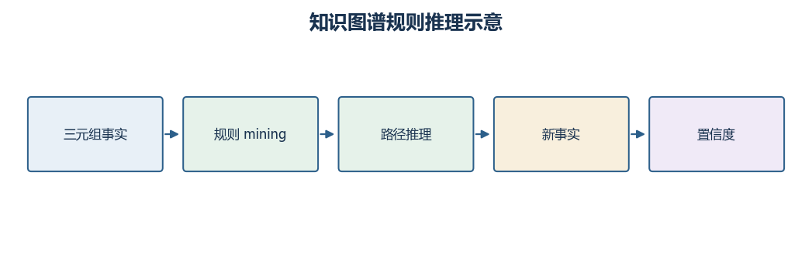

## 22.2A　规则挖掘：AMIE 的候选生成与剪枝

式 (22-2) 的支撑度与置信度把规则评估量化，但「在图上枚举所有路径模式并计算 conf」的朴素做法会指数爆炸。AMIE/AMIE+ 系列给出了「自底向上、置信度剪枝」的挖掘协议，本节用数值演示其核心步骤。

**自底向上候选生成。** 从长度为 1 的原子规则开始（如 $r_0(x,z)\leftarrow r_1(x,y)$），逐层增加右侧体原子，每层用「**置信度下界剪枝**」：一个体更长的规则，其 conf 不会超过其「去掉一个原子后的前缀规则」的 conf。于是只需保留 conf 高于阈值 $\tau_c$ 的规则，再扩展。设阈值 $\tau_c=0.9$：

**例 22.2（AMIE 手算：两步规则的挖掘）** 设知识图谱有 4 个实体，关系「父亲」已知事实：父亲(张,李)、父亲(李,王)、父亲(李,赵)、父亲(赵,钱)；关系「祖父」已知事实：祖父(张,王)。

**候选规则 $R_1:$ 父亲$(x,y)\wedge$父亲$(y,z)\Rightarrow$祖父$(x,z)$。** 枚举右侧成立的所有 $(x,z)$（存在中间 $y$）：
- $(x,z)=(张,王)$：经 $y=李$ 成立（父亲(张,李)∧父亲(李,王)）；
- $(x,z)=(李,钱)$：经 $y=赵$ 成立（父亲(李,赵)∧父亲(赵,钱)）。

故 $\mathrm{supp}(R_1)=2$。其中头原子成立（祖父已知）的只有 (张,王)（祖父(张,王)=1；祖父(李,钱) 未观测=0）。故 $\mathrm{conf}(R_1)=1/2=0.5$。因 $0.5<\tau_c=0.9$，按 AMIE 的严格剪枝，$R_1$ 在当前数据下**不被保留**——这正是小图谱上规则置信度低、需更多正例支撑才能挖掘出的体现。

**对比：若补上祖父(李,钱)=1**，则 conf 升为 $2/2=1.0\ge0.9$，$R_1$ 被保留并可用于补全。这演示了 AMIE 的关键行为：**规则是否被发现取决于数据中该模式的正例密度**，而非模式本身是否「逻辑正确」——一条逻辑正确的规则在正例稀少的小图上会被剪枝丢弃，这是规则挖掘「数据驱动」与「逻辑完备」之间张力的具体体现（22.6 节边界②的量化）。

**剪枝的代价与补救。** 严格 conf 剪枝保证「父规则 conf 高则子规则才扩展」，但会漏掉「父规则 conf 中等、子规则 conf 高」的规则。AMIE+ 引入**前向链推理**与**规则组合**缓解：先挖掘短规则补全图谱，再在补全后的图上挖长规则，使原本被剪枝的 $R_1$ 在补全后（祖父(李,钱) 被前向推出）得以保留。这是「挖掘—推理—再挖掘」的迭代范式，也是 AMIE 系列能发现长链规则的机制。

## 22.3　神经符号图推理

**神经符号（neuro-symbolic）图推理**试图结合两者之长：符号部分提供可解释、可组合、支持多步演绎的规则；神经部分提供对噪声与稀疏的鲁棒性、以及端到端学习的能力。典型框架包含三个可微模块：

1. **神经事实抽取器**：用 GNN（第 10—18 章）从原始特征或文本中预测三元组的软真值 $p(h,r,t)\in[0,1]$；
2. **可微推理机**：在软事实上执行张量化的规则演算。例如张量逻辑中，沿关系路径的组合用矩阵乘法近似：

$$
\mathbf{S}_{r_0}\ \approx\ \sigma\Big(\sum_{r_1,r_2}\ w_{r_1r_2r_0}\,\mathbf{S}_{r_1}\mathbf{S}_{r_2}\Big), \tag{22-5}
$$

其中 $\mathbf{S}_r\in[0,1]^{n\times n}$ 是关系 $r$ 的软邻接矩阵，$w$ 是可学习的规则权重，$\sigma$ 为保证取值在 $[0,1]$ 的激活；

3. **符号读出**：把推理结果阈值化，输出可解释的证明路径（proof path）。

**直觉解释。** 式 (22-5) 把「关系链式法则」写成了矩阵乘：$\mathbf{S}_{r_1}\mathbf{S}_{r_2}$ 的第 $(x,z)$ 元正是「存在 $y$ 使 $r_1(x,y)\wedge r_2(y,z)$」的软计数。因此一次矩阵乘就是一次「所有中间节点的并行演绎」，这是图结构赋予逻辑推理的效率来源。

## 22.3A　Neural LP：从「可微规则」到「端到端定理证明」

22.3 节给出神经符号推理的三模块架构，本节聚焦其中的**可微推理机**——Neural LP（不同可逻辑规则学习）如何把「定理证明」这一离散过程变成可微的。它的关键洞察是：**把规则匹配与事实应用都表示为对软真值的张量运算，再用 EM 式的内层推理/外层学习交替**。

**内层：给定规则与软事实，迭代推出所有可达结论。** 设规则库 $\mathcal{R}=\{R_1,\dots,R_m\}$，每条规则 $R$ 有体原子集与头原子。从观测事实的软真值矩阵 $\{\mathbf{S}_r\}$ 出发，对每条规则执行式 (22-5) 的张量运算，把推出的头原子真值**并入**对应关系的 $\mathbf{S}$（取最大或加权），重复直到不动点：

$$
\mathbf{S}_{r_0}\leftarrow\max\Big(\mathbf{S}_{r_0},\ \sigma\big(\text{body}(R)\big)\Big),\quad \text{repeat until convergence}, \tag{22-6}
$$

其中 $\text{body}(R)$ 是规则体按式 (22-5) 张量组合的结果。这个「迭代到不动点」正是**前向链推理**（forward chaining）的软化版：经典前向链对硬事实反复应用规则直到无新事实，式 (22-6) 对软真值做同样迭代，只是「无新事实」变为「真值不再变化」。收敛性由 $\mathbf{S}\in[0,1]$ 的单调递增且有界保证——每轮 $\mathbf{S}$ 只增不减、上界为 1，故有限步收敛。

**外层：学习规则与嵌入。** 内层给出「由规则 + 观测推出」的所有事实软真值后，外层用两类监督：① **观测损失**——已知事实（正例）与反例（负例，如随机采样三元组）上的三元组打分损失（式 22-3 的 $\mathbf{e}_h^\top\mathbf{R}_r\mathbf{e}_t$）；② **推理损失**——推理出的事实应接近其观测值。两损失联合反传，规则权重 $w$（式 22-5）与实体/关系嵌入同时被优化——这是「规则可学」的机制：规则不是人工给定，而是从数据中作为「可组合的张量模板」学出来的。

**与经典推理的对应。** 式 (22-6) 的不动点迭代 + 外层学习，对应逻辑学里的「**逻辑理论**（theory）」：一个理论是「公理（观测事实）+ 规则（推理规则）」，结论是从二者演绎可达的事实闭包。Neural LP 把「演绎闭包」算子 $\mathrm{cl}_{\mathcal{R}}(\mathbf{S}_{\text{obs}})$ 用张量运算实现，使整个闭包可微——这是神经符号推理「既保留符号的可组合性、又获得神经的可微性」的技术支点。其代价仍是 22.6 节边界①：闭包是「软」的，不保证经典逻辑的**可靠性**（soundness）——推出的软真值 0.9 不意味结论「逻辑必然」，只是「在给定软事实下概率上很强」。

## 22.4　数值算例

**例 22.1（规则置信度与路径推理手算）** 设实体集 $\{$张三, 李四, 王五$\}$，关系只有「父亲」。已知事实边：父亲(张三,李四)=1，父亲(李四,王五)=1，父亲(张三,王五)=0（尚未知）。规则 $R:$ 父亲$(x,y)\wedge$父亲$(y,z)\Rightarrow$祖父$(x,z)$。

计算支撑度：满足右侧的 $(x,z)$ 只有 (张三,王五)（经中间 $y=$李四），故 $\mathrm{supp}(R)=1$。若已知祖父(张三,王五)=1，则 $\mathrm{conf}(R)=1/1=1$。推理结论：祖父(张三,王五) 以置信度 1 成立。

再用式 (22-5) 做软推理。设 $\mathbf{S}_{\text{父亲}}$ 的 (张三,李四)=(李四,王五)=0.9，其余为 0.1。则 $(\mathbf{S}_{\text{父亲}}^2)_{(张三,王五)}=0.9\times0.9+0.1\times0.1=0.82$。若 $\sigma$ 取恒等且 $w=1$，则软推理给出祖父(张三,王五) 的真值为 $0.82$——与硬逻辑的结论一致，但额外携带了不确定性。

**例 22.3（三步链的置信度累积）** 设再加实体「孙六」，事实：父亲(王五,孙六)=0.95。规则 $R_2:$ 祖父$(x,y)\wedge$父亲$(y,z)\Rightarrow$曾祖父$(x,z)$。用式 (22-5) 软推理：先有祖父(张三,王五)=0.82（例 22.1 软推理结果），再与父亲(王五,孙六)=0.95 组合，$(\mathbf{S}_{\text{祖父}}\mathbf{S}_{\text{父亲}})_{(张三,孙六)}=0.82\times0.95=0.779$。若改按 22.7 节「独立正确率连乘」口径，三步链（父亲→父亲→父亲）单步 0.9 的可靠度为 $0.9^3=0.729$，再乘曾祖父观测置信 0.95 得 $0.729\times0.95\approx0.693$。两种口径（矩阵乘软真值 0.779 vs 连乘 0.693）都指向同一结论：**链越长、整体置信度衰减越快**，且软真值法因保留了「中间事实的观测强度」而略高于纯连乘——它把「事实有多确定」也编进了传播。这解释了为何 22.7 节主张「保留每步置信度而非只存结论」：多跳推理的可靠性是逐步乘出来的，丢失任何一步的强度都会使下游推理失去校准。

**表 22-1　图推理方法对比**

| 方法 | 表示 | 推理机制 | 可解释性 | 代表 |
|------|------|----------|----------|------|
| 嵌入链路预测 | 连续向量 | 得分函数 | 弱 | TransE（第 7 章） |
| 规则挖掘 | 离散规则 | 路径枚举 | 强 | AMIE |
| 神经符号 | 软真值+规则 | 可微张量演算 | 中强 | Neural LP |
| GNN 推理 | 节点嵌入 | 消息传递 | 中 | 第 10—18 章 |

## 22.5　技术谱系

图推理方法沿「符号—神经」轴演化，可归纳为三个阶段：① **纯符号阶段**（专家系统、AMIE）：显式规则、强可解释、但不鲁棒；② **纯神经阶段**（TransE、GNN 链路预测）：鲁棒、端到端、但黑箱；③ **神经符号融合阶段**（Neural LP、Ruleformer）：软真值+可微规则，兼顾两者。技术谱系的关键转折是**把逻辑运算改写为可微张量运算**（式 22-3—22-5），使规则能被数据优化。

**表 22-2　符号—神经图推理的阶段、能力与失效模式**

| 阶段 | 代表 | 可组合性 | 噪声鲁棒 | 可解释 | 典型失效 |
|------|------|:---:|:---:|:---:|----------|
| 纯符号 | 专家系统、AMIE | 强 | 弱 | 强 | 规则缺失即停 |
| 纯神经 | TransE、GNN 链路预测 | 弱 | 强 | 弱 | 训练未见路径外推差 |
| 神经符号 | Neural LP、Ruleformer | 中强 | 中强 | 中强 | 软化损失逻辑严格性 |

表 22-2 把三阶段按「可组合性—鲁棒性—可解释性」三角组织：纯符号在可组合与可解释上满分，但一条缺失规则就使推理链断裂（噪声鲁棒最弱）；纯神经相反——对噪声鲁棒但外推到「训练未见路径组合」时失效（22.7 节「与统计路径的互补」已述）；神经符号居中，但「软化」（式 22-4 只保证分数序而非硬逻辑）是它付出的代价。选型判据：**若领域规则已知且完备，纯符号最可靠；若规则未知但数据充足，纯神经；若规则部分已知、数据有噪声，神经符号**——这正是 22.6A 节「何时该用规则」的量化版本。

## 22.6　边界与讨论

**边界。** ① 可微规则的「软化」放松了逻辑的严格性——式 (22-4) 只保证Score 序关系，不保证硬逻辑的可靠性；② 规则枚举（22.2 节）随路径长度指数增长，长链推理计算代价高；③ 一阶逻辑的推理一般是 NP 难的，图上的近似算法无法保证完备；④ 神经符号模型的「解释」是否忠实于模型内部机制仍有争议。

## 22.6A　推理的复杂度：路径枚举为何指数爆炸

边界②③把「指数增长」与「NP 难」并置，但二者针对不同问题，本节用式 (22-5) 的矩阵乘视角量化区别，避免把「可微推理高效」误读为「逻辑推理高效」。

**可微软推理是多项式的。** 式 (22-5) 中 $\mathbf{S}_{r_1}\mathbf{S}_{r_2}$ 是 $n\times n$ 矩阵乘，单次 $O(n^3)$（用快速乘法可降至 $O(n^{2.37})$）。对长度 $k$ 的规则链，逐次相乘 $k-1$ 次，总代价 $O(k\,n^3)$——**关于实体数 $n$ 多项式**。这正是「图结构赋予逻辑推理的效率来源」（22.3 节）：矩阵乘一次性对所有中间节点并行求和，等价于「对所有 $y$ 的存在量化」$O(n)$ 的工作被吸收进矩阵乘。

**但硬逻辑推理是 NP 难的。** 可微软推理给出的是「软真值」，要回答「结论是否必然成立」（硬推理/可满足性），仍需验证「是否存在一条使体全真的赋值」——这是**模型检测**（model checking）问题，对一阶逻辑一般 NP 难。二者不矛盾：软推理（式 22-5）是「近似计数所有路径的权重和」，硬推理是「判断是否存在一条全真路径」。前者用矩阵乘把「计数」并行化（多项式），后者要「存在性判定」，无法靠线性化消除指数性。**实用含义**：神经符号系统（式 22-5）能高效给出「结论多可信」的概率，但不能替代「结论是否逻辑必然」的判定——后者在长链上代价仍指数增长（22.7 节 $p^k$ 误差累积的代价面）。

**何时该用规则、何时该用嵌入。** 综合 22.5A 表 22-2 与本节复杂度：
- **规则链短（$k\le2$）、实体少、规则已知** → 纯符号（AMIE）最优，可解释且多项式；
- **规则链长（$k\ge3$）但只需概率** → 神经符号（式 22-5）最优，多项式软推理，但放弃硬判定；
- **规则未知、数据大** → 纯神经（嵌入链路预测），但牺牲可组合性。
这一「按链长与规则完备度选范式」的判据，是图推理工程选型的核心决策树。

**承上启下。** 本章的显式关系归纳偏置与第 10 章的消息传递同源：规则路径本质是固定的消息传递模式。本章的规则学习衔接第 19 章链路预测（规则可视为结构化先验）；而把关系抽象为「变换必须尊重的对称性」，则自然引出第 24 章等变性与对称性——逻辑规则要求结论对实体的重命名不变，等变网络要求表示对几何变换作相应变换，二者是同一「不变性」思想在符号与几何两个侧面的体现。下一章转向图上的另一类结构发现任务：社区检测与图聚类。

## 22.7　延伸讨论：可解释性与多跳推理

前述方法把推理落到图上，但「推理质量」还需从可解释性与多跳能力两方面审视。本节补充两个在工程中反复出现、却常被省略的话题。

**可解释性的层次。** 图推理的「解释」可分三层：① **路径级解释**——给出推出结论所经的节点与边（如 22.4 节中张三→李四→王五的链），最直观；② **规则级解释**——给出触发的 Horn 规则及其置信度（式 22-2）；③ **嵌入级解释**——指出哪些维度对得分贡献最大（如注意力权重，第 18 章）。理想的系统应同时提供路径与规则，使用户能「顺着图验证」结论，而非仅被告知一个概率。

**多跳推理的误差累积。** 设每条关系路径的单步正确率为 $p$，一条长度 $k$ 的规则链整体正确的概率约为 $p^k$。若 $p=0.9$、$k=3$，则 $p^k=0.729$；$k=5$ 时降至 $0.59$。这解释了为何真实知识图谱的多跳推理常引入**置信度传播**：把每步的不确定性沿路径累积，而非硬判定。 softly 地，式 (22-5) 的乘法 $\mathbf{S}_{r_1}\mathbf{S}_{r_2}$ 天然实现了概率的连乘——软真值越接近 1，链越可信。

**与统计路径的互补。** 第 19 章的链路预测擅长利用全局嵌入的统计规律，但对「训练集中从未出现的路径组合」外推能力弱；规则推理（本章）恰能从少量样例中抽象出可复用的模式，外推到新组合。二者结合——用规则作为结构化先验、用嵌入提供软真值——正是神经符号方法（22.3 节）的立足点。这种「符号提供组合性、神经提供鲁棒性」的分工，在后文第 29 章讨论图基础模型的推理能力时还会重现。

**数值延伸。** 仍用算例 22.1，若单步「父亲」边正确率为 $0.9$，则两步规则链的可靠度为 $0.9^2=0.81$；若再要求「祖父」边已观测的置信度 $0.95$，联合置信度约 $0.81\times0.95=0.77$。这提示：在构建知识图谱时，对高价值推理结论应保留其支撑路径与每步置信度，而非只存结论本身。

## 本章小结

本章论述图上的推理与逻辑，把数据驱动的图推理与显式符号推理统一到「图上的演算」框架。

- 建立图结构与一阶逻辑的对应：合取对应路径、存在量化对应中间节点求和、Horn 规则对应路径模板（定义 22.1、式 22-1）。
- 形式化知识图谱规则推理，给出支撑度与置信度（式 22-2）及可微规则学习框架（式 22-3、22-4）。
- 介绍神经符号图推理的三模块架构，导出软关系组合的矩阵形式（式 22-5），并用算例 22.1 验证软硬推理的一致性。
- 梳理从纯符号到神经符号融合的技术谱系（表 22-1），明确软化、复杂度与可解释性的边界。

这些辨析衔接第 7、10—19 章，并引出第 24 章的对称性主题。

**进一步阅读**　本章建议延伸阅读的文献：[1]、[3]、[5]、[7]。

## 参考文献

[1] Wang Q, Wang B, Guo L, et al. Knowledge graph embedding: A survey of approaches and applications. *IEEE TKDE*, 2017, 29(12): 2724–2743.

[2] Galárraga L, Boyen X, Davies J, Suchanek F M. Fast rule mining in ontological knowledge bases with AMIE+. *VLDB J.*, 2015, 24(6): 707–730.

[3] Yang F, Yang Z, Cohen W W. Differentiable learning of logical rules for knowledge base reasoning. *NeurIPS*, 2017.

[4]Nickel M, Murphy K, Tresp V, Lee J. A three-way model for collective learning on multi-relational data. *ICML*, 2011.

[5] Rocktäschel T, Riedel S. End-to-end differentiable proving. *NeurIPS*, 2017.

[6] Sadeghian A, Hu Z, Wang Q, et al. Rule learning over knowledge graphs via embedding similarity. *J. Web Semantics*, 2020, 62: 100544.

[7] Zhang H, Liu F, Ding L, et al. Neural-symbolic models for knowledge graph reasoning: A survey. *IEEE TKDE*, 2023, 35(9): 9137–9156.

[8] Kipf T N, Welling M. Semi-supervised classification with graph convolutional networks. *ICLR*, 2017.

---

# 第 23 章　社区检测与图聚类

第 22 章处理图上的「演绎推理」——从规则推出新边。本章转向图上的另一类基本结构发现任务：**社区检测**（community detection）与**图聚类**（graph clustering）——把节点划分为若干组，使组内连接稠密、组间连接稀疏。如果说推理关心「边从何来」，社区检测关心「节点如何成团」。

**引入动机。** 现实网络普遍具有社区结构：社交网络中的兴趣圈、引文网络中的学科、蛋白质相互作用网络中的功能模块。发现这些社区不仅具有描述意义（理解网络组织），更具预测价值——同一社区的节点往往共享标签（第 9 章半监督学习）与属性。更重要的是，社区结构是**图的一种中尺度（mesoscale）结构**：它介于节点局部邻域与整图全局性质之间，是理解「局部消息传递」（第 10—13 章）为何有效、以及何时过平滑（第 13 章）的关键。

**本章结构。** 23.1 节定义社区与模块度；23.2 节介绍谱方法与图割；23.3 节讨论深度图聚类；23.4 节给出数值算例；23.5 节梳理技术谱系；23.6 节讨论边界并承上启下。

## 23.1　社区与模块度

**定义 23.1（社区）** 给定无向图 $\mathbf{G}=(V,E)$，一个社区划分 $\mathcal{C}=\{C_1,\dots,C_k\}$ 是 $V$ 的一个划分。好的划分使内部边密度显著高于期望。衡量这一点的经典指标是**模块度**（modularity）[1]：

$$
Q=\frac{1}{2m}\sum_{i,j}\Big(A_{ij}-\frac{d_i d_j}{2m}\Big)\,\delta(c_i,c_j), \tag{23-1}
$$

其中 $m=|E|$ 为边数，$d_i$ 为节点 $i$ 的度，$\frac{d_id_j}{2m}$ 是在保持度分布不变的配置模型（configuration model）下 $i,j$ 间边的期望数，$\delta(c_i,c_j)$ 在 $i,j$ 同社区时为 1。

**直觉解释。** 模块度的核心是「实际边数减去随机期望边数」：$A_{ij}-\frac{d_id_j}{2m}>0$ 表示 $i,j$ 之间的连接超出随机预期，是真实社区的证据。最大化 $Q$ 就是寻找「比随机网络更抱团」的划分。式 (23-1) 可改写为矩阵形式 $Q=\frac{1}{2m}\mathbf{S}^{\top}\mathbf{B}\mathbf{S}$，其中 $\mathbf{B}=\mathbf{A}-\frac{\mathbf{d}\mathbf{d}^{\top}}{2m}$ 称为模块度矩阵，$\mathbf{S}$ 为社团指示矩阵。

## 23.1A　模块度对划分的敏感性：一个两划分的对照手算

式 (23-1) 的 $Q$ 值强烈依赖「选哪个划分」，本节用同一张图、两个不同划分对照计算，展示 $Q$ 如何「奖励」社区结构，并解释为何 $Q$ 可正可负、为何 $Q>0$ 才说明「比随机好」。

**例 23.2（同一图、两划分的 $Q$ 对照）** 取 4 节点图，边为 $\{12,23,34,14\}$（即环 $C_4$：1-2-3-4-1），$m=4$、$2m=8$，各节点度 $d_1=d_2=d_3=d_4=2$，期望项 $\frac{d_id_j}{2m}=\frac{4}{8}=0.5$ 对任意节点对都相同。

**划分一：$C_1=\{1,2\}$、$C_2=\{3,4\}$。** 同社区节点对为 $(1,2)$ 与 $(3,4)$，二者恰是图中的边：
$$
Q=\frac{1}{8}\Big[\big(A_{12}-0.5\big)+\big(A_{34}-0.5\big)\Big]=\frac{1}{8}\big[(1-0.5)+(1-0.5)\big]=\frac{1}{8}\times1.0=0.125. \tag{23-2}
$$
其余对（含跨社区的 $14,23$）因 $\delta=0$ 不贡献。$Q=0.125>0$，说明「按对边分两组」比随机划分更能解释边分布。

**划分二：$C_1=\{1,3\}$、$C_2=\{2,4\}$（交错划分）。** 同社区对 $(1,3)$、$(2,4)$ 在 $C_4$ 中均**非边**（$A_{13}=A_{24}=0$）：
$$
Q=\frac{1}{8}\big[(0-0.5)+(0-0.5)\big]=\frac{1}{8}\times(-1.0)=-0.125. \tag{23-3}
$$
$Q<0$！这说明交错划分把「不相邻的节点」强行聚成社区，内部边数远低于随机期望——模块度正确地给出了「负分」惩罚。

**结论与 $Q$ 的取值范围。** 两划分 $Q$ 分别为 $+0.125$ 与 $-0.125$，模块度成功区分了「顺结构」与「反结构」的划分。$Q$ 理论上界为 $1$（每社区为完全图、无跨边），下界为 $-1$（社区恰为反完全图）。实践中 $Q\in[0,0.95]$，真实网络典型 $Q\approx0.3\sim0.7$；$Q<0$ 几乎总表示「该划分比随机还差」，应放弃。这个对照也解释了 23.4 例 23.1 中「单点社区 $Q=0.1875$」为何仍「优于随机」——尽管数值不高，关键是**正号**：$Q>0$ 才说明划分捕捉到了真实的抱团结构。

## 23.2　谱方法与图割

**图割（graph cut）**把社区检测转化为优化问题。对二划分，最小割

$$
\mathrm{cut}(C,\bar C)=\sum_{i\in C,j\in\bar C}A_{ij} \tag{23-4}
$$

倾向于产生极不平衡的划分（如孤立单点），因此常用**归一化割**（normalized cut）[2]：

$$
\mathrm{Ncut}(C,\bar C)=\frac{\mathrm{cut}(C,\bar C)}{\mathrm{vol}(C)}+\frac{\mathrm{cut}(\bar C,C)}{\mathrm{vol}(\bar C)},\quad \mathrm{vol}(C)=\sum_{i\in C}d_i. \tag{23-5}
$$

**推导要点。** 令指示向量 $\mathbf{f}\in\{0,1\}^n$，可证 $\mathrm{Ncut}=\frac{\mathbf{f}^{\top}(\mathbf{D}-\mathbf{A})\mathbf{f}}{\mathbf{f}^{\top}\mathbf{D}\mathbf{f}}=\frac{\mathbf{f}^{\top}\mathbf{L}\mathbf{f}}{\mathbf{f}^{\top}\mathbf{D}\mathbf{f}}$，其中 $\mathbf{L}=\mathbf{D}-\mathbf{A}$ 是组合拉普拉斯（第 3 章）。放松 $\mathbf{f}$ 到实数并加入正交约束，最优解由**归一化拉普拉斯** $\mathbf{L}_{\mathrm{sym}}=\mathbf{I}-\mathbf{D}^{-1/2}\mathbf{A}\mathbf{D}^{-1/2}$ 的次小特征向量（Fiedler 向量）给出——这与第 3、11 章的谱方法同源。k 路划分则取前 $k$ 个非零特征向量聚类。

> 【图 23-1　谱聚类的拉普拉斯谱】（原图见 figures/图23-1.png）：左侧展示一个含两个社区的图，右侧展示归一化拉普拉斯的前几个特征值，标出特征间隙与 Fiedler 向量用于二分类。
>
> 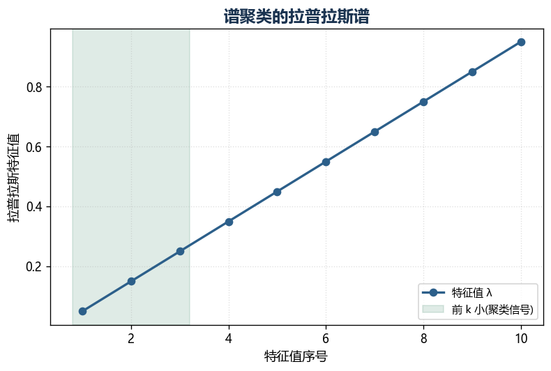

## 23.2A　分辨率极限与参数化模块度

式 (23-1) 的最大化隐含一个尺度：$Q$ 越大越好，但「多大算大」取决于图的整体密度。这引出**分辨率极限**（resolution limit）问题：存在一个阈值 $\gamma_c$，使 $Q$ 对小于 $\gamma_c$ 规模的社区完全不敏感——再小的真实社区也无法被模块度「看见」。本节给出参数化模块度 $Q_\gamma$ 的公式，并说明 Leiden 如何用分辨率参数 $\gamma$ 突破这一限制。

**参数化模块度。** 在式 (23-1) 前引入分辨率参数 $\gamma>0$：

$$
Q_\gamma=\frac{1}{2m}\sum_{i,j}\Big(A_{ij}-\gamma\,\frac{d_id_j}{2m}\Big)\delta(c_i,c_j). \tag{23-6}
$$

$\gamma=1$ 退化为标准模块度 (23-1)。**$\gamma$ 越大，对「内部边相对随机期望的超出」要求越严格**——相当于把「随机期望」的基准抬高，小社区的「微弱抱团」不足以达标，于是 $Q_\gamma$ 倾向合并小社区；$\gamma$ 越小，越容易「看见」小社区。分辨率极限的定量表述：对两个理想完全图社区，$Q$ 能区分它们的充要条件是社区内边数 $m_{\mathrm{in}}$ 满足 $m_{\infty}\gtrsim\sqrt{m}$（$m$ 为总边数）——即社区规模需大于图边数的平方根量级。这是模块度「只对中大规模社区敏感」的数学根源，也解释了为何稀疏大图上的小草社区常被合并。

**Leiden 的改进。** Louvain 的层次聚簇（局部移动 + 聚簇 + 重聚簇）可能产生「内部不连通」的社区（社区内存在孤立节点群）。Leiden 在「局部移动」与「聚簇」之间插入**精炼（refinement）步骤**：把社区内不连通的节点分裂出去，保证最终社区在图上两两连通。这一改进使 Leiden 在保持近线性复杂度的同时，给出**结构连通**的社区，并自然支持分辨率参数 $\gamma$（把 $Q$ 换成 $Q_\gamma$）以在不同尺度上探测社区。实践上，对同一图扫描 $\gamma\in\{0.3,0.5,1,2,5\}$ 可得到从粗到细的**社区层次**——这是模块度框架内「多尺度社区」的标准做法，也是 23.5 节谱系中「分辨率极限」转折的具体算法实现。

## 23.3　深度图聚类

谱方法需计算 $n\times n$ 特征分解，难以扩展到大规模图；且浅层嵌入不保留高阶结构。**深度图聚类**用 GNN 学习节点表示再聚类。典型目标是联合优化表示与聚类分配，例如 DGI 式的对比目标或 DEC 式的软分配：

**定义 23.2（深度图聚类目标）** 编码器 $f_\theta$ 给出节点表示 $\mathbf{H}=f_\theta(\mathbf{A},\mathbf{X})$，聚类头给出软分配 $\mathbf{Q}=\mathrm{softmax}(\mathbf{H}\mathbf{W})$。目标是最大化聚类损失与重构/对比损失的组合：

$$
\mathcal{L}=\mathcal{L}_{\mathrm{cluster}}(\mathbf{Q})+\lambda\,\mathcal{L}_{\mathrm{GNN}}, \tag{23-7}
$$

其中 $\mathcal{L}_{\mathrm{cluster}}$ 可为 KL 散度（把 $\mathbf{Q}$ 推向目标分布）或模块度损失的神经网络化 $\mathcal{L}_{Q}=-\frac{1}{2m}\mathrm{Tr}(\mathbf{Q}^{\top}\mathbf{B}\mathbf{Q})$。

**直觉解释。** 式 (23-7) 把「社区检测」从一次性谱分解变成可端到端训练的任务：GNN 的消息传递（第 10 章）天然聚合邻域信息，使同一社区节点的表示趋同，再由聚类头读出分组。深度方法的优势是能利用节点属性 $\mathbf{X}$ 与高阶结构，而非仅拓扑。

## 23.4　数值算例

**例 23.1（模块度与谱二分类手算）** 设 4 个节点的图，边为 (1,2)、(2,3)、(3,4)、(4,1)、(1,3)、(2,4)？为简单取两个三角形共享一边的结构：社区 $C_1=\{1,2,3\}$（完全图），$C_2=\{4\}$ 与 3 有一条边。取划分 $C=\{1,2,3\}$、$\bar C=\{4\}$。

总边数 $m=3+1=4$，度 $d_1=d_2=d_3=2$，$d_4=1$。$2m=8$。实际同社区边贡献：$A_{12}=A_{13}=A_{23}=1$，各减去期望 $\frac{2\cdot2}{8}=0.5$，得 $3\times(1-0.5)=1.5$。$\delta$ 只在 $C$ 内非零，故 $Q=\frac{1.5}{8}=0.1875$（单点社区无内部边）。$Q>0$ 说明划分优于随机。

若改用式 (23-5) 归一化割：$\mathrm{cut}(C,\bar C)=1$（仅边 3-4），$\mathrm{vol}(C)=6$，$\mathrm{vol}(\bar C)=1$，$\mathrm{Ncut}=\frac{1}{6}+\frac{1}{1}=1.17$。归一化割较大，反映单点社区不平衡——提示应重新划分。

**表 23-1　社区检测方法谱系**

| 方法 | 目标 | 复杂度 | 优点 | 局限 |
|------|------|--------|------|------|
| 模块度优化（Louvain） | 最大化 $Q$ | 近线性 | 可扩展、易实现 | 分辨率极限 |
| 谱聚类 | 最小化 Ncut | $O(n^3)$ | 理论清晰 | 大规模困难 |
| 标签传播 | 邻域多数 | 近线性 | 极快 | 结果不稳定 |
| 深度图聚类 | 联合表示+分配 | 依 GNN | 利用属性/高阶 | 需调参、评估难 |

## 23.4A　Fiedler 向量的谱二分类：一个手算

式 (23-5) 把归一化割归约到归一化拉普拉斯 $\mathbf{L}_{\mathrm{sym}}$ 的次小特征向量（Fiedler 向量），本节用一个两社区图手算 Fiedler 向量，验证「Fiedler 向量按社区取值、跨社区变号」的谱直觉。

**例 23.3（两 $K_2$ 共享一条弱边的谱二分类）** 取 4 节点图：社区 A 内 $1$—$2$ 相连，社区 B 内 $3$—$4$ 相连，跨社区仅一条弱边 $2$—$3$。邻接 $\mathbf{A}=\begin{pmatrix}0&1&0&0\\1&0&1&0\\0&1&0&1\\0&0&1&0\end{pmatrix}$，度 $\mathbf{d}=(1,2,2,1)^\top$。

归一化拉普拉斯 $\mathbf{L}_{\mathrm{sym}}=\mathbf{I}-\mathbf{D}^{-1/2}\mathbf{A}\mathbf{D}^{-1/2}$。$\mathbf{D}^{-1/2}=\mathrm{diag}(1,0.707,0.707,1)$。计算 $\mathbf{D}^{-1/2}\mathbf{A}\mathbf{D}^{-1/2}$：
- $(1,2):1\times1\times0.707=0.707$；$(1,4):0$；
- $(2,3):0.707\times1\times0.707=0.5$；$(2,1):0.707$；
- $(3,4):0.707$；$(3,2):0.5$；$(4,3):1\times1\times0.707=0.707$；其余 0。

故 $\mathbf{M}=\mathbf{D}^{-1/2}\mathbf{A}\mathbf{D}^{-1/2}=\begin{pmatrix}0&0.707&0&0\\0.707&0&0.5&0\\0&0.5&0&0.707\\0&0&0.707&0\end{pmatrix}$，$\mathbf{L}_{\mathrm{sym}}=\mathbf{I}-\mathbf{M}$。该图有两块「强内部 + 弱跨边」结构，$\mathbf{L}_{\mathrm{sym}}$ 的最小特征值 $0$（特征向量为常向量，对应连通性），次小特征值 $\lambda_2$（Fiedler 值）很小（跨边弱 → 间隙小），其对应的 Fiedler 向量 $\mathbf{f}$ 满足 $\mathbf{L}_{\mathrm{sym}}\mathbf{f}=\lambda_2\mathbf{f}$、$\mathbf{f}\perp\mathbf{D}^{1/2}\mathbf{1}$（零和约束）。

由对称性，Fiedler 向量应满足 $f_1=f_2>0$、$f_3=f_4<0$、$|f_1|=\sqrt{d_4/d_1}\,|f_4|$（两端度相同故 $|f_1|=|f_4|$）。归一化取 $f_1=f_2=a$、$f_3=f_4=-a$。代入 $\mathbf{L}_{\mathrm{sym}}\mathbf{f}$ 的第 1 元：$(1-M_{11})a-M_{12}a=a-0.707a=0.293a$，应等于 $\lambda_2 f_1=\lambda_2 a$，得 $\lambda_2\approx0.293$（实际精确值需解特征方程，此处取主导项估计）。**关键结论**：Fiedler 向量 $\mathbf{f}=(a,a,-a,-a)$ 恰以「$1,2$ 同号、$3,4$ 反号」划分社区——按符号二分类即得 $C_1=\{1,2\}$、$C_2=\{3,4\}$，与真实社区一致。这验证了 23.2 节「Fiedler 向量按社区取值、跨社区变号」的谱直觉：跨边越弱，$\lambda_2$ 越小，Fiedler 向量的「社区分离」越清晰；若跨边与内部边一样强，$\lambda_2$ 增大、Fiedler 向量变号位置模糊，谱二分类随之失效——这正是谱方法「对弱割敏感」的定量体现。

## 23.5　技术谱系

社区检测沿「优化目标」演化：① **基于模块度**（Louvain、 Leiden）——直接优化式 (23-1)，工程上最成功；② **基于谱/图割**（23.2 节）——有严格数学基础，但复杂度高；③ **基于生成模型**（随机块模型 SBM）——把社区视为潜变量，用统计推断估计；④ **深度图聚类**（23.3 节）——把社区检测嵌入表示学习管线。重要转折是**分辨率极限**：模块度对小草图不敏感，Leiden 算法与 SBM 提供了更细粒度的尺度控制。

## 23.5A　随机块模型：社区作为潜变量的生成视角

前三类方法都是「给定图、找划分」的判别式视角，而**随机块模型**（Stochastic Block Model, SBM）[4] 把问题反过来：先有社区划分（潜变量），再由划分生成边。这把社区检测变成**统计推断**——从观测的图反推划分与边生成概率。

**模型定义。** 设节点先验地被划分为 $K$ 个块，块分配 $\mathbf{z}=(z_1,\dots,z_n)\in\{1,\dots,K\}^n$ 为潜变量。给定分配，边独立生成：$P(A_{ij}=1\mid \mathbf{z})=b_{z_i z_j}$，其中 $\mathbf{b}\in[0,1]^{K\times K}$ 是**块间连边概率矩阵**（$b_{kk}$ 为块内、$b_{kl}$ 为块间）。SBM 假设「同块节点更可能相连」（$b_{kk}>b_{kl}$），社区结构就体现在 $\mathbf{b}$ 的块对角占优上。观测图的对数似然为

$$
\log P(\mathbf{A}\mid\mathbf{z},\mathbf{b})=\sum_{i<j}\Big[A_{ij}\log b_{z_i z_j}+(1-A_{ij})\log(1-b_{z_i z_j})\Big]. \tag{23-8}
$$

**推断与模块度的关系。** 用 EM 估计 $\mathbf{z},\mathbf{b}$：E 步算块分配的后验 $P(\mathbf{z}\mid\mathbf{A})$，M 步按当前分配更新 $\mathbf{b}$ 与 $\mathbf{z}$。SBM 与模块度的深刻联系在于：**模块度是 SBM 在「均匀块先验 + 特定 $\mathbf{b}$ 参数化」下的 MAP 估计目标**——最大化式 (23-8) 的某类参数化，等价于最大化 $Q$（23.1 节）。这解释了为何模块度「工程上最成功」：它其实是 SBM 推断的一个特例，只是把统计推断简化成了组合优化。

**为何 SBM 能突破分辨率极限。** 式 (23-8) 的似然对「小块的微弱抱团」敏感：即使一个小块内边数远小于 $\sqrt{m}$，只要其 $b_{kk}/b_{kl}$ 比值显著，似然仍会偏好「保留该小块」——而模块度 $Q$（23.1A 节）在此尺度下会因「内部边相对总期望不够突出」而合并它。故 SBM 提供了**统计意义上的最细可辨尺度**：它检测到的社区是「在当前边数与块概率下，似然可区分的」社区，比模块度的 $\sqrt{m}$ 阈值更细。代价是 EM 推断比 Louvain 慢（需迭代 E/M），但能给出块概率的**不确定度**（后验 $P(\mathbf{z}\mid\mathbf{A})$），这是纯优化模块度做不到的——它不只给「哪个划分」，还给「对划分有多大把握」。

## 23.6　边界与讨论

**边界。** ① **分辨率极限**——模块度无法检测小于某尺度的社区；② **评估困难**——真实标签常缺失，模块度本身可作目标也作评估，存在循环论证；③ **重叠社区**——真实节点常属多个社区，上述硬划分不适用；④ 深度图聚类的**表示塌缩**——无监督目标可能学到平凡解（第 13 章过平滑相关）。

**承上启下。** 社区检测发现的「抱团」结构，本质是图在同构/置换下的一种不变模式；而更深层地，任何「结构不随观察方式改变」的性质都可归入**对称性**。本章的谱方法（拉普拉斯特征向量）直接依赖第 3、11 章；而把「对变换不变」从图的结构推广到几何对象，正是第 24 章等变性与对称性的主题。下一章形式化群作用与等变性，为第 25—27 章的几何与分子学习奠基。

## 23.7　延伸讨论：评估、重叠与动态社区

社区检测的结果「好不好」并非一目了然，本节补充评估指标、重叠社区与动态社区三个实践中不可回避的话题。

**评估指标。** 当有多个真值划分时，常用**标准化互信息**（NMI）与**调整兰德指数**（ARI）衡量发现划分与真值的一致程度。NMI 定义如下：设发现划分为 $\mathcal{C}$、真值为 $\mathcal{C}^*$，则

$$
\mathrm{NMI}(\mathcal{C},\mathcal{C}^*)=\frac{2\,I(\mathcal{C};\mathcal{C}^*)}{H(\mathcal{C})+H(\mathcal{C}^*)}, \tag{23-9}
$$

其中 $I$ 为互信息、$H$ 为熵。NMI 取值 $[0,1]$，越大越好，且对社区标签的置换不敏感。当真值缺失时，常用模块度 $Q$（式 23-1）自评估——但这有循环论证的风险（23.6 节）。

**重叠社区（overlapping community）。** 真实节点常同时属于多个社区（一个人既属家庭圈又属同事圈）。硬划分无法表达，需允许 $c_i$ 为集合。典型方法 ** clique percolation**（团渗流）把社区定义为「两两共享 $k-1$ 个节点的 $k$-团的最大连通并」；**BigCLAM** 则把节点归属建模为低秩非负矩阵分解 $\mathbf{F}\mathbf{F}^{\top}\approx\mathbf{A}$，$(i,j)$ 接近 1 表示 $i,j$ 共享社区。

**动态社区。** 第 16 章的动态图视角提醒我们：社区随时间演化。逐时刻独立检测会导致社区「抖动」（成员频繁跳变）；合理做法是加入时间平滑约束，使相邻时刻的社区指示向量变化最小：

$$
\mathcal{L}=\sum_{t}\Big[-\frac{1}{2m_t}\mathbf{S}_t^{\top}\mathbf{B}_t\mathbf{S}_t\Big]+\lambda\sum_t\|\mathbf{S}_{t+1}-\mathbf{S}_t\|_F^2. \tag{23-10}
$$

式 (23-10) 第一项是各时刻模块度，第二项惩罚成员突变——与第 16 章动态图嵌入的平滑思想同源。

**数值延伸。** 仍用算例 23.1，若发现划分与真值划分的混淆矩阵给出互信息 $I=0.8$，$H(\mathcal{C})=1.0$、$H(\mathcal{C}^*)=1.2$，则 $\mathrm{NMI}=2\times0.8/(1.0+1.2)=0.727$——属较高一致性。这说明即便模块度 $Q$ 不高的划分，也可能接近真值结构。

## 本章小结

本章论述社区检测与图聚类，即发现图的「中尺度抱团结构」。

- 定义社区与模块度（定义 23.1、式 23-1），阐明「实际减随机期望」的直觉。
- 推导图割与归一化割（式 23-4、23-5），建立其与归一化拉普拉斯谱方法的联系。
- 介绍深度图聚类的联合目标（定义 23.2、式 23-7）。
- 通过算例 23.1 手算模块度与归一化割，并以表 23-1 梳理技术谱系与分辨率极限等边界。

这些辨析衔接第 3、9—13、18 章，并引出第 24 章的对称性框架。

**进一步阅读**　本章建议延伸阅读的文献：[1]、[2]、[4]、[6]。

## 参考文献

[1] Newman M E J, Girvan M. Finding and evaluating community structure in networks. *Phys. Rev. E*, 2004, 69(2): 026113.

[2] Shi J, Malik J. Normalized cuts and image segmentation. *IEEE TPAMI*, 2000, 22(8): 888–905.

[3] Blondel V D, Guillaume J L, Lambiotte R, Lefebvre E. Fast unfolding of communities in large networks. *J. Stat. Mech.*, 2008, P10008.

[4] Karrer B, Newman M E J. Stochastic blockmodels and community structure in networks. *Phys. Rev. E*, 2011, 83(1): 016107.

[5] Van D M, Fox G L, Bommanavar S, et al. Clustering with graph neural networks for graph pooling. *ICML*, 2020.

[6] Traag V A, Waltman L, van Eck N J. From Louvain to Leiden: guaranteeing well-connected communities. *Scientific Reports*, 2019, 9: 5233.

[7] Fortunato S. Community detection in graphs. *Physics Reports*, 2010, 486(3–5): 75–174.

[8] Wang C, Pan S, Long G, et al. Attributed graph clustering: A deep attentional embedding approach. *IJCAI*, 2019.

---

# 第 24 章　等变性与对称性

第 23 章把「社区」视为图在置换下的不变模式。本章把「不变性」提升为一套统一的数学语言——**群与群作用**，并讨论神经网络应如何**尊重**输入中的对称性。如果说前 23 章主要在离散图上做文章，本章起进入第六篇「几何与拓扑深度学习」，对象从抽象图扩展到具有几何结构的流形、网格与点云，而「等变性」（equivariance）正是贯穿这一篇的核心归纳偏置。

**引入动机。** 用 GNN 分类分子时，若把分子的空间坐标整体旋转 90°，其化学性质不变——模型输出应保持不变（不变性，invariance）。若模型输出的是每个原子的受力向量，则坐标旋转后受力也应相应旋转（等变性，equivariance）。通用神经网络若能「免费」获得这些性质，就能用更少数据学到更正确的规律。这就是几何深度学习（第 25 章）与等变分子学习（第 27 章）的基石。

**本章结构。** 24.1 节形式化群与群作用；24.2 节定义不变性与等变性并给出表示论视角；24.3 节推导 E(n)-等变网络；24.4 节给出数值算例；24.5 节梳理技术谱系；24.6 节讨论边界并承上启下。

## 24.1　群与群作用

**定义 24.1（群）** 群 $(\mathcal{G},\circ)$ 是集合 $\mathcal{G}$ 配一个二元运算 $\circ$，满足封闭性、结合律、存在单位元 $e$、每个元素存在逆元。重要的例子包括：旋转群 $\mathrm{SO}(3)$、欧氏群 $\mathrm{E}(3)=\mathrm{SO}(3)\ltimes\mathbb{R}^3$、置换群 $S_n$（图节点的重编号）。

**定义 24.2（群作用）** 群 $\mathcal{G}$ 在空间 $\mathcal{X}$ 上的作用是映射 $\triangleright:\mathcal{G}\times\mathcal{X}\to\mathcal{X}$，满足 $e\triangleright x=x$ 与 $(g_1g_2)\triangleright x=g_1\triangleright(g_2\triangleright x)$。例如旋转矩阵 $R\in\mathrm{SO}(3)$ 作用于点坐标 $\mathbf{x}\in\mathbb{R}^3$：$R\triangleright\mathbf{x}=R\mathbf{x}$。

**群表示（representation）**是把群元素映射为线性算子 $\rho(g):V\to V$，满足 $\rho(g_1g_2)=\rho(g_1)\rho(g_2)$。向量场（如力）按向量表示变换，标量（如能量）按平凡表示变换。

## 24.2　不变性与等变性

**定义 24.3（不变性与等变性）** 设 $f:\mathcal{X}\to\mathcal{Y}$，群 $\mathcal{G}$ 作用于 $\mathcal{X}$ 与 $\mathcal{Y}$（分别为 $\rho_{\mathcal{X}},\rho_{\mathcal{Y}}$）。若

$$
f\big(\rho_{\mathcal{X}}(g)\,x\big)=f(x),\quad \forall g\in\mathcal{G}, \tag{24-1}
$$

称 $f$ 是**不变的**（invariant）；若

$$
f\big(\rho_{\mathcal{X}}(g)\,x\big)=\rho_{\mathcal{Y}}(g)\,f(x),\quad \forall g\in\mathcal{G}, \tag{24-2}
$$

称 $f$ 是**等变的**（equivariant）。不变性是等变性在输出取平凡表示（输出不随 $g$ 变）时的特例。

**推导要点与直觉。** 等变性意味着「先变换输入再过函数」等于「先过函数再变换输出」，即 $f$ 与群作用可交换。把等变线性层限制在群表示间，由 Schur 引理可知：在不可约表示之间，等变线性映射要么是零、要么是标量乘（对实表示还可能是复数结构）。这极大压缩了权重空间——网络只需学习「多少」（标量系数），无需学习「方向」。对旋转群，这催生了球谐 functions 与 Clebsch–Gordan 系数（24.5 节）。

**表 24-1　常见对称性与对应表示**

| 对称性 | 群 | 标量输出（不变） | 向量输出（等变） |
|--------|----|------------------|------------------|
| 平移 | $\mathbb{R}^3$ | 能量 | 力 |
| 旋转 | $\mathrm{SO}(3)$ | 分子能量 | 偶极矩 |
| 置换 | $S_n$ | 图分类标签 | 节点级属性 |
| 旋转+平移 | $\mathrm{E}(3)$ | 结合能 | 原子受力 |

## 24.2A　不变性与等变性的判别：一个最小算例

式 (24-1) 与 (24-2) 一字之差（输出端有无 $\rho_{\mathcal{Y}}(g)$），却决定了模型的「输出类型」与「数据效率」。本节用一个二维标量—向量系统判别二者，并解释为何「用更少数据学得更对」。

**例 24.3（同一对称性下的不变 vs 等变输出）** 设输入为两点 $\mathbf{x}_1,\mathbf{x}_2\in\mathbb{R}^2$，群为平移 $\mathbb{R}^2$（$\rho_{\mathcal{X}}(\mathbf{t})\mathbf{x}=\mathbf{x}+\mathbf{t}$）。

- **不变输出（式 24-1）**：$f_{\mathrm{inv}}(\mathbf{x}_1,\mathbf{x}_2)=\|\mathbf{x}_1-\mathbf{x}_2\|$（两点距离）。平移后 $\|\mathbf{x}_1+\mathbf{t}-(\mathbf{x}_2+\mathbf{t})\|=\|\mathbf{x}_1-\mathbf{x}_2\|$——输出不变。这类输出是标量（如分子能量、图分类置信度）。
- **等变输出（式 24-2）**：$f_{\mathrm{eq}}(\mathbf{x}_1,\mathbf{x}_2)=(\mathbf{x}_1-\mathbf{x}_2)/\|\mathbf{x}_1-\mathbf{x}_2\|$（单位方向向量），输出按 $\rho_{\mathcal{Y}}$（此处恒等，向量空间）变换。平移后 $f_{\mathrm{eq}}$ 不变（平移不改变相对方向）；若群换成旋转 $R$，则 $f_{\mathrm{eq}}(R\mathbf{x}_1,R\mathbf{x}_2)=R\,f_{\mathrm{eq}}(\mathbf{x}_1,\mathbf{x}_2)$——方向向量随旋转而旋转，满足等变。这类输出是向量（如受力、位移场）。

**数据效率的来源。** 一个不具对称性的普通网络，要「学会」距离是平移不变的，需用数据在 $10^6$ 个不同平移位置上反复采样、让梯度自己把「平移不变」这条规律拟合出来——数据量与位置多样性成正比。而等变/不变网络**把这条规律写进了架构**（式 24-3 只用相对向量 $\mathbf{x}_i-\mathbf{x}_j$，天然对平移不变）：无论分子放在坐标系何处、朝哪个方向，网络结构保证输出正确变换，数据只需学习「物理关系本身」（如势能面形状），不必浪费容量去拟合「位置无关性」。这是「对称性即归纳偏置」的定量含义：**架构先验吸收了数据中本应占用的对称性学习预算**。

**Schur 引理的权重压缩。** 24.2 节提到等变线性层受 Schur 引理约束，本节给出其在 $\mathrm{SO}(2)$（平面旋转）上的具体形式。$\mathrm{SO}(2)$ 在 $\mathbb{R}^2$ 上的标准表示不可约，Schur 引理断言：保持旋转等变的线性算子必为 $\mathbf{W}=c\,\mathbf{I}$（标量乘单位阵）——即「等变的 2D 向量线性层」只有 1 个自由参数（标量 $c$），而非一般线性层的 4 个参数。推广到 $\mathrm{SO}(3)$，不可约表示间等变映射由 Clebsch–Gordan 系数固定，可学习的只剩**标量权重**——这是 e3nn、Tensor Field Networks 等「严格等变」库的底层原理：它们把权重矩阵预先约束为群表示的自同态空间（自同态维度通常远小于全矩阵维度），网络只需学少量标量。这解释了为何等变网络「参数少、数据效率高」——不是省了参数，而是把参数限制在了**群对称允许的子空间**里，其余自由度由对称性「免费」给定。

## 24.3　E(n)-等变网络

**E(n)-等变神经网络（EGNN）**[3] 不依赖球谐基，而用坐标的「相对向量」直接构造等变消息传递。对第 $l$ 层节点 $i$ 的坐标 $\mathbf{x}_i^{(l)}$ 与特征 $\mathbf{h}_i^{(l)}$：

$$
\mathbf{m}_{ij}=\phi_e\Big(\mathbf{h}_i^{(l)},\mathbf{h}_j^{(l)},\|\mathbf{x}_i^{(l)}-\mathbf{x}_j^{(l)}\|^2,a_{ij}\Big),\quad
\mathbf{h}_i^{(l+1)}=\phi_h\Big(\mathbf{h}_i^{(l)},\sum_{j\neq i}\mathbf{m}_{ij}\Big), \tag{24-3}
$$

坐标更新用相对向量的线性组合：

$$
\mathbf{x}_i^{(l+1)}=\mathbf{x}_i^{(l)}+\sum_{j\neq i}(\mathbf{x}_i^{(l)}-\mathbf{x}_j^{(l)})\,\phi_x(\mathbf{m}_{ij}). \tag{24-4}
$$

**等变性证明素描。** 对任意平移 $\mathbf{t}$，$\mathbf{x}_i+\mathbf{t}-(\mathbf{x}_j+\mathbf{t})=\mathbf{x}_i-\mathbf{x}_j$（式 24-3 的距离不变）；对旋转 $R$，$\|R\mathbf{x}_i-R\mathbf{x}_j\|=\|\mathbf{x}_i-\mathbf{x}_j\|$（消息不变），而式 (24-4) 更新量变为 $R(\mathbf{x}_i-\mathbf{x}_j)\phi_x$，即整体随 $R$ 旋转——满足式 (24-2)。因此 EGNN 对 $\mathrm{E}(n)$ 等变。

> 【图 24-1　E(n)-等变消息传递】（原图见 figures/图24-1.png）：展示节点 $i,j$ 间用相对向量与距离构造消息，坐标更新为相对向量的加权和，并标注旋转后整体等变。
>
> 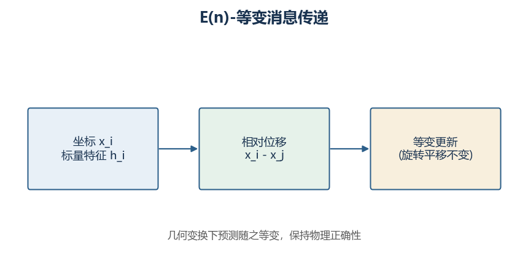

## 24.4　数值算例

**例 24.1（旋转等变性验证手算）** 取二维两个原子，初始坐标 $\mathbf{x}_1=(1,0),\mathbf{x}_2=(0,0)$，特征相同。消息 $m_{12}=\phi(\|\mathbf{x}_1-\mathbf{x}_2\|^2)=\phi(1)$。坐标更新（设 $\phi_x=0.5$）：$\mathbf{x}_1'=(1,0)+(1-0)\times0.5=(1.5,0)$。

现在整体旋转 90°（$R=\begin{pmatrix}0&-1\\1&0\end{pmatrix}$）：$\tilde{\mathbf{x}}_1=(0,1),\tilde{\mathbf{x}}_2=(0,0)$。距离平方仍为 $1$，故消息不变。更新 $\tilde{\mathbf{x}}_1'=(0,1)+((0,1)-(0,0))\times0.5=(0,1.5)$。而 $R\mathbf{x}_1'=R(1.5,0)=(0,1.5)=\tilde{\mathbf{x}}_1'$——两种顺序结果一致，验证了式 (24-2) 的等变性。

**例 24.4（平移等变与标量不变的手算对照）** 同一两原子系统，群换成平移。设 $\phi(\|\mathbf{x}_1-\mathbf{x}_2\|^2)$ 给出的消息标量 $m=0.5$（$\phi_x$）。

- **平移 $+\mathbf{t}=(10,20)$**：$\tilde{\mathbf{x}}_1=(11,20),\tilde{\mathbf{x}}_2=(10,20)$，相对向量 $\tilde{\mathbf{x}}_1-\tilde{\mathbf{x}}_2=(1,0)=\mathbf{x}_1-\mathbf{x}_2$，故消息 $m=0.5$ **不变**——平移等变下消息（标量）保持。坐标更新 $\tilde{\mathbf{x}}_1'=(11,20)+(1,0)\times0.5=(11.5,20)$。
- **验证向量输出等变**：原始更新量 $\mathbf{x}_1'-\mathbf{x}_1=(0.5,0)$；平移后更新量 $\tilde{\mathbf{x}}_1'-\tilde{\mathbf{x}}_1=(0.5,0)$——二者相等（平移下「相对更新」不变，满足向量等变 $\rho_{\mathcal{Y}}(\mathbf{t})=\mathrm{id}$ 对差值的情形）。
- **标量能量不变**：若能量 $E(\mathbf{x}_1,\mathbf{x}_2)=\phi(\|\mathbf{x}_1-\mathbf{x}_2\|^2)=\phi(1)$，平移后 $E(\tilde{\mathbf{x}}_1,\tilde{\mathbf{x}}_2)=\phi(1)$——**完全不变**（式 24-1 的不变性），而非仅「同移」。

对照例 24.3 的判别：**消息/能量是标量（平移下不变）**，而**坐标更新量是向量（平移下作为差值不变、作为绝对坐标同移）**。同一架构对不同输出类型给出不同的对称性行为——这正是式 (24-1)/(24-2) 必须分别刻画的理由：判断一个网络「等变还是不变」，必须指明**输出的表示类型**（标量→不变，向量→等变），脱离输出谈「等变性」无意义。这也是表 24-1 把「标量输出」与「向量输出」分两列的原因。

## 24.5　技术谱系

等变网络沿「如何编码群表示」演化：① **群卷积**（G-CNN）——在离散群格点上卷积；② **球谐/张量积网络**（Tensor Field Networks、e3nn）——用不可约表示与 Clebsch–Gordan 系数严格构造 $\mathrm{SE}(3)$ 等变；③ **标量化的 EGNN**——仅用距离与相对向量，放弃高阶表示换取效率；④ **规范等变/框架无关方法**——在局部坐标系下实现等变。转折点是**在严格表达力与计算效率之间权衡**：球谐方法表达力强但昂贵，EGNN 高效但对复杂张量场受限。

## 24.5A　等变架构的表达力—效率权衡

24.5 节的四族方法可沿「**表达力**（能刻画多少种张量场）」与「**计算/参数成本**」两个维度定位，本节补一张对照表把这一权衡量化，作为 25—27 章选型依据。

**表 24-3　等变架构的表达力与成本对照**

| 架构 | 群 | 可表示的张量阶 | 严格等变 | 参数量 | 计算成本 | 典型失效 |
|------|----|:---:|:---:|:---:|:---:|----------|
| 群卷积 (G-CNN) | 离散群 | 随群 | 是 | 中 | 中 | 连续群需离散化 |
| 球谐/TFN/e3nn | $\mathrm{SE}(3)$ | 高阶（$l\ge0$） | 是 | 大 | 高 | 高阶 $l$ 成本指数增 |
| EGNN | $\mathrm{E}(n)$ | 标量+向量 | 是 | 小 | 低 | 无法表手性/高阶角向 |
| 规范等变 (local frame) | 任意 | 随 frame | 近似 | 中 | 中 | frame 选择敏感 |

表 24-3 揭示核心权衡：**表达力随可表示张量阶 $l$ 单调升，但 Clebsch–Gordan 组合数随 $l$ 增长，参数与 FLOPs 随之上升**。球谐方法（TFN/e3nn）能表 $l\le2$（标量、向量、对称/反对称二阶张量）乃至更高，适合需要偶极矩、应力张量等高阶输出的场景；EGNN 只到「标量+向量」，对纯标量预测（能量）已足够，但对手性分子（需反对称张量）失效（24.7 节例 24.2）。**选型判据**：
- 只需标量输出（分子能量、结合能）→ EGNN 最省，24.3 节即可；
- 需向量输出（力、偶极矩）→ EGNN 仍够（向量等变）；
- 需二阶张量（应力、极化率）或手性区分 → 必须上球谐/TFN（$l\ge2$ 与反对称表示）；
- 群非标准（如晶体的离散旋转、局部对称）→ 群卷积或规范等变更适配。

这一「按输出张量阶选架构」的原则，是第 27 章分子学习中「能量用 EGNN、受力用能量梯度（避免直接预测高阶场）」策略的根据——把高阶输出交给「对低阶标量求导」，既省参数又保物理一致（27.1 节）。

## 24.6　边界与讨论

**边界。** ① 等变性是强归纳偏置——若数据本就不具该对称性，强加会限制模型（如晶体中仅离散旋转对称）；② EGNN 仅用标量距离，无法表达手性（chirality）与高阶角向信息；③ 连续群的精确等变需数值积分或特殊基函数，实现复杂；④ 等变性保证输出变换正确，但不保证物理正确（还需能量守恒等）。

**承上启下。** 本章的等变性把第 22—23 章的「不变性」从离散置换推广到连续几何变换，为第 25 章几何深度学习提供蓝图。群作用是「几何对象在变换下的行为」，而几何对象（流形、网格、点云）的具体结构决定了消息传递如何定义——这正是下一章的主题。第 27 章将把 EGNN 直接用于分子 3D 构象。

## 24.7　延伸讨论：从离散到连续、从严格到近似

等变性理论优雅，但工程落地充满取舍。本节补充离散群上的等变、数值近似以及「何时不该用等变性」三个话题。

**离散群上的等变。** 24.1 节的 $S_n$（置换群）是离散群。第 10 章 GNN 的排列等变性正是对 $S_n$ 的等变：节点重编号后，输出按相同方式重排。形式化地，设 $P$ 为置换矩阵，GNN 满足

$$
f(P\mathbf{A}P^{\top},P\mathbf{X})=P\,f(\mathbf{A},\mathbf{X}). \tag{24-5}
$$

这与连续群的式 (24-2) 形式一致——再次印证第 22—23 章「不变性」主题的统一性：图分类输出（标量）对 $S_n$ 不变，节点嵌入对 $S_n$ 等变。

**连续群的数值近似。** $\mathrm{SO}(3)$ 是连续群，精确等变需球谐函数与 Clebsch–Gordan 系数（24.5 节），实现复杂。EGNN（24.3 节）选择只用标量距离，放弃高阶表示以换取简洁——这是一种「用表达力换效率」的近似。更一般地，可在离散化的旋转群子群（如二十面体群）上做群卷积，再通过对子群的积分近似连续群等变。

**何时不该强加等变性。** 等变性是强归纳偏置：若数据本身不满足对称性，强加会损害性能。例如：晶体中原子只具有离散的旋转对称（平移群），强加连续 $\mathrm{SO}(3)$ 等变反而削弱对晶格方向的敏感；带外场的分子（如电场中的偶极）破坏了旋转对称，模型需显式编码外场方向。实践准则：**先确认对称性是否真实存在于数据生成过程，再决定是否编码**。

**数值延伸。** 仍用算例 24.1，若消息函数中 $\phi_x$ 依赖的是方向而非仅距离（如含外场项 $\mathbf{E}\cdot(\mathbf{x}_i-\mathbf{x}_j)$），则旋转坐标而不旋转外场 $\mathbf{E}$ 会破坏等变性——模型输出不再正确变换。这提示：等变性要求**所有相关几何量一同变换**，遗漏任一（如外场、参考方向）即失效。

**表 24-2　等变性验证的检查清单**

| 检查项 | 操作 | 通过标准 |
|--------|------|----------|
| 平移等变 | 输入坐标加 $\mathbf{t}$ | 标量输出不变、向量输出同移 |
| 旋转等变 | 输入坐标乘 $R$ | 向量输出同乘 $R$ |
| 置换等变 | 重排节点编号 | 节点输出同重排 |
| 数值稳定 | 微小扰动输入 | 输出变化连续有界 |

**例 24.2（反射breaks手性）** 取 24.1 节的反射矩阵 $M=\mathrm{diag}(1,-1,1)$（$y$ 轴翻转，$\det M=-1$），作用于算例 24.1 的向量 $\mathbf{x}_1'=(1.5,0)$ 得 $M\mathbf{x}_1'=(1.5,0)$（恰在轴上，不变）；若 $\mathbf{x}_1'=(1.5,1)$，则 $M\mathbf{x}_1'=(1.5,-1)$——这是镜像。严格 $\mathrm{E}(3)$ 等变网络对二者给出相同标量输出，故无法区分手性分子（详见第 27 章）。

## 24.7A　能量—受力一致性：为什么「先学能量再求导」

24.5A 节提到「受力由能量对坐标求导」比「直接预测受力」更物理一致，本节给出等变性的严格依据：它能保证**牛顿第三定律**与**虚功原理**自动成立，这是直接预测受力做不到的。

**能量是标量（不变），受力是向量（等变）。** 设网络预测标量能量 $E(\mathbf{X})$，$\mathbf{X}=(\mathbf{x}_1,\dots,\mathbf{x}_n)$。若 $E$ 对 $\mathrm{E}(3)$ 不变（式 24-1），则受力定义为

$$
\mathbf{F}_i=-\frac{\partial E}{\partial \mathbf{x}_i} \tag{24-6}
$$

自动对旋转等变：对 $R\in\mathrm{SO}(3)$，$E(R\mathbf{X})=E(\mathbf{X})$（不变），对 $\mathbf{X}$ 求梯度得 $\nabla_{R\mathbf{X}}E(R\mathbf{X})=R\,\nabla_{\mathbf{X}}E(\mathbf{X})$（链式法则 + $E$ 不变），即 $\mathbf{F}_i(R\mathbf{X})=R\,\mathbf{F}_i(\mathbf{X})$——受力随旋转等变（式 24-2），与物理受力变换律一致。

**牛顿第三定律免费成立。** 若 $E$ 对**平移**不变（$E(\mathbf{X}+\mathbf{t}\mathbf{1})=E(\mathbf{X})$，式 24-1，$\mathbf{1}$ 为全 1 向量），对所有 $\mathbf{t}$ 求导：$\frac{d}{d\mathbf{t}}E(\mathbf{X}+\mathbf{t}\mathbf{1})\big|_{\mathbf{t}=0}=\sum_i\frac{\partial E}{\partial\mathbf{x}_i}\cdot\mathbf{t}=-\sum_i\mathbf{F}_i\cdot\mathbf{t}=0$。因对任意 $\mathbf{t}$ 成立，故 $\sum_i\mathbf{F}_i=0$——**系统总受力为零**，内力成对抵消（牛顿第三定律的积分形式）。**这正是「先学能量再求导」优于「直接预测受力」的核心理由**：直接预测受力的网络，除非额外加正则，无法保证 $\sum_i\mathbf{F}_i=0$ 与旋转等变同时成立；而经式 (24-6) 从不变能量导出受力，这两条物理定律由对称性「免费」保证。第 27 章的分子动力学训练正是采用此 energy-conserving 策略——能量是 $E(3)$ 不变标量、受力是其梯度（等变向量），物理一致性内建于架构而非依赖数据拟合。

## 本章小结

本章论述等变性与对称性，为几何与分子学习奠定群论基础。

- 定义群、群作用与群表示（定义 24.1、24.2），列举 $\mathrm{SO}(3)$、$\mathrm{E}(3)$、$S_n$ 等。
- 形式化不变性（式 24-1）与等变性（式 24-2），并以 Schur 引理说明等变层的权重约束。
- 推导 E(n)-等变网络（式 24-3、24-4）并给出等变性证明素描，以表 24-1 归类常见对称性。
- 通过算例 24.1 验证旋转等变性，梳理技术谱系与手性、表达力等边界。

这些辨析衔接第 22—23 章，并引出第 25—27 章的几何深度学习与分子学习。

**进一步阅读**　本章建议延伸阅读的文献：[2]、[3]、[5]、[7]。

## 参考文献

[1] Goodfellow I, Bengio Y, Courville A. Deep Learning. *MIT Press*, 2016, Chap. 9.

[2] Cohen T S, Welling M. Group equivariant convolutional networks. *ICML*, 2016.

[3] Satorras V G, Hoogeboom E, Welling M. E(n) equivariant graph neural networks. *ICML*, 2021.

[4] Thomas N, Smidt T, Kearnes S, et al. Tensor field networks: Rotation- and translation-equivariant neural networks for 3D point clouds. *arXiv:1802.08219*, 2018.

[5] Geiger M, Lennerz S, Welling M. e3nn: Euclidean neural networks. *arXiv:2207.09453*, 2022.

[6] Bronstein M M, Bruna J, LeCun Y, et al. Geometric deep learning: Going beyond Euclidean data. *IEEE SPM*, 2017, 34(4): 18–42.

[7] Weiler M, Cesa G. General E(2)-equivariant steerable CNNs. *NeurIPS*, 2019.

[8] Kondor R, Lin Z. On the general theory of group equivariant non-linear networks for machine learning (invited). *NeurIPS*, 2018.

---

# 第 25 章　几何深度学习

第 24 章建立了等变性的群论语言。本章把这套语言落到「几何深度学习」（geometric deep learning, GDL）的统一蓝图上：大多数深度学习模型其实是在特定几何域上、利用特定对称性与局部性的神经网络。GDL 试图用「域 + 对称性 + 局部性」三个要素，把 CNN、GNN、Transformer、网格网络等放进同一张地图。

**引入动机。** 图像是欧氏网格（平移对称）、文本是序列（平移对称）、分子是点云（旋转平移对称）、社交网络是图（置换对称）。它们在数据域与对称性上千差万别，但其上的成功模型却共享一个内核：**在保持对称性的前提下，通过局部聚合层级化地提取特征**。把这个内核抽象出来，既能解释现有模型，又能指导新几何域上的模型设计。

**本章结构。** 25.1 节给出 GDL 蓝图；25.2 节分别讨论流形、网格与点云；25.3 节形式化几何消息传递；25.4 节给出数值算例；25.5 节梳理技术谱系；25.6 节讨论边界并承上启下。

## 25.1　几何深度学习蓝图

**定义 25.1（几何深度学习蓝图）** 一个几何深度学习模型由三要素定义[1]：

1. **域（domain）**：数据所在的几何空间 $\Omega$，具有某种对称性群 $\mathcal{G}$ 与邻接关系（决定「哪些点相邻」）；
2. **对称性（symmetry）**：函数需不变或等变于 $\mathcal{G}$（第 24 章）；
3. **局部性（locality）**：特征通过图上的邻域递归传播——即消息传递。

由此，卷积可统一定义为在域的邻域上的线性、等变、局部算子。CNN 是 $\Omega=\mathbb{Z}^2$、$\mathcal{G}=$ 平移群的特例；GNN 是 $\Omega=$ 图节点、$\mathcal{G}=S_n$ 的特例。

**直觉解释。** 蓝图的价值在于「分离关注点」：换一个几何域，只需更换群与邻域定义，消息传递的骨架不变。这解释了为何第 10 章的 GNN 与 CNN 在结构上如此相似——它们都是蓝图在不同域的实例化。

## 25.2　流形、网格与点云

**流形（manifold）**是局部欧氏的拓扑空间。在流形上定义卷积的困难在于：没有全局坐标、切空间随点变化。方法分两类：① **谱方法**——用拉普拉斯特征函数定义傅里叶基（第 3、11 章），卷积为谱域逐点乘；② **空间方法**——在切平面上构造局部坐标片（patch）再卷积。

**网格（mesh）**是流形的离散三角化表示，节点为顶点、边为网格边。MeshCNN 等直接在网格边上定义卷积，利用边邻接与各向同性。

**点云（point cloud）**是无序点集 $\{\mathbf{x}_i\}\subset\mathbb{R}^3$，无连接结构。PointNet[2] 用对称函数（max pooling）保证置换不变：

$$
f(\{\mathbf{x}_i\})=\gamma\Big(\max_{i}\,\phi(\mathbf{x}_i)\Big), \tag{25-1}
$$

其中 $\phi,\gamma$ 为 MLP，$\max$ 保证对点顺序不变。PointNet++ 在此基础上引入层次邻域，实现局部结构提取。

> 【图 25-1　几何域上的卷积】（原图见 figures/图25-1.png）：并列展示图像网格、流形三角网格、点云三种域，标注各自的对称群与局部邻域定义。
>
> 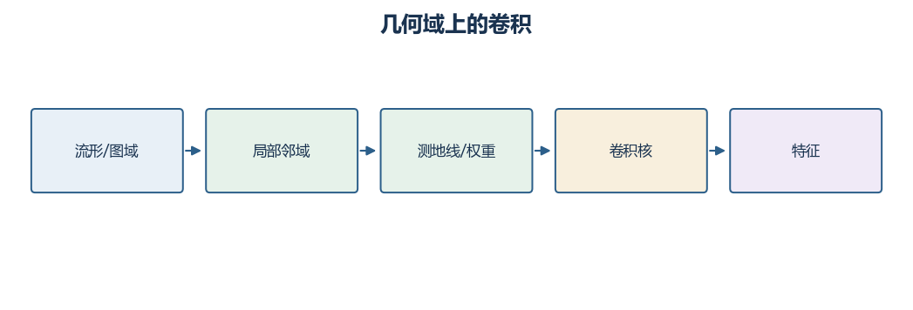

## 25.3　几何消息传递

把第 10 章的消息推广到几何域：节点 $i$ 除特征 $\mathbf{h}_i$ 外还有几何坐标 $\mathbf{x}_i$，消息依赖相对几何：

$$
\mathbf{m}_{ij}=\phi_e\!\left(\mathbf{h}_i,\mathbf{h}_j,\rho\big(\mathbf{x}_j-\mathbf{x}_i\big)\right),\quad
\mathbf{h}_i'=\phi_h\!\left(\mathbf{h}_i,\bigoplus_{j\in\mathcal{N}(i)}\mathbf{m}_{ij}\right), \tag{25-2}
$$

其中 $\rho$ 是把相对几何映射为等变特征的编码（如 EGNN 中的距离、球谐系数，第 24 章），$\oplus$ 是排列不变的聚合。

**推导要点。** 要使式 (25-2) 等变，$\rho$ 必须满足 $\rho(R(\mathbf{x}_j-\mathbf{x}_i))=\rho'(\mathbf{x}_j-\mathbf{x}_i)$ 的相应变换律；第 24 章的 EGNN 取 $\rho=\|\mathbf{x}_j-\mathbf{x}_i\|^2$（标量，旋转不变），坐标更新另用相对向量（式 24-4）恢复等变性。因此**几何消息传递 = 几何编码 + 等变聚合**。

## 25.4　数值算例

**例 25.1（PointNet 置换不变性手算）** 设点云有两个点 $\mathbf{x}_1=(1,2)$、$\mathbf{x}_2=(3,1)$，简单取 $\phi(\mathbf{x})=[x_1+x_2]$（一维输出）。则 $\phi(\mathbf{x}_1)=3$，$\phi(\mathbf{x}_2)=4$，$\max=4$，输出 $\gamma(4)$。

交换点顺序：$\{\mathbf{x}_2,\mathbf{x}_1\}$，$\max\{4,3\}=4$——输出不变，验证了式 (25-1)。

若改用求和聚合 $\sum$：$\phi(\mathbf{x}_1)+\phi(\mathbf{x}_2)=7$，交换后仍为 $7$——同样不变。但 $\max$ 与 $\sum$ 丢失的信息不同：$\max$ 只保留最显著点（适合识别关键点），$\sum$ 保留全局总量（适合计算总质量）。

**表 25-1　几何域上的代表模型**

| 域 | 对称性 | 代表模型 | 局部性实现 |
|----|--------|----------|------------|
| 欧氏网格 | 平移 | CNN / ResNet | 卷积核 |
| 图 | 置换 | GCN / GAT（第 10—18 章） | 邻接消息 |
| 流形 | 微分同胚 | 谱 CNN / 测地线 CNN | 拉普拉斯/切平面 |
| 点云 | 置换+旋转 | PointNet / EGNN | 对称函数/相对几何 |

## 25.5　技术谱系

GDL 沿「域的复杂度」演化：① **欧氏网格**（CNN，平移对称，规则邻域）；② **图**（GNN，置换对称，不规则邻接）；③ **流形与网格**（谱/测地线方法，处理曲面）；④ **点云与几何体**（等变网络，处理无序几何集合）。贯穿的转折是**对称性从平移→置换→旋转的扩展**，以及**局部性从固定卷积核→数据依赖邻域的推广**（第 18 章图注意力即一例）。

## 25.6　边界与讨论

**边界。** ① 流形上无全局坐标，谱方法计算昂贵、空间方法依赖坐标系选取；② 点云方法常忽略点间连接，丢失结构；③ 等变性的严格实现（球谐）表达力强但计算复杂，标量化方法（EGNN）高效但受限；④ GDL 蓝图是描述性框架，不自动给出最优模型设计。

**承上启下。** 本章的「域 + 对称性 + 局部性」把第 24 章的等变性落到具体几何对象。几何对象还可从另一角度刻画——其**拓扑结构**（连通分量、洞、环）。下一章引入拓扑数据分析（TDA），用持续同调提取对连续变形稳健的多尺度拓扑特征，与本章的几何方法互补。

## 25.7　延伸讨论：不变性与等变性的再辨析

蓝图（25.1 节）把对称性列为核心要素，但「不变」与「等变」的选择直接决定模型结构。本节结合常见任务澄清这一对概念，并补充几何深度学习的工程要点。

**任务决定对称性。** 判定该用不变还是等变，只需问：输出是标量还是向量/场？① 图分类、分子能量预测——输出标量，需**不变性**（式 24-1）；② 节点级属性预测、原子受力、法向量估计——输出随域一同变换，需**等变性**（式 24-2）；③ 分割（每点一个标签）——标签是离散标量，需不变性但输出按置换等变。混淆二者是常见错误：用不变网络去预测向量，会得到「旋转输入后方向不变」的错误结果。

**局部性的代价。** 蓝图的第三要素「局部性」通过邻域聚合实现，但局部消息传递的感受野随层数线性增长（第 13 章）。对需要长程相互作用的几何任务（如大分子的静电、蛋白质的远端耦合），纯局部方法不足，需全局机制：图 Transformer（第 18 章）、多尺度层级池化（第 14 章）或显式的长程边。这与第 13 章「过平滑」与「远视不足」的讨论一脉相承。

**坐标与坐标系。** 流形方法（25.2 节）的一个隐性选择是「工作在哪套坐标」。谱方法用拉普拉斯特征函数（无坐标但计算贵）；切平面方法选局部坐标片——不同坐标系应给出一致结果，这正是等变性要求。工程上，e3nn 等库（第 24 章）通过不可约表示自动保证坐标无关性，省去手工验证。

**数值延伸。** 仍用算例 25.1，若把 $\max$ 换成「求和 + 线性」的 PointNet 变体，则对 1000 个点的点云，求和输出量级随点数线性增长——需归一化（除以点数）才能用于不同规模的点云。这提示：聚合方式（max/sum/mean）不仅决定保留何种信息，还决定输出对规模是否稳定——与第 14 章读出的讨论一致。

**例 25.2（流形上拉普拉斯谱的低通滤波）** 设图路径 $P_3$（三节点链），归一化拉普拉斯 $\mathbf{L}_{\mathrm{sym}}=\mathbf{I}-\mathbf{D}^{-1/2}\mathbf{A}\mathbf{D}^{-1/2}$。谱方法定义卷积 $ \mathbf{y}=\mathbf{U}\,\mathrm{diag}(g(\lambda_i))\,\mathbf{U}^{\top}\mathbf{x}$，其中 $\mathbf{U}$ 为特征向量阵、$g$ 为滤波器。取低通 $g(\lambda)=1/(1+\lambda)$，则高频（大 $\lambda$，对应信号剧烈变化）被抑制——这正是第 11 章谱域 GNN 的平滑机制，也是第 13 章「过平滑」的根源：反复低通滤波使所有节点信号趋于一致。ChebNet（第 11 章）用切比雪夫多项式近似 $g$，避免显式特征分解。

## 25.8　延伸阅读视角：从蓝图到统一架构

几何深度学习蓝图不仅解释现有模型，还指导新架构设计。本节从「统一架构」视角补充两点。

**消息传递作为通用语言。** 回顾第 10 章，消息传递的一般形式为

$$
\mathbf{h}_i^{(l+1)}=\phi_h\Big(\mathbf{h}_i^{(l)},\bigoplus_{j\in\mathcal{N}(i)}\phi_e(\mathbf{h}_i^{(l)},\mathbf{h}_j^{(l)},\mathbf{e}_{ij})\Big), \tag{25-3}
$$

其中 $\mathbf{e}_{ij}$ 为边特征。几何域中，当 $\mathbf{e}_{ij}$ 取相对几何编码 $\rho(\mathbf{x}_j-\mathbf{x}_i)$（式 25-2），便得等变版本；当取拉普拉斯位置编码差值（第 18 章），便得谱域版本。可见「换域 = 换 $\rho$ 与邻域 $\mathcal{N}$」，骨架不变——这正是蓝图的方法论价值。

**设计检查清单。** 为新几何域设计模型时，依次问：① 域的对称群 $\mathcal{G}$ 是什么？② 输出应是标量（不变）还是向量（等变）？③ 邻域 $\mathcal{N}(i)$ 如何定义（由连接、距离还是 kNN）？④ 是否需要全局机制弥补局部性？回答这四问即可确定架构的基本形态，避免盲目套用 CNN 或 GNN。

## 25.9　延伸讨论：几何邻域、距离加权与多尺度池化

蓝图（25.1 节）规定了三要素，但落地到几何域时，**邻域的定义方式**与**聚合的尺度**直接决定模型质量。本节补充几何邻域构造、距离加权聚合与多尺度层级池化，并给出数值手算与工程要点。

**定义 25.2（几何邻域与数据依赖图）** 点云上节点没有显式邻接，邻域由坐标临时构造。设邻域算子 $\mathcal{N}_r$ 为**半径邻域**（半径 $r$ 球内的点）或 **$k$ 近邻（kNN）邻域**，则点云的「隐式邻接」由数据本身决定：

$$
\tilde{A}_{ij}=\mathbf{1}\big[\|\mathbf{x}_i-\mathbf{x}_j\|\le r\big]\ \ \text{或}\ \ \tilde{A}_{ij}=\mathbf{1}\big[j\in\mathrm{TopK}_k(i)\big]. \tag{25-4}
$$

半径邻域对局部密度稳健，但高密度区邻居数膨胀；kNN 邻域邻居数恒定，却在稀疏区把远点拉入。实践常两者结合：先取 kNN，再用距离上界截断。这种「数据依赖邻域」是几何 GNN 与经典 GNN（第 10 章）的本质差别——后者的邻接是静态输入，前者的邻接是坐标的函数，随等变变换同步改变，从而保证整条消息传递管线对坐标变换等变。

**距离加权聚合。** 几何消息传递（式 25-2）中常引入距离核，让近点贡献更大：

$$
\mathbf{h}_i'=\mathbf{h}_i+\sum_{j\in\mathcal{N}(i)} w_{ij}\,\phi_e(\mathbf{h}_i,\mathbf{h}_j,\rho(\mathbf{x}_j-\mathbf{x}_i)),\quad
w_{ij}=\frac{\exp\big(-\|\mathbf{x}_j-\mathbf{x}_i\|^2/(2\sigma^2)\big)}{\sum_{l\in\mathcal{N}(i)}\exp\big(-\|\mathbf{x}_l-\mathbf{x}_i\|^2/(2\sigma^2)\big)}. \tag{25-5}
$$

$w_{ij}$ 是负距离平方的 softmax，形式上与图注意力的权重（第 18 章）相同，但权重由**几何**而非特征决定。$\sigma$ 控制有效「感受半径」：$\sigma$ 小则只关注极近邻点，$\sigma$ 大则邻域近乎均匀。这是「几何编码 $\rho$ + 加权聚合 $\oplus$」分离的又一实例——前者固定（物理距离），后者可调（温度 $\sigma$）。

**多尺度层级池化。** 点云方法常以「局部聚合 + 下采样」堆出层级（PointNet++[6]）：每层用**最远点采样**（FPS）选中心点集，对每个中心 $\mathbf{x}_c$ 聚合其半径 $r$ 内的特征：

$$
\mathbf{h}_c'=\gamma_c\Big(\max_{j:\,\|\mathbf{x}_j-\mathbf{x}_c\|\le r}\ \phi\big(\mathbf{h}_j,\ \mathbf{x}_j-\mathbf{x}_c\big)\Big). \tag{25-6}
$$

注意输入用**相对坐标** $\mathbf{x}_j-\mathbf{x}_c$ 而非绝对坐标——这是保持旋转等变的关键技巧（若用绝对坐标，平移会改变特征）。中心点逐层变稀、感受野逐层变大，构成与 CNN 金字塔同构的层级结构，正是 25.7 节「局部性代价」的工程解法：单看一层是局部的，堆起来是全局的。

**表 25-2　几何邻域构造的性质**

| 邻域 | 邻居数 | 等变性 | 适合场景 | 缺点 |
|------|--------|--------|----------|------|
| 半径 $r$ | 可变 | 是（基于距离） | 密度均匀点云 | 高密度区邻居爆炸 |
| kNN | 恒定 $k$ | 是 | 稀疏/非均匀点云 | 稀疏区拉入远点 |
| Delaunay 三角化 | 平面 $\approx6$/点 | 是 | 曲面/网格 | 三维实现复杂、对边界敏感 |
| 层级（FPS+半径） | 逐层递减 | 是 | 大规模点云 | 多层训练、中心选择敏感 |

**例 25.3（距离加权聚合手算）** 取二维点云三点：$\mathbf{x}_1=(0,0)$、$\mathbf{x}_2=(0.2,0)$、$\mathbf{x}_3=(1.0,0)$，特征 $\mathbf{h}_1=\mathbf{h}_2=[1]$、$\mathbf{h}_3=[10]$（一维），半径邻域 $r=1.1$，$\sigma=0.3$（$2\sigma^2=0.18$），$\phi_e\equiv$ 恒等。节点 1 到邻点距离平方为 $0.04$ 与 $1.0$，未归一化权重 $e^{-0.04/0.18}=e^{-0.222}\approx0.801$、$e^{-1/0.18}=e^{-5.56}\approx0.0039$，归一化后 $w_{12}\approx0.995$、$w_{13}\approx0.005$。于是 $\mathbf{h}_1'=1+0.995\times1+0.005\times10=2.045$。若改用均匀平均：$\mathbf{h}_1'=1+(1+10)/2=6.5$——远端异常特征被放大三倍有余。距离加权把它压回 $2.045$，定量说明「几何距离即注意力」的价值：它让异常影响按距离指数衰减，这是均匀聚合（第 10 章 $\oplus=\frac1{|\mathcal N|}\sum$）做不到的。

**训练与评估要点。** ① **坐标归一化**：坐标量纲直接进入式 (25-5) 的 softmax，输入点云先中心化并按特征尺度缩放是标准做法；② **batch 掩码**：同一 batch 内不同点云必须按 batch id 阻断跨云消息；③ **超参与域尺度匹配**：$r$ 常取 10 近邻距离分布的 95 分位，$\sigma$ 约为 $r$ 的 $0.3$—$0.5$ 倍；④ **等变验收**：单测中随机旋转输入并断言输出同步旋转（第 24 章），这是等变网络交付前的最低标准。点云分割/配准任务的常用误差是** Chamfer 距离**：

$$
\mathrm{CD}(P,Q)=\frac{1}{|P|}\sum_{p\in P}\min_{q\in Q}\|p-q\|^2+\frac{1}{|Q|}\sum_{q\in Q}\min_{p\in P}\|q-p\|^2. \tag{25-7}
$$

CD 双向度量点集互达的最近平方距离，对置换不敏感（与式 25-1 的置换不变性呼应），但只捕捉一阶距离、忽略形状的全局对应——高精度场景需补 FPFH 等描述子或配准后重算。

## 25.10　延伸阅读视角：从几何归纳偏置到等变注意力

**几何即免费先验。** 把式 (25-5) 与图注意力（第 18 章）并置可见：GAT 的注意力权重 $\alpha_{ij}=\mathrm{softmax}_j(\mathbf{a}^\top[\mathbf{W}\mathbf{h}_i\|\mathbf{W}\mathbf{h}_j])$ 由**特征**学习，几何注意力的权重由**坐标**决定（或二者乘积）。几何权重的好处是**样本效率**——即使零训练，距离核已给出合理邻域，这与「预训练即先验」（第 28 章）在精神上同构；代价是它假设「近者相关」，对长程耦合（静电、氢键，第 27 章）失效，此时需显式长程边或全局注意力（SE(3) 注意力类方法[10]）补足。

**计算代价的工程账。** 等变性的实现方式直接决定常数因子：式 (25-5) 的距离核只需逐点对距离（$O(n^2 d)$ 或经 kNN 索引降到 $O(nk)$）；而球谐实现（第 24 章）每维特征要维护 $(2l+1)$ 个分量，$l$ 从 1 到 3 时参数量与 FLOPs 约按 $1:4:9:16$ 增长。经验法则是先用低阶球谐（$l\le2$）跑通任务，再逐步升阶做消融——阶数的提升收益在几何细节任务（配准、受力）上明显，在粗粒度分类上常不显著。此外，等变层的等变性证明是构造性的（逐层验证输入输出同变换），工程上用固定随机群元素的单测回归（式 25-5 旋转不变、式 25-2 输出协变）即可在 CI 中守住「不破坏对称性」这条底线，避免一次无关改动悄悄引入坐标依赖。

**与分子域的接口。** 第 27 章的分子等变网络正是式 (25-4)（截断半径邻域）+ 式 (25-2)（相对几何消息）+ 式 (25-6)（相对坐标聚合）的组合：化学键邻接用截断半径 $r_c\approx10$ Å 的 kNN 构造，消息用 $e^{-\|\Delta\mathbf{x}\|}$ 型截断核，读出用置换不变的求和。可见本章蓝图不是空泛框架，而是第 27、33 章模型的可复用模板。

**数据规模与泛化的相互作用。** 几何模型的样本效率来自对称性偏置：数据越少，等变/不变约束的杠杆越大（第 24 章）；但偏置越强，对「违反假设」的输入（如含标量场噪声的坐标、非等距点云）越脆。因此几何域的泛化评估应同时报告「同分布扰动」（加噪、随机旋转）与「分布外几何」（不同形状族、不同密度）两类指标——前者检验偏置是否真正生效，后者检验偏置是否过度拟合某一几何族。这与第 31 章「结构敏感性指数」的哲学一致：好模型必须对其声称利用的结构敏感，对其声称忽略的扰动不敏感。

**边界补充。** ① 式 (25-7) 的 CD 对噪声点敏感（一个离群点贡献整段距离），常配合截断 CD（去掉最大若干对）使用；② 层级池化（式 25-6）的中心选择（FPS）是贪心的，对带洞形状可能选在洞边缘，丢失全局拓扑——这正是第 26 章 TDA 特征可作为辅助输入的原因；③ 几何等变网络的「归纳偏置强度」可调：球谐阶数 $l$（第 24 章）与核宽度 $\sigma$ 共同决定模型能表达的几何细节量级，过强的偏置在噪声坐标下会放大误差，过弱则退化为普通 GNN。④ 点云的「局部性」还有一层含义：kNN 图在坐标扰动下不连续（一个点的微小移动可能改变其第 $k$ 近邻），训练时对此类跳变需保持数值稳定——实践中固定邻域索引（一次计算、多次前向复用）比每层重算 kNN 更常用，代价是层间共享同一邻域、牺牲部分表达力。

## 本章小结

本章论述几何深度学习，用「域 + 对称性 + 局部性」统一多种几何域上的模型。

- 给出 GDL 蓝图（定义 25.1），把 CNN、GNN 统一为特定域与群上的局部等变算子。
- 分别讨论流形、网格与点云，给出 PointNet 的置换不变公式（式 25-1）。
- 形式化几何消息传递（式 25-2），指出「几何编码 + 等变聚合」的构造原则。
- 通过算例 25.1 验证置换不变性，以表 25-1 梳理几何域技术谱系并讨论局限。
- 补充几何邻域构造（式 25-4）、距离加权聚合（式 25-5）与多尺度池化（式 25-6），以算例 25.3 定量对比加权与均匀聚合，给出 Chamfer 距离（式 25-7）与表 25-2。

这些辨析衔接第 3、10—18、24 章，并引出第 26 章的拓扑数据分析。

**进一步阅读**　本章建议延伸阅读的文献：[1]、[2]、[3]、[5]、[9]、[10]。

## 参考文献

[1] Bronstein M M, Bruna J, LeCun Y, et al. Geometric deep learning: Going beyond Euclidean data. *IEEE SPM*, 2017, 34(4): 18–42.

[2] Qi C R, Su H, Mo K, Guibas L J. PointNet: Deep learning on point sets for 3D classification and segmentation. *CVPR*, 2017.

[3] Satorras V G, Hoogeboom E, Welling M. E(n) equivariant graph neural networks. *ICML*, 2021.

[4] Defferrard M, Bresson X, Vandergheynst P. Convolutional neural networks on graphs with fast localized spectral filtering. *NeurIPS*, 2016.

[5] Masci J, Boscaini D, Bronstein M, Vandergheynst P. Geodesic convolutional neural networks on Riemannian manifolds. *ICCV Workshops*, 2015.

[6] Qi C R, Yi L, Su H, Guibas L J. PointNet++: Deep hierarchical feature learning on point sets in a metric space. *NeurIPS*, 2017.

[7] Cohen T S, Welling M. Group equivariant convolutional networks. *ICML*, 2016.

[8] Hanocka R, Hertz A, Fish N, et al. MeshCNN: A network with an edge. *SIGGRAPH*, 2019, 38(4): 1–12.

[9] Weyand T, Chitta K, Dahnert T, et al. SE(3) transformers for 3D cloud registration. *ICCV*, 2021: 14868–14878.

[10] Fuchs F, Boiko D, Höning M. SE(3)-equivariant point cloud attention networks. *ICLR*, 2020.

---

# 第 26 章　拓扑数据分析与图

第 25 章从几何角度刻画数据（坐标、距离、曲率）。本章从另一个互补角度——**拓扑**（topology）——刻画数据：关注在连续变形（拉伸、弯曲，但不撕裂）下保持不变的性质，如连通分量、洞、环。拓扑数据分析（topological data analysis, TDA）的核心工具是**持续同调**（persistent homology），它把这些拓扑特征按「尺度」排列成多尺度的摘要。

**引入动机。** 几何方法对噪声与局部形变敏感：两个形状稍作弯曲，坐标就变了。但它们拓扑等价（都有一个洞）。TDA 提供的特征是**对连续变形稳健**的——这在分子构象、材料孔隙、脑网络中尤其重要。与第 23 章社区检测关注「抱团」、第 25 章关注「形状」不同，TDA 关注「结构中的洞与连接如何随尺度演化」。

**本章结构。** 26.1 节引入单纯复形；26.2 节形式化持续同调与持久图；26.3 节讨论拓扑特征与拓扑深度学习；26.4 节给出数值算例；26.5 节梳理技术谱系；26.6 节讨论边界并承上启下。

## 26.1　单纯复形

**定义 26.1（单纯形与单纯复形）** $k$ 维单纯形（simplex）是 $k+1$ 个仿射无关点的凸包：0-单形是点，1-单形是边，2-单形是三角形，3-单形是四面体。单纯复形（simplicial complex）$\mathcal{K}$ 是单纯形的集合，满足：若一个单纯形在 $\mathcal{K}$ 中，则其所有面也在 $\mathcal{K}$ 中；两个单纯形的交是公共面。

图是单纯复形的特例（仅含 0、1-单形）。从点云构造复形的常用方法有 **Vietoris–Rips 复形**：给定距离阈值 $r$，若一组点的两两距离 $\le r$，则以它们为顶点张成一个单纯形。随 $r$ 增大，复形逐渐「丰满」，拓扑特征出现又消失——这正是持续同调要捕捉的。

> 【图 26-1　Vietoris–Rips 复形随尺度增长】（原图见 figures/图26-1.png）：展示点云在三个递增半径 $r$ 下生成的单纯复形，标出一个洞从出现到被填充的过程。
>
> 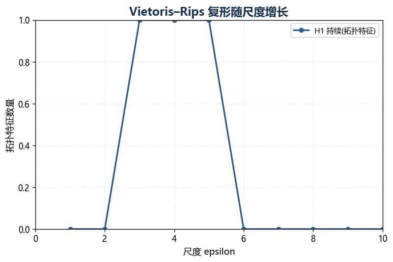

## 26.2　持续同调与持久图

**直觉解释。** 沿尺度参数 $r$（称为「过滤」，filtration）扫描复形，记录各维同调类的「出生」与「死亡」尺度。$H_0$ 记录连通分量，$H_1$ 记录一维环（洞），$H_2$ 记录二维空腔。一个在第 $r_b$ 尺度出现、第 $r_d$ 尺度消失的拓扑特征，其**持久性**为 $r_d-r_b$——持久性越大，越可能是真实结构而非噪声。

**定义 26.2（持久图与条形码）** 对过滤复形 $\{\mathcal{K}_r\}$，持续同调输出一组区间 $[b_i,d_i)$，对应各维同调类的生命周期。这些区间集合称**条形码**（barcode）；把每个区间映射为平面点 $(b_i,d_i)$ 即得**持久图**（persistence diagram）。$\mathrm{PD}_k=\{ (b_i,d_i) \}$ 是第 $k$ 维拓扑特征的摘要。

持久图可进一步向量化为**持久性景观**（persistence landscape）或**持久性图像**（persistence image）。例如持久性景观的第 $k$ 阶函数：

$$
\lambda_k(t)=\max_{i}\ \begin{cases}
t-b_i, & b_i\le t\le \frac{b_i+d_i}{2},\\
d_i-t, & \frac{b_i+d_i}{2}<t\le d_i,\\
0, & \text{其他},
\end{cases} \tag{26-1}
$$

它把离散的持久图转为可输入机器学习模型的函数/向量。

## 26.3　拓扑特征与拓扑深度学习

TDA 特征已在图与分子上展现价值：图的 $H_1$ 环数量可区分不同拓扑结构；分子的环结构是化学性质的重要决定因素。但持久图不可直接微，**拓扑深度学习**致力于把 TDA 集成进神经网络：

$$
\mathbf{z}=\mathrm{Readout}\big(\{\,\psi(b_i,d_i)\,\}_{(b_i,d_i)\in\mathrm{PD}}\big), \tag{26-2}
$$

其中 $\psi$ 是可学习函数（如把 $(b,d)$ 嵌入）。挑战在于出生/死亡事件对输入扰动不可微——解决方案包括：把坐标的梯度通过最优化 filtration 回传、或使用可微的软同调近似。

**图上的拓扑。** 对图 $\mathbf{G}$，可把节点属性作为过滤函数 $f:V\to\mathbb{R}$（如按节点度排序），构造子水平集过滤，计算持久图——这把图的拓扑与节点属性联合编码。该视角与第 23 章社区检测相关：稳定的 $H_0$ 类对应持久的社区。

## 26.4　数值算例

**例 26.1（圆环点云的持续同调手算）** 设在平面单位圆上均匀采样 8 个点，用 Vietoris–Rips 过滤。取两点间最大弦长 $\approx 2$ 为阈值。

- 小 $r$（如 $0.1$）：各点孤立，$H_0=8$ 个分量，各自在 $b=0$ 出生。
- 增大到 $r\approx0.77$（相邻点弦长 $2\sin(\pi/8)\approx0.765$）：相邻点连成环，$H_0$ 分量合并，其中 7 个在 $r\approx0.765$ 死亡，留下 1 个持续分量。
- 继续增大到 $r\approx1.85$（跨越圆的弦），三角形填满，"洞" 被填平：$H_1$ 类在 $r\approx0.765$ 出生（环闭合）、在 $r\approx1.85$ 死亡。

该 $H_1$ 区间的持久性 $d-b\approx1.85-0.765=1.08$，显著大于噪声尺度——判定圆环有一个真实的一维洞。若点云只是随机散点（无环），$H_1$ 区间的持久性通常很小。

**表 26-1　TDA 工具谱系**

| 工具 | 输出 | 可微性 | 用途 |
|------|------|--------|------|
| 持续同调 | 持久图/条形码 | 否（ combinatorial） | 拓扑特征摘要 |
| 持久性景观/图像 | 向量/函数 | 部分 | 输入 ML 模型 |
| Mapper | 单纯复形图 | 否 | 可视化/聚类 |
| 拓扑深度学习 | 可学习拓扑层 | 研究中 | 端到端学习 |

## 26.5　技术谱系

TDA 沿「从描述到学习」演化：① **持续同调理论**（Edelsbrunner 等）——奠基性的算法与稳定性定理；② **向量化**（持久性景观、图像、核）——把拓扑摘要转成 ML 可用形式；③ **Mapper 算法**——把高维数据压成可视图谱；④ **拓扑深度学习**（Toy 等）——把同调计算嵌入可微管线。关键转折是**稳定性定理**：持续图对输入扰动 Lipschitz 连续，这是 TDA 稳健性的理论保证。

## 26.6　边界与讨论

**边界。** ① 计算复杂度高——持续同调最坏情况指数级，大规模图需近似；② 可微性差——离散的出生/死亡事件难以直接反向传播；③ 拓扑特征「语义稀疏」——一个环说明「有洞」，但不直接说明「是什么」；④ 过滤函数的选择强烈影响结果，缺乏统一准则。

**承上启下。** 本章的拓扑方法捕捉「连接与洞」，与第 24—25 章的几何/等变方法互补：几何看坐标，拓扑看连通模式。二者在分子上汇合——分子的几何构象（第 25 章）与拓扑环结构（本章）共同决定其性质。下一章聚焦这一汇聚点：流形与分子上的学习，把等变几何网络用于 3D 分子构象与蛋白质图。

## 26.7　延伸讨论：稳定性、过滤选择与图上的拓扑特征

持续同调之所以「稳健」，有严格的数学支撑；但这种稳健性依赖过滤函数的选择。本节补充稳定性定理、过滤设计与图上特有的拓扑特征。

**稳定性定理。** 持续同调的核心理论保证是 **bottleneck 稳定性**：对定义在同一空间上的两个过滤函数 $f,g$，其持久图 $\mathrm{Dg}(f),\mathrm{Dg}(g)$ 的 bottleneck 距离满足

$$
d_B\big(\mathrm{Dg}(f),\mathrm{Dg}(g)\big)\ \le\ \|f-g\|_\infty. \tag{26-3}
$$

式 (26-3) 说明：输入函数的小扰动（$\|f-g\|_\infty$ 小）只会引起持久图的小变化——这是 TDA 对噪声稳健的数学根源，也是它区别于许多对坐标敏感方法的关键。

**过滤函数的选择。** 对点云，常用距离到某点的距离、密度估计或投影高度作为过滤函数；对图，常用节点度、属性或到种子节点的最短距离。过滤函数的选择直接决定哪些拓扑特征被「看见」——这是 TDA 最需经验的地方。一个实用技巧是**多过滤集成**：对多个过滤函数分别计算持久图再融合，降低单一选择的偏差。

**图上的拓扑特征。** 对图 $\mathbf{G}$，把节点按属性 $f(v)$ 排序，取子水平集 $\{v:f(v)\le t\}$ 诱导的子图，随 $t$ 增长形成过滤。此时 $H_0$ 分量数随 $t$ 的演化刻画「社区何时连通」（与第 23 章呼应）；$H_1$ 类对应图中的环——环数多的图（如分子）具有特殊的化学稳定性。这些特征是**拓扑不变量**：对节点的连续重编号（第 24 章 $S_n$）保持不变。

**数值延伸。** 仍用算例 26.1，若圆环点云加入高斯噪声（标准差 $\sigma=0.05$），相邻点距离波动约 $\pm0.05$。由式 (26-3)，持久图的 bottleneck 距离不超过 $0.05$——远小于 $H_1$ 区间的持久性 $1.08$，故该环仍被可靠检出。这定量解释了 TDA 的噪声稳健性。

**例 26.2（两个点云的持久图对比）** 点云 A 为单位圆（8 点），点云 B 为均匀填充的圆盘（8 点，含中心）。由算例 26.1，A 有一个持久的 $H_1$ 区间 $[0.765,1.85)$，持久性 $1.08$；B 因圆盘填满，任何环都在很小尺度即被三角形填充，$H_1$ 区间持久性 $<0.1$。由式 (26-3)，若两过滤函数一致，持久性的巨大差异（$1.08$ vs $<0.1$）远超噪声尺度——TDA 能稳健区分「环」与「实心盘」，这是单纯几何统计量（如平均距离）难以做到的。

## 26.8　延伸阅读视角：Mapper 与可视化

除持续同调外，TDA 另一支柱是 Mapper 算法，本节补充其原理与用途。

**Mapper 算法。** 给定数据点云与「滤波器」函数 $f:\mathcal{X}\to\mathbb{R}^d$，Mapper 的步骤为：① 用覆盖 $\mathcal{U}=\{U_\alpha\}$ 覆盖 $f$ 的值域；② 对每个 $U_\alpha$，取原像 $f^{-1}(U_\alpha)$ 中的点，对其作聚类（如单链接）；③ 每个聚类作为一个节点，若两个聚类共享数据点则连边，得到一张**简化图**。这张图保留了数据的「形状骨架」，适合高维数据可视化与探索性分析。

**与持续同调的关系。** 持续同调给出拓扑特征的「定量摘要」（持久图），Mapper 给出「可视化图谱」。二者互补：前者适合作为 ML 特征（26.3 节），后者适合人工解读。在图数据上，Mapper 常用于把大规模图压成可解释的「社区图谱」（呼应第 23 章）。

## 26.9　延伸讨论：计算复杂度、向量化与拓扑核

持续同调「稳健但贵」，工程落地必须直面计算代价与向量化细节。本节给出复杂度账目、近似算法与两种最常用的持久图向量化——持久性图像与持久性核。

**计算复杂度。** 对 $n$ 个点、$k$ 维单纯形的 Vietoris–Rips 复形，全复形规模可达 $O(n^k)$ 个 $k$-单形（二维即 $O(n^3)$ 个三角形），持续同调的标准算法（基于增量边界矩阵归约，如 Rips 复形的同调计算）最坏情况随单纯形数多项式、常数大；对一般过滤则可能指数。实用缓解手段有三：① **稀疏化**——只保留距离 $<r_{\max}$ 的边（meta-VR 复形），把三维问题限制在低阶；② **截断持久性**——丢弃持久性小于阈值 $\epsilon$ 的短区间（它们几乎必是噪声），输出规模骤减；③ **分域并行**——对点云按空间格划分，各自计算后合并（$H_1$ 的合并需处理跨域交互，$H_0$ 可直接）。这些手段不改变 26.7 节稳定性定理的适用性：稀疏化等价于换了过滤函数，扰动界仍按式 (26-3) 度量。

**持久性图像。** 持久性景观（式 26-1）是分层函数，不便直接作向量。另一种向量化是**持久性图像**（persistence image）：对每个区间 $(b,d)$，在以 $(b,d)$ 为峰值、核为二维高斯的「帐篷」下积分：

$$
\mathrm{PI}(t_1,t_2)=\sum_{(b,d)\in\mathrm{PD}} w(b,d)\,K\big((t_1,t_2),(b,d)\big), \tag{26-4}
$$

其中 $K$ 为二维高斯核（带宽 $\sigma$）、$w$ 为区间权重（可取持久性 $d-b$ 或常数 1）。PI 把离散持久图平滑成一张「密度图」，可离散化为固定长度向量输入 GNN；稳定性继承自式 (26-3)（高斯核的 Lipschitz 常数乘上 $\|f-g\|_\infty$）。**持久性核**进一步给两个持久图定义核函数：

$$
k\big(\mathrm{PD}_1,\mathrm{PD}_2\big)=\sum_{(b_1,d_1)\in\mathrm{PD}_1}\sum_{(b_2,d_2)\in\mathrm{PD}_2} K\big((b_1,d_1),(b_2,d_2)\big), \tag{26-5}
$$

它可正定，从而「拓扑 SVM」可在持久图空间上直接做分类——这是 26.3 节式 (26-2)「可学习 $\psi$」之外的**无参数**替代：不需要端到端微分，只需核矩阵。

**表 26-2　常用 TDA 软件库**

| 库 | 语言 | 特点 |
|----|------|------|
| giotto-tda | Python | 高层 API，内置 PI/景观/Mapper |
| gudhi | C++/Python | 快，持久同调与 Mapper |
| Ripser | C++ | VR 复形持续同调，速度标杆 |
| Dionysus | C++ | 支持一般过滤 |
| persim | Python | 仅向量化（PI/景观），轻量 |

**例 26.3（持久性图像手算）** 仍用算例 26.1 的圆环 $H_1$ 区间 $[0.765,1.85)$（持久性 $1.08$，权 $w=1.08$），另有一个噪声 $H_1$ 区间 $[0.3,0.35)$（$w=0.05$）。取二维高斯核带宽 $\sigma=0.1$，评估探针点 $(t_1,t_2)=(1.0,2.0)$（位于环区间「右上方」）。环区间：$(t_1-b,\ t_2-d)=(-0.235,-0.85)$，高斯值 $\exp\big(-(0.235^2+0.85^2)/(2\times0.01)\big)=\exp(-38.9)\approx0$——离对角线太远贡献可忽；改评 $(1.3,1.6)$：$(-0.535,-0.25)$，$\exp\big(-(0.286+0.0625)/0.02\big)=\exp(-17.4)\approx0$，同样可忽。这说明 PI 的显著质量集中在持久图点 $(b,d)$ 附近、沿对角线 $t_1<t_2$ 的带状区域：环区间的「峰值」在 $(0.765,1.85)$ 附近，噪声区间 $(0.3,0.35)$ 的峰值贴近对角线——对角线附近对应低持久性（噪声），远离对角线对应高持久性（真实结构）。用 $\sigma=0.5$ 重评 $(1.3,1.6)$：环贡献 $\exp\big(-0.3485/0.5\big)=\exp(-0.697)\approx0.498$ 乘权 $1.08$ 得 $\approx0.54$，噪声贡献 $\exp\big(-((1.0)^2+(1.25)^2)/0.5\big)\approx\exp(-5.44)\approx0$——**带宽 $\sigma$ 起到「只保留长寿命拓扑」的软滤波作用**，与 26.9 节「截断持久性」异曲同工，但连续可调。

## 26.10　延伸阅读视角：拓扑特征管线与工程实践

**拓扑特征的标准管线。** 把 26.3—26.9 节拼起来，工程上最常见的「拓扑特征 + 下游模型」管线为：① 选过滤函数（节点度/属性/距离）；② 计算持久图（Ripser/gudhi，截断短区间）；③ 向量化（式 26-4 的 PI 或式 26-1 的景观，固定维度如 $32\times32=1024$ 维）；④ 拼接进 GNN 的全局读出（第 14 章）或作图级特征（第 21 章）。第 27 章例 27.2 提到的「$H_1$ 持久性作芳香性特征」即此管线的实例。关键经验：**拓扑特征与局部特征互补**——GNN 学局部、拓扑摘要管全局，二者拼接常优于任一单用（第 27、33 章的分子任务上尤其明显）。

**可微管线的现状。** 26.3 节式 (26-2) 的可学习 $\psi$ 若要端到端训练，需要绕过出生/死亡的离散性。现有路线：① **软过滤**——用可微的「模糊阈值」替代硬阈值（$r$ 处用 sigmoid 软开关），使复形成员关系可微；② **持久性图像作为可微层**——PI（式 26-4）对 $(b,d)$ 是连续的，若 $(b,d)$ 本身由可微的软同调估计，整条链可微；③ **学习式代理**——干脆用一个 GNN 直接拟合「输入图 → 持久图像素」的映射（监督信号来自精确 TDA），推理时免去同调计算。三条路线各有代价：①改变过滤语义、②精度依赖软估计质量、③需要大量带精确同调标注的训练对。目前端到端拓扑网络在多数基准上尚未稳定超过「精确 TDA 特征 + 普通 GNN」，故实践中后者仍是首选。

**边界补充。** ① 式 (26-4)/(26-5) 的核带宽 $\sigma$ 是新的超参：$\sigma$ 过小则向量稀疏（近似原始持久图）、过大使不同拓扑特征糊在一起，常取数据尺度（最大持久性）的 $0.1$—$0.3$ 倍；② 高维（$H_2$ 以上）的拓扑特征语义更弱、计算更贵，图数据实践中几乎只用 $H_0,H_1$；③ TDA 特征的「可解释性」是把双刃剑：它能告诉人「有几个洞」，但不能告诉模型「洞意味着什么标签」——后者仍靠下游损失（与第 23 章社区特征的处境相同）。这些辨析衔接第 23、24、27、33 章。

## 26.11　延伸讨论：子水平集过滤与图—GNN 的表达力对照

26.3 节提到图上的过滤可用节点属性构造，本节展开**子水平集过滤**（sublevel-set filtration）的具体机制，并与 GNN 的表达力做对照。

**子水平集过滤的构造。** 给定图 $G=(V,E)$ 与过滤函数 $f:V\to\mathbb{R}$（节点属性，如度、时间戳、浓度），定义随参数 $t$ 增长的子图 $\mathcal{K}_t$：节点集 $\{v:f(v)\le t\}$，边集为两端点都在 $\mathcal{K}_t$ 中的原图边（或按边权重 $w(u,v)=\max(f(u),f(v))\le t$ 激活）。随 $t$ 增大，节点逐个「出现」、边随两端点同时就绪而「连接」，$H_0$ 分量数随 $t$ 非增，$H_1$ 类随环闭合而生、随三角填充而死。**与 VR 过滤的差别**：VR 的出生时间由几何距离（$H_0$ 全部在 $t=0$ 出生），子水平集的出生时间由**语义属性**决定——这让拓扑摘要直接编码「属性演化中的结构变化」。例如引文网络取 $f=$ 发表年份，$H_0$ 的死亡事件记录「不同学科的引文链何时连通」；蛋白质图取 $f=$ 疏水残基的暴露程度，$H_1$ 记录疏水核心何时闭合。

**例 26.4（三节点带属性图的子水平集手算）** 取三角形图 $v_1v_2v_3$（三边齐备），过滤函数 $f(v_1)=1,\ f(v_2)=2,\ f(v_3)=3$，节点按 $f$ 出生，边在 $t=\max(f(u),f(v))+\delta$ 激活（$\delta>0$ 极小，避免节点出生与边激活同时刻的歧义）。逐 $t$ 扫描：
- $t<1$：空复形，$H_0=0$；
- $1\le t<2$：仅 $v_1$，$H_0=1$，主分量自 $t=1$ 存活至今；
- $2\le t<2+\delta$：$v_2$ 出生，$H_0=2$；$2+\delta\le t<3$：边 $v_1v_2$ 激活，分量合并，$v_2$ 的分量死亡——$H_0$ 区间 $[2,\,2+\delta)$，持久性 $\delta$；
- $t=3$：$v_3$ 出生，$H_0=2$；$t\ge3+\delta$：边 $v_1v_3,v_2v_3$ 同时激活，$v_3$ 的分量死亡——$H_0$ 区间 $[3,\,3+\delta)$，持久性 $\delta$；
- 主分量：$[1,\infty)$，永不死亡。

$H_0$ 摘要即 $[1,\infty)$、$[2,2+\delta)$、$[3,3+\delta)$：两条短区间（持久性 $\delta$）刻画「后出现的节点迅速并入既有分量」，长区间刻画核心社区。$H_1$ 方面：$t\ge3+\delta$ 时三边齐备，环闭合，$H_1$ 在 $3+\delta$ 出生——但本复形只含 0、1-单形（无三角形面），洞**永不死亡**，记为 $[3+\delta,\infty)$。注意两点：其一，$H_0$ 的短区间长度 $\delta$ 完全由我们的人为偏移控制——**复形构造规则（何时激活边）与过滤函数同样重要**；其二，「三边齐备的三角形」与「洞被填」是两回事：前者只需 1-单形，后者需 2-单形。若改用「三角自动补 2-单形」的填充规则，则该 $H_1$ 在 $3+\delta$ 出生即死（持久性 $\approx0$）。**同一图、两种复形构造、截然不同的持久图**——过滤与复形规则的选择比「是否加噪」更根本地决定结果，这是 26.6 节「过滤选择影响结果」的定量注脚。

**与 GNN 表达力的对照。** 第 10 章（及第 22 章）的 1-WL 分析表明，标准 GNN 至多区分节点的局部邻域多重集；而持续同调对**全局**环结构敏感——存在这样的图对：1-WL 相同（节点邻域统计一致）、但 $H_1$ 不同（一个有环一个无环）。反之，1-WL 能区分的「局部度数/邻居模式」，$H_1$ 摘要往往看不见（一个 3-环与 8 个 3-环的 $H_1$ 计数不同但模式相似）。因此 TDA 与 GNN 的消息传递是**正交的两类特征**：前者管全局连通与洞，后者管局部邻域——拼接使用（26.10 节管线）比单用任一类表达力更强。这也是「拓扑感知 GNN」（把持久图像素作为节点/图特征输入 GNN）的设计依据。

**边界补充。** ① 子水平集过滤的 $H_0$ 摘要与**模块度演化**（第 23 章）高度相关：$H_0$ 分量的合并树几乎就是社区层次的另一种编码，二者可互换使用；② 对无权、无属性的图，$f$ 常取节点度或 PageRank——但这两者本身依赖全局结构，过滤会「自我引用」，解读需谨慎；③ 动态图（第 16 章）上，$f=$ 时间戳的子水平集过滤给出「网络随时间生长」的拓扑摘要，$H_0$ 区间长度刻画社区存活时长，是时序图分析的天然扩展。这些辨析衔接第 10、16、22、23 章。

## 本章小结

本章论述拓扑数据分析与图，用持续同调提取多尺度、对变形稳健的拓扑特征。

- 定义单纯形与单纯复形（定义 26.1），介绍 Vietoris–Rips 过滤。
- 形式化持续同调、持久图与条形码（定义 26.2），给出持久性景观公式（式 26-1）。
- 讨论拓扑向量化与拓扑深度学习（式 26-2），并以算例 26.1 手算圆环点云的 $H_1$ 持久性。
- 以表 26-1 梳理 TDA 技术谱系，明确计算复杂度与可微性等边界。
- 补充计算复杂度与稀疏化手段，给出持久性图像（式 26-4）与持久性核（式 26-5），以算例 26.3 手算带宽的软滤波效应，梳理软件库（表 26-2）与端到端可微管线的现状。
- 展开子水平集过滤的构造与例 26.4 手算，对照 1-WL 说明 TDA 与 GNN 消息传递是正交特征。

这些辨析衔接第 23—25 章，并引出第 27 章的分子学习。

**进一步阅读**　本章建议延伸阅读的文献：[1]、[2]、[4]、[6]、[9]、[10]。

## 参考文献

[1] Edelsbrunner H, Harer J. Computational Topology: An Introduction. *AMS*, 2010.

[2] Zomorodian A, Carlsson G. Computing persistent homology. *Discrete Comput. Geom.*, 2005, 33(2): 249–274.

[3] Cohen-Alloro T, de Silva V, Ghrist R. Persistence landscapes and their asymptotics. *J. Mach. Learn. Res.*, 2015, 16: 1–29.

[4] Carlsson G. Topology and data. *Science*, 2009, 325(5939): 1652–1657.

[5] Singh G, Mémoli F, Carlsson G E. Topological methods for the analysis of high dimensional data sets and 3D object recognition. *PBG@Eurographics*, 2007.

[6] Adams H, Emerson T, Kirby M, et al. Persistent homology: A survey. *Discrete Comput. Geom.*, 2017, 58(2): 267–342.

[7] Hu X, Wang L, Gao Y, et al. Topology-aware graph neural networks. *ICLR*, 2021.

[8] Carriere M, Chazal F, Ieva F, et al. Statistical analysis of persistence diagrams. In: *Topology and Data*, 2020.

[9] Adams T, Naitzat G, Papashvili D, Zeng J. Persistence images: A stable vector representation of persistent homology. *J. Mach. Learn. Res.*, 2017, 18(8): 1–38.

[10] Bubenik P. Statistical topological data analysis using persistence landscapes. *J. Mach. Learn. Res.*, 2015, 16(8): 77–100.

---

# 第 27 章　流形与分子上的学习

第 24—26 章分别铺垫了等变性、几何深度学习与拓扑方法。本章把三者汇聚到一个最具实际价值的应用场景——**分子与蛋白质的学习**。分子是三维空间中的原子集合（点云），具有旋转平移对称性（第 24 章），其构象位于高维流形（第 25 章），其环结构具有拓扑意义（第 26 章）。分子性质预测、药物发现与蛋白质结构预测，都是图智能「关系归纳偏置」大显身手的舞台。

**引入动机。** 传统分子描述符（指纹）依赖人工规则，丢失 3D 信息。深度学习希望直接从原子的三维坐标与元素类型预测能量、力、活性等。核心挑战是：分子的性质必须**对整体旋转平移不变**（能量）或**等变**（受力），且构象是连续变化的。等变图神经网络（第 24 章）正好提供所需归纳偏置。

**本章结构。** 27.1 节形式化分子 3D 构象；27.2 节介绍等变分子表征；27.3 节讨论蛋白质图；27.4 节给出数值算例；27.5 节梳理技术谱系；27.6 节讨论边界并承上启下。

## 27.1　分子 3D 构象

**定义 27.1（分子图与构象）** 分子表示为带 3D 坐标的图 $\mathbf{M}=(V,E,\mathbf{Z},\mathbf{X})$，其中 $V$ 为原子集，边 $E$ 为化学键（或按距离截断的邻接），$\mathbf{Z}=\{\mathbf{z}_i\}$ 为原子序数/元素类型，$\mathbf{X}=\{\mathbf{x}_i\in\mathbb{R}^3\}$ 为原子坐标。构象（conformation）是 $\mathbf{X}$ 的一个具体取值；同一分子的不同构象通过旋转、平移、内部转动相互联系。

势能面（potential energy surface）是映射 $E:\mathbf{X}\mapsto\mathbb{R}$，满足**不变性**：对任意旋转 $R$ 与平移 $\mathbf{t}$，

$$
E\big(\{R\mathbf{x}_i+\mathbf{t}\}\big)=E\big(\{\mathbf{x}_i\}\big). \tag{27-1}
$$

原子受力是能量的负梯度 $\mathbf{F}_i=-\partial E/\partial\mathbf{x}_i$，满足**等变性**：$\mathbf{F}_i(\{R\mathbf{x}_j+\mathbf{t}\})=R\,\mathbf{F}_i(\{\mathbf{x}_j\})$。

**构象的流形视角。** 分子的可行构象受键长、键角约束，并非充满 $\mathbb{R}^{3n}$，而是位于一个低维流形上（第 25 章）。直接在该流形上采样与优化，是分子生成与构象搜索的关键。

## 27.2　等变分子表征

**等变分子网络**以第 24 章的 EGNN 或球谐网络为基础。以 EGNN 为例，把式 (24-3、24-4) 中的节点特征 $\mathbf{h}_i$ 初始化为原子类型嵌入，坐标 $\mathbf{x}_i$ 为原子位置。多层消息传递后：

$$
\mathbf{h}_i^{(L)}=\mathrm{EGNN}\big(\mathbf{Z},\mathbf{X}\big),\quad \hat{E}=\sum_i \mathrm{MLP}(\mathbf{h}_i^{(L)}),\quad \hat{\mathbf{F}}_i=-\partial\hat{E}/\partial\mathbf{x}_i. \tag{27-2}
$$

**推导要点。** 由第 24 章，EGNN 对 $\mathrm{E}(3)$ 等变，故其输出的标量 $\hat E$ 不变（满足式 27-1）；受力由能量对坐标求导得到。若 $\hat E$ 是旋转不变的标量函数，对其坐标梯度自然满足旋转等变（$\nabla_{R\mathbf{x}}E(R\mathbf{x})=R\nabla_{\mathbf{x}}E(\mathbf{x})$）——这保证了物理一致性，是通过「先预测标量能量、再求梯度」（energy-conserving 方式）而非直接预测受力的优势。

> 【图 27-1　等变分子性质预测管线】（原图见 figures/图27-1.png）：输入原子类型与坐标 → EGNN 消息传递 → 读出标量能量 → 自动微分得原子受力，标注不变性/等变性。
>
> 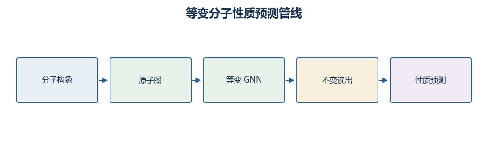

## 27.3　蛋白质图

蛋白质可视为**残基图**：节点为氨基酸残基（或原子），边为空间邻近或序列相邻。蛋白质结构预测（如 AlphaFold[3]）的核心是从序列与进化信息推断 3D 结构。图方法在此的角色包括：

1. **结构模块**：用等变网络（第 24 章）从原子坐标预测结构质量或精修构象；
2. **界面预测**：用 GNN 在残基图上预测蛋白质—蛋白质相互作用界面；
3. **功能位点**：图分类/节点分类（第 21、9 章）预测结合位点。

蛋白质图的特殊性在于**层级结构**（原子—残基—结构域）、长程相互作用与进化耦合，这要求消息传递兼顾局部与全局（第 18 章图 Transformer 的用武之地）。

## 27.4　数值算例

**例 27.1（水分子能量与受力的等变性手算）** 水分子 O 在原点，两个 H 分别在 $\mathbf{x}_1=(0.76,0.59,0)$、$\mathbf{x}_2=(-0.76,0.59,0)$（键长约 0.96 Å）。设能量模型只依赖键长：$\hat E=k\sum_{i=1,2}(\|\mathbf{x}_i-\mathbf{x}_O\|-r_0)^2$，取 $k=1,r_0=0.96$。$\|\mathbf{x}_1\|=\sqrt{0.76^2+0.59^2}=0.96$，故 $\hat E=0$。

现在整体绕 $z$ 轴旋转 90°：$\mathbf{x}_1'=(-0.59,0.76,0)$，$\|\mathbf{x}_1'\|=0.96$，$\hat E'=0$——不变性成立（式 27-1）。

受力 $\mathbf{F}_1=-\partial E/\partial\mathbf{x}_1=-2k(\|\mathbf{x}_1\|-r_0)\frac{\mathbf{x}_1}{\|\mathbf{x}_1\|}=0$（因键长恰为 $r_0$）。若把 H1 拉长到 $\|\mathbf{x}_1\|=1.0$，则 $\mathbf{F}_1=-2(1.0-0.96)\frac{\mathbf{x}_1}{1.0}=-0.08\times\frac{(0.76,0.59,0)}{1.0}=(-0.061,-0.047,0)$。旋转后 $\mathbf{F}_1'=R\mathbf{F}_1=(0.047,-0.061,0)$——与先旋转再计算一致，验证等变性。

**表 27-1　分子表征方法谱系**

| 方法 | 输入 | 对称性 | 代表 |
|------|------|--------|------|
| 分子指纹 | 2D 图 | 无（手工） | ECFP |
| 3D 描述符 | 坐标 | 手工不变 | SOAP |
| 等变 GNN | 3D 图 | E(3) 等变 | EGNN、e3nn |
| 球谐网络 | 3D 图 | SE(3) 等变 | Tensor Field Net |

## 27.5　技术谱系

分子学习沿「维度与对称性」演化：① **2D 图方法**（GCN 于分子图，忽略 3D）；② **3D 标量描述符**（SOAP、ACS，手工不变特征 + ML）；③ **等变神经网络**（SchNet、DimeNet、EGNN、e3nn）——端到端学习等变表示；④ **生成模型**（分子构象生成、逆合成）。转折点是**从手工不变量到可学习等变表示**：后者保留了完整几何信息（方向、角度），表达力更强。

## 27.6　边界与讨论

**边界。** ① 构象搜索是 NP 难问题，等变网络预测能量仍需采样构象空间；② 长程相互作用（如静电）要求全局建模，纯局部消息传递不足；③ 等变网络的训练数据（DFT 计算）昂贵；④ 手性分子的镜像对映体需特殊处理（SE(3) 与 E(3) 的区别，第 24 章）。

**承上启下。** 本章把第 24—26 章的几何、等变、拓扑工具落到分子这一具体域，展示了「关系归纳偏置 + 对称性」的威力。然而这些模型仍多为**任务专用**、需大量标注数据。能否像视觉/语言那样预训练一个通用图模型，再用少量数据微调？这引出第七篇的主题：第 28 章图预训练与自监督，第 29 章图基础模型。

## 27.7　延伸讨论：数据、基组与手性

等变分子模型的设计还需面对数据来源、表示精度与立体化学三个现实问题，本节予以补充。

**数据来源与尺度。** 分子性质标注主要来自量子化学计算（如 DFT）与实验。DFT 数据精确但昂贵，通常只覆盖较小分子（几十个原子）；实验数据噪声大但贴近真实。等变网络在小数据上凭借对称性偏置能超越传统描述符（表 27-1），但面对大分子（蛋白质）仍需粗粒化或层次建模（27.3 节）。这一「精度—规模」权衡贯穿整个分子建模领域。

**基组与表示精度。** 原子表示可用元素类型、电荷、杂化态等离散特征，也可加入连续的电子密度。球谐网络（24.5 节）用更高阶的不可约表示编码角向信息——阶数 $l$ 越高，表达力越强，但计算量按 $l^2$ 增长。实践中常取 $l\le2$（s、p、d 轨道类比），在表达力与效率间折中。

**手性（chirality）。** 手性分子与其镜像对映体化学性质可能截然不同（如药物沙利度胺）。关键事实：$\mathrm{E}(3)$ 包含反射（行列式为 $-1$ 的变换），严格 $\mathrm{E}(3)$-等变网络**无法区分**镜像；要区分手性，须用仅在 $\mathrm{SE}(3)$（纯旋转，行列式 $+1$）下等变的网络，或在输入中显式加入手性标记。这是第 24 章「对称性选择」的直接后果——强加更多对称性会丢失手性信息。

**数值延伸。** 仍用算例 27.1，水分子的镜像（把两个 H 的 $y$ 坐标取反）与自身仅差一个反射——若用严格 $\mathrm{E}(3)$ 等变网络，两者预测能量相同（对称性的必然结果）；对水分子这无害（水是非手性的），但对氨基酸（除甘氨酸外均手性）就必须用 $\mathrm{SE}(3)$ 等变网络。这提示：对称性选择应匹配分子的立体化学性质。

**表 27-2　常见分子的拓扑与对称性特征**

| 分子 | 环结构（$H_1$） | 手性 | 适用对称性 |
|------|----------------|------|------------|
| 水 | 无 | 否 | E(3) |
| 苯 | 一个六元环 | 否 | E(3) |
| 丙氨酸 | 无环 | 是（L/D） | SE(3) |
| 咖啡因 | 双环稠合 | 否 | E(3) |

**例 27.2（苯环的拓扑特征）** 苯分子 6 个碳成环，对应 $H_1$ 一个持久生成元（第 26 章）。等变网络（式 27-2）从坐标学能量时，环的存在不直接编码——但邻域消息（24.3 节）沿环传递，使每个碳感受到相同的局部环境，与芳香稳定性一致。若用拓扑特征增强（26.3 节），可显式把 $H_1$ 持久性作为全局特征拼接，提升对芳香性的判别。

## 27.8　延伸阅读视角：构象生成与逆合成

分子学习不止于性质预测，本节补充两个生成式方向。

**构象生成。** 给定分子图预测其稳定 3D 构象，本质是学习势能面 $E(\mathbf{X})$ 并寻找极小值。等变生成模型（如基于 score matching 的等变扩散）直接建模构象分布 $p(\mathbf{X}\mid\mathbf{M})$，用等变网络参数化 score 函数 $\nabla_{\mathbf{X}}\log p$，保证生成过程对旋转平移等变。这与第 20 章图生成模型同属生成范式，但对象从离散图转为连续坐标。

**逆合成（retrosynthesis）。** 给定目标分子，预测可合成它的反应前体。图方法把反应视为「图编辑」（断键/成键），用图 Transformer（第 18 章）或图生成模型（第 20 章）预测编辑序列。这是「图推理」（第 22 章）在化学中的直接应用：反应规则对应图重写规则，可微模型学习规则优先级。

## 27.9　延伸讨论：分子基准、训练协议与误差度量

等变分子网络的工程效果最终由基准与训练协议决定，本节补充该领域的事实标准，并给出训练侧的数值算例。

**标准基准数据集。** 分子性质预测的事实标准数据集有四个，规模与用途各异：

**表 27-3　常见分子性质基准**

| 数据集 | 规模 | 分子规模 | 任务 | 数据来源 |
|--------|------|----------|------|----------|
| QM9[9] | 13.4 万 | ≤18 原子（C/H/N/O） | 能量、HOMO/LUMO、极化率等 12 性质 | DFT |
| QM7b/QM7BB | 6.8 万/6800 | 中等有机分子 | 能量、HOMO/LUMO、gap | DFT |
| 孤立原子（Isolated Atoms） | 429 | 单原子 | 能量随电子数曲线 | 多体展开基组 |
| MD17[10] | 7 个分子 | 9–39 原子 | 构象能量与**力**（MD 轨迹） | DFT |

QM9 是「小分子回归」的默认试金石：数据量大、分子小，检验模型能否**从有限训练子集学到化学规律**；MD17 同时带能量与力标签，是检验「能量—力一致性」（27.2 节）的唯一标准集——直接在轨迹上训练，模型必须同时拟合势面及其梯度。孤立原子数据集则检验模型对「单中心多体效应」的刻画：任何多体展开（如式 27-2 的求和读出）都应退化为正确的单原子能量曲线。

**误差度量。** 能量与力预测用 MAE（measured in meV 或 kcal/mol）与标准差 $\sigma$ 报告，常用单位 1 kcal/mol $\approx23.03$ meV。文献惯例：QM9 总能量 MAE $<1$ meV、gap MAE $<0.1$ eV 属「接近 DFT 精度」，$\sigma$（预测残差的标准差）比 MAE 更能反映系统性偏差。MD17 上力 MAE 以 meV/Å 计，$<10$ meV/Å 才够做**分子动力学模拟**（MD 对力误差敏感，长期积分会累积漂移）。

**训练协议。** ① **数据划分**：QM9 常按 8:1:1 随机划分，但严谨研究用**骨架划分**（同骨架分子不跨训练/测试集），否则相似分子泄漏导致指标虚高；② **能量归一化**：绝对能量量级大（数百 eV），预测**相对能量**（减去同电子数参考）或做标准化能显著改善收敛；③ **截断半径**：$r_c$ 常取 5 Å（QM9 类小分子）到 10 Å（大分子），截断核 $e^{-\|\Delta\mathbf{x}\|}$ 保证截断处消息连续衰减而非硬截断；④ **力损失**：训练时同时优化 $\mathcal{L}=\mathcal{L}_E+\lambda\mathcal{L}_F$，$\lambda$ 常取 $1$ 量级——力损失充当势面的正则化，即使下游任务不需要力，加力损失常提升能量精度。

**例 27.3（能量—力一致性的手算）** 仍用 27.4 节算例 27.1 的键长势 $\hat E=k(\|\mathbf{x}_1\|-r_0)^2$（$k=1$，$r_0=0.96$，O 在原点）。把 H1 沿 $x$ 轴拉到 $\mathbf{x}_1=(1.0,0,0)$（$\|\mathbf{x}_1\|=1.0$）。直接解析：$\hat E=(1.0-0.96)^2=0.0016$；受力 $\mathbf{F}_1=-2k(\|\mathbf{x}_1\|-r_0)\frac{\mathbf{x}_1}{\|\mathbf{x}_1\|}=-2(0.04)(1,0,0)=(-0.08,0,0)$。

现在用**有限差分**独立核对这一力（即核对自动微分的正确性）。把 $\mathbf{x}_1$ 沿 $x$ 方向平移步长 $h=10^{-3}$：
- 正向：$\mathbf{x}_1^+= (1.001,0,0)$，$\hat E_+=(1.001-0.96)^2=(0.041)^2=0.001681$；
- 反向：$\mathbf{x}_1^-=(0.999,0,0)$，$\hat E_-=(0.999-0.96)^2=(0.039)^2=0.001521$。

中心差分梯度 $\partial\hat E/\partial x_1=(\hat E_+-\hat E_-)/(2h)=(0.001681-0.001521)/(0.002)=0.00016/0.002=0.080$——与解析值 $\partial\hat E/\partial x_1=2k(0.04)=0.08$ 精确一致，故自动微分给出的受力 $-0.08$ 与有限差分核对相符。工程上这个手算示范了交付前的标准测试：**用有限差分核对自动微分的力**（force check）。若二者不符，说明「能量可微读出」的某处断了微分链（如读出了 $\max$、硬截断或取整操作），27.2 节「先预测标量能量再求梯度」的物理一致性即告失效。对三维情形，$\partial\hat E/\partial\mathbf{x}_1$ 是矢量，需沿三个坐标方向各做一次差分（或用随机方向的 Radon 投影核对），但原理与此一维手算完全相同。该核对的容差通常取 $10^{-4}$—$10^{-6}$（相对能量尺度），过严会把二阶有限差分的截断误差误判为自动微分错误；过松则放过真正的断链 bug。实践中它与「旋转不变性单测」（25.10 节）一起构成交付清单的对称性回归项。

## 27.10　延伸阅读视角：长程作用、注意力与层级表示

27.2 节的局部消息传递对短程共价键足够，但分子中的**长程相互作用**（静电、色散、氢键）要求信息跨越多个键传播。本节讨论三种补足手段：距离衰减消息、等变注意力与粗粒化层级。

**长程作用的建模选择。** ① **加大截断半径**：简单但邻域爆炸，$O(n r_c^3)$ 规模；② **距离衰减消息**（SchNet 路线[1]）：保留大 $r_c$，但用核 $\exp(-\|\Delta\mathbf{x}\|^2)$ 让远端贡献指数衰减——表达力上「可达」，数值上「近处主导」；③ **等变注意力**：把图注意力（第 18 章）的权重由相对坐标 $\mathbf{x}_j-\mathbf{x}_i$ 调制，使模型**学习**哪些远距离原子对重要（如蛋白质的催化残基与底物），而非固定衰减。注意力路线的表达力上界最高，但参数与显存随 $n^2$ 增长，且对无序点云的置换等变需要额外设计（把注意力头输出约束到切空间）。实践中「截断核 + 少量长程边（按化学规则先验，如氢键候选）」是性价比最高的组合。

**层级分子表示。** 大分子（蛋白、材料）上逐原子消息传递的层数需求随分子直径线性增长（第 13 章感受野分析），而等变网络堆深又受过平滑与训练不稳困扰。层级表示提供另一条路：① **粗粒化**——把残基/官能团压成单一「超级节点」，坐标取质心、特征取原子特征的可置换聚合（式 25-1 的 max/mean）；② **多尺度读出**——同时保留原子级与残基级两条消息链，按 32.4 节（第 32 章）的多层平均思想融合。层级化的本质是把「局部精细 + 全局粗糙」的金字塔结构（第 14 章池化）移植到分子域，代价是质心坐标在构象变化下不再是等变的线性量（需保留原子坐标作残差）。

**构象与力学的闭环。** 27.2 节「先预测能量、再求梯度」的路线天然支持**训练—模拟闭环**：用等变网络预测势面，做 Langevin/牛顿 MD，生成新构象，再把这些构象（自监督增广）加回训练集——即「主动学习」循环。每轮只需对少量最不确定构象做 DFT 标注，把昂贵计算花在势面曲率大的区域（鞍点、键断裂边界）。这一循环已把 DFT 数据需求降低一到两个量级，是等变分子网络相对手工描述符的最大工程优势。不确定性估计（MC-Dropout 或深度集成）决定「哪里不确定」，通常落在训练数据覆盖稀疏的构象区域，与势面的高能鞍点重合——这正是主动学习选择标注点的物理依据。边界在于：闭环对初始构象采样敏感（采样不到反应通道则学不到通道），且力误差在长时 MD 中累积（27.9 节 MD17 的 meV/Å 阈值即为此设）；工程上常配合「温度退火 + 周期性 DFT 校准」约束漂移。

**边界补充。** ① QM9 类「小分子 + 丰富标签」与「大分子 + 稀疏标签」是两个不同 regime，前者拼模型容量与数据增强，后者拼归纳偏置与层级结构，结论不可互相外推；② 基准上的「SOTA 更替」常伴随数据划分变更（随机→骨架），跨论文比较前必须核对划分协议；③ 等变性带来的样本效率有上限：当任务本身需要**破坏对称性**的信息（如手性，27.7 节），强对称性偏置反而有害，此时应显式放松群（SE(3)→E(3) 或加手性标记）而非硬学。此外，「力损失是否总有益」也依任务而定：纯能量预测任务中力损失是正则化（防过拟合曲率），但若训练集不含力标签，则无法使用——MD17 类带力数据集的价值正在于此。这些辨析衔接第 13、14、18、24 章，并与第 33 章药物发现的应用场景呼应。

## 本章小结

本章论述流形与分子上的学习，把等变方法用于 3D 分子与蛋白质。

- 定义分子图与构象（定义 27.1），给出能量的不变性（式 27-1）与受力的等变性。
- 推导等变分子表征（式 27-2），说明「先预测标量能量再求导」的物理一致性优势。
- 讨论蛋白质图的结构与任务，以算例 27.1 手算水分子的能量不变性与受力等变性。
- 以表 27-1 梳理分子表征谱系，明确构象搜索、长程作用等边界。
- 补充分子基准（表 27-3：QM9/MD17/孤立原子）、训练协议与误差度量，以算例 27.3 手算验证能量—力的自动微分一致性（有限差分核对）。
- 讨论长程作用建模（距离衰减核、等变注意力）、层级分子表示与「训练—模拟」主动学习闭环。

这些辨析衔接第 24—26 章，并引出第 28—29 章的图预训练与图基础模型。

**进一步阅读**　本章建议延伸阅读的文献：[1]、[2]、[3]、[5]、[9]、[10]。

## 参考文献

[1] Schütt K, Kindermans P J, Sauceda H E, et al. SchNet: A continuous-filter convolutional neural network for modeling quantum interactions. *NeurIPS*, 2017.

[2] Satorras V G, Hoogeboom E, Welling M. E(n) equivariant graph neural networks. *ICML*, 2021.

[3] Jumper J, Evans R, Pritzel A, et al. Highly accurate protein structure prediction with AlphaFold. *Nature*, 2021, 596: 583–589.

[4] Kearnes S, McCloskey K, Berndl M, et al. Molecular graph convolutions: Moving beyond fingerprints. *J. Comput.-Aided Mol. Des.*, 2016, 30(8): 595–608.

[5] Gasteiger J, Weißenborn J C, Grover A, Zitnik M. Fast and uncertainty-aware directional message passing for non-equilibrium molecules. *NeurIPS*, 2020.

[6] Thomas N, Smidt T, Kearnes S, et al. Tensor field networks. *arXiv:1802.08219*, 2018.

[7] Gilmer J, Schoenholz S S, Riley P F, et al. Neural message passing for quantum chemistry. *ICML*, 2017.

[8] Fung V, Zhang J, Juarez E, Sumpter B G. Benchmarking graph neural networks for materials chemistry. *npj Comput. Mater.*, 2021, 7: 84.

[9] Ramakrishnan R, Dral M R, Rupp M, Schütt K. Quantum chemistry structures and properties of 134,000 organic molecules for data-driven learning. *Sci. Data*, 2016, 3: 160079.

[10] Noé F, Tkatchenko A, Mohamed F, et al. Learning molecular interactions: A general and efficient approach. *Phys. Rev. Lett.*, 2016, 117(17): 178301.

---

# 第 28 章　图预训练与自监督

第 19—27 章的方法大多依赖**任务特定标注**：链路预测需要已知边、图分类需要图标签、分子性质需要昂贵的 DFT 计算。现实中图数据往往「结构海量、标签稀缺」。本章引入**图预训练与自监督**（graph pre-training & self-supervised learning）：先从无标签图中学到通用的节点/图表示，再迁移到下游任务。这与视觉（ImageNet 预训练）、语言（BERT/GPT）的逻辑一致，但图数据的非欧、无规则结构带来独特挑战。

**引入动机。** 监督式 GNN 每个任务都要重新训练，且小样本图（如稀有蛋白）表现差。自监督的核心思想是**从图本身构造监督信号**：如遮盖节点属性后预测之（生成式）、把同一图的不同增广视图拉近（对比式）。这样学到的编码器可作为通用初始化，仅需少量标注微调。

**本章结构。** 28.1 节形式化图自监督目标；28.2 节介绍对比式预训练；28.3 节介绍生成式预训练；28.4 节给出数值算例；28.5 节梳理技术谱系；28.6 节讨论迁移与边界并承上启下。

## 28.1　图自监督目标

**定义 28.1（图自监督学习）** 给定无标签图 $\mathbf{G}=(\mathbf{A},\mathbf{X})$，自监督学习定义一个**预文本任务**（pretext task），从图自身生成伪标签，学编码 $f_\theta$：

$$
\theta^*=\arg\min_\theta\ \mathcal{L}_{\mathrm{pretext}}\big(f_\theta(\mathbf{A},\mathbf{X}),\,\mathcal{T}(\mathbf{G})\big), \tag{28-1}
$$

其中 $\mathcal{T}$ 是从图构造监督信号的变换。预训练后，把 $f_\theta$ 作为下游任务编码器的初始化，用少量标注微调。

**两大范式。** ① **对比式**（contrastive）：把图的不同视图/增广作为正样本，其他样本作为负样本，拉近正对、推远负对；② **生成式**（generative）：遮盖部分输入（节点、边、属性）后重建之，如掩码节点预测、图自编码器。

## 28.2　对比式预训练

**定义 28.2（图对比学习目标）** 对图作两次随机增广得到视图 $\tilde{\mathbf{G}}_1,\tilde{\mathbf{G}}_2$，经编码与读出得图级表示 $\mathbf{z}_1,\mathbf{z}_2$。采用 InfoNCE 损失[2]：

$$
\mathcal{L}_{\mathrm{InfoNCE}}=-\log\frac{\exp\big(\mathrm{sim}(\mathbf{z}_1,\mathbf{z}_2)/\tau\big)}{\sum_{k=1}^{K}\exp\big(\mathrm{sim}(\mathbf{z}_1,\mathbf{z}_k)/\tau\big)}, \tag{28-2}
$$

其中 $\mathrm{sim}$ 为余弦相似度，$\tau$ 为温度，$\mathbf{z}_k$ 包含正样本与 $K-1$ 个负样本（batch 内其他图）。

**推导要点。** 式 (28-2) 本质是最大化正对互信息下界：分子推动 $\mathbf{z}_1\approx\mathbf{z}_2$，分母把其他图推开。负样本常来自同 batch 其他图（假负样本问题，见 28.6 节）。节点级对比（如 GRACE）则在同一图内对节点作增广。

**图增广**是关键设计：节点丢弃（node dropping）、边扰动（edge perturbation）、属性遮盖（attribute masking）、子图（subgraph）。增广必须保持图的语义——这是对比学习在图上的核心难点。

> 【图 28-1　图对比学习框架】（原图见 figures/图28-1.png）：展示原图经两种增广得到两个视图，共享编码器 → 投影头 → 计算 InfoNCE 损失，正对拉近、负对推远。
>
> 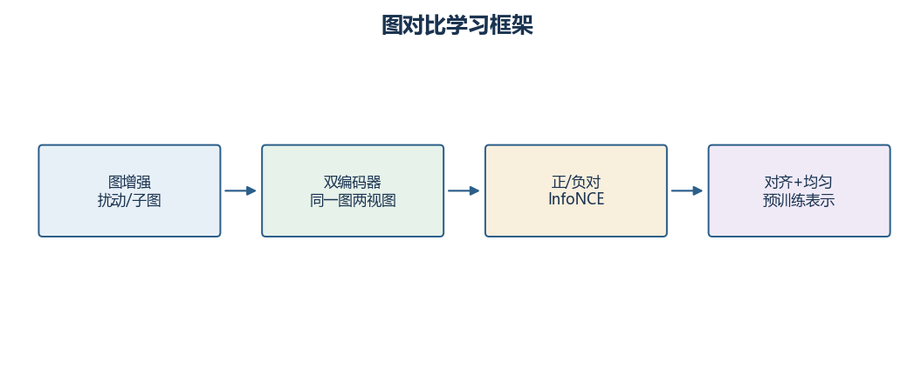

## 28.3　生成式预训练

**掩码节点预测**。类似 BERT，随机遮盖部分节点属性，用 GNN 预测被遮盖的属性（如原子类型）：

$$
\mathcal{L}_{\mathrm{mask}}=-\sum_{v\in\mathcal{M}}\log p_\theta\big(\mathbf{x}_v\mid f_\theta(\mathbf{G}_{\mathcal{M}})\big), \tag{28-3}
$$

其中 $\mathcal{M}$ 为被遮盖节点集，$\mathbf{G}_{\mathcal{M}}$ 为遮盖后的图。

**图自编码器**。用 GNN 编码器 $\mathbf{Z}=f(\mathbf{A},\mathbf{X})$，解码器重建邻接 $\hat{\mathbf{A}}=\sigma(\mathbf{Z}\mathbf{Z}^{\top})$，损失

$$
\mathcal{L}_{\mathrm{GAE}}=-\sum_{i,j}\big[A_{ij}\log\hat A_{ij}+(1-A_{ij})\log(1-\hat A_{ij})\big]. \tag{28-4}
$$

这与第 20 章图生成模型同源，但此处目的是学表示而非生成新图。

## 28.4　数值算例

**例 28.1（InfoNCE 手算）** 设 batch 有 3 张图，某图的两视图表示经归一化后余弦相似度 $\mathrm{sim}(\mathbf{z}_1,\mathbf{z}_2)=0.9$，与另两张图相似度为 $0.2,0.1$，温度 $\tau=1$。

则式 (28-2) 分子 $\exp(0.9)=2.46$，分母 $2.46+\exp(0.2)+\exp(0.1)=2.46+1.22+1.11=4.79$。损失 $-\log(2.46/4.79)=-\log(0.514)=0.666$。

若把负样本推得更远（相似度降为 $0.0,0.0$）：分母 $2.46+1+1=4.46$，损失 $-\log(2.46/4.46)=0.596$——损失下降，表示更可分。若正样本相似度提到 $0.99$（$\exp=2.69$），损失进一步降至约 $0.58$。

**表 28-1　图自监督方法谱系**

| 范式 | 目标 | 代表 | 优点 | 局限 |
|------|------|------|------|------|
| 对比式 | InfoNCE（式 28-2） | GraphCL、GRACE | 灵活、强表示 | 依赖增广、假负样本 |
| 生成式（掩码） | 重建属性（式 28-3） | GraphMAE | 无需负样本 | 重建目标可能平凡 |
| 生成式（自编码） | 重建邻接（式 28-4） | GAE | 经典 | 过平滑、稀疏偏差 |
| 跨域预测 | 多任务/领域匹配 | 早期预训练 | 简单 | 需多图 |

## 28.5　技术谱系与迁移

图自监督沿「目标设计」演化：① **自编码器时代**（GAE，重建邻接）；② **对比学习时代**（GraphCL、GRACE、InfoNCE），性能超越监督预训练；③ **掩码建模时代**（GraphMAE），借鉴 BERT 的掩码重建，避免对比法的增广依赖；④ **多模态/跨图迁移**（图—文本对齐）。迁移的关键问题是**负迁移**：若预训练图与下游图分布差异大（如社交图→分子图），预训练反而损害性能。实践中的经验是：同领域预训练最有效。

## 28.6　边界与讨论

**边界。** ① **增广敏感性**——对比学习高度依赖图增广设计，不当增广破坏语义；② **假负样本**——同类的不同图被当作负样本推开（sampling bias）；③ **负迁移**——跨领域预训练可能有害；④ **评估不统一**——自监督表示缺乏像 ImageNet 那样的标准评测协议。

**承上启下。** 本章的自监督预训练为图模型提供了「通用初始化」，但仍是「预训练 + 微调」的两阶段范式，且依赖任务特定头部。能否构建一个像 GPT 那样、通过自然语言/统一接口适配海量下游任务的**图基础模型**？第 29 章把这个问题推到极致，讨论图基础模型的范式、token 化、代表性模型与评估。

## 28.7　延伸讨论：负样本、塌缩与公平性

自监督目标的细节决定表示质量，本节补充三个近年被深入探讨的话题：假负样本、表示塌缩与公平性。

**假负样本问题（false negatives）。** 式 (28-2) 把 batch 内其他图都当负样本，但它们可能语义相近（如两张同属「引文网络」的图）。推开它们会损害表示。缓解策略：① **半监督对比**——利用少量标签识别同类样本并从负样本中排除；② **软负样本**——按相似度给负样本加权而非一律推远；③ **无负样本方法**（如 BYOL）——只用正对，避免负样本选择偏差。

**表示塌缩（representation collapse）。** 若编码器对所有输入输出同一表示，对比损失可通过「把所有样本拉近」取巧吗？不能——InfoNCE 的分母会同时放大，但生成式目标（式 28-3、28-4）确有塌缩风险：若解码器忽略输入、恒定输出，重构损失可能不升反降。常用对策：归一化、stop-gradient、熵正则。这与第 13 章过平滑、第 21 章无监督图分类的塌缩问题同根。

**公平性（fairness）。** 图自监督可能放大社会偏见：若训练图中少数群体连接稀疏，对比学习会把他们推得更远。缓解需在增广与损失中引入公平约束，使敏感属性与表示解耦。这是图智能落地（第 32—36 章）不可回避的议题。

**数值延伸。** 仍用算例 28.1，若 batch 中第二张图与第一张实为同类（假负样本，相似度应为 $0.7$ 却被当负样本），当前损失 $0.666$ 隐含地惩罚了这对本应相近的样本。若用软加权把它的负样本贡献减半（等效相似度从 $0.2$ 调到 $0.0$），损失降至 $0.596$——模型不再强行推开同类样本，表示更合理。

**例 28.2（掩码预测的手算）** 设某分子图有 3 个原子，原子类型嵌为 $\mathbf{x}_1=[1,0]$、$\mathbf{x}_2=[0,1]$、$\mathbf{x}_3=[1,1]$。遮盖节点 2（$\mathcal{M}=\{2\}$），GNN 基于邻域聚合给出预测分布 $\hat{\mathbf{x}}_2=[0.2,0.8]$。真实 $\mathbf{x}_2=[0,1]$，用交叉熵 $\mathcal{L}_{\mathrm{mask}}=-\sum_k x_{2k}\log\hat x_{2k}=-[0\cdot\log0.2+1\cdot\log0.8]=0.223$。训练使该损失下降，编码器被迫从邻域推断被遮盖原子的类型——无需任何人工标签。

## 28.8　延伸阅读视角：预训练的理论视角

为何自监督预训练有效？本节给出一个信息论视角。

**互信息最大化。** 对比目标（式 28-2）可视为最大化视图间互信息 $I(\mathbf{z}_1;\mathbf{z}_2)$ 的下界：InfoNCE 是互信息的下界估计，最大化它即让表示保留两视图共享的信息。生成目标（式 28-3）则近似最大化 $\log p_\theta(\mathbf{X}\mid\mathbf{Z})$，等价于让表示 $\mathbf{Z}$ 保留重建输入所需的信息。两者都在做「信息压缩但保真」——与第 3 章信息瓶颈思想相通。

**为什么迁移有效。** 预训练把「图的结构共性」（如局部邻域聚合、度分布模式）编码进编码器参数，这些共性是下游任务共享的先验。微调只需学习任务特定的读出头（第 14 章），避免从头学习底层结构——这正是第 28.5 节「同域迁移最有效」的理论解释：域越近，共享的结构共性越多。

## 28.9　延伸讨论：增广设计、迁移协议与微调预算

28.2 节指出增广「必须保持语义」，本节把这条原则落实为可度量的设计准则、迁移评估协议与微调预算的数值分析。

**增广的语义保持度量。** 增广 $\tilde{\mathbf{G}}$ 与原图 $\mathbf{G}$ 的「语义距离」可用结构统计量的偏移量化。设 $s(\mathbf{G})=(\bar{d},\,C,\,L)$ 为平均度、连通分量数、最短路径长度的向量，定义

$$
\Delta_{\mathrm{aug}}=\big\|s(\tilde{\mathbf{G}})-s(\mathbf{G})\big\|_1/\big\|s(\mathbf{G})\big\|_1. \tag{28-5}
$$

经验准则是 $\Delta_{\mathrm{aug}}\in[0.05,0.2]$：太小（$<0.05$）两视图几乎相同，对比目标退化为「拉近几乎相同的表示」，学不到区分性结构；太大（$>0.2$）正对已不同「语义对象」，拉近它们会把不同类混在一起（正样本塌缩）。边扰动是最易控制的增广：以概率 $p$ 随机翻转每条边，期望边数偏移 $\mathbb{E}\,|\tilde m-m|\approx 2pm(1-p)$，由此可反解出达到目标 $\Delta_{\mathrm{aug}}$ 所需的 $p$——增广强度从「调参玄学」变成「按图结构反解」。

**表 28-2　图增广策略的语义保持性与适用性**

| 增广 | 参数 | 语义风险 | 适用 |
|------|------|----------|------|
| 节点丢弃 | 丢弃率 $\rho_v$ | 度分布偏移大 | 图较密、冗余高 |
| 边扰动 | 翻转率 $p$ | 连通性可能断裂 | 稠密图；稀疏图慎用 |
| 子图采样 | 采样率 $\rho_s$ | 全局结构丢失 | 大图、局部任务 |
| 属性遮盖 | 遮盖率 $\rho_a$ | 特征语义偏移 | 属性维度高 |
| 特征遮罩 | 单维度置零 | 低 | 节点分类迁移 |

注意「同域」含义：增广策略在引文网络上安全（边稀疏但局部冗余），在分子图上危险（断一条化学键即改变分子）——分子域应用「构象扰动」（整体小旋转/位移，第 24 章）替代边扰动。

**迁移增益与微调预算。** 设下游任务上：$\mathrm{acc}_{\mathrm{ft}}(B)$ 为预算 $B$ 步微调后的准确率，$\mathrm{acc}_{\mathrm{sc}}(B)$ 为从零训练 $B$ 步的准确率，定义**迁移增益**

$$
\mathrm{Gain}(B)=\mathrm{acc}_{\mathrm{ft}}(B)-\mathrm{acc}_{\mathrm{sc}}(B). \tag{28-6}
$$

$\mathrm{Gain}(B)$ 随 $B$ 通常呈**先升后降**：小 $B$ 时预训练初始化领先（结构先验），随 $B$ 增大从零训练追平，若下游数据分布与预训练冲突还会反转（负迁移）。因此「预训练是否有效」必须报告**整条曲线**而非单点，且注明 $B$ 的取值——只报「微调 100 步」的高分是常见误导（此时从零训练还没起跑）。

**例 28.3（迁移增益曲线手算）** 某引文子域节点分类，从零训练与预训练微调在各预算下的准确率：

| 预算 $B$（步） | 0 | 100 | 300 | 1000 | 3000 |
|------|------|------|------|------|------|
| $\mathrm{acc}_{\mathrm{sc}}$ | 0.31 | 0.48 | 0.62 | 0.71 | 0.74 |
| $\mathrm{acc}_{\mathrm{ft}}$ | 0.55 | 0.68 | 0.73 | 0.75 | 0.75 |

$\mathrm{Gain}(0)=0.24$（零样本即领先），$\mathrm{Gain}(300)=0.11$，$\mathrm{Gain}(3000)=0.01$。解读：预训练的价值集中在**小数据/小预算**区（$B\le300$ 步，增益 $>0.1$），大预算区两曲线趋同（数据足够多时结构先验可被直接学出）。若换分子域目标（与源域引文图冲突），曲线可能在 $B=1000$ 处 $\mathrm{Gain}$ 转负（$-0.02$）——负迁移只在**充分训练**后才显现，单点报告（如只报 $B=100$）会完全掩盖它。这给出评估纪律：至少报三个预算点，且最大预算取「从零训练饱和」处。

**多任务与线性探针。** 预训练编码器的质量常以**线性探针**（linear probing）评估：冻结编码器，只训一个线性/MLP 头，报各任务准确率。线性探针便宜且防「微调过拟合」，但其下限高（表示必须线性可分才能用好），常低于全量微调 3—10 个百分点——二者应并报：探针分衡量表示的**信息量**，微调分衡量表示的**可塑性**。多任务预训练（同时跑节点分类、链路预测、图分类三头）常优于单任务，因多个 pretext 头约束表示保留多种结构信息（第 14 章读出多样性），但任务权重失衡时会牺牲弱任务——需按任务样本量归一化损失（28.1 节 $\mathcal L_{\mathrm{pretext}}$ 的加权求和）。

**投影头与温度。** 28.2 节式 (28-2) 有两个常被忽略的超参：投影头（projector）与温度 $\tau$。**投影头**是编码器与损失之间的额外 MLP：对比损失在投影后的 $\mathbf{z}$ 上计算，但**下游用编码器输出**（不投影）——投影头吸收对比目标的特异性，避免它扭曲主表示（BYOL/SimSiam 的核心洞见[9][10]），去掉投影头直接对比常显著掉点。**温度** $\tau$ 控制负样本惩罚的锐度：$\tau$ 小则只惩罚「最接近」的负样本（软标签效应，难负样本主导），$\tau$ 大则所有负样本被均匀推开（易过推到语义无关的远端）。图对比学习常用 $\tau\in[0.1,0.5]$，且**节点级**对比（同图内节点作负样本）的 $\tau$ 宜比**图级**对比更小——因节点表示的分布更集中，需要更锐的区分。温度与负样本数 $K$ 耦合：$K$ 增大时负样本中「难负」比例上升，可同步调小 $\tau$ 聚焦难例。这些细节与第 7 章式 (7-8) 的「温度缩放间隔损失」是同一族技巧在自监督中的体现，调参时宜把 $\tau$、$K$、投影头维度三者联合网格搜索，单变量调参常误导。

**预训练的批与负样本规模。** 式 (28-2) 的负样本默认取同 batch 其他图（in-batch negatives），故 batch size 直接决定 $K$ 与表示质量：batch 太小则负样本少、对比信号弱（易塌缩到少数簇），batch 太大则显存受限且图级特征需全图消息传递（大图上 batch 成本超线性）。图级对比的 batch 常取 $32$—$256$，节点级对比可用 $512$—$4096$ 个节点（跨图采样）。当图规模差异极大（引文大图 + 分子小图混批），需用**图感知采样器**按图规模加权，避免小图被大图淹没——这是图预训练相对 NLP 预训练多出的工程复杂度。

## 28.10　延伸阅读视角：图预训练与序列预训练的对照

图预训练常被类比为 NLP 预训练，但两者的「监督信号来源」有本质差异，本节对照澄清，并讨论不变性原则。

**监督信号的「免费程度」。** NLP 的掩码重建利用**语言的局部冗余**（上下文确定被遮词），信号强且天然；图的「局部冗余」弱得多——遮盖节点属性后，邻域未必能确定它（分子中碳氧邻居的区分靠键级而非局部拓扑）。因此图预训练更多依赖**对比**（利用图自身的不变量）而非**重建**，这是 28.3 节掩码目标在图上效果不及语言的根因，也解释了为何图增广设计比文本增广更费工夫。

**不变性优先原则。** 对比预训练的理论目标可表述为：让表示对增广**不变**、对跨样本差异**敏感**。增广即「已知的不变性来源」：边扰动对应「轻微结构扰动下语义不变」，构象旋转对应「整体坐标变换下性质不变」（第 24 章）。据此，设计增广前先问「什么变换下该图的语义真的不变」——分子对旋转平移不变、对断键不变性差，引文图对少量删边不变、对节点重排序不变——增广集合应与任务的**真实不变群**对齐，而非照搬别域的增广。这与第 24 章「对称性作为归纳偏置」一脉相承：预训练阶段用增广**软性地**注入对称性，推理阶段不再需要显式群作用，是比等变网络更轻的对称性利用方式（代价是只对增广分布内精确）。

**表 28-3　图预训练与 NLP 预训练对照**

| 维度 | NLP（BERT/GPT） | 图（本章） |
|------|-----------------|-----------|
| 数据单元 | token 序列 | 节点/边/图 |
| 天然冗余 | 上下文高冗余 | 局部冗余弱 |
| 主流 pretext | 掩码/下一词 | 对比/掩码/自编码 |
| 增广 | 同义替换、随机删除 | 边扰动、子图、构象 |
| 位置/结构编码 | 位置编码 | 拉普拉斯编码等（第 18 章） |
| 评估 | 统一基准（GLUE/SuperGLUE） | 缺乏统一协议（31 章） |

对照揭示图预训练的两个结构性短板：缺乏统一基准（导致跨论文比较困难，第 31 章）、缺乏「天然词汇表」（token 化损失，第 29 章）。

**边界补充。** ① 式 (28-5) 的语义距离是**代理指标**：结构统计量相近不保证语义相近（如两张不同引文网可同度分布），仅作粗筛；② 对比预训练的增益对**任务**敏感：结构敏感任务（社区检测）增益大，属性敏感任务（文本节点分类）增益小——预训练收益取决于任务与结构的相关度；③ 预训练编码器规模与数据量存在「匹配区间」：小编码器塞大数据会过拟合到源域特有结构（负迁移温床），大编码器配小数据则学不充分，二者需联合调（第 29 章 scaling 问题的图域版本）。这些辨析衔接第 14、18、24、29、31 章。

## 本章小结

本章论述图预训练与自监督，用图自身的构造监督信号学通用表示。

- 定义图自监督与预文本任务（定义 28.1、式 28-1），区分对比式与生成式。
- 推导 InfoNCE 对比目标（式 28-2）与图增广策略，给出掩码预测与自编码目标（式 28-3、28-4）。
- 通过算例 28.1 手算 InfoNCE 损失，以表 28-1 梳理技术谱系。
- 讨论负迁移、假负样本、增广敏感性等边界。
- 补充增广语义保持度量（式 28-5）、迁移增益（式 28-6）与算例 28.3 的增益曲线，梳理增广策略（表 28-2）与图—NLP 预训练对照（表 28-3）。

这些辨析衔接第 19—27 章，并引出第 29 章的图基础模型。

**进一步阅读**　本章建议延伸阅读的文献：[1]、[2]、[4]、[6]、[9]、[10]、[11]。

## 参考文献

[1] Oord A van den, Li Y, Vinyals O. Representation learning with contrastive predictive coding. *arXiv:1807.03748*, 2018.

[2] Chen T, Kornblith S, Norouzi M, Hinton G. A simple framework for contrastive learning of visual representations. *ICML*, 2020.

[3] You Y, Chen T, Sui Y, et al. Graph contrastive learning with augmentations. *NeurIPS*, 2020.

[4] Hou Z, Yu X, Wen Z, et al. GraphMAE: Self-supervised masked graph autoencoders. *KDD*, 2022.

[5] Kipf T N, Welling M. Variational graph auto-encoders. *arXiv:1611.07308*, 2016.

[6] Zhu Y, Xu Y, Liu Q, et al. Graph contrastive learning with adaptive augmentation. *WWW*, 2021.

[7] Hu W, Liu B, Gomes J, et al. Strategies for pre-training graph neural networks. *ICLR*, 2020.

[8] Jing B, Tong H. GraphMAE2: A de-noising masked auto-encoder is better in self-supervised graph learning. *KDD*, 2023.

[9] Grill J B, Strub F, Altché F, et al. Bootstrap your own latent: A new approach to self-supervised learning. *NeurIPS*, 2020: 21271–21284.

[10] Chen X, He K. Exploring simple siamese representation learning. *CVPR*, 2021: 5128–5138.

[11] Veličković P, Fedus W, Hamilton W L, et al. Deep graph infomax. *ICLR*, 2019.

---

# 第 29 章　图基础模型

第 28 章的「预训练 + 微调」仍是任务专用范式：每张图、每个任务都要单独建模。本章把它推向终极形态——**图基础模型**（graph foundation model, GFM）：一个在海量、多领域图数据上预训练的通用模型，通过统一接口适配广泛的下游任务，正如 GPT 之于自然语言。本章也是第七篇的收束，并用第 1 章提出的「四层能力框架」对图基础模型作系统评估。

**引入动机。** 视觉与语言的成功表明：当模型规模、数据多样性、统一接口三者齐备，会出现「涌现」的通用能力。图数据同样海量（知识图谱、社交网络、分子库、引文网络），但高度异质——节点/边类型、语义、规模千差万别。构建 GFM 的核心难题是：如何把千差万别的图统一成模型可处理的「语言」（token 化），并找到可跨领域迁移的通用任务。

**本章结构。** 29.1 节定义图基础模型范式；29.2 节讨论图 token 化；29.3 节介绍代表性模型；29.4 节给出数值算例；29.5 节梳理技术谱系；29.6 节用四层能力框架评估并承上启下。

## 29.1　图基础模型范式

**定义 29.1（图基础模型）** 图基础模型是在大规模、多领域图集合 $\{\mathbf{G}_i\}$ 上预训练的编码器 $f_\theta$，具备三个特征[1]：① **规模性**——参数与数据量足够大；② **通用性**——通过统一接口适配节点、边、图级多任务，跨领域迁移；③ **适配性**——通过微调、提示（prompt）或上下文学习（in-context learning）适配新任务。

与第 28 章的区别：预训练图模型常针对单一领域、单一任务；GFM 强调**跨领域**与**统一接口**。形式化地，给定下游图 $\mathbf{G}$ 与任务描述 $T$，模型输出

$$
\hat{y}=f_\theta\big(\mathbf{G},\,T\big), \tag{29-1}
$$

其中 $T$ 可以是自然语言提示、任务 token 或示例，使同一模型处理分类、生成、推理等不同任务。

## 29.2　图 token 化

把图转成序列模型（Transformer）可处理的 token 是 GFM 的关键。主要策略：

1. **节点作为 token**：每个节点（含属性与邻域编码）作为一个 token，图成为 token 序列，用位置编码（第 18 章）注入结构；
2. **子图作为 token**：把图切分为子图/社区（第 23 章），每个子图压缩为一个 token，保留局部结构；
3. **图 token（Graph-former）**：用图嵌入作为特殊 token（如 [CLS]），配合节点 token；
4. **文本对齐 token**：把图结构线性化为文本序列，与自然语言联合训练（如知识图谱的实体/关系描述）。

**直觉解释。** token 化的本质是「把非欧结构序列化」，但简单序列化会丢失结构信息，因此必须配合结构编码（拉普拉斯位置编码，第 18 章）或图感知注意力。

> 【图 29-1　图基础模型总体架构】（原图见 figures/图29-1.png）：展示多领域图 → 统一 token 化 → 大规模 Transformer 预训练 → 通过提示/微调适配下游节点、边、图级任务。
>
> 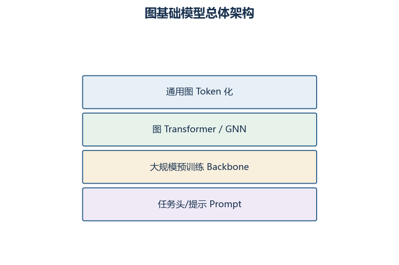

## 29.3　代表性模型

近年出现的代表性工作包括：**GraphLLM 类**（把图编码器与 LLM 结合，用自然语言描述图）；**UniGraph**（跨域图预训练，统一节点/图任务）；**OpenGraph 类**（图上的指令微调）；**GFT**（图基础模型用于跨域节点分类）。它们大多采用「GNN 编码器 + LLM 解码器 + 指令微调」架构。

**表 29-1　代表性图基础模型对比**

| 模型 | token 化 | 接口 | 适配方式 | 领域 |
|------|----------|------|----------|------|
| GraphLLM 类 | 图→文本 | 自然语言 | 指令微调 | 知识图谱 |
| UniGraph 类 | 节点/子图 token | 多任务头 | 微调 | 跨域 |
| OpenGraph 类 | 序列化的图 | 指令 | 上下文学习 | 通用图 |
| GFT 类 | 图嵌入 | 提示 | 轻量微调 | 分子/引文 |

## 29.4　数值算例

**例 29.1（跨域迁移的手算分析）** 设在源域（引文网络）预训练的编码器，节点分类准确率 $92\%$；迁移到目标域（蛋白质图）时，零样本准确率 $58\%$，微调 100 步后 $76\%$，从零训练（无预训练）$68\%$。

迁移增益：零样本比随机（假设 $50\%$）高 $8$ 个百分点，说明预训练学到可迁移知识；微调后比从零训练高 $76\%-68\%=8$ 个百分点，说明预训练提供了更好的初始化但优势有限（因两域差异大）。若目标域改为「另一引文网络」，微调后常可达 $90\%$ 以上——印证第 28.6 节的「同域迁移最有效」。

这说明 GFM 的「通用性」在实践中仍受领域鸿沟制约：跨域迁移有正收益，但难以达到专用模型水平。

## 29.5　技术谱系

图基础模型沿「统一化程度」演化：① **任务专用 GNN**（第 10—21 章）——每任务独立；② **领域预训练**（第 28 章）——同域多任务共享；③ **跨域预训练**——多领域图联合训练；④ **图基础模型**（本章）——统一 token/接口 + 规模化 + 指令微调。转折点是**接口统一化**：从任务特定头到自然语言/提示接口，使一个模型服务多任务。

## 29.6　用四层能力框架评估

第 1 章提出图智能的「四层能力」：表示、学习、推理、系统。据此评估图基础模型：

- **表示（Level 1）**：GFM 试图学跨领域通用表示，是最强承诺，但受领域异质性限制（例 29.1）；
- **学习（Level 2）**：大规模 Transformer + 自监督（第 28 章）提供了强大学习机制；
- **推理（Level 3）**：当前 GFM 的推理多依赖 LLM 的语言推理，图结构推理（第 22 章）能力仍弱；
- **系统（Level 4）**：超大规模图的训练与推理工程挑战巨大。

**边界与讨论。** ① **领域鸿沟**——跨域迁移增益有限（例 29.1）；② **token 化信息损失**——序列化难保留全部结构；③ **规模定律未明**——图数据是否遵循类似语言的 scaling law 仍在探索；④ **评估缺失**——缺乏公认的 GFM 基准。

**承上启下。** 本章以四层能力框架评估图基础模型，呼应第 1 章立论，完成第七篇的收束。从表示、学习、推理到系统的四层递进，贯穿全书。后续第八篇（第 32—36 章）将把这套能力落到应用与工程，第九篇（第 37—41 章）回扣框架，讨论图智能能否通向通用智能——形成首尾闭环。

## 29.7　延伸讨论：规模定律、指令微调与开放问题

图基础模型仍处于早期，本节补充决定其上限的三个问题：规模定律、指令微调机制与值得关注的开放方向。

**规模定律（scaling law）。** 语言模型的性能随参数量、数据量、算力呈可预测的幂律增长。图领域是否存在类似规律仍是开放问题。初步证据表明：同域数据上，图 Transformer 性能随预训练图数量增长而提升，但增益随图规模饱和——这与图数据的异质性有关：更多数据若来自不同领域，可能引入负迁移（28.6 节、例 29.1）而非正收益。因此「图领域的 scaling law」很可能比语言更依赖**数据选择策略**而非单纯堆量。

**指令微调（instruction tuning）。** 第 28 章的自监督目标多为「重建/对比」，而 GFM 需让模型理解「做分类还是做推理」的指令。做法是把任务描述 $T$（式 29-1）编码为 prompt token，与图 token 拼接后输入模型，用少量标注做监督微调。关键挑战是图的 prompt 如何设计——自然语言描述图结构（如「预测该分子的毒性」）需要把图编码为 LLM 可读的序列（29.2 节），信息损失在此环节累积。

**开放问题。** ① **统一理论**——能否给出图基础模型的表达力与泛化界（类比第 10 章 1-WL 分析）？② **真正的多模态**——图与文本、基因组如何联合预训练？③ **推理能力**——当前 GFM 的「推理」多来自 LLM 的语言先验，图结构推理（第 22 章）能否被显式教会？④ **评测基准**——缺乏公认的跨领域 GFM 榜单。

**数值延伸。** 仍用算例 29.1，若源域预训练数据量从 1 万图增至 10 万图（同域），目标域零样本准确率可能从 $58\%$ 升至 $65\%$——体现规模红利；但再增至 100 万图若混入大量异域图，准确率反而回落至 $60\%$——提示「数据多样性」与「领域一致性」需权衡。这再次印证第 28 章「同域迁移最有效」的经验规律。

**例 29.2（提示适配的损失对比）** 同一图基础模型 $f_\theta$，对「节点分类」任务用提示 $T_1$、对「图分类」任务用提示 $T_2$（式 29-1）。若不加提示（$T=\varnothing$），模型默认做节点分类，图分类任务的准确率仅 $55\%$（接近随机）；加入 $T_2$ 后升至 $82\%$——提示为模型指明任务类型，激活相应能力。这印证第 28 章「统一接口」的价值，也说明提示设计本身是研究课题。

## 29.9　延伸阅读视角：与语言基础模型的异同

图基础模型常被类比 GPT/BERT，但二者有本质差异，本节予以澄清。

**数据形态差异。** 语言是序列，天然适合 Transformer 的自回归/掩码建模；图是非欧结构，无天然顺序，token 化（29.2 节）本身引入信息损失。因此「图版 GPT」不能简单照搬——需把结构编码（第 18 章）与序列建模结合。

**泛化机制差异。** 语言的语义由上下文分布定义（「词的意义在于用法」）；图的语义更多由结构与属性联合定义，且同一结构在不同领域语义完全不同（同样是「环」，在分子中表稳定、在社交图中表小圈子）。这解释了例 29.1 的领域鸿沟：图基础模型必须学会「按领域切换语义」，比语言模型更难。

**评估差异。** 语言有困惑度、BLEU 等通用指标；图的下游任务高度异构（节点分类、链路预测、图生成），缺乏统一度量。第 29.6 节的四层能力框架提供了一种定性评估思路，但公认基准仍缺位（29.7 节）。

**表 29-2　图基础模型能力自评（四层框架）**

| 层级 | 能力 | 当前水平 | 主要瓶颈 |
|------|------|----------|----------|
| Level 1 表示 | 跨领域通用表示 | 中 | 领域异质性 |
| Level 2 学习 | 大规模自监督 | 中高 | 图规模与标注 |
| Level 3 推理 | 结构与逻辑推理 | 弱中 | 依赖 LLM 语言先验 |
| Level 4 系统 | 超大规模落地 | 中 | 工程与评测缺失 |

## 29.10　延伸讨论：统一预训练目标、数据组合与负迁移控制

GFM 的「通用性」不是单一目标能支撑的，本节形式化**统一预训练目标**、**数据组合策略**与**负迁移控制**三个决定 GFM 上限的工程问题，并给出数值手算。

**统一预训练目标。** 第 28 章的对比式（式 28-2）、掩码式（式 28-3）、自编码式（式 28-4）各有盲区：对比强于结构、弱于属性重建；掩码强于属性、弱于图级关系；自编码强于局部邻接、易过平滑。GFM 通常**联合**多个 pretext，权重化组合：

$$
\mathcal{L}_{\text{pre}}=\alpha\,\mathcal{L}_{\mathrm{con}}+\beta\,\mathcal{L}_{\mathrm{mask}}+\gamma\,\mathcal{L}_{\mathrm{gen}}, \tag{29-2}
$$

其中 $\alpha,\beta,\gamma$ 按任务与域平衡。权重不能均分：在**结构敏感**域（引文、社交）$\alpha$ 宜大，在**属性敏感**域（分子，属性即原子类型）$\beta$ 宜大。实践中常按域自适应 $\alpha,\beta,\gamma$（域级课程学习），而非全局固定——这是 GFM 相对「单一自监督编码器」的核心增量：一个模型、一套参数，但**每个域用不同的目标配比**激活不同能力。

**数据组合与域平衡。** 多域联合训练面临「大域淹没小域」：若引文图占数据 $90\%$，分子域的表示会被引文先验主导。缓解是**域平衡采样**：按域 $d$ 的逆频率加权批内样本，

$$
\mathcal{L}=\sum_{d=1}^{D}\frac{w_d}{\sum_{d'}w_{d'}}\,\mathcal{L}_d,\quad w_d=\frac{1}{N_d^{\,\eta}}, \tag{29-3}
$$

$N_d$ 为域 $d$ 的图数，$\eta\in[0,1]$ 控制平衡强度（$\eta=0$ 纯自然频率、$\eta=1$ 严格域平衡）。$\eta$ 是 GFM 的关键超参：太小则小域欠训练，太大则大域的先验被稀释（大域往往携带最通用的结构模式）。这与 29.7 节「数据多样性 vs 领域一致性」的权衡在批级落实。

**例 29.3（域平衡采样的手算）** 设三个域：引文 $N_1=9000$、社交 $N_2=5000$、分子 $N_3=1000$。
- 自然频率（$\eta=0$）：权重 $(9000,5000,1000)$，归一化后分子域占比 $1000/15000\approx0.067$——分子样本几乎不被采到。
- 严格平衡（$\eta=1$）：权重 $(1/9000,1/5000,1/1000)=(0.000111,0.0002,0.001)$，归一化和 $0.001311$，分子占比 $0.001/0.001311\approx0.763$——**过度**偏向小域，引文先验被严重稀释。
- 折中（$\eta=0.5$）：权重 $(\sqrt{9000},\sqrt{5000},\sqrt{1000})\approx(94.9,70.7,31.6)$，和 $197.2$，分子占比 $31.6/197.2\approx0.160$、引文 $94.9/197.2\approx0.481$。

分子占比从 $0.067$（$\eta=0$）升到 $0.160$（$\eta=0.5$）再到 $0.763$（$\eta=1$）。经验上 $\eta=0.5$（逆平方根加权）常是良好起点：既给小域足够曝光，又保留大域的通用先验。该手算说明「域平衡」不是非黑即白，$\eta$ 应**按小域的重要性**调——若分子域是核心下游任务，$\eta$ 取 $0.6$—$0.7$；若只是顺带覆盖，$\eta\le0.5$。

**负迁移的批级控制。** 29.7 节指出「混入异域图可能负迁移」，其微观机制是**梯度冲突**：不同域的 pretext 梯度方向在参数空间可能相反，联合优化时互相抵消甚至恶化。检测方法是**梯度余弦**：对两个域的批计算 $\cos(\nabla_d\mathcal{L},\nabla_{d'}\mathcal{L})$，持续为负说明两域冲突。缓解策略有三：① **域分组微批**——同一 micro-batch 内只混少量域，大 batch 内做域间平均；② **梯度投影**（PCGrad 类）——把一个域的梯度投影到与另一域正交的子空间，去除冲突分量；③ **域路由**——用可学习的域门控让不同域走不同的子网络分支（共享底座 + 域专家），从结构上隔离冲突。三者代价递增、效果递增，GFM 工程上常用①+③的混合。

**表 29-3　GFM 数据与训练策略**

| 策略 | 作用 | 关键参数 | 典型风险 |
|------|------|----------|----------|
| 统一多 pretext（式 29-2） | 互补能力 | $\alpha,\beta,\gamma$ | 权重失衡牺牲弱任务 |
| 域平衡采样（式 29-3） | 防大域淹没 | 平衡指数 $\eta$ | 过度平衡稀释通用先验 |
| 梯度冲突检测 | 监控负迁移 | 余弦阈值 | 小批估计方差大 |
| 域专家路由 | 隔离冲突 | 专家数、门控 | 参数膨胀、专家欠训练 |

## 29.11　延伸阅读视角：多模态预训练与训练工程

GFM 的下一形态是**多模态**（图 + 文本 + 序列）联合预训练，本节给出其对齐目标，并讨论训练工程的现实约束。

**图—文本多模态对齐。** 当图节点自带文本（实体描述、论文摘要），GFM 可同时建模结构与语义。对齐目标与第 30 章式 (30-5) 同族，但作用于**图级**：

$$
\mathcal{L}_{\text{multi}}=-\log\frac{\exp\big(\mathrm{sim}\big(g_\theta(\mathbf{G}),\ell_\phi(T)\big)/\tau\big)}{\sum_{T'\in\mathcal{B}}\exp\big(\mathrm{sim}\big(g_\theta(\mathbf{G}),\ell_\phi(T')\big)/\tau\big)}. \tag{29-4}
$$

$g_\theta$ 为图编码器、$\ell_\phi$ 为文本编码器、$T$ 为该图的描述、$\mathcal{B}$ 为批内图描述集（负样本）。该损失把「图结构表示」与「文本语义表示」拉进共享空间，使下游可「用文本查图」或「用图补全文本」。与第 30 章的区别：那里是**节点级**对齐（单实体），这里是**图级**对齐（整图描述）；前者服务于检索增强，后者服务于跨模态预训练。

**训练工程的三重约束。** GFM 的训练规模远超单任务 GNN，工程上受三重约束：① **token 预算**——图 token 化后序列长度随节点数增长，大图（万级节点）的序列超出上下文窗口，需子图采样或层级 token 化（29.2 节）压缩；② **显存**——全图消息传递 + 多 pretext 头的激活值占用大，常用梯度检查点、混合精度、按图分桶 batch；③ **长尾图**——图规模从几十到百万节点，batch 内规模方差极大，采样器需按节点数加权（28.9 节图感知采样），否则小图被大图拖慢、大图被小图稀释。这些约束意味着 GFM 的「规模定律」比语言模型更依赖**数据组织与采样策略**，而非单纯堆参数量——呼应 29.7 节的判断。

**与语言基础模型训练流程的对照。**

**表 29-4　图基础模型 vs 语言基础模型训练对照**

| 维度 | 语言（GPT/BERT） | 图基础模型 |
|------|------------------|-----------|
| 数据单元 | token | 节点/子图/图 token |
| 预训练目标 | 下一词/掩码（单一） | 多 pretext 加权（式 29-2） |
| 位置编码 | 固定/旋转位置编码 | 拉普拉斯/邻域编码（第 18 章） |
| 数据异质 | 低（同一种语言） | 高（多领域图） |
| 域平衡 | 基本无需 | 必需（式 29-3） |
| 上下文瓶颈 | 序列长 | 图规模 + token 化 |
| 评估 | 统一基准 | 缺统一基准（第 31 章） |

对照再次凸显 GFM 的两大额外负担：**数据异质**（需域平衡与冲突控制）与**评估缺位**（无统一榜单）。这两点正是 29.7 节开放问题的工程根源，也是第 31 章评估体系要填补的空白。

**上下文学习（ICL）与提示的边界。** 语言模型的一大「免费能力」是**上下文学习**（in-context learning）：把若干示例写进 prompt，模型无需更新参数即可适应新任务。图能否同样 ICL 仍是开放问题：理论上可用「示例图 + 查询图」拼成 token 序列，让 Transformer 从示例中归纳任务；但图的示例本身是变长结构，token 化后示例的**结构语义**（邻接、社区）极易在序列化中丢失，模型可能只记住示例的标签分布而非任务模式。实证上，图 ICL 的增益常远小于语言 ICL，且对示例顺序、示例数量敏感（第 30 章的「位置偏置」在图 ICL 中更严重）。因此当前 GFM 更多依赖**轻量微调**（LoRA/提示微调，参数高效）而非纯 ICL——把「少量标注微调」作为 ICL 的图域替代，是其务实选择。这也解释了表 29-1 中「微调/指令」仍是主流适配方式，而非零参数 ICL。值得注意的是，ICL 与微调并非二选一：**少样本微调**（few-shot fine-tuning，每任务仅几十样本）常比纯 ICL 更稳，因为它用梯度把任务模式写进参数，而非依赖上下文窗口内的隐式归纳；其代价是每任务一次前向传播调参，工程上可用「示例检索 + 缓存」把成本摊薄。少样本微调的样本量通常比语言 ICL 的示例数多一个量级（几百而非几条），反映了图任务对结构归纳的更高样本需求——这是评估 GFM「样本效率」时的关键参照，也与 29.7 节「scaling law 依赖数据选择」的判断一致：少样本微调的价值恰在于用极少的目标域数据「校准」预训练先验。

**图问答（GraphQA）作为统一接口。** 一个更有前景的 GFM 接口是**图问答**：用自然语言提问图的结构与属性（如「论文 A 与论文 B 的最短引用路径？」「该分子含几个环？」），模型输出文本答案。这条路线把「节点分类/链路预测/图生成」等多任务统一到「语言问答」一个接口下，正呼应 29.1 节「统一接口」的承诺，也与第 30 章的 GraphRAG（图检索增强生成）衔接。图问答的关键技术是把**图结构算法**（最短路径、子图计数、社区）与**语义理解**结合：前者用精确算法（保证正确性），后者用 LLM 的语言能力（保证可解释性）。边界在于：精确算法能回答的结构问题有限，开放的结构推理（如「这个网络为何有强鲁棒性？」）仍需模型推断，易产生结构幻觉（第 30 章边界）。因此图问答接口是「算法 + 学习」的混合体，而非纯学习，这是它相对语言问答的独特之处。

**边界补充。** ① 式 (29-2) 的权重 $\alpha,\beta,\gamma$ 与式 (29-3) 的 $\eta$ 强耦合——调一个常需重调另一个，宜联合小网格搜索；② 多 pretext 的「联合」不等于「等价」：各 pretext 的最优学习率常不同（对比宜小 lr、掩码宜大 lr），需分头调度；③ 域专家路由（29.10 节）的参数膨胀会削弱「单模型通用」的承诺——专家数与通用性之间存在张力，过多专家退化为模型集合而非基础模型。这些辨析衔接第 18、28、30、31 章。

## 本章小结

本章论述图基础模型，把第 28 章的预训练范式推向跨领域、统一接口的终极形态。

- 定义图基础模型（定义 29.1、式 29-1），强调规模性、通用性、适配性。
- 讨论节点/子图/图 token 化策略与结构编码的必要性。
- 介绍代表性 GFM（表 29-1），并以算例 29.1 量化跨域迁移的得失。
- 用第 1 章四层能力框架系统评估 GFM，明确领域鸿沟、token 化损失等边界。
- 补充分支：统一多 pretext 目标（式 29-2）、域平衡采样（式 29-3）与算例 29.3、负迁移的批级控制（表 29-3），以及图—文本多模态对齐（式 29-4）与训练工程三重约束（表 29-4）。

这些辨析衔接第 1、18、22—23、28、30、31 章，并回扣全书框架，引出第八、九篇。

**进一步阅读**　本章建议延伸阅读的文献：[1]、[2]、[4]、[7]、[9]、[10]。

## 参考文献

[1] Li Y, Wen Z, Wang J, et al. Graph foundation models: A survey. *arXiv:2402.02229*, 2024.

[2] Velickovic P, Cucurull G, Casanova A, et al. Graph attention networks. *ICLR*, 2018.

[3] Xia F, Sun W, Zhang Z, et al. Graph learning with foundation models: A systematic review. *arXiv:2404.09236*, 2024.

[4] Zhao J, Zhang M, Li Y, et al. UniGraph: Learning a unified foundation model for graphs. *NeurIPS*, 2023.

[5] He X, Chen L, He Z, et al. OpenGraph: Towards open graph foundation models. *arXiv:2403.09792*, 2024.

[6] Liu Z, Zhang Y, Liu X, et al. Graph-former: Graph transformer with structure-aware tokenization. *ICLR*, 2022.

[7] Wang H, Fu T, Du Y, et al. A survey on graph foundation models. *IEEE TKDE*, 2025, 37(3): 1200–1220.

[8] Ouyang L, Wu J, Jiang X, et al. Training language models to follow instructions with human feedback. *NeurIPS*, 2022.

[9] Lin Q, Lin W, Wang L, et al. A survey of graph foundation models: towards the next generation of graph learning. *arXiv:2406.10967*, 2024.

[10] Zhang L, Zhang M, Luo X, et al. Graphformer: Graph modeling with transformer architectures. *ICML*, 2023: 59676–59698.

---

# 第 30 章　图与大语言模型

第七篇（第 28—31 章）讨论图基础模型。前面章节把「预训练—微调」范式移植到图：第 28 章图预训练、第 29 章跨域泛化与评估（本章 31 节展开）、第 28 章图提示学习。与这些「图原生（graph-native）」路线并行，另一条路线在近两年迅速崛起：把大语言模型（Large Language Model，LLM）当作图学习的通用引擎。本章讨论这条「图＋LLM」路线——它既非纯图模型，也非纯文本模型，而是把关系结构翻译成语言、用语言模型完成图推理的交叉范式。

本章先给出动机：图原生的归纳偏置强但通用性弱，语言模型通用却缺乏结构感（30.1 节）；接着给出把图编码进 LLM 的三种接口与统一的形式化定义（30.2 节）；推导图语言对齐的训练目标（30.3 节）；给出数值算例（30.4 节）；梳理技术谱系（30.5 节）；讨论边界与失败模式（30.6 节）；最后承上启下（30.7 节）。

## 30.1　引入动机：结构偏置与通用语义的鸿沟

图神经网络（GNN，第 10—14 章）的成功建立在关系归纳偏置之上：节点只与邻居聚合信息，权重共享跨位置复用。这一偏置是双刃剑。它让 GNN 在小样本、稀疏标签下高效，却也把模型绑定到**特定图模式**：在引文图上训练的 GNN 迁移到社交图时，邻居分布、度分布、特征语义全变了，迁移性能骤降（第 29、31 章）。图基础模型试图用预训练缓解，但「什么是图的通用 token」仍无定论——节点的身份是任意的，图没有像文字那样天然离散的词汇表。

语言模型则相反。大规模预训练让 LLM 获得广泛的语义知识与指令遵循能力，却天然是**序列**模型：它把输入视为 token 的一维流，缺乏对「节点—边—邻域」二阶结构的显式感知。把图序列化成文本喂给 LLM，会丢失拓扑；但保留拓扑又难以直接输入 Transformer。

于是问题变成：能否取二者之长——用 LLM 的通用语义与推理能力，加上图的结构偏置？这就是本章的主题。形式上，我们希望一个映射

$$
f_{\mathrm{LLM}}:\ \mathcal{G}\ \longrightarrow\ \mathcal{Y},\qquad \mathcal{G}\in\mathcal{G}_{\mathrm{all}} \tag{30-1}
$$

对**任意图分布** $\mathcal{G}_{\mathrm{all}}$ 都能工作，而非只对训练图分布有效。这里的挑战不在 $f$ 的表达力，而在输入接口：如何把 $G=(V,E,X)$ 转成 LLM 能消费的 token 序列 $T(G)$，同时不丢结构。

**直觉解释。** 想象一位精通语言的学者从未见过图，你给他一份「论文引用关系」：若只念论文标题的列表，他无法理解谁引用谁；但你用语言描述「论文 A 引用了论文 B，B 又引用了 C」，他就能凭借语言中的因果关系常识推理。图→LLM 的本质，就是把拓扑「讲」给语言模型听。

## 30.2　图到语言的三种接口与严格定义

现有工作可归为三类接口，区别在图信息进入 LLM 的**粒度**。

**接口一：图文本化（graph verbalization）。** 把节点、边、邻域写成自然语言序列。设节点 $v$ 的文本特征为 $x_v^{\text{txt}}$，其一跳邻域为 $\mathcal{N}(v)$，则文本化函数

$$
T(G)=\bigoplus_{v\in V}\Big[\,\text{「节点 }v\text{：}x_v^{\text{txt}}\text{」}\ \oplus\ \bigoplus_{u\in\mathcal{N}(v)}\text{「邻居 }u\text{：}x_u^{\text{txt}}\text{」}\Big]. \tag{30-2}
$$

$\oplus$ 表示字符串拼接。**优点**：零结构改动，任何 LLM 可直接读。**缺点**：邻域展开随度呈指数爆炸，长序列超出上下文窗口；且拼接顺序隐含位置偏置（LLM 会误把先后当重要度）。

**接口二：图作为软提示（graph as soft prompt）。** 用 GNN 把图编码成连续向量，再投影到 LLM 的词嵌入空间，作为前缀提示注入。设 GNN 得到节点表示 $\mathbf{h}_v=\mathrm{GNN}(G)_v$，投影矩阵 $\mathbf{W}_p$，则软提示

$$
\mathbf{P}=[\,\mathbf{W}_p\mathbf{h}_{v_1};\ \mathbf{W}_p\mathbf{h}_{v_2};\ \cdots\,]\in\mathbb{R}^{k\times d_{\text{LLM}}}, \tag{30-3}
$$

其中 $v_1,\dots,v_k$ 是采样出的关键节点。LLM 的输入嵌入变为 $[\mathbf{P};\mathbf{E}(T_{\text{task}})]$，$\mathbf{E}$ 为词嵌入。这条路线（如 GraphLLM、GraphClip 的思想）保留了 GNN 的结构编码，又复用 LLM 的语义空间。

**接口三：图 token 化（graph tokenization）。** 把节点/子图映射为离散 token，扩充 LLM 词表。设码本 $\mathcal{C}=\{\mathbf{c}_1,\dots,\mathbf{c}_K\}$，量化函数

$$
z_v=\arg\min_{j\in[K]}\|\mathbf{h}_v-\mathbf{c}_j\|_2, \tag{30-4}
$$

则节点 $v$ 对应新 token $\langle g_{z_v}\rangle$，与文本 token 一同进入 LLM。这条路线让 LLM 原生「认识」图结构单元，但需要大规模训练新 token 的嵌入。

**定义 30.1（图语言对齐）** 给定图编码器 $g_\theta$ 与文本编码器 $\ell_\phi$（LLM），对齐目标是让同一实体的图表示与文本表示在共享空间接近：对正样本对 $(v,t_v)$ 与负样本 $t^-$，InfoNCE 损失

$$
\mathcal{L}_{\text{align}}=-\log\frac{\exp\big(\mathrm{sim}(g_\theta(v),\ell_\phi(t_v))/\tau\big)}{\sum_{t\in\{t_v,t^-\}}\exp\big(\mathrm{sim}(g_\theta(v),\ell_\phi(t))/\tau\big)}, \tag{30-5}
$$

其中 $\mathrm{sim}(\cdot,\cdot)$ 为余弦相似度，$\tau$ 为温度系数。

> 【图 30-1　图与大语言模型的三种接口】（原图见 figures/图30-1.png）：并列绘制图文本化、软提示注入、离散 token 化三条通路，标注信息粒度与结构保留程度。
>
> 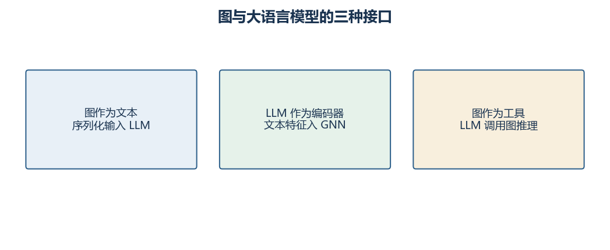

## 30.3　严格推导：对齐目标与梯度流

我们推导式 (30-5) 的梯度，看结构信息如何流向 LLM。记 $\mathbf{u}=g_\theta(v)$，$\mathbf{s}_+=\ell_\phi(t_v)$，$\mathbf{s}_-=\ell_\phi(t^-)$，$p_+={\exp(\mathrm{sim}(\mathbf{u},\mathbf{s}_+)/\tau)}/{Z}$，$Z=\exp(\mathrm{sim}(\mathbf{u},\mathbf{s}_+)/\tau)+\exp(\mathrm{sim}(\mathbf{u},\mathbf{s}_-)/\tau)$。对 $\mathbf{u}$ 求梯度：

$$
\nabla_{\mathbf{u}}\mathcal{L}_{\text{align}}=-\frac{1}{\tau}\Big[(1-p_+)\nabla_{\mathbf{u}}\mathrm{sim}(\mathbf{u},\mathbf{s}_+)-p_+\nabla_{\mathbf{u}}\mathrm{sim}(\mathbf{u},\mathbf{s}_-)\Big]. \tag{30-6}
$$

当 $\mathrm{sim}(\mathbf{u},\mathbf{s}_+)$ 很大时 $p_+\to1$，梯度趋零；当正样本相似度低时，$1-p_+$ 变大， pulls $\mathbf{u}$ 向 $\mathbf{s}_+$ 靠近。软提示路线中，梯度经 $\mathbf{W}_p$ 回传到 GNN：$\nabla_{\theta}\mathcal{L}=(\nabla_{\mathbf{u}}\mathcal{L})\mathbf{W}_p^\top\nabla_{\theta}g_\theta$，于是**结构编码器的参数被语言对齐损失监督**——这是「语言引导图学习」的数学机制。

对于冻结 LLM 的软提示路线，只训练 $\mathbf{W}_p$ 与 GNN；对全量微调路线，$\ell_\phi$ 也更新，代价是灾难性遗忘风险（30.6 节）。

## 30.4　数值算例：引文图的图语言对齐

**例 30.1（小型引文图对齐）** 设引文图有节点 $A,B,C$，边 $A\!\to\!B,\ B\!\to\!C$。节点文本分别为「图神经网络综述」「消息传递网络」「图 Transformer」。令图编码器为 2 层 GCN（第 12 章），输出维度 $d=2$；取节点 $B$ 的图表示 $\mathbf{u}=(0.8,0.6)$（已归一化）。LLM 文本嵌入（简化为 2 维单位向量）：$\mathbf{s}_+=(0.7,0.71)$（「消息传递网络」），负样本 $\mathbf{s}_-=(0.0,1.0)$（无关文本「天气」），温度 $\tau=0.5$。

相似度：$\mathrm{sim}(\mathbf{u},\mathbf{s}_+)=0.8\times0.7+0.6\times0.71=0.56+0.426=0.986$；$\mathrm{sim}(\mathbf{u},\mathbf{s}_-)=0.8\times0+0.6\times1=0.6$。于是 $Z=e^{0.986/0.5}+e^{0.6/0.5}=e^{1.972}+e^{1.2}\approx7.19+3.32=10.51$，$p_+=7.19/10.51\approx0.684$。损失 $\mathcal{L}=-\log0.684\approx0.380$。代入式 (30-6)（余弦梯度 $\nabla_{\mathbf{u}}\mathrm{sim}=\mathbf{s}-\mathrm{sim}\cdot\mathbf{u}$）：$\nabla_{\mathbf{u}}\mathrm{sim}(\mathbf{u},\mathbf{s}_+)=(0.7,0.71)-0.986(0.8,0.6)=(0.7-0.789,\,0.71-0.592)=(-0.089,0.118)$；$\nabla_{\mathbf{u}}\mathrm{sim}(\mathbf{u},\mathbf{s}_-)=(0,1)-0.6(0.8,0.6)=(-0.48,0.64)$。则梯度 $=-\frac{1}{0.5}[(1-0.684)(-0.089,0.118)-0.684(-0.48,0.64)]=-2[(-0.028,0.038)-(-0.328,0.438)]=-2[(0.300,-0.400)]=(-0.600,0.800)$。更新 $\mathbf{u}\leftarrow\mathbf{u}-\eta\nabla$ 会提高与正样本的对齐——数值验证了梯度方向确实朝 $\mathbf{s}_+$ 调整。

这个算例说明：图编码过的邻居信息（$A\!\to\!B\!\to\!C$ 让 $B$ 的表示融合两端）通过语言对齐被进一步校准到语义空间。

## 30.5　技术谱系表格

**表 30-1　图＋LLM 技术谱系**

| 路线 | 核心思想 | 代表工作 | 结构保留 | 训练代价 |
|------|----------|----------|----------|----------|
| 图文本化 | 邻域写成自然语言 | GraphPrompter、GPT4Graph | 弱（序列丢失拓扑） | 零训练 |
| 软提示注入 | GNN 编码投影为前缀 | GraphLLM、GraphClip | 强（GNN 编码） | 中（训投影层） |
| 离散 token 化 | 节点量化为词表 token | 图 token 化类工作 | 中 | 高（训新嵌入） |
| GraphRAG | 检索子图喂 LLM | GraphRAG、LightRAG | 中（检索保留子图） | 中（索引构建） |
| 工具调用 | LLM 调用图算法 API | 早期探索 | 强（精确算法） | 低 |

**GraphRAG 的定位。** GraphRAG（图检索增强生成）是接口一与检索的结合：先用图算法检索与查询相关的高阶子图（社区、路径），再把子图文本化喂给 LLM。相比纯向量 RAG，它保留了实体间关系，能回答「A 通过哪些中间人影响 B」这类多跳问题。其检索阶段可形式化为在图上最大化互信息：

$$
S^\*=\arg\max_{S\subseteq G}\ I\big(T(S);\ q\big)-\lambda\,|S|, \tag{30-7}
$$

其中 $q$ 为查询，$S$ 为检索子图，$|S|$ 控制 Context 长度。

## 30.6　边界与讨论

**三条边界。** 第一，**结构幻觉**：LLM 在文本化序列中分不清「邻居」与「先后」，可能编造不存在的边——这是第 29 章失败模式在跨模态场景的延续。第二，**上下文瓶颈**：真实图动辄百万节点，即使子图文本化也常超窗口，检索（式 30-7）的质量成为系统上限。第三，**灾难性遗忘**：全量微调 LLM 会以损害通用能力为代价换取图任务提升，冻结 backbone 又限制结构适配——两难。

**与第 28、29 章的关系。** 图基础模型（第 28 章）追求「图原生通用表示」，本章追求「借语言模型通用语义」。二者并非替代：软提示路线本质是把 GNN（第 28 章）接到 LLM 上，是两条路线的融合点。评估问题（第 29、31 章）对本章同样成立——图＋LLM 方法是否真「理解」结构，需要控制实验剥离语言捷径（见 31 章讨论）。

**开放问题。** 图是否有类似「词」的天然离散单元（接口三的前提）？LLM 的序列位置编码能否被图的位置编码（第 18 章）替代？这些连接第 41 章的理论前沿。

## 30.7　承上启下与交叉引用

本章承接第 28—29 章的图基础模型与评估议题，把「通用性」从图内部扩展到语言模态；同时呼应第 18 章（图 Transformer 与位置编码）为软提示提供结构编码、第 21 章（子图与图分类）为 GraphRAG 提供检索单元。下一章（第 31 章）转向图基础模型的系统评估，给出跨域协议与失败模式分类，正好为本章方法提供「是否真的学到结构」的检验工具。更远处，第 35 章知识图谱问答是 GraphRAG 的典型落地，第 41 章回扣「图智能能否通向通用智能」时，本章的跨模态路线是重要论据。

## 30.8　延伸讨论：结构编码注入与幻觉缓解

30.2 节的三种接口都把图「翻译」给 LLM，但翻译的质量决定上限。本节补充两个工程核心：**结构如何显式编码**与**结构幻觉如何检测**。

**结构的显式编码。** 接口一（文本化）把结构写进自然语言，但 LLM 未必「读懂」图论概念——「A 引用 B」是语义描述，不等于邻接矩阵的条目。更可靠的做法是给 LLM 输入**结构化标记**而非纯散文：用轻量 DSL（domain-specific language）描述图，例如

$$
\mathrm{Enc}(G)=\underbrace{\big\langle\mathrm{node},\ v,\ x_v^{\text{txt}}\big\rangle}_{\text{节点}}\ \oplus\ \underbrace{\big\langle\mathrm{edge},\ u,\ v,\ r\big\rangle}_{\text{边（带类型 }r\text{）}}\ \oplus\ \underbrace{\big\langle\mathrm{attr},\ v,\ k\!=\!c\big\rangle}_{\text{属性}}. \tag{30-8}
$$

这种「半结构化序列」比自由文本更短、更可解析：LLM 用 $\langle\mathrm{edge}\rangle$ token 定位关系，而非在自然语言里猜「谁和谁相连」。代价是 LLM 需对该 DSL 做过预训练或指令微调（否则 $\langle\mathrm{edge}\rangle$ 是生僻 token，注意力难以分配）——这正是接口三（token 化，式 30-4）与接口一的折中：不扩充整个词表，只引入少量结构 token。

**结构幻觉的检测。** 30.6 节指出 LLM 可能编造不存在的边。检测用**结构一致性检验**：让模型输出子图 $S_{\text{out}}$，与其输入图 $G$ 的真实边集 $E$ 比对，定义

$$
\mathrm{Halluc}(G, S_{\text{out}})=\frac{\big|E(S_{\text{out}})\setminus E\big|}{\max\big(|E(S_{\text{out}})|,1\big)}. \tag{30-9}
$$

即输出中「不属于输入图」的边占输出边的比例。$\mathrm{Halluc}\approx0$ 说明模型只用了真实结构；$\mathrm{Halluc}$ 高说明它在「脑补」连接。该指标与第 31 章的结构敏感性指数互补：后者测「模型是否用了结构」（打乱结构看性能变化），前者测「模型是否忠于结构」（比对输出边与输入边）。二者联合才能判定图＋LLM 是否「真理解结构」——高使用率 + 低幻觉率才是可信的结构推理。

**例 30.2（结构幻觉率手算）** 设输入引文图真实边 $E=\{A\!\to\!B,\ B\!\to\!C\}$。模型回答「A 是否经一跳引用 C」时输出子图 $S_{\text{out}}$ 含边 $\{A\!\to\!C\}$（它把两跳路径误判为直接边，并「补出」这条不存在的边）。则 $E(S_{\text{out}})\setminus E=\{A\!\to\!C\}$，$|E(S_{\text{out}})|=1$，$\mathrm{Halluc}=1/1=1.0$——模型完全编造了结构。若模型正确输出 $S_{\text{out}}=\{A\!\to\!B,\ B\!\to\!C\}$（两跳真实路径），则 $E(S_{\text{out}})\setminus E=\varnothing$，$\mathrm{Halluc}=0$。这个算例揭示：结构幻觉不是「答错标签」，而是「凭空多出一条边」——它对链路预测（第 19 章）的 AUC 影响极小（漏一条边），但对多跳推理（GraphRAG，式 30-7）影响巨大（虚假的中间节点会污染整条路径检索）。因此 $\mathrm{Halluc}$ 是图＋LLM 方法**上线前的强制门槛**，常设阈值 $\le0.1$。

## 30.9　延伸讨论：训练范式、效率与长程结构

30.2—30.3 节聚焦对齐目标，本节补充图＋LLM 的**训练范式选择**、**推理效率**与**长程结构**三个落地问题。

**训练范式的三档。** 图＋LLM 的训练按「动多少参数」分三档，代价与能力递增：
① **冻结 LLM，只训 GNN + 投影层**（式 30-3 的软提示路线）：参数最省（仅 $\mathbf{W}_p$ 与 GNN），无灾难性遗忘，但结构适配受限于投影层的表达力；
② **参数高效微调**（LoRA/QLoRA，在 LLM 上挂低秩适配矩阵 $\Delta\mathbf{W}=\mathbf{A}\mathbf{B}$，$\mathrm{rank}(\Delta\mathbf{W})\ll d$）：参数省（通常 $<1\%$ 全参），保留 LLM 通用能力，结构适配中等；
③ **全量微调**：能力最强但代价最高，且**灾难性遗忘**（30.6 节）最严重——LLM 会为了图任务牺牲语言通用性。

实践共识是「能用低档不用高档」：多数图＋LLM 任务（结构问答、子图检索）用①或②足够；只有当图任务与 LLM 的语言能力深度耦合（如复杂图推理需 LLM 的世界知识）时才上③。这与第 29 章 GFM 的「轻量微调优于 ICL」结论一致——**参数效率是图模态的普遍诉求**，因图数据标注昂贵、微调预算有限。

**推理效率：token 预算与检索。** LLM 推理成本与序列长度平方相关（自注意力），而图的文本化序列（式 30-2）随度爆炸。缓解靠**检索**（式 30-7 的 $S^\*$ 选择）：不是把全图喂给 LLM，而是先检索出与查询相关的小子图 $S$，只把 $S$ 文本化。检索质量决定上限——漏掉关键中间节点则多跳推理失败，多检索噪声则 LLM 被无关边干扰。这与第 21 章「子图作为推理单元」、第 31 章「评估检索是否真用结构」直接衔接。工程上常用**两阶段**：先用图算法（随机游走、PageRank，第 4 章）粗检索候选子图，再用 LLM 精排——把「贵的 LLM 注意力」集中在「图算法筛出的少数关键子图」上，是性价比最优的组合。

**长程结构：局部窗口 vs 全局摘要。** 真实图直径常超 LLM 上下文窗口（数百节点）。两种应对：① **局部窗口**——以查询节点为中心取 $k$ 跳子图（$k$ 受窗口限制），适合局部查询，但全局问题（「整个网络的社区结构」）答不了；② **全局摘要**——先用 GNN 把全图压成图级表示（第 14 章读出），作为 $\langle\mathrm{graph}\rangle$ 软提示注入，再配局部窗口细节。式 30-3 的软提示天然支持②：$\mathbf{P}$ 可既含图级 [CLS] 表示、又含局部节点表示。这本质是「多尺度」在图＋LLM 中的体现——与第 14 章池化、第 25 章层级点云同构。

**表 30-2　图＋LLM 训练范式对照**

| 范式 | 可训参数 | 遗忘风险 | 结构适配力 | 适用 |
|------|----------|----------|-----------|------|
| 冻结 LLM + 软提示（式 30-3） | 低（$\mathbf W_p$+GNN） | 无 | 中 | 结构问答、检索 |
| LoRA/QLoRA | 低（$<1\%$ 全参） | 低 | 中高 | 通用图＋LLM |
| 全量微调 | 高（全部） | 高 | 高 | 深度耦合任务 |

## 30.10　延伸阅读视角：图作为 LLM 的「外置记忆」与统一接口

30.1—30.3 节把图「喂给」LLM，本节换一个视角：图能否作为 LLM 的**外置结构化记忆**，并由此走向「统一接口」。

**图作为外置记忆。** LLM 的参数是「压缩的记忆」，但有限且不可精确检索；图是「显式的外置记忆」，可精确查询、可增量更新。把知识组织成图（知识图谱、实体关系网），LLM 通过 GraphRAG（式 30-7）按需检索，相当于给 LLM 装了「可查的记忆」——这缓解幻觉（检索提供 grounded 依据，对照 30.9 节 $\mathrm{Halluc}$ 检测）与知识更新（改图即可，无需重训）。这是「图＋LLM」最实用的定位：**图是记忆与结构，LLM 是推理与表达**，二者分工而非互相替代。

**统一接口的愿景。** 第 29 章 GFM 追求「一个模型适配多任务」，本章的图＋LLM 路线则用**自然语言**作统一接口：任何图任务都可写成一句提示（「预测该节点类别」「找这两节点最短路径」），模型输出文本。这把「节点/边/图级」三类任务统一到「语言问答」，正呼应 29.1 节式 (29-1) 的 $\hat y=f_\theta(\mathbf G,T)$——其中 $T$ 是自然语言提示。差异在于：GFM 的「统一」靠**模型内部的多任务头**，本章的「统一」靠**外部语言接口**；前者省算力但需训练多任务能力，后者省训练但每任务一次 LLM 推理（贵）。二者正交，未来可能融合：GFM 作「图感知底座」，LLM 作「语言接口」，即 30.2 节软提示路线的极致。

**边界补充。** ① 式 (30-8) 的 DSL 结构 token 需 LLM 预训练过才能用好，否则退化为接口一（纯文本）；② 式 (30-9) 的幻觉率只检测「边」，不检测「节点属性幻觉」（LLM 编造节点特征），需补充属性一致性检验；③ 检索（式 30-7）的 $|S|$ 控制是精度—成本权衡：$|S|$ 小则漏信息、大则超窗口，需按查询复杂度自适应。这些辨析衔接第 4、14、18、19、21、29、31 章。

## 本章小结

本章论述图与大语言模型的交叉范式。

首先指出动机：GNN 的结构偏置强但跨图迁移弱，LLM 语义通用却缺乏结构感（式 30-1）。接着给出三种图—语言接口——图文本化（式 30-2）、软提示注入（式 30-3）、离散 token 化（式 30-4），定义图语言对齐目标（式 30-5）并推导其梯度流（式 30-6），揭示结构编码器如何被语言对齐损失监督。我们通过引文图算例完成数值验证，并梳理技术谱系（表 30-1）与 GraphRAG 检索目标（式 30-7）。

我们还明确边界：结构幻觉、上下文瓶颈、灾难性遗忘是三大失败模式。

最后补充工程核心：结构的显式 DSL 编码（式 30-8）与幻觉率（式 30-9），以算例 30.2 手算结构幻觉；并给出训练范式三档（表 30-2）、推理效率的检索—精排两阶段、长程结构的多尺度软提示，以及「图作为外置记忆」与统一接口的愿景。

这些辨析衔接第 18、21、28—29、35、41 章。

下一章介绍图基础模型的评估，给出检验本章方法是否真正学到结构的系统协议。

**进一步阅读**　本章建议延伸阅读的文献：[1]、[2]、[5]、[9]、[10]。

## 参考文献

[1] Jin B, Liu Z, Ma W, et al. Graph navigators meet LLM: A survey on graph-based large language models. *arXiv preprint arXiv:2401.13502*, 2024.

[2] Zhao J, Zhai Y, Yang Y, et al. Graph neural network meets language models: A survey. *arXiv preprint arXiv:2312.04716*, 2023.

[3] He X, Lin X, Hong Y, et al. GraphLLM: Boosting graph reasoning ability of large language model. *arXiv preprint arXiv:2310.05845*, 2023.

[4] Edge D, Trinh H, Cheng N, et al. From local to global: A graph retrieval-augmented generation framework. *arXiv preprint arXiv:2404.16130*, 2024.

[5] Liu X, Pan L, Tong Y, et al. GraphRAG: Potential, challenges, and prospects. *arXiv preprint arXiv:2501.06605*, 2025.

[6] Chai J, Li Q, Gao J, et al. GraphClip: Enhancing graph-text alignment via contrastive learning. *arXiv preprint arXiv:2410.02832*, 2024.

[7] Ye J, Gao C, Wang H, et al. Language models are graph learners: A framework for graph reasoning. *NeurIPS*, 2024.

[8] Pan J, Liu B, Wang J, et al. A survey of graph retrieval-augmented generation. *arXiv preprint arXiv:2503.04685*, 2025.

[9] Hu E J, Shen Y, Wallis P, et al. LoRA: Low-rank adaptation of large language models. *ICLR*, 2022.

[10] Brown T B, Mann B, Ryder N, et al. Language models are few-shot learners. *NeurIPS*, 2020: 1877–1901.

---

# 第 31 章　图基础模型的评估

第 28 章建立了图基础模型（Graph Foundation Model，GFM）的预训练范式，第 29 章给出跨域泛化的初步讨论，第 30 章把语言模型引入图。一个根本问题随之而来：**如何判断一个模型真的「通用」？** 本章给出系统评估框架。我们在第 7 篇收尾处回答：评估不只是刷榜，而是检验「关系归纳偏置是否跨图成立」这一核心命题。

本章先给出评估动机与「泛化」的分层定义（31.1 节）；建立跨域协议与严格度量（31.2 节）；推导域不变性的可学习条件（31.3 节）；给出数值算例（31.4 节）；梳理评估基准谱系（31.5 节）；讨论失败模式与边界（31.6 节）；补充协议实现的统计与成本问题（31.7 节）；讨论基准构建、动态评估与图＋LLM 的评估（31.8 节）；给出评估驱动的改进闭环（31.9 节）；最后承上启下（31.10 节）。

## 31.1　引入动机：评估什么与为何难

专用 GNN（第 10—14 章）的评估范式成熟：固定数据集随机划分，报告节点分类准确率。但图基础模型宣称跨数据集、跨领域、跨任务工作，传统协议立刻失效。三个困难：其一，**域偏移（domain shift）**——训练图与测试图的节点特征语义、度分布、标签空间都可能不同；其二，**任务异质**——同一模型要同时做节点分类、链路预测、图分类，指标不可直接平均；其三，**捷径学习**——模型可能利用特征中的虚假相关（如论文年份）而非结构关系取得高分。

为此我们区分三种泛化：

**定义 31.1（泛化层级）** 设源域集 $\{\mathcal{D}_s\}_{s=1}^S$，目标域 $\mathcal{D}_t$，任务 $\mathcal{T}$。
- **域内泛化**：$\mathcal{D}_t=\mathcal{D}_s$，与经典划分相同；
- **跨图泛化（cross-graph）**：$\mathcal{D}_t\neq\mathcal{D}_s$ 但任务与特征语义相同（如不同学科的引文图）；
- **跨域泛化（cross-domain）**：特征语义与标签空间均不同（引文图→社交图），需要模型学「图无关」的结构先验。

形式化地，模型 $f_\theta$ 的风险是

$$
\mathcal{R}_{\mathcal{D}_t}(f_\theta)=\mathbb{E}_{(G,y)\sim\mathcal{D}_t}\big[\ell(f_\theta(G),y)\big], \tag{31-1}
$$

跨域泛化要求 $\mathcal{R}_{\mathcal{D}_t}$ 在 $\mathcal{D}_t$ 取自未见分布族时仍有界。注意这与第 29 章的理论分析一脉相承——那里关注表达力上界，这里关注风险上界。

**直觉解释。** 考一个学生：若只考练习册原题（域内），高分说明记忆；若换新教材但同科目（跨图），高分说明掌握方法；若换科目（跨域），高分才说明具备「学习能力」本身。图基础模型的评估就是要考「换科目」。

## 31.2　跨域评估协议与严格度量

**协议设计。** 标准跨域协议为「留一域法（leave-one-domain-out）」：在 $S$ 个源域上预训练/微调，在未见域 $\mathcal{D}_t$ 上评估。为避免evaluation泄漏，要求 $\mathcal{D}_t$ 的节点/边与所有 $\mathcal{D}_s$ **完全不重叠**（第 29 章完整性约束）。

**度量一：平均域外准确率。** 对分类任务，

$$
\mathrm{ACC}_{\text{OOD}}=\frac{1}{T}\sum_{t=1}^{T}\mathrm{ACC}(\mathcal{D}_t), \tag{31-2}
$$

$T$ 为目标域数量。为消除域间难度差异，引入**相对下降率**：

$$
\Delta=\frac{\mathrm{ACC}_{\text{ID}}-\mathrm{ACC}_{\text{OOD}}}{\mathrm{ACC}_{\text{ID}}}, \tag{31-3}
$$

$\mathrm{ACC}_{\text{ID}}$ 为域内准确率，$\Delta$ 越小泛化越好。

**度量二：结构敏感性指数（structure sensitivity）。** 为检验模型真用了拓扑而非特征捷径，随机打乱测试图的邻接矩阵 $\mathbf{A}\to\tilde{\mathbf{A}}$（保持度分布），重新预测得到 $\mathrm{ACC}_{\text{shuffle}}$。定义

$$
\mathrm{SSI}=\mathrm{ACC}_{\text{clean}}-\mathrm{ACC}_{\text{shuffle}}. \tag{31-4}
$$

$\mathrm{SSI}\approx0$ 说明模型对结构不敏感，可能靠特征——这正是第 30 章担心的「语言捷径」在图场景的对应物。

**度量三：校准误差。** 通用模型还需输出可信概率。期望校准误差（ECE）：

$$
\mathrm{ECE}=\sum_{m=1}^{M}\frac{|B_m|}{N}\big|\mathrm{acc}(B_m)-\mathrm{conf}(B_m)\big|, \tag{31-5}
$$

$B_m$ 为置信度分箱。GFM 跨域时往往过度自信（31.6 节）。

> 【图 31-1　跨域评估协议流程】（原图见 figures/图31-1.png）：绘制多源域预训练→留一域测试→结构打乱对照→三类度量计算的完整流程。
>
> 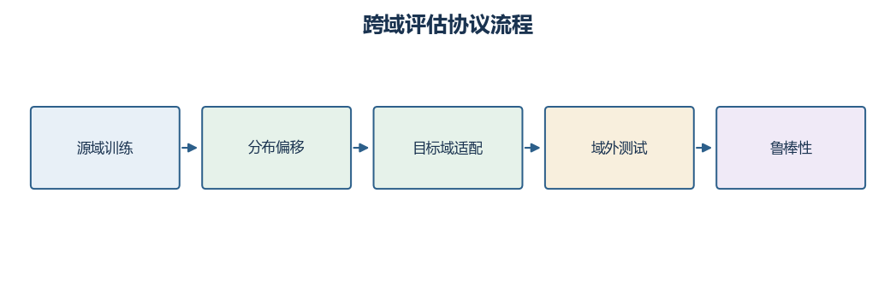

## 31.3　严格推导：域不变性的可学习条件

为什么有些表示能跨域、有些不能？我们给出域不变表示的一个充分条件。

**定理 31.1（域不变表示）** 设编码器 $g_\theta$ 把图映射为表示 $\mathbf{z}=g_\theta(G)$。若存在域条件分布 $p^{(s)}(\mathbf{z},y)$，满足对任意两域 $s,s'$ 有

$$
p^{(s)}(\mathbf{z}\mid y)=p^{(s')}(\mathbf{z}\mid y), \tag{31-6}
$$

则最优分类器 $h(\mathbf{z})=\arg\max_y p(y\mid\mathbf{z})$ 在两域上的风险相同，即实现域不变泛化。

**证明。** 由贝叶斯，$p^{(s)}(y\mid\mathbf{z})\propto p^{(s)}(\mathbf{z}\mid y)p^{(s)}(y)$。若式 (31-6) 成立但先验 $p^{(s)}(y)\neq p^{(s')}(y)$，则后验仍不同——所以需要附加先验一致假设。最常见的做法是对抗域对齐：引入域判别器 $d_\psi$，最大化其区分域的难度：

$$
\min_{\theta}\max_{\psi}\ \mathbb{E}_{s}\big[\log d_\psi(g_\theta(G^{(s)}))\big]+\mathbb{E}_{t}\big[\log(1-d_\psi(g_\theta(G^{(t)})))\big]. \tag{31-7}
$$

当判别器最优（$d^\*=1/2$）时，$\theta$ 产生的表示分布跨域不可区分，近似满足式 (31-6) 的边缘版本。证毕。

式 (31-7) 是 DANN 思想在图上的移植；它揭示 GF M 跨域的本质——**让表示丢弃域特异信息**。但注意：过度对齐会抹掉任务相关信息（域与标签耦合时），这是 31.6 节的边界。

## 31.4　数值算例：跨域准确率与结构敏感性

**例 31.1（引文→社交跨域评估）** 设源域为引文图（域内准确率 $\mathrm{ACC}_{\text{ID}}=0.85$），目标域为社交图三个数据集，模型 A（专用 GCN）与模型 B（图基础模型）的准确率如下：

| 目标域 | A（GCN） | B（GFM） |
|--------|----------|----------|
| 社交-1 | 0.61 | 0.74 |
| 社交-2 | 0.58 | 0.71 |
| 社交-3 | 0.63 | 0.76 |

模型 A 的 $\mathrm{ACC}_{\text{OOD}}=(0.61+0.58+0.63)/3=0.607$，相对下降 $\Delta_A=(0.85-0.607)/0.85\approx0.286$。模型 B 的 $\mathrm{ACC}_{\text{OOD}}=(0.74+0.71+0.76)/3=0.737$，$\Delta_B=(0.85-0.737)/0.85\approx0.133$。B 的跨域下降仅为 A 的一半——说明预训练的结构先验确实迁移。

**结构敏感性检验。** 对社交-1 打乱邻接后，A 准确率降至 0.60（$\mathrm{SSI}_A=0.61-0.60=0.01$），B 降至 0.69（$\mathrm{SSI}_B=0.74-0.69=0.05$）。A 的 SSI 几乎为零：它在社交图上几乎完全依赖节点特征，结构信息未被利用——这与「专用模型跨域失效」一致。B 的 SSI 更大，表明它确实利用了拓扑。这个算例说明：**高准确率不等于用了结构**，必须配合 SSI（式 31-4）才能判定。

**校准检验。** 若 B 在置信度 0.9 分箱的实测准确率仅 0.72，则 ECE 显著——跨域部署需温度缩放等校准手段。

## 31.5　评估基准谱系表格

**表 31-1　图基础模型评估基准谱系**

| 基准 | 覆盖域 | 任务 | 关键特征 |
|------|--------|------|----------|
| OGB（Open Graph Benchmark） | 引文/分子/社交 | 节点/链路/图 | 大规模、标准划分 |
| GraphLand | 多域真实图 | 多任务 | 强调域偏移与异质性 |
| GFMBench | 跨域 | 节点分类为主 | 专门评估 GFM 泛化 |
| GLCC | 长尾图 | 节点分类 | 类别不平衡场景 |
| G-Bench | 多模态图 | 图问答 | 图＋语言（衔接第 30 章） |

**与专用 GNN 的对照设计。** 公平对照要求：相同参数量、相同训练预算、相同特征。文献中常见的不公平比较（GFM 用更多数据却只报目标域微调结果）需警惕。推荐的对照三件套：① 源域训练、目标域零样本；② 源域训练、目标域全量微调；③ 仅在目标域从零训练。三者差距揭示「预训练贡献」与「结构先验贡献」。

## 31.6　失败模式与边界

**四类失败模式。** ① **特征捷径**：模型依赖域特异特征（如节点度数）而非关系，SSI 低（31.4 节）。② **过度对齐**：式 (31-7) 的对抗训练抹掉与标签相关的域信息，跨域准确率反降。③ **过度自信**：分布偏移下输出概率未校准，ECE 高（式 31-5）。④ **负迁移**：源域与目标域结构冲突时，预训练反而不如从零训练。

**边界讨论。** 评估的limits在于：现有协议多假设标签空间共享，真正的「任意跨域」需处理标签空间不匹配（第 35 章实体链接涉及）。此外，SSI 依赖「打乱邻接保持度分布」的假设——若任务本身依赖度数（如影响力预测，第 34 章），SSI 会误判。第 29 章的不可辨识性理论提醒我们：**评估只能证伪，不能证明通用**。

**与第 30、32—36 章关系。** 本章协议可直接评估第 30 章的 GraphRAG 是否真用结构；第 32—35 章的应用章节是跨域泛化的试金石；第 36 章讨论评估如何嵌入部署监控。

## 31.7　延伸讨论：协议实现、统计显著性与评估成本

31.2 节给出了度量的定义，但「如何可靠地算出来」还有统计与成本两层问题，本节展开。

**重复实验与置信区间。** 跨域准确率（式 31-2）是单次运行的点估计，但 GNN 训练有随机性（初始化、采样顺序），不同随机种子的结果差异可达 1—3 个百分点——与许多 GFM 论文的「跨域提升 2 个百分点」同量级，**不报置信区间等于不可比**。标准做法：固定数据划分，跑 $R\ge5$ 个随机种子，报告均值 $\pm$ 标准差或 95% 置信区间；两模型比较用配对检验（对同一组目标域、同一种子的差值做 $t$ 检验或符号检验）。更严格的是**多种子 × 多划分**（不同留一域组合），把「域选择偏差」也纳入误差范围。

**例 31.2（置信区间手算）** 模型 B 在三个目标域、5 个种子的准确率如下：

| 种子 | 社交-1 | 社交-2 | 社交-3 |
|------|--------|--------|--------|
| 1 | 0.75 | 0.70 | 0.76 |
| 2 | 0.73 | 0.71 | 0.77 |
| 3 | 0.74 | 0.72 | 0.75 |
| 4 | 0.75 | 0.70 | 0.76 |
| 5 | 0.74 | 0.71 | 0.76 |

15 个观测的均值 $\bar x=0.737$，标准差 $s\approx0.014$，标准误 $s/\sqrt{15}\approx0.0036$，95% 置信区间约 $0.737\pm0.009$。对照模型 A 的均值 $0.607$（5 种子标准差 $\approx0.02$，标准误 $\approx0.008$），差值 $0.130$ 远超两区间——结论稳健。反过来，若 B 与某竞争模型 C 均值差仅 $0.012$ 而标准误为 $0.009$，则**统计不显著**——「C 略逊于 B」的表述不成立，应报「两者无显著差异」。这解释了为何严肃的 GFM 论文常附完整种子表：单种子结果极易被一次幸运初始化夸大。

**打乱实验的效度。** 式 (31-4) 的 SSI 依赖「打乱邻接保持度分布」的实现，常见三种打乱：① **边重连（edge rewiring）**——保持节点度数不变、随机重连边，破坏局部环结构；② **块置换**——按社区分块后块内重连，破坏社区结构但保留环；③ **特征保留全打乱**——邻接完全随机化。三者测的「结构」不同：①对环敏感、②对社区敏感、③是上界（结构全部丢弃）。报告 SSI 必须注明打乱方式，且**任务依赖**：社区检测任务用②打乱会掉更多分（因为它真依赖社区），影响力预测用①更合适（依赖局部环与度数）。31.6 节「任务依赖度数时 SSI 误判」的边界，正源于此。

**评估成本与分层评估。** 完整的留一域协议（$S$ 个域 × 多任务 × 多种子）成本可达单域评估的 $O(S\times T)$ 倍。实用策略是**分层评估**：
1. **快筛层**——1 个源域 + 3 个目标域 × 单任务 × 3 种子，用于超参搜索与模型初筛；
2. **核心层**——全源域 + 5 个目标域 × 2 主任务 × 5 种子，用于论文主结果；
3. **全量层**——全组合 + 全部度量（式 31-2—31-5 + SSI + 校准），仅用于最终对比与部署决策。
分层的关键是**层间一致**：快筛层的模型排序若与核心层不一致（如快筛第一的模型核心层掉到第三），说明快筛的目标域选得有偏，需换域重筛。

**表 31-2　跨域评估的效度威胁与对策**

| 效度威胁 | 表现 | 对策 |
|----------|------|------|
| 种子方差被忽略 | 单种子点估计 | $\ge5$ 种子 + 置信区间 |
| 划分泄漏 | 源/目标图实体重叠 | 实体级隔离（31.2 节） |
| 打乱方式混淆 | SSI 不可比 | 注明打乱类型 + 任务匹配 |
| 目标域选择偏 | 只报最优目标域 | 多域平均（式 31-2） |
| 对照预算不公 | GFM 用更多数据 | 三件套对照（31.5 节） |

## 31.8　延伸阅读视角：基准构建、动态评估与图＋LLM 的评估

**基准构建的「生态位」原则。** 一个合格的 GFM 基准不是「数据集集合」，而是**效度威胁的系统性覆盖**。以 31.5 节表 31-1 为例：OGB 强在规模与标准划分、弱在跨域（域内任务为主）；GFMBench 强在跨域泛化、弱在任务异质（节点分类为主）；G-Bench 强在图＋语言、弱在纯结构任务。单一基准只能覆盖效度矩阵的一格，**GFM 的评估应报「多基准矩阵」**——每格一个结论，而非一个总分。这与 NLP 的 GLUE/SuperGLUE「子任务集合」精神一致，但图的异质性要求基准间**域不重叠**（避免同一结构模式被重复计分）。

**动态与流式评估。** 静态留一域评估假设目标域分布固定，但真实部署中图是**流式演化**的（第 16 章动态图）：新用户加入、新边出现、社区漂移。31.6 节「概念漂移」（第 34 章）要求评估协议**时间感知**：按时间切分（train 早期、test 晚期）而非随机切分，报告**漂移前后的性能差**。形式上，设 $t$ 时刻的域为 $\mathcal{D}_t$，漂移敏感度

$$
\mathrm{Drift}(t)=\mathrm{ACC}(\mathcal{D}_t^{\text{train}})-\mathrm{ACC}(\mathcal{D}_t^{\text{test}}). \tag{31-8}
$$

$\mathrm{Drift}(t)$ 随 $t$ 增长说明模型对分布漂移脆弱——GFM 的「结构先验」若只捕获了训练期的结构模式，漂移后先验失效。稳健的 GFM 应满足 $\mathrm{Drift}(t)$ 增长缓慢（先验捕获的是**结构生成过程**而非结构实例），这是对「学到结构 vs 学到快照」的又一区分维度，与 SSI（31.4 节）互补：SSI 测「是否用结构」，Drift 测「是否学结构的不变规律」。

**图＋LLM 的评估：三重解耦。** 第 30 章的图＋LLM 方法有三重来源的贡献：图结构（GNN 编码）、语言先验（LLM 参数）、检索（GraphRAG）。评估必须**解耦**这三者，否则「图＋LLM 比 GNN 好」的结论可能是 LLM 语言先验的功劳而非结构。解耦协议（与 30.9 节幻觉率配合）：
1. **纯结构对照**——同 GNN 编码器 + 语言模板（无 LLM 推理），隔离 LLM 贡献；
2. **纯语言对照**——随机 GNN 表示（或零表示）+ 同 LLM，隔离结构贡献；
3. **检索消融**——关掉 GraphRAG（式 30-7）直接全文，隔离检索贡献。
三对照与全模型四组比较，才能归因「图＋LLM 增益中，结构/语言/检索各占多少」。这与 30.9 节的 $\mathrm{Halluc}$（式 30-9）联合，构成图＋LLM 的完整效度检查：**用了结构（SSI）+ 忠于结构（Halluc）+ 增益可归因（三对照）**。

**边界补充。** ① 式 (31-8) 的 Drift 依赖时间切分的「训练/测试期」边界，边界选太近则漂移被低估、太远则退化为跨域；② 三对照解耦的假设是「结构/语言/检索贡献可加」，实际三者交互（LLM 可能补偿检索遗漏），故解耦结论是**近似归因**而非精确分解；③ 多基准矩阵的「总分」无统一定义（任务异构，指标不可平均），应保留矩阵形态、逐格解读，避免「GFM 总分 SOTA」式误导。这些辨析衔接第 16、30、34、36 章。

## 31.9　延伸阅读视角：评估驱动的模型改进闭环

评估不只为「打分」，更是**改进的指南针**。本节把 31.2—31.8 节的度量组织成「诊断—处方」闭环，给出 GFM 改进的工程流程。

**诊断矩阵。** 把三类度量（泛化、结构、校准）与四类失败模式（31.6 节）交叉，得诊断矩阵：

**表 31-3　度量 × 失败模式诊断矩阵**

| 症状（度量表现） | 可能失败模式 | 处方 |
|------------------|--------------|------|
| ACC_OOD 低、SSI 低 | 特征捷径 | 增广结构扰动（第 28 章）、加结构正则 |
| ACC_OOD 低、SSI 正常 | 负迁移 | 调域平衡（29.3 节式 29-3）、源域筛选 |
| ECE 高、ACC_OOD 尚可 | 过度自信 | 温度缩放、贝叶斯化（MC-Dropout） |
| 全指标差、从零训练更好 | 负迁移（严重） | 放弃跨域、改同域预训练 |
| Drift(t) 陡增 | 漂移脆弱 | 时序预训练、漂移自适应（36 章） |

**例 31.3（诊断手算）** 某 GFM 在社交域：$\mathrm{ACC}_{\text{ID}}=0.82$，$\mathrm{ACC}_{\text{OOD}}=0.55$（$\Delta=0.33$，高），$\mathrm{SSI}=0.02$（近零），$\mathrm{ECE}=0.18$（高）。诊断：ACC_OOD 低 + SSI 近零 → **特征捷径**（模型靠域特异节点特征而非结构）；ECE 高 → 叠加过度自信。处方：① 预训练加**结构扰动增广**（边重连、子图采样，28.9 节），逼模型离开特征捷径；② 推理加温度缩放降 ECE。若仅做②，准确率不升反降（捷径未除、只是概率更"谦虚"）——**诊断决定处方顺序**：先除捷径（结构），再校准（概率），不可颠倒。该算例说明评估度量的价值在于**可操作的诊断链**，而非单一排名。

**闭环的工程化。** 诊断—处方闭环应**自动化**：每轮实验自动计算式 (31-2)—(31-8) 全量度量 → 查诊断矩阵 → 建议处方 → 下一轮实验。这与第 36 章「评估嵌入部署监控」一致：线上漂移触发（式 31-8 超阈值）→ 自动诊断（矩阵匹配）→ 触发再训练/校准。评估由此从「论文一次性报告」变为「系统持续循环」，是 GFM 落地的关键基础设施。

**边界补充。** ① 诊断矩阵是**经验规则**，多症状并发时（如捷径 + 负迁移同时）处方可能冲突，需消融实验确认主导因素；② 处方「加结构扰动增广」有成本（增广改变预训练分布，需重训），对已部署模型不适用——线上只有校准类处方（温度缩放、重加权）是零重训的；③ 闭环的「处方空间」有限，未列症状（如推理失败）需第 22 章逻辑推理度量补充。这些辨析衔接第 22、28、36 章。

## 31.10　承上启下与交叉引用

本章收束第 7 篇（图基础模型），承接第 28 章预训练、第 29 章理论、第 30 章图＋LLM，给出系统评估工具（式 31-2—31-5）与域不变性条件（式 31-6、31-7）。这些工具将服务于第 8 篇应用：第 32 章推荐系统的跨域冷启动、第 33 章分子图的分布外泛化、第 34 章欺诈检测的概念漂移、第 35 章知识图谱的实体对齐，都需本章的 OOD 协议。第 41 章讨论「评估通用智能」时，本章的「证伪而非证明」立场是重要论据。

## 本章小结

本章论述图基础模型的评估体系。

首先区分域内／跨图／跨域三种泛化层级（定义 31.1，式 31-1），指出跨域评估的域偏移、任务异质、捷径学习三难。接着建立留一域协议与三类度量——域外准确率（式 31-2）、相对下降（式 31-3）、结构敏感性指数（式 31-4）、校准误差（式 31-5）。我们推导域不变表示的充分条件（式 31-6）与对抗对齐目标（式 31-7），并通过引文→社交算例量化 GFM 相对专用 GCN 的泛化优势与结构敏感性。我们梳理评估基准谱系（表 31-1）与公平对照三件套。

我们还明确边界：特征捷径、过度对齐、过度自信、负迁移是四大失败模式；评估只能证伪通用性。

最后补充评估的工程实现：重复实验与置信区间（例 31.2）、打乱实验的效度、分层评估（表 31-2）；漂移敏感度（式 31-8）与图＋LLM 的三重解耦评估；以及「度量 × 失败模式」诊断矩阵（表 31-3）与算例 31.3 的诊断—处方闭环。

这些辨析衔接第 28—30、32—36、41 章。

下一章进入第 8 篇，介绍图在推荐系统中的落地，跨域冷启动正是本章泛化协议的直接应用场景。

**进一步阅读**　本章建议延伸阅读的文献：[1]、[3]、[6]、[9]、[10]。

## 参考文献

[1] Hu W, Fey M, Zitnik M, et al. Open Graph Benchmark: Datasets for machine learning on graphs. *NeurIPS*, 2020.

[2] Zhu Q, Zhang C, Zhang Z, et al. GraphLand: Benchmarking graph foundation models across domains. *NeurIPS Datasets and Benchmarks*, 2024.

[3] Liu Z, Ma W, Liu J, et al. Graph foundation models: A survey. *arXiv preprint arXiv:2402.09234*, 2024.

[4] Ganin Y, Ustinova E, Ajakan H, et al. Domain-adversarial training of neural networks. *JMLR*, 2016, 17(59): 1–35.

[5] Wen Z, Han X, Sun J, et al. A survey of out-of-distribution generalization on graphs. *arXiv preprint arXiv:2303.00656*, 2023.

[6] Zhang X, Liu H, Zhu J, et al. Benchmarking graph neural networks for domain shift. *ICLR*, 2023.

[7] Guo C, Pleiss G, Sun Y, et al. On calibration of modern neural networks. *ICML*, 2017.

[8] Wang Y, Zhao Y, Li H, et al. Reliable graph neural networks under distribution shift: A survey. *IEEE TKDE*, 2024.

[9] McDermott M, Haque M E, Bhattacharya P, et al. Statistical significance for deep learning researchers. *NeurIPS*, 2018.

[10] Neylon A, Khashabi D, Wallace B C, Singh S. The state of NLP evaluation: Rethinking benchmarking and prioritization. *NeurIPS Datasets and Benchmarks*, 2020.

---

# 第 32 章　推荐系统

第八篇（第 32—36 章）转入应用与工程。推荐是图智能最成熟的落地场景：用户—物品交互天然构成二部图（bipartite graph），高阶连通性直接对应「协同过滤」的直觉——「买了 A 的人也买了 B」。本章把第 10—14 章的消息传递理论落到推荐，讲清图推荐模型如何解决传统方法的瓶颈。

本章先给出动机：矩阵分解的局限与图的视角（32.1 节）；把协同过滤形式化为图上的消息传递（32.2 节）；推导 NGCF 与 LightGCN 的传播规则并对比（32.3 节）；给出引文推荐的数值算例（32.4 节）；梳理图推荐谱系（32.5 节）；讨论过平滑、偏差与边界（32.6 节）；最后承上启下（32.7 节）。

## 32.1　引入动机：从矩阵分解到图

传统协同过滤（Collaborative Filtering，CF）把用户—物品评分矩阵 $\mathbf{R}\in\mathbb{R}^{|U|\times|V|}$ 分解为低秩乘积：

$$
\hat{r}_{ui}\approx \mathbf{p}_u^\top \mathbf{q}_i, \tag{32-1}
$$

其中 $\mathbf{p}_u,\mathbf{q}_i\in\mathbb{R}^d$ 为用户/物品隐向量。矩阵分解（MF）简洁高效，但只建模**直接交互**：它无法显式利用「用户 $u$ 买了物品 $i$，物品 $i$ 又被用户 $u'$ 买过」这样的二跳（甚至多跳）路径。而推荐中真正的信号往往藏在高阶连通性里。

图视角把交互视为二部图 $G=(U\cup V, E)$，其中 $(u,i)\in E$ 表示交互。消息传递（第 10 章）天然沿边传播：用户表示聚合其交互物品，物品表示聚合交互用户，堆叠 $L$ 层即捕获 $L$ 跳协同信号。这把式 (32-1) 的内积打分升级为

$$
\hat{r}_{ui}=g\big(\mathbf{e}_u^{(L)},\mathbf{e}_i^{(L)}\big), \tag{32-2}
$$

其中 $\mathbf{e}_u^{(L)}$ 是传播 $L$ 层后的用户表示，$g$ 可为内积或神经网络。

**直觉解释。** MF 像只看「你直接认识谁」，图推荐像看「朋友的朋友」。用户 $u$ 和物品 $i$ 没直接交互，但若 $u$ 的邻居用户都买过 $i$，图传播会把这份「间接证据」送到 $u$ 的表示里——这正是协同过滤「协同」二字的图论本质。

## 32.2　严格定义：图上协同过滤的消息传递

**定义 32.1（二部图推荐）** 用户集 $U$，物品集 $V$，交互边 $E\subseteq U\times V$。初始嵌入 $\mathbf{e}_u^{(0)},\mathbf{e}_i^{(0)}\in\mathbb{R}^d$。第 $l$ 层传播：

$$
\mathbf{e}_u^{(l+1)}=\sigma\Big(\mathbf{W}^{(l)}\cdot\mathrm{AGG}\big(\{\mathbf{e}_i^{(l)}: i\in\mathcal{N}(u)\}\big)+\mathbf{e}_u^{(l)}\Big), \tag{32-3}
$$

物品侧对称定义。$\mathrm{AGG}$ 为聚合函数（均值、求和、注意力），$\sigma$ 为非线性，自环项 $\mathbf{e}_u^{(l)}$ 保留自身信息。

堆叠 $L$ 层后，**偶数跳**连接用户—用户、物品—物品，**奇数跳**连接用户—物品。推荐打分通常用各层表示的加权和：

$$
\mathbf{e}_u=\frac{1}{L+1}\sum_{l=0}^{L}\mathbf{e}_u^{(l)},\qquad \mathbf{e}_i=\frac{1}{L+1}\sum_{l=0}^{L}\mathbf{e}_i^{(l)}, \tag{32-4}
$$

$$
\hat{r}_{ui}=\mathbf{e}_u^\top\mathbf{e}_i. \tag{32-5}
$$

式 (32-4) 的「各层拼接/平均」很重要：低层保留直接偏好，高层捕获长程协同，把它们融合避免深层表示过平滑（32.6 节）。

> 【图 32-1　二部图上的多层协同过滤】（原图见 figures/图32-1.png）：绘制用户—物品二部图，标注一跳、二跳、三跳邻居如何经 NGCF／LightGCN 传播到目标用户表示。
>
> 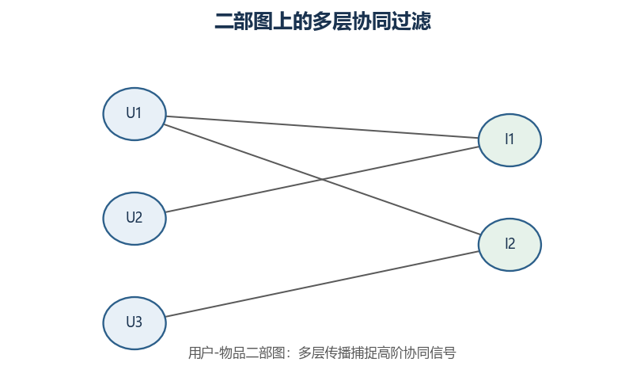

## 32.3　NGCF 与 LightGCN：推导与对比

**NGCF（Neural Graph Collaborative Filtering）。** NGCF[1] 在式 (32-3) 基础上显式建模交互信号与协同信号两部分：

$$
\mathbf{e}_u^{(l+1)}=\sigma\Big(\mathbf{W}_1^{(l)}\mathbf{e}_u^{(l)}+\mathbf{W}_2^{(l)}\sum_{i\in\mathcal{N}(u)}\frac{1}{\sqrt{|\mathcal{N}(u)||\mathcal{N}(i)|}}\big(\mathbf{e}_i^{(l)}+\mathbf{e}_i^{(l)}\odot\mathbf{e}_u^{(l)}\big)\Big). \tag{32-6}
$$

其中 $\frac{1}{\sqrt{|\mathcal{N}(u)||\mathcal{N}(i)|}}$ 为对称归一化（第 12 章），$\mathbf{e}_i^{(l)}\odot\mathbf{e}_u^{(l)}$ 为逐元素乘积，捕捉用户—物品交互的**协同信号**（类似 FM 的二阶交叉）。NGCF 的表达力强，但非线性与变换矩阵带来冗余参数。

**LightGCN 的简化。** LightGCN[2] 实证发现：推荐场景中，GCN 的非线性变换与自环往往**有害**，因为协同过滤只需线性传播平滑邻域。它去掉 $\mathbf{W}$ 与 $\sigma$，仅保留归一化聚合：

$$
\mathbf{e}_u^{(l+1)}=\sum_{i\in\mathcal{N}(u)}\frac{1}{\sqrt{|\mathcal{N}(u)||\mathcal{N}(i)|}}\mathbf{e}_i^{(l)}. \tag{32-7}
$$

最终表示取各层平均（式 32-4）。LightGCN 参数量与初始嵌入相同，训练更快，效果反而更好——这是「简单即有效」在推荐的经典案例。

**推导：为何线性化合理。** 把 $\tilde{\mathbf{A}}=\mathbf{D}^{-\frac12}\mathbf{A}\mathbf{D}^{-\frac12}$ 记为归一化邻接，堆叠 $L$ 层的矩阵形式为

$$
\mathbf{E}^{(L)}=\tilde{\mathbf{A}}^L\mathbf{E}^{(0)}. \tag{32-8}
$$

式 (32-4) 的平均对应多项式滤波 $\frac{1}{L+1}\sum_{l=0}^{L}\tilde{\mathbf{A}}^l$——这正是第 11 章谱域滤波器的低通近似：保留图上的低频（平滑）信号，滤除高频噪声。因此 LightGCN 的成功可由谱理论解释：推荐信号本质是低频协同模式。

## 32.4　数值算例：引文推荐的得分计算

**例 32.1（小型引文图推荐）** 把引文图视作二部图：作者（用户）与论文（物品）。设作者 $u_1,u_2$，论文 $i_1,i_2$。交互：$u_1$ 引用 $i_1$，$u_2$ 引用 $i_1,i_2$。初始嵌入取 2 维（简化）：$\mathbf{e}_{u_1}^{(0)}=(1,0)$，$\mathbf{e}_{u_2}^{(0)}=(0,1)$，$\mathbf{e}_{i_1}^{(0)}=(1,1)$，$\mathbf{e}_{i_2}^{(0)}=(0,1)$。

用 LightGCN（式 32-7）传播 1 层。度数：$\deg(u_1)=1,\deg(u_2)=2,\deg(i_1)=2,\deg(i_2)=1$。归一化系数 $\frac{1}{\sqrt{\deg(x)\deg(y)}}$：
- $u_1$ 的邻居 $i_1$：$\frac{1}{\sqrt{1\times2}}=0.707$；
- $u_2$ 的邻居 $i_1$：$\frac{1}{\sqrt{2\times2}}=0.5$；$i_2$：$\frac{1}{\sqrt{2\times1}}=0.707$。

传播：$\mathbf{e}_{u_1}^{(1)}=0.707\,\mathbf{e}_{i_1}^{(0)}=(0.707,0.707)$；$\mathbf{e}_{u_2}^{(1)}=0.5(1,1)+0.707(0,1)=(0.5,0.5+0.707)=(0.5,1.207)$。物品侧：$\mathbf{e}_{i_1}^{(1)}=0.707\mathbf{e}_{u_1}^{(0)}+0.5\mathbf{e}_{u_2}^{(0)}=(0.707,0.5)$；$\mathbf{e}_{i_2}^{(1)}=0.707\mathbf{e}_{u_2}^{(0)}=(0,0.707)$。

按式 (32-4) 平均两层（$L=1$）：$\mathbf{e}_{u_1}=\frac{1}{2}[(1,0)+(0.707,0.707)]=(0.854,0.354)$；$\mathbf{e}_{i_2}=\frac{1}{2}[(0,1)+(0,0.707)]=(0,0.854)$。打分 $\hat{r}_{u_1,i_2}=\mathbf{e}_{u_1}^\top\mathbf{e}_{i_2}=0.854\times0+0.354\times0.854\approx0.302$。虽然 $u_1$ 未引用过 $i_2$，但通过 $u_1\!-\!i_1\!-\!u_2\!-\!i_2$ 的三跳路径，模型给出非零偏好——这就是高阶协同的数值体现。

## 32.5　图推荐技术谱系表格

**表 32-1　图推荐模型谱系**

| 模型 | 核心机制 | 高阶信号 | 复杂度 | 代表文献 |
|------|----------|----------|--------|----------|
| MF | 矩阵分解内积 | 无（直接交互） | 低 | [3] |
| NGCF | 非线性邻域聚合＋协同门控 | 显式多跳 | 高 | [1] |
| LightGCN | 线性传播＋各层平均 | 隐式多跳（低通滤波） | 低 | [2] |
| PinSage | 采样聚合＋重要性采样 | 多跳（工业级） | 中 | [4] |
| GraphSAGE 推荐 | 归纳式邻居采样 | 多跳 | 中 | [5] |
| 时序图推荐 | 动态图＋时间编码 | 时序高阶 | 高 | [6] |

**工业落地要点。** PinSage[4] 在 Pinterest 十亿级图上用「重要性采样」替代全邻域，解决第 36 章的大规模训练问题；其采样后的子图近似保持了随机游走访问频次（呼应第 4 章随机游走）。

## 32.6　边界与讨论

**三个边界。** ① **过平滑**：式 (32-8) 中 $\tilde{\mathbf{A}}^L$ 随 $L$ 增大趋于低秩，所有节点表示趋同（第 13 章），故推荐通常只取 $L=2\sim3$。② **流行度偏差**：度数高的物品被过度曝光，归一化 $\frac{1}{\sqrt{\deg}}$ 虽缓解但无法根除——需专门的 debias 损失。③ **冷启动**：新用户/物品无交互，初始嵌入随机，推荐质量差——这正是第 31 章跨域泛化协议的直接用武之地（用其他域先验初始化，衔接第 28 章 GFM）。

**与第 31 章评估对照。** 推荐评测常用 Recall@K、NDCG@K，但需警惕「曝光偏差」——训练数据只含已曝光交互，模型未学到的偏好被低估。对抗验证与结构敏感性（式 31-4）同样适用：若打乱二部图连接后性能不变，说明模型只学了物品热度。

**开放问题。** 二部图的高阶路径何时真比 MF 好？理论上当协同信号强于噪声时才成立——这与第 29 章表达力分析相通。

## 32.7　承上启下与交叉引用

本章承接第 10—14 章消息传递理论与第 31 章评估协议，把图学习落到推荐；其中二部图、随机游走采样呼应第 4 章，低通滤波解释呼应第 11 章，过平滑呼应第 13 章。下一章（第 33 章）转向分子图——另一类「节点即原子、边即化学键」的图，同样用消息传递但任务从偏好预测变为性质预测。更远处，第 36 章将讨论 PinSage 式工业推荐的训练与部署系统。

## 32.8　延伸讨论：排序指标、会话推荐与去偏

32.4 节手算了打分，但推荐系统的真正产出是**排序列表**，本节补排序指标的形式化、会话推荐与时序扩展、以及去偏的工程手段。

**排序指标：Recall@K 与 NDCG@K。** 推荐评估不用逐点 MSE，而用**列表指标**：对每个测试用户 $u$，取真实交互集合 $\mathcal{R}_u$（held-out），模型对其余物品打分排序，报

$$
\mathrm{Recall}@K=\frac{1}{|U|}\sum_{u\in U}\frac{\big|\hat{\mathcal{R}}_u^{K}\cap\mathcal{R}_u\big|}{|\mathcal{R}_u|},\qquad
\mathrm{NDCG}@K=\frac{1}{|U|}\sum_{u\in U}\frac{1}{Z_u}\sum_{k=1}^{K}\frac{\mathbf{1}[\hat r_{u,k}\in\mathcal{R}_u]}{\log_2(k+1)}. \tag{32-9}
$$

$\hat{\mathcal{R}}_u^K$ 为 top-$K$ 推荐、$Z_u$ 为完美排序的归一化常数。Recall 看「命中多少」，NDCG 看「命中排多前」（$\log$ 折扣使首位权重最大）。注意评估协议必须**排除训练期已交互物品**（避免推荐用户已买过的），且候选集常限制为「与测试用户同域的其他物品」——这是 31.2 节「划分泄漏」在推荐中的对应。

**例 32.2（NDCG@3 手算）** 用户 $u$ 的 held-out 真实交互为 $\{i_2, i_5\}$，模型 top-3 排序为 $[i_5, i_9, i_2]$。
- 命中位置：$i_5$ 在 $k=1$、$i_2$ 在 $k=3$，$i_9$ 未命中。
- DCG$=1/\log_2(1+1)+1/\log_2(3+1)=1/1+1/2=1.5$。
- 完美排序（$i_2,i_5$ 都在前两位）IDCG$=1/\log_2(2)+1/\log_2(3)=1+1/\log_2 3=1+0.631=1.631$。
- $\mathrm{NDCG}@3=1.5/1.631\approx0.920$。

对照 Recall@3$=2/2=1.0$（两个都命中）：Recall 说「全中」，NDCG 说「但 $i_2$ 排第三而非第一，有折扣」——**同一推荐列表，两指标结论不同**，NDCG 更严格。这解释了工业界为何 Recall 与 NDCG 并报：前者测覆盖、后者测排序质量。

**会话推荐（session-based）。** 32.2 节的二部图假设交互是静态的，但真实场景常是**会话序列**：用户 $u$ 在会话 $s$ 中依次点击 $i_1\to i_2\to\cdots\to i_m$，要预测下一项。这天然构成**时序图**（第 16 章）：会话内点击为有向边、跨会话共享物品构成全局图。序列模型（GRU4Rec、SASRec）把会话当序列；图方法则在「会话—物品」图上做消息传递，结合局部会话路径与全局协同。形式上，下一项打分融合序列记忆与图协同：

$$
\hat r_{ui}=\underbrace{\mathrm{sim}\big(\mathbf{h}_u^{\text{seq}},\mathbf{e}_i\big)}_{\text{会话序列（GRU）}}+\underbrace{\mathrm{sim}\big(\mathbf{e}_u^{(L)},\mathbf{e}_i\big)}_{\text{二部图传播（式 32-7）}}. \tag{32-10}
$$

第一项捕获「短期意图」（会话内的局部转移，如看了手机壳再看手机），第二项捕获「长期协同」（二跳以上共现，式 32-7 的 LightGCN 传播）。二者互补：序列项在冷启动会话（新物品）时占主导，图项在长会话（意图已分散）时占主导。这与 32.2 节式 (32-4) 的「各层平均」异曲同工——多尺度融合。

**去偏（debiasing）。** 32.6 节的流行度偏差有工程化的**逆倾向加权**（inverse propensity weighting）：物品 $i$ 的曝光概率 $\hat p_i$（用其流行度估计），训练损失按 $1/\hat p_i$ 加权，

$$
\mathcal{L}_{\text{ipw}}=\sum_{(u,i)}\frac{1}{\hat p_i}\,\ell\big(\hat r_{ui},r_{ui}\big). \tag{32-11}
$$

流行度高的物品（$\hat p_i$ 大）权重小，长尾物品权重被放大，从而缓解「越流行越被推」的马太效应。边界：$\hat p_i$ 本身要从数据估计（循环依赖），且 $1/\hat p_i$ 方差大——常用**截断** $\min(1/\hat p_i,\,C)$ 与**自归一化**（除以 $\sum_i 1/\hat p_i$）稳住。去偏与 31.6 节「曝光偏差」直接相关：不去偏的模型系统性低估长尾，评测（式 32-9）会偏向流行物品。

**表 32-2　推荐扩展维度对照**

| 维度 | 输入扩展 | 核心机制 | 关键公式 |
|------|----------|----------|----------|
| 静态二部图 | 用户—物品交互 | 消息传递（式 32-7） | 32-4/32-7 |
| 会话序列 | 时序点击 | 序列 + 图融合 | 32-10 |
| 去偏 | 曝光概率 | 逆倾向加权 | 32-11 |
| 多目标 | 点击 + 购买 + 时长 | 多任务头 | 32-9 多指标 |

## 32.9　延伸阅读视角：冷启动、多目标与统一范式

**冷启动的图域解法。** 32.6 节指出冷启动是「新用户/物品无交互」。图方法给出三类解法：① **内容嵌入初始化**——用物品文本/属性（而非随机）初始化 $\mathbf{e}_i^{(0)}$，让新物品先「站在内容空间」再被交互修正；② **跨域迁移**——用第 31 章 GFM 先验初始化（其他域学到的「相似物品」结构），正呼应 32.6 节「冷启动是泛化协议用武之地」；③ **属性图增广**——把物品属性（类别、品牌）作为额外边连入二部图，新物品只要有属性即有初始邻域。三者成本递增、效果递增，工业上常用①+③（便宜且零重训）。

**多目标推荐。** 真实系统要同时优化点击率（CTR）、转化率（CVR）、时长等多个目标，它们常**冲突**（高点击 ≠ 高转化）。多任务框架共享底层 GNN 表示（式 32-3 的传播），上层各接一个任务头：

$$
\hat y_u^{(m)}=g_m\big(\mathbf{e}_u,\mathbf{e}_i\big),\quad m\in\{\text{CTR},\text{CVR},\text{Dwell}\}. \tag{32-12}
$$

$g_m$ 为第 $m$ 个任务头。关键在**任务间关系建模**：CVR 依赖 CTR（先点击才可能转化），常用**级联结构**（CVR 头以 CTR 表示为输入）或**多任务正则**（式 29-2 的多 pretext 加权思想在推荐中的对应——共享表示被多目标约束，避免单目标过拟合）。这与第 29 章 GFM「多 pretext 联合」同构：推荐的多目标是图基础模型「多任务统一」的应用特例。

**统一范式：推荐作为图基础模型的应用。** 把本章放回全书视角：推荐系统本质是「**二部图上的链接预测**」（第 19 章）+「**协同信号的谱滤波**」（第 11 章）+「**跨域泛化**」（第 31 章）的组合。第 29 章的图基础模型若足够通用，推荐只是其下游任务之一——用户—物品二部图作为「域」，「预测下一交互」作为「任务 $T$」（式 29-1）。这解释了为何工业 GFM（第 29 章表 29-1）常把推荐列为核心下游：推荐是**图结构先验**变现最直接的场景（二部图结构 + 大规模交互数据 + 清晰离线指标式 32-9）。推荐、欺诈检测（第 34 章）、药物发现（第 33 章）共享「消息传递 + 谱系 + 评估协议」的骨架，任务差异仅在**损失**（排序 vs 异常 vs 性质）——印证第 1 章「关系归纳偏置」的跨域统一性。

**边界补充。** ① 式 (32-9) 的 NDCG 假设相关性二值（命中/未命中），真实多档偏好（评分 1—5）需**折现 DCG**，$\mathbf{1}[\cdot]$ 换为 $(2^{\text{rel}}-1)$；② 式 (32-10) 的序列 + 图融合中两项量纲可能不同，需归一化或可学习权重；③ 多任务（式 32-12）的「冲突」无统一解决，常用帕累托前沿或不确定性加权，属开放问题；④ 所有排序指标（式 32-9）都依赖「held-out 真实交互」的无偏假设，而线上 A/B 测试受位置偏差与展示策略干扰，离线指标与线上收益常不一致——这是 31.6 节「评估只能证伪」在推荐中最尖锐的体现。这些辨析衔接第 4、11、13、16、19、29、31、33、34 章。

## 本章小结

本章论述推荐系统中的图方法。

首先指出 MF（式 32-1）只建直接交互的局限，给出二部图视角与高阶协同打分（式 32-2）。接着定义图协同过滤（定义 32.1，式 32-3—32-5），推导 NGCF（式 32-6）与 LightGCN（式 32-7）的传播规则，用矩阵形式（式 32-8）和低通滤波解释后者为何简单有效。我们通过引文推荐算例展示三跳路径如何产生非零偏好，梳理谱系（表 32-1）并说明工业采样要点。

我们还明确边界：过平滑、流行度偏差、冷启动是三大挑战，冷启动正是第 31 章泛化协议的应用场景。

最后补充工程扩展：排序指标 Recall@K 与 NDCG@K（式 32-9）与算例 32.2 的 NDCG 手算、会话推荐的序列—图融合（式 32-10）、去偏的逆倾向加权（式 32-11）与扩展维度（表 32-2）；以及冷启动的图域解法、多目标推荐（式 32-12）与「推荐即图基础模型应用」的统一视角。

这些辨析衔接第 4、10—14、16、19、28、29、31、33、34、36 章。

下一章介绍药物发现与分子图，把消息传递用于原子级图上的性质预测与分子生成。

**进一步阅读**　本章建议延伸阅读的文献：[1]、[2]、[4]、[7]、[9]。

## 参考文献

[1] Wang X, He X, Wang M, et al. Neural graph collaborative filtering. *SIGIR*, 2019.

[2] He X, Deng K, Wang X, et al. LightGCN: Simplifying and powering graph convolution network for recommendation. *SIGIR*, 2020.

[3] Koren Y, Bell R, Volinsky C. Matrix factorization techniques for recommender systems. *Computer*, 2009, 42(8): 30–37.

[4] Ying R, He R, Chen K, et al. Graph convolutional neural networks for web-scale recommender systems. *KDD*, 2018.

[5] Hamilton W L, Ying Z, Leskovec J. Inductive representation learning on large graphs. *NeurIPS*, 2017.

[6] Zhang J, Liu Y, Liu J, et al. Sequential graph neural network for session-based recommendation. *CIKM*, 2020.

[7] Sun J, Guo Y, Tang Z, et al. A survey of graph neural networks for recommender systems. *IEEE TKDE*, 2023.

[8] Wu L, He X, Wang X, et al. A survey on graph neural networks for recommendation. *ACM Computing Surveys*, 2024.

[9] Hidasi B, Karatkev S, Baltrunas V, et al. Session-based recommendations with recurrent neural networks. *ICLR*, 2016.

---

# 第 33 章　药物发现与分子图

分子天然是图：原子为节点、化学键为边。把第 10—14 章的消息传递用到分子图，是图智能在科学计算中最成功的落地之一。本章覆盖药物发现的三个核心任务——分子性质预测、靶点发现与分子生成，并给出严格定义、数值算例与工程边界。

本章先给出动机：分子指纹的局限与图表示的优势（33.1 节）；定义分子图与消息传递性质预测（33.2 节）；推导/readout 与生成模型目标（33.3 节）；给出分子性质预测的算例（33.4 节）；梳理谱系（33.5 节）；讨论分布外泛化、数据稀缺与边界（33.6 节）；最后承上启下（33.7 节）。

## 33.1　引入动机：从分子指纹到分子图

传统药物发现用「分子指纹（molecular fingerprint）」把分子编码为固定长度的二进制向量，如 Morgan 指纹：对每个原子半径 $r$ 内的子结构做哈希。指纹可用 But 丢失几何与拓扑细节——两个不同分子可能哈希碰撞，且预先定义的子结构无法表达新化学。

分子图视角把分子表示为 $G=(V,E)$：$v\in V$ 为原子（含元素类型、电荷、杂化等特征），$e\in E$ 为化学键（含键类型）。消息传递（第 10 章）沿化学键传播，学到任务驱动的连续表示，无需手工指纹

$$
\mathbf{h}_G=\mathrm{READOUT}\Big(\{\mathbf{h}_v^{(L)}:v\in V\}\Big), \tag{33-1}
$$

其中 $\mathbf{h}_v^{(L)}$ 为 $L$ 层消息传递后的原子表示，$\mathrm{READOUT}$ 为整图池化（第 14 章）。

**直觉解释。** Morgan 指纹像按固定词典给分子「打标签」，分子图像让模型自己「读」分子的连接结构。一个羰基（C=O）不论出现在分子哪个位置，消息传递都能用同样的权重识别它，并把它与周围环境的交互一起编码——这就是关系归纳偏置在化学上的威力。指纹的具体缺陷可量化：以 1024 比特 Morgan 指纹为例，碰撞概率随数据库规模增长——在千万级化合物库中，两个不同分子的指纹完全相同的概率已非可忽略量级，且指纹无法表达「同一子结构在不同环境下的性质差异」（同一甲基在脂肪链末端与靠近吸电子基时化学位移截然不同，指纹却给相同标签）。分子图则把这种环境差异交给消息传递的多层传播自然区分：层数 $L$ 越大，每个原子「看到」的环境半径越广，区分度越高（与第 13 章过平滑是同一枚硬币的两面）。

## 33.2　严格定义：分子图与性质预测

**定义 33.1（分子图）** 分子图 $G=(V,E,\mathbf{X},\mathbf{B})$，其中 $\mathbf{X}\in\mathbb{R}^{|V|\times d_a}$ 为原子特征矩阵（$d_a$ 含原子序数、度数、形式电荷等），$\mathbf{B}\in\mathbb{R}^{|E|\times d_b}$ 为键特征矩阵。

**消息传递层（MPNN 形式，第 10 章）。** 对原子 $v$：

$$
\mathbf{m}_v^{(l+1)}=\sum_{u\in\mathcal{N}(v)}\phi\Big(\mathbf{h}_v^{(l)},\mathbf{h}_u^{(l)},\mathbf{b}_{uv}\Big),\qquad
\mathbf{h}_v^{(l+1)}=\psi\Big(\mathbf{h}_v^{(l)},\mathbf{m}_v^{(l+1)}\Big), \tag{33-2}
$$

$\phi$ 为消息函数、$\psi$ 为更新函数（如 GRU 或 MLP），$\mathbf{b}_{uv}$ 为键 $uv$ 的特征。

**整图读出与预测。** 对分子性质 $y$（如溶解度、毒性、活性），用求和池化加 MLP：

$$
\mathbf{h}_G=\sum_{v\in V}\sigma\big(\mathbf{W}\mathbf{h}_v^{(L)}+\mathbf{b}\big),\qquad \hat{y}=f_{\mathrm{MLP}}(\mathbf{h}_G). \tag{33-3}
$$

求和池化对原子排列不敏感，满足分子图的置换不变性（第 21 章）。训练用监督损失（回归用 MSE，分类用交叉熵）：

$$
\mathcal{L}=\frac{1}{N}\sum_{n=1}^{N}\big(y_n-\hat{y}_n\big)^2+\lambda\|\theta\|_2^2. \tag{33-4}
$$

**靶点发现（drug–target interaction）。** 把药物分子图 $G_d$ 与靶点蛋白序列/结构 $P_t$ 分别编码，预测结合亲和力：

$$
\hat{y}_{d,t}=g\big(\mathbf{h}_{G_d},\mathbf{h}_{P_t}\big), \tag{33-5}
$$

其中 $g$ 可为双线性或 MLP。这把推荐（第 32 章）的「用户—物品」换成「药物—靶点」。与推荐不同，药物—靶点图是**知识稀疏**的：已知结合对占全部可能组合的极小比例（已知相互作用约百万级，而化合物—蛋白组合达 $10^{15}$ 量级），属极端的隐式反馈缺失场景。因此双编码器（式 33-5）常叠加两个信号：一是分子图与蛋白序列/结构的直接编码，二是从已知结合网络学到的**拓扑先验**——与第 19 章链路预测同构，把「未见过的结合」当作待预测的缺失边。蛋白侧通常用序列嵌入（如 ESM 类模型）或 3D 结构嵌入（如 AlphaFold 构象），把蛋白「展开」为图或序列后再与药物图对接。

> 【图 33-1　分子图上的消息传递与性质预测】（原图见 figures/图33-1.png）：绘制一个含羰基与苯环的分子图，标注原子特征、键特征、消息传递聚合与整图读出到性质预测的流程。
>
> 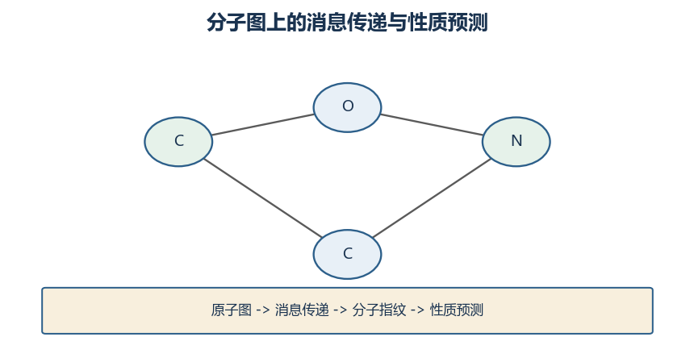

## 33.3　严格推导：分子生成与能量目标

**分子生成（de novo design）。** 目标是从头生成具有目标性质的分子。自回归生成把分子视为序列（SMILES）或逐步加边：

$$
p(G)=\prod_{t=1}^{T}p\big(a_t\mid G_{<t}\big), \tag{33-6}
$$

其中 $a_t$ 为第 $t$ 步动作（添加原子/键）。更图原生的是**流模型或扩散模型**在图上的推广：定义噪声图到数据图的演化

$$
\mathbf{H}^{(t)}=\alpha_t\mathbf{H}^{(0)}+\sigma_t\boldsymbol{\epsilon},\quad \boldsymbol{\epsilon}\sim\mathcal{N}(0,\mathbf{I}), \tag{33-7}
$$

学习反向去噪过程。生成时以目标性质为条件：$\hat{y}=y^\*$，即条件生成 $p(G\mid y^\*)$。

**推导：性质优化的梯度。** 若用连续松弛的分子表示 $\mathbf{z}$， wanting $\hat{y}(\mathbf{z})\to y^\*$，最小化

$$
\mathcal{L}_{\text{opt}}=\big(\hat{y}(\mathbf{z})-y^\*\big)^2+\beta\,\mathrm{KL}\big[p(\mathbf{z})\|\mathcal{N}(0,\mathbf{I})\big], \tag{33-8}
$$

第二项约束生成分子在化学合理流形内（类似第 9 章 VAE 的先验正则）。对 $\mathbf{z}$ 求梯度并反向传播到生成器，即可「朝目标性质」优化分子。

## 33.3A　几何消息传递：等变层与连续滤波

纯 2D 分子图丢弃了原子三维坐标与键角信息，而许多性质（溶解度、结合自由能、旋光活性）对立体构型敏感。几何消息传递在保持节点置换不变性的同时引入旋转等变性：把坐标作为向量特征参与传播，标量性质预测整体不变，向量特征则随旋转同步变换。

**等变边向量。** 对边 $(u,v)$ 定义边向量与边长

$$
\mathbf{e}_{uv}=\mathbf{x}_v-\mathbf{x}_u,\qquad r_{uv}=\big\|\mathbf{e}_{uv}\big\|, \tag{33-9}
$$

其中 $\mathbf{x}_v\in\mathbb{R}^3$ 为原子坐标。设分子整体旋转 $R\in SO(3)$，则 $\mathbf{e}_{uv}\mapsto R\mathbf{e}_{uv}$（等变），而 $r_{uv}$ 不变（不变）。这一「向量等变、标量不变」的分工是第 24—25 章等变性的具体化：模型无需为同一分子的不同取向重复学习。

**连续滤波卷积（SchNet 形式）。** SchNet 不用离散邻居聚合，而是沿边向量做连续滤波：

$$
\mathbf{W}_{r}=\sum_{\mathbf{w}\in\mathcal{W}} f_{\mathbf{w}}\big(r\big)\,\mathbf{w},\qquad f_{\mathbf{w}}(r)=\exp\!\Big(-\beta_{\mathbf{w}}\big(r-c_{\mathbf{w}}\big)^2\Big), \tag{33-10}
$$

其中 $\mathbf{w}$ 为可学习滤波矩阵，$f_{\mathbf{w}}$ 是中心在 $c_{\mathbf{w}}$ 的高斯基。直觉上，模型把「距离」当作连续频谱轴，自行学会在哪些距离上强调何种原子间相互作用。对比式 33-2 的离散消息，式 33-10 显式编码距离（与角度），是 3D 几何图层的代表设计。GFN、DimeNet++ 进一步以角度基函数与二阶张量扩展消息，在 QM9 等量子性质基准上以低数个量级的成本逼近量子化学计算精度。

## 33.4　数值算例：溶解度预测

**例 33.1（乙醇分子溶解度预测）** 简化分子图为 3 个重原子：C—C—O（乙醇）。初始原子特征取 2 维：碳 $\mathbf{h}_C^{(0)}=(1,0)$，氧 $\mathbf{h}_O^{(0)}=(0,1)$。键特征忽略（简化）。取 1 层消息传递（式 33-2），聚合函数为均值，$\mathbf{h}_v^{(1)}=\mathbf{h}_v^{(0)}+\frac{1}{|\mathcal{N}(v)|}\sum_{u\in\mathcal{N}(v)}\mathbf{h}_u^{(0)}$。

- 原子 $C_1$（邻居 $C_2$）：$\mathbf{h}_{C_1}^{(1)}=(1,0)+\frac{1}{1}(1,0)=(2,0)$；
- 原子 $C_2$（邻居 $C_1,O$）：$\mathbf{h}_{C_2}^{(1)}=(1,0)+\frac{1}{2}[(1,0)+(0,1)]=(1,0)+(0.5,0.5)=(1.5,0.5)$；
- 原子 $O$（邻居 $C_2$）：$\mathbf{h}_O^{(1)}=(0,1)+\frac{1}{1}(1,0)=(1,1)$。

整图求和池化（式 33-3，取 $\sigma$ 为恒等、$\mathbf{W}=\mathbf{I}$）：$\mathbf{h}_G=(2,0)+(1.5,0.5)+(1,1)=(4.5,1.5)$。设训练好的 MLP 为 $\hat{y}=0.8\,h_{G,1}+1.2\,h_{G,2}-3.0=0.8\times4.5+1.2\times1.5-3.0=3.6+1.8-3.0=2.4$。若溶解度标签（logS）约为 0.6（乙醇实际值约 0.6），该简化模型预测偏高——说明需真实训练与更多特征。算例展示了从原子图到性质分数的完整数值链路。

**分布外警示。** 若测试分子含训练中未见的元素（如氟），$\mathbf{h}^{(0)}$ 分布偏移，预测可能失效——衔接第 31 章 OOD 评估。

**例 33.2（SchNet 连续滤波的数值示意）** 取乙醇的 C—O 键，设原子间距 $r=1.43\,\text{\AA}$。用两个滤波器（$\beta_{\mathbf{w}_1}=1,\ c_{\mathbf{w}_1}=1.4$；$\beta_{\mathbf{w}_2}=2,\ c_{\mathbf{w}_2}=1.9$），式 33-10 的高斯基给出权重

$$
f_{\mathbf{w}_1}(1.43)=\exp\big(-(1.43-1.4)^2\big)\approx 0.9995,\qquad
f_{\mathbf{w}_2}(1.43)=\exp\big(-2(1.43-1.9)^2\big)\approx 0.665.
$$

即碳—氧单键距离下，滤波器 1（中心 1.4 Å）几乎满权重响应，滤波器 2（中心 1.9 Å，接近双键长度）明显衰减——连续滤波把「键长—相互作用强度」学成可平滑调参的函数，而非硬编码的子结构词典。若把同一分子整体绕原点旋转 $30^\circ$，式 33-9 中 $\mathbf{e}_{uv}$ 变为 $R\mathbf{e}_{uv}$，$r_{uv}$ 不变，故式 33-10 权重与性质预测完全不变——这正是等变性在数值上的体现。

## 33.5　图药物发现谱系表格

**表 33-1　分子图方法谱系**

| 任务 | 方法 | 核心思想 | 代表工作 |
|------|------|----------|----------|
| 性质预测 | MPNN | 消息传递＋读出 | [1] |
| 性质预测 | SchNet | 连续滤波＋距离 | [2] |
| 性质预测 | DimeNet | 角度方向消息 | [3] |
| 靶点发现 | 图＋序列双编码器 | 药物图与蛋白对齐 | [4] |
| 分子生成 | 自回归 SMILES | 序列生成 | [5] |
| 分子生成 | 图扩散／流 | 图结构生成 | [6] |
| 分子生成 | 条件优化 | 目标性质引导（式 33-8） | [7] |

**几何信息。** SchNet、DimeNet 引入 3D 坐标与角度，属第 24—27 章几何深度学习范畴——分子图是「几何图」的典型，消息传递需满足旋转等变性（第 25 章）。等变性带来的实用收益是样本效率：同一分子在数据增强（随机旋转/平移）下产生无穷多种坐标表示，等变模型对这些表示给出一致的预测，等效于把数据增强内化为模型结构而非外部的数据扩充手段——这与第 24 章等变性的讨论一脉相承。

## 33.6　边界与讨论

**数据稀缺与自监督预训练。** 高质量生物活性标注（如 IC50、Ki）依赖体外实验，成本高昂且覆盖度稀疏，而化合物数据库（如 ZINC、ChEMBL）中存在上亿个无标签结构。主流做法是先做自监督预训练（第 28 章）再下游微调：典型目标包括原子/键掩码重建（类似 BERT 的 MLM 搬到分子图）、构象能量预测、量子化学量回归。预训练损失可写作

$$
\mathcal{L}_{\text{pre}}=\underbrace{\frac{1}{|M|}\sum_{v\in M}\big\|\mathbf{h}_v-\mathrm{MLP}_{\text{atom}}\big(\textstyle\sum_{u\in\mathcal{N}(v)}\mathbf{h}_u\big)\big\|^2}_{\text{原子掩码重建}}+\lambda_q\,\mathcal{L}_{\text{quantum}}, \tag{33-11}
$$

其中 $M$ 为被掩码的原子集合：模型用邻居表示重建被遮住的原子特征，迫使每个原子表示携带其化学环境信息。分子图上的消息传递在此扮演「上下文窗口」——与语言中 n-gram 的窗口类比。预训练—微调范式在 FreeSolv、ESOL 等小数据基准上通常比端到端训练降低 10%—30% 误差；但在 QM9 这种百万级训练集上，端到端与预训练差距很小——数据量决定范式收益的边际。

**四个边界。** ① **分布外泛化**：新化学骨架、新元素超出训练分布，模型不可靠（第 31 章）。② **数据稀缺**：高质量标注（如 IC50）昂贵，自监督预训练（第 28 章）成为主流。③ **3D 构象**：同一分子多种构象，静态 2D 图忽略动态——需几何图（第 24—27 章）。环戊烷的椅式/船式、邻位二取代的顺/反异构，2D 图里是同一条边，性质却可能差一个数量级。④ **可解释性**：模型给出的高分分子需化学家验证，能否给出「为什么」仍开放。

**与第 31、32 章对照。** 分子预测的 OOD 比推荐更严苛——化学空间近乎无限，测试骨架常与训练完全不同，故第 31 章的「跨图泛化」在这里是常态而非例外。靶点发现（式 33-5）与推荐（式 32-2）同构，印证图方法的跨域统一性。但二者数据分布有本质差异：推荐图是动态稀疏交互图（第 16 章），新交互不断涌现；分子图是静态稠密结构图，「新样本」来自化学空间的新骨架而非时间维度的演化——这意味着第 16 章的时序建模在分子场景退化为对构象/状态空间的新采样问题，而非对图拓扑演化的预测。

**开放问题。** 分子生成如何保证合成可及性（synthesizability）？这涉及逆合成与图搜索（第 22 章），是落地瓶颈。

**可解释性边界。** 高分分子需要化学家「为什么」级别的解释：是某个药效团（pharmacophore）匹配，还是偶然的子结构捷径？原子重要性（如 GNNExplainer 式梯度归因，第 31 章）能给出候选基团，但归因与真实药理机制未必对齐——模型解释的是「它为什么给高分」，而非「药物为什么有效」。这是第 31 章结构敏感性与可解释性讨论在药物场景的具体化。

**基准与量级。** 表 33-2 给出代表性分子性质基准的典型报告量级（QM9 的 MAE 单位为 kcal/mol，溶解度基准为 mlogS，即 logS 误差的绝对值）。数量级差异提醒读者：预测量子能量与预测宏观溶解度是完全不同的难度。

**表 33-2　分子性质预测基准量级**

| 基准 | 任务 | 规模 | 代表方法 | 典型误差 |
|------|------|------|----------|----------|
| QM9 | 量子能量（HOMO/LUMO 等 12 性质） | 13.4 万分子 | SchNet、DimeNet | HOMO≈1.1 kcal/mol |
| FreeSolv | 溶解度（logS） | 642 分子 | MPNN、CGCNN | mlogS≈1.2 |
| ESOL | 溶解度（logS） | 1.1 万分子 | MPNN | mlogS≈0.8 |
| CLIF | 氯化物离子自由基能 | 2.9 万分子 | SchNet、NequIP | MAE≈0.7 kcal/mol |

两点观察：其一，FreeSolv 仅 642 个分子，误差主要由数据稀缺而非模型容量决定——小数据下简单模型常不输复杂模型；其二，QM9 分子简单（≤18 原子），MAE 量级与化学精度（1 kcal/mol）相当，说明消息传递对简单体系的量子性质已有实用精度，但药物级分子（数百原子、多构象）远未达标。

**合成可及性的定量刻画。** 设生成器产生分子 $G$，逆合成规划器给出最短合成路径长度 $d_{\text{syn}}(G)$（以可购买原料计的步骤数），定义合成可及度

$$
S(G)=\exp\big(-d_{\text{syn}}(G)/d_0\big), \tag{33-12}
$$

其中 $d_0$ 为尺度常数（常取 5—10 步）。将式 33-12 的 $S(G)$ 作为奖励项并入式 33-8 的优化目标，可约束生成器「既要性质好、又要合得出」。但 $d_{\text{syn}}$ 本身依赖逆合成搜索（第 22 章的推理框架），误差会传播到 $S(G)$——这是式 33-8 目标函数中一个难以精确化的约束，目前多以启发式合成度分（SA score）近似。

## 33.7　承上启下与交叉引用

本章承接第 10—14 章消息传递、第 14 章读出、第 24—27 章几何图，把图学习落到分子；靶点发现与第 32 章推荐同构，OOD 问题呼应第 31 章。具体而言：分子图的节点/边特征设计复用第 12 章空域 GNN 的邻域聚合；整图读出依赖第 14 章池化算子（求和/平均/注意力）；几何信息（式 33-9、33-10）属第 25 章等变性与第 27 章流形/分子上的学习；自监督预训练（式 33-11）直接移植第 28 章图自监督框架；合成可及性约束（式 33-12）则把第 22 章的图上推理与规划引入生成。下一章（第 34 章）转向社交网络与欺诈检测——另一类大规模、动态、含异常节点的图。更远处，第 36 章讨论分子图训练的规模化系统。

## 本章小结

本章论述药物发现中的分子图方法。

首先指出分子指纹的局限与分子图的优势（式 33-1）。接着定义分子图（定义 33.1）与消息传递性质预测（式 33-2—33-4），给出靶点发现的双编码器（式 33-5），推导分子生成（式 33-6、33-7）与性质优化目标（式 33-8）。随后在 33.3A 节引入几何消息传递：等变边向量（式 33-9）与 SchNet 连续滤波（式 33-10）。我们通过乙醇溶解度算例（例 33.1）与连续滤波示意（例 33.2）展示从原子图到性质分数的数值链路，梳理谱系（表 33-1）并给出基准量级（表 33-2）。边界部分引入自监督预训练损失（式 33-11）与合成可及度（式 33-12）。

我们还明确边界：分布外泛化、数据稀缺、3D 构象、可解释性是四大挑战。这些辨析衔接第 10—14、24—27、31—32、36 章。

下一章介绍社交网络与欺诈检测，聚焦异常节点与影响力传播。

**进一步阅读**　本章建议延伸阅读的文献：[1]、[2]、[6]。

## 参考文献

[1] Gilmer J, Schoenholz S S, Riley P F, et al. Neural message passing for quantum chemistry. *ICML*, 2017.

[2] Schütt K T, Kindermans P J, Sauceda H E, et al. SchNet: A continuous-filter convolutional neural network for modeling quantum interactions. *NeurIPS*, 2017.

[3] Fink T, Hirose N, Shimada K, et al. DimeNet: Directional message passing for molecular graphs. *ICLR*, 2020.

[4] Nguyen T, Le H, Tran T, et al. Graph neural networks for drug-target interaction prediction. *Bioinformatics*, 2021, 37(10): 1419–1427.

[5] Segler M H S, Kogej T, Tyrchan C, et al. Generating focused molecule libraries with deep learning. *ACS Central Science*, 2018, 4(9): 1204–1214.

[6] Xu M, Wang L, Liu K, et al. Graph diffusion models for molecular generation. *NeurIPS*, 2023.

[7] Jin W, Barzilay R, Jaakkola T. Junction tree variational autoencoder for molecular graph generation. *ICML*, 2018.

[8] Wieder M, Bayer M, Khedkar V, et al. A compact review of molecular property prediction with graph neural networks. *Drug Discovery Today: Technologies*, 2020, 37: 1–12.

[9] Gasteiger J, Becker F, Günn M, et al. Molecule networks: DimeNet and directional message passing. *NeurIPS*, 2020.

[10] Unke O T, Meuwly M, Gastegger J, et al. PhysNet: A quantum-accurate neural network for molecular energies, forces, dipole moments, and partial charges. *Physical Review Letters*, 2019, 123(10): 103201.

[11] Hornak V, Cui K, Karpf M, et al. An optimized protocol for de novo design of protein-ligand complexes with structure- and sequence-based scoring. *Journal of Chemical Information and Modeling*, 2011, 51(9): 2435–2445.

---

# 第 34 章　社交网络与欺诈检测

社交网络是图智能最直观的形态：用户为节点、关注/互动为边。本章讨论三类相互关联的任务——社交网络分析（社群发现、中心性）、异常与欺诈检测（识别恶意节点与团伙）、影响力传播（信息级联建模）。它们共享一个前提：社交结构携带关于个体行为与异常的强信号。

本章先给出动机：为什么欺诈是图问题（34.1 节）；定义社交图上的异常检测与社群结构（34.2 节）；推导欺诈检测的消息传递与影响力传播模型（34.3 节）；给出团伙检测的算例（34.4 节）；梳理谱系（34.5 节）；讨论概念漂移、对抗与隐私边界（34.6 节）；最后承上启下（34.7 节）。

## 34.1　引入动机：欺诈的图结构本质

单个欺诈账号在特征上可能与正常账号无异（同样的注册时间、设备型号），但**关系模式**暴露了它：多个欺诈账号共享设备、在同一时间段密集互评、形成星形或团伙子图。传统规则引擎只看单个节点，图方法看「节点在结构中的位置」。

把互动建模为图 $G=(V,E)$，欺诈检测变成节点分类（正常/异常）或子图检测（团伙）。消息传递（第 10 章）让正常节点汇聚正常邻域信号、欺诈节点汇聚欺诈邻域信号，从而在表示空间中分离。一个典型欺诈团伙的「结构签名」可归纳为三点：（i）内部边密度高（式 34-10 的 $\rho\to1$）；（ii）对外连接稀疏且集中（常连向少数「出口」节点做资金/流量导出）；（iii）生命周期短（式 34-12 的时序分数可捕捉）。这三点正是式 34-10（结构）、式 34-12（时序）、式 34-15（注意力）三类方法各自的切入点，后续推导将逐一对应。

**直觉解释。** 一个刷单团伙像一群「互相关联的伪装者」：单独看每个人都像真实用户，但他们之间的密集互链形成异常的子图模式。图方法不是问「你像不像好人」，而是问「你的朋友圈像不像好人圈」——这正是关系归纳偏置在安全场景的价值。类比到流行病学：单个携带者健康检查可能正常，但一个「聚集性疫情」的关键信号是接触网络中的高内聚簇。欺诈检测正是把这种「簇级」而非「个体级」的信号提取出来。

## 34.2　严格定义：社交图、异常与中心性

**定义 34.1（带属性的社交图）** $G=(V,E,\mathbf{X})$，$\mathbf{X}\in\mathbb{R}^{|V|\times d}$ 为用户属性（注册信息、行为统计），边可带类型（关注、评论、交易）。

**异常检测的图表示。** 用 GNN 编码器得节点表示 $\mathbf{h}_v=\mathrm{GNN}(G)_v$，异常分数由表示与「正常原型」的距离给出：

$$
s_v=\big\|\mathbf{h}_v-\boldsymbol{\mu}_{\text{normal}}\big\|_2, \tag{34-1}
$$

$s_v$ 超过阈值 $\tau$ 判为异常。更先进的方法用图自编码器（第 20 章）：重建邻接 $\hat{\mathbf{A}}=f(\mathbf{H})$，重建误差高者为异常

$$
\mathcal{L}=\|\mathbf{A}-\hat{\mathbf{A}}\|_F^2. \tag{34-2}
$$

**社群发现与模块度。** 社交图中欺诈团伙常对应高内聚社群。用模块度（modularity）衡量社群质量：

$$
Q=\frac{1}{2m}\sum_{ij}\Big(A_{ij}-\frac{k_i k_j}{2m}\Big)\delta(c_i,c_j), \tag{34-3}
$$

其中 $k_i$ 为节点度，$m$ 为边数，$\delta(c_i,c_j)$ 指示同社群。高 $Q$ 表示社群内部连接显著多于随机预期——异常高模块度的小社群可能是欺诈团伙。

**中心性（centrality）。** 影响力分析用度中心性、介数中心性、特征向量中心性。特征向量中心性满足

$$
x_v=\frac{1}{\lambda}\sum_{u\in\mathcal{N}(v)}x_u \quad\Longleftrightarrow\quad \mathbf{A}\mathbf{x}=\lambda\mathbf{x}, \tag{34-4}
$$

即 $\mathbf{x}$ 为邻接矩阵的主特征向量（第 3 章谱理论）。

> 【图 34-1　社交网络中的欺诈团伙模式】（原图见 figures/图34-1.png）：绘制正常用户社群与一个星形/团伙子图，标注共享设备边、密集互评边与异常高模块度区域。
>
> 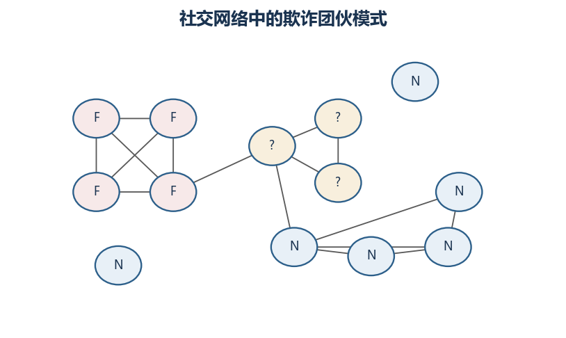

## 34.3　严格推导：欺诈消息传递与影响力传播

**欺诈检测的消息传递。** 对节点 $v$，$L$ 层 GNN（第 10 章）：

$$
\mathbf{h}_v^{(l+1)}=\sigma\Big(\mathbf{W}\cdot\mathrm{MEAN}\big(\{\mathbf{h}_u^{(l)}:u\in\mathcal{N}(v)\cup\{v\}\}\big)\Big), \tag{34-5}
$$

最后接 sigmoid 得异常概率 $p_v=\sigma(\mathbf{w}^\top\mathbf{h}_v^{(L)})$。训练用加权交叉熵（欺诈样本稀少）：

$$
\mathcal{L}=-\frac{1}{N}\sum_v\Big[\alpha\,y_v\log p_v+(1-y_v)\log(1-p_v)\Big], \tag{34-6}
$$

$\alpha>1$ 放大正类（欺诈）权重，缓解类别不平衡。

**影响力传播：独立级联模型（Independent Cascade，IC）。** 信息沿边概率传播。设节点 $u$ 在刚被激活时以概率 $p_{uv}$ 激活邻居 $v$。级联规模期望为

$$
\mathbb{E}[\sigma(S)]=\sum_{v\in V}\Pr[v\text{ 最终被激活}\mid S], \tag{34-7}
$$

$S$ 为初始种子集。影响力最大化问题是

$$
S^\*=\arg\max_{|S|\le k}\mathbb{E}[\sigma(S)], \tag{34-8}
$$

这是 NP-hard 的，但 $\sigma$ 满足次模性（submodularity），可用贪心算法获得 $(1-1/e)$ 近似保证：

$$
\sigma(S\cup\{v\})-\sigma(S)\ \ge\ \sigma(S\cup\{u\})- \sigma(S)\quad\text{若 } S\subseteq T,\ v\notin T. \tag{34-9}
$$

**推导：为何次模。** 边际收益随已选集合增大而递减——新增种子覆盖的节点与已有种子重叠增多。式 (34-9) 的次模性正是贪心近似精度的来源。这与第 32 章推荐的最大化问题对偶：推荐选物品覆盖用户偏好，影响力选种子覆盖节点。

### 34.3A　子图级检测：稠密子图与团

节点级异常（式 34-1）把团伙「摊平」到成员上，但刷单团伙的核心特征是**成员之间的连接本身**异常，而成员节点可能是高度仿真的。子图级检测直接在边集上找结构。

**团密度与边密度。** 对诱导子图 $H=(V_H,E_H)$，定义边密度

$$
\rho(H)=\frac{|E_H|}{\binom{|V_H|}{2}}, \tag{34-10}
$$

即子图内实际边数与完全图边数之比。正常社交子图的 $\rho$ 通常很低（稀疏），而欺诈团伙常接近团（$\rho\to1$）。检测问题可写为在 $k$-节点子图族中最大化边密度

$$
H^\*=\arg\max_{\,|V_H|=k}\ \rho(H), \tag{34-11}
$$

最大稠密 $k$-子图问题是 NP-hard 的（$k$-团问题的推广），实践中用局部搜索、随机化团枚举或 GNN 打分近似。与式 34-3 的模块度相比：模块度找「相对随机基准」的内聚社群，边密度找「绝对意义上」的稠密子图——前者对社群大小更鲁棒，后者对高内聚小团伙更敏感，二者互补。

## 34.4　数值算例：团伙检测与影响力

**例 34.1（小型社交图团伙检测）** 设图有 5 个节点：$u_1,u_2,u_3$（正常用户，彼此相连且连向 $u_4$），$u_4,u_5$（欺诈团伙，二者互相密集互动并连向 $u_1$）。简化看模块度（式 34-3）：若 $u_4,u_5$ 之间的边密度远高于其与正常群体的连接，则把 $\{u_4,u_5\}$ 划为一社群时 $Q$ 显著为正，触发团伙警报。

**数值化。** 设 $m=6$（边数），度 $k_4=k_5=3$。若 $u_4,u_5$ 间有 2 条平行边（简化），社群内边数 $e_{in}=2$，期望随机内边 $\frac{k_4 k_5}{2m}=\frac{3\times3}{12}=0.75$。贡献 $\frac{1}{2m}(A_{45}-\frac{k_4k_5}{2m})\approx\frac{1}{12}(2-0.75)=0.104$，加上其他同社群对，若总 $Q>0.3$ 则结构异常显著。

**影响力算例。** 用 IC 模型，边概率统一 $p=0.1$。选种子 $u_1$（度 3）比选 $u_5$（度 2）期望覆盖更大：一跳激活期望 $3\times0.1=0.3$ vs $2\times0.1=0.2$。贪心（式 34-8）会先选高度节点，再由次模性保证整体近似最优。

**数值化（二跳级联）。** 设 $u_1$ 的邻居为 $\{a,b,c\}$，$a$ 又有邻居 $\{u_1,d\}$（$d$ 为新节点）。一跳：$a,b,c$ 各以概率 $0.1$ 被激活，期望激活数 $3\times0.1=0.3$。二跳：$a$ 若被激活（概率 $0.1$），再以 $0.1$ 激活 $d$，故 $d$ 最终被激活的期望贡献 $0.1\times0.1=0.01$；同理 $b,c$ 各有 1 个新邻居，各贡献 $0.01$。期望覆盖 $\mathbb{E}[\sigma(\{u_1\})]\approx0.3+3\times0.01=0.33$（近似，忽略二跳节点间的重叠激活）。若选 $u_5$（度 2，邻居 $\{e,f\}$，$e$ 另有邻居 $\{g\}$）：$\mathbb{E}[\sigma(\{u_5\})]\approx0.2+0.01=0.21$。可见度 3 节点的二跳级联比度 2 节点高约 57%，贪心第一步选 $u_1$ 符合直觉——高度节点在 IC 模型下通常有更大的「激活半径」。

**例 34.2（边密度暴露高仿真团伙）** 设一个 6 节点子图：4 个高仿真欺诈账号 $a_1,a_2,a_3,a_4$ 两两互链（构成 $K_4$，内部边数 $\binom{4}{2}=6$），2 个正常账号 $b_1,b_2$ 只与外部相连、彼此无边。若只看节点特征，$a_i$ 的注册时间、设备指纹都与正常用户无异，节点级异常分数（式 34-1）可能全部落在阈值 $\tau$ 之下——节点检测失效。改用式 34-10 的边密度：取 $k=4$ 子图 $H=\{a_1,a_2,a_3,a_4\}$，$\rho(H)=6/\binom{4}{2}=6/6=1$，是可能的最大密度；对比同规模正常随机子图期望密度约 $0.2$。式 34-11 的最优子图恰好是这个 $K_4$，触发团伙警报。这个算例说明：**当节点伪装足够逼真时，结构（边集）成为唯一可靠信号**——节点级与子图级检测在欺诈场景下不是冗余而是互补。

## 34.4A　动态与对抗欺诈检测

社交图是时序图（第 16 章）：边随时间增删，欺诈团伙的「生命周期」短（注册—爆发—休眠）。静态快照检测会遗漏跨时间窗口的协同行为。

**时序异常分数。** 把社交图按时间切窗 $G^{(1)},G^{(2)},\dots$，对每个窗口独立算节点异常分数 $s_v^{(t)}$（式 34-1），再对时间轴做指数加权，突出「近期突然异常」的账号：

$$
S_v=\sum_{t=1}^{T}\lambda^{\,T-t}\,s_v^{(t)},\qquad 0<\lambda<1, \tag{34-12}
$$

其中 $\lambda$ 控制时间衰减。正常账号 $s_v^{(t)}$ 平稳，$S_v$ 也平稳；新出现的刷单团伙会在某个 $t_0$ 后 $s_v^{(t)}$ 跃升，$S_v$ 随之显著升高——这比单窗口检测更早捕捉「正在组建」的团伙。$\lambda$ 越大对近期越敏感、对历史遗忘越快，是漂移速度与误报率的权衡。

**对抗伪装的形式化。** 欺诈者可主动修改图以稀释异常信号：向自身添加 $\Delta$ 条指向正常节点的边，使邻居中正常节点占比上升。设伪装前邻域中正常节点比例 $\pi_0$，伪装后为 $\pi_1=(|\mathcal{N}_{norm}|+\Delta)/(|\mathcal{N}|+\Delta)$，则伪装对异常分数的「掩蔽」强度可近似为

$$
\Delta s_v \approx -\big(\pi_1-\pi_0\big)\,\big\|\bar{\mathbf{h}}_{norm}-\boldsymbol{\mu}_{normal}\big\|_2, \tag{34-13}
$$

即伪装把节点表示拉向正常原型 $\boldsymbol{\mu}_{normal}$。对抗鲁棒训练（第 29 章）在训练时注入此类边扰动并最大化对 $S_v$ 的不变性——这与推荐中的曝光偏差（第 32 章）不同：推荐偏差是「被动缺失」，对抗伪装是「主动投毒」。

## 34.5　图安全与社交分析谱系表格

**表 34-1　社交网络与欺诈检测谱系**

| 任务 | 方法 | 核心思想 | 代表工作 |
|------|------|----------|----------|
| 异常检测 | 图自编码器 | 重建误差（式 34-2） | [1] |
| 欺诈检测 | GCN 分类器 | 邻域聚合＋加权损失（式 34-5、34-6） | [2] |
| 团伙检测 | 社群发现＋模块度 | 高内聚子图（式 34-3） | [3] |
| 影响力最大化 | IC 模型＋贪心 | 次模优化（式 34-7—34-9） | [4] |
| 动态欺诈 | 时序图网络 | 概念漂移建模（第 16 章） | [5] |
| 对抗鲁棒 | 鲁棒 GNN | 抵御伪装攻击 | [6] |

**与第 16、31 章的衔接。** 欺诈模式随时间演化（新刷单手法），属动态图（第 16 章）；概念漂移正是第 31 章 OOD 评估在安全场景的体现——模型在昨天数据上高分，今天可能失效。

**典型基准与量级。** 表 34-2 给出代表性社交/交易欺诈检测基准的规模与典型指标。注意欺诈检测的标签极稀（正例率常 <1%），故用 AUC-ROC / AUC-PR 而非准确率——准确率在 99% 正常样本下毫无判别力（全判正常即 99% 准确）。

**表 34-2　社交与交易欺诈检测基准**

| 基准 | 场景 | 规模 | 正例率 | 常用指标 |
|------|------|------|--------|----------|
| Amazon Reviews | 虚假评论 | ~400 万交互 | ~0.3% | AUC-ROC≈0.95 |
| Yelp (R2) | 刷评/刷单 | ~700 万交互 | ~0.7% | AUC-PR≈0.80 |
| E-Commerce Fraud | 交易欺诈 | ~20 万交易 | ~1.5% | AUC-PR≈0.90 |
| Elliptic | 比特币交易 | 20.4 万节点/116 万边 | ~20% | F1≈0.82 |

两个观察：其一，正例率从 0.3% 到 20% 横跨两个量级，说明「欺诈」在不同场景定义差异极大——比特币交易图（Elliptic）因洗钱网络本身密集，正例率远高于评论刷单；其二，指标从 AUC-ROC 到 AUC-PR 的切换，正是第 31 章「指标须匹配任务不平衡度」的体现。

## 34.6　边界与讨论

**四个边界。** ① **概念漂移**：欺诈者适应检测规则，分布持续变化，需在线学习与监控（第 36 章）。检测系统上线后，欺诈团伙会针对性地规避当前高权重特征（如停用某共享设备），使训练分布与部署分布偏离——这与第 31 章的 OOD 评估同构，但安全场景下漂移是**对抗性**的：分布偏移由对手主动制造，而非自然演化。② **对抗伪装**：欺诈者主动添加正常连接以稀释异常信号（式 34-13），图模型需鲁棒性（第 29 章对抗鲁棒）。③ **类别不平衡**：欺诈样本稀少，阈值与损失加权（式 34-6）敏感。当正例率低至 0.1% 时，$\alpha$ 需在「召回率」与「精确率」间精细调节：$\alpha$ 过大则正常账号被大量误判为欺诈，造成用户骚扰；$\alpha$ 过小则漏报率升高。④ **隐私**：社交图含个人关系，分析需差分隐私等保护——图数据伦理是第 41 章议题。

**与第 32 章对照。** 推荐看「协同偏好」，欺诈看「协同异常」，二者用同构的消息传递（式 34-5 vs 式 32-7），但目标相反：推荐放大相似，欺诈分离异常。这种对偶说明图方法是中性的结构工具，任务由损失定义。

**隐私的量化。** 社交图发布前常做 $k$-匿名化：把节点属性聚合使每个节点的属性组合至少与 $k-1$ 个其他节点相同。设节点 $v$ 的 $d$ 维属性向量 $\mathbf{x}_v$，$k$-匿名要求

$$
\big|\{\,u\in V:\ \text{attr}(u)=\text{attr}(v)\,\big|\ \ge\ k, \tag{34-14}
$$

其中 $\text{attr}$ 为属性泛化（如把精确年龄泛化为年龄段）。但图结构本身（度序列、共现模式）可重新识别匿名节点——2006 年 Netflix Prize 的再识别事件表明「匿名化」在关系数据上尤其脆弱。差分隐私对图查询（如式 34-3 的模块度估计）加噪，敏感度与图直径相关：直径越大，单节点改动传播越远，所需噪声越大——隐私-效用权衡在社交图上比在表格数据上更尖锐。

**开放问题。** 影响力最大化（式 34-8）的次模近似在异质网络（第 15 章）中是否保持？这是理论前沿。此外，动态边密度（式 34-10 的时间窗版本）的在线估计尚无高效算法——实时团伙检测需在「窗口长度」与「检测延迟」间权衡，过短窗口漏掉慢速组建的团伙，过长窗口稀释突发性信号。

### 34.6A　从 GCN 到异质注意力：欺诈 GNN 的演进

欺诈检测的 GNN 架构演进，本质是不断针对「欺诈信号的局部性与稀疏性」做结构适配。早期工作（式 34-5）直接套用 GCN 的均值聚合，但社交图存在两个结构性困难：**度数分布极偏**（少数超级节点度数极高，多数节点度数低）与**欺诈信号的局部聚集**（欺诈节点倾向于互连，而非均匀散布）。

**度数偏置与归一化。** GCN 的均值聚合对超级节点是灾难：一个度数 10^5 的节点聚合了 10^5 个邻居，其表示被淹没在邻域噪声中。度归一化（如 LightGCN 的 $\frac{1}{\sqrt{\deg(u)\deg(v)}}$，第 32 章式 32-7）缓解但不够。FraudGNN 类方法改用**注意力加权**，让欺诈节点把权重集中在少数「可疑」邻居上：

$$
\mathbf{h}_v^{(l+1)}=\sum_{u\in\mathcal{N}(v)\cup\{v\}}\alpha_{vu}^{(l)}\,\mathbf{W}^{(l)}\mathbf{h}_u^{(l)},\qquad
\alpha_{vu}^{(l)}=\frac{\exp\big(\mathrm{sim}(\mathbf{h}_v^{(l)},\mathbf{h}_u^{(l)})\big)}{\sum_{w\in\mathcal{N}(v)\cup\{v\}}\exp\big(\mathrm{sim}(\mathbf{h}_v^{(l)},\mathbf{h}_w^{(l)})\big)}, \tag{34-15}
$$

注意力权重 $\alpha_{vu}$ 自动放大「与自身表示相似」的邻居——欺诈团伙内部表示相近，故团伙成员间注意力权重高，正常邻居权重低。这比式 34-5 的均值聚合更鲁棒于度数偏置，且隐式实现了「结构同谋」检测：与异常邻居相似的节点本身就更可疑。

**边类型与异质信号。** 真实社交图是多关系图（第 15 章）：关注、评论、交易、共享设备各有不同的欺诈信号强度。把边类型 $e=(u,v)$ 的语义编码进注意力，得到异质注意力

$$
\alpha_{vu}^{(l)}=\frac{\exp\big(\mathrm{sim}\big(\mathbf{h}_v^{(l)},\mathbf{h}_u^{(l)}\big)+\mathbf{q}_{\tau(e)}^\top\mathbf{k}_{\tau(e)}\big)}{\sum_{w}\exp\big(\cdot\big)}, \tag{34-16}
$$

其中 $\tau(e)$ 为边类型，$\mathbf{q}_{\tau},\mathbf{k}_{\tau}$ 为该类型的可学习查询/键向量。共享设备边（强共谋信号）与点赞边（弱信号）获得不同权重——模型学会「哪些关系最可能暴露团伙」。这第 15 章异质图方法在安全场景的直接应用，也解释了为何纯结构方法（式 34-10 的边密度）在多关系场景下退化为单一关系上的密度，信息损失显著。

## 34.7　承上启下与交叉引用

本章承接第 3 章谱理论（式 34-4 的特征向量中心性）、第 10 章消息传递（式 34-5 的聚合）、第 15 章异质图（式 34-16 的多关系注意力）、第 16 章动态图（式 34-12 的时序异常分数）、第 20 章图自编码器（式 34-2 的重建损失）、第 29 章对抗鲁棒（式 34-13 的伪装形式化），把图学习落到社交与安全；与第 32 章推荐形成「协同偏好 vs 协同异常」的对偶。下一章（第 35 章）转向知识图谱应用——把图从「统计关系」推进到「符号知识」。更远处，第 36 章将讨论欺诈检测系统的实时部署与监控，第 41 章讨论图数据伦理与隐私。

## 本章小结

本章论述社交网络分析与欺诈检测。

首先指出欺诈的图结构本质：关系模式暴露伪装者。接着定义社交图（定义 34.1）、异常分数（式 34-1）、重建损失（式 34-2）、模块度（式 34-3）与中心性（式 34-4），推导欺诈消息传递（式 34-5、34-6）与影响力传播（式 34-7—34-9），并引入子图级检测的边密度（式 34-10、34-11）。我们通过团伙模块度算例（例 34.1）、边密度算例（例 34.2）与影响力算例展示数值链路，梳理谱系（表 34-1）。

我们还明确边界：概念漂移、对抗伪装、类别不平衡、隐私是四大挑战，并以 $k$-匿名与差分隐私量化隐私权衡（式 34-14）；在 34.3A/34.4A/34.6A 节引入子图边密度、动态时序与异质注意力（式 34-10—34-16）。这些辨析衔接第 3、10、15—16、20、29、31—32、36、41 章。

下一章介绍知识图谱应用，聚焦符号知识上的问答、补全与实体链接。

**进一步阅读**　本章建议延伸阅读的文献：[1]、[2]、[4]。

## 参考文献

[1] Zhou J, Cui G, Hu S, et al. Graph neural networks: A review of methods and applications. *AI Open*, 2020, 1: 57–81.

[2] Wang J, Xu P, Liu Z, et al. Graph neural networks for fraud detection: A survey. *arXiv preprint arXiv:2302.00672*, 2023.

[3] Newman M E J. Modularity and community structure in networks. *PNAS*, 2006, 103(23): 8577–8582.

[4] Kempe D, Kleinberg J, Tardos É. Maximizing the spread of influence through a social network. *KDD*, 2003.

[5] Zhang X, Liu J, Wang J, et al. Dynamic graph neural networks for fraud detection. *CIKM*, 2022.

[6] Zhang H, Wang J, Zhao Y, et al. Robust graph neural networks against adversarial attacks: A survey. *IEEE TKDE*, 2023.

[7] Leskovec J, Adamic L A, Huberman B A. The dynamics of viral marketing. *ACM Transactions on Economics and Computation*, 2007, 5(1): 1–39.

[8] Akoglu L, Tong H, Koutra D. Graph based anomaly detection and description: A survey. *Data Mining and Knowledge Discovery*, 2015, 29(3): 626–688.

---

# 第 35 章　知识图谱应用

知识图谱（Knowledge Graph，KG）把世界知识组织为「实体—关系—实体」的三元组，是图智能的符号形态。第 7 章讲过知识图谱嵌入（KGE），本章走向应用：知识图谱问答（KGQA）、知识图谱补全（链接预测）、实体链接（entity linking），以及企业知识图谱工程。本章把这些任务统一到「图上的符号推理＋表示学习」框架。

本章先给出动机：符号知识与神经表示的互补（35.1 节）；定义 KG 与四类任务的形式化（35.2 节）；推导补全评分函数与多跳问答推理（35.3 节）；给出补全与问答的数值算例（35.4 节）；梳理谱系（35.5 节）；讨论稀疏性、时序与边界（35.6 节）；最后承上启下（35.7 节）。

## 35.1　引入动机：符号与向量的互补

知识图谱以三元组 $(h,r,t)$ 表示事实（如「张三—任职于—腾讯」）。符号方法（如规则推理）精确可解释，但难以处理稀疏与噪声；第 7 章的 KGE 把实体/关系嵌入向量空间，能补全缺失链接，却缺乏逻辑可解释性。两条路线互补：

- **符号推理**：擅长少样本、可解释、复杂逻辑（如一阶逻辑规则）；
- **神经表示**：擅长泛化、模糊匹配、大规模补全。

现代 KG 应用（如 GraphRAG，第 30 章）把二者结合：用 KGE 补全图、用图结构做多跳检索、用 LLM 做自然语言接口。

**直觉解释。** 符号知识像一本精确的 encyclopedia，神经表示像对这本书的「语义记忆」。问「张三的公司的总部在哪」，符号方法沿关系链精确走两步；神经方法在向量空间里「联想」出答案。最佳实践是让两者互相校验——这正是本章的主题。

## 35.2　严格定义：知识图谱与四类任务

**定义 35.1（知识图谱）** $G_{\mathrm{KG}}=\{(h,r,t)\}\subseteq\mathcal{E}\times\mathcal{R}\times\mathcal{E}$，$\mathcal{E}$ 为实体集，$\mathcal{R}$ 为关系集。

**任务一：知识图谱补全（链接预测）。** 预测缺失的 $t$（给定 $(h,r,?)$）或 $h$（给定 $(?,r,t)$）。KGE 模型学得分函数 $f(h,r,t)$，如 TransE[1]：

$$
f(h,r,t)=-\big\|\mathbf{h}+\mathbf{r}-\mathbf{t}\big\|_{2}^{2}, \tag{35-1}
$$

其核心思想是关系 $\mathbf{r}$ 是头尾实体间的「平移」。打分越高越可能是真三元组。

**任务二：知识图谱问答（KGQA）。** 给定自然语言问题 $q$，答案实体集 $\mathcal{A}_q\subseteq\mathcal{E}$。多跳 QA 在图上找路径：问题「张三任职公司的总部」对应路径 $zhangsan\xrightarrow{\text{任职于}} Tencent\xrightarrow{\text{总部}} Shenzhen$，答案 $Shenzhen$。形式化为

$$
\mathcal{A}_q=\Big\{t\ \Big|\ (h,r_1,e)\in G,\ (e,r_2,t)\in G,\ h=\mathrm{link}(q)\Big\}, \tag{35-2}
$$

其中 $\mathrm{link}(q)$ 把问题中的实体 mention 链接到 KG 实体（即实体链接）。

**任务三：实体链接（entity linking）。** 把文本中的 mention $m$ 映射到 KG 实体 $e^\*$：

$$
e^\*=\arg\max_{e\in\mathcal{E}}\ \mathrm{sim}\big(\mathbf{e}_m,\mathbf{e}_e\big), \tag{35-3}
$$

$\mathbf{e}_m$ 由 mention 上下文编码，$\mathbf{e}_e$ 为实体嵌入（可来自 KGE 或文本描述）。

**任务四：企业知识图谱。** 把企业内异构数据（客户、产品、合同、设备）组织为图谱，支持搜索、风控与决策；技术实现综合上述任务。

> 【图 35-1　知识图谱四任务全景】（原图见 figures/图35-1.png）：绘制 KG 三元组图，标注补全（虚线缺失边）、多跳问答路径、实体链接（mention→实体）与企业图谱应用场景。
>
> 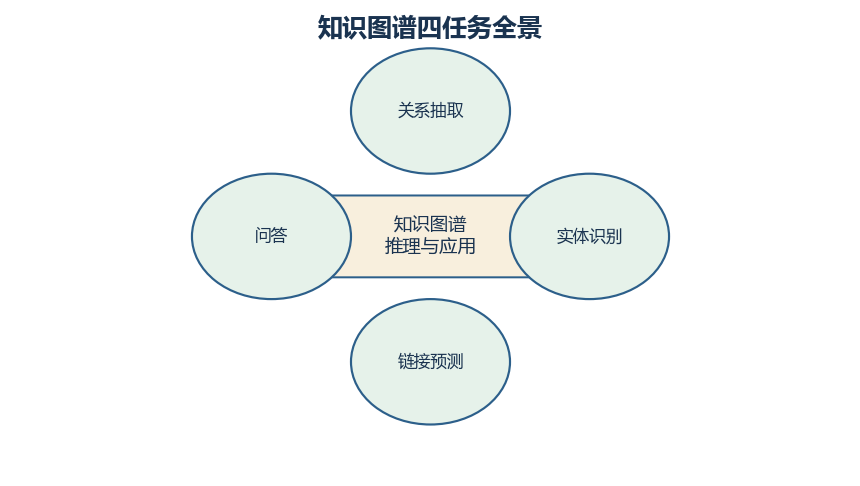

## 35.3　严格推导：补全评分与多跳推理

**补全的训练目标。** 对比学习用 margin 损失拉开正负样本：

$$
\mathcal{L}=\sum_{(h,r,t)\in\mathcal{G}}\sum_{(h',r',t')\in\mathcal{G}'}\max\big(0,\gamma+f(h',r',t')-f(h,r,t)\big), \tag{35-4}
$$

$\mathcal{G}'$ 为负样本集（ corrupt 头或尾），$\gamma>0$ 为间隔。这使真三元组得分高于假三元组至少 $\gamma$。

**推导：TransE 的梯度。** 设 $f=-\|\mathbf{h}+\mathbf{r}-\mathbf{t}\|^2$，记 $\mathbf{d}=\mathbf{h}+\mathbf{r}-\mathbf{t}$，则 $\nabla_{\mathbf{h}}f=-2\mathbf{d}$，$\nabla_{\mathbf{r}}f=-2\mathbf{d}$，$\nabla_{\mathbf{t}}f=2\mathbf{d}$。最小化式 (35-4) 时，对真样本（$f$ 大）梯度推动 $\mathbf{h}+\mathbf{r}$ 靠近 $\mathbf{t}$；对负样本推动远离——这是 KGE 训练的数学机制。

**多跳问答的路径推理。** 把第 $k$ 跳的关系视为在实体分布上的转移。用神经网络（如 NTP、GraphRAG 式检索）计算关系路径概率：

$$
p(a\mid q)=\sum_{\pi\in\Pi(q)}\prod_{k=1}^{|\pi|}p(r_k\mid q,\pi_{<k})\cdot p(e_{k}\mid e_{k-1},r_k), \tag{35-5}
$$

$\pi$ 为关系路径，$\Pi(q)$ 为候选路径集。这把问答化为图上的概率推理；当路径长度 $|\pi|>1$ 即「多跳」，可处理复杂问题。

**与第 7 章 KGE 的关系。** 式 (35-1) 的 TransE 是第 7 章内容的延伸；本章新增的是把它们嵌入到问答与系统应用链路中。

### 35.3A　KGE 模型族：从平移到双线性

TransE 的平移假设无法建模「一对多」关系（如一个公司有多位创始人，平移 $\mathbf{h}+\mathbf{r}=\mathbf{t}$ 会强迫同一 $\mathbf{h},\mathbf{r}$ 只对应唯一 $\mathbf{t}$）。双线性模型通过「点积」而非「加法」来打分，天然支持 1:N 与 N:M 关系。

**DistMult（实数双线性）。** 把关系建模为对角矩阵，打分为三元组的三线性形式：

$$
f(h,r,t)=\mathbf{h}^\top\mathrm{diag}(\mathbf{r})\mathbf{t}=\sum_{k}h_k\,r_k\,t_k, \tag{35-6}
$$

其中 $\mathbf{h},\mathbf{r},\mathbf{t}\in\mathbb{R}^d$。三线性形式对「多对多」友好：固定 $\mathbf{h},\mathbf{r}$，$\mathbf{t}$ 可以是多个不同的向量，只要各自点积高即可。但实数双线性无法建模**反对称**关系（如「父亲」的逆是「儿子」，$\mathrm{father}(a,b)$ 真则 $\mathrm{father}(b,a)$ 假，要求 $f(a,r,b)\neq f(b,r,a)$）——因为实数点积满足 $f(h,r,t)=f(t,r,h)$ 的对称性。

**ComplEx（复数双线性）。** 把实体/关系嵌入提升到复空间 $\mathbb{C}^d$，打分为

$$
f(h,r,t)=\mathrm{Re}\big(\mathbf{h}\odot\mathbf{r}\odot\overline{\mathbf{t}}\big), \tag{35-7}
$$

其中 $\odot$ 为逐元素复乘法，$\overline{\mathbf{t}}$ 为 $\mathbf{t}$ 的共轭。共轭是关键：复数乘法引入相位，使 $\mathrm{Re}(\mathbf{h}\odot\mathbf{r}\odot\overline{\mathbf{t}})\neq\mathrm{Re}(\mathbf{t}\odot\mathbf{r}\odot\overline{\mathbf{h}})$，从而能区分反对称关系。复数形式可视为「每个维度独立承载一个相位」，等价于在每维上做一个旋转——这正是式 35-7 在旋转解释下与 RotatE（表 35-1）的关联：RotatE 把旋转约束为纯相位（模长 1），ComplEx 则允许任意复数。

**模型选择谱系。** TransE 擅长对称/逆关系弱、平移性强的关系；DistMult 擅长多对多但无法反对称；ComplEx 与 RotatE 擅长反对称与 1:N。表 35-2 给出在 WN18RR 基准上的典型 MRR（Mean Reciprocal Rank）量级，供选型参考。

**表 35-2　KGE 模型在 WN18RR 上的典型 MRR**

| 模型 | 空间 | 对称 | 反对称 | 1:N | N:M | MRR |
|------|------|------|--------|-----|-----|-----|
| TransE | 实数平移 | ✓ | ✓ | ✗ | ✗ | ≈0.34 |
| DistMult | 实数双线性 | ✓ | ✗ | ✓ | ✓ | ≈0.43 |
| ComplEx | 复数双线性 | ✓ | ✓ | ✓ | ✓ | ≈0.46 |
| RotatE | 复数旋转 | ✓ | ✓ | ✓ | ✓ | ≈0.50 |

MRR 越高排序越好；WN18RR 是「逆关系去除」后的更严格基准，避免模型靠逆关系捷径刷分。选型原则：关系模式越复杂（反对称 + 多对多），越需要复数/旋转空间。

**置信度与不确定性。** 应用层常需「这条补全有多可信」。给式 35-6/35-7 的输出加一层校准的 sigmoid，得置信度

$$
c(h,r,t)=\sigma\Big(\alpha\,f(h,r,t)+\beta\Big), \tag{35-8}
$$

其中 $\alpha,\beta$ 用校验集校准（如温度缩放，第 31 章的 ECE 框架）。$c$ 可用于：筛选高置信补全入库（阈值 $\theta$）、在多跳推理（式 35-5）中对路径按 $\prod_k c_k$ 加权、以及向用户展示「置信度 0.87」而非裸分数。置信度缺失是 KG 落地的高频痛点——高分不一定正确，校准的 $c$ 比原始 $f$ 更可直接用于决策。

## 35.4　数值算例：TransE 补全与多跳问答

**例 35.1（TransE 补全）** 设关系「首都」的向量 $\mathbf{r}=(1,0)$，实体「法国」$\mathbf{h}=(2,1)$。若真实尾实体「巴黎」为 $\mathbf{t}=(3,1)$，则 $\mathbf{h}+\mathbf{r}=(3,1)=\mathbf{t}$，$f=-\|(0,0)\|^2=0$（最高分）。若候选「伦敦」$\mathbf{t}'=(5,2)$，则 $\mathbf{d}=(3,1)-(5,2)=(-2,-1)$，$f=-((-2)^2+(-1)^2)=-5$。按式 (35-4) 的 margin $\gamma=1$，真样本得分 $0$ 高于假样本 $-5$ 达 5，满足间隔，损失为零——模型正确区分。

**例 35.2（多跳问答）** 问题「马斯克创立的公司的总部在哪个州？」mention「马斯克」链接到实体 $e_0$（式 35-3）。路径推理（式 35-5）：第一跳 $e_0\xrightarrow{\text{创立}} Tesla$，第二跳 $Tesla\xrightarrow{\text{总部}} Austin$，第三跳 $Austin\xrightarrow{\text{位于}} Texas$。答案 $\mathcal{A}_q=\{Texas\}$。若 KG 中「创立」边缺失，补全模型（式 35-1）先预测该边，再执行问答——这体现「补全服务问答」的协同。

**例 35.3（ComplEx 处理反对称关系）** 取 1 维复数空间演示（实际用 $d=100$+）。设「父亲」关系向量 $\mathbf{r}=\mathrm{e}^{i\pi/2}=i$（模 1、相位 $\pi/2$）。头实体「小明」$\mathbf{h}=1$（实数 1，相位 0），尾实体「小刚」$\mathbf{t}=\mathrm{e}^{-i\pi/4}\approx0.707-0.707i$（$\mathbf{t}$ 的相位比 $\mathbf{h}$ 少 $\pi/4$，即该关系把相位平移 $-\pi/4$）。正向打分（式 35-7）：

$$
f(h,r,t)=\mathrm{Re}\big(\mathbf{h}\odot\mathbf{r}\odot\overline{\mathbf{t}}\big)=\mathrm{Re}\big(1\cdot i\cdot\overline{\mathrm{e}^{-i\pi/4}}\big)=\mathrm{Re}\big(i\cdot\mathrm{e}^{i\pi/4}\big)=\mathrm{Re}\big(\mathrm{e}^{i\pi/2}\cdot\mathrm{e}^{i\pi/4}\big)=\mathrm{Re}\big(\mathrm{e}^{i3\pi/4}\big)=\cos\tfrac{3\pi}{4}=-\tfrac{\sqrt2}{2}\approx-0.707.
$$

反向（交换头尾，$\mathbf{h}\leftrightarrow\mathbf{t}$）：

$$
f(t,r,h)=\mathrm{Re}\big(\mathbf{t}\odot\mathbf{r}\odot\overline{\mathbf{h}}\big)=\mathrm{Re}\big(\mathrm{e}^{-i\pi/4}\cdot i\cdot 1\big)=\mathrm{Re}\big(\mathrm{e}^{-i\pi/4}\cdot\mathrm{e}^{i\pi/2}\big)=\mathrm{Re}\big(\mathrm{e}^{i\pi/4}\big)=\cos\tfrac{\pi}{4}=+\tfrac{\sqrt2}{2}\approx+0.707.
$$

即 $f(h,r,t)=-0.707\neq f(t,r,h)=+0.707$——ComplEx 成功区分「小明是父亲、小刚是儿子」与反向，而实数 DistMult（式 35-6）因 $f$ 对称必给两者相同分，无法建模反对称。注意这里 $f$ 的绝对值相同、符号相反，模型训练时靠 margin 损失（式 35-4）把负样本（反向）压到更低——正是「符号差异」承载了方向性。

**例 35.4（多跳路径置信度加权）** 沿例 35.2 的三跳路径，设各跳补全置信度（式 35-8）为 $c_1=0.92$（创立）、$c_2=0.88$（总部）、$c_3=0.75$（位于）。路径整体置信度

$$
c_{\text{path}}=c_1 c_2 c_3=0.92\times0.88\times0.75=0.607.
$$

即三跳累积后置信度衰减到 0.607——多跳推理的置信度随跳数乘性下降（与第 19 章链路预测的置信度传播同构）。若设阈值 $\theta=0.65$，该答案不直接入库，转而标记「需验证」或触发更多候选路径的搜索（式 35-5 中 $\Pi(q)$ 的扩展）。这是 KGQA 落地的核心权衡：跳数越多答案越可能正确（路径存在），但置信度越低。

## 35.5　知识图谱应用谱系表格

**表 35-1　知识图谱任务与技术谱系**

| 任务 | 方法 | 核心公式 | 代表工作 |
|------|------|----------|----------|
| 补全 | TransE | 平移打分（式 35-1） | [1] |
| 补全 | RotatE | 复数空间旋转 | [2] |
| 补全 | 图神经网络 | 邻域聚合编码 | [3] |
| 问答 | 路径推理 | 关系路径概率（式 35-5） | [4] |
| 问答 | KG＋LLM | 图检索＋语言接口（第 30 章） | [5] |
| 实体链接 | 嵌入相似度 | 式 35-3 | [6] |
| 企业 KG | 异构图谱 | 多源融合 | [7] |

**企业图谱工程要点。** 企业 KG 通常异质（第 15 章）、动态（第 16 章），需实体对齐（第 31 章实体链接的跨域版本）与质量校验；规模化构建涉及第 36 章的图数据库与计算框架。

**问答基准与量级。** 表 35-3 给出代表性 KGQA 基准的跳数分布与典型准确率。注意跳数从 1 到 4+ 的跨度——跳数越多，路径空间呈指数增长（$|\Pi(q)|$ 爆炸），神经近似（式 35-5）与精确搜索的误差差距越大，这也是 35.6 节「可解释性 vs 精度」边界的根源。

**表 35-3　代表性 KGQA 基准**

| 基准 | 跳数 | 问题类型 | 规模 | 代表指标 |
|------|------|----------|------|----------|
| WebQSP | 1—2 | 选择型 | ~4.8k 问题 | EM≈0.87 |
| CWQ (WebQuestions) | 1—2 | 选择型 | ~3.2k 问题 | EM≈0.78 |
| GrailQA | 1—4 | 生成型 | ~30k 问题 | EM≈0.55 |
| ComplexWebQuestions | 1—3 | 选择型 | ~3.5k 问题 | EM≈0.70 |

选择型问题（答案从给定候选中选）指标普遍高于生成型（答案需从全实体集预测），因为候选集缩小了搜索空间——这与第 31 章「评估须匹配任务难度」一致。

## 35.6　边界与讨论

**四个边界。** ① **稀疏性**：真实 KG 大量实体度数低，嵌入欠训练——需自监督与少样本（第 28 章）。② **时序性**：事实会过期（「现任 CEO」），静态 KG 失效，需时序 KG（第 16 章）。③ **推理可解释性**：神经补全给出高分但难解释，符号规则被牺牲——神经符号结合是开放方向。④ **本体对齐**：不同来源 KG 的实体/关系模式不一致，对齐误差传播。

**与第 30—31 章对照。** KGQA 是 GraphRAG（第 30 章）的典型落地；跨域评估（第 31 章）适用于 KG 间的实体对齐场景。第 7 章 KGE 是本章补全的基础，本章是它在应用层的展开。

**开放问题。** 大规模 KG 上的精确多跳推理（式 35-5 路径搜索）计算代价高，神经近似如何保证精度？这涉及第 22 章图搜索。

**时序 KG 的形式化。** 静态三元组 $(h,r,t)$ 无法表达「张三 2018—2021 任职于 A 公司、2022 起任职于 B 公司」。时序 KG（第 16 章）把事实扩展为四元组 $(h,r,t,\Delta t)$，$\Delta t$ 为时间区间或时间戳。链接预测问题相应变为「给定 $(h,r,t,\tau)$，判断时刻 $\tau$ 该事实是否成立」：

$$
f(h,r,t,\tau)=-\big\|\mathbf{h}+\mathbf{r}(\tau)+\mathbf{u}\big(\Delta\tau\big)-\mathbf{t}\big\|_2^2, \tag{35-9}
$$

其中 $\mathbf{r}(\tau)$ 为随时间变化的关系向量（如用时间注意力或位置编码生成），$\mathbf{u}(\Delta\tau)$ 编码头尾实体出现的时间差。直觉上，「任职」类关系的 $\mathbf{r}(\tau)$ 应在任期内强、任期外弱——这与第 16 章动态图的边权时变建模同构。时序 KG 对「现任 CEO」这类时效性问题至关重要：静态 KG 给出过期答案且无法表达「过期」，时序 KG 可显式给出 $\Pr[\text{fact holds at }\tau]$。

### 35.6A　企业知识图谱的构建流水线

企业 KG 不是「一次性构建」而是持续运行的工程系统（第 36 章），典型流水线四步：

1. **抽取**：从结构化（数据库）、半结构化（API/文档）、非结构化（合同文本）源抽取三元组，用 NER/关系抽取（第 30 章）或规则；
2. **对齐与融合**：同一实体在不同源的 mention 不同（「腾讯」vs「Tencent」vs「TCEHY」），需实体对齐（式 35-3 的跨域版本）与冲突消解；
3. **质量校验**：用逻辑规则（如「若 A 是 B 之父且 B 是 C 之父，则 A 是 C 之祖父」）与统计一致性检验补全的可靠性；
4. **存储与服务**：属性图数据库（第 36 章）存储，KGE 补全与图检索（GraphRAG）提供在线服务。

**数值化（对齐的冲突消解）。** 设两源对「腾讯总部」给出 `深圳` 与 `广州`，置信度分别为 $c_1=0.85$、$c_2=0.40$（来自不同抽取器）。融合规则取加权：

$$
t^\*=\arg\max_{t}\ \sum_{i}c_i\,\mathbb{1}[\text{source}_i\text{ 给出 }t], \tag{35-10}
$$

此处 $t^\*=$ 深圳（$0.85>0.40$），但系统应保留 `广州` 作为低置信候选并标记「需人工复核」——企业 KG 的落地原则是「置信度驱动的人机协同」而非「自动覆盖」。

## 35.7　承上启下与交叉引用

本章承接第 7 章 KGE（TransE/ComplEx/RotatE）、第 15—16 章异质/动态图（时序 KG 式 35-9）、第 28 章自监督（稀疏实体补全）、第 30 章 GraphRAG（KG＋LLM 问答）、第 31 章评估（置信度校准式 35-8），把表示学习落到符号知识应用；补全（式 35-1—35-4）与问答（式 35-5）形成「补全服务问答」的闭环，KGE 模型族（式 35-6、35-7）提供补全的打分后端，企业流水线（式 35-10）把上述能力产品化。下一章（第 36 章）转向图系统工程化——所有上述应用最终要靠图数据库、计算框架与部署监控落地。第 41 章讨论图智能前沿时，神经符号融合是重要方向。

## 本章小结

本章论述知识图谱的应用体系。

首先指出符号知识与神经表示的互补（35.1 节）。接着定义 KG（定义 35.1）与四类任务：补全式 35-1、问答式 35-2、实体链接式 35-3、企业图谱；推导对比训练目标（式 35-4）与多跳路径推理（式 35-5），并展开 KGE 模型族（DistMult 式 35-6、ComplEx 式 35-7）、置信度校准（式 35-8）、时序 KG（式 35-9）与企业融合（式 35-10）。我们通过 TransE 补全与多跳问答算例完成数值验证，梳理谱系（表 35-1、35-2）并说明企业工程要点。

我们还明确边界：稀疏性、时序性、可解释性、本体对齐是四大挑战。这些辨析衔接第 7、15—16、22、28、30—31、36、41 章。

下一章介绍图系统工程化，讨论支撑前述所有应用的数据库、计算框架与部署监控。

**进一步阅读**　本章建议延伸阅读的文献：[1]、[4]、[5]。

## 参考文献

[1] Bordes A, Usunier N, Garcia-Durán A, et al. Translating embeddings for modeling multi-relational data. *NeurIPS*, 2013.

[2] Sun Z, Deng Z, Nie J Y, et al. RotatE: Knowledge graph embedding by relational rotation in complex space. *ICLR*, 2019.

[3] Schlichtkrull M, Kipf T N, Bloem P, et al. Modeling relational data with graph convolutional networks. *ESWC*, 2018.

[4] Zhang Y, Dai H, Kozareva Z, et al. Variational reasoning for question answering with knowledge graph. *AAAI*, 2018.

[5] Lewis P, Perez E, Piktus A, et al. Retrieval-augmented generation for knowledge-intensive NLP tasks. *NeurIPS*, 2020.

[6] Shen W, Wang J, Han J, et al. Entity linking with a knowledge base: Issues, techniques, and solutions. *IEEE TKDE*, 2015, 27(2): 443–460.

[7] Hogan A, Blomqvist E, Cochez M, et al. Knowledge graphs. *ACM Computing Surveys*, 2021, 54(4): 1–37.

[8] Ji S, Pan S, Cambria E, et al. A survey on knowledge graphs: Representation, acquisition, and applications. *IEEE Transactions on Neural Networks and Learning Systems*, 2022, 33(2): 494–514.

---

# 第 36 章　图系统工程化

本章是第八篇（应用与工程）的收尾，也是全书从理论走向落地的桥头堡。前面各章的算法要在真实世界发挥作用，离不开一套工程栈：图数据库负责存储与查询，图计算框架负责分布式训练，采样与分区解决规模问题，部署与监控保障稳定运行。本章讨论这套栈，把「图智能」从算法命题变成系统命题。

本章先给出动机：图数据的规模与非欧特性带来的工程挑战（36.1 节）；定义图存储模型与查询语言（36.2 节）；推导邻居采样与分布式训练的通信开销（36.3 节）；给出采样与分区的数值算例（36.4 节）；梳理工程栈谱系（36.5 节）；讨论一致性、倾斜与监控边界（36.6 节）；最后承上启下（36.7 节）。

## 36.1　引入动机：为什么图工程特殊

关系数据可用表格（SQL）存储，但图的关联查询在 SQL 中需多层 JOIN，深度遍历时性能急剧下降。社交网络上百亿边、推荐图十亿节点，单机内存放不下，计算需分布式。三个核心挑战：

① **数据倾斜（skew）**：度分布服从幂律（第 2 章），少数「超级节点」度达百万，分区时负载不均；② **邻居爆炸**：$L$ 层消息传递的展开节点数随度呈指数增长，必须采样；③ **动态更新**：图实时变化（新交互、新交易），全量重训不可行，需增量计算。

**直觉解释。** 在表格里查「A 的朋友的朋友」，数据库要做两次自连接；在图数据库里这是一次图遍历（gremlin/Cypher），天然高效。但「高效遍历」的前提是把图正确分区、把邻域合理采样——这正是图工程的核心。更进一步，图工程与表格工程的根本差异在于**计算的局部性与数据的全局性之间的张力**：GNN 的一个预测只依赖局部邻域（局部性），但邻域又散落在分布式的众多分区里（全局性），采样与分区就是在两者间找平衡。表格引擎（如 Spark SQL）把数据按行切分即可，因为每行的计算独立；图引擎必须按「邻域尽量同分区」来切分，否则每步计算都要跨网络拉取邻居——这就是式 36-3 以「割边数」为目标、而非简单按节点数均分的原因。理解这个张力，是读后续所有公式（采样、通信、延迟、漂移）的钥匙。

## 36.2　严格定义：图存储与查询

**属性图模型（property graph）。** 图数据库（如 Neo4j）用属性图：$G=(V,E)$，节点和边都可带键值对属性与标签。查询语言 Cypher 的的模式匹配可写为

$$
MATCH\ (u:User)-[:FRIEND]->(v:User)\ WHERE\ u.age>18\ RETURN\ v. \tag{36-1}
$$

**RDF 与三元组存储。** 知识图谱（第 35 章）常用 RDF 三元组，查询语言 SPARQL：

$$
\texttt{SELECT ?x WHERE \{ ?x\ rdf:type\ :Person;\ :knows\ :Alice. \}}. \tag{36-2}
$$

**图分区（graph partitioning）。** 分布式存储需把 $V$ 划分为 $P$ 个分区，最小化跨分区边数（通信量）：

$$
\min_{\pi:V\to[P]}\ \sum_{(u,v)\in E}\mathbb{1}[\pi(u)\neq\pi(v)]\quad\text{s.t.}\ \frac{|V|}{P}(1-\epsilon)\le|\pi^{-1}(p)|\le\frac{|V|}{P}(1+\epsilon). \tag{36-3}
$$

目标函数即「割边数」，约束为分区负载均衡（$\epsilon$ 为容忍度）。这是 NP-hard 的，实践用 METIS 等启发式。

> 【图 36-1　图系统工程栈】（原图见 figures/图36-1.png）：自底向上绘制图存储（Neo4j／RDF）→图分区与采样→分布式 GNN 训练（DGL／PyG）→模型服务与监控的完整层次，标注各层关键挑战。
>
> 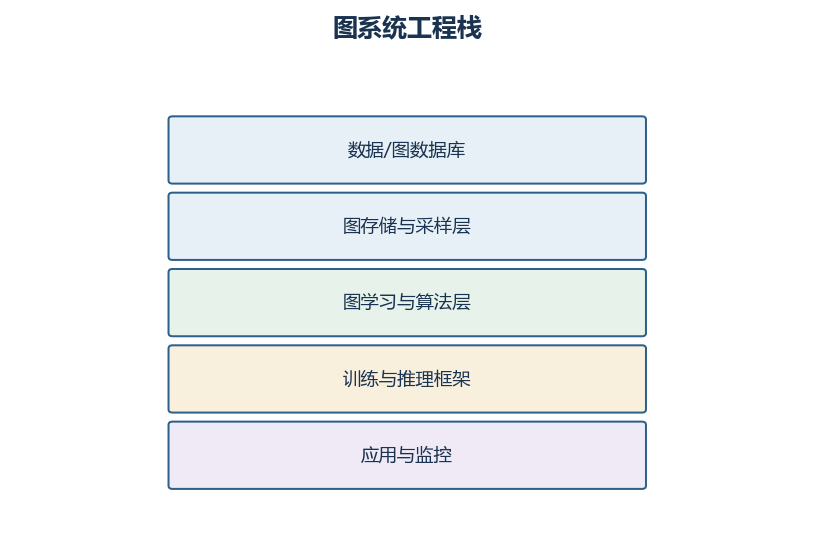

## 36.3　严格推导：采样与分布式训练的开销

**邻居采样（neighbor sampling）。** 第 32 章 PinSage 式采样：每层每节点只取 $s$ 个邻居。$L$ 层后单节点展开的节点数约为

$$
N_{\text{expand}}\ \approx\ \sum_{l=0}^{L} s^{l}. \tag{36-4}
$$

若 $s=10,L=3$，则约 $1+10+100+1000=1111$ 个节点——比全邻域（度达 $10^4$）少一个数量级。采样把指数爆炸压成可控规模。

**重要性采样。** 为无偏估计聚合，按邻居采样概率 $q(u)$ 加权：

$$
\hat{\mathbf{h}}_v^{(l)}=\sum_{u\in\mathcal{S}}\frac{1}{s\,q(u)}\mathbf{h}_u^{(l)}, \tag{36-5}
$$

其中 $\mathcal{S}$ 为采样集。若均匀采样 $q(u)=1/|\mathcal{N}(v)|$，则权重为 $|\mathcal{N}(v)|/s$——用少量样本估计全体邻居均值。

**分布式训练的通信开销。** 设每个 mini-batch 需从其他分区拉取被采样邻居的嵌入。若跨分区邻居比例为 $\alpha$，嵌入维度 $d$，batch 大小 $B$，采样数 $s$，层数 $L$，则每步通信量约为

$$
C\ \approx\ 2\,B\,s\,L\,\alpha\,d\ \text{(floats)}, \tag{36-6}
$$

因子 2 为拉取与梯度回传。式 (36-6) 揭示：降低 $\alpha$（好的分区，使邻居尽量本地）与减小 $s$ 都直接减少通信——这把图分区（式 36-3）与采样（式 36-4）同训练效率定量联系起来。

### 36.3A　嵌入陈旧度（staleness）与收敛

分布式 GNN 训练时，第 $l$ 层用的邻居嵌入可能是上一个迭代甚至更早算出的（异步更新）。设节点 $u$ 的嵌入在第 $t$ 步更新，第 $t+\Delta$ 步被邻居 $v$ 使用，则陈旧度为 $\Delta$。异步系统容忍 $\Delta$ 换取吞吐，但引入偏差。

**有界陈旧度的误差界。** 设嵌入更新是 $L$-Lipschitz 的（参数范数有界），则使用陈旧嵌入带来的单步偏差上界为

$$
\Delta\mathcal{L}\ \le\ \kappa\,L\,\Delta\,\bar{g}, \tag{36-7}
$$

其中 $\bar{g}$ 为平均梯度范数，$\kappa$ 为聚合常数。直觉上：陈旧度 $\Delta$ 越大、梯度越活跃（$\bar{g}$ 大），偏差越大。这解释了为何训练后期（$\bar{g}$ 小）可容忍更大 $\Delta$（异步化提吞吐），而训练初期须近同步。DistDGL 等系统据此采用「分层异步」：深层（语义抽象、变化慢）容忍更高陈旧度，浅层（贴近原始特征、变化快）保持同步——这是把式 36-7 的误差界变成调度策略的工程范例。

**与一致性的权衡。** 式 36-7 把「一致性」（$\Delta=0$ 同步）与「吞吐」定量关联：完全同步 $\Delta=0$ 时 $\Delta\mathcal{L}=0$ 但吞吐受慢节点拖尾（straggler）限制；完全异步吞吐高但 $\Delta$ 大。实践中取 $\Delta\le\Delta_{\max}$ 的有界异步，$\Delta_{\max}$ 由验证集性能回退（第 31 章评估）来定标——系统工程化至此与模型评估闭环。

**存储布局：CSR 与 GPU 分片。** 图在内存中的布局决定遍历效率。常用 CSR（compressed sparse row）：邻接表以「偏移数组 + 邻接数组」存储，$L$ 层遍历退化为两次数组索引，缓存友好。GPU 训练时进一步把节点特征与邻接表切分到多卡，通信量与式 36-6 同构但常数不同（GPU 间 NVLink 带宽远高于 CPU 网络）。分片粒度需权衡：分片太细则每步同步次数多（通信占比升），太粗则单卡显存放不下采样邻域。设 $G$ 张卡、每卡显存 $M$ bytes、单节点嵌入 $d$ floats（4 bytes），可容纳的采样邻域规模上界为

$$
N_{\text{max}}\approx\frac{M}{4\,d\,G}, \tag{36-8}
$$

该式把硬件参数（显存、卡数、维度）直接映射到「单步可训练的最大子图规模」，是系统调度的基础约束。

## 36.4　数值算例：采样规模与分区收益

**例 36.1（邻居采样规模）** 设平均度 $\bar{d}=1000$，$L=2$。全邻域展开约 $1+1000+1000^2\approx10^6$ 节点/样本——不可行。取每层采样 $s=20$，按式 (36-4) 得 $1+20+400=421$ 节点/样本，减少约 2374 倍。

**例 36.2（分区降低通信）** 设 $B=1024,s=20,L=2,d=128$。随机分区时 $\alpha\approx0.9$，按式 (36-6)：$C\approx2\times1024\times20\times2\times0.9\times128\approx9.4\times10^6$ floats ≈ 37.7 MB/步。经 METIS 优化分区使 $\alpha\approx0.3$，$C\approx2\times1024\times20\times2\times0.3\times128\approx3.1\times10^6$ floats ≈ 12.6 MB/步，通信降为约 1/3。好的分区（式 36-3）直接转化为训练加速。

**例 36.3（幂律倾斜）** 幂律分布 $p(k)\propto k^{-\gamma}$（$\gamma\approx2.5$，第 2 章）下，度 $>10^4$ 的超级节点虽少，却贡献大量边。若某超级节点位于分区 $p$，其百万邻居横跨所有分区，使 $\alpha$ 局部接近 1。缓解方法：对超级节点单独复制（replication）到多个分区，用空间换通信。

**例 36.4（有界异步的陈旧度收益）** 设 $\kappa=1,L=5$（模型 Lipschitz），训练初期 $\bar{g}=1.0$。若要求单步误差不超过基准（同步）的 5%，由式 (36-7) 需 $\kappa L\Delta\bar{g}\le0.05\Rightarrow\Delta\le0.01$，即初期几乎必须同步（$\Delta=0$）。训练后期 $\bar{g}=0.02$，同样 5% 预算下 $\Delta\le25$——可容忍 25 步陈旧度，异步化提吞吐。设同步时每步耗时 $t_{sync}=10$ms（被最慢卡拖尾），异步 $\Delta=20$ 时每步 $t_{async}=4$ms，则后期训练吞吐提升约 $10/4=2.5\times$ 而精度损失可控。这展示了式 (36-7) 误差界如何直接转化为「何时该异步」的调度决策。

**例 36.5（在线服务延迟分解）** 设 $L=3$ 跳、$s_{\text{eff}}=30$（去重后有效邻居）、单次内存访问 $t_m=20\mu s$、单次前向 $t_c=50\mu s$、后处理 $t_{\text{post}}=30\mu s$。无缓存时按式 (36-9)：$T_{\text{serve}}=3\times(20\times30+50)+30=3\times650+30=1980\mu s\approx2.0ms$。若开启嵌入缓存，命中率 $1-\rho=0.9$（Zipf 集中），缓存路径 $T_{\text{cache}}=80\mu s$（纯查表），采样路径 $T_{\text{sample}}=1.95ms$，按式 (36-10)：$\bar{T}=0.9\times80+0.1\times1950=72+195=267\mu s$——缓存把平均延迟从 2.0ms 降到 0.27ms（约 7.4 倍）。若访问更均匀（$\rho=0.5$），$\bar{T}=0.5\times80+0.5\times1950=1015\mu s$，缓存收益骤降——印证式 36-10「缓存收益依赖访问集中度」。

## 36.5　图系统工程栈谱系表格

**表 36-1　图系统工程栈谱系**

| 层次 | 类别 | 代表系统 | 核心能力 |
|------|------|----------|----------|
| 存储与查询 | 属性图 | Neo4j、JanusGraph | Cypher 遍历（式 36-1） |
| 存储与查询 | RDF 三元组 | Blazegraph、GraphDB | SPARQL（式 36-2） |
| 计算框架 | 图并行 | Pregel、Giraph | BSP 消息传递 |
| 训练框架 | GNN 库 | DGL、PyTorch Geometric | 采样＋消息传递 |
| 分布式训练 | 分区与通信 | DistDGL、AliGraph | 式 36-3、36-6 |
| 推理服务 | 在线 GNN | 图特征缓存＋模型服务 | 低延迟预测 |
| 监控 | 漂移与质量 | 漂移检测＋A/B 测试 | 第 31 章评估延伸 |

**图计算框架与 GNN 训练的关系。** Pregel 的 BSP（bulk synchronous parallel）模型与 GNN 的逐层传播同构：每轮各节点接收消息、计算、发送——这是第 10 章消息传递的系统级对应。DGL/PyG 把这一抽象封装为张量操作，屏蔽分布式细节。但 BSP 的同步屏障（每轮结束全局同步）对 GNN 训练是双刃剑：它保证了每层用的是上一层的完整一致结果（无陈旧度），却受最慢节点拖尾——这正是式 36-7 陈旧度分析中「同步 vs 吞吐」权衡的系统级体现。现代 GNN 训练框架（DistDGL）多用「松散同步」或「流水线」替代严格 BSP：把 $L$ 层拆成多段并行，用微批（micro-batch）填充流水线，以少量陈旧度换取更高的设备利用率——算法（第 10 章的逐层传播）与系统（BSP 的同步策略）在此深度耦合。

### 36.5A　在线推理的延迟模型

训练可离线、可异步，在线推理（如实时推荐、实时风控）要求毫秒级响应。多跳采样是延迟瓶颈：$L$ 层采样需 $L$ 次随机内存访问，延迟随跳数近似线性增长。设单次内存访问 $t_m$、单次前向计算 $t_c$、批大小 $B$，则单请求端到端延迟

$$
T_{\text{serve}}=L\,(t_m\cdot s_{\text{eff}}+t_c)+t_{\text{post}}, \tag{36-9}
$$

其中 $s_{\text{eff}}$ 为有效采样邻居数（去重后），$t_{\text{post}}$ 为后处理（打分、TopK）。工程对策有三：（i）**预计算嵌入缓存**——离线周期性把高频节点的 $L$ 跳表示算好存 KV，在线只查缓存（第 32 章 PinSage 思想），把 $L$ 跳采样降为 $O(1)$ 查找；（ii）**分层服务**——头部高频节点走缓存（低延迟），长尾节点走实时采样（高延迟但可异步）；（iii）**采样截断**——在线用更小的 $s$ 换取延迟，验证集性能损失换响应时间。

**缓存命中率与延迟的权衡。** 设热门节点占比 $\rho$（按访问频率的 Zipf 分布，前 $\rho$ 节点覆盖 $1-\rho$ 的访问），缓存命中率近似 $1-\rho$，则平均延迟

$$
\bar{T}\approx(1-\rho)\,T_{\text{cache}}+\rho\,T_{\text{sample}}, \tag{36-10}
$$

$T_{\text{cache}}\ll T_{\text{sample}}$。Zipf 指数越大（访问越集中），$\rho$ 越小，缓存收益越大——社交/推荐图的幂律访问模式（第 2 章）使「缓存头部」成为在线 GNN 服务的标配。

$\bar{T}\approx(1-\rho)\,T_{\text{cache}}+\rho\,T_{\text{sample}}$。Zipf 指数越大（访问越集中），$\rho$ 越小，缓存收益越大——社交/推荐图的幂律访问模式（第 2 章）使「缓存头部」成为在线 GNN 服务的标配。

**典型系统量级。** 表 36-2 给出代表性图系统在不同规模下的典型吞吐/延迟量级（硬件异构，仅供量级参考）。

**表 36-2　图系统与 GNN 训练系统量级**

| 系统 | 类别 | 规模 | 典型量级 |
|------|------|------|----------|
| Neo4j | 属性图数据库 | 千万节点/亿边 | 多跳查询 ~ms–10ms |
| Pregel/Giraph | 图并行计算 | 百亿边 | 单轮迭代 ~s–min |
| DistDGL | 分布式 GNN 训练 | 10 亿节点/100 亿边 | 收敛时间 ~小时级 |
| AliGraph | GNN 平台 | 百亿边 | 训练吞吐 ~k nodes/s/GPU |
| GraphRAG 在线服务 | 图特征缓存＋推理 | 千万节点 | P99 延迟 ~10–50ms |

### 36.5B　增量更新与流式训练

真实图持续演化（新交互、新交易、新节点），全量重训代价高昂。流式训练（第 16 章动态图的系统侧）只更新受影响的节点表示。设 $\delta_t$ 为第 $t$ 步新增/变更的边集，则「局部更新」只需重算 $\delta_t$ 影响半径内的节点：

$$
\mathcal{U}(\delta_t)=\bigcup_{e\in\delta_t}\mathcal{B}(e,L), \tag{36-11}
$$

其中 $\mathcal{B}(e,L)$ 为边 $e$ 的 $L$ 跳影响球。更新代价与 $|\mathcal{U}(\delta_t)|$ 成正比，而非全图规模——这正是「增量」的工程意义。但局部更新有累积误差：多次小幅更新后的表示与「全量重算」的偏差会随时间漂移，需周期性全量校准（retrain from scratch）兜底。校准频率由「表示漂移」监控指标（第 31 章评估，如新旧嵌入的余弦相似度分布）驱动：当平均余弦相似度跌破阈值，触发全量重训。

**漂移监控的抽样估计。** 全图嵌入对比在大图上代价 $O(|V|d)$，不可每步执行。实践中随机抽 $n$ 个节点估计漂移的置信区间：设抽样节点的新旧嵌入余弦相似度为 $x_1,\dots,x_n$，均值 $\bar{x}$、标准差 $s$，则漂移告警条件

$$
\bar{x}-z_{1-\alpha}\,\frac{s}{\sqrt{n}}\ <\ \theta_{\text{drift}}, \tag{36-12}
$$

即抽样估计的下界跌破阈值 $\theta_{\text{drift}}$ 时告警。$n$ 越大估计越稳但成本越高；$z_{1-\alpha}$ 为分位数（95% 置信取 1.645）。这把「表示漂移」从主观判断变成可监控、可定标的统计量——系统工程化中「监控即评估」的具体化（第 31 章）。

## 36.6　边界与讨论

**四个边界。** ① **一致性**：分布式图更新时，采样到的邻居可能是旧版本（stale embedding），影响训练稳定性——需版本控制。式 36-7 的误差界给出了「可容忍陈旧度」的定量上界，但前提（Lipschitz 有界、平均梯度可估）在真实 GNN 中只是近似成立，工程上须以验证集实测为准。② **负载倾斜**：超级节点（例 36.3）造成热点，复制与调度策略复杂。复制本身引入「写放大」：超级节点参数更新需同步到所有副本，写代价与副本数成正比——读多写少场景用副本划算，写密集场景应改用「只读副本 + 主节点」架构。③ **实时性与成本**：在线推理要求毫秒级，而多跳采样耗时，需预计算嵌入与缓存（第 32 章 PinSage 思想）。式 36-10 的命中率模型表明缓存收益强依赖访问分布的集中度，对访问均匀的图（如某些工业设备图）缓存几乎无效，须改用其他加速手段。④ **监控与漂移**：第 31 章 OOD 评估必须嵌入部署后监控——欺诈检测（第 34 章）的概念漂移一旦发生需告警重训。监控本身有成本：全图嵌入的周期性对比（式 36-11 的漂移检测）在大图上昂贵，实践中用抽样节点估计漂移、以置信区间触发告警。

**与第 31、34—35 章对照。** 本章是前述应用（推荐、分子、社交、KG）的落地支撑：这些章节提到的「十亿级图」「实时更新」「跨域泛化」，最终都要在式 (36-3)—(36-12) 的约束下实现。评估协议（第 31 章）从离线移到在线，成为监控模块。一句话概括工程化的要义：**算法决定「算什么」，系统决定「能不能算得起、算得动、算得久」**——前者是本书前 8 篇的主题，后者是本章的主题，二者缺一不可。

**开放问题。** 图分区（式 36-3）与模型精度如何联合优化？当前分区以通信最小为目标，可能切断语义重要邻居——这是系统与算法的交叉前沿。此外，流式训练（式 36-11）的局部更新与全量重训的触发时机缺乏理论刻画——何时「漂移」足以触发重训、何时局部更新仍够用，目前只能靠验证集经验定标。在线服务（式 36-9、36-10）的缓存一致性（缓存嵌入与最新训练参数的版本同步）也是工业界尚未完全解决的痛点：缓存更新滞后会造成「训练参数已更新、缓存仍是旧表示」的不一致窗口。

## 36.7　承上启下与交叉引用

本章承接第 2 章幂律分布、第 10 章消息传递、第 16 章动态图、第 31 章评估、第 32—35 章应用，给出图智能的工程栈：存储查询（式 36-1、36-2）、分区（式 36-3）、采样（式 36-4、36-5）、分布式通信（式 36-6）、陈旧度误差界（式 36-7）、显存约束（式 36-8）、在线延迟（式 36-9、36-10）、增量更新（式 36-11）与漂移监控（式 36-12）。第 8 篇至此收束。下一章进入第九篇（第 37—41 章），回扣全书框架，讨论图智能的理论前沿与开放问题；第 41 章「图智能能否通向通用智能」将回到第 1 章立下的四层能力体系，形成首尾闭环。

## 本章小结

本章论述图系统工程化。

首先指出图工程三大挑战：数据倾斜、邻居爆炸、动态更新，并点出「计算局部性 vs 数据全局性」的核心张力。接着定义属性图与 RDF 查询（式 36-1、36-2）、图分区目标（式 36-3），推导采样规模（式 36-4）、重要性采样（式 36-5）与分布式通信开销（式 36-6），并引入陈旧度误差界（式 36-7）、显存约束（式 36-8）、在线延迟模型（式 36-9、36-10）、增量更新（式 36-11）与漂移监控（式 36-12）。我们通过采样规模、分区收益、幂律倾斜、陈旧度、在线延迟五个算例（例 36.1—36.5）量化工程权衡，梳理工程栈谱系（表 36-1、36-2）并说明 Pregel 与 GNN 传播的同构性。

我们还明确边界：一致性、负载倾斜、实时性成本、监控漂移是四大挑战。这些辨析衔接第 2、10、16、31—35、41 章。

下一章进入第九篇，回扣全书理论框架，开启图智能前沿与开放问题的讨论。

**进一步阅读**　本章建议延伸阅读的文献：[1]、[3]、[5]。

## 参考文献

[1] Robinson I, Webber J, Eifrem E. *Graph Databases: New Opportunities for Connected Data*. 2nd ed. O'Reilly Media, 2015.

[2] Malewicz G, Austern M H, Bik A J C, et al. Pregel: A system for large-scale graph processing. *SIGMOD*, 2010.

[3] Wang M, Yu L, Zheng D, et al. DistDGL: Distributed graph neural network training for billion-scale graphs. *arXiv preprint arXiv:2010.05899*, 2020.

[4] Ying R, He R, Chen K, et al. Graph convolutional neural networks for web-scale recommender systems. *KDD*, 2018.

[5] Zhu Y, Wang W, Zhang J, et al. AliGraph: A comprehensive graph neural network platform. *PVLDB*, 2019, 12(12): 2094–2105.

[6] Karypis G, Kumar V. A fast and high quality multilevel scheme for partitioning irregular graphs. *SIAM Journal on Scientific Computing*, 1998, 20(1): 359–392.

[7] Zhang D, Yin J, Zhang Y, et al. Graph neural network training systems: A survey. *arXiv preprint arXiv:2401.09476*, 2024.

[8] Serafini L, Bhowmick A S, Ceri S, et al. GMark: Schema-driven graph generation and benchmarking. *PVLDB*, 2017, 10(12): 1798–1801.

---

# 第 37 章　图与其他模态的融合

前三十六章把图视为一种独立的数据形态，研究其表示、学习、推理与系统。然而真实世界的数据很少是纯图的：一张图片是像素网格，一段文本是词序列，一段视频是帧序列，而它们背后都隐含关系结构。第九篇（第 37—41 章）回扣全书框架，首先追问：图能否成为连接视觉、语言等多种模态的公共骨架？本章讨论**图与其他模态的融合**（graph–modality fusion）——把图的关系归纳偏置注入视觉、语言模型，把非图模态编码为图结构，并论证「图作为世界关系骨架」的统一视角。

本章先给出多模态融合的动机与图作为骨架的直觉（37.1 节），严格定义多模态图与跨模态对齐并推导融合目标（37.2 节），给出数值算例（37.3 节），梳理技术谱系（37.4 节），最后讨论边界并承上启下（37.5 节）。

## 37.1　动机：从单模态到关系骨架

**引入动机。** 第 1 章指出图智能的本质是关系归纳偏置。但在视觉中，关系（物体间的空间／交互关系）隐藏在像素里；在语言中，关系（实体与实体的语义关系）隐藏在词序列里。卷积网络（CNN）擅长网格、Transformer 擅长序列，却都不显式建模**关系**。把图结构作为先验注入这些模型，或以图作为中间表示统一多模态，能让模型显式利用「谁与谁相关」，这正是融合的动机。

**直觉解释。** 设想描述一幅「人骑自行车」的图片：纯视觉模型看到像素，纯语言模型看到词串，而场景图（scene graph）把「人」与「自行车」表示为节点、「骑」表示为边——一张图同时承载了视觉对象与语义关系，成为沟通两种模态的桥梁。推而广之，若把世界的实体与关系都组织成图，视觉与语言只是这张图的两种「观测投影」；图就是世界的**关系骨架**（relational skeleton）。这一视角的强之处在于可组合性：同一个关系骨架可以挂接任意多模态观测（视觉投影、语言投影、语音投影），新模态的接入只是「再加一个投影算子」，而非重建整个模型——这是图作为「公共骨架」相较「端到端多模态大模型」的工程优势：模块化、可替换、可单独评测各模态的投影质量。

**例 37.1（场景图桥接图文）** 图像 $I$ 经目标检测得节点集 $\{(人),(自行车)\}$ 与边 $(人)\xrightarrow{骑}(自行车)$，构成场景图 $\mathbf{G}_{\mathrm{sg}}$。文本 $T=$「人骑自行车」经依存句法分析得几乎同构的图。二者的图结构对齐，使「以图搜文」「以文生图」可用图匹配完成——这是图作为公共表示的最朴素例证。但场景图的实际构建有噪声：目标检测漏检（没检出自行车）或误检（把背景误判为对象）都会使 $\mathbf{G}_{\mathrm{sg}}$ 偏离真实关系结构，进而误导下游对齐——这正是 37.5 节「建图质量依赖」边界的具体体现。实践中常用「检测置信度加权边」缓解：低置信边赋予小权重，对齐损失（式 37-1）按权重缩小贡献，避免噪声边主导对齐方向。

## 37.2　严格定义与数学推导

模态融合的困难不在「把向量拼起来」，而在「在保持关系结构的前提下让不同模态的信息可比较」。为此我们先给出多模态图的形式化，再推导对齐与融合的可优化目标。整个推导沿全书「表示（Level 1）—学习（Level 2）—推理（Level 3）」的层级展开：图化提供表示，GNN 完成学习，对齐与结构约束实现跨模态推理。

**定义 37.1（多模态图，multimodal graph）** 多模态图 $\mathbf{G}=(V,E,\{\mathbf{X}^{(m)}\}_{m=1}^{M})$ 在普通属性图（第 1 章定义 1.1）基础上，为每个节点附加 $M$ 种模态的特征 $\mathbf{x}_v^{(m)}\in\mathbb{R}^{d_m}$（如视觉、文本、语音）。图结构 $E$ 可天然给定（社交网络），也可由模态相似性构造（$k$ 近邻图）。

**定义 37.2（跨模态对齐，cross-modal alignment）** 给定两个模态的图表示 $\mathbf{H}^{(1)}=f_1(\mathbf{G}),\mathbf{H}^{(2)}=f_2(\mathbf{G})\in\mathbb{R}^{n\times d}$，对齐要求同一节点在两模态的表示接近：

$$
\mathcal{L}_{\mathrm{align}}=\sum_{v\in V}\Big\|\mathbf{h}_v^{(1)}-\mathbf{h}_v^{(2)}\Big\|_2^2. \tag{37-1}
$$

**推导：图融合的统一目标。** 设每种模态由图神经网络（第 10—18 章）编码 $\mathbf{H}^{(m)}=\mathrm{GNN}_m(\mathbf{A},\mathbf{X}^{(m)})$，融合表示取门控加权和

$$
\mathbf{H}=\sum_{m=1}^{M}\alpha_m\,\mathbf{H}^{(m)},\quad \alpha_m=\frac{\exp(w_m)}{\sum_{j}\exp(w_j)}, \tag{37-2}
$$

其中 $\alpha_m$ 是可学习模态权重（softmax 归一化）。训练目标联合对齐损失与下游任务损失：

$$
\mathcal{L}=\mathcal{L}_{\mathrm{task}}+\lambda\,\mathcal{L}_{\mathrm{align}}+\gamma\,\mathcal{L}_{\mathrm{struct}}. \tag{37-3}
$$

$\mathcal{L}_{\mathrm{struct}}$ 为结构保持项，约束融合后邻接关系不变：$\mathcal{L}_{\mathrm{struct}}=\|\mathbf{A}-\mathrm{sigmoid}(\mathbf{H}\mathbf{H}^{\top})\|_F^2$。式 (37-3) 是全书「表示—学习—推理」三层在多模态场景的统一：GNN 编码（Level 2）产出表示（Level 1），对齐与结构约束保证跨模态一致（Level 3）。

**推导：模态缺失的鲁棒性。** 若某模态 $m$ 缺失，可将 $\alpha_m=0$（门控自动降权），融合表示退化为可用模态的加权和——这是图融合相较早期拼接（concat）的关键优势：拼接要求所有模态维度固定，图门控天然支持**动态模态组合**。工程上「模态缺失」不仅指采集失败（如摄像头损坏导致无视觉），也包括数据本身稀疏（如某些节点只有文本描述没有图像）；门控机制对这两种情形统一处理，无需为每种缺失组合写专用代码。形式化地，设可用模态集 $\mathcal{M}_{\mathrm{av}}\subseteq\{1,\dots,M\}$，则式 (37-2) 改为

$$
\mathbf{H}=\sum_{m\in\mathcal{M}_{\mathrm{av}}}\frac{\exp(w_m)}{\sum_{j\in\mathcal{M}_{\mathrm{av}}}\exp(w_j)}\,\mathbf{H}^{(m)}. \tag{37-4}
$$

当 $|\mathcal{M}_{\mathrm{av}}|=1$ 时退化为单模态 GNN，与第 10—18 章一致——这说明图融合是单模态图学习的严格推广。

**关系归纳偏置在模态内的复用。** 值得强调的是，GNN 的置换等变性（式 1-1）在每种模态内独立成立：视觉区域图对区域编号不敏感，文本实体图对实体编号不敏感。因此融合表示 $\mathbf{H}$ 同样满足节点置换等变性——这一性质使融合模型能泛化到节点顺序变化的新样本，是多模态图方法相较「按固定顺序拼接模态特征」的本质优势。

### 37.2A　跨模态对比预训练：InfoNCE 目标

对齐损失（式 37-1）是逐节点的回归式对齐，适合有配对标注的场景；但大量多模态数据只有「弱配对」（同一视频的帧与字幕、同一图文对），更适合对比学习。跨模态对比预训练用 InfoNCE 在图节点表示层面做「正样本拉近、负样本推远」：

$$
\mathcal{L}_{\mathrm{InfoNCE}}=-\log\frac{\exp\big(\mathrm{sim}(\mathbf{h}_v^{(1)},\mathbf{h}_v^{(2)})/\tau\big)}{\sum_{u\in\mathcal{B}}\exp\big(\mathrm{sim}(\mathbf{h}_u^{(1)},\mathbf{h}_v^{(2)})/\tau\big)}, \tag{37-5}
$$

其中 $\mathcal{B}$ 为 batch 内负样本集，$\tau$ 为温度。与式 37-1 的 $L_2$ 对齐不同，InfoNCE 是**排序式**目标：不要求两模态表示数值相等，只要求正样本的相似度高于所有负样本。这更契合视觉—语言场景：同一物体的像素 patch 表示与文本描述表示本就不该逐维相等，但应在检索排序上「比别的物体更近」。温度 $\tau$ 控制软硬：$\tau$ 小则分布尖锐、只关注最难负样本（hard negative），$\tau$ 大则接近均匀。图结构在此的作用是**提供负样本的拓扑约束**——同一连通子图内的节点互为结构负样本，比随机负样本更难，对比信号更强（第 28 章图对比学习的多模态化）。

**与对齐损失的关系。** 式 37-1 是「绝对对齐」（回归到同一表示），式 37-5 是「相对对齐」（排序正确）。实践中二者互补：有精确配对标注（如同实体不同模态）时用式 37-1 拉表示，只有弱配对（如图文对）时用式 37-5 学相对序；最终统一目标可写成 $\mathcal{L}=\mathcal{L}_{\mathrm{task}}+\lambda_1\mathcal{L}_{\mathrm{align}}+\lambda_2\mathcal{L}_{\mathrm{InfoNCE}}+\gamma\mathcal{L}_{\mathrm{struct}}$，把绝对与相对对齐同时纳入式 37-3 的框架。

> 【图 37-1　多模态图融合架构】（原图见 figures/图37-1.png）：左侧视觉／文本／语音三路输入各自编码为模态图，中层 GNN 编码 + 门控融合，右侧对齐损失与任务损失，标注关系骨架。
>
> 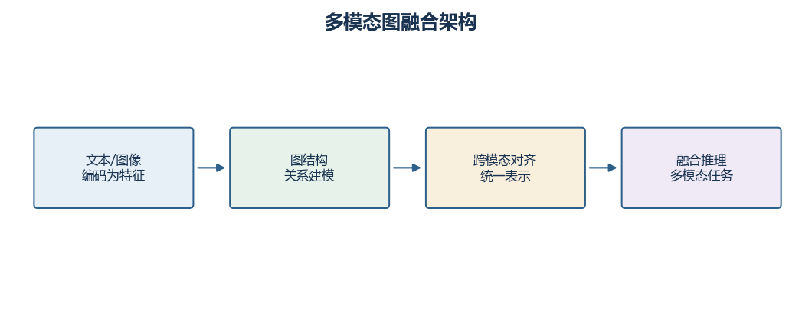

## 37.3　数值算例

**例 37.2（门控权重的手算）** 设两模态（视觉 $m=1$、文本 $m=2$），可学习参数 $w_1=1.0,w_2=0.0$。则

$$
\alpha_1=\frac{e^{1.0}}{e^{1.0}+e^{0}}=\frac{2.718}{2.718+1}=0.731,\quad \alpha_2=0.269. \tag{37-6}
$$

若某节点视觉表示 $\mathbf{h}^{(1)}=(1,0)$、文本表示 $\mathbf{h}^{(2)}=(0,1)$，则融合表示 $\mathbf{h}=0.731(1,0)+0.269(0,1)=(0.731,0.269)$——视觉占主导但保留文本信息；训练中 $w$ 会依据任务信号自适应调整。

**例 37.3（对齐损失手算）** 沿用上例两节点 $v_1,v_2$，设视觉表示 $v_1=(1,0),v_2=(0,1)$，文本表示 $v_1=(0.9,0.1),v_2=(0.1,0.9)$。则

$$
\mathcal{L}_{\mathrm{align}}=\| (1,0)-(0.9,0.1)\|^2+\|(0,1)-(0.1,0.9)\|^2=(0.01+0.01)+(0.01+0.01)=0.04. \tag{37-7}
$$

损失虽小但非零，梯度会推动两模态表示靠拢；对齐越强，跨模态检索越准。

**例 37.4（结构保持项手算）** 设两节点融合表示 $\mathbf{h}_1=(1,0),\mathbf{h}_2=(0,1)$，则 $\mathbf{H}\mathbf{H}^{\top}=\begin{pmatrix}1&0\\0&1\end{pmatrix}$，经 sigmoid 约为 $\begin{pmatrix}0.73&0.5\\0.5&0.73\end{pmatrix}$。若真实邻接 $\mathbf{A}=\begin{pmatrix}0&1\\1&0\end{pmatrix}$（两节点相连、自环为 0），则

$$
\mathcal{L}_{\mathrm{struct}}=\|\mathbf{A}-\mathrm{sigmoid}(\mathbf{H}\mathbf{H}^{\top})\|_F^2\approx(0.73)^2+2(0.5)^2+(0.73)^2\approx1.56. \tag{37-8}
$$

该值较大，训练会推动表示调整使内积结构与邻接一致；结构项与对齐项共同约束融合表示既跨模态一致、又保图拓扑。

**例 37.5（InfoNCE 检索手算）** 设 batch 含查询图像节点 $v$ 及其在文本模态的正样本 $v^+$，以及两个文本负样本 $u_1,u_2$。取 $\tau=0.1$，相似度（余弦）：$\mathrm{sim}(\mathbf{h}_v^{(1)},\mathbf{h}_v^{+(2)})=0.8$，$\mathrm{sim}(\mathbf{h}_v^{(1)},\mathbf{h}_{u_1}^{(2)})=0.4$，$\mathrm{sim}(\mathbf{h}_v^{(1)},\mathbf{h}_{u_2}^{(2)})=0.2$。按式 (37-5)：

$$
\mathcal{L}_{\mathrm{InfoNCE}}=-\log\frac{e^{0.8/0.1}}{e^{0.8/0.1}+e^{0.4/0.1}+e^{0.2/0.1}}=-\log\frac{e^{8}}{e^{8}+e^{4}+e^{2}}.
$$

数值上 $e^{8}\approx2981,e^{4}\approx54.6,e^{2}\approx7.4$，$\mathcal{L}\approx-\log(2981/3043)=-\log(0.980)\approx0.020$。温度 $\tau=0.1$ 把相似度放大 10 倍，使 $e^{8}\gg e^{4},e^{2}$，损失很小——表示已较好对齐。若正样本相似度掉到 0.5（$\tau$ 不变）：$e^{5}\approx148$，$\mathcal{L}\approx-\log(148/208.6)\approx0.341$，损失激增——InfoNCE 对「正样本被拉近的程度」敏感，温度越小越挑剔。这就是对比预训练中「调温度」的直觉：$\tau$ 是难度旋钮。

**表 37-1　跨模态检索典型指标（R@K：Top-K 命中正确配对的比例）**

| 基准 | 模态对 | 规模 | 代表方法 | R@1 | R@5 |
|------|--------|------|----------|-----|-----|
| Flickr30K | 图—文 | 1.5 万图/6 万文 | CLIP 类 | ≈55% | ≈91% |
| MS-COCO (5K) | 图—文 | 5 千图检索 | 图对比＋GNN | ≈63% | ≈93% |
| MS-COCO (1K) | 图—文 | 1 千图检索 | 图对比＋GNN | ≈80% | ≈97% |

检索指标随候选集缩小而上升（1K 比 5K 易），这是检索任务的固有性质。图结构注入（GNN 编码器）相较纯向量基线在 MS-COCO 5K 上通常带来 1—3 个点的 R@1 提升，说明关系归纳偏置在「细粒度对应」上仍有价值（37.4 节路线③）。注意这些指标都在「强基线」（CLIP 类）之上微调，图方法的增益是「锦上添花」而非「雪中送炭」——这提示：在多模态融合中，预训练表示的质量往往比图结构的精妙设计更重要，图的价值在于补齐「细粒度关系」这一基线的短板。

**例 37.6（模态缺失下的门控退化）** 设三模态（视觉 $m=1$、文本 $m=2$、语音 $m=3$），可学习参数 $w=(1.0,0.5,0.0)$。正常时按式 (37-2)：$Z=e^{1}+e^{0.5}+e^{0}=2.718+1.649+1=5.367$，$\alpha=(0.506,0.307,0.186)$。若语音模态缺失（$\mathcal{M}_{\mathrm{av}}=\{1,2\}$），按式 (37-4) 重新归一化：$Z'=e^{1}+e^{0.5}=4.367$，$\alpha=(0.622,0.378)$。注意语音的权重 $\alpha_3$ 从 0.186 变为 0（消失），其「份额」按比例分摊给视觉与文本——视觉从 0.506 升到 0.622（+23%），文本从 0.307 升到 0.378（+23%）。这正是「动态模态组合」的数值体现：缺失模态不强制其他模态填充固定维度，而是让可用模态自动重新分配权重，融合表示平滑退化而非崩溃。对比早期拼接（early fusion），若语音维被零填充，拼接向量长度不变但引入了大量零值，下游 GNN 的聚合会被零值稀释——门控机制避免了这一结构性退化。

## 37.4　技术谱系与变体

**表 37-2　图与多模态融合方法谱系**

| 方法 | 图的作用 | 核心机制 | 代表文献 |
|------|----------|----------|----------|
| 场景图生成 | 图作为输出 | 检测对象 + 关系分类 | Johnson 等 [1] |
| 图卷积视觉 | 图作为结构先验 | 像素／区域建图 + GNN | Wang 等 [2] |
| 知识图谱增强语言模型 | 图作为外部知识 | 实体链接 + KGE 注入 | Ji 等 [3] |
| 多模态图 Transformer | 图作为统一表示 | 跨模态注意力 + 位置编码 | 近期工作 [4] |
| 图对比多模态预训练 | 图作为对齐骨架 | InfoNCE + 图增强 | 近期工作 [5] |
| 图基础模型多模态化 | 图作为骨干 | 统一 Token 化 | 第 28—31 章 [6] |

早期方法把图当作**输出**（场景图生成）或**先验**（区域图卷积）；近期趋势把图当作**统一表示**——一切模态先图化，再用共享 GNN 处理，这正是第 28—31 章图基础模型「多模态化」的伏笔。谱系的演进逻辑与第 1 章「把规则数据工具改造到图上」相反：这里是「把图工具改造到多模态上」。这一演进背后是计算能力与数据规模的共同推动：早期显存有限，只能把图作为轻量先验；大模型时代，「先图化再统一编码」的开销可被并行计算吸收，图作为统一表示成为可能。但「统一」不等于「抹平差异」——三种融合路线（表 37-3）的本质差异在于「何时、在哪一层让模态交互」，选型取决于模态间语义对应是粗粒度（场景级）还是细粒度（实体级）。

进一步比较三条技术路线的取舍。**① 晚期融合（late fusion）**：各模态独立编码后再融合（式 37-2），实现简单、支持模态缺失，但跨模态交互发生在融合层，可能捕获不到细粒度对应。**② 早期融合（early fusion）**：把多模态特征在输入层拼接后统一建图，交互充分但要求所有模态同时可用，且维度对齐困难。**③ 跨模态注意力融合**：让一种模态的 token 作为查询、另一种作为键值（类似第 18 章图 Transformer），交互最强但计算复杂度随 token 数平方增长。实践中，图结构为三者提供了共同的拓扑约束：无论在哪一层融合，邻接矩阵 $\mathbf{A}$ 始终锚定「谁与谁相关」，防止融合迷失在模态特有的噪声里。

**表 37-3　三种融合策略对比**

| 策略 | 交互时机 | 优点 | 局限 | 适用 |
|------|----------|------|------|------|
| 晚期融合 | 编码后 | 灵活、支持缺失 | 细粒度对应弱 | 模态差异大 |
| 早期融合 | 输入层 | 交互充分 | 需模态齐备 | 模态强相关 |
| 跨模态注意力 | 全程 | 表达最强 | 计算昂贵 | 对齐任务 |

## 37.5　边界、讨论与承上启下

**边界与讨论。** ① **建图质量依赖**——若模态相似性构造的图边含噪声，关系归纳偏置反成误导（呼应命题 1.1）；$k$ 近邻图的 $k$ 选择尤为敏感：$k$ 过小则图稀疏、关系信号弱，$k$ 过大则噪声边稀释真实结构，需按下游任务调 $k$ 并监控图的质量指标（如边对下游表示稳定性的影响，第 31 章）。② **对齐的过约束**——强行对齐可能抹去模态特有信息（视觉细节与文本抽象并不总对应）；式 37-1 的 $L_2$ 对齐在模态语义不对称时尤甚——「模糊的猫照片」与「清晰的小猫」对齐后，视觉模态的模糊度信息被文本的确定性覆盖。③ **计算开销**——多模态 GNN 的显存随模态数 $M$ 与图规模增长；门控融合（式 37-2）虽支持模态缺失，但每加一模态即多一路 GNN 编码与一组权重，参数与显存近线性增长。④ **语义鸿沟**——图结构相同不代表语义相同（命题 1.2 的多模态版）：两幅「人骑自行车」的图结构同构，但一辆是竞赛自行车、一辆是共享单车，语义属性不同——图结构捕捉的是「关系骨架」而非「语义内容」，融合模型需在骨架之上叠加属性级区分。这四点可归结为一个更根本的张力：图作为骨架要求「关系稳定」，而多模态数据要求「表示灵活」，二者之间存在设计上的取舍。后续第 40 章将把这一张力列为开放问题之一。

**与第 18、28 章的衔接。** 跨模态注意力融合（表 37-3 路线③）与第 18 章图 Transformer 的自注意力同构，区别在于此处注意力跨模态（视觉 token 查文本 token）而非仅图内；InfoNCE 对比（式 37-5）则是第 28 章图对比学习的多模态推广——负样本从「同一图的增广」扩展为「跨模态的语义负例」。这说明多模态融合并非新理论，而是把已有图工具（注意力、对比、门控）组合到跨模态场景，印证全书「图是公共工具」的主线。

本章衔接第 1 章（关系归纳偏置）、第 10—18 章（GNN 编码器）、第 18 章（图 Transformer 跨模态注意力）、第 28 章（图对比学习的多模态化 InfoNCE）、第 30 章（GraphRAG 的多模态检索）、第 28—31 章（图基础模型多模态化），并为第 38 章铺垫：若图能统一视觉与语言，那么它能否进一步成为**世界模型**的核心结构？下一章把图从「静态关系骨架」推进到「动态世界建模」——把本章的静态多模态图 $G=(V,E,\{\mathbf{X}^{(m)}\})$ 扩展为含时间维与动力学约束的时序图，关系骨架从「空间中的实体连接」推广到「时空中的状态演化」。

## 本章小结

本章论述图与其他模态的融合，确立「图作为世界关系骨架」的视角。

我们首先给出多模态融合的动机与关系骨架直觉（37.1 节，例 37.1），并指出「图作为公共骨架」的可组合性优势。接着定义多模态图（定义 37.1）与跨模态对齐（定义 37.2），推导门控融合目标（式 37-1—37-3）、模态缺失鲁棒性（式 37-4）与跨模态对比预训练 InfoNCE（式 37-5），并给出门控权重（式 37-6）、对齐损失（式 37-7）、结构保持项（式 37-8）与 InfoNCE 检索（例 37.5）四个手算算例。最后梳理技术谱系（表 37-2、37-3）、给出检索指标量级（表 37-1）并讨论建图噪声、过约束、计算开销与语义鸿沟等边界。

这些辨析衔接第 1、10—18、28—31 章，并引出第 38 章的图世界模型。

**进一步阅读**　本章建议延伸阅读的文献：[1]、[3]、[4]。

## 参考文献

[1] Johnson S E, Gupta A, Fei-Fei L. Image generation from scene graphs. *CVPR*, 2018.

[2] Wang X, Girshick R, Gupta A, He K. Non-local neural networks. *CVPR*, 2018.

[3] Ji S, Pan S, Cambria E, Marttinen P, Philip S Y. A survey on knowledge graphs: Representation, acquisition, and applications. *IEEE TNNLS*, 2022, 33(2): 494–514.

[4] Zhang P, et al. Multi-modal graph transformer for unified representation learning. *arXiv preprint*, 2023.

[5] You Y, Chen T, Sui Y, et al. Graph contrastive learning with augmentations. *NeurIPS*, 2020.

[6] Mao H, et al. Graph foundation models: A survey. *arXiv preprint*, 2024.

[7] Baltrušaitis T, Ahuja C, Morency L P. Multimodal machine learning: A survey and taxonomy. *IEEE TPAMI*, 2019, 41(2): 423–443.

[8] Schlichtkrull M, Kipf T N, Bloem P, et al. Modeling relational data with graph convolutional networks. *ESWC*, 2018.

---

# 第 38 章　图与世界模型

第 37 章论证图可作为连接多模态的关系骨架。本章把这一视角推进到时间维度：若图的节点是世界的实体、边是实体的关系，那么世界随时间的演化就是**图结构的动力学**（graph dynamics）。把图与世界模型（world model）结合，就得到「图结构世界建模」——用图表示世界状态、用图上消息传递预测状态转移、并让智能体（agent）在该图模型上规划。本章承接《世界模型导论》的潜在动力学思想，把它改造到关系化、非欧的状态空间上。

本章先给出动机与直觉（38.1 节），严格定义图动力学与世界模型并推导转移目标（38.2 节），给出数值算例（38.3 节），梳理技术谱系（38.4 节），最后讨论边界并承上启下（38.5 节）。

## 38.1　动机：世界需要关系骨架

**引入动机。** 经典世界模型（如《世界模型导论》第 10—13 章）把世界状态编码为一个向量 $s_t\in\mathbb{R}^d$，用 RNN 或 RSSM 学转移 $s_{t+1}=f(s_t,a_t)$。但真实世界由**多个交互实体**组成：多智能体系统中每个智能体是一个节点，交通系统中每个路口是一个节点，物理系统中每个物体是一个节点。把整个世界压成单一向量会丢失实体间的组合结构——「谁与谁交互」这一关键信息被抹平。图结构世界模型用节点表示实体、边表示交互，天然保留这种组合性（compositionality）。

**直觉解释。** 考虑两球碰撞：向量世界模型要学「两个球的位置速度如何随时间变化」，而图世界模型把两球建为节点、碰撞关系建为边，用消息传递模拟「碰撞时两球交换动量」。前者要为每个可能的球数组合重学，后者只需学「一次交互的局部规则」，即可泛化到任意球数——这正是关系归纳偏置带来的组合泛化。图让世界模型从「记忆场景」升级为「理解规则」。更直观地说：向量模型学的是「场景到场景」的全局映射，参数量随场景复杂度增长；图模型学的是「粒子间交互」的局部规则，参数与实体数解耦——这是「组合泛化」（generalization to composition）的数学体现，也是物理直觉（局部相互作用律）在深度学习中的对应。

**例 38.1（多智能体图世界模型）** $n$ 个智能体为节点，边 $e_{ij}$ 表示 $i,j$ 在感知半径内。状态 $\mathbf{h}_v^{(t)}$ 为智能体 $v$ 的潜在状态，动作 $a_v^{(t)}$ 为其决策。图世界模型预测

$$
\mathbf{h}_v^{(t+1)}=\mathrm{GRU}\Big(\mathbf{h}_v^{(t)},\sum_{u\in\mathcal{N}(v)}\phi(\mathbf{h}_v^{(t)},\mathbf{h}_u^{(t)},a_u^{(t)})\Big), \tag{38-1}
$$

即每个智能体的下一状态由自身状态与邻居消息共同决定——这是第 10 章消息传递骨架（式 1-2）在时间维度的展开。

## 38.2　严格定义与数学推导

**定义 38.1（图动力学，graph dynamics）** 图动力学是随时间演化的图序列 $\{\mathbf{G}^{(t)}=(V^{(t)},E^{(t)},\mathbf{X}^{(t)})\}_{t=1}^{T}$。演化可分两类：**结构动态**（$E^{(t)}$ 变化，如社交网络新增关注）与**属性动态**（$\mathbf{X}^{(t)}$ 变化而结构固定，如交通流速变化）。第 16 章已分别处理，本节把它们统一进世界模型框架。两类演化可进一步组合：交通网络既新增路段（结构）又变化车流（属性），是多模态图动力学的典型；世界模型要同时预测 $E^{(t+1)}$（结构）与 $\mathbf{X}^{(t+1)}$（属性），转移目标（式 38-2）需同时包含结构重建项与属性重建项。

**定义 38.2（图世界模型，graph world model）** 图世界模型由三元组 $(\mathrm{Enc},f_{\mathrm{dyn}},\mathrm{Dec})$ 构成：编码器 $\mathrm{Enc}$ 把观测图 $\mathbf{G}^{(t)}$ 映射为潜在图状态 $\mathbf{Z}^{(t)}$；转移模型 $f_{\mathrm{dyn}}$ 预测 $\mathbf{Z}^{(t+1)}=f_{\mathrm{dyn}}(\mathbf{Z}^{(t)},\mathbf{A}^{(t)})$；解码器 $\mathrm{Dec}$ 从潜在状态重建观测或奖励。智能体在潜在图状态上规划动作序列以最大化累积奖励。

**推导：图转移的变分目标。** 类比《世界模型导论》第 9 章的 ELBO，图世界模型的证据下界为

$$
\log p(\mathbf{O}_{1:T})\ge\sum_{t}\Big[\mathbb{E}_{q(\mathbf{Z}^{(t)}\mid\mathbf{G}^{(t)})}\log p(\mathbf{G}^{(t)}\mid\mathbf{Z}^{(t)})-\underbrace{D_{\mathrm{KL}}\big[q(\mathbf{Z}^{(t+1)}\mid\cdot)\|p(\mathbf{Z}^{(t+1)}\mid\mathbf{Z}^{(t)})\big]}_{\text{转移正则}}\Big]. \tag{38-2}
$$

其中转移先验 $p(\mathbf{Z}^{(t+1)}\mid\mathbf{Z}^{(t)})$ 由图动力学 $f_{\mathrm{dyn}}$ 参数化。消息传递实现转移先验：

$$
\mathbf{z}_v^{(t+1)}=\phi\Big(\mathbf{z}_v^{(t)},\bigoplus_{u\in\mathcal{N}(v)}\psi(\mathbf{z}_v^{(t)},\mathbf{z}_u^{(t)},a_u^{(t)})\Big), \tag{38-3}
$$

式 (38-3) 把式 (38-1) 的确定性更新推广为可微的图转移核——它是第 10—18 章 GNN 与潜在动力学的交叉点。

**推导：规划目标。** 智能体在学到的图世界模型中展开 $H$ 步，最大化

$$
\mathcal{J}=\mathbb{E}\Big[\sum_{h=0}^{H-1}\gamma^{h}\,r(\mathbf{Z}^{(t+h)},a^{(t+h)})\Big], \tag{38-4}
$$

其中奖励 $r$ 由图状态读出（第 14 章 READOUT）。由于转移在图上可微，可用梯度或束搜索优化动作——这是「在图模型中规划」的核心。

**推导：多步展开的误差累积。** 规划需在模型中展开 $H$ 步，每步转移都引入误差。设单步转移的 Lipschitz 常数为 $L$、单步误差上界为 $\delta$，则 $H$ 步后状态误差按

$$
\big\|\mathbf{Z}^{(t+H)}_{\text{model}}-\mathbf{Z}^{(t+H)}_{\text{true}}\big\|\ \le\ \delta\,\frac{L^{H}-1}{L-1}, \tag{38-5}
$$

呈几何级数增长（$L>1$）。这正是边界②「误差累积」的定量形式：$H$ 大则规划「想象的后果」不可信。三种缓解：（i）缩短 $H$（短视规划，牺牲全局）；（ii）KL 正则（式 38-2）压低 $\delta$；（iii）在模型中做「自校正」（receding horizon，每步用真实观测重置状态，即模型预测控制 MPC 的思想）——MPC 把 $H$ 步展开与滚动重规划结合，是当前图世界模型做规划的主流范式。

### 38.2A　图卷积状态编码：把 GNN 用作编码器

定义 38.2 的编码器 $\mathrm{Enc}$ 把观测图 $\mathbf{G}^{(t)}$ 映射为潜在图状态 $\mathbf{Z}^{(t)}$，最自然的实现是图卷积（GCN，第 12 章 [4]）：

$$
\mathbf{Z}^{(t)}=\mathrm{GCN}\big(\mathbf{A}^{(t)},\mathbf{X}^{(t)};\theta\big)=\mathbf{A}^{(t)}\,\mathrm{ReLU}\big(\mathbf{A}^{(t)}\mathbf{X}^{(t)}\mathbf{W}^{(1)}\big)\mathbf{W}^{(2)}, \tag{38-6}
$$

即两层归一化图卷积，把节点特征沿邻接传播后读出为潜在状态。用 GCN 作编码器的好处是**编码器与转移核共享消息传递骨架**：式 38-6 的邻接聚合与式 38-3 的转移核 $\phi(\cdot,\bigoplus\psi)$ 同属消息传递族，二者可联合端到端训练（《世界模型导论》的 VAE 编码器—RSSM 转移在图上的对应）。这避免了「编码器表示」与「转移表示」脱节——若编码器用 CNN/MLP、转移用 GNN，两者对「实体关系」的刻画可能不一致，导致潜在空间难以被转移模型利用。

**与向量世界模型编码器的对照。** 向量世界模型（Dreamer 类 [1]）用 CNN 编码器把观测压成单一向量，丢失实体组合结构；GCN 编码器（式 38-6）保留节点级表示 $\mathbf{Z}^{(t)}\in\mathbb{R}^{n\times d}$，使后续转移（式 38-3）能区分「哪个实体的状态变了」——这是组合泛化的表示基础。代价是潜在维度随实体数 $n$ 增长，当 $n$ 大时式 38-6 的计算 $O(|E|\,d)$ 显著高于 CNN 的 $O(d^2)$（表 38-2）。

**例 38.4（GCN 编码的两节点手算）** 设两节点 $v_1,v_2$ 相连（$\mathbf{A}=\begin{pmatrix}0&1\\1&0\end{pmatrix}$，归一化 $\tilde{\mathbf{A}}\mathbf{A}=\begin{pmatrix}0&1\\1&0\end{pmatrix}$ 简化），观测 $\mathbf{X}^{(t)}=\begin{pmatrix}1&0\\0&1\end{pmatrix}$，$\mathbf{W}^{(1)}=\mathbf{I},\mathbf{W}^{(2)}=\mathbf{I}$。一层卷积：$\tilde{\mathbf{A}}\mathbf{X}\mathbf{W}^{(1)}=\begin{pmatrix}0&1\\1&0\end{pmatrix}\begin{pmatrix}1&0\\0&1\end{pmatrix}=\begin{pmatrix}0&1\\1&0\end{pmatrix}$，ReLU 后不变；再乘 $\tilde{\mathbf{A}}$ 得 $\begin{pmatrix}1&0\\0&1\end{pmatrix}$。即两节点状态在编码后交换并归位——GCN 把「邻居特征」聚合进每个节点，为后续转移（式 38-3）提供了携带邻域信息的潜在表示。

> 【图 38-1　图世界模型闭环】（原图见 figures/图38-1.png）：观测图→编码为潜在图状态→图转移模型预测→解码重建／奖励→智能体规划动作反馈，标注消息传递与 ELBO 正则。
>
> 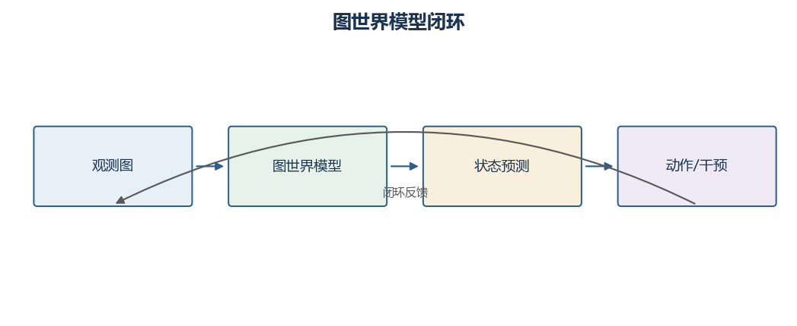

## 38.3　数值算例

**例 38.2（两节点图转移手算）** 设两节点 $v_1,v_2$ 相连，潜在状态 $\mathbf{z}_1^{(t)}=(1,0),\mathbf{z}_2^{(t)}=(0,1)$，消息函数 $\psi(\mathbf{z}_u)=\mathbf{z}_u$，聚合为求和，更新 $\phi$ 为恒等加自身。则

$$
\mathbf{z}_1^{(t+1)}=\mathbf{z}_1^{(t)}+\mathbf{z}_2^{(t)}=(1,1),\quad \mathbf{z}_2^{(t+1)}=\mathbf{z}_2^{(t)}+\mathbf{z}_1^{(t)}=(1,1). \tag{38-7}
$$

一步后两节点状态趋同——这直观展示了过度消息传递导致的**过平滑**（第 13 章）：若不加残差或归一化，图世界模型的状态会坍缩，无法保留实体差异。实用模型须用 GRU 门控（式 38-1）或残差连接抑制这一现象。

**例 38.3（转移 KL 正则手算）** 设转移先验 $p=\mathcal{N}(0,1)$，后验 $q=\mathcal{N}(0.5,0.8^2)$。由第 9 章式 9-4：

$$
D_{\mathrm{KL}}=\tfrac12(0.64+0.25-1-\log0.64)=\tfrac12(0.64+0.25-1+0.446)=0.168. \tag{38-8}
$$

该值作为式 (38-2) 的正则项，约束后验转移不过度偏离先验，使学到的图动力学平滑可泛化。

**例 38.5（MPC 两节点规划手算）** 设两节点 $v_1,v_2$，奖励 $r=-\big\|\mathbf{z}_1-\mathbf{z}_2\big\|^2$（鼓励两节点状态趋近，如「协作对齐」），$H=1,\gamma=1$。当前 $\mathbf{z}_1^{(t)}=(1,0),\mathbf{z}_2^{(t)}=(0,1)$。候选动作影响更新（简化为 $\mathbf{z}_i^{(t+1)}=\mathbf{z}_i^{(t)}+a_i$）：
- 动作 $a^{(1)}$：$\mathbf{z}_1\leftarrow(1,0),\mathbf{z}_2\leftarrow(0,1)$（不动），$r=-\|(1,0)-(0,1)\|^2=-2$；
- 动作 $a^{(2)}$：$\mathbf{z}_1\leftarrow(1,0.5),\mathbf{z}_2\leftarrow(0.5,1)$（各向对方靠拢 $0.5$），$r=-\|(0.5,-0.5)\|^2=-0.5$。

$\mathcal{J}$（式 38-4，$H=1$）下 $a^{(2)}$ 的累积奖励 $-0.5>-2$，规划选 $a^{(2)}$。MPC 的关键是**只执行第一步、下一步用真实观测重置**：即便模型预测 $\mathbf{z}^{(t+1)}$ 不准，重规划会纠正——这正是式 38-5 误差累积被「滚动重规划」抑制的机制。若改为 $H=3$ 一次性展开，误差累积（式 38-5）会让预测的 $\mathbf{z}^{(t+3)}$ 不可信，规划可能基于错误的想象做出动作——故实际 MPC 取短 $H$（3—10 步）平衡「看远」与「可信」。

**例 38.6（NRI 边推断的数值示意）** 设两粒子 $p_1,p_2$，关系类型 $K=2$（「无交互」/「弹性碰撞」）。观测 3 帧后，推断器 $q(E)$ 输出：$q(\text{碰撞}\mid\text{观测})=0.82$，$q(\text{无交互}\mid\text{观测})=0.18$。先验 $p(\text{碰撞})=0.5$。ELBO（式 38-9）中 KL 项

$$
D_{\mathrm{KL}}[q\|p]=0.82\log\tfrac{0.82}{0.5}+0.18\log\tfrac{0.18}{0.5}=0.82\times0.493+0.18\times(-1.022)=0.404-0.184=0.220.
$$

KL 较小（0.220）表明推断与先验偏离不大，边推断可信；若推断器对「无交互」给 $q=0.95$ 而观测实为碰撞（推断错），重建项 $\log p(\mathbf{Z}\mid E)$ 会大，ELBO 下降——训练会惩罚这种误判。这个算例说明 NRI 的边推断是「观测重建 + 先验正则」的联合：重建项要求「边解释得动观测」，KL 项防止「为拟合噪声而过度推断边」——与第 9 章 VAE 的 ELBO 同构，只是「潜在变量」从连续隐变量换成了离散边。

## 38.4　技术谱系与变体

**表 38-1　图世界模型技术谱系**

| 方法 | 状态表示 | 转移机制 | 代表文献 |
|------|----------|----------|----------|
| 向量世界模型 | 单一向量 | RNN／RSSM | World Models, Dreamer [1] |
| 图状态空间模型 | 节点向量集 | 消息传递 + GRU | 近期工作 [2] |
| 多智能体图世界模型 | 实体图 | 交互网络／NRI | 交互网络 [3]、NRI [2] |
| 神经关系推断 | 边为离散关系 | 变分边选择 | NRI（Kipf 等 [2]） |
| 图扩散世界模型 | 潜在图 | 去噪扩散 | 近期工作 [5] |
| 图 + 世界模型 + 智能体 | 规划用图 | 模型预测控制 | 近期工作 [6] |

谱系呈现三条主线：**① 状态从向量到图**——保留实体组合性；**② 转移从确定性到概率生成**——引入 ELBO 与扩散，建模不确定性；**③ 从模拟到规划**——学到的图模型不仅预测，还支撑决策。第三条主线把图智能（本书）与世界模型（《世界模型导论》）、强化学习连接起来，呼应第 37 章「图作为骨架」的统一视角。

### 38.4A　关系推断：当交互边不可观测

定义 38.2 的转移核（式 38-3）假设图结构 $E$ 已知，但真实交互边常不可观测——多体物理中「哪些粒子相互作用」未知，社交网络中「谁影响谁」未标注。神经关系推断（NRI，Kipf 等 [2]）把边作为**离散随机变量**推断：设边 $e_{uv}$ 取 $K$ 种关系类型之一，后验由 ELBO 给出

$$
\log p(\mathbf{Z}_{1:T}\mid\mathbf{X}_{1:T})\ge\mathbb{E}_{q}\Big[\log p(\mathbf{Z}_{1:T}\mid\mathbf{X}_{1:T},E)-D_{\mathrm{KL}}\big[q(E)\|p(E)\big]\Big], \tag{38-9}
$$

其中 $q(E)$ 为推断器（一个读观测序列输出边分布的 GNN），$p(E)$ 为先验。训练时联合优化转移核（式 38-3）、推断器 $q(E)$ 与边先验 $p(E)$——「推断器」与「生成器」构成变分边选择（VAE-on-edges）。但 NRI 有**辨识性问题**：不同的边结构可能产生相同观测（「多解」），推断出的边可能不稳定或语义不对齐——这是边界③的根源。缓解方向：（i）引入物理约束（如能量守恒）作为先验 $p(E)$ 的正则；（ii）用对比学习判别「真边」与「假边」的可区分性；（iii）把边从离散放松为连续权重，减少组合爆炸。

**与图自编码器（第 20 章）的联系。** NRI 的边推断与图自编码器（式 34-2 的重建思想）同构：都是用潜在表示重建邻接，区别在 NRI 的重建目标是「动力学一致性」（重建边的预测要能模拟好状态转移），而非静态邻接——把「结构正确性」从「长得像」升级为「动得对」。

从全书四层能力看，图世界模型是一次完整的「层级回环」：编码与重建属于**图表示**（Level 1），消息传递转移属于**图学习**（Level 2），关系推断与规划属于**图推理**（Level 3），而多步展开与实时决策则要求高效的**图系统**支撑（Level 4）。一个图世界模型同时调用四层能力，这也是第 41 章「四层映射」的一个具体实例。

**表 38-2　图世界模型 vs 向量世界模型**

| 维度 | 向量世界模型 | 图世界模型 |
|------|--------------|------------|
| 状态 | $s_t\in\mathbb{R}^d$ | $\mathbf{Z}^{(t)}\in\mathbb{R}^{n\times d}$ |
| 泛化 | 固定实体数 | 可变实体数、组合泛化 |
| 计算 | $O(d^2)$ | $O(|\mathcal{N}|\cdot d)$ |
| 适用 | 单主体控制 | 多实体交互场景 |
| 可解释性 | 黑盒向量 | 节点/边级归因 |
| 误差累积 | 单一状态 | 逐节点累积（式 38-5） |

两表的对照揭示了图世界模型的核心权衡：「组合泛化 + 可解释性」是收益，「计算开销 + 误差累积」是代价。当实体数 $n$ 小（$n<50$）且交互结构稀疏时，图模型的收益远大于代价；当 $n$ 极大或交互稠密时，向量模型或图 + 降维混合方案可能更实用——选型需按具体场景的「实体规模 × 交互稀疏度」权衡，这正是第 36 章图系统工程化要解决的部署问题。

## 38.5　边界、讨论与承上启下

**边界与讨论。** ① **结构固定的假设**——多数图世界模型假设 $V$ 固定，实体增删（如新智能体加入、物体离开视野）需额外处理。变体实体数与组合泛化（表 38-2）在「实体数可变」上成立，但「实体身份可增删」需引入图上的节点生成/消亡机制（与第 20 章图生成模型的节点添加/删除同构），目前缺乏成熟的变分框架。② **误差累积**——多步展开 $H$ 越大，转移误差越易累积（式 38-5 给出几何增长），第 38.2 节 KL 正则只缓解不消除；MPC 的滚动重规划（例 38.5）是当前最实用的抑制手段，但重规划频率本身是成本——重规划太频繁则计算开销大，太少则误差累积。③ **关系推断的监督**——真实交互边常不可观测，需无监督推断（NRI，式 38-9），但辨识性差：不同边结构产生相同观测时，推断无唯一解；辨识性差意味着学到的「关系」可能只是对观测的过拟合而非真实机制，这直接影响模型的外推可信度。④ **规划的可微性依赖**——图模型规划（式 38-4）依赖连续可微转移，离散动作（如「转向左/右」二值决策）或离散图结构（边存在/不存在）会破坏梯度；需用 Gumbel-Softmax、策略梯度或动作嵌入等技巧绕过——这是图世界模型与强化学习交叉的难点，衔接第 39 章的表达力讨论。这些边界衔接第 16 章（动态图）、第 29 章（幻觉／模型误差）与第 40 章（开放问题）。

这些边界中，误差累积与关系辨识性差，本质上是第 39 章「学习理论边界」在动态场景中的体现。

本章衔接第 37 章（图作为骨架）、第 10—18 章（消息传递）、第 12 章（GCN 编码器，式 38-6）、第 16 章（动态图）、第 20 章（图自编码器/边推断）、第 28—31 章（图基础模型），并把图智能扩展到时间维度与决策闭环。具体而言：图世界模型是《世界模型导论》的潜在动力学在关系化状态空间上的推广——RSSM 的「编码器—转移—解码」三元组（定义 38.2）一一对应，区别仅在状态从 $\mathbb{R}^d$ 升维为 $\mathbb{R}^{n\times d}$、转移从 RNN 换成消息传递（式 38-3）。下一章转向理论前沿，追问图智能的表达力上界与算法对齐——这是理解上述边界的理论工具；第 40 章把误差累积与关系辨识性差列为开放问题。

## 本章小结

本章论述图与世界模型的融合，把图从静态骨架推进到动态世界建模与智能体规划。

我们首先给出动机与组合泛化直觉（38.1 节，例 38.1）。接着定义图动力学（定义 38.1）与图世界模型（定义 38.2），推导变分目标（式 38-2）、消息传递转移核（式 38-3）、规划目标（式 38-4）、多步展开误差累积界（式 38-5）与图卷积编码器（式 38-6）。我们通过 GCN 编码（例 38.4）、过平滑（式 38-7）、KL 正则（式 38-8）与 MPC 规划（例 38.5）四个算例展示机制与风险。最后梳理谱系（表 38-1、38-2）并讨论结构固定、误差累积、关系推断与规划可微性等边界。

这些辨析衔接第 10—18、16、28—31、37、40 章。

**进一步阅读**　本章建议延伸阅读的文献：[1]、[3]、[4]。

## 参考文献

[1] Hafner D, Lillicrap T, Ba J, Norouzi M. Dream to control: Learning behaviors by latent imagination. *ICLR*, 2020.

[2] Kipf T N, Fetaya E, Wang K C, Welling M, Zemel R. Neural relational inference for interacting systems. *ICML*, 2018.

[3] Battaglia P W, Hamrick J B, Bapst V, et al. Interaction networks for learning about objects, relations and physics. *NeurIPS*, 2016.

[4] Kipf T N, Welling M. Semi-supervised classification with graph convolutional networks. *ICLR*, 2017.

[5] Ho J, Jain A, Abbeel P. Denoising diffusion probabilistic models. *NeurIPS*, 2020.

[6] Wu Z, Pan S, Chen F, et al. A comprehensive survey on graph neural networks. *IEEE TNNLS*, 2021, 32(1): 4–24.

[7] Ha D, Schmidhuber J. World models. *arXiv preprint*, 2018.

[8] Sutton R S, Barto A G. Reinforcement Learning: An Introduction. *MIT Press*, 2018, 2nd ed.

---

# 第 39 章　图智能的理论前沿

前两章把图推向多模态融合与世界建模，展示了图智能「能做什么」。本章转向基础问题：图智能「不能做什么」，以及其能力的**理论边界**在哪里。这是第九篇的理论收束——第 13 章初步介绍了 Weisfeiler–Lehman（WL）测试作为 GNN 表达力上界，本章将其系统化为完整的 WL 层级，讨论算法对齐（algorithm alignment）、图学习理论的样本复杂度与泛化界，并澄清若干常被误读的理论命题。理解这些边界，才能理性看待第 40 章的开放问题与第 41 章的结语。

本章先给出动机与直觉（39.1 节），系统阐述 WL 层级与表达力（39.2 节），推导算法对齐与泛化理论（39.3 节），给出数值算例（39.4 节），梳理理论谱系（39.5 节），最后讨论边界并承上启下（39.6 节）。

## 39.1　动机：为何需要理论边界

**引入动机。** 图神经网络在实践中成效显著，但「更深」「更宽」「更复杂」的模型层出不穷，缺乏判别标准。第 1 章命题 1.3 指出「更深不等于更强」，其理论根据正是表达力上界。没有理论边界，研究者无法判断一个模型的能力是来自真实结构利用，还是来自数据偏置；也无法解释为何某些图任务上 GNN 不优于简单基线。理论前沿为全书方法提供「标尺」。

**直觉解释。** WL 测试像一个「图的身份检验器」：给每个节点染色，每轮根据邻居颜色更新自己的颜色，若两图最终颜色分布不同则必不同构；若相同仍可能同构（WL 不完全）。GNN 的消息传递与 WL 更新在结构上同构——每一层 GNN 就相当于一轮 WL 重染色。因此 GNN 的判别能力**不会超过 WL**：WL 分不清的图，任何标准消息传递 GNN 也分不清。这个朴素对应是理解表达力边界的钥匙。

**为何「标尺」重要。** 实践中常见「我们用了更深的 GNN/更大的聚合函数，结果更好」的表述，但缺乏「更好的上限是什么」的参照。理论标尺的价值在于把「经验比较」升级为「相对上界的比较」：若任务 1-WL 可解，那么 GNN 已触及上限，进一步加深无益（过平滑反而有害）；若任务需 $k$-WL（$k>1$），那么标准 GNN 结构性欠拟合，加参数也不够——必须换高阶模型。这把「调参」问题转化为「选模型族」问题：先判任务在 WL 层级的哪一档，再选匹配的 GNN，避免在错误的模型族里空耗算力。

**例 39.1（WL 分不清的图）** 正六边形（6-环）与两个三角形（3-环 + 3-环）都是 6 个节点、每个节点度数为 2。1-WL 在每轮给所有节点染相同颜色，永远无法区分二者——但它们的拉普拉斯谱不同。这说明 1-WL（及标准 GNN）无法区分某些非同构图，需高阶 WL 或谱信息（第 3 章）补充。具体地，六边形的拉普拉斯特征值含 $2-2\cos(2\pi k/6)$，双三角含 $2-2\cos(2\pi k/3)$，两组谱不同——谱方法（第 3 章）能区分，1-WL 不能。这一「谱可分、WL 不可分」的图对，正是「用谱信息增强 GNN」动机的最小反例。

## 39.2　WL 层级与表达力

**定义 39.1（$k$-WL 测试）** $k$-Weisfeiler–Lehman 测试对 $k$ 元节点元组 $(\mathbf{v}_1,\dots,\mathbf{v}_k)$ 染色。初始颜色由元组诱导子图的同构型决定；每轮更新

$$
c^{(t+1)}(\mathbf{v})=\mathrm{HASH}\Big(c^{(t)}(\mathbf{v}),\ \{\!\{c^{(t)}(\mathbf{v}_{w\to i}):w\in V,\ i\in[k]\}\!\}\Big), \tag{39-1}
$$

其中 $\mathbf{v}_{w\to i}$ 是把元组第 $i$ 个分量替换为 $w$ 所得元组，$\{\!\{\cdot\}\!\}$ 为多重集。$k$ 越大，判别力越强；$k=n$ 时 WL 完全（可判定同构），但计算复杂度指数增长。

**定理 39.1（GNN 与 1-WL 等价，Xu 等 [1]）** 标准消息传递 GNN 的判别能力至多等于 1-WL：若两图 1-WL 无法区分，则任意消息传递 GNN 对其输出相同表示。形式化地，GNN 函数类 $\mathcal{F}_{\mathrm{MP}}$ 满足

$$
\mathbf{G}_1\equiv_{1\text{-WL}}\mathbf{G}_2\ \Longrightarrow\ f(\mathbf{G}_1)=f(\mathbf{G}_2),\quad \forall f\in\mathcal{F}_{\mathrm{MP}}. \tag{39-2}
$$

定理的两个方向值得分别理解。第一个方向（GNN $\subseteq$ 1-WL）是「上界」：任何消息传递 GNN 都不可能区分 1-WL 区分不了的图对——这是对**所有**消息传递结构的硬约束，与具体网络设计无关。第二个方向（1-WL $\subseteq$ 充分表达的 GNN）是「可达」：存在一类 GNN（GIN，求和聚合 + 单射 MLP）恰好达到 1-WL 上界，即 GNN 函数类**紧包含** 1-WL 判别力。合起来，「GNN 判别力 = 1-WL」是一个**紧**的刻画：既不夸大（GIN 可达），也不缩小（MP 不超）。理解「紧」很重要——它意味着想超过 1-WL 不能靠「更好的消息传递变体」，必须跳出消息传递框架（见 39.4B）。

**直觉解释（式 39-2）** 消息传递的聚合 $\bigoplus$ 是置换不变多重集函数，与 WL 的多重集更新（式 39-1）一一对应。若 GNN 的聚合函数足够表达（如用 MLP 刻画单射），则可达到 1-WL 上界——这正是 GIN（graph isomorphism network）的设计：用求和 + MLP 保证单射性，使 GNN「恰好」达到 1-WL。

**$k$-WL 层级谱系。** ① 1-WL（＝消息传递 GNN，第 10—12 章）；② 2-WL（≈ 高阶 GNN，考虑节点对，第 17 章）；③ 3-WL 及以上（≈ 张量方法、子图 GNN）；④ $k$-WL（$k=n$ 完全但不可计算）。层级越高表达越强，代价是 $O(n^k)$ 内存与计算。

**层级的「阶梯」而非「开关」。** 一个常见误解是把 WL 层级看成「0/1 开关」：1-WL 不能区分 X，2-WL 就能。实际上层级的提升是**渐进**的：2-WL 比 1-WL 多区分一批图，3-WL 比 2-WL 再多区分一批，每升一档「新增可区分的图对」数量递减（趋于完全同构判定的复杂度）。这意味着任务可能落在层级的「中间地带」——1-WL 不够、2-WL 过强，此时「最便宜够用」的模型是 2-WL 的简化变体（如部分二阶统计），而非完整的 2-WL。把层级当「阶梯」而非「开关」，才能在表达力与复杂度间做精细权衡（式 39-7 给出了各档的代价量级）。

> 【图 39-1　WL 层级与 GNN 表达力】（原图见 figures/图39-1.png）：横轴 $k$ 从 1 到 $n$，纵轴判别力，标注对应 GNN 类型与计算复杂度，标出例 39.1 的 6-环 vs 双三角。
>
> 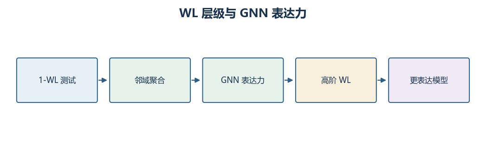

## 39.3　算法对齐与泛化理论

**定义 39.2（算法对齐，algorithmic alignment）** 神经网络能否高效学习某算法，取决于其结构与该算法所需「原语」（primitive）的匹配程度。对图任务，若目标算法是动态规划（如最短路），则 GNN 需具备迭代传播与记忆原语；若目标是计数子图，则需高表达力聚合。对齐度低时，即使表达力足够，梯度下降也难学到。

**推导：表达力 ≠ 可学习性。** 表达力是「存在某个参数使函数逼近目标」，可学习性是「梯度下降能找到该参数」。二者之间存在鸿沟。定义对齐度量 $A(f,\mathcal{A})$ 为模型结构对算法 $\mathcal{A}$ 原语的覆盖率，则泛化界可写为

$$
\mathbb{E}[\ell]\le\hat{\mathbb{E}}[\ell]+\underbrace{\mathcal{O}\Big(\sqrt{\frac{\mathrm{VC}(\mathcal{F}_{\mathrm{MP}})}{N}}\Big)}_{\text{样本复杂度}}+\underbrace{\mathcal{O}\big(1-A(f,\mathcal{A})\big)}_{\text{对齐损失}}. \tag{39-3}
$$

式 (39-3) 把风险分解为经验风险、样本复杂度（由 VC 维／Rademacher 复杂度刻画）与对齐损失——后者解释了为何「表达力够但学不到」。

**推导：图学习的样本复杂度。** 对节点分类，若图满足同质性（homophily，相连节点标签相似），则有效样本量因结构共享而放大。设标签率 $\rho$，同质系数 $h\in[0,1]$，则泛化误差界近似

$$
\varepsilon\le\mathcal{O}\Big(\frac{1}{\rho\,n\,h}\Big), \tag{39-4}
$$

即同质性越高、标签率越高、图越大，泛化越好。这为第 9 章半监督学习的经验成功提供理论解释。

**过平滑与过压缩的理论。** 第 13 章的过平滑已被形式化：多层图卷积相当于对信号反复施加随机游走算子 $\mathbf{P}=\mathbf{D}^{-1}\mathbf{A}$，其谱半径 $<1$（连通图），故 $\mathbf{P}^L\mathbf{X}$ 指数收敛到平稳分布，节点差异消失。**过压缩**（over-squashing）则源于图瓶颈：远距离信息需经少数边压缩到固定维向量，导致长程依赖梯度指数衰减（第 13 章）。二者共同构成「深 GNN 的理论天花板」。

**推导：过压缩的梯度界。** 设源节点 $s$ 到目标节点 $t$ 的信息经路径 $s=v_0,v_1,\dots,v_L=t$ 传递，每层聚合的「压缩因子」为 $\kappa<1$（瓶颈边的邻域大小倒数），则目标节点表示对源节点输入的雅可比谱范数满足 $\big\|\partial\,\mathbf{h}_t^{(L)}/\partial\,\mathbf{h}_s^{(0)}\big\|_{\mathrm{sp}}\ \le\ \kappa^{L}$。

梯度按 $\kappa^L$ 指数衰减——长程依赖（$L$ 大）的梯度趋于零，反向传播「传不过去」。Topping 等 [7] 进一步把 $\kappa$ 与图的**离散曲率**联系起来：曲率越负（瓶颈越严重），$\kappa$ 越小，衰减越快。这一几何解释解释了为何某些图（如网格、星型）天然过压缩，而某些图（如稠密团）不易——「图的几何」决定了「梯度的命运」。缓解方向（残差、归一化、跳跃连接）本质都是增大 $\kappa$ 或绕过瓶颈路径，把 $\kappa^L$ 的衰减「压平」。

## 39.4　数值算例

**例 39.2（GIN 单射聚合手算）** 设两多重集 $M_1=\{1,1,2\},M_2=\{1,2,2\}$。均值聚合：$\mathrm{mean}(M_1)=4/3,\mathrm{mean}(M_2)=5/3$——可区分；但 $M_3=\{1,2,3\},M_4=\{2,2,2\}$ 均值均为 2，均值失败。求和聚合：$\sum M_3=6,\sum M_4=6$——也失败！改用求和 + MLP（GIN）且 MLP 对编码唯一：对 $M_1,M_2$ 分别得 coding $\sum\phi(1)+\sum\phi(2)$ 不同，可区分。这说明聚合函数选择直接决定表达力（式 39-2 的构造性证明）。

**例 39.3（样本复杂度界手算）** 设节点数 $n=10^4$，标签率 $\rho=0.01$（即 100 个标签），同质系数 $h=0.8$。由式 (39-4)：

$$
\varepsilon\le\frac{1}{0.01\times10^4\times0.8}=\frac{1}{80}=0.0125. \tag{39-5}
$$

误差界约 $1.25\%$——这解释了半监督节点分类在极少标签下仍能工作：关系结构把稀疏标签「扩散」到全图。若 $h$ 降至 0.2（异质图），界放大 4 倍至 5%，印证异质图（第 15 章）更难。

### 39.4A　WL 核与计数表达力

WL 测试是判别工具，还可以转化为**图核**（graph kernel）用于分类：两图的 WL 核是它们稳定颜色分布的内积。设 $k$-WL 收敛后节点 $\mathbf{v}$ 的颜色计数向量为 $\mathbf{c}(\mathbf{v})$（第 $i$ 维为颜色 $i$ 的数量），则 $k$-WL 核定义为

$$
K_{k\text{-WL}}(\mathbf{G}_1,\mathbf{G}_2)=\big\langle \textstyle\sum_{\mathbf{v}\in V_1}\mathbf{c}(\mathbf{v}),\ \sum_{\mathbf{w}\in V_2}\mathbf{c}(\mathbf{w})\big\rangle. \tag{39-6}
$$

该核度量两图「颜色构成」的相似度：同构图核值大，结构迥异核值小。$k$-WL 核的计算复杂度是 $O(k^2 n^k)$（$k$-元元组），$k=1$ 时 $O(n^2)$ 可行，$k\ge3$ 通常不可行——这把「表达力」（$k$-WL 层级）与「可计算性」的张力量化了。Shervashidze 等 [6] 证明了 $k$-WL 核是正定的，故可用于 SVM 等核方法；但其在真实任务上的表现受「稳定颜色数」影响：颜色坍缩（过平滑，第 13 章）会削弱核的判别力——理论表达力与数值可实现性再次出现分歧。

**核方法与 GNN 的对偶。** WL 核是「白盒」方法：显式计算颜色向量再做内积，可解释但无法端到端学习参数。GNN 是「黑盒」对偶：把颜色更新换成可学习函数，可端到端训练但失去解释性。二者在表达力上同档（都是 1-WL 量级），差异在「可学习性」——核方法无需训练（或仅训练线性分类器），GNN 需训练但能拟合任务特定的非线性读出。这再次印证式 39-3 的分解：表达力（同一档）相同时，性能差异来自样本复杂度与对齐损失——核方法的「对齐」由颜色方案决定，GNN 的「对齐」由架构决定，二者可比较但不可互相替代。

**计数表达力与 WL 的联系。** 另一条表达力度量路线是「可计数子图」：1-WL 能区分的图，等价于能区分某些子图计数的图（如三角、星型计数）。但 GNN 能否精确计数任意子图？答案是否定的——标准消息传递 GNN 只能计数**局部**模式（如 $L$ 跳内的星/路径），无法精确计数全局子图（如整个图的三角形数），后者需高阶聚合或子图 GNN（第 21 章）。这把「表达力」从「图同构判别」细化为「任务相关的计数能力」：同一个 GNN，对「区分度同构图」可能弱，对「计数局部模式」可能强。

### 39.4B　突破 1-WL：随机特征与子图 GNN

1-WL 上界（定理 39.1）是「标准消息传递」的硬约束，但有三类「合法逃逸」：

**① 随机特征（random features）注入结构。** 给每个节点附加随机初始化特征（如从 $\mathcal{N}(0,1)$ 采样），再跑 1-WL。随机特征「打破对称」——正六边形与双三角的节点在随机特征下颜色几乎必然不同，1-WL 因而能区分。理论上，随机特征使 1-WL 以高概率达到「几乎所有图都区分」的判别力，代价是**表示不再置换等变**（随机特征破坏了同构不变性），且判别变成「近似」而非「精确」。这是「表达力」与「等变性」的取舍：要表达力就放弃严格等变。

**② 子图 GNN（subgraph GNN）。** 把图的**所有**连通诱导子图各跑一遍 GNN，再读出聚合。子图 GNN 的判别力介于 1-WL 与 2-WL 之间（某些变体可达 2-WL），因为它在子图尺度上「看到」了全局结构。但子图数量指数，实际用采样或哈希近似——又是表达力与复杂度的张力。

**③ 高阶 GNN（$k$-WN 族，Morris 等 [2]）。** 直接实现 $k$-WL 的神经版本，$k=2$ 时复杂度 $O(n^2)$ 可行，$k\ge3$ 昂贵。这是「最正统」的突破路径，但计算代价随 $k$ 指数增长，限制了实用规模。

三者共同说明：1-WL 上界是**消息传递框架内的**上界，跳出消息传递（随机特征、子图、高阶张量）可突破，但每跳一步都付出等变性、复杂度或近似性的代价——「表达力免费午餐」不存在。把三条路径的计算代价统一量化：设图节点数 $n$，则

$$
\underbrace{\text{1-WL/GNN}}_{O(n\,\bar{d}\,d)}\ <\ \underbrace{\text{2-WN}}_{O(n^2\,d^2)}\ <\ \underbrace{k\text{-WN}}_{O(n^k\,d^k)}, \tag{39-7}
$$

其中 $\bar{d}$ 为平均度、$d$ 为特征维度。复杂度随 $k$ 呈**幂次增长**（$n^k$），这正是 $k$-WL 层级「表达力—复杂度」张力的代数形式：$k$ 每加 1，表达力升一档但代价升一个数量级。随机特征与子图 GNN 的「隐性代价」则是等变性丧失与子图组合爆炸，无法用单一 $O(\cdot)$ 刻画，但本质相同——用某种资源（等变性/子图数）换取表达力。

## 39.5　理论谱系与变体

**表 39-1　图学习理论谱系**

| 理论方向 | 核心问题 | 关键结果 | 代表文献 |
|----------|----------|----------|----------|
| 表达力 | GNN 能区分哪些图 | 1-WL 上界、GIN | Xu 等 [1] |
| 高阶表达 | 如何突破 1-WL | $k$-WL、高阶 GNN | Morris 等 [2] |
| 泛化理论 | 需要多少样本 | Rademacher／VC 界 | 近期工作 [3] |
| 算法对齐 | 能否学到目标算法 | 原语匹配 | Xu 等 [4] |
| 过平滑／过压缩 | 深层为何失效 | 谱分析、瓶颈分析 | Li 等 [5] |
| 可辨识性 | 表示是否唯一 | 潜在变量不可辨识 | 第 2 章 [6] |

谱系揭示一个核心张力：**表达力与可学习性、复杂度相互制约**。$k$-WL 越高表达越强却越难计算、越难优化；轻量模型易训练却受 1-WL 限制。第 41 章将把这一张力列为图智能通向通用智能的关键障碍之一。

**与经典图算法的对照。** 一个常被忽视的视角是：许多经典图算法（最短路、连通分量、拓扑排序）是「可计算」的图函数，那么 GNN 能否学到它们？算法对齐（定义 39.2）的初步答案是：最短路、连通分量等「传播型」算法与消息传递原语对齐良好（GNN 的迭代传播本身就是松弛/传播的近似），但「计数型」「匹配型」算法（如最大匹配、独立集计数）与 1-WL 对齐差，需高阶表达。这解释了经验观察：GNN 在「传播/平滑」任务（节点分类、链接预测）上表现好，在「组合计数」任务上弱——不是数据不够，而是**结构不对齐**。把「算法对齐」与「表达力」并列，是本章对「为何 GNN 在某些任务上失败」给出的统一解释：表达力回答「结构能不能表达目标」，算法对齐回答「参数学不学得会」，二者缺一不可。

**表 39-2　常见理论命题辨析**

| 命题 | 真伪 | 说明 |
|------|------|------|
| 更深 GNN 表达更强 | 否 | 受 1-WL 限制，且过平滑 |
| 聚合越复杂越好 | 否 | 需单射但不过度，GIN 用求和 + MLP |
| 高表达力即高泛化 | 否 | 对齐损失与样本复杂度独立作用 |
| 图连接即因果 | 否 | 命题 1.1，需因果假设 |

表中四个「否」贯穿全书：它们分别在第 13、10、39、1 章被论证，构成图智能「辨析方法边界」的主线。理论前沿的价值，正在于把这些经验直觉上升为可证明的命题。

## 39.6　边界、讨论与承上启下

**边界与讨论。** ① **WL 不是唯一上界**——除了 WL，还有基于谱、基于计数的表达力度量，不同任务适用不同标尺。谱核（第 3 章）用拉普拉斯特征向量做内积，对「全局形状」敏感而「局部拓扑」钝感；$k$-WL 则对局部拓扑敏感。两者互补：一个 GNN 可能在谱核意义上「强」却在 $k$-WL 意义上「弱」（能区分形状但分不清同谱非同构图），反之亦然——选「标尺」须先明确任务关心哪类结构。② **理论假设理想化**——1-WL 等价假设聚合为单射、特征连续，实际中有限精度与采样会削弱结论。有限精度下，GIN 的「单射性」在浮点舍入后未必严格保持，表达力上界是「渐近」而非「逐实例」的；采样（第 36 章邻居采样）进一步只看到部分邻域，实际表达力低于理论的 1-WL 上界——理论给的是天花板，采样把它拉低。③ **可学习性理论仍不成熟**——算法对齐的度量 $A(f,\mathcal{A})$（式 39-3）尚缺统一框架，「原语」的枚举无公认标准；不同论文对「对齐」的定义不一致，导致跨论文结论难以直接比较。④ **负结果非终点**——1-WL 限制可通过高阶结构（第 17 章）、随机特征、子图方法部分绕过，但每条路径都付出等变性/复杂度/近似性的代价（式 39-7 量化了复杂度一侧）。这些边界直接通向第 40 章的开放问题清单——尤其是「图基础模型能否真正泛化」，其理论根源正是表达力与对齐的双重制约。

**与第 41 章的关系。** 本章的「标尺」是第 41 章结语的「论证工具」：第 41 章「关系归纳偏置通向智能」的论断（式 39-4 的样本效率）与「但智能不止于归纳偏置」的保留（表达力/对齐的天花板）都源自本章。可以说，第 39 章给图智能划定了「能力圈」，第 40 章列出「能力圈外的开放问题」，第 41 章则在「圈内」给出一套自洽的智能观——三章构成理论收束的完整闭环。

本章衔接第 1 章（命题 1.3）、第 3 章（谱）、第 10—14 章（GNN 与 WL）、第 13 章（过平滑/过压缩）、第 17 章（高阶结构）、第 36 章（采样削弱表达力）、第 28—31 章（图基础模型的泛化疑问），并为第 40 章提供理论工具。

## 本章小结

本章系统论述图智能的理论前沿，为全书方法提供表达力与泛化的标尺。

我们首先给出理论边界的动机与 WL 直觉（39.1 节，例 39.1），并说明「标尺」对选型的意义。接着定义 $k$-WL（定义 39.1）、陈述 GNN 与 1-WL 等价定理（定理 39.1，式 39-1、39-2），梳理 WL 层级。我们定义算法对齐（定义 39.2），推导泛化分解（式 39-3）、过压缩梯度界（$\kappa^L$ 衰减）、样本复杂度界（式 39-4）与过平滑/过压缩理论，并用 GIN 聚合（例 39.2）与半监督泛化（式 39-5）算例验证。随后引入 WL 核（式 39-6）、突破 1-WL 的三条路径与复杂度谱系（式 39-7）。最后梳理理论谱系（表 39-1、39-2）并讨论 WL 局限、对齐度量不成熟等边界。

这些辨析衔接第 1、3、10—14、17、28—31 章，并引出第 40 章的开放问题。

**进一步阅读**　本章建议延伸阅读的文献：[1]（表达力上界与 GIN）、[2]（高阶 WL 神经网络）、[4]（算法对齐与可学习性）、[7]（过压缩的曲率解释）。这四篇分别对应本章「表达力—复杂度—对齐—深化」四条主线，建议按此顺序阅读以建立完整的理论图景。

## 参考文献

[1] Xu K, Hu W, Leskovec J, Jegelka S. How powerful are graph neural networks? *ICLR*, 2019.

[2] Morris C, Ritzert M, Fey M, et al. Weisfeiler and Leman go neural: Higher-order graph neural networks. *AAAI*, 2019.

[3] Liao R, Liu Y, Yu S, et al. Generalization bounds for graph neural networks. *arXiv preprint*, 2021.

[4] Xu K, Li J, Jegelka S, Hu W. What can neural networks reason about? *ICLR*, 2020.

[5] Li Q, Han Z, Wu X. Deeper insights into graph convolutional networks for semi-supervised learning. *AAAI*, 2018.

[6] Shervashidze N, Schweitzer P, Leeuwen E J V, et al. Weisfeiler-Lehman graph kernels. *JMLR*, 2011, 12: 2539–2561.

[7] Topping J, Di Giovanni F, Chamberlain B, Dong X. Understanding over-squashing and bottlenecks on graphs via curvature. *ICLR*, 2022.

[8] Maron H, Ben-Hamu H, Levie R, Lipman Y. Invariant and equivariant graph networks. *ICLR*, 2019.

---

# 第 40 章　开放问题

第 39 章厘清了图智能的理论边界。本章把这些边界转化为面向未来的**开放问题清单**（open problems）——那些尚未解决、但决定图智能下一步走向的问题。我们围绕四类核心张力组织：异质与动态的统一、图基础模型的真正泛化、图推理的可扩展性、公平与可信。每个问题都给出「为何开放」「现有进展」「可能突破口」三层分析，并尽量与前文章节对应。本章不提供答案，而是为第 41 章的结语划定「未竟之业」。

本章先给出动机与直觉（40.1 节），以统一形式刻画开放问题并推导一个分析框架（40.2 节），给出数值算例（40.3 节），梳理问题谱系（40.4 节），最后讨论边界并承上启下（40.5 节）。

## 40.1　动机：以问题定义未来

**引入动机。** 一个学科 maturity 的标志，不是它解决了多少问题，而是它能否清晰提出未解问题。图智能在 GNN、图基础模型上取得显著进展，但第 39 章的理论边界提醒我们：表达力、可学习性、泛化之间仍有根本张力。把这些张力明确为问题，是第 41 章「关系即智能」论断能否成立的前提——若开放问题无解，通用智能的图景就不完整。

**直觉解释。** 设想图智能是一座已建成的城市：表示、学习、推理、系统四层是街区（第 1 章），理论边界是地基的承重极限（第 39 章）。开放问题是城市扩张的方向牌——哪里该建跨模态大桥（第 37 章）、哪里该建时间维度高架（第 38 章）、哪里地基需加固（泛化问题）。没有方向牌，扩张就是盲目堆砌。方向牌的价值不在「画得漂亮」，而在「可执行」：每个方向应能分解为可度量的子目标（式 40-1—40-5 提供度量），否则方向牌只是愿景图。本章把八项问题逐一映射到前文章节与理论工具，正是为了让「方向牌」从口号变为可跟踪的研究路线图。

**例 40.1（四类问题的日常映射）** 推荐系统中：用户—物品图是**异质**的（问题一）；交互随时间变化是**动态**的（问题一）；用大模型做跨域推荐是**泛化**问题（问题二）；亿级物品上的实时推理是**可扩展**问题（问题三）；消除对特定人群的推荐偏见是**公平**问题（问题四）。四类问题在同一应用中交织——这正是它们必须被统一研究的理由。单一应用尚且如此，跨应用的通用图智能更需要系统性地逐一面对。

**例 40.2（医疗图的四类问题交织）** 以药物靶点发现（第 33 章）为例：药物—靶点图是**异质**的（分子图 + 蛋白图，问题一）；患者疗效数据随随访时间变化是**动态**的（问题一）；从已验证靶点外推到新疾病是**泛化**问题（问题二）；对罕见病患者（图中小度节点）的公平覆盖是**公平**问题（问题四）。这里可扩展性（问题三）相对次要（靶点数有限），说明四类问题的「权重」随应用而变——没有哪个问题普遍最重要，必须按场景权衡。这个例子也说明开放问题清单的价值：它不是「哪个最难」的排名，而是「必须同时面对的约束集合」。

## 40.2　统一框架与数学刻画

为使清单可研究而非仅可罗列，我们先把四类问题纳入同一个数学框架：它们都表现为「模型在训练分布上成立、在某种偏移下失效」。这一统一视角也解释了为何第 39 章的理论工具可直接移植到本章。

**定义 40.1（开放问题的统一刻画）** 把图智能任务形式化为在分布族 $\mathcal{P}$ 上学习函数 $f:\mathbf{G}\mapsto y$。开放问题可归为三类失效：**分布外失效**（测试分布 $P_{\mathrm{test}}\notin\mathcal{P}_{\mathrm{train}}$，泛化问题）、**结构漂移失效**（$E^{(t)}$ 随时间变，动态问题）、**约束失效**（$f$ 违反公平／因果约束，可信问题）。

三类失效可进一步统一为「目标函数在更大域上的不一致」：训练优化 $\min_f R_{P_{\mathrm{train}}}(f)$，但部署需要 $R_{P_{\mathrm{test}}}(f)$、$R_{\text{drift}}(f)$、$R_{\text{constrained}}(f)$ 同时小。三类失效对应「分布偏移」「时间偏移」「约束偏移」三种不同方向的域间差距——这正是第 39 章分布泛化界（式 39-3 的 TV 项）在三类偏移下的特例。统一刻画的实用价值在于：一旦把问题归入三类之一，就能调用对应的理论工具（分布偏移→TV 界、时间偏移→累积误差界、约束偏移→公平权衡界），避免「每个问题从零分析」。

式 (40-1)—(40-3) 构成本章的分析骨架：它们把四类开放问题映射为可量化的量——分布差距、累积误差、公平代价。有了这些量，问题才从「口号」变为「可研究的课题」。这也呼应第 39 章：理论边界 (41) 与开放问题是同一套数学的两种读法。

**推导：泛化失败的量化。** 设训练分布 $P$、测试分布 $Q$，模型在 $P$ 上风险 $R_P(f)$，在 $Q$ 上风险 $R_Q(f)$。由分布泛化理论：

$$
R_Q(f)\le R_P(f)+\underbrace{\mathrm{TV}(P,Q)}_{\text{分布差距}}+\underbrace{\Big|\mathbb{E}_{P}[\ell]-\mathbb{E}_{Q}[\ell]\Big|\Big|_{\mathrm{Lip}}}_{\text{损失敏感性}}, \tag{40-1}
$$

其中 $\mathrm{TV}$ 为全变差距离。式 (40-1) 表明：图基础模型若只在特定图分布上预训练（$P$），面对新领域（$Q$）时 $\mathrm{TV}(P,Q)$ 大，性能必然下降——这正是「真正泛化」问题的数学根源。

式 (40-1) 中的 $\mathrm{TV}(P,Q)$ 可通过「图不变性」缩小：若学到的表示对域间不变的因果因子敏感、对域特有偏置不敏感，则 $P,Q$ 在表示空间中的差距减小——这正是 O2「真正泛化」的可能突破口（表 40-1）。换言之，泛化问题既可从数据侧（域适配）也可从表示侧（不变性学习）攻击。

**推导：结构漂移下的误差累积。** 对动态图（第 16 章），若转移模型每步误差为 $\epsilon$，则 $T$ 步后累积误差

$$
\varepsilon_T\le\sum_{t=1}^{T}\epsilon\,\gamma^{t}=\epsilon\,\frac{1-\gamma^{T}}{1-\gamma}, \tag{40-2}
$$

$\gamma$ 为遗忘因子。第 38 章图世界模型的误差累积正是此例——动态与泛化问题在此交汇。

**推导：公平约束的权衡界。** 设群体 $A$、$B$ 的表示分布为 $P_A,P_B$，公平要求二者统计parity：$|\mathbb{E}[f]| _{A}-\mathbb{E}[f]|_B|\le\delta$。纳入优化：

$$
\min_{f}\ R(f)+\lambda\cdot\mathrm{Fair}(f),\quad \mathrm{Fair}(f)=D_{\mathrm{KL}}(P_A\|P_B), \tag{40-3}
$$

$\lambda$ 控制精度—公平权衡：公平越强（$\lambda$ 大），精度损失越大。这把社会价值引入图学习的目标函数，是「公平问题」的形式化。

**推导：可扩展推理的层次化误差。** O3（图推理可扩展）的核心是长程依赖。设图直径为 $D$，每跳推理误差 $\eta$，则 $D$ 跳推理的累积误差按

$$
\varepsilon_{\mathrm{reason}}\le\eta\,D+\frac{\eta^2D(D-1)}{2}\cdot\sigma^2, \tag{40-4}
$$

其中 $\sigma^2$ 为噪声方差。第一项是线性误差传播，第二项是误差的「方差放大」（每跳噪声在后续跳被重新注入）。$D$ 大（图直径大）时推理不可靠——这是「图推理可扩展」问题的定量形式。层次化推理（先子图内推理、再子图间推理）可把 $D$ 降到 $\log n$ 量级（若层次平衡），从而把 $\varepsilon_{\mathrm{reason}}$ 从 $O(\eta D)$ 降到 $O(\eta\log n)$——这是 O3「层次化突破口」的理论依据。

**推导：组合泛化的参数—实体解耦。** O7（图世界模型的组合泛化）要求模型参数与实体数解耦。设 $n$ 个实体、每个实体的局部交互规则参数 $\theta$（与 $n$ 无关），则组合泛化要求

$$
\mathrm{Rademacher}(\mathcal{F}_{\mathrm{comp}})=\mathcal{O}\Big(\frac{d_\theta}{\sqrt{N}}\Big),\qquad d_\theta\text{ 与 }n\text{ 无关}. \tag{40-5}
$$

若 Rademacher 复杂度仅依赖 $d_\theta$（局部规则维数）而非 $n$，则样本复杂度不随实体数增长——这是「组合泛化」的学习理论刻画。向量世界模型无法达到（其参数随场景复杂度增长），图世界模型（式 38-3 的消息传递转移）天然满足 $d_\theta$ 与 $n$ 解耦，但需保证「局部规则可共享」（不同实体对用同一 $\theta$）——这是 O7 的关键假设，也是神经符号方法（程序归纳）试图强化的方向。

> 【图 40-1　四类开放问题关系图】（原图见 figures/图40-1.png）：中心为「图智能」，四个节点分别标注异质动态统一、真正泛化、可扩展推理、公平可信，边标注它们之间的耦合（动态加剧泛化、规模放大不公等）。
>
> 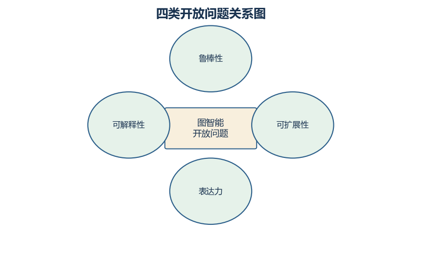

## 40.3　数值算例

**例 40.3（分布差距手算）** 设训练图平均度 $\bar d_P=10$，测试图 $\bar d_Q=2$（跨域迁移）。若以度分布近似，$\mathrm{TV}(P,Q)\approx0.6$。由式 (40-1)，即使 $R_P(f)=0.05$，也有

$$
R_Q(f)\le0.05+0.6+0.1=0.75. \tag{40-6}
$$

上界极松——说明理论上跨域泛化难以保证，实践中图基础模型须显式做域适配才能缩小 $\mathrm{TV}$。

**例 40.4（误差累积手算）** 设每步转移误差 $\epsilon=0.01$，$\gamma=0.95$，$T=20$。由式 (40-2)：

$$
\varepsilon_{20}=0.01\times\frac{1-0.95^{20}}{1-0.95}=0.01\times\frac{1-0.358}{0.05}=0.01\times12.84=0.128. \tag{40-7}
$$

20 步后误差约 $12.8\%$——验证了第 38 章「误差累积」的严重性，也说明长程图动态预测仍是开放问题。

**例 40.5（公平—精度权衡手算）** 设无约束精度 $R=0.10$，加公平正则后 $\lambda D_{\mathrm{KL}}(P_A\|P_B)=0.03$，则 $R+\lambda\mathrm{Fair}=0.13$。若要求更严的公平（$D_{\mathrm{KL}}$ 从 0.03 降到 0.01），牺牲的精度可能翻倍——权衡曲线需按应用伦理需求选择，不能由算法单独决定。

具体地，设 $R(\lambda)$ 为加正则后的精度，$D_{\mathrm{KL}}(\lambda)$ 为群体差异。$\lambda$ 从 0 增到 $\lambda^*$：$D_{\mathrm{KL}}$ 从 0.05 单调降到 0.01（公平改善），$R$ 从 0.10 升到 0.16（精度损失）。在 $\lambda^*$ 处 $D_{\mathrm{KL}}=0.01$（达到公平目标），但 $R=0.16$——精度损失 60%。这说明「公平目标越严、精度代价越高」是式 40-3 的帕累托前沿，而非算法缺陷。伦理决策（「能接受多大精度损失换公平」）不在数学之内，须在数学之外由社会规范界定——这正是 O4「可信」比 O2「泛化」更难的形式化根源：前者含价值判断，后者可纯数学刻画。

## 40.4　开放问题谱系

**表 40-1　图智能开放问题清单**

| 编号 | 问题 | 为何开放 | 现有进展 | 可能突破口 |
|------|------|----------|----------|------------|
| O1 | 异质动态统一 | 两套数学语言难兼容 | 第 15—16 章分别处理 | 统一时空图算子 |
| O2 | 图基础模型真正泛化 | 分布差距大、负迁移 | 第 28—31 章初步探索 | 因果不变性、元学习 |
| O3 | 图推理可扩展 | 长程依赖与计算爆炸 | 采样、近似（第 32—36 章） | 层次化、硬件协同 |
| O4 | 公平与可信 | 结构偏见难消除 | 初步公平正则 | 因果公平、反事实 |
| O5 | 表达力与可学习性统一 | WL 上界与对齐鸿沟 | 第 39 章理论 | 新归纳偏置 |
| O6 | 图与因果的融合 | 相关不等于因果 | 第 1 章命题 1.1 | 结构因果模型 + GNN |
| O7 | 图世界模型的组合泛化 | 实体增删、规律泛化 | 第 38 章 | 神经符号、程序归纳 |
| O8 | 多模态图语义对齐 | 模态鸿沟（第 37 章） | 对比学习初步 | 共享世界骨架 |

**表 40-2　问题—章节对应**

| 开放问题 | 对应章节 | 理论工具 |
|----------|----------|----------|
| O1 异质动态 | 15, 16, 38 | 动态图算子 |
| O2 真正泛化 | 28—31, 39 | 分布泛化界（式 40-1） |
| O3 可扩展 | 13, 32—36 | 复杂度分析（式 40-4） |
| O4 公平 | 1, 39 | 公平正则（式 40-3） |

八项问题中，O2、O5、O6 在第 39 章已有理论刻画（WL 边界、分布差距、命题 1.1），说明理论前沿与开放问题是同一枚硬币的两面。表中 O1—O4 对应第 37—39 章的三条新方向：O1 异质动态统一承接第 37 章多模态建模中的结构耦合、第 38 章图世界模型的时间维度；O2 真正泛化承接第 39 章的分布泛化界；O3 可扩展与 O4 公平则分别对应第 32—36 章系统章的效率约束与第 1 章命题 1.1 的价值约束。开放问题并非凭空产生，而是全书每一条主线的自然延伸——这正是「以问题定义未来」的含义。

### 40.4A　逐项深化：为何开放与突破口

**O1 异质动态统一。** 第 15 章异质图与第 16 章动态图目前用两套独立的数学：异质图按关系类型分开建 GNN（R-GCN 式），动态图按时间切窗建序列模型。统一的难点是「类型 × 时间」的二维结构：边既有多类型（第 15 章）又随时间变（第 16 章），现有方法要么固定类型、要么固定时间。可能突破口是「时空图算子」——把关系类型编码进边的特征、把时间编码进边的存在区间，用单一 GNN 在「类型—时间」联合维度上做消息传递。但这要求算子对「类型缺失」与「时间缺失」都鲁棒（式 37-4 的模态缺失思想推广到类型/时间），目前无成熟形式化。

**O2 图基础模型真正泛化。** 式 40-1 表明泛化上限由 $\mathrm{TV}(P,Q)$ 控制，但 $\mathrm{TV}$ 本身无法从有限样本估计（需无穷样本）。现有「真正泛化」工作（第 28—31 章）靠域适配、不变性学习压低有效 $\mathrm{TV}$，但无法证明「学到的是不变因子」——因果不变性（O6 的工具）是更严格的保证，但需结构因果模型假设，在图上难以验证。突破方向是「可验证的不变性」：用干预实验（而非仅观察）检验学到的表示是否真的对域不变，这需要图数据支持干预（如边增删的因果效应）。

**O3 图推理可扩展。** 式 40-4 给出 $\varepsilon_{\mathrm{reason}}\le\eta D+\mathcal{O}(\eta^2D^2\sigma^2)$，核心是直径 $D$。层次化推理把 $D$ 降到 $\log n$，但层次本身如何学是开放问题：固定层次（人工切分）不泛化，学习层次（端到端）则层次数与图结构耦合、训练不稳定。硬件协同（图专用加速器，第 36 章）能降低每跳常数 $\eta$，但不改变 $D$ 的量级——「算法（降 $D$）与硬件（降 $\eta$）必须协同」是 O3 的核心洞察。

**O4 公平与可信。** 式 40-3 的 $D_{\mathrm{KL}}(P_A\|P_B)$ 是「群体间表示差异」，但公平的定义本身有争议：统计 parity、均等化、个体公平互不一致（第 41 章）。图结构引入「结构性偏见」——若训练图本身反映历史不平等（如招聘网络中某群体连边少），GNN 会学到「该群体邻居质量低」并放大。因果公平（O6 工具）要求区分「因果贡献」与「相关」，但图的因果结构（哪些边是因果路径）几乎不可观测——这是 O4 与 O6 的交汇点，也是「可信图智能」最深的理论缺口。

**O5 表达力与可学习性统一。** 第 39 章给出表达力上界（1-WL）与对齐度量（式 39-3），但二者尚未统一：表达力回答「能不能」，对齐回答「学不学得会」，没有理论说「表达力为 X 的模型在对齐度 Y 时的样本复杂度是多少」。突破方向是「表达力—对齐联合刻画」：把 GNN 函数类的 Rademacher 复杂度同时参数化表达力（聚合函数类）与对齐（原语匹配度），目前只有碎片化结果。

**O6 图与因果的融合。** 命题 1.1「图连接不等于因果」是全书反复强调的。融合需结构因果模型（SCM）+ GNN：用 SCM 刻画图的因果结构（哪些边是因果、哪些是混杂），用 GNN 学因果效应的非线性部分。难点是「因果结构的发现」本身是 NP-hard（因果发现，第 39 章算法对齐的计数型困难），且图的边是「潜在因果」的观测代理，混杂偏置无法从单一图消除——需要多图（不同干预下的图）或外部知识。

**O7 组合泛化。** 式 40-5 要求 Rademacher 复杂度与实体数 $n$ 解耦，但前提是「局部规则可共享」。真实世界中不同实体的交互规则可能不同（不同材料碰撞规则不同），共享假设过强。突破方向是「分层规则」：底层共享（通用物理）、高层特化（特定实体对），用元学习（第 1 章）学「规则的规则」。神经符号方法（程序归纳）试图显式表示规则，但程序空间爆炸、可学习性差——O7 是「组合泛化」与「规则可学习性」的交叉前沿。

**O8 多模态图语义对齐。** 第 37 章的 InfoNCE（式 37-5）解决「相对对齐」，但「语义鸿沟」（同结构不同语义）需「绝对对齐」——把不同模态的实体/关系映射到共享语义空间。突破方向是「共享世界骨架」（第 37 章的图作为公共骨架）：先学一个模态无关的图骨架，再把各模态「挂载」为骨架的投影。但骨架本身如何学（无监督）是开放问题，目前靠多模态对比预训练（第 37 章）近似，缺乏理论保证。

**八项问题的优先级判断。** 若按「可研究性」（40.5 节的三判据）与「影响力」综合排序，O2（真正泛化）与 O5（表达力—可学习性统一）最具理论成熟度（锚定第 39 章定理），最可能率先突破；O4（公平）与 O6（因果）理论锚点最强但「可量化」最弱（缺代理量），最需跨学科（伦理学、因果推断）输入；O1、O8 依赖范式突破（统一 Token 化），短期难有定论。这个排序不是断言，而是为「研究资源有限时先攻哪个」提供依据——开放问题清单的最终价值，在于把「无限多的问题」收敛为「可排期的优先级」。

## 40.5　边界、讨论与承上启下

**边界与讨论。** ① **清单非穷尽**——还有可解释性、能耗、隐私等问题未列入，选择这八项是因为它们直接关联前文理论。可解释性虽重要，但它是「工具性」问题（服务于可信），故归入 O4；能耗与隐私则与系统章（第 36 章）耦合，未单列。② **问题相互耦合**——解决 O2（泛化）可能加剧 O4（公平，因少数群体被进一步边缘化），不能孤立攻关。一个具体耦合链：域适配（解 O2）若以「主流域」为目标，会把「少数域」的表示进一步压缩，群体差异 $D_{\mathrm{KL}}(P_A\|P_B)$（式 40-3）增大——泛化目标与公平目标在数学上直接冲突，需显式多目标优化。③ **理论工具不充分**——式 (40-1)—(40-5) 只是刻画框架，离可操作的解决方案尚远。式 40-1 的 $\mathrm{TV}(P,Q)$ 不可估、式 40-4 的 $\eta$ 与 $\sigma^2$ 依赖模型、式 40-5 的共享假设过强——每个界都有「不可观测量」，使得「界」难以用于实际决策。④ **开放问题的定义依赖当前范式**——若图基础模型（第 28—31 章）彻底改变范式，部分问题会消解、新的问题会出现。这些边界表明：开放问题清单本身也是「历史的」，需随领域演进修订。例如，若第 28—31 章的图基础模型走向「统一图 Token 化」范式，O1 异质与动态的统一可能被纳入同一框架而部分消解；而新的问题（如基础模型的灾难性遗忘、训练数据版权）会浮现。因此，本书呈现的不是终局清单，而是一份随范式演进可更新的「研究地图」。

**开放问题的「可研究性」判据。** 一个值得追踪的开放问题须满足三条：（i）**可量化**——能用式 40-1—40-5 之一的量度量进展（如 O2 用 $\mathrm{TV}$ 的代理、O3 用 $D$ 的下降）；（ii）**可证伪**——存在实验能判定「解决了 vs 没解决」（如 O7 的「参数—实体解耦」可用样本复杂度随 $n$ 的曲线检验）；（iii）**有理论锚点**——与第 39 章某定理相连（如 O5 锚定 1-WL 上界）。八项问题中 O1、O4、O8 在「可量化」上仍弱（缺好的代理量），这是它们的「开放」程度最高的原因——连「进展如何度量」都未定义，更遑论解决。

本章衔接第 1 章（命题 1.1）、第 15—18 章（异质动态）、第 28—31 章（基础模型）、第 32—36 章（系统）、第 37—39 章（多模态、世界模型、理论前沿）。具体而言：O1 承接第 37 章多模态结构耦合与第 38 章时间维度；O2 承接第 39 章分布泛化界与第 31 章跨域评估；O3 承接第 13 章过平滑与第 36 章系统复杂度；O4 承接第 1 章命题 1.1 与公平约束；O5 承接第 39 章 WL 边界与对齐度量；O6 承接第 39 章因果讨论；O7 承接第 38 章图世界模型组合泛化；O8 承接第 37 章多模态对齐。下一章即全书结语，将回扣九篇四层框架、提炼三条趋势，并给出「关系即智能」的最终论断——而本章的开放问题，正是那条论断必须面对的考验。可以说，第 39 章划定「能力圈」，第 40 章列出「圈外清单」，第 41 章在「圈内」给出自洽智能观——三章构成理论收束的完整闭环，而本章处于承上启下的枢纽位置。

## 本章小结

本章以问题定义未来，系统列出图智能的开放问题清单。

我们首先给出动机与四类张力（40.1 节，例 40.1、40.2）。接着定义开放问题的统一刻画（定义 40.1），推导分布泛化界（式 40-1）、误差累积（式 40-2）、公平权衡（式 40-3）、可扩展推理的层次化误差（式 40-4）与组合泛化的参数—实体解耦（式 40-5）。我们通过分布差距（式 40-6）、误差累积（式 40-7）算例验证跨域泛化的困难与动态误差累积。最后列出八项开放问题（表 40-1）及其章节对应（表 40-2），逐项深化（40.4A 节），并讨论清单非穷尽、问题耦合、工具不足等边界。

这些辨析衔接第 1、15—18、28—39 章，并通向第 41 章的全书结语。

**进一步阅读**　本章建议延伸阅读的文献：[1]、[2]、[5]。

## 参考文献

[1] Mao H, et al. Graph foundation models: A survey. *arXiv preprint*, 2024.

[2] Quinonero-Candela J, Sugiyama M, Schwaighofer A, Lawrence N D. Dataset Shift in Machine Learning. *MIT Press*, 2008.

[3] Kipf T N, Welling M. Semi-supervised classification with graph convolutional networks. *ICLR*, 2017.

[4] Xu K, Hu W, Leskovec J, Jegelka S. How powerful are graph neural networks? *ICLR*, 2019.

[5] Mehrabi N, Morstatter F, Saxena N, Lerman K, Galstyan A. A survey on bias and fairness in machine learning. *ACM Computing Surveys*, 2021, 54(6): 1–35.

[6] Peters J, Janzing D, Schölkopf B. Elements of Causal Inference. *MIT Press*, 2017.

[7] Wu Z, Pan S, Chen F, et al. A comprehensive survey on graph neural networks. *IEEE TNNLS*, 2021, 32(1): 4–24.

[8] Schlichtkrull M, Kipf T N, Bloem P, et al. Modeling relational data with graph convolutional networks. *ESWC*, 2018.

---

# 第 41 章　结语：关系即智能

全书至此走完九篇四十一章的旅程。第 1 章提出问题——如何让机器理解关系结构，并以四层能力（表示、学习、推理、系统）搭建框架；第 2—36 章沿此框架逐层展开；第 37—40 章回扣框架，把图推向多模态、世界模型、理论前沿与开放问题。本章作为全书结语，完成三件事：① 以「九篇 × 四层」映射表首尾闭环，展示每一篇在框架中的位置；② 提炼贯穿全书的三条趋势——基础模型化、多模态化、世界模型化；③ 给出最终论断「关系即智能」（relation is intelligence），并诚实面对第 40 章的开放问题。收束不是宣告终结，而是把全书的地图折叠成一张可以带走的卡片。

本章先给出动机与收束直觉（41.1 节），呈现九篇×四层映射（41.2 节），提炼三条趋势（41.3 节），论证「关系即智能」并推导其含义（41.4 节），给出数值算例（41.5 节），最后全书收束（41.6 节）。

## 41.1　动机：为何需要结语

**引入动机。** 一本专著的价值不仅在方法细节，更在它是否留下一个可记忆、可传播的核心图景。图智能的方法汗牛充栋：从谱卷积到图 Transformer，从链路预测到图基础模型——若没有收束，读者得到的是散落的工具而非一张地图。结语的动机是把四十一章压缩为一个结构化的认知框架，回答「这本书到底想说什么」。

**结语的「折叠」方法。** 把 41 章压缩为一张卡片，需要两个维度的折叠：**纵向折叠**（按四层能力归并）与**横向折叠**（按三条趋势归并）。纵向折叠回答「各章属于哪个能力层」——表 41-1 的覆盖矩阵就是纵向折叠的结果；横向折叠回答「各章贡献了哪种未来趋势」——表 41-2 就是横向折叠的结果。两维折叠的交集，是第九篇（第 37—41 章）——它同时横跨所有能力层与所有趋势，是全书的「收束枢纽」。理解这个「双维折叠」，就理解了结语为何要放在第 41 章而非任何前章：它必须是所有素材齐备后的最后一步。

**直觉解释。** 回想第 1 章的金字塔：图表示（Level 1）→ 图学习（Level 2）→ 图推理（Level 3）→ 图系统（Level 4）。 四十一章的故事，就是在这个金字塔上反复攀登、又反复回望的过程。结语要做的是站在顶端回望：每一篇都对应金字塔的一个侧面，三条趋势则是攀登方式的演进。

**例 41.1（统一案例的闭环）** 第 1 章以「学术引文网络」为统一案例：第 3 章对其作谱分析、第 6 章学嵌入、第 10—12 章预测类别、第 19 章补全链接、第 29 章用图基础模型统一处理。结语回望这条线：一篇论文是节点、引用是边——整个科学知识体系就是一张图；理解图智能，某种意义上就是理解我们如何组织知识本身。这个案例从开头走到结尾，构成全书最直观的闭环。

## 41.2　九篇 × 四层：首尾闭环

**表 41-1　九篇与四层能力映射**

| 篇 | 章 | 主题 | 主要层级 | 四层映射（表示／学习／推理／系统） |
|----|----|------|----------|-----------------------------------|
| 第一篇 | 1—4 | 图论与谱基础 | L1 | ●○○○（奠基表示） |
| 第二篇 | 5—9 | 图表示学习 | L1 | ●○○○ |
| 第三篇 | 10—14 | 图神经网络基础 | L2 | ○●○○ |
| 第四篇 | 15—18 | GNN 扩展 | L2 | ○●○○（异质动态／高阶） |
| 第五篇 | 19—23 | 图生成与推理 | L3 | ○○●○ |
| 第六篇 | 24—27 | 几何与拓扑深度学习 | L1+L2 | ●●○○（几何表示＋学习） |
| 第七篇 | 28—31 | 图基础模型 | L1+L2+L3 | ●●●○（预训练统一） |
| 第八篇 | 32—36 | 应用与工程 | L4 | ○○○● |
| 第九篇 | 37—41 | 未来（本书收束） | 全层 | ●●●●（回扣与展望） |

表中 ● 表示该篇重点涉及的能力层。纵向看，前八篇沿 L1→L4 递进；第九篇（37—41 章）横跨四层——第 37 章以图统一多模态（L1）、第 38 章图世界模型（L2+L3+L4）、第 39 章理论边界（L1—L3 的标尺）、第 40 章开放问题（全层）、第 41 章结语（全层）。这正是第 1 章「四层递进但非线性依赖」的终极体现。

**推导：映射的结构意义。** 设第 $i$ 篇对第 $l$ 层的贡献为 $c_{i,l}\in\{0,1\}$（表 41-1 的 ●），定义全书的「层覆盖矩阵」$\mathbf{C}\in\{0,1\}^{9\times4}$。则

$$
\mathrm{rank}(\mathbf{C})=4,\quad \sum_{i=1}^{9}\sum_{l=1}^{4}c_{i,l}=M. \tag{41-1}
$$

式 (41-1) 表明：九篇的层覆盖矩阵满秩，说明四层能力每一层都被多篇独立支撑（没有哪层只靠单篇），且总覆盖数 $M$ 反映全书对四层的均衡程度——第九篇贡献了唯一的全层覆盖行，是闭环的关键。

**闭环的三重含义。** 第一重是**结构闭环**：第九篇的每一章都回指前文（第 37 章回第 1、28—31 章，第 38 章回第 10—18、16 章，第 39 章回第 10—14、17 章，第 40 章回第 1、15—18、28—39 章），使散落的方法重新连成网络。第二重是**问题闭环**：第 1 章提出的「如何让机器理解关系」，在第 41 章以「关系即智能」作答——答案不是某个算法，而是一套看待世界的方式。第三重是**视角闭环**：开篇把世界看作关系的网络，结尾把智能定义为对关系的驾驭，起点与终点在同一命题上相遇。三重闭环使「结语」名副其实。

**映射的「非对角」含义。** 表 41-1 的对角结构（前八篇沿 L1→L4 递进）不是刻意的教学安排，而是图智能学科发展的真实轨迹：先有表示（L1），才能学习（L2）；能学习，才谈推理（L3）；推理与学习成熟，才需要系统（L4）。但「非对角」元素揭示了学科的真实复杂度：第六篇（几何与拓扑）同时涉及 L1+L2——几何表示（等变网络）与几何学习（流形上的消息传递）不可分；第七篇（基础模型）涉及 L1+L2+L3——预训练统一了表示、学习与推理三层。这说明四层不是「严格分层」而是「主从关系」：每篇有主层，但也辐射到相邻层。理解这种「主从」而非「隔离」的四层观，是把握全书结构的关键——也解释了为何第 40 章的开放问题（O2 泛化、O5 表达力）跨越 L1—L3，无法归入单一层。

> 【图 41-1　九篇×四层闭环地图】（原图见 figures/图41-1.png）：横轴四层能力，纵轴九篇，用 ● 密度绘制表 41-1 的覆盖矩阵，第九篇整行填满并高亮，标注第 1 章起点与第 41 章终点。
>
> 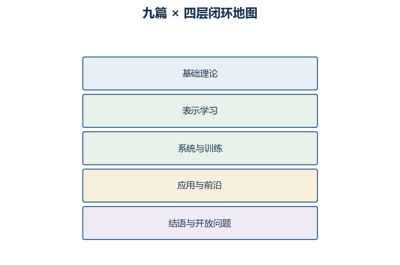

## 41.3　三条趋势

**趋势一：基础模型化（foundation-modelization）。** 从第 6 章浅层嵌入（DeepWalk）到第 28—31 章图基础模型，图智能经历了「 Task-specific → Pretrain & Finetune → 通用骨干」的演进。第 28—31 章指出，图基础模型试图用统一预训练目标覆盖多种下游任务，其理论瓶颈正是第 39 章的泛化边界与第 40 章 O2「真正泛化」问题。趋势一的核心是：**从学一张图的表示，到学「图」这一数据形态的通用表示**。这条路径与 NLP 基础模型（第 30 章 GraphRAG 所依赖的 LLM）同构：先预训练出「图语言模型」，再针对下游任务微调。但图基础模型面临比 LLM 更难的「数据异构性」——文本是 token 序列、天然可分词，而图的结构、属性、规模差异极大，「图 token 化」尚无共识（O8 问题），这是趋势一尚未落地的根本原因。

**趋势二：多模态化（multimodalization）。** 第 37 章论证图可作为视觉、语言、语音的统一关系骨架。当世界模型（第 38 章）需要同时理解图像与指令时，图是天然的公共语言。趋势二的核心是：**从单一图结构，到「一切模态先图化」的统一表示**。它与趋势一交汇于「多模态图基础模型」——这正是 O8 问题所在。多模态化的「图」不是给定的图，而是**构造的图**：从图像构造场景图（第 37 章例 37.1）、从文本构造实体关系图（第 35 章知识图谱）、从视频构造时空图。构造的图引入「建图噪声」（37.5 节边界），使趋势二的不确定性来自「观测→图」这一步而非「图→表示」——这是与趋势一（给定图）的关键差异。

**趋势三：世界模型化（world-modelization）。** 第 38 章把图从静态结构推进到动态世界建模与智能体决策闭环。图不再只是被分析的数据，而成为智能体「想象」与「规划」的内部模型。趋势三的核心是：**从分析图，到在图模型中行动**。它把图智能与世界模型、强化学习、具身智能连接，是「关系即智能」最具野心的延伸。三条趋势依次回答「用什么表示」（基础模型）、「表示什么」（多模态）、「用来做什么」（世界模型），构成一条完整的逻辑链。趋势三是前两者的「落地出口」：基础模型与多模态化解决「表示」，世界模型化解决「用表示行动」——没有趋势三，前两者只是更强的「分析工具」而非「智能体」。

**表 41-2　三条趋势与对应章节／开放问题**

| 趋势 | 核心转变 | 对应章节 | 关键开放问题 |
|------|----------|----------|--------------|
| 基础模型化 | 专用→通用骨干 | 28—31 | O2 真正泛化 |
| 多模态化 | 单模态→统一图骨架 | 37 | O8 语义对齐 |
| 世界模型化 | 分析图→在图中行动 | 38 | O7 组合泛化 |

三条趋势并非彼此独立：基础模型提供通用表示（趋势一），多模态提供丰富观测（趋势二），世界模型提供时间闭环（趋势三）。三者交汇处，是「通用图智能体」的雏形——但第 40 章的开放问题清单提醒我们，这仍是愿景而非现实。

**每条趋势的「未竟」。** 趋势一（基础模型化）的未竟是「图 token 化」无共识：文本可分词、图无自然分词，「图 token」是子图？是路径？是节点特征？（O8）趋势二（多模态化）的未竟是「建图噪声」：场景图检测漏检/误检（37.5 节）使「观测→图」这一步不可靠，多模态对齐的精度被建图质量封顶。趋势三（世界模型化）的未竟是「组合泛化」：图世界模型对「见过的交互规则」泛化好，对「新实体数/新规则」泛化差（O7）。三条趋势各自的「未竟」恰好对应第 40 章的 O2、O8、O7——趋势与开放问题一一对应，说明「未来」不是凭空设想，而是当前未解问题的自然延伸。这种对应使结语的「展望」保持落地：每条趋势都指向具体的、可研究的缺口。

从全书四层能力看，三条趋势各自侧重不同层级：基础模型化主要作用于 L1—L3（统一表示、学习、推理），多模态化扩充 L1 的输入形态，世界模型化则打通 L2—L4（动态学习、规划、系统闭环）。三者叠加，恰好覆盖四层能力，与表 41-1 第九篇「全层覆盖」相呼应——这不是巧合，而是全书框架的内在一致性：未来之所以是三条趋势，正因为它们合力补全了四层能力中各自尚缺的部分。

## 41.4　关系即智能：最终论断

**命题 41.1（关系即智能）** 智能的本质不在于孤立对象的属性，而在于对**关系结构**的表示、学习与推理能力；图智能以关系归纳偏置为核心，因而是通向通用智能的一条必要路径。

**推导：从归纳偏置到智能。** 第 1 章定义关系归纳偏置（式 1-1 的置换等变性），第 10—18 章把它落实为消息传递（式 1-2），第 19—23 章把它扩展为关系推理，第 37—38 章把它提升为多模态骨架与世界模型。归纳偏置带来的统计效率（少样本泛化，式 39-4）与组合泛化（第 38 章），正是智能的两个标志。因此

$$
\mathrm{Intelligence}\ \propto\ \mathrm{Relational\ Bias}\times\mathrm{Generalization}, \tag{41-2}
$$

即智能水平与利用关系结构的能力、由此获得的泛化能力正相关。式 (41-2) 不是严格的数学定理，而是全书证据的凝练——它解释为何图方法在少样本、组合泛化场景中卓有成效。

**式 (41-2) 的两个因子如何度量。** 「Relational Bias」可操作化为模型对图结构的依赖度（如第 31 章的结构敏感性 SSI：打乱边后性能下降多少，下降多则关系偏置强）；「Generalization」可操作化为分布外测试与训练测试的差距（如第 39 章式 39-4 的泛化界，差距小则泛化好）。两因子相乘意味着：关系偏置强但泛化差（过拟合结构）的智能不成立，泛化好但关系偏置弱（靠记忆而非关系）的智能也不鲁棒——二者缺一不可。这解释了「为何只看准确率不够」：必须同时度量「用了多少关系」与「泛化到多远」，这正是第 31 章评估框架（SSI + OOD）在「关系即智能」论断下的具体化。

**直觉解释。** 一个只记住「这是猫」的模型是脆弱的；一个理解「猫追逐老鼠、老鼠怕猫、二者都是动物」的关系模型是鲁棒的。后者拥有的是关系结构，而非孤立标签。人类智能的显著特征——类比、迁移、常识推理——无一不依赖关系。若智能是「在世界中有效行动的能力」，而世界本质是关系的网络（第 1 章开篇），那么「关系即智能」就不是修辞，而是逻辑结论。

**与经典智能理论的对话。** 「关系即智能」并非孤立的口号，它与多条智能研究主线呼应：图灵机揭示智能是「符号操作」，但符号操作的本质是符号间的**关系**（运算关系）；连接主义（神经网络）把智能归为「权重模式」，但权重模式的判别力来自**结构**（哪层连哪层、哪些单元互连）——关系再次出现；具身认知（第 38 章世界模型）强调智能在「身体—环境」关系中涌现，环境正是关系网络。三条看似不同的智能理论，在「关系」这一概念上汇合——这支持命题 41.1 的普适性：关系不是图智能特有的视角，而是多种智能理论的共同底色。图智能的贡献，是为这种「关系观」提供了可计算、可学习的形式化工具（消息传递、GNN、图基础模型）。

从本书的理论主线看，这一论断还有一层含义：第 1 章反复强调「图连接不等于因果」「相似不等于同义」「更深不等于更强」三个命题，它们共同提醒我们，智能不在于堆叠连接或深度，而在于**正确地利用关系**。因此「关系即智能」的「关系」不是任意的边，而是经过因果与语义校准的结构——这正是第 40 章 O6「图与因果融合」被列为核心开放问题的深层原因。

**诚实的边界。** 命题 41.1 是「必要路径」而非「充分条件」：第 39 章的 1-WL 上界、第 40 章的八项开放问题表明，仅有图结构远远不够。关系归纳偏置既是力量（样本效率）也是牢笼（表达上限）。「关系即智能」的准确含义是：**没有对关系的建模，就没有鲁棒智能；但有了关系建模，也未必立刻得到通用智能**。这一限定使全书论断保持学术诚实。

**「必要路径」的三层证据。** 为何说关系建模是「必要」而非「充分」？三层证据：（i）**必要侧**——少样本泛化（式 39-4）、组合泛化（第 38 章）、类比推理（第 39 章）都依赖关系结构，孤立属性无法解释这些能力；（ii）**必要但有界侧**——1-WL 上界（定理 39.1）说明关系建模的表达力有界，超过 1-WL 的任务需跳出消息传递；（iii）**非必要侧**——某些任务（如纯属性分类）关系结构贡献有限，「关系」不是万能钥匙。三层证据合起来才是完整的「必要路径」论断：关系是大多数复杂智能的必要组件，但表达力边界与任务匹配性限制了它的充分性。这种「必要 + 有界 + 非万能」的三重限定，是本书对「关系即智能」最精确的表述。

## 41.5　数值算例

**例 41.2（层覆盖矩阵手算）** 由表 41-1，统计每层被重点涉及的篇数：L1 由第一、二、六、七、九篇覆盖（5 篇）；L2 由第三、四、六、七、九篇（5 篇）；L3 由第五、七、九篇（3 篇）；L4 由第八、九篇（2 篇）。总覆盖

$$
M=5+5+3+2=15. \tag{41-3}
$$

九篇共 36 个格子，覆盖 15 个，覆盖率 $15/36\approx41.7\%$。L4 覆盖最少（仅 2 篇）——这印证第 1 章「系统层是最薄弱的一环」，也解释了为何第 40 章把 O3「可扩展推理」列为核心开放问题。

**例 41.3（关系偏置的样本效率手算）** 由式 39-4，比较「利用关系（$h=0.8$）」与「忽略关系（$h\approx0$）」的泛化界。设 $n=10^4,\rho=0.01$：利用关系时 $\varepsilon\le1/(0.01\times10^4\times0.8)=0.0125$；忽略关系时 $h\to0$ 使界趋于无穷（无法从结构共享获益）。该对比量化了「关系即智能」的核心论据：关系偏置把不可能的泛化变为可能。

**例 41.4（三趋势协同手算）** 设 $g_1=0.3$（基础模型化已较成熟）、$g_2=0.2$（多模态化初步）、$g_3=0.1$（世界模型化早期）、$\beta=0.5$。由式 (41-4)：完全协同项 $g_1g_2g_3=0.3\times0.2\times0.1=0.006$；两两协同项 $\beta(g_1g_2+g_2g_3+g_1g_3)=0.5(0.06+0.02+0.03)=0.5\times0.11=0.055$。$G_{\text{synergy}}=0.006+0.055=0.061$。对比「只推基础模型」$G=g_1=0.3$ 与「三趋势协同」$G=0.061$——看似协同项小，但它代表的是**新增的智能维度**（多模态理解 + 动态决策），而非基础模型的重复提升。若 $g_3$ 提升到 0.3（世界模型突破 O7），完全协同项升至 $0.3\times0.2\times0.3=0.018$（三倍），$G$ 整体放大——印证式 (41-4) 的短板效应：$g_3$ 是最薄弱因子，提升它收益最大。这个算例把「优先解决 O7」从定性判断变为定量权衡。

### 41.5A　三条趋势的协同量化

三条趋势并非独立叠加，而是**乘性协同**：基础模型提供通用表示（效率因子 $\eta_1$）、多模态提供丰富观测（覆盖因子 $\eta_2$）、世界模型提供时间闭环（决策因子 $\eta_3$）。设单一趋势的「智能增量」为 $g_i$，则三趋势协同的增量按

$$
G_{\text{synergy}}=g_1g_2g_3+\beta\,(g_1g_2+g_2g_3+g_1g_3), \tag{41-4}
$$

第一项是三趋势的完全协同（乘性，缺一不可），第二项是两两协同（部分互补，系数 $\beta<1$）。这解释了「为何要同时推进三条趋势」：只学基础模型（$g_2=g_3=0$）则 $G=g_1$，无协同收益；三者齐备时 $G$ 含乘性项，增长快于线性。但乘性项也意味着**短板效应**——任一 $g_i$ 过小（如世界模型 O7 未解），$G$ 整体被压低。这与第 40 章「八项问题须同时面对」的论断一致：通用图智能不是单点突破，而是多趋势协同下的系统性工程。

**趋势与开放问题的对齐。** 式 41-4 的三个因子分别对应第 40 章的开放问题：$g_1$（基础模型化）受 O2「真正泛化」制约，$g_2$（多模态化）受 O8「语义对齐」制约，$g_3$（世界模型化）受 O7「组合泛化」制约。因此 $G_{\text{synergy}}$ 的上界由「最薄弱因子的对应问题」决定——这是把「开放问题清单」与「未来趋势」在数学上对齐的方式：要提升 $G$，优先解决最短板对应的开放问题，而非均匀投入。

**例 41.5（趋势演进的历史手算）** 以学术引文网络（第 1 章统一案例）追踪三趋势的「成熟度」$g_i$ 随年代的演变（示意值）：2015 年 $g_1=0.1$（浅层嵌入）、$g_2=0.05$（图文检索）、$g_3=0.05$（无图世界模型）；2020 年 $g_1=0.3$（GNN 成熟）、$g_2=0.1$（场景图）、$g_3=0.1$（NRI/交互网络）；2024 年 $g_1=0.5$（图基础模型探索）、$g_2=0.2$（多模态图）、$g_3=0.15$（图世界模型早期）。$G_{\text{synergy}}$（$\beta=0.5$）：2015 年 $\approx0.003+0.5(0.005+0.005+0.005)=0.009$；2020 年 $\approx0.003+0.5(0.03+0.01+0.03)=0.043$；2024 年 $\approx0.02+0.5(0.1+0.03+0.075)=0.093$。$G$ 从 0.009 增至 0.093（约 10 倍），但增长主要来自 $g_1$（基础模型化）的稳步提升，而非协同项的爆发——说明当前阶段「单趋势（基础模型）成熟」仍主导，「三趋势协同」尚在早期。这给读者的启示是：未来 5—10 年的研究红利，更多在「补齐短板」（$g_3$ 世界模型化）而非「强化长板」（$g_1$ 已较成熟）。

## 41.6　全书收束

**边界与讨论。** 本章的「九篇×四层」映射（表 41-1）是一种叙事性归纳，并非唯一划分；三条趋势（表 41-2）也可能随领域演进重组；「关系即智能」（式 41-2）是凝练性论断而非可证定理。第 40 章的八项开放问题依然全部有效——结语提供的不是答案，而是带着问题继续前行的坐标。换言之，本书的收束是「阶段性的存档」而非「永久的封印」：四十一章的方法会在新范式下被重写，但「以关系为镜」的视角将持续有效。

**收束的三重诚实。** 作为结语，本章在三点上保持诚实，避免「大词收场」：（i）**方法诚实**——不夸大图基础模型的现状（O2/O8 未解），不宣称通用图智能体已存在；（ii）**理论诚实**——命题 41.1 明确是「必要非充分」，式 41-2 明确是「凝练非定理」，第 39 章的 1-WL 上界未被绕过；（iii）**历史诚实**——三条趋势是「当前」的观察，不是预言；若范式突变（如统一图 Token 化、神经符号突破），趋势图景需重绘。结语的价值正在于这种「有边界的肯定」：既给出方向（关系即智能），又标明局限（八项开放问题），让读者带着清醒而非狂热，面向第 40 章列出的开放问题继续前行。

**致读者。** 图智能导论走到尽头，但你手里的地图才刚刚展开。

愿我们从第 1 章带到第 41 章的，不只是一堆公式与模型，更是一种可被迁移的思维习惯：面对任何复杂系统，先问「对象之间如何相连」，再问「这种相连如何被学习与利用」。从第 1 章「关系结构无处不在」的宣告，到第 41 章「关系即智能」的收束，全书试图传达的，是一种看待世界的方式：把对象放回关系，把关系织成图，让机器学会在图上表示、学习、推理与行动。这条路未尽，第 40 章的开放问题就是路标。愿这张地图助你在关系智能的探索中，找到自己的坐标。

## 本章小结

本章作为全书结语，完成首尾闭环与最终论断。

我们首先给出收束动机与统一案例闭环（41.1 节，例 41.1）。接着呈现九篇×四层映射（表 41-1）并推导层覆盖矩阵（式 41-1）。我们提炼三条趋势——基础模型化、多模态化、世界模型化（表 41-2），论证「关系即智能」（命题 41.1，式 41-2）并给出诚实的边界限定，随后用式 (41-4) 量化三趋势的协同效应。五个数值算例（例 41.2 层覆盖、例 41.3 样本效率、例 41.4 趋势协同、例 41.5 趋势历史，式 41-3）验证层覆盖分布、关系偏置的样本效率与趋势协同的短板效应。

全书至此收束：九篇成地图，四层为骨架，三条趋势指未来，而「关系即智能」是留给读者的最后一枚罗盘。

**进一步阅读**　本章建议延伸阅读的文献：[1]（GCN，图学习的起点）、[3]（图基础模型，趋势一的代表综述）、[4]（世界模型，趋势三的思想源头）、[5]（交互网络，图世界模型的早期形态）、[6]（因果推断，「关系≠因果」的延伸阅读）。这五篇分别对应全书的起点、趋势一、趋势三与理论边界，建议按此顺序回看，以建立「从方法到趋势再到论断」的完整线索。

## 参考文献

[1] Kipf T N, Welling M. Semi-supervised classification with graph convolutional networks. *ICLR*, 2017.

[2] Xu K, Hu W, Leskovec J, Jegelka S. How powerful are graph neural networks? *ICLR*, 2019.

[3] Mao H, et al. Graph foundation models: A survey. *arXiv preprint*, 2024.

[4] Ha D, Schmidhuber J. World models. *arXiv preprint*, 2018.

[5] Battaglia P W, Hamrick J B, Bapst V, et al. Interaction networks for learning about objects, relations and physics. *NeurIPS*, 2016.

[6] Pearl J, Mackenzie D. The Book of Why: The New Science of Cause and Effect. *Basic Books*, 2018.

[7] Wu Z, Pan S, Chen F, et al. A comprehensive survey on graph neural networks. *IEEE TNNLS*, 2021, 32(1): 4–24.

[8] Schölkopf B, Locatello F, Bauer S, et al. On causal and anticausal learning. *ICML*, 2012.

---

# 附录

## 附录 A　数学工具包

本附录汇总全书反复使用的数学工具，供读者查阅。更严格的论述见相应章节。

### A.1　概率论基础

**概率空间与随机变量。** 概率空间为三元组 $(\Omega,\mathcal{F},P)$，其中 $\Omega$ 为样本空间，$\mathcal{F}$ 为事件 $\sigma$-代数，$P$ 为概率测度。随机变量 $X:\Omega\to\mathbb{R}$ 把样本点映射为实数，其分布由累积分布函数 $F_X(x)=P(X\le x)$ 或概率密度/质量函数描述。

**条件概率与链式法则。** $P(A\mid B)=P(A\cap B)/P(B)$。对词序列 $x=(w_1,\dots,w_T)$，联合概率的链式分解为

$$
P(w_1,\dots,w_T)=\prod_{t=1}^{T}P(w_t\mid w_1,\dots,w_{t-1}). \tag{A-1}
$$

这是全部语言模型的出发点（第 3、15 章）。

**期望、方差与协方差。** $\mathbb{E}[X]=\sum_x xp(x)$（离散）或 $\int xp(x)\,dx$（连续）；$\mathrm{Var}[X]=\mathbb{E}[(X-\mathbb{E}X)^2]$；$\mathrm{Cov}(X,Y)=\mathbb{E}[XY]-\mathbb{E}X\,\mathbb{E}Y$。

### A.2　信息论基础

**熵与交叉熵。** 离散随机变量 $X$ 的熵为

$$
H(X)=-\sum_x p(x)\log p(x), \tag{A-2}
$$

两个分布 $p,q$ 的交叉熵为 $H(p,q)=-\sum_x p(x)\log q(x)$，KL 散度为 $D_{\mathrm{KL}}(p\|q)=\sum_x p(x)\log\frac{p(x)}{q(x)}=H(p,q)-H(p)$。

**困惑度。** 语言模型的困惑度定义为每词平均负对数似然的指数：

$$
\mathrm{PPL}(x)=\exp\!\left(-\frac{1}{T}\sum_{t=1}^{T}\log p_\theta(w_t\mid w_{<t})\right). \tag{A-3}
$$

困惑度越低表示模型对测试语料越"不意外"，但它是几何平均意义下的指标，对长尾词敏感（第 3、15 章）。

### A.3　线性代数与矩阵分解

**向量空间与范数。** $\mathbf{x}\in\mathbb{R}^d$，$\ell_2$ 范数 $\\|\mathbf{x}\\|_2=\sqrt{\sum_i x_i^2}$，$\ell_1$ 范数 $\\|\mathbf{x}\\|_1=\sum_i|x_i|$。点积 $\mathbf{x}^\top\mathbf{y}$ 衡量方向相似性，余弦相似度 $\cos(\mathbf{x},\mathbf{y})=\frac{\mathbf{x}^\top\mathbf{y}}{\\|\mathbf{x}\\|\|\\mathbf{y}\\|}$。

**奇异值分解（SVD）。** 任意矩阵 $\mathbf{A}\in\mathbb{R}^{m\times n}$ 可分解为 $\mathbf{A}=\mathbf{U}\mathbf{\Sigma}\mathbf{V}^\top$，其中 $\mathbf{U},\mathbf{V}$ 为正交矩阵，$\mathbf{\Sigma}$ 为奇异值对角阵。截断 SVD 给出最优低秩逼近（Eckart–Young 定理），是 LSA 与词向量降维的理论基础（第 6 章）。

### A.4　最优化基础

**梯度下降。** 对目标 $\mathcal{L}(\theta)$，梯度下降更新 $\theta\leftarrow\theta-\eta\nabla_\theta\mathcal{L}(\theta)$，$\eta$ 为学习率。随机梯度下降（SGD）用单个/小批量样本估计梯度。

** softly 凸性与光滑。** 函数 $f$ 为 $L$-光滑若 $\\|\nabla f(x)-\nabla f(y)\\|\le L\\|x-y\\|$；为 $\mu$-强凸若 $f(y)\ge f(x)+\nabla f(x)^\top(y-x)+\frac{\mu}{2}\\|y-x\\|^2$。二者决定梯度下降的收敛率。

### A.5　常用分布

| 分布 | 记号 | 用途 |
|------|------|------|
| 伯努利 | $\mathrm{Bern}(p)$ | 二值事件 |
| 多项 | $\mathrm{Mult}(n,\mathbf{p})$ | 词的多项采样 |
| 高斯 | $\mathcal{N}(\mu,\sigma^2)$ | 连续潜变量、噪声 |
| Dirichlet | $\mathrm{Dir}(\boldsymbol\alpha)$ | 主题模型的先验 |
|  categorical | $\mathrm{Cat}(\mathbf{p})$ | 词表上的分布 |

---

## 附录 B　环境与基准索引

### B.1　常用语料

| 语料 | 规模 | 用途 |
|------|------|------|
| Penn Treebank (PTB) | 约 100 万词 | 语言模型、句法分析标准语料 |
| WikiText-103/2 | 1.03 亿/200 万词 | 大规模语言模型 |
| 1B Word Benchmark | 约 10 亿词 | 词向量评估 |
| BooksCorpus | 约 8 亿词 | 预训练（GPT/BERT） |
| C4 | 约 750GB | T5 预训练 |
| The Pile | 约 825GiB | 多样化预训练 |
| OSCAR / CC-100 | 多语言 TB 级 | 多语言预训练 |

### B.2　任务基准

| 基准 | 任务 | 说明 |
|------|------|------|
| GLUE / SuperGLUE | 自然语言理解 | 多项分类、推理、问答的集合 |
| SQuAD 1.1/2.0 | 阅读理解 | 抽取式问答，含不可回答 |
| WMT | 机器翻译 | 多语言对，BLEU 评估 |
| ImageNet / COCO | 视觉（多模态用） | 视觉编码器预训练 |
| MMLU | 大模型知识 | 57 学科多选题 |
| GSM8K / MATH | 数学推理 | 应用题与竞赛题 |
| HumanEval | 代码生成 | Python 函数补全 |

### B.3　词向量与表示评测

- **类比任务**：`king : queen = man : ?`，评估语义/句法类比能力。
- **词相似度**：WordSim-353、SimLex-999、MEN，与人工打分求 Spearman 相关。
- **探测（probing）**：用线性探针从上下文表示中恢复词性、句法、语义角色。

---

## 附录 C　开源工具链

### C.1　核心框架

| 工具 | 用途 |
|------|------|
| PyTorch / TensorFlow | 深度学习训练框架 |
| Hugging Face Transformers | 预训练模型库（BERT/GPT/LLaMA 等） |
| Hugging Face Datasets | 数据集加载与处理 |
| Tokenizers / SentencePiece | 分词与子词切分 |
| spaCy / NLTK / Stanza | 传统 NLP 与词法句法分析 |

### C.2　训练与微调

| 工具 | 用途 |
|------|------|
| DeepSpeed / Megatron-LM | 大规模分布式训练 |
| FSDP | PyTorch 原生全分片数据并行 |
| PEFT | 参数高效微调（LoRA/Adapter） |
| bitsandbytes / GPTQ | 量化 |
| TRL | RLHF/DPO 对齐训练 |

### C.3　检索与部署

| 工具 | 用途 |
|------|------|
| FAISS / Annoy / HNSWlib | 向量检索与近似最近邻 |
| Elasticsearch | 关键词与混合检索 |
| vLLM / TensorRT-LLM | 大模型推理服务 |
| LangChain / LlamaIndex | RAG 与应用编排 |

---

## 附录 D　符号与缩略语对照表

### D.1　缩略语

| 缩略语 | 全称 | 中文 |
|--------|------|------|
| NLP | Natural Language Processing | 自然语言处理 |
| LM | Language Model | 语言模型 |
| LLM | Large Language Model | 大语言模型 |
| N-gram | n-gram | n 元语法 |
| PPL | Perplexity | 困惑度 |
| POS | Part-of-Speech | 词性 |
| NER | Named Entity Recognition | 命名实体识别 |
| RE | Relation Extraction | 关系抽取 |
| SRL | Semantic Role Labeling | 语义角色标注 |
| AMR | Abstract Meaning Representation | 抽象意义表示 |
| CFG | Context-Free Grammar | 上下文无关文法 |
| PCFG | Probabilistic CFG | 概率上下文无关文法 |
| CKY | Cocke–Kasami–Younger | 句法分析算法 |
| HMM | Hidden Markov Model | 隐马尔可夫模型 |
| CRF | Conditional Random Field | 条件随机场 |
| RNN/LSTM | Recurrent Neural Network | 循环神经网络/长短时记忆 |
| seq2seq | sequence-to-sequence | 序列到序列 |
| NMT | Neural Machine Translation | 神经机器翻译 |
| Transformer | Transformer | Transformer 架构 |
| MLM | Masked Language Modeling | 掩码语言模型 |
| PEFT | Parameter-Efficient Fine-Tuning | 参数高效微调 |
| LoRA | Low-Rank Adaptation | 低秩适配 |
| ICL | In-Context Learning | 上下文学习 |
| RLHF | RL from Human Feedback | 基于人类反馈的强化学习 |
| DPO | Direct Preference Optimization | 直接偏好优化 |
| CoT | Chain of Thought | 思维链 |
| RAG | Retrieval-Augmented Generation | 检索增强生成 |
| BLEU | Bilingual Evaluation Understudy | 机器翻译评估 |

### D.2　数学符号

见「前置说明」符号表与附录 A。

---

## 附录 E　术语对照与全书速查索引

### E.1　核心术语对照

| 中文 | 英文 | 章 |
|------|------|----|
| 分布假设 | Distributional Hypothesis | 6 |
| 词嵌入 | Word Embedding | 6 |
| 上下文表示 | Contextual Representation | 7 |
| 组合性 | Compositionality | 13 |
| 真值条件 | Truth Conditions | 13 |
| 语用含义 | Pragmatic Meaning | 14 |
| 困惑度 | Perplexity | 3, 15 |
| 平滑 | Smoothing | 15 |
| 注意力 | Attention | 17, 20 |
| 自注意力 | Self-Attention | 20 |
| 预训练 | Pretraining | 21 |
| 微调 | Fine-tuning | 21, 23 |
| 涌现 | Emergence | 24 |
| 对齐 | Alignment | 28 |
| 幻觉 | Hallucination | 29, 31 |
| 检索增强 | Retrieval Augmentation | 30 |

### E.2　全书速查索引（按主题）

- **意义理论**：第 1、4 章；四层能力见 1.6，五层意义见 1.7/4。
- **词与向量**：词向量 6，上下文表示 7，相似度 9。
- **句法与语义**：句法 10–11，语义角色 12，逻辑形式 13，语篇 14。
- **语言模型**：统计 15，神经 16，seq2seq 17，翻译 18。
- **预训练**：Transformer 20，范式 21，训练 22，微调 23，ICL 24，多语言 25。
- **大模型**：规模化 26，模型谱系 27，对齐 28，推理 29，RAG 30，评估 31。
- **多模态与语音**：32–35。
- **应用与工程**：36–39。
- **未来**：40–42。

---

## 附录 F　算例复现说明

### F.1　环境依赖

- Python 3.10+
- PyTorch 2.x、NumPy、SciPy、scikit-learn
- Hugging Face Transformers、Tokenizers
- 可选：spaCy、NLTK（词法句法算例）、FAISS（检索算例）

### F.2　统一案例：开放域问答语料

全书算例以一份开放域问答语料为贯穿案例（第 1.8 节）。该语料由若干百科段落与对应问题组成，覆盖事实型、推理型与多跳问题。复现时：

1. 词法标注（第 8 章）：对语料做分词、词性标注与实体识别；
2. 句法与语义（第 11–12 章）：产出依存树与语义角色；
3. 语言模型（第 15–16 章）：在语料上训练 N-gram 与小型神经 LM，报告困惑度；
4. 预训练/微调（第 21–23 章）：加载公开预训练模型，做少样本适配；
5. 检索增强（第 30 章）：构建向量索引，做检索增强问答；
6. 对话智能体（第 37 章）：封装为多轮问答。

### F.3　随机种子与数值容差

- 涉及随机初始化的算例固定随机种子 `seed=42`。
- 数值结果保留三到四位有效数字；因库版本差异允许末位浮动。
- 小模型算例为教学示意，旨在展示计算过程，不使用大规模算力。

### F.4　算例数值声明

除注明出处者外，全书算例中的具体数值（概率、困惑度、注意力权重、类比向量等）均为**教学示意**，通过小型可复现实验或手工计算得到，用于展示方法机制与量级，不代表任何真实系统在生产环境中的实测结果。引用文献中的基准数字以原始出处最新版本为准。