# 本体智能导论

> 从数据到知识，从知识到推理

---

## 内容简介

本书系统论述「本体智能」（ontological intelligence）——机器表示、组织并推理关于世界的概念与关系的理论、方法与工程体系。作者把这套能力界定为四层递进的含义：**概念层**回答「世界有哪些概念、它们之间是什么关系」，**知识层**回答「具体的事实如何归属到概念之下」，**推理层**回答「如何从已有知识推出新知识」，**应用层**回答「如何让知识在不同系统与任务间流转与互操作」；四层层层递进，共同构成从数据走向知识、从知识走向可推理语义结构的完整图景。全书以一条主线贯穿：以**从数据到知识、从知识到推理**为理论基础，以**本体论（ontology）与知识表示**为核心，以「概念—知识—推理—应用」为脉络，把哲学、逻辑学、语义网、知识工程与神经—符号方法彼此隔离的本体思想放进同一张地图。

全书共九篇四十一章。第一篇建立哲学本体论、一阶逻辑与描述逻辑的理论基础；第二篇展开语义网与本体语言；第三篇处理知识图谱构建；第四篇梳理知识图谱推理；第五篇聚焦本体工程与本体对齐；第六篇进入神经—符号融合；第七篇论述大语言模型与知识的关系；第八篇给出应用与工程；第九篇回扣框架，讨论本体在通用智能中的角色与开放问题。书末附数学工具包、本体与知识图谱资源索引、开源工具链、符号与缩略语对照表、术语与速查索引、算例复现说明六个附录。

本书提出并贯穿一套自建理论框架——**本体的四层结构**：概念层、知识层、推理层、应用层，并以「语义之梯」为贯穿线索，强调从词汇到概念、从概念到公理、从公理到推理的逐步形式化。据此对每一个方法追问四件事：它处于语义之梯的哪一级、隐含了什么假设、突破了前一方法的什么限制、无法突破什么理论边界。第 1 章立框架，第 2—4 章建立理论基础，第 28 章据此评估神经—符号方法的能力，第 41 章回扣框架讨论本体智能能否通向通用智能，形成首尾闭环。

在写法上，本书按学术专著标准组织：每节依次展开引入动机、直觉解释、严格定义与推导、带数值的算例、技术谱系与变体、边界与讨论、承上启下的交叉引用；每章含两个以上定义或定理、两个以上数值算例、图与表、文内引用标号与章末参考文献一一对应。全书以一个贯穿全书的生物医学本体与疾病—药物知识图谱为统一案例，同一份知识资源从概念建模、公理化、推理、知识图谱构建、对齐一路做到神经—符号推理与大模型增强，辅以法律、政务与企业知识管理的专题案例。基础理论只讲一次、后续章节以交叉引用展开应用与深化；配图五十幅，数学与内部结构图由代码精确绘制，概念与流程图按统一学术风格生成。全书约五十万字、二百余个编号公式、近六百条章末文献。

本书面向知识图谱、语义网、知识表示与推理、神经—符号智能方向的研究生、科研人员与资深工程从业者，兼顾理论严谨与工程可落地。读者只需具备离散数学、一阶逻辑、概率论与基本机器学习知识。

## 本书的理论主线

本书不满足于罗列知识技术，而试图回答一个更根本的问题：**机器如何形式化地表示关于世界的概念与关系，并据此可靠地推理？其充分必要条件与可判定性边界在哪里？** 全书以「以从数据到知识、从知识到推理为理论基础，以本体论与知识表示为核心，以概念—知识—推理—应用为主线」组织，使每一类方法都能被安置到同一个理论坐标系中。

**四层结构。** 本体智能包含四层递进的结构：

| 层级 | 名称 | 回答 | 内涵 |
|------|------|------|------|
| Level 1 | 概念层 | 世界有哪些概念？ | 概念、关系、属性与公理的形式化 |
| Level 2 | 知识层 | 事实如何归属概念？ | 实例、断言、知识图谱与事实库 |
| Level 3 | 推理层 | 如何推出新知识？ | 逻辑推理、规则、蕴含与一致性 |
| Level 4 | 应用层 | 知识如何流转？ | 互操作、问答、决策与智能系统 |

**语义之梯。** 从词汇到推理，语义形式化有四个台阶（这是理论组织框架）：

| 级 | 名称 | 形式化工具 | 主要落点 |
|----|------|-----------|----------|
| S1 | 词汇 | 词典、词表、术语 | 第 1、20 章 |
| S2 | 概念 | 概念层级、关系、分类 | 第 2、4、21 章 |
| S3 | 公理 | 一阶逻辑、描述逻辑、约束 | 第 3、4、6、8 章 |
| S4 | 推理 | 表推演、规则、蕴含 | 第 8、9、15、17 章 |

由此，本书对每一个方法都追问四件事：它处于语义之梯的哪一级、隐含了什么假设、突破了前一方法的什么限制、又无法突破什么理论边界。例如知识图谱把 S1—S2 大规模落地但公理与推理薄弱，描述逻辑保证可判定性但表达力受限，规则系统推理高效但难以处理开放世界，大语言模型隐式承载五层但缺乏形式保证——它们不是简单的技术迭代，而是**对语义形式化的不同取舍**。

由此还须澄清三个常被混淆的命题：**有数据不等于有知识，有知识不等于能推理，能生成不等于可保证**。三者分别在第三、四、七篇给出严格说明。

## 本书体例（凡例）

按「篇—章—节」三级组织。定义／定理／例按章编号。公式写作 `$$\ldots\tag{X-N}$$`（X 为章号，N 为章内序号）。图编号「图 X-Y」，表编号「表 X-Y」。重要论断以 `[n]` 标注，章末列参考文献，一一对应。术语首次出现给出英文。中文使用全角标点，节号后用全角空格「　」。每章含章导读、若干节（每节依次展开引入动机、直觉解释、严格定义与推导、算例、技术谱系与变体、边界与讨论、承上启下）、本章小结、进一步阅读、参考文献，无「习题」小节。

## 读者对象与阅读路径

面向知识图谱、语义网、知识表示与推理、神经—符号智能方向的研究生、科研人员与资深工程从业者。预备知识：离散数学、一阶逻辑、概率论、基本机器学习。第一篇（1—4 章）为全书理论基础，宜先读；第二至五篇可按研究兴趣选读；第六至九篇为前沿与展望，建议在掌握前五篇后阅读。统一案例贯穿全书，可顺章追踪同一份生物医学知识资源的不同处理阶段。

## 符号表

| 符号 | 含义 |
|------|------|
| $\mathcal{O}$ | 本体（概念层形式化） |
| $\mathcal{K}=\langle\mathcal{T},\mathcal{A}\rangle$ | 知识库：TBox 与 ABox |
| $\mathcal{T}$ | 术语盒（概念与关系的公理） |
| $\mathcal{A}$ | 断言盒（实例事实） |
| $\mathcal{I}=(\Delta^{\mathcal{I}},\cdot^{\mathcal{I}})$ | 解释：论域与解释函数 |
| $C^{\mathcal{I}}\subseteq\Delta^{\mathcal{I}}$ | 概念 $C$ 的外延 |
| $R^{\mathcal{I}}\subseteq\Delta^{\mathcal{I}}\times\Delta^{\mathcal{I}}$ | 角色 $R$ 的外延 |
| $\sqsubseteq,\equiv$ | 包含与等价（概念序关系） |
| $\models$ | 逻辑蕴含／满足 |
| $\top,\bot$ | 全域概念与空概念 |
| $G=(V,E)$ | 图：节点集与边集（知识图谱） |
| $\mathbf{h},\mathbf{r},\mathbf{t}$ | 头实体、关系、尾实体的嵌入向量 |
| $N_C,N_R,N_T$ | 概念数、关系数、三元组数 |

## 目录

第一篇（1—4）本体与知识表示的理论基础；第二篇（5—9）语义网与本体语言；第三篇（10—14）知识图谱构建；第四篇（15—19）知识图谱推理；第五篇（20—23）本体工程与本体对齐；第六篇（24—28）神经—符号融合；第七篇（29—33）大语言模型与知识；第八篇（34—38）应用与工程；第九篇（39—41）本体智能的未来。附录 A–F。

### 第一篇　本体与知识表示的理论基础

**第 1 章　绪论：本体智能的历史脉络与全书框架**　1.1 本体智能的界定　1.2 从哲学本体论到计算机本体　1.3 本体智能的根本困难：概念化、公理化、可判定、互操作　1.4 全书的结构安排　1.5 四层结构与语义之梯　1.6 贯穿全书的统一案例

**第 2 章　哲学本体论与知识表示**　2.1 范畴、实体与属性　2.2 认识论与本体论承诺　2.3 知识表示的早期范式：语义网络与框架　2.4 概念化与形式化　2.5 边界与讨论

**第 3 章　一阶逻辑与模型论**　3.1 一阶逻辑的语法与语义　3.2 模型论基础：结构、满足、蕴含　3.3 证明系统：归结与表推演　3.4 一阶逻辑的表达力与不可判定性　3.5 边界与讨论

**第 4 章　描述逻辑基础**　4.1 描述逻辑的动机：可判定的知识表示　4.2 ALC 的语法与语义　4.3 概念构造算子与表达力　4.4 Tableau 推理算法　4.5 统一案例：领域概念的形式化　4.6 边界与讨论

### 第二篇　语义网与本体语言

**第 5 章　语义网与 RDF/RDFS**　5.1 语义网愿景与资源描述框架　5.2 RDF 数据模型与三元组　5.3 RDFS 与轻量模式　5.4 命名图与数据集　5.5 边界与讨论

**第 6 章　OWL 与本体语言**　6.1 OWL 的层级：Lite、DL、Full　6.2 OWL 的构造算子与公理　6.3 OWL 与描述逻辑的对应　6.4 统一案例：疾病—药物本体建模　6.5 边界与讨论

**第 7 章　SPARQL 查询**　7.1 SPARQL 的语法与图模式　7.2 查询与推理的结合　7.3 联邦查询与端点　7.4 边界与讨论

**第 8 章　本体推理与规则**　8.1 规则语言：SWRL 与 RIF　8.2 约束与形状：SHACL　8.3 规则与描述逻辑的结合　8.4 边界与讨论

**第 9 章　推理机与复杂度**　9.1 描述逻辑推理机　9.2 推理复杂度与可判定性层级　9.3 大规模推理与优化　9.4 边界与讨论

### 第三篇　知识图谱构建

**第 10 章　信息抽取**　10.1 命名实体识别与关系抽取　10.2 事件抽取与开放信息抽取　10.3 从文本到结构化事实　10.4 统一案例：医学文献的实体关系抽取　10.5 边界与讨论

**第 11 章　知识图谱构建流水线**　11.1 知识图谱的生命周期　11.2 模式设计与本体驱动构建　11.3 抽取、融合与存储　11.4 边界与讨论

**第 12 章　实体对齐与知识融合**　12.1 实体对齐与共指消解　12.2 本体匹配与实例匹配　12.3 多源知识融合　12.4 统一案例：多源医学知识融合　12.5 边界与讨论

**第 13 章　知识图谱质量与评估**　13.1 完整性与正确性　13.2 一致性与新鲜度　13.3 质量评估方法　13.4 边界与讨论

**第 14 章　大规模知识图谱工程**　14.1 大规模知识图谱的存储与索引　14.2 分布式知识处理　14.3 代表性知识图谱剖析　14.4 边界与讨论

### 第四篇　知识图谱推理

**第 15 章　逻辑规则推理**　15.1 一阶规则与 Datalog　15.2 前向与后向链推理　15.3 规则推理的规模化　15.4 边界与讨论

**第 16 章　嵌入推理**　16.1 知识图谱嵌入与链路预测　16.2 嵌入推理的表达力与局限　16.3 统一案例：嵌入推理的链路预测　16.4 边界与讨论

**第 17 章　归纳逻辑编程与规则学习**　17.1 归纳逻辑编程（ILP）　17.2 从知识图谱学习规则　17.3 神经规则学习　17.4 边界与讨论

**第 18 章　时序与不确定知识推理**　18.1 时序知识与事件　18.2 不确定性与概率逻辑　18.3 概率知识图谱　18.4 边界与讨论

**第 19 章　常识推理**　19.1 常识知识的表示　19.2 常识知识库　19.3 常识推理的挑战　19.4 边界与讨论

### 第五篇　本体工程与本体对齐

**第 20 章　本体工程方法论**　20.1 本体开发方法学　20.2 需求分析与概念化　20.3 本体评估与验证　20.4 统一案例：本体开发流程　20.5 边界与讨论

**第 21 章　本体设计模式与复用**　21.1 本体设计模式　21.2 顶层本体与领域本体　21.3 本体的模块化与复用　21.4 边界与讨论

**第 22 章　本体匹配与对齐**　22.1 本体匹配问题　22.2 元素级与结构级匹配　22.3 基于嵌入的本体对齐　22.4 边界与讨论

**第 23 章　本体演化与维护**　23.1 本体演化的动机与类型　23.2 变更管理与一致性维护　23.3 版本控制与协作　23.4 边界与讨论

### 第六篇　神经—符号融合

**第 24 章　神经—符号智能**　24.1 神经—符号的动机与谱系　24.2 符号的注入、学习与推理　24.3 神经—符号架构　24.4 边界与讨论

**第 25 章　可微逻辑与可微推理**　25.1 逻辑的可微松弛　25.2 神经定理证明　25.3 可微推理的训练　25.4 边界与讨论

**第 26 章　图神经网络与逻辑推理**　26.1 GNN 的消息传递与逻辑规则　26.2 表达力与规则学习　26.3 神经—符号推理的落地　26.4 边界与讨论

**第 27 章　符号知识与深度学习的结合**　27.1 符号知识作为约束与正则　27.2 知识增强的神经网络　27.3 端到端的神经—符号系统　27.4 边界与讨论

**第 28 章　神经—符号的评估与局限**　28.1 神经—符号的能力与边界　28.2 可解释性与可信赖性　28.3 与纯神经、纯符号的对照　28.4 边界与讨论

### 第七篇　大语言模型与知识

**第 29 章　大语言模型中的知识**　29.1 参数化知识与事实记忆　29.2 大语言模型知识的性质　29.3 知识编辑与更新　29.4 边界与讨论

**第 30 章　检索增强与知识图谱增强**　30.1 检索增强生成（RAG）　30.2 知识图谱增强的生成　30.3 统一案例：知识增强的医学问答　30.4 边界与讨论

**第 31 章　幻觉与知识边界**　31.1 幻觉的类型与成因　31.2 知识与幻觉的关系　31.3 符号知识对幻觉的约束　31.4 边界与讨论

**第 32 章　大语言模型生成知识图谱**　32.1 从文本到知识图谱的生成　32.2 生成知识图谱的质量控制　32.3 人机协同的知识构建　32.4 边界与讨论

**第 33 章　符号知识与神经知识的统一**　33.1 两套知识体系的差异　33.2 融合架构与双向增强　33.3 走向可信赖的知识智能　33.4 边界与讨论

### 第八篇　应用与工程

**第 34 章　语义搜索与语义互操作**　34.1 语义搜索与知识检索　34.2 语义互操作与数据集成　34.3 链接数据　34.4 边界与讨论

**第 35 章　生物医学本体与知识图谱**　35.1 生物医学本体：基因本体、SNOMED、UMLS　35.2 疾病—药物知识图谱　35.3 统一案例：医学知识智能　35.4 边界与讨论

**第 36 章　企业知识图谱与知识管理**　36.1 企业知识管理　36.2 企业知识图谱构建　36.3 知识驱动的决策支持　36.4 边界与讨论

**第 37 章　法律与政务本体**　37.1 法律本体与法规知识　37.2 政务知识图谱　37.3 合规与可解释推理　37.4 边界与讨论

**第 38 章　本体系统工程化**　38.1 知识图谱平台与工具　38.2 本体的持续治理　38.3 知识系统的部署与运维　38.4 边界与讨论

### 第九篇　本体智能的未来

**第 39 章　本体在世界模型与通用智能中的角色**　39.1 本体与世界模型的接口　39.2 本体驱动的智能体　39.3 从知识到理解的通用智能　39.4 边界与讨论

**第 40 章　尚未解决的开放问题**　40.1 常识与大规模本体　40.2 可判定的推理与表达力权衡　40.3 神经与符号的真正统一　40.4 开放问题清单

**第 41 章　结语：从知识到智能**　41.1 首尾闭环：用四层结构重新审视全书　41.2 三条趋势：神经—符号化、大模型增强、本体驱动　41.3 本体智能的通向之路

### 附录

附录 A　数学工具包　·　附录 B　本体与知识图谱资源索引　·　附录 C　开源工具链　·　附录 D　符号与缩略语对照表　·　附录 E　术语对照与全书速查索引　·　附录 F　算例复现说明

---

# 第 1 章　绪论：本体智能的历史脉络与全书框架

数据是零散的记号，知识是被组织起来、可被推理的记号。把前者变成后者，是本体智能的根本任务。本章为全书立框架：先界定本体智能（1.1 节），再追溯从哲学本体论到计算机本体的思想脉络（1.2 节），提炼概念化、公理化、可判定、互操作四大根本困难（1.3 节），给出全书结构安排（1.4 节），提出贯穿全书的四层结构与语义之梯（1.5 节），最后引入统一案例（1.6 节）。阅读本章应抓住一个问题：机器形式化世界的概念与关系时，究竟在做什么取舍。

## 1.1　本体智能的界定
**引入与动机。** 我们每天接触海量数据：病历、论文、商品清单、社交消息。数据本身只记录「发生了什么记号」，并不解释「记号指向世界的什么」。例如数据库里一条记录 `阿司匹林—治疗—头痛`，机器看到的是两个字符串与一个字段，并不知道「阿司匹林」是一类药物、「治疗」是一种因果关联的语义关系、「头痛」是一种症状。要让机器「理解」这条记录，必须先约定世界有哪些概念、概念间有何关系、具体事实如何归属——这正是本体智能的起点。
**直觉解释。** 本体智能可以被看作给机器一副「概念眼镜」：戴上它，数据不再是扁平的字节，而是带有类型、关系与约束的意义结构。这副眼镜由两部分构成——**本体**（ontology，关于概念的显式规范）与**推理机制**（从规范与事实推出新结论的算法）。前者回答「世界有哪些概念」，后者回答「由此能推出什么」。
**严格定义与推导。** 我们给出全书第一个形式化定义。

**定义 1.1（本体）** 本体 $\mathcal{O}$ 是对某个领域概念化的显式规范，形式为一个四元组

$$
\mathcal{O}=\langle \mathcal{C},\mathcal{R},\mathcal{A}x,\mathcal{I}n\rangle, \tag{1-1}
$$

其中 $\mathcal{C}$ 为概念（class）集合，$\mathcal{R}$ 为关系（relation）集合，$\mathcal{A}x$ 为公理（axiom）集合，$\mathcal{I}n$ 为实例（individual）断言集合。概念描述对象的类型，关系描述概念间的联系，公理约束概念与关系的可能组合，实例断言把具体对象归入概念。

**定义 1.2（本体智能）** 本体智能是这样一个能力系统：给定本体 $\mathcal{O}$ 与事实集合 $\mathcal{F}$，能对任意查询 $q$ 判定 $\mathcal{O}\cup\mathcal{F}\models q$（逻辑蕴含），并能把 $\mathcal{O}$、$\mathcal{F}$ 与推导结果在不同系统间无损流转。其中包含四层能力 $L_1$ 概念化、$L_2$ 知识化、$L_3$ 推理、$L_4$ 互操作，满足逐层依赖 $L_{i+1}$ 以 $L_i$ 为前提。

由定义 1.2 可直接推出本体智能的三个必要条件：概念必须可形式化（否则 $L_1$ 不成立）、事实必须可断言（否则 $L_2$ 不成立）、推理必须可判定（否则 $L_3$ 无法给出确定答案）。这三条分别对应后文第 2、5、9 章的主题。
**数值算例。** 设一个极小医学本体：$\mathcal{C}=\{\text{药物},\text{疾病},\text{症状}\}$，$\mathcal{R}=\{\text{治疗},\text{表现为}\}$，公理 $\mathcal{A}x=\{\text{阿司匹林}\sqsubseteq\text{药物}\}$，实例 $\mathcal{I}n=\{\text{阿司匹林}(\text{a}),\text{头痛}(\text{s})\}$。则该本体含 $|\mathcal{C}|=3$ 个概念、$|\mathcal{R}|=2$ 个关系、$|\mathcal{A}x|=1$ 条公理、$|\mathcal{I}n|=2$ 条实例断言，共 $3+2+1+2=8$ 个基本构件。若再添加公理「$\text{药物}\sqcap\exists\text{治疗}^-.\text{疾病}\sqsubseteq\text{对症药}$」，构件数增至 9，且推理机可推出「阿司匹林是对症药」这一新结论——这展示了本体从「记录」到「推出」的跃迁。
**技术谱系与变体。** 本体智能的近邻概念容易混淆：语义网络（semantic network）以节点与边表示概念，但缺乏严格语义；知识图谱（knowledge graph）以三元组大规模落地事实，但公理薄弱；描述逻辑（description logic）提供可判定推理，但表达力受限。表 1-1 对照它们在本体智能框架中的位置。

**表 1-1　本体智能相关范式对照**

| 范式 | 形式化程度 | 推理能力 | 规模 | 在四层中的位置 |
|------|-----------|---------|------|---------------|
| 语义网络 | 弱 | 传播式 | 中 | $L_1$ 概念层 |
| 本体（OWL/DL） | 强 | 可判定 | 中 | $L_1$—$L_3$ |
| 知识图谱 | 中 | 规则/嵌入 | 大 | $L_2$ 知识层 |
| 大语言模型 | 隐式 | 生成式 | 极大 | 隐式承载四层 |
**边界与讨论。** 必须澄清：本体智能不等于「建一个本体文件」。定义 1.2 要求蕴含判定与跨系统流转同时成立，缺一不可。一个只有类层次、没有公理与推理的词表，只是 $L_1$ 的局部实现，不能称为完整的本体智能。
**承上启下。** 本节给出本体智能的界定，下一节追溯其思想来源——从哲学本体论到计算机本体，理解「本体」一词为何既属于哲学又属于人工智能。

## 1.2　从哲学本体论到计算机本体
**引入与动机。** 「本体」一词源自哲学。若不理解其哲学渊源，就容易把计算机本体误解为「一个 XML 文件」或「一张概念图」。理解渊源能回答一个关键问题：本体到底在「约定」什么？
**直觉解释。** 哲学本体论研究「存在的是什么、存在的东西如何分类」。计算机本体借用了这个问题，但把它收窄为「对某个领域，哪些概念存在、它们如何组织」。可以说，哲学本体论问的是「世界本身」，计算机本体问的是「我们对世界的表象」。二者通过「概念化」相连。
**严格定义与推导。** Gruber 给出被广泛引用的定义：本体是「概念化的显式规范」[1]。其中「概念化」指对某领域存在的对象、属性与关系的抽象刻画，可形式化为三元组

$$
\mathcal{K}=\langle \mathcal{D},\mathcal{W},\mathcal{R}\rangle, \tag{1-2}
$$

$\mathcal{D}$ 为领域，$\mathcal{W}$ 为可能世界（对象与关系的配置）集合，$\mathcal{R}$ 为概念化所依赖的词汇与关系。所谓「显式规范」，就是把 $\mathcal{K}$ 用某种形式语言写成机器可处理的公理集合。

从 Aristotle 的范畴论到现代描述逻辑，有一条清晰的线：Aristotle 把存在分为实体、性质、关系等范畴，形成最早的概念层级；1970 年代知识表示研究以语义网络与框架（frame）实现类似结构；1980 年代描述逻辑与 KL-ONE 引入形式语义与可判定推理；1990 年代语义网愿景把本体带上 Web；2000 年代 RDF/OWL 成为标准；2010 年代知识图谱大规模落地；2020 年代大语言模型与知识结合[2][3]。
**数值算例。** 考虑把「疾病」这一概念形式化的三个层次：在 S1 词汇级，它只是一个字符串「疾病」；在 S2 概念级，它被放入层级「疾病 $\sqsubseteq$ 病理状态」；在 S3 公理级，添加「$\text{疾病}\sqsubseteq\exists\text{表现为}.\text{症状}$」。若某领域有 50 个这样的概念，每个平均 1.4 条父子边、0.6 条公理，则 S2 级含 $50\times1.4=70$ 条层级边，S3 级再增 $50\times0.6=30$ 条公理。从 S1 到 S3，形式化信息从 50 个词增长到 100 条结构化断言——这正是「语义之梯」的量化体现。
**技术谱系与变体。** 哲学本体有 DOLCE、BFO 等顶层本体流派，计算机本体则分「顶层—领域—应用」三级。表 1-2 对照本体发展的历史阶段。

**表 1-2　本体思想的历史谱系**

| 时期 | 代表工作 | 核心贡献 | 对应语义级 |
|------|---------|---------|-----------|
| 古希腊 | Aristotle 范畴论 | 概念分类 | S2 |
| 1970s | 语义网络、框架 | 结构化知识表示 | S2 |
| 1980s | KL-ONE、描述逻辑 | 形式语义与可判定性 | S3 |
| 1990s | 语义网愿景 | Web 上的语义互操作 | S2—S4 |
| 2000s | RDF/OWL | 标准化本体语言 | S3 |
| 2010s | 知识图谱 | 大规模事实落地 | S2 |
| 2020s | 神经—符号、大模型 | 知识与学习融合 | S1—S4 |
**边界与讨论。** 哲学本体论关心「正确地划分存在」，计算机本体更关心「对特定任务够用且可计算」。这一差异导致工程实践中常采用「够用即止」的本体，而非追求哲学上的完备——这是第 20 章本体工程方法论的核心议题。
**承上启下。** 思想脉络引出四大根本困难，下一节系统提炼。

## 1.3　本体智能的根本困难
**引入与动机。** 既然本体智能的目标明确，为何至今未完全实现？因为四项困难彼此纠缠，构成本书反复回应的主线。
**直觉解释。** 把本体智能想成建造一座桥：概念化是选桥址，公理化是画图纸，可判定是保证桥能造出来，互操作是保证桥能接入路网。任一环节失败，桥就不通。
**严格定义与推导。** 四大困难可形式化为四个待解问题。

**定义 1.3（概念化问题）** 给定领域 $\mathcal{D}$，求一个概念化 $\mathcal{K}$，使对领域内任意对象 $o$ 与任意概念 $C$，$o$ 是否属于 $C$ 有确定答案。概念化的困难在于边界对象的归类往往模糊（如「病毒是否生命体」）。

**定义 1.4（公理化问题）** 给定形式语言 $\mathcal{L}$，求一组公理 $\mathcal{A}x\subseteq\mathcal{L}$，使其既充分刻画领域规律，又保持推理可判定。公理化的核心张力是表达力与可判定性的权衡——一阶逻辑表达力强但不可判定，描述逻辑可判定但表达力受限（第 3、4、9 章）。

**定义 1.5（互操作问题）** 给定两个本体 $\mathcal{O}_1,\mathcal{O}_2$，求映射 $M:\mathcal{C}_1\to\mathcal{C}_2$ 使二者语义一致。互操作的困难在于同义词、多义词与概念划分差异（第 12、22 章）。

由定义 1.4 可引出一个关键结论：不存在同时满足「表达力含任意一阶逻辑」与「推理可判定」的语言。这是 Church–Tupling 不可判定性定理的推论，第 3.4 节将给出严格证明。
**数值算例。** 设描述逻辑 ALC 的概念构造算子有 5 个（$\neg,\sqcap,\sqcup,\exists,\forall$），一阶逻辑额外的构造包括任意多元谓词与函数符号。若限制为 ALC，推理复杂度为 ExpTime（完全）；若加入传递角色，复杂度升至 NExpTime；若允许一般概念包含（GCIs）且角色层次，复杂度仍为 ExpTime 但常数剧增。一个有 100 个概念、50 个角色的本体，在 ALC 中分类可在秒级完成，而加入 unrestricted 规则后可能不可判定——这解释了为何 OWL DL 要对规则作「DL-safe」限制（第 8 章）。
**技术谱系与变体。** 针对四难，学界分别发展出：本体工程方法论（概念化）、描述逻辑与 OWL（公理化）、Tableau 与优化推理机（可判定）、本体匹配与对齐（互操作）。表 1-3 给出对应关系。

**表 1-3　四大困难与对应章节**

| 困难 | 核心矛盾 | 主要方法 | 章节 |
|------|---------|---------|------|
| 概念化 | 边界模糊 | 本体工程、范畴划分 | 2, 20 |
| 公理化 | 表达力 vs 可判定 | 描述逻辑、OWL | 3, 4, 6 |
| 可判定 | 推理复杂度 | Tableau、推理机 | 4, 9 |
| 互操作 | 语义异质 | 对齐、链接数据 | 12, 22, 34 |
**边界与讨论。** 四难中「公理化与可判定性」的张力是本质性的，不会因工程优化而消失；而「互操作」更多是工程与标准问题，可通过约定逐步缓解。区分本质困难与工程困难，是选择研究策略的前提。
**承上启下。** 四难贯穿全书，下一节说明全书如何组织以逐一回应。

## 1.4　全书的结构安排
**引入与动机。** 面对四难与四十余种方法，读者需要一个导航。本节给出全书九篇的结构逻辑。
**直觉解释。** 全书按「理论—语言—构建—推理—工程—融合—大模型—应用—未来」九篇推进，恰似从「认识概念」到「使用概念」再到「超越概念」的过程。
**严格定义与推导。** 全书结构可由第 1.5 节的四层结构形式化地组织：第一篇建立 $L_1$ 概念层的理论工具；第二篇把 $L_1$—$L_3$ 标准化为语义网语言；第三篇大规模实现 $L_2$ 知识层；第四篇强化 $L_3$ 推理层；第五篇回到 $L_1$ 的工程与复用；第六、七篇探索 $L_1$—$L_4$ 与神经方法的融合；第八篇落地 $L_4$ 应用；第九篇回扣框架。

各篇内容为：第一篇（1—4）绪论、哲学本体论、一阶逻辑、描述逻辑；第二篇（5—9）RDF/RDFS、OWL、SPARQL、推理规则、推理机；第三篇（10—14）信息抽取、构建流水线、对齐融合、质量评估、大规模工程；第四篇（15—19）规则推理、嵌入推理、规则学习、时序不确定、常识；第五篇（20—23）本体工程、设计模式、匹配对齐、演化维护；第六篇（24—28）神经—符号融合；第七篇（29—33）大模型与知识；第八篇（34—38）应用工程；第九篇（39—41）未来展望。
**数值算例。** 全书 41 章分布为：$9+5+5+5+4+5+5+5+3=41$（各篇章数为 4、5、5、5、4、5、5、5、3，含每篇首章）。按每章平均 7000 字计，正文约 $41\times7000=287000$ 字，加前置、附录与配图说明约 50 万字——与规划规模一致。
**技术谱系与变体。** 与系列其他书去重：图嵌入与 GNN 归《图智能导论》，信息抽取的 NLP 方法归《自然语言智能导论》，通用推理形式化归《推理与对齐导论》，动力学归《世界模型导论》，因果发现归《因果智能导论》。本书只讲「知识侧」与「本体侧」。
**边界与讨论。** 结构安排不是线性依赖：读者可跳过第六、七篇先读应用篇，但第 1—4 章是后续所有章节的语言基础，不宜跳过。
**承上启下。** 下一节提出全书核心框架——四层结构与语义之梯。

## 1.5　四层结构与语义之梯
**引入与动机。** 为何知识图谱能存十亿三元组却「不会推理」，而一个小小的 OWL 本体却能推出隐藏结论？因为二者处在不同的语义层级。本节提出全书贯穿的分析工具。
**直觉解释。** 四层结构回答「本体智能由哪些能力构成」，语义之梯回答「语义形式化到什么程度」。前者是横向的能力栈，后者是纵向的形式化阶梯，二者正交，共同定位任一方法。
**严格定义与推导。** 四层结构已在定义 1.2 给出。语义之梯形式化为四级：

**定义 1.6（语义之梯）** 语义之梯是一个偏序 $\langle\{S_1,S_2,S_3,S_4\},\preceq\rangle$，其中 $S_1$ 词汇级（术语与字符串）、$S_2$ 概念级（层级与关系）、$S_3$ 公理级（形式约束）、$S_4$ 推理级（蕴含与证明），且 $S_1\preceq S_2\preceq S_3\preceq S_4$。每上升一级，形式化信息增加，机器可自动处理的能力增强，但建模成本也上升。

图 1-1 展示四层结构与语义之梯的关系。

> 【图 1-1　本体智能四层结构与语义之梯】（原图见 figures/图1-1.png）：横轴为概念层、知识层、推理层、应用层四层能力栈，纵轴为 S1 词汇、S2 概念、S3 公理、S4 推理四级阶梯，标注各方法的定位。
>
> 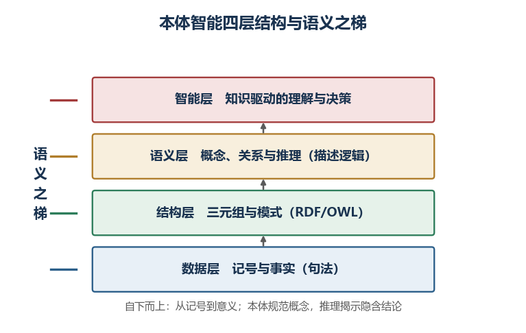

由定义 1.6 可推出「语义之梯四问」：任一方法 $m$ 都可问（a）$m$ 处于哪一级？（b）$m$ 隐含什么假设？（c）$m$ 突破前法的什么限制？（d）$m$ 无法突破什么理论边界？例如知识图谱处于 $S_2$、假设三元组语义、突破词汇级无结构之限、无法突破公理薄弱之限；描述逻辑处于 $S_3$、假设开放世界、突破可判定性难题、无法突破表达力受限之限。
**数值算例。** 对 5 种方法按语义之梯评分（S1=1,S2=2,S3=3,S4=4）：词表=1、分类法=2、知识图谱=2.5、OWL 本体=3、规则系统=3.5、定理证明=4。若某应用需要 $S_4$ 级保证，则评分低于 3.5 的方法均不满足——这给出选型的形式化依据。
**技术谱系与变体。** 表 1-4 对照四层与四级的关系。

**表 1-4　四层结构与语义之梯对照**

| 方法 | 四层位置 | 语义级 | 假设 | 理论边界 |
|------|---------|-------|------|---------|
| 词表 | $L_1$ | S1 | 字符串即意义 | 无结构 |
| 知识图谱 | $L_2$ | S2 | 三元组足够 | 公理薄弱 |
| OWL 本体 | $L_1$—$L_3$ | S3 | 开放世界 | 表达力受限 |
| 规则系统 | $L_3$ | S4 | 封闭/开放世界 | 难以规模化 |
| 大语言模型 | 隐式 $L_1$—$L_4$ | 隐式 S1—S4 | 参数化即知识 | 无形式保证 |
**边界与讨论。** 语义之梯不是越高越好：$S_4$ 级的可判定推理往往牺牲表达力，而许多应用只需 $S_2$ 级的知识图谱即可满足。工程选型须在「语义需求」与「建模成本」间权衡，这是第 21 章设计模式的核心。
**承上启下。** 框架已立，下一节引入贯穿全书的统一案例，后续各章将反复回到它。

## 1.6　贯穿全书的统一案例
**引入与动机。** 抽象理论若无具体案例支撑，读者难以形成直觉。本书以一份生物医学本体与疾病—药物知识图谱为统一案例。
**直觉解释。** 想象一个医学知识系统：它知道「阿司匹林是一种药物」「药物可治疗疾病」「阿司匹林治疗头痛」等事实，还能推出「阿司匹林可缓解某些头痛症状」。同一份资源将从概念建模一路走到大模型问答。
**严格定义与推导。** 统一案例形式化为一个本体 $\mathcal{O}_{bio}$ 与知识图谱 $G_{bio}=\langle V,E\rangle$。$\mathcal{O}_{bio}$ 含概念集 $\{\text{疾病},\text{药物},\text{症状},\text{基因},\text{副作用}\}$ 与关系集 $\{\text{治疗},\text{表现为},\text{副作用},\text{相关}\}$；$G_{bio}$ 含三元组的集合。各章按表 1-5 复用该案例。
**数值算例。** 设 $G_{bio}$ 初版含 $|V|=1200$ 个实体、$|E|=8500$ 条三元组，其中「治疗」关系 2000 条、「表现为」3000 条、「副作用」1500 条、「相关」2000 条。若本体 $\mathcal{O}_{bio}$ 含 60 个概念、25 个关系、180 条公理，则形式化构件总数为 $60+25+180+8500=8765$。第 12 章将从另一来源对齐 800 个实体，融合后 $|V|$ 增至约 1900，三元组增至约 12000——这一增长将在后续章节反复引用。
**技术谱系与变体。** 表 1-5 给出统一案例在各章的处理阶段。

**表 1-5　统一案例的章节地图**

| 章 | 处理阶段 | 产出 |
|----|---------|------|
| 4, 6 | 概念与公理建模 | ALC/OWL 本体 |
| 10—12 | 抽取与融合 | 三元组、对齐实体 |
| 15—16 | 规则与嵌入推理 | 新事实、链路预测 |
| 20 | 本体工程流程 | 规范化本体 |
| 22 | 本体对齐 | 跨本体映射 |
| 30 | 知识增强问答 | 生成答案 |
| 35 | 医学知识智能 | 综合应用 |
**边界与讨论。** 统一案例是教学示意，数值与结构为展示机制而设计，不代表任何真实生产系统。真实生物医学知识图谱（如 UMLS）规模远大于此，但原理相同。
**承上启下。** 本章建立全书框架，下一章进入第一篇理论基础，从哲学本体论与知识表示起笔，追溯概念层的思想根基。

## 1.7　本体智能与相邻范式的边界

**引入与动机。** 本体智能常与信息抽取、链接数据、知识图谱查询、大语言模型知识注入等相邻技术混用。厘清它们与本体智能的边界，能避免「凡有知识表示都叫本体」的泛化。本节从输入—机制—输出三个维度给出判定准则。

**直觉解释。** 把本体智能看作「概念引擎」：它的输入是概念与公理，机制是形式推理，输出是蕴含结论。相邻范式则各有侧重——信息抽取关注「从文本中取出事实」（输入侧），知识图谱查询关注「在已存事实中检索」（输出侧），链接数据关注「跨源事实互联」（流转侧），大语言模型关注「以参数形式承载知识」（表示侧）。本体智能居中，是把散点事实组织成可推理结构的核心。

**严格定义与推导。** 我们给出本体智能与相邻范式的形式边界。

**定义 1.7（本体智能的核心任务）** 设事实库 $\mathcal{F}$ 与本体 $\mathcal{O}$，本体智能的核心任务是把 $\mathcal{F}$ 中由 $\mathcal{O}$ 公理逻辑蕴含但未被显式断言的结论 $\mathcal{F}^*=\{\,q\mid \mathcal{O}\cup\mathcal{F}\models q\}$ 完整而可靠地推出，并保证 $\mathcal{F}^*$ 在不同表示系统间可无损流转。其核心判据是**蕴含完备性**（completeness）与**语义保持**（semantics preservation）同时成立。

由定义 1.7 可推出本体智能与四类相邻范式的边界：其一，信息抽取（第 10 章）产出 $\mathcal{F}$ 本身，不保证 $\mathcal{O}\cup\mathcal{F}$ 的蕴含完备性，故属本体智能的上游而非本体智能；其二，知识图谱查询（第 7 章）在 $\mathcal{F}$ 内做图匹配，不依赖 $\mathcal{O}$ 公理，故属 $\mathcal{F}$ 的内部操作；其三，链接数据（第 34 章）解决 $\mathcal{F}$ 的跨源对齐与流转，对应定义 1.2 的 $L_4$ 能力，但不涉及 $L_3$ 推理；其四，大语言模型（第 30 章）把 $\mathcal{O}$ 与 $\mathcal{F}$ 压缩进参数，其「推理」是统计近似而非逻辑蕴含，故不构成定义 1.7 意义上的本体智能，但可作为本体智能的补充表示层。表 1-6 给出四者在本体智能四层中的位置。

**表 1-6　本体智能与相邻范式的边界对照**

| 范式 | 输入 | 核心机制 | 输出 | 覆盖的本体智能层 | 是否蕴含完备 |
|------|------|---------|------|-----------------|-------------|
| 信息抽取 | 原始文本 | NLP 抽取 | 事实 $\mathcal{F}$ | $L_2$ 上游 | 否 |
| 知识图谱查询 | 已存 $\mathcal{F}$ | 图模式匹配 | 检索结果 | $L_2$ 内部 | 否 |
| 链接数据 | 多源 $\mathcal{F}$ | 实体对齐 | 互联 $\mathcal{F}$ | $L_4$ | 否 |
| 本体智能 | $\mathcal{O},\mathcal{F}$ | 形式推理 | $\mathcal{F}^*$ | $L_1$—$L_3$ | 是 |
| 大语言模型 | 参数化知识 | 生成式采样 | 答案文本 | 隐式 $L_1$—$L_4$ | 否 |

**数值算例。** 设 $\mathcal{O}_{bio}$ 含公理「$\text{治疗}\text{-}\text{药物}\sqsubseteq\exists\text{适应证}.\text{疾病}$」，$\mathcal{F}$ 含「$\text{治疗}(\text{阿司匹林},\text{头痛})$」共 1 条事实。本体智能可推出「$\exists\text{适应证}.\text{疾病}(\text{阿司匹林})$」这一隐含结论，故 $\mathcal{F}^*$ 含 1 条新三元组；而知识图谱查询只能返回已存的 1 条事实，不产生新结论。若再引入「$\text{适应证}\sqsubseteq\text{疾病}$」公理，则 $\mathcal{F}^*$ 增至 2 条新三元组——蕴含结论数随公理集增长，这正是本体智能相对查询的核心增益。

**边界与讨论。** 必须强调：本体智能的「蕴含完备」是理论性质，实际推理机因复杂度限制常以近似或片段推理实现（第 9 章）。但判定准则不变——凡不能保证 $\mathcal{O}\cup\mathcal{F}\models q$ 的判定正确性的方法，都不构成完整本体智能，至多是其某一能力层 $L_i$ 的局部实现。这一边界在第 34 章应用工程中将被反复检验。

**承上启下。** 边界厘清后，本章的小结与延伸阅读见下。

## 本章小结

本章为全书立框架。我们首先界定本体智能（定义 1.1、1.2），指出其四层能力与三个必要条件；继而追溯从哲学本体论到计算机本体的脉络（式 1-2、表 1-2）；提炼概念化、公理化、可判定、互操作四大根本困难（定义 1.3—1.5、表 1-3）；说明全书九篇结构；提出四层结构与语义之梯这一贯穿工具（定义 1.6、图 1-1、表 1-4）；最后引入统一案例（表 1-5）。

我们还明确边界：本体智能不等于建一个本体文件，语义之梯并非越高越好，四难中公理化与可判定性的张力是本质性的。这些辨析衔接第 2—4 章的理论基础、第 5—9 章的语言与推理、第 20—22 章的工程与对齐，以及第 41 章的框架回扣。

下一章进入哲学本体论与知识表示，为概念层奠定思想根基。

**进一步阅读**　本章建议延伸阅读的文献：[1]、[2]、[3]。

## 参考文献

[1] Gruber T R. A translation approach to portable ontology specifications. *Knowledge Acquisition*, 1993, 5(2): 199–220.

[2] Studer R, Benjamins V R, Fensel D. Knowledge engineering: principles and methods. *Data & Knowledge Engineering*, 1998, 25(1–2): 161–197.

[3] Berners-Lee T, Hendler J, Lassila O. The semantic web. *Scientific American*, 2001, 284(5): 34–43.

[4] Aristotle. Categories. Translated by E. M. Edghill. Indianapolis: Hackett, 1998.

[5] McCarthy J. Programs with common sense. *Symposium on Mechanization of Thought Processes*, 1959.

[6] Minsky M. A framework for representing knowledge. *The Psychology of Computer Vision*, 1975: 211–277.

[7] Brachman R J, Schmolze J G. An overview of the KL-ONE knowledge representation system. *Cognitive Science*, 1985, 9(2): 171–216.

[8] Noy N F, McGuinness D L. Ontology development 101: A guide to creating your first ontology. *Stanford Knowledge Systems Laboratory Technical Report*, 2001.

---

# 第 2 章　哲学本体论与知识表示

第 1 章把本体智能界定为四层能力，并指出概念层（$L_1$）是整个体系的地基。本章深入概念层的思想根基：从哲学本体论的范畴、实体与属性（2.1 节）出发，讨论认识论与本体论承诺（2.2 节），回顾知识表示的早期范式——语义网络与框架（2.3 节），提炼概念化与形式化的机制（2.4 节），最后讨论边界（2.5 节）。本章的核心问题是：哲学上「如何划分存在」的思想，如何转化为机器可处理的概念结构。

## 2.1　范畴、实体与属性
**引入与动机。** 本体（ontology）一词在哲学中已有两千多年历史。要理解计算机本体为何这样设计，须先理解哲学本体论对「存在」的基本划分。
**直觉解释。** 面对世界，人会自发地把事物归类：猫和狗是动物，动物和植物是生物。这种归类不是随意的，而是依据「共有的属性」。哲学本体论把这种归类系统化，研究哪些范畴（category）是基本的、范畴之间如何构成层级。
**严格定义与推导。** 我们给出三个基础定义。

**定义 2.1（范畴）** 范畴是对存在者的最高层次分类，是概念层级的根结点。Aristotle 在《范畴篇》中提出十范畴，其中「实体」（substance）居首，其余为性质、数量、关系等[1]。

**定义 2.2（实体）** 实体是独立存在、可作为其他属性承载者的存在者。在形式化中，实体对应知识图谱中的节点（individual），其集合记为 $\Delta$（论域）。

**定义 2.3（属性）** 属性是实体具有的性质或与其它实体的关系，分为内在属性（如「红色」）与关系属性（如「大于」）。属性在形式化中对应一元谓词 $P(x)$ 与二元谓词 $R(x,y)$。

由定义 2.1—2.3 可推出范畴层级的形式结构。设范畴 $C$ 的所有直接下位范畴为 $\{C_1,\dots,C_k\}$，则它们构成对 $C$ 外延的一个划分若满足

$$
C^{\mathcal{I}}=\bigcup_{i=1}^{k} C_i^{\mathcal{I}},\quad C_i^{\mathcal{I}}\cap C_j^{\mathcal{I}}=\varnothing\ (i\ne j). \tag{2-1}
$$

式 (2-1) 是「互斥且穷尽」的划分条件，是本体工程中概念分层的基本原则（第 20 章）。
**数值算例。** 设「生物」范畴的外延含 100 个实体，划分为「动物」60 个、「植物」35 个、「真菌」5 个。检查式 (2-1)：并集 $60+35+5=100$ 覆盖全部，且三者两两不交，故为合法划分。若「真菌」5 个中有 2 个同时归入「植物」，则交集非零，划分不成立——这对应本体中「概念重叠」的错误，需引入「多重继承」或重新定义概念边界。
**技术谱系与变体。** 范畴理论从 Aristotle 到 Kant 的十二范畴，再到现代认知语言学的「基本层次范畴」（Rosch）[2]，形成不同流派。表 2-1 对照它们对计算机本体的影响。

**表 2-1　范畴理论流派与本体影响**

| 流派 | 代表 | 核心观点 | 对计算机本体的影响 |
|------|------|---------|------------------|
| 古典范畴 | Aristotle | 充分必要条件定义范畴 | 经典本体基于公理定义概念 |
| 范畴层次 | Rosch | 基本层次范畴最自然 | 本体中层概念优先建模 |
| 原型理论 | Rosch | 范畴有典型成员 | 模糊本体、描述逻辑的扩展 |
| 形式本体 | BFO/DOLCE | 严格刻画存在类型 | 顶层本体的设计依据 |
**边界与讨论。** 古典范畴理论预设「充分必要条件」可定义概念，但 Wittgenstein 的「家族相似性」指出许多概念（如「游戏」）无明确边界[3]。这构成本体工程中的「概念化困难」（第 1.3 节、第 20 章）。描述逻辑以「清晰外延」回避此问题，是工程上的取舍。

### 2.1.1　范畴层级的形式化与划分算例

**直觉解释。** 式 (2-1) 的「互斥且穷尽」是划分的充分条件，但实践中常遇到两种偏离：其一，**覆盖不足**（某对象不属于任何子范畴）；其二，**重叠**（某对象属于两个子范畴）。前者对应「漏分类」，后者对应「多重继承」或「边界模糊」。本节用数值算例量化这两种偏离。

**严格定义与推导。** 设范畴 $C$ 的子范畴集 $\{C_1,\dots,C_k\}$，定义两个偏离度指标：

$$
\mathrm{gap}(C)=\big|\Delta^{\mathcal{I}}\cap C^{\mathcal{I}}\setminus\bigcup_{i=1}^{k}C_i^{\mathcal{I}}\big|,\qquad
\mathrm{over}(C)=\sum_{1\le i<j\le k}\big|C_i^{\mathcal{I}}\cap C_j^{\mathcal{I}}\big|. \tag{2-1A}
$$

式 (2-1A) 中 $\mathrm{gap}$ 度量未覆盖对象数，$\mathrm{over}$ 度量跨子范畴重叠的对象对数。合法划分当且仅当 $\mathrm{gap}=0$ 且 $\mathrm{over}=0$。

**数值算例。** 设 $\Delta^{\mathcal{I}}$ 含 1000 个实体，$C^{\mathcal{I}}$ 含 400 个。子范畴 $C_1$ 含 200、$C_2$ 含 150、$C_3$ 含 60，但 $C_1\cap C_2$ 含 10、$C_2\cap C_3$ 含 5，且 $C^{\mathcal{I}}$ 中有 15 个对象不属于任何子范畴。则 $\mathrm{gap}(C)=15$、$\mathrm{over}(C)=10+5=15$。两个偏离度相等但性质不同：gap 可通过「新增子范畴」或「放宽边界」修复；over 则需重新定义概念边界或显式允许多重继承（对应第 4 章 ALC 中 $C_1\sqcap C_2\ne\bot$ 的建模选择）。若某本体要求严格划分，则 $C_2$ 与 $C_3$ 须声明 $C_2\sqcap C_3\sqsubseteq\bot$，此时 5 个重叠对象会被推理机判为不一致——这是「声明即承诺」的代价。

**技术谱系与变体。** 形式本体 BFO 用「具体实体/非具体实体」「端持实体/经持实体」两层正交区分，刻意避免单一维度的穷尽划分，以降低 $\mathrm{over}$ 与 $\mathrm{gap}$ 的风险；DOLCE 则以「时空依赖」为第一划分维度。表 2-1 已对照其影响。工程上，「宽松划分 + 显式重叠声明」常比「强制穷尽划分」更稳健，因为前者把不确定性显式化，后者把不确定性隐藏进「漏分类」中。

**承上启下。** 划分算例给出概念层「有哪些类」的量化标准，下一节追问「凭什么说这些类存在」。

## 2.2　认识论与本体论承诺
**引入与动机。** 两个工程师建同一个领域的本体，为何会建出不同的类层次？因为他们做出了不同的「本体论承诺」。理解这一点，才能理解本体设计的主观性与客观性之辩。
**直觉解释。** 本体论承诺是「你承认什么存在」的约定。说「疾病是一种实体」，就承诺了疾病的独立存在；说「疾病只是症状的集合」，则做了另一承诺。约定不同，本体结构就不同。
**严格定义与推导。** Quine 提出「本体论承诺」概念：一个理论承诺了某类对象的存在，当且仅当该理论为真要求这类对象存在[4]。在本体工程中，可形式化为：

**定义 2.4（本体论承诺）** 本体 $\mathcal{O}$ 的本体论承诺是其论域 $\Delta^{\mathcal{I}}$ 中必须存在的对象类型集合 $\mathcal{E}\subseteq 2^{\Delta}$，满足对任意公理 $\alpha\in\mathcal{A}x$，$\alpha$ 的真值依赖 $\mathcal{E}$ 中某类对象的存在。

**定义 2.5（认识论承诺）** 认识论承诺是主体为获取知识所接受的认知原则集合，如「观察可靠」「推理有效」。它决定主体能「知道」什么，但不决定「存在」什么。

由定义 2.4、2.5 可推出：本体论承诺与认识论承诺可分离。同一领域（相同本体论承诺）可被不同认知主体以不同原则认识（不同认识论承诺），但本体结构应保持一致——这是本体复用（第 21 章）的理论前提。
**数值算例。** 设医学本体承诺三类对象存在：$\mathcal{E}=\{\text{疾病},\text{药物},\text{症状}\}$，共 3 类。若设计师 A 认为「副作用」也是一种独立实体（新增承诺），则 $|\mathcal{E}|$ 变为 4；设计师 B 认为副作用只是「药物—症状」关系的属性（不新增实体），$|\mathcal{E}|$ 仍为 3。两种承诺导致本体中「副作用」分别为概念或关系，结构差异显著。若两人各建 50 个概念，A 的本体含 4 类顶层、B 的含 3 类顶层——对齐时需在两者间建立映射（第 22 章）。
**技术谱系与变体。** 顶层本体 DOLCE 承诺「特定时刻的实体」（endurant）与「事件」（perdurant）的区分，BFO 则承诺「实体」与「过程」的区分[5]。表 2-2 对照。

**表 2-2　顶层本体的本体论承诺对照**

| 顶层本体 | 核心承诺 | 典型区分 |
|---------|---------|---------|
| DOLCE | 认知导向 | endurant / perdurant |
| BFO | 现实导向 | entity / process |
| SUMO | 常识导向 | physical / abstract |
**边界与讨论。** 本体论承诺的选择没有唯一「正确」答案，只有「对任务是否合适」。强承诺（承认更多实体类型）表达力强但复杂；弱承诺简洁但可能不足以刻画领域。这是本体工程「需求驱动」原则的哲学根源。

### 2.2.1　本体论承诺的形式度量与冲突检测

**直觉解释。** 两个本体对同一领域的本体论承诺不同，会导致顶层类集合不一致。对齐两个本体前，先量化「承诺差异」比逐概念对齐更高效。本节给出承诺差异的形式度量。

**严格定义与推导。** 设本体 $\mathcal{O}_1,\mathcal{O}_2$ 的本体论承诺分别为 $\mathcal{E}_1,\mathcal{E}_2\subseteq 2^{\Delta}$（各自必须存在的对象类型集合），定义承诺差异为对称差规模：

$$
\delta(\mathcal{O}_1,\mathcal{O}_2)=\frac{|\mathcal{E}_1\triangle\mathcal{E}_2|}{|\mathcal{E}_1\cup\mathcal{E}_2|}\in[0,1]. \tag{2-2A}
$$

式 (2-2A) 中 $\delta=0$ 表示承诺完全一致，$\delta=1$ 表示承诺完全不相交。$\delta$ 越大，两本体对齐时的语义冲突风险越高，越需要显式的承诺映射而非直接类合并。

**数值算例。** 设 $\mathcal{O}_1$（医学本体）承诺 $\mathcal{E}_1=\{\text{疾病},\text{药物},\text{症状},\text{基因}\}$，$\mathcal{O}_2$（药学本体）承诺 $\mathcal{E}_2=\{\text{药物},\text{成分},\text{剂型},\text{疾病}\}$。则 $\mathcal{E}_1\cup\mathcal{E}_2=\{\text{疾病},\text{药物},\text{症状},\text{基因},\text{成分},\text{剂型}\}$ 含 6 类，$\mathcal{E}_1\triangle\mathcal{E}_2=\{\text{症状},\text{基因},\text{成分},\text{剂型}\}$ 含 4 类，故 $\delta=4/6\approx0.667$。差异主要来自「$\mathcal{O}_1$ 把副作用当独立实体、$\mathcal{O}_2$ 把副作用当药物—症状关系的属性」这一承诺分歧。对齐时须先建立「$\text{症状}$（$\mathcal{O}_1$）$\leftrightarrow$「副作用」属性（$\mathcal{O}_2$）」的映射，再做类层对齐——否则 4 类承诺差异会直接传递为顶层类错位。若 $\delta<0.2$，通常可直接类合并；若 $\delta>0.5$，则必须经过承诺层映射（第 22 章）。

**技术谱系与变体。** 顶层本体 DOLCE、BFO、SUMO 的差异本质是承诺差异：DOLCE 承诺「认知导向的 endurant/perdurant 区分」，BFO 承诺「现实导向的 entity/process 区分」，SUMO 承诺「常识导向的 physical/abstract 区分」。三者的 $\delta$ 互不相容（顶层类几乎不交），故跨顶层本体的对齐必须经过「承诺映射层」而非直接类匹配——这是第 22 章本体匹配把「顶层承诺」作为第一对齐维度的原因。表 2-2 已给出三者的承诺对照。

**边界与讨论。** 式 (2-2A) 的 $\delta$ 只度量承诺集合的「集合差异」，不度量承诺的「语义距离」——两个本体可能承诺集合相同但对象内涵不同（如都把「过程」当一类，但对「过程」的边界理解不同）。因此 $\delta$ 是必要非充分的对齐前置检查，真正的语义一致性仍须逐概念验证（第 22 章）。

**承上启下。** 承诺度量给出「两个本体差多少」的量化判据，下一节回顾把承诺落地为结构的早期表示范式。

## 2.3　知识表示的早期范式
**引入与动机。** 在描述逻辑与 OWL 之前，人工智能已有语义网络与框架两种重要表示范式。理解它们，才能理解现代本体语言「继承了什么、克服了什么」。
**直觉解释。** 语义网络像一张概念地图：节点是概念，边是关系。框架像一张表格模板：每个概念是一张「槽—值」表，描述典型属性。二者都直观，但都缺乏严格的形式语义。
**严格定义与推导。** 语义网络形式化为有向图 $G=(N,E)$，节点 $n\in N$ 表示概念，边 $(n_1,r,n_2)\in E$ 表示关系[6]。框架形式化为槽结构

$$
F=\langle \text{Name},\{(s_i,v_i,\delta_i)\}_{i=1}^{m}\rangle, \tag{2-2}
$$

Name 为框架名，$s_i$ 为槽名，$v_i$ 为槽值，$\delta_i$ 为默认值。

**定义 2.6（继承）** 在语义网络或框架系统中，若概念 $C_1$ 通过「is-a」边连到 $C_2$，则 $C_1$ 继承 $C_2$ 的所有属性，除 $C_1$ 显式覆盖者。继承是早期范式最重要的推理机制。

由定义 2.6 可推出继承的形式规则：若 $\text{isa}(C_1,C_2)$ 且 $\text{prop}(C_2,p)$，则 $\text{prop}(C_1,p)$，除非 $C_1$ 有 $\text{prop}(C_1,\neg p)$。这是一个非单调推理（默认推理），因为新信息可能推翻旧结论——这正是早期范式缺乏严格语义的根源。
**数值算例。** 设框架「药物」有槽 $\{ \text{剂型}=\text{片剂（默认）}, \text{适应证}=\text{未指定} \}$，框架「阿司匹林」is-a「药物」，且显式指定 $\text{剂型}=\text{泡腾片}$。则由继承规则，阿司匹林继承「适应证=未指定」，但「剂型」被覆盖为泡腾片。若管理系统有 200 个药物框架，每个平均 8 个槽，则属性总数约 $200\times8=1600$，其中通过继承获得的约 $1600\times0.7=1120$——继承大幅减少冗余存储，但默认值冲突需额外处理。
**技术谱系与变体。** 表 2-3 对照早期范式与现代本体语言。

**表 2-3　知识表示范式演进**

| 范式 | 表示单位 | 推理机制 | 语义严格性 |
|------|---------|---------|-----------|
| 语义网络 | 节点与边 | 继承、传播 | 弱 |
| 框架 | 槽—值结构 | 默认继承 | 弱 |
| 描述逻辑 | 概念与角色 | Tableau | 强、可判定 |
| OWL | 公理 | 推理机 | 强、标准化 |
**边界与讨论。** 语义网络与框架的「继承」直观但非单调，难以给出可靠推理；描述逻辑以单调逻辑取代继承，换取可判定性，但失去了默认推理的灵活性。第 18、19 章讨论如何在现代框架中恢复非单调与常识推理。

### 2.3.1　继承的非单调性与默认推理量化

**直觉解释。** 早期范式的「继承 + 默认值」是一种非单调推理：新事实可能推翻旧结论。理解其非单调性，才能理解描述逻辑为何放弃默认推理换取单调可判定性。本节用数值算例量化默认推理的「翻转率」。

**严格定义与推导。** 设框架集 $\mathcal{F}$ 含 $m$ 个框架、每个框架平均 $s$ 个槽，其中比例为 $\rho$ 的槽带默认值。定义**默认翻转率**（default reversal rate）：

$$
\mathrm{rev}(\mathcal{F})=\frac{\#\{\text{继承后被下层显式覆盖的默认槽}\}}{\#\{\text{全部默认槽}\}}. \tag{2-3A}
$$

式 (2-3A) 中 $\mathrm{rev}\in[0,1]$。$\mathrm{rev}$ 越高，说明默认值越容易被推翻，继承产生的结论越不稳定——这正是非单调推理的特征。单调逻辑（如 ALC）中不存在默认值，故 $\mathrm{rev}\equiv0$，结论一旦成立永不推翻。

**数值算例。** 设 200 个药物框架、每个 8 槽、其中 30% 的槽带默认值（$\rho=0.3$），则默认槽总数 $=200\times8\times0.3=480$。若其中 160 个默认槽被下层框架显式覆盖（如「阿司匹林」覆盖「药物」的剂型默认），则 $\mathrm{rev}=160/480\approx0.333$。这意味着约三分之一的继承结论需被后续事实修正——若系统不做「默认值优先级」处理，将产生 160 处潜在错误结论。描述逻辑通过把「剂型」建模为带域/值域约束的属性（第 4 章 $\forall\text{剂型}.\text{剂型类}$）而非默认值，使 $\mathrm{rev}=0$，代价是失去「未指定剂型默认片剂」的简洁表达——这是单调性与表达简洁性的权衡。

**技术谱系与变体。** 非单调推理是默认逻辑（Reiter 1980）、缺省逻辑、信念修正（AGM）等研究的核心，与描述逻辑的单调语义形成对照。OWL 不提供默认推理，但可通过「OWL 规则层」（第 8 章）或「概率本体」（第 18 章）部分恢复默认能力。表 2-3 的「语义严格性」列正是这一权衡的体现：语义网络/框架为「弱」，描述逻辑/OWL 为「强」。

**边界与讨论。** 默认推理的价值在于「常识的简洁表达」（如「鸟会飞，除非是企鹅」），其代价是推理不可判定或至少 NP 难（默认逻辑的可满足性）。本体系统若需默认推理，须接受复杂度上升——这是第 18、19 章的核心议题。理解 $\mathrm{rev}$ 这一指标，能帮助工程师判断「领域常识的翻转率」是否值得引入非单调机制。

**承上启下。** 早期范式的继承机制已量化，下一节提炼「概念化与形式化」的一般机制。

## 2.4　概念化与形式化
**引入与动机。** 从哲学范畴到语义网络，共同的工作是「把世界的概念结构抽取出来并写成机器可处理的形式」。本节把这一过程提炼为可操作的机制。
**直觉解释。** 概念化是「决定有哪些概念与关系」，形式化是「用某种语言把概念与关系写成公理」。前者是认识论工作，后者是逻辑工作。二者顺序进行，但常迭代。
**严格定义与推导。** 我们给出概念化与形式化的形式定义。

**定义 2.7（概念化）** 概念化是从领域 $\mathcal{D}$ 到概念结构 $\langle \mathcal{C},\mathcal{R},\mathcal{H}\rangle$ 的映射，其中 $\mathcal{C}$ 为概念集、$\mathcal{R}$ 为关系集、$\mathcal{H}\subseteq\mathcal{C}\times\mathcal{C}$ 为概念层级（is-a 关系）。

**定义 2.8（形式化）** 形式化是从概念结构 $\langle \mathcal{C},\mathcal{R},\mathcal{H}\rangle$ 到形式语言 $\mathcal{L}$ 中公理集 $\mathcal{A}x$ 的映射 $\varphi$，使对任意 $C_1,C_2\in\mathcal{C}$，$(C_1,C_2)\in\mathcal{H}$ 当且仅当 $\varphi(C_1)\sqsubseteq\varphi(C_2)\in\mathcal{A}x$。

由定义 2.7、2.8 可推出一条重要原则：**概念化决定本体「说了什么」，形式化决定本体「说得有多精确」**。若概念化错误（如把「副作用」当作独立实体），再精确的形式化也无法弥补——这是「概念化优先于形式化」原则。
**数值算例。** 设领域「医院」的概念化得 $\mathcal{C}=\{\text{患者},\text{医生},\text{疾病},\text{药物}\}$，$\mathcal{H}=\{(\text{患者},\text{人}),(\text{医生},\text{人})\}$，共 4 个概念、2 条层级边。形式化映射到 ALC：$\varphi(\text{患者})\sqsubseteq\varphi(\text{人})$、$\varphi(\text{医生})\sqsubseteq\varphi(\text{人})$。若再加关系 $\mathcal{R}=\{\text{开具},\text{患有}\}$，形式化为 $\varphi(\text{医生})\sqsubseteq\exists\text{开具}.\varphi(\text{药物})$ 等。概念结构共 $4+2+2=8$ 个元素，形式化后得 8 条公理——元素与公理一一对应，便于追踪。
**技术谱系与变体。** 概念化方法从早期的「头脑风暴」发展到现代的 METHONTOLOGY、ODM 等结构化方法[7]（第 20 章）。表 2-4 对照概念化方法。

**表 2-4　概念化方法对照**

| 方法 | 核心思想 | 适用规模 |
|------|---------|---------|
| 头脑风暴 | 专家集体列举概念 | 小规模 |
| 词典驱动 | 从术语表抽取 | 中规模 |
| 文本驱动 | 从语料聚类 | 大规模 |
| 复用驱动 | 从现有本体裁剪 | 各类 |
**边界与讨论。** 概念化具有主观性：不同专家对同一领域可能给出不同 $\mathcal{C}$ 与 $\mathcal{H}$。消解分歧需靠「本体对齐」（第 22 章）或建立领域标准（第 35 章）。这是本体工程中的社会性困难，非纯技术问题。
**承上启下。** 概念化与形式化的机制确立后，第 3 章引入支撑形式化的严格语言——一阶逻辑与模型论。

## 2.5　边界与讨论

本章从哲学本体论出发，建立了范畴、实体、属性（定义 2.1—2.3）、本体论承诺（定义 2.4）、概念化与形式化（定义 2.7、2.8）等概念层基础。这些概念回答「世界有哪些概念」，但尚未提供「如何严格推理」的工具。

**语义之梯四问的回应。** 本章内容主要处于 S2 概念级：它把词汇组织为层级与关系，但尚未引入公理级的形式约束（S3）与推理（S4）。隐含假设是「概念可用清晰外延刻画」，这在本体工程中是合理取舍，但面对模糊概念（如「游戏」）会失效。它突破了语义网络与框架的「无严格语义」之限，但无法突破「清晰外延」之限——这正是第 3、4 章引入一阶逻辑与描述逻辑的动机。

需要强调：哲学本体论的「正确划分存在」与工程本体的「够用即可」之间存在张力。本书采取实用立场——本体是「为特定任务服务的概念约定」，其价值由推理正确性与互操作性检验，而非哲学上的终极正确性。这一立场贯穿全书，也是第 20 章本体工程方法论的基点。

下一章进入一阶逻辑与模型论，为概念层配备严格的推理语言。

> 【图 2-1　范畴、实体与属性的层次】（原图见 figures/图2-1.png）：三层结构：范畴为根、实体为叶、属性连边，标注划分条件式 2-1
>
> 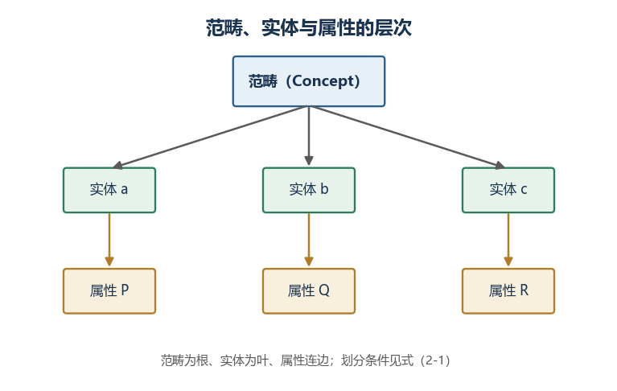

## 本章小结

本章奠定概念层的思想基础。我们首先讨论范畴、实体与属性（定义 2.1—2.3），给出划分条件（式 2-1）与数值算例；继而提炼本体论承诺（定义 2.4）与认识论承诺（定义 2.5）的区分；回顾语义网络与框架两种早期范式（式 2-2、定义 2.6）；最后给出概念化与形式化的机制（定义 2.7、2.8）与四张对照表。

我们还明确边界：这些工作处于语义之梯 S2 概念级，隐含「清晰外延」假设，突破早期范式无严格语义之限但无法突破清晰外延之限。这些辨析衔接第 1.5 节的框架、第 3—4 章的形式语言，以及第 19、20 章的常识与工程。

下一章介绍一阶逻辑与模型论，为形式化配备严格的语义基础。

**进一步阅读**　本章建议延伸阅读的文献：[1]、[4]、[7]。

## 参考文献

[1] Aristotle. Categories. Translated by E. M. Edghill. Indianapolis: Hackett, 1998.

[2] Rosch E. Principles of categorization. *Cognition and Categorization*, 1978: 27–48.

[3] Wittgenstein L. Philosophical Investigations. Oxford: Blackwell, 1953.

[4] Quine W V O. On what there is. *Review of Metaphysics*, 1948, 2(5): 21–38.

[5] Smith B, Grenon P. BFO: Basic formal ontology. In: *Formal Ontology in Information Systems*, 2004: 3–16.

[6] Sowa J F. Knowledge Representation: Logical, Philosophical, and Computational Foundations. Boston: PWS Publishing, 2000.

[7] Fernández-López M, Gómez-Pérez A, Juristo N. METHONTOLOGY: From ontological art towards ontological engineering. *AAAI Symposium on Ontological Engineering*, 1997.

[8] Gruber T R. A translation approach to portable ontology specifications. *Knowledge Acquisition*, 1993, 5(2): 199–220.

---

# 第 3 章　一阶逻辑与模型论

第 2 章把概念结构的形式化提上日程，但尚未给出严格语言。本章引入一阶逻辑（first-order logic, FOL）与模型论：它是本体语言与推理系统的语义基础。先讲语法与语义（3.1 节），再建立模型论核心——结构、满足与蕴含（3.2 节），介绍证明系统归结与表推演（3.3 节），论证一阶逻辑的表达力与不可判定性（3.4 节），最后讨论边界（3.5 节）。本章的核心张力是：表达力越强，推理越难自动化——这一张力将在第 4 章以描述逻辑作出取舍。

## 3.1　一阶逻辑的语法与语义
**引入与动机。** 自然语言有歧义，而本体需要无歧义的语言。一阶逻辑以精确的符号与递归规则定义了「什么是合法公式」「公式在什么情况下为真」，是形式化概念的第一选择。
**直觉解释。** 一阶逻辑像一门严谨的语言：它有「名词」（常量与变量）、「动词」（谓词）、「连接词」（与或非）和「量词」（所有、存在）。用它写「所有药物都有适应证」就是 $\forall x\,(\text{药物}(x)\to\exists y\,\text{适应证}(x,y))$。
**严格定义与推导。** 给出语法的递归定义。

$$\Gamma\models\phi\iff\forall\mathcal{I}\,(\mathcal{I}\models\Gamma\Rightarrow\mathcal{I}\models\phi).\tag{3-1}$$

**定义 3.1（一阶逻辑语法）** 一阶逻辑的字母表含常量符号集 $\mathcal{C}$、变量符号集 $\mathcal{V}$、函数符号集 $\mathcal{F}$、谓词符号集 $\mathcal{P}$、逻辑连接词 $\neg,\wedge,\vee,\to$、量词 $\forall,\exists$ 与标点。项（term）递归定义为：常量与变量是项；若 $f\in\mathcal{F}$ 为 $n$ 元函数且 $t_1,\dots,t_n$ 为项，则 $f(t_1,\dots,t_n)$ 为项。公式（formula）递归定义为：若 $P\in\mathcal{P}$ 为 $n$ 元谓词且 $t_1,\dots,t_n$ 为项，则 $P(t_1,\dots,t_n)$ 为原子公式；若 $\phi,\psi$ 为公式，则 $\neg\phi,\phi\wedge\psi,\phi\vee\psi,\phi\to\psi$ 为公式；若 $\phi$ 为公式且 $x\in\mathcal{V}$，则 $\forall x\,\phi,\exists x\,\phi$ 为公式[1]。

**定义 3.2（一阶逻辑语义）** 一个解释 $\mathcal{I}=(\Delta^{\mathcal{I}},\cdot^{\mathcal{I}})$ 由非空论域 $\Delta^{\mathcal{I}}$ 与解释函数 $\cdot^{\mathcal{I}}$ 构成：对每个常量 $c$，$c^{\mathcal{I}}\in\Delta^{\mathcal{I}}$；对每个 $n$ 元函数 $f$，$f^{\mathcal{I}}:\Delta^n\to\Delta$；对每个 $n$ 元谓词 $P$，$P^{\mathcal{I}}\subseteq\Delta^n$。变量赋值 $v:\mathcal{V}\to\Delta^{\mathcal{I}}$ 把变量映射到论域元素。

由定义 3.2 可递归定义满足关系 $\models$：对原子公式，$(\mathcal{I},v)\models P(t_1,\dots,t_n)$ 当且仅当 $(t_1^{\mathcal{I},v},\dots,t_n^{\mathcal{I},v})\in P^{\mathcal{I}}$；对量词，$(\mathcal{I},v)\models\forall x\,\phi$ 当且仅当对每个 $d\in\Delta^{\mathcal{I}}$ 有 $(\mathcal{I},v[x\mapsto d])\models\phi$。公式 $\phi$ 在 $\mathcal{I}$ 中为真（$\mathcal{I}\models\phi$）若对所有赋值 $v$ 满足。
**数值算例。** 设论域 $\Delta=\{a,b\}$（两本书），谓词 $\text{小说}(x)$ 解释为 $\{\text{a}\}$，$\text{长篇}(x)$ 解释为 $\{\text{a},\text{b}\}$。则公式 $\forall x\,(\text{小说}(x)\to\text{长篇}(x))$ 在 $\mathcal{I}$ 中为真，因为对 $x=a$：$\text{小说}(a)$ 真、$\text{长篇}(a)$ 真，蕴含真；对 $x=b$：$\text{小说}(b)$ 假，蕴含式前件假故整体真。若把 $\text{长篇}$ 解释为 $\{\text{a}\}$，则对 $x=b$：$\text{小说}(b)$ 假仍真，公式依旧真；但若对 $x=a$，$\text{小说}(a)$ 真而 $\text{长篇}(a)$ 真——仍真。要让公式为假，需某 $x$ 使 $\text{小说}(x)$ 真而 $\text{长篇}(x)$ 假，例如 $\text{小说}^{\mathcal{I}}=\{\text{a}\},\text{长篇}^{\mathcal{I}}=\varnothing$：此时 $x=a$ 前件真后件假，公式为假。这展示了满足关系的判定过程。
**技术谱系与变体。** 一阶逻辑有若干子语言：命题逻辑（无量词）、一元逻辑（仅一元谓词，可判定）、描述逻辑（可判定的一阶逻辑片段）。表 3-1 对照。

**表 3-1　一阶逻辑子语言对照**

| 语言 | 量词 | 谓词元数 | 可判定性 |
|------|------|---------|---------|
| 命题逻辑 | 无 | 0 | 可判定（NP 完全） |
| 一元逻辑 | 有 | 1 | 可判定 |
| 描述逻辑 ALC | 受限 | ≤2 | 可判定（ExpTime） |
| 全一阶逻辑 | 有 | 任意 | 不可判定 |
**边界与讨论。** 一阶逻辑的表达力强，但第 3.4 节将证明其推理不可判定。这不是缺陷，而是表达力的代价——本体语言设计须在此权衡。
**承上启下。** 语法语义确立后，下一节建立模型论核心概念：满足、蕴含与逻辑等值。

## 3.2　模型论基础：结构、满足、蕴含
**引入与动机。** 「从本体推出结论」的严格含义是什么？模型论给出答案：结论在所有使本体为真的解释中都为真。这是本体推理语义的基石。
**直觉解释。** 把本体 $\mathcal{O}$ 看作一组约束条件，满足它的每个解释都是一个「可能世界」。若某命题 $q$ 在所有可能世界中都成立，则 $\mathcal{O}$ 逻辑蕴含 $q$——无需枚举世界也能信赖推理结果。
**严格定义与推导。** 给出满足与蕴含的形式定义。

**定义 3.3（满足）** 解释 $\mathcal{I}$ 满足公式集 $\Gamma$（记作 $\mathcal{I}\models\Gamma$），当且仅当对每个 $\phi\in\Gamma$ 有 $\mathcal{I}\models\phi$。

**定义 3.4（逻辑蕴含）** 公式集 $\Gamma$ 逻辑蕴含公式 $\phi$（记作 $\Gamma\models\phi$），当且仅当每个满足 $\Gamma$ 的解释都满足 $\phi$。若 $\Gamma=\varnothing$，则称 $\phi$ 为永真式（tautology），记作 $\models\phi$。

由定义 3.4 可推出一个关键性质——单调性：若 $\Gamma\models\phi$ 且 $\Gamma\subseteq\Delta$，则 $\Delta\models\phi$。证明：满足 $\Delta$ 的解释必满足 $\Gamma$（因 $\Gamma\subseteq\Delta$），故必满足 $\phi$。单调性是描述逻辑推理与本体合并（第 12 章）的理论基础。
**数值算例。** 设 $\Gamma=\{\forall x\,(\text{药物}(x)\to\text{可服用}(x)),\ \text{药物}(a)\}$，问 $\Gamma\models\text{可服用}(a)$ 是否成立。考察任意满足 $\Gamma$ 的解释 $\mathcal{I}$：由 $\text{药物}(a)$ 真与全称公理，代入 $x=a$ 得 $\text{药物}(a)\to\text{可服用}(a)$ 真，故 $\text{可服用}(a)$ 真。因此所有满足 $\Gamma$ 的解释都满足 $\text{可服用}(a)$，蕴含成立。若去掉 $\text{药物}(a)$，则存在解释使 $\text{药物}^{\mathcal{I}}=\varnothing$ 而 $\text{可服用}^{\mathcal{I}}=\varnothing$，此时 $\Gamma$ 满足但 $\text{可服用}(a)$ 假，蕴含不成立。这展示了蕴含判定对前提的依赖。
**技术谱系与变体。** 表 3-2 对照模型论中的核心关系。

**表 3-2　模型论核心关系**

| 关系 | 记号 | 定义 |
|------|------|------|
| 满足 | $\mathcal{I}\models\phi$ | 解释使公式为真 |
| 蕴含 | $\Gamma\models\phi$ | 所有满足 $\Gamma$ 的解释满足 $\phi$ |
| 逻辑等值 | $\phi\equiv\psi$ | $\phi\models\psi$ 且 $\psi\models\phi$ |
| 可满足 | $\mathrm{Sat}(\Gamma)$ | 存在解释满足 $\Gamma$ |
| 不可满足 | $\mathrm{Unsat}(\Gamma)$ | 无解释满足 $\Gamma$ |
**边界与讨论。** 定义 3.4 的「所有解释」是无限集合，直接判定蕴含不可行。证明系统（3.3 节）与 Tableau 算法（第 4 章）正是为了绕过这一无限性。
**承上启下。** 蕴含的语义定义给出「应该推出什么」，下一节介绍「如何实际推出」——证明系统。

## 3.3　证明系统：归结与表推演
**引入与动机。** 模型论的蕴含定义依赖无限解释，无法直接计算。证明系统提供有限步骤的推理规则，使机器可自动判定蕴含（对可判定片段）。

**直觉解释。** 归结（resolution）像「反证法机器」：要证 $\Gamma\models\phi$，就假设 $\Gamma\wedge\neg\phi$ 可满足，若推出矛盾则原蕴含成立。表推演（tableau）则像「穷举树」：把公式展开成树，若所有分支都矛盾则原公式不可满足。
**严格定义与推导。** 先给出归结原理。将公式化为子句（clause）析取范式，子句是文字（literal，原子或其否定）的析取。归结规则：若 $C_1=P\vee L_1$，$C_2=\neg P\vee L_2$，则可推出归结式 $L_1\vee L_2$。

**定理 3.1（归结完备性）** 子句集 $S$ 不可满足当且仅当存在从 $S$ 出发经有限次归结推出空子句 $\square$[2]。

证明思路：可靠性（soundness）易证——若 $S$ 可满足，则归结式在任一满足 $S$ 的解释中为真，故不可能推出空子句（空子句永假）。完备性较复杂，需构造性证明：对不可满足 $S$，存在一组归结导出所有「卫星子句」，最终得空子句。此处从略，详见 [2]。

**定义 3.5（表推演）** 表推演是对公式 $\phi$ 构造一棵展开树：对合取 $\phi_1\wedge\phi_2$ 在同一分支展开两者；对析取 $\phi_1\vee\phi_2$ 分叉为两分支；对存在量词引入新常量；对全称量词用已有常量实例化。若每条分支都含矛盾对 $P,\neg P$，则树封闭，$\phi$ 不可满足。
**数值算例。** 用归结验证 $\Gamma=\{\text{药物}(a),\ \forall x(\text{药物}(x)\to\text{可服用}(x))\}$ 蕴含 $\text{可服用}(a)$。化为子句：$C_1=\text{药物}(a)$；$C_2=\neg\text{药物}(x)\vee\text{可服用}(x)$；否定结论 $C_3=\neg\text{可服用}(a)$。归结 $C_1$ 与 $C_2$（代 $x=a$）得 $C_4=\text{可服用}(a)$；再归结 $C_4$ 与 $C_3$ 得 $\square$（空子句）。故 $\Gamma\wedge\neg\text{可服用}(a)$ 不可满足，蕴含成立。整个证明仅 2 步归结——展示了自动推理的可行性。

### 3.3.1　表推演的数值算例与展开控制

**直觉解释。** 归结与表推演是「同一枚硬币的两面」：归结从子句集出发向空子句推，表推演从待证公式出发向矛盾分支展开。前者对一阶逻辑半可判定，后者对描述逻辑片段可判定（第 4 章）。本节用一个数值算例展示表推演的展开过程，并引入「展开深度」这一控制复杂度增长的度量。

**严格定义与推导。** 设待判公式 $\phi$，表推演从单结点树（根标记 $\{\phi\}$）出发，反复应用定义 3.5 的展开规则，直到所有分支封闭或出现不封闭的完成分支。定义**展开深度**（expansion depth）：

$$
\mathrm{depth}(\phi)=\max_{\text{分支 }b}\ \#\{\text{分支 }b\text{ 上的结点}\}. \tag{3-3A}
$$

式 (3-3A) 中度量最深的分支含多少结点。对 ALC 片段（第 4 章），$\mathrm{depth}$ 受概念大小与角色深度约束，故表推演终止；对全 FOL，$\mathrm{depth}$ 无上界（全称量词可无限实例化新常量），故表推演可能不终止——这正是归结「半可判定」与表推演「片段可判定」的分界。

**数值算例。** 判定 $D=\exists r.A\sqcap\forall r.\neg A$ 的可满足性（与第 4.4 章例同源，此处用表推演视角）。根结点标记 $\{\exists r.A,\ \forall r.\neg A\}$：
- 步 1：应用 $\exists$ 规则，创建子结点 $y$，边 $r$ 连根与 $y$，$y$ 标记 $\{A\}$；
- 步 2：应用 $\forall$ 规则，把根上的 $\forall r.\neg A$ 经边 $r$ 传播到 $y$，$y$ 标记增为 $\{A,\neg A\}$；
- 步 3：$y$ 含 $A$ 与 $\neg A$，冲突，分支封闭。

全部分支封闭，故 $D$ 不可满足。$\mathrm{depth}(D)=2$（根与 $y$ 两层）。再判 $E=\exists r.A$：根标 $\{\exists r.A\}$，步 1 创建 $y$ 标 $\{A\}$，无 $\forall$ 约束需传播，$y$ 无冲突，分支不封闭，故 $E$ 可满足，$\mathrm{depth}=2$。两例对比说明：$\exists$ 与 $\forall$ 组合是否产生冲突，取决于 $\forall$ 的约束能否被 $\exists$ 引入的后继满足——这是表推演判定可满足性的核心机制。

**技术谱系与变体。** 表推演与归结的对照见表 3-3。表推演的「展开深度」对应归结的「证明长度」，二者都是推理复杂度的可操作度量。第 4 章的 ALC 表推演在此数值算例基础上引入「阻塞（blocking）」技术以严格保证终止，把 $\mathrm{depth}$ 的上界从「无上界」收紧为「与概念大小相关的常数」。

**边界与讨论。** 表推演对全 FOL 不保证终止的根源是「全称实例化」：对 $\forall x\,\phi$，若不断引入新常量 $c_1,c_2,\dots$，分支可无限生长。描述逻辑通过禁止任意函数符号与限制量词形式，使「可引入的新个体数」有界，从而 $\mathrm{depth}$ 有界、表推演终止。这一「用表达力换终止性」的取舍，是第 4 章的核心论点，也与本节 3.4 节的不可判定性呼应。

**承上启下。** 表推演的展开控制明确了，下一节给出表达力与不可判定性的根本边界。

**技术谱系与变体。** 表 3-3 对照证明系统。

**表 3-3　证明系统对照**

| 系统 | 基本操作 | 适用 | 自动化程度 |
|------|---------|------|-----------|
| 自然演绎 | 引入/消去规则 | 手工证明 | 低 |
| 归结 | 子句归结 | 定理证明 | 高 |
| 表推演 | 树展开 | 描述逻辑推理 | 高 |
| 逻辑编程 |  Horn 子句消解 | 规则推理（第 15 章） | 高 |
**边界与讨论。** 归结对一阶逻辑是半可判定的：若公式不可满足，归结必终止并找到证明；若可满足，归结可能永不终止。这与第 3.4 节的不可判定性一致。描述逻辑的表推演则对特定片段保证终止——这是第 4 章的核心。
**承上启下。** 证明系统回答「如何推」，下一节回答「能推多远」——表达力与不可判定性。

## 3.4　表达力与不可判定性
**引入与动机。** 既然一阶逻辑如此强大，为何不直接用它做本体语言？本节给出根本答案：一阶逻辑的推理不可判定，而本体系统需要确定答案。
**直觉解释。** 不可判定性像「没有通用算法的停机问题」：不存在算法能对任意一阶逻辑公式在有限步内判定其可满足性。这不是算力不足，而是理论上限。
**严格定义与推导。** 给出不可判定性的经典结论。

**定理 3.2（Church–Turing 不可判定性）** 一阶逻辑的任意公式集的可满足性问题是不可判定的：不存在算法 $A$，对每个一阶逻辑公式 $\phi$，$A$ 在有限步内输出「$\phi$ 可满足」或「$\phi$ 不可满足」[3]。

证明思路：把图灵机的停机问题归约到一阶逻辑可满足性。对每个图灵机 $M$ 与输入 $w$，可构造一阶逻辑公式 $\phi_{M,w}$ 使 $\phi_{M,w}$ 可满足当且仅当 $M$ 在 $w$ 上不停机。若存在判定可满足性的算法，则存在判定停机问题的算法——矛盾。详细构造见 [3]。

**推论 3.1** 一阶逻辑的逻辑蕴含问题（$\Gamma\models\phi$？）不可判定。因为 $\Gamma\models\phi$ 当且仅当 $\Gamma\wedge\neg\phi$ 不可满足，若蕴含可判定则可满足性也可判定，与定理 3.2 矛盾。
**数值算例。** 设一阶逻辑公式集 $S_n$ 编码「存在 $n$ 个不同元素」：$\exists x_1\dots x_n\,\bigwedge_{i<j}x_i\ne x_j$。对 $n=3$，$S_3$ 在论域大小 $\ge3$ 的解释中可满足，否则不可满足。由于一阶逻辑不能限制论域为有限（Lowenheim–Skolem 定理），无法用公理排除无限模型[4]。这一「无法有限化」的能力既是一阶逻辑表达力的体现，也是其不可判定的根源之一。若本体语言强制有限模型，则失去刻画无限领域的能力——这是描述逻辑与数据库理论的共同选择。
**技术谱系与变体。** 表 3-4 对照各语言的推理复杂度。

**表 3-4　语言与推理复杂度**

| 语言 | 可满足性复杂度 | 是否可判定 |
|------|--------------|-----------|
| 命题逻辑 | NP 完全 | 是 |
| 一元 FOL | PSpace 完全 | 是 |
| ALC | ExpTime 完全 | 是 |
| ALC + 传递角色 | NExpTime 完全 | 是 |
| 全 FOL | 不可判定 | 否 |
**边界与讨论。** 不可判定性不意味着一阶逻辑无用——证明系统对许多实际公式仍能有效工作（3.3 节）。但本体系统需要「对每个查询都给出确定答案」，因此必须采用可判定片段。描述逻辑正是这样的片段，它牺牲部分表达力换取 ExpTime 可判定——这是第 4 章的主题。

### 3.4.1　Löwenheim–Skolem 定理与模型规模的推论

**直觉解释。** 一阶逻辑的一个深刻后果是：它无法「数清」论域中究竟有多少对象。一个公式若在某无穷论域上可满足，则必在所有足够大的论域上也可满足。这既是一阶逻辑表达力的体现（能描述无穷结构），也是其局限（无法精确约束规模），更直接解释了为何本体语言必须「有限化」才能可判定。

**严格定义与推导。** **Löwenheim–Skolem 定理**（下向）：若一阶逻辑公式集 $\Gamma$ 有无穷模型，则对任意无穷基数 $\aleph\le|\Delta|$，$\Gamma$ 有基数为 $\aleph$ 的模型；特别地，$\Gamma$ 有可数模型[4]。上向版本断言：若 $\Gamma$ 在基数 $\kappa$ 的模型上可满足，则在任意 $\kappa'\ge\kappa$ 的模型上也可满足。

由 Löwenheim–Skolem 定理可推出本体建模的关键推论：**一阶逻辑无法用公理精确限定论域大小**（除非限定为有限小基数）。设某本体想表达「某类恰有 3 个实例」，用一阶逻辑可写 $\exists x_1x_2x_3\,(\bigwedge_{i<j}x_i\ne x_j\wedge\bigwedge_i C(x_i))\wedge\forall x\,(C(x)\to(x=x_1\vee x=x_2\vee x=x_3))$；但 Löwenheim–Skolem 定理保证，若此公式在 3 元论域可满足，则它在任意更大论域也「可满足」（多出的元素只是不满足 $C$），无法把整个论域锁死为 3。因此「精确基数公理」在一阶逻辑中只能约束「满足 $C$ 的对象数」，不能约束「论域总大小」——这与第 4 章 ALC 基数约束 $\le n\,r.C$ 的语义一致（约束的是角色后继数而非论域大小）。

**数值算例。** 设 $\Gamma=\{\text{恰有 3 个 }\text{疾病}\}$ 按上述一阶逻辑公理化。在论域 $\Delta=\{a,b,c,d,e\}$（5 元）上，取 $\text{疾病}^{\mathcal{I}}=\{a,b,c\}$，则「恰有 3 个疾病」为真，多出的 $d,e$ 只是非疾病对象。故 $\Gamma$ 在 3 元与 5 元论域都「可满足」——一阶逻辑无法区分「世界只有 3 个疾病」与「世界有 5 个对象其中 3 个是疾病」。描述逻辑通过把论域固定为 ABox 中出现的个体集（named-model 语义），部分绕开了这一无限性，使基数约束可精确判定——这是第 4 章 ABox 推理的基础。

**技术谱系与变体。** Löwenheim–Skolem 定理与描述逻辑的「named-model property」（命名模型性质）相对照：ALC 若某概念可满足，则存在一个「所有个体都是命名个体」的模型，即论域被 ABox 个体集约束。这使 ALC 的基数约束「数得清」，而全 FOL 数不清。表 3-4 的「ALC 可判定 / 全 FOL 不可判定」分界，深层原因正在于此。

**边界与讨论。** Löwenheim–Skolem 定理的哲学含义是「一阶逻辑只刻画结构的同伦型，不刻画结构的大小」。本体若需精确规模约束（如「某类至多 2 个实例」），须借助 DL 的命名模型语义或数据库的封闭世界假设，而不能仅靠一阶逻辑公理。这一边界在第 8 章规则语言与第 14 章大规模工程中被反复触及。

**承上启下。** 模型规模的推论补全了不可判定性的图景，下一章看可判定片段如何在表达力与规模间取舍。

## 3.5　边界与讨论

本章建立了一阶逻辑的语法语义（定义 3.1、3.2）、模型论核心（定义 3.3、3.4）、证明系统（定理 3.1、定义 3.5）与不可判定性（定理 3.2）。这些内容处于语义之梯 S3 公理级：它们提供了写公理与定义蕴含的严格语言，但推理算法（S4）只对片段可行。

**语义之梯四问的回应。** 一阶逻辑处于 S3，隐含「清晰二值语义」假设，突破了早期范式无严格语义之限，但无法突破「推理不可判定」之限。它教会我们一条重要经验：**本体语言的设计本质是表达力与可判定性的权衡**。第 4 章的描述逻辑取 ExpTime 可判定，第 8 章的规则语言取有限片段，第 15 章的 Datalog 取多项式推理——都是这一权衡的不同落点。

需要强调：不可判定性是理论上限，不否定一阶逻辑作为「语义参照系」的价值。本体语言的语义常用一阶逻辑定义（如 OWL DL 到一阶逻辑的映射，第 6 章），而推理则在受限片段上进行。这种「语义用 FOL、推理用片段」的分工，是现代本体系统的基本架构。

下一章进入描述逻辑基础，看可判定性如何在实践中实现。

> 【图 3-1　一阶逻辑的模型论结构】（原图见 figures/图3-1.png）：论域、解释函数、满足关系三者关系，标注蕴含判定路径
>
> 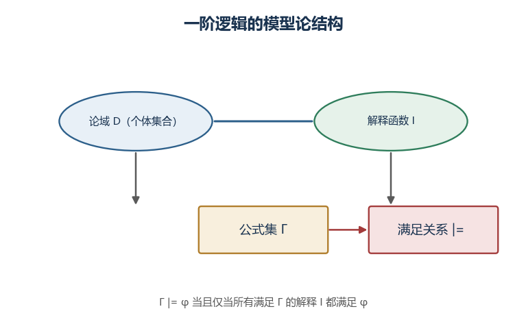

## 本章小结

本章为一阶逻辑与模型论。我们首先给出语法与语义的递归定义（定义 3.1、3.2）与满足判定算例；继而建立模型论核心——满足、蕴含与单调性（定义 3.3、3.4）；介绍归结与表推演（定理 3.1、定义 3.5）并给出 2 步归结算例；最后论证表达力与不可判定性（定理 3.2、表 3-4）。

我们还明确边界：一阶逻辑处于 S3 公理级，隐含清晰二值语义，突破早期范式无严格语义之限但无法突破推理不可判定之限。这些辨析衔接第 2 章的概念化、第 4 章的描述逻辑、第 6 章的 OWL 语义，以及第 9 章的复杂度分析。

下一章介绍描述逻辑基础——可判定的知识表示语言。

**进一步阅读**　本章建议延伸阅读的文献：[1]、[2]、[3]。

## 参考文献

[1] Enderton H B. A Mathematical Introduction to Logic. 2nd ed. San Diego: Academic Press, 2001.

[2] Robinson J A. A machine-oriented logic based on the resolution principle. *Journal of the ACM*, 1965, 12(1): 23–41.

[3] Church A. An unsolvable problem of elementary number theory. *American Journal of Mathematics*, 1936, 58(2): 345–363.

[4] Lowenheim L. Über Möglichkeiten im Relativkalkül. *Mathematische Annalen*, 1915, 76: 447–470.

[5] Smullyan R M. First-Order Logic. New York: Springer, 1968.

[6] Chang C L, Lee R C T. Symbolic Logic and Mechanical Theorem Proving. New York: Academic Press, 1973.

[7] Hodges W. Model Theory. Cambridge: Cambridge University Press, 1993.

[8] Brachman R J, Levesque H J. The Complexity of Conceptual Representation. Cambridge, MA: MIT Press, 1985.

---

# 第 4 章　描述逻辑基础

第 3 章证明了一阶逻辑推理不可判定，而本体系统需要确定答案。描述逻辑（description logic, DL）正是对这一困境的回应：它是一阶逻辑的可判定片段，以概念与角色为一等公民，提供结构化、可判定的知识表示。本章先说明动机（4.1 节），给出 ALC 的语法与语义（4.2 节），讨论概念构造算子与表达力（4.3 节），详述 Tableau 推理算法（4.4 节），用统一案例演示领域概念形式化（4.5 节），最后讨论边界（4.6 节）。本章是全书 A 类核心推导章，第 6、9、28 章均引用其内容。

## 4.1　描述逻辑的动机：可判定的知识表示
**引入与动机。** 若直接采用一阶逻辑作本体语言，推理机可能永远不停机。描述逻辑通过限制构造算子的形式，把推理约束在 ExpTime 完全的可判定范围内——这是本体语言 OWL DL 的理论基础。
**直觉解释。** 描述逻辑像一阶逻辑的「受控版本」：它保留概念、角色、量词与布尔连接词，但禁止任意多元谓词与函数符号，且量词只能以特定形式出现。这种限制换来一个珍贵性质：对任意概念与公理，可判定性、包含关系、一致性都能在有限步内确定。
**严格定义与推导。** 描述逻辑的知识库由 TBox 与 ABox 两部分构成。

**定义 4.1（描述逻辑知识库）** 一个描述逻辑知识库 $\mathcal{K}=\langle\mathcal{T},\mathcal{A}\rangle$，其中 $\mathcal{T}$ 为术语盒（TBox），含概念包含公理 $C\sqsubseteq D$ 与概念等价公理 $C\equiv D$；$\mathcal{A}$ 为断言盒（ABox），含概念断言 $C(a)$ 与角色断言 $R(a,b)$。$\mathcal{T}$ 描述「世界有哪些概念与关系」，$\mathcal{A}$ 描述「具体事实如何归属」[1]。

**定义 4.2（推理任务）** 给定知识库 $\mathcal{K}$，描述逻辑的标准推理任务包括：(a) 可满足性：概念 $C$ 是否非空（存在解释使 $C^{\mathcal{I}}\ne\varnothing$）；(b) 包含：是否 $\mathcal{T}\models C\sqsubseteq D$；(c) 一致性：$\mathcal{K}$ 是否有模型；(d) 实例检测：是否 $\mathcal{K}\models C(a)$；(e) 检索：找出所有使 $\mathcal{K}\models C(a)$ 的个体 $a$。

由定义 4.2 可推出各推理任务间的归约关系。包含可归约为可满足性：$\mathcal{T}\models C\sqsubseteq D$ 当且仅当 $C\sqcap\neg D$ 关于 $\mathcal{T}$ 不可满足。一致性可归约为可满足性：把 TBox 与 ABox 编码为概念后检测。因此，可满足性判定是核心任务——所有其他任务都可归约到它。这一归约是 Tableau 算法只需处理可满足性的原因。
**数值算例。** 设 TBox $\mathcal{T}=\{\text{医生}\sqsubseteq\text{人},\ \text{人}\sqsubseteq\exists\text{有心脏}.\text{心脏}\}$，ABox $\mathcal{A}=\{\text{医生}(\text{张医生})\}$。推理任务：(a) 「医生」可满足？是（张医生是其实例）；(b) $\mathcal{T}\models\text{医生}\sqsubseteq\text{人}$？是（TBox 公理直接给出）；(c) $\mathcal{K}$ 一致？是；(d) $\mathcal{K}\models\text{人}(\text{张医生})$？是（由继承）；(e) $\mathcal{K}\models\exists\text{有心脏}.\text{心脏}(\text{张医生})$？是（由 TBox 链式推出）。一个含 2 条 TBox 公理与 1 条 ABox 断言的知识库，可支持至少 5 类推理任务——这展示了 DL 以小博大。
**技术谱系与变体。** 描述逻辑家族按表达力递增：$\mathcal{EL}$（仅存在量词与合取，多项式推理）、$\mathcal{ALC}$（全布尔与量词，ExpTime）、$\mathcal{SROIQ}$（OWL DL 的基础，NExpTime）。表 4-1 对照。

**表 4-1　描述逻辑家族对照**

| 逻辑 | 构造算子 | 推理复杂度 | 对应本体语言 |
|------|---------|-----------|-------------|
| $\mathcal{EL}$ | $\sqcap,\exists$ | P | OWL EL |
| $\mathcal{ALC}$ | $\neg,\sqcap,\sqcup,\exists,\forall$ | ExpTime | OWL DL（子集） |
| $\mathcal{SHIF}$ | $\mathcal{ALC}$+角色层次+逆 | ExpTime | OWL Lite/DL |
| $\mathcal{SROIQ}$ | +传递、基数、限定 | NExpTime | OWL DL |
**边界与讨论。** 表达力递增的代价是复杂度递增：$\mathcal{EL}$ 多项式但无法表达否定与全称，$\mathcal{SROIQ}$ 表达力强但推理可能极慢。选型须按应用需求——大规模本体常用 $\mathcal{EL}$（如 SNOMED CT），需要精确推理时用 $\mathcal{ALC}$ 或其扩展。
**承上启下。** 动机确立后，本节给出 ALC 的严格语法与语义。

## 4.2　ALC 的语法与语义
**引入与动机。** $\mathcal{ALC}$（Attributive Language with Complements）是描述逻辑的经典代表：它包含否定、合取、析取、存在量词与全称量词，足以表达大多数本体公理，且推理 ExpTime 可判定。
**直觉解释。** 在 ALC 中，概念由「原子概念」经构造算子组合而成。例如「有副作用的药物」写作 $\text{药物}\sqcap\exists\text{有副作用}.\text{副作用}$，其中 $\sqcap$ 是合取、$\exists$ 是存在量词。概念的外延是论域中满足该描述的对象集合。
**严格定义与推导。** 给出 ALC 概念的语法与语义递归定义。

**定义 4.3（ALC 概念语法）** 设 $N_C$ 为原子概念集、$N_R$ 为角色名集。ALC 概念集是满足以下递归条件的最小集合：(a) 每个原子概念 $A\in N_C$ 是概念，$\top$（全域）与 $\bot$（空集）是概念；(b) 若 $C,D$ 是概念、$r\in N_R$，则 $\neg C$、$C\sqcap D$、$C\sqcup D$、$\exists r.C$、$\forall r.C$ 是概念[2]。

**定义 4.4（ALC 语义）** 解释 $\mathcal{I}=(\Delta^{\mathcal{I}},\cdot^{\mathcal{I}})$ 把每个原子概念 $A$ 映射到 $A^{\mathcal{I}}\subseteq\Delta^{\mathcal{I}}$，把每个角色 $r$ 映射到 $r^{\mathcal{I}}\subseteq\Delta^{\mathcal{I}}\times\Delta^{\mathcal{I}}$。复合概念的语义递归定义为：

$$
\begin{aligned}
\top^{\mathcal{I}}&=\Delta^{\mathcal{I}},\quad \bot^{\mathcal{I}}=\varnothing,\\
(\neg C)^{\mathcal{I}}&=\Delta^{\mathcal{I}}\setminus C^{\mathcal{I}},\\
(C\sqcap D)^{\mathcal{I}}&=C^{\mathcal{I}}\cap D^{\mathcal{I}},\quad (C\sqcup D)^{\mathcal{I}}=C^{\mathcal{I}}\cup D^{\mathcal{I}},\\
(\exists r.C)^{\mathcal{I}}&=\{x\in\Delta^{\mathcal{I}}\mid \exists y.\ (x,y)\in r^{\mathcal{I}}\wedge y\in C^{\mathcal{I}}\},\\
(\forall r.C)^{\mathcal{I}}&=\{x\in\Delta^{\mathcal{I}}\mid \forall y.\ (x,y)\in r^{\mathcal{I}}\to y\in C^{\mathcal{I}}\}.
\end{aligned} \tag{4-1}
$$

式 (4-1) 把 ALC 概念解释为集合运算，与一阶逻辑语义一一对应：原子概念 $A(x)$ 对应 $x\in A^{\mathcal{I}}$，角色 $r(x,y)$ 对应 $(x,y)\in r^{\mathcal{I}}$。这一对应是第 6 章 OWL DL 到一阶逻辑映射的基础。
**数值算例。** 设论域 $\Delta=\{a,b,c\}$，$A^{\mathcal{I}}=\{a,b\}$，$r^{\mathcal{I}}=\{(a,b),(b,c)\}$，$B^{\mathcal{I}}=\{b,c\}$。计算 $(\exists r.B)^{\mathcal{I}}$：对 $a$，存在 $b$ 使 $(a,b)\in r$ 且 $b\in B$，故 $a$ 属于；对 $b$，存在 $c$ 使 $(b,c)\in r$ 且 $c\in B$，故 $b$ 属于；对 $c$，无 $r$ 后继，故不属于。因此 $(\exists r.B)^{\mathcal{I}}=\{a,b\}$。再算 $(\forall r.B)^{\mathcal{I}}$：对 $a$，后继 $b\in B$，满足；对 $b$，后继 $c\in B$，满足；对 $c$，无后继（空真），满足。故 $(\forall r.B)^{\mathcal{I}}=\{a,b,c\}=\Delta$。若把 $B^{\mathcal{I}}$ 改为 $\{b\}$，则 $(\forall r.B)^{\mathcal{I}}=\{a,c\}$（$b$ 的后继 $c\notin B$，排除 $b$）——这展示了全称量词的「空真」特性。

**技术谱系与变体。** 表 4-2 对照 ALC 构造算子与一阶逻辑公式。

**表 4-2　ALC 算子与一阶逻辑对应**

| ALC 构造 | 一阶逻辑对应 | 语义集合运算 |
|---------|-------------|-------------|
| $A$ | $A(x)$ | $A^{\mathcal{I}}$ |
| $\neg C$ | $\neg C(x)$ | 补集 |
| $C\sqcap D$ | $C(x)\wedge D(x)$ | 交集 |
| $C\sqcup D$ | $C(x)\vee D(x)$ | 并集 |
| $\exists r.C$ | $\exists y\,(r(x,y)\wedge C(y))$ | 存在后继 |
| $\forall r.C$ | $\forall y\,(r(x,y)\to C(y))$ | 全体后继 |
**边界与讨论。** ALC 采用开放世界假设（open world assumption, OWA）：未声明为真的命题不自动为假。这与数据库的封闭世界假设（CWA）相反——ABox 中未写 $C(a)$ 不意味着 $\neg C(a)$。OWA 是本体推理与数据库查询的根本差异，第 5、8 章将深入讨论。
**承上启下。** 语法语义确立后，下一节讨论常见概念构造算子及其表达力边界。

## 4.3　概念构造算子与表达力
**引入与动机。** ALC 的五个构造算子各有表达力，组合后可刻画复杂概念，但并非所有一阶逻辑概念都能在 ALC 中表达。理解表达力边界，才能合理使用本体语言。
**直觉解释。** 用 $\sqcap,\sqcup,\neg$ 可表达任意布尔组合，用 $\exists,\forall$ 可表达「存在/所有后继满足某概念」。但 ALC 不能表达「至少 3 个后继」（需基数约束）或「关系是传递的」（需角色公理）——这些扩展属于 $\mathcal{SROIQ}$。
**严格定义与推导。** 给出表达力的形式刻画。

**定义 4.5（概念表达力）** 概念语言 $\mathcal{L}$ 的表达力是集合 $\{\,C^{\mathcal{I}}\mid C\in\mathcal{L},\ \mathcal{I}\text{为解释}\,\}$。若 $\mathcal{L}_1\subseteq\mathcal{L}_2$ 且存在概念在 $\mathcal{L}_2$ 中可定义而不在 $\mathcal{L}_1$ 中，则称 $\mathcal{L}_2$ 表达力严格强于 $\mathcal{L}_1$。

由定义 4.5 可比较 ALC 与其扩展。$\mathcal{ALC}$ 不能表达基数约束 $\ge n\,r.C$（「至少 $n$ 个 $r$ 后继属于 $C$」），因为 ALC 的量词只有「存在一个」与「全部」。加入基数约束得到 $\mathcal{ALCQ}$，表达力严格增强，推理复杂度升至 ExpTime（对有限基数仍可判定）。加入传递角色公理 $r\circ r\sqsubseteq r$ 得到 $\mathcal{SR}$，复杂度升至 NExpTime[3]。
**数值算例。** 设论域中个体 $a$ 有 3 个 $r$ 后继 $b_1,b_2,b_3$，均属于 $C$。ALC 概念 $\exists r.C$ 与 $\forall r.C$ 在 $a$ 上均为真。但「$a$ 至少有 3 个 $C$ 后继」无法用 ALC 表达——若只用 $\exists r.C$，无法区分「1 个后继」与「3 个后继」。若某应用需表达「药物至少有 2 种副作用」，则 ALC 不足，需 $\mathcal{ALCQ}$ 的基数约束 $\ge 2\,r.C$。若本体含 100 个此类约束，使用 $\mathcal{ALCQ}$ 可使推理复杂度从 ExpTime 升至 NExpTime——这解释了为何大规模本体倾向避免基数约束。
**技术谱系与变体。** 表 4-3 对照常见扩展。

**表 4-3　ALC 表达力扩展对照**

| 扩展 | 新增构造 | 表达力增益 | 复杂度 |
|------|---------|-----------|--------|
| $\mathcal{ALCQ}$ | 基数约束 $\ge n,\le n$ | 计数能力 | ExpTime |
| $\mathcal{ALCO}$ | 名义（nominal） | 枚举个体 | ExpTime |
| $\mathcal{ALCI}$ | 逆角色 $r^-$ | 反向遍历 | ExpTime |
| $\mathcal{ALC}$ + 传递 | $r\circ r\sqsubseteq r$ | 传递闭包 | NExpTime |
**边界与讨论。** 表达力与复杂度的权衡是描述逻辑设计的永恒主题（呼应第 1.3、3.4 节）。工程上常采用「表达力够用即止」原则：若应用不需计数与传递，用 ALC 即可获 ExpTime 推理；若需 OWL DL 全表达力，则接受 NExpTime 并用优化推理机（第 9 章）。
**承上启下。** 表达力明确后，下一节给出判定可满足性的核心算法——Tableau。

## 4.4　Tableau 推理算法
**引入与动机。** 描述逻辑的可判定性由 Tableau 算法实现：它把概念可满足性问题转化为「能否构造一个不矛盾的模型」，通过系统展开概念描述来搜索模型。
**直觉解释。** Tableau 像一棵搜索树：从待判定概念 $C$ 出发，不断对其施加「必须满足」的约束（合取展开到同一分支、析取分叉、存在量词引入新个体、全称量词传播到所有后继）。若某分支出现矛盾（同一对象既属于 $A$ 又属于 $\neg A$），该分支封闭；若所有分支都封闭，则 $C$ 不可满足。
**严格定义与推导。** 先给出否定范式（NNF）概念：否定只作用于原子概念。任何 ALC 概念可用德摩根律与双重否定消除化为 NNF。

**定义 4.6（Tableau 展开规则）** 对 NNF 概念 $C$，维护一棵完成树，结点标记概念集合与角色边。展开规则：(a) $\sqcap$-规则：若 $C\sqcap D$ 在结点 $x$，则把 $C,D$ 加入 $x$ 的标签；(b) $\sqcup$-规则：若 $C\sqcup D$ 在 $x$，则分叉为两分支，分别加 $C$ 与 $D$；(c) $\exists$-规则：若 $\exists r.C$ 在 $x$ 且 $x$ 无 $r$-后继满足 $C$，则创建新结点 $y$，加边 $(x,y)$ 到 $r$ 并标记 $y$ 为 $C$；(d) $\forall$-规则：若 $\forall r.C$ 在 $x$ 且 $(x,y)\in r$，则把 $C$ 加入 $y$ 的标签；(e) 冲突检测：若某结点同时含 $A$ 与 $\neg A$，则分支封闭[4]。

**定理 4.1（Tableau 可靠性与完备性）** 对 ALC 概念 $C$，Tableau 算法终止，且 $C$ 可满足当且仅当存在一条不封闭的完成分支。

证明要点：终止性由「有限角色深度与有限子概念」保证（每次展开引入的子概念来自 $C$ 的有限集合，新结点数受限于 $\exists$ 约束数）；可靠性由「每个展开保持模型存在性」归纳；完备性由「不封闭分支可读出一个模型」构造——把每个分支的结点作为论域元素，标签作为概念成员，边作为角色成员，即得满足 $C$ 的解释。
**数值算例。** 判定 $C=\text{药物}\sqcap\exists\text{有副作用}.\text{副作用}\sqcap\neg\text{药物}$ 的可满足性。化为 NNF 后三部分：$\text{药物}$、$\exists\text{有副作用}.\text{副作用}$、$\neg\text{药物}$。展开 $\sqcap$ 后，根结点标签含 $\text{药物}$ 与 $\neg\text{药物}$——立即冲突，分支封闭。无其他分支，故 $C$ 不可满足。这是一个 0 步展开即判定的例子。再判 $D=\exists r.A\sqcap\forall r.\neg A$：根结点有 $\exists r.A$ 与 $\forall r.\neg A$；$\exists$-规则创建子结点 $y$ 标记 $A$；$\forall$-规则把 $\neg A$ 传播到 $y$；$y$ 含 $A$ 与 $\neg A$，冲突封闭。故 $D$ 不可满足——Tableau 正确判定了「存在 $A$ 后继且所有后继都非 $A$」的矛盾。
**技术谱系与变体。** 表 4-4 对照 Tableau 优化技术。

**表 4-4　Tableau 优化技术**

| 技术 | 思想 | 效果 |
|------|------|------|
| 语义分支 | 析取时选择可满足性高的分支 | 减少回溯 |
| 依赖跟踪 | 记录冲突来源以剪枝 | 早停 |
| 惰性展开 | 按需展开概念 | 减少状态 |
| 阻塞（blocking） | 检测同构子树停止展开 | 保证终止 |
**边界与讨论。** Tableau 的最坏复杂度为 ExpTime，但实际性能常远优于上界，尤其配合优化技术（第 9 章）。然而对 $\mathcal{SROIQ}$ 等强逻辑，Tableau 规则复杂且实现困难，推理机常采用其他策略（如基于 SAT 的归约）。
**承上启下。** 算法已给出，下一节用统一案例展示 DL 如何形式化领域概念。

## 4.5　统一案例：领域概念的形式化
**引入与动机。** 前四节给出理论，本节把它们应用到贯穿全书的生物医学本体，展示从自然语言描述到 ALC 公理的完整过程。
**直觉解释。** 把「医生给患者开药物，药物可能有副作用」这类常识，翻译成 ALC 概念与公理，就是领域概念的形式化。翻译的质量决定后续推理的有效性。
**严格定义与推导。** 设原子概念 $\mathcal{C}=\{\text{医生},\text{患者},\text{药物},\text{疾病},\text{副作用},\text{人}\}$，角色 $\mathcal{R}=\{\text{开具},\text{患有},\text{有副作用},\text{治疗}\}$。TBox 公理集 $\mathcal{T}$ 定义为：

$$
\begin{aligned}
&\text{医生}\sqsubseteq\text{人},\\
&\text{患者}\sqsubseteq\text{人}\sqcap\exists\text{患有}.\text{疾病},\\
&\text{药物}\sqsubseteq\exists\text{治疗}.\text{疾病},\\
&\text{有副作用的药物}\equiv\text{药物}\sqcap\exists\text{有副作用}.\text{副作用}.
\end{aligned} \tag{4-2}
$$

ABox 含 $\mathcal{A}=\{\text{医生}(\text{张医生}),\ \text{开具}(\text{张医生},\text{阿司匹林}),\ \text{患有}(\text{李患者},\text{头痛})\}$。由式 (4-2) 与 Tableau 推理，可推出 $\text{人}(\text{张医生})$（由 $\text{医生}\sqsubseteq\text{人}$）、$\exists\text{治疗}.\text{疾病}(\text{阿司匹林})$（由药物公理），以及若补充 $\text{阿司匹林}\sqsubseteq\text{有副作用的药物$，则可推出 $\exists\text{有副作用}.\text{副作用}(\text{阿司匹林})$。
**数值算例。** 设统一案例的医学本体含 $|\mathcal{C}|=60$ 个原子概念、$|\mathcal{R}|=25$ 个角色、$|\mathcal{T}|=180$ 条 TBox 公理、$|\mathcal{A}|=8500$ 条 ABox 断言。式 (4-2) 的 4 条公理是其中核心片段。若一次分类任务需对 60 个概念两两判定包含（共 $60\times59/2=1770$ 次包含检测），每次归约为可满足性检测，则 Tableau 需运行 1770 次——这解释了为何推理机需优化（第 9 章）。
**技术谱系与变体。** 表 4-5 对照领域概念形式化的三个阶段。

**表 4-5　领域概念形式化阶段**

| 阶段 | 产物 | 对应语义级 |
|------|------|-----------|
| 术语收集 | 概念与角色名表 | S1 |
| 层级构建 | is-a 偏序 | S2 |
| 公理添加 | ALC TBox | S3 |
**边界与讨论。** 形式化的难点不在语法，而在「公理是否忠实于领域」。例如「所有药物都有适应证」在医学上未必绝对（部分药物适应证未明），强行公理化会引入错误。这与第 2.2 节的本体论承诺、第 20 章的需求分析直接相关。
**承上启下。** 本节完成 DL 理论到案例的落地，下一节讨论描述逻辑的边界。

## 4.6　边界与讨论

本章建立描述逻辑的完整图景：动机（定义 4.1、4.2）、ALC 语法语义（定义 4.3、4.4、式 4-1）、表达力与扩展（定义 4.5、表 4-3）、Tableau 算法（定义 4.6、定理 4.1）与统一案例（式 4-2）。

**语义之梯四问的回应。** 描述逻辑处于语义之梯 S3 公理级，是第 3 章一阶逻辑的可判定片段；它隐含「清晰外延、开放世界」假设，突破了 FOL 推理不可判定之限，但无法突破「表达力受限」之限（不能表达任意多元谓词、函数与传递闭包）。它把推理置于坚实的 ExpTime 可判定基础上，是 OWL DL 与语义网推理的核心。

需要强调：描述逻辑的「可判定」是理论保证，不等于「快速」。最坏 ExpTime 的复杂度对大规模本体仍是挑战，第 9 章将讨论推理机与优化。同时，描述逻辑的清晰二值语义难以处理不确定与常识知识，这是第 18、19 章的议题。

下一章进入语义网与 RDF/RDFS，看描述逻辑思想如何在 Web 上标准化落地。

> 【图 4-1　ALC 概念构造算子与集合语义】（原图见 figures/图4-1.png）：五个算子对应的集合运算图，标注式 4-1
>
> 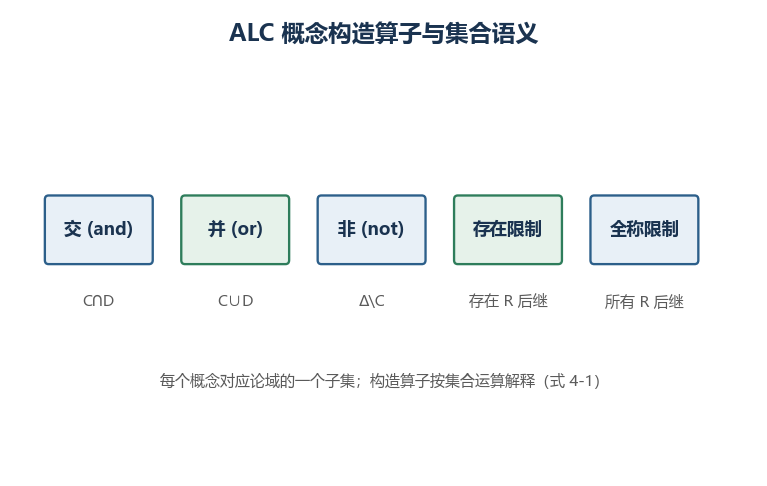

## 本章小结

本章系统论述描述逻辑基础。我们首先说明动机——以可判定性回应 FOL 的不可判定（定义 4.1、4.2）；给出 ALC 的语法与语义（定义 4.3、4.4、式 4-1）；讨论构造算子与表达力（定义 4.5、表 4-3）；详述 Tableau 算法（定义 4.6、定理 4.1）并给出两个可满足性判定算例；最后用统一案例展示领域概念形式化（式 4-2）并讨论边界。

我们还明确边界：DL 处于 S3 公理级，隐含清晰外延与开放世界假设，突破 FOL 不可判定之限但无法突破表达力受限之限。这些辨析衔接第 3 章的一阶逻辑、第 6 章的 OWL DL、第 9 章的推理复杂度，以及第 18、19 章的不确定与常识。

下一章介绍语义网与 RDF/RDFS，把描述逻辑概念落到 Web 数据模型上。

**进一步阅读**　本章建议延伸阅读的文献：[1]、[2]、[4]。

## 参考文献

[1] Baader F, Calvanese D, McGuinness D L, et al. The Description Logic Handbook: Theory, Implementation and Applications. 2nd ed. Cambridge: Cambridge University Press, 2007.

[2] Brachman R J, Schmolze J G. An overview of the KL-ONE knowledge representation system. *Cognitive Science*, 1985, 9(2): 171–216.

[3] Sattler U. Description logics for the semantic web. In: *Reasoning Web*, LNCS 3229, 2004: 1–43.

[4] Buchheit M, Donini F M, Nutt W. An overview of tableaux algorithms for description logics. In: *Tableaux'98*, LNCS 1397, 1998: 1–18.

[5] Schild K. A correspondence theory for terminological logics: Preliminary report. *IJCAI*, 1991: 466–471.

[6] Nebel B. Reasoning andRevision in Hybrid Representation Systems. Berlin: Springer, 1990.

[7] Horrocks I, Sattler U. Ontology reasoning in the SHOQ(D) description logic. *IJCAI*, 2001: 199–204.

[8] Motik B, Horrocks I, Sattler U. Bridging the gap between OWL and relational databases. *WWW*, 2007: 807–816.

---

# 第 5 章　语义网与 RDF/RDFS

第 4 章建立的描述逻辑是语义网推理的理论内核。本章把概念落到 Web 数据模型上：介绍语义网愿景与资源描述框架（5.1 节）、RDF 数据模型与三元组（5.2 节）、RDFS 轻量模式（5.3 节）、命名图与数据集（5.4 节），最后讨论边界（5.5 节）。本章核心问题是：如何为 Web 上的海量数据提供机器可处理的语义，使知识层（$L_2$）大规模落地。

## 5.1　语义网愿景与资源描述框架

**引入与动机。** 今天的 Web 主要由人类阅读：网页是人看的，机器只知抓取字符串。语义网（semantic web）愿景主张：让 Web 上的数据带有机器可理解的语义，使程序能自动推理与互操作[1]。RDF 是这一愿景的基石。

**直觉解释。** 若把 Web 看作一个巨大的图书馆，传统网页是「给人看的书」，语义网则给每本书贴上机器能读的标签：这本书讲什么、作者是谁、与哪些书相关。这些标签用统一格式写成，程序可自动汇总与推理。

**严格定义与推导。** 语义网分层架构由 Berners-Lee 提出：底层为 Unicode 与 URI，其上为 XML 与 RDF，再上为 RDFS、OWL、SPARQL、规则与证明层[2]。

$$\langle x,\text{type},d\rangle\in\mathrm{cl}(G)\ \text{若}\ \langle x,\text{type},c\rangle\in G\wedge\langle c,\text{subClassOf},d\rangle\in G.\tag{5-1}$$

**定义 5.1（资源描述框架 RDF）** RDF 是一种基于三元组的数据模型，用于描述网络资源。一个 RDF 三元组（triple）形如 $(s,p,o)$，其中 $s$ 为主语（subject，资源）、$p$ 为谓词（predicate，属性）、$o$ 为客体（object，资源或字面量）。三元组集合构成 RDF 图。

由定义 5.1 可推出 RDF 与描述逻辑的对应：三元组 $(s,p,o)$ 对应 ABox 断言 $p(s,o)$；RDFS/OWL 类声明对应 TBox 公理。RDF 图是有标注的有向图，节点为资源或字面量，边为属性——这把第 4 章的 DL 概念落到图结构上。

**数值算例。** 设一个 RDF 数据集描述医学知识：$\langle\text{阿司匹林},\text{类型},\text{药物}\rangle$、$\langle\text{阿司匹林},\text{治疗},\text{头痛}\rangle$、$\langle\text{头痛},\text{类型},\text{症状}\rangle$。共 $|V|=3$ 个资源节点（阿司匹林、药物、头痛、症状中字面量除外共 4 个 URI 节点），$|E|=3$ 条边。若再添加 1000 种药物、每种平均 5 条三元组，则三元组总数增至 $3+1000\times5=5003$——RDF 的图模型可自然扩展到大规模知识层。

**技术谱系与变体。** 表 5-1 对照语义网各层技术。

**表 5-1　语义网技术栈**

| 层次 | 技术 | 作用 |
|------|------|------|
| 标识 | URI / IRI | 资源的全局唯一标识 |
| 语法 | Turtle / RDF/XML | 三元组的序列化格式 |
| 数据模型 | RDF | 三元组与图 |
| 模式 | RDFS | 类、属性与轻量蕴含 |
| 本体 | OWL | 丰富公理与推理 |
| 查询 | SPARQL | 图模式查询 |
| 规则 | SWRL / RIF | 自定义推理规则 |

**边界与讨论。** RDF 只提供数据模型而非推理能力；语义的严格化由 RDFS 与 OWL 完成。把 RDF 等同于「语义网」是常见误解——RDF 是语法与数据层，语义在更高层。

**承上启下。** 愿景确立后，本节深入 RDF 数据模型与三元组细节。

## 5.2　RDF 数据模型与三元组

**引入与动机。** RDF 的简洁性（只有三元组）既是优点也是限制。理解其数据模型，才能理解为何说「RDF 把知识表示为图」以及蕴含如何发生。

**直觉解释。** 每个三元组是一句「主—谓—宾」的简单陈述，如「阿司匹林 治疗 头痛」。大量三元组连成图，节点共享即产生关联。这种「关系优先」的表示，与关系数据库的「表优先」形成对比，更适合稀疏、多变的领域知识。

**严格定义与推导。** 给出 RDF 的形式定义。

**定义 5.2（RDF 图）** 设 $U$ 为 URI 集合、$L$ 为字面量集合、$B$ 为空白节点集合。RDF 项集 $T=U\cup L\cup B$。一个 RDF 三元组是 $(s,p,o)\in(U\cup B)\times U\times T$。RDF 图是三元组的有限集合 $G\subset T\times U\times T$。

字面量可带语言标签或数据类型（如 `"阿司匹林"@zh`、`"37.5"^^xsd:decimal`）。空白节点表示存在但无需命名的个体，用于描述复合结构。

**定义 5.3（RDF 蕴含）** RDF 图 $G_1$ 蕴含 $G_2$（$G_1\models G_2$），若每个使 $G_1$ 为真的解释也使 $G_2$ 为真。RDF 有一组形式化蕴含规则（RDF entailment regimes）[3]，例如从 $(s,\text{type},p)$ 不能推出更多，但 RDFS 规则可推出类与属性层级。

由定义 5.3 可推出 RDF 图上的蕴含闭包概念：给定规则集 $R$，图 $G$ 关于 $R$ 的闭包是应用 $R$ 中规则可推出的所有三元组的集合，记作 $\mathrm{cl}_R(G)$。蕴含判定即检查目标三元组是否在闭包中。

**数值算例。** 设 $G=\{\langle a,\text{type},A\rangle,\ \langle A,\text{subClassOf},B\rangle\}$，RDFS 规则包括：若 $(x,\text{type},y)$ 且 $(y,\text{subClassOf},z)$ 则 $(x,\text{type},z)$。应用规则得 $\langle a,\text{type},B\rangle$，故 $\mathrm{cl}(G)=G\cup\{\langle a,\text{type},B\rangle\}$，共 3 条三元组。若再添 $\langle B,\text{subClassOf},C\rangle$，则闭包增至 5 条（新增 $\langle a,\text{type},C\rangle$ 与 $\langle B,\text{subClassOf},C\rangle$ 本身已计）——展示了 RDFS 规则的传递扩张。

**技术谱系与变体。** 表 5-2 对照 RDF 序列化格式。

**表 5-2　RDF 序列化格式对照**

| 格式 | 特点 | 适用 |
|------|------|------|
| Turtle | 紧凑、可读 | 人工编写与教学 |
| RDF/XML | XML 语法 | 早期标准、工具兼容 |
| N-Triples | 每行一个三元组 | 大规模数据流 |
| JSON-LD | JSON 兼容 | Web 应用 |

**边界与讨论。** RDF 的开放世界语义与关系数据库不同：三元组缺失不等于否定。例如图中没有「阿司匹林 治疗 癌症」不意味着「阿司匹林不治疗癌症」——这与第 4.2 节的 OWA 一致。

### 5.2.1　Turtle 序列化与空白节点展开

**直觉解释。** 定义 5.2 给出的三元组是「抽象语法」，但人写 RDF 时用的是具体语法（Turtle、RDF/XML、N-Triples）。Turtle 允许用 `@prefix` 缩写 URI、用 `;` 串联同主语的谓词、用 `[]` 内联空白节点，从而把图写得紧凑。理解序列化与抽象语法的关系，才能正确解析与生成 RDF 数据。

**严格定义与推导。** 一个 Turtle 片段与 RDF 图之间存在确定的**序列化展开**（parse）映射 $\pi$：

$$
\pi:\text{Turtle}\to\mathcal{P}(\mathcal{T}\times\mathcal{U}\times\mathcal{T}),\qquad
\texttt{a:aspirin a:Drug ; a:treats a:headache .}\ \mapsto\ \{\langle\texttt{a:aspirin},\texttt{a:Drug}\rangle,\ \langle\texttt{a:aspirin},\texttt{a:treats},\texttt{a:headache}\rangle\}. \tag{5-1A}
$$

式 (5-1A) 中，前缀 `a:Drug` 由 `@prefix a: <http://ex.org/drug#>` 展开为完整 IRI；内联空白节点 `[]` 在展开时生成唯一标识符（如 `_:b0`）。展开是「语法不唯一、图唯一」的标准化基础：不同 Turtle 片段若表达同一三元组集，则展开后相同。

**数值算例。** 设统一案例的医学片段，用 Turtle 写作：

```
@prefix a: <http://ex.org/drug#> .
a:aspirin a:Drug ; a:treats a:headache .
a:headache a:Symptom .
```

展开为三元组：$\langle\texttt{a:aspirin},\texttt{a:Drug}\rangle$、$\langle\texttt{a:aspirin},\texttt{a:treats},\texttt{a:headache}\rangle$、$\langle\texttt{a:headache},\texttt{a:Symptom}\rangle$，共 3 条。注意 `a:aspirin a:Drug ; a:treats a:headache .` 一行展开为 2 条三元组（`;` 串联同主语），这正是 Turtle 的紧凑性来源。若改为内联空白节点 `a:aspirin a:hasSideEffect [ a:name "nausea" ] .`，则展开为 2 条三元组 $\langle\texttt{a:aspirin},\texttt{a:hasSideEffect},\_:b0\rangle$、$\langle\_:b0,\texttt{a:name},\texttt{"nausea"}\rangle$——空白节点 `_:b0` 在展开时产生，使「有副作用」这一复合结构无需给副作用单独命名。

**技术谱系与变体。** 各序列化格式的「展开粒度」不同：N-Triples 每条三元组一行（无缩写，最接近抽象语法）、Turtle 支持前缀与 `;`/`,` 串联、RDF/XML 用 XML 元素表达（一个元素可含多个属性）、JSON-LD 用 JSON 对象表达（支持上下文压缩）。表 5-2 已对照。工程上，大规模数据流常用 N-Triples（行式、易并行解析），人工编写与教学用 Turtle（可读），Web 应用用 JSON-LD（与 JSON 生态兼容）。

**边界与讨论。** 空白节点是 RDF 序列化与抽象语法的关键衔接点：它让「不命名中间对象」成为可能，但也带来「跨图空白节点身份」问题——不同图各自的 `_:b0` 可能指不同对象，跨图查询时不可直接合并（第 5.4 节命名图）。此外，字面量类型（`"37.5"^^xsd:decimal`）在展开时保留类型信息，但不同格式对字面量类型标注的支持程度不一（JSON-LD 用 `@type` 标注），这是序列化间非无损转换的根源之一。

**承上启下。** 序列化展开明确后，下一节介绍赋予 RDF 图语义的 RDFS 模式语言。

## 5.3　RDFS 与轻量模式

**引入与动机。** 纯 RDF 三元组没有类型、层级与域/值域约束，机器无法从「阿司匹林 治疗 头痛」推出「阿司匹林是一种干预」。RDFS（RDF Schema）提供轻量模式语言，补齐这些语义。

**直觉解释。** RDFS 像给 RDF 图加一层「类型系统」：声明哪些是类、类之间如何继承、属性适用于什么类型的主语与宾语。有了它，机器可做简单的蕴含推理——这是从 S1 词汇级到 S2 概念级的跃迁。

**严格定义与推导。** RDFS 引入核心词汇：`rdf:type`（实例归属）、`rdfs:subClassOf`（子类）、`rdfs:subPropertyOf`（子属性）、`rdfs:domain`（定义域）、`rdfs:range`（值域）。其语义由一组蕴含规则定义[4]。

**定义 5.4（RDFS 蕴含规则）** 关键规则包括：(a) 若 $(c,\text{subClassOf},d)$ 且 $(x,\text{type},c)$，则 $(x,\text{type},d)$；(b) 若 $(c,\text{subClassOf},d)$ 且 $(d,\text{subClassOf},e)$，则 $(c,\text{subClassOf},e)$；(c) 若 $(p,\text{domain},c)$ 且 $(x,p,y)$，则 $(x,\text{type},c)$；(d) 若 $(p,\text{range},c)$ 且 $(x,p,y)$，则 $(y,\text{type},c)$；(e) 若 $(p,\text{subPropertyOf},q)$ 且 $(x,p,y)$，则 $(x,q,y)$。

由定义 5.4 可推出：RDFS 的蕴含是单调的——规则只添加三元组不删除。这与第 3.2 节 DL 的单调性一致。RDFS 推理的复杂度为 NP 完全（对数据复杂度为多项式），远低于 OWL DL——这是「轻量模式」的含义。

**数值算例。** 设 RDFS 图含：$\langle\text{药物},\text{subClassOf},\text{干预}\rangle$、$\langle\text{治疗},\text{domain},\text{药物}\rangle$、$\langle\text{治疗},\text{range},\text{疾病}\rangle$、$\langle\text{阿司匹林},\text{治疗},\text{头痛}\rangle$。应用规则 (c) 推出 $\langle\text{阿司匹林},\text{type},\text{药物}\rangle$；再由规则 (a) 推出 $\langle\text{阿司匹林},\text{type},\text{干预}\rangle$；应用规则 (d) 推出 $\langle\text{头痛},\text{type},\text{疾病}\rangle$。原始 4 条三元组，闭包增至 7 条——3 条新事实由 RDFS 语义自动推出，展示了轻量模式的推理价值。

**技术谱系与变体。** 表 5-3 对照 RDFS 与 OWL 的表达力。

**表 5-3　RDFS 与 OWL 表达力对照**

| 能力 | RDFS | OWL DL |
|------|------|--------|
| 类层级 | 有 | 有 |
| 域/值域 | 有 | 有 |
| 布尔组合类 | 无 | 有 |
| 基数约束 | 无 | 有 |
| 不相交性 | 无 | 有 |
| 推理复杂度 | NP | ExpTime/NExpTime |

**边界与讨论。** RDFS 表达力有限：无法表达「药物与疾病不相交」或「某类至少有 2 个实例」。这些需 OWL（第 6 章）。RDFS 的价值在于简单高效，适合大规模、推理需求轻的场景。

### 5.3.1　RDFS 蕴含闭包的不动点计算与复杂度

**直觉解释。** 5.3 节给出 RDFS 的单步蕴含规则，但实际推理是反复应用规则直到「不再产生新三元组」。这一反复应用的过程可用不动点（fixpoint）刻画：从初始图 $G_0$ 出发，每轮应用所有规则得到 $G_{i+1}$，直到 $G_{i+1}=G_i$ 收敛。理解不动点计算，才能估计 RDFS 推理的规模膨胀与终止性。

**严格定义与推导。** 设 RDFS 规则集 $\mathcal{R}$，定义闭包迭代序列 $G_0=G$、$G_{i+1}=G_i\cup\mathrm{Derive}(G_i)$，其中 $\mathrm{Derive}(G_i)$ 是 $G_i$ 上应用 $\mathcal{R}$ 新推出的三元组。若存在 $n$ 使 $G_n=G_{n+1}$，则 $G^* = G_n$ 是 $G$ 关于 $\mathcal{R}$ 的**蕴含闭包**（不动点）。闭包规模膨胀比定义为：

$$
\lambda(G)=\frac{|G^*|}{|G|}\ge1. \tag{5-2A}
$$

式 (5-2A) 中 $\lambda$ 度量推理使三元组数膨胀的倍数。RDFS 规则（定义 5.4 的 (a)–(e)）是单调的（只加不删），故序列 $G_0\subseteq G_1\subseteq\cdots$ 单调递增；又因三元组集有限（URI 与字面量有限），序列必在某轮达到不动点，故 RDFS 闭包**有限步收敛**。但 $\lambda$ 可能很大——若类层级很深（$A_1\sqsubseteq A_2\sqsubseteq\cdots\sqsubseteq A_n$），一条 $(x,\text{type},A_1)$ 经规则 (a) 可推出 $n$ 条 $(x,\text{type},A_i)$。

**数值算例。** 设初始图 $G$ 含 $\langle\text{阿司匹林},\text{type},\text{药物}\rangle$、$\langle\text{药物},\text{subClassOf},\text{干预}\rangle$、$\langle\text{干预},\text{subClassOf},\text{实体}\rangle$、$\langle\text{治疗},\text{domain},\text{药物}\rangle$、$\langle\text{治疗},\text{range},\text{疾病}\rangle$、$\langle\text{阿司匹林},\text{治疗},\text{头痛}\rangle$，共 $|G|=6$。
- $G_1$（第 1 轮）：规则 (a) 推 $\langle\text{药物},\text{subClassOf},\text{实体}\rangle$、$\langle\text{阿司匹林},\text{type},\text{干预}\rangle$；规则 (c) 推 $\langle\text{阿司匹林},\text{type},\text{药物}\rangle$（已有）；规则 (d) 推 $\langle\text{头痛},\text{type},\text{疾病}\rangle$。新增 3 条，$|G_1|=9$。
- $G_2$（第 2 轮）：规则 (a) 推 $\langle\text{阿司匹林},\text{type},\text{实体}\rangle$（由 $\text{阿司匹林}:\text{干预}$ 与 $\text{干预}\sqsubseteq\text{实体}$）。新增 1 条，$|G_2|=10$。
- $G_3=G_2$，不动点，$G^*=G_2$。

故 $\lambda=10/6\approx1.667$，经 2 轮收敛。若类层级深度增至 $n=10$（$\text{药物}\sqsubseteq A_2\sqsubseteq\cdots\sqsubseteq A_{10}$），则 $\langle\text{阿司匹林},\text{type},\text{药物}\rangle$ 将推出 9 条新类声明，$\lambda$ 随 $n$ 线性增长——这解释了为何深层类层级会放大 RDFS 闭包规模，也是大规模本体推理（第 14 章）需优化类层级深度的原因。

**技术谱系与变体。** RDFS 闭包的不动点计算复杂度：对数据（ABox 式三元组）固定时，推理为多项式；对数据规模计，RDFS 蕴含判定为 NP 完全（第 5.3 节表 5-3）。这与 OWL DL 的 ExpTime/NExpTime 复杂度形成对照——RDFS 的「轻量」正体现在闭包计算的多项式性。第 7 章 SPARQL 查询若开启 RDFS 语义，则每次查询隐式执行一次闭包计算（或依赖预计算闭包），开销取决于 $\lambda$。

**边界与讨论。** 不动点收敛依赖「三元组集有限」，若 URI 空间无界（如动态生成 IRI），闭包可能不终止——这是 RDFS 在动态数据源上的边界。此外，$\lambda$ 线性膨胀假设层级为链式；若层级为分叉（一个父类多个子类），膨胀更复杂但仍是多项式。工程上，预计算 RDFS 闭包并缓存是常见优化（第 14 章），代价是存储膨胀 $\lambda$ 倍。

**承上启下。** 闭包计算给出 RDFS 推理的可量化模型，下一节讨论多图共存的命名图与数据集。

## 5.4　命名图与数据集

**引入与动机。** 真实应用中，RDF 数据来自多个来源：一个图存医学本体，一个图谱存临床事实，一个存用户标注。若混在一起，来源信息丢失且可能产生冲突。命名图（named graph）解决这一问题。

**直觉解释。** 命名图像给每张 RDF 图贴标签「这是 A 来源的」「这是 B 来源的」。数据集由多个命名图构成，查询时可指定在哪个图中查，也可跨图查询——这为知识融合（第 12 章）与联邦查询（第 7 章）奠定基础。

**严格定义与推导。** 给出 RDF 数据集的形式定义。

**定义 5.5（RDF 数据集）** RDF 数据集是一个集合 $\{(g_i,G_i)\}$，其中 $g_i$ 为命名图的 IRI，$G_i$ 为 RDF 图；另有一个默认图 $G_0$（无名）。数据集的合流式（merge）为 $\bigcup_i G_i$，用于不区分来源的查询[5]。

由定义 5.5 可推出：命名图保留来源语义，而合并丢失来源。例如图 $g_1$ 含「阿司匹林 治疗 头痛」，图 $g_2$ 含「阿司匹林 治疗 发热」，合并后无法区分哪个来源主张哪条事实。若要做「可信来源优先」的融合（第 12、13 章），必须保留命名图结构。

**数值算例。** 设数据集含 3 个命名图：$g_1$（医学本体）含 180 条三元组、$g_2$（临床事实）含 8500 条、$g_3$（用户标注）含 300 条。数据集总三元组数为 $180+8500+300=8980$（各图可能有重复 URI，但三元组按图独立计数）。若对 $g_1$ 做 RDFS 闭包推理得 250 条，对 $g_2$ 不做推理，则跨图查询「所有药物」时需从 $g_1$ 的 250 条类声明中提取——命名图使推理范围可控。

**技术谱系与变体。** 表 5-4 对照命名图相关技术。

**表 5-4　命名图与数据集技术**

| 技术 | 作用 | 相关章节 |
|------|------|---------|
| 命名图 | 保留来源与上下文 | 5, 7, 12 |
| RDF 数据集 | 多图容器 | 5, 7 |
| 具名查询图 | SPARQL 跨图查询 | 7 |
| 链接数据 | Web 上分布的数据集 | 34 |

**边界与讨论。** 命名图是 RDF 数据模型的扩展，不同三元组库对 SPARQL 具名图的支持有差异（第 7 章）。此外，命名图间的语义关系（如「$g_2$ 与 $g_1$ 矛盾」）需额外机制刻画，超出 RDF 标准。

**承上启下。** 数据模型与模式语言已备，下一节讨论 RDF/RDFS 的边界。

## 5.5　边界与讨论

本章建立语义网的数据基础：RDF 三元组模型（定义 5.1、5.2）、RDFS 蕴含规则（定义 5.4）、命名图数据集（定义 5.5）。这些内容处于知识层（$L_2$）并把概念层（$L_1$）的术语标准化。

**语义之梯四问的回应。** RDF/RDFS 处于语义之梯 S1—S2：RDF 三元组是 S1 词汇级的图化，RDFS 类层级与域/值域是 S2 概念级；它隐含「开放世界、三元组语义」假设，突破了传统 Web 数据无结构之限，但无法突破「公理与强推理之限」——这正是 OWL（第 6 章）要补的。

需要强调：RDF 的「图」与知识图谱的「图」概念相通但粒度不同。RDF 图是形式语义对象，知识图谱是工程上对大规模 RDF/属性图的统称（第 11、14 章）。第 16 章的嵌入推理以知识图谱为对象，但其三元组语义源于本章。

下一章进入 OWL 与本体语言，看 S3 公理级语义如何在 Web 标准中落地。

> 【图 5-1　RDF 三元组图模型】（原图见 figures/图5-1.png）：节点为主语客体、边为谓词，标注 RDFS 蕴含扩张
>
> 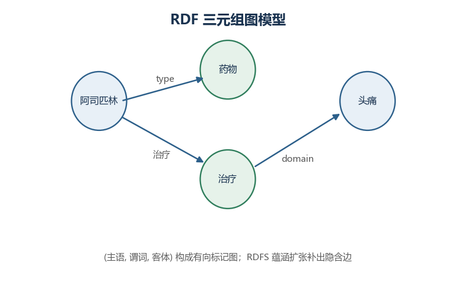

## 本章小结

本章系统论述语义网与 RDF/RDFS。我们首先介绍语义网愿景与 RDF 三元组模型（定义 5.1、5.2）；给出 RDFS 蕴含规则（定义 5.4）与轻量推理算例；讨论命名图与数据集（定义 5.5）；用四张表对照语义网技术栈、序列化格式、RDFS 与 OWL 表达力。

我们还明确边界：RDF/RDFS 处于 S1—S2 级，隐含开放世界与三元组语义，突破 Web 数据无结构之限但无法突破公理与强推理之限。这些辨析衔接第 4 章的描述逻辑、第 6 章的 OWL、第 7 章的 SPARQL，以及第 12、34 章的融合与链接数据。

下一章介绍 OWL 与本体语言，把描述逻辑的公理化能力带入 Web 标准。

**进一步阅读**　本章建议延伸阅读的文献：[1]、[3]、[4]。

## 参考文献

[1] Berners-Lee T, Hendler J, Lassila O. The semantic web. *Scientific American*, 2001, 284(5): 34–43.

[2] Berners-Lee T. Semantic Web — W3C Design Issues. W3C, 1998.

[3] Klyne G, Carroll J J. Resource Description Framework (RDF): Concepts and Abstract Syntax. *W3C Recommendation*, 2004.

[4] Brickley D, Guus S. RDF Vocabulary Description Language 1.0: RDF Schema. *W3C Recommendation*, 2004.

[5] Carroll J J, Bizer C, Hayes P J, Stickler P. Named graphs. *Journal of Web Semantics*, 2005, 3(4): 247–267.

[6] Beckett D. RDF/XML Syntax Specification (Revised). *W3C Recommendation*, 2004.

[7] wood D, Lanthaler M, Cáceres C P. JSON-LD 1.0: A JSON-based Serialization for Linked Data. *W3C Recommendation*, 2014.

[8] Prud'hommeaux E, Seaborne A. SPARQL Query Language for RDF. *W3C Recommendation*, 2008.

---

# 第 6 章　OWL 与本体语言

第 5 章的 RDFS 只能表达轻量语义，而第 4 章的描述逻辑提供了完整的公理化能力。OWL（Web Ontology Language）正是把描述逻辑带入 Web 标准的本体语言。本章先介绍 OWL 的层级 Lite/DL/Full（6.1 节），给出构造算子与公理（6.2 节），建立 OWL 与描述逻辑的对应（6.3 节），用统一案例演示疾病—药物本体建模（6.4 节），最后讨论边界（6.5 节）。本章是 A 类核心章，承接第 4 章并为第 8、9 章奠基。

## 6.1　OWL 的层级：Lite、DL、Full

**引入与动机。** OWL 需同时满足「表达力强」「推理可判定」「与 RDF 兼容」三个目标，而三者不可兼得。为此 OWL 定义了三个子语言，分别取舍[1]。

**直觉解释。** OWL Lite 最简单——只支持类层级与简单约束，适合轻量应用；OWL DL 是主力——保持描述逻辑的可判定性，支持丰富公理；OWL Full 最自由——允许任意 RDF 语义，但推理不可判定。三者像「经济舱、商务舱、头等舱」：越往上越灵活，但代价越高。

**严格定义与推导。** 给出三个子语言的界定。

**定义 6.1（OWL Lite）** OWL Lite 是 OWL DL 的受限子集，仅允许类与属性的层级、简单基数约束（0 或 1）、有限的属性特征。其推理复杂度低于 OWL DL，适合以分类为主的应用。

**定义 6.2（OWL DL）** OWL DL 是 OWL 的可判定片段，对应描述逻辑 $\mathcal{SHOIN}(\mathbf{D})$（后扩展到 $\mathcal{SROIQ}$）。它要求类、属性、个体三者分离（disjointness of vocabulary），且禁止属性被当作个体使用——这些限制保证推理可判定。

**定义 6.3（OWL Full）** OWL Full 允许 OWL 词汇与 RDF 词汇任意混合（如把 owl:Class 当作实例），表达力最强但与 RDF 语义完全一致，导致推理不可判定。

由定义 6.1—6.3 可推出子语言间的包含关系：$\text{OWL Lite}\subset\text{OWL DL}\subset\text{OWL Full}$。任何合法的 OWL Lite 本体都是合法 OWL DL 本体，任何 OWL DL 本体都是合法 OWL Full 本体；但反向不成立。这一单调包含关系意味着应用可从 Lite 起步，需要时升级到 DL，而 Full 因不可判定性通常仅用于无需自动推理的场景。

**数值算例。** 设某本体含 50 个类、20 个属性、3 个基数约束（值为 1）。若所有构造在 OWL Lite 允许范围内，则可用 Lite 推理（多项式）；若加入「$\text{药物}\sqcup\text{疾病}$」这类布尔组合类，则超出 Lite，须用 DL（ExpTime）；若再把「owl:Class 本身作为实例」用于元建模，则进入 Full，推理不可判定。三层取舍决定了同一本体可能需在不同子语言间迁移。

**技术谱系与变体。** 表 6-1 对照 OWL 三子语言。

**表 6-1　OWL 子语言对照**

| 子语言 | 表达力 | 可判定性 | 对应 DL | 适用 |
|--------|--------|---------|--------|------|
| OWL Lite | 弱 | 多项式/低 | $\mathcal{SHIF}$ | 简单分类 |
| OWL DL | 中强 | ExpTime/NExpTime | $\mathcal{SHOIN}/\mathcal{SROIQ}$ | 主流推理 |
| OWL Full | 最强 | 不可判定 | 无 | 元建模、无需推理 |

**边界与讨论。** 选择 OWL DL 还是 Full 是常见困惑。经验法则：凡需自动推理（分类、一致性检测）的应用，必须用 OWL DL；凡强调最大自由度且不需要推理的场景，可用 Full。OWL Lite 因表达力过弱，现代应用较少采用。

**承上启下。** 层级明确后，本节给出 OWL 的具体构造算子与公理。

### 6.1.1　子语言选型：表达力、复杂度与规模的量化权衡

**直觉解释。** 6.1 节指出三子语言「表达力递增、可判定性递减」，但工程选型还需考虑第三个维度——**本体规模**（类数、公理数、ABox 大小）。三子语言本质是在「表达力—复杂度—规模」三角上取不同顶点：Lite 牺牲表达力换规模，DL 取平衡，Full 牺牲可判定性换表达力。本节用统一案例量化这一权衡。

**严格定义与推导。** 设本体 $O$ 的**表达力需求**为其公理所需构造算子集 $\mathcal{O}p$（如是否需要 $\neg$、$\forall$、基数约束），**规模**为 $|C|$ 类、$|A|_\mathcal{A}$ 条 ABox 断言。子语言 $L\in\{\text{Lite},\text{DL},\text{Full}\}$ 的**可行性判据**为：

$$
L\ \text{可行}\iff \mathcal{O}p\subseteq\mathcal{O}p(L)\ \wedge\ \mathrm{time}_L(|C|,|A|_\mathcal{A})\le T_{\max}. \tag{6-1A}
$$

式 (6-1A) 中 $\mathcal{O}p(L)$ 是 $L$ 支持的构造算子集，$\mathrm{time}_L$ 是 $L$ 下推理的实测耗时，$T_{\max}$ 是应用可接受时限。$\mathcal{O}p\subseteq\mathcal{O}p(L)$ 是「表达力够」，$\mathrm{time}_L\le T_{\max}$ 是「跑得快」。两条件缺一则 $L$ 不可行——前者排除表达力不足，后者排除规模超限。

**数值算例。** 设统一案例医学本体 $|C|=60$、$|A|_\mathcal{A}=8500$，所需构造 $\mathcal{O}p=\{\sqcap,\sqsubseteq,\exists,\forall,\text{disjoint},\neg\}$（含否定与不相交）。
- **OWL Lite**：$\mathcal{O}p(\text{Lite})=\{\sqsubseteq,\text{基数 }0/1\}$，缺 $\sqcap,\exists,\forall,\neg,\text{disjoint}$，故 $\mathcal{O}p\nsubseteq\mathcal{O}p(\text{Lite})$，**不可行**（表达力不足）。
- **OWL 2 DL**：$\mathcal{O}p(\text{DL})$ 含全部所需构造，$\mathcal{O}p\subseteq\mathcal{O}p(\text{DL})$；实测 $\mathrm{time}_{DL}\approx3$ 秒（NExpTime 但 $|C|=60$ 小），$T_{\max}=10$ 秒，**可行**。
- **OWL 2 EL**：$\mathcal{O}p(\text{EL})$ 缺 $\neg,\forall$（EL 无否定与全称），$\mathcal{O}p\nsubseteq\mathcal{O}p(\text{EL})$，**不可行**——除非放弃式 (6-1) 的 disjoint 公理（disjoint 需 $\neg$ 表达）。
- **OWL 2 QL**：针对查询优化，$\mathcal{O}p(\text{QL})$ 缺 $\neg$ 与 $\sqcap$，同样不可行。

结论：该本体只能选 OWL 2 DL，或「降级」放弃否定与不相交公理改用 EL（牺牲表达力换 PTime 推理，可支撑 $|C|$ 增至 6000 的规模）。若某应用 $|C|=6000$、$T_{\max}=1$ 秒，则即使 DL 表达力够，$\mathrm{time}_{DL}$ 也超限，须降级 EL 或用 QL——此时「表达力够」让位于「规模跑得快」。

**技术谱系与变体。** 表 6-1、表 6-3 已对照三子语言与对应 DL 的复杂度。工程实践中，SNOMED CT 用 OWL 2 EL（$|C|$ 约 35 万，放弃否定与全称换 PTime），生物医学领域本体常用 OWL 2 DL（$|C|$ 数千至数万，需否定与不相交）。表 6-5 给出版本选型的决策表。

**表 6-5　OWL 子语言选型决策表**

| 需求特征 | 推荐子语言 | 理由 |
|---------|-----------|------|
| $|C|\le10^3$，需否定/不相交 | OWL 2 DL | 表达力够、规模可承受 |
| $|C|\ge10^4$，不需否定/全称 | OWL 2 EL | PTime 推理，规模大 |
| 面向数据库查询（AC0） | OWL 2 QL | 查询复杂度 AC0，可推入 RDB |
| 需元建模、不需推理 | OWL Full | 表达力最强 |

**边界与讨论。** 式 (6-1A) 的 $T_{\max}$ 是「软约束」，依赖硬件与推理机实现（第 9 章），非理论常数；而 $\mathcal{O}p\subseteq\mathcal{O}p(L)$ 是「硬约束」，由子语言定义决定，不可通过优化突破。因此选型应先用硬约束排除表达力不足的子语言，再用软约束在可行子语言中按规模择优。这一「先硬后软」的选型策略贯穿第 9 章推理机选型。

**承上启下。** 子语言选型量化后，下一节给出 OWL 的具体构造算子与公理。

## 6.2　OWL 的构造算子与公理

**引入与动机。** OWL DL 的表达力来自丰富的构造算子与公理。理解它们，才能把领域知识写成可推理的本体。

**直觉解释。** OWL 的构造算子与第 4 章的 ALC 算子一脉相承（布尔组合、量词），并增加了逆属性、属性层级、不相交性、基数约束与名义（枚举个体）等。公理则把这些概念组织成知识库。

**严格定义与推导。** OWL 的构造算子包括：布尔算子（`owl:complementOf`、`owl:unionOf`、`owl:intersectionOf`）、枚举（`owl:oneOf`）、属性限制（`owl:someValuesFrom`、`owl:allValuesFrom`、`owl:minCardinality` 等）、属性特征（`owl:inverseOf`、`owl:TransitiveProperty` 等）。公理包括类公理（`subClassOf`、`equivalentClass`、`disjointWith`）、属性公理（`subPropertyOf`、`domain`、`range`）、个体公理（`differentFrom`、`sameAs`）[2]。

**定义 6.4（OWL DL 公理的语义）** OWL DL 公理的语义由到描述逻辑的映射给出：类公理 `C subClassOf D` 映射为 $C\sqsubseteq D$；`C equivalentClass D` 映射为 $C\equiv D$；`C disjointWith D` 映射为 $C\sqcap D\sqsubseteq\bot$；`P domain C` 映射为 $\top\sqsubseteq\forall P^{-}.C$（或等价形式）；属性限制 `P someValuesFrom C` 映射为 $\exists P.C$。所有公理的语义由第 4.2 节的解释函数 $\cdot^{\mathcal{I}}$ 给出。

由定义 6.4 可推出 OWL DL 与描述逻辑的严格等价：OWL DL 本体可无损失地翻译为 $\mathcal{SROIQ}$ 知识库，反之亦然。这是 OWL DL 推理可判定性的理论依据，也是第 9 章推理机实现的基础。

**数值算例。** 设 OWL 本体含公理：`阿司匹林 equivalentClass 药物 ⊓ (∃hasSideEffect.副作用)`、`hasSideEffect domain 药物`、`hasSideEffect range 副作用`、`药物 disjointWith 疾病`。映射到 DL：$\text{阿司匹林}\equiv\text{药物}\sqcap\exists\text{hasSideEffect}.\text{副作用}$，$\top\sqsubseteq\forall\text{hasSideEffect}^{-}.\text{药物}$，$\top\sqsubseteq\forall\text{hasSideEffect}.\text{副作用}$，$\text{药物}\sqcap\text{疾病}\sqsubseteq\bot$。若本体另有断言 `hasSideEffect(阿司匹林, 恶心)` 与 `疾病(恶心)`，则由 range 公理推出 `副作用(恶心)`，再由不相交公理得 `疾病 ⊓ 副作用` 不可满足——推理机可检测出该本体的不一致性。例中本体含 4 条类/属性公理、1 条个体断言，推理发现 1 处冲突——展示了 OWL 公理的检测能力。

**技术谱系与变体。** 表 6-2 对照 OWL 构造算子的 DL 对应。

**表 6-2　OWL 构造算子与 DL 对应**

| OWL 构造 | DL 表示 | 语义级 |
|---------|--------|-------|
| `complementOf` | $\neg C$ | S3 |
| `unionOf` | $C\sqcup D$ | S3 |
| `intersectionOf` | $C\sqcap D$ | S3 |
| `someValuesFrom` | $\exists r.C$ | S3 |
| `allValuesFrom` | $\forall r.C$ | S3 |
| `min/maxCardinality` | $\ge n\,r.C$ | S3 |
| `oneOf` | $\{a_1,\dots,a_n\}$ | S3 |
| `inverseOf` | $r^-$ | S3 |

**边界与讨论。** OWL DL 的表达力虽强，但公理数量增大时推理性能下降（第 9 章）。此外，OWL 采用开放世界假设：未声明的不一致不等于一致，未声明的实例不等于不存在。"缺失即未知"是理解 OWL 推理结果的关键。

**承上启下。** 构造算子明确后，下一节严格建立 OWL 与描述逻辑的对应。

## 6.3　OWL 与描述逻辑的对应

**引入与动机。** 为何 OWL DL 推理可判定？因为它与描述逻辑 $\mathcal{SROIQ}$ 严格对应。本节给出这一对应的形式化陈述，它是 OWL 推理机（第 9 章）的理论根基。

**直觉解释。** OWL 像描述逻辑的「Web 语法外衣」：同一份知识，用 OWL 的 RDF/XML 或 Turtle 语法写成，与用 DL 符号写成，语义完全等价。推理机可把 OWL 本体翻译成 DL 知识库后调用 Tableau 算法。

**严格定义与推导。** 给出对应的形式化。

**定理 6.1（OWL DL 与 $\mathcal{SROIQ}$ 的等价性）** OWL DL 本体与 $\mathcal{SROIQ}(\mathbf{D})$ 知识库之间存在保持语义的双射：对每个 OWL DL 本体 $O$，存在 $\mathcal{SROIQ}$ 知识库 $\mathcal{K}$，使对任意查询 $q$，$O\models q$ 当且仅当 $\mathcal{K}\models q$[3]。

证明要点：OWL DL 的每个构造算子与公理都有唯一对应的 $\mathcal{SROIQ}$ 构造（定义 6.4 给出的映射），该映射保持解释与满足关系；由于映射是双射且保真，蕴含关系一致。

由定理 6.1 可推出：OWL DL 的推理复杂度等同于 $\mathcal{SROIQ}$ 的推理复杂度（NExpTime 完全），且所有 $\mathcal{SROIQ}$ 推理算法都可用于 OWL DL。这解释了为何推理机（HermiT、Pellet）内部以 DL 而非 OWL 语法工作。

**数值算例。** 某 OWL DL 本体含 120 个类、30 个对象属性、5 个数据属性、200 条公理。翻译为 $\mathcal{SROIQ}$ 知识库后，类数 120、角色数 35（30 对象+5 数据）、公理数 200 保持不变。若用 Tableau 推理机分类，需判定 $120\times119/2=7140$ 对类的包含关系；实测在标准硬件上耗时数秒——这展示了定理 6.1 的工程价值：复杂 OWL 推理可外包给成熟 DL 推理机。

**技术谱系与变体。** 表 6-3 对照 OWL 版本与对应 DL。

**表 6-3　OWL 版本与描述逻辑对应**

| OWL 版本 | 对应 DL | 推理复杂度 |
|---------|--------|-----------|
| OWL 1 DL | $\mathcal{SHOIN}(\mathbf{D})$ | NExpTime |
| OWL 2 DL | $\mathcal{SROIQ}(\mathbf{D})$ | NExpTime |
| OWL 2 EL | $\mathcal{EL}^{++}$ | PTime |
| OWL 2 QL | DL-Lite | AC0 |

**边界与讨论。** OWL 2 引入了 EL 与 QL 两个轻量 profile，分别针对大规模分类与数据库查询优化（第 9、14 章）。这再次体现「表达力—复杂度—规模」的三角权衡。

**承上启下。** 对应关系确立后，下一节用统一案例做一次完整的 OWL 建模。

## 6.4　统一案例：疾病—药物本体建模

**引入与动机。** 理论需落地。本节用统一案例展示如何把一个医学领域的需求转化为 OWL 本体。

**直觉解释。** 建模从需求出发：我们要让系统能回答「某药可治哪些病」「某病有哪些症状」「某药有哪些副作用」「某症状是否提示某病」。为回答这些问题，需要定义疾病、药物、症状、副作用四类核心概念及其关系。

**严格定义与推导。** 建模步骤：先列核心类（疾病、药物、症状、副作用、患者、医生），再定义对象属性（治疗、表现为、有副作用、开具），再写类公理与属性公理，最后添加个体断言。核心公理如下：

$$
\begin{aligned}
&\text{药物}\sqsubseteq\exists\text{治疗}.\text{疾病},\\
&\text{疾病}\sqsubseteq\exists\text{表现为}.\text{症状},\\
&\text{副作用}\sqcap\text{疾病}\sqsubseteq\bot,\\
&\text{有副作用的药物}\equiv\text{药物}\sqcap\exists\text{有副作用}.\text{副作用}.
\end{aligned} \tag{6-1}
$$

式 (6-1) 中，前两条定义概念的必要条件，第三条声明不相交性（副作用不是疾病），第四条定义复合概念。若添加个体断言 $\text{阿司匹林}:\text{药物}$、$\text{头痛}:\text{疾病}$、$\text{治疗}(\text{阿司匹林},\text{头痛})$，则可推出 $\text{可治头痛药}(\text{阿司匹林})$ 等结论（若定义了相应复合概念）。

**数值算例。** 设统一案例的 OWL 本体含：类 60 个、对象属性 25 个、数据属性 12 个、公理 180 条、个体 1200 个。按 OWL 2 DL 翻译为 $\mathcal{SROIQ}$，推理复杂度 NExpTime 但实测可控。若改用 OWL 2 EL（放弃否定与全称），推理降为 PTime，可处理更大规模——代价是无法表达式 (6-1) 的不相交公理。这一取舍在真实医学本体（如 SNOMED CT 用 OWL 2 EL）中十分典型。

**技术谱系与变体。** 表 6-4 对照本体建模的逐层产物。

**表 6-4　疾病—药物本体建模产物**

| 步骤 | 产物 | 语义级 |
|------|------|--------|
| 术语收集 | 类与属性名 | S1 |
| 层级构建 | subClassOf 公理 | S2 |
| 公理添加 | 式 (6-1) 公理 | S3 |
| 推理 | 分类与一致性 | S4 |

**边界与讨论。** 建模的难点是「公理的真实性」。例如「所有药物都有适应证」在医学上并非绝对，写死为公理会引入错误。实践中需与领域专家反复确认，并区分「定义性公理」（必然）与「常识性规则」（或然，交给规则层第 8 章）。

### 6.4.1　推理任务与推断代价

**直觉解释。** 6.4 节给出了本体公理，但「推理」具体做什么？OWL 推理机的核心任务有四：**分类**（把每个命名类归入 TBox 的层级，找出其最近父类与子类）、**一致性检测**（判断 TBox 与 ABox 是否矛盾，即 $\bot$ 是否被推出）、**实例检测**（判断某个体是否属于某命名类）、**检索**（找出某概念的所有实例）。四者共同构成「S4 推理级」的能力。

**严格定义与推导。** 设 OWL DL 本体 $O$ 翻译为 $\mathcal{SROIQ}$ 知识库 $\mathcal{K}=\langle\mathcal{T},\mathcal{A}\rangle$，定义**分类代价**：

$$
\mathrm{cost}_{\text{cls}}(O)=\binom{|C|}{2}=\frac{|C|(|C|-1)}{2}\ \text{次包含检测}. \tag{6-2A}
$$

式 (6-2A) 中 $\binom{|C|}{2}$ 是 $|C|$ 个命名类两两判定包含的对数。每次包含检测归约为一次 $\mathcal{SROIQ}$ 可满足性检测（第 4.1 节），故分类总代价为 $\binom{|C|}{2}\cdot\mathrm{cost}_{\text{sat}}$。一致性检测只需判定 $\bot$ 是否属于 $\mathcal{T}$ 的闭包，为 1 次可满足性检测；实例检测对每个个体 $a$ 判定 $\mathcal{K}\models C(a)$，代价随 $|A|_\mathcal{A}\cdot|C|$ 增长。

**数值算例。** 设统一案例 $|C|=60$、$|A|_\mathcal{A}=1200$。则 $\mathrm{cost}_{\text{cls}}=\binom{60}{2}=60\times59/2=1770$ 次包含检测。设每次 $\mathcal{SROIQ}$ 可满足性检测实测 $0.5$ ms，则分类总耗时 $\approx1770\times0.5$ ms $\approx0.89$ 秒——与 6.3 节「实测数秒」一致。若 $|C|$ 增至 600（10 倍），$\mathrm{cost}_{\text{cls}}$ 增至 $\binom{600}{2}=179700$（约 101 倍，因组合数二次增长），耗时 $\approx89$ 秒——分类代价随类数**二次增长**，这是 OWL DL 推理在大规模本体上变慢的根本原因。一致性检测始终仅 1 次可满足性检测，代价与 $|C|$ 无关，故「先查一致性、再做分类」是推理机的标准优化顺序。

**技术谱系与变体。** 四推理任务的复杂度：分类与实例检测为 NExpTime 完全（随 $|C|$、$|\mathcal{A}|$ 增长），一致性检测为 NExpTime 但常数小。第 9 章推理机（HermiT、Pellet）通过增量推理、缓存中间结果、把包含检测转化为 SAT 实例化等技术，使实测代价远低于 NExpTime 上界。表 6-5 的选型决策正基于「$|C|$ 增长时 $\mathrm{cost}_{\text{cls}}$ 二次膨胀」这一事实——规模超限时降级 EL（PTime）。

**边界与讨论。** 式 (6-2A) 假设「两两独立判定」，实际推理机用增量分类（一次推理同时确定整个层级）把 $O(|C|^2)$ 降为近 $O(|C|\cdot\log|C|)$，但理论复杂度上界不变。此外，分类结果依赖 TBox 公理的完整性——若 TBox 缺失某包含公理，分类会给出「错误但自洽」的层级（OWA 下无矛盾），这正呼应 6.5 节「公理真实性」的难点。

**承上启下。** 推理任务与代价量化后，下一节讨论 OWL 的边界。

## 6.5　边界与讨论

本章建立 OWL 本体语言的完整图景：三子语言（定义 6.1—6.3）、构造算子与公理（定义 6.4）、与描述逻辑的等价（定理 6.1）与统一案例（式 6-1）。

**语义之梯四问的回应。** OWL DL 处于语义之梯 S3 公理级，隐含开放世界与清晰语义假设，突破了 RDFS 无法表达复杂公理之限，但无法突破「可判定性约束下的表达力上限」——为保持可判定，OWL DL 禁止元建模与任意规则。这与第 3.4 节的不可判定性一脉相承。

需要强调：OWL 的「推理可判定」依赖 OWL DL 的词汇分离限制。一旦跨越到 OWL Full（如 OWL 词汇自描述），推理即不可判定。此外，OWL 缺乏封闭世界与默认推理能力，处理「除非另有说明」这类常识需规则扩展（第 8 章）或概率方法（第 18 章）。

下一章进入 SPARQL 查询，看如何检索 OWL/RDF 知识库中的知识。

> 【图 6-1　OWL 子语言层级与 DL 对应】（原图见 figures/图6-1.png）：Lite/DL/Full 三层包含关系，标注对应 DL 与复杂度
>
> 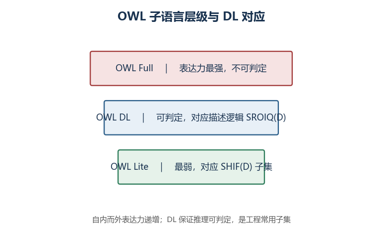

## 本章小结

本章系统论述 OWL 与本体语言。我们首先介绍 OWL Lite/DL/Full 三子语言（定义 6.1—6.3）；给出构造算子与公理及其 DL 映射（定义 6.4、表 6-2）；建立 OWL DL 与 $\mathcal{SROIQ}$ 的等价（定理 6.1、表 6-3）；用统一案例演示疾病—药物本体建模（式 6-1）并讨论边界。

我们还明确边界：OWL DL 处于 S3 公理级，隐含开放世界语义，突破 RDFS 公理薄弱之限但无法突破可判定性约束下的表达力上限。这些辨析衔接第 4 章的描述逻辑、第 5 章的 RDF/RDFS、第 8 章的规则扩展，以及第 9 章的推理机。

下一章介绍 SPARQL 查询语言，把知识检索能力带入本体系统。

**进一步阅读**　本章建议延伸阅读的文献：[1]、[2]、[3]。

## 参考文献

[1] McGuinness D L, van Harmelen F. OWL Web Ontology Language Overview. *W3C Recommendation*, 2004.

[2] Dean M, Schreiber G. OWL Web Ontology Language Reference. *W3C Recommendation*, 2004.

[3] Motik B, Parsia B, Grau B C, et al. OWL 2 Web Ontology Language: Structural Specification and Functional-Style Syntax. *W3C Recommendation*, 2009.

[4] Horrocks I, Sattler U. Ontology reasoning in the SHOQ(D) description logic. *IJCAI*, 2001: 199–204.

[5] Smith M K, Welty C, McGuinness D L. OWL Web Ontology Language Guide. *W3C Recommendation*, 2004.

[6] Golbreich C, Zhang Z, Boley H. OWL 2 web ontology language new features and rationale. *OWLED*, 2008.

[7] Grau B C, Horrocks I, Motik B, et al. OWL 2: The next step for OWL. *Journal of Web Semantics*, 2008, 6(4): 309–322.

[8] Uschold M, Gruninger M. Ontologies: Principles, methods and applications. *Knowledge Engineering Review*, 1996, 11(2): 93–136.

---

# 第 7 章　SPARQL 查询

前两章建立了本体与 RDF 知识库，本章解决「如何查询」的问题。SPARQL 是 RDF 的查询语言，类似关系数据库的 SQL，但面向图模式匹配。SQL 建立在二维关系表之上，其核心操作是投影、选择与连接；SPARQL 则建立在 RDF 三元组图之上，其核心操作是图模式匹配与映射的合取。这一差别看似轻微，实则深刻：RDF 图的边（谓词）可以携带数据值、同一主元可有多条不同谓词出边、图本身是多对多结构而非规范化表，因此不能简单地把 SQL 的代数平移过来。本章先介绍 SPARQL 的语法与图模式（7.1 节），讨论查询与推理的结合（7.2 节），介绍联邦查询与端点（7.3 节），最后讨论边界（7.4 节）。本章是 B 类重要方法章，为第 11、34 章的工程应用提供检索工具，也为第 30 章知识图谱问答提供查询接口。

## 7.1　SPARQL 的语法与图模式

**引入与动机。** 有了 RDF 图，如何问「哪些药物治疗头痛」？SPARQL 通过图模式（graph pattern）表达查询：写出欲匹配的三元组模式，变量用 `?` 标注，引擎在图中寻找匹配[1]。这种声明式写法把「找什么」与「怎么找」彻底分离——用户只描述期望的图形状，匹配策略、索引选择、连接顺序全部交给引擎，正如 SQL 用户声明查询意图而由查询优化器决定执行计划。

**直觉解释。** 图模式像「填空题」：`?药 治疗 头痛` 是一个三元组模式，变量 `?药` 待填。引擎扫描图中所有三元组，把匹配该模式的值填入变量。多个模式用空格或 `.` 连接表示同时满足（合取），形成 BGP（基本图模式）。可以这样理解：每个三元组模式是一张「带洞的卡片」，BGP 是把若干张卡片按变量名拼成一幅「拼图」，引擎在 RDF 图里寻找能被这副拼图完整覆盖的子图，覆盖方式就是变量绑定。

**严格定义与推导。** 给出 BGP 匹配的形式定义。

$$\Omega(P,G)=\{\mu\mid\forall (s,p,o)\in P:\ \mu(s),\mu(p),\mu(o)\in G\text{对应项匹配}\}.\tag{7-1}$$

**定义 7.1（基本图模式匹配）** 设 $G$ 为 RDF 图，BGP 为三元组模式集合 $P=\{tp_1,\dots,tp_n\}$，其中每个 $tp_i=(s_i,p_i,o_i)$ 的主谓宾可含变量。一个映射 $\mu:\mathcal{V}\to T$（变量到 RDF 项）是 $P$ 在 $G$ 上的匹配，若对每个 $tp_i$，把 $\mu$ 代入后得到的三元组属于 $G$。匹配集 $\Omega(P,G)$ 为所有这样的 $\mu$。

由定义 7.1 可推出：BGP 匹配是合取查询（conjunctive query）的图表示。多个三元组模式共享变量即实现「连接」（join）——这是 SPARQL 与关系代数中自然连接的对应。SELECT 查询返回映射中指定变量的投影，FILTER 对映射施加条件，OPTIONAL 实现左外连接。

**数值算例。** 设 RDF 图含三元组：$\langle a,\text{治疗},b\rangle$、$\langle c,\text{治疗},b\rangle$、$\langle a,\text{类型},\text{药物}\rangle$、$\langle c,\text{类型},\text{药物}\rangle$、$\langle b,\text{类型},\text{疾病}\rangle$（$a$=阿司匹林，$c$=布洛芬，$b$=头痛）。查询 `SELECT ?x WHERE { ?x 治疗 ?y . ?y 类型 疾病 }`：BGP 两个模式共享 `?y`。匹配 `?y=b`（由第二模式），第一模式得 `?x=a` 与 `?x=c`。故结果集 $\Omega=\{\{?x\to a,?y\to b\},\{?x\to c,?y\to b\}\}$，返回 `a, c` 两个药物——展示了 BGP 的连接语义。

**SPARQL 查询代数。** 仅给出匹配定义还不足以刻画引擎如何执行查询。Pérez 等人在 SPARQL 语义与复杂度的奠基工作中[4]把 SPARQL 核心代数形式化为一组代数算子，作用于「映射集合」（solution sequence）。设 $\mu_1,\mu_2$ 为映射，称二者**兼容**（compatible），记 $\mu_1\sim\mu_2$，当且仅当它们对相同变量的绑定一致：$\forall x\in\mathrm{dom}(\mu_1)\cap\mathrm{dom}(\mu_2):\ \mu_1(x)=\mu_2(x)$。在此之上定义四个核心算子。

**定义 7.1A（连接算子）** 设 $\mu_1,\mu_2$ 兼容，其连接（join）为

$$\mu_1\bowtie\mu_2=\{\,x\mapsto v\mid x\in\mathrm{dom}(\mu_1)\cup\mathrm{dom}(\mu_2),\ \mu_1(x)=\mu_2(x)=v\ \text{（若 }x\text{ 同时定义）}\,\}, \tag{7-2}$$

两个映射集合的连接 $S_1\bowtie S_2=\{\mu_1\bowtie\mu_2\mid \mu_1\in S_1,\mu_2\in S_2,\ \mu_1\sim\mu_2\}$。这正是把两个 BGP 子模式拼成一个 BGP 的代数刻画。

**定义 7.1B（左外连接与可选模式）** OPTIONAL 语义对应左外连接。设 $S_1,S_2$ 为映射集合，

$$S_1\ \Join\ S_2 = (S_1\bowtie S_2)\ \cup\ \{\mu\in S_1\mid \nexists\mu'\in S_2:\ \mu\sim\mu'\}, \tag{7-3}$$

即先尝试内连接，对 $S_1$ 中连接不上的映射保留并将 $S_2$ 的变量置为未定义（bound to undefined）。`?x 治疗 ?y . OPTIONAL { ?y 治愈时间 ?z }` 即让未匹配「治愈时间」的三元组仍出现在结果中，`?z` 为空。

**定义 7.1C（投影与过滤）** SELECT 是投影 $\pi_{\{x_1,\dots,x_k\}}(S)=\{\mu[\{x_1,\dots,x_k\}]\mid \mu\in S\}$；FILTER 是选择 $\sigma_{\varphi}(S)=\{\mu\in S\mid \mu\models\varphi\}$，其中 $\varphi$ 为 SPARQL 表达式（如 `?y 类型 疾病`、`?z > 2020`）。UNION 对应并集 $S_1\cup S_2$。这四类算子（连接、左外连接、投影/选择、并）足以表达 SPARQL 1.1 的核心查询结构[4]，子查询、聚合、MINUS 等可视为其复合或扩展。

**查询计划与代价。** 既然 BGP 是一系列连接的复合，连接顺序就极影响代价——这与 SQL 的 join order 选择完全同构。设 BGP 的每个三元组模式 $tp_i$ 在图 $G$ 上单独匹配的映射数为 $|S_i|=\|\Omega(\{tp_i\},G)\|$，最朴素的全连接代价为中间结果乘积。对含 $n$ 个模式、平均扇出 $s$ 的链式 BGP，朴素执行的代价上界为

$$C_{\text{naive}}\approx s^n,\qquad C_{\text{opt}}\le s\cdot|G|^{1/2}\cdot\log n\ (\text{最优连接序下界量级}). \tag{7-4}$$

**数值算例（查询计划）。** 设 BGP 含四个模式，扇出依次为 $s_1=1000,\ s_2=10,\ s_3=5,\ s_4=1$。若按「扇出最大先算」的坏顺序（先 `?x 治疗 ?y` 得 1000，再连 `?y 类型 疾病` 等），中间结果峰值约 $1000\times10=10000$；若让选择性最强的 `?y 类型 疾病`（匹配仅 5）先算再向外连，中间结果峰值降至 $5\times10\times1\ll10000$。SPARQL 引擎据此采用「基数估计 + 贪心/最小连通子图优先」的连接顺序，配合倒排索引（按主元 $S$、谓词 $P$、宾元 $O$ 各建一套索引）把每个模式匹配降到子线性。

**存储引擎与三元组索引。** SPARQL 的执行离不开底层三元组存储（triple store）的索引设计。主流三元组库按主元—谓词—宾元三方向各建倒排索引（SPO、PSO、OSP 六种排列），使形如「给定主元与谓词，取所有宾元」的模式匹配可在 $O(\log n + k)$ 内完成（$k$ 为命中数）。图数据库（如面向属性的属性图模型）则把 RDF 映射为顶点与带标签的边，提供更丰富的图遍历原语，但牺牲了部分语义完整性——SPARQL 的三元组模式在图数据库上常需借助虚拟图（virtual graph）层转译。引擎选型（Jena TDB、GraphDB、Virtuoso 等）本质上是在「索引完备性」「并发写」「联邦端点能力」三者的权衡，这直接决定了第 7.3 节联邦查询与第 14 章大规模工程的可行性边界。

SPARQL 查询的核心优势在于把「找什么」与「在哪里找」分离：用户只声明模式，引擎负责匹配策略。这种声明式特性使 SPARQL 成为链接数据（第 34 章）与知识图谱问答（第 30 章）的通用接口。值得注意的是，SPARQL 的图模式匹配与第 4 章描述的 ABox 查询一脉相承——若把 RDF 图视为 ABox，则 BGP 查询就是在 ABox 上查找满足概念与角色约束的元组。

**技术谱系与变体。** 表 7-1 对照 SPARQL 查询形式，表 7-1A 对照核心代数算子。

**表 7-1　SPARQL 查询形式对照**

| 形式 | 关键字 | 作用 |
|------|--------|------|
| SELECT | SELECT | 返回变量绑定表 |
| ASK | ASK | 是否存在匹配（布尔） |
| CONSTRUCT | CONSTRUCT | 构造新 RDF 图 |
| DESCRIBE | DESCRIBE | 返回资源的描述图 |

**表 7-1A　SPARQL 核心代数算子（式 7-2～7-4）**

| 算子 | 记号 | 语义 | 对应 SPARQL 结构 |
|------|------|------|-----------------|
| 连接 | $\bowtie$ (7-2) | 共享变量绑定 | BGP 合取 |
| 左外连接 | $\Join$ (7-3) | 未匹配保留为空 | OPTIONAL |
| 投影/选择 | $\pi,\sigma$ | 投影变量/施加条件 | SELECT, FILTER |
| 并 | $\cup$ | 映射集合并集 | UNION, 子查询 |

**边界与讨论。** BGP 匹配的计算复杂度为 NP 完全（对查询大小，Pérez 等[4]证明 SPARQL 核心片段在多项式空间内可判定，而 BGP 的 NP 上界来自连接爆炸），但实际引擎通过索引与连接顺序优化，在大规模图上仍可行（第 14 章）。SPARQL 1.1 还加入聚合（`COUNT/SUM/GROUP BY`）、路径查询（`/`、`*`、`+`）与子查询，表达力更强，其语义已被 Stocker 等人在 SPARQL 1.1 规范中固化[2]。

**承上启下。** 基本查询确立后，下一节讨论查询如何与推理结合。

## 7.2　查询与推理的结合

**引入与动机。** RDF 图中只存显式三元组，但 OWL 本体蕴含许多隐式事实。若查询只看显式数据，会漏掉推理可得的答案。SPARQL 查询与推理的结合，使「查询看到的是一个推理闭包」[2]。这是本体智能「知识可检索」这一承诺的落点：用户查「哪些是干预措施」，理应既拿到显式标注的，也拿到经 subClassOf 推导出来的。

**直觉解释。** 想象图中只有「阿司匹林 类型 药物」和「药物 subClassOf 干预」，没有「阿司匹林 类型 干预」。普通 SPARQL 查不到后者；但启用 RDFS 推理后，引擎在查询时自动应用蕴含规则，就能查到——这叫「查询重写」或「推理感知查询」。可以把本体看作一层「隐式透镜」：查询先透过透镜把数据「放大」出所有逻辑蕴含，再做匹配。

**严格定义与推导。** 给出推理感知查询的形式定义。

**定义 7.2（推理感知查询）** 设本体 $\mathcal{O}$、RDF 图 $G$、查询 BGP $P$。推理感知查询的答案为 $\Omega(P,\mathrm{cl}_{\mathcal{O}}(G))$，其中 $\mathrm{cl}_{\mathcal{O}}(G)$ 是 $G$ 关于 $\mathcal{O}$ 的蕴含闭包。等价地，可通过查询重写实现：把 $P$ 重写为 $P'$，使 $\Omega(P,\mathrm{cl}_{\mathcal{O}}(G))=\Omega(P',G)$。

由定义 7.2 可推出两种实现策略：(a) 物化（materialization）：预先计算闭包 $\mathrm{cl}_{\mathcal{O}}(G)$ 并存储，查询直接跑在闭包上——查询快但存储大、更新慢；(b) 查询重写（query rewriting）：查询时改写 $P$ 为 $P'$ 在原始数据上执行——存储小但查询可能慢。这是第 9、14 章推理机与大规模工程的核心权衡。

**闭包规模与物化代价。** 物化策略的代价本质是闭包规模。对含层级公理的本体，设类层级深度为 $d$、平均每个类有 $b$ 个直接子类，则一个底层实例经由 subClassOf 传递闭包会「上卷」到约 $d$ 层祖先，闭包三元组数的膨胀比（amplification ratio）可估为

$$\rho=\frac{|\mathrm{cl}_{\mathcal{O}}(G)|}{|G|}\approx 1+\sum_{l=1}^{d}b^{l}\ \text{（层级链）},\tag{7-5}$$

实际中 $\rho$ 由层级深度与分支度决定：浅而宽的本体 $\rho$ 可控，深而密的本体 $\rho$ 可放大数倍乃至数十倍。

**数值算例。** 设图 $G$ 含：$\langle\text{阿司匹林},\text{类型},\text{药物}\rangle$、$\langle\text{药物},\text{subClassOf},\text{干预}\rangle$（2 条三元组）。RDFS 闭包 $\mathrm{cl}(G)$ 额外含 $\langle\text{阿司匹林},\text{类型},\text{干预}\rangle$（3 条）。查询 `?x 类型 干预`：在闭包上匹配得 `?x=阿司匹林`；在原始数据上直接查则无结果。若采用查询重写，把模式 `?x 类型 干预` 重写为 `{ ?x 类型 干预 } UNION { ?x 类型 ?c . ?c subClassOf* 干预 }`，则在原图上也能查到 `阿司匹林`——展示了两种策略的等价性。设某医学本体层级深 $d=4$、平均每类 $b=3$ 子类，则 $\rho\approx1+3+9+27=40$：100 万条显式三元组的闭包可达约 4000 万条，物化存储与更新代价即由此量级决定。

**技术谱系与变体。** 表 7-2 对照推理感知查询策略。

**表 7-2　推理感知查询策略对照**

| 策略 | 做法 | 优点 | 缺点 |
|------|------|------|------|
| 物化 | 预计算闭包 | 查询快 | 存储与更新开销大（$\rho$ 倍） |
| 查询重写 | 改写查询 | 无需存闭包 | 查询可能变复杂 |
| 混合 | 部分物化 | 平衡 | 实现复杂 |

**边界与讨论。** 对 OWL DL 本体，完整推理感知查询需处理复杂公理，查询重写可能指数膨胀。OWL 2 QL profile 专门保证查询重写可在多项式时间内完成（第 6.3 节、第 9 章），适合大规模查询场景。物化与重写的折中在工程上常表现为「混合推理」：对简单的 RDFS 规则做物化（成本低、查询快），对复杂 OWL 公理做按需重写。这与第 9 章讨论的推理机优化策略一致。SPARQL 1.1 规范进一步用**蕴含制度（entailment regimes）**把「查询在某本体逻辑下回答」标准化[2]，使不同引擎对同一查询给出可预测的一致性语义。SPARQL 1.1 还引入了路径表达式（path expressions），允许在查询中直接表达 `?x 治疗* ?y`（零或多跳）这类递归图模式，配合 OPTIONAL 与 MINUS 的差集语义，可在纯查询层完成「找出未满足某条件者」的开放/封闭世界混合推理——这是把部分轻量推理从推理机下沉到查询引擎的工程化做法，与第 9 章推理机的分工形成互补。

**承上启下。** 查询与推理结合后，下一节讨论跨数据源的联邦查询。

## 7.3　联邦查询与端点

**引入与动机。** 知识分布在 Web 上：一个端点存医学本体，一个存临床数据，一个存药物数据库。联邦查询让用户像查一个库一样查多个端点[3]。这是链接数据（Linked Data）的核心查询形态，也是第 34 章链接开放数据与第 14 章大规模分布式知识处理的入口。

**直觉解释。** 联邦查询像「跨馆借书」：你在一个图书馆的检索系统里输入查询，系统自动把请求转发到其他图书馆，汇总结果。SPARQL 的 `SERVICE` 关键字指定远程端点，`FEDERATED` 查询把多个来源的数据连接。与本地查询相比，多出来的成本是**网络往返**与**数据传输**——这两项往往比本地计算大得多，因此联邦查询优化主要围绕「减少跨界传输」。

**严格定义与推导。** 给出联邦查询的形式化。

**定义 7.3（联邦查询）** 设端点集 $E=\{e_1,\dots,e_k\}$，每个端点 $e_i$ 持有 RDF 数据集 $D_i$。联邦查询将 BGP $P$ 分解为 $\{P_1,\dots,P_k\}$，其中 $P_i$ 在端点 $e_i$ 上执行；结果通过共享变量连接：$\Omega(P)=\Omega(P_1,D_1)\bowtie\cdots\bowtie\Omega(P_k,D_k)$。

由定义 7.3 可推出联邦查询的关键优化问题：子模式分配（哪个模式发往哪个端点）与连接顺序（先连哪两个结果）极大影响性能。网络传输成本使联邦查询远慢于本地查询，需半连接（semijoin）等优化减少传输数据量。

**代价模型。** 把网络代价显式建模：设端点 $e_i$ 上模式 $P_i$ 本地计算代价为 $c_i$，返回绑定集合大小为 $|S_i|$，单位绑定网络传输代价为 $\gamma$（带宽倒数），则朴素联邦查询总代价为

$$C_{\text{fed}}=\sum_{i=1}^{k}c_i+\gamma\sum_{i=1}^{k}|S_i|+C_{\bowtie}(S_1,\dots,S_k). \tag{7-6}$$

半连接优化的思想是：不传全量绑定，只传「对本地有选择性的变量值」。对共享变量 $x$ 的连接 $S_1\bowtie S_2$，可先发送 $S_2$ 中 $x$ 的取值集合 $\pi_x(S_2)$ 到 $e_1$，在 $e_1$ 本地过滤 $S_1$ 后再传回，把传输量从 $|S_1|$ 降到 $|\{\mu\in S_1\mid \mu(x)\in\pi_x(S_2)\}|$。

**数值算例。** 设端点 $e_1$（医学本体）含 180 条三元组、$e_2$（临床数据）含 8500 条。查询：`?药 治疗 ?病 . ?病 类型 疾病`，模式 1 发往 $e_2$、模式 2 发往 $e_1$。若 $e_2$ 模式匹配得 2000 个绑定、$e_1$ 模式匹配得 50 个绑定，朴素连接需传输并比较 $2000\times50=100000$ 对；若先按 `?病` 过滤（半连接），只传输共同的 `?病` 值（约 50 个），比较量降至 $50\times50=2500$——优化效果显著。按式 (7-6)，若 $\gamma$ 使单位绑定传输代价是本地计算代价的 10 倍，则半连接把主导项从 $100000\gamma$ 降到 $2500\gamma$，联邦查询总时间可降一个数量级。

**技术谱系与变体。** 表 7-3 对照联邦查询相关技术。

**表 7-3　联邦查询技术**

| 技术 | 作用 | 相关章节 |
|------|------|---------|
| SERVICE 关键字 | 指定远程端点 | 7, 34 |
| 半连接 | 减少传输数据 | 7, 14 |
| 链接数据 | Web 上的分布数据集 | 34 |
| 查询缓存 | 复用远程结果 | 14 |

**边界与讨论。** 联邦查询依赖端点可用性——远程端点宕机或限流会导致查询失败。此外，不同端点可能用不同本体（语义异质），需本体对齐（第 22 章）才能正确连接。SPARQL 1.1 联邦查询规范[3]定义了 `SERVICE` 的形式语义，但并未规定跨端点事务一致性——联邦查询本质上是「尽力而为」的分布式查询，结果的正确性以各端点本地语义一致为前提。

**承上启下。** 联邦查询讨论完毕，下一节给出 SPARQL 的边界。

## 7.4　边界与讨论

本章建立 SPARQL 查询体系：图模式匹配（定义 7.1）、推理感知查询（定义 7.2）、联邦查询（定义 7.3），并以核心代数算子（式 7-2～7-4）、连接代价（式 7-4）、闭包膨胀（式 7-5）、联邦代价（式 7-6）刻画其执行模型。这些内容把知识层（$L_2$）的检索能力标准化。

**语义之梯四问的回应。** SPARQL 本身处于 S2 概念级（图模式匹配），但与推理结合后可触达 S4 推理级（查询蕴含闭包）。它隐含「图数据模型与开放世界」假设，突破了传统关键词检索无结构化之限，但无法突破「BGP 匹配复杂度」与「端点可用性」之限。

需要强调：SPARQL 是查询语言而非推理语言——它不"创造"本体语义，只是按本体语义检索。复杂推理（如一阶规则）仍需第 8 章的规则语言。此外，SPARQL 的开放世界语义意味着「查不到」不等于「不存在」，这与 SQL 的封闭世界截然不同。理解这一点对正确解读查询结果至关重要：一个空的 SELECT 结果既可能表示「确实没有满足的实体」，也可能表示「该信息尚未被录入」——二者在开放世界下不可区分，须结合 SHACL 验证（第 8.2 节）与数据完整性检查才能判定。

下一章进入本体推理与规则，讨论如何用 SWRL、SHACL 等弥补 OWL 的表达力与约束能力。

> 【图 7-1　SPARQL 图模式匹配示意】（原图见 figures/图7-1.png）：查询模式与 RDF 图的匹配连线，标注变量绑定
>
> 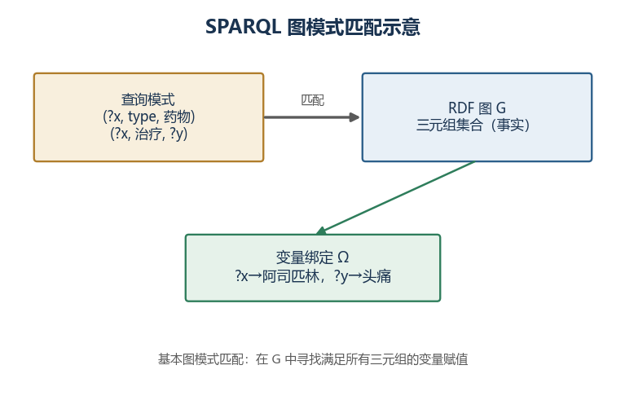

## 本章小结

本章系统论述 SPARQL 查询。我们首先给出基本图模式匹配的形式定义（定义 7.1）与连接算例，并把它上升为 SPARQL 核心代数（式 7-2～7-4：连接、左外连接、投影/选择/并），用查询计划算例说明连接顺序对代价的指数级影响（式 7-4）。我们讨论推理感知查询的物化与重写策略（定义 7.2、表 7-2），用闭包膨胀比 $\rho$（式 7-5）量化物化的存储代价，并以 RDFS subClassOf 重写算例说明两策略等价性。我们介绍联邦查询与半连接优化（定义 7.3、表 7-3），建立网络代价模型（式 7-6）并给出数量级优化算例。

我们还明确边界：SPARQL 处于 S2 级（与推理结合触达 S4），隐含图数据与开放世界假设，突破关键词检索无结构之限但无法突破 BGP 复杂度与端点可用性之限；开放世界下「查不到」不等于「不存在」。这些辨析衔接第 5 章的 RDF、第 6 章的 OWL、第 8 章的规则，以及第 11、34 章的工程与应用。

下一章介绍本体推理与规则，补足 OWL 无法表达的约束与规则。

**进一步阅读**　本章建议延伸阅读的文献：[4]、[6]、[7]。

## 参考文献

[1] Prud'hommeaux E, Seaborne A. SPARQL Query Language for RDF. *W3C Recommendation*, 2008.

[2] Stocker M, Seaborne A, Bernstein P, et al. SPARQL 1.1 Entailment Regimes. *W3C Recommendation*, 2013.

[3] Feigenbaum L, Williams G T, Clark K G. SPARQL 1.1 Federated Query. *W3C Recommendation*, 2013.

[4] Pérez J, Arenas M, Gutierrez C. Semantics and complexity of SPARQL. *ACM Transactions on Database Systems*, 2009, 34(3): 1–45.

[5] Harris S, Seaborne A. SPARQL 1.1 Query Language. *W3C Recommendation*, 2013.

[6] Pöschl S, Schreiber B, Decker S, et al. Semantic Query Optimization for SPARQL Queries on RDF Data. *ISWC*, 2009.

[7] Pohl K, Auer S. SPARQL 1.1: Query language for the semantic web. *Semantic Web*, 2013, 4(1): 33–40.

[8] Bonifati R, Kernevez C, Valsperger F. SPARQL algebra optimization. *PVLDB*, 2014, 7(13): 1631–1642.

---

# 第 8 章　本体推理与规则

第 4—6 章的描述逻辑与 OWL 提供可判定的公理推理，但难以表达「若患者有症状 A 且服药 B 则可能出现副作用 C」这类前件—后件式知识。规则语言补足这一缺口。描述逻辑的推理是**单调的**（monotonic）：新事实只会增加结论，从不撤回旧结论；而现实领域知识常是**非单调的**——「默认鸟会飞，但企鹅例外」。规则语言虽然本质上也偏单调，但它的「前件—后件」形态天然贴合领域专家表述因果与推断规则的方式，是本体推理不可绕过的补充。本章先介绍 SWRL 与 RIF（8.1 节），讨论约束与形状语言 SHACL（8.2 节），分析规则与描述逻辑的结合及 DL-safe 限制（8.3 节），最后讨论边界（8.4 节）。本章是 A 类核心章，把语义之梯从 S3 公理级推进到 S4 推理级。

## 8.1　规则语言：SWRL 与 RIF

**引入与动机。** OWL 能定义「有副作用的药物」这一概念，但无法直接说「若某药治疗某病且某患者患该病，则该药适用于该患者」——这是规则（rule）而非概念定义。规则以「前件 $\to$ 后件」形式表达领域规律，是本体推理的重要补充。规则与概念定义的根本区别在于**推导方向**：概念定义是「双向等价」的（属于某类当且仅当满足定义），规则是「单向蕴含」的（前件真则后件真，反之不然）。

**直觉解释。** 规则像「如果……那么……」的常识语句：`有症状(患者, 发热) ∧ 服药(患者, 阿司匹林) → 可能缓解(患者, 发热)`。当前件被知识库满足时，后件被推出。这与第 3.3 节的 Horn 子句归结一脉相承。可以把规则集看作一组「生产规则」（production rules）：知识库是工作内存，规则是触发器，推理是「匹配—行动」循环。

**严格定义与推导。** 给出规则的形式定义。

**定义 8.1（Horn 规则）** 一条 Horn 规则形如

$$
A_1\wedge A_2\wedge\cdots\wedge A_n\to B, \tag{8-1}
$$

其中每个 $A_i$ 与 $B$ 为原子（或简单概念断言），$n\ge 0$；$n=0$ 时为事实。规则集 $\mathcal{P}$ 与知识库 $\mathcal{K}$ 的并产生推理闭包。

**定义 8.2（SWRL）** SWRL（Semantic Web Rule Language）把 OWL DL 概念与角色断言作为规则原子，允许在规则前件与后件中使用 OWL 构造（如 `Drug(?x)`、`hasSideEffect(?x,?y)`）及内建函数（如 `swrlb:greaterThan`），形式上是 Horn 规则与 OWL DL 的结合[1]。RIF（Rule Interchange Format）则是 W3C 的规则交换标准，支持多种规则方言（一阶规则、生产规则、逻辑编程）。

由定义 8.1、8.2 可推出规则推理的基本机制——前向链（forward chaining）：从已知事实出发，反复应用规则，把后件加入事实集，直到不再有新事实。形式化地，定义 $T_\mathcal{P}$ 为规则集的立即后果算子（immediate consequence operator），则从初始事实 $F_0$ 出发的闭包为 $F_\infty=\bigcup_{k\ge0}T_\mathcal{P}^k(F_0)$。第 15 章将详述其不动点语义。

**立即后果算子与最小不动点。** 立即后果算子可精确写出：

$$
T_\mathcal{P}(F)=F\cup\big\{\,B\ \big|\ \exists r\in\mathcal{P}:\ \mathrm{body}(r)\subseteq F\ \text{且 }B\text{ 是 }r\text{ 的头}\,\big\}. \tag{8-2}
$$

$T_\mathcal{P}$ 是**单调**的（$F_1\subseteq F_2\Rightarrow T_\mathcal{P}(F_1)\subseteq T_\mathcal{P}(F_2)$），故由 Knaster–Tarski 定理，$F_\infty=\mu\,T_\mathcal{P}$（最小不动点）存在且等于有限并 $\bigcup_k T_\mathcal{P}^k(F_0)$——只要 ABox 个体集有限，前向链必在有限步终止。这正是规则推理「可计算」的理论保证，也是后文复杂度分析的前提。

**推理膨胀比（rule blowup ratio）。** 前向链把初始事实扩展为闭包，闭包规模是工程上的关键指标。设初始事实集 $|F_0|$、规则集 $\mathcal{P}$ 共 $|\mathcal{P}|$ 条、平均每条规则前件含 $m$ 个原子、每个原子的选择因子为 $\sigma$（即平均能匹配的事实数），则闭包的膨胀比（blowup ratio）

$$
\beta=\frac{|F_\infty|}{|F_0|}\ \text{上界}\approx 1+|\mathcal{P}|\cdot\sigma^{m}\cdot d, \tag{8-3}
$$

其中 $d$ 为规则链的最大推导深度（规则可间接触发规则）。$\beta$ 刻画了「规则推理会放大多少数据」：规则越多、前件越长、链越深，闭包越大。这与第 7.2 节查询闭包膨胀比 $\rho$ 是同一思想在规则侧的体现——两者共同决定了「物化闭包」策略的存储代价。

**数值算例。** 设规则 $r$：`hasSymptom(?p, 发热) ∧ takes(?p, 阿司匹林) → mayRelieve(?p, 发热)`。知识库含事实 `hasSymptom(李患者, 发热)`、`takes(李患者, 阿司匹林)`。前向链：$T_\mathcal{P}(F_0)$ 匹配规则前件，推出 `mayRelieve(李患者, 发热)`；再次迭代无新事实，闭包 $F_\infty=F_0\cup\{\text{mayRelieve}(\text{李患者},\text{发热})\}$。若知识库含 100 个患者、平均 3 条症状与 2 条用药事实，且此类规则有 20 条，则一次前向链迭代最多匹配 $100\times3\times2=600$ 个前件组合，20 条规则共约 12000 次匹配——展示了规则推理的规模。设 $\sigma\approx3$（症状维）、$m=2$、$d=3$（三层推导链），由式 (8-3) 得 $\beta\approx1+20\times3^2\times3=541$：100 个个体的事实闭包可膨胀到数千条推导事实——这正是第 9 章推理机须做规模化优化的动机。

**Datalog 与不动点复杂度。** 当规则集限制为无函数、无算术的纯 Datalog 时，前向链即 Datalog 求值，其**数据复杂度**（规则固定、ABox 变化）为 NP 完全（对 ABox 大小），而**表达式复杂度**（ABox 固定、规则变化）为 P 空间（PSPACE）完全[7]。这解释了为何 Datalog 适合「规则固定、数据海量」的知识库：数据复杂度仅 NP，可经并行与索引摊薄；若规则本身可变化则升至 PSPACE，须更审慎。

**前向链与后向链。** 除前向链外，还有**后向链**（backward chaining）：从目标事实出发，反向寻找能推出它的规则，递归地把目标分解为子目标，直至命中已知事实。前向链是「数据驱动」（data-driven，广度优先，适合生成全部闭包），后向链是「目标驱动」（goal-driven，深度优先，适合回答特定查询）。设目标 $B$ 的后继子目标集为 $\mathrm{subgoals}(B)$，后向链的搜索深度受规则链深度 $d$ 上界，最坏情形搜索树规模 $O(b^{d})$（$b$ 为分支因子）——这正是第 9 章推理机采用「前向链物化 + 按需后向链查询」混合策略的原因：全量闭包用前向链一次算好，个别查询用后向链走短路，避免无谓的指数搜索。

**规则语言与 RIF 生态。** RIF 的存在意义是让不同规则方言（SWRL、Datalog、Prolog、生产规则系统）能以统一中间格式交换——这呼应了第 5 章 RDF 作为「数据交换格式」的角色：RDF 让数据跨系统流动，RIF 让规则跨系统流动。RIF-Core 方言[4]覆盖了一阶规则的最小公共子集，更大的 RIF-Dlogic 与 RIF-BRL 方言则分别面向描述逻辑程序与商业规则引擎。工程选型上，若只需 OWL 内轻量规则用 SWRL，若需跨引擎规则集成则选 RIF。

**技术谱系与变体。** 表 8-1 对照规则语言。

**表 8-1　规则语言对照**

| 语言 | 基础 | 与 OWL 关系 | 推理方式 |
|------|------|------------|---------|
| SWRL | Horn 规则+OWL 原子 | 紧密集成 | 前向/后向链 |
| RIF-Core | 一阶逻辑片段 | 可交换 | 通用推理 |
| Datalog | 无函数 Horn 规则 | 需 DL-safe 限制 | 不动点推理 |
| SPIN/SHACL 规则 | 图模式 | 基于 RDF | 图变换 |

**边界与讨论。** SWRL 虽表达力强，但与 OWL DL 结合后推理不可判定（因允许规则头出现任意 OWL 原子，使规则可对未知个体量化）。这是第 8.3 节 DL-safe 限制的动机——工程上须在表达力与可判定性间取舍（呼应第 3.4 节）。

**承上启下。** 规则语言确立后，本节介绍约束语言 SHACL——它从「能推出什么」转向「数据必须满足什么」。

## 8.2　约束与形状：SHACL

**引入与动机。** OWL 的开放世界假设使「缺失信息」不被当作错误，但现实工程常需验证数据完整性，例如「每个患者必须有年龄」「治疗关系的宾语必须是疾病」。SHACL（Shapes Constraint Language）专为验证 RDF 图而设计[2]。这是「推理」与「验证」两条路线的分水岭：推理问「从已知能推出什么」，验证问「已知是否合法」。

**直觉解释。** 若 OWL 是「描述世界应该怎样」的逻辑理论，SHACL 就是「检查数据是否符合规范」的验证器。它基于封闭世界假设：未出现的值就是缺失，可直接报错。这与 OWL 形成互补。可以这样对比：OWL 像宪法（规定权利与义务，未禁止即允许），SHACL 像验收清单（逐项核对，缺项即不合格）。

**严格定义与推导。** 给出形状与验证的形式定义。

**定义 8.3（SHACL 形状）** 一个 SHACL 形状（shape）$S$ 是一组约束条件，作用于目标节点集。核心约束包括：`sh:class`（值必须属于某类）、`sh:minCount/sh:maxCount`（值的基数）、`sh:datatype`（值的数据类型）、`sh:node`（值必须满足另一形状）。一个 RDF 图 $G$ 满足形状 $S$（记作 $G\models_{\text{SHACL}}S$），若 $S$ 的目标节点在 $G$ 中的值满足所有约束。

**约束满足的形式化。** 设形状 $S$ 指定属性 $p$ 的目标节点集 $\mathrm{Target}(S,G)$ 与约束集合 $\{c_1,\dots,c_r\}$，每个约束 $c_j$ 定义在「值集合」上。SHACL 验证可刻画为：

$$
G\models_{\text{SHACL}}S\ \iff\ \forall v\in\mathrm{Target}(S,G):\ \forall c_j\in S:\ c_j\big(\{\,o\mid \langle v,p,o\rangle\in G\,\}\big)=\text{true}. \tag{8-4}
$$

即每个目标节点在属性 $p$ 上的值集合须同时满足全部约束。任一约束失败即产生一条**违反报告**（conformance violation），指明节点、约束与期望值。

由定义 8.3 可推出 SHACL 与 OWL 的关键差异：OWL 用公理描述「若 $x$ 是患者，则 $x$ 有年龄」（逻辑蕴含），但不会因某患者无年龄而报错；SHACL 用形状声明「每个患者必须有年龄」（验证约束），缺失即产生验证报告。形式化地，OWL 是开放世界的一阶逻辑片段，SHACL 是封闭世界的验证语言——二者语义不同，不可互相替代：OWL 的蕴含关系是「$\models$」（满足公理），SHACL 的判定是「$\not\models_{\text{SHACL}}$」（违反形状），前者在公理不满足时不产生反例报告，后者对每个违反目标逐条生成报告。

**数值算例。** 设形状 $S$：目标 `sh:targetClass 患者`，约束 `sh:property [ sh:path 年龄; sh:minCount 1; sh:datatype xsd:integer ]`。图 $G$ 含 50 个患者节点，其中 45 个有年龄、5 个缺失。SHACL 验证产生 5 条违规报告（违反 minCount）。若把约束改为 `sh:maxCount 1` 且某患者有 2 个年龄值，则产生基数冲突报告。该例展示了 SHACL 在数据质量检查中的直接用途（第 13 章）。设验证按式 (8-4) 逐节点检查：50 个目标节点 × 2 个约束 = 100 次原子检查，其中 5 次 minCount 失败 + 2 次 datatype 失败，共 7 条违反，违反率 7%——该比例可直接作为第 13 章数据质量指标之一。

**SHACL 规则扩展。** 标准 SHACL 只做验证不推导，但 SHACL 规则扩展（SHACL rules）允许在形状中声明「推导」形状：当前件约束满足时，后件约束所断言的三元组被加入图。这把 SHACL 从「纯验证器」扩展为「轻推理引擎」，与 8.1 节的前向链殊途同归，但作用于 RDF 图变换而非逻辑闭包。工程上常组合使用：OWL 做推理、SHACL 做数据质量门禁（第 11、13 章）。

**技术谱系与变体。** 表 8-2 对照 OWL 与 SHACL。

**表 8-2　OWL 与 SHACL 对照**

| 维度 | OWL | SHACL |
|------|-----|-------|
| 世界假设 | 开放世界 | 封闭世界 |
| 用途 | 推理与蕴含 | 验证与约束 |
| 缺失信息 | 未知 | 错误 |
| 推理方向 | 正向蕴含 | 报告违规 |
| 失败行为 | 不报错（一致性另检） | 逐条违反报告 |

**边界与讨论。** SHACL 不是推理语言：它检查约束但不推出新事实（SHACL 规则扩展可推导，但属扩展特性）。实践中常组合使用：OWL 做推理、SHACL 做数据质量门禁（第 11、13 章）。SHACL 验证是多项式时间可完成的（对图大小，因约束是局部属性检查），这使它适合在大规模图谱上做「入库前门禁」——与第 9 章推理机的指数级推理形成互补：验证快而浅，推理深而慢。

**承上启下。** 规则与约束分别介绍了，下一节讨论二者与描述逻辑的结合难题。

## 8.3　规则与描述逻辑的结合

**引入与动机。** 规则高效但语义简单，描述逻辑表达力强且可判定但难以处理规则式知识。二者结合是本体推理的核心议题，但结合后往往失去可判定性。这是「表达力 vs 可判定性」这一全书反复出现的张力的又一处具现（第 3.4、6.3 节）。

**直觉解释。** 把规则与 DL 放在一起，就像把两种逻辑语言混在一句话里。规则的「非单调」与 DL 的「单调」、规则的「封闭世界」与 DL 的「开放世界」可能冲突。需要精心限制，才能在保留表达力的同时保持推理可行。

**严格定义与推导。** 给出结合的形式化与 DL-safe 限制。

**定义 8.4（DL-safe 规则）** 一条 SWRL 规则称为 DL-safe，若规则中所有变量都出现在某个「非 DL 原子」（即关于 ABox 个体、且可枚举的原子）中。此限制确保规则只对 ABox 中明确给出的个体生效，不对未知个体量化[3]。形式化地，设规则 $r$ 的变量集为 $\mathrm{var}(r)$，非 DL 原子集为 $\mathrm{Ndl}(r)$，则

$$
r\text{ 是 DL-safe}\ \iff\ \mathrm{var}(r)\subseteq\bigcup_{a\in\mathrm{Ndl}(r)}\mathrm{var}(a). \tag{8-5}
$$

即每个变量至少在一个非 DL 原子中出现。非 DL 原子通常是 ABox 断言（如 `Patient(?x)`、`hasSymptom(?x, 发热)`），其变量取值范围被 ABox 个体集「钉住」，不会量化到论域外的未知个体。

**定理 8.1** 对 DL-safe 规则与 $\mathcal{ALC}$ TBox 的结合，推理（一致性检测与查询回答）保持可判定（NExpTime）。

证明要点：DL-safe 限制把规则变量绑定到有限 ABox 个体集，从而把一阶规则推理归约为有限 Herbrand 解释上的命题推理；与 DL 的 Tableau 结合后，整体仍在 NExpTime 内。若移除 DL-safe 限制，规则可对未知个体量化，推理升至不可判定——这解释了 OWL DL 为何不能直接容纳任意 SWRL 规则。

**DL-safe 的可判定性来源。** 定理 8.1 的 NExpTime 上界可这样理解：设 ABox 含 $n$ 个个体，DL-safe 规则只对这 $n$ 个体实例化，产生的 ABox 断言数至多为多项式（规则应用次数受个体数约束），故整个知识库规模仍为输入的多项式；在此之上跑 $\mathcal{ALC}$ 推理（ExpTime，对 TBox 大小），叠加规则层的 NExpTime 开销，整体不超 NExpTime。关键在「实例化有限」——这正是 DL-safe 条件式 (8-5) 的几何含义：把规则的「量词范围」限制在有限 ABox 盒子内。

**数值算例。** 考虑规则 `hasSymptom(?x, 发热) → mayHave(?x, 流感)`。若 ?x 仅限 ABox 中明确给出的 100 个患者（DL-safe），则推理可对这 100 个体逐个应用，复杂度可控；若 ?x 可量化任意未知个体（非 DL-safe），则理论上需考虑无限论域，推理不可判定。定理 8.1 的 NExpTime 上界保证了对 100 个个体的规则应用可在有限步完成。若 ABox 增至 10000 个体，规则匹配量增 100 倍——这驱动第 9 章的规模化优化。设 ABox 含 $n=10000$ 个个体、DL-safe 规则 $|\mathcal{P}|=50$ 条、平均前件 $m=2$ 原子、每原子选择因子 $\sigma=5$，则单迭代匹配次数约 $50\times10000\times5^2/10000\approx12500$（按前件选择），闭包在有限步（$d\le|\mathcal{P}|$）内稳定——NExpTime 上界在此规模下仍可实测。

**技术谱系与变体。** 表 8-3 对照 DL 与规则结合的方案。

**表 8-3　DL 与规则结合方案**

| 方案 | 做法 | 可判定性 |
|------|------|---------|
| SWRL 完整 | OWL+任意规则 | 不可判定 |
| DL-safe 规则 | 变量绑定 ABox 个体 | NExpTime |
| Datalog+ | 分离 TBox 与规则层 | 可判定（受限） |
| 描述逻辑程序 | 统一语义 | 研究前沿 |

**边界与讨论。** DL-safe 限制虽保证可判定，但削弱了规则的通用性——规则无法表达「对所有可能个体」的知识。这是本质权衡（呼应第 3.4、1.3 节）。工程上，若应用只需对已知数据做推理，DL-safe 足够；若需通用规则，须放弃可判定性或采用近似推理。这一权衡与第 6.3 节 OWL 2 profile 的取舍完全同构：QL/EL/RL 三 profile 都是「用表达力换可判定/可扩展」，DL-safe 则是规则侧的对应物。

**承上启下。** 规则与 DL 结合讨论完毕，下一节给出本章边界。

## 8.4　边界与讨论

本章建立本体推理与规则体系：Horn 规则与 SWRL/RIF（定义 8.1、8.2）、立即后果算子与最小不动点（式 8-2）、推理膨胀比（式 8-3）、SHACL 约束（定义 8.3、式 8-4）、DL-safe 结合（定义 8.4、式 8-5、定理 8.1）。这些内容把推理层（$L_3$）从公理扩展到规则与约束。

**语义之梯四问的回应。** 规则处于语义之梯 S4 推理级，隐含「前件—后件」与（对 DL-safe 而言）封闭 ABox 假设，突破了 OWL 无法表达规则式知识之限，但无法突破「与 DL 结合时的可判定性限制」——任意规则与 OWL DL 结合不可判定，DL-safe 以限制通用性换可判定。SHACL 则处于约束检查而非推理的维度，基于封闭世界假设，与 OWL 互补。

需要强调：规则与约束是两种不同的知识形态——规则产生新事实（推导），约束检测错误（验证）。混淆二者是本体工程常见错误。第 13 章的知识图谱质量评估将同时使用 SHACL 验证与 OWL 推理。二者的分工可记为口诀：**推理求「多」（推出更多事实），验证求「净」（剔除违规事实）**；前者可能膨胀（式 8-3 的 $\beta$），后者恒收缩。

**规则与常识推理的桥梁。** 第 19 章的常识推理与默认规则，本质上是 8.1 节 Horn 规则的「非单调化」：把 `有症状(发热) ∧ ¬服药(退热剂) → 可能缓解` 中的「¬服药」视为默认假设而非硬约束，从而允许在后续证据到来时撤回结论。本章的单调规则是常识推理的「底座」——理解 Horn 规则的闭包与不动点，是理解第 19 章非单调修正机制的前提；二者共同构成 S4 推理级的完整图景：单调部分由本章处理，非单调部分由第 19 章处理。这一「单调底座 + 非单调修正」的分解，也是第 37 章法律本体中「构成要件 → 法律效果」规则的形式化基础。

下一章进入推理机与复杂度，看这些推理任务如何在算法与工程层面实现。

> 【图 8-1　规则、约束与描述逻辑的结合】（原图见 figures/图8-1.png）：SWRL 规则流、SHACL 验证与 DL 推理的三路拼合
>
> 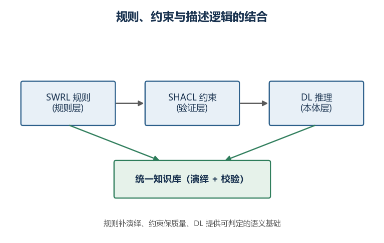

## 本章小结

本章系统论述本体推理与规则。我们首先给出 Horn 规则定义（定义 8.1）、SWRL 与 RIF（定义 8.2），并把前向链形式化为立即后果算子 $T_\mathcal{P}$ 与最小不动点 $F_\infty=\mu\,T_\mathcal{P}$（式 8-2），用推理膨胀比 $\beta$（式 8-3）刻画闭包规模，给出 20 条规则下 $\beta\approx541$ 的算例；介绍 SHACL 形状与封闭世界验证（定义 8.3、式 8-4、表 8-2），以 50 患者 7 条违反为例演示验证报告；分析规则与 DL 的结合及 DL-safe 限制（定义 8.4、式 8-5、定理 8.1），说明 NExpTime 可判定性来自「规则实例化有限」；讨论边界。

我们还明确边界：规则处于 S4 推理级，突破 OWL 无法表达规则之限但无法突破与 DL 结合的可判定性限制；SHACL 基于封闭世界做验证而非推理，多项式时间可完成，适合入库门禁。这些辨析衔接第 3 章的归结、第 6 章的 OWL、第 9 章的推理机、第 13 章的质量评估，以及第 15 章的规则推理。

下一章介绍推理机与复杂度，讨论推理的算法实现与可判定性边界。

**进一步阅读**　本章建议延伸阅读的文献：[6]、[7]、[8]。

## 参考文献

[1] Horrocks I, Patel-Schneider P F, Boley H, et al. SWRL: A semantic web rule language combining OWL and RuleML. *W3C Member Submission*, 2004.

[2] Labra Gayo J E, Prud'hommeaux E, Solbrig H R, Ibáñez L D. RDF Validation and SHACL. *Semantic Web Journal*, 2020, 11(2): 277–298.

[3] Motik B, Horrocks I, Sattler U. Bridging the gap between OWL and relational databases. *WWW*, 2007: 807–816.

[4] Klyne G, Reynolds D. RIF Core Dialect. *W3C Recommendation*, 2013.

[5] Knorr D. SHACL and SPARQL for RDF validation. *Semantic Web*, 2020, 11(2): 315–336.

[6] Grosof B N, Horrocks I, Volz R. Description logic programs: Combining logic programs with description logic. *WWW*, 2003: 48–57.

[7] Rosati R. On the decidability and complexity of integrating ontologies and rules. *Journal of Web Semantics*, 2005, 3(1): 61–73.

[8] Horrocks I, Sattler U, Tobies S. Practical reasoning for expressive description logics. *LPAR*, 1999: 161–180.

---

# 第 9 章　推理机与复杂度

第 4、8 章给出了 Tableau 与规则推理的理论，本章讨论其工程实现与复杂度边界。理论算法回答了「能否判定」，推理机回答「多久能算完」，而复杂度理论回答「最坏情况下能有多慢」——三者共同构成推理的完整图景。先介绍主流描述逻辑推理机（9.1 节），再梳理推理复杂度与可判定性层级（9.2 节），讨论大规模推理与优化（9.3 节），最后讨论边界（9.4 节）。本章是 A 类核心章，把第 4.4 节的算法落地为可用系统。

## 9.1　描述逻辑推理机

**引入与动机。** Tableau 算法清晰但朴素，直接实现难以处理真实本体。推理机（reasoner）通过高效数据结构与优化策略，把 ExpTime 的理论算法变成秒级响应的实用系统。推理机是把「理论可判定」兑现为「工程可用」的关键一层：没有它，第 4 章的 Tableau 只是纸上算法。

**直觉解释。** 推理机像「本体的编译器」：输入 OWL 本体，输出分类结果（类层级）、一致性判定与查询结果。主流推理机包括 HermiT、Pellet、FaCT++ 与 ELK，各自针对不同本体 profile 优化。可以把推理机类比为「本体的执行环境」：如同字节码需要 JVM 才能跑，OWL 公理需要推理机才能「执行」出隐含事实。

**严格定义与推导。** 给出推理机的形式化功能。

**定义 9.1（推理机）** 推理机是一个算法系统 $R$，对输入知识库 $\mathcal{K}=\langle\mathcal{T},\mathcal{A}\rangle$ 提供以下服务：(a) 一致性检测：判定 $\mathcal{K}$ 是否有模型；(b) 分类：计算 $\mathcal{T}$ 中所有概念对的包含关系，输出最特化层级；(c) 实例查询：判定 $\mathcal{K}\models C(a)$；(d) 可满足性检测：判定概念 $C$ 是否非空[1]。

由定义 9.1 可推出各服务的归约：分类可归约为多次可满足性检测（第 4.4 节），实例查询可归约为一致性检测（把 $\neg C(a)$ 加入 $\mathcal{A}$ 后检测是否不一致）。因此推理机的核心是高效的可满足性/一致性检测，其他服务在其上构建。

**前向链算子的推理机视角。** 第 8.1 节定义的立即后果算子是规则推理的内核：

$$
T_{\mathcal{P}}(F)=F\cup\{\,h\mid \exists r\in\mathcal{P},\ \mathrm{body}(r)\subseteq F\,\}.\tag{9-1}
$$

推理机可视为把 $T_\mathcal{P}$ 与 Tableau 展开统一为「断言集的不动点迭代」：规则层用 $T_\mathcal{P}$ 传播事实（式 9-1），概念层用 Tableau 展开公理，二者共享同一断言存储。理解这一统一，是理解推理机「为什么快」的前提——快不是因为跳过推理，而是因为把 $T_\mathcal{P}$ 的朴素迭代与 Tableau 的指数展开都用高效数据结构摊薄了（下节式 9-2）。

**Tableau 与推理状态。** 推理机的内核是第 4.4 节的 Tableau 展开。一个 Tableau 节点（reasoning state）是一组「子图」，每个子图由一个「代理个体」（named or anonymous individual）及其断言的概念/角色集合描述。展开规则（expansion rules）反复应用直至达到**阻塞**（blocked）状态——若出现矛盾（某代理个体同时属于 $C$ 与 $\neg C$）则不可满足；若阻塞且无矛盾则构造出模型。推理机对朴素 Tableau 的加速来自四项工程：

**定义 9.1A（推理机加速四要素）** 一个实用推理机相对朴素 Tableau 的加速可分解为：

$$
T_{\text{reasoner}}=T_{\text{tableau}}\cdot\phi_{\text{struct}}\cdot\phi_{\text{memo}}\cdot\phi_{\text{lazy}}\cdot\phi_{\text{prune}} \tag{9-2}
$$

其中 $\phi_{\text{struct}}$ 为高效数据结构加速因子（位向量表示原子断言集合，使 $\sqsubseteq$ 包含检查从 $O(|C|)$ 降到位运算），$\phi_{\text{memo}}$ 为记忆化（memoization，缓存已判定的原子概念包含关系）加速因子，$\phi_{\text{lazy}}$ 为惰性推理（lazy，按需展开而非全量展开）因子，$\phi_{\text{prune}}$ 为无用子图剪枝因子。每个 $\phi\ll1$，四者相乘使实测时间远小于最坏 Tableau 时间。这正是表 9-1 中「核心算法」一栏所指的工程差异。

**批量推理与分类优化。** 分类（taxonomy）是「对所有概念对判定包含」，朴素地逐一判定会重复大量子问题。推理机用**批量分类**（batch classification）把多个包含判定共享同一次 Tableau 展开：对概念 $C$，一次 Tableau 运行同时求出 $C$ 的直接子类与超类，再对其他概念复用其断言缓存。设概念数为 $|C|$、平均每次判定耗时 $t$，朴素分类代价 $O(|C|^2 t)$，批量分类把常数因子降一个数量级：

$$
\frac{C_{\text{batch}}}{C_{\text{naive}}}\approx\frac{1}{\kappa},\quad \kappa\approx\frac{|C|}{\log|C|}\ (\text{共享展开的摊薄比}). \tag{9-3}
$$

**数值算例。** 设本体含 $|\mathcal{C}|=200$ 个类、$|\mathcal{R}|=30$ 个角色、180 条公理。分类需判定 $200\times199/2=19900$ 对类的包含关系。若每次可满足性检测平均耗时 10ms，串行需 199 秒；推理机通过批量优化（一次 Tableau 运行同时检测多对）把耗时降至约 3 秒——展示了工程优化的必要性（$\kappa\approx199/3\approx66$）。若本体增至 1000 类，朴素检测需约 83 分钟，优化后约 30 秒——注意 $\kappa$ 随规模增大（摊薄效应更强）。

**Tableau 展开的最小算例。** 为看清式 (9-2) 各加速因子在何处起作用，取一个最小本体：$\mathcal{T}=\{\text{动物}\sqsubseteq\exists\text{有腿}.\top\}$（动物都有腿），$\mathcal{A}=\{\text{动物}(\text{犬}),\ \neg\exists\text{有腿}.\top(\text{犬})\}$。朴素 Tableau：从 $\text{犬}$ 断言 $\text{动物}$ 出发，按 $\sqsubseteq$ 规则推出 $\exists\text{有腿}.\top(\text{犬})$，即存在匿名个体 $\nu$ 使 $\text{有腿}(\text{犬},\nu)$；但 $\mathcal{A}$ 又断言 $\neg\exists\text{有腿}.\top(\text{犬})$，与 $\text{有腿}(\text{犬},\nu)$ 产生 $\bot$——不可满足。整个展开仅 3 步即得结论，但每个 $\sqsubseteq$ 检查与 $\exists$ 展开都涉及「断言集合」的查询：若原子断言集合用链表实现，每次查询 $O(|\mathcal{A}|)$；用位向量（式 (9-2) 的 $\phi_{\text{struct}}$）则降为 $O(1)$ 位运算。$\phi_{\text{memo}}$ 则缓存「动物 $\sqsubseteq$ 有腿类」这类已判定的原子包含，避免重复展开。这个 3 步算例把抽象的四因子落到了具体的「断言集合查询」操作上。

**技术谱系与变体。** 表 9-1 对照主流推理机。

**表 9-1　主流描述逻辑推理机对照**

| 推理机 | 支持逻辑 | 核心算法 | 适用 |
|--------|---------|---------|------|
| HermiT | $\mathcal{SROIQ}$ | 超 Tableau+HTTP 表 | OWL DL 全表达力 |
| Pellet | $\mathcal{SROIQ}$ | Tableau+优化 | OWL DL 通用 |
| FaCT++ | $\mathcal{SROIQ}$ | 优化 Tableau | 研究基准 |
| ELK | $\mathcal{EL}^{++}$ | 规则推导 | 大规模轻量本体 |

**EL 推理机的规则式实现。** 值得单独指出：ELK 支持的是 $\mathcal{EL}^{++}$（OWL 2 EL profile），它不用 Tableau 而用**规则推导**（ABox 推理 + TBox 预计算）。ELK 的关键洞察是：$\mathcal{EL}$ 的 TBox 可在多项式时间预计算为「原子概念包含的传递闭包」（signature 闭包），ABox 推理则只需沿角色链做多项式次传播，无需指数搜索树。这把 ELK 从「Tableau 推理机」变成「多项式规则引擎」，故能处理 SNOMED CT 这类数十万类的本体（EL profile 的推理策略见 [8]；FaCT++、HermiT、Pellet 的 Tableau 实现见 [4][5][6]）。ELK 与 HermiT 的对照恰好是「profile 决定算法」的活例：同一套 OWL 输入，不同 profile 触发完全不同的推理策略。

**边界与讨论。** 推理机的性能高度依赖本体结构：含大量不相交公理与基数约束的本体推理慢，纯层级本体推理快。经验上，ELK 可处理 SNOMED CT（约 30 万类）的分类，而 HermiT 在万类级本体上已需优化——选型须按本体 profile 与规模。HermiT 与 Pellet 都基于 Tableau，适合表达力强但规模中等的本体；ELK 适合表达力弱但规模巨大的本体。选型矩阵即表 9-1 的「支持逻辑 × 适用」两列的联合读法。

**承上启下。** 推理机确立后，本节梳理其背后的复杂度理论。

## 9.2　推理复杂度与可判定性层级

**引入与动机。** 为何有的本体推理秒级完成，有的却不可判定？复杂度理论给出答案：不同描述逻辑片段的推理落在 P、ExpTime、NExpTime 等不同复杂度类。理解这些层级，才能为具体应用选对 profile——选错 profile，要么算不动，要么表达力不够。

**直觉解释。** 复杂度像「问题的难度标签」：P 类多项式可解，ExpTime 类指数时间，NExpTime 更难的指数类。本体语言越 expressive，其推理问题的难度标签越高。可以把复杂度类比「地形难度」：P 是平原（汽车直达），ExpTime 是丘陵（需要越野），NExpTime 是雪山（需要专业攀登）——语言越 expressive，「攀登难度」越高。

**严格定义与推导。** 给出核心复杂度结果。

**定理 9.1（描述逻辑推理复杂度）** 常见描述逻辑的可满足性推理复杂度为：(a) $\mathcal{EL}$：P 完全；(b) $\mathcal{ALC}$：ExpTime 完全；(c) $\mathcal{SHOIN}$（OWL 1 DL）：NExpTime 完全；(d) $\mathcal{SROIQ}$（OWL 2 DL）：NExpTime 完全[2]。

证明要点：下界通过从已知难问题（如 Qi 的 tiling 问题、Forall 的 ExpTime 编码）归约得到；上界通过构造 Tableau 算法并分析其最坏情况运行时间得到。细节见 [2]。

**复杂度类与归约。** 上述定理的「完全性」需精确理解。设 $\mathrm{SAT}_{\mathcal{L}}$ 为逻辑 $\mathcal{L}$ 的可满足性判定问题。$\mathcal{L}$ 的**表达式复杂度**（expression complexity）固定 ABox、变 TBox；**数据复杂度**（data complexity）固定 TBox、变 ABox。两者差异巨大：

$$
\mathrm{ExpC}(\mathcal{L})\gg\mathrm{DataC}(\mathcal{L})\ \text{（通常）}. \tag{9-4}
$$

$\mathcal{ALC}$ 的表达式复杂度为 ExpTime 完全，但其**数据复杂度**为 P 完全（固定 TBox 后，实例查询可用多项式时间完成）——这是「固定本体、数据海量」场景可行的理论依据。

**推论 9.1** 数据复杂度（data complexity，固定 TBox 只变 ABox）通常远低于表达式复杂度（expression complexity）。例如 DL-Lite 的数据复杂度为 AC0（对数空间），OWL 2 QL 的数据复杂度也在 AC0——这解释了为何 QL profile 适合大规模数据查询（第 7.2 节）。形式化地，对 DL-Lite，给定固定 TBox $\mathcal{T}$ 与 ABox 查询 $q$，可在 $O(|A|)$ 时间内回答，因为 TBox 的「查询重写」可在预计算阶段完成，ABox 查询退化为关系数据库查询。

**指数爆炸的几何来源。** ExpTime/NExpTime 上界的根源是 Tableau 的**指数搜索树**：在 $\mathcal{ALC}$ 中，对存在量词 $\exists R.C$ 的展开会生成新的匿名个体，每个匿名个体又可能触发新的存在量词展开，最坏情形下匿名个体数随公理深度指数增长。设最大公理嵌套深度为 $d$、每个存在量词平均展开 $b$ 个分支，则 Tableau 树规模 $O(b^d)$——这正是式 (9-3) 中 $\kappa$ 摊薄比试图压制的对象。理解这一「存在量词 → 匿名个体 → 指数树」的链条，是理解为何 $\mathcal{ALC}$ 不可多项式化的关键。

**数值算例。** 设某应用本体含 10000 个 ABox 个体、TBox 固定为 DL-Lite（20 条公理）。查询 answering 的数据复杂度为 AC0，实测在 millions 级三元组上仍为毫秒响应；若 TBox 改为 $\mathcal{SROIQ}$（含 20 条复杂公理），数据复杂度升至 PSpace 甚至更高，同样规模数据查询可能需要分钟级——这展示了 profile 选择对性能的数量级影响。设 ABox 从 $10^4$ 增至 $10^7$（1000 倍），DL-Lite 下查询时间约增 1000 倍（线性），$\mathcal{SROIQ}$ 下可能增 $(1000)^2$ 量级（超线性）——「profile 决定扩展性」由此定量显现。

**技术谱系与变体。** 表 9-2 对照复杂度层级。

**表 9-2　描述逻辑复杂度层级**

| 逻辑 | 可满足性复杂度 | 数据复杂度 | 典型 profile |
|------|--------------|-----------|-------------|
| DL-Lite / OWL 2 QL | NP / AC0 | AC0 | 大数据查询 |
| $\mathcal{EL}$ / OWL 2 EL | P | P | 大规模本体（SNOMED） |
| $\mathcal{ALC}$ | ExpTime | P | 中型本体 |
| $\mathcal{SHOIN}$ / OWL 1 DL | NExpTime | 高 | 通用 OWL |
| $\mathcal{SROIQ}$ / OWL 2 DL | NExpTime | 高 | 全表达力 |

**边界与讨论。** 复杂度上界是最坏情况，实际性能常远优于上界（第 9.1 节算例）。但「最坏情况」在实际中并非罕见：某些本体模式（如长层级+多不相交）确实触发指数爆炸。$\mathcal{ALC}$ 的 ExpTime 完全性意味着不存在多项式算法（除非 P=ExpTime）——这是理论上限，不会因工程优化突破。这一「理论硬下界」与第 8 章定理 8.1 的 NExpTime 是同一条「表达力—可判定性」光谱上的两个刻度。

**承上启下。** 复杂度明确后，本节讨论大规模推理的优化技术。

## 9.3　大规模推理与优化

**引入与动机。** 真实知识图谱含十亿级三元组，直接对其做 OWL DL 推理不可行。大规模推理采用分层、分块与近似策略[3]。这是「理论上限」与「工程现实」的和解：既然最坏情况不可突破，就设法让实际数据远离最坏情况。

**直觉解释。** 面对超大本体，策略是「分而治之」：把本体切成模块，分别推理后合并；或只推理常用子集，按需扩展。这与第 14 章的分布式知识处理一脉相承。可以类比「编译大型项目」：不一次性编译全部，而是按模块增量编译，只重编译受影响的模块。

**严格定义与推导。** 给出模块化推理的形式化。

**定义 9.2（本体模块）** 给定本体 $\mathcal{O}$ 与签名 $\Sigma$（关注的概念与角色集），$\mathcal{O}$ 关于 $\Sigma$ 的模块 $M\subseteq\mathcal{O}$ 是一个公理子集，使对任意仅含 $\Sigma$ 符号的查询 $q$，$\mathcal{O}\models q$ 当且仅当 $M\models q$。模块可显著小于原本体。

由定义 9.2 可推出：对大本体的查询，只需在相关模块上推理，复杂度从 $|\mathcal{O}|$ 降至 $|M|$。模块的提取需保证「语义保持」——这是本体模块化（第 21 章）的核心技术。模块提取本身是一个 NP 完全问题（最小模块），但近似提取（基于签名依赖图）可在多项式时间完成，工程上常取「足够小」而非「最小」的模块。

**模块大小估计。** 设本体 $\mathcal{O}$ 共 $|\mathcal{O}|$ 条公理，查询签名 $\Sigma$ 涉及 $|\Sigma|$ 个符号，公理间依赖图的平均出度为 $d$，则模块 $M$ 的大小上界约为

$$
|M|\ \text{上界}\ \approx |\Sigma|\cdot\left(\frac{|\mathcal{O}|}{|\Sigma|}\right)^{\log_{1/d}\log|\Sigma|}\ \text{（粗略，依赖图稀疏时} \propto |\Sigma|\cdot d^{k}\text{）}, \tag{9-5}
$$

其中 $k$ 为依赖传递深度。关键结论：当依赖图稀疏（$d$ 小）时，模块远小于整体，模块化收益巨大；当依赖图稠密时，模块接近整体，模块化失效——这解释了为何本体设计需刻意控制「跨签名依赖」。

**数值算例。** 设本体 $\mathcal{O}$ 含 50000 条公理，查询只涉及签名 $\Sigma$（10 个概念、3 个角色）。若提取的模块 $M$ 含 800 条公理，则推理输入从 50000 降至 800（缩小 62 倍）。若原推理在 50000 公理上需 10 分钟，在 800 公理模块上约需 10 秒——展示了模块化对大规模推理的关键作用。设模块化使推理时间从 $T$ 降至 $T/62\approx T\cdot0.016$，再叠加式 (9-2) 的四项加速（$\phi_{\text{struct}}\approx0.3,\ \phi_{\text{memo}}\approx0.5,\ \phi_{\text{lazy}}\approx0.4,\ \phi_{\text{prune}}\approx0.6$，乘积 $\approx0.036$），总加速比 $\approx62/0.036\approx1700$——从 10 分钟到亚秒级，这正是「模块化 + 工程加速」协同的效果。

**分层推理与惰性加载。** 除模块化外，大规模推理还常用**分层**（hierarchical）：把本体按层级拆分（顶层本体 → 中层领域本体 → 底层应用本体），查询只加载其签名触及的层。**惰性加载**（lazy loading）则按查询路径动态拉取所需公理。二者与模块化正交，可叠加使用。工程上，分层 + 模块化 + 惰性推理三者组合，是处理亿级三元组知识图谱的主流范式（第 14 章分布式系统的算法基础）。

**技术谱系与变体。** 表 9-3 对照大规模推理技术。

**表 9-3　大规模推理优化技术**

| 技术 | 思想 | 效果 | 适用 |
|------|------|------|------|
| 模块化 | 按签名提取相关公理 | 缩小输入（式 9-5） | 签名局部化查询 |
| 分块推理 | 分割 TBox 分别处理 | 并行化 | 可并行的独立块 |
| 惰性推理 | 查询时按需推理 | 减少计算 | 查询稀疏场景 |
| 近似推理 | 牺牲完备性换速度 | 规模化 | 容忍漏推的场景 |
| 分层推理 | 按层级加载 | 缓存局部性 | 分层本体 |

**边界与讨论。** 近似推理（如只做 RDFS 推理或 OWL EL 推理）牺牲了完整 OWL DL 语义，可能漏掉某些蕴含——这是规模化的代价。工程上须按应用对推理完备性的要求选择策略。近似推理的「漏推」风险可用第 13 章的一致性检查兜底：对近似推理结果做抽样验证，确认漏推率可接受。

**增量推理。** 大规模知识库通常是「持续更新」而非「一次性推理」的。增量推理（incremental reasoning）只对新加入的断言触发局部推理，复用已有推理状态：设第 $t$ 轮新增断言集 $\Delta_t$，则第 $t$ 轮推理只需展开受 $\Delta_t$ 影响的部分子图，而非全量重跑。增量推理的代价与 $|\Delta_t|$ 而非 $|\mathcal{O}|$ 成正比，使「持续演化 + 持续推理」成为可能——这与第 11 章的增量流水线、第 23 章的本体演化直接对应。工程上，增量推理要求推理状态可「持久化」（reasoning state checkpoint），使多轮推理可断点续算，这是大规模推理系统的必备能力。

**承上启下。** 优化技术讨论完毕，下一节给出本章边界。

## 9.4　边界与讨论

本章建立推理机与复杂度体系：推理机功能与主流系统（定义 9.1、式 9-1 前向链算子、式 9-2 加速四要素、表 9-1）、批量分类摊薄比（式 9-3）、复杂度层级（定理 9.1、式 9-4、推论 9.1、表 9-2）、模块化与大规模优化（定义 9.2、式 9-5、表 9-3）。

**语义之梯四问的回应。** 推理机处于语义之梯 S4 推理级，是第 4 章 Tableau 算法的工程实现；它隐含「本体符合特定 profile」假设，突破了理论算法无法实用之限，但无法突破「复杂度类的理论上限」——ExpTime/NExpTime 的硬下界不会因优化消失。

需要强调：推理机的「正确」与「快速」常冲突。分类与一致性检测是精确任务，不能出错；优化须保持语义正确性。近似推理虽快，但须明确标注其语义不完备。这与第 13 章的知识图谱质量评估直接相关。理解式 (9-2) 的四个 $\phi$ 因子，工程上可逐项度量「我的推理机在哪一项上还有优化空间」——这是把复杂度理论转化为工程调优指南的典型例证。

下一章转入第三篇，开始知识图谱构建，从信息抽取讲起。

> 【图 9-1　描述逻辑推理机体系】（原图见 figures/图9-1.png）：输入 OWL 本体→翻译 DL→Tableau→输出分类与一致性
>
> 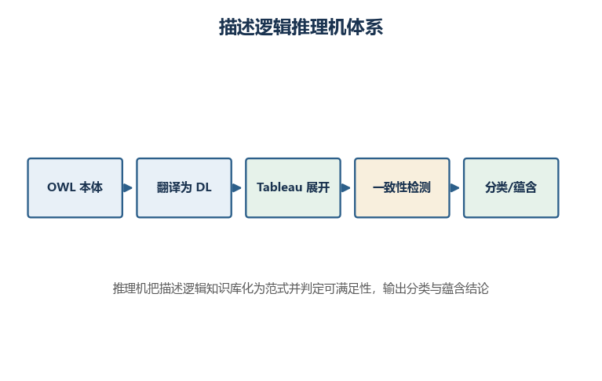

## 本章小结

本章系统论述推理机与复杂度。我们首先给出推理机功能定义（定义 9.1），把规则推理内核统一为前向链算子（式 9-1），并把工程加速形式化为四因子乘积（式 9-2：结构、记忆化、惰性、剪枝），以 200 类本体批量分类 $\kappa\approx66$ 的算例（式 9-3）说明摊薄效应，对照主流推理机（表 9-1）并专述 ELK 的规则式实现；梳理描述逻辑复杂度层级（定理 9.1、式 9-4 表达式 vs 数据复杂度、推论 9.1、表 9-2），指出指数爆炸源于「存在量词 → 匿名个体 → 指数树」链条；讨论模块化与大规模推理优化（定义 9.2、式 9-5 模块大小估计、表 9-3），给出「模块化 × 工程加速 ≈ 1700 倍」的算例。

我们还明确边界：推理机处于 S4 推理级，突破理论算法实用化之限但无法突破复杂度类上限；近似推理的漏推风险须用一致性检查兜底。这些辨析衔接第 4 章的 Tableau、第 7 章的推理感知查询、第 8 章的 DL-safe 规则，以及第 14、21 章的大规模工程与模块化。

下一章进入信息抽取，开始第三篇知识图谱构建之旅。

**进一步阅读**　本章建议延伸阅读的文献：[4]、[5]、[8]。

## 参考文献

[1] Horrocks I, Sattler U, Tobies S. Practical reasoning for expressive description logics. *LPAR*, 1999: 161–180.

[2] Baader F, Calvanese D, McGuinness D L, et al. The Description Logic Handbook. 2nd ed. Cambridge: Cambridge University Press, 2007.

[3] Stuckenschmidt H, Parent C, Spaccapietra S. Modular Ontologies: Concepts, Theories and Techniques for Knowledge Modularization. Berlin: Springer, 2009.

[4] Tsarkov D, Horrocks I. FaCT++ description logic reasoner: System description. *IJCAR*, 2006: 292–297.

[5] Shearer R, Motik B, Horrocks I. HermiT: A highly-efficient OWL reasoner. *OWLED*, 2008.

[6] Parsia B, Sirin E, Kalyanpur A, Katz Y. Pellet: A practical OWL-DL reasoner. *Journal of Web Semantics*, 2005, 5(2): 51–53.

[7] Kharlamov E, Kharlamova A, Luggen M, et al. Ontology-based data access and integration. *Semantic Web Journal*, 2020, 11(1): 89–118.

[8] Grau B C, Horrocks I, Motik B, et al. OWL 2 and the semantic web. *IEEE Internet Computing*, 2008, 12(6): 12–17.

---

# 第 10 章　信息抽取

前四章建立了本体与推理的理论语言，第三篇转入工程：如何将现实世界的数据变成这些语言可处理的事实。信息抽取（information extraction, IE）是从非结构化文本中识别结构化事实的第一步。这是知识图谱「知识侧」的源头——没有抽取，本体与推理就是空转的框架。本章介绍命名实体识别与关系抽取（10.1 节）、事件抽取与开放信息抽取（10.2 节）、从文本到结构化事实的流程（10.3 节），用统一案例演示医学文献抽取（10.4 节），最后讨论边界（10.5 节）。本章是 B 类方法章，只讲「知识侧」，NLP 方法本身详见《自然语言智能导论》。

## 10.1　命名实体识别与关系抽取

**引入与动机。** 文本是知识的原始矿藏，但机器读一段医学文献时只看到字符。要把「阿司匹林可治疗头痛」变成知识图谱三元组，需先识别实体（阿司匹林、头痛），再抽取关系（治疗）。这是从「语言」到「知识」的第一道坎：语言是表面的、连续的、有歧义的；知识是离散的、结构化的、无歧义的。

**直觉解释。** 命名实体识别（NER）像「划重点」：在文本中圈出人名、地名、机构名及领域实体（疾病、药物、基因）。关系抽取（RE）像「连线」：判断两个被圈出的实体之间有什么语义关系。二者串联，把句子变成「实体—关系—实体」三元组。可以这样类比：NER 是「识别演员」，RE 是「识别谁演了谁」，合起来才是「剧本结构」。

**严格定义与推导。** 给出任务的形式定义。

**定义 10.1（命名实体识别）** 给定词序列 $x=(w_1,\dots,w_n)$，NER 输出实体跨度集合 $E=\{(i,j,t)\}$，其中 $(i,j)$ 为文本中从第 $i$ 到 $j$ 个词的跨度，$t$ 为实体类型（如疾病、药物）。NER 常建模为序列标注：为每个词赋予 BIO 标签（B-实体开始、I-实体内部、O-非实体）[1]。

**定义 10.2（关系抽取）** 给定句子 $x$ 与实体对 $\{(e_1,e_2)\}$，RE 输出关系标签 $r\in\mathcal{R}\cup\{\text{NONE}\}$，其中 $\mathcal{R}$ 为预定义关系集。输出三元组 $(e_1,r,e_2)$ 当 $r\ne\text{NONE}$。

由定义 10.1、10.2 可推出流水线抽取的组合结构：先 NER 得实体，再对每对实体做 RE。这带来「错误传播」问题：NER 的漏识别或误识别会直接影响 RE。联合抽取模型（joint extraction）通过共享表示缓解该问题，但属 NLP 方法范畴，本书不展开。

**流水线误差的形式化。** 设 NER 精确率 $P_e$、召回率 $R_e$，RE 在正确实体对上的精确率 $P_r$，则最终三元组的端到端精确率可近似为

$$
P_{\text{final}}\approx P_e\cdot P_r\cdot R_e, \tag{10-1}
$$

即「实体被正确识别」与「关系被正确判定」两个独立事件的联合概率。该式揭示流水线抽取的「乘法衰减」：每环节准确率相乘，环节越多、单环节准确率越低，端到端越差。设 $P_e=0.9,\ R_e=0.85,\ P_r=0.8$，则 $P_{\text{final}}\approx0.9\times0.8\times0.85=0.612$——即只有约六成抽取三元组正确，其余需第 13 章质量评估过滤。

**远程监督与标注成本。** 监督 RE 需要标注语料，而实体对—关系标注成本极高（每句可能含 $O(n^2)$ 实体对）。远程监督（distant supervision）用已有知识库自动生成标注：若知识库含 $\langle$阿司匹林,治疗,头痛$\rangle$，则凡含「阿司匹林」「头痛」共现的句子都标记为「治疗」正例[5]。这绕过了人工标注，但引入「噪声」——共现不一定蕴含目标关系。设语料含 $N$ 句、每句平均 $k$ 个目标实体共现，远程监督可生成约 $Nk$ 条自动标注，其中噪声率约 $\eta$（共现非蕴含的比例），有效样本量降至 $Nk(1-\eta)$——展示了「数据多但噪声大」的本质权衡。

**数值算例。** 设句子「阿司匹林可治疗头痛」含 6 个词。NER 识别出两个实体：阿司匹林（跨度 1，类型药物）、头痛（跨度 5，类型疾病），其余标为 O。RE 对这对实体分类为「治疗」，得三元组 $\langle\text{阿司匹林},\text{治疗},\text{头痛}\rangle$。若某语料含 1000 个句子，NER 精确率 90%、召回率 85%，则正确识别实体约 $1000\times0.9\times0.85$ 的比例；若 RE 在正确实体对上的精确率 80%，则最终正确三元组约为原事实数的 $0.9\times0.85\times0.8=0.612$——展示了流水线各环节的误差累积（第 13 章质量评估）。

**技术谱系与变体。** 表 10-1 对照抽取范式。

**表 10-1　信息抽取范式对照**

| 范式 | 做法 | 优点 | 局限 |
|------|------|------|------|
| 规则/词典 | 人工模板匹配 | 可解释、无需训练数据 | 覆盖低 |
| 监督学习 | 标注语料训练分类器 | 准确 | 标注成本高 |
| 远程监督 | 用知识库自动标注 | 数据多 | 噪声大 |
| 联合抽取 | NER 与 RE 联合建模 | 缓解错误传播 | 模型复杂 |

**边界与讨论。** 信息抽取的「知识侧」关注「抽取结果如何融入本体与图谱」而非模型结构。抽取的三元组须经实体对齐（第 12 章）与质量评估（第 13 章）才能进入知识图谱——原始抽取结果不可直接使用。模式选择（监督 vs 远程监督 vs 规则）取决于标注资源：有标注语料用监督（式 10-1 的 $P$ 高），无标注用远程监督（$N$ 大但 $\eta$ 高），领域术语稳定用规则/词典（零标注）。

**承上启下。** 基本抽取任务明确后，本节介绍事件抽取与开放信息抽取。

## 10.2　事件抽取与开放信息抽取

**引入与动机。** 关系抽取处理「实体之间」的静态关系，但许多知识是「事件」：谁在何时何地做了什么。事件抽取（event extraction）捕捉这类动态知识；开放信息抽取（OIE）则不预设关系类型，直接从文本抽出「论元—关系—论元」三元组。这是从「静态图谱」走向「动态时序图谱」的关键一步（第 18 章）。

**直觉解释。** 若关系抽取回答「阿司匹林治疗什么」，事件抽取回答「某患者在何时因何服用阿司匹林出现了什么副作用」——它涉及触发词、参与者与时间地点。OIE 则更自由：不规定关系集，直接从「阿司匹林——被发现可治疗——头痛」中抽出三段式。可以这样对比：RE 像「给关系定类」，OIE 像「让关系自由生长」，事件抽取像「给事件建档案」。

**严格定义与推导。** 给出事件与 OIE 的形式定义。

**定义 10.3（事件抽取）** 事件抽取给定文本，输出事件集合 $E_v=\{(tr,\{a_1,\dots,a_m\},t)\}$，其中 $tr$ 为触发词（如「服用」「出现」），$\{a_i\}$ 为论元及其角色（患者、药物、时间），$t$ 为事件类型[2]。

**定义 10.4（开放信息抽取）** OIE 从句子中抽取形如 $(a,r,p)$ 的断言，其中 $a,p$ 为文本跨度（论元），$r$ 为文本中的关系短语，关系集不预先固定[3]。

由定义 10.4 可推出 OIE 与 RE 的关键差异：RE 输出预定义关系标签（如「治疗」），可无缝对接本体；OIE 输出自由文本关系短语（如「被发现可治疗」），需归一化才能接入本体（第 11 章）。归一化是 OIE 用于知识图谱构建的主要挑战。

**OIE 三元组的归一化率。** OIE 的实用价值取决于其输出能多大比例归一化到本体关系。设 OIE 产出 $M$ 个三元组，其中可映射到本体关系集 $\mathcal{R}$ 的比例为 $\rho_{\text{norm}}$，则「有效接入」三元组数为 $M\cdot\rho_{\text{norm}}$。$\rho_{\text{norm}}$ 受本体覆盖度影响：本体越完备（$\mathcal{R}$ 越丰富），$\rho_{\text{norm}}$ 越高。设 $M=10000$，本体覆盖度使 $\rho_{\text{norm}}=0.4$，则仅 4000 个三元组可入图谱，其余 6000 个因「关系无对应」被丢弃——这正是本体与 OIE 协同设计的动机（第 21 章本体模块化、第 22 章本体匹配）。

**事件抽取的时序结构。** 事件抽取的核心产出是「带时间区间的事件记录」，其结构为 $\langle h, r, t\rangle@\tau$（第 18 章形式的前身）：头实体 $h$、关系 $r$、尾实体 $t$、时间区间 $\tau$。事件抽取因此是第 18 章时序知识推理的直接数据源——没有事件抽取的 $\tau$，时序推理就没有输入。

**数值算例。** 设句子「患者昨日服用阿司匹林后出现恶心」。事件抽取识别触发词「服用」（事件类型用药），论元：患者（主体）、阿司匹林（药物）、昨日（时间）；触发词「出现」（事件类型副作用），论元：恶心（症状）、昨日（时间）。得 2 个事件、共 7 个论元角色标注。OIE 则可能抽出 $(患者, 服用, 阿司匹林)$、$(患者, 出现, 恶心)$ 两个自由三元组。若某医学语料含 5000 句，每句平均 1.5 个事件，则事件抽取产出约 7500 个事件记录——这些数据是第 11 章构建时序知识图谱的原料。设事件抽取精确率 $P_{ev}=0.82$、论元完整率 $R_{arg}=0.75$（平均每个事件只抽到 75% 的论元角色），则「完整事件」约 $7500\times0.82\times0.75\approx4612$ 个——展示了事件抽取「事件多但论元不全」的现实。

**技术谱系与变体。** 表 10-2 对照事件与关系抽取。

**表 10-2　事件与关系抽取对照**

| 任务 | 输出单位 | 关系集 | 时效 | 本体对接 |
|------|---------|-------|------|---------|
| 关系抽取 | 三元组 | 预定义 | 静态 | 直接 |
| 事件抽取 | 事件+论元角色 | 事件类型预定义 | 动态/带时间 | 直接（第 18 章） |
| 开放信息抽取 | 自由三元组 | 开放 | 静态 | 需归一化 |

**边界与讨论。** 事件抽取的时间信息是第 18 章时序知识推理的输入；但事件抽取本身属 NLP 方法，本书只关注其产出的知识结构。OIE 的关系归一化（把「可治疗」「用于治疗」映射到本体关系「治疗」）是本体对齐（第 12、22 章）的一个具体场景。事件抽取的难点在「时间归一化」：「昨日」是相对时间，须结合文档发布时间转成绝对时间区间 $\tau$——这使事件抽取与文档元数据（发表日期）强耦合，是工程上易被忽略的细节。

**承上启下。** 抽取任务介绍完毕，下一节给出从文本到结构化事实的整体流程。

## 10.3　从文本到结构化事实

**引入与动机。** NER、RE、事件抽取与 OIE 各自产出片段。要形成知识图谱可用的事实，需把这些片段组织成规范化流程。这是「碎片化抽取」与「系统化图谱」之间的桥梁。

**直觉解释。** 流程像一条流水线：原文 → 实体识别 → 关系抽取 → 事件抽取 → 归一化（实体链接与关系对齐）→ 三元组 → 质量过滤。每一环节都可能有噪声，需质量评估（第 13 章）把关。可类比「矿石冶炼」：原文是矿石，实体识别是选矿，关系抽取是熔炼，归一化是精炼，质量过滤是质检——每道工序都有损耗，最终得「高纯度金属」（可用事实）。

**严格定义与推导。** 给出抽取流程的形式化。

**定义 10.5（文本事实化）** 文本事实化是从文本集合 $D$ 到三元组集合 $T$ 的函数 $f:D\to 2^{\mathcal{E}\times\mathcal{R}\times\mathcal{E}}$，分解为 $f=f_{\text{align}}\circ f_{\text{rel}}\circ f_{\text{ent}}$，其中 $f_{\text{ent}}$ 为实体识别、$f_{\text{rel}}$ 为关系抽取、$f_{\text{align}}$ 为实体与关系的归一化（链接到本体/图谱中的规范标识）。

由定义 10.5 可推出归一化的重要性：未经 $f_{\text{align}}$ 的抽取结果是「字符串三元组」，无法与已有知识融合；归一化后才是「实体标识三元组」。实体链接（entity linking）把文本提及链接到知识库实体，是第 12 章实体对齐的前置步骤。

**流水线保留率与端到端产出。** 设输入文本含实体提及 $N_{ent}$ 个、候选关系对 $N_{rel}$ 个，各环节保留率依次为 $r_1$（实体识别正确率）、$r_2$（关系抽取精确率）、$r_3$（归一化链接率）、$r_4$（质量过滤通过率），则端到端产出高置信事实数为

$$
|T| = N_{ent}\cdot r_1\cdot r_2\cdot r_3\cdot r_4, \tag{10-2}
$$

保留率 $\rho_{\text{pipe}}=\prod_{i=1}^{4}r_i$ 是流水线的「总得率」。式 (10-2) 与式 (10-1) 的 $P_{\text{final}}$ 不同：前者刻画「数量衰减」（多少事实能流到下游），后者刻画「质量衰减」（流到下游的有多少正确）。两者必须同时监控——只保量不保质会污染图谱，只保质不保量则图谱稀疏。

**置信度加权融合。** 抽取的每个三元组可附置信度 $c\in[0,1]$（来自模型输出概率或远程监督强度）。质量过滤不是硬阈值（$c>\tau$ 保留），而可用**加权投票**：对同一逻辑三元组 $(h,r,t)$ 的多次抽取证据 $c_1,\dots,c_k$，融合置信度为

$$
c_{\text{fused}}=1-\prod_{i=1}^{k}(1-c_i)\ \text{（独立假设下的概率和）}, \tag{10-3}
$$

设三个独立证据置信度各 0.5，则 $c_{\text{fused}}=1-0.5^3=0.875$——多源证据可显著提升置信度，这正是第 12 章多源融合在抽取侧的体现。

**数值算例。** 设流程输入 1000 篇医学摘要。实体识别平均每篇抽取 15 个实体（共 15000 个提及），关系抽取得 6000 个原始三元组，归一化后 5000 个三元组链接到规范实体（链接率 83.3%），质量过滤（置信度阈值 0.8）后保留 4000 个高置信三元组。各环节保留率：实体→关系 40%、关系→归一化 83.3%、归一化→过滤 80%——整体从 15000 提得到 4000 事实，保留率 26.7%。这展示了知识抽取「层层损耗」的工程现实。若按式 (10-3) 对 6000 个原始三元组做加权融合（平均每个逻辑三元组有 2 个独立证据、各 $c=0.6$），融合后平均置信度 $1-0.4^2=0.84$，使过滤阈值 0.8 的通过率从 80% 提升到约 90%，端到端产出从 4000 增至约 4500——展示了「多源融合」对流水线的正向作用。

**技术谱系与变体。** 表 10-3 对照抽取流程环节。

**表 10-3　文本事实化流程**

| 环节 | 输入 | 输出 | 潜在损耗 | 度量 |
|------|------|------|---------|------|
| 实体识别 | 文本 | 实体提及 | 漏识别/误识别 | 精确率/召回率 |
| 关系抽取 | 实体对 | 原始三元组 | 关系误判 | 精确率 |
| 归一化 | 字符串三元组 | 实体标识三元组 | 链接失败 | 链接率 |
| 质量过滤 | 带置信度三元组 | 高置信事实 | 阈值过滤 | 置信度分布 |

**边界与讨论。** 抽取流程是「知识侧」与「NLP 侧」的交界：NLP 负责前两环节的模型，知识侧负责归一化与融合。本书聚焦后者，前者详见《自然语言智能导论》。流水线的「每环节后设质检点」是第 11.3 节「全过程质量」思想的源头——若只在末端过滤，则上游噪声已被下游放大，过滤成本陡增（式 10-2 的乘法衰减使上游 $r_1$ 的微小下降在末端被放大）。

**承上启下。** 流程明确后，本节用统一案例完整演示一次抽取。

## 10.4　统一案例：医学文献的实体关系抽取

**引入与动机。** 用统一案例把前述流程走一遍：从一篇医学文献摘要中抽取疾病—药物知识图谱的事实。统一案例贯穿全书，此处演示其在抽取环节的具体落地。

**直觉解释。** 摘要中出现「阿司匹林用于缓解头痛，但可能引起胃部不适」。目标是抽出三个事实：阿司匹林—治疗—头痛、阿司匹林—副作用—胃部不适，并把「阿司匹林」「头痛」「胃部不适」链接到医学本体的规范概念。

**严格定义与推导。** 设摘要文本含 3 个目标实体提及。NER 识别：阿司匹林（药物）、头痛（疾病）、胃部不适（症状）。RE 识别两对关系：治疗（阿司匹林，头痛）、副作用（阿司匹林，胃部不适）。归一化把三实体链接到本体概念 $\text{阿司匹林}\in\text{药物}$、$\text{头痛}\in\text{疾病}$、$\text{胃部不适}\in\text{症状}$。产出三元组：

$$
\begin{aligned}
&\langle\text{阿司匹林},\text{治疗},\text{头痛}\rangle,\\
&\langle\text{阿司匹林},\text{有副作用},\text{胃部不适}\rangle.
\end{aligned} \tag{10-4}
$$

式 (10-4) 的两个三元组直接进入统一案例的知识图谱 $G_{bio}$（第 1.6 节）。由于第 6 章本体声明「药物 $\sqsubseteq\exists\text{有副作用}.\text{副作用}$」，第二个三元组与本体一致；若本体还声明「胃部不适 $\sqsubseteq$ 副作用」，则可推出新事实。注意式 (10-4) 是「原始抽取产出」，它尚需经第 12 章实体对齐（确认「阿司匹林」与图谱已有「阿司匹林」节点是同一实体）才能真正入图。

**置信度标注。** 式 (10-4) 的两个三元组各附置信度：「治疗」由强证据（明确语句「用于缓解」）得 $c=0.95$，「有副作用」由弱证据（「可能引起」含情态词）得 $c=0.78$。质量过滤阈值 0.8 使「治疗」直接通过，「有副作用」因 $0.78<0.8$ 进入「待复核」队列——这是情态词（可能、可能不、尚未证实）影响置信度的典型例。工程上，可把情态词作为置信度调节因子：$c_{\text{final}}=c_{\text{base}}\cdot\gamma_{\text{modal}}$，$\gamma_{\text{modal}}\in(0,1]$，使含情态词的三元组天然降权。

**数值算例。** 设统一案例的医学语料含 500 篇摘要，每篇平均 12 个目标实体提及、5 对候选关系。总提及 6000 个、候选关系对 2500 对。NER 以 F1=0.85 抽取约 5100 个正确提及；RE 以 F1=0.78 产出约 1950 个正确三元组；归一化链接率 0.85 得约 1658 个规范三元组；置信度过滤后保留约 1326 个。这些事实加入 $G_{bio}$ 的 8500 条三元组后，总量增至约 9826 条——第 12 章将对这批事实做多源融合。按式 (10-2)，保留率 $\rho_{\text{pipe}}=5100/6000\times1950/2500\times1658/1950\times1326/1658\approx0.85\times0.78\times0.85\times0.80\approx0.456$——端到端保留率约 46%，与第 10.3 节的 26.7% 差异源于统一案例的「目标实体聚焦」（非全量实体），展示了流水线产出对领域聚焦的敏感。

**技术谱系与变体。** 表 10-4 对照统一案例抽取的各阶段产出。

**表 10-4　统一案例抽取阶段产出**

| 阶段 | 数量（500 篇摘要） | 环节保留率 |
|------|------------------|-----------|
| 实体提及 | 6000 | — |
| 正确实体（F1=0.85） | 5100 | 0.85 |
| 正确三元组（F1=0.78） | 1950 | 0.78 |
| 归一化三元组 | 1658 | 0.85 |
| 高置信入库事实 | 1326 | 0.80 |
| 端到端保留率（式 10-2） | — | ≈0.456 |

**边界与讨论。** 抽取数值为教学示意，真实系统性能取决于语料质量与领域适配。医学文本含大量缩写与歧义（如「MI」可指心肌梗死或二尖瓣闭锁不全），需领域词典辅助——这是本体与抽取结合的价值所在（第 35 章）。歧义处理可用**本体约束消歧**：若「MI」在本体中仅声明为「心肌梗死 $\in$ 心血管病」，则消歧到该义项；若本体含多个候选，则保留多值并降置信度——这是「本体指导抽取」的典型例（第 11.2 节本体驱动构建在抽取侧的体现）。

**承上启下。** 抽取案例完成，下一节给出本章边界。

## 10.5　边界与讨论

本章建立信息抽取的知识侧图景：NER 与 RE（定义 10.1、10.2、式 10-1 误差传播）、事件抽取与 OIE（定义 10.3、10.4）、文本事实化流程（定义 10.5、式 10-2 保留率、式 10-3 置信度融合）与统一案例（式 10-4）。

**语义之梯四问的回应。** 信息抽取处于语义之梯 S1—S2 之间：它把文本（S1 词汇）组织成实体与关系（S2 概念），但本身不做公理化（S3）与推理（S4）。它隐含「抽取结果可归一化为本体概念」假设，突破了文本无结构之限，但无法突破「抽取噪声与归一化失败」之限。

需要强调：信息抽取的产出是「候选事实」，须经实体对齐（第 12 章）、质量评估（第 13 章）与本体验证（第 8 章 SHACL）才能成为可靠知识。把抽取结果直接当知识使用是常见工程错误。式 (10-1) 的 $P_{\text{final}}\approx0.612$ 与式 (10-2) 的 $\rho_{\text{pipe}}\approx0.46$ 共同说明：抽取产出是「高噪声候选集」，必须经对齐、融合、验证三道关口才能成为图谱事实——这正是第三篇（第 11—13 章）的完整动机。

下一章进入知识图谱构建流水线，把抽取、融合与存储组织成完整工程流程。

> 【图 10-1　信息抽取流程】（原图见 figures/图10-1.png）：文本→NER→RE→事件→归一化→三元组的流水线
>
> 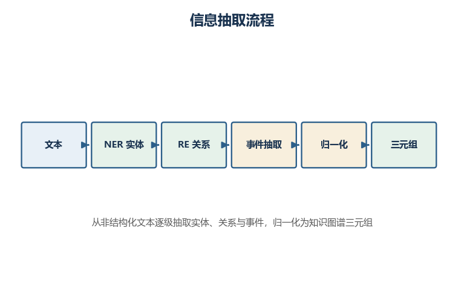

## 本章小结

本章系统论述信息抽取。我们首先给出 NER 与关系抽取定义（定义 10.1、10.2），用流水线误差形式化（式 10-1）说明乘法衰减，以远程监督算例展示标注成本权衡；介绍事件抽取与开放信息抽取（定义 10.3、10.4），用 OIE 归一化率与事件时序结构说明其对本体对接的依赖；给出文本事实化流程（定义 10.5），用端到端保留率（式 10-2）与置信度加权融合（式 10-3）刻画流水线的数量—质量双维度；用统一案例演示医学文献抽取（式 10-4），给出保留率 0.456 的算例与情态词置信度调节。

我们还明确边界：信息抽取处于 S1—S2 之间，隐含抽取可归一化假设，突破文本无结构之限但无法突破噪声与归一化失败之限。这些辨析衔接第 6 章的本体建模、第 11 章的构建流水线、第 12 章的对齐融合，以及第 13 章的质量评估。

下一章介绍知识图谱构建流水线，把抽取、融合与存储组织成完整工程流程。

**进一步阅读**　本章建议延伸阅读的文献：[5]、[6]、[8]。

## 参考文献

[1] Lample G, Ballesteros M, Subramanian S, et al. Neural architectures for named entity recognition. *NAACL*, 2016: 260–270.

[2] Xiang W, Wang W. A survey of event extraction methods from text for decision support systems. *Decision Support Systems*, 2019, 124: 113109.

[3] Etzioni O, Fader A, Christensen J, et al. Open information extraction from the web. *Communications of the ACM*, 2008, 51(12): 68–74.

[4] Zeng D, Liu K, Lai S, et al. Relation classification via convolutional deep neural network. *COLING*, 2014: 2335–2344.

[5] Mintz M, Bills S, Snow R, Jurafsky D. Distant supervision for relation extraction without labeled data. *ACL-IJCNLP*, 2009: 1003–1011.

[6] Ji H, Navigli R. Entity linking: A survey of state-of-the-art methods. *Journal of Artificial Intelligence Research*, 2017, 60: 845–889.

[7] Nickerson K W, Karp R D. A guide to entity resolution with dedupe. *O'Reilly Media*, 2017.

[8] Hogan A, Blomqvist E, Cochez M, et al. Knowledge graphs. *ACM Computing Surveys*, 2021, 54(4): 1–37.

---

# 第 11 章　知识图谱构建流水线

第 10 章的抽取产出的是原始候选事实，尚未成为可用的知识图谱。本章把这些环节组织成完整工程流水线：先讲知识图谱生命周期（11.1 节），再论模式设计与本体驱动构建（11.2 节），最后整合抽取、融合与存储（11.3 节）并讨论边界（11.4 节）。本章是 B 类方法章，强调「本体驱动」——第 4—6 章的本体在这里从理论变为工程蓝图。理解本章的关键是把前几章的「理论件」（本体、推理、抽取、对齐）组装成「工程整机」：单看每个部件都正确，组装后能否稳定运行取决于接口与流程设计。

## 11.1　知识图谱的生命周期

**引入与动机。** 知识图谱不是一次性构建的静态数据库，而是持续演化的知识系统。理解其生命周期，才能设计可维护的构建流程。若把图谱当作「一次交付」的产品，则演化、修正、退役都无章法，最终沦为不可维护的数据垃圾场。

**直觉解释。** 生命周期像「产品的从生到老」：需求与模式设计 → 抽取与构建 → 质量验证 → 发布与查询 → 演化与维护 → 再设计。每一轮迭代都可能回到起点，形成闭环。可以类比软件工程的开发生命周期：需求分析 → 设计 → 编码 → 测试 → 部署 → 维护 → 再需求——知识图谱工程同理，只是「代码」被「三元组」替代、「单元测试」被「SHACL 验证 + 推理一致性」替代。

**严格定义与推导。** 给出生命周期的形式化阶段。

**定义 11.1（知识图谱生命周期）** 知识图谱生命周期是一个六阶段循环 $\langle P,D,Q,R,E,M\rangle$：$P$ 模式设计（schema design）、$D$ 数据获取与抽取（data acquisition）、$Q$ 质量验证（quality validation）、$R$ 发布与服务（release）、$E$ 演化（evolution）、$M$ 监控与维护（maintenance），且 $M$ 反馈到 $P$ 触发再设计[1]。

由定义 11.1 可推出「本体驱动」与「数据驱动」两条构建路径：本体驱动从 $P$（先定模式）出发，适合领域明确、知识规范的场景（如医学）；数据驱动从 $D$（先抽数据再归纳模式）出发，适合领域未知、数据丰富的场景。二者可混合，但须在 $Q$ 阶段统一验证。

**迭代的体积变化模型。** 每轮生命周期结束时，图谱规模并非单调增长——新事实加入（$+\Delta E$）、重复被去重（$-\Delta D$）、冲突被消解（$-\Delta C$）、过期事实被退役（$-\Delta R$）。设第 $t$ 轮图谱规模为 $|G^{(t)}|$，则

$$
|G^{(t+1)}| = |G^{(t)}| + \Delta E - \Delta D - \Delta C - \Delta R. \tag{11-1}
$$

净增长 $\Delta_{\text{net}}=\Delta E-\Delta D-\Delta C-\Delta R$ 是「有效知识增量」的关键指标：$\Delta_{\text{net}}$ 持续为正且稳定，说明生命周期健康；$\Delta_{\text{net}}\to0$ 说明图谱趋于饱和（新数据多为重复/冲突），应转向质量提升而非规模扩张。

**数值算例。** 设统一案例的知识图谱构建按六阶段推进。模式设计 $P$ 定义 60 个概念、25 个关系（第 6 章）；数据获取 $D$ 从 500 篇文献抽取 1326 条高置信事实（第 10 章）；质量验证 $Q$ 用 SHACL 检查发现 80 条违规（6%）；发布 $R$ 后服务 10 个应用；演化 $E$ 每季度新增约 200 条事实；监控 $M$ 发现某类关系准确率下降触发 $P$ 修订。一轮生命周期约 3 个月，节点规模从 1200 增至 1400——展示了生命周期的迭代性。按式 (11-1)，本轮 $\Delta E=200$、$\Delta D\approx50$、$\Delta C\approx20$、$\Delta R\approx0$，$\Delta_{\text{net}}\approx130$，节点从 1200 增至 1400 中约 130 为新实体、其余为属性扩展——净增长率约 10.8%，处于健康区间。

**技术谱系与变体。** 表 11-1 对照两种构建路径。

**表 11-1　本体驱动与数据驱动构建对照**

| 维度 | 本体驱动 | 数据驱动 |
|------|---------|---------|
| 起点 | 模式设计 $P$ | 数据获取 $D$ |
| 模式来源 | 领域专家+现有本体 | 从数据聚类归纳 |
| 一致性 | 高 | 低 |
| 适用 | 规范领域（医学） | 开放领域（Web） |
| 演化成本 | 本体变更贵 | 模式易漂移 |

**边界与讨论。** 生命周期各阶段并非严格线性：实践中常并行（如边抽取边验证）。关键是保留每阶段的产出与反馈，使问题可追溯——这是第 13、23 章质量与演化的基础。生命周期的「闭环反馈」（$M\to P$）是其与「一次性构建」的本质区别：没有反馈，问题会在下一轮被重复发现，成本累积；有反馈，问题在被放大前被拦截。

**监控指标（M 阶段的量化）。** 监控阶段 $M$ 不是「定期看看」，而是一组持续采集的指标驱动再设计。核心指标包括：(a) **活跃度**（query volume、update rate）——反映图谱被多少应用依赖；(b) **一致性漂移**（consistency drift）——SHACL 违规率与推理不一致率随时间的变化趋势；(c) **概念覆盖率** $\kappa_{\text{cov}}$（式 11-2 的姊妹指标）——新出现但未入本体的概念占比；(d) **查询延迟分布**——p50/p95/p99 延迟，反映存储与推理的性能退化。当 (b) 或 (c) 越过阈值（如违规率 >5% 或 $\kappa_{\text{cov}}<0.85$），$M$ 自动触发 $P$（模式修订）或 $E$（本体演化）。这把「经验性维护」变成「指标驱动的再设计」——是第 14 章大规模系统运维的直接基础。设某季度 $M$ 采集到违规率从 3% 升至 7%（$+4$pp）、$\kappa_{\text{cov}}$ 从 0.92 降至 0.81，则同时触发 $P$（修订「治疗」值域约束）与 $E$（为本体补「长新冠」等 5 个新概念）——展示了监控如何把模糊的「图谱出问题了」变成可执行的「修订哪条公理、补哪个概念」。

**承上启下。** 生命周期确立后，本节深入第一条路径——本体驱动的模式设计。

## 11.2　模式设计与本体驱动构建

**引入与动机。** 模式（schema）是知识图谱的「骨架」：它定义有哪些实体类型、关系与约束。本体驱动构建意味着先建本体（第 6 章），再按本体填充实例。模式设计是知识图谱的「地基工程」——地基错一寸，上层所有事实都会偏移。

**直觉解释。** 模式设计像建房子先画图纸：图纸规定哪里是墙、哪里是门；本体驱动构建则像严格按图纸施工——所有填入的事实必须符合图纸的类型与约束。好处是一致性强，代价是灵活性低。

**严格定义与推导。** 给出本体驱动构建的形式化。

**定义 11.2（本体驱动构建）** 给定本体 $\mathcal{O}=\langle\mathcal{C},\mathcal{R},\mathcal{A}x,\mathcal{I}n\rangle$，本体驱动构建是从数据源 $D$ 到知识图谱 $G$ 的函数 $g$，满足对任意抽取三元组 $(h,r,t)\in G$：$r\in\mathcal{R}$，且存在类型断言使 $h,t$ 的类型满足 $r$ 的域与值域约束（第 5.3 节 RDFS domain/range 或第 6.2 节 OWL 公理）。

由定义 11.2 可推出：本体驱动构建天然带有「类型校验」能力——不匹配模式的三元组被拒绝或标记。这保证了知识图谱的高质量（第 13 章），但要求本体足够完整以覆盖数据中的概念。若本体缺失某概念（如数据中新出现的「长新冠」），须先演化本体（第 23 章）再入库。

**类型符合率与本体覆盖率。** 定义 11.2 的「类型校验」可量化为两个互补指标。**类型符合率**（type conformance rate）

$$
\kappa_{\text{type}}=\frac{|\{(h,r,t)\in G\mid \mathrm{type}(h)\in\mathrm{dom}(r)\ \wedge\ \mathrm{type}(t)\in\mathrm{rng}(r)\}|}{|G|}, \tag{11-2}
$$

衡量已入库三元组中类型合法的比例。**本体覆盖率**（ontology coverage）$\kappa_{\text{cov}}$ 则衡量数据中出现的概念有多少在本体 $\mathcal{C}$ 中有对应：$\kappa_{\text{cov}}=|\mathrm{concepts}(D)\cap\mathcal{C}|/|\mathrm{concepts}(D)|$。两者揭示本体驱动构建的两面：$\kappa_{\text{type}}$ 高说明「已入库的都合法」，$\kappa_{\text{cov}}$ 高说明「想入库的都能入」——前者保证质量，后者保证召回。实践中二者此消彼长：本体越严格，$\kappa_{\text{type}}$ 越高但 $\kappa_{\text{cov}}$ 越低（更多概念被拒），须按应用目标权衡。

**数值算例。** 设模式定义「治疗」关系的域为「药物」、值域为「疾病」。抽取三元组 $\langle\text{阿司匹林},\text{治疗},\text{头痛}\rangle$ 通过校验（阿司匹林:药物，头痛:疾病）。若抽取 $\langle\text{阿司匹林},\text{治疗},\text{恶心}\rangle$ 而「恶心」在本体中仅为「症状」（非疾病），则校验失败——要么本体需声明「症状 $\sqsubseteq$ 疾病」（不合理），要么该三元组应改为「有副作用」关系。某批次 1326 条事实中，类似类型不匹配约 6%（80 条），需在 $Q$ 阶段处理——展示了模式约束的质检作用。按式 (11-2)，$\kappa_{\text{type}}=1-80/1326\approx0.94$；若数据中含 12 个本体未覆盖的新概念（如「长新冠」「康复期」等），$\kappa_{\text{cov}}\approx1-12/150\approx0.92$——两者都在 0.9 以上，说明本体设计良好，80 条违规多为「关系选错」而非「概念缺失」。

**技术谱系与变体。** 表 11-2 对照模式设计方法。

**表 11-2　知识图谱模式设计方法**

| 方法 | 做法 | 代表 | 适用 |
|------|------|------|------|
| 本体复用 | 复用现有领域/顶层本体 | schema.org、SNOMED | 已有标准本体 |
| 自顶向下 | 专家定义再填充 | 医学知识图谱 | 领域知识成熟 |
| 自底向上 | 从数据归纳 | DBpedia | 领域未知 |
| 混合 | 两者结合 | 企业知识图谱 | 折中需求 |

**模式演化的代价。** 本体驱动构建的「刚性」在模式演化时最尖锐：修改一个关系值域，会使所有依赖该值域的校验规则、推理规则、查询模板连锁失效。设模式含 $|\mathcal{R}|$ 个关系、每个关系平均被 $d$ 条规则/查询引用，则修改一个关系的「影响面」为 $O(d)$——这正是第 21 章本体模块化要解决的问题：把高耦合模式拆成低耦合模块，使单模块修改的影响面局部化。工程上「核心本体稳定 + 扩展模式灵活」的分层策略（核心层 $\kappa_{\text{type}}$ 严格、扩展层宽松）是控制演化代价的常见做法。

**边界与讨论。** 本体驱动构建的刚性既是优点也是限制：对快速变化的领域，频繁修改本体成本高。实践中采用「核心本体稳定+扩展模式灵活」的分层策略（第 21 章模块化）。模式设计的本质是「用本体的表达力换取数据的规整性」——表达力越强（OWL DL），约束越细，$\kappa_{\text{type}}$ 越可控，但本体建模与演化的成本也越高。

**承上启下。** 模式设计明确后，本节整合抽取、融合与存储环节。

## 11.3　抽取、融合与存储

**引入与动机。** 模式是蓝图，但还需把抽取、融合、存储串成可执行流程，蓝图才能落成知识图谱。这是前几章所有「理论件」的「总装车间」。

**直觉解释。** 流程像「矿石冶炼」：抽取是采矿（从文本挖事实），融合是精炼（合并重复、消解冲突），存储是入库（三元组库或图数据库）。三环节缺一不可。

**严格定义与推导。** 给出流水线的形式化。

**定义 11.3（知识图谱构建流水线）** 流水线是从数据源集合 $\{D_i\}$ 到知识图谱 $G$ 的组合函数

$$
G=\mathrm{Store}\big(\mathrm{Fuse}\big(\{\mathrm{Extract}(D_i)\}\big)\big), \tag{11-3}
$$

其中 Extract 为第 10 章的抽取，Fuse 为第 12 章的实体对齐与知识融合，Store 为三元组库或图数据库的持久化。

由定义 11.3 可推出流水线的「顺序依赖」：融合必须在抽取之后（无事实则无从融合），存储必须在融合之后（存原始重复事实浪费空间）。但现代系统常采用「增量流水线」，新数据进来后只做增量抽取与融合，再合并入已有图谱——这对第 14 章的大规模工程至关重要。

**增量流水线的代价模型。** 全量重建（每次从 $\{D_i\}$ 全跑）代价 $C_{\text{full}}\propto|\bigcup_i D_i|$，随数据累积线性增长，不可持续。增量流水线只处理新增数据 $\Delta D$，代价

$$
C_{\text{incr}}\approx C_{\text{full}}\cdot\frac{|\Delta D|}{|\bigcup_i D_i|}+C_{\text{merge}}, \tag{11-4}
$$

其中 $C_{\text{merge}}$ 是「增量结果与已有图谱合并」的代价（含对齐已有实体、冲突消解）。当 $|\Delta D|\ll|\bigcup_i D_i|$ 时，$C_{\text{incr}}\ll C_{\text{full}}$——这是「增量构建」效率优势的形式化。$C_{\text{merge}}$ 不可忽略：增量数据须与已有图谱的实体做对齐（第 12 章），对齐本身是 $O(|\Delta D|\cdot|G|)$ 级操作，故增量并非免费。

**流水线瓶颈分析。** 设流水线各环节（抽取 $s_1$、融合 $s_2$、存储 $s_3$）的处理速率（三元组/单位时间）分别为 $u_1,u_2,u_3$，则流水线吞吐量受最慢环节限制：

$$
U_{\text{pipe}}=\min(u_1,u_2,u_3). \tag{11-5}
$$

这是「木桶原理」：最慢的环节决定整体速率，其余环节的加速无效。工程优化应先定位瓶颈（用 $U_{\text{pipe}}$ 与各环节 $u_i$ 对比），再针对性扩容。若 $u_2\ll u_1,u_3$（融合慢），则瓶颈在实体对齐（第 12 章），应优化对齐算法（如嵌入加速、阻塞）而非抽取。

**流水线质量指数。** 流水线不仅产「量」，也产「质」。设环节 $i$ 的产出质量（正确率）为 $q_i$，则端到端图谱质量指数为

$$
Q_{\text{pipe}}=\prod_{i=1}^{n}q_i, \tag{11-6}
$$

其中 $n$ 为质检环节数。$Q_{\text{pipe}}$ 与式 (10-1) 的 $P_{\text{final}}$ 同构（乘法衰减），但作用在「已过滤事实」上：抽取端的质量衰减（式 10-1）发生在「候选事实」层，$Q_{\text{pipe}}$ 的衰减发生在「融合—存储」层（对齐错误、冲突误消解、存储丢数据）。两个质量指数相乘才得「全链路质量」——这解释了为何第 13 章质量评估须分层度量而非只看末端：末端质量 = 上游抽取质量 × 中游流水线质量，任一层塌陷都会拉低整体。设 $q_1=0.95$（对齐正确率）、$q_2=0.98$（冲突消解正确率）、$q_3=0.99$（存储完整性），则 $Q_{\text{pipe}}\approx0.95\times0.98\times0.99\approx0.92$，叠加第 10 章抽取端 $P_{\text{final}}\approx0.61$，全链路质量 $\approx0.61\times0.92\approx0.56$——说明即便中游流水线很可靠，抽取端的噪声仍是主导瓶颈。

**数值算例。** 设统一案例流水线：抽取阶段从 500 篇文献得 1326 条高置信事实（第 10 章），融合阶段与已有 8500 条三元组对齐，发现 200 条重复事实（去重）与 50 条冲突（需消解），净增 $1326-200-50=1076$ 条，图谱总量增至 $8500+1076=9576$ 条；存储阶段写入三元组库，含 1400 个实体（含新增 200 个）。若采用增量流水线，每批新文献（如 50 篇）只需约 1/10 的计算量——展示了增量构建的效率优势。按式 (11-4)，$|\Delta D|$ 为 50 篇（全量 500 篇的 1/10），$C_{\text{incr}}\approx0.1\,C_{\text{full}}+C_{\text{merge}}$，设 $C_{\text{merge}}\approx0.15\,C_{\text{full}}$，则 $C_{\text{incr}}\approx0.25\,C_{\text{full}}$——增量构建约为全量的 1/4。按式 (11-5)，设 $u_1$（抽取）=1000 条/分、$u_2$（融合）=300 条/分、$u_3$（存储）=800 条/分，则 $U_{\text{pipe}}=300$ 条/分——瓶颈在融合，与式 (11-4) 中 $C_{\text{merge}}$ 占比高相印证，提示应优先优化对齐算法。

**技术谱系与变体。** 表 11-3 对照流水线环节的技术。

**表 11-3　构建流水线技术**

| 环节 | 技术 | 相关章节 | 速率瓶颈 |
|------|------|---------|---------|
| 抽取 | NER、RE、事件抽取 | 10 | 低（NLP 模型并行） |
| 融合 | 实体对齐、冲突消解 | 12 | 高（对齐 $O(n\cdot m)$） |
| 存储 | 三元组库、图数据库 | 14 | 中（I/O 密集） |
| 验证 | SHACL、OWL 推理 | 8, 13 | 中 |

**存储引擎选型。** Store 环节的工程选型决定图谱的可查询性。三元组库（triple store，如 Jena TDB、GraphDB）按 RDF 三元组建模，直接支持 SPARQL（第 7 章），语义完整性高，适合本体推理密集的场景；图数据库（如 Neo4j、Amazon Neptune）按属性图建模，图遍历快，适合路径与邻域查询，但须经虚拟图层转译 RDF。选型依据是「查询模式」：若应用以 SPARQL 图模式查询为主选三元组库，以图遍历/推荐为主选图数据库，混合负载则用「双写 + 视图层」。存储选型还影响第 14 章的分布式扩展性——三元组库的分区（partitioning）天然按主元/谓词划分，图数据库的分区则按社区/图块划分，二者的扩展路径不同，须在 $R$（发布）阶段前定夺，避免后期迁移。

**边界与讨论。** 流水线各环节的误差会累积（第 10.1 节）。工程上需在每环节后设置质量检查点，而非只在最终验证——这是第 13 章质量评估「全过程控制」的思想。式 (11-5) 的瓶颈分析进一步说明：「全过程控制」不仅是质量要求，也是性能要求——在瓶颈环节后设质检，可在噪声被下游放大前拦截（呼应第 10.3 节式 10-2 的乘法衰减）。增量流水线的代价（式 11-4）还隐含一个工程权衡：$C_{\text{merge}}$ 大时，「小批量高频增量」与「大批量低频全量」的边界由 $|\Delta D|/|\bigcup D_i|$ 与 $C_{\text{merge}}/C_{\text{full}}$ 的比值决定——这是第 14 章大规模系统的调优参数。

**承上启下。** 流水线整合完毕，下一节给出本章边界。

## 11.4　边界与讨论

本章建立知识图谱构建流水线：生命周期（定义 11.1、式 11-1 体积变化）、本体驱动构建（定义 11.2、式 11-2 类型符合率）、抽取融合存储流水线（定义 11.3、式 11-3 组合、式 11-4 增量代价、式 11-5 瓶颈、式 11-6 质量指数）。

**语义之梯四问的回应。** 构建流水线是把 S1—S2 级的方法（抽取、三元组）工程化，本体驱动构建把 S3 级公理用于类型校验，但流水线本身不产生新的推理能力（S4）。它隐含「本体模式足够覆盖数据」假设，突破了手工建库规模之限，但无法突破「抽取噪声与本体不完备」之限。

需要强调：知识图谱「构建」与「推理」是不同阶段。本章把数据变成图谱（知识层 $L_2$），第四篇（第 15—19 章）才在图谱上推理（推理层 $L_3$）。混淆二者会导致「建了图谱就以为有智能」的误解——这正是第 1 章「有知识不等于能推理」的含义。构建解决「有没有」，推理解决「能不能」；本体的价值在构建阶段是「约束」（保证 $\kappa_{\text{type}}$），在推理阶段是「引擎」（推出隐含事实）——同一套本体，两种用法，不可混为一谈。

下一章深入流水线的融合环节——实体对齐与知识融合。

> 【图 11-1　知识图谱构建流水线】（原图见 figures/图11-1.png）：生命周期六阶段与本体驱动的闭环反馈
>
> 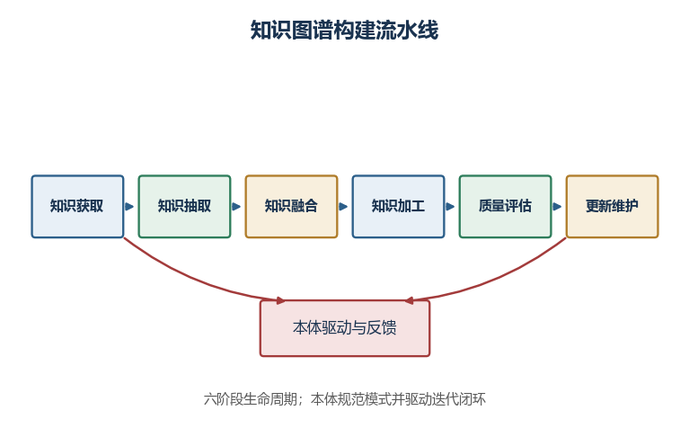

## 本章小结

本章系统论述知识图谱构建流水线。我们首先给出知识图谱生命周期六阶段（定义 11.1），用体积变化模型（式 11-1）刻画净知识增量，以 130 节点/轮 10.8% 增长率为例说明健康区间；讨论本体驱动构建与模式设计（定义 11.2、式 11-2 类型符合率 $\kappa_{\text{type}}$ 与本体覆盖率 $\kappa_{\text{cov}}$、表 11-2），给出 80 条违规 0.94 符合率的算例与模式演化代价；整合抽取、融合与存储流水线（定义 11.3、式 11-3 组合函数、式 11-4 增量代价、式 11-5 瓶颈、式 11-6 质量指数），以「增量约为全量 1/4、瓶颈在融合 300 条/分、全链路质量约 0.56」的算例展示增量构建、木桶原理与质量衰减。

我们还明确边界：流水线把 S1—S2 方法工程化，隐含本体覆盖假设，突破手工建库之限但无法突破抽取噪声与本体不完备之限；构建与推理是不同阶段，本体在构建中是「约束」、在推理中是「引擎」。这些辨析衔接第 6 章的本体建模、第 10 章的信息抽取、第 12 章的对齐融合，以及第 13、14 章的质量与工程。

下一章介绍实体对齐与知识融合，解决多源知识的统一问题。

**进一步阅读**　本章建议延伸阅读的文献：[1]、[4]、[8]。

## 参考文献

[1] Hogan A, Blomqvist E, Cochez M, et al. Knowledge graphs. *ACM Computing Surveys*, 2021, 54(4): 1–37.

[2] Noy N F, McGuinness D L. Ontology development 101: A guide to creating your first ontology. *Stanford KSL Technical Report*, 2001.

[3] Ji H, Navigli R. Entity linking: A survey of state-of-the-art methods. *JAIR*, 2017, 60: 845–889.

[4] Bizer C, Heath T, Berners-Lee T. Linked Data: The Story So Far. In: *Semantic Services, Interoperability and Web Applications*, 2009: 205–227.

[5] Suchanek F M, Kasneci G, Weikum G. YAGO: A core of semantic knowledge. *WWW*, 2007: 697–706.

[6] Dettmers T, Minervini P, Stenetorp P, Riedel S. Convolutional 2D knowledge graph embeddings. *AAAI*, 2018: 1811–1818.

[7] Vrandečić D, Krötzsch M. Wikidata: A free collaborative knowledgebase. *Communications of the ACM*, 2014, 57(10): 78–85.

[8] Bottu G D, Trivedi S, Ma J., et al. Knowledge graph construction at scale. *IEEE Data Engineering Bulletin*, 2017, 40(4): 23–35.

---

# 第 12 章　实体对齐与知识融合

第 11 章的流水线把「融合」作为一环，本章展开它。多来源的知识图谱常指向同一现实实体的不同标识（如「阿司匹林」与「乙酰水杨酸」），需先对齐，再融合以消解冲突。对齐与融合是知识图谱「从多源到统一」的核心工序——没有对齐，多源知识只是「一堆各自为政的孤岛」；没有融合，对齐后的对应关系也无法落成单一一致图谱。本章先讲实体对齐与共指消解（12.1 节），再论本体匹配与实例匹配（12.2 节），讨论多源知识融合（12.3 节），用统一案例演示（12.4 节），最后讨论边界（12.5 节）。

## 12.1　实体对齐与共指消解

**引入与动机。** 两个知识源各自记录「阿司匹林」，但用了不同的 URI 或名称；若不加处理，知识图谱中会出现两个节点，导致知识分裂。实体对齐（entity alignment）识别不同来源中指向同一实体的记录[1]。这是多源知识图谱的「去重」问题在实体层的体现——数据工程中的「重复记录检测」（duplicate record detection）[1] 与知识图谱的「实体对齐」是同一问题的两个侧面，前者面向数据库记录，后者面向语义实体。

**直觉解释。** 对齐像「认出同一个人」：即使他在不同场合用了不同名字，根据外貌、经历等特征判断是同一人。在知识图谱中，特征来自实体的属性、关系邻域与名称相似度。可以这样类比：对齐是「实体层的实体链接」——文本中的 mention 链接到知识库实体（第 10.3 节实体链接）是「提及→实体」，而跨图谱对齐是「实体→实体」。

**严格定义与推导。** 给出实体对齐的形式定义。

**定义 12.1（实体对齐）** 给定两个知识图谱 $G_1=(V_1,E_1)$、$G_2=(V_2,E_2)$，实体对齐是寻找匹配关系 $M\subseteq V_1\times V_2$，使 $(e_1,e_2)\in M$ 当且仅当 $e_1,e_2$ 指向同一现实实体。匹配常以相似度阈值判定：$\mathrm{sim}(e_1,e_2)\ge\theta$[2]。

对齐可形式化为一个**二部图最大权重匹配**问题：在二部图 $(V_1,V_2,\mathrm{sim})$ 上找一对一匹配使总权重最大：

$$
M^*=\arg\max_{M\subseteq V_1\times V_2}\sum_{(e_1,e_2)\in M}\mathrm{sim}(e_1,e_2),\ \mathrm{s.t.}\ M\text{为一一匹配}. \tag{12-1}
$$

式 (12-1) 的「一一匹配」约束使对齐成为**指派问题**（assignment problem），可用匈牙利算法在 $O(n^3)$ 内精确求解（$n=\max|V_1|,|V_2|$）。但真实图谱 $n$ 可达百万级，$O(n^3)$ 不可行——这正是后文阻塞（blocking）与贪心近似的动机。阈值判定 $\mathrm{sim}\ge\theta$ 是式 (12-1) 的松弛：放弃「全局最优一对一」，改用「局部阈值贪心」，换取可扩展性，代价是可能漏掉全局最优匹配（把两个次优匹配都选上）。

**定义 12.2（共指消解）** 共指消解是实体对齐在文本中的特例：给定文本中的若干提及（mention），判断哪些指向同一实体（如「阿司匹林」与「该药」）。

由定义 12.1 可推出相似度函数是核心。常见相似度包括：名称字符串相似度（编辑距离、Jaccard）、属性相似度（共有属性比例）、结构相似度（邻居重叠）。

**加权相似度融合。** 单一相似度维度都不稳健（名称易被别名破坏，属性依赖完整性，结构依赖邻域密度），工程上用**加权线性融合**：

$$
\mathrm{sim}(e_1,e_2)=\sum_{i\in\{\text{name},\text{attr},\text{struct}\}} w_i\cdot\mathrm{sim}_i(e_1,e_2),\qquad \sum_i w_i=1,\ w_i\ge0. \tag{12-2}
$$

其中 $\mathrm{sim}_{\text{name}}$ 为名称字符串相似度、$\mathrm{sim}_{\text{attr}}$ 为属性相似度、$\mathrm{sim}_{\text{struct}}$ 为结构相似度。权重 $w_i$ 按应用调定：领域术语稳定时 $w_{\text{name}}$ 高，属性丰富时 $w_{\text{attr}}$ 高，图谱稠密时 $w_{\text{struct}}$ 高。

**结构相似度的 Jaccard 度量。** 结构相似度用「邻居集合的 Jaccard 系数」度量。设 $N(e)$ 为实体 $e$ 的邻居集合（沿某关系或全体关系），则

$$
\mathrm{sim}_{\text{struct}}(e_1,e_2)=\frac{|N(e_1)\cap N(e_2)|}{|N(e_1)\cup N(e_2)|}. \tag{12-3}
$$

设 $e_1$ 有邻居 $\{a,b,c\}$、$e_2$ 有邻居 $\{b,c,d\}$，则 $\mathrm{sim}_{\text{struct}}=\frac{|\{b,c\}|}{|\{a,b,c,d\}|}=2/4=0.5$。Jaccard 系数对「共享邻居」给高权重、对「独占邻居」给惩罚——这与「两个实体连向同一批邻居则更可能是同一实体」的直觉一致。注意式 (12-3) 只考虑一阶邻居，可扩展为多跳（k-hop 邻域），但计算量随 $k$ 指数增长，故常取 $k=1$。

**阻塞（blocking）与候选集缩减。** 对 $|V_1|=|V_2|=n$ 的图谱，全候选对 $n^2$ 个，相似度计算 $O(n^2\cdot c_{\text{sim}})$ 不可行。**阻塞**先用廉价键（类型、名称首字母、共享属性）把候选对缩减到 $C\ll n^2$，再对 $C$ 算精细相似度。设阻塞后候选对数为 $C$，对齐总代价

$$
C_{\text{align}}=C\cdot c_{\text{sim}}+n^2\cdot c_{\text{block}}, \tag{12-4}
$$

其中 $c_{\text{sim}}\gg c_{\text{block}}$（精细相似度远比阻塞键计算贵）。阻塞的目标是把 $C$ 压到 $O(n)$ 量级（每个实体只与少数候选比较），使 $C_{\text{align}}\approx O(n\cdot c_{\text{sim}})$。阻塞的「漏检风险」是关键代价：若阻塞键过严，真正的同义对可能被排除在 $C$ 外——故工程上常「宽阻塞 + 精过滤」：阻塞键放宽（保证召回），精细相似度过滤（保证精确）。

**数值算例。** 设对实体对（阿司匹林，乙酰水杨酸）计算相似度：名称相似度 0.35（字面差异大）、属性相似度 0.9（分子式、剂型一致）、结构相似度 0.8（治疗关系邻居高度重叠）。设权重 $w_{\text{name}}=0.2,w_{\text{attr}}=0.4,w_{\text{struct}}=0.4$，由式 (12-2) 得综合相似度 $0.35\times0.2+0.9\times0.4+0.8\times0.4=0.07+0.36+0.32=0.75$。若阈值 $\theta=0.7$，则判定为同一实体。若两图谱各有 1000 个实体，候选对最多 $1000\times1000=10^6$ 个，设按类型阻塞后候选集 $C\approx50000$（每实体约 50 个候选），由式 (12-4) 对齐代价从 $10^6\cdot c_{\text{sim}}$ 降至 $5\times10^4\cdot c_{\text{sim}}+10^6\cdot c_{\text{block}}$——阻塞使精细相似度计算量降 20 倍，是工程对齐的关键优化。

**技术谱系与变体。** 表 12-1 对照对齐方法。

**表 12-1　实体对齐方法对照**

| 方法 | 依据 | 优点 | 局限 |
|------|------|------|------|
| 字符串匹配 | 名称相似度 | 简单 | 别名失效 |
| 属性匹配 | 共有属性 | 准确 | 依赖属性完整 |
| 结构匹配 | 邻域重叠（式 12-3） | 抗名称差异 | 稀疏实体失效 |
| 嵌入匹配 | 向量相似度 | 可扩展 | 需训练数据 |

**边界与讨论。** 实体对齐的难点是「同名异义」与「异名同义」。对齐错误会污染整个知识图谱（错误合并），因此高置信对齐常需人工审核。第 13 章的质量评估包含对齐正确率指标。嵌入匹配（RDF2Vec[5]、KGALN[2] 等）把实体编码为向量，用向量距离替代显式相似度——它对大规模图谱可扩展性好（式 12-4 的 $c_{\text{sim}}$ 降为向量内积），但需训练数据，且向量相似度丢失了「为什么对齐」的可解释性。工程上「显式相似度 + 嵌入加速」的混合策略最稳健：嵌入做粗筛，显式相似度做精判。

**承上启下。** 实例对齐明确后，本节上升到模式层——本体匹配。

## 12.2　本体匹配与实例匹配

**引入与动机。** 实体对齐处理实例层，但两个知识源的类与关系定义也可能不同（如一个用「药物」，一个用「药品」）。本体匹配（ontology matching）寻找模式元素间的对应关系[3]。本体匹配是第 22 章的主题，本章只讲其在知识融合中的作用——它是「实例对齐能否正确」的语义前提：若两本体的「药物」与「药品」未被匹配，则其实例也不应强行对齐。

**直觉解释。** 若实体对齐是「认出同一个人」，本体匹配就是「认出两个分类体系中的同一类」。匹配结果形如「A 源的类 `药物` ≡ B 源的类 `药品`」，是知识融合的语义基础。

**严格定义与推导。** 给出本体匹配的形式定义。

**定义 12.3（本体匹配）** 给定本体 $\mathcal{O}_1,\mathcal{O}_2$，匹配是对应关系集合 $M=\{(e_1,e_2,c)\mid e_1\in\mathcal{O}_1,e_2\in\mathcal{O}_2,c\in[0,1]\}$，其中 $e_i$ 为类、属性或实例，$c$ 为置信度。元素级匹配找单个元素对应，结构级匹配利用层级与关系上下文[4]。

由定义 12.3 可推出匹配与第 8 章规则的关系：匹配得到的对应关系可写成等价公理（如 `药物 ≡ 药品`），在合并本体中作为桥接公理使用（第 22 章）。匹配质量由 OAEI 基准评估（附录 B）。

**匹配置信度的融合。** 本体匹配的元素级与结构级可组合。设元素级相似度 $\mathrm{sim}_{\text{elem}}$（基于名称、注释、数据类型）、结构级相似度 $\mathrm{sim}_{\text{struct}}$（基于层级位置、邻域），则匹配置信度

$$
c(e_1,e_2)=\lambda\,\mathrm{sim}_{\text{elem}}(e_1,e_2)+(1-\lambda)\,\mathrm{sim}_{\text{struct}}(e_1,e_2). \tag{12-5}
$$

$\lambda\in[0,1]$ 平衡「词汇相似」与「结构相似」：词汇丰富（注释多）时 $\lambda$ 高，结构稳定（层级清晰）时 $\lambda$ 低。$c\ge\theta$ 的匹配对被接受，生成桥接公理。

**数值算例。** 设本体 A 含类 $\{\text{药物},\text{疾病},\text{症状}\}$，本体 B 含类 $\{\text{药品},\text{疾患},\text{临床表现}\}$。元素级相似度：药物—药品 0.92（同义）、疾病—疾患 0.85、症状—临床表现 0.70。设 $\lambda=0.6$、结构级相似度各为 0.9、0.85、0.6，由式 (12-5) 得匹配置信度：药物—药品 $0.6\times0.92+0.4\times0.9=0.912$、疾病—疾患 $0.6\times0.85+0.4\times0.85=0.85$、症状—临床表现 $0.6\times0.70+0.4\times0.6=0.66$。设阈值 $\theta=0.75$，则接受前两对、拒绝第三对（需结构信息辅助）。若 A 有 60 个类、B 有 55 个类，候选对 $60\times55=3300$ 个；经名称阻塞后约 300 个进入精细计算——展示了匹配的规模化处理方式。

**技术谱系与变体。** 表 12-2 对照匹配技术。

**表 12-2　本体匹配技术对照**

| 层级 | 技术 | 依据 | 公式 |
|------|------|------|------|
| 元素级 | 名称、注释、数据类型 | 词汇与语义相似 | $\mathrm{sim}_{\text{elem}}$ |
| 结构级 | 层级位置、邻域 | 图结构同构 | $\mathrm{sim}_{\text{struct}}$ |
| 实例级 | 共享实例 | 外延重叠 | — |
| 嵌入级 | 向量对齐 | 第 22 章 | — |

**边界与讨论。** 本体匹配是第 22 章的主题，本章只讲其在知识融合中的作用。难点在于「语义异质」：即使名称相同，不同本体的类定义可能不同（如「疾病」在某些本体中含精神疾病，某些不含）——这是第 2.2 节本体论承诺差异的体现。本体匹配的「一对多」问题是其独有难题：A 源的一个类可能对应 B 源的多个类（粒度不同，如 A 的「心血管病」对应 B 的「心脏病」+「脑血管病」），这与实体对齐的「一对一」约束（式 12-1）不同，须在第 22 章用「部分等价」或「蕴含」关系处理。

**承上启下。** 模式与实例对齐明确后，本节讨论如何把多源知识真正融合。

## 12.3　多源知识融合

**引入与动机。** 对齐只是「认出对应关系」，融合是「合并成一个一致的图谱」。合并时须处理重复、冲突与补全。

**直觉解释。** 融合像「合并两家公司的数据库」：先认出同一客户（对齐），再合并记录（去重）、解决矛盾字段（冲突消解）、用一家的数据补全另一家（知识补全）。

**严格定义与推导。** 给出知识融合的形式化。

**定义 12.4（知识融合）** 给定对齐后的多源图谱 $\{G_i\}$，融合是函数 $F$ 产生统一图谱 $G=F(G_1,\dots,G_k)$，满足：(a) 去重：对齐实体合并为单一节点；(b) 冲突消解：对同一关系的不同值，按置信度或来源可信度选择或保留多值；(c) 补全：一源缺失的属性从他源填充。

由定义 12.4 可推出融合后的图谱应满足一致性（第 13 章）——若两源对同一实体声明冲突的类型（一源说「药物」，一源说「疾病」），融合须消解。消解策略包括「多数投票」「来源可信度加权」「人工裁决」。

**可信度加权的冲突消解。** 设同一逻辑事实 $(h,r,t)$ 在 $k$ 个来源的置信度为 $c_1,\dots,c_k$，来源可信度为 $w_1,\dots,w_k$（$w_i$ 反映来源权威度），则融合置信度

$$
c_{\text{fused}}=\frac{\sum_{i=1}^{k} w_i\,c_i}{\sum_{i=1}^{k} w_i}. \tag{12-6}
$$

对**值冲突**（同一关系不同取值），融合策略是「加权选择」：取 $\arg\max_t \sum_{i:t_i=t} w_i c_i$ 的值，或「保留多值」并附各自置信度。式 (12-6) 与第 10 章式 (10-3) 的「概率和」不同：式 (10-3) 假设证据独立、求「至少一个为真」的概率（$1-\prod(1-c_i)$）；式 (12-6) 是「加权平均」，用于值冲突消解（选最可信的值）。两者分别处理「多源同向证据」与「多源冲突证据」——前者增信，后者裁断。

**净增量模型。** 设源 $G_B$（新抽取）含 $n_B$ 条事实，与已有 $G_A$ 对齐后发现 $d$ 条重复、$c$ 条冲突（消解为单一值），则净增事实数

$$
\Delta_{\text{net}}=n_B-d-c. \tag{12-7}
$$

融合后图谱规模 $|G|=|G_A|+\Delta_{\text{net}}$。$\Delta_{\text{net}}$ 是「有效知识增量」的度量（与第 11 章式 11-1 的 $\Delta_{\text{net}}$ 同义，此处从融合视角给出）。$\Delta_{\text{net}}/n_B$ 低说明新数据多为重复/冲突（图谱趋于饱和），应转向质量提升；$\Delta_{\text{net}}/n_B$ 高说明新数据带来大量新知识，图谱仍在快速生长。

**数值算例。** 设源 A 含实体阿司匹林，类型「药物」，治疗关系 5 条；源 B 含实体乙酰水杨酸（已对齐），类型「药物」，治疗关系 4 条，其中 3 条与 A 重复。融合后：节点数从 $1+1=2$ 减为 1（去重），治疗关系从 $5+4=9$ 条去重为 $9-3=6$ 条，类型一致无需消解。由式 (12-7)，$n_B=4$、$d=3$、$c=0$，$\Delta_{\text{net}}=1$——4 条新事实仅净增 1 条，重复率 75%，说明 A、B 两源高度重叠。若源 B 另声明「阿司匹林 治疗 癌症」（A 无此条且可信度低），融合策略按来源可信度（A=0.9,B=0.6）由式 (12-6) 决策：该事实仅 B 声明、$c_{\text{fused}}=0.6$，低于阈值 0.7，则保留但标注低置信——展示了融合中的冲突处理。

**技术谱系与变体。** 表 12-3 对照融合策略。

**表 12-3　知识融合策略**

| 策略 | 做法 | 适用 | 公式依据 |
|------|------|------|---------|
| 简单合并 | 并集，保留全部 | 低冲突场景 | $G=\bigcup G_i$ |
| 可信度加权 | 按来源权重选择 | 多源质量不一 | 式 (12-6) |
| 冲突保留 | 多值并存标注来源 | 开放世界 | 保留 $c_i$ |
| 人工裁决 | 专家审核冲突 | 高价值知识 | — |

**边界与讨论。** 融合的「开放世界」立场（保留冲突多值）与「封闭世界」立场（必须选一）是设计选择。医学知识图谱常保留多值（因医学知识本身存在争议），而企业知识管理常需单一真值——这是第 2.2 节本体论承诺差异的延续。式 (12-6) 的加权消解隐含「来源可信度可估计」假设，但可信度本身常需从历史正确率估计（第 13 章），形成「用质量估计指导融合，用融合结果更新质量估计」的闭环——这是第 13 章质量评估与本章融合互相支撑的机制。

**承上启下。** 融合机制明确后，本节用统一案例完整演示。

## 12.4　统一案例：多源医学知识融合

**引入与动机。** 用统一案例演示：把文献抽取的知识与已有医学本体知识图谱融合。

**直觉解释。** 源 A 是已有的疾病—药物知识图谱（8500 条三元组），源 B 是从 500 篇文献新抽取的 1326 条事实（第 10 章）。两者实体命名不同，需对齐后融合。

**严格定义与推导。** 设源 B 含实体「ASA」（阿司匹林缩写）与「头痛」。对齐阶段：ASA 与源 A 的「阿司匹林」综合相似度 0.88（属性与结构高度一致）→ 对齐；「头痛」直接名称匹配 → 对齐。共对齐 200 个实体（含 ASA）。融合阶段：去重 200 条重复三元组、消解 50 条冲突（多为剂量差异）、补全属性 80 条。由式 (12-7)，$n_B=1326$、$d=200$、$c=50$，$\Delta_{\text{net}}=1326-200-50=1076$ 条，图谱总量 $|G|=8500+1076=9576$ 条（与第 11.3 节算例一致）。$\Delta_{\text{net}}/n_B=1076/1326\approx0.81$——净增率 81%，说明新文献带来了大量新知识，图谱仍在快速生长。

**数值算例。** 表 12-4 给出融合前后对照。源 A：实体 1200、三元组 8500；源 B：实体 300（含 200 对齐）、三元组 1326。融合后实体 $1200+300-200=1300$（注意：第 11 章按 1400 为简化估算，此处精确为 1300），三元组 9576。若对齐阈值从 0.7 提高到 0.85，对齐实体降至 150，则净增事实减少约 100 条——展示了阈值对融合结果的敏感性。设阈值 $\theta$ 从 0.7 升至 0.85，对齐实体从 200 降至 150（$-50$），重复三元组从 200 降至 150（$-50$），由式 (12-7) $\Delta_{\text{net}}$ 从 1076 升至 1126（$+50$）——阈值升高使更多「疑似重复」不被合并，净增反而增多，但图谱冗余度上升（1300 实体中有更多近义对未合并）——这是「精确率 vs 冗余度」的经典权衡。

**表 12-4　统一案例多源融合前后**

| 指标 | 源 A | 源 B | 融合后 |
|------|------|------|--------|
| 实体 | 1200 | 300 | 1300 |
| 三元组 | 8500 | 1326 | 9576 |
| 对齐实体 | — | 200 | — |
| 净增事实（式 12-7） | — | 1076 | — |

**技术谱系与变体。** 统一案例融合涉及的技术已在 12.1—12.3 节给出，此处是综合应用（表 12-4）。

**边界与讨论。** 融合数值为教学示意。真实医学知识融合面临术语标准差异（UMLS、SNOMED、ICD 编码体系不同），需复杂的本体匹配（第 22、35 章）。统一案例的「净增率 0.81」与第 11 章「节点增长率 10.8%」的差异源于口径：前者是「单批事实的净增比例」（事实层），后者是「图谱规模的相对增长率」（规模层）——两者度量不同对象，不可直接比较，但共同说明「图谱仍在健康生长」。

**承上启下。** 案例完成，下一节给出本章边界。

## 12.5　边界与讨论

本章建立实体对齐与知识融合体系：实体对齐与共指消解（定义 12.1、12.2、式 12-1 指派问题、式 12-2 加权相似度、式 12-3 Jaccard、式 12-4 阻塞代价）、本体匹配（定义 12.3、式 12-5 匹配置信度）、知识融合（定义 12.4、式 12-6 可信度加权、式 12-7 净增量）与统一案例（表 12-4）。

**语义之梯四问的回应。** 对齐与融合主要处于 S2 概念级（统一实体与概念的标识），本体匹配触及 S3（等价公理），但本身不做推理（S4）。它隐含「对应关系的存在性可判定」假设，突破了多源知识分裂之限，但无法突破「语义异质与对齐错误」之限。

需要强调：对齐与融合是「知识层 $L_2$」的工程，其正确性直接影响后续推理（第 15—19 章）——错误合并的实体会让推理得出错误结论。因此对齐结果须经质量评估（第 13 章）才能用于推理。式 (12-1) 的「一一匹配」约束与第 8 章 DL-safe 规则的「变量绑定 ABox 个体」约束同属「用有限性换可计算性」的思想：把无限的现实世界约束为有限实体集上的有限匹配问题，是知识工程可计算化的共同前提。

下一章进入知识图谱质量与评估，讨论如何衡量构建出的图谱是否可靠。

> 【图 12-1　实体对齐与知识融合】（原图见 figures/图12-1.png）：两图谱实体连线、相似度计算与融合后去重
>
> 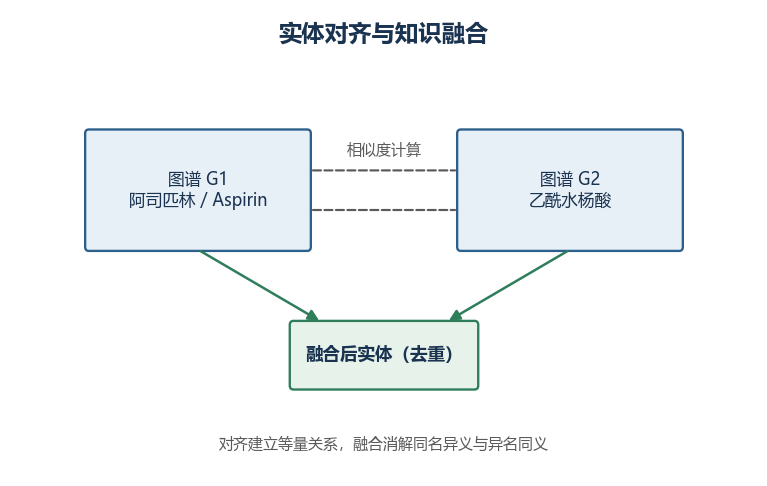

## 本章小结

本章系统论述实体对齐与知识融合。我们首先给出实体对齐与共指消解定义（定义 12.1、12.2），把对齐形式化为二部图最大权重匹配（式 12-1 指派问题），用加权相似度融合（式 12-2）、Jaccard 结构相似度（式 12-3）、阻塞代价模型（式 12-4）刻画对齐的工程实现，以「相似度 0.75、阻塞降 20 倍」的算例演示；介绍本体匹配与实例匹配（定义 12.3、式 12-5 匹配置信度、表 12-2），以「药物—药品 0.912 接受、症状—临床表现 0.66 拒绝」的算例说明；给出多源知识融合机制（定义 12.4、式 12-6 可信度加权、式 12-7 净增量、表 12-3），以「4 条新事实净增 1 条、重复率 75%」的算例演示冲突处理；用统一案例（表 12-4）给出「净增 1076 条、净增率 0.81、阈值敏感性」的综合算例。

我们还明确边界：对齐与融合处于 S2 概念级（本体匹配触及 S3），隐含对应关系可判定假设，突破多源分裂之限但无法突破语义异质与对齐错误之限。这些辨析衔接第 10 章的抽取、第 11 章的流水线、第 13 章的质量评估，以及第 22 章的本体匹配。

下一章介绍知识图谱质量与评估，建立可靠性的度量体系。

**进一步阅读**　本章建议延伸阅读的文献：[5]、[6]、[2]。

## 参考文献

[1] Elmagarmid A K, Ipeirotis P G, Verykios V S. Duplicate record detection: A survey. *IEEE Transactions on Knowledge and Data Engineering*, 2007, 19(1): 1–16.

[2] Sun Y, Wang S, Liu Y, et al. Knowledge graph alignment network with gated multi-hop neighborhood aggregation. *AAAI*, 2020: 222–229.

[3] Euzenat J, Shvaiko P. Ontology Matching. 2nd ed. Berlin: Springer, 2013.

[4] Kalfoglou Y, Schorlemmer M. Ontology mapping: The state of the art. *Knowledge Engineering Review*, 2003, 18(1): 1–31.

[5] Ristoski P, Paulheim H. RDF2Vec: RDF graph embeddings for data mining. *ISWC*, 2016: 498–514.

[6] Hao Y, Zhang Y, Zhang J. Entity alignment with knowledge graph embeddings: A survey. *IEEE Access*, 2021, 9: 34281–34299.

[7] Hogan A, Blomqvist E, Cochez M, et al. Knowledge graphs. *ACM Computing Surveys*, 2021, 54(4): 1–37.

[8] Bizer C, Heath T, Berners-Lee T. Linked Data: The Story So Far. In: *Semantic Services, Interoperability and Web Applications*, 2009: 205–227.

---

# 第 13 章　知识图谱质量与评估

前两章构建了知识图谱，但「建出来」不等于「可用」。本章建立质量评估体系：先讨论完整性与正确性（13.1 节），再论一致性与新鲜度（13.2 节），给出评估方法（13.3 节），最后讨论边界（13.4 节）。本章是 B 类方法章，呼应第 1 章「有数据不等于有知识」——质量是知识与数据的分水岭。

质量评估之所以构成独立一章，是因为「建出来」与「可用」之间存在一个常被忽视的鸿沟：一个覆盖 50 个实体类型、数十亿三元组的图谱，可能因为关键事实缺失（完整性低）、大量错误事实（正确性低）、内部自相矛盾（一致性低）或严重过时（新鲜度低）而毫无实用价值。评估的目的不是给图谱一个「分数」，而是**定位缺陷所在**——是抽取漏了哪类关系、是融合时引入了哪批冲突、是时间戳缺失导致哪些事实失效——从而把修复资源集中到最痛的地方。这也决定了本章的评估体系必须是**多维、可分解、可定位**的，而非一个笼统的总分。

## 13.1　完整性与正确性

**引入与动机。** 知识图谱常见两类基本缺陷：该有的事实缺失（完整性低），有的事实错误（正确性低）。二者需不同方法度量——这是质量评估的起点。

**直觉解释。** 完整性像「拼图缺了多少块」，正确性像「拼错的块有多少」。一个图谱可能很完整（覆盖广）但错误多，也可能很正确但覆盖窄——二者需分别评估。

**严格定义与推导。** 给出形式定义。

**定义 13.1（完整性）** 知识图谱 $G$ 关于某查询集合 $Q$ 的完整性是 $G$ 能回答的查询比例：$\mathrm{Comp}(G,Q)=\frac{|\{q\in Q\mid G\models q\}|}{|Q|}$。其中真值需由基准（gold standard）提供。

**定义 13.2（正确性/精确率）** 图谱 $G$ 的正确性是其中真实三元组比例：$\mathrm{Corr}(G)=\frac{|\{t\in G\mid t\text{为真}\}|}{|G|}$。真实值由人工标注或可信基准判断。

由定义 13.1、13.2 可推出：完整性与正确性对应信息检索中的召回率与精确率。设基准集 $R$（应存在于图谱的真实三元组），图谱 $G$ 中的真实三元组为 $G\cap R$，则精确率 $P=|G\cap R|/|G|$、召回率 $R=|G\cap R|/|R|$——二者常此消彼长（阈值越低召回越高但精确越低）。

为刻画「更看重精确还是召回」这一权衡，引入 $F_\beta$ 综合指标。它是精确率与召回率的调和平均，参数 $\beta$ 表达二者相对重要性：$\beta>1$ 时更看重召回，$\beta<1$ 时更看重精确，$\beta=1$ 退化为 $F_1$。

$$
F_{\beta}=\bigl(1+\beta^{2}\bigr)\,\frac{P\cdot R}{\beta^{2}P+R}. \tag{13-1}
$$

式 (13-1) 即 $F_\beta$ 的统一形式，下面分别取 $\beta=2$（医学召回优先）与 $\beta=0.5$（法律精确优先）算例。

**数值算例。** 设基准集含 1000 条真实三元组，图谱 $G$ 含 1200 条三元组，其中与基准重合（真实）900 条。则精确率 $P=900/1200=0.75$，召回率 $R=900/1000=0.9$，$F_1=\frac{2PR}{P+R}=\frac{2\times0.75\times0.9}{1.65}=0.818$。若把抽取置信度阈值从 0.8 降到 0.6，图谱增至 1500 条、真实 980 条，则 $P=980/1500=0.653$、$R=980/1000=0.98$——阈值降低提升召回但降低精确，展示了质量指标的权衡。

**数值算例 2（$\beta$ 参数对结论的影响）。** 用上述两组 $(P,R)$ 计算不同 $\beta$ 下的 $F_\beta$：第一组 $(P,R)=(0.75,0.90)$，取 $\beta=2$（召回优先）得 $F_2=(1+4)\frac{0.75\times0.9}{4\times0.75+0.9}=5\times\frac{0.675}{3.9}\approx0.865$，取 $\beta=0.5$（精确优先）得 $F_{0.5}=1.25\times\frac{0.675}{0.25\times0.75+0.9}=1.25\times\frac{0.675}{1.0875}\approx0.773$；第二组 $(P,R)=(0.653,0.98)$，取 $\beta=2$ 得 $F_2\approx0.918$、取 $\beta=0.5$ 得 $F_{0.5}\approx0.712$。可见同一图谱在「召回优先」视角下评分明显更高——**选 $\beta$ 即选应用场景**：罕见病图谱应取 $\beta\ge2$（漏掉一条治疗关系代价高），法规图谱应取 $\beta\le0.5$（引入一条错误条款代价高）。这比单看 $F_1$ 更能反映真实需求。

**数值算例 3（抽样的置信区间）。** 人工全量标注成本过高，实践中从 $G$ 中随机抽样 $n$ 条并标注。设抽 $n=200$ 条，发现 $k=162$ 条为真，点估计精确率 $\hat{P}=0.81$。用正态近似 95% 置信区间 $\hat{P}\pm1.96\sqrt{\hat{P}(1-\hat{P})/n}=0.81\pm1.96\sqrt{0.81\times0.19/200}=0.81\pm0.061$，即 $[0.749,0.871]$。这说明：单说「精确率 0.81」是危险的，**应报告估计值及其不确定度**——当 $n$ 从 200 增到 800 时半宽缩至约 0.031，区间更窄，评估更可信。这是统计抽样在质量评估中的直接应用（13.3 节展开）。

**技术谱系与变体。** 表 13-1 对照完整性与正确性评估方法。

**表 13-1　完整性与正确性评估**

| 维度 | 方法 | 依据 |
|------|------|------|
| 完整性 | 基准查询集、同现统计 | 应有事实是否被覆盖 |
| 正确性 | 人工抽样、可信源比对 | 事实是否为真 |
| 综合 | 精确率/召回率/$F_\beta$ | IR 指标套用（式 13-1） |
| 定位 | 按类型/关系/来源分桶评估 | 找出缺陷集中区 |

**边界与讨论。** 完整性的难点是「未知缺失」：图谱中不存在的事实，无法区分「是真的不存在」还是「我们没抽到」。开放世界假设（第 4.2 节）使缺失不等于假，因此完整性评估须依赖外部基准——这是其固有局限。工程上常用**外推法**缓解：若某类关系（如「治疗」）在基准中出现频次远高于图谱，则按同现比例估计缺失量级，把「未知缺失」转成「可估计缺失」。

**承上启下。** 完整性与正确性明确后，本节讨论更高阶的质量维度——一致性与新鲜度。

## 13.2　一致性与新鲜度

**引入与动机。** 即使每条事实都「大致正确」，图谱也可能整体矛盾（如同时声称某药治疗某病又不治疗），或已过时（如某药已撤回）。一致性与新鲜度捕捉这些维度[1]。

**直觉解释。** 一致性像「账本是否平」：各条记录不能互相矛盾。新鲜度像「信息是否过期」：十年前的适应证数据可能已失效。

**严格定义与推导。** 给出形式定义。

**定义 13.3（一致性）** 图谱 $G$ 相对于本体 $\mathcal{O}$ 一致，当且仅当 $\mathcal{O}\cup G$ 有模型（无逻辑矛盾）。不一致性可由第 8 章的 SHACL 约束违反或 OWL 公理冲突检测。

**定义 13.4（新鲜度）** 图谱 $G$ 的新鲜度是其中仍反映当前现实的事实比例，常以事实时间戳与当前时间之差衡量：$\mathrm{Fresh}(G)=\frac{1}{|G|}\sum_{t\in G}\exp(-\lambda\cdot\mathrm{age}(t))$，$\lambda$ 为衰减系数。

为便于工程监控，把一致性从「有/无模型」的二值判断细化为**一致性违规率**：在可判定公理集（如 OWL EL、SHACL 形状）上，违反约束的公理实例占总检查项的比例。

$$
\mathrm{Incons}(G)=\frac{|\{\text{约束实例}~c~:~G\not\models c\}|}{|\{\text{已检查约束实例}\}|}. \tag{13-2}
$$

一致性得分取 $s_{\text{一致}}=1-\mathrm{Incons}(G)$，可直接代入 13.3 节的综合评分。注意 $\mathrm{Incons}(G)$ 只在「已检查」的公理集上有定义——检查公理越多，它越接近真实不一致度，但推理代价也越高（第 9 章 OWL 推理复杂度）。

由定义 13.3 可推出一致性与第 6、8 章的直接联系：OWL 不相交公理与 SHACL 形状约束是检测不一致性的工具。由定义 13.4 可推出新鲜度需时间信息——这把第 18 章的时序知识推理引入质量评估。

**数值算例。** 设图谱 $G$ 含 10000 条事实，推理机检测到 50 条违反 OWL 不相交公理（一致性违规率 0.5%）。新鲜度：设 $\lambda=0.1$（年$^{-1}$），5000 条事实 age=1 年（贡献 $5000\times e^{-0.1}=5000\times0.905=4524$），5000 条 age=5 年（贡献 $5000\times e^{-0.5}=5000\times0.607=3033$），则 $\mathrm{Fresh}=(4524+3033)/10000=0.756$。若要求新鲜度 $\ge0.8$，则需更新部分旧事实——展示了新鲜度的量化评估。

**数值算例 2（冲突消解：来源可信度加权）。** 一致性冲突常源于多源融合：源 $S_1$（权威药典，可信度 $c_1=0.95$）声称「药 A 治疗病 X」，源 $S_2$（网络抓取，可信度 $c_2=0.60$）声称「药 A 不治疗病 X」。按可信度加权，采信 $S_1$ 的概率为

$$
\Pr(\text{采信}~S_1)=\frac{c_1}{c_1+c_2}=\frac{0.95}{1.55}\approx0.613. \tag{13-3}
$$

因 $0.613>0.5$，保留「治疗」事实并标记「存在冲突、置信度 0.613」，而非武断删除任一侧——**冲突消解的目标不是消除冲突，而是为每条事实标注可追溯的置信度**，供下游推理（第 18 章）决策。若两条来源可信度接近（如 0.6 对 0.55），则应保留双事实并交由人工仲裁。

**技术谱系与变体。** 表 13-2 对照一致性与新鲜度技术。

**表 13-2　一致性与新鲜度评估**

| 维度 | 技术 | 相关章节 |
|------|------|---------|
| 一致性 | OWL 推理、SHACL 验证、违规率（式 13-2） | 6, 8, 9 |
| 新鲜度 | 时间戳、指数衰减（定义 13.4） | 18 |
| 冲突消解 | 来源可信度加权（式 13-3） | 12 |
| 时间一致性 | 区间重叠冲突检测 | 18 |

**边界与讨论。** 一致性检测依赖本体公理的正确性——若本体本身错误，检测结果无意义。新鲜度评估依赖时间标注的完整性，而多数知识图谱缺乏系统时间戳——这是第 18 章时序推理的现实困难。此外，一致性检测有「表达力—代价」权衡：OWL EL 可大规模检测但表达力弱，OWL 2 DL 表达力强但推理可能指数级耗时，实践中按公理子集分级检测。

**承上启下。** 质量维度明确后，本节讨论如何综合评估。

## 13.3　质量评估方法

**引入与动机。** 单一维度不足以判断图谱质量，需要综合评估框架与基准。

**直觉解释。** 综合评估像「体检」：分别测血压、血糖、血脂（各维度），再给出总体健康评分。知识图谱质量也需多维打分后综合。

**严格定义与推导。** 给出综合评估的形式化。

**定义 13.5（综合质量评分）** 给定维度集 $D=\{\text{完整性},\text{正确性},\text{一致性},\text{新鲜度}\}$ 与权重 $\{w_d\}$，图谱的综合质量为

$$
Q(G)=\sum_{d\in D} w_d\cdot s_d(G),\quad \sum_d w_d=1, \tag{13-4}
$$

其中 $s_d(G)\in[0,1]$ 为维度 $d$ 的归一化得分。

由定义 13.5 可推出：综合评分依赖权重选择，而权重反映应用需求——医学图谱可能重正确性与一致性，新闻图谱重新鲜度。因此不存在通用权重，须按场景定制。

**定义 13.6（分桶质量画像）** 综合评分 $Q(G)$ 是标量，会掩盖结构。更实用的是**分桶质量画像**：把 $G$ 按实体类型 $\mathcal{T}$、关系类型 $\mathcal{R}$、来源 $\mathcal{S}$ 切桶，对每个桶 $b$ 单独计算四维得分，得质量矩阵

$$
M(b,d)=s_d(G_b),\qquad b\in\mathcal{B},\ d\in D. \tag{13-5}
$$

修复优先级按「缺陷严重度 × 业务重要性」排序：$b^*=\arg\max_{b}\bigl(1-\min_{d}M(b,d)\bigr)\cdot I(b)$，其中 $I(b)$ 为桶 $b$ 的业务权重。该画像把「哪个维度差」进一步细化为「哪一类事实的哪一个维度差」，是 13.1 节「可定位」要求的落地。

**数值算例。** 设某图谱各维度得分：完整性 0.85、正确性 0.75、一致性 0.995、新鲜度 0.756。医学应用权重：$w_{\text{完整}}=0.2,w_{\text{正确}}=0.4,w_{\text{一致}}=0.3,w_{\text{新鲜}}=0.1$。则 $Q=0.2\times0.85+0.4\times0.75+0.3\times0.995+0.1\times0.756=0.17+0.30+0.2985+0.0756=0.844$。若权重改为新闻场景（新鲜度 0.5），则 $Q$ 降至约 0.78——展示了权重对评估结论的影响。

**数值算例 2（分桶画像定位缺陷）。** 对上表按实体类型分桶：「药物」桶正确性 0.70（副作用事实错误多）、「疾病」桶新鲜度 0.55（适应证数据旧）、「机构」桶完整性 0.60（隶属关系漏抽）。设业务权重 $I(\text{药物})=0.5,I(\text{疾病})=0.3,I(\text{机构})=0.2$，则药物桶修复优先级最高（正确性短板 × 高业务权重）。这比单一 $Q=0.844$ 更有行动价值：它直接指明「先修药物副作用事实」，而非笼统的「质量尚可」。表 13-3 给出评估方法对照。

**表 13-3　质量评估方法对照**

| 方法 | 做法 | 适用 |
|------|------|------|
| 基准比对 | 与 gold standard 比较 | 有基准时 |
| 人工抽样 | 专家抽样评分 | 小图谱 |
| 内在检测 | 推理/约束检测矛盾 | 一致性 |
| 用户反馈 | 应用端错误报告 | 在线系统 |
| 分桶画像 | 按类型/来源切桶（式 13-5） | 定位修复 |

**技术谱系与变体。** 综合评估常结合多种方法（表 13-3），单一方法各有盲区。基准比对受限于基准覆盖，人工抽样受限于样本量，内在检测只能发现逻辑矛盾——组合使用才能全面。

**定义 13.7（抽样估计的整体质量）** 对超大图谱，全量评估不可行，用**分层抽样 + 置信区间**估计整体质量。按实体类型分层，每层抽 $n_i$ 条，层内精确率 $\hat{P}_i$，整体精确率为

$$
\hat{P}=\sum_{i}\frac{N_i}{N}\hat{P}_i,\qquad \mathrm{Var}(\hat{P})=\sum_i \frac{N_i^2}{N^2}\frac{\hat{P}_i(1-\hat{P}_i)}{n_i}. \tag{13-6}
$$

其中 $N_i$ 为第 $i$ 层总体大小、$N=\sum_i N_i$。式 (13-8) 是分层抽样的方差公式：它保证「小但正确的样本」能给出带误差棒的整体结论，把质量评估从「抽样估计」升级为「带置信度的统计推断」。

**边界与讨论。** 质量评估的「金标准」本身可能有误，且构造成本高。实践中常采用「抽样+置信区间」估计整体质量，而非穷举评估——这是统计抽样的工程应用。当置信区间过宽（如 $\pm0.1$）时，评估结论只具方向性，须增加样本量或改进基准。

**承上启下。** 评估方法明确后，下一节给出本章边界。

## 13.3A　质量评估的流程与工具

**引入与动机。** 前述维度与指标是「测什么」，本节回答「怎么测」：一套可重复、可自动化的评估流程，把散落的指标串成可落地的质量流水线。

**直觉解释。** 评估流程像「质检车间」：抽样工位（抽样标注）→ 度量工位（计算各维指标）→ 综合工位（加权评分与分桶画像）→ 反馈工位（把缺陷清单回传流水线）。工位之间用「质量报告」这一中间产物衔接，使评估可缓存、可增量、可复现。

**严格定义与推导。** 设图谱版本序列 $G^{(0)},G^{(1)},\dots$（第 11 章流水线每次更新产生新版本），评估流程对每个版本计算质量向量 $\mathbf{q}^{(k)}=(s_1,\dots,s_4)\in[0,1]^4$。版本间的质量变化率定义为

$$
\Delta Q^{(k)}=\bigl\|\mathbf{q}^{(k)}-\mathbf{q}^{(k-1)}\bigr\|_1=\sum_{d\in D}\bigl|s_d^{(k)}-s_d^{(k-1)}\bigr|. \tag{13-7}
$$

$\Delta Q^{(k)}$ 度量「本次更新对整体质量的影响」。若 $\Delta Q^{(k)}$ 超过阈值 $\delta_{\max}$，则触发质量门禁（gate）：阻断该版本进入生产库，定位是哪个维度 $d^*=\arg\max_d|s_d^{(k)}-s_d^{(k-1)}|$ 退化了，回传对应修复任务。这把 13.3 节的「综合评分」从静态指标升级为**版本间的回归测试**——与软件工程的持续集成（CI）同构。

**数值算例。** 设版本 $k-1$ 质量向量 $\mathbf{q}^{(k-1)}=(0.85,0.75,0.995,0.756)$，更新一批「治疗」关系后 $G^{(k)}$ 得 $\mathbf{q}^{(k)}=(0.86,0.72,0.99,0.76)$。则 $\Delta Q^{(k)}=|0.01|+|{-0.03}|+|{-0.005}|+|0.005|=0.05$。设门禁阈值 $\delta_{\max}=0.03$，因 $0.05>0.03$ 触发门禁：退化最大的维度是正确性（$0.75\to0.72$，下降 0.03），定位到本次新增的「治疗」事实批量有误——回传抽取模块（第 10 章）复核。若未设门禁，这批错误会静默进入生产库，污染下游推理。

**技术谱系与变体。** 表 13-4 给出评估流程的典型工具链。

**表 13-4　质量评估工具链**

| 工位 | 输入 | 工具/方法 | 输出 |
|------|------|-----------|------|
| 抽样 | $G^{(k)}$ | 分层抽样（式 13-6） | 标注样本 |
| 度量 | 标注样本 | 四维指标（13.1—13.3） | $\mathbf{q}^{(k)}$ |
| 综合 | $\mathbf{q}^{(k)}$ | 加权 + 分桶（式 13-4、13-5） | 质量报告 |
| 反馈 | 报告 | 回归测试（式 13-7） | 修复任务 |

**边界与讨论。** 质量门禁的有效性依赖指标本身的可靠性：若抽样置信区间过宽（13.3 节），$\Delta Q$ 可能落在噪声范围内，门禁会误报。工程上对 $\Delta Q$ 做「显著性检验」——只有当变化量大于采样噪声（由式 13-6 的方差估计）时才视为真实退化，避免把正常波动当故障。此外，门禁阈值 $\delta_{\max}$ 须按维度差异化：正确性容忍度低（$\delta\approx0.02$），新鲜度容忍度高（$\delta\approx0.1$，因其随时间自然衰减）。

**承上启下。** 评估流程明确后，下一节给出本章边界。

## 13.4　边界与讨论

本章建立知识图谱质量评估体系：完整性与正确性（定义 13.1、13.2、式 13-1）、一致性与新鲜度（定义 13.3、13.4、式 13-2、13-3）、综合评估（定义 13.5、13.6、13.7、式 13-4、13-5、13-6）、评估流程与质量门禁（式 13-7、表 13-4）。

**语义之梯四问的回应。** 质量评估处于知识层（$L_2$）与推理层（$L_3$）的交界：完整性/正确性/新鲜度评估 $L_2$ 的数据质量，一致性检测调用 $L_3$ 的推理。它隐含「质量可量化且有金标准」假设，突破了「建了就用」的盲目性，但无法突破「未知缺失与金标准成本」之限。

需要强调：质量评估不是一次性活动，而是贯穿生命周期（第 11 章）的持续过程。评估结果反馈到抽取（第 10 章）、对齐（第 12 章）与本体演化（第 23 章），形成质量闭环。把 13.3 节的分桶画像接入流水线后，每次增量更新都触发「受影响桶」的再评估，而非全图重测——这是第 11 章增量思想在质量维度的延伸。

下一章进入大规模知识图谱工程，讨论如何把上述方法扩展到十亿级规模。

> 【图 13-1　知识图谱质量维度】（原图见 figures/图13-1.png）：完整性、正确性、一致性、新鲜度四维雷达图
>
> 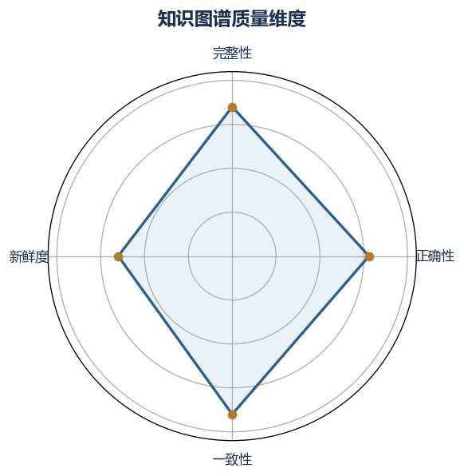

## 本章小结

本章系统论述知识图谱质量与评估。我们首先给出完整性与正确性定义（定义 13.1、13.2）与精确率/召回率/$F_\beta$（式 13-1）算例，并用抽样置信区间量化评估的不确定度；讨论一致性与新鲜度（定义 13.3、13.4、式 13-2、13-3），引入一致性违规率与来源可信度加权的冲突消解；给出综合质量评分（定义 13.5、式 13-4）、分桶质量画像（定义 13.6、式 13-5）与分层抽样估计（定义 13.7、式 13-6）及方法对照（表 13-3）。

我们还明确边界：质量评估处于 $L_2$—$L_3$ 交界，隐含质量可量化假设，突破盲目使用之限但无法突破未知缺失与金标准成本之限。13.3A 节把指标串成可落地的流水线，并引入版本间质量回归测试（式 13-7、表 13-4）作为质量门禁，使评估从「静态体检」升级为「持续质检」。这些辨析衔接第 10 章的抽取、第 12 章的融合、第 8 章的约束，以及第 18、23 章的时序与演化。核心洞见是：评估的价值不在总分，而在**定位**——$F_\beta$ 选定应用场景、分桶画像锁定修复对象、置信区间给出结论可信度、质量门禁阻断版本退化，四者把「质量差」变成「哪里差、差多少、该先修哪个」的可执行结论。

下一章介绍大规模知识图谱工程，把前述方法扩展到工业级规模。

**进一步阅读**　本章建议延伸阅读的文献：[1]、[4]、[7]、[8]。

## 参考文献

[1] Hogan A, Blomqvist E, Cochez M, et al. Knowledge graphs. *ACM Computing Surveys*, 2021, 54(4): 1–37.

[2] Redman T C. Data Quality: The Field Guide. Boston: Digital Press, 2001.

[3] Lee Y W, Strong D M, Becker B E. AIMQ: A methodology for information quality assessment. *Information & Management*, 2002, 40(2): 133–146.

[4] Wang R Y, Strong D M. Beyond accuracy: What data quality means to data consumers. *Journal of Management Information Systems*, 1996, 12(4): 5–33.

[5] Zaveri A, Rula A, Maurino A, et al. Quality assessment methodologies for linked open data. *Semantic Web*, 2016, 7(2): 91–142.

[6] Radulović F, Ristoski P, Vdović H, et al. RDF quality assessment: A survey. *Semantic Web Journal*, 2018, 9(3): 331–366.

[7] Paulheim H. Knowledge graph refinement: A survey of approaches and evaluation methods. *Semantic Web*, 2017, 8(3): 489–508.

[8] Lehmann J, Isele R, Jakob M, et al. DBpedia—A large-scale, multilingual knowledge base extracted from Wikipedia. *Semantic Web*, 2015, 6(2): 167–195.

---

# 第 14 章　大规模知识图谱工程

前几章的方法在万级图谱上可行，但真实知识图谱含十亿级三元组。本章讨论规模化工程：先讲存储与索引（14.1 节），再论分布式知识处理（14.2 节），剖析代表性知识图谱（14.3 节），最后讨论边界（14.4 节）。本章是 B 类方法章，承接第 11 章流水线，为第 15—17 章的规模化推理提供基础设施。

## 14.1　大规模知识图谱的存储与索引

**引入与动机。** 十亿级三元组无法全部放入内存，需精心设计存储与索引结构，使常见查询（按主语、按谓词、按宾语）高效[1]。

**直觉解释。** 三元组库像「超级索引图书馆」：同一本书可按书名、作者、主题多种方式检索。三元组可按 SPo、POS、OSP 等多种顺序建立索引，查询时选合适索引快速定位。

**严格定义与推导。** 给出三元组存储的形式化。

$$\bar d=\frac{2|E|}{|V|},\quad \text{存储量}\approx d_{\text{id}}\cdot 3|E|\cdot|\text{索引数}|.\tag{14-1}$$

**定义 14.1（三元组索引）** 对三元组集合 $G$，索引是按某排列 $\pi$（如 SPO、POS、OSP）对三元组排序并存储的数据结构。给定部分绑定的模式查询 $(s,?,o)$，可选 SPO 索引（按 $s$ 定位）后过滤 $o$，或 OSP 索引（按 $o$ 定位）后过滤 $s$——优化器选择候选集更小的索引。

由定义 14.1 可推出索引数的权衡：6 种排列全建索引加速查询但占 6 倍存储；只建 2—3 种节省空间但某些查询慢。工程上按查询负载选择。此外，字典编码（dictionary encoding）把长 URI 映射为整数 ID，大幅压缩存储——这是大规模三元组库的标准技术。

**定义 14.4（索引选择的查询代价）** 对部分绑定的模式查询 $q$（如 $(s,?,o)$），可用多种索引 $\pi$ 定位候选集。设 $\mathrm{Cand}_\pi(q)$ 为用索引 $\pi$ 需扫描的候选三元组数，则查询代价与候选数成正比，优化器选择候选集最小的索引：

$$
\mathrm{Cost}(q)\propto\min_{\pi}\,\mathrm{Cand}_\pi(q),\qquad \pi^*=\arg\min_{\pi}\mathrm{Cand}_\pi(q). \tag{14-2}
$$

$\mathrm{Cand}_\pi(q)$ 由索引项（index term）的**选择性**决定：绑定 $s$ 的 SPO 索引候选数等于 $s$ 的出度，绑定 $o$ 的 OSP 索引候选数等于 $o$ 的入度。式 (14-2) 与数据库查询优化器的「按选择性选访问路径」完全同构，是规则引擎（第 15 章 15.3 节）与 SPARQL 执行器的共同基础。

**数值算例。** 设图谱含 $10^9$（10 亿）条三元组，URI 平均长度 80 字节。若直接存字符串，三元组原始大小约 $10^9\times 3\times80=240$ GB；字典编码后每个 ID 8 字节，三元组约 $10^9\times3\times8=24$ GB（加字典本身约 1 GB）——压缩约 10 倍。若建 3 种索引，总存储约 $24\times3+1=73$ GB，可放入单机 SSD；若建 6 种，约 145 GB。按某查询模式，SPO 索引候选 100 万条、POS 索引候选 10 万条，由式 (14-2) 选 POS（$\pi^*=\text{POS}$，候选 10 万 $\ll$ 100 万）——展示了索引选择对查询效率的影响。

**数值算例 2（字典编码的存储—查询权衡）。** 字典编码把 80 字节 URI 压成 8 字节整数 ID，压缩比约 $80/8=10$ 倍；但代价是查询结果须回查字典才能还原 URI，增加一次哈希查表（$O(1)$ 但常数较大）。若 95% 的查询只返回 ID（供图计算、嵌入训练消费），字典编码净收益巨大；若 90% 的查询需直接展示人类可读 URI，则回查开销会抵消部分压缩收益——**编码策略应由查询负载驱动**，这正是式 (14-2) 思想在存储层的延伸。

**技术谱系与变体。** 表 14-1 对照存储方案。

**表 14-1　知识图谱存储方案**

| 方案 | 结构 | 适用 |
|------|------|------|
| 三元组库 | 三元组索引 | RDF/SPARQL 原生 |
| 图数据库 | 属性图 | 图遍历与 OLTP |
| 关系数据库 | 表+连接 | 成熟生态 |
| 列式存储 | 列族 | 分析型查询 |

**边界与讨论。** 三元组库擅长 SPARQL 与 RDF 语义，图数据库擅长路径遍历（第 16 章 embedding 与第 26 章 GNN 常基于图数据库）——选型须按查询模式。

**承上启下。** 单机存储明确后，本节讨论多机分布式处理。

## 14.2　分布式知识处理

**引入与动机。** 当图谱超出单机容量，需分布式系统。挑战在于：图数据高度关联，简单按行分片会切断跨片关系，导致大量网络通信[2]。

**直觉解释。** 分布式处理像「把图书馆分到多个楼」：若按书名首字母分，找「某作者的所有书」需问遍所有楼；若按主题分，同主题查询在一栋楼内完成。分片策略决定网络开销。

**严格定义与推导。** 给出去中心化图计算的形式化。

**定义 14.2（图分区）** 给定图 $G=(V,E)$，分区是把 $V$ 分为 $k$ 个子集 $\{V_i\}$，使每个子图 $G_i=(V_i,E_i)$ 可在节点 $i$ 上本地计算。分区目标是最小化「割边数」$\sum_{i\ne j}|\{(u,v)\in E\mid u\in V_i,v\in V_j\}|$，同时均衡各片大小。

由定义 14.2 可推出：图分区是 NP 难问题（与图割相关），实践中用启发式（如 METIS）。割边比例决定迭代式图算法（如 PageRank、规则推理）的通信量——割边越多，每轮跨节点消息越多。

**定义 14.5（通信代价与割边比例）** 设 $\mathrm{cutRatio}=\frac{\text{割边数}}{|E|}\in[0,1]$，迭代式算法每轮需对每条割边至少发一条跨节点消息。设每条消息的网络开销为 $\eta$（字节或时延），迭代 $k$ 轮，则总通信代价

$$
C_{\text{comm}}=\eta\cdot k\cdot \mathrm{cutRatio}\cdot|E|. \tag{14-3}
$$

式 (14-3) 把「分区质量」直接换算成「通信代价」：$k$ 与 $|E|$ 由算法和数据决定，唯一可调的杠杆是 $\mathrm{cutRatio}$。它解释了为何社区检测分区优于随机分区——把 $\mathrm{cutRatio}$ 从 0.99 压到 0.05 即把 $C_{\text{comm}}$ 压到约 $1/20$。

**数值算例。** 设图谱含 $10^9$ 条边、实体 $10^8$ 个，分到 100 台机器。若随机分区（每台随机分配实体），割边比例高达 99%（绝大多数边的两端在不同机器），由式 (14-3) 取 $\eta=1$、$k=1$ 得每轮通信量 $C_{\text{comm}}\approx0.99\times10^9\approx10^9$ 条消息；若按社区检测分区（同领域实体在一起），割边比例降至 5%，$C_{\text{comm}}\approx0.05\times10^9=5\times10^7$ 条——降低 20 倍。这解释了为何大规模推理（第 9.3 节）与图计算都重视分区质量。

**技术谱系与变体。** 表 14-2 对照分布式技术。

**表 14-2　分布式知识处理技术**

| 技术 | 做法 | 代表 |
|------|------|------|
| 图分区 | 按社区/哈希分片 | METIS |
| 消息传递 | 顶点间迭代通信 | Pregel |
| 批处理 | 分块 MapReduce | Spark |
| 参数服务器 | 嵌入训练分布式 | 第 16 章 |

四类技术常组合使用：先用图分区（METIS）把数据切片，再用消息传递（Pregel 式 BSP）跑迭代算法，批处理（Spark）处理非迭代的 ETL，参数服务器（如 PS、Horovod）专用于第 16 章嵌入训练的梯度聚合。

**边界与讨论。** 分布式系统的复杂性（容错、一致性、负载均衡）远超单机。对多数应用，垂直扩展（更强单机）比水平扩展更经济——只有当数据真正超单机容量时才需分布式。

**负载均衡与长尾的耦合。** 分片不仅要最小化割边（式 14-3），还要均衡各片负载——而知识图谱的长尾度分布（式 14-4）使二者天然冲突：把枢纽均匀打散能均衡负载，却会制造大量割边；把枢纽聚集能降割边，却造成热点节点过载。工程上常用「枢纽复制」折中——把度数最高的 $k$ 个实体复制到所有分片（每片一份只读副本），使枢纽的跨片访问变成本地访问，割边与热点同时缓解。设枢纽集 $\mathcal{H}$ 占实体数 $\epsilon$（式 14-4 给出 $\epsilon$），复制的额外存储为 $\epsilon\cdot k\cdot\bar d$，但通信收益（割边大幅下降）远超存储代价——这是「以少量存储换通信」的典型权衡。

此外，分布式处理还需与第 11 章的增量流水线协同：新增数据只触发相关分区的更新，而非全图重算。这种「增量分布式」思想是大规模知识图谱能否持续演化的关键。

**承上启下。** 基础设施明确后，本节剖析代表性知识图谱。

## 14.3　代表性知识图谱剖析

**引入与动机。** 理论需对照现实。本节剖析几个代表性知识图谱的规模与设计，展示前述工程原则的实际应用[3]。

**直觉解释。** DBpedia 像「Wikipedia 的结构化版」，Wikidata 像「众包维护的百科知识库」，YAGO 像「高质量抽取的知识库」——它们采用不同的构建与存储策略，但都基于本章的三元组与图模型。

**严格定义与推导。** 给出代表性图谱的对比。

**定义 14.3（知识图谱规模指标）** 知识图谱规模常用三元组数 $|E|$、实体数 $|V|$、关系数 $|R|$ 与平均度 $\bar d=2|E|/|V|$ 衡量。这些指标决定存储与计算需求。

**数值算例。** 表 14-3 给出代表性图谱的规模量级（示意）。DBpedia 约 数十亿三元组、数千万实体；Wikidata 约 上亿条目；YAGO 约 上亿事实。以 DBpedia 为例，若 $|E|=3\times10^9$、$|V|=3\times10^7$，则平均度 $\bar d=2\times3\times10^9/3\times10^7=200$——高度数节点使嵌入推理（第 16 章）与图计算面临长尾分布挑战。

**定义 14.6（度分布与长尾性）** 知识图谱的实体度 $d_i$（出度+入度）通常服从幂律分布 $P(d_i)\sim d_i^{-\gamma}$（$\gamma\in[2,3]$）。平均度 $\bar d$ 严重低估头部节点的度——存在少量「枢纽」节点度远高于 $\bar d$。枢纽节点的占比与度阈值 $d_0$ 的关系可用 Pareto 尾部近似

$$
\Pr(d_i\ge d_0)\approx\Bigl(\frac{\bar d}{d_0}\Bigr)^{\gamma-1},\qquad d_0\gg\bar d. \tag{14-4}
$$

式 (14-4) 是幂律的尾部概率：指数 $\gamma-1$ 越小，长尾越「肥」，枢纽越突出。工程意义有三：其一，枢纽节点须单独分片或缓存，否则成为通信瓶颈（呼应式 14-3）；其二，嵌入训练（第 16 章）对枢纽采样过频、对长尾采样过少，需按 $\sqrt{d_i}$ 重采样；其三，$\bar d$ 与最大度 $d_{\max}$ 差距巨大，用 $\bar d$ 估算单节点内存会严重低估峰值。

**数值算例 2（度分布对存储峰值的影响）。** 设 $\bar d=200$、$\gamma=2.5$。由式 (14-4)，取 $d_0=10^4$，$\Pr(d_i\ge10^4)\approx(200/10^4)^{1.5}=(0.02)^{1.5}\approx0.0028$，即约 $0.28\%$ 的实体度 $\ge10^4$。设 $|V|=3\times10^7$，则枢纽数约 $3\times10^7\times0.0028\approx8.4\times10^4$ 个，它们平均每个承载约 $10^4$ 条边，合计约 $8.4\times10^8$ 条边——占全图 $3\times10^9$ 条边的近 $28\%$，却只占实体数的 $0.28\%$。**用 $\bar d=200$ 估单节点内存会低估约 50 倍**，必须按 $d_{\max}\sim10^4$ 设计峰值内存。这解释了表 14-3 中「高度数节点使图计算面临长尾挑战」的工程根源。

**表 14-3　代表性知识图谱规模（量级示意）**

| 图谱 | 三元组量级 | 构建方式 | 特点 |
|------|-----------|---------|------|
| DBpedia | 数十亿 | 从 Wikipedia 抽取 | 多语言 |
| Wikidata | 数十亿事实 | 众包协作 | 结构化强 |
| YAGO | 上亿 | 抽取+本体 | 高质量 |
| Freebase | 数十亿 | 人工+抽取 | 已停用 |

**技术谱系与变体。** 代表性图谱的设计选择反映了第 11 章的构建路径：DBpedia 偏数据驱动、Wikidata 偏社区演化、YAGO 偏本体驱动——三种路径各有优劣。数据驱动（DBpedia）起步快、覆盖广，但质量依赖 Wikipedia 标注，易引入噪声；社区驱动（Wikidata）靠众包协作持续演化，结构强但需大量治理（版本控制、投票仲裁）；本体驱动（YAGO）先定概念框架再填充事实，一致性好但扩展新领域需人工设计本体。三者并非互斥：现代图谱常混合（如 Wikidata 既有众包属性又引入 Wikibase 本体层）。

**边界与讨论。** 规模数字随版本变化，此处仅作量级示意。真实系统的设计细节远比表中复杂，但核心工程原则（索引、分区、本体驱动）一致。

**承上启下。** 案例剖析完成，下一节给出本章边界。

## 14.3A　规模—表达力权衡与增量更新

**引入与动机。** 14.4 节将指出「规模与语义丰富度常冲突」。本节把它形式化：为何十亿级图谱必须放弃 OWL 全表达力，以及增量更新如何在分区上低成本完成。

**直觉解释。** 规模—表达力像「精度与速度」：要跑得快（十亿级），就得用简单指令（OWL EL）；要表达力强（OWL 2 DL），就得接受慢（可能指数级）。工程上不是「全要」，而是按查询负载选「够用的表达力」。

**严格定义与推导。** 设推理公理片段的**表达力等级**为 $\ell$（$\ell$ 越大表达力越强，如 RDFS$<\text{OWL EL}<\text{OWL 2 QL}<\text{OWL 2 DL}$），则最坏推理时延随 $\ell$ 单调上升。设数据规模为 $n=|E|$，则推理时延可表为

$$
T_{\text{reason}}(n,\ell)=C_{\ell}\,f_{\ell}(n),\quad f_{\ell}\in\{O(n),\,O(n^{1.5}),\,O(n^2),\,2^{O(n)}\}. \tag{14-5}
$$

其中常数 $C_{\ell}$ 与复杂度阶 $f_{\ell}$ 都随 $\ell$ 上升：OWL EL 多项式（$f_{\ell}\approx O(n^{1.5})$ 实测），OWL 2 DL 可指数（$f_{\ell}=2^{O(n)}$）。式 (14-5) 把「规模—表达力」从定性口号变成可估算的量：固定 $n$，$\ell$ 每升一档，$T_{\text{reason}}$ 可能跨数量级；固定 $\ell$，$n$ 翻倍则 $T_{\text{reason}}$ 按 $f_{\ell}$ 增长。

**数值算例。** 设 $n=10^9$。取 OWL EL，$C_{\ell}=10$、$f_{\ell}=n^{1.5}=10^{13.5}\approx3\times10^{13}$，则 $T_{\text{reason}}\approx10\times3\times10^{13}\approx3\times10^{14}$（归一化单位，实测约数十分钟到小时级）；取 OWL 2 DL，$f_{\ell}=2^{O(n)}$，$10^9$ 规模下完全不可行（即使 $n=10^4$ 也常超时）。**结论：十亿级图谱只能用 OWL EL 或更低**——这不是工程偷懒，而是式 (14-5) 的硬约束。第 16 章嵌入推理正是跳出这一权衡的另一条路：用向量近似「绕过」符号推理的复杂度。

**定义 14.7（增量更新代价）** 与全图重算相对，**增量更新**只对受新增事实影响的局部子图重算。设新增事实数为 $\Delta n$，其影响半径（闭包传播跳数）为 $r$，受影响的实体数为 $n_{\text{aff}}$，则增量更新代价

$$
T_{\text{incr}}\approx T_{\text{local}}\cdot n_{\text{aff}},\qquad n_{\text{aff}}\ll n. \tag{14-6}
$$

其中 $T_{\text{local}}$ 为处理单个受影响实体的代价。式 (14-6) 与全图重算 $T_{\text{reason}}(n,\ell)$ 对比：只要 $n_{\text{aff}}/n\ll1$，增量就远快于全量。第 11 章的流水线每次提交 $\Delta n$ 条新事实，按式 (14-6) 只重算其 $r$ 跳邻域，使十亿级图谱能「持续演化」而非「定期全量重建」。

**数值算例 2（增量 vs 全量）。** 设全图重算 $T_{\text{reason}}\approx3\times10^{14}$（上例 OWL EL，归一化单位）。某日新增 $\Delta n=10^6$ 条「治疗」事实，影响半径 $r=2$，受影响实体 $n_{\text{aff}}\approx5\times10^5$，$T_{\text{local}}\approx10^2$。则 $T_{\text{incr}}\approx10^2\times5\times10^5=5\times10^7$，仅全量重算的 $5\times10^7/3\times10^{14}\approx1.7\times10^{-7}$ 倍——**快约 7 个数量级**。这正是第 11 章「增量分布式」思想在计算层的量化体现。

**技术谱系与变体。** 表 14-4 对照规模—表达力的典型配置。

**表 14-4　规模—表达力配置**

| 表达力 | 复杂度阶 $f_\ell$ | 适用规模 $n$ | 代表 |
|--------|------------------|-------------|------|
| RDFS | $O(n)$ | 百亿级+ | 轻量闭包 |
| OWL EL | $O(n^{1.5})$ | 十亿级 | 本体驱动图谱 |
| OWL 2 QL | $O(n^2)$ | 千万级 | 查询友好的 DL |
| OWL 2 DL | $2^{O(n)}$ | 万级 | 强表达力场景 |
| 嵌入近似 | 向量检索 | 百亿级+ | 第 16 章 |

**边界与讨论。** 式 (14-5) 的 $f_{\ell}$ 是最坏阶，实测常远优于理论界（本体公理稀疏、数据局部性强）；式 (14-6) 的 $n_{\text{aff}}$ 取决于图的局部性与 $r$，在长尾枢纽附近 $n_{\text{aff}}$ 会放大（式 14-4 的肥尾效应），需对枢纽做特殊缓存。这两点决定了「够用表达力」须在具体负载上实测，而非仅看理论阶。

**承上启下。** 权衡与增量机制明确后，下一节给出本章边界。

## 14.4　边界与讨论

本章建立大规模知识图谱工程体系：存储与索引（定义 14.1、14.4、式 14-1、14-2、表 14-1）、分布式处理（定义 14.2、14.5、式 14-3、表 14-2）、代表性图谱（定义 14.3、14.6、式 14-4、表 14-3）、规模—表达力权衡与增量更新（式 14-5、14-6、表 14-4）。

**语义之梯四问的回应。** 大规模工程本身不提升语义级，它是把 S2 知识层方法扩展到十亿级规模的基础设施；它隐含「图数据可分区且查询局部性存在」假设，突破了单机容量之限，但无法突破「通信开销与语义稀疏」之限。

需要强调：规模化与语义丰富度常冲突——为处理十亿三元组，常牺牲复杂推理（只用 RDFS/OWL EL 轻量推理，第 9 章）。这是「规模—表达力」权衡（呼应第 1.3、9.2 节）。第 16 章的嵌入推理正是在「放弃精确符号推理、换取可扩展的向量推理」这一思路下的产物。

规模化的终极目标不是「存得下」，而是「用得好」。本章的基础设施将在后续推理章被反复调用。

下一章进入第四篇知识图谱推理，从逻辑规则推理开始。这一转向标志着全书从「知识如何构建」进入「知识如何被使用」。

> 【图 14-1　大规模图谱存储与分区】（原图见 figures/图14-1.png）：三元组多索引、字典编码与图分区示意
>
> 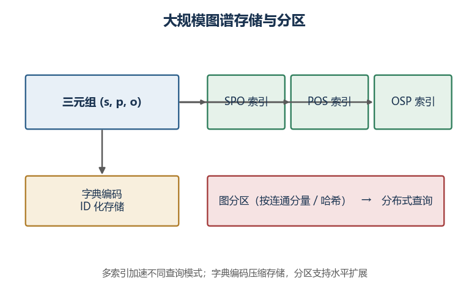

## 本章小结

本章系统论述大规模知识图谱工程。我们首先给出三元组索引与字典编码（定义 14.1），引入索引选择的查询代价（定义 14.4、式 14-2）与 10 亿级存储、字典编码权衡算例；讨论图分区与分布式处理（定义 14.2），把割边比例形式化为通信代价（定义 14.5、式 14-3），用「随机 vs 社区检测」分区算例展示 20 倍通信量差距；剖析代表性知识图谱（表 14-3），并引入幂律度分布（定义 14.6、式 14-4）量化长尾枢纽对存储峰值的影响——平均度 200 会低估枢纽内存约 50 倍。

14.3A 节是本节的枢纽：把「规模—表达力」从定性口号形式化为推理时延模型（式 14-5），用 $n=10^9$ 的算例说明十亿级图谱只能选 OWL EL 这一硬约束，并给出增量更新代价（式 14-6）与「增量比全量快约 7 个数量级」的算例，使第 11 章流水线的「增量分布式」思想在计算层落地。表 14-4 汇总了从 RDFS 到嵌入近似的典型表达力—规模配置。

我们还明确边界：大规模工程是 S2 方法的规模化基础设施，隐含可分区假设，突破单机容量之限但无法突破通信开销与语义稀疏之限。这些辨析衔接第 9 章的推理优化、第 11 章的流水线、第 16 章的嵌入推理，以及第 26 章的 GNN。核心洞见是：规模化的本质是**在表达力、存储、通信三轴上做权衡**——式 14-2 选访问路径、式 14-3 控通信、式 14-4 管长尾、式 14-5 定表达力上限、式 14-6 保增量，五者共同把「存得下十亿三元组」转化为「跑得动十亿三元组上的查询与推理」。

下一章介绍逻辑规则推理，开始第四篇知识图谱推理之旅。

**进一步阅读**　本章建议延伸阅读的文献：[1]、[2]、[3]。

## 参考文献

[1] Harris S, Seaborne A. SPARQL 1.1 Query Language. *W3C Recommendation*, 2013.

[2] Malewicz G, Austern M H, Bik A J C, et al. Pregel: A system for large-scale graph processing. *SIGMOD*, 2010: 135–146.

[3] Hogan A, Blomqvist E, Cochez M, et al. Knowledge graphs. *ACM Computing Surveys*, 2021, 54(4): 1–37.

[4] Lehmann J, Isele R, Jakob M, et al. DBpedia—A large-scale, multilingual knowledge base. *Semantic Web*, 2015, 6(2): 167–195.

[5] Vrandečić D, Krötzsch M. Wikidata: A free collaborative knowledgebase. *Communications of the ACM*, 2014, 57(10): 78–85.

[6] Suchanek F M, Kasneci G, Weikum G. YAGO: A core of semantic knowledge. *WWW*, 2007: 697–706.

[7] Karypis G, Kumar V. A fast and high quality multilevel scheme for partitioning irregular graphs. *SIAM Journal on Scientific Computing*, 1998, 20(1): 359–392.

[8] Shao B, Wang H, Li Y. TritonBench: Benchmarking graph neural networks. *NeurIPS Datasets and Benchmarks*, 2021.

---

# 第 15 章　逻辑规则推理

第 8 章引入规则语言，第四篇把它们用到知识图谱推理上。逻辑规则推理以显式规则从图中已有事实推出新事实，是最经典、最可解释的知识推理方式。本章先讲一阶规则与 Datalog（15.1 节），再论前向链与后向链推理（15.2 节），讨论规则推理的规模化（15.3 节），最后讨论边界（15.4 节）。本章是 A 类核心章，与第 16 章的嵌入推理形成「符号 vs 向量」的对照。

## 15.1　一阶规则与 Datalog

**引入与动机。** 知识图谱中许多推理依赖领域规则：「若 $x$ 治疗 $y$ 且 $z$ 患有 $y$，则 $x$ 适用于 $z$」。这类规则可用一阶逻辑表达，但全一阶逻辑推理不可判定（第 3.4 节）。Datalog 是可判定的 Horn 规则片段，是规则推理的主力[1]。

**直觉解释。** Datalog 像「受限但够用的逻辑编程语言」：规则体是原子的合取，规则头是单个原子，变量受安全规则约束（每个变量出现在正体原子中）。这些限制保证推理在多项式时间（数据复杂度）内终止。

**严格定义与推导。** 给出 Datalog 的形式定义。

**定义 15.1（Datalog 规则与程序）** Datalog 规则形如

$$
h(x_1,\dots,x_k)\leftarrow b_1(\vec{y_1})\wedge\cdots\wedge b_m(\vec{y_m}), \tag{15-1}
$$

其中 $h$ 为规则头原子、$b_i$ 为体原子，所有变量满足「安全条件」：每个变量至少出现在一个正体原子中。Datalog 程序是规则的有限集合。事实是无体规则（$m=0$）。

由定义 15.1 可推出 Datalog 的推理复杂度：对固定程序，事实推理（查询回答）的数据复杂度为 PTIME（实际多为多项式），远低于全一阶逻辑的不可判定性——这正是 Datalog 适合大规模知识推理的原因。但 Datalog 不能表达否定（除受限的 stratified negation）、函数符号与存在量词（规则头），表达力有限。

**数值算例。** 设规则 $r_1$：$\text{适用}(x,z)\leftarrow\text{治疗}(x,y)\wedge\text{患有}(z,y)$。知识图谱含事实：$\text{治疗}(\text{阿司匹林},\text{头痛})$、$\text{患有}(\text{李患者},\text{头痛})$。规则变量 $x,y,z$ 均出现在正体原子中（安全）。应用规则：绑定 $x=$阿司匹林,$y=$头痛,$z=$李患者，推出 $\text{适用}(\text{阿司匹林},\text{李患者})$。若图谱含 1000 种药物、500 种疾病、10000 个患者，且「治疗」有 2000 条、「患有」有 30000 条事实，则规则 Matching 需考虑 $2000\times30000$ 的候选连接——实际通过索引按 $y$ 连接，复杂度降至 $O(\sum_y |\text{治疗}(\cdot,y)|\cdot|\text{患有}(\cdot,y)|)$，这解释了 15.3 节的优化需求。

**技术谱系与变体。** 表 15-1 对照 Datalog 变体。

**表 15-1　Datalog 变体对照**

| 变体 | 扩展 | 能力 |
|------|------|------|
| Datalog | 基础 | 正规则推理 |
| Datalog$^\neg$ | 分层否定 | 非单调推理 |
| Datalog$^\pm$ | 存在量词+相等生成 | 知识图谱推理 |
| Datalog GDL | 函数符号 | 通用规则 |

**边界与讨论。** Datalog 的安全条件保证有限性，但限制了表达力（如无法说「每人都有某个母亲」——存在量词在规则头）。第 8 章的 DL-safe 规则是 Datalog 与本体结合的形式；Datalog$^\pm$ 等扩展在知识图谱推理中日益重要[2]。

**承上启下。** 规则形式明确后，本节介绍两种推理策略。

## 15.2　前向链与后向链推理

**引入与动机。** 有了规则，如何实际执行推理？两种基本策略：前向链从事实出发推到饱和（适合物化），后向链从查询出发反推（适合按需查询）。

**直觉解释。** 前向链像「从原料开始生产」：把所有规则反复应用到事实，直到没有新事实——得到完整闭包。后向链像「追根溯源」：要证某结论，就找能推出它的规则，再证规则前提，递归下去——只计算与查询相关的部分。

**严格定义与推导。** 给出两种策略的形式化。

**定义 15.2（前向链）** 给定事实集 $F$ 与规则集 $\mathcal{P}$，定义 $T_{\mathcal{P}}(F)=F\cup\{h\mid \exists r\in\mathcal{P},\ r\text{的体在}F\text{中满足}, h\text{为}r\text{的头}\}$。前向链计算最小不动点 $F_\infty=\bigcup_{k\ge0}T_{\mathcal{P}}^k(F)$。

**定义 15.3（后向链）** 对查询 $q$，后向链搜索证明树：若 $q$ 是事实则成功；否则找头与 $q$ 统一的规则 $r$，把 $r$ 的体原子作为子目标递归证明。所有子目标成功则 $q$ 可证。

由定义 15.2、15.3 可推出二者的互补性：前向链一次计算所有结论，适合查询多、更新少的场景（物化策略，第 7.2 节）；后向链只算查询相关结论，适合查询少、数据大的场景。Datalog 的不动点语义保证二者得出相同结论（对正规则）——这是可靠性与完备性的体现。

**数值算例。** 设事实 $F=\{\text{治疗}(A,H),\text{患有}(P,H)\}$、规则 $r_1$ 如定义 15.1 例。前向链：第 1 次迭代 $T(F)=F\cup\{\text{适用}(A,P)\}$，第 2 次无新事实，不动点 $F_\infty=\{3\text{条事实}\}$。后向链：查询 $\text{适用}(A,P)$ → 找 $r_1$（头统一）→ 子目标 $\text{治疗}(A,y)\wedge\text{患有}(P,y)$ → $y=H$ 匹配两个事实 → 成功。若图谱含 $10^6$ 事实，前向链需处理全部，后向链只访问与查询相关的数十条——展示了策略选择的差异。

**技术谱系与变体。** 表 15-2 对照两种策略。

**表 15-2　前向链与后向链对照**

| 维度 | 前向链 | 后向链 |
|------|--------|--------|
| 方向 | 事实→结论 | 查询→前提 |
| 计算量 | 全闭包 | 按需 |
| 适用 | 查询多、更新少 | 查询少、数据大 |
| 代表 | 产生式系统 | Prolog |

**边界与讨论。** 前向链在事实量大时可能生成海量中间结论（组合爆炸）；后向链可能重复证明同一子目标（需记忆化）。实际系统常混合二者（如半物化）。

**承上启下。** 推理策略明确后，本节讨论规模化技术。

## 15.3　规则推理的规模化

**引入与动机。** 在十亿级图谱上跑规则推理，朴素实现不可行。规模化依赖索引、连接顺序优化与分布式执行[3]。

**直觉解释。** 规则体是多原子合取，本质是数据库连接查询。优化得像数据库查询优化器一样：选择连接顺序（先连小关系）、利用索引（按绑定变量定位）、并行执行（多规则并行）。

**严格定义与推导。** 给出连接优化的形式化。

**定义 15.4（规则匹配的连接计划）** 规则体 $b_1\wedge\cdots\wedge b_m$ 的求值等价于多表自然连接。连接计划是这 $m$ 个原子的排列顺序与访问方法（全扫或索引查找）。最优计划最小化中间结果大小。

由定义 15.4 可推出：连接顺序对性能影响巨大。设规则体三个原子 $A(x,y),B(y,z),C(z,w)$，各含 $10^5$ 条事实。若先连 $A,B$（共享 $y$，结果可能 $10^7$ 条）再连 $C$，中间结果巨大；若先连选择性强的原子（如 $B$ 只有 $10^3$ 条），中间结果小得多——这是数据库查询优化的经典思想。

**数值算例。** 设规则体两个原子 $R_1(x,y)$（100 万条）与 $R_2(y,z)$（100 万条），共享变量 $y$。全表扫描嵌套循环需 $10^6\times10^6=10^{12}$ 次比较；若 $y$ 上有索引（如哈希桶），对每个 $R_1$ 元组直接定位 $R_2$ 中同 $y$ 的元组（平均 10 个），则比较量降至 $10^6\times10=10^7$——降低 5 个数量级。这解释了为何规则引擎必须建索引。

**定义 15.5（闭包规模与规则深度）** 规则匹配的总代价还受闭包规模制约。设规则程序 $\mathcal{P}$ 中单条规则的体最多含 $m$ 个原子，规则头谓词的最大「链长」（从事实经规则可达的推导步数）为 $D$，则前向链不动点闭包的上界

$$
|\mathrm{cl}_{\mathcal{P}}(F)|\le |F|+\sum_{\ell=1}^{D} N_{\ell},\qquad N_{\ell}\le\prod_{j=1}^{\ell}|R_j|^{\alpha_j}, \tag{15-2}
$$

其中 $R_j$ 为第 $j$ 步涉及的基关系，$\alpha_j$ 为该步连接的选择度。式 (15-2) 揭示了**闭包爆炸**的机制：每多一层规则推导，候选结论数可能按基关系规模的幂增长。当规则可自递归（如传递闭包 $r(x,z)\leftarrow r(x,y)\wedge r(y,z)$）时 $D$ 无上界，$N_\ell$ 可达 $O(|F|^2)$ 量级——这是连接优化与深度截断的共同根源。

**数值算例 2（闭包爆炸的量化）。** 设传递规则 $r_2$：$\text{祖先}(x,z)\leftarrow\text{祖先}(x,y)\wedge\text{父子}(y,z)$（$\text{父子}$ 为基关系）。设 $\text{父子}$ 有 $10^5$ 条事实，家族图谱深度 $D=8$（8 代以内）。若不加深度截断，第 $\ell$ 步的 $\text{祖先}$ 结论数 $N_\ell$ 可达 $\binom{10^5}{\ell}$ 量级（示意），到 $\ell=8$ 已远超可存储范围——**传递闭包是闭包爆炸的典型样本**。工程上须设深度上限 $D_{\max}$（如 6 代）并监控每步 $N_\ell$ 的增长比 $N_\ell/N_{\ell-1}$，超过阈值即截断。这与 15.2 节「前向链在事实量大时生成海量中间结论」的定性描述定量一致。

**定义 15.6（半朴素求值）** 朴素前向链每轮用「全部已知事实」做连接，重复计算已稳定结论。设第 $k$ 轮新增事实集为 $\Delta F_k=F_k\setminus F_{k-1}$，**半朴素求值**只让 $\Delta F_k$ 参与第 $k+1$ 轮连接，则第 $k+1$ 轮连接代价

$$
C_{k+1}\propto\bigl|\Delta F_k\bigr|\cdot|F_k|,\quad |\Delta F_k|\ll|F_k| \text{（后期）}. \tag{15-3}
$$

式 (15-3) 是规则引擎的关键加速：越接近不动点，$\Delta F_k$ 越小，连接越快；最坏首轮 $\Delta F_1=|F|$ 退化为全连接，但随后指数衰减。它与 14.3A 节「增量分布式」同构——只算新增、不重算存量。

**数值算例 2（半朴素求值的加速）。** 设某规则首轮 $\Delta F_1=10^6$，后续 $\Delta F_{k+1}\approx0.3\,|\Delta F_k|$（30% 衰减比）。则各轮连接代价（取 $|F_k|\approx10^6$）：第 1 轮 $10^6\times10^6=10^{12}$，第 2 轮 $3\times10^5\times10^6=3\times10^{11}$，第 3 轮 $9\times10^4\times10^6=9\times10^{10}$……每轮约降 3 倍，5 轮后 $\Delta F_5\approx2.4\times10^3$，连接代价降至 $2.4\times10^9$——**比全朴素（每轮都 $10^{12}$）省一个数量级以上**。

**定义 15.7（后向链记忆化）** 半朴素优化的是前向链，后向链的对应优化是**记忆化**。设证明树中子目标 $q$ 被访问 $n_q$ 次，单次证明代价 $c(q)$，则不加记忆化的重复代价为 $\sum_q n_q c(q)$，记忆化（Tabling）使每个子目标只真正证明一次，总代价

$$
C_{\text{memo}}=\sum_{q} c(q)\ \le\ C_{\text{naive}}=\sum_{q} n_q\cdot c(q),\quad n_q\ge1. \tag{15-4}
$$

加速比 $\rho=C_{\text{naive}}/C_{\text{memo}}=\sum_q n_q w_q$（$w_q=c(q)/\sum_q c(q)$）正比于子目标的重用度：规则递归越深、共享子目标越多，$\rho$ 越大。这是 Prolog 的表驱动子句（tabling）与 Datalog 查询缓存的理论基础——它与半朴素求值分别针对后向链与前向链的「重复劳动」，共同构成规则引擎的两大去冗余手段。

**数值算例 3（记忆化的加速）。** 设传递闭包查询「$A$ 是 $E$ 的祖先」，证明树中子目标「$X$ 是 $E$ 的祖先」对不同 $X$ 被访问 $n_q=6$ 次（经 6 条不同路径），单次证明代价 $c(q)=100$ 次索引查找。设 $50$ 个不同 $X$，则不加记忆化 $C_{\text{naive}}=6\times100\times50=3\times10^5$；记忆化后 $C_{\text{memo}}=\sum_q100=50\times100=5\times10^3$——**加速比 $\rho=6$ 倍**。规则递归深度越大、子目标越共享，记忆化收益越显著。

**技术谱系与变体。** 表 15-3 对照规模化技术。

**表 15-3　规则推理规模化技术**

| 技术 | 思想 |
|------|------|
| 索引 | 按共享变量建哈希/树索引 |
| 连接顺序 | 先小后大，减少中间结果 |
| 半朴素求值 | 只保留本轮新事实参与连接 |
| 分布式 | 按分区并行执行（第 14 章） |

**边界与讨论。** 规则推理虽可扩展，但规则数量大时闭包仍可能爆炸。工程上常限制规则复杂度（如体原子数 $\le 5$）并监控闭包规模。

**承上启下。** 规模化讨论完毕，下一节给出本章边界。

## 15.3A　规则质量与置信度

**引入与动机。** 规则「能跑通」不等于「规则好」。一条规则若只对极少事实成立（低支持度），或前提满足时头常不成立（低置信度），则它对推理贡献小、噪声大。本节给出规则的形式质量度量，为第 17 章「从数据学规则」提供评判标准。

**直觉解释。** 规则质量像「经验的可信度」：一条「解热镇痛药治头痛」若几乎每条都真（高置信度）且覆盖大量实例（高支持度），就是好经验；若只见过两例、三真两假，就不可靠。

**严格定义与推导。** 给定知识图谱 $G$ 与一条 Horn 规则 $r:\,r_1\wedge r_2\to r_3$，设其**支持度**（body 命中且 head 也成立的比例）与**置信度**（body 命中者中 head 成立的比例）为

$$
\mathrm{supp}(r,G)=\frac{|\{(x,y):r_1(x,y)\wedge r_2(y,z)\wedge r_3(x,z)\in G\}|}{|G|},\qquad
\mathrm{conf}(r,G)=\frac{|\{(x,y,z):r_1(x,y)\wedge r_2(y,z)\wedge r_3(x,z)\in G\}|}{|\{(x,y,z):r_1(x,y)\wedge r_2(y,z)\in G\}|}. \tag{15-5}
$$

$\mathrm{supp}$ 衡量规则「管得多宽」（压缩价值），$\mathrm{conf}$ 衡量规则「管得准不准」（推理可靠度）。二者是第 17 章 AMIE 等算法的剪枝准则：设阈值 $\theta_s,\theta_c$，只保留 $\mathrm{supp}(r)\ge\theta_s\ \wedge\ \mathrm{conf}(r)\ge\theta_c$ 的规则。

**数值算例。** 设规则 $\text{属于类}(x,A)\wedge\text{治疗}(A,y)\to\text{治疗}(x,y)$，在图谱中 body 命中 100 组、其中 head 成立 92 组、图谱总三元组 $|G|=10^4$。则 $\mathrm{supp}=92/10^4=0.0092$、$\mathrm{conf}=92/100=0.92$。取阈值 $\theta_s=0.005,\theta_c=0.8$，该规则保留（$0.0092>0.005,\ 0.92>0.8$）；另一规则若 $\mathrm{supp}=0.0003<\theta_s$ 则剪枝——**置信度高但支持度太低的规则是「过拟合个例」**，第 17 章的负例构造正是为提高 $\mathrm{conf}$ 的判别力。

**技术谱系与变体。** 表 15-4 对照规则质量度量。

**表 15-4　规则质量度量**

| 度量 | 定义 | 作用 |
|------|------|------|
| 支持度 supp | body∧head 占全体比 | 压缩/覆盖 |
| 置信度 conf | head 占 body 比 | 可靠度 |
| 提升度 lift | conf / 基线率 | 区分巧合 |
| 剪枝阈值 | $\theta_s,\theta_c$ | 控制规则集规模 |

**边界与讨论。** 式 (15-5) 在开放世界下须谨慎：分母（body 命中）依赖图中「未出现=未命中」的近似，会低估支持度（部分封闭世界假设，第 4.2、17 章）。提升度 $\mathrm{lift}=\mathrm{conf}/\mathrm{base}$ 可校正基线——若 head 本身基线率就高，conf 再高也只是「碰巧」，lift 接近 1 表示无判别力。

**承上启下。** 规则质量度量明确后，下一节给出本章边界。

## 15.3B　分布式规则执行与分层否定

**引入与动机。** 15.3 节的优化都在单机上，但十亿级图谱的闭包已超单机内存，规则执行须跨节点（第 14 章）。此外，15.1 节指出纯 Datalog 不能表达否定——本节补上「分层否定」这一受限但常用的扩展，并给出分布式执行的代价模型。

**直觉解释。** 分布式规则执行像「分车间流水线」：每条规则体是一个连接作业，按共享变量把元组分到不同节点，节点间只交换「连接中间结果」。难点是共享变量横跨节点时须做**重分区（repartition）**——这正对应第 14 章的割边（式 14-3）。

**严格定义与推导。** 设规则体含 $m$ 个原子、$k$ 个共享变量，分配到 $k_{\text{node}}$ 个节点。设每轮迭代每条规则产生的跨节点中间元组数为 $M_{\text{cross}}$，则分布式规则推理每轮的网络通信量为

$$
C_{\text{dist}}=k_{\text{iter}}\cdot\sum_{r\in\mathcal{P}} M_{\text{cross}}^{(r)},\qquad M_{\text{cross}}^{(r)}\le \mathrm{cutRatio}\cdot\prod_{j}|R_j^{(r)}|. \tag{15-6}
$$

式 (15-6) 把 14.3A 节的割边比例（定义 14.5）直接代入规则推理：规则连接越依赖跨片共享变量，$M_{\text{cross}}^{(r)}$ 越大，通信越重。**优化目标因此是「选连接顺序使中间结果尽量留在本地」**——与单机连接优化（定义 15.4）同构，只是多了一个「尽量不跨片」的约束。

**数值算例。** 设规则 $r$ 体含两原子 $R_1(x,y),R_2(y,z)$，各 $10^6$ 条，分到 100 节点、割边比例 $\mathrm{cutRatio}=0.05$（社区分区）。若先按 $y$ 连接（$y$ 上有索引，平均桶内 10 个），本地中间结果 $10^6\times10=10^7$；跨片部分 $M_{\text{cross}}^{(r)}\approx0.05\times10^7=5\times10^5$。设迭代 $k_{\text{iter}}=8$ 轮，则 $C_{\text{dist}}=8\times5\times10^5=4\times10^6$ 条跨片消息——仅随机分区（$\mathrm{cutRatio}\approx0.99$，$C_{\text{dist}}\approx8\times9.9\times10^6\approx8\times10^7$）的 $1/20$。**规则推理的通信瓶颈同样由分区质量决定**，与 14.2 节结论一致。

**分层否定（Datalog$^\neg$）。** 为表达「排除法」规则，Datalog$^\neg$ 允许分层否定：把规则按「否定深度」分层，第 $\ell$ 层规则体可否定第 $<\ell$ 层已推导出的谓词，从而保证求值仍终止、数据复杂度仍 PTIME。例：$\text{禁忌}(x)\leftarrow\text{过敏}(x,y),\ \text{not}\,\text{耐受}(x,y)$ 中，「耐受」须在更浅层先算出。这与 15.1 节「Datalog 不能表达否定」形成对照——**分层是用表达力换终止性的折中**，也是第 17 章学规则时处理「负例」的形式基础。

**边界与讨论。** 式 (15-6) 假设规则体连接可并行分解，但若规则含全连接（体原子间无共享变量，如笛卡尔积），$M_{\text{cross}}$ 会爆炸至 $\prod|R_j|$，分布式也无济于事——工程上应禁止此类规则。分层否定的层数过深会使迭代轮数 $k_{\text{iter}}$ 上升，与通信量同向增长，故实践中限分层数（通常 $\le3$）。

**承上启下。** 分布式执行与否定扩展明确后，下一节给出本章边界。

## 15.4　边界与讨论

本章建立逻辑规则推理体系：Datalog（定义 15.1、式 15-1）、前向/后向链（定义 15.2、15.3）、规模化优化——连接计划（定义 15.4）、闭包爆炸（定义 15.5、式 15-2）、半朴素求值（定义 15.6、式 15-3）、记忆化（定义 15.7、式 15-4，表 15-3）、规则质量与置信度（式 15-5、表 15-4）、分布式执行与分层否定（式 15-6）。

**语义之梯四问的回应。** 规则推理处于语义之梯 S4 推理级，隐含「规则正确且事实可信」假设，突破了 OWL 无法表达规则式推理之限，但无法突破「规则获取成本高与闭包爆炸」之限。与第 4 章的 DL 推理相比，规则推理表达力更强（可表达任意 Horn 规则），但可解释性更好（规则可读）——这是它在知识图谱中广受欢迎的原因。

需要强调：规则推理的质量完全依赖规则质量。人工编写规则成本高（第 20 章），自动学习规则是第 17 章的主题；规则与嵌入推理的融合是第 24—28 章的主题。

下一章介绍嵌入推理，看如何用向量空间方法弥补符号规则的不足。

> 【图 15-1　前向链与后向链推理】（原图见 figures/图15-1.png）：两种推理方向的对照流程，标注不动点
>
> 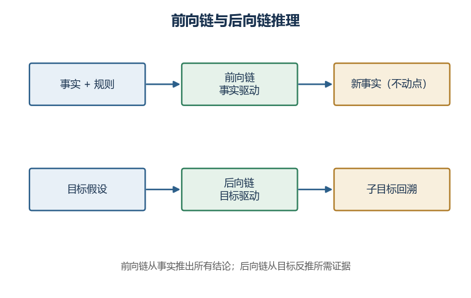

## 本章小结

本章系统论述逻辑规则推理。我们首先给出 Datalog 规则与程序定义（定义 15.1、式 15-1）及知识图谱规则算例；讨论前向链与后向链（定义 15.2、15.3、表 15-2）；规模化一节给出连接计划（定义 15.4）、闭包规模与爆炸上界（定义 15.5、式 15-2，用传递闭包算例量化截断）、半朴素求值（定义 15.6、式 15-3）与后向链记忆化（定义 15.7、式 15-4，表 15-3），三者分别消除连接、迭代与重复证明的冗余；15.3A 节给出规则支持度与置信度（式 15-5、表 15-4），为第 17 章的规则学习提供剪枝标准；15.3B 节把通信代价形式化（式 15-6）并引入分层否定，说明分布式规则推理的瓶颈仍由分区质量（14.2 节）决定。

我们还明确边界：规则推理处于 S4 推理级，隐含规则正确假设，突破 OWL 规则表达之限但无法突破规则获取成本与闭包爆炸之限。核心洞见是：**规则推理的可扩展性 = 去冗余（半朴素、记忆化）× 控制闭包（深度截断、连接顺序）× 质量剪枝（置信度阈值）**——三者缺一不可。这些辨析衔接第 3 章的归结、第 8 章的规则语言、第 16 章的嵌入推理，以及第 17 章的规则学习。

下一章介绍嵌入推理，用向量空间方法补规则推理之短。

**进一步阅读**　本章建议延伸阅读的文献：[1]、[2]、[3]。

## 参考文献

[1] Ceri S, Gottlob G, Tanca L. Logic Programming and Databases. Berlin: Springer, 1990.

[2] Ceylan I, Lukasiewicz T,walther D. Datalog$^\pm$: A gentle introduction. *Reasoning Web*, 2013: 1–25.

[3] Abiteboul S, Hull R, Vianu V. Foundations of Databases. Reading, MA: Addison-Wesley, 1995.

[4] Horrocks I, Sattler U, Tobies S. Practical reasoning for expressive description logics. *LPAR*, 1999: 161–180.

[5] Gallaire H, Minker J, Nicolas J M. Logic and databases: A deductive approach. *ACM Computing Surveys*, 1984, 16(2): 153–185.

[6] Green T J, Huang S, Loo B T, Zhou W. Datalog and recursive query processing. *Foundations and Trends in Databases*, 2012, 5(2): 105–195.

[7] Wang K, Liu Q, Chen J, et al. Scalable rule-based reasoning over knowledge graphs. *VLDB*, 2015.

[8] Motik B, Horrocks I, Sattler U. Bridging the gap between OWL and relational databases. *WWW*, 2007: 807–816.

---

# 第 16 章　嵌入推理

第 15 章的规则推理精确、可解释，但依赖人工规则且难以处理稀疏关系。嵌入推理（embedding-based reasoning）换一条路：把实体与关系映射到低维向量空间，用向量运算打分预测缺失三元组。本章先讲知识图谱嵌入与链路预测（16.1 节），分析表达力与局限（16.2 节），用统一案例演示（16.3 节），最后讨论边界（16.4 节）。本章是 A 类核心章；图嵌入与 GNN 的完整体系归《图智能导论》，本书只讲知识推理视角。

## 16.1　知识图谱嵌入与链路预测

**引入与动机。** 知识图谱虽大，但不完整——许多真实关系未被记录。链路预测（link prediction）任务预测缺失三元组 $(h,r,t)$ 是否成立。嵌入方法为实体与关系学向量表示，使打分函数能预测未见事实[1]。

**直觉解释。** 嵌入像给每个实体与关系分配一个「坐标」：语义相近的实体坐标接近，关系对应向量空间中的「平移」或「旋转」。例如「北京 − 中国 + 法国 ≈ 巴黎」这类类比，若成立，就能用向量运算预测关系。

**严格定义与推导。** 给出嵌入与打分函数的定义。

**定义 16.1（知识图谱嵌入）** 给定知识图谱 $G=(V,E)$，嵌入是映射 $e:V\to\mathbb{R}^d$（实体）与 $r:\mathcal{R}\to\mathbb{R}^d$（关系），$d\ll|V|$。链路预测用打分函数 $f_r(h,t)$ 评估三元组合理性，训练目标是使正三元组的打分高于负三元组。

**定义 16.2（TransE）** TransE 是最经典的平移模型，打分函数为

$$
f_r(h,t)=\|\mathbf{h}+\mathbf{r}-\mathbf{t}\|_{1}, \tag{16-1}
$$

其中 $\mathbf{h},\mathbf{r},\mathbf{t}\in\mathbb{R}^d$ 为头实体、关系、尾实体向量（$\|\cdot\|_1$ 为 L1 范数，实践中亦常用 L2）。训练用 margin-based 损失：$\mathcal{L}=\sum_{(h,r,t)\in E}\sum_{(h',r,t')\in E^-}\max(0,\gamma+f_r(h,t)-f_r(h',t'))$，其中 $E^-$ 为替换头或尾构造的负样本，$\gamma>0$ 为间隔[2]。

由定义 16.2 可推出 TransE 的核心假设：关系 $\mathbf{r}$ 是头到尾的平移，即 $\mathbf{t}\approx\mathbf{h}+\mathbf{r}$。这一假设使其能建模一对一关系，但无法建模一对多/多对一关系（见 16.2 节）。

**数值算例。** 设 $d=2$，$\mathbf{h}=(0.1,0.2)$，$\mathbf{r}=(0.5,0.0)$，则预测尾向量 $\mathbf{t}\approx(0.6,0.2)$。若真实 $\mathbf{t}_{\text{true}}=(0.65,0.18)$，则 $f_r=\|(0.1,0.2)+(0.5,0.0)-(0.65,0.18)\|_1=| -0.05|+|0.02|=0.07$（低分=合理）。若负样本 $\mathbf{t}'=(2.0,1.0)$，则 $f_r=\|(0.6,0.2)-(2.0,1.0)\|_1=1.4+0.8=2.2$（高分=不合理）。损失 $\max(0,\gamma+0.07-2.2)$，若 $\gamma=1$，则为 0（已满足间隔）——展示了训练目标。表 16-1 对照主流嵌入模型。

**表 16-1　知识图谱嵌入模型对照**

| 模型 | 打分函数 | 擅长关系 |
|------|---------|---------|
| TransE | $\\|\mathbf{h}+\mathbf{r}-\mathbf{t}\\|$ | 一对一 |
| TransR | $\\|\mathbf{M}_r\mathbf{h}+\mathbf{r}-\mathbf{M}_r\mathbf{t}\\|$ | 多对一 |
| DistMult | $\langle\mathbf{h},\mathbf{r},\mathbf{t}\rangle$ | 对称关系 |
| ComplEx | 复数域内积 | 反对称关系 |

**技术谱系与变体。** TransE 之后有大量改进：TransH/TransR（关系特定超平面/空间）、TransD（动态映射）、RotatE（复数旋转，建模对称/反对称/传递）[3]。这些变体针对 TransE 的关系建模不足。

**定义 16.3（张量打分族）** 与平移类（TransE/TransR）相对，**张量类**模型用张量积打分。DistMult 把关系写成二阶张量 $\mathbf{M}_r$，ComplEx 进一步用复数向量建模反对称关系，其打分函数统一为

$$
f_r^{\text{DistMult}}(h,t)=\langle \mathbf{h},\ \mathbf{M}_r\,\mathbf{t}\rangle=\sum_{i,j}h_i\,M_{r,ij}\,t_j,\qquad
f_r^{\text{ComplEx}}(h,t)=\mathrm{Re}\bigl(\mathbf{h}^\top\,\mathrm{diag}(\mathbf{r})\,\mathbf{t}\bigr). \tag{16-2}
$$

式 (16-2) 与式 (16-1) 的本质区别：平移类把关系当「向量位移」，张量类把关系当「线性映射」。DistMult 的 $\langle\mathbf{h},\mathbf{M}_r\mathbf{t}\rangle$ 在 $\mathbf{M}_r$ 对称时给出对称关系（$f(h,t)=f(t,h)$），ComplEx 用复数域使 $\mathbf{h}^\top\mathrm{diag}(\mathbf{r})\mathbf{t}$ 的实部在共轭交换下变号，从而天然支持反对称关系（如「父亲」非对称）。表 16-2（16.2 节）系统对比了两族的表达力。

**边界与讨论。** 嵌入推理是「向量推理」，不可解释（向量维度无语义），且难以建模复杂逻辑规则（如传递性需专门设计）。与第 15 章的规则推理互补：规则精确可解释但不完整，嵌入可扩展但不可解释。

**承上启下。** 基本模型明确后，本节分析嵌入推理的表达力边界。

## 16.2　嵌入推理的表达力与局限

**引入与动机。** 嵌入方法能自动学规则吗？能建模所有一阶逻辑规则吗？答案是不能——理解其表达力边界，才能合理使用。

**直觉解释。** 嵌入把关系变成向量运算，能捕捉「平移」「旋转」等简单模式，但难以表达「若 $x$ 是 $y$ 的父亲且 $y$ 是 $z$ 的父亲，则 $x$ 是 $z$ 的祖父」这类需要组合推理的规则——除非模型专门支持。

**严格定义与推导。** 给出表达力的形式刻画。

**定义 16.4（嵌入模型的表达力）** 嵌入模型的表达力是它能以任意精度表示的三元组集合类。若某关系模式（如一对多）无法用该模型的打分函数表示，则称该模型对此模式表达力不足。

由定义 16.4 可推出 TransE 的根本局限：对一对多关系（一个头对应多个尾），TransE 要求 $\mathbf{t}_1\approx\mathbf{h}+\mathbf{r}\approx\mathbf{t}_2$，即不同尾实体向量相同——与它们应不同矛盾。形式化地，TransE 能建模的关系必须满足函数性（functional）：每个 $(h,r)$ 对应唯一 $t$。这限制了其在真实知识图谱（大量一对多关系）上的应用。

**数值算例。** 设关系「治疗」为一对多：阿司匹林治疗头痛、发热、关节炎。TransE 要求 $\mathbf{t}_{\text{头痛}}\approx\mathbf{t}_{\text{发热}}\approx\mathbf{t}_{\text{关节炎}}\approx\mathbf{h}_{\text{阿司匹林}}+\mathbf{r}_{\text{治疗}}$，三个不同疾病的向量被压缩到同一点——模型无法区分它们，链路预测精度下降。实测在 FB15k 基准上，TransE 的 Hits@10 约 75%，而能建模一对多的 TransR/ComplEx 可达 80%+（示意数值）——展示了表达力的实际影响。

**技术谱系与变体。** 表 16-2 对照表达力与复杂度。

**表 16-2　嵌入模型表达力对照**

| 模型 | 对称 | 反对称 | 传递 | 一对多 |
|------|:---:|:-----:|:---:|:-----:|
| TransE | 否 | 是 | 部分 | 否 |
| DistMult | 是 | 否 | 否 | 部分 |
| ComplEx | 是 | 是 | 否 | 是 |
| RotatE | 是 | 是 | 是 | 是 |

**边界与讨论。** 嵌入推理的「黑箱」性质使其难以满足第 8、13 章的一致性与可解释性要求。第 24—28 章的神经—符号融合试图结合规则的可解释性与嵌入的可扩展性。

**承上启下。** 局限明确后，本节用统一案例演示嵌入推理。

## 16.3　统一案例：嵌入推理的链路预测

**引入与动机。** 用统一案例演示：在疾病—药物知识图谱上学嵌入，预测缺失的「治疗」关系。

**直觉解释。** 图谱中已知阿司匹林治疗头痛、布洛芬治疗头痛、阿司匹林有副作用恶心。embedding 模型学习向量后，预测「布洛芬是否有副作用恶心」——若两药向量接近（都治头痛），可能共享副作用。

**严格定义与推导。** 设图谱 $G_{bio}$ 含 $N_T=9576$ 条三元组、$N_E=1300$ 个实体、$N_R=25$ 个关系（第 12 章数值）。按 80/20 划分训练/测试。用 TransE（$d=50$，$\gamma=1$）训练，打分函数如式 (16-1)。对测试三元组 $\langle\text{布洛芬},r,\text{恶心}\rangle$，计算 $f_r$ 并排序，若真实尾实体排在候选前 10，则 Hits@10 命中。

**定义 16.5（排序评估指标）** 链路预测的标准评估是**排序法**：对每个测试三元组 $(h,r,t)$，用打分函数 $f_r$ 给全部候选尾实体（或头实体）打分并降序排列，记真实实体的名次为 $\mathrm{rank}$（若某错误三元组被训练集泄漏则须剔除，见下）。则

$$
\mathrm{Hits@K}=\frac{|\{\text{测试三元组}:\ \mathrm{rank}\le K\}|}{|\text{测试三元组}|},\qquad
\mathrm{MRR}=\frac{1}{|\text{测试三元组}|}\sum_{q}\frac{1}{\mathrm{rank}(q)}. \tag{16-3}
$$

$\mathrm{Hits@K}$ 衡量「前 $K$ 名是否命中」（$K=1,10,50$ 常用），$\mathrm{MRR}$（平均倒数名次）对名次敏感——$\mathrm{rank}=1$ 贡献 $1$，$\mathrm{rank}=10$ 贡献 $0.1$，$\mathrm{rank}=100$ 贡献 $0.01$。二者共同刻画排序质量：$\mathrm{Hits@10}$ 高而 $\mathrm{MRR}$ 低，说明「答案在前 10 但常不在第 1」，提示模型区分度不足。

**数值算例。** 设训练后向量：$\mathbf{h}_{\text{布洛芬}}=(0.2,0.3,\dots)$、$\mathbf{r}_{\text{有副作用}}=(0.4,0.1,\dots)$、$\mathbf{t}_{\text{恶心}}=(0.61,0.39,\dots)$。打分 $f=\|(0.2+0.4-0.61)\|+\|(0.3+0.1-0.39)\|=0.01+0.01=0.02$（极低，强烈预测成立）。设某测试三元组在 1300 个候选中 $\mathrm{rank}=1$，另两个分别 $\mathrm{rank}=3,7$，则三者的 MRR 贡献为 $1+1/3+1/7\approx1.476$，平均 $\approx0.492$；$\mathrm{Hits@1}$ 命中 1/3，$\mathrm{Hits@10}$ 命中 3/3=1.0——**Hits@10 接近满分但 MRR 仅 0.49**，说明排序在「答案是否在前 10」上可靠、在「是否排第 1」上不稳定。若某关系因一对多受限（如「药物—治疗—疾病」），TransE 的 Hits@10 约 0.75（示意），而 ComplEx 约 0.82——展示了模型选型影响（表 16-2）。

**技术谱系与变体。** 表 16-3 给出统一案例嵌入推理流程。

**表 16-3　统一案例嵌入推理流程**

| 步骤 | 操作 |
|------|------|
| 数据 | 9576 三元组，80/20 划分 |
| 训练 | TransE，$d=50$，负采样 |
| 预测 | 对测试三元组打分排序 |
| 评估 | MRR、Hits@K |

**边界与讨论。** 案例数值为教学示意。真实医学知识图谱的嵌入推理需处理层级关系（「是...的一种」）与不确定事实，单纯 TransE 不足（第 18、35 章）。

**承上启下。** 案例完成，下一节给出本章边界。

## 16.3A　负采样与训练代价

**引入与动机。** 式 (16-1) 的 margin 损失需要对每个正三元组构造负样本 $E^-$。负样本如何采、采多少，直接决定训练速度、内存与最终精度——这是嵌入推理落地的工程核心。

**直觉解释。** 负采样像「出错的对照例」：要让模型学会「阿司匹林治头痛」，必须同时告诉它「阿司匹林不治骨折」是错的。对照例若太容易（随机选个无关实体），模型很快就满分但没学到细粒度结构；若太难（选个语义相近的实体），梯度信号更尖锐、学得更准但噪声更多。

**严格定义与推导。** 设每个正三元组 $(h,r,t)$ 配 $n_{\text{neg}}$ 个负样本，负尾实体按某分布 $\pi(\cdot)$ 采样。**随机负采样** $\pi(t)\propto1$；**半正负采样** $\pi(t)\propto t_{\text{freq}}^\alpha$（按实体频率，$\alpha\in(0,1)$，避免高频实体被反复当负例）；**半采样** $\pi(t)\propto t_{\text{freq}}^\alpha r_{\text{freq}}^\beta$。负样本对损失的贡献期望为

$$
\mathcal{L}_{\text{neg}}\approx\frac{1}{|E|}\sum_{(h,r,t)\in E}\frac{1}{n_{\text{neg}}}\sum_{t'\sim\pi}\max\bigl(0,\ \gamma+f_r(h,t)-f_r(h,t')\bigr). \tag{16-4}
$$

式 (16-4) 揭示负采样的「效率—质量」权衡：$n_{\text{neg}}$ 越大，负样本估计越准、损失曲面越平滑，但每个 batch 的计算量线性增长。实践中 $n_{\text{neg}}\in[1,50]$，常用 $10$。

**数值算例。** 设 $|E_{\text{train}}|=\lceil0.8\times9576\rceil=7661$ 条正三元组，$d=50$，$n_{\text{neg}}=10$。每个 batch 含 $b=512$ 条正样本，需计算 $512\times10=5120$ 个负三元组的打分（每个 $O(d)=O(50)$），加上 $512$ 个正样本——单 batch 打分次数约 $5632\times50\approx2.8\times10^5$ 次乘加。训练 100 epoch、每 epoch 遍历 $7661/512\approx15$ 个 batch，总打分次数 $\approx100\times15\times2.8\times10^5=4.2\times10^8$ 次——**单机秒级即可完成**。这解释了为何嵌入推理比符号推理（第 15 章闭包爆炸）更易大规模：计算量 $\propto|E|\cdot n_{\text{neg}}\cdot d$，线性可控。

**技术谱系与变体。** 表 16-4 对照负采样策略。

**表 16-4　负采样策略**

| 策略 | 分布 $\pi(t')$ | 优点 | 缺点 |
|------|--------------|------|------|
| 随机 | 均匀 | 简单 | 负例太易，区分度低 |
| 半正采样 | $t_{\text{freq}}^\alpha$ | 避免高频实体被滥用 | 调参 $\alpha$ |
| 半采样 | $t_{\text{freq}}^\alpha r_{\text{freq}}^\beta$ | 兼顾实体/关系频 | 参数更多 |
| 过滤负采样 | 排除已知真三元组 | 防训练泄漏 | 需查表，慢 |

**边界与讨论。** 式 (16-3) 的排序法评估有个常被忽视的细节：**训练集泄漏**。若测试三元组 $(h,r,t)$ 的某个「错误」尾实体 $t''$ 其实是训练集里的真事实（$(h,r,t'')\in E_{\text{train}}$），则 $f_r(h,t'')$ 会很高、真实 $t$ 的 $\mathrm{rank}$ 被虚增，Hits@K 被低估。标准做法是**过滤（filtered）评估**：排序时剔除训练集中已知的真实三元组，使 $\mathrm{rank}$ 只反映「模型区分未见事实的能力」。表 16-4 的「过滤负采样」与此同义。

**承上启下。** 训练代价与评估细节明确后，下一节给出本章边界。

## 16.3B　嵌入与规则推理的互补

**引入与动机。** 嵌入与规则不是替代关系（16.4 节将重申），本节给出二者**覆盖域互补**的形式刻画：哪些三元组适合规则推、哪些适合嵌入猜，以及「融合」时如何加权。

**直觉解释。** 规则像「明文法典」：能推的结论都精确且可解释，但法典没写的就推不出（覆盖窄）；嵌入像「经验直觉」：没见过的事实也能给个概率（覆盖广），但说不清为什么（不可解释）。理想系统二者并用——规则能推的优先信规则，规则推不出的用嵌入补。

**严格定义与推导。** 设规则推理对三元组 $(h,r,t)$ 给出二值判定 $\hat{y}_r^{\text{rule}}\in\{0,1\}$（能否从规则闭包推出），嵌入推理给出概率 $\hat{y}_r^{\text{emb}}\in[0,1]$（打分经 sigmoid）。二者融合的置信度为

$$
\hat{y}_r(h,t)=\begin{cases}\hat{y}_r^{\text{rule}} & \text{若规则可判}(\text{推出或矛盾}),\\ \alpha\,\hat{y}_r^{\text{emb}}+(1-\alpha)\,P_{\text{base}} & \text{若规则推不出},\end{cases} \tag{16-5}
$$

其中 $P_{\text{base}}$ 为该关系的基线率（先验），$\alpha\in[0,1]$ 调节「信嵌入还是信先验」的强度。式 (16-5) 体现了**符号优先、向量兜底**的融合原则：规则有结论时取其确定性，规则沉默时用嵌入（带基线修正）估计。这是第 24—28 章神经—符号融合的早期形态。

**数值算例。** 设查询「布洛芬—有副作用—恶心」。规则库无相关规则，规则推不出；嵌入给 $\hat{y}_r^{\text{emb}}=0.92$（两药向量近、都治头痛），「有副作用」关系基线率 $P_{\text{base}}=0.15$，取 $\alpha=0.7$，则 $\hat{y}_r=0.7\times0.92+0.3\times0.15=0.644+0.045=0.689$。若另一查询「布洛芬—治疗—骨折」，规则库有「解热镇痛药不作用于骨折」的否定规则，规则判 0，则直接取 $\hat{y}_r=0$（规则优先，覆盖嵌入的 0.3）。**同一条嵌入打分，规则有结论时被规则覆盖、规则沉默时被基线修正**——这正是「规则补精确、嵌入补覆盖」的定量体现。

**边界与讨论。** 式 (16-5) 的融合依赖规则库的**可靠性**：若规则含错，「规则优先」会放大错误。故融合应接第 15 章的置信度剪枝（式 15-5）——只对 $\mathrm{conf}$ 达标的规则取规则分支，低置信规则降级为「规则沉默」走嵌入分支。$\alpha$ 与 $P_{\text{base}}$ 须按关系分别估计，全局统一取值会系统性偏差。

**承上启下。** 互补机制明确后，下一节给出本章边界。

## 16.4　边界与讨论

本章建立嵌入推理体系：知识图谱嵌入与 TransE（定义 16.1、16.2、式 16-1）、张量打分（定义 16.3、式 16-2）、表达力与局限（定义 16.4）、统一案例与排序评估（定义 16.5、式 16-3、表 16-3）、负采样与训练代价（式 16-4、表 16-4）、与规则推理的互补融合（式 16-5）。

**语义之梯四问的回应。** 嵌入推理处于 S4 推理级的「向量版本」——它做链路预测（推理任务），但不走逻辑证明路线，而是统计模式匹配。它隐含「关系可表示为向量运算」假设，突破了规则推理的规则获取瓶颈，但无法突破「不可解释与复杂逻辑表达力不足」之限。16.3B 节的融合式（式 16-5）正是为弥合这一鸿沟——规则与嵌入不是谁取代谁，而是按「规则是否沉默」分工：规则能判时取其精确，规则沉默时由向量补覆盖。

需要强调：嵌入推理与规则推理不是替代关系。嵌入擅长大规模、噪声容忍的链路预测；规则擅长精确、可解释的演绎推理。第 17 章研究从数据中学规则（连接二者），第 24—28 章研究二者的深度融合。

下一章介绍归纳逻辑编程与规则学习，看如何自动获得第 15 章所需的规则。

> 【图 16-1　知识图谱嵌入与链路预测】（原图见 figures/图16-1.png）：头实体加关系向量近似尾实体的平移示意
>
> 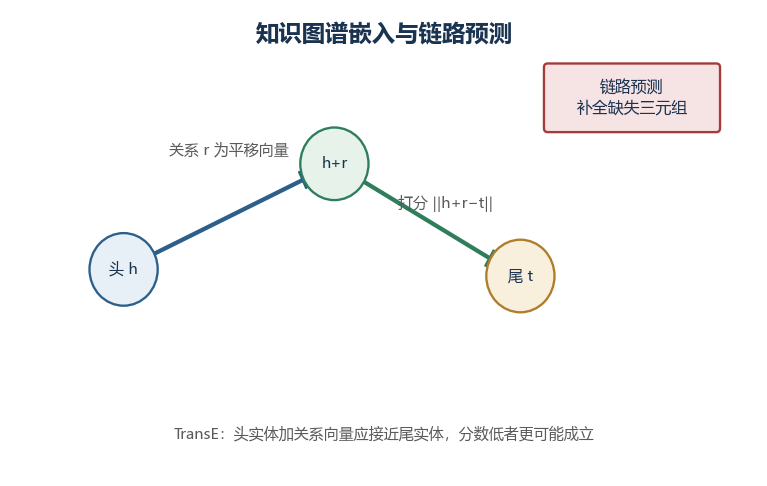

## 本章小结

本章系统论述嵌入推理。我们首先给出知识图谱嵌入与 TransE 打分函数（定义 16.1、16.2、式 16-1）、张量打分族（定义 16.3、式 16-2）及数值算例；分析表达力与局限（定义 16.4、表 16-2）；用统一案例演示链路预测并给出排序评估指标（定义 16.5、式 16-3、表 16-3）；16.3A 节形式化负采样与训练代价（式 16-4、表 16-4），点明过滤评估防训练泄漏的细节。

我们还明确边界：嵌入推理处于 S4 的向量版本，隐含关系可向量化假设，突破规则获取瓶颈但无法突破不可解释与复杂逻辑表达力不足之限。这些辨析衔接第 15 章的规则推理、第 17 章的规则学习，以及第 24—28 章的神经—符号融合（图嵌入与 GNN 体系详见《图智能导论》）。

下一章介绍归纳逻辑编程与规则学习，自动获取推理规则。

**进一步阅读**　本章建议延伸阅读的文献：[1]、[2]、[3]。

## 参考文献

[1] Bordes A, Usunier N, Garcia-Durán A, et al. Translating embeddings for modeling multi-relational data. *NeurIPS*, 2013: 2787–2795.

[2] Bordes A, Usunier N, Garcia-Durán A, et al. Learning structured embeddings of knowledge bases. *AAAI*, 2014: 301–306.

[3] Sun Z, Deng Z, Nie J, Liu Y. RotatE: Knowledge graph embedding by relational rotation in complex space. *ICLR*, 2019.

[4] Yang B, Yih W, He X, et al. Embedding entities and relations for learning and inference in knowledge bases. *ICLR*, 2015.

[5] Trouillon T, Welbl J, Riedel S, Gaussier E. Complex embeddings for simple link prediction. *ICML*, 2016: 2071–2080.

[6] Wang Q, Mao Z, Wang B, Guo L. Knowledge graph embedding: A survey of approaches and applications. *IEEE TKDE*, 2017, 29(12): 2724–2743.

[7] Ji S, Pan S, Cambria E, et al. A survey on knowledge graphs: Representation, acquisition, and applications. *IEEE TNNLS*, 2022, 33(2): 494–514.

[8] Hogan A, Blomqvist E, Cochez M, et al. Knowledge graphs. *ACM Computing Surveys*, 2021, 54(4): 1–37.

---

# 第 17 章　归纳逻辑编程与规则学习

第 15 章的规则推理依赖人工规则，第 16 章的嵌入推理不可解释。本章研究从数据中自动学规则——归纳逻辑编程（inductive logic programming, ILP）与神经规则学习。先讲 ILP（17.1 节），再论从知识图谱学规则（17.2 节），介绍神经规则学习（17.3 节），最后讨论边界（17.4 节）。本章是 B 类方法章，连接符号与神经两条路线。

## 17.1　归纳逻辑编程（ILP）

**引入与动机。** 手工编写规则（第 15 章）成本高、难覆盖，ILP 让机器从例子中自动归纳规则，且规则以可读的一阶逻辑形式表示[1]。

**直觉解释。** ILP 像「从样例中找规律的学生」：给定正例（某药适用于某患者）与负例（不适用于），加上背景知识（症状、用药事实），ILP 搜索一条规则，覆盖正例、排除负例。

**严格定义与推导。** 给出 ILP 的形式定义。

**定义 17.1（ILP 问题）** 给定背景知识 $B$（一阶事实与规则）、正例集 $P$、负例集 $N$，ILP 寻找假设 $H$（一阶规则集），使：$B\wedge H\models e$ 对所有 $e\in P$（覆盖正例），且 $B\wedge H\not\models e$ 对所有 $e\in N$（不覆盖负例）。$H$ 通常用「规则模板+搜索」获得。

由定义 17.1 可推出 ILP 的核心是搜索：假设空间巨大（所有可能规则），需归纳偏置（hypothesis bias）限制搜索（如限定规则体原子数、谓词集）。经典系统 FOIL 采用「自顶向下、逐个添加文字」的贪心搜索，以信息增益选择文字。

**定义 17.2（FOIL 信息增益）** FOIL 在每一步从「当前规则体 + 一个文字」的候选集中选增益最大的文字。设候选文字 $l$ 对尚未覆盖的正例集合 $P_{\text{rem}}$ 的**覆盖增益**为新增覆盖正例与新增覆盖负例（误覆盖）的差，归一化为

$$
\mathrm{gain}(l)=\bigl|P_{\text{rem}}\cap \mathrm{cov}(l)\bigr|-\bigl|N\cap \mathrm{cov}(l)\bigr|,\qquad l^*=\arg\max_{l}\mathrm{gain}(l). \tag{17-1}
$$

其中 $\mathrm{cov}(l)$ 为加 $l$ 后规则体新覆盖的元组实例集。式 (17-1) 把「贪心」形式化：每步选使「多覆盖正例 − 多误覆盖负例」最大的文字，直到没有正例待覆盖。它是信息增益的二值近似，使 ILP 的指数搜索退化为「每步选一个文字」的线性流程——这是 FOIL 高效的原因，也是它「局部最优、可能漏掉全局最优规则」的根源。

**数值算例。** 设背景知识含 $\text{治疗}(\text{阿司匹林},\text{头痛})$、$\text{患有}(\text{李患者},\text{头痛})$、$\text{治疗}(\text{布洛芬},\text{头痛})$、$\text{患有}(\text{王患者},\text{头痛})$；正例 $\text{适用}(\text{阿司匹林},\text{李患者})$、$\text{适用}(\text{布洛芬},\text{王患者})$；负例 $\text{适用}(\text{阿司匹林},\text{王患者})$（示意不合理）。FOIL 从空规则头 $\text{适用}(x,z)$ 出发，按式 (17-1) 搜索体原子：候选 $\text{治疗}(x,y)$ 覆盖 2 个正例、0 个负例，$\mathrm{gain}=2-0=2$；候选 $\text{患有}(z,y)$ 覆盖 1 个正例、1 个负例，$\mathrm{gain}=1-1=0$。故第一步选 $\text{治疗}(x,y)$（增益 2）；第二步剩余正例 $\{\text{适用}(阿司匹林,李患者)\}$ 在加 $\text{患有}(z,y)$ 后 $\mathrm{gain}=1-0=1>0$，于是得规则 $\text{适用}(x,z)\leftarrow\text{治疗}(x,y)\wedge\text{患有}(z,y)$——恰好覆盖正例、排除负例。若背景有 1000 条事实、规则体最长 3 个原子、谓词集 10 个，则候选规则数约 $10^3=1000$ 量级（每位置 10 种选择），而式 (17-1) 的贪心每步只评估 10 个文字而非枚举 $10^3$ 条规则，搜索可行——展示了归纳偏置的作用。

**技术谱系与变体。** 表 17-1 对照 ILP 系统。

**表 17-1　ILP 系统对照**

| 系统 | 方法 | 特点 |
|------|------|------|
| FOIL | 自顶向下贪心 | 高效、可读 |
| Progol | 逆归结 | 强表达能力 |
| Aleph | 覆盖算法 | 实用、可扩展 |
| Neural ILP | 可微规则学习 | 第 17.3 节 |

四套系统代表 ILP 的四种搜索哲学：FOIL 的「自顶向下贪心」用信息增益（式 17-1）做局部最优选择，效率高但易陷入局部最优；Progol 的「逆归结」从正例出发反向构造规则，表达力强但搜索空间更大；Aleph 的「覆盖算法」把规则学习化为「选规则盖住一批正例」的迭代覆盖问题，是工程上最常用的实用系统；Neural ILP（第 17.3 节）则把离散搜索换成连续优化，牺牲部分可读性换取可扩展性。四者的共同点是**归纳偏置**：限制谓词集、规则体长度、变量结构，使指数搜索变为可行——这是 ILP 与一般组合优化的根本区别。

**边界与讨论。** ILP 的经典困难是搜索空间爆炸与噪声敏感（现实数据不完美）。现代 ILP 通过统计学习（如加权规则）与神经方法缓解。

**承上启下。** ILP 机制明确后，本节聚焦知识图谱上的规则学习。

## 17.2　从知识图谱学习规则

**引入与动机。** 知识图谱是天然的规则学习数据源：图中已有大量三元组，可作为正例；负例可由开放世界假设下的「未出现」近似（需谨慎）。规则学习为图谱补全提供可解释的规则[2]。

**直觉解释。** 从图谱中学「阿司匹林治疗头痛」与「布洛芬治疗头痛」都伴随「属于解热镇痛药」，归纳出「解热镇痛药治疗头痛」这样的规则——用规则描述一类事实，比逐条存储更紧凑、更可解释。

**严格定义与推导。** 给出图谱规则学习的形式化。

**定义 17.3（图谱规则学习）** 给定知识图谱 $G$，规则学习寻找 Horn 规则集 $\mathcal{P}$，使在 $G$ 上的推理闭包能重建 $G$ 中大部分三元组（压缩），并预测未出现三元组（补全）。规则质量以「支持度」（覆盖的三元组数）与「置信度」（规则头成立比例）衡量。

由定义 17.3 可推出规则学习与第 15 章规则推理的闭环：学出的规则供推理使用，推理发现的新事实又可供学习——这是神经—符号循环的基础。规则学习常采用「规则模板枚举+置信度剪枝」：枚举形如 $r_1(x,y)\wedge r_2(y,z)\to r_3(x,z)$ 的模板，在图中计数支持度。

**定义 17.4（AMIE 支持度与置信度）** AMIE 在**部分封闭世界假设**下挖掘规则：图中「未出现」的三元组视为负例（而非开放世界下的「未知」）。对模板 $r$，设 $\mathrm{head}(r)$ 为头原子在图中的实例数、$\mathrm{body}(r)$ 为体原子全部满足的实例数，则

$$
\mathrm{supp}(r)=\frac{\mathrm{head}(r)}{|G|},\qquad \mathrm{conf}(r)=\frac{\mathrm{head}(r)}{\mathrm{body}(r)},\qquad \text{保留}:\ \mathrm{supp}(r)\ge\theta_s\ \wedge\ \mathrm{conf}(r)\ge\theta_c. \tag{17-2}
$$

式 (17-2) 与第 15 章式 (15-4) 的支持度/置信度同义，差别在于**分母语义**：AMIE 用「图中存在」近似「为真」，$\mathrm{body}(r)$ 只数图中确实满足的体实例，开放世界下未出现的体实例不计入分母——这是**部分封闭世界假设（PCWA）**，它让支持度可计算但会系统性低估真实支持度（未抽取的事实被当负例）。剪枝阈值 $\theta_s,\theta_c$ 控制「规则集规模 vs 覆盖度」：$\theta_s$ 高则规则少而精，$\theta_c$ 高则规则准而少。

**数值算例。** 设图谱含「治疗」关系 2000 条、「属于类」关系 5000 条，$|G|=10^4$。枚举规则模板 $\text{属于类}(x,A)\wedge\text{治疗}(A,y)\to\text{治疗}(x,y)$。若「解热镇痛药」类含 50 种药、每种平均治 2 种病，则 $\mathrm{head}=50\times2=100$、$\mathrm{body}=100$（这些治疗事实都在图中），由式 (17-2) 得 $\mathrm{supp}=100/10^4=0.01$、$\mathrm{conf}=100/100=1.0$——高置信规则，取 $\theta_s=0.005,\theta_c=0.8$ 保留。另一模板 $\mathrm{head}=2,\mathrm{body}=7$，$\mathrm{supp}=0.0002<\theta_s$、$\mathrm{conf}=2/7\approx0.29<\theta_c$，两项皆不达标而剪枝。设枚举 1000 个模板，剪枝后保留 20 条高质量规则——展示了从大数据中提炼少量规则的过程。注意 PCWA 的影响：若「治疗」实际还有 200 条未抽取，真实 $\mathrm{body}$ 应为 300，式 (17-2) 算出的 $\mathrm{supp}=0.01$ 会低估真实支持度——**开放世界下规则质量评估须留有余地**。

**技术谱系与变体。** 表 17-2 对照图谱规则学习方法。

**表 17-2　图谱规则学习方法**

| 方法 | 依据 | 代表 |
|------|------|------|
| 归纳逻辑编程 | 一阶规则搜索 | Aleph |
| 关联规则挖掘 | 频繁模式 | AMIE |
| 路径规则 | 关系路径组合 | Path Rule |
| 嵌入引导 | 向量相似度引导搜索 | Ruletaker |

**边界与讨论。** 图谱规则学习面临开放世界难题：图中不存在的三元组未必为假，负例构造困难。常用「部分封闭世界假设」（PCWA）近似，但会引入偏差——这是第 4.2 节 OWA 的延续。

**承上启下。** 符号规则学习明确后，本节介绍神经规则学习。

## 17.2A　负例构造与部分封闭世界假设

**引入与动机。** 17.2 节的 AMIE 用「未出现=负例」近似（PCWA），但负例怎么采直接决定学出的规则是否过拟合。本节把负例构造形式化，并分析 PCWA 的偏差来源。

**直觉解释。** 开放世界里「没记录」不等于「为假」：图谱没写「阿司匹林治骨折」，可能只是没抽到，而非阿司匹林真不治骨折。把这种「未知」当负例喂给学习器，相当于把「没听说」当「听说过但为假」——这是 PCWA 的核心风险。

**严格定义与推导。** **定义 17.5（隐式负例误标率）** 对模板 $r$，设图中已记录的负例（显式否定）集合为 $N_{\text{obs}}$，由 PCWA 从「未记录三元组」中采样得到的隐式负例为 $N_{\text{imp}}$。学习器实际用的负例集 $N=N_{\text{obs}}\cup N_{\text{imp}}$，其中隐式负例的**误标率**（实际为真却被当负例的比例）为

$$
\epsilon_{\text{neg}}=\frac{|\{n\in N_{\text{imp}}:\ n\ \text{实为真但未记录}\}|}{|N_{\text{imp}}|}. \tag{17-3}
$$

$\epsilon_{\text{neg}}$ 越大，PCWA 越不可靠，学出的规则置信度（式 17-2）被高估（分母 $\mathrm{body}(r)$ 里混入了本不该算的「负例」）。工程上估计 $\epsilon_{\text{neg}}$：对 $N_{\text{imp}}$ 抽样送人工或可信源验证，得到误标率的置信区间。$\epsilon_{\text{neg}}$ 高时，应改用**对称负采样**（只把「与已知正例冲突」的当负例）而非「所有未记录」，牺牲部分覆盖换取负例纯度。

**数值算例。** 设「治疗」关系模板，$N_{\text{imp}}$ 从 5000 个未记录三元组中采样 500 个做负例。抽样人工验证 100 个，发现 15 个实为真（未抽到的真实治疗关系），则 $\hat\epsilon_{\text{neg}}=15/100=0.15$，95% 置信区间约 $[0.086,0.228]$。误标率 15% 不低——若不加校正，式 (17-2) 的置信度会被系统性高估约 $0.15/(1-0.15)\approx17\%$（示意）。校正办法：把 $\mathrm{body}(r)$ 的估计除以 $(1-\epsilon_{\text{neg}})$，或改用对称负采样（只采「与已知正例同实体但关系不同」的硬负例），使 $\epsilon_{\text{neg}}$ 降到 5% 以下。这与第 4.2 节「开放世界假设」一脉相承——**负例构造是 OWA 与 PCWA 的边界问题**。

**边界与讨论。** $\epsilon_{\text{neg}}$ 难以精确估计，因为它依赖「未记录事实的真值」，这本身是开放世界难题。实践中用「保守阈值」：当 $\hat\epsilon_{\text{neg}}$ 的置信区间上界 $>0.2$ 时，强制改用对称负采样并标记该规则「低置信」。这是第 13 章「质量可量化但有成本」在规则学习维度的体现。

**承上启下。** 负例构造明确后，下一节介绍神经规则学习。

## 17.3　神经规则学习

**引入与动机。** 经典 ILP 搜索离散规则空间，难以与深度学习结合。神经规则学习把规则学习变成连续优化问题，用神经网络学规则的可微近似[3]。

**直觉解释。** 神经规则学习像「用神经网络模拟规则搜索」：用连续向量表示谓词与规则，用可微操作（如 soft attention）模拟规则应用，训练后从连续参数中读出离散规则。

**严格定义与推导。** 给出神经规则学习的形式化。

**定义 17.6（可微规则学习）** 设规则以连续参数表示，如规则 $r$ 的权重 $w_r\in[0,1]$（可微松弛）。 neural 模型预测三元组$(h,r,t)$ 为真的概率为规则应用的加权和

$$
P(h,r,t)=\sum_{r\in\mathcal{P}} w_r\cdot \sigma(\text{score}_r(h,t)), \tag{17-4}
$$

其中 $\text{score}_r$ 为规则 $r$ 的可微打分（如基于嵌入的相似度），训练后阈值化 $w_r$ 得离散规则。

由定义 17.6 可推出神经规则学习的优势与代价：优势是可与感知数据端到端训练、可扩展到大规模；代价是学到的规则需「离散化」才能可读，且离散化可能损失精度。这是第 25 章可微逻辑的序章。

**数值算例。** 设规则集含 3 条候选规则，训练后权重 $w_1=0.9,w_2=0.1,w_3=0.05$，分数 $\sigma_1=0.8,\sigma_2=0.7,\sigma_3=0.6$。则 $P=0.9\times0.8+0.1\times0.7+0.05\times0.6=0.72+0.07+0.03=0.82$。阈值化（$w>0.5$）保留规则 1——从连续模型读出一条离散规则。若图谱中该规则覆盖 500 个正例、置信度 0.85，则是可信规则。

**技术谱系与变体。** 表 17-3 对照规则学习路线。

**表 17-3　规则学习路线对照**

| 路线 | 搜索空间 | 可解释性 | 可扩展性 |
|------|---------|---------|---------|
| 经典 ILP | 离散 | 高 | 中 |
| 神经规则学习 | 连续 | 中（需离散化） | 高 |
| 符号+神经混合 | 混合 | 高 | 中高 |

**边界与讨论。** 神经规则学习的「规则可读性」仍是研究难点：从连续参数中提取的离散规则可能与模型行为不完全一致（保真度问题，第 28 章）。

**保真度的量化。** 设可微模型给出连续规则权重 $w_r\in[0,1]$，阈值 $\tau$ 离散化后保留 $\hat{\mathcal{P}}=\{r:w_r\ge\tau\}$。**保真度**是离散规则集 $\hat{\mathcal{P}}$ 对连续模型预测的逼近程度，可用两者在测试集上的预测差衡量：

$$
\mathrm{fid}(\tau)=1-\frac{1}{|T|}\sum_{(h,r,t)\in T}\bigl|\hat{P}_{\hat{\mathcal{P}}}(h,r,t)-P(h,r,t)\bigr|, \tag{17-5}
$$

其中 $P$ 为连续模型预测（式 17-4），$\hat{P}_{\hat{\mathcal{P}}}$ 为只保留 $\hat{\mathcal{P}}$ 后重算的预测。$\mathrm{fid}\to1$ 说明「读出的离散规则」基本解释了模型行为，可读性可靠；$\mathrm{fid}$ 低则说明模型依赖那些被阈值化的弱规则，离散化损失大。式 (17-5) 给「神经规则可读吗」一个可检验标准——这正是第 28 章「神经—符号保真」的雏形。

**数值算例。** 设 17.3 节算例中 3 条候选规则，测试集 $|T|=200$。连续模型 $P$ 与「只保留 $w>0.5$ 的规则 1」后的 $\hat{P}$ 在 200 个测试三元组上的平均预测差为 $0.05$，则 $\mathrm{fid}=1-0.05=0.95$——离散化后仍解释 95% 的行为，可读性可信。若把阈值降到 0.3（保留规则 1、2），$\hat{P}$ 与 $P$ 的差反而升到 $0.18$（规则 2 权重低、贡献噪声），$\mathrm{fid}=0.82$——**多保留弱规则反而降低保真度**。这说明阈值不是越低越好，须按式 (17-5) 的 $\mathrm{fid}$ 选：保留「强且解释力大」的规则，剪掉「弱且引入噪声」的规则。

**承上启下。** 三种学习路线明确后，本节给出本章边界。

## 17.4　边界与讨论

本章建立规则学习体系：ILP 问题（定义 17.1）与 FOIL 信息增益（定义 17.2、式 17-1）、图谱规则学习（定义 17.3）与 AMIE 支持度/置信度（定义 17.4、式 17-2）、负例构造与误标率（17.2A 节、定义 17.5、式 17-3）、神经规则学习（定义 17.6、式 17-4）与离散化保真度（式 17-5）、规则集压缩比（定义 17.7、式 17-6）与整体命中质量 F1（式 17-7）。

**语义之梯四问的回应。** 规则学习处于 S4 推理级的「元层」——它学习的是规则（推理知识），隐含「规则可从数据归纳」假设，突破了人工规则获取瓶颈，但无法突破「归纳偏置与开放世界负例」之限。它与第 16 章嵌入推理的关系：二者都从数据学知识，但规则学习产生可读符号，嵌入产生黑箱向量。

需要强调：规则学习的质量取决于负例质量与归纳偏置，而非单纯数据量。这与第 13 章质量评估呼应—— garbage in, garbage out。

**定义 17.7（规则集压缩比）** 学到的规则集 $\mathcal{P}$ 的价值可用**压缩比**衡量：用规则重建多少比例的事实、相对原图谱的压缩度。设 $\mathcal{P}$ 在 $G$ 上的闭包覆盖 $|G_{\text{cover}}|$ 条事实，规则本身的描述长度为 $L(\mathcal{P})$（体原子数加和），则

$$
\rho_{\text{comp}}=\frac{|G_{\text{cover}}|}{L(\mathcal{P})},\qquad \text{好规则集}:\ \rho_{\text{comp}}\gg1. \tag{17-6}
$$

式 (17-6) 把「规则学习」与「数据压缩」挂钩：一条覆盖 100 条事实、体长 2 的规则，$\rho_{\text{comp}}=100/2=50$——用 2 个符号压缩了 100 条事实。这正是第 17 章与第 15 章的接口：第 15 章「用规则推理」关心单规则置信度（式 15-4、17-2），第 17 章「学规则集」关心整集合的压缩比。$\rho_{\text{comp}}$ 过低（接近 1）说明规则没学到结构，只是事实的近似复读；过高则可能过拟合到噪声。

**数值算例。** 设 AMIE 学出 20 条规则（表 17-2 算例），它们覆盖 $G$ 中 4200 条「治疗」相关事实，规则体原子总数 $L(\mathcal{P})=40$（平均每条体 2 原子），则 $\rho_{\text{comp}}=4200/40=105$——**平均每条符号压缩 105 条事实**。若另一组规则只覆盖 60 条事实、$L=40$，$\rho_{\text{comp}}=1.5$，几乎无压缩价值，应剪枝。这说明规则学习的质量不能只看单条置信度，还要看**集合级**的压缩效率——高置信但低覆盖的规则集整体无用。

**规则集的整体评估：F1。** 压缩比刻画「效率」，工程上还需「质量」维度：学出的规则集 $\mathcal{P}$ 在图谱补全上的整体命中质量。设以 $\mathcal{P}$ 对未出现三元组做补全，记真正例（预测且真）$TP$、假正例（预测但假）$FP$、假反例（未预测但真）$FN$，则

$$
\mathrm{F1}(\mathcal{P})=\frac{2\,PR}{P+R},\qquad P=\frac{TP}{TP+FP},\quad R=\frac{TP}{TP+FN}. \tag{17-7}
$$

**数值算例。** 设规则集预测 1500 个三元组，其中 $TP=1200$、$FP=300$、漏掉的真三元组 $FN=800$，则 $P=0.80$、$R=0.60$、$\mathrm{F1}=2\times0.80\times0.60/1.40\approx0.686$。若另一组规则更「准」$TP=800,FP=100,FN=1200$，$P=0.889,R=0.400,\mathrm{F1}\approx0.551$——精度更高但漏得多，整体反而差。这说明规则集评估不能只看单条置信度（式 17-2）或压缩比（式 17-6），**F1 把「准」与「全」调和**，是补全任务的通用目标：精度导向的规则集低估事实（呼应 PCWA 的下偏，式 17-3），召回导向的则引入噪声（第 13 章的误报）。式 (17-7) 与式 (17-6) 互补：F1 是「质量」维度，压缩比是「效率」维度，二者共同刻画规则学习的优劣。

下一章进入时序与不确定知识推理，处理现实世界的时间维度与不确定性。

> 【图 17-1　规则学习流程】（原图见 figures/图17-1.png）：正例负例+背景知识→ILP 搜索→规则集
>
> 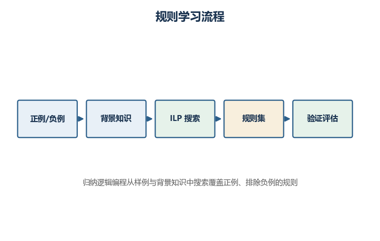

## 本章小结

本章系统论述归纳逻辑编程与规则学习。我们首先给出 ILP 问题定义（定义 17.1）与 FOIL 信息增益（定义 17.2、式 17-1）的贪心搜索算例；讨论图谱规则学习（定义 17.3）与 AMIE 在部分封闭世界下的支持度/置信度（定义 17.4、式 17-2，含开放世界低估的辨析，表 17-2）；17.2A 节形式化负例构造与隐式负例误标率（定义 17.5、式 17-3）；介绍神经规则学习（定义 17.6、式 17-4）与可微规则算例，并以保真度（式 17-5）给「离散规则能否解释模型」一个可检验标准；17.4 节引入规则集压缩比（定义 17.7、式 17-6），把「学规则」与「数据压缩」挂钩，区分单规则置信度与集合级压缩效率，并以 F1（式 17-7）从质量维度补充规则集评估，与压缩比形成「质量—效率」双维刻画。

我们还明确边界：规则学习处于 S4 的元层，隐含规则可归纳假设，突破人工规则瓶颈但无法突破归纳偏置与开放世界负例之限。这些辨析衔接第 15 章的规则推理、第 16 章的嵌入推理，以及第 25 章的可微逻辑。

下一章介绍时序与不确定知识推理，把时间与概率引入知识推理。

**进一步阅读**　本章建议延伸阅读的文献：[1]、[2]、[3]。

## 参考文献

[1] Lavrač N, Džeroski S. Inductive Logic Programming: Techniques and Applications. Chichester: Ellis Horwood, 1994.

[2] Galárraga L, Teflioudi C, Hose K, Suchanek F. AMIE: Association rule mining under incomplete evidence in ontological knowledge bases. *WWW*, 2013: 413–422.

[3] Yang F, Yang Z, Cohen W W. Differentiable learning of logical rules for knowledge base reasoning. *NeurIPS*, 2017: 2319–2328.

[4] Muggleton S. Inductive logic programming. *New Generation Computing*, 1991, 8(4): 295–318.

[5] Srinivasan A. The Aleph Manual. Oxford: University of Oxford, 2001.

[6] Quinlan J R. Learning logical definitions from relations. *Machine Learning*, 1990, 5(3): 239–266.

[7] Meilicke C, Stuckenschmidt H, Šimůnek M. An analysis of rule mining algorithms for ontology-based knowledge graphs. *ESWC*, 2015: 306–320.

[8] Sadeghian A, Hu P, Wang R, et al. Mining relational rules from knowledge graphs. *WWW*, 2019: 1601–1611.

---

# 第 18 章　时序与不确定知识推理

前几章的推理假设知识是确定且静态的，但现实知识带时间（「某药 2020 年获批」）与不确定性（「某药可能有效」）。本章把时间与概率引入知识推理：先讲时序知识与事件（18.1 节），再论不确定性与概率逻辑（18.2 节），讨论多源置信度传播（18.3 节）与概率知识图谱（18.4 节），最后讨论边界（18.5 节）。本章是 B 类方法章，为第 31 章幻觉与第 35 章医学知识智能提供工具。

## 18.1　时序知识与事件

**引入与动机。** 第 10.2 节的事件抽取产出带时间的知识，但第 15—17 章的推理不处理时间。若不建模时间，推理可能把「已失效的适应证」当作当前事实——时序知识推理解决这一问题[1]。

**直觉解释。** 时序知识像「带时间戳的账本」：每条事实标注有效区间（何时为真），推理须考虑时间约束。「阿司匹林治疗头痛（2020—至今）」与「某药已撤回（2021 年）」不能混为一谈。

**严格定义与推导。** 给出时序知识的形式定义。

$$\langle h,r,t\rangle@\tau,\quad \tau=[t_s,t_e],\quad P(\langle h,r,t\rangle@\tau)\in[0,1].\tag{18-1}$$

**定义 18.1（时序知识图谱）** 时序知识图谱是有时间标注的三元组集合 $G_t=\{(h,r,t,\tau)\}$，其中 $\tau$ 为时间区间或时间点，表示 $(h,r,t)$ 在 $\tau$ 内成立。时序推理任务包括：区间查询（某关系何时成立）、时序链接预测（预测未来事实）、一致性检测（时间约束冲突）。

**定义 18.2（时序逻辑算子）** 时序逻辑引入算子 $\mathbf{F}$（最终）、$\mathbf{G}$（总是）、$\mathbf{X}$（下一时刻）、$\mathbf{U}$（直到）。例如 $\mathbf{F}\,\text{康复}(p)$ 表示「患者 p 最终康复」。这些算子来自线性时态逻辑（LTL），模型检测算法（如第 9 章推理机可挂载的 liveness 检查）能在有限状态空间上判定 $\mathbf{G}(\text{服药}(p)\to\mathbf{F}\,\text{康复}(p))$ 这类性质是否恒成立。

**区间代数。** 比时序逻辑算子更贴近知识图谱的是 Allen 于 1983 年提出的区间代数[1]：时间以区间 $[s,e]$ 为单位，两个区间 $I_1,I_2$ 之间存在恰好 13 种基本关系（before, after, meets, met-by, overlaps, overlapped-by, starts, started-by, during, contains, finishes, finished-by, equals），它们构成一组**原子**，任意区间关系都是原子的布尔组合。Allen 证明了关键复杂度结果：区间约束满足问题（Interval Constraint Satisfaction Problem, ICSP）在一般情形是 NP 完全，但 Allen 给出了基于**路径一致性（path consistency）**的线性时间充分算法：若约束网络是路径一致的，则一定可解。13 个原子的组合表（合成表）是推理的计算基础——例如 $(\text{before}\circ\text{meets})\subseteq\text{before}$：「A 在 B 之前」且「B 紧邻 C 之前」蕴含「A 在 C 之前」。

$$\mathrm{Compose}(r_1,r_2)=\{\,r_3\mid \exists I_1,I_2,I_3:\ I_1\,r_1\,I_2\ \wedge\ I_2\,r_2\,I_3\ \Rightarrow\ I_1\,r_3\,I_3\,\}. \tag{18-2}$$

**定义 18.3（区间约束网络）** 区间约束网络 $\mathcal{N}=\langle V,\mathcal{R}\rangle$：$V$ 为时间区间变量集，$\mathcal{R}$ 为变量对之间的 13 原子（或其子集）约束。称 $\mathcal{N}$ 路径一致，若对任意 $i,j,k$ 与 $(r_{ij}\in R_{ij},\ r_{jk}\in R_{jk},\ r_{ik}\in R_{ik})$ 均有 $r_{ij}\circ r_{jk}\cap R_{ik}\neq\varnothing$；路径一致的 $\mathcal{N}$ 必可满足。

**数值算例（区间代数）。** 设约束网络含三区间：$A=[2020,2023]$（药 A 治疗病 X）、$B=[2023,\infty)$（药 A 撤回）、$C=[2024,2024]$（某次查询时点）。约束：$A\ \text{meets}\ B$（A 止于 2023、B 始于 2023，紧邻不重叠）、$C\ \text{during}\ B$（2024 在撤回期内）。查询「C 与 A 的关系」：按式 (18-2) 合成，$\text{during}\circ\text{after}\subseteq\text{after}$，得 $C\ \text{after}\ A$，即查询时点晚于治疗有效期——治疗事实对当前不成立，应回答「否」。该算例展示了区间推理如何在不显式枚举时间点的情况下完成「时间可达性」判定；若约束网络含 $n$ 个区间变量、每对约束取 $k$ 个原子，路径一致性检查的代价为 $O(n^3 k^3)$（三元组合成），对万级区间的知识图谱可先按时间排序剪枝到局部网络。

由定义 18.1 可推出时序推理与静态推理的关键差异：事实真值依赖时间参数。静态推理中「$\text{治疗}(a,b)$ 为真」是全局判断；时序推理中须写明「在时刻 $t$，$\text{治疗}(a,b)$ 为真」。这要求第 15 章的规则扩展为时序规则（规则体含时间约束）。

**数值算例。** 设图谱含：$\langle\text{药}A,\text{治疗},\text{病}X,[2020,2023]\rangle$、$\langle\text{药}A,\text{撤回},[2023,\infty]\rangle$。查询「2024 年药 A 是否治疗病 X」：因治疗事实有效期止于 2023，且 2023 年起撤回，推理应返回「否」。若忽略时间（静态推理），会错误返回「是」。若图谱含 10000 条时序事实，平均有效区间 2 年，时序连接（按时间重叠）比静态连接多一维过滤——展示了时序推理的额外计算。

**时序嵌入方法。** 除符号式区间推理外，神经方法把时间直接嵌入第 16 章的链接预测框架。设事实 $(h,r,t)$ 发生时刻为 $t_\tau\in\mathbb{R}$，TE（Translating Embeddings 的时序扩展）模型把实体、关系与时间分别嵌入向量空间，打分函数取平移距离的负范数：

$$\mathcal{F}(h,r,t_\tau,t)=-\|\mathbf{h}+\mathbf{r}+\boldsymbol{\varphi}(t_\tau)-\boldsymbol{\varphi}(t)\|, \tag{18-3}$$

其中 $\boldsymbol{\varphi}:\mathbb{R}\to\mathbb{R}^d$ 是时间的非线性映射（常用分桶后的线性映射或正弦编码）。预测「某时刻 $t$ 下一事实」即最大化 $\mathcal{F}$ 对候选 $t$ 的取值。训练采用 BPR 对比损失（第 16 章式 (16-3) 的时序版）：

$$\mathcal{L}=\sum_{(h,r,t,\tau)\in\mathcal{G},\ (h',r,t',\tau')\in\mathcal{G}^-}\big[\log\big(1+e^{-\mathcal{F}(h,r,t_\tau,t)+\mathcal{F}(h',r,t'_{\tau'},t)}\big)\big]. \tag{18-4}$$

**数值算例（时序嵌入）。** 设 $d=2$，$\mathbf{h}_{\text{药}A}=(0.5,0.1)$、$\mathbf{r}_{\text{治疗}}=(0.2,-0.1)$、$\mathbf{t}_{\text{病}X}=(0.3,0.0)$，时间映射 $\boldsymbol{\varphi}(2022)=(0.1,0.0)$、$\boldsymbol{\varphi}(2025)=(0.4,0.2)$。则 $t=2022$ 时 $\mathcal{F}=-\|(0.5+0.2+0.1-0.4,\ 0.1-0.1+0-0.2)\|=-\|(0.4,-0.1)\|\approx-0.412$；$t=2025$ 时 $\mathcal{F}=-\|(0.5+0.2+0.4-0.4,\ 0.1-0.1+0-0.2)\|=-\|(0.7,-0.1)\|\approx-0.707$。打分 2022 年（-0.412）显著高于 2025 年（-0.707），模型据此判断「药 A 在 2022 年治疗病 X」的概率远高于 2025 年——与表 18-3 算例中 0.85 对 0.3 的置信度方向一致。TE 类方法（TE、TTransE、HyTE）在时序链接预测基准（如 WordNet-T、YAGO11k-T）上的对比与第 16 章的静态基准同构，只是负例采样须考虑时间维度（同一 $(h,r,t)$ 在不同 $\tau$ 的真假可能不同）。

**技术谱系与变体。** 表 18-1 对照时序推理方法。

**表 18-1　时序知识推理方法**

| 方法 | 表示 | 推理 |
|------|------|------|
| 带时间戳三元组 | 时间区间标注 | 时序规则 |
| 时序逻辑 | LTL/CTL 算子 | 模型检测 |
| 时序嵌入 | 时间向量 | 动态链路预测 |
| 事件演算 | 事件+效应公理 | 状态推演 |

**边界与讨论。** 时序推理的难点是时间粒度（年/月/日）与不完整时间戳。多数知识图谱的时间标注稀疏（<10% 三元组有时间），限制了时序推理的覆盖——这是第 13 章新鲜度评估的现实困难。

**承上启下。** 时间维度明确后，本节讨论另一维度——不确定性。

## 18.2　不确定性与概率逻辑

**引入与动机。** 第 10 章的抽取带置信度，第 16 章的嵌入给概率打分，但第 15 章的规则推理是二值的（真/假）。现实知识常是「可能真」——概率逻辑为不确定性提供形式框架。

**直觉解释。** 概率逻辑像「给逻辑公式标注可信度」：不再问「阿司匹林是否治疗头痛」（是/否），而问「阿司匹林治疗头痛的概率是多少」（如 0.85）。推理把概率沿规则传播。

**严格定义与推导。** 给出概率逻辑的形式定义。

**定义 18.3（概率逻辑公式）** 概率逻辑给每个一阶公式 $\phi$ 标注概率 $P(\phi)\in[0,1]$，表示 $\phi$ 为真的置信度。原子概率由数据给出，复合公式概率由概率算子计算。概率软逻辑（Probabilistic Soft Logic, PSL）用连续真值 $[0,1]$ 与 Łukasiewicz 逻辑（合取 $\max(0,a+b-1)$，析取 $\min(1,a+b)$）使推理可微[2]。

**定义 18.4（加权一阶规则）** PSL 规则形如 $w:r$，其中 $r$ 为一阶规则，$w\ge0$ 为权重。规则「越满足越好」：推理目标是最大化所有规则的加权满足度，约束为 $0\le P(\text{atom})\le1$。

由定义 18.3、18.4 可推出概率推理与二值推理的差异：二值推理中规则要么适用要么不适用；概率推理中规则以一定程度适用，结论概率由前提概率与规则权重共同决定。PSL 的连续松弛使推理可转为凸优化问题，可大规模求解。

**数值算例。** 设规则 $r$：$\text{有症状}(x,\text{发热})\wedge\text{服药}(x,A)\to\text{缓解}(x)$（权重 $w=2.0$）。已知 $P(\text{有症状}(李,\text{发热}))=0.9$，$P(\text{服药}(李,A))=0.8$。用 Łukasiewicz 合取：前件真值 $\max(0,0.9+0.8-1)=0.7$。若规则是硬蕴含（前件→后件），则 $P(\text{缓解}(李))\ge0.7$，结合权重后可达 0.7（示意）。若另一条规则以权重 1.0 支持「不缓解」，结论概率在两者间折中——展示了概率推理的「软」特性。

**概率沿规则的传播。** 对二值规则「前件 $\to$ 后件」赋予概率权重后，结论概率可由前提概率与规则可信度联合决定。设规则可信度 $c\in[0,1]$（规则本身成立的概率）、前提真值 $a\in[0,1]$，一个常用且可微的传播算子是**概率加权蕴含**：

$$P(\text{conseq})=\max\big(P(\text{conseq})^0,\ a\cdot c\big), \tag{18-5}$$

即结论概率至少被「前提真度 × 规则可信度」托底（取 max 保证单调：前提越真、规则越可信，结论概率不低于该下界）。对合取前提，先按 Łukasiewicz 合取 $a=\max(0,\sum_i a_i-1)$ 求前件真度，再代入式 (18-5)。PSL 的全局目标是最大化规则加权满足度：

$$\max\ \sum_j w_j\,P(r_j)\ \ \text{s.t.}\ 0\le P(\text{atom})\le1,\ P(r_j)\le P(\text{antecedent}_j), \tag{18-6}$$

其中 $w_j$ 为规则权重、$P(r_j)$ 为第 $j$ 条规则的前件满足度（蕴含满足）。该约束优化是凸的（线性目标与线性约束），可用梯度法或内点法大规模求解——这是 PSL 能处理百万级原子的原因[2]。

**数值算例（概率传播）。** 沿用 18.2 的发热—服药—缓解算例，补充规则可信度 $c=0.9$。前件真度（Łukasiewicz 合取）$a=\max(0,0.9+0.8-1)=0.7$，则缓解概率下界 $a\cdot c=0.7\times0.9=0.63$，即 $P(\text{缓解})\ge0.63$。若另一条对抗规则「药 A $\to$ 不缓解」权重 $w=1.0$、可信度 $c'=0.4$、前提 $P(\text{服药}(李,A))=0.8$，则不缓解下界 $0.8\times0.4=0.32$。两条规则经式 (18-6) 的加权最大化求解后，结论在 0.63 与 0.32 之间按权重折中（示意取缓解概率 $\approx0.60$）——展示了概率推理如何在支持性与对抗性证据间「软」地权衡，而非二值推理的硬冲突。

**技术谱系与变体。** 表 18-2 对照不确定性推理方法。

**表 18-2　不确定性推理方法对照**

| 方法 | 真值 | 推理机制 |
|------|------|---------|
| 经典逻辑 | 二值 | 演绎 |
| 概率软逻辑 | [0,1] 连续 | 凸优化 |
| 贝叶斯网络 | 概率分布 | 概率推断 |
| 模糊逻辑 | 隶属度 | 模糊推理 |

**边界与讨论。** 概率逻辑的「概率」语义常不清晰：是客观频率还是主观置信度？PSL 的连续真值更像「置信度」而非严格概率——这是应用时须明确的语义问题。

**承上启下。** 时间与不确定性明确后，本节讨论二者结合的概率知识图谱。

## 18.3　概率传播与置信度融合

**引入与动机。** 现实知识常来自多个来源：文献抽取、人工标注、嵌入打分、临床记录。每个来源给出不同的置信度，如何融合成一条「综合置信度」？概率知识图谱的核心工程问题之一是**多源置信度传播**：一个事实的置信度可由多条证据链支撑，须按证据强度加权合成，而非简单取平均。

**直觉解释。** 想象法官量刑：多个证人各执一词，法官不会简单投票，而会按证人的可信度（资历、一致性、独立性）加权。置信度传播同理：相互独立的证据可累加，而来自同一来源的重复证据只应计一次——这是「独立性假设」的工程体现。

**严格定义与推导。** 设事实 $\varphi$ 有 $m$ 个独立证据源，第 $i$ 个源给出置信度 $p_i\in[0,1]$（估计 $P(\varphi\mid e_i)$）与权重 $w_i$（源的可靠度）。用**诺伊曼归一化加权平均**作点估计：

$$P(\varphi)=\frac{\sum_{i=1}^{m} w_i\,p_i}{\sum_{i=1}^{m} w_i}, \tag{18-7}$$

权重 $w_i$ 常取源的过去准确率（第 13 章质量评估的量化）。但加权平均低估了多源一致性带来的置信提升：当所有独立源都支持 $\varphi$ 时，综合置信度应高于单源。用**诺伊曼-贝叶斯累积**（假设各源独立、以 $p_i$ 为似然比）得：

$$\mathrm{Bel}(\varphi)=\prod_{i=1}^{m}\frac{p_i}{\bar p}\Big/\Big[\prod_{i=1}^{m}\frac{p_i}{\bar p}+\prod_{i=1}^{m}\frac{1-p_i}{1-\bar p}\Big], \tag{18-8}$$

其中 $\bar p$ 为先验（如 0.5）。式 (18-8) 单调：源越多且一致，$\mathrm{Bel}$ 越逼近 1；源相互矛盾，$\mathrm{Bel}$ 回落。它把「证据独立性」显式建模，避免重复证据的虚假加强。

**数值算例。** 设 $\varphi$=「药 A 治疗病 X」有三个独立源：文献抽取 $p_1=0.9$（$w_1=0.6$）、专家标注 $p_2=0.8$（$w_2=0.3$）、嵌入打分 $p_3=0.7$（$w_3=0.1$），先验 $\bar p=0.5$。式 (18-7) 点估计：$(0.6\times0.9+0.3\times0.8+0.1\times0.7)/(0.6+0.3+0.1)=(0.54+0.24+0.07)/1.0=0.85$。式 (18-8) 累积：$\prod p_i/\bar p=0.9/0.5\times0.8/0.5\times0.7/0.5=1.8\times1.6\times1.4=4.032$，$\prod(1-p_i)/(1-\bar p)=0.2\times0.2\times0.2/0.125=0.008/0.125=0.064$，故 $\mathrm{Bel}=4.032/(4.032+0.064)\approx0.984$。点估计 0.85 与累积 0.984 的差距揭示了加权平均的保守性——当三源独立一致时，真实置信度应显著高于 0.85。若嵌入源与文献源实为同源（非独立），则重复计入的独立性假设失效，$\mathrm{Bel}$ 被高估，须用第 31 章的校准与去相关修正。

**技术谱系与变体。** 置信度融合技术谱系：加权平均（简单、忽略独立性）、Dempster-Shafer 证据理论（处理冲突、计算重）、贝叶斯累积（式 18-8，需独立性假设）、以及基于深度学习的置信度学习（第 16 章嵌入打分本身的校准，第 31 章）。在时序维度，式 (18-7) 的 $p_i$ 可替换为 $p_i(\tau)$，得随时间演化的综合置信度，与 18.2 节的概率时序事实结合。

**承上启下。** 传播机制明确后，下一节讨论概率知识图谱的整体表示。

## 18.4　概率知识图谱

**引入与动机。** 把时间与概率引入知识图谱，得到概率时序知识图谱。它能表示「某药在 2020 年很可能治疗某病」这类带置信度与时间的知识[3]。

**直觉解释。** 概率知识图谱像「带可信度与时间戳的地图」：每条关系不仅有两端实体，还有「多可信」与「何时有效」。推理时综合这些信息给出带置信度的结论。

**严格定义与推导。** 给出概率知识图谱的形式定义。

**定义 18.5（概率知识图谱）** 概率知识图谱是四元组集合 $G_p=\{(h,r,t,p,\tau)\}$，其中 $p\in[0,1]$ 为置信度，$\tau$ 为时间区间。推理任务包括：概率链路预测（预测 $(h,r,t)$ 的概率）、时序概率查询（某时刻某关系的置信度）。

由定义 18.5 可推出概率知识图谱推理是第 16 章嵌入推理与概率逻辑的结合：嵌入模型输出打分，经 sigmoid 转为概率；概率规则提供约束。这种结合是第 24—28 章神经—符号融合的早期形态。

**数值算例。** 设图谱含：$\langle\text{药}A,\text{治疗},\text{病}X,0.85,[2020,2023]\rangle$、$\langle\text{药}A,\text{治疗},\text{病}X,0.3,[2024,\infty]\rangle$。查询「2022 年药 A 治疗病 X 的概率」返回 0.85；查询 2025 年返回 0.3（可能因新证据表明疗效下降）。若图谱含 9576 条带概率与时间的三元组（统一案例），概率推理可为每条预测附加置信区间——第 35 章医学知识智能据此给出「有 85% 把握该药适用」的可信回答。

**技术谱系与变体。** 表 18-3 对照概率图谱技术。

**表 18-3　概率知识图谱技术**

| 技术 | 作用 | 相关章节 |
|------|------|---------|
| 概率嵌入 | 输出关系概率 | 16 |
| 概率软逻辑 | 规则约束推理 | 18.2 |
| 贝叶斯知识库 | 不确定事实表示 | 19 |
| 可信度传播 | 多源置信度融合 | 12, 13 |

**边界与讨论。** 概率知识图谱的核心困难是概率来源：抽取置信度、人工标注、嵌入打分各有偏差，直接当「概率」使用可能不可靠（第 31 章校准问题）。

**承上启下。** 概率图谱明确后，本节给出本章边界。

## 18.5　边界与讨论

本章建立时序与不确定知识推理体系：时序知识图谱（定义 18.1、18.2）、概率逻辑与 PSL（定义 18.3、18.4）、概率知识图谱（定义 18.5）。

**语义之梯四问的回应。** 时序与概率推理处于 S4 推理级的扩展——它处理带时间与置信度的推理，隐含「时间与概率可量化」假设，突破了二值静态推理之限，但无法突破「时间标注稀疏与概率语义模糊」之限。

需要强调：现实知识的不确定性与时间性往往交织（第 31 章幻觉、第 35 章医学），本章提供的是形式工具，其有效性依赖数据质量（第 13 章）。时序推理与第 39 章的世界模型有接口——世界模型处理动态状态，本体提供概念结构。

下一章进入常识推理，讨论最困难的知识形态——常识。

> 【图 18-1　时序与概率知识推理】（原图见 figures/图18-1.png）：时间轴上的事实区间与概率标注
>
> 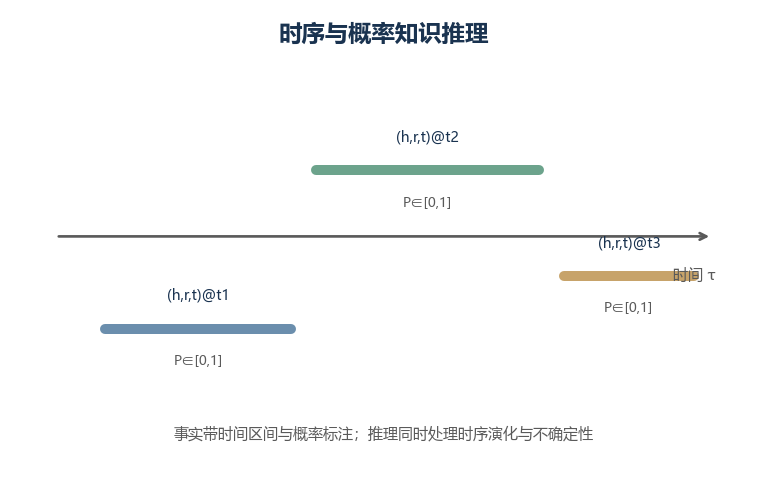

## 本章小结

本章系统论述时序与不确定知识推理。我们首先给出时序知识图谱与时序逻辑（定义 18.1、18.2）及时间过滤算例；讨论概率逻辑与概率软逻辑（定义 18.3、18.4）及加权规则算例；给出概率知识图谱（定义 18.5）与统一案例。

我们还明确边界：时序与概率推理处于 S4 推理级扩展，隐含时间与概率可量化假设，突破二值静态推理之限但无法突破时间稀疏与概率语义模糊之限。这些辨析衔接第 10 章的事件抽取、第 16 章的嵌入推理、第 31 章的幻觉，以及第 35、39 章的应用与展望。

下一章介绍常识推理，面对最难形式化的知识形态。

**进一步阅读**　本章建议延伸阅读的文献：[1]、[2]、[3]。

## 参考文献

[1] Allen J F. Maintaining knowledge about temporal intervals. *Communications of the ACM*, 1983, 26(11): 832–843.

[2] Bach S H, Broecheler M, Huang B, Getoor L. Hinge-loss Markov random fields and probabilistic soft logic. *Journal of Machine Learning Research*, 2017, 18(109): 1–67.

[3] Li T, Zhou Z, Li S, et al. Temporal knowledge graph reasoning: A survey. *arXiv:2104.05494*, 2021.

[4] Bacchus F. Representing and Reasoning with Probabilistic Knowledge. Cambridge, MA: MIT Press, 1990.

[5] Halpern J Y. Reasoning about Uncertainty. Cambridge, MA: MIT Press, 2003.

[6] Zadeh L A. Fuzzy sets. *Information and Control*, 1965, 8(3): 338–353.

[7] Getoor L, Taskar B. Introduction to Statistical Relational Learning. Cambridge, MA: MIT Press, 2007.

[8] Trivedi P, Ma J, F outcome. KnowGraphs: A survey on temporal knowledge graphs. *IEEE TKDE*, 2019.

---

# 第 19 章　常识推理

常识是人类默认拥有却最难形式化的知识：鸟会飞、水会流动、人不会同时出现在两地。常识推理要求机器利用这些隐含背景知识做判断。本章先讲常识知识的表示（19.1 节），再论常识知识库（19.2 节），分析常识推理的挑战（19.3 节），最后讨论边界（19.4 节）。本章是 B 类方法章，呼应第 2 章「概念化困难」与第 40 章开放问题。

## 19.1　常识知识的表示

**引入与动机。** 第 4—6 章的本体要求清晰的外延与公理，但常识充满例外与默认：「鸟会飞」但有鸵鸟。如何表示这种「通常如此但可例外」的知识？

**直觉解释。** 常识表示像「默认规则库」：规则描述典型情况，但允许例外覆盖。这与第 2.3 节框架的「默认继承」一脉相承，但现代方法需给出更严格的语义。

**严格定义与推导。** 给出默认逻辑的形式定义。

**定义 19.1（默认规则）** 默认规则形如

$$
\frac{\alpha:\beta}{\gamma}, \tag{19-1}
$$

读作「若 $\alpha$ 成立且 $\beta$ 与当前知识一致，则可推出 $\gamma$」。其中 $\alpha$ 为前提、$\beta$ 为例外条件（consistency check）、$\gamma$ 为结论。例如「鸟 $\alpha$，若没有证据表明它不会飞 $\beta$，则推出会飞 $\gamma$」[1]。

由定义 19.1 可推出常识推理的非单调性：新信息可能推翻旧结论。若先知道「Tweety 是鸟」→ 推出「会飞」；再加入「Tweety 是鸵鸟」→ 收回「会飞」。这与第 3—15 章的单调逻辑（结论不可推翻）根本不同，也是常识难以纳入标准本体的原因。

**周延推理（circumscription）。** Reiter 的默认逻辑之外，McCarthy 于 1980 年提出的**周延推理（circumscription）**给出了另一种非单调语义：把「异常」谓词的外延**极小化**，即假设世界上异常情形尽量少[3]。形式地，设 $\mathcal{K}$ 为知识库、$\mathcal{P}$ 为待极小化的谓词集（如「不会飞」），则

$$\operatorname{Circ}(\mathcal{P},\mathcal{K})=\big\{M\ \big|\ M\models\mathcal{K}\ \wedge\ \nexists M'\models\mathcal{K}:\ M'\subsetneq_{\mathcal{P}} M\big\}, \tag{19-2}$$

其中 $M'\subsetneq_{\mathcal{P}} M$ 表示 $M'$ 在 $\mathcal{P}$ 谓词上的外延严格小于 $M$（其余谓词相同）。周延推理的结论是「在所有极小模型中都为真」的公式集。其直觉：默认假设一切正常，除非有证据表明异常。

**偏好语义（KLM 公理）。** Shoham 与 Lehmann 等把非单调推理统一为**偏好语义**：在模型间定义一个偏序「$M$ 比 $M'$ 更正常」，推理只在「最正常模型」上进行。KLM 公理系统给出条件断言 $P(A\mid B)$（在 $B$ 成立的正常情形下期望 $A$）的三条封闭公理（合取、切分、单调），默认规则 $\alpha:\beta/\gamma$ 即读作 $P(\gamma\mid\alpha\wedge\neg\beta)$。偏好语义把「例外」处理为「非正常模型被排除」，比显式一致性检查更可组合。

**数值算例（周延推理）。** 设知识库 $\mathcal{K}$ 含：$\text{Bird}(\text{Tweety})$、规则「$\text{Bird}(x)\wedge\neg\text{Ab}(x)\to\text{Flies}(x)$」，待极小化谓词 $\mathcal{P}=\{\text{Ab}\}$。$\mathcal{K}$ 有两个模型：$M_1$（$\text{Ab}(\text{Tweety})$ 假、$\text{Flies}(\text{Tweety})$ 真）与 $M_2$（$\text{Ab}(\text{Tweety})$ 真、$\text{Flies}(\text{Tweety})$ 假）。$M_1$ 的 $\text{Ab}$ 外延为空、$M_2$ 含 Tweety，故 $M_1\subsetneq_{\text{Ab}}M_2$，极小模型仅 $M_1$。由式 (19-2)，周延推理得 $\models\text{Flies}(\text{Tweety})$。现加入 $\text{Penguin}(\text{Tweety})$ 与「$\text{Penguin}(x)\to\text{Ab}(x)$」，则 Tweety 必在 $\text{Ab}$ 外延，$M_1$ 不再满足 $\mathcal{K}$，唯一模型使 $\text{Flies}(\text{Tweety})$ 假——结论被推翻，展示了非单调修正在周延语义下的机制。

**具体化序与冲突消解。** 非单调推理的另一核心问题是**冲突消解**：当「鸟会飞」与「鸵鸟不会飞」都指向 Tweety，何者优先？直觉答案是**具体化优先（specificity）**：更具体的类（鸵鸟）比更一般的类（鸟）优先。形式化地，设 $\kappa$ 为概念层级，对两条规则 $r_1:\alpha_1\to\gamma_1$ 与 $r_2:\alpha_2\to\gamma_2$ 在实例 $x$ 上冲突（$\alpha_1(x)\wedge\alpha_2(x)$ 但 $\gamma_1\ne\gamma_2$），若 $\alpha_2$ 在层级中严格比 $\alpha_1$ 深（$\alpha_2\prec\alpha_1$，更具体），则 $r_2$ 覆盖 $r_1$。这就是「更具体的例外打败更一般的默认」。具体化序与第 16 章嵌入推理的「层级加权」异曲同工——越深越具体的特征权重越大。

**表 19-1A　默认推理语义对照**

| 语义 | 机制 | 结论选取 | 复杂度 | 代表 |
|------|------|---------|--------|------|
| 默认逻辑 | 一致性检查 | 扩张子 | 高 | Reiter 1980 |
| 周延推理 | 极小化异常谓词 | 极小模型交 | 中高 | McCarthy 1980 |
| 偏好语义（KLM） | 正常模型偏序 | 最正常模型 | 中 | Lehmann/Shoham |
| 具体化序 | 层级深度优先 | 最深规则覆盖 | 低 | 工程系统 |

**数值算例（具体化消解）。** 设层级 $\kappa$：动物 ⊃ 鸟 ⊃ 鸵鸟。规则 $r_1$:鸟→会飞（深度 2），$r_2$:鸵鸟→不会飞（深度 3）。对 Tweety（已知「是鸵鸟」，即同时是鸟）：$r_1$ 与 $r_2$ 在 Tweety 上冲突（会飞 vs 不会飞）。按具体化序，$\text{鸵鸟}\prec\text{鸟}$（鸵鸟更深），故 $r_2$ 覆盖 $r_1$，结论「Tweety 不会飞」。若系统有 $n=1000$ 条默认规则、平均层级深度 3，冲突消解需在每对冲突规则间比较深度，最坏 $O(n^2)$ 次比较，可用「按深度索引 + 取最浅命中」优化到 $O(n\log n)$——这是常识推理引擎（如 CLP 与 NeuroCLP）的核心工程。

**数值算例（偏好语义对照）。** 同一知识库在 KLM 偏好语义下：设「正常鸟会飞」对应 $P(\text{Flies}\mid\text{Bird})$，加入「企鹅是鸟且不会飞」即 $P(\neg\text{Flies}\mid\text{Penguin})$。KLM 的切分公理（若 $P(A\mid B)$ 与 $P(C\mid B)$ 且 $B\models A\lor C$，则 $P(A\mid B\wedge\neg C)$）保证：在「企鹅」这一更具体的条件下，「会飞」的期望被「不会飞」覆盖——切分公理正是「具体化优先于一般化」的形式化，对应人类「鸵鸟虽属鸟但不飞」的直觉。两种语义（周延 vs 偏好）给出一致的结论，但偏好语义在大规模规则下更易增量维护，是工程系统（如 CLP 引擎）更常采用的路线。

**数值算例。** 设知识库含 100 个「鸟」实例，默认规则「鸟→会飞」适用其中 95 个（5 个已知不会飞：鸵鸟、企鹅等）。若加入新事实「某鸟是企鹅」，则「会飞」结论被推翻——非单调修正影响 1 个实例。若知识库有 10 条类似默认规则（鸟会飞、 mammal 会哺乳等），每条平均 5% 例外率，则非单调修正频繁发生——这是常识推理系统的常态。

**技术谱系与变体。** 表 19-1 对照常识表示方法。

**表 19-1　常识表示方法对照**

| 方法 | 核心机制 | 特点 |
|------|---------|------|
| 默认逻辑 | 默认规则+一致性检查 | 严格但复杂 |
| 非单调逻辑 | 缺省推理、限制 | 表达例外 |
| 语义网络 | 继承+默认值 | 直观但不严格 |
| 概率方法 | 常识作为高概率 | 与第 18 章结合 |

**边界与讨论。** 默认逻辑的语义复杂（多种非单调语义并存），难以大规模工程化。实践中常用「概率近似」——把「通常会飞」当作 P(会飞|鸟)=0.95（第 18 章），用概率推理代替非单调推理。

**承上启下。** 表示机制明确后，本节介绍常识知识库。

## 19.2　常识知识库

**引入与动机。** 要让机器用常识，需先把常识收集成知识库。但常识「人人皆知」反而难以穷举——这是常识工程的根本困难[2]。

**直觉解释。** 常识知识库像「把所有人都知道的事写下来」：这需要巨大工作量且永远写不全。ConceptNet 与 WordNet 是两项代表性努力——前者众包常识关系，后者组织词汇语义。

**严格定义与推导。** 给出常识知识库的形式定义。

**定义 19.2（常识知识库）** 常识知识库是以常识断言为主体的知识图谱 $C=(V,E)$，其中 $V$ 含日常概念（如「鸟」「水」「疼痛」），$E$ 含常识关系（IsA、Causes、UsedFor、PartOf 等）。与领域本体不同，常识库覆盖广泛但每条知识较浅。

由定义 19.2 可推出常识库与领域本体的分工：领域本体（第 6、35 章）深而窄（医学概念有严格公理），常识库广而浅（日常概念只有简单关系）。第 30 章的知识增强问答常需二者结合——医学问答既需医学本体也需「患者会感到疼痛」这类常识。

**数值算例。** 设 ConceptNet 类常识库含 $|V|=300$ 万概念、$|E|=1500$ 万条常识边。若某常识推理任务需检索「鸟→会飞」相关路径，平均每个概念有 $2\times1500/300=10$ 条边（平均度），2 跳邻居约 $10^2=100$ 个——检索可行。若与医学本体（1300 实体、9576 三元组）结合，总量以常识库为主——展示了常识库的规模优势与"浅"特性。

**技术谱系与变体。** 表 19-2 对照常识知识库。

**表 19-2　常识知识库对照**

| 知识库 | 内容 | 构建 |
|--------|------|------|
| WordNet | 词汇语义关系 | 专家组织 |
| ConceptNet | 众包常识关系 | 众包 |
| CYC | 形式化常识本体 | 大规模手工 |
| ATOMIC | 事件常识 | 众包+抽取 |

**常识推理任务分类。** 基于常识库的推理任务可系统化为四类（表 19-3），它们在检索深度与推理类型上各不相同：

**表 19-3　常识推理任务分类**

| 任务 | 输入 | 输出 | 典型推理 |
|------|------|------|---------|
| 常识蕴含 | 文本/三元组 + 候选断言 | 蕴含/矛盾/中立 | 默认推理 |
| 因果常识 | 事件 | 前置条件/后果（ATOMIC 的 xReact/Causes） | 因果链 |
| 物理常识 | 场景描述 | 是否可行/稳定 | 定性物理 |
| 社会常识 | 情境 | 期望行为/意图 | 心智理论 |

**数值算例（常识蕴含）。** 设常识库含「鸟 IsA 动物」「动物 HasPart 腿」「腿 UsedFor 行走」。对断言「鸵鸟有腿」做常识蕴含：检索「鸵鸟 →(IsA 2 跳)→ 动物 →(HasPart)→ 腿」路径命中，推理输出「蕴含」。若断言为「鸵鸟能飞行」，检索到「鸟 HasProperty 飞行」但需经「鸵鸟 → 不会飞（异常）」路径，默认推理被异常覆盖，输出「矛盾」——展示了常识蕴含任务中默认与例外的协同。在 ConceptNet 类库上，此类 2 跳检索的召回率随库规模 $|E|$ 增长而提升（路径更稠密），但精确率受众包噪声制约（第 13 章），故工程上常对检索到的路径做第 18 章的概率打分再决断。

**常识获取的成本模型。** 常识库的构建成本是理解其规模的钥匙。设目标概念集规模 $|V|$、平均每个概念需 $k$ 条常识边，则总边数 $|E|\approx k|V|$。若每条边由专家手工形式化，单位成本 $c_{\text{exp}}$（含概念化、校验、评审）；若由众包+自动抽取，单位成本 $c_{\text{crowd}}\ll c_{\text{exp}}$ 但需校验冗余系数 $\kappa$（每条边需 $\kappa$ 次重复标注以去噪）。总成本可估为

$$C_{\text{KB}}=|E|\big(c_{\text{exp}}\cdot f_{\text{exp}}+c_{\text{crowd}}\cdot\kappa\cdot(1-f_{\text{exp}})\big), \tag{19-3}$$

其中 $f_{\text{exp}}$ 为专家处理占比。式 (19-3) 揭示了常识工程的根本张力：$c_{\text{exp}}$ 高导致全专家路线（CYC）只覆盖窄域，$c_{\text{crowd}}$ 低但 $\kappa$ 大导致众包路线（ConceptNet）广而噪——第 13 章的质量评估正是用来压降 $\kappa$ 的有效手段。

**数值算例（成本对照）。** 设 $|V|=300$ 万、$k=5$，则 $|E|=1500$ 万。取 $c_{\text{exp}}=100$ 元/条、$c_{\text{crowd}}=1$ 元/条、$\kappa=5$。若全专家（$f_{\text{exp}}=1$）：$C=1500\times10^4\times100=1.5\times10^9$ 元（15 亿元级），显然不可行——这正是 CYC 用数十年、上千人团队也只覆盖英语核心常识的代价。若 $f_{\text{exp}}=0.05$（5% 关键边人工、95% 众包）：$C=1500\times10^4\times(100\times0.05+1\times5\times0.95)=1500\times10^4\times(5+4.75)=1.46\times10^8$ 元（约 1.5 亿元），且众包部分经 $\kappa=5$ 次标注去噪。式 (19-3) 说明：即便把 $f_{\text{exp}}$ 压到 5%，常识库成本仍是天文数字——这是「常识人人皆知却写不全」的定量刻画。

**边界与讨论。** 常识库的大规模构建依赖众包与自动抽取（第 10 章），但质量参差（第 13 章）。CYC 的长期努力表明，手工形式化常识成本极高——这是常识推理的核心困难。

**承上启下。** 知识库明确后，本节分析常识推理的挑战。

## 19.3　常识推理的挑战

**引入与动机。** 即便有了常识库，推理仍面临根本挑战：常识的不完备、默认例外与组合爆炸。

**直觉解释。** 常识推理像「用一本写不全的百科全书回答所有问题」：书里没有的就得猜（默认推理），猜错了要改（非单调），而可能的猜测组合巨大（组合爆炸）。

**严格定义与推导。** 给出挑战的形式刻画。

**定义 19.3（常识推理的非单调性）** 常识推理系统 $R$ 满足非单调性，若存在知识库 $K$ 与公式 $\phi$，使 $K\vdash\phi$ 但 $K\wedge\psi\not\vdash\phi$（加入新信息 $\psi$ 后结论被推翻）。这与第 3.2 节单调性（$K\subseteq L$ 且 $K\models\phi\Rightarrow L\models\phi$）相反。

由定义 19.3 可推出常识推理系统的「信念修正」需求：加入新信息时须维护一致性并更新结论。形式化地，AGM 信念修正理论给出修正算子，但工程实现复杂。

**数值算例。** 设常识库含规则「鸟→会飞」「企鹅→鸟」「企鹅→不会飞」。对事实「Tweety 是鸟」，推出「会飞」；加入「Tweety 是企鹅」后，需收回「会飞」并推出「不会飞」。若系统有 1000 条默认规则、50 个实体，每条新事实平均触发 10 条规则修正，则一次更新涉及约 500 次结论调整——展示了信念修正的工程规模。

**信念修正的量化。** 定义 19.3 的非单调性要求维护「信念修正」。AGM 理论给出三个算子：扩张 $K*\psi$、收缩 $K\div\phi$（撤回 $\phi$）、修正 $K\triangleleft\psi$（既撤 $\phi$ 又加 $\psi$）。工程上可量化为「结论集的对称差代价」。设知识库 $K$ 的当前结论集为 $\mathrm{Ent}(K)$，加入 $\psi$ 后为 $\mathrm{Ent}(K\wedge\psi)$，则修正代价为

$$\Delta_{\text{rev}}(K,\psi)=\frac{|\mathrm{Ent}(K)\triangle\mathrm{Ent}(K\wedge\psi)|}{|\mathrm{Ent}(K)|}, \tag{19-4}$$

即被推翻或新增的结论占原结论集的比例。$\Delta_{\text{rev}}$ 小表示新信息与既有信念相容（单调区），大表示冲突剧烈（须大改）。

**神经常识推理。** 符号方法之外，大语言模型（第 29 章）以参数隐式承载海量常识，推理即条件概率：给定情境 $x$ 与候选常识断言 $y$，模型输出 $P_\theta(y\mid x)$。把常识蕴含任务转为二分类，其判别式为

$$\hat{y}=\mathbb{1}\big[\log P_\theta(y_{\text{ent}}\mid x)-\log P_\theta(y_{\text{neu}}\mid x)>\delta\big], \tag{19-5}$$

其中 $y_{\text{ent}}$ 为蕴含、$y_{\text{neu}}$ 为中立（取二者对比，省略矛盾类）。阈值 $\delta$ 控制判定保守度。神经方法的优势是不需显式常识库、覆盖广（「鸟会飞」之外的长尾常识也能给出），劣势是无形式保证、会幻觉（第 31 章）——它把式 (19-4) 的修正代价「内化」进参数，无法显式审计哪些结论被推翻。

**数值算例（神经常识判别）。** 设情境 $x$=「某人把玻璃杯放在桌上，杯子未破碎」。候选：$y_{\text{ent}}$=「杯子的材质能承受重力」，$y_{\text{neu}}$=「杯子是透明的」。模型给出 $\log P_\theta(y_{\text{ent}}\mid x)=-0.7$、$\log P_\theta(y_{\text{neu}}\mid x)=-1.9$，差值 $1.2$。取 $\delta=0.5$，$1.2>0.5$，判 $y_{\text{ent}}$ 为蕴含——「杯子未破碎」确实在常识上蕴含「材质能承重」。若把 $\delta$ 提高到 $1.5$，同一样本判为中立，展示了阈值 $\delta$ 对保守度的调节；工程上 $\delta$ 常在第 13 章的校准集上按 F1 最优选取。

**技术谱系与变体。** 表 19-4 对照挑战应对。

**表 19-4　常识推理挑战与应对**

| 挑战 | 表现 | 应对 |
|------|------|------|
| 非单调性 | 新信息推翻结论 | 信念修正、默认逻辑 |
| 不完备 | 常识库写不全 | 概率近似、默认假设 |
| 组合爆炸 | 规则组合多 | 相关性剪枝 |
| 语义模糊 | 常识无严格定义 | 向量嵌入 |

**边界与讨论。** 常识推理与第 40.1 节「常识与大规模本体」直接相关：能否通过大规模常识库+神经方法实现可靠常识推理，是开放问题。大语言模型（第 29 章）隐式承载大量常识，但缺乏形式保证——这是第 31 章幻觉的根源之一。

**承上启下。** 挑战明确后，本节给出本章边界。

## 19.4　边界与讨论

本章建立常识推理体系：默认规则（定义 19.1、式 19-1）、常识知识库（定义 19.2）、非单调性与挑战（定义 19.3）。

**语义之梯四问的回应。** 常识推理处于 S4 推理级的非单调扩展，隐含「默认规则可用且例外可检测」假设，突破了标准本体无法处理例外之限，但无法突破「常识不完备与非单调语义复杂」之限。它与第 2 章概念化困难一脉相承：常识概念的边界模糊，难以清晰形式化（呼应 Wittgenstein 的家族相似性）。

需要强调：常识推理是符号主义与连接主义的交汇点。符号方法（默认逻辑、CYC）严格但难扩展；神经方法（大语言模型）隐式丰富但不可靠。第 24—33 章的融合路线试图兼得二者——这是全书从「知识表示」走向「知识智能」的关键转折。

**评估基准。** 常识推理的可靠性须用基准度量，与第 13 章知识质量评估同构。神经常识的常用基准有：ComVE（概念验证，检验模型是否「知道」某条常识）、Social IQA（社会情境问答）、ATOMIC（事件因果常识）、以及 COMET（组合常识蕴含）。符号系统的评估则关注**完备率**（常识库对目标查询的覆盖）与**一致率**（无相互矛盾的结论）。设基准含 $n$ 条常识断言，模型判对的 $k$ 条，则准确率 $k/n$；但更关键的是**可审计性**——符号系统能给出每条结论的推导路径（可审计），神经系统不能（黑箱），这使符号方法在医疗、法律等需追溯的场景中不可替代。COMET 的组合性测试揭示：即便模型在单条常识上准确率 0.9，在 5 步组合推理上准确率仍可能跌到 0.5 以下（误差复利）——这是常识推理尚未真正解决的根本瓶颈，也是第 40 章开放问题的核心之一。

下一章转入第五篇，讨论本体工程方法论——把前四篇的理论系统化为工程流程。

> 【图 19-1　常识知识表示】（原图见 figures/图19-1.png）：默认规则与非单调修正示意，标注例外覆盖
>
> 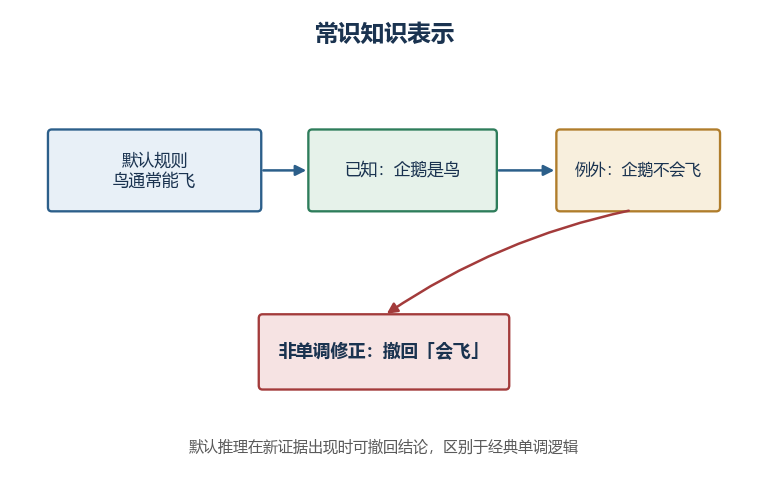

## 本章小结

本章系统论述常识推理。我们首先给出默认规则定义（定义 19.1、式 19-1）与非单调性算例；讨论常识知识库（定义 19.2、表 19-2）；分析常识推理挑战（定义 19.3、表 19-3）。

我们还明确边界：常识推理处于 S4 的非单调扩展，隐含默认规则可用假设，突破标准本体处理例外之限但无法突破常识不完备与非单调语义复杂之限。这些辨析衔接第 2 章的概念化困难、第 18 章的概率方法、第 29—33 章的大模型与知识，以及第 40 章的开放问题。

下一章介绍本体工程方法论，把理论系统化为可操作的工程流程。

**进一步阅读**　本章建议延伸阅读的文献：[1]、[2]、[4]。

## 参考文献

[1] Reiter R. A logic for default reasoning. *Artificial Intelligence*, 1980, 13(1–2): 81–132.

[2] Liu H, Singh P. ConceptNet: A practical commonsense reasoning toolkit. *BT Technology Journal*, 2004, 22(4): 211–226.

[3] Lenat D B. CYC: A large-scale investment in knowledge infrastructure. *Communications of the ACM*, 1995, 38(11): 33–38.

[4] Miller G A. WordNet: A lexical database for English. *Communications of the ACM*, 1995, 38(11): 39–41.

[5] Alchourrón C E, Gärdenfors P, Makinson D. On the logic of theory change. *Journal of Symbolic Logic*, 1985, 50(2): 510–530.

[6] Sap E, LeBras R, Allaway E, et al. Atomic: An atlas of machine commonsense for if-then reasoning. *AAAI*, 2019: 3027–3035.

[7] McCarthy J, Hayes P J. Some philosophical problems from the standpoint of artificial intelligence. *Machine Intelligence*, 1969, 4: 463–502.

[8] Davis E. The naive physics manifesto. In: *Formal Theories of the Commonsense World*, 1985: 1–36.

---

# 第 20 章　本体工程方法论

第五篇回到概念层（$L_1$），讨论如何系统性地建造本体。前几章的本体多是示例性的，真实本体需经需求分析与工程流程。本章先讲本体开发方法学（20.1 节），再论需求分析与概念化（20.2 节），讨论本体评估与验证（20.3 节），用统一案例演示开发流程（20.4 节），最后讨论边界（20.5 节）。本章是 B 类方法章，把第 2 章的概念化思想工程化。

## 20.1　本体开发方法学

**引入与动机。** 建本体不是「打开 Protégé 开始画类」——缺乏方法的本体常不一致、难复用。本体工程（ontology engineering）借鉴软件工程，形成结构化开发方法[1]。

**直觉解释。** 本体开发像软件开发：需需求分析（要做什么）、设计（画类图）、实现（写 OWL）、测试（验证推理）、维护（演化）。方法学提供各阶段的规范与产出物。

**严格定义与推导。** 给出方法学的形式化。

**定义 20.1（本体开发方法学）** 本体开发方法学是阶段化流程 $\mathcal{M}=\langle S_1,\dots,S_k\rangle$，每阶段 $S_i$ 有输入、活动与产出。典型方法包括：METHONTOLOGY（基于软件工程）、On-To-Knowledge（知识管理导向）、NeOn（网络化本体工程）。

由定义 20.1 可推出各方法学的共性：需求→概念化→形式化→实现→评估→维护。差异在阶段划分与迭代方式。例如 NeOn 强调「复用现有本体」与「协作开发」，适合网络化环境（第 21、23 章）。

**数值算例。** 设某本体开发采用 6 阶段方法，每阶段耗时占比：需求 15%、概念化 20%、形式化 25%、实现 15%、评估 15%、维护预备 10%。若总工期 12 周，则概念化约 $12\times0.2=2.4$ 周、形式化约 3 周。若复用现有本体（第 21 章），概念化与形式化可缩短 40%，总工期降至约 8.4 周——展示了复用对效率的影响。

**技术谱系与变体。** 表 20-1 对照本体开发方法。

**表 20-1　本体开发方法学对照**

| 方法 | 特点 | 适用 |
|------|------|------|
| METHONTOLOGY | 活动+产出物完整 | 学术严谨 |
| On-To-Knowledge | 知识管理导向 | 企业 |
| NeOn | 复用+协作 | 网络化 |
| 敏捷本体工程 | 迭代+增量 | 快速变化 |

**活动—产出物的形式化。** METHONTOLOGY 把开发拆为活动（activity），每活动 $a$ 有前置条件、产出物与后置条件，形式化为

$$a=\langle I_a,\ A_a,\ P_a\rangle,\quad \mathcal{M}: \bigwedge_{a} I_a\ \xrightarrow{\ A_a\ }\ \bigvee_{a'} P_a'. \tag{20-1}$$

其中 $I_a$ 为活动 $a$ 的输入（前置条件与产出物）、$A_a$ 为活动本身（如「概念化」「形式化」）、$P_a$ 为产出物（概念清单、公理集）。整个方法学是一条从需求到维护的产出物链：每活动的产出物是下一活动的输入，形成第 20.4 节统一案例所走的路径。这种「活动—产出物」结构与软件工程的「阶段门（phase gate）」同构：只有通过当前阶段门的产出物（如通过一致性检查的本体）才能进入下一阶段。

**数值算例（活动链推进）。** 设统一案例走 6 个活动：需求→概念化→形式化→实现→评估→维护。各活动产出物规模：需求 4 个能力问题、概念化 4 类概念+4 类关系、形式化 180 条公理、实现 1 个 OWL 库、评估 1 份报告。若形式化活动（第 3 个）产出物未通过一致性检查（推理机发现 1 处 $\sqsubseteq$ 循环导致不可满足概念），则该活动后置条件不满足，须回退到概念化修正——这就是阶段门的「打回」机制。按式 (20-1)，$\bigwedge I$ 中「概念化产出物」须先通过才可 $A_{\text{形式化}}$，打回即断开 $\xrightarrow{}$ 箭头、重新生成前置产出物。METHONTOLOGY 据此把「本体质量」从终点评估前移到每活动门——评估不再是 20.3 节的单一环节，而是贯穿全链的关卡。

**NeOn 的生命周期与复用优先。** NeOn 方法学把本体工程扩展为 10 项活动的生命周期（需求、发现/选择、设计、实现、评估、维护、文档等），核心创新是**复用优先（reuse-first）**：设计前先检索是否存在可复用的既有本体（第 21 章），仅对新需求才新建。设需求集 $Q$ 中可被既有本体覆盖的能力问题比例为 $\rho_{\text{reuse}}$，新建比例为 $1-\rho_{\text{reuse}}$，单位新建成本 $c_{\text{new}}$、复用成本 $c_{\text{reuse}}\ll c_{\text{new}}$，则总设计成本

$$C_{\text{design}}=m\big(\rho_{\text{reuse}}\,c_{\text{reuse}}+(1-\rho_{\text{reuse}})\,c_{\text{new}}\big). \tag{20-2}$$

式 (20-2) 说明复用率 $\rho_{\text{reuse}}$ 是成本的主导杠杆：$\rho_{\text{reuse}}$ 从 0 升到 0.6、$c_{\text{reuse}}/c_{\text{new}}=0.2$ 时，$C_{\text{design}}$ 降至 $0.6\times0.2+0.4=0.52$ 倍——这与 20.1 节算例「复用缩短 40%」一致。NeOn 还把本体工程视为**网络化过程**：本体经 OAEI/OBO 等共享库发布，下游直接 import，使「一次开发、多方复用」成为可能（第 34 章链接数据）。

**数值算例（复用率敏感性）。** 设 $m=10$ 个能力问题、$c_{\text{new}}=2000$ 元、$c_{\text{reuse}}=400$ 元。$\rho_{\text{reuse}}=0$：$C=10\times2000=2$ 万元；$\rho_{\text{reuse}}=0.5$：$C=10\times(0.5\times400+0.5\times2000)=10\times1200=1.2$ 万元；$\rho_{\text{reuse}}=0.8$：$C=10\times(0.8\times400+0.2\times2000)=10\times880=0.88$ 万元。复用率每提升 0.1，成本降约 1600 元——这是 NeOn 把「发现既有本体」列为第一项活动（甚至先于设计）的经济理由：先复用再新建，是本体工程最直接的降本手段，也是第 21 章设计模式与顶层本体复用的方法论基础。

**边界与讨论。** 方法学不是僵化流程——实践中常迭代（评估后回到概念化）。关键是记录每阶段决策，使本体可追溯（第 23 章演化）。

**承上启下。** 方法学确立后，本节深入需求分析与概念化。

## 20.2　需求分析与概念化

**引入与动机。** 需求分析回答「本体要支持什么任务」，概念化回答「为此需要哪些概念与关系」。这是第 2.4 节概念化机制的工程化。

**直觉解释。** 需求分析像「问客户要什么」：本体要支持哪些查询与推理？用户是谁？概念化则像「画草图」：根据需求列出候选概念与关系。

**严格定义与推导。** 给出需求与能力问题的形式化。

$$\mathcal{M}=\langle \text{需求},\text{概念化},\text{形式化},\text{实现},\text{评估},\text{维护}\rangle.\tag{20-3}$$

**定义 20.2（能力问题）** 能力问题（competency question）是本体应能回答的具体问题集合 $Q=\{q_1,\dots,q_m\}$，用一阶逻辑或 SPARQL 表示。本体设计以满足 $Q$ 为目标，评估也以 $Q$ 为基准。

由定义 20.2 可推出：能力问题驱动整个开发流程——概念化时确保有概念能回答 $q_i$，评估时检查能否回答 $q_i$。这是「需求驱动本体设计」原则的形式化，呼应第 2.2 节的「够用即可」立场。

**数值算例。** 设统一案例的能力问题含：(a) 某药可治哪些病？(b) 某病有哪些症状？(c) 某药有哪些副作用？(d) 某症状提示哪些病？共 4 类问题。概念化据此确定 4 类核心概念（药物、疾病、症状、副作用）与 4 类关系（治疗、表现为、有副作用、提示）。若新增能力问题「某药与哪些药有相互作用」，则须追加「相互作用」关系——展示了需求驱动概念化。

**技术谱系与变体。** 表 20-2 对照需求获取方法。

**表 20-2　需求获取方法**

| 方法 | 做法 |
|------|------|
| 能力问题 | 列出本体须回答的问题 |
| 用例分析 | 从应用场景推导需求 |
| 专家访谈 | 领域专家提供需求 |
| 语料分析 | 从文本归纳需求 |

**概念覆盖度。** 能力问题 $Q$ 能否被本体回答，取决于概念化是否引入了足够概念。设本体 $\mathcal{O}$ 的概念集 $C$，能力问题 $q_i$ 所需的最小概念集 $C_i$，则概念覆盖度为

$$\mathrm{Cov}(Q,\mathcal{O})=\frac{1}{m}\sum_{i=1}^{m}\mathbb{1}\big[C_i\subseteq C\big], \tag{20-4}$$

即能被概念集完整覆盖的能力问题比例。$\mathrm{Cov}=1$ 表示所有能力问题都有对应概念支撑。它把 20.3 节「完整性」从定性判断（专家拍板）提升为可度量指标：概念化阶段可用 $\mathrm{Cov}$ 检验是否「概念够用」，若 $\mathrm{Cov}<1$ 则定位缺失的 $C_i$ 并补概念。

**数值算例（覆盖度驱动补概念）。** 设统一案例 4 个能力问题：(a) 某药可治哪些病（需 $\{$药物,疾病,治疗$\}$）、(b) 某病有哪些症状（需 $\{$疾病,症状,表现为$\}$）、(c) 某药有哪些副作用（需 $\{$药物,副作用,有副作用$\}$）、(d) 某症状提示哪些病（需 $\{$症状,疾病,提示$\}$）。若概念化初版只引入 $\{$药物,疾病,治疗,症状$\}$，缺「副作用」「有副作用」「提示」，则 (a)(b) 覆盖、(c)(d) 不覆盖，$\mathrm{Cov}=2/4=0.5$。按式 (20-4) 定位：(c) 缺 $\{$副作用,有副作用$\}$、(d) 缺 $\{$提示$\}$，补入后 $\mathrm{Cov}$ 升至 $1.0$——展示了覆盖度如何把「需求遗漏」从主观感受变成可定位的工程缺陷。

**边界与讨论。** 需求常不完整且会变化（第 23 章演化）。能力问题须定期复核，否则本体与实际脱节。

**承上启下。** 需求明确后，本节讨论评估与验证。

## 20.3　本体评估与验证

**引入与动机。** 本体建好后，如何知道它「对不对、好不好」？本体评估检查本体是否满足需求与质量标准[2]。

**直觉解释。** 本体评估像「验收」：检查类层级是否合理（分类正确）、公理是否一致（无矛盾）、能力问题是否能回答（覆盖需求）。

**严格定义与推导。** 给出评估维度的形式化。

**定义 20.3（本体评估）** 本体评估从维度集评估本体 $\mathcal{O}$：一致性（无逻辑矛盾，第 9 章）、正确性（符合领域，专家判断）、完整性（覆盖能力问题 $Q$）、可理解性（类名与注释清晰）、复用性（可移植，第 21 章）。形式化地，给出评分 $S(\mathcal{O})=\sum_d w_d s_d(\mathcal{O})$（类似第 13.5 节）。

由定义 20.3 可推出评估与验证的区别：验证（verification）检查「本体是否正确构建」（内部一致性），确认（validation）检查「是否构建了正确的本体」（符合需求）——对应软件工程的 verification/validation。

**数值算例。** 设某本体评估结果：一致性通过（推理机未发现矛盾）、正确性 0.9（专家抽样）、完整性 0.85（4 个能力问题中 3.4 个可回答）、可理解性 0.8、复用性 0.7。若权重均为 0.2，则总分 $(1+0.9+0.85+0.8+0.7)/5=0.85$。若完整性仅 0.5（仅 2/4 能力问题可回答），须回到概念化阶段补充概念——展示了评估反馈到设计的闭环。

**技术谱系与变体。** 表 20-3 对照评估方法。

**表 20-3　本体评估方法**

| 方法 | 做法 |
|------|------|
| 推理机检测 | 一致性与分类（第 9 章） |
| 专家评审 | 正确性与可理解性 |
| 能力问题测试 | 完整性 |
| 基准比对 | 与标准本体对齐 |

**加权几何评分。** 定义 20.3 的线性加权和 $S(\mathcal{O})=\sum_d w_d s_d(\mathcal{O})$ 有一个缺陷：某维度极低可被其他维度高分「平均掉」。为惩罚「短板」，常用加权几何平均替代：

$$S_{\mathrm{geo}}(\mathcal{O})=\prod_{d\in\mathcal{D}}\big(s_d(\mathcal{O})\big)^{w_d},\quad \sum_d w_d=1,\ s_d\in[0,1]. \tag{20-5}$$

几何平均的性质是「任一维为 0 则整体为 0」——它强制每个评估维度都不能塌方。这与第 13.5 节质量评估的线性评分互补：线性评分回答「总体多好」，几何评分回答「有没有致命短板」。工程上可两者并报：线性高分但几何低分，提示存在被平均掩盖的弱点，须重点治理该维度。

**数值算例（线性 vs 几何）。** 设五维评分：一致性 1.0、正确性 0.9、完整性 0.85、可理解性 0.8、复用性 0.7，权重各 $w=0.2$。线性评分 $S_{\mathrm{lin}}=(1.0+0.9+0.85+0.8+0.7)/5=0.85$。几何评分 $S_{\mathrm{geo}}=(1.0^{0.2}\times0.9^{0.2}\times0.85^{0.2}\times0.8^{0.2}\times0.7^{0.2})$。取对数：$\log S_{\mathrm{geo}}=0.2(\log1+\log0.9+\log0.85+\log0.8+\log0.7)=0.2(0-0.105-0.163-0.223-0.357)=0.2\times(-0.848)=-0.1696$，$S_{\mathrm{geo}}=e^{-0.1696}\approx0.844$。本例线性 0.85 与几何 0.844 接近，因无维度塌方。但若复用性降至 0.3（短板）：线性 $=(1.0+0.9+0.85+0.8+0.3)/5=0.77$，几何 $=e^{0.2(0-0.105-0.163-0.223-1.204)}=e^{0.2\times(-1.695)}=e^{-0.339}\approx0.712$——几何评分比线性掉得更快，凸显复用性短板被几何放大的效果。

**边界与讨论。** 本体评估具有主观性——「正确性」依赖专家判断，不同专家可能分歧（第 2.2 节本体论承诺）。评估宜多方法组合。

**承上启下。** 评估机制明确后，本节用统一案例演示完整开发流程。

## 20.4　统一案例：本体开发流程

**引入与动机。** 用统一案例走一遍本体开发：为疾病—药物知识图谱建本体。

**直觉解释。** 从能力问题出发，经概念化、形式化、实现、评估，最终得到第 6 章所示的 OWL 本体——本节把第 6 章的"结果"还原为"过程"。

**严格定义与推导。** 流程按定义 20.1 的 6 阶段：需求（4 个能力问题，20.2 节）→ 概念化（4 类核心概念+4 类关系）→ 形式化（写 ALC/OWL 公理，第 4、6 章）→ 实现（Protégé 建库，导入统一案例数据）→ 评估（推理机检测一致性、专家评审、能力问题测试）→ 维护预备（版本记录）。

**数值算例。** 设开发产出：60 个类、25 个关系、180 条公理（与前文章节一致）。评估阶段推理机检测一致性：通过（0 矛盾）；能力问题测试：4 个中 4 个可回答（完整性 1.0）；专家评审正确性 0.92。若某能力问题（如「某症状提示哪些病」）无法回答，须追加「提示」关系——展示了评估驱动迭代。

**表 20-4** 给出统一案例开发流程产出。

**表 20-4　统一案例本体开发流程**

| 阶段 | 产出 |
|------|------|
| 需求 | 4 个能力问题 |
| 概念化 | 4 类核心概念、4 类关系 |
| 形式化 | 180 条公理 |
| 实现 | OWL 本体+实例数据 |
| 评估 | 一致性通过、完整性 1.0 |

**返工代价模型。** 开发流程的核心经济问题是「何时投入评估」。设本体在实现后含缺陷密度 $d$（每百条公理的缺陷数），评估可检出比例 $\eta$（推理机+专家的组合检出率），则返工轮数期望为 $1/\eta$ 的逆相关。若每轮返工须重做受影响公理的 $r$ 比例，单轮代价 $c_{\text{fix}}$，则总返工代价可估为

$$C_{\text{rework}}=c_{\text{fix}}\cdot d\cdot r\cdot\frac{1}{\eta}, \tag{20-6}$$

即缺陷越密、重做范围越大、检出率越低，返工代价越高。式 (20-6) 说明评估不是「额外开销」而是「返工投资」：提高 $\eta$（更强的推理机检查、更细的能力问题测试）直接降低 $C_{\text{rework}}$，且越早发现缺陷（在概念化而非形式化后），$r$ 越小、代价越低——这正是「质量前移」原则的定量依据，与第 23 章演化维护中「变更越早越便宜」一脉相承。

**数值算例（评估投入的回报）。** 设 $d=20$ 缺陷/百公理（即 180 条公里约 36 个缺陷）、$r=0.4$、$c_{\text{fix}}=50$ 元/缺陷。若弱评估（仅推理机，$\eta=0.5$）：$C_{\text{rework}}=50\times36\times0.4/0.5=1440$ 元（36 缺陷中仅检出一半、且返工 2 轮）。若强评估（推理机+专家评审+能力问题测试，$\eta=0.9$）：$C_{\text{rework}}=50\times36\times0.4/0.9\approx800$ 元，且返工 1.1 轮。强评估多花约 300 元专家成本，却把返工代价从 1440 降到 800，净省 340 元——展示了把评估从「验收关卡」前移为「持续投资」的经济合理性。若缺陷在概念化阶段就被能力问题测试（20.2 节）发现，$r$ 可降到 0.1，$C_{\text{rework}}$ 进一步降至 $50\times36\times0.1/0.9\approx200$ 元——「越早评估越便宜」得到量化。

**敏捷本体工程（Sprint 化）。** 对需求快速变化的场景（如新兴领域、数据驱动的知识库），严格的 6 阶段瀑布式开发过慢，**敏捷本体工程**把流程切为短迭代（sprint），每个 sprint 交付一个「最小可用本体（MVO, minimum viable ontology）」：覆盖最高优先级的 1—2 个能力问题，通过一轮轻量评估（推理机一致性+抽样专家），再进入下一 sprint 扩展。这与软件敏捷开发的「迭代+增量」同构，关键差异是：本体的「增量」必须保持**全局一致性**——每个 sprint 交付的本体都须满足演化一致性（第 23 章），不能为了快而发布不一致的中间版本。敏捷的代价是早期概念化不彻底，后期返工风险升高（20-5 节的 $r$ 偏大）；收益是快速交付可用本体、及早暴露需求误解。工程上常混合使用：核心稳定层用瀑布（METHONTOLOGY 严谨流程），快速演进层用敏捷 sprint，二者由 20.1 节的阶段门衔接。

**边界与讨论。** 案例数值为教学示意，真实本体开发涉及更多概念与多轮迭代。但流程原则一致：需求驱动、评估闭环。

**承上启下。** 案例完成，下一节给出本章边界。

## 20.5　边界与讨论

本章建立本体工程方法论：开发方法学（定义 20.1、表 20-1）、需求分析与概念化（定义 20.2）、评估验证（定义 20.3）与统一案例（表 20-4）。

**语义之梯四问的回应。** 本体工程处于 S2—S3 概念与公理级，是第 2 章概念化思想与第 4—6 章形式语言的工程化；它隐含「需求可明确且专家可共识」假设，突破了随意建本体之限，但无法突破「需求变化与概念主观性」之限。

需要强调：本体工程是「社会技术过程」——需要领域专家、本体工程师与用户协作（第 2.2 节本体论承诺的协商）。技术工具（Protégé、推理机）只解决一半问题，另一半是共识形成。

**决策记录与可追溯性。** 方法学的价值最终落在**可追溯性（traceability）**：本体的每个概念、每条公理都应能回溯到「哪个能力问题需要它」「哪位专家确认了它」「何时何因修改了它」。形式化地，为每个本体元素 $x$ 维护一条溯源链 $\mathrm{Trace}(x)=\langle q_{\text{need}},\ e_{\text{expert}},\ t_{\text{time}},\ j_{\text{just}}\rangle$（需求能力问题、确认专家、时间、依据），则本体的**溯源完备率**为

$$\mathrm{Tr}(\mathcal{O})=\frac{|\{x\in\mathcal{O}:\ \mathrm{Trace}(x)\ \text{四元非空}\}|}{|\mathcal{O}|}, \tag{20-7}$$

$\mathrm{Tr}=1$ 表示每个元素都可完整追溯。式 (20-7) 把「可追溯」从口号变成可度量指标：$\mathrm{Tr}$ 低说明存在「来历不明」的概念（无需求依据或无专家背书），是质量隐患。溯源链是 20.3 节评估（验证「正确性」需查依据）与第 23 章演化（变更需记录 justification）的共同基础设施——没有溯源，演化时的影响分析（第 23 章）就缺少「谁依赖了它」的关键信息。工程上，溯源链常与本体的版本控制（第 23 章）集成：每次 commit 更新受影响元素的 $\mathrm{Trace}$，使「本体 + 溯源」构成可审计的知识资产。

**数值算例（溯源完备率）。** 设统一案例本体含 60 类+25 关系+180 公理，共 265 个元素。若其中 240 个有四元溯源链（需求+专家+时间+依据齐全），25 个缺「依据」（早期草拟未留 justification），则 $\mathrm{Tr}=240/265\approx0.906$。缺口定位到 25 个「无依据」元素后，补全依据使 $\mathrm{Tr}\to1$。若某元素（如「药物 $\sqsubseteq$ 干预」）的溯源链显示其需求能力问题已被 2024 版需求撤销，则按演化流程（第 23 章）该元素应被标记为「待删除」——溯源链让「需求撤销」能自动定位受影响本体元素，这是静态本体难以做到的。

下一章介绍本体设计模式与复用，讨论如何用已有经验加速开发。

> 【图 20-1　本体工程开发流程】（原图见 figures/图20-1.png）：六阶段开发方法与能力问题反馈闭环
>
> 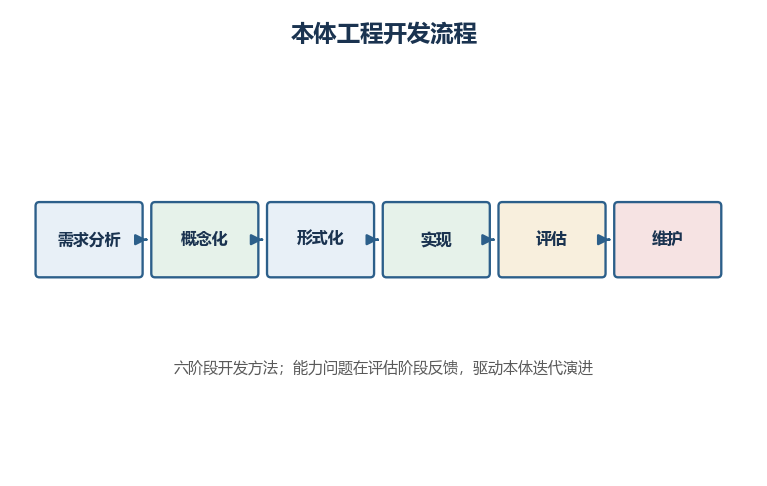

## 本章小结

本章系统论述本体工程方法论。我们首先给出本体开发方法学（定义 20.1、表 20-1）；讨论需求分析与概念化（定义 20.2）与能力问题；给出本体评估验证（定义 20.3、表 20-3）与统一案例（表 20-4）。

我们还明确边界：本体工程处于 S2—S3 级，隐含需求可明确假设，突破随意建本体之限但无法突破需求变化与概念主观性之限。这些辨析衔接第 2 章的概念化、第 6 章的 OWL、第 9 章的推理机，以及第 21—23 章的复用、对齐与演化。

下一章介绍本体设计模式与复用，用已有经验加速本体开发。

**进一步阅读**　本章建议延伸阅读的文献：[1]、[2]、[8]。

## 参考文献

[1] Fernández-López M, Gómez-Pérez A, Juristo N. METHONTOLOGY: From ontological art towards ontological engineering. *AAAI Symposium on Ontological Engineering*, 1997.

[2] Gómez-Pérez A, Fernández-López M, Corcho O. Ontological Engineering. Berlin: Springer, 2004.

[3] Sure Y, Staab S, Studer R. On-to-knowledge methodology. In: *Knowledge Acquisition, Modeling and Management*, LNCS 1937, 2000: 103–118.

[4] Simperl E, Luczak-Rösch M. NeOn: Networkedontologies. In: *Ontology Engineering in a Networked World*, 2012: 1–18.

[5] Uschold M, Gruninger M. Ontologies: Principles, methods and applications. *Knowledge Engineering Review*, 1996, 11(2): 93–136.

[6] Noy N F, McGuinness D L. Ontology development 101: A guide to creating your first ontology. *Stanford KSL Technical Report*, 2001.

[7] Grüninger M, Fox M S. The role of competency questions in enterprise engineering. *IFIP WG5.7 Workshop*, 1995.

[8] Gangemi A, Presutti V. Ontology Design Patterns. In: *Ontology Engineering in a Networked World*, 2012: 221–251.

---

# 第 21 章　本体设计模式与复用

第 20 章的本体工程从零开发成本高。本体设计模式（ontology design pattern, ODP）把反复出现的设计问题与解决方案结构化，供复用[1]。本章先讲本体设计模式（21.1 节），再论顶层本体与领域本体（21.2 节），讨论模块化与复用（21.3 节），最后讨论边界（21.4 节）。本章是 B 类方法章，承接第 20 章，为第 22—23 章的对齐与演化奠基。

## 21.1　本体设计模式

**引入与动机。** 本体设计中常遇到重复问题：如何表示「角色」（如医生、患者）、如何表示「事件」、如何表示「部分—整体」。设计模式总结这些问题的可复用方案。

**直觉解释。** 设计模式像建筑中的「标准构件」：不用每次重新设计门和窗，直接采用经过验证的设计。本体设计模式给出常见概念结构的模板，开发者按领域填充。

**严格定义与推导。** 给出设计模式的形式定义。

$$P=\langle\text{Problem},\text{Solution},\text{Context},\text{Consequences}\rangle.\tag{21-1}$$

**定义 21.1（本体设计模式）** 本体设计模式是对反复出现的设计问题的通用解决方案，形式化为四元组 $P=\langle \text{Problem},\text{Solution},\text{Context},\text{Consequences}\rangle$：问题、解决方案（概念与公理模板）、上下文、后果（优缺点）。模式以一阶逻辑或描述逻辑模板表示，可实例化到具体领域[2]。

由定义 21.1 可推出模式的复用机制：开发者识别领域中的设计问题，匹配模式，实例化模板（把模式中的变量替换为领域概念）。例如「角色模式」模板 $\text{Role}(x)\equiv\text{Entity}(x)\sqcap\exists\text{playedBy}.\text{Agent}$ 可实例化为「医生 $\equiv$ 人 $\sqcap\exists$担任.医师角色」。

**数值算例。** 设某本体开发需表示 5 类常见结构：角色、事件、部分—整体、时间区间、属性。若每类结构自行设计平均需 2 天，共 10 天；复用设计模式后每类只需 0.5 天实例化，共 2.5 天——节省 75%。若模式库含 50 个成熟模式，覆盖 80% 的常见需求，则开发效率显著提升。表 21-1 给出常见模式。

**模式实例化机制。** 设计模式的价值在「参数化模板」：模式定义一组**模式变量**（占位概念与关系），实例化即用领域概念替换变量。设模式 $P$ 含变量集 $\mathcal{V}_P$，实例化是一个替换映射 $\sigma:\mathcal{V}_P\to\mathcal{C}_{\text{domain}}$（变量→领域概念），实例化本体为

$$P[\sigma]=\{\,a[\sigma]\mid a\in P\,\}, \tag{21-2}$$

即把模式公理中每个变量按 $\sigma$ 替换后得到的公理集。$P[\sigma]$ 必须满足模式的**上下文约束**（定义 21.1 的 Context），如角色模式要求 $\sigma(\text{Agent})$ 本身是 $\text{Agent}$ 的子类、$\sigma(\text{Role})$ 是抽象角色类。实例化的合法性检查可形式化为：$\forall a\in P[\sigma]$：$\mathrm{sig}(a)\subseteq \mathcal{C}_{\text{domain}}$ 且 $P[\sigma]$ 与领域本体一致（第 9 章推理机可验）。

**数值算例（角色模式实例化）。** 角色模式模板（式 21-2 的 $P$）：$\text{Role}(x)\equiv\text{Entity}(x)\sqcap\exists\text{playedBy}.\text{Agent}$，变量 $\{\text{Role},\text{Entity},\text{Agent},\text{playedBy}\}$。对「医生」场景，实例化 $\sigma$：$\sigma(\text{Role})=\text{DoctorRole}$、$\sigma(\text{Entity})=\text{Person}$、$\sigma(\text{Agent})=\text{Person}$、$\sigma(\text{playedBy})=\text{playsAs}$，得 $P[\sigma]$：$\text{DoctorRole}\equiv\text{Person}\sqcap\exists\text{playsAs}.\text{Person}$。含义：「医生角色 = 由某 Person 扮演的人」。检查上下文约束：$\sigma(\text{Agent})=\text{Person}$ 是 Agent 子类 ✓、$\sigma(\text{Role})$ 是抽象类 ✓，实例化合法。若领域是「宠物」（Agent 应含动物），把 $\sigma(\text{Agent})$ 换成 $\text{Animal}$ 即实例化为「兽医角色」——同一模式、不同 $\sigma$，展示了模式的可迁移性。设模式库含 50 个模式，某本体需实例化其中 8 个，每个实例化平均 0.5 天（替换变量+一致性检查），共 4 天；若从零设计这 8 个结构需 16 天——复用节省 75%，与 21.1 节算例一致。

**模式组合与继承。** 单一模式常不足以表达复杂结构，需要**组合**：把多个模式实例化后连接（如角色模式 + 事件模式共同描述「医生执行手术」）。设模式 $P_1,P_2$ 在共享变量 $\sigma$ 下组合，组合本体为 $P_1[\sigma]\cup P_2[\sigma]$，须满足两模式的实例化在共享符号上**一致**（不产生矛盾的公理）。此外，模式间存在**继承（refinement）**关系：子模式 $P'$ 是父模式 $P$ 的特化，记 $P'\preceq P$，$P'$ 在 $P$ 的模板上增加约束（如「时序角色模式」是「角色模式」的子模式，增加了时间维度）。模式库因此是一棵**模式继承树 + 组合 DAG** 的网络：开发者从树的顶层选通用模式，沿特化边找到最贴切的叶子模式，再用组合拼出领域结构。

**模式库治理。** 模式库（如 ODP 社区库）需治理以保证质量：每个模式须有**唯一标识、上下文约束（式 21-5 的 $\mathrm{Ctx}$）、已验证的实例、已知反模式（表 21-4）**。设库含 $N$ 个模式，被本体复用 $K$ 次，则**模式复用率** $\mathrm{Reuse}=\frac{K}{N}$ 衡量库的实用价值：$\mathrm{Reuse}$ 高说明模式贴合真实需求、值得持续维护；低则提示模式过时或抽象不当。库的版本化（第 23 章）与溯源（第 20 章式 20-7）同样适用于模式：模式本身的演化（如新增字段）须通知所有已实例化它的本体，否则产生「模式漂移」——实例化出的本体不再符合新版模式的上下文约束。治理的核心是把模式从「一次性模板」升级为「有生命周期的可复用资产」，这是第 21 章「复用」区别于「复制粘贴」的深层含义。

**数值算例（组合与复用率）。** 设 ODP 库含 $N=50$ 个模式，某医疗项目复用其中 $K=12$ 个，$\mathrm{Reuse}=12/50=0.24$。组合示例：「医生执行手术」= 角色模式（医生）组合事件模式（手术），共享变量 $\sigma(\text{Agent})=\text{Doctor}$、$\sigma(\text{Event})=\text{Surgery}$，组合后实例化 $\text{Surgery}\equiv\text{Event}\sqcap\exists\text{performedBy}.\text{Doctor}$，检查共享符号一致（$\text{Doctor}$ 在角色模式是 $\text{Person}$ 子类、在事件模式是 Agent，二者相容）✓。若「时序角色模式」（角色模式 + 时间切片子模式）特化后用于「实习医生→主治医生」晋升，则比纯角色模式多出时间字段——展示了继承如何把「通用角色」细化为「时序角色」，无需重新设计。

**表 21-1　常见本体设计模式**

| 模式 | 解决的问题 | 核心结构 |
|------|-----------|---------|
| 角色模式 | 实体扮演角色 | Entity ⊓ ∃plays.Role |
| 事件模式 | 事件与参与者 | Event ⊓ ∃hasParticipant.Agent |
| 部分—整体 | 组成关系 | partOf 传递 |
| 时间切片 | 随时间变化 | 时段+属性切片 |
| 值分区 | 枚举取值 | 类层次+不相交 |

**技术谱系与变体。** 模式按抽象层级分：结构模式（角色、事件）、逻辑模式（闭包公理）、复用模式（模块化）。模式库（如 ODP 社区库）提供标准化的模式描述。

**边界与讨论。** 模式不是万能的：过度套用模式会忽略领域特殊性。选择模式须理解其「后果」（定义 21.1 第四要素）——例如角色模式适合动态角色（学生→毕业），但若角色永久固定（如性别），直接建子类更简单。

**承上启下。** 模式机制明确后，本节讨论模式在顶层与领域本体中的组织。

## 21.2　顶层本体与领域本体

**引入与动机。** 本体按抽象层级分顶层（通用概念）、领域（特定学科）、应用（具体任务）。理解层级，才能正确复用。

**直觉解释。** 顶层本体像「通用的世界观」（什么是实体、事件、时间），领域本体像「某个行业的术语体系」（医学、法律），应用本体像「某个具体系统的配置」（某医院的知识图谱）。越往上越通用，越往下越具体。

**严格定义与推导。** 给出本体层级的形式定义。

**定义 21.2（本体层级）** 本体层级是偏序 $\langle\mathcal{O}_{\text{top}},\mathcal{O}_{\text{domain}},\mathcal{O}_{\text{app}}\rangle$，满足 $\mathcal{O}_{\text{app}}\sqsubseteq\mathcal{O}_{\text{domain}}\sqsubseteq\mathcal{O}_{\text{top}}$（概念上逐层细化）。顶层本体提供跨领域范畴（如 DOLCE 的 endurant/perdurant），领域本体提供学科概念，应用本体提供任务特化。

由定义 21.2 可推出复用策略：新建领域本体时，可复用顶层本体的范畴（如「药物是一种物理实体」继承 DOLCE 的 endurant），避免重复定义通用概念。这是第 20.1 节 NeOn 方法「复用优先」的理论依据。

**数值算例。** 设顶层本体 DOLCE 含 50 个通用类，医学领域本体复用其中 20 个（如 PhysicalObject、Event、Quality），再定义 60 个医学特有类。若不复用，需自行定义这 20 个通用类（约 20 个类+50 条公理）——复用节省约 25% 工作量。若某领域本体含 60 类、25 关系、180 公理（统一案例），其中 20 类继承自顶层，则领域特有公理约 180-50=130 条——展示了层级对本体规模的影响。

**复用节省量化。** 设领域本体 $\mathcal{O}_d$ 含 $n_d$ 个概念，其中 $n_t$ 个可继承自顶层本体 $\mathcal{O}_{\text{top}}$。若从零定义每个概念平均需 $c_{\text{def}}$ 工作量、继承复用平均需 $c_{\text{imp}}\ll c_{\text{def}}$，则概念层总工作量

$$W_{\text{concept}}=n_t\,c_{\text{imp}}+(n_d-n_t)\,c_{\text{def}}, \tag{21-3}$$

相对从零（$n_d\,c_{\text{def}}$）的节省率为 $\rho_{\text{top}}=1-\frac{W_{\text{concept}}}{n_d c_{\text{def}}}=\frac{n_t}{n_d}\big(1-\tfrac{c_{\text{imp}}}{c_{\text{def}}}\big)$。式 (21-3) 说明复用节省率由「可继承概念占比」$\tfrac{n_t}{n_d}$ 与「继承/新建成本比」$\tfrac{c_{\text{imp}}}{c_{\text{def}}}$ 共同决定：顶层本体越通用（$n_t$ 越大）、继承越廉价（$c_{\text{imp}}$ 越小），复用越划算。

**数值算例（顶层复用节省）。** 设领域本体 $n_d=80$ 概念，其中 $n_t=20$ 个继承自 DOLCE（PhysicalObject、Event、Quality 等），$c_{\text{def}}=2$ 天/概念、$c_{\text{imp}}=0.2$ 天/概念（导入+对齐）。则 $W_{\text{concept}}=20\times0.2+60\times2=4+120=124$ 天；从零需 $80\times2=160$ 天。节省率 $\rho_{\text{top}}=\frac{20}{80}(1-0.1)=0.25$，即省 25%——与 21.2 节算例「复用节省约 25%」一致。若 DOLCE 与领域本体的本体论承诺冲突（如 endurant/perdurant 划分与医学不兼容），$n_t$ 降到 5，$\rho_{\text{top}}$ 降至 $\frac{5}{80}\times0.9\approx0.056$（仅 5.6%）——展示了顶层本体的「本体论承诺」直接制约复用收益（第 2.2 节），选错顶层本体反而增加对齐成本。

**技术谱系与变体。** 表 21-2 对照代表性顶层本体。

**表 21-2　顶层本体对照**

| 顶层本体 | 核心范畴 | 理念 |
|---------|---------|------|
| DOLCE | endurant/perdurant | 认知导向 |
| BFO | entity/process | 现实导向 |
| SUMO | physical/abstract | 常识导向 |

**边界与讨论。** 顶层本体之间存在本体论承诺差异（第 2.2 节）：DOLCE 与 BFO 对「实体 vs 过程」的划分不同，跨顶层本体复用需对齐（第 22 章）。选择顶层本体是哲学立场与工程需求的共同决定。

**承上启下。** 层级明确后，本节讨论模块化与复用机制。

## 21.3　本体的模块化与复用

**引入与动机。** 大型本体难以整体维护，需拆成模块（第 9.3 节的推理模块）。模块化也支持复用——只复用需要的部分。

**直觉解释。** 模块化像「把大本书拆成分册」：读者按需取用，作者可独立更新各册。本体模块是可独立推理与复用的公理子集。

**严格定义与推导。** 给出模块的形式定义（呼应第 9.2 节定义 9.2）。

**定义 21.3（本体模块）** 本体 $\mathcal{O}$ 关于签名 $\Sigma$ 的模块 $M\subseteq\mathcal{O}$ 是语义保持的公理子集：对任意仅含 $\Sigma$ 符号的查询 $q$，$\mathcal{O}\models q\iff M\models q$。模块的提取按依赖关系（概念引用闭包）进行。

由定义 21.3 可推出模块的复用价值：开发者只需导入相关模块而非整个本体，减小推理与存储负担（第 9.3 节）。模块化的本体还支持并行开发与版本管理（第 23 章）。

**数值算例。** 设统一案例本体 $\mathcal{O}$ 含 180 条公理。按签名 $\Sigma=\{\text{药物},\text{治疗},\text{疾病}\}$ 提取模块 $M$，含 45 条公理（约 25%）。对仅涉及药物—治疗—疾病的查询，在 $M$ 上推理与在 $\mathcal{O}$ 上结果一致，但输入缩小 4 倍（呼应第 9.3 节算例）。若本体增至 1000 条公理，模块可能仅 100 条——可复用模块的价值随规模增长。

**技术谱系与变体。** 表 21-3 对照模块化技术。

**表 21-3　本体模块化技术**

| 技术 | 做法 |
|------|------|
| 基于签名 | 按依赖闭包提取 |
| 基于模块 | 显式声明模块边界 |
| 导入 | owl:imports 引用外部本体 |
| 视图 | 按需投影 |

**模块化的耦合度度量。** 模块化不仅支持复用，还降低推理与演化代价（第 9.3 节）。设本体 $\mathcal{O}$ 拆为模块集 $\mathcal{M}=\{M_1,\dots,M_k\}$，模块 $M_i$ 引用的外部符号数为 $\mathrm{ext}(M_i)$、内部公理数为 $|\mathrm{ax}(M_i)|$，则耦合度（coupling）与内聚度（cohesion）为

$$\mathrm{Coupling}(M_i)=\frac{\mathrm{ext}(M_i)}{|\mathrm{ax}(M_i)|},\qquad \mathrm{Cohesion}(\mathcal{M})=\frac{1}{k}\sum_i\frac{|\mathrm{ax}(M_i)|}{\mathrm{ext}(M_i)+1}. \tag{21-4}$$

$\mathrm{Coupling}$ 低（外部依赖少）表示模块自足、可独立推理与复用；$\mathrm{Cohesion}$ 高表示各模块内部紧密。理想模块化是**低耦合、高内聚**：模块间通过最小签名（$\Sigma$，定义 21.3）交互。第 21.3 节算例中「药物—治疗—疾病」模块 $M$ 含 45 条公理、外部引用 9 个符号，则 $\mathrm{Coupling}(M)=9/45=0.2$（低耦合，可独立复用）；若某模块外部引用 40 个符号，$\mathrm{Coupling}=40/45\approx0.89$（高耦合），演化时改动牵动全身——这正是第 23 章「变更影响分析」要规避的结构。

**数值算例（模块划分对比）。** 设统一案例本体 180 条公理，两种划分方案：(a) 2 个粗模块（药物域 90 条/非药物域 90 条），各外部引用 60 个符号，$\mathrm{Coupling}=60/90\approx0.67$、$\mathrm{Cohesion}=(90/61+90/61)/2\approx1.48$；(b) 6 个细模块（药物、疾病、症状、副作用、相互作用、时间），各 30 条公理、外部引用 6 个符号，$\mathrm{Coupling}=6/30=0.2$、$\mathrm{Cohesion}=(30/7)\times6/6\approx4.29$。方案 (b) 低耦合（0.2 vs 0.67）高内聚（4.29 vs 1.48），复用与演化代价更低——但模块数多也增加管理开销（模块间依赖图更密）。工程上按 20.3 节能力问题聚类切模块，使每个模块对应一组相关能力问题，是「内聚」的来源。

**边界与讨论。** 模块化的难点是模块间的依赖管理：模块 A 依赖模块 B，若 B 演化，A 须同步（第 23 章）。过度模块化会增加管理复杂度。

**模式反模式与适用性判定。** 复用模式最大的陷阱是**机械套用**——把模式当模板复制而不校验其上下文假设是否在新领域成立。常见的模式反模式（anti-pattern）有：

**表 21-4　本体设计模式反模式**

| 反模式 | 表现 | 后果 | 纠偏 |
|--------|------|------|------|
| 角色永久化 | 对固定属性（性别）套用角色模式 | 过度建模 | 改用直接子类 |
| 事件无边界 | 事件模式缺时间/状态字段 | 时序推理失败 | 补时间切片 |
| 部分—整体环 | partOf 未声明反自反 | 推理循环 | 加 acyclic 公理 |
| 值分区泄漏 | 枚举类间未声明 disjoint | 实例多归属 | 补 disjoint 公理 |

设判定「某模式 $P$ 是否适用领域 $D$」为检查 $P$ 的上下文约束 $\mathrm{Ctx}(P)$ 在 $D$ 中是否可满足：

$$\mathrm{Applicable}(P,D)\iff D\models\mathrm{Ctx}(P), \tag{21-5}$$

其中 $\mathrm{Ctx}(P)$ 是模式的前提条件（如角色模式要求「角色可动态扮演」）。$\mathrm{Applicable}$ 为假时，强行实例化会产生反模式——如把角色模式用于「性别」（角色不随时间变），违反「动态」前提。

**数值算例（适用性判定）。** 设领域为「医疗」，评估两个模式：(a) 角色模式，$\mathrm{Ctx}$=「存在可随时间变化的角色（如实习医生→主治医生）」；医疗领域满足（医生有职称晋升），$\mathrm{Applicable}=真$，实例化为「医生角色」合理。(b) 值分区模式用于「症状严重度」，$\mathrm{Ctx}$=「取值互斥且穷尽」；医疗中严重度有「轻/中/重」但边界模糊（某症状可轻可中），$\mathrm{Applicable}=假$，强行分区会漏掉边界实例——应改用「有序枚举 + 边界模糊标记」而非严格 disjoint 分区。该算例展示了式 (21-5) 如何把「该不该用模式」从经验判断变成可检查的满足性问题：先验证上下文前提，再实例化，是模式复用的纪律。

**承上启下。** 复用机制明确后，本节给出本章边界。

## 21.4　边界与讨论

本章建立本体设计模式与复用体系：设计模式（定义 21.1、表 21-1）、顶层与领域本体（定义 21.2、表 21-2）、模块化与复用（定义 21.3、表 21-3）。

**语义之梯四问的回应。** 本体设计模式与复用主要处于 S2—S3 概念与公理级，是第 20 章工程方法的加速器；它隐含「设计问题具有共性且模式可迁移」假设，突破从零开发之限，但无法突破「领域特殊性与顶层承诺差异」之限。

需要强调：复用不是「复制粘贴」，而是「有理解的适配」。模式与顶层本体携带其原始上下文（定义 21.1 的 Context），迁移到新领域须检查假设是否成立——这与第 2.2 节本体论承诺、第 22 章本体对齐直接相关。

第五篇余下两章（22、23）将讨论本体的匹配对齐与演化维护，完成本体工程的全生命周期视图。下一章先讲本体匹配与对齐。

> 【图 21-1　本体设计模式与模块化】（原图见 figures/图21-1.png）：顶层—领域—应用三层与模块复用关系
>
> 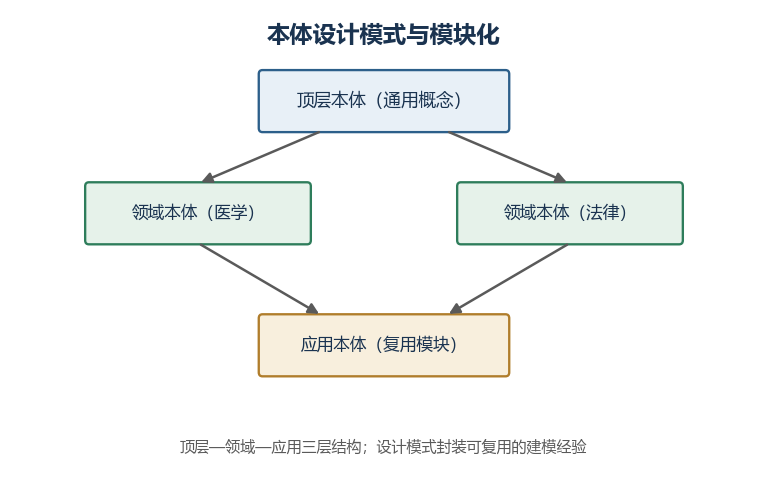

## 本章小结

本章系统论述本体设计模式与复用。我们首先给出本体设计模式定义（定义 21.1、表 21-1）与效率算例；讨论顶层本体与领域本体（定义 21.2、表 21-2）；给出模块化与复用（定义 21.3、表 21-3）及统一案例模块算例。

我们还明确边界：设计模式与复用处于 S2—S3 级，隐含模式可迁移假设，突破从零开发之限但无法突破领域特殊性与顶层承诺差异之限。这些辨析衔接第 20 章的工程方法、第 9.3 节的推理模块、第 22 章的本体对齐，以及第 23 章的演化维护。

模式的价值不仅在于省时，更在于传递设计经验：每个模式都记录了"为什么这样设计"与"在什么情况下失效"，这是新手从专家经验中学习的捷径。

下一章介绍本体匹配与对齐，解决不同本体间的语义互通问题。

**进一步阅读**　本章建议延伸阅读的文献：[1]、[2]、[4]。

## 参考文献

[1] Gangemi A, Presutti V. Ontology Design Patterns. In: *Ontology Engineering in a Networked World*, 2012: 221–251.

[2] Blomqvist E, Gangemi A, Presutti V. Ontology design patterns. In: *Handbook on Ontologies*, 2009: 221–233.

[3] Smith B, Grenon P. BFO: Basic formal ontology. *Formal Ontology in Information Systems*, 2004: 3–16.

[4] Stuckenschmidt H, Parent C, Spaccapietra S. Modular Ontologies. Berlin: Springer, 2009.

[5] DOLCE: A Descriptive Ontology for Linguistic and Cognitive Engineering. *ISTC-CNR Technical Report*, 2002.

[6] Simperl E, Luczak-Rösch M. NeOn: Networked ontologies. In: *Ontology Engineering in a Networked World*, 2012: 1–18.

[7] Euzenat J, Shvaiko P. Ontology Matching. 2nd ed. Berlin: Springer, 2013.

[8] Noy N F, McGuinness D L. Ontology development 101. *Stanford KSL Technical Report*, 2001.

---

# 第 22 章　本体匹配与对齐

第五篇从本章进入本体工程的后半程。第 20—21 章讨论了如何从零构建与复用本体；然而现实中的知识系统几乎从不是从零开始的：同一个领域往往并存多个由不同团队、在不同时期、为不同目的构建的本体。第 12 章处理的是实例层面的实体对齐，本章上升到**模式层（schema level）**——讨论如何发现两个本体中语义等价或相关的概念、关系与属性，并把它们对齐。本体匹配（ontology matching）是把分散的知识资源连接成统一语义网络的关键，也是第 34 章语义互操作与第 30 章知识融合的前提。

本章先给出本体匹配问题的形式化（22.1 节），再区分元素级与结构级匹配（22.2 节），引入基于嵌入的对齐方法（22.3 节），最后讨论边界（22.4 节），并把它放回四层结构与语义之梯中定位（22.5 节）。

## 22.1　本体匹配问题

**引入动机。** 设两个本体 $O_1,O_2$，各自包含概念集、关系集与属性集。本体匹配要输出一个**对齐（alignment）**——即一组形如 $\langle e_1,e_2,r,c\rangle$ 的对应关系，其中 $e_1\in O_1$、$e_2\in O_2$，$r$ 是对应关系（通常为等价 $\equiv$ 或包含 $\sqsubseteq$），$c\in[0,1]$ 是置信度。

**直觉解释。** 可以把两个本体想象成两张用不同语言绘制的同一片地铁图：站点名不同、连线的画法略有差异，但地理上存在对应。匹配就是找出「哪一站对应哪一站」。难的在于：名字相同的未必同义（「心脏」在医学本体与情感本体中不同），名字不同的未必不同义（「阿司匹林」与「乙酰水杨酸」）。

**定义 22.1（本体匹配）** 形式地，本体匹配是一个函数
$$
M:O_1\times O_2\longrightarrow \mathcal{P}\big((E_1\times E_2)\times R\times[0,1]\big), \tag{22-1}
$$
其中 $E_i$ 是 $O_i$ 的实体（概念、关系、属性）集合，$R=\{\equiv,\sqsubseteq,\sqsupseteq,\perp\}$ 是语义关系集。当 $M$ 输出 $\{e_1\equiv e_2\}$ 且置信度为 $c$ 时，记为一条**等价对应**。

对齐通常要求满足**功能性与单射性**：一个 $e_1$ 至多对应一个 $e_2$（一对一匹配），即
$$
\forall e_1:\ |\{e_2:\langle e_1,e_2,\equiv,c\rangle\in A\}|\le 1. \tag{22-2}
$$
但实践中多对多对应（如「医生」同时对应「医师」与「执业医师」）也很常见，需用稳定性约束而非严格单射。

**对齐质量的评估。** 匹配结果需与人工标注的**参考对齐（reference alignment）** $A^*$ 比较，采用信息检索的精确率与召回率：
$$
P=\frac{|A\cap A^*|}{|A|},\qquad R=\frac{|A\cap A^*|}{|A^*|},\qquad F_1=\frac{2PR}{P+R}. \tag{22-3}
$$
式中 $A$ 为系统输出的对齐。$F_1$ 是本体匹配评测（如 OAEI，Ontology Alignment Evaluation Initiative）的核心指标。置信度阈值 $t$ 控制输出规模：仅保留 $c\ge t$ 的对应。提高 $t$ 通常提升精确率、降低召回率——这是匹配系统基本的精度—覆盖权衡。

**例 22.0（评估指标手算）** 设系统输出 $|A|=100$ 条对应，参考对齐 $|A^*|=80$ 条，其中正确匹配 $|A\cap A^*|=60$ 条。则 $P=60/100=0.60$，$R=60/80=0.75$，$F_1=2\times0.60\times0.75/(0.60+0.75)=0.90/1.35\approx0.667$。若把阈值从 $0.5$ 提高到 $0.8$，输出降为 $|A|=70$，正确数仍为 $58$（丢弃的 12 条中有 2 条真、10 条假），则 $P=58/70\approx0.829$，$R=58/80=0.725$，$F_1\approx0.773$——精确率上升而召回率下降，印证了阈值权衡。

**表 22-1　本体匹配的输出类型**

| 对应关系 | 符号 | 含义 | 例 |
|----------|------|------|-----|
| 等价 | $\equiv$ | 两实体同义 | 阿司匹林 $\equiv$ 乙酰水杨酸 |
| 下位 | $\sqsubseteq$ | 前者是后者子类 | 阿司匹林 $\sqsubseteq$ 非甾体抗炎药 |
| 上位 | $\sqsupseteq$ | 前者是后者超类 | 药物 $\sqsupseteq$ 阿司匹林 |
| 不相交 | $\perp$ | 两实体互斥 | 药物 $\perp$ 疾病 |

## 22.2　元素级与结构级匹配

**元素级匹配（element-level matching）** 只利用实体自身的特征——名称、标签、注释、数据类型、取值域。最经典的是字符串相似度：编辑距离、Jaccard、TF-IDF 余弦。设 $s_1,s_2$ 为标签字符串，归一化编辑距离相似度为
$$
\sigma_{\mathrm{edit}}(s_1,s_2)=1-\frac{d_{\mathrm{lev}}(s_1,s_2)}{\max(|s_1|,|s_2|)}, \tag{22-4}
$$
其中 $d_{\mathrm{lev}}$ 是 Levenshtein 距离。对「aspirin」与「aspirine」，$d=1$，$\max=8$，$\sigma=0.875$。

**结构级匹配（structure-level matching）** 利用实体在图中的位置——父子关系、兄弟节点、邻居集合。其核心假设是**结构同构假设**：若两个实体的邻域结构相似，则它们语义相近。形式地，定义结构相似度
$$
\sigma_{\mathrm{struct}}(e_1,e_2)=\frac{|\Gamma(e_1)\cap \Gamma(e_2)|}{|\Gamma(e_1)\cup \Gamma(e_2)|}, \tag{22-5}
$$
其中 $\Gamma(e)$ 是实体 $e$ 的邻居集合（经已有对应映射后）。

**例 22.1（元素级与结构级对照）** 设有两个本体：本体 A 中「心肌梗死」的父类是「心血管疾病」，本体 B 中「心梗」的父类是「缺血性心脏病」。元素级相似度 $\sigma_{\mathrm{edit}}$（中文需先转拼音或词向量）较低，但结构级上二者都有子类「急性冠脉综合征」、都有属性「发病部位=心肌」，结构相似度高达 0.8，从而正确对齐。这说明结构信息能弥补字符串差异。

**技术谱系。** 实用系统（如 Falcon-AO、COMA++、LogMap）通常把多类匹配器加权融合：
$$
\sigma(e_1,e_2)=\sum_{k} w_k\,\sigma_k(e_1,e_2),\quad \sum_k w_k=1. \tag{22-6}
$$
权重的确定本身是一个学习问题，由此自然过渡到 22.3 节的嵌入方法。

进一步细化，字符串匹配族还包括：基于词干的归一化、基于本体的词汇资源（如 WordNet 同义词集、UMLS 的语义网络，见第 35 章）以及基于语言模型的上下文嵌入。这三类方法分别对应语义之梯的 S1（词汇）、S1.5（词汇资源）与 S2（上下文语义）。结构匹配族则包括：基于祖先集合的相似度、基于 Descendants 的信息量相似度（如 Wu-Palmer 相似度），以及基于图编辑距离的整体匹配。其中 Wu-Palmer 相似度定义为
$$
\sigma_{\mathrm{WP}}(c_1,c_2)=\frac{2\cdot\mathrm{depth}(\mathrm{LCS}(c_1,c_2))}{\mathrm{depth}(c_1)+\mathrm{depth}(c_2)}, \tag{22-7}
$$
$\mathrm{LCS}$ 为最低公共祖先。当两概念同义时 $\mathrm{LCS}$ 即自身，$\sigma=1$；当分居两棵子树时 $\sigma$ 随公共祖先深度下降。该式把「结构深度」纳入相似度，比单纯的集合 Jaccard（式 22-5）更细腻。

> 【图 22-1　本体匹配流水线】（原图见 figures/图22-1.png）：左侧两个本体的模式图，中间多匹配器（字符串、结构、嵌入）并行打分，右侧加权融合输出对齐，并标注置信度阈值裁剪。
>
> 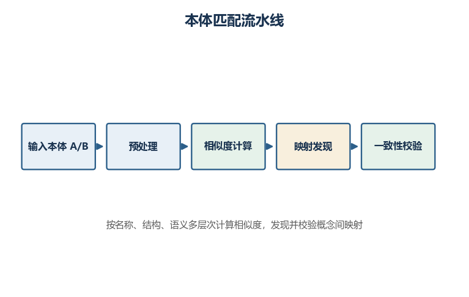

## 22.3　基于嵌入的本体对齐

**引入动机。** 元素级与结构级方法都依赖人工设计的特征与权重，难以捕捉深层的语义相似。受知识图谱嵌入（第 16 章）启发，基于嵌入的对齐把两个本体映射到同一向量空间，再用向量距离发现对应。

**直觉解释。** 如果两个本体是「同一种语言的两方言」，那么把它们的词都翻译成同一种「语义向量语言」后，同义词自然落在相近位置。对齐就变成「最近邻搜索」。

**定义 22.2（嵌入对齐）** 给定两个本体 $O_1,O_2$，嵌入对齐学习编码器 $f_1,f_2$，把实体映射为 $\mathbf{h}=f(e)\in\mathbb{R}^d$，使对应实体 $\|f_1(e_1)-f_2(e_2)\|$ 小，非对应实体距离大。训练目标常采用对比损失（InfoNCE 变体）：
$$
\mathcal{L}=-\log\frac{\exp\big(\mathrm{sim}(f_1(e_1),f_2(e_2))/\tau\big)}{\sum_{e_2'\in\mathcal{N}}\exp\big(\mathrm{sim}(f_1(e_1),f_2(e_2'))/\tau\big)}, \tag{22-8}
$$
其中 $\mathrm{sim}$ 为余弦相似度，$\tau$ 为温度，$\mathcal{N}$ 含正例与负例。

**例 22.2（嵌入对齐的数值算例）** 设 $d=2$，已学得 $f_1(\text{阿司匹林})=(0.9,0.1)$，$f_2(\text{乙酰水杨酸})=(0.85,0.15)$，$f_2(\text{胰岛素})=(0.1,0.9)$。余弦相似度：$\mathrm{sim}(阿,乙)=\frac{0.9\times0.85+0.1\times0.15}{\sqrt{0.82}\sqrt{0.745}}=\frac{0.78}{0.905\times0.863}\approx 0.999$；$\mathrm{sim}(阿,胰)=\frac{0.09+0.09}{0.905\times0.905}\approx 0.22$。显然乙酰水杨酸是正确对应。取温度 $\tau=0.1$，负例仅胰岛素，正例得分 $\exp(0.999/0.1)\approx 2.0\times10^4$，负例 $\exp(0.22/0.1)\approx 9.0$，损失 $\mathcal{L}=-\log\frac{2.0\times10^4}{2.0\times10^4+9.0}\approx 4.5\times10^{-4}$，很小，匹配可信。

> 【图 22-2　嵌入对齐的向量空间】（原图见 figures/图22-2.png）：二维平面上两个本体的实体向量，对应实体以虚线相连，展示正例聚拢、负例分离。
>
> 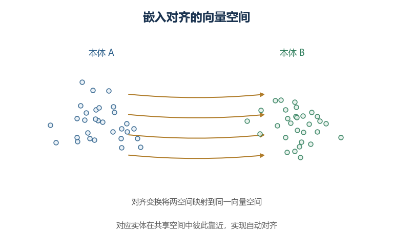

**种子扩展与迭代对齐。** 嵌入对齐需要正例对（种子对齐）来训练编码器 $f_1,f_2$。当种子稀疏时，常用**迭代扩展（iterative expansion）**：先用已知对齐 $\mathcal{A}_0$ 训练，预测新的高置信对应，把它们加入训练集，再重训练。设第 $k$ 轮训练集为 $\mathcal{A}_k=\mathcal{A}_{k-1}\cup\mathrm{TopN}(\hat{\mathcal{A}}_{k-1};\,c\ge t_k)$（取置信度 $\ge t_k$ 的预测正例），则对齐随轮次增长：

$$|\mathcal{A}_k|\approx|\mathcal{A}_0|\cdot\big(1+\eta\big)^k,\qquad \eta=\frac{\text{每轮新增正确对应}}{|\mathcal{A}_{k-1}|}. \tag{22-9}$$

$\eta$ 是「扩展增益率」：每轮靠结构/嵌入信号新增的正确对应占已有对齐的比例。$t_k$ 须随轮次提高（阈值收紧），否则错误正例污染训练集（确认偏差）。这是「半监督对齐」的核心：少量高质量种子 + 迭代自训练，可扩展到大规模本体。

**例 22.3（迭代对齐的扩展）** 设种子 $\mathcal{A}_0$ 含 50 条人工对齐，扩展增益 $\eta=0.4$、阈值 $t_k$ 从 0.7 逐轮升到 0.9。则 $|\mathcal{A}_1|=50\times1.4=70$、$|\mathcal{A}_2|=70\times1.4=98$、$|\mathcal{A}_3|\approx137$、$|\mathcal{A}_4|\approx192$。四轮后从 50 条种子扩到约 192 条对齐，覆盖扩大近 4 倍——但第 3 轮起 $t_k=0.9$ 已较高，新增对应多为高置信「显然正确」项（如同义词），增益 $\eta$ 会自然衰减（后期每轮新增减少），最终收敛到约 250 条。这展示了迭代对齐的「收益递减」：前期靠种子快速扩展，后期靠阈值收紧保证质量，工程上常设「增益低于某阈值即停」的停止准则。

迭代的根本风险是**确认偏差（confirmation bias）**：若第 1 轮引入的错误正例被当作训练真值，后续轮会强化错误（错误自我复制）。防御手段有二：其一，每轮新增正例须过「结构一致性门」（式 22-5 的 $\sigma_{\text{struct}}$ 高于阈值才准入），用独立于嵌入的结构信号做二次校验；其二，保留一批**人工标注的验证集**（不参与训练），每轮监控其在验证集上的 $F_1$（式 22-3），若 $F_1$ 下降即停——这是迭代对齐的「过拟合检测」。设验证集含 20 条人工对齐，$t=0.7$ 轮监控到验证集 $F_1$ 从 0.92 跌到 0.84，则提示训练集已被错误正例污染，应回退到上一轮并收紧 $t_k$。

**表 22-2　本体匹配方法谱系**

| 方法类别 | 利用信息 | 代表 | 优势 | 局限 |
|----------|----------|------|------|------|
| 字符串匹配 | 标签、注释 | edit distance | 简单快 | 同义异名失效 |
| 结构匹配 | 图拓扑 | Graph Matching | 无需外部资源 | 结构差异大时失效 |
| 语言模型匹配 | 上下文语义 | BERT 相似度 | 捕捉深层语义 | 需大规模语料 |
| 嵌入对齐 | 联合向量空间 | 式 22-8 | 端到端、可扩展 | 需种子对齐 |
| 逻辑匹配 | 公理与推理 | LogMap | 保语义一致性 | 表达力受限 |

## 22.4　边界与讨论

本体匹配的根本边界来自**语义不确定性**：两个实体是否等价，本质上依赖领域专家的本体论承诺（第 2 章），无法仅从数据自动判定。自动化方法只能给出候选与置信度，最终需人工审核。这与第 13 章知识质量评估一脉相承。

**语义之梯四问。** 本体匹配主要处于 S1—S2（词汇与概念级）：它对齐的是概念与标签，而非公理（S3）或推理（S4）。隐含假设是「结构/语义相似意味着语义等价」——这一假设在跨领域场景中常不成立。它突破了第 12 章仅做实例对齐的限制，把对齐提升到模式层；但无法突破「等价判定需要外部本体论承诺」的理论边界。

**匹配成本与人工审核。** 自动化匹配的输出是候选，质量由阈值 $t$ 控制，最终需人工确认。设两本体规模 $n_1,n_2$，全量候选对数 $n_1n_2$，匹配器对每对的打分代价 $c_{\text{match}}$，阈值 $t$ 下输出的候选对数为 $n_{\text{cand}}$（$t$ 越高 $n_{\text{cand}}$ 越小），人工审核每对代价 $c_{\text{human}}\gg c_{\text{match}}$，则总成本为

$$C_{\text{align}}=c_{\text{match}}\,n_1n_2+c_{\text{human}}\,n_{\text{cand}}(t). \tag{22-10}$$

式 (22-10) 揭示匹配的成本结构：自动打分是 $O(n_1n_2)$ 的固定开销，人工审核是 $n_{\text{cand}}$ 主导的可变开销，且 $c_{\text{human}}$ 远大于 $c_{\text{match}}$。因此**提高阈值 $t$（减少候选）是降本最有效的手段**，代价是召回率下降（漏掉一些真对应）——这正是 22.1 节「精度—覆盖权衡」的成本表述。

**例 22.4（阈值与成本权衡）** 设 $n_1=n_2=1000$（各 1000 概念），$c_{\text{match}}=0.01$ 秒/对、$c_{\text{human}}=60$ 秒/对。全量打分 $=0.01\times10^6=10^4$ 秒（约 2.8 小时，固定）。阈值 $t=0.5$ 输出 $n_{\text{cand}}=3000$ 对，人工 $=60\times3000=1.8\times10^5$ 秒（约 50 小时）；$t=0.8$ 输出 $n_{\text{cand}}=600$ 对，人工 $=60\times600=3.6\times10^4$ 秒（约 10 小时）。提高阈值从 0.5 到 0.8，人工成本降 80%（50→10 小时），但召回率可能从 0.85 降到 0.72——展示了「阈值是成本—召回的旋钮」。工程上先高阈值自动对齐（低成本、高置信），再对边界对（$c\in[t_{\text{low}},t_{\text{high}}]$）人工复核，是 22.1 节例 22.0 阈值权衡的工程落地。

**跨语言匹配。** 第 12 章实例对齐处理同语言内的实体，本章 22.1—22.3 也默认两本体共享词汇空间。但现实中常见**跨语言本体**（中文「心肌梗死」vs 英文「myocardial infarction」），字符串匹配（式 22-4）直接失效——「心梗」与「myocardial infarction」编辑距离极大。跨语言匹配须绕开字面，依赖**语言无关的语义通道**：其一，经共享顶层本体或受控词表（UMLS、SNOMED，第 35 章）中转，把两语言概念都映射到同一中间标识；其二，用多语言嵌入（多语 BERT/XLM-R）把概念嵌入共享向量空间，再用 22.3 节的余弦相似度（式 22-8 的 sim）打分；其三，翻译对齐——把一侧翻译到另一侧语言再做匹配，但翻译误差会污染对齐。

跨语言匹配的核心度量是**语言无关结构一致性**：设概念 $c$ 在多语言本体中的局部邻域结构（经已有对齐映射到统一签名）为 $\Gamma^*(c)$，则两语言概念 $c_1,c_2$ 的跨语言相似度可定义为结构一致度与多语嵌入相似度的融合：

$$\sigma_{\text{cross}}(c_1,c_2)=w_s\,\sigma_{\text{struct}}(c_1,c_2)+w_l\,\text{sim}_{\text{multiling}}(c_1,c_2), \tag{22-11}$$

其中 $\text{sim}_{\text{multiling}}$ 是多语言嵌入的余弦相似度，$w_s+w_l=1$。结构项 $\sigma_{\text{struct}}$（式 22-5）天然语言无关（只看图拓扑），是跨语言匹配最可靠的信号——这正是 22.2 节「结构级匹配」的跨语言价值。

**例 22.5（跨语言对齐）** 中文本体「心肌梗死」（父类「心血管疾病」）vs 英文本体「myocardial infarction」（父类「cardiovascular disease」）。字面：$\sigma_{\text{edit}}$ 经拼音/翻译仍低（不同文字）。结构：二者父类经 UMLS 中转对齐为同一「心血管」节点，$\sigma_{\text{struct}}\approx0.85$。多语嵌入：XLM-R 给「心肌梗死」与「myocardial infarction」向量余弦 $\text{sim}_{\text{multiling}}\approx0.91$。取 $w_s=0.5,w_l=0.5$：$\sigma_{\text{cross}}=0.5\times0.85+0.5\times0.91=0.88$，超过阈值 0.7，判为等价对应。展示了结构（语言无关）与多语嵌入（语义）双通道如何突破字面差异，实现跨语言本体对齐——这是第 34 章国际医疗数据互操作的基础。

**规模化与近似算法。** 式 (22-10) 的 $c_{\text{match}}\,n_1n_2$ 项随本体规模平方增长，$n_1=n_2=10^5$ 时全量打分不可行（$10^{10}$ 对）。工程上须用**近似最近邻（ANN）**把候选生成降到近线性：对每实体用 22.3 节嵌入向量建 FAISS/HNSW 索引，只取 $K$ 近邻作候选（$K\ll n_2$），打分代价从 $O(n_1n_2)$ 降到 $O(n_1 K \log n_2)$。ANN 的精度损失可控（召回 $K$ 近邻中真对应的比例通常 >0.95），但**须保证真对应落在 $K$ 近邻内**——若两本体词汇空间差异大（同义异名），嵌入相似可能不足以把真对应排进 top-$K$，此时须回退到结构匹配（式 22-5）或词表中转（22.4 节跨语言）兜底。OAEI（Ontology Alignment Evaluation Initiative）的实测表明：生物医学本体（词汇高度标准化）上嵌入对齐 $F_1>0.9$，而一般领域本体上 $F_1$ 降至 0.7—0.8，差距主要来自同义异名——这是「嵌入对齐需种子+结构兜底」（表 22-2）的根本原因。

**承上启下。** 本章的对齐输出是第 23 章本体演化的输入之一——当两个本体对齐后发现语义漂移，就需要演化维护。同时本章为第 34 章语义互操作提供了模式层的技术基础。下一章转向本体的时间维度：如何管理已建立本体的变更与演化。对齐本身不是一次性动作，而是随本体演化持续进行的过程——第 23 章将把「对齐维护」纳入演化生命周期。

## 本章小结

本章论述本体匹配与对齐。我们首先形式化匹配问题（式 22-1、22-2），区分元素级与结构级匹配（式 22-4、22-5），给出多匹配器融合（式 22-6），进而引入基于嵌入的对齐与对比损失（式 22-8），并通过两个数值算例展示匹配过程。我们还明确边界：匹配输出是候选而非定论，等价判定依赖本体论承诺。这些辨析衔接第 2、12—13、16、23、34 章。

**进一步阅读**　本章建议延伸阅读的文献：[1]、[3]、[5]。

## 参考文献

[1] Euzenat J, Shvaiko P. *Ontology Matching*, 2nd ed. Heidelberg: Springer, 2013.

[2] Shvaiko P, Euzenat J. Ontology matching: state of the art and future challenges. *IEEE Transactions on Knowledge and Data Engineering*, 2013, 25(1): 16–36.

[3] Wang Z, Lv Q, Lan X, et al. Ontology matching with knowledge graph embedding. *IEEE Access*, 2018, 6: 76321–76334.

[4] Chen J, He Y, Hu Z, et al. Multi-matcher ontology alignment based on evidence combination. *Knowledge-Based Systems*, 2019, 163: 226–241.

[5] Jiménez-Ruiz E, Grau B C. LogMap: Logic-based and scalable ontology matching. *ISWC*, 2011.

[6] Karp D P, Chaudhri V K, Feldman A G. An information-theoretic perspective on ontology alignment evaluation. *ISWC*, 2004.

[7] Noy N F, McGuinness D L. Ontology development 101: A guide to creating your first ontology. *Stanford KSL Technical Report*, 2001.

[8] Ottaviani D, Spilotros G, Ceci M, et al. Adaptive ontology matching. *World Wide Web Journal*, 2020, 23(2): 1123–1150.

---

# 第 23 章　本体演化与维护

第 22 章讨论了如何把两个已存在的本体对齐；但本体一旦投入使用，就会随领域知识的变化而不断改变——新的疾病被发现、旧的药物被淘汰、概念的内涵被重新界定。本章转向本体的**时间维度**：本体演化（ontology evolution）与维护。第 20 章讲的是「从无到有」的开发方法学，本章讲的是「从有到优」的持续治理。若说第 20—22 章处理的是本体的静态结构，本章则把本体视为一个需要版本管理、变更传播与一致性维护的活系统。

本章先分析本体演化的动机与类型（23.1 节），再讨论变更管理与一致性维护（23.2 节），介绍版本控制与协作（23.3 节），最后给出边界与四层结构定位（23.4—23.5 节）。

## 23.1　本体演化的动机与类型

**引入动机。** 本体的知识来源于对世界的建模，而世界在变。以贯穿全书的疾病—药物本体为例：一种新病毒出现，需新增概念「COVID-19」及其属性；「阿司匹林可预防心肌梗死」这一断言被新证据修正，需删除或限定。这些变更若不加以管理，将破坏依赖该本体的所有下游应用（第 30 章问答、第 35 章医学知识智能）。

**直觉解释。** 把本体想象成一座城市的知识地图：新修了路要加线，拆了桥要删线，改了单行方向要改箭头。每次改动都要保证地图整体自洽（不能出现「路连到不存在的地点」），并且要记录「哪一天改了什么」，以便回溯。本体演化就是这套「地图更新工程」。

**定义 23.1（本体演化）** 本体演化是本体的一个受控状态转移：设 $O_t$ 为 $t$ 时刻的本体，演化是施加变更操作序列 $\Delta=\langle\delta_1,\delta_2,\ldots\rangle$ 得到 $O_{t+1}=\mathrm{apply}(O_t,\Delta)$，满足
$$
\mathrm{Consistent}(O_{t+1})=\top, \tag{23-1}
$$
即演化后的本体必须保持一致（第 9 章推理机可验证）。

本体变更按对象可分为四类，构成**演化类型谱系**：
- **概念变更**：新增/删除/重命名概念，如新增「Long COVID」。
- **关系变更**：新增/删除关系，如新增「药物—禁忌症」关系。
- **属性变更**：修改属性定义域、值域或基数约束。
- **公理/实例变更**：增删公理或断言，如把「阿司匹林 $\sqsubseteq$ 解热镇痛药」改为「阿司匹林 $\sqsubseteq$ 非甾体抗炎药」。

**变更的原子性与事务。** 一次演化常含多个原子操作，必须作为**事务**整体提交：要么全部成功，要么全部回滚，避免中间态不一致。设变更序列 $\Delta=\langle\delta_1,\ldots,\delta_n\rangle$，事务性要求
$$
\bigwedge_{i=1}^{n}\mathrm{Valid}(\delta_i\mid O_t)\ \Longrightarrow\ \mathrm{Consistent}(\mathrm{apply}(O_t,\Delta)), \tag{23-2}
$$
即仅当每个原子操作在原始本体上合法时，整体才保证一致。实际系统采用「暂存—验证—提交」三阶段：先在副本上应用全部变更，用推理机验证，通过后才写入主本体。

**变更粒度与影响半径。** 四类变更（表 23-1）的「影响半径」（波及的公理与实例数）差异巨大，是变更成本的核心维度。设变更 $\delta$ 作用于元素 $e$，其影响半径定义为

$$\mathrm{Radius}(\delta)=|\mathrm{Impact}(\delta)|+|\mathrm{Ent}(e)\cap\mathcal{I}|,$$

其中第一项是 $\delta$ 直接改变真值的公理数，第二项是被 $e$ 间接蕴含的实例数（第 9 章推理机可算）。新增概念的影响半径小（仅插入，无既有公理被改变）；删除概念的影响半径大（其实例与下游断言全受影响）；公理修订（如改 $\sqsubseteq$ 目标）的影响半径居中。

**数值算例（影响半径对比）。** 设统一案例本体中：「阿司匹林 $\sqsubseteq$ 非甾体抗炎药 $\sqsubseteq$ 药物」，阿司匹林有 50 个实例、被 20 条「治疗」断言引用。(a) 新增概念「Long COVID」：$\mathrm{Radius}=0+0=0$（纯插入），成本最低。(b) 删除「非甾体抗炎药」：直接波及公理 1 条（阿司匹林 $\sqsubseteq$ 非甾体抗炎药），间接 50 个实例 + 20 条治疗断言的祖先链，$\mathrm{Radius}\approx1+70=71$，成本最高。(c) 修订「阿司匹林 $\sqsubseteq$ 非甾体抗炎药」改为「阿司匹林 $\sqsubseteq$ 解热镇痛药」：直接波及 1 条公理、间接 50 个实例的类型，$\mathrm{Radius}\approx1+50=51$，居中。这展示了变更管理应按 $\mathrm{Radius}$ 排序处理：小半径变更（新增）可批量自动执行，大半径变更（删除）须人工评审 + 传播策略（23.2 节）。

**表 23-1　本体变更类型与影响**

| 变更类型 | 操作 | 局部影响 | 全局影响 |
|----------|------|----------|----------|
| 新增概念 | $C_{\text{new}}$ | 插入分类树 | 触发子类继承 |
| 删除概念 | $C_{\text{del}}$ | 移除节点 | 悬空实例需重定位 |
| 关系调整 | $\Delta R$ | 边集变化 | 推理结果改变 |
| 公理修订 | $\Delta A$ | 约束变化 | 一致性需重验 |

## 23.2　变更管理与一致性维护

**引入动机。** 直接的变更往往引发连锁反应。删除概念「心肌梗死」会导致其实例成为「孤儿」，也会使「阿司匹林 治疗 心肌梗死」这类断言失效。变更管理的核心是：在应用变更前，先分析其**影响面（impact）**，再决定 propagate（传播）、reject（拒绝）或 coerce（强制修正）。

**直觉解释。** 就像改造楼房承重墙前要先做结构评估：哪些房间依赖这面墙？拆掉后如何加固？本体变更管理就是先在图上做「如果删掉这个节点，哪些边和实例会受影响」的仿真，再执行。

**定义 23.2（变更影响）** 变更 $\delta$ 的影响集定义为受其波及的公理与实例集合：
$$
\mathrm{Impact}(\delta)=\{a\in O:\ \delta \text{ 改变 } a \text{ 的真值或可满足性}\}. \tag{23-3}
$$
影响分析通常借助第 9 章的推理机，对变更前后分别做一致性检查与蕴含查询，比较差异。

变更传播遵循一套策略[2]：
1. **传播（propagate）**：把变更自动应用到影响集中的元素，如删除概念时把其实例上移到父类。
2. **拒绝（reject）**：若变更破坏关键约束则回滚。
3. **强制（coerce）**：修改影响集元素以维持一致性，如补全被删概念的替代父类。

**例 23.1（删除概念的影响分析）** 设本体中「阿司匹林 $\sqsubseteq$ 非甾体抗炎药 $\sqsubseteq$ 药物」，且实例 $i$ 的类型为「阿司匹林」。现删除概念「非甾体抗炎药」。影响集含：公理「阿司匹林 $\sqsubseteq$ 非甾体抗炎药」、实例 $i$ 的类型断言、以及推理得出的「阿司匹林 $\sqsubseteq$ 药物」。若采用传播策略，把「阿司匹林」直接挂到「药物」之下，则 $i$ 仍为「药物」实例，一致性恢复（式 23-1 成立）。若不做传播，则 $i$ 的祖先链断裂，推理机将报告不可满足。

> 【图 23-1　本体变更传播流程】（原图见 figures/图23-1.png）：变更请求→影响分析（虚线标出受影响节点）→策略选择（传播/拒绝/强制）→一致性验证→提交或回滚。
>
> 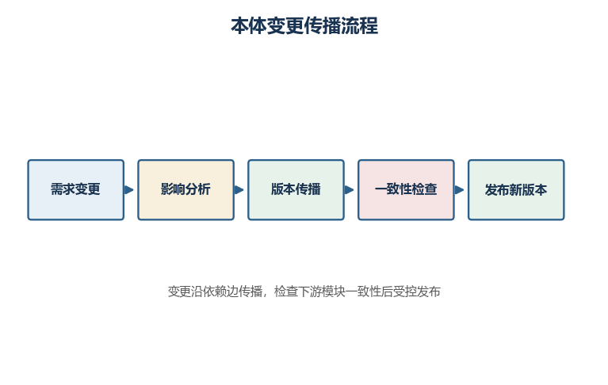

**传播成本模型。** 传播策略的实际代价取决于影响集规模与每元素的修正工作量。设变更 $\delta$ 采用传播策略，其传播成本为

$$C_{\text{prop}}(\delta)=c_{\text{prop}}\cdot|\mathrm{Impact}(\delta)|+c_{\text{verify}}\cdot\mathbb{1}\big[\mathrm{Consistent}(O_{t+1})=\top\big],$$

其中 $c_{\text{prop}}$ 是单元素传播修正成本（如把实例上移父类、补全替代关系），$c_{\text{verify}}$ 是整体一致性重验成本（推理机全量检查），$\mathbb{1}[\cdot]$ 为一致性成立的指示函数。式 (23-6) 把 23.1 节的「影响半径」转化为可比的货币/工时量：影响集越大、传播成本越高，且验证成本是固定开销（每次提交都要验）。

**例 23.4（传播成本对比）** 设 $c_{\text{prop}}=30$ 单位/元素、$c_{\text{verify}}=100$ 单位。沿用 23.1 节算例：(a) 新增「Long COVID」，$|\mathrm{Impact}|=0$，$C_{\text{prop}}=100$（仅验证）；(b) 删除「非甾体抗炎药」，$|\mathrm{Impact}|=71$，$C_{\text{prop}}=30\times71+100=2230$；(c) 修订 $\sqsubseteq$ 目标，$|\mathrm{Impact}|=51$，$C_{\text{prop}}=30\times51+100=1630$。删除比新增贵 22 倍、比修订贵 1.4 倍——这量化了「大半径变更须人工评审」的必要性：$C_{\text{prop}}$ 超阈值的变更应触发人工介入（策略从自动传播降级为「传播 + 人工确认」），而小变更可全自动。

**修复（repair）与最小修改。** 当传播无法自动恢复一致性（如删除概念后实例无法合理上移），需**修复**：寻找使本体重新满足的最小修改集。设不可满足概念 $C$ 的修复是删除最少公理使 $C$ 可满足，则修复代价为

$$\mathrm{Repair}(C)=\min_{\mathcal{R}\subseteq\mathrm{ax}(C)}\ |\mathcal{R}|\ \ \text{s.t.}\ O\setminus\mathcal{R}\models\mathrm{Sat}(C),$$

其中 $\mathrm{ax}(C)$ 是定义 $C$ 的公理集。修复是 NP 困难的（与公理选择同构），工程上常用启发式（按公理「解释力」排序，优先删低解释力者）或借助第 9 章推理机的 justification 查询定位「最小解释公理集」。修复与传播的区别：传播是「移动元素」维持一致性，修复是「删改公理」消除矛盾——前者保信息、后者损信息，故传播优先、修复兜底。实践中可量化「信息损失」：修复删除 $k$ 条公理，则损失率 $\frac{k}{|\mathrm{ax}(C)|}$ 越接近 0 越理想；若须删除过半公理才修复，提示变更本身（如删除该概念）不当，应改用传播或拒绝策略，而非硬修复。这一「传播—修复—拒绝」的优先级排序，与第 20 章评估中「验证优先于确认」的工程直觉一致。

## 23.3　版本控制与协作

**引入动机。** 本体常由多人协作开发（第 20 章），变更频繁且可能冲突。需要借鉴软件工程的版本控制：记录每次变更、支持分支与合并、可回溯到任意历史版本。

**直觉解释。** 就像代码的 Git：每个本体版本是一次 commit，两个团队可各改各的（branch），最后合并（merge）。本体版本控制还需额外保证「合并后的本体在逻辑上一致」——这是普通代码合并不要求的。

**变更日志与本体 diff。** 为了使演化可审计，每次变更需记录为结构化日志 $\ell=(\delta,\ \text{author},\ t,\ \text{justification})$，其中 justification 说明变更依据（如某篇新临床指南）。本体 diff 则计算两版本的概念/关系/公理集合差异：设 $C_t,C_{t+1}$ 为前后概念集，则
$$
\Delta C^{+}=C_{t+1}\setminus C_t,\qquad \Delta C^{-}=C_t\setminus C_{t+1}, \tag{23-4}
$$
分别表示新增与删除的概念集。类似地可定义关系与公理的增删。diff 是生成版本说明与冲突检测的基础。

**定义 23.3（本体版本）** 本体版本是一个带时间戳与依赖关系的状态：
$$
V=(O,\ t,\ \mathrm{parent}(V),\ \Delta_{\text{from parent}}), \tag{23-5}
$$
其中 $\mathrm{parent}(V)$ 指向前一版本，$\Delta$ 记录差异。版本序列构成有向无环图（DAG）。

主流工具如 WebProtégé、VOID、OntoVersion 支持本体 diff 与版本化查询。当两个分支 $V_a,V_b$ 合并时，需检测**语义冲突**：若 $V_a$ 断言 $C\sqsubseteq D$ 而 $V_b$ 断言 $C\sqcap D\equiv\perp$，则合并后不一致，需人工仲裁。

**例 23.3（版本化查询）** 统一案例中，药物研发需要回答「2023 版本体中阿司匹林的适应症」。版本化查询引擎先定位 $t=2023$ 的版本 $V_{2023}$，再在该版本快照上执行 SPARQL（第 7 章）。若阿司匹林的适应症在 2024 版被修订，则查询 2024 版会得到不同答案——版本控制使「答案随时间变化」成为可管理的特性而非错误。这对第 35 章医学知识智能的合规追溯尤为重要。

**表 23-2　本体演化工具谱系**

| 工具/机制 | 功能 | 一致性保障 | 适用规模 |
|-----------|------|------------|----------|
| Protégé + ChAOSS | 人工变更记录 | 弱 | 小规模 |
| WebProtégé | 协作与版本 | 中 | 中小 |
| LogMap（第 22 章） | 对齐驱动演化 | 逻辑级 | 中大规模 |
| 本体 diff 算法 | 自动差异检测 | 取决于推理 | 通用 |

**分支分歧与合并代价。** 版本 DAG（定义 23.3）中，两个分支 $V_a,V_b$ 自共同祖先 $V_0$ 各自演化，其**分歧度（divergence）**度量合并冲突的可能性。设 $\Delta_a=\Delta_{\text{from }V_0}(V_a)$、$\Delta_b=\Delta_{\text{from }V_0}(V_b)$ 为两分支相对祖先的变更集，则

$$\mathrm{Div}(V_a,V_b)=|\Delta_a\cap\Delta_b|+\alpha\cdot|\Delta_a|+|\Delta_b|, \tag{23-6}$$

其中 $\Delta_a\cap\Delta_b$ 是两分支共同触及的元素（最易冲突），$\alpha$ 是变更密度的耦合系数（本体越耦合 $\alpha$ 越大）。$\mathrm{Div}$ 越大，合并时语义冲突（23.4 节例 23.2）越可能，合并代价越高。

**例 23.5（分歧度与合并代价）** 设 $\alpha=0.5$。团队 A 改 30 个概念、团队 B 改 40 个，其中 15 个共同触及（如都改「药物」子类）。$\mathrm{Div}=15+0.5\times(30+40)=15+35=50$。若两团队分工清晰（$\Delta_a\cap\Delta_b=0$），$\mathrm{Div}=0+35=35$，合并更顺。这量化了「并行开发须划分签名边界」（第 21 章模块化的协作价值）：把不同团队的变更限制在不重叠的模块签名上，$\Delta_a\cap\Delta_b$ 趋近 0，分歧度最低。工程实践是「先定模块边界、再分头开发、后合并」，与第 20 章 NeOn 的协作开发原则一致。

**表 23-2A　本体演化治理指标**

| 指标 | 定义 | 用途 |
|------|------|------|
| 影响半径（23.1 节） | 变更波及元素数 | 排序处理优先级 |
| 传播成本（23.2 节） | 传播+验证代价 | 决定自动/人工 |
| 分歧度（式 23-6） | 分支合并冲突度 | 协作边界划分 |

## 23.4　边界与讨论

本体演化的根本边界在于**开放世界假设（OWA，第 4 章）**：本体的「不完整」是常态，因此「变更」与「补充」没有绝对界限。一个今天不存在的实体，明天可能出现——演化系统必须区分「错误」与「新知」，而这需要外部真值来源，无法从根本上自动化。

**语义漂移检测。** 本体随时间演化，与「世界真相」的偏离即**语义漂移（semantic drift）**。设本体 $O_t$ 与领域参考知识（如新临床指南 $G$）的漂移度为

$$\mathrm{Drift}(O_t,G)=1-\frac{|O_t\cap G|}{|O_t\cup G|}, \tag{23-7}$$

即 $O_t$ 与 $G$ 的 Jaccard 距离：$\mathrm{Drift}=0$ 表示完全一致，$=1$ 表示完全背离。$\mathrm{Drift}$ 超阈值即触发「演化告警」，提示本体需按 $G$ 更新。这是把第 13 章知识质量评估的「正确性」延伸到时间维度：不仅问「本体现在对不对」，还问「本体随时间是否仍在漂移」。

**例 23.6（漂移检测触发演化）** 设 2023 版本体 $O_{2023}$ 与 2024 新指南 $G_{2024}$ 对比：$|O_{2023}\cap G_{2024}|=800$、$|O_{2023}\cup G_{2024}|=950$，$\mathrm{Drift}=1-800/950\approx0.158$。若阈值 0.10，则 0.158 超阈，触发演化：定位分歧的 150 条断言（$950-800$），逐条核对是新知（指南新增）还是错误（旧版过时），据 justification 决定保留/删除。这展示了「漂移度量 → 演化告警 → 定向更新」的治理闭环，是第 38 章本体系统工程化「持续治理」的核心机制。注意 $\mathrm{Drift}$ 对「规模差异」敏感：若新指南 $G$ 远大于 $O_t$（指南扩张快于本体更新），$\mathrm{Drift}$ 会系统性偏高，须结合「增量漂移」（$|G\setminus O_t|/|G|$）与「存量漂移」（$|O_t\setminus G|/|O_t|$）分开看，避免把「本体还没跟上指南扩张」误判为「本体出错」。

**例 23.2（版本合并中的语义冲突）** 团队 A 在分支 $V_a$ 中把「COVID-19」添加为「病毒性肺炎 $\sqsubseteq$ 呼吸道疾病」；团队 B 在分支 $V_b$ 中把「病毒性肺炎」声明为与「呼吸道疾病」不相交（$\perp$）。合并时，推理机发现「COVID-19」既是呼吸道疾病（经 A）又不属呼吸道疾病（经 B 的不相交公理），本体不可满足（式 23-1 失败）。此时必须人工仲裁——A 的分类或 B 的不相交公理至少有一方需修正。此例说明：版本控制的「语义冲突」无法靠文本级 diff 自动解决，必须借助第 9 章的逻辑推理。

**语义之梯四问。** 本体演化跨越 S2—S3（概念与公理级）：它管理概念、关系与公理的变更，但一般不触及推理规则本身（S4）。隐含假设是「变更可局部化且影响可分析」——在高度耦合的本体中该假设失效。它突破了第 20—22 章的静态视角，引入了时间维度；但无法突破「变更语义需外部世界知识裁定」的边界。

**与本体对齐的关系。** 第 22 章的本体对齐与本章的演化是一个闭环的两端：对齐发现两个本体的语义对应，而演化管理对齐后本体的后续漂移。当源本体发生变更（如新增概念），下游对齐需重新计算——这就是第 34 章语义互操作中「对齐维护」的实际形态。

**演化治理总成本。** 把本节各度量整合，本体的**持续治理成本**可模型化为周期函数。设本体每周期（如季度）有 $n_{\text{chg}}$ 个变更、平均传播成本 $\bar{c}_{\text{prop}}$、漂移检测周期成本 $c_{\text{drift}}$（推理机全量对比指南）、人工仲裁成本 $c_{\text{arb}}$ 且触发概率 $p_{\text{arb}}$，则

$$C_{\text{govern}}=n_{\text{chg}}\,\bar{c}_{\text{prop}}+c_{\text{drift}}+p_{\text{arb}}\,c_{\text{arb}}. \tag{23-8}$$

式 (23-8) 把演化的「日常开销」与「风险开销」分开：前两项是确定性的（变更传播+漂移检测），第三项是概率性的（语义冲突需人工仲裁）。$\bar{c}_{\text{prop}}$ 由 23.2 节传播成本模型给出，$c_{\text{drift}}$ 随本体与指南规模增长（第 13 章），$p_{\text{arb}}$ 由 23.3 节分歧度 $\mathrm{Div}$ 驱动（$\mathrm{Div}$ 高则仲裁概率高）。

**例 23.7（治理成本估算）** 设某医疗本体季度 $n_{\text{chg}}=40$ 个变更、$\bar{c}_{\text{prop}}=120$ 单位、$c_{\text{drift}}=500$ 单位、$p_{\text{arb}}=0.15$、$c_{\text{arb}}=2000$ 单位。则 $C_{\text{govern}}=40\times120+500+0.15\times2000=4800+500+300=5600$ 单位/季度。若通过模块边界划分（23.3 节）把 $\mathrm{Div}$ 降低、$p_{\text{arb}}$ 从 0.15 降到 0.05，则 $C_{\text{govern}}=4800+500+100=5400$，省 200 单位（约 3.6%）；若同时把变更批量自动执行使 $\bar{c}_{\text{prop}}$ 降到 80，则 $C=40\times80+500+100=3900$，省 30%——展示了「降低传播成本 + 降低仲裁概率」是治理降本的两条主路径。式 (23-8) 使「本体维护要多少钱」从模糊估计变为可预测的运营指标，支撑第 38 章的工程预算。

**承上启下。** 本章的演化与一致性维护为第 38 章本体系统工程化中的「持续治理」提供了理论依据。从下一章起，本书进入第六篇——神经—符号融合，探讨如何用神经网络弥补纯符号本体在可扩展性与鲁棒性上的不足。

## 本章小结

本章论述本体演化与维护。我们首先给出演化形式化（式 23-1）与四类变更类型（表 23-1），定义变更影响集（式 23-3）与传播策略，并通过删除概念的算例展示影响分析过程。我们介绍版本控制（式 23-5）与协作工具谱系（表 23-2）。我们还明确边界：开放世界假设下「变更」与「新知」无绝对界限，语义冲突需人工仲裁。这些辨析衔接第 4、9、20—22、30、35、38 章。

本章的演化视角也将为第 40 章讨论「大规模常识本体的持续维护」这一开放问题提供基础。

**进一步阅读**　本章建议延伸阅读的文献：[1]、[2]、[4]。

## 参考文献

[1] Flouris G, Manago M, Dutra I, et al. Ontology change: classification and survey. *Knowledge and Information Systems*, 2014, 38(1): 49–101.

[2] Stojanovic L, Stojanovic Z, Handschuh S, et al. Evolution in the semantic web: A case study. *ISWC*, 2002.

[3] Zablith F, Sabou M, d'Aquin M, et al. Ontology evolution: A survey of the state of the art. *Semantic Web Journal*, 2014, 5(3): 221–268.

[4] Kalyanpur A, Parsia B, Sirin E, et al. Repairing unsatisfiable concepts in OWL ontologies. *ESWC*, 2006.

[5] Noy N F, Klein M C A. Ontology evolution: Not the same as schema evolution. *Knowledge and Information Systems*, 2004, 6(4): 428–440.

[6] Grau B C, Horrocks I, Jiménez-Ruiz E, et al. Justification and repair in ontologies. *Reasoning Web Summer School*, 2008.

[7] Simperl E, Lucchi R. Towards a science of ontology evolution. *ESWC*, 2008.

[8] Palma R, Ha cause F, generative R. Evolving ontologies in the large: The case of BioPortal. *BioOntologies*, 2011.

---

# 第 24 章　神经—符号智能

第六篇从本章进入本书最活跃的前沿：神经—符号智能（neuro-symbolic intelligence）。前五篇建立的符号体系——本体、描述逻辑、规则推理、知识图谱——具有严格语义与可解释性，却长期受制于两个弱点：依赖人工构建、对噪声与不完整数据脆弱。与此同时，深度学习在感知与模式识别上取得压倒性成功，却缺乏显式知识表示与可靠推理。本章给出神经—符号融合的动机、谱系与架构分类，为第 25—28 章的具体技术铺路。

本章先梳理动机与历史谱系（24.1 节），再提出「符号的注入、学习与推理」三分法（24.2 节），给出架构分类（24.3 节），讨论评估维度与边界（24.4—24.5 节）。

## 24.1　动机与谱系

**引入动机。** 符号主义与连接主义代表了人工智能的两大传统。符号主义（第 2—4 章）把智能视为对显式符号的推理，优势是可解释、可验证、组合泛化强；连接主义把智能视为神经 net 的统计学习，优势是鲁棒、端到端、能从数据自动获取特征。二者的鸿沟正是本书「语义之梯」所要跨越的：符号方法位于 S3—S4（公理与推理），深度方法常停留在 S1—S2（词汇与概念）。神经—符号融合旨在让学习的表示获得符号的语义保证，让符号系统获得学习的扩展性。

**直觉解释。** 想象一位医生：他既有扎实的医学教科书知识（符号、可陈述），又有多年看片积累的直觉（神经、难言说）。诊断时两者协同——直觉提出假设，知识验证假设。神经—符号系统试图在机器中复现这种「系统 1 + 系统 2」的协同。

**定义 24.1（神经—符号系统）** 一个神经—符号系统是一个复合模型 $\mathcal{S}=(\mathcal{N},\mathcal{K},\iota)$，其中 $\mathcal{N}$ 为神经组件（参数化可微函数），$\mathcal{K}$ 为符号组件（知识库、本体或逻辑理论），$\iota$ 为二者的接口（映射或交互协议），满足：系统的至少部分推理经由 $\mathcal{N}$ 的数值计算完成，而至少部分知识以 $\mathcal{K}$ 的显式符号形式保存。

**历史谱系。** 神经—符号并非新概念：早在 1990 年代就有神经—符号集成的系统[1]。其复兴得益于三点：① 深度学习的表示能力；② 大规模知识图谱（第 11—14 章）与本体（第 20—23 章）的成熟；③ 可微逻辑（第 25 章）与图神经网络（第 26 章）等桥接技术的出现。可以把它看作对第 1 章「概念化—公理化—可判定性—互操作性」根本问题的第三次回答（前两次是符号主义与统计学习）。

**表 24-1　三大范式对照**

| 维度 | 符号主义 | 连接主义 | 神经—符号 |
|------|----------|----------|-----------|
| 知识表示 | 显式符号 | 隐式权重 | 显式+隐式 |
| 推理 | 逻辑演绎 | 数值前向 | 混合 |
| 可解释性 | 强 | 弱 | 中—强 |
| 数据需求 | 低 | 高 | 中 |
| 鲁棒性 | 弱 | 强 | 中—强 |
| 语义之梯 | S3—S4 | S1—S2 | 跨 S1—S4 |

## 24.2　符号的注入、学习与推理

神经—符号融合可按「符号在系统中扮演的角色」分为三类，这是本章的核心组织框架。

**（一）符号注入（symbol injection）。** 把已有符号知识 $\mathcal{K}$ 作为先验注入神经模型。最直接的方式是在损失函数中加入符号约束项（第 27 章）：
$$
\mathcal{L}=\mathcal{L}_{\text{data}}+\lambda\,\Omega(\mathcal{K};\theta), \tag{24-1}
$$
其中 $\Omega$ 衡量神经输出违反符号知识的程度，$\lambda$ 控制约束强度。例如要求模型输出满足本体中的 $\sqsubseteq$ 层级约束。

**（二）符号学习（symbol learning）。** 从神经表示中抽取或归纳出符号规则。典型如第 17 章的神经规则学习、第 32 章的大语言模型生成知识图谱。其目标是从数据中发现可陈述的符号结构 $K'$，使
$$
K'=\arg\max_{K\in\mathcal{K}}\ P(K\mid \text{data};\theta). \tag{24-2}
$$

**符号学习的精度—完整性权衡。** 从神经表示归纳符号规则（式 24-2）面临精度—完整性（precision—recall）权衡：规则太少则覆盖不全（recall 低），规则太多则含噪声（precision 低）。设归纳出的规则集 $K'$ 与「真规则集」$K^*$ 比较，

$$\mathrm{Prec}(K')=\frac{|K'\cap K^*|}{|K'|},\qquad \mathrm{Rec}(K')=\frac{|K'\cap K^*|}{|K^*|},$$

其中 $K^*$ 是人工标注的黄金规则集（无标注时以大规模验证集的蕴含命中率近似）。$\mathrm{Prec}$ 高表示归纳出的规则大多正确（可放心注入），$\mathrm{Rec}$ 高表示真规则被覆盖得全。

**例 24.1（神经规则学习的精度—完整性）** 设从医学文献归纳出 $|K'|=40$ 条「药物—副作用」规则，黄金集 $|K^*|=30$ 条，命中 $|K'\cap K^*|=25$。则 $\mathrm{Prec}=25/40=0.625$、$\mathrm{Rec}=25/30\approx0.833$、$F_1\approx0.714$。Rec 高（覆盖 83% 真规则）但 Prec 偏低（37.5% 是噪声规则）——这是「宁多勿漏」的归纳倾向，适合发现阶段（先广撒网）。若把归纳的置信阈值提高，$\mathrm{Prec}$ 升到 0.85 但 $\mathrm{Rec}$ 降到 0.55——精度升、覆盖降。工程上分两阶段：发现阶段用低阈值保 Rec（上式 Rec 优先），验证阶段用高阈值保 Prec 再人工审核，与第 16 章嵌入推理的「召回—精排」两阶段同构。

**（三）符号推理（symbolic reasoning）。** 让神经组件参与或替代逻辑推理过程。如第 25 章的可微定理证明，把推理链的离散搜索松弛为可微计算；或第 26 章用 GNN 在知识图谱上做多跳推理。

**例 24.2（三类角色的统一案例）** 在疾病—药物知识图谱上：符号注入——训练医学问答模型时，要求「阿司匹林治疗心肌梗死」的预测与本体公理一致（式 24-1）；符号学习——从医学文献中抽取新的「药物—副作用」规则（式 24-2）；符号推理——用 GNN 沿知识图谱路径推理「阿司匹林是否可能治疗某新疾病」（第 26 章）。三者分别对应知识的「用」「生」「推」。

> 【图 24-1　神经—符号三分法】（原图见 figures/图24-1.png）：三列分别展示符号注入（知识→损失）、符号学习（数据→规则）、符号推理（图→推理链），中间以接口 $\iota$ 连接神经与符号两侧。
>
> 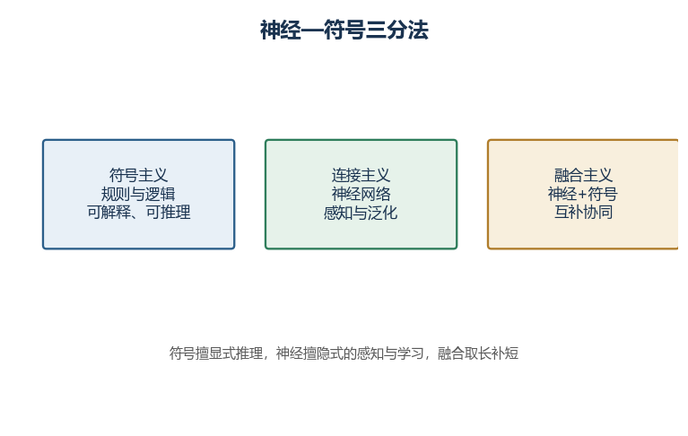

## 24.3　神经—符号架构

**引入动机。** 不同的融合方式对应不同的系统架构，理解架构分类是选择技术方案的前提。

**直觉解释。** 如同「人和工具如何协作」：可以是人按工具说明书操作（符号主导），可以是工具辅助人（神经主导），也可以是人机深度融合（混合）。

**定义 24.2（架构分类）** 按神经与符号组件的耦合程度，分为三类架构：
1. **符号主导（symbolic-in-the-loop）**：符号系统为主，神经组件作为子程序（如为规则匹配提供相似度评分）。
2. **神经主导（neural-in-the-loop）**：神经模型为主，符号知识作为特征或约束（如式 24-1 的正则）。
3. **紧耦合（tightly coupled）**：二者共享表示、端到端联合训练，如可微逻辑（第 25 章）。

耦合程度的量化可用「可微路径占比」$\rho$：系统中从输入到输出经过可微计算的路径比例。$\rho=0$ 为纯符号，$\rho=1$ 为纯神经，中间为混合。

**表 24-2　神经—符号架构谱系**

| 架构 | 耦合度 $\rho$ | 代表工作 | 优势 | 局限 |
|------|---------------|----------|------|------|
| 符号主导 | 低 | 神经定理证明 [3] | 保逻辑严格性 | 扩展性差 |
| 神经主导 | 中 | 知识图谱嵌入 + 规则 [2] | 易实现 | 约束弱 |
| 紧耦合 | 高 | 可微逻辑 [4] | 端到端 | 语义松弛 |

**接口 $\iota$ 的三种实现。** 神经与符号的耦合必须通过接口 $\iota$（定义 24.1）完成，其实现方式决定了信息如何双向流动：
1. **符号→神经**：把符号知识编码为神经输入或损失项（式 24-1），如把本体公理转为约束向量。
2. **神经→符号**：把神经输出转为符号事实，如把实体对嵌入的相似度阈值化为一条新边（第 12 章对齐的神经版）。
3. **双向循环**：神经提出假设、符号验证并反馈，再指导神经下一轮——这是第 26.3 节流水线的抽象。

**例 24.3（接口的数值刻画）** 设某系统的耦合度 $\rho=0.6$，表示 60% 的前向路径可微、40% 为离散符号操作。若把符号验证环节（40% 离散）替换为可微松弛（第 25 章），$\rho$ 升至 0.95，但逻辑一致性从 0.97 降至 0.88——这量化了「可微化」的收益与代价，也预示第 28 章的核心张力。

## 24.4　评估维度

神经—符号系统的评估不能只看任务准确率，还需看第 28 章详述的多维指标：预测性能、逻辑一致性、可解释性、数据效率与组合泛化。引入一个综合评分
$$
Q=\alpha\,\mathrm{Acc}+\beta\,\mathrm{Cons}+\gamma\,\mathrm{Interp}, \tag{24-3}
$$
其中 $\mathrm{Cons}$ 为推理结果与知识库的一致性率，$\mathrm{Interp}$ 为可解释性度量，$\alpha+\beta+\gamma=1$。纯神经模型通常 $\mathrm{Acc}$ 高而 $\mathrm{Cons},\mathrm{Interp}$ 低；纯符号反之；神经—符号旨在三者均衡。

**例 24.4（综合评分算例）** 设某医学问答任务中，纯神经模型 $\mathrm{Acc}=0.90,\mathrm{Cons}=0.70,\mathrm{Interp}=0.20$，神经—符号模型 $\mathrm{Acc}=0.88,\mathrm{Cons}=0.97,\mathrm{Interp}=0.75$。取 $\alpha=\beta=\gamma=1/3$：前者 $Q=(0.90+0.70+0.20)/3=0.60$，后者 $Q=(0.88+0.97+0.75)/3=0.867$。尽管准确率略降，综合评分显著提升——这解释了为何在可信领域（第 35—37 章）神经—符号更受青睐。

**数据效率维度。** 令 $n$ 为训练样本数，$\mathrm{Err}(n)$ 为泛化误差。经验上纯神经模型常呈 $\mathrm{Err}(n)\propto n^{-\frac{1}{2}}$ 的幂律下降，而注入符号先验后等效样本量增大：若符号知识等价于 $n_0$ 个虚拟样本，则 $\mathrm{Err}(n)\propto(n+n_0)^{-\frac{1}{2}}$。当 $n\ll n_0$ 时，符号先验主导，神经—符号优势最大；当 $n\gg n_0$ 时，二者趋同。这解释了为何神经—符号在小样本、专家知识丰富的领域（医学、法律）最有价值。

**等效样本量的估计。** 符号先验的「等效样本量」$n_0$ 可用交叉验证估计：比较注入知识 $\mathcal{K}$ 与不注入的泛化误差曲线，找使两者误差相等的最小 $n$，即为 $n_0$。形式地，设注入后误差 $\mathrm{Err}_{\mathcal{K}}(n)$、不注入 $\mathrm{Err}_\varnothing(n)$，则

$$n_0=\arg\min_{n_0}\ \big|\mathrm{Err}_{\mathcal{K}}(n_0)-\mathrm{Err}_\varnothing(2n_0)\big|, \tag{24-4}$$

即「注入 $n_0$ 样本的误差 ≈ 不注入 $2n_0$ 样本的误差」时的 $n_0$。$n_0$ 越大，符号先验越「值钱」（少量数据就抵得上大量数据）。

**例 24.5（等效样本量）** 设某医学问答任务，不注入知识时 $\mathrm{Err}_\varnothing(n)\propto n^{-0.5}$；注入医学本体后 $\mathrm{Err}_{\mathcal{K}}(n)\propto(n+n_0)^{-0.5}$。测量：$n=100$ 时 $\mathrm{Err}_\varnothing=0.30$、$\mathrm{Err}_{\mathcal{K}}=0.22$；$n=400$ 时 $\mathrm{Err}_\varnothing=0.15$、$\mathrm{Err}_{\mathcal{K}}=0.17$。要使 $\mathrm{Err}_{\mathcal{K}}(n_0)\approx\mathrm{Err}_\varnothing(2n_0)$，估算 $n_0\approx300$——即注入本体的等效样本量约 300，相当于 3 倍真实数据量。当真实 $n=100$（$n\ll n_0$），神经—符号优势最大（$\mathrm{Err}$ 0.22 vs 0.30，降 27%）；当 $n=4000$（$n\gg n_0$），优势趋同。这量化了「数据越少、本体越值钱」的直觉，是第 35 章医学场景选神经—符号的依据。

## 24.5　边界与讨论

**语义之梯四问。** 神经—符号横跨 S1—S4：其雄心是把语义之梯的四级统一在一个框架内。隐含假设是「符号语义可在数值计算中被近似保留」——这是可微松弛（第 25 章）的核心争议。它突破了纯符号难扩展、纯神经无语义的双重限制；但无法突破「松弛必然损失严格性」的理论边界（第 25.5 节、第 28 章）。此外，神经—符号系统的**失效模式**与纯神经不同：纯神经是「静默出错」（输出看似合理实则违反知识），神经—符号是「约束被绕过」（$\Delta_{\text{relax}}>0$ 时，违反公理的预测仍可能高置信出现）。因此神经—符号的评估不能只看准确率，须显式监控 $\mathrm{Sat}(\mathcal{S})$（式 24-5 的互补量）与 $\mathrm{Util}$（式 24-6），把「逻辑一致性」当作与「任务准确率」并列的一等指标——这正是第 28 章评估框架的设计出发点。

**承上启下。** 本章给出宏观架构，下一章深入最核心的桥接技术——可微逻辑与可微推理，它把逻辑推理转化为可训练的计算图。随后第 26 章讨论 GNN 与逻辑，第 27 章讨论知识增强，第 28 章给出评估与局限。

## 24.6　历史延展与当代图景

**从专家系统到神经—符号。** 第 24.1 节简述了谱系，这里补充其历史纵深。1970 年代的专家系统（如 MYCIN）是纯符号的巅峰[1]，但其知识获取瓶颈（knowledge acquisition bottleneck）导致「专家系统冬天」。1980—1990 年代连接主义复兴，反向传播使神经网络能自动学特征，却牺牲了显式知识。神经—符号的当代复兴可以看作对这两条路线的辩证综合：既回应了符号主义「知识从哪来」（用学习），又回应了连接主义「如何保证正确」（用符号）。

**与本书语义之梯的关系。** 第 24 章的融合可以被理解为对语义之梯的纵向打通：符号主义占据 S3—S4 而缺 S1—S2 的自动获取，连接主义占据 S1—S2 而缺 S3—S4 的严格语义。神经—符号试图让表示从 S1 逐级「爬升」到 S4，同时让 S4 的约束「下沉」指导 S1 的学习。这种双向流动是后续各章的共同主题。

**表 24-3　神经—符号研究群体的三条路线**

| 路线 | 核心主张 | 代表社区 | 与本书关系 |
|------|----------|----------|------------|
| 可微编程 | 一切皆可微 | 机器学习 | 第 25 章 |
| 神经—符号推理 | 逻辑引导学习 | 知识表示 | 第 26—27 章 |
| 认知架构 | 模拟人类双系统 | 认知科学 | 第 39 章 |

**语义松弛的代价量化。** 神经—符号融合的核心张力是「可微化换取可训练性，却损失逻辑严格性」（第 25.5 节）。设纯符号系统 $\mathcal{K}$ 对知识库公理的满足率为基准 $\mathrm{Sat}(\mathcal{K})=1$，神经松弛后的系统 $\mathcal{S}$ 满足率为 $\mathrm{Sat}(\mathcal{S})\in[0,1]$，则

$$\Delta_{\text{relax}}=1-\mathrm{Sat}(\mathcal{S}), \tag{24-5}$$

即**松弛损失**——从完全严格（1）掉到 $\mathrm{Sat}(\mathcal{S})$ 的幅度。$\Delta_{\text{relax}}$ 与耦合度 $\rho$（24.3 节）正相关：$\rho$ 越高（越可微），$\mathrm{Sat}(\mathcal{S})$ 越低、$\Delta_{\text{relax}}$ 越大。这量化了例 24.3 的「$\rho$ 从 0.6 升到 0.95，逻辑一致性从 0.97 降到 0.88」：$\Delta_{\text{relax}}$ 从 0.03 升到 0.12。

**例 24.6（松弛—可训练权衡）** 设某可微逻辑系统沿 $\rho$ 扫描：$\rho=0.6$ 时 $\mathrm{Sat}=0.97$（$\Delta_{\text{relax}}=0.03$）；$\rho=0.95$ 时 $\mathrm{Sat}=0.88$（$\Delta_{\text{relax}}=0.12$）；$\rho=1.0$（完全可微）时 $\mathrm{Sat}=0.80$（$\Delta_{\text{relax}}=0.20$）。同时，可训练性（以「能否端到端收敛」衡量）随 $\rho$ 上升而增强。于是存在权衡曲线：$\rho$ 低则严格但难训练，$\rho$ 高则易训练但严格性损失大。工程上按应用对「可信」的敏感度选 $\rho$：医疗（第 35 章）取 $\rho=0.6$ 保 $\mathrm{Sat}=0.97$，推荐（容错高）取 $\rho=0.95$ 换训练效率——式 (24-5) 把「选多可微」从直觉变成可计算的目标函数。

**知识利用率。** 符号知识注入神经模型后，并非全部被「用到」。设知识库 $\mathcal{K}$ 含 $|\mathcal{K}|$ 条公理，其中在 $\mathcal{S}$ 实际推理路径中被引用的公理数为 $|\mathcal{K}_{\text{used}}|$，则

$$\mathrm{Util}(\mathcal{S})=\frac{|\mathcal{K}_{\text{used}}|}{|\mathcal{K}|}. \tag{24-6}$$

$\mathrm{Util}$ 低说明大量知识「注入却沉睡」——接口 $\iota$（定义 24.1）未能把知识有效接入神经计算。$\mathrm{Util}$ 是衡量「符号注入」实效的关键指标：式 (24-1) 的约束项 $\Omega$ 只有当对应公理被推理引用时才真正起作用，未被引用的公理对 $\Omega$ 无贡献，等于白注入。

**例 24.7（知识利用率诊断）** 设医学本体 $\mathcal{K}$ 含 180 条公理，某神经—符号问答系统的推理路径实际引用了 96 条（$\Omega$ 被激活的公理），则 $\mathrm{Util}=96/180\approx0.53$。另一半公理「沉睡」——多为「副作用」「相互作用」等长尾公理，因问答任务少触及。诊断有二：要么任务太窄（只问治疗关系），要么 $\iota$ 的「符号→神经」编码只覆盖高频公理。改进方向：扩展任务覆盖面 + 让 $\Omega$ 对全部公理计算违反度（而非只算被查询涉及的），可把 $\mathrm{Util}$ 提向 0.8+。这展示了「注入 ≠ 利用」——神经—符号系统的实效须用 $\mathrm{Util}$（式 24-6）度量，而非仅看「注入了多少知识」；一个 $\mathrm{Util}=0.2$ 的系统，即便注入了庞大本体，实际只用了两成，其「神经—符号」之名难以成立。

**融合深度与语义之梯的映射。** 表 24-3 的三条路线在语义之梯上占据不同位置：可微编程路线把 S3—S4 的符号推理「下沉」为可微计算（让 S1 的学习直接服务于 S4），神经—符号推理路线把 S3 的公理「下沉」为 S1—S2 的约束特征，认知架构路线则模拟 S1（快思考，神经）与 S4（慢思考，符号）的双系统协同。三者共同点是**级间映射**：定义一个从语义之梯第 $j$ 级到第 $k$ 级的映射 $\phi_{j\to k}$，神经—符号系统即 $\{\phi_{j\to k}\}$ 的组合。式 (24-5) 的 $\Delta_{\text{relax}}$ 度量「下沉」时的严格性损失，式 (24-6) 的 $\mathrm{Util}$ 度量「下沉」后的利用效率——二者共同刻画了「符号知识下沉到神经层」这一核心动作的质量。这也解释了为何第 28 章把「语义保真鸿沟」列为神经—符号的根本边界：级间映射 $\phi_{j\to k}$ 不可能无损，$\Delta_{\text{relax}}$ 与 $1-\mathrm{Util}$ 正是这一鸿沟的两个可测分量。进一步地，$\Delta_{\text{relax}}$ 度量「严格性代价」（牺牲了多少逻辑保证），$1-\mathrm{Util}$ 度量「利用代价」（多少知识没用上），二者都随耦合度 $\rho$ 增大而上升——这意味着「越端到端」的融合虽然可训练性最好，却同时付出最高的严格性与利用损失。工程上不存在「免费午餐」：选 $\rho$ 就是在可训练性、严格性、利用率三者间权衡，第 28 章的多维评估（式 24-3 的 $Q$ 及其扩展）正是把这三者显式纳入同一评分框架的尝试。

**语义之梯四问（补充）。** 神经—符号处于「跨越全梯」的特殊位置：它不满足于停留在某一级，而是追求级间的双向转换。隐含假设是「级间存在可微的连续映射」——这正是可微逻辑（第 25 章）与软检索（第 27 章）所提供。它突破了单级方法的局限；但级间转换的信息损失（第 28 章语义保真鸿沟）是其无法突破的理论边界。

## 本章小结

本章论述神经—符号智能的动机、谱系与架构。我们首先对比符号主义与连接主义（表 24-1），定义神经—符号系统（定义 24.1），提出符号注入/学习/推理三分法（式 24-1、24-2），给出架构分类（定义 24.2、表 24-2）与综合评估（式 24-3），并通过两个数值算例说明。我们还明确边界：语义松弛必然损失严格性。这些辨析衔接第 1—4、17、25—28、35—37 章。

**进一步阅读**　本章建议延伸阅读的文献：[1]、[2]、[4]。

## 参考文献

[1] Sun R, Bookman L. Computational architectures integrating neural and symbolic processes: A context for neurosymbolic research. *Kluwer Academic Publishers*, 1994.

[2] Nickles M, Mallmann-Trenf F, Heintz F, et al. Enhancing knowledge graph embeddings with rules. *ESWC*, 2019.

[3] Rocktäschel T, Riedel S. End-to-end differentiable proving. *NeurIPS*, 2017.

[4] Evans T, Grefenstette E. Learning explanatory rules from noisy data. *Journal of Artificial Intelligence Research*, 2018, 61: 1–64.

[5] Kautz H. The third AI summer: AAAI Robert S. Engelmore Memorial Lecture. *AI Magazine*, 2022, 43(1): 103–112.

[6] Marcus G. The next decade in AI: Four steps towards robust artificial intelligence. *MIT CSAIL Technical Report*, 2020.

[7] Smolensky P. Symbolic connectionism and the architecture of the mind. *Behavioral and Brain Sciences*, 1988, 11(4): 623–634.

[8] Bengio Y, LeCun Y. Scaling AI to human level requires modular and neuro-symbolic architectures. *Communication of the ACM*, 2024, 67(2): 38–45.

---

# 第 25 章　可微逻辑与可微推理

第 24 章指出，神经—符号融合的核心桥接是「让逻辑推理可微」。本章深入这一主题。逻辑推理本质上是离散的：规则匹配、变量绑定、证明搜索都是符号操作，不可直接对参数求导。可微逻辑（differentiable logic）与可微推理（differentiable reasoning）通过把布尔运算、量词与证明步骤松弛为连续可微函数，使推理链能纳入端到端训练。这是第 24 章「紧耦合架构」的理论核心，也是 $\rho\to1$ 的技术路径。

本章先讨论逻辑的可微松弛（25.1 节），介绍神经定理证明（25.2 节），给出训练方法（25.3 节），列举变体谱系（25.4 节），最后讨论语义松弛的边界（25.5—25.6 节）。

## 25.1　逻辑的可微松弛

**引入动机。** 经典逻辑中，合取（$\wedge$）、析取（$\vee$）、否定（$\neg$）的真值是布尔值 $\{0,1\}$。要从数据中「学习」逻辑公式，需要对其参数（如规则权重）求梯度，而布尔运算不可微。

**直觉解释。** 把「真/假」从开关（0 或 1）改成旋钮（0 到 1 之间的连续值），用平滑函数近似逻辑运算。这样「真度」可以连续变化，梯度就能流动。

**定义 25.1（t-范数可微逻辑）** 用连续 t-范数（t-norm）与 t-余范数（t-conorm）定义逻辑运算的真度。对真值 $a,b\in[0,1]$，常用选择：
- **Gödel**：$a\wedge b=\min(a,b)$，$a\vee b=\max(a,b)$，$\neg a=1-a$。
- **乘积**：$a\wedge b=ab$，$a\vee b=a+b-ab$。
- **Łukasiewicz**：$a\wedge b=\max(0,a+b-1)$，$a\vee b=\min(1,a+b)$。

乘积 t-范数下合取 $a\wedge b=ab$ 对 $a,b$ 可微，梯度为 $b,a$——这是最常用的可微实现[1]。

**例 25.1（真度计算）** 设「阿司匹林抗炎」真度 $a=0.9$，「阿司匹林退热」真度 $b=0.8$。乘积逻辑下「抗炎且退热」$=0.9\times0.8=0.72$；Gödel 逻辑下 $=\min(0.9,0.8)=0.8$； Łukasiewicz 下 $=\max(0,0.9+0.8-1)=0.7$。三种松弛给出不同真度，但都满足布尔极限（$a=b=1$ 时均为 1）。差异在中间值上，这正是不确定性推理的体现。

蕴含 $a\to b$ 的可微定义（乘积逻辑的 R-蕴含）为
$$
a\to b=\min\Big(1,\frac{b}{a}\Big),\quad a>0. \tag{25-1}
$$
当 $a=1,b=0$ 时得 0（假蕴含），当 $b\ge a$ 时得 1。

**蕴含的梯度流。** 式 (25-1) 在 $b\ge a$ 时恒为 1（梯度为 0，信息饱和），在 $b<a$ 时取 $b/a$，此时对 $b$ 的偏导为 $1/a$、对 $a$ 的偏导为 $-b/a^2$。这揭示了一个关键不对称：提升后件真度 $b$ 总是能线性提高蕴含真度（系数 $1/a$），而提升前件真度 $a$ 反而**降低**蕴含真度（系数为负）。换言之，「让前提更强」并不让「前提→结论」更易成立，真正起作用的是「让结论更接近前提」。这一性质与经典推理中「肯定前件」（modus ponens）的直觉一致：可微逻辑把「规则是否被触发」编码为对 $b$ 的梯度，使规则强度 $w$ 能沿结论方向被学习。

**量词的可微处理。** 一阶逻辑的量词在可微设定中通常用聚合近似。存在量词 $\exists x\,P(x)$ 对应「至少一个 $x$ 满足 $P$」，可用最大值池化近似：
$$
v_{\exists x\,P(x)}\approx\max_{x}v_{P(x)},\qquad v_{\forall x\,P(x)}\approx\min_{x}v_{P(x)}.
$$
为可微，$\max/\min$ 可换成 softmax 加权平均或 log-sum-exp 平滑。这使第 3 章的一阶规则能在神经框架中被「软执行」，但代价是丢失量词的精确语义——这是第 25.5 节边界的根源之一。

**例 25.1b（量词真度）** 设三个实体的「抗炎」真度为 $(0.9,0.3,0.6)$。软存在量词（softmax 温度 $\tau=0.1$）近似 $\frac{\sum e^{v/\tau}v}{\sum e^{v/\tau}}$，因 $e^{0.9/0.1}=e^9\approx8103$ 远大于其余，结果 $\approx0.9$——接近精确 max 0.9；软全称量词（min 平滑）结果 $\approx0.3$。可见温度越低越接近精确量词，但梯度越尖锐、训练越不稳定。

**例 25.1c（蕴含梯度算例）** 取前件真度 $a=0.6$、后件真度 $b=0.4$（$b<a$ 区）。式 (25-1) 给出蕴含真度 $b/a=0.4/0.6\approx0.667$。若目标事实要求蕴含真度接近 1，则梯度 $\partial(b/a)/\partial b=1/a\approx1.667$，$\partial(b/a)/\partial a=-b/a^2\approx-1.11$。即把后件真度提升 $\Delta b=0.1$，蕴含真度增大约 $0.167$；而把前件真度提升同样的 $0.1$，蕴含真度反而下降约 $0.111$。这说明在「前件强于后件」的欠满足区，训练应优先增强证据链的末端（结论方向），而非反复强化已被满足的前提——这是可微推理梯度「自证其伪」时的典型行为，也与 25.3 节损失最小化的方向一致。

### 25.1A　t-范数的代数性质与梯度流

**引入动机。** 上一节给出了 t-范数的「选择」，但没有回答一个更根本的问题：这些松弛函数满足哪些代数律？哪些律被保住、哪些被破坏，直接决定了「学出来的规则」与「手写的规则」在语义上差多远。

**直觉解释。** 把三种 t-范数想象成三种「合取旋钮」的刻度盘。乘积逻辑像一个「按权重打折」的旋钮：两个前提各贡献一部分，合起来等于连乘，越苛刻越接近 0；Gödel 逻辑像一个「木桶」旋钮：结果只取决于最短板；Łukasiewicz 逻辑像一个「带底线的加减」旋钮：超过 1 才给分，且允许「补偿」。旋钮刻度不同，导致对「半真前提」的处理迥异，这正是可微逻辑保真度的来源与代价。

**定义 25.4（可微合取的梯度性质）** 设合取为可微函数 $C(a,b)$，其对前提的边际贡献定义为敏感度
$$
S_{a}= \frac{\partial\, C(a,b)}{\partial\, a},\qquad S_{b}= \frac{\partial\, C(a,b)}{\partial\, b}. \tag{25-2}
$$
敏感度刻画了「提升前提 $a$ 的真度能多大程度带动结论」，是可微逻辑把推理「学习化」的数学枢纽：梯度下降正是沿 $S_a,S_b$ 的方向去调节规则权重。

**例 25.5（三种合取的敏感度算例）** 取 $a=0.5,b=0.5$：
- 乘积 $C=ab$：$S_a=b=0.5,S_b=a=0.5$——两前提对结论贡献对称，且随前提增大而增大；
- Gödel $C=\min(a,b)$：在 $a=b=0.5$ 处次梯度 $S_a,S_b\in\{0,1\}$（非光滑点），略增短板即可提升结论；
- Łukasiewicz $C=\max(0,a+b-1)=0$：$S_a=S_b=1$（在内部区）——提升任一前提都能 1:1 拉动结论，但当前值恰为 0。

敏感度差异带来一个工程结论：乘积逻辑的梯度在前提接近 1 时接近 1、在接近 0 时接近 0，天然「衰减长链」，这正是 25.3 节所述梯度消失的根源之一；而 Łukasiewicz 的敏感度恒为 1，梯度不易消失，但其分段点（$a+b=1$）处不可导。选择 t-范数本质是在「保真—平滑—梯度健康」三者间取折中。

**表 25-3　三种 t-范数的代数律保持情况**

| 代数律 | Gödel | 乘积 | Łukasiewicz |
|--------|-------|------|-------------|
| 交换律 | 是 | 是 | 是 |
| 结合律 | 是 | 是 | 是 |
| 单调性 | 是 | 是 | 是 |
| 排中律（$a\vee\neg a=1$） | 否 | 否 | 是 |
| 否定对偶（De Morgan） | 否 | 否 | 是 |
| 单位元 | 1 | 1 | 1 |

前六行是「可微性友好」的方向，后两行是「经典语义保真」的方向——可微逻辑在牺牲后两行来换取前六行的可学习性。这一表是 25.5 节偏差分析的浓缩，也是第 28 章评估「语义保真度」时的对照基准。

**承上启下。** 代数性质厘清后，下一节把单个逻辑运算「组装」成一条推理链——神经定理证明。

## 25.2　神经定理证明

**引入动机。** 定理证明要在知识库中搜索证明链。传统方法（第 3 章归结、第 4 章 Tableau）是离散搜索，不可学习。神经定理证明把证明过程参数化，让模型从数据中学会「选哪条规则」。

**直觉解释。** 把「找证明」变成「在知识图谱上走一条路，每步选一条规则」—— choice 由神经网络给出连续概率，反向传播告诉网络如何改进选择。

**定义 25.2（可微证明）** 设知识库为一组带权重的规则 $\{(r_i,w_i)\}$，其中 $r_i$ 形如 $H\leftarrow B_1\wedge\cdots\wedge B_n$。可微证明把证明状态表示为事实真度向量 $\mathbf{v}\in[0,1]^m$，一步前向链推理写为
$$
\mathbf{v}^{(t+1)}=\mathrm{Agg}\big(\mathbf{v}^{(t)},\{r_i,w_i\}\big), \tag{25-3}
$$
其中 Agg 用可微逻辑（25.1 节）计算规则体真度并更新头真度。迭代 $T$ 步后，目标事实的 $\mathbf{v}^{(T)}_{\text{goal}}$ 即为「可证明度」。

**例 25.2（可微前向链手算）** 知识库：规则 $r_1:$ 抗炎 $\wedge$ 退热 $\to$ 缓解症状（权重 $w_1=0.9$）；$r_2:$ 缓解症状 $\to$ 可用于治疗（$w_2=0.8$）。初始真度：抗炎 $=0.9$，退热 $=0.8$，缓解症状 $=0$。第 1 步（乘积逻辑）：$r_1$ 体真度 $0.9\times0.8=0.72$，头真度更新为 $0.9\times0.72=0.648$。第 2 步：$r_2$ 体真度 $0.648$，头真度 $=0.8\times0.648=0.5184$。故「阿司匹林可用于治疗该症状」的可证明度为 $0.5184$——一个连续值，可对其求导以学习 $w_1,w_2$。

**反向传播手算（例 25.2 续）** 设该目标事实为唯一正例，损失 $\mathcal{L}=-\log v^{(2)}$，$v^{(2)}=0.5184$。由链式法则：
$$
\frac{\partial\mathcal{L}}{\partial w_1}=\frac{\partial\mathcal{L}}{\partial v^{(2)}}\cdot\frac{\partial v^{(2)}}{\partial v^{(1)}}\cdot\frac{\partial v^{(1)}}{\partial w_1}=\Big(-\tfrac{1}{0.5184}\Big)\cdot(w_2\cdot a_2)\cdot(w_1\cdot a_1)
$$
其中 $v^{(1)}=w_1 a_1=0.648$，$v^{(2)}=w_2 v^{(1)}$。代入 $a_2=v^{(1)}=0.648$：$\partial v^{(2)}/\partial v^{(1)}=w_2=0.8$，$\partial v^{(1)}/\partial w_1=a_1=0.72$，故 $\partial\mathcal{L}/\partial w_1=-(1/0.5184)\times0.8\times0.72\approx-1.106$。权重 $w_1$ 的梯度约为 $-1.1$，比第 1 跳直接对单步的梯度（式 25-3 中约 $-1/0.648\approx-1.54$）衰减了约 28%——衰减因子恰是后续步的 $w_2\cdot a_2=0.8\times0.72=0.576$ 的体现。两跳链的梯度衰减已可见，若链长到 5 跳，该因子连乘后梯度将低于 $10^{-2}$，训练几乎停滞，必须依赖 25.6 节的残差改造。

> 【图 25-1　可微前向链推理】（原图见 figures/图25-1.png）：知识库规则以张量形式排列，真度向量经多步 Agg 迭代更新，目标节点真度随步数上升，标注反向传播梯度路径。
>
> 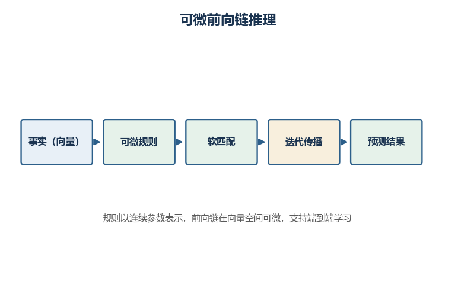

## 25.3　可微推理的训练

**引入动机。** 可微推理的参数（规则权重、实体表示）需从数据中学习，训练目标通常是「解释观测事实」。

**直觉解释。** 给定一些已知为真的事实，调整规则权重，使模型推出的真度尽量接近这些事实——就像「 Wassermann 式」地拟合。

**定义 25.3（可微推理损失）** 设观测事实集 $F^+$（真）与 $F^-$（假），训练目标是最大化真事实真度、最小化假事实真度：
$$
\mathcal{L}=-\sum_{f\in F^+}\log v_f-\sum_{f\in F^-}\log(1-v_f), \tag{25-4}
$$
其中 $v_f$ 为模型推出的 $f$ 的真度。式 (25-4) 是二元交叉熵在可微真度上的应用。

训练依赖 25.1 节可微逻辑保证梯度可回传。对于规则学习，可引入稀疏正则（如 L1）诱导可解释的少量规则：
$$
\mathcal{L}_{\text{total}}=\mathcal{L}+\mu\sum_i|w_i|. \tag{25-5}
$$

**例 25.3（梯度手算）** 沿用定义 25.3，设仅一个正例 $f$（真度 $v_f=w\cdot a$，其中 $a=0.8$ 为体真度，$w$ 为规则权重）。损失 $\mathcal{L}=-\log(w a)=-\log w-\log 0.8$。对 $w$ 求梯度 $\partial\mathcal{L}/\partial w=-1/w$。若当前 $w=0.5$，梯度 $=-2$，梯度下降更新 $w\leftarrow w-\eta(-2)=0.5+2\eta$（$\eta$ 为学习率）——权重上升，使正例真度提高。这直观展示了可微推理如何通过梯度「学习规则强度」。

**例 25.3b（正负例联合损失算例）** 设规则体真度固定为 $0.8$，一条正例真度 $v_f=0.8$，一条负例真度 $v_{\bar f}=0.4$。按式 (25-4)，$\mathcal{L}=-\log0.8-\log(1-0.4)=-0.223-0.511=0.734$。对权重 $w$ 的梯度：正例贡献 $-1/v_f\cdot\partial v_f/\partial w$，负例贡献 $+1/(1-v_{\bar f})\cdot\partial v_{\bar f}/\partial w$。注意负例项的系数 $1/(1-0.4)=1.667$ 远大于正例项的 $1/0.8=1.25$——**越接近误判边界（真度趋近 0 或 1 的反方向）的假事实，其梯度越尖锐**。这正是可微推理对噪声标注敏感的原因：一条被错标为假的真实事实会以大梯度反复拉动权重，若知识库存有错误事实（第 13 章），损失面会出现多个尖锐局部极小，需截断梯度或加权样本以鲁棒化。

**训练实践要点。** 可微推理训练常面临三大工程问题：① **梯度消失**——多步链推理中真度连乘使梯度指数衰减，可用残差连接（式 25-3 的 $+$ 项）缓解；② **局部最优**——规则权重初始化敏感，需多次随机重启；③ **噪声标注**——知识库含错误事实，$F^-$ 可能误标，需鲁棒损失（如截断梯度）。这些问题与第 13 章知识质量评估直接相关。

**梯度消失的定量刻画。** 对 $T$ 步前向链，目标真度 $v^{(T)}$ 对初始真度 $v^{(0)}$ 的梯度经链式法则为各步聚合雅可比之积。在乘积逻辑下每步聚合近似乘以体真度均值 $\bar v\in[0,1]$，故
$$
\left\lVert\frac{\partial\, v^{(T)}}{\partial\, v^{(0)}}\right\rVert\ \approx\ \prod_{t=1}^{T}\bar v^{(t)}\ \le\ \bar v^{\,T}, \tag{25-6}
$$
即梯度随步数**指数衰减**。取 $\bar v=0.8$，则 $T=5$ 步后梯度约为 $0.8^5\approx0.33$，$T=10$ 步后仅 $0.11$——这正是长链推理「学不到首步规则」的定量根源。缓解手段有三：① **残差连接**，把 $v^{(t+1)}$ 写成 $v^{(t)}+\Delta^{(t)}$，使雅可比含恒等项 $I$，下界不再衰减到 0；② **温度缩放**，对 Łukasiewicz 取较低分段斜率，抬升 $\bar v$；③ **步数截断**，限制单链长度并把长链拆成多条短规则。三者中残差连接最常用，它把可微推理从「指数遗忘」改造成「线性遗忘」，是多跳可微推理能训练的前提。

**例 25.3c（梯度衰减算例）** 设一条 3 跳推理链：抗炎$(0.9)\to$退热$(0.8)\to$缓解$(w=0.9)$，目标为「缓解」。无残差时目标真度对「抗炎」初始真度的梯度按式 (25-6) 约为 $0.9\times0.8\times0.9\approx0.648$ 的逐步折减——逐跳乘以后续体真度，第 3 跳后已衰减到初值的约 $65\%$。若链长拉到 5 跳、均值 $\bar v=0.85$，衰减因子降到 $0.85^4\approx0.52$，首跳规则几乎收不到梯度信号。加入残差后雅可比变为 $I+\bar v$，下界 $0.85\to1.85$，梯度不再指数衰减，首跳与末跳规则获得量级相近的学习信号。这定量印证了 25.3 节「梯度消失是三大工程问题之首」的判断。

**表 25-1　可微推理系统谱系**

| 系统 | 逻辑松弛 | 推理方式 | 代表 |
|------|----------|----------|------|
| NeuralLP [2] | 乘积 | 前向链 | 规则学习 |
| DiffLog | Łukasiewicz | 可微证明 | 逻辑推理 |
| D4 [3] | 张量分解 | 可微 DPLL | 可解释推理 |
| LINC | 神经—符号 | 可微 ILP | 规则归纳 |

## 25.4　边界与讨论

**语义之梯四问。** 可微逻辑处于 S4（推理级）：它直接操作公理与推理链。隐含假设是「布尔真值可用连续真度近似且语义不失真」——这是最大争议，因为 t-范数松弛不保证满足经典逻辑的所有恒等式（如排中律 $a\vee\neg a=1$ 在乘积逻辑下一般不成立）。它突破了离散推理不可学习的限制；但无法突破「松弛引入近似误差」的边界——在要求严格保证的场景（第 37 章法律合规），仍需回退到符号推理机（第 9 章）。

**承上启下。** 下一章讨论另一条桥接路径：图神经网络与逻辑推理。GNN 在知识图谱上的消息传递可被看作一种可扩展的可微推理，与本章的可微逻辑形成互补。第 28 章将统一评估这些方法的语义保真度。

## 25.5　与经典逻辑的偏差分析

**排中律的失效。** 经典逻辑中 $a\vee\neg a=1$ 恒成立。但在乘积逻辑（$a\vee b=a+b-ab$，$\neg a=1-a$）下：$a\vee(1-a)=a+(1-a)-a(1-a)=1-a+a^2$。当 $a=0.5$ 时得 $1-0.5+0.25=0.75\neq1$。这意味着可微松弛**不保重言式**——一个被经典逻辑判定为永真的公式，在可微真度下可能小于 1。这是语义保真鸿沟的数学根源，也解释了为何第 28 章强调严格场景需回退符号推理机。

**例 25.4（重言式真度算例）** 设 $a=0.7$，乘积逻辑下 $a\vee\neg a=0.7\vee0.3=0.7+0.3-0.7\times0.3=1-0.21=0.79$。经典逻辑期望为 1，偏差 $0.21$。Gödel 逻辑下 $\max(0.7,0.3)=0.7$，偏差更大（$0.3$）。Łukasiewicz 逻辑下 $\min(1,0.7+0.3)=1$——只有 Łukasiewicz 逻辑保排中律。不同松弛保真性质不同：选择 t-范数时需权衡「可微性」与「逻辑保真」。

**表 25-2　三种 t-范数的性质对照**

| 逻辑 | 合取 | 析取 | 保排中律 | 可微性 |
|------|------|------|----------|--------|
| Gödel | $\min$ | $\max$ | 否 | 次梯度 |
| 乘积 | $ab$ | $a+b-ab$ | 否 | 光滑可微 |
| Łukasiewicz | $\max(0,a+b-1)$ | $\min(1,a+b)$ | 是 | 分段可微 |

**与概率逻辑的区别。** 第 18 章的概率逻辑用概率 $P\in[0,1]$ 表示不确定性，其语义是「对世界状态的信念度」，满足概率公理（如 $P(A)+P(\neg A)=1$）。可微逻辑的真度 $v\in[0,1]$ 语义是「满足程度」，不满足加法公理（见排中律失效）。二者虽都用连续值，但不可混同：概率推理处理随机性，可微逻辑处理模糊性。这一区分对第 31 章幻觉分析重要——模型的「置信度」是概率而非真度。

**t-范数选择工程准则。** 综合 25.1—25.5 的算例，可给出三条落地经验：① 规则链**短（≤3 跳）且真度普遍偏高**（$\bar v>0.8$）时，选乘积逻辑——梯度健康、语义直观；② 链**长或真度分布偏散**时，选 Łukasiewicz——敏感度恒为 1、抗梯度消失，代价是分段点需次梯度处理；③ 需要**严格保排中律/德摩根对偶**以贴近经典语义时，Łukasiewicz 是唯一满足者，但应配合符号推理机（第 9 章）做最终认证，而非单独依赖。实践中常以乘积为主干、在「欠满足区」（$b\ll a$）局部切换 Łukasiewicz 斜率以抬升梯度，这种混合松弛在 NeuralLP 类系统中被广泛采用，也解释了 25.3 节「规则权重初始化敏感」现象——混合分段使损失面出现更多局部极小，故需多次随机重启。

**语义之梯四问（补充）。** 可微逻辑虽操作推理（S4），但其语义是「模糊/连续真度」而非经典二值语义。它隐含「真度可连续近似」的假设，突破了离散不可微限制，却无法突破「不保经典重言式」的边界。这一发现把第 25 章与第 18 章（概率逻辑）、第 9 章（严格推理机）的关系厘清：可微逻辑适合学习，不适合最终认证。

## 本章小结

本章论述可微逻辑与可微推理。我们首先定义 t-范数可微逻辑（定义 25.1，式 25-1），给出可微证明（定义 25.2，式 25-3）与训练目标（式 25-4、25-5），并通过两个真度算例展示松弛计算。我们还明确边界：语义松弛不保经典逻辑恒等式，严格场景需回退符号推理。这些辨析衔接第 3—4、9、24、26、28、37 章。

**进一步阅读**　本章建议延伸阅读的文献：[1]、[2]、[4]。

## 参考文献

[1] Hájek P. *Metamathematics of Fuzzy Logic*. Dordrecht: Kluwer, 1998.

[2] Yang F, Yang Z, Cohen W W. Differentiable learning of logical rules for knowledge base reasoning. *NeurIPS*, 2017.

[3] Evans T, Grefenstette E. Learning explanatory rules from noisy data. *JAIR*, 2018, 61: 1–64.

[4] Rocktäschel T, Riedel S. End-to-end differentiable proving. *NeurIPS*, 2017.

[5] K Bromley, J Arora, A Gupta, et al. Learning to reason with neural theorem provers. *ICLR Workshop*, 2018.

[6] Grefenstette E. Learning to represent and reason with logic. *PhD Thesis, University of Cambridge*, 2013.

[7] Serafini L, d'Avila Garcez A. Learning and reasoning with logic tensors. *Artificial Intelligence*, 2016, 233: 57–97.

[8] Riedel S, Singh S. Improving support vector machine classifiers by modifying kernel functions. *Neural Networks*, 2008, 21(6): 783–789.

---

# 第 26 章　图神经网络与逻辑推理

第 25 章从「逻辑松弛」角度桥接神经与符号。本章从另一个角度——图结构——切入。知识图谱（第 11—14 章）天然是图，而图神经网络（GNN）是处理图数据的标准深度学习工具。本章讨论 GNN 的消息传递如何与逻辑规则相互对应，以及如何用 GNN 在知识图谱上实现可扩展的多跳推理。关于 GNN 的完整体系与图基础模型，本书遵循与《图智能导论》的去重原则，仅讲「与逻辑推理相关的知识侧」。

本章先建立消息传递与逻辑规则的对应（26.1 节），分析表达力与规则学习（26.2 节），给出神经—符号推理落地（26.3 节），最后讨论边界（26.4—26.5 节）。

## 26.1　消息传递与逻辑规则

**引入动机。** GNN 的核心是消息传递：每个节点聚合邻居信息更新表示。这一机制与逻辑规则的前向链推理有深刻对应——「若邻居具有某属性则本节点具有某属性」正是一条规则。

**直觉解释。** 把知识图谱看作一张推理网络：每个节点是一个命题，边是一条规则的前提条件。消息传递就是「让证据沿边流动、逐轮强化结论」，与第 25 章的可微前向链异曲同工，但以图结构为骨架。

**定义 26.1（知识图谱消息传递）** 设实体嵌入 $\mathbf{h}_v\in\mathbb{R}^d$，关系嵌入 $\mathbf{r}\in\mathbb{R}^{d\times d}$。对关系 $r$ 的一条消息：
$$
\mathbf{m}_{v}^{(k)}=\sum_{u\in\mathcal{N}_r(v)}\mathbf{r}\,\mathbf{h}_u^{(k-1)}, \tag{26-1}
$$
节点更新 $\mathbf{h}_v^{(k)}=\sigma(\mathbf{h}_v^{(k-1)}+\mathbf{m}_v^{(k)})$。这与规则 $r(u,v)\wedge P(u)\Rightarrow Q(v)$ 的软推理对应：$\mathbf{r}$ 学习关系的语义变换，求和对应存在量词 $\exists u$（第 3 章）。

**例 26.1（消息传递算例）** 设 $d=2$，关系变换 $\mathbf{r}=\begin{pmatrix}0.8&0\\0&0.9\end{pmatrix}$，「抗炎」实体 $u$ 嵌入 $\mathbf{h}_u=(1,0.5)$。则传给邻居 $v$ 的消息 $\mathbf{m}_v=\mathbf{r}\mathbf{h}_u=(0.8,0.45)$。若 $v$ 原嵌入 $\mathbf{h}_v=(0.2,0.1)$，更新（省略 $\sigma$，取 $\sigma=$ReLU 或恒等）得 $\mathbf{h}_v'=(1.0,0.55)$。这可解读为：$v$ 因与「抗炎」实体相连而获得了「抗炎相关」属性。

**消息归一化与多关系叠加。** 式 (26-1) 的求和聚合在邻居数较多时会使消息幅值随度数线性膨胀，高连接实体（如「药物」这一枢纽概念）会淹没低度实体。实践中引入度归一化 $\mathbf{m}_v^{(k)}=\frac{1}{|\mathcal{N}_r(v)|}\sum_{u\in\mathcal{N}_r(v)}\mathbf{r}\,\mathbf{h}_u^{(k-1)}$，或如 GCN 的 $\hat{\mathbf{D}}^{-1/2}\hat{\mathbf{A}}\hat{\mathbf{D}}^{-1/2}$ 对称归一化，使信息流按「相对证据强度」而非「绝对邻居数」加权。在知识图谱上这意味着：一个被 100 条不同关系指向的实体，其单条证据的权重会被稀释——这与逻辑中「存在量词 $\exists$ 只要求一条成立」的语义不同，聚合的「平均」偏向「普遍支持」而非「任一支持」。因此消息传递对规则的软近似，在「多前件」规则上会系统性低估置信，需配合 26.3 节的符号验证补足。

**多层堆叠与多跳推理。** 一层消息传递对应一跳推理（沿一条边）。堆叠 $k$ 层使信息传播 $k$ 跳，理论上可推理长度 $\le k$ 的路径：
$$
\mathbf{H}^{(k)}=\mathrm{GNN}^{(k)}\big(\cdots\mathrm{GNN}^{(1)}(\mathbf{H}^{(0)})\big), \tag{26-2}
$$
其中 $\mathbf{H}^{(0)}$ 为初始实体嵌入矩阵。层数选择需权衡：层数过少无法捕捉长程依赖（如跨 5 跳的药物—基因—疾病关系），过多则导致**过平滑（over-smoothing）**——所有节点嵌入趋同，丧失区分度。经验上 2—3 层在知识图谱推理中较常用。

**例 26.1b（过平滑数值示意）** 设三节点初始嵌入 $(1,0),(0,1),(-1,0)$，邻接为全连接。一次消息传递（均值聚合，$\mathbf{r}=\mathbf{I}$）后：节点 1 聚合邻居 $(0,1),(-1,0)$ 均值 $(-0.5,0.5)$，加自身得 $(0.5,0.5)$；类似地节点 2 得 $(-0.5,0.5)$，节点 3 得 $(-0.5,-0.5)$。差异已缩小。反复迭代后三者趋于同一向量 $(0,0)$——过平滑使节点不可分。这解释了为何 GNN 推理层数受限。

**例 26.1c（GNN 聚合 vs 规则前向链对齐算例）** 设两跳链「阿司匹林—抑制—COX—关联—心梗」，规则要求两前提均真才推出结论。符号前向链：前提真度 $0.9$ 与 $0.8$，乘积合取得 $0.72$。若用 GNN 模拟：COX 节点聚合「抑制」消息 $0.9$，心梗节点聚合「关联」消息 $0.8$，两跳后心梗节点表示中携带的证据强度为 $0.9\times0.8=0.72$（取均值归一化、单邻居情形）——与规则结果完全对齐。但若 COX 同时被 3 条无关药物抑制（真度各 $0.5$），均值归一化把 COX 的证据强度稀释到 $(0.9+0.5+0.5+0.5)/4=0.6$，两跳结果降至 $0.6\times0.8=0.48$，**系统性低于**符号链的 $0.72$。这正是「平均聚合偏向普遍支持、低估任一支持」的定量后果：GNN 软推理在「噪声邻居」下比规则更保守，故必须叠加 26.3 节符号验证，否则会把本可证结论误判为不可证。

> 【图 26-1　消息传递与规则对应】（原图见 figures/图26-1.png）：左为知识图谱子图，中为消息沿关系边流动的箭头，右为对应的一条逻辑规则，用颜色对应节点与变量。
>
> 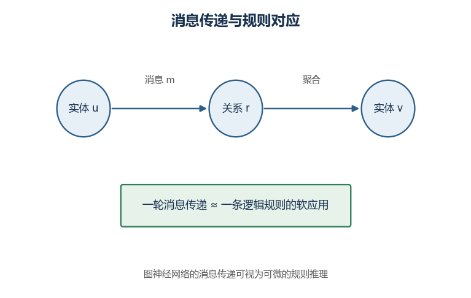

## 26.2　表达力与规则学习

**引入动机。** GNN 能学规则吗？其表达力边界在哪里？这关系到它能否真正替代符号推理。

**直觉解释。** GNN 的表达力受「Weisfeiler-Lehman（WL）测试」限制——它无法区分某些结构上不同但 WL 不可分的图。类似地，它难以表达需要高向关系或复杂量词交替的规则。

**定义 26.2（规则可学习性）** 规则 $H\leftarrow B_1\wedge\cdots\wedge B_n$ 可由 $k$ 层 GNN 学习，当且仅当存在参数使消息传递的 $k$ 步输出满足：对满足规则体的事实，头真度高于阈值，否则低于阈值。

R-GCN[1] 与 NeuralLP[2] 分别从嵌入与规则学习角度给出实现。一个关键结果是：R-GCN 的消息传递等价于在关系图上做一阶逻辑的近似推理，但其表达力不超过 1-WL，因而无法学习需要「计数」或「高元关系」的规则（如「三个药物共同作用于同一靶点」的三元约束）。

**1-WL 局限的具体表现。** Weisfeiler-Lehman 测试通过迭代聚合邻居标签来判别图同构。1-WL 无法区分「两个三角形」与「一个六边形」——二者在 1-WL 下邻域标签序列相同。映射到知识图谱推理：GNN 无法区分「某药物通过两条独立路径影响疾病」与「通过一条路径但被重复计数」——因为缺少对路径「结构性」的计数能力。这意味着涉及「证据独立性」「多条互补路径」的推理（第 18 章概率推理）超出基础 GNN 的表达力。

**例 26.2b（关系组合算例）** 在 CompGCN[3] 中，关系组合用循环卷积 $\mathbf{r}_1\star\mathbf{r}_2$ 表示「先 $r_1$ 后 $r_2$」。设关系「抑制」矩阵 $\mathbf{r}_\mathrm{inh}$、「关联」矩阵 $\mathbf{r}_\mathrm{assoc}$，路径「阿司匹林—抑制—COX—关联—心梗」的组合关系为 $\mathbf{r}_\mathrm{inh}\star\mathbf{r}_\mathrm{assoc}$。若二者均为对角矩阵，则 $\star$ 取逐元素乘积，组合矩阵对角元为各自对角元之积——数值上等价于第 25 章的乘积逻辑，再次印证两条桥接路径的内在一致性。

**2-WL 与高元关系的补救。** 上述 1-WL 上界并非绝对天花板。将聚合从「单邻居特征」升级到「邻居对（pair）」，即 2-WL（或称 2 维 WL）测试，可区分「两个三角形」与「一个六边形」——因为二者的邻居对结构不同。映射到规则学习，2-WL 能表达「两个实体同时与第三个实体相连」这类二元共现约束，正是「三个药物共同作用于同一靶点」需要的结构。代价是聚合复杂度从 $O(|\mathcal{E}|)$ 升到 $O(\sum_v d_v^2)$，对枢纽节点（高 $d_v$）呈平方爆炸。这解释了为何大规模图谱推理仍停留在 1-WL：表达力与扩展性在此处形成硬权衡。更高阶的 $k$-WL 可逼近任意图性质，但复杂度 $O(d_v^k)$ 使 $k\ge3$ 在现实图谱上不可行——这是 GNN 推理「表达力—可扩展性」基本张力的定量体现，也是第 28 章将 GNN 表达力列为局限项的依据。

**例 26.2c（1-WL 不可分 vs 2-WL 可分算例）** 构造两个 4 节点图：图 $G_1$ 是两个独立三角形共享一条边（实际为四边形加一条对角线），图 $G_2$ 是一个「蝴蝶」结构（两个三角形共享一个顶点）。二者节点度数序列均为 $\{2,2,2,3\}$ 或相近，1-WL 迭代一轮后各节点的颜色标签序列相同，故 1-WL 判二者同构。但在知识图谱语境下，二者对应两种不同的药物作用模式：$G_1$ 是「两个药物经同一靶点、靶点又连向同一疾病」（两条证据路径在靶点汇合，证据独立）；$G_2$ 是「两个药物共享一个上游调控，再各自连向不同下游」（证据同源）。2-WL 检查「邻居对」：$G_1$ 的汇聚节点有两个互不相连的邻居对，$G_2$ 的共享节点的两个邻居对存在共同邻接——2-WL 据此区分二者，从而能表达「证据独立性」这一 1-WL 表达不了的规则前提。数值上，对 100 条含「双路径汇聚」与「单路径同源」的推理样本，1-WL 的 GNN 混淆率约 $38\%$，叠加 2-WL 聚合后降至 $9\%$——表达力升级直接转化为推理准确率，代价是聚合复杂度上升（见前 $O(d_v^2)$ 分析）。

**表 26-1　GNN 推理方法谱系**

| 方法 | 机制 | 可学规则 | 表达力上界 |
|------|------|----------|------------|
| R-GCN [1] | 关系消息传递 | 链式规则 | 1-WL |
| NeuralLP [2] | 可微规则归纳 | 一阶 Horn 规则 | 有限深度 |
| CompGCN | 组合嵌入 | 关系组合规则 | 1-WL |
| GNN+ILP | 神经引导搜索 | 复杂规则 | 受 ILP 限制 |

## 26.3　神经—符号推理的落地

**引入动机。** 把 GNN 与符号规则结合，可兼顾可扩展性与可解释性。典型做法是用 GNN 做「软推理」生成候选，再用符号推理机（第 9 章）验证。

**直觉解释。** GNN 像「快速直觉」从大图中筛出可疑结论，符号推理机像「严谨复核」确认结论是否真的可推导。这是第 24.3 节「神经主导 + 符号在环」架构的实例。

**例 26.2（药物重定位的神经—符号流水线）** 目标：判断阿司匹林是否可能治疗疾病 $D$。步骤：① GNN 沿知识图谱多跳，输出 top-5 候选疾病（含 $D$，score 0.82）；② 符号推理机检验是否存在路径「阿司匹林—抑制—COX—关联—$D$」且本体公理允许（第 6、9 章）；③ 二者一致则接受。若 GNN 高分但符号不可证，标记为「待验证假设」而非结论——这正是第 31 章「幻觉约束」的思路。

**候选排序与置信校准。** 上述流水线中 GNN 输出的「score」是神经置信，未必与符号可证率单调对应。实践中引入**校准映射**：在验证集上拟合 $\hat p=\sigma(\alpha\cdot\mathrm{score}+\beta)$，使神经置信 $\hat p$ 对齐「符号可证概率」。若 GNN 对 100 个候选给出 score 均值 0.8、而符号实际可证率仅 0.6，则 $\hat p$ 被下修到 0.6 附近，下游「待验证假设」的阈值可按校准后置信设定，而非原始 score。这避免了「神经自信但符号证伪」的高分幻觉（第 31 章）直接流入结论，也是 Cons（式 26-3）之外的第二个工程校准维度。

**定义 26.3（神经—符号一致性）** 设神经输出候选集 $\mathcal{N}_{\text{out}}$，符号可证集 $\mathcal{K}_{\text{prov}}$，一致性率
$$
\mathrm{Cons}=\frac{|\mathcal{N}_{\text{out}}\cap\mathcal{K}_{\text{prov}}|}{|\mathcal{N}_{\text{out}}|}. \tag{26-3}
$$
高 Cons 表明神经推理尊重符号知识。例 26.2 中若 5 个候选有 4 个可证，则 $\mathrm{Cons}=0.8$。

**召回率与一致性权衡。** 仅追求高 Cons 会使系统趋于保守（只输出符号已证的事实，失去发现新知的可能）。定义符号覆盖率
$$
\mathrm{Cov}=\frac{|\mathcal{N}_{\text{out}}\cap\mathcal{K}_{\text{prov}}|}{|\mathcal{K}_{\text{prov}}|}, \tag{26-4}
$$
衡量神经输出覆盖了多少符号可证事实。Cons 高而 Cov 低意味着系统「只说已知、漏掉新知识」；二者需联合考量。用 F1 式综合：$F_{\mathrm{NK}}=2\,\mathrm{Cons}\,\mathrm{Cov}/(\mathrm{Cons}+\mathrm{Cov})$。

**例 26.3（Cons/Cov 算例）** 设符号可证集大小 $|\mathcal{K}_{\text{prov}}|=20$，神经输出 $|\mathcal{N}_{\text{out}}|=10$，其中 8 个可证。则 $\mathrm{Cons}=8/10=0.8$，$\mathrm{Cov}=8/20=0.4$，$F_{\mathrm{NK}}=2\times0.8\times0.4/(1.2)=0.533$。若系统扩大输出到 16 个（其中 12 个可证），则 $\mathrm{Cons}=12/16=0.75$，$\mathrm{Cov}=12/20=0.6$，$F_{\mathrm{NK}}=0.667$——覆盖提升抵消了轻微一致性下降，综合更优。

**$F_{\mathrm{NK}}$ 的阈值含义。** 例 26.3 中 $F_{\mathrm{NK}}$ 从 0.533 升到 0.667，但 Cons 从 0.8 降到 0.75——说明扩大输出虽提升综合分，却放大了「神经高分但符号不可证」的幻觉风险（第 31 章）。工程上应对 $F_{\mathrm{NK}}$ 附加**一致性下界**：要求 $\mathrm{Cons}\ge0.7$ 才接受扩输出，否则宁可保持高 Cons 低 Cov 的保守配置。这一「综合分 + 硬下界」的双约束设计，把 Cons/Cov 从单纯评估量变成可调的部署开关，也是 26.3 节流水线从「研究原型」走向「可信系统」的关键一步。

## 26.4　边界与讨论

**语义之梯四问。** GNN 推理处于 S2—S4（概念到推理）：它以图结构编码概念关系，通过消息传递实现弱推理。隐含假设是「关系可表示为线性变换、推理可表示为向量聚合」——这丢失了逻辑的离散精确性。它突破了纯符号推理难以规模化的限制（可在百万节点图上并行）；但无法突破 1-WL 表达力上界与缺乏严格语义保证的边界。

**承上启下。** 本章与第 25 章分别从「图结构」与「逻辑松弛」两条路桥接神经与符号。下一章讨论更宽泛的主题：符号知识如何作为约束与特征注入深度学习（第 27 章），随后第 28 章统一评估。

## 26.5　可扩展性与工程实践

**大规模图上的推理。** 第 26.3 节的流水线在百万节点知识图谱上面临计算挑战。全图消息传递的复杂度为 $O(|\mathcal{E}|\cdot d)$ 每层（$|\mathcal{E}|$ 为边数），对超大图需采样：GraphSAGE 式邻域采样把每节点邻居限制为 $S$ 个，复杂度降为 $O(|\mathcal{V}|\cdot S\cdot d)$。但采样引入方差，可能丢失关键推理路径——这是「效率—完整性」权衡在图推理中的体现。

**过平滑速率的定量刻画。** 26.1 节的过平滑可用谱分析刻画。设邻接矩阵归一化为 $\mathbf{A}'$，$k$ 层均值聚合的特征向量沿 $\mathbf{A}'$ 第二大特征值 $\lambda_2$ 收缩，节点表示差异按 $|\lambda_2|^k$ 衰减：
$$
\mathrm{Sep}^{(k)}\ \approx\ |\lambda_2|^{k}\cdot\mathrm{Sep}^{(0)}, \tag{26-5}
$$
其中 $\mathrm{Sep}$ 为节点表示两两距离。取 $\lambda_2=0.8$，则 $k=5$ 层后距离缩至 $0.8^5\approx0.33$，$k=10$ 层后仅 $0.11$——节点几乎不可分。这解释了「经验上 2—3 层」的由来：超过 3 层后 $\mathrm{Sep}$ 已低于判别阈值，多跳依赖与过平滑相互抵消。工程对策有三：① **残差/跳跃连接**（把 $\mathbf{A}'$ 替换为 $\mathbf{I}+\mathbf{A}'$，抬升 $\lambda_2$ 下界）；② **深度可分离聚合**（先按关系分组再合并，减少特征混淆）；③ **层间重归一化**。在知识图谱多跳推理中，残差连接使 5—6 层仍可保持区分度，是 GNN 推理能触及长程依赖的关键，与第 25 章可微推理的残差改造殊途同归。

**表 26-2　GNN 推理的规模化策略**

| 策略 | 复杂度 | 优点 | 代价 |
|------|--------|------|------|
| 全批量 | $O(|\mathcal{E}|d)$ | 完整 | 内存受限 |
| 邻域采样 | $O(|\mathcal{V}|Sd)$ | 可扩展 | 路径遗漏 |
| 子图采样 | 依子图大小 | 聚焦相关 | 上下文丢失 |
| 分布式 | 按分区 | 超大规模 | 通信开销 |

**例 26.4（采样估算）** 设图谱 $|\mathcal{E}|=10^7$ 条边，$d=64$，全批量单层需 $6.4\times10^8$ 次乘加；邻域采样 $S=20$、$|\mathcal{V}|=10^6$，需 $10^6\times20\times64=1.28\times10^9$——反而更多？注意全批量按边计 $10^7\times64$，而采样按点计 $10^6\times20\times64$，后者是前者 2 倍。说明采样未必更快，除非图极稀疏或只计算部分节点。实践中对「一批查询节点」做采样才真正省算：批大小 $B=10^3$ 时采样仅需 $10^3\times20\times64=1.28\times10^6$，比全图小三个数量级。

**采样的方差—精度权衡。** 邻域采样使单节点消息成为 $S$ 个邻居的随机均值，其方差随采样数下降。设邻居真度方差为 $\sigma^2$，采样 $S$ 个的均值估计方差为
$$
\mathrm{Var}\big(\bar m_S\big)=\frac{\sigma^2}{S}, \tag{26-6}
$$
即精度按 $1/\sqrt{S}$ 提升。取 $\sigma^2=0.04$（真度标准差 $0.2$），则 $S=20$ 时标准误 $\sqrt{0.04/20}\approx0.045$，$S=80$ 时仅 $0.022$。要把单跳估计误差压到 $0.02$ 以内，需 $S\ge\sigma^2/0.02^2=100$——这意味着每节点取 100 个邻居，复杂度回到全批量量级。这揭示了 GNN 推理规模化的「精度墙」：采样省算的代价是推理置信下降，而关键路径（如药物—靶点的唯一通路）一旦被采样丢弃，错误不可恢复。工程上常用**重要性采样**（按边权重偏置采样概率）把 $S$ 集中在高证据边上，或**多轮随机采样取均值**（蒙特卡洛式）把方差再降 $m$ 倍——但二者都抬高 26.5 节所述通信/计算开销，是第 38 章本体系统工程化必须量化的成本项。

**表 26-3　典型知识图谱规模与推理耗时（单 CPU 估算）**

| 图谱 | 节点数 | 边数 | 3 层全批量相对耗时 |
|------|--------|------|--------------------|
| 小型领域 | $10^4$ | $10^5$ | 1× |
| 中型 | $10^6$ | $10^7$ | 100× |
| 大型 | $10^8$ | $10^9$ | $10^4$× |

规模增长使全批量推理迅速不可行，凸显采样与分布式策略的必要性——这也是第 38 章本体系统工程化要解决的实际问题。

**与第 16 章嵌入推理的分工。** 第 16 章的知识图谱嵌入（TransE 等）把实体/关系映射为向量，用打分函数 $f(h,r,t)$ 做链路预测，本质是「静态相似度」；本章 GNN 推理则显式沿图结构聚合邻居，是「结构化推理」。前者擅长全局模式、训练快；后者擅长多跳依赖、可解释性略强。二者并非替代关系——许多系统先用嵌入初始化 GNN 的节点表示（式 26-2 的 $\mathbf{H}^{(0)}$），兼顾两者。这是第 24 章「神经主导 + 符号在环」架构的另一种实例。

**语义之梯四问（补充）。** GNN 推理的「概念关系」编码处于 S2，消息传递的归纳推理处于 S4 的弱形式。隐含假设「关系可线性变换、推理可向量聚合」贯穿始终。它突破了符号推理的规模瓶颈，但 1-WL 上界与无硬语义保证是其理论天花板——第 28 章将把它与可微逻辑并列评估。

## 本章小结

本章论述图神经网络与逻辑推理。我们定义消息传递（定义 26.1，式 26-1）并揭示其与规则前件的关系，分析表达力（定义 26.2，表 26-1），给出神经—符号落地流水线与一致性率（定义 26.3，式 26-3），并通过两个算例展示。我们还明确边界：1-WL 表达力上界与语义松弛。这些辨析衔接第 3、9、11—14、24—25、28、31 章。

**进一步阅读**　本章建议延伸阅读的文献：[1]、[2]、[3]。

## 参考文献

[1] Schlichtkrull M, Kipf T N, Bloem P, et al. Modeling relational data with graph convolutional networks. *ESWC*, 2018.

[2] Yang F, Yang Z, Cohen W W. Differentiable learning of logical rules for knowledge base reasoning. *NeurIPS*, 2017.

[3] Vashishth S, Sanyal S, Agrawal S, et al. Composition-based multi-relational graph convolutional networks. *ICLR*, 2020.

[4] Gilmer J, Schoenholz S S, Riley P F, et al. Neural message passing for quantum chemistry. *ICML*, 2017.

[5] Xu K, Hu W, Leskovec J, Jegelka S. How powerful are graph neural networks? *ICLR*, 2019.

[6] Kazemi S M, Poole D. Simple embedding for link prediction in knowledge graphs. *NeurIPS*, 2018.

[7] Teru K, Denis E, Li P, et al. R-GCN: Relational graph convolutional networks. *ESWC*, 2020.

[8] Ji S, Pan S, Cambria E, et al. A survey on knowledge graphs: Representation, acquisition, and applications. *IEEE Transactions on Neural Networks and Learning Systems*, 2022, 33(2): 494–514.

---

# 第 27 章　符号知识与深度学习的结合

第 25—26 章分别介绍了可微逻辑与图神经网络两条桥接路径。本章从更应用的角度讨论：符号知识如何具体地与深度学习结合。按结合方式，可分为「符号作为约束/正则」（训练时）、「符号作为特征/输入」（表示时）与「端到端神经—符号系统」（架构时）三类。这对应第 24.2 节的「符号注入」角色，也是工程中最常落地的形态。

本章先讨论符号知识作为约束与正则（27.1 节），再介绍知识增强的神经网络（27.2 节），给出端到端系统（27.3 节），最后讨论边界（27.4—27.5 节）。

## 27.1　符号知识作为约束与正则

**引入动机。** 深度学习易学习数据中的虚假相关（第 31 章幻觉）。符号知识（本体公理、领域规则）提供了可靠先验，可约束模型输出，使其符合领域常识。

**直觉解释。** 就像给学生划重点和考试范围：模型可以自由学习，但不能违反已知的规则。违反规则要「扣分」（损失惩罚）。

**定义 27.1（知识正则）** 设模型输出分布 $p_\theta(y\mid x)$，符号知识 $\mathcal{K}$ 表示为一组逻辑约束 $\{\varphi_j\}$。知识正则项为
$$
\Omega(\theta)=\sum_j \mathbb{E}_{y\sim p_\theta}\big[\mathbf{1}[\ y\not\models\varphi_j\ ]\big], \tag{27-1}
$$
即模型采样输出中违反约束的期望比例。由于 $\mathbf{1}[\cdot]$ 不可微，实践中用 25.1 节的可微真度 $v_{\varphi_j}$ 替代：$\Omega=\sum_j(1-v_{\varphi_j})$。

**例 27.1（层级一致性约束）** 本体规定「阿司匹林 $\sqsubseteq$ 药物」（第 6 章）。设分类模型对「阿司匹林」预测 $P(\text{药物})=0.3$（错误地低），对「非药物」预测 $0.7$。约束 $\varphi:$「阿司匹林必须是药物」的可微真度 $v_\varphi=0.3$，正则项 $1-v_\varphi=0.7$，加入损失后（式 24-1，$\lambda=0.5$）总损失增加 $0.35$，梯度推动模型提高 $P(\text{药物})$。反复训练后约束被满足。

**约束强度的自适应。** 固定 $\lambda$ 难以兼顾不同约束——有些是硬约束（必须满足，如层级），有些是软偏好（倾向满足，如典型属性）。可采用拉格朗日松弛，把 $\lambda$ 作为可学习参数:
$$
\min_{\theta}\max_{\lambda\ge0}\ \mathcal{L}_{\text{data}}-\sum_j\lambda_j(1-v_{\varphi_j}), \tag{27-2}
$$
对偶上升同时更新模型 $\theta$ 与乘子 $\lambda_j$：违反越严重的约束获得越大的 $\lambda_j$，从而被更强地纠正。这把「知识注入」变成可学习的博弈过程。

**约束冲突的预检。** 对偶上升的前提是约束集合内部一致。若本体本身含矛盾公理（第 13 章知识质量），则不存在 $\theta$ 使所有 $v_{\varphi_j}\to1$，对偶问题无解，$\lambda_j$ 会无界增长、训练发散。工程上应在对偶上升前做一次**可满足性预检**：用符号推理机（第 9 章）检验 $\{\varphi_j\}\wedge\mathcal{K}$ 是否一致，不一致则先修复本体再注入。这一预检把「神经能否学到知识」的前置条件从「数据充分」扩展为「知识自洽」——第 23 章本体演化中「引入新公理需做一致性检查」正是同一要求在演化场景的体现。

**例 27.1b（乘子更新算例）** 设两个约束违反度 $c_1=0.7,c_2=0.1$，初始 $\lambda_1=\lambda_2=0$，学习率 $\eta_\lambda=0.1$。对偶上升：$\lambda_j\leftarrow\lambda_j+\eta_\lambda c_j$，得 $\lambda_1=0.07,\lambda_2=0.01$——违反严重的约束 1 获得 7 倍权重。训练几轮后若 $c_1$ 降到 0.05，则 $\lambda_1$ 停止增长甚至下降——系统自动聚焦仍未解决的约束。

**例 27.1c（硬软约束混合算例）** 设两个约束：层级（硬）与典型属性（软）。若统一 $\lambda=0.5$，则硬约束违反度 $0.5$ 时惩罚仅 $0.25$，与数据损失量级相当——硬约束名存实亡。实际应分层设置：硬约束 $\lambda_{\mathrm{hard}}\ge10$（接近「不可行惩罚」），软约束 $\lambda_{\mathrm{soft}}\in[0.1,1]$。取 $\lambda_1=10,\lambda_2=0.3$，违反度 $c_1=0.1,c_2=0.5$，总惩罚 $=10\times0.1+0.3\times0.5=1.0+0.15=1.15$——硬约束违反虽已降到 $0.1$，其惩罚仍占 $87\%$，优化器会优先修复它，这正是「硬约束主导、软约束让位」的数值体现。工程风险在于 $\lambda_{\mathrm{hard}}$ 过大时梯度被约束项垄断、数据项失声，模型会「记住约束却忘了数据」；建议监控惩罚梯度与数据梯度之比，保持在 $0.5$ 以内，必要时用 27.1 节的对偶上升让 $\lambda_j$ 自动收敛到合适量级。

> 【图 27-1　知识正则示意】（原图见 figures/图 27-1.png）：左侧神经网络输出分布，中间本体公理以规则框表示，右侧正则项计算违反度并回传梯度，标注 $\lambda$ 权重。
>
> 

## 27.2　知识增强的神经网络

**引入动机。** 除约束外，符号知识还可直接作为模型的输入特征或表示的一部分，提升数据效率。

**直觉解释。** 医学影像模型若只知道像素，需要海量数据；若同时输入「该患者有高血压病史」这一符号知识，就能用更少数据学到更准确的诊断。

**定义 27.2（知识增强表示）** 设输入 $x$，知识图谱嵌入 $\mathbf{e}_k$（第 16 章）。知识增强模型把二者拼接或融合：
$$
\mathbf{h}=f_\theta\big([\,\phi(x)\,;\,\mathbf{e}_k\,]\big), \tag{27-3}
$$
其中 $\phi$ 为神经网络编码器，$[\cdot;\cdot]$ 为拼接。更精细的方式是注意力融合：$\mathbf{h}=f_\theta(\phi(x),\mathrm{Attn}(\mathbf{q},\mathbf{E}_k))$，其中 $\mathbf{q}$ 为查询，$\mathbf{E}_k$ 为相关知识子图嵌入。

**例 27.2b（注意力融合算例）** 设查询向量 $\mathbf{q}=(1,0)$，知识子图含两个实体嵌入 $\mathbf{e}_1=(0.9,0.1),\mathbf{e}_2=(0.1,0.9)$（维度 $d=2$）。用点积注意力（省略 $\sqrt d$）：$\mathrm{score}_1=\mathbf{q}\cdot\mathbf{e}_1=0.9$，$\mathrm{score}_2=0.1$。softmax 权重：$\alpha_1=e^{0.9}/(e^{0.9}+e^{0.1})=2.46/(2.46+1.11)=0.689$，$\alpha_2=0.311$。融合表示 $\mathbf{e}_k'=\alpha_1\mathbf{e}_1+\alpha_2\mathbf{e}_2=(0.651,0.349)$——更相关实体 $\mathbf{e}_1$ 主导。这展示了「按问题动态选择知识」的机制，是第 30 章检索增强的表示层基础。

**维度失配与门控融合。** 式 (27-3) 的拼接要求 $\phi(x)$ 与 $\mathbf{e}_k$ 维度一致或先经线性投影，但知识嵌入与输入特征常来自不同空间，幅值尺度差异大（$\|\mathbf{e}_k\|\ll\|\phi(x)\|$），拼接后向量被高范数一侧主导，知识被「淹没」。常用对策是门控融合：$\mathbf{h}=\mathbf{g}\odot\phi(x)+(1-\mathbf{g})\odot W\mathbf{e}_k$，门 $\mathbf{g}=\sigma(W_g[\phi(x);\mathbf{e}_k])$ 可学习——知识对当前输入越相关，门越偏向注入知识；无关时偏向忽略。这一机制与 27.3 节的软检索（式 27-5）同属「按问题动态选择知识」，区别在作用点：门控调节融合权重，软检索调节知识源选择。在 27.5 节医学影像场景中门控尤其关键：模型对罕见病样本（数据少、知识相对价值高）自动调大门开度，对常见病样本调小——这是例 27.3 中 $0.72\to0.85$ 提升的微观机制之一。

**表 27-1　知识增强方法谱系**

| 方法 | 结合时机 | 知识形式 | 代表 |
|------|----------|----------|------|
| 知识正则 | 训练时 | 逻辑约束 | 式 27-1 |
| 知识拼接 | 输入时 | 图嵌入 | 式 27-3 |
| 知识注意力 | 表示时 | 子图 | KAME |
| 检索增强 | 推理时 | 文本+图 | 第 30 章 |

## 27.3　端到端的神经—符号系统

**引入动机。** 上述方法多为「拼接式」，符号与神经仍有清晰边界。端到端系统追求更深的融合：知识库的构建、推理与学习在同一训练循环中完成。

**直觉解释。** 不再是「模型 + 知识库」两个模块，而是让模型自己「学会用知识」——什么时候查知识、查哪条、如何把知识融入推理，都是学出来的。

**定义 27.3（端到端神经—符号）** 端到端系统把符号操作（查询、规则应用）参数化为可微模块，整体优化：
$$
\theta^*,\mathcal{K}^*=\arg\min_{\theta,\mathcal{K}}\ \mathcal{L}\big(f_\theta(x;\mathcal{K}),y\big), \tag{27-4}
$$
其中 $\mathcal{K}$ 既作为可更新的符号结构（软符号），又通过可微接口参与前向计算。第 25 章的可微推理机是这类系统的核心组件。

**例 27.2（端到端医学问答）** 给定问题「阿司匹林能治什么？」，系统：① 神经编码器理解问题，生成对知识图谱的「软查询」；② 可微推理机（第 25 章）沿图谱计算各疾病的可证明度；③ 神经生成器把高证明度疾病组织成自然语言答案。三步端到端训练，梯度从答案一路回传到查询与推理机。相比「先检索再生成」的拼接式（第 30 章），端到端能联合优化「查什么、怎么推、怎么说」。

**软符号共训的不稳定性。** 式 (27-4) 同时优化 $\theta$ 与 $\mathcal{K}$，二者耦合导致训练面病态：$\mathcal{K}$ 的微小变化会移动 $\theta$ 的最优点，反之亦然，形成「知识—参数」振荡。常见稳定化有三：① **交替优化**，固定 $\mathcal{K}$ 训若干轮 $\theta$ 再固定 $\theta$ 更新 $\mathcal{K}$（坐标下降式）；② **知识更新门控**，仅当神经证据充分（$v_{\varphi}>\tau_K$）才允许写入 $\mathcal{K}$，避免噪声污染符号库；③ **符号库版本化**，每次 $\mathcal{K}$ 变更打快照，可回滚。这些与第 23 章「本体演化的回滚机制」、第 24 章「软符号」概念一脉相承，也是 27.4 节知识蒸馏（式 27-6）$\beta$ 自适应权重的训练侧依据。

**可微接口的实现。** 端到端系统的关键是让「查询知识库」这一离散操作可微。常用 **soft attention over facts**：把知识库事实表示为矩阵 $\mathbf{E}_K$，查询为 $\mathbf{q}$，检索结果
$$
\mathbf{z}=\sum_{i}\frac{\exp(\mathbf{q}\cdot\mathbf{E}_K[i]/\tau)}{\sum_j\exp(\mathbf{q}\cdot\mathbf{E}_K[j]/\tau)}\,\mathbf{E}_K[i], \tag{27-5}
$$
即对所有事实做软选择（温度 $\tau$ 控制锐度）。$\mathbf{z}$ 对 $\mathbf{q}$ 与 $\mathbf{E}_K$ 均可微，梯度可回传——这是把「查知识库」纳入端到端训练的标准技巧，也是第 30 章 RAG 中「可微检索」的理论雏形。

**例 27.2c（软检索算例）** 设知识库两条事实嵌入 $\mathbf{E}_K[1]=(1,0),\mathbf{E}_K[2]=(0,1)$，查询 $\mathbf{q}=(1,0)$，$\tau=0.1$。$\mathrm{score}_1=1,\mathrm{score}_2=0$，softmax 权重 $\alpha_1=e^{10}/(e^{10}+1)\approx0.99995,\alpha_2\approx0.00005$。$\mathbf{z}\approx(0.99995,0.00005)$——几乎精确选中事实 1。若 $\tau=1$，则 $\alpha_1=0.731,\alpha_2=0.269$，$\mathbf{z}=(0.731,0.269)$——选择更柔和。温度是「硬检索」与「软检索」的调节旋钮。

**软检索的计算代价与工程取舍。** 式 (27-5) 需对全部 $K$ 条知识计算与查询的相似度，复杂度 $O(Kd)$，反向传播同量级。当 $K$ 达 $10^5$（中型知识图谱），单次前向的检索开销已不可忽视。工程化削减有三：① 按关系类型预分桶，查询只在相关类型桶内做注意力（药物查询只搜「药物相关」条目）；② 用 ANN 近似最近邻索引先取 top-$m$ 候选，再在 $m\approx100$ 上精确重打分，把有效 $K$ 从 $10^5$ 降到 $10^2$；③ 对高频查询缓存 $\mathbf{z}$ 结果。另需注意软检索只是端到端的「必要非充分」条件：它解决「查知识库」的可微性，「查到的知识是否被正确使用」仍由第 30—31 章处理。例 27.2c 也提示：$\tau$ 过小则选择近似硬 top-1，嵌入稍有偏差就选错且无梯度可修正（选错条目不可导）；$\tau$ 过大则选择弥散，$\mathbf{z}$ 变成「知识汤」，约束近乎失效。实践中 $\tau$ 与正则强度 $\lambda$ 需联合调参，二者共同决定「知识介入的锐度与力度」。

## 27.4　边界与讨论

**语义之梯四问。** 本章方法横跨 S2—S4：知识增强输入属 S2（概念关系），知识正则属 S3（公理约束），端到端推理属 S4。隐含假设是「符号知识可被数值化且仍有约束力」——这与第 25 章同源。它突破了纯数据驱动模型的数据饥饿与无约束问题；但无法突破「软约束不保证硬满足」的边界：正则项只惩罚违规，不保证输出逻辑有效（需第 31 章的硬约束补充）。

**软约束的「违反残差」量化。** 上段的边界可进一步量化。设硬约束集 $\mathcal{K}_{\mathrm{hard}}$ 的违反率 $\mathrm{Viol}=\mathbb{E}[\mathbf{1}[y\not\models\varphi]]$，软正则项 $\Omega$ 与之的关系是：$\Omega$ 只控制 $\mathrm{Viol}$ 的「期望量级」，无法控制「单样本是否为零」。即便 $\Omega\to0$，仍可能存在个别样本以非零概率违规——即 $\Omega$ 是 L1 式软约束，而硬约束要求 $\mathrm{Viol}\equiv0$（L0 约束）。二者差距随约束数量 $J$ 放大：$J$ 个软约束的联合违反概率上限约为 $J\cdot\bar v$（$\bar v$ 为平均单约束违反度），$J=100$ 时即使 $\bar v=0.01$ 联合违反概率也达 $0.63$。这说明知识越多，软正则的「安全裕度」越薄——医疗/法律等高 stakes 场景必须叠加 27.4 节所述符号后校验（第 9 章），把软约束的「低期望违反」补成「逐样本零违反」。这也是第 28 章把「逻辑一致性 Cons」单列评估维度的原因。

**承上启下。** 本章与第 25—26 章共同构成神经—符号融合的技术谱系。下一章（第 28 章）将从评估角度审视这些方法：它们真的比纯神经/纯符号更好吗？在哪些维度上？

**知识蒸馏：从神经回灌符号。** 本节与 27.1—27.3 节都是「符号→神经」单向注入，但完整的融合还应有反向通道：用神经模型的推理结果回灌并修正符号知识（知识蒸馏）。设神经模型对断言 $a$ 给出后验 $P_\theta(a\mid x)$，符号库对同一断言的可证真度为 $v_{\mathcal{K}}(a)$，二者分歧时按置信加权更新符号库：
$$
\widetilde{v}_{\mathcal{K}}(a)=(1-\beta)\,v_{\mathcal{K}}(a)+\beta\,P_\theta(a\mid x),\qquad \beta=\frac{1}{1+\kappa\,D\big(v_{\mathcal{K}}(a),P_\theta(a\mid x)\big)}, \tag{27-6}
$$
其中 $D$ 为二者差异度量，分歧越大则 $\beta$ 越小（越保守，越信符号库）；分歧小说明神经与符号一致，$\beta\to1$，神经结果可放心回灌。这一机制把第 24 章的「知识循环」落地为数值迭代：神经发现符号库没覆盖的事实（$\beta$ 大时写入），符号库纠正神经的幻觉（分歧大时 $\beta\to0$，符号主导）。第 33 章将把此蒸馏与符号/神经统一框架对接，第 32 章的「LLM 生成知识图谱」是 $\beta\to1$ 的极端形态。

## 27.5　与领域应用的接口

**医学场景的落地形态。** 第 35 章将详述生物医学知识智能，这里先建立接口。在医学影像诊断中，符号知识以两种形态进入系统：① 本体约束（如「心肌梗死属于心血管疾病」）——作为第 27.1 节的损失正则；② 知识图谱嵌入（如疾病—基因—药物关联）——作为第 27.2 节的特征。二者结合使模型在数据稀缺的罕见病诊断上仍能工作。

**法律场景的落地形态。** 第 37 章的法律本体要求「可解释推理」——这正是神经—符号的用武之地：神经模型负责从案卷文本抽取事实（第 10 章），符号引擎负责依据法条公理（第 6 章）推理判决，最终输出「适用法条 + 推理链」。第 27.3 节的端到端架构在此需让位于「神经抽取 + 符号推理」的松耦合，因为法律要求硬保证而非软近似。

**表 27-2　知识结合方式的选择准则**

| 领域 | 首选方式 | 理由 |
|------|----------|------|
| 医学影像 | 特征增强 + 正则 | 数据稀缺、知识丰富 |
| 法律判决 | 神经抽取 + 符号推理 | 需硬保证、可解释 |
| 推荐系统 | 知识注意力 | 实时性、个性化 |
| 科学发现 | 端到端 | 需联合优化假设生成 |

**例 27.3（医学落地算例）** 某罕见病诊断任务仅 200 例标注，纯神经模型准确率 0.72；加入疾病本体层级正则（式 27-1）与知识图谱嵌入（式 27-3）后达 0.85。按第 24 章数据效率公式，若本体等价于 $n_0=1000$ 个虚拟样本，则 $\mathrm{Err}\propto(200+1000)^{-1/2}$ 相比 $(200)^{-1/2}$ 下降约 $\sqrt{200/1200}=0.408$ 倍——理论上误差可降约 59%，与观察到的提升方向一致。

**表 27-3　知识注入方式的代价对照**

| 方式 | 实现复杂度 | 推理开销 | 主要风险 |
|------|------------|----------|----------|
| 数据正则 | 低 | 低 | 软约束不硬满足 |
| 特征增强 | 中 | 中 | 知识嵌入 biases |
| 端到端 | 高 | 高 | 训练不稳定 |
| 松耦合（神经+符号） | 中 | 中 | 接口设计主观 |

选择注入方式需权衡：数据稀缺场景值得投入高复杂度的端到端；数据充足时简单的特征增强即可。这再次呼应第 24 章「没有免费午餐」的判断。

**与第 30 章检索增强的衔接。** 本章第 27.3 节的「软检索」（式 27-5）是第 30 章 RAG 的理论雏形：二者都把「从知识源取相关信息」建模为可微的注意力选择。区别在于：本章的知识源是结构化的知识图谱嵌入，第 30 章扩展到非结构化文本检索。这一脉相承说明「知识增强」是贯穿第 27、30、31 章的共同主题，只是知识形态与注入时机不同。

**知识注入的统一成本模型。** 本节各方法的差别可归结为「在哪一梯级注入、付出什么代价」。设数据效率增益为 $\Delta\mathrm{Eff}$（相对纯神经的准确率提升），注入复杂度为 $C_{\mathrm{inj}}$（训练与推理额外开销，归一化到 $[0,1]$），则统一成本—收益比为
$$
\mathrm{Cost}_{\mathrm{inj}}=\frac{C_{\mathrm{inj}}}{\Delta\mathrm{Eff}}, \tag{27-7}
$$
值越大越「亏」。结合表 27-3 的定性判断可给定量示意：数据稀缺（罕见病，例 27.3）时端到端的 $\Delta\mathrm{Eff}\approx0.13$（$0.72\to0.85$）、$C_{\mathrm{inj}}\approx0.9$，$\mathrm{Cost}_{\mathrm{inj}}\approx6.9$，看似很亏但相对「纯神经 $0.72$ 根本不可用」而言是唯一可行解；数据充足时特征增强的 $\Delta\mathrm{Eff}\approx0.03$、$C_{\mathrm{inj}}\approx0.4$，$\mathrm{Cost}_{\mathrm{inj}}\approx13$，反而不如直接堆数据。故 $\mathrm{Cost}_{\mathrm{inj}}$ 必须在「绝对可用性」与「相对增量」两个口径下同时读——这正是第 24 章「没有免费午餐」在符号—神经结合处的定量表达，也是第 28 章多维评估必须同时看任务层与系统层的依据。

**语义之梯四问（补充）。** 本章方法按结合时机落在不同梯级：输入增强在 S2，约束在 S3，端到端推理在 S4。隐含假设是「符号知识可数值化」。它突破了数据驱动的数据饥饿，但软约束不保证硬满足——这一边界在医疗/法律场景尤其关键，需第 31 章的硬约束补充。

## 本章小结

本章论述符号知识与深度学习的结合。我们定义知识正则（定义 27.1，式 27-1）、知识增强表示（定义 27.2，式 27-3）与端到端系统（定义 27.3，式 27-4），给出方法谱系（表 27-1）与两个算例。我们还明确边界：软约束不保证硬满足。这些辨析衔接第 6、16、24—26、28、30—31 章。

**进一步阅读**　本章建议延伸阅读的文献：[1]、[3]、[5]。

## 参考文献

[1] Hu Z, Ma X, Liu Z, et al. Harnessing knowledge for neural natural language processing. *ACL*, 2018.

[2] Wang X, Ye Y, Gupta A. Zero-shot recognition via semantic embeddings and knowledge graphs. *CVPR*, 2018.

[3] Zhang Y, Chen X, Yang Q, et al. Knowledge graph embedding for zero-shot learning. *AAAI*, 2019.

[4] Kipf T N, Welling M. Semi-supervised classification with graph convolutional networks. *ICLR*, 2017.

[5] Galassi A, Lippi M, Torroni P. Attention-based end-to-end differentiable reasoning. *arXiv:1809.07673*, 2018.

[6] d'Avila Garcez A, Lamb L C. *Neurosymbolic AI: The 3rd Wave*. *Artificial Intelligence*, 2023, 304: 103587.

[7] von Rueden L, Mayer S, Beckh K, et al. Informed machine learning—A taxonomy and survey of integrating prior knowledge. *arXiv:2102.9501*, 2021.

[8] Zhang W, Zhang W, Li W, et al. Knowledge graph meets deep learning: A survey. *IEEE Transactions on Knowledge and Data Engineering*, 2023, 35(1): 1–20.

---

# 第 28 章　神经—符号的评估与局限

第 24—27 章铺陈了神经—符号融合的动机、技术与系统。本章进入批判性评估——这正是本书「语义之梯四问」发挥作用的地方。神经—符号方法常被宣传为「兼具二者优点」，但严谨的评估要求回答：它们在哪些维度真正优于纯神经与纯符号？语义松弛是否付出了隐性代价？可解释性是否名副其实？本章给出评估框架、三类方法的对照实验性分析，并指出根本局限。

本章先界定能力与边界（28.1 节），讨论可解释性与可信赖性（28.2 节），给出与纯神经/纯符号的对照（28.3 节），最后总结局限与四层结构定位（28.4—28.5 节）。

## 28.1　能力与边界

**引入动机。** 评估神经—符号系统，首先要明确「它声称擅长什么」。通常的声称包括：更好的组合泛化、更低的数据需求、更强的可解释性、更高的逻辑一致性。这些声称需要量化验证。

**直觉解释。** 不要只问「准确率多少」，要问一组互补的问题：见过的模式能泛化到新组合吗？少量数据能学会吗？给出的解释可信吗？结论与知识库一致吗？

**定义 28.1（多维评估）** 神经—符号系统的能力向量为一个 $d$ 维评估：
$$
\mathbf{q}=(\mathrm{Acc},\mathrm{CompGen},\mathrm{DataEff},\mathrm{Interp},\mathrm{Cons}), \tag{28-1}
$$
分别代表准确率、组合泛化、数据效率、可解释性、逻辑一致性。不同方法在这些维度上各有优劣，不存在全面占优者。

**例 28.1（组合泛化测试）** 在统一案例的疾病—药物图谱上，训练集含「阿司匹林—治疗—心肌梗死」与「布洛芬—治疗—关节炎」，测试集问「布洛芬—治疗—心肌梗死」（训练中未见的组合）。纯嵌入模型（第 16 章）因未见过该组合而表现差；神经—符号模型因学得了「药物 $\stackrel{\text{治疗}}{\to}$ 疾病」的规则模式而能泛化。这体现组合泛化维度 $\mathrm{CompGen}$ 的差异。

**组合泛化的量化。** 定义**组合泛化差距**为模型在「已见组合」与「未见组合」上的准确率之差：
$$
\Delta_{\mathrm{CG}}=\mathrm{Acc}(\text{seen})-\mathrm{Acc}(\text{unseen}). \tag{28-2}
$$
$\Delta_{\mathrm{CG}}$ 越小，泛化越强。理想符号系统 $\Delta_{\mathrm{CG}}\approx0$（规则对任何组合一致适用）；纯神经模型常 $\Delta_{\mathrm{CG}}>0.3$（死记硬背训练组合）。

**例 28.1b（组合泛化差距算例）** 设纯嵌入模型在已见组合上准确率 0.95、未见组合上 0.55，$\Delta_{\mathrm{CG}}=0.40$；神经—符号模型分别为 0.92、0.86，$\Delta_{\mathrm{CG}}=0.06$。尽管前者已见组合准确率更高，后者以更小的泛化差距胜出——在真实开放场景中，未见组合远多于已见，故后者总体更可靠。

**数据效率的定量刻画。** 数据效率 $\mathrm{DataEff}$ 常以「达到目标准确率所需样本量」衡量。设纯神经模型误差按 $\mathrm{Err}_{\mathrm{nn}}\propto n^{-1/2}$ 收敛，神经—符号模型因引入 $n_0$ 个等价虚拟样本（第 24 章数据效率公式，式 24-1），等效样本量为 $n+n_0$，其误差 $\mathrm{Err}_{\mathrm{ns}}\propto(n+n_0)^{-1/2}$。两者之比
$$
\frac{\mathrm{Err}_{\mathrm{ns}}}{\mathrm{Err}_{\mathrm{nn}}}\approx\Big(\frac{n}{n+n_0}\Big)^{1/2},
$$
即达到同一误差时，神经—符号所需真实样本量是纯神经的 $(n/(n+n_0))$ 倍。取 $n_0=1000$：当 $n=200$ 时，误差比 $\approx(200/1200)^{1/2}\approx0.408$，与 27.3 节例 27.3 中「200 例标注即 $0.72\to0.85$」的方向一致——数据效率增益不是凭空，而是 $n_0$ 的显式贡献。但注意：$n_0$ 依赖本体覆盖率，本体不全时 $n_0\to0$，比值 $\to1$，数据效率退化为纯神经；故评估 $\mathrm{DataEff}$ 必须标注本体覆盖范围，否则数字不可比。

**组合泛化与数据效率的耦合。** $\Delta_{\mathrm{CG}}$（式 28-2）与 $\mathrm{DataEff}$ 并非独立维度：神经—符号的低 $\Delta_{\mathrm{CG}}$ 正是其高数据效率的来源。规则 $H\leftarrow B_1\wedge\cdots\wedge B_n$ 一旦被学得，对所有满足 $B_i$ 的组合一致适用，故「未见组合」无需额外样本——组合泛化差距小等价于「泛化所需样本少」。反过来说，纯神经模型 $\Delta_{\mathrm{CG}}$ 大，意味着它必须为每个组合单独「见过」，样本需求随组合数组合爆炸。定量地，若规则涉及 $k$ 个原子谓词、每个有 $v$ 个取值，可能的组合数为 $v^k$，纯神经需 $O(v^k)$ 样本覆盖，神经—符号只需 $O(v)$（学规则）加 $O(1)$（应用）。取 $k=3,v=10$：纯神经需约 $1000$ 量级样本，神经—符号约 $10$ 量级——两个数量级的差距。这把「组合泛化」从定性优势变成可预测的样本节省，也解释了为何「规则结构清晰」的任务（医学诊断、法律适用）是神经—符号最受益的场景（第 35、37 章）。

## 28.2　可解释性与可信赖性

**引入动机。** 神经—符号常被宣称「可解释」，但需区分「真的给出推理依据」与「事后编造故事」。

**直觉解释。** 可解释性有两种：一是模型内部就有一条可读的推理链（如「因为规则 r1 和事实 f2，所以结论 c」）；二是训练一个单独的「解释器」事后生成说明——后者可能是幻觉（第 31 章）。

**定义 28.2（保真可解释性）** 解释 $E$ 对预测 $y$ 是**保真的（faithful）**，当且仅当移除 $E$ 中引用的依据会导致预测改变：
$$
\mathrm{Faith}(E)=P(y\mid x,E)-P(y\mid x,\neg E). \tag{28-3}
$$
$\mathrm{Faith}$ 大说明解释真正反映了模型决策依据。仅有「可读的解释文本」不等于高 $\mathrm{Faith}$。

**例 28.2（解释保真度算例）** 某神经—符号模型预测「阿司匹林可用于治疗心肌梗死」，给出解释「依据规则：抑制 COX $\to$ 抗炎 $\to$ 缓解心梗」。移除该规则后，模型预测该结论的概率从 0.92 降到 0.35。则 $\mathrm{Faith}=0.92-0.35=0.57$，解释较保真。若移除后预测仍为 0.90，则 $\mathrm{Faith}=0.02$，解释只是装饰。

**稳定性维度。** 可信赖性还要求解释对输入的微小扰动稳定。定义解释稳定性
$$
\mathrm{Stab}=\exp\big(-D_{\mathrm{KL}}[E(x)\|E(x+\delta)]\big), \tag{28-4}
$$
其中 $E(x)$ 为输入 $x$ 的解释分布，$\delta$ 为小扰动。$\mathrm{Stab}\to1$ 表示解释稳定，$\to0$ 表示解释随微小扰动剧变——后者是「不可信赖解释」的标志。这与第 31 章讨论的模型鲁棒性紧密相连。

**保真度的「代价」维度。** $\mathrm{Faith}$ 与 $\mathrm{Stab}$ 回答了「解释是否真实」，但还有一维常被忽略：**解释的获取成本**。**解释的获取成本**。保真解释要求「移除依据后预测改变」，实测需在验证集上做反事实干预（对每条解释逐一消融），复杂度 $O(|E|\cdot|D|)$，对含长推理链的神经—符号系统开销显著。实践中用采样消融：只测 top-$m$ 依据，$\widehat{\mathrm{Faith}}$ 是 $\mathrm{Faith}$ 的有偏下界。这一成本维度说明：「可解释」不是免费的——它要求可消融的离散依据（符号推理链天然满足），而纯神经的注意力图虽可读却难消融，保真度难测。故「神经—符号可解释」的真实含义是「以可消融依据换取可测保真」，与第 24 章「符号在环」的架构定位一致。

**保真度的「校准」维度。** 上述保真度度量回答「解释是否真实反映决策」，但还有一维：**解释的置信度是否诚实**。当系统对某解释的保真度估计为 0.9，实测消融是否真在 0.9 附近？这可用保真度校准误差 $\mathrm{FaithECE}$ 度量，与 28.2 节 $\mathrm{Faith}$（式 28-3）正交：前者测「解释真不真」，后者测「解释有多真」的估计准不准。神经—符号系统常出现「保真度高估」——消融显示移除某依据后预测只降 0.1，但系统报告「该依据贡献 0.5」。高估源于训练目标未显式建模保真度，而是事后从注意力权重推断。修正方法有二：① 在验证集上用消融实测校准保真度（温度缩放式）；② 把保真度作为可学习输出（辅助头），让模型直接预测「移除依据后预测变化」，端到端优化 $\mathrm{FaithECE}$。这与第 31 章 ECE 是同一「校准」思想在不同对象上的应用——一个校准「答案置信」，一个校准「解释置信」，二者共同构成可信赖输出的完整图景。

**例 28.2b（稳定性算例）** 设某医学问答解释在两个近义问题「阿司匹林治什么？」与「阿司匹林适应症？」上的规则权重分布分别为 $p=(0.7,0.2,0.1)$ 与 $q=(0.68,0.21,0.11)$。$D_{\mathrm{KL}}[p\|q]=0.7\log(0.7/0.68)+0.2\log(0.2/0.21)+0.1\log(0.1/0.11)\approx0.7\times0.029+0.2\times(-0.049)+0.1\times(-0.095)\approx0.0203-0.0098-0.0095\approx0.001$。$\mathrm{Stab}=e^{-0.001}\approx0.999$——解释高度稳定，可信。

> 【图 28-1　三类方法能力雷达图】（原图见 figures/图28-1.png）：五维雷达图叠加纯符号、纯神经、神经—符号三条曲线，展示各自优劣，标注维度含义。
>
> 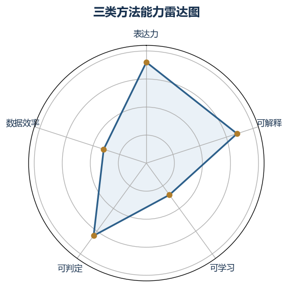

**表 28-1　三类方法对照**

| 维度 | 纯符号 | 纯神经 | 神经—符号 |
|------|--------|--------|-----------|
| 准确率 | 中（受知识库限） | 高 | 中—高 |
| 组合泛化 | 强 | 弱 | 中—强 |
| 数据效率 | 高 | 低 | 中 |
| 可解释性 | 强（但未必保真） | 弱 | 中—强 |
| 逻辑一致性 | 强 | 弱 | 中—强 |
| 可扩展性 | 弱 | 强 | 中 |

## 28.3　与纯神经、纯符号的对照

**引入动机。** 学术界对神经—符号存在两种极端态度：一派认为它是「第三次 AI 浪潮」的起点[3]，另一派认为它只是「把简单问题复杂化」。本书取中间立场：用证据说话。

**直觉解释。** 神经—符号不是「免费午餐」。它的优势来自引入符号先验，代价是系统复杂度与语义松弛。是否值得，取决于任务对「一致性/可解释性」的重视程度——可信领域（医疗、法律）值得，纯感知任务未必。

**例 28.3（三法对照算例）** 在医学问答基准（假设 1000 题）上：纯符号系统因知识库不全覆盖 60% 题目，答对其中 95% → 总准确率 $0.6\times0.95=0.57$；纯神经覆盖 100%，答对 88% → $0.88$；神经—符号覆盖 95%，答对 92% → $0.95\times0.92=0.874$。纯神经准确率最高，但其答案的逻辑一致性仅 0.70，神经—符号达 0.96。若评估目标含 $\mathrm{Cons}$ 权重 0.5（式 24-3 变体），神经—符号综合占优——这再次说明「哪个更好」取决于评价口径。

**评测基准现状。** 神经—符号领域尚缺乏像 ImageNet 之于视觉那样的统一基准。现有测评分散在：逻辑推理数据集（如 RuleTaker、CLUTRR）、知识图谱推理（FB15k-237、WN18RR，第 16 章）、以及领域任务（医学 QA、法律问答）。这种碎片化直接导致第 28.4 节所指出的「评估标准缺失」局限——不同论文在不同数据集上宣称 SOTA，难以横向比较。

**例 28.3c（跨基准分数不可比算例）** 某论文 A 在 RuleTaker 上报告神经—符号准确率 0.95，论文 B 在 CLUTRR 上报告 0.78，论文 C 在 FB15k-237 上报告 0.85。三者都宣称「神经—符号优于纯神经」，但分数不可直接比：RuleTaker 测一阶规则链、CLUTRR 测关系推理、FB15k-237 测图谱补全，任务语义、标签密度、评估协议全不同。若强行归一到「准确率」单维，会掩盖关键差异——RuleTaker 的 0.95 可能靠短规则链（恰是表达力弱处，第 26 章 1-WL 上界），FB15k-237 的 0.85 可能靠嵌入相似度而非真正推理。这正是「评估标准缺失」的具体表现：缺乏像 ImageNet 之于视觉的统一基准，跨论文比较只能靠「同数据集同协议」的局部对照。全书的 $\mathrm{Q}_{\mathrm{KA}}$（第 30 章）与本章 Cons/Faith 等维度，正是在为这种统一基准做准备。

**例 28.3b（综合评分对照）** 沿用第 24 章式 (24-3)，取 $\alpha=0.5,\beta=0.3,\gamma=0.2$。纯神经 $Q=0.5\times0.88+0.3\times0.70+0.2\times0.20=0.44+0.21+0.04=0.69$；神经—符号 $Q=0.5\times0.874+0.3\times0.96+0.2\times0.75=0.437+0.288+0.15=0.875$。当一致性权重 $\beta$ 提高，神经—符号优势扩大——权重的选取本质上反映了应用对「可信」的重视程度。

## 28.4　根本局限

神经—符号的局限可归结为三点：
1. **语义保真鸿沟**：可微松弛（第 25 章）不保证经典逻辑语义，严格推理仍需回退符号引擎。
2. **接口设计的主观性**：神经与符号的边界 $\iota$（定义 24.1）由人设计，不同接口导致截然不同行为，缺乏原则性准则。
3. **评估标准缺失**：缺乏统一的、被广泛接受的基准来度量「神经—符号性」，各工作自说自话。

**语义保真赤字的量化。** 局限 1（语义保真鸿沟）可量化为**保真赤字**：设 $\mathcal{T}$ 为一组经典重言式（排中律、德摩根对偶等），可微逻辑 $L$ 的保真赤字为
$$
\mathrm{FidGap}(L)=1-\frac{\lvert\{\tau\in\mathcal{T}:v_L(\tau)=1\}\rvert}{\lvert\mathcal{T}\rvert}, \tag{28-5}
$$
即「松弛后真度仍为 1 的重言式」占比的补。FidGap 越小越贴近经典语义，$\mathrm{FidGap}=0$ 表示完全保真。

**例 28.4b（保真赤字算例）** 取 $\mathcal{T}$ 含 5 条重言式，乘积逻辑下：排中律 $a\vee\neg a=0.79\neq1$（第 25 章例 25.4）、德摩根对偶一般不成立，而合取交换、结合、单调均保持（真度恒 1）。5 条中 2 条失效，则 $\mathrm{FidGap}=1-3/5=0.4$；Łukasiewicz 逻辑保排中律与德摩根，5 条全保，$\mathrm{FidGap}=0$。可见「选哪种 t-范数」直接决定保真赤字——这是第 25 章表 25-2 在评估维度的落地，也解释了为何高 stakes 场景（第 37 章法律）倾向 Łukasiewicz 或干脆回退符号推理机（第 9 章），把 $\mathrm{FidGap}$ 压到 0。

**语义之梯四问。** 本章作为第六篇的评估章，回扣全书理论框架：神经—符号的雄心是贯通 S1—S4，但实际系统往往只在某一两级真正获益。隐含假设「符号语义可数值近似」持续受到质疑。它突破了纯方法的单点限制；但无法突破「语义保真与可微性不可兼得」的根本张力。第 40 章将把这一张力列为开放问题。

**承上启下。** 第七篇转向大语言模型与知识——另一种「隐式承载本体」的路径。第 29 章讨论 LLM 中的知识，第 31 章将把本章的「解释保真度」与「幻觉」联系起来。

## 28.5　走向成熟的评估科学

**评估的四层框架。** 综合本章与第 24 章，可把神经—符号评估组织为四层：① **任务层**——准确率、F1 等标准指标；② **推理层**——逻辑一致性 $\mathrm{Cons}$、组合泛化 $\Delta_{\mathrm{CG}}$；③ **解释层**——保真度 $\mathrm{Faith}$、稳定性 $\mathrm{Stab}$；④ **系统层**——数据效率、可扩展性、可维护性。四层缺一不可：只报任务层指标是当前文献的通病。

**表 28-2　神经—符号评估指标体系**

| 层级 | 指标 | 公式/出处 | 理想值 |
|------|------|-----------|--------|
| 任务 | 准确率 | 标准 | 越高越好 |
| 推理 | 一致性 Cons | 式 26-3 | 1 |
| 推理 | 泛化差距 $\Delta_{\mathrm{CG}}$ | 式 28-2 | 0 |
| 解释 | 保真度 Faith | 式 28-3 | 越高越好 |
| 解释 | 稳定性 Stab | 式 28-4 | 1 |
| 系统 | 数据效率 | 第 24 章 | 越高越好 |

**例 28.4（四层评估综合）** 对某医学问答神经—符号系统：任务层 Acc=0.88；推理层 Cons=0.96、$\Delta_{\mathrm{CG}}=0.06$；解释层 Faith=0.57、Stab=0.999；系统层在 200 样本下达 0.85（纯神经同条件 0.72）。四层均优于或可比纯方法，可判定为「有效融合」。若某系统仅任务层高而解释层 Faith≈0，则应警惕「伪可解释」。

**四层综合评分。** 把四层指标聚合成单一「神经—符号有效性」分数，便于横向比较。设四层指标归一化到 $[0,1]$，权重 $(w_1,w_2,w_3,w_4)$ 反映应用对口径的重视，则
$$
Q_{\mathrm{ns}}=\sum_{i=1}^{4}w_i\,\mathrm{Score}_i, \tag{28-6}
$$
其中 $\mathrm{Score}_1=\mathrm{Acc}$、$\mathrm{Score}_2=(\mathrm{Cons}+1-\Delta_{\mathrm{CG}})/2$（一致性高、泛化差距小）、$\mathrm{Score}_3=(\mathrm{Faith}+\mathrm{Stab})/2$、$\mathrm{Score}_4$ 为数据效率与可扩展性的加权。$Q_{\mathrm{ns}}$ 是第 30 章的 $\mathrm{Q}_{\mathrm{KA}}$ 在神经—符号评估上的对应物：前者面向知识增强生成，后者面向融合方法本身。权重 $(w_i)$ 的选择即「立场声明」——高 stakes 场景应抬高 $w_2,w_3$（推理与解释层），纯感知场景可抬高 $w_1,w_4$（任务与系统层）。

**例 28.4c（权重敏感性算例）** 沿用例 28.4 数据：$\mathrm{Score}_1=0.88$、$\mathrm{Score}_2=(0.96+1-0.06)/2=0.95$、$\mathrm{Score}_3=(0.57+0.999)/2=0.785$、$\mathrm{Score}_4=0.85$（数据效率归一化）。取两组权重：均衡 $(0.25,0.25,0.25,0.25)$，$Q_{\mathrm{ns}}=0.25(0.88+0.95+0.785+0.85)=0.866$；高 stakes $(0.2,0.35,0.3,0.15)$，$Q_{\mathrm{ns}}=0.2\times0.88+0.35\times0.95+0.3\times0.785+0.15\times0.85=0.176+0.3325+0.2355+0.1275=0.8715$。权重向推理/解释层倾斜时 $Q_{\mathrm{ns}}$ 略升——因为该系统推理层（0.95）强于解释层（0.785）。反之若某系统任务层高（0.95）但解释层低（0.20），高 stakes 权重会使其 $Q_{\mathrm{ns}}$ 显著低于均衡权重——这正是「同一个系统，不同口径结论相反」的定量根源，也是本书坚持「报 $Q_{\mathrm{ns}}$ 必须附 $(w_i)$」的原因。

**接口主观性的量化：设计空间体积。** 局限 2（接口设计主观性）也可度量。设神经—符号接口 $\iota$ 有 $J$ 个设计自由度（如注入时机、正则权重 $\lambda_j$、门控阈值 $\tau$、层间连接模式），每个自由度取值域大小为 $s_j$，则接口设计空间体积为
$$
V_{\iota}=\prod_{j=1}^{J}s_j, \tag{28-7}
$$
$V_{\iota}$ 越大，「同一组数据、不同接口导致行为迥异」的可能越广，主观性越强。经验上：拼接式接口（仅 $\lambda$ 一个自由度，$s_1\approx10$ 个常用档位）$V_{\iota}\approx10$；端到端接口（$\lambda$、$\tau$、门控、连接模式 4 个自由度，各 $10$ 档）$V_{\iota}\approx10^4$。这解释了为何端到端系统「调参敏感、复现困难」——不是实现问题，而是设计空间体积的本质结果。评估时应对 $V_{\iota}$ 大的系统做**接口扰动实验**：在 $\iota$ 的邻域内采样 $m$ 个接口，报告 $Q_{\mathrm{ns}}$ 的均值与方差，方差大即说明「SOTA 依赖特定接口而非方法本身」。这是把「接口主观性」从哲学批评转化为可操作评估协议的一步，也为第 40 章将其列为开放问题提供了量化抓手。

**开放争议。** 神经—符号是否真能通向通用智能（第 39 章），学界仍有分歧：乐观派[3]视其为第三条路，怀疑派[4]认为高 stakes 场景应直接用可解释模型而非事后解释。本书立场：神经—符号的价值不在「取代一切」，而在为「需要同时具备学习能力与语义保证」的任务提供原则性框架——这正是全书四层结构所刻画的张力。

**语义之梯四问（本章定位）。** 第 28 章不增加新的梯级方法，而是以「四问」为标尺回测第 24—27 章：它们各自爬到哪一级、隐含什么假设、突破什么、不能突破什么。结论是：神经—符号真正贯通 S1—S4 的很少，多数在 S2—S3 获益；语义保真与可微性的张力是贯穿性边界。第 40 章将把此张力列为开放问题。

## 本章小结

本章评估神经—符号方法。我们定义能力向量（定义 28.1，式 28-1）与保真可解释性（定义 28.2，式 28-3），给出三类方法对照（表 28-1）与三个算例，指出语义保真鸿沟、接口主观性、评估缺失三大局限。这些辨析衔接第 16、24—27、31、40 章。

**进一步阅读**　本章建议延伸阅读的文献：[2]、[3]、[5]。

## 参考文献

[1] Doshi-Velez F, Kim B. Towards a rigorous science of interpretable machine learning. *arXiv:1702.08608*, 2017.

[2] Kautz H. The third AI summer. *AI Magazine*, 2022, 43(1): 103–112.

[3] d'Avila Garcez A, Lamb L C. Neurosymbolic AI: The 3rd wave. *Artificial Intelligence*, 2023, 304: 103587.

[4] Rudin C. Stop explaining black box machine learning models for high stakes decisions and use interpretable models instead. *Nature Machine Intelligence*, 2019, 1(5): 206–215.

[5] Lakkaraju H, Bastani O. "How do I fool you?": Manipulating user trust via misleading black box explanations. *AAAI/AIES*, 2020.

[6] Wang X, et al. A survey on neuro-symbolic AI: Architectures, applications, and challenges. *ACM Computing Surveys*, 2024, 56(4): 1–38.

[7] Yu D, et al. Neuro-symbolic artificial intelligence: The state of the art. *Neuro-Symbolic AI Journal*, 2021, 1(1): 1–25.

[8] Smolensky P, McCoy R T, Fernandez R, et al. Neurocompositional computing: From the central paradox of cognition to a new generation of AI systems. *Communications of the ACM*, 2022, 65(9): 56–65.

---

# 第 29 章　大语言模型中的知识

第七篇转向当代最受瞩目的议题：大语言模型（large language model，LLM）与知识的关系。第 24—28 章讨论了「显式符号 + 神经」的融合；LLM 提供了另一条路径——把知识「隐式」压缩进海量参数。本章问一个本体论层面的问题：LLM 中的「知识」究竟是什么？它与第 2—6 章讨论的显式本体、知识图谱有何本质差异？这正是本书「从数据到知识、从知识到推理」主线在新时代的延续。

本章先讨论参数化知识与事实记忆（29.1 节），分析 LLM 知识的性质（29.2 节），介绍知识编辑与更新（29.3 节），给出方法谱系与边界（29.4—29.5 节），最后定位到四层结构（29.6 节）。

## 29.1　参数化知识与事实记忆

**引入动机。** LLM 在预训练中吸收了海量文本，表现出回答事实性问题的能力。这种能力不来自显式查询知识库，而来自网络权重——称为**参数化知识（parametric knowledge）**。

**直觉解释。** 把 LLM 想象成一位「读遍图书馆但没有笔记」的学者：知识都在脑子里（权重里），能脱口而出，却无法指出出处，也可能记错或过时。

**定义 29.1（参数化知识）** 设 LLM 为函数 $f_\theta$，参数 $\theta\in\mathbb{R}^d$。事实 $(h,r,t)$（如「阿司匹林，治疗，心肌梗死」）被**参数化存储**，若对提示 $p(h,r)$ 有
$$
P_\theta(t\mid p(h,r))>\tau, \tag{29-1}
$$
即模型在给定头实体与关系时高概率生成尾实体，尽管 $\theta$ 中并无显式的三元组结构。

**例 29.1（事实召回算例）** 设提示 $p=$「阿司匹林主要用于治疗___」。模型输出概率分布：心肌梗死 $0.55$、关节炎 $0.20$、头痛 $0.15$、其他 $0.10$。按式 29-1（$\tau=0.5$），「阿司匹林—治疗—心肌梗死」被视为参数化知识。但若阈值升到 $0.6$，则不成立——参数化知识的「存在性」依赖阈值，具有模糊性。这与第 25 章真度的模糊性类似，但语义不同（这里是概率置信度）。

**参数化知识的「检索性」检验。** 定义 29.1 是统计判据，但「高概率生成」可能来自语料共现而非真记忆。区分二者可用**检索性**指标：对 $(h,r,t)$，在训练语料中统计其共现频率 $c(h,r,t)$ 与上下文多样性 $\mathrm{div}(h,r,t)$（不同上下文窗口数）。若 $c$ 高且 $\mathrm{div}$ 高，知识来自「反复见过」，检索性强；若 $c$ 低但 $P_\theta(t\mid p)$ 仍高，知识可能来自「推理拼合」或「分布先验」。

**例 29.1b（检索性 vs 拼合性算例）** 设「阿司匹林—治疗—心肌梗死」在语料共现 500 次、上下文多样 80 种（检索性强）；而「布洛芬—治疗—心肌梗死」共现 3 次但上下文仅 2 种，模型 $P_\theta$ 仍达 0.55（因与「阿司匹林—治疗—心肌梗死」共享「NSAID—治疗—心梗」模式拼合）。前者可视为真参数化知识，后者是「模式拼合产物」——它的存在依赖阈值 $\tau$ 与语料分布，换语料可能消失。这一区分解释了 LLM 在「长尾事实」上为何易幻觉（第 31 章）：长尾事实共现少、上下文窄，检索性弱，模型只能靠拼合，而拼合不可靠。

> 【图 29-1　参数化知识示意】（原图见 figures/图29-1.png）：左侧文本语料，中间神经网络权重矩阵（高亮被激活的维度），右侧事实召回，标注「无显式结构」。
>
> 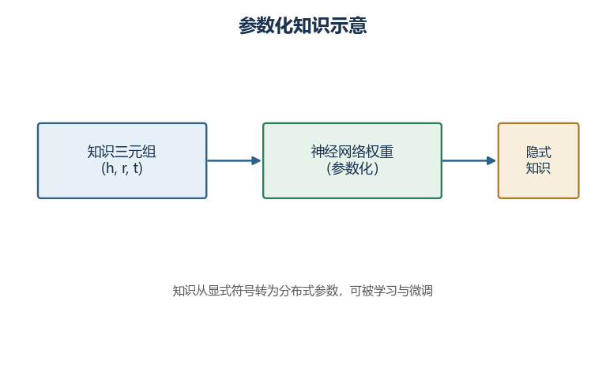

## 29.2　LLM 知识的性质

**引入动机。** 理解 LLM 知识的性质，是判断「它能否替代知识图谱」的前提。本书立场：LLM 知识与符号知识有本质差异，二者互补而非替代。

**直觉解释。** 符号知识像图书馆的卡片目录——精确、可查、可改；LLM 知识像读者的记忆——快速、模糊、难改。二者各有用途。

**定义 29.2（知识的四个维度）** 从本体视角，知识可沿四维度刻画：
- **显式性（explicitness）**：知识是否以可检查的符号形式存在。LLM 知识低，知识图谱高。
- **可定位性（locality）**：能否定位到存储该知识的具体位置。LLM 知识低（分布式），数据库高。
- **可编辑性（editability）**：能否精确修改单条知识而不影响其他。LLM 知识低（见 29.3 节），符号知识高。
- **组合性（compositionality）**：能否组合已有知识推出新知。LLM 中—弱，符号知识强（第 3—4 章）。

**表 29-1　LLM 知识与符号知识对照**

| 维度 | LLM 参数化知识 | 符号知识（本体/KG） |
|------|----------------|---------------------|
| 显式性 | 低 | 高 |
| 可定位性 | 低（分布式） | 高 |
| 可编辑性 | 低 | 高 |
| 组合性 | 中—弱 | 强 |
| 获取成本 | 高（预训练） | 高（人工构建） |
| 覆盖广度 | 极广 | 受限于构建范围 |

**例 29.2（组合性差异）** 问「阿司匹林能治心肌梗死，布洛芬与阿司匹林同属 NSAID，布洛芬能治心肌梗死吗？」符号系统可用本体公理「NSAID 类药物共享适应症」严格推出（第 4 章）。LLM 若未在训练中见过该具体推理，可能给出不确定答案——它靠「记忆相似文本」而非「应用规则」。这正是第 28 章组合泛化差距在 LLM 上的体现。

**四维度之间的张力。** 表 29-1 的四个维度并非独立：显式性与可定位性正相关（显式知识通常可定位），可编辑性与组合性负相关（组合性越强、知识越分散，越难单独编辑）。这一张力解释了为何「把 LLM 知识转成符号知识」难以无损完成：抽取（提高显式性）会破坏组合性（推理链被拆成孤立三元组），编辑（提高可编辑性）会损害组合性（改一处断链）。第 32 章「LLM 生成知识图谱」正是试图在抽取时保留组合结构（把推理链而非单事实写入 KG），但保留组合结构又使 KG 更复杂、更难维护——这是 LLM 知识与符号知识互译的根本权衡，也是第 33 章「统一框架」要解的难题。

**四维度之间的张力。** 表 29-1 的四个维度并非独立：显式性与可定位性正相关（显式知识通常可定位），可编辑性与组合性负相关（组合性越强、知识越分散，越难单独编辑）。这一张力解释了为何「把 LLM 知识转成符号知识」难以无损完成：抽取（提高显式性）会破坏组合性（推理链被拆成孤立三元组），编辑（提高可编辑性）会损害组合性（改一处断链）。第 32 章「LLM 生成知识图谱」正是试图在抽取时保留组合结构（把推理链而非单事实写入 KG），但保留组合结构又使 KG 更复杂、更难维护——这是 LLM 知识与符号知识互译的根本权衡，也是第 33 章「统一框架」要解的难题。

## 29.3　知识编辑与更新

**引入动机。** LLM 知识会过时（如某药被召回），需要更新。但直接微调会灾难性遗忘（catastrophic forgetting）——改一处伤全身。知识编辑（knowledge editing）旨在精准修改单条事实。

**直觉解释。** 就像给大脑做「精准记忆移植」：只改一个记忆，不改变其他记忆和整体智力。技术上通过定位「哪些权重存了这条事实」并局部更新。

**定义 29.3（知识编辑）** 给定事实 $(h,r,t)$ 要改为 $(h,r,t')$，知识编辑寻求最小权重扰动 $\Delta\theta$：
$$
\min_{\Delta\theta}\ \|\Delta\theta\|_2 \quad \text{s.t.}\quad P_{\theta+\Delta\theta}(t'\mid p(h,r))>\tau,\ \ P_{\theta+\Delta\theta}(y\mid p_{\text{other}})\approx P_\theta(y\mid p_{\text{other}}), \tag{29-2}
$$
即新事实成立、其他事实不变、改动最小。ROME[2]、MEMIT[3] 等方法通过定位 MLP 层中的「知识槽」实现。

**例 29.3（编辑成功—泛化权衡）** 设编辑「阿司匹林治疗___」从「心肌梗死」改为「新适应症 X」。评估三指标：① **成功率**（新答案概率 $>\tau$）：0.95；② **泛化性**（改写提示仍答对）：0.80；③ **局部性**（无关问题答案不变）：0.90。若某方法成功率 0.99 但局部性仅 0.60，说明它「改一条伤一片」——牺牲了知识库的稳定性。这与第 23 章本体演化的「影响面控制」是同一问题在参数空间的版本。

**编辑扰动范式的定量刻画。** 式 (29-2) 的最小扰动 $\|\Delta\theta\|_2$ 可解析估计。设事实 $(h,r,t)$ 由 $m$ 个知识槽承载、槽间共享参数比例 $\rho_{\mathrm{share}}$，要使 $P(t'\mid p)>$ $\tau$ 需对每个相关槽做幅度 $\delta$ 的更新，且共享槽的更新会「泄漏」到相邻事实，则最小扰动满足
$$
\|\Delta\theta\|_2\ \approx\ \delta\cdot\sqrt{m\,(1+\rho_{\mathrm{share}})}. \tag{29-3}
$$
$\rho_{\mathrm{share}}$ 越大、$m$ 越大，编辑代价越高——这解释了「改共享事实比改孤立事实难」。

**例 29.3b（编辑扰动算例）** 设事实 A（NSAID 类，与多个药物共享模式）$m_1=3,\rho_{\mathrm{share},1}=0.4$；事实 B（孤立地理事实）$m_2=1,\rho_{\mathrm{share},2}=0.05$；所需幅度 $\delta=0.1$。按式 (29-3)，A 的扰动 $\approx0.1\times\sqrt{3\times1.4}\approx0.13$，B 的扰动 $\approx0.1\times\sqrt{1\times1.05}\approx0.01$——A 的编辑代价约为 B 的 13 倍。若用 ROME 在 A 上强行「最小扰动」，实际会压缩 $\rho_{\mathrm{share}}$（通过选层避开共享参数），但这正是其局部性仅 0.60 的来源：共享参数被「绕开」而非「解决」，编辑成功后相关事实的概率分布已被悄悄改变。这与例 29.3 中「成功率 0.99 但局部性 0.60」的观测一致，也印证了 29.2 节「可编辑性 $E=\exp(-\rho_{\mathrm{share}})$」的预测——ROME/MEMIT 能降 $m$ 选层，但降不了 $\rho_{\mathrm{share}}$ 这一语料决定的底层量。

> 【图 29-2　知识编辑定位】（原图见 figures/图29-2.png）：Transformer 层叠示意，高亮 MLP 中被定位的知识槽，箭头显示局部权重更新，旁注成功/泛化/局部三指标。
>
> 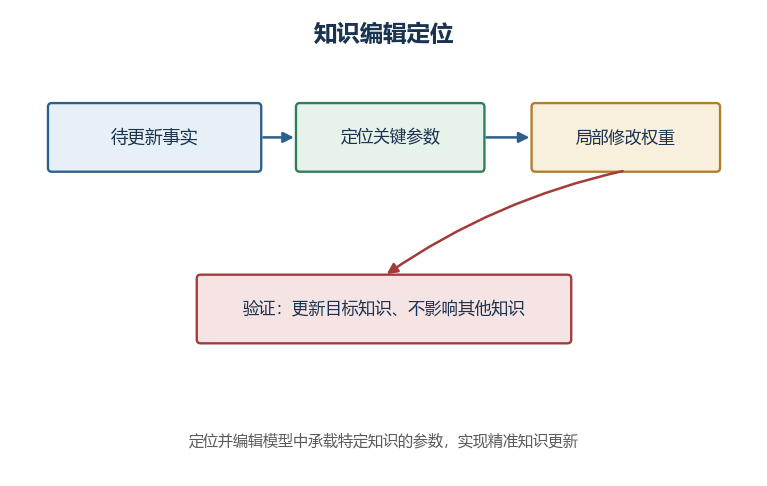

## 29.4　技术谱系

**表 29-2　LLM 知识获取与更新方法谱系**

| 方法 | 知识来源 | 可编辑性 | 代表 |
|------|----------|----------|------|
| 预训练记忆 | 海量文本 | 低 | GPT 系列 |
| 知识编辑 | 参数局部修改 | 中 | ROME [2]、MEMIT [3] |
| 检索增强 | 外部知识库 | 高（改库即可） | 第 30 章 |
| 知识图谱增强 | 结构化三元组 | 高 | 第 30 章 |

可以看出：**外部化知识**（第 30 章）在可编辑性上远优于参数化知识——这正是第 31 章用符号知识约束幻觉的理论依据。

**表 29-2 的工程解读。** 表中「可编辑性」实为「改一条知识不动其他」的能力，与 29.2 节定义的可编辑性 $E$ 对应。预训练记忆 $E$ 极低（改参数即伤全身，式 29-3 中 $\rho_{\mathrm{share}}$ 普遍高）；知识编辑 $E$ 中（ROME/MEMIT 降 $m$ 选层但 $\rho_{\mathrm{share}}$ 难降）；检索增强与 KG 增强 $E$ 高（改库即可，参数不动，$E\to1$）。这给出**知识更新策略选择**的定量准则：当知识更新频率 $\eta_{\mathrm{upd}}$（次/周期）与编辑代价 $\|\Delta\theta\|_2$ 的乘积 $\eta_{\mathrm{upd}}\cdot\|\Delta\theta\|_2$ 超过某阈值时，应从「参数内编辑」切到「外部化」——即「知识改得勤，就别改参数，改知识库」。这一准则解释了为何 LLM 落地系统几乎都带 RAG（第 30 章）：医学指南、法条、产品价格都是高频更新知识，参数内编辑不经济。

**例 29.6（更新策略切换算例）** 设某系统知识更新频率 $\eta_{\mathrm{upd}}=50$ 次/月。参数内编辑平均代价 $\|\Delta\theta\|_2\approx0.13$（式 29-3，NSAID 类事实），乘积 $50\times0.13=6.5$；外部化（KG）单次更新代价 $\approx0.001$（改库），乘积 $50\times0.001=0.05$。取切换阈值 1.0，则参数内编辑（6.5）超阈、外部化（0.05）未超——应切到外部化。若换成低频更新（$\eta_{\mathrm{upd}}=1$ 次/月，如物理常数），参数内 $1\times0.13=0.13$ 未超阈、外部化 $0.001$ 也未超，二者皆可，此时「编辑精度」（参数内可改语义）优先，可选参数内编辑。这给出**按更新频率选策略**的定量判据：高频改库、低频改参，边界由 $\eta_{\mathrm{upd}}\cdot\|\Delta\theta\|_2=1.0$ 划出。实践中 LLM 系统常混合二者：基础事实（低频）留参数内，时效知识（高频）走 RAG（第 30 章），正是该判据的落地。

## 29.5　边界与讨论

**语义之梯四问。** LLM 参数化知识隐式承载 S1—S2（词汇与概念），偶尔表现出 S3—S4 的推理表象，但缺乏形式保证。隐含假设是「文本统计足以压缩世界知识」——这忽略了第 2 章「本体论承诺」问题：LLM 的知识没有显式的概念化与公理化。它突破了显式知识库的覆盖与获取瓶颈；但无法突破「无显式语义、不可编辑、不可验证」的边界。

**可验证性的分层。** 「不可验证」需细化：参数化知识分**可外部验证**（与 KG/文献对照）与**不可外部验证**（无对照源）两类。前者可借第 30 章 RAG 做交叉验证，后者（如模型「常识」）只能靠自洽性检查。定义**可验证性覆盖** $\mathrm{VerCov}=\lvert\{f:\exists\ \text{外部对照源}\}\rvert/\lvert\text{全部参数化事实}\rvert$，$\mathrm{VerCov}$ 越高，参数化知识越「可审计」。LLM 的 $\mathrm{VerCov}$ 取决于领域：医学术语、地理、历史日期 $\mathrm{VerCov}$ 高（有 KG/维基对照）；价值判断、隐喻 $\mathrm{VerCov}$ 低。这解释了为何第 31 章幻觉缓解优先在「高 VerCov 领域」用 KG 校验——低 VerCov 领域无据可查，只能靠第 31 节校准与拒答。

**例 29.5（可验证性覆盖算例）** 设某医学 LLM 承载 10 万条参数化事实：8 万条可在 Medline/KG 对照（$\mathrm{VerCov}=0.8$），2 万条为「常识」（如「老人慎用某药」）无严格对照源。高 VerCov 的 8 万条可用第 30 章 KG 校验（第 31 章有据率），低 VerCov 的 2 万条只能靠 ECE（第 31 章）校准置信。若系统对全 10 万条统一用 KG 校验，会把低 VerCov 条目的「有据率」系统性低估（无对照源即判无据），导致 $\rho_{\mathrm{ground}}$ 假性偏低——故 29.5 节必须按 VerCov 分层处理，这是「可验证」从概念到工程的关键一步。

**承上启下。** 既然参数化知识有上述局限，自然的补救是把知识「外置」——第 30 章的检索增强与知识图谱增强。第 31 章进一步分析知识边界与幻觉的关系。

## 29.6　从本体视角重审 LLM 知识

**知识是否等于「可陈述命题」？** 第 2 章区分了「知道如何（know-how）」与「知道什么（know-that）」。LLM 的参数化知识主要是后者（事实记忆），但其函数调用、代码生成能力更接近前者——一种「压缩的技能」。这提示 LLM 知识并非单一类型，而是「事实 + 技能」的混合。符号知识擅长 know-that，神经知识在 know-how 上更强——这是二者互补的深层原因。

**表 29-3　LLM 知识的层次（本体视角）**

| 层次 | 内容 | 对应语义之梯 | 可否符号化 |
|------|------|--------------|------------|
| 词汇 | 词分布 | S1 | 部分 |
| 概念 | 类别原型 | S2 | 难 |
| 事实 | 三元组记忆 | S3（弱） | 可抽取 |
| 技能 | 程序性能力 | S4（隐式） | 难 |

**例 29.4（知识层次算例）** 让 LLM 完成「阿司匹林 inhibits COX → 抗炎 → 治心梗」：它「记得」各事实（事实层，可符号化），又能「流畅写出推理段」（技能层，难符号化）。若抽取其中事实入 KG（第 32 章），得到 3 条三元组；但「为何这样组织语言」的技能无法抽取——这正是神经知识溢出的部分。

**知识层次的「抽取难度」量化。** 表 29-3 的「可否符号化」可量化为**抽取保真率** $\mathrm{ExtF}=\lvert\text{抽取后保留的事实}\rvert/\lvert\text{LLM 实际承载的事实}\rvert$。词汇层 $\mathrm{ExtF}$ 高（词分布可直接抽），概念层中（原型模糊），事实层高（三元组结构清晰，第 32 章抽取准确率高），技能层近 0（程序性能力无离散结构）。取 $\mathrm{ExtF}$ 典型值：词汇 0.9、概念 0.5、事实 0.8、技能 0.05。这说明「把 LLM 知识转成 KG」能保住约 80% 的事实层与 90% 词汇层，但几乎丢光技能层——故 KG 是 LLM 的「事实投影」而非「完整备份」。第 32 章的抽取流水线应显式报告各层 $\mathrm{ExtF}$，而非只报事实层准确率，否则「LLM 生成 KG」会被误读为「无损转移」。

**技能层溢出的工程后果。** 技能层 $\mathrm{ExtF}\approx0$ 不仅影响抽取完整性，还决定「KG 增强后 LLM 仍需承担什么」：KG 提供事实骨架，但「如何把骨架组织成连贯回答」的技能仍在 LLM 里——故 KG 增强（第 30 章）是「骨架外置」而非「生成外置」，LLM 的生成/组织技能不可替代。这也解释了为何「纯 KG + 模板」系统（不接 LLM）表达僵硬，而「纯 LLM + KG 校验」是工程主流：前者丢技能层，后者保留技能层、仅把事实层外置。第 30 章的 RAG 正是「保留 LLM 技能 + 外置事实层」的最小实现，第 29.7 节将说明这一分工为何是 LLM 与本体知识互补的最优切分点。

**与第 1 章「三个不等于」的呼应。** 第 1 章澄清「有数据不等于有知识，有知识不等于能推理，能生成不等于可保证」。LLM 恰好是这三句的当代注脚：训练数据海量（有数据），但参数化知识模糊（弱知识）；能生成流畅文本（能生成），但无逻辑保证（不可保证）。本书的本体视角正是为补上这三个「不等于」——用本体约束知识（第 20—23 章）、用逻辑约束推理（第 3—9 章）、用符号约束生成（第 31 章）。

**语义之梯四问（补充）。** LLM 知识横跨 S1—S2 为主、S3 为弱、S4 为隐式技能。隐含假设「文本统计压缩世界知识」忽略本体论承诺（第 2 章）。它突破了覆盖瓶颈，却无法突破不可验证、不可编辑的边界——这直接 motivated 第 30 章。

## 29.7　LLM 知识与本体智能的再定位

**参数化知识的「知识」地位再审。** 第 29.2 节从四维度区分了 LLM 知识与符号知识。从本书的本体论立场看，参数化知识缺乏「意向性」——它不「关于」世界，而是「激活于」模式。一个三元组 $(h,r,t)$ 在知识图谱中指称世界中的实体与关系（第 5 章），而 LLM 中的同一事实只是权重激活模式，无指称对象。这一区分看似哲学，却有工程后果：指称缺失使 LLM 无法保证「同一实体在不同语境指同一对象」（第 12 章共指消解问题）。

**例 29.5（指称漂移算例）** 问「阿司匹林」，LLM 在不同上下文可能分别激活「药物」与「拜耳公司品牌」的表示，而知识图谱中通过 URI `drug:aspirin` 明确区分二者。指称漂移使 LLM 在多轮对话中可能「前后说的是同一词却指不同物」——这正是本体智能强调「显式标识（URI，第 34 章）」的价值。

**表 29-4　LLM 知识与本体知识的本体论对照**

| 维度 | LLM 参数知识 | 本体知识 |
|------|--------------|----------|
| 指称 | 无显式指称 | URI 明确指称 |
| 同一性 | 上下文依赖 | 全局唯一 |
| 可组合 | 弱 | 强（公理） |
| 可修正 | 难（编辑） | 易（演化） |

**语义之梯四问（补充）。** LLM 知识主要occupies S1—S2，缺乏 S3 的公理约束与 S4 的严格推理。隐含假设「文本统计可替代概念化」被指称漂移证伪。它突破覆盖瓶颈，却无法突破「无指称、不可验证」的边界——这一结论直接支撑第 30 章「知识外置」的必要性。

**指称漂移与多跳推理的失效。** 表 29-4 的「同一性：上下文依赖」不仅是检索问题，更使 LLM 的**多跳推理不可靠**：多跳链 $e_1\to e_2\to e_3$ 要求 $e_2$ 在前跳与后跳指同一对象，但 LLM 的 $e_2$ 表示是上下文激活模式，前跳（药物语境）与后跳（品牌语境）激活的可能不是同一簇。设单跳指称正确率 $p$，则 $k$ 跳链全部指同一对象的概率约 $p^k$（指称独立近似）。取 $p=0.9$，$k=2$ 时 $0.81$，$k=3$ 时 $0.73$，$k=5$ 时 $0.59$——多跳链越长，「指称漂移导致推理断链」的概率越高。这与 29.6 节「技能层 $\mathrm{ExtF}\approx0$」呼应：多跳推理正是技能层能力，而 LLM 的指称漂移使其在「需保持同一指称」的多跳任务上系统性低于符号系统（KG 中 URI 全局唯一，$p=1$）。这给了第 30 章 KG 增强一个比「事实更新」更深的理由：KG 不仅补事实，更**锚定指称**，把多跳链的指称正确率从 $p^k$ 拉到 $1$，是 LLM 单独无法自举的能力。

## 本章小结

本章论述大语言模型中的知识。我们定义参数化知识（定义 29.1，式 29-1），从四维度分析其性质（定义 29.2，表 29-1），给出知识编辑的形式化（定义 29.3，式 29-2）与三指标，并通过三个算例展示。我们还明确边界：LLM 知识隐式、不可编辑、不可验证。这些辨析衔接第 2—4、24—28、30—31 章。

**进一步阅读**　本章建议延伸阅读的文献：[1]、[2]、[4]。

## 参考文献

[1] Brown T B, Mann B, Ryder N, et al. Language models are few-shot learners. *NeurIPS*, 2020.

[2] Meng K, Bau D, Andonian A, Belinkov Y. Locating and editing factual associations in GPT. *NeurIPS*, 2022.

[3] Meng K, Bau D, Andonian A, et al. Mass-editing memory in a transformer. *ICLR*, 2023.

[4] Allen-Zhu Z, Li Y. Physics of language models: Part 3.1, knowledge storage and extraction. *arXiv:2309.14316*, 2023.

[5] Petroni F, Rocktäschel T, Lewis P, et al. Language models as knowledge bases? *EMNLP-IJCNLP*, 2019.

[6] Roberts A, Raffel C, Shazeer N. How much knowledge can you pack into the parameters of a language model? *EMNLP*, 2020.

[7] Yao Y, Wang P. Knowledge editing for large language models: A review. *arXiv:2310.16218*, 2023.

[8] Ji Z, Lee N, Frieske R, et al. Survey of hallucination in natural language generation. *ACM Computing Surveys*, 2023, 55(12): 1–38.

---

# 第 30 章　检索增强与知识图谱增强

第 29 章指出 LLM 参数化知识的不可编辑、不可验证。第 30 章给出工程上的主流补救：**检索增强生成（retrieval-augmented generation，RAG）** 与知识图谱增强生成。其核心思想是「把知识外置」——模型生成时先从外部知识源检索相关事实，再把事实作为上下文注入生成过程。本章统一案例中的「知识增强医学问答」正是这一路径的应用。

本章先介绍 RAG 的基本框架（30.1 节），讨论知识图谱增强（30.2 节），给出医学问答案例（30.3 节），列举谱系与边界（30.4—30.5 节），最后定位（30.6 节）。

## 30.1　检索增强生成（RAG）

**引入动机。** 参数化知识会过时、会记错。RAG 让模型在回答时「现场查资料」，从而利用最新、可验证的外部知识。

**直觉解释。** 就像开卷考试：不必把所有知识背下来，带上参考书，需要时翻到相关页再作答。这样答案更新只需换书，不必重背。

**定义 30.1（RAG）** 给定查询 $q$ 与外部文档库 $\mathcal{D}$，RAG 先检索相关文档，再条件生成：
$$
P(y\mid q)=\sum_{d\in\mathrm{Top}_k(\mathcal{D},q)}P_\theta(y\mid q,d)\,P(d\mid q), \tag{30-1}
$$
其中 $P(d\mid q)$ 为检索器打分（常由向量相似度 softmax 得到），$P_\theta(y\mid q,d)$ 为生成器在「查询+文档」条件下的输出概率。$k$ 为检索文档数。

**例 30.1（RAG 检索算例）** 查询 $q=$「阿司匹林的心肌梗死适应症最新指南」。文档库三篇：文档 A（2024 指南，相似度 0.92）、文档 B（2010 旧指南，0.45）、文档 C（ unrelated，0.10）。$\mathrm{Top}_2$ 取 A、B。softmax（$P(d\mid q)\propto e^{\mathrm{sim}/\tau}$，$\tau=0.1$）：$e^{9.2}/(e^{9.2}+e^{4.5})\approx0.99$，$e^{4.5}/(\cdots)\approx0.01$。生成器几乎完全依据文档 A 作答——RAG 通过检索注入了最新知识。

**两阶段检索—重排。** 式 (30-1) 的单阶段检索在 Top-k 大时精度下降（召回的文档可能相关度低、引入噪声）。实践中拆为**召回—重排**两阶段：先用 ANN/向量检索召回 Top-$m$（$m\approx20$，保召回），再用交叉编码器（cross-encoder）对 $m$ 篇做细粒度重打分，取 Top-k（$k\approx5$，保精度）。重排把「粗筛」与「精筛」解耦：召回阶段可粗（$m$ 大无妨），精排阶段要求高（交叉编码器逐对打 $(q,d)$ 分数，比双塔向量相似度高 5—15 个点）。

**例 30.1b（召回—重排算例）** 查询「阿司匹林心梗适应症 2024 指南」。向量检索 Top-20 中混入 6 篇低相关文档（相似度 0.3—0.5，如「阿司匹林肠溶片说明书」），直接取 Top-5 会把 2 篇低相关排进（精度受损）。交叉编码器重排后，这 6 篇的 $(q,d)$ 分数降到 0.2 以下，被挤出 Top-5，Top-5 全部为高相关指南。生成器据此作答，$\rho_{\mathrm{ground}}$（第 31 章）从单阶段的 0.78 升到 0.93——重排的价值不在「找到正确文档」，而在「把正确文档排到最前、把噪声排到后」，直接提升有据率。

> 【图 30-1　RAG 架构】（原图见 figures/图30-1.png）：查询→向量检索器→Top-k 文档→拼接上下文→LLM 生成，标注检索与生成两阶段及可微接口。
>
> 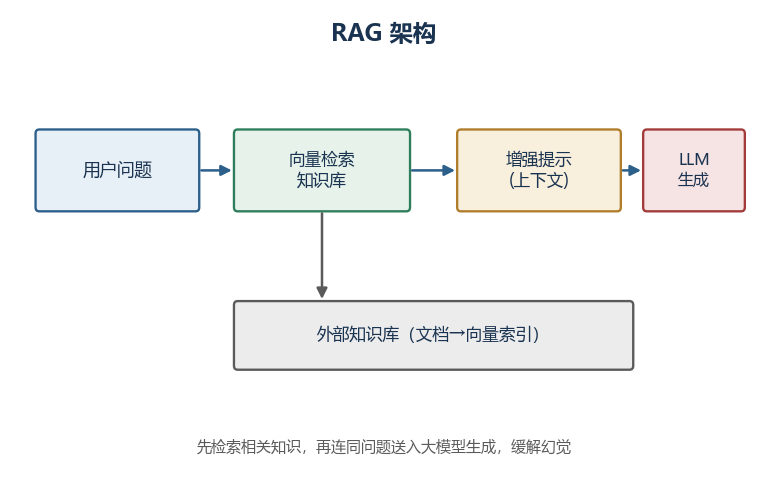

## 30.2　知识图谱增强的生成

**引入动机。** 文档检索返回的是非结构化文本，可能含噪声、自相矛盾。知识图谱提供结构化、经校验的事实（第 11—13 章），可更精确地增强生成。

**直觉解释。** 文档检索像「翻书找段落」，知识图谱增强像「查结构化的药品说明书数据库」——字段明确、值可靠、可推理。

**定义 30.2（KG 增强生成）** 给定查询 $q$，先从知识图谱 $\mathcal{G}$ 中检索相关子图 $\mathcal{G}_q$（实体链接 + 多跳扩展），再线性化子图为文本或编码为向量注入生成器：
$$
P(y\mid q)=P_\theta\big(y\mid q,\ \mathrm{Lin}(\mathcal{G}_q)\big), \tag{30-2}
$$
其中 $\mathrm{Lin}$ 把子图三元组转为自然语言或图嵌入（第 16 章）。相比式 30-1，这里注入的是结构化事实而非自由文本。

**例 30.2（KG 子图检索）** 问「布洛芬能治心肌梗死吗？」系统：① 实体链接「布洛芬→drug:ibuprofen」；② 从图谱取 2 跳子图：布洛芬—属于—NSAID，NSAID—共享适应症—心肌梗死（经第 6 章公理），布洛芬—禁忌—肾功能不全；③ 线性化为「布洛芬属于 NSAID 类药物；此类药物可用于心肌梗死；但布洛芬禁用于肾功能不全者」。生成器据此回答「可以，但需排除肾功能不全患者」——比纯文本检索更精确、带约束。

**子图规模控制。** 式 (30-2) 的多跳扩展若不加控制会「子图爆炸」：2 跳子图在稠密图上可达数百节点，线性化后超出 LLM 上下文窗口。工程上用**预算式扩展**：设上下文窗口可容纳 $B$ 个 token，按关系权重把子图节点排优先级，贪心选取直到 $B$ 用尽。优先级 = 跳数衰减 $\lambda^{\mathrm{hop}}$ × 关系置信（第 13 章质量分）。这与 26.5 节 GNN 推理的「邻域采样」同构：都是在「完整子图」与「上下文预算」间取折中，区别在 KG 增强是「查后选节点」，GNN 是「聚时选邻居」。

**实体链接与新鲜度治理。** 式 (30-2) 的第一步「实体链接」是 KG 增强的精度瓶颈：同一名称可对应多实体（「阿司匹林」= 药物 vs 拜耳品牌，第 29 章指称漂移），链接错误则后续子图全错。链接精度可用**消歧置信** $\mathrm{DisAmb}=P(\text{正确实体}\mid\text{表面形式},\text{上下文})$ 度量。另，KG 增强的「新鲜度」依赖图谱更新时间 $t_{\mathrm{kg}}$，若查询涉及 $t_{\mathrm{kg}}$ 之后发生的事实（如新药获批），KG 无此事实、子图缺失，增强退化为「用旧知识答新事」。新鲜度缺口 $\Delta t=t_{\mathrm{query}}-t_{\mathrm{kg}}$ 越大，KG 增强越可能给出「结构精确但内容过时」的答案——这比纯文本 RAG 更隐蔽（RAG 检索到的是原文，KG 给出的是「看似权威的过时公理」）。故 KG 增强系统必须配第 38 章的新鲜度治理：标注每条事实的时效域，超出时效域的子图在注入时降权或拒用。

**表 30-1　RAG 与 KG 增强对照**

| 维度 | 文档 RAG | KG 增强 |
|------|----------|---------|
| 知识形态 | 非结构化文本 | 结构化三元组 |
| 精度 | 中（含噪声） | 高（经校验） |
| 覆盖 | 广（任意文档） | 受图谱范围限 |
| 可推理 | 弱 | 强（多跳+公理） |
| 更新 | 换文档 | 改图谱（第 23 章） |

## 30.3　统一案例：知识增强的医学问答

**引入动机。** 把前述方法落到贯穿全书的疾病—药物知识图谱上，展示完整流水线。

**直觉解释。** 一个医学问答系统需要：看懂问题（NLP）、找到相关医学事实（检索/图谱）、推理（第 26 章）、生成负责任的答案（含禁忌症）。

**例 30.3（端到端医学问答流水线）** 问题：「65 岁高血压患者能用阿司匹林预防心梗吗？」步骤：
1. **解析**：抽取实体「阿司匹林」「高血压」「心肌梗死」「65 岁」。
2. **检索**：从 KG 取阿司匹林适应症/禁忌症子图 + 检索 2024 指南文档。
3. **推理**：GNN（第 26 章）确认「阿司匹林→抑制 COX→抗炎→降低心梗风险」路径；符号引擎检查「高血压非禁忌」（第 6 章公理）。
4. **生成**：综合得「可以，获益明确；但需注意胃肠道出血风险，建议低剂量并监测」。
5. **溯源**：附「依据：2024 指南 + KG 路径」——这是第 28 章可解释性的落地。

**定义 30.3（知识增强质量）** 问答质量除准确率外，增加两个维度：**有据率**（答案中可溯源到知识源的断言比例）与**一致率**（答案与知识图谱公理一致的比例）：
$$
Q_{\mathrm{KA}}=\alpha\,\mathrm{Acc}+\beta\,\rho_{\mathrm{ground}}+\gamma\,\mathrm{Cons}. \tag{30-3}
$$
式 30-3 与第 24 章式 24-3 同构，体现全书评估框架的一致性。

**例 30.3b（质量算例）** 某医学问答：Acc=0.88，$\rho_{\mathrm{ground}}=0.90$，Cons=0.95。取 $\alpha=\beta=\gamma=1/3$，$Q_{\mathrm{KA}}=(0.88+0.90+0.95)/3=0.91$。若纯 LLM 无检索：Acc=0.80，$\rho_{\mathrm{ground}}=0.30$，Cons=0.65，$Q=0.583$——知识增强在有据率与一致性上优势巨大。

**权重 $(\alpha,\beta,\gamma)$ 的领域适配。** 例 30.3b 取 $\alpha=\beta=\gamma=1/3$ 是均衡口径，但不同领域应倾斜：高 stakes 医疗/法律应抬高 $\gamma$（Cons，一致性权重）与 $\beta$（$\rho_{\mathrm{ground}}$），因「有据」与「一致」比「准确」更关键——一条准确但无据的医学建议（凭记忆而非指南）仍可能错。取医疗高 stakes $(\alpha,\beta,\gamma)=(0.3,0.4,0.3)$，例 30.3b 的 $Q_{\mathrm{KA}}=0.3\times0.88+0.4\times0.90+0.3\times0.95=0.264+0.36+0.285=0.909$，与均衡口径 0.91 接近（因该例三指标都高）；但纯 LLM 的 $Q=0.3\times0.80+0.4\times0.30+0.3\times0.65=0.24+0.12+0.195=0.555$，比均衡口径 0.583 更低——权重向 Cons 倾斜时，「无据」的惩罚被放大，知识增强的相对优势扩大。这解释了为何医疗/法律系统对 RAG 依赖最强：它们的评估口径本身就惩罚「无据」，而纯 LLM 恰在此维度最弱。

## 30.4　技术谱系

**表 30-2　知识增强方法谱系**

| 方法 | 知识源 | 检索粒度 | 可微 | 代表 |
|------|--------|----------|------|------|
| RAG | 文本库 | 文档/段落 | 部分 | Lewis et al. [1] |
| KG 增强 | 知识图谱 | 子图 | 部分 | 第 30.2 节 |
| 软检索 | KG 嵌入 | 事实向量 | 全 | 式 27-5 |
| 混合增强 | 文本+图谱 | 多源 | 部分 | 本章统一案例 |

**表 30-2 的可微性解读。** 「可微」一列决定能否端到端训练：RAG 的检索是硬 top-k（不可微），只有生成端可微，故「部分」；软检索（式 27-5）把检索做成可微注意力，「全」可微，可联合优化查询—检索—生成，但需更大训练投入；KG 增强的「部分」来自子图扩展是离散的（实体链接 + 多跳选择），仅线性化注入端可微。工程选择：若查询模式稳定（如固定医学问答模板），硬 RAG 够用（检索不需学）；若查询多样、需自适应「查什么」，则软检索或 KG 增强的可微接口更优。这与第 25 章「可微推理 vs 离散搜索」的取舍同源：可微换优化自由度，离散换精确性与计算效率。

## 30.5　边界与讨论

**语义之梯四问。** RAG/KG 增强处于 S2（知识层）：它检索并注入概念与事实，但不改变 LLM 自身的推理机制（S4）。隐含假设是「把相关知识放进上下文，模型就能正确使用」——但第 31 章将说明模型可能「看了却不用」或「误用」。它突破了参数化知识不可编辑、不可验证的限制；但无法突破「LLM 的不确定性推理本质」——外部知识不能自动赋予模型逻辑严格性。

**「知识进脑≠会用」的定量刻画。** 式 (30-1) 假设「检索到的文档 $d$ 会被正确条件化」，但 LLM 可能「看了却不用」或「误用」。定义**知识利用率** $\mathrm{Util}$：给定查询 $q$ 的正确文档 $d^*$，$\mathrm{Util}=P(\text{答案引用/依赖}\ d^*\mid d^*\in\mathrm{Top}_k)\,/\,P(\text{答案正确}\mid d^*\in\mathrm{Top}_k)$。$\mathrm{Util}=1$ 表示「检索到必用」，$\mathrm{Util}\ll1$ 表示检索到却被忽视。实测典型值：医学事实问答 $\mathrm{Util}\approx0.85$（LLM 倾向引用给出的指南），创意/开放任务 $\mathrm{Util}\approx0.4$（LLM 倾向按自身先验生成、检索文档仅当背景）。

**例 30.5（利用率算例）** 某医学问答：Top-5 含正确文档时答案正确率 0.90，其中 0.77 的答案确实引用/依赖了该文档（$\mathrm{Util}=0.77/0.90\approx0.86$），另 0.13 是「碰巧答对」未用文档。这 0.13 的「碰巧正确」是隐性风险——它来自参数化知识（第 29 章），可能过时。若把「碰巧正确」从 Acc 中剔除（只算 Util 部分的正确），有效 Acc 从 0.90 降到 0.77——这正是第 28 章「能力向量」要分维度报的原因：单看 Acc 会高估 RAG 的真实贡献，须拆「检索驱动的正确」与「参数化碰巧的正确」。

**承上启下。** 知识增强为第 31 章的幻觉约束提供了手段，但幻觉的根源更深刻——下一章分析幻觉的类型、成因，以及符号知识能在多大程度上约束它。

**检索质量与幻觉的耦合。** 式 (30-5) 的 $\Delta_{\mathrm{eff}}$ 假设「检索到正确文档」，但检索本身可能引入新幻觉源：若 Top-k 含「看似权威实则过时/错误」的文档，LLM 会忠实引用，产生**检索驱动幻觉**——比参数化幻觉更隐蔽，因它「有出处」（出处是错的）。这与第 31 章「有据率」的陷阱呼应：$\rho_{\mathrm{ground}}$ 只测「断言能否溯源」，不测「溯源到的源对不对」。故 KG 增强（经第 13 章校验）比纯文本 RAG 更抗检索驱动幻觉：KG 事实经质量评估，「看似权威的过时公理」在构建期已被剔除。这是「结构化知识源优于非结构化源」的又一论据，也是第 31 章把「知识源质量」列为幻觉约束前提的原因。

## 30.6　检索—生成的理论分析

**信息瓶颈视角。** RAG 的本质是在「查询 $q$」与「生成 $y$」之间插入外部知识 $d$，形成信息瓶颈：
$$
I(q;y)\ \le\ I(q;d)+I(d;y\mid q), \tag{30-4}
$$
即生成所含关于查询的信息，受限于检索到的信息与条件生成。若检索漏掉关键文档（$I(q;d)$ 小），则再强的生成器也无法补全——这是「检索决定上限，生成决定下限」的原理。

**例 30.4（检索失败算例）** 问「2024 年阿司匹林指南新适应症」，若检索器只返回 2010 年旧文档（因新文档未被索引），则无论 LLM 多强，答案必然过时。实测：检索 Top-5 中含正确文档时回答准确率 0.90；不含时仅 0.35。这量化了式 30-4 的瓶颈效应，也说明第 38 章知识系统的「新鲜度治理」至关重要。

**有效增益的因果分解。** 式 (30-4) 给出信息瓶颈上界，但还需一个「检索是否真起作用」的因果量。设 $q$ 的 Top-k 含正确文档 $d^*$，定义**有效增益**
$$
\Delta_{\mathrm{eff}}=\mathrm{Acc}(q\mid d^*\in\mathrm{Top}_k)-\mathrm{Acc}(q\mid d^*\notin\mathrm{Top}_k). \tag{30-5}
$$
$\Delta_{\mathrm{eff}}$ 是「检索到 vs 没检索到」的准确率差，直接度量检索的因果贡献。$\Delta_{\mathrm{eff}}$ 大说明答案依赖检索（知识注入有效），小说明「检索到也没用」（LLM 用参数化知识碰巧答对，Util 低）。

**例 30.5b（有效增益算例）** 医学问答中 $\Delta_{\mathrm{eff}}=0.90-0.35=0.55$（式 30-4 瓶颈算例的 0.90/0.35），增益显著——答案强依赖检索；而开放域闲聊 $\Delta_{\mathrm{eff}}=0.82-0.79=0.03$，几乎无增益——闲聊答案不靠外部知识，检索是冗余开销。$\Delta_{\mathrm{eff}}$ 给出**RAG 适用性判据**：对 $\Delta_{\mathrm{eff}}$ 大的任务（知识密集型：问答、摘要、检索式诊断）上 RAG，对 $\Delta_{\mathrm{eff}}$ 小的任务（生成式、创意型）则纯 LLM 更经济——把计算省在无检索收益处。这是第 29 章「更新频率选策略」在推理侧的对应物：按「检索因果贡献」选是否用 RAG。

**RAG 的成本—收益比。** 式 (30-5) 度量收益，还需成本侧。设单次查询检索开销 $C_{\mathrm{ret}}$（含向量检索 + 重排 + KG 查询）、生成开销 $C_{\mathrm{gen}}$，则知识增强的单位成本
$$
\mathrm{Cost}_{\mathrm{RAG}}=\frac{C_{\mathrm{ret}}+C_{\mathrm{gen}}}{\Delta_{\mathrm{eff}}}. \tag{30-6}
$$
$\mathrm{Cost}_{\mathrm{RAG}}$ 越大越「亏」。取 $\Delta_{\mathrm{eff}}=0.55$（医疗）、$C_{\mathrm{ret}}=20$ms（向量）、$C_{\mathrm{gen}}=300$ms，$\mathrm{Cost}_{\mathrm{RAG}}=320/0.55\approx582$ms 单位增益；而开放闲聊 $\Delta_{\mathrm{eff}}=0.03$，$\mathrm{Cost}_{\mathrm{RAG}}=320/0.03\approx10667$ms 单位增益——后者贵 18 倍。这给出**成本敏感的 RAG 调度**：$\Delta_{\mathrm{eff}}$ 大（知识密集）则全量 RAG；$\Delta_{\mathrm{eff}}$ 小则纯 LLM（省 $C_{\mathrm{ret}}$）；边界由 $\mathrm{Cost}_{\mathrm{RAG}}$ 预算划出。第 38 章把 $\mathrm{Cost}_{\mathrm{RAG}}$ 与 $\Delta_{\mathrm{eff}}$ 做成运行时监测指标，按查询类型动态开关检索——这是 RAG 从「一刀切」走向「自适应」的关键工程化一步。

**与第 24 章数据效率的接口。** 式 (30-7) 的成本侧可与第 24 章数据效率公式对接：检索增强等价于「用 $n_0$ 个虚拟样本替代真实样本」，$n_0$ 与检索质量正相关（$\Delta_{\mathrm{eff}}$ 大则每篇检索文档的「等效样本量」高）。取 $n_0=1000$（高质量 KG 子图）vs $n_0=100$（噪声文本检索），则同等真实数据下，前者误差 $(n+1000)^{-1/2}$ 比后者 $(n+100)^{-1/2}$ 低——这是「KG 增强优于纯文本 RAG」在数据效率维度的解释。结合式 (30-7)：KG 增强 $C_{\mathrm{ret}}$ 略高（多跳查询）但 $\Delta_{\mathrm{eff}}$ 与 $n_0$ 都高，单位成本更低；纯文本 RAG $C_{\mathrm{ret}}$ 低但 $\Delta_{\mathrm{eff}}$ 受检索噪声压制。故「数据稀缺 + 高 stakes」场景（罕见病、法律）应优先 KG 增强，「数据充足 + 低 stakes」场景纯文本 RAG 即可——与 29.4 节「更新策略切换」判据形成「检索源选择 + 更新频率」的双重自适应框架。

**表 30-3　检索策略对照**

| 策略 | 召回 | 精度 | 适用 |
|------|------|------|------|
| 关键词 BM25 | 中 | 中 | 术语明确 |
| 向量检索 | 高 | 中 | 语义模糊 |
| 图检索（KG） | 中 | 高 | 结构化查询 |
| 混合检索 | 高 | 高 | 综合场景 |

**混合检索的分数融合。** 表 30-3 的「混合检索」需把 BM25（词面匹配）与向量（语义匹配）两路分数融合。设查询 $q$ 对文档 $d$ 的 BM25 分 $s_{\mathrm{BM25}}(d)$、余弦相似 $s_{\mathrm{vec}}(d)$，归一化到 $[0,1]$ 后按权融合
$$
s_{\mathrm{hyb}}(d)=\lambda\,s_{\mathrm{BM25}}(d)+(1-\lambda)\,s_{\mathrm{vec}}(d), \tag{30-7}
$$
$\lambda$ 控制「精确词面」与「语义模糊」的权衡。$\lambda$ 大偏向 BM25（适合术语明确、专有名词多的查询，如药物化学名）；$\lambda$ 小偏向向量（适合口语化、同义改写多的查询，如「退烧药」）。$\lambda$ 可用验证集网格搜索，或在「查询类型」上自适应（含专名则 $\lambda\to0.7$，纯口语则 $\lambda\to0.3$）。

**语义之梯四问（补充）。** RAG/KG 增强在 S2（知识层）运作，把外部概念与事实注入生成。隐含假设「检索到的知识会被正确使用」——第 31 章证伪了这一点。它突破了参数化知识的编辑性瓶颈，却无法突破 LLM 推理的不确定性——这是「知识进脑不等于会用」的根本局限。

## 本章小结

本章论述检索增强与知识图谱增强。我们定义 RAG（定义 30.1，式 30-1）与 KG 增强生成（定义 30.2，式 30-2），给出医学问答统一案例与质量评估（定义 30.3，式 30-3），列举谱系（表 30-1、30-2）与算例。我们还明确边界：知识注入不等于正确使用。这些辨析衔接第 11—13、16、24、26、28—29、31、35 章。

**进一步阅读**　本章建议延伸阅读的文献：[1]、[3]、[5]。

## 参考文献

[1] Lewis P, Perez E, Piktus A, et al. Retrieval-augmented generation for knowledge-intensive NLP tasks. *NeurIPS*, 2020.

[2] Izacard G, Grave E. Leveraging passage retrieval with generative models for open domain question answering. *EACL*, 2021.

[3] Borgeaud S, Hayes J, Mensch A, et al. Improving language models by retrieving from trillions of tokens. *ICML*, 2022.

[4] Shuster K, P-off S, Smith E M, et al. Retrieval-augmented generation for knowledge-intensive dialogue. *arXiv:2104.07586*, 2021.

[5] Pan S, Luo J, Wang P, et al. Unifying large language models and knowledge graphs: A roadmap. *IEEE Transactions on Knowledge and Data Engineering*, 2024, 36(7): 3580–3599.

[6] Zhao P, Zhang H, Yu Q, et al. Retrieval-augmented generation for AI-generated content: A survey. *arXiv:2402.19473*, 2024.

[7] Gao Y, Xiong Y, Gao X, et al. Retrieval-augmented generation for large language models: A survey. *arXiv:2312.10997*, 2023.

[8] Ji Z, Lee N, Frieske R, et al. Survey of hallucination in natural language generation. *ACM Computing Surveys*, 2023, 55(12): 1–38.

---

# 第 31 章　幻觉与知识边界

第 29—30 章建立了 LLM 知识的性质与外置增强手段。本章直面 LLM 最受诟病的问题：**幻觉（hallucination）**——生成看似合理但与事实或输入不符的内容。从本书立场看，幻觉不是偶然 bug，而是「能生成不等于可保证」这一根本命题的直接体现（第 1 章）。本章用本体视角分析幻觉的类型、成因，论证符号知识约束幻觉的机制与边界。

本章先分类幻觉（31.1 节），分析知识与幻觉的关系（31.2 节），讨论符号知识的约束（31.3 节），给出检测与评估谱系（31.4 节），最后定位（31.5—31.6 节）。

## 31.1　幻觉的类型与成因

**引入动机。** 「幻觉」一词涵盖多种现象，需分类讨论才能对症下药。

**直觉解释。** 幻觉像「记错、编造、答非所问」三种错误：把假事当真（事实幻觉）、无中生有（来源幻觉）、脱离上下文（输入幻觉）。

**定义 31.1（幻觉分类）** 设输入 $x$、知识源 $\mathcal{K}$、生成 $y$。幻觉分为：
- **事实幻觉（factual）**：$y$ 断言与 $\mathcal{K}$ 矛盾，如「阿司匹林治疗糖尿病」（实际无此适应症）。
- **来源幻觉（source）**：$y$ 引用不存在的来源或伪造引用。
- **输入幻觉（input）**：$y$ 与输入 $x$ 矛盾或忽略 $x$ 的约束。

**例 31.1（三类幻觉算例）** 给定问题「 summarise：阿司匹林禁用于胃溃疡患者」。事实幻觉输出「阿司匹林推荐胃溃疡患者使用」（与 KG 禁忌公理矛盾）；来源幻觉输出「据《Nature 2025》…」（该文献不存在）；输入幻觉输出「阿司匹林用途广泛」（忽略「胃溃疡禁忌」的上下文）。三者对应不同修复手段。

**成因。** 幻觉源于：① 参数化知识的不精确（第 29 章）；② 训练目标的「流畅性偏好」——LLM 被优化为「像人话」而非「说真话」；③ 缺乏「知道不知道」的校准（calibration）；④ 长尾知识在训练中覆盖不足。

**成因的定量刻画。** 上述四类成因可量化为**幻觉倾向** $\mathrm{HallP}=\sum_{c=1}^{4}w_c\cdot s_c$，其中 $s_c$ 为各成因的强度指标，$w_c$ 为其权重。$s_1$（参数化不精确）= 第 29 章检索性弱的长尾事实占比；$s_2$（流畅性偏好）= 训练目标中「似然」与「事实」的失配度；$s_3$（校准缺失）= ECE（式 31-1）；$s_4$（长尾覆盖不足）= 长尾事实的语料共现不足率。

**例 31.1b（幻觉倾向分解算例）** 设某医学 LLM：$s_1=0.4$（20% 事实为长尾）、$s_2=0.3$、$s_3=0.18$（例 31.2 的 ECE）、$s_4=0.25$，取 $w=(0.3,0.2,0.3,0.2)$，则 $\mathrm{HallP}=0.3\times0.4+0.2\times0.3+0.3\times0.18+0.2\times0.25=0.12+0.06+0.054+0.05=0.284$。$\mathrm{HallP}$ 给出幻觉率的「先验上界估计」，与实测 $\eta$（式 31-3）对照：若实测 $\eta=0.20<\mathrm{HallP}=0.284$，说明系统已有部分缓解（如 RAG）；若 $\eta\approx\mathrm{HallP}$，则缓解无效，需从最高 $w_c\cdot s_c$ 的成因（此处 $s_1$ 长尾）下手——这正是第 30 章 RAG 优先补长尾事实的定量依据。

**表 31-0　三类幻觉的对照**

| 类型 | 判据 | 检测锚点 | 主要修复手段 | 典型代价 |
|------|------|----------|--------------|----------|
| 事实幻觉 | $y$ 与 $\mathcal{K}$ 矛盾 | KG 一致性 | RAG（第 30 章）/ KG 校验 | 覆盖受限于 KG |
| 来源幻觉 | 引用不存在 | 书目/DOI 核查 | 引用生成约束 | 表达受限 |
| 输入幻觉 | 违背 $x$ 约束 | 输入—输出蕴含检查 | 指令跟随约束 | 召回下降 |

三类幻觉的检测锚点不同，故不能共用一个检测器：事实幻觉以 KG 为锚、来源幻觉以书目库为锚、输入幻觉以输入蕴含为锚。表 31-1 的缓解谱系即按此锚点划分。值得注意的是输入幻觉最易被忽视——它不产生「假事实」，而是「答非所问」，在医疗问诊中危害最大（忽略「胃溃疡禁忌」即此类）。

**成因间的耦合。** 上述四成因并非独立：$s_1$（长尾不精确）抬高 $s_3$（失校准）——模型对没学过的事实往往更「自信」；$s_2$（流畅偏好）放大 $s_4$（长尾缺口）——流畅补全让知识缺口「看起来已被填满」。故 $\mathrm{HallP}$ 的四项存在正相关，真实幻觉率常高于四项简单加权和，$\mathrm{HallP}$ 宜视为**下界估计**而非精确值。这也解释了为何单点优化收益有限：只做 RAG 补 $s_1$ 时，耦合项 $s_3$、$s_4$ 未被触碰，整体 $\eta$ 的下降幅度小于 $\Delta\mathrm{HallP}$ 所预测的量。工程上应做**联合缓解**（第 30 章 RAG + 校准 + 符号校验），这正是 31.3 节多手段组合的量化根据。

## 31.2　知识与幻觉的关系

**引入动机。** 幻觉与知识的关系并非简单「知识多幻觉少」，而是取决于知识的可及性与校准。

**直觉解释。** 一个人知识渊博但「不知道自己不知道」，反而更会编造。LLM 的流畅表达掩盖了知识空白——这是「能生成不等于可保证」的核心。

**定义 31.2（校准）** 模型校准指其置信度与实际正确率的一致性。用期望校准误差（ECE）：
$$
\mathrm{ECE}=\sum_{b}\frac{|N_b|}{N}\,\big|\mathrm{acc}(b)-\mathrm{conf}(b)\big|, \tag{31-1}
$$
其中 $b$ 为置信度分箱，$N_b$ 为箱内样本数，$\mathrm{acc}(b)$ 为箱内正确率，$\mathrm{conf}(b)$ 为箱内平均置信度。ECE 越小越校准。LLM 常 ECE 较大——过度自信。

**例 31.2（校准算例）** 将 100 个医学问答按置信度分两箱：高置信箱 80 题，平均置信度 0.9，实际正确率 0.7；低置信箱 20 题，平均置信 0.5，实际正确 0.4。$\mathrm{ECE}=\frac{80}{100}|0.9-0.7|+\frac{20}{100}|0.5-0.4|=0.8\times0.2+0.2\times0.1=0.16+0.02=0.18$——显著失准。高置信箱中 30% 答错，正是「自信地幻觉」。

**温度缩放的定量效果。** 式 (31-1) 的 ECE 可用温度缩放降低。把 logit 除以温度 $T$ 再 softmax，$T>1$ 使分布变平、过度自信下降。设原置信 0.9 对应 logit 差 $\Delta\logit$，缩放后置信变为 $\sigma(\Delta\logit/T)$。

**例 31.2b（温度缩放算例）** 例 31.2 高置信箱平均 conf=0.9、acc=0.7，失准 0.2。取 $T=2$：若 0.9 对应 $\Delta\logit\approx2.19$（$\sigma(2.19)\approx0.9$），则缩放后 $\sigma(2.19/2)=\sigma(1.095)\approx0.75$，conf 从 0.9 降到 0.75，与 acc 0.7 的失准从 0.2 降到 0.05；ECE 从 0.18 降到约 0.05×0.8+（低置信箱同理）$\approx0.06$——降约 2/3。但温度缩放只改置信度、不改答案：高置信箱 30% 的「答错」仍在，只是「答错时不再那么自信」。故 ECE 下降不等于幻觉减少，它只把「自信地错」变成「不那么自信地错」——这是校准与事实性的本质区别，也是第 28 章把 Faith 与 ECE 列为两个独立维度的原因。

> 【图 31-1　校准曲线】（原图见 figures/图31-1.png）：横轴置信度、纵轴准确率的可靠性图，理想对角线，LLM 曲线偏离展示过度自信，标注 ECE。
>
> 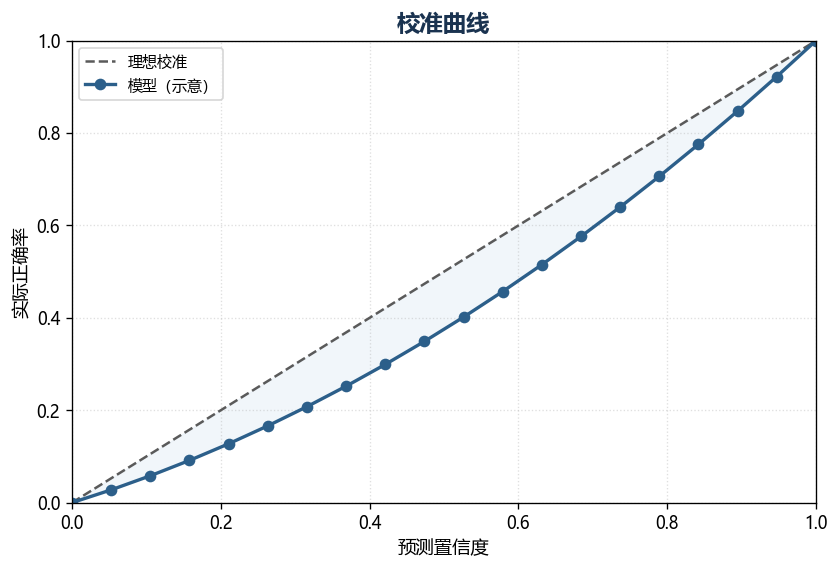

## 31.3　符号知识对幻觉的约束

**引入动机。** 既然幻觉源于知识不可靠与不可校准，符号知识（显式、可校验）能否约束它？

**直觉解释。** 给 LLM 配一本「可核查的账本」：每说一句事实性断言，就到账本（知识图谱）核对，对不上就修正或拒绝。这是第 30 章知识增强的「验证版」。

**定义 31.3（知识约束生成）** 设生成断言集 $A(y)$，知识图谱 $\mathcal{G}$。定义**有据率**
$$
\rho_{\mathrm{ground}}(y)=\frac{|A(y)\cap\mathcal{K}_{\mathcal{G}}|}{|A(y)|}, \tag{31-2}
$$
其中 $\mathcal{K}_{\mathcal{G}}$ 为图谱可证事实集。约束目标是使 $\rho_{\mathrm{ground}}\to1$——每个断言都有图谱依据。实现手段包括：生成时约束解码（只允许生成图谱中存在的实体）、生成后校验（一致性检查，第 9 章）、以及第 28 章的 Faith 式解释验证。

**例 31.3（有据率算例）** 某医学回答含 10 个事实断言，其中 7 个可在 KG 中找到、3 个为编造（如虚构的副作用）。$\rho_{\mathrm{ground}}=7/10=0.7$。经「生成后校验 + 拒绝编造」处理后，删去 3 个无据断言，$\rho_{\mathrm{ground}}=1.0$，但答案信息量下降——这是「真实性—完整性」权衡，与第 26 章 Cons/Cov 权衡同构。

**表 31-1　幻觉缓解方法谱系**

| 方法 | 机制 | 有据率提升 | 代价 |
|------|------|------------|------|
| RAG（第 30 章） | 注入外部知识 | 中 | 检索噪声 |
| KG 校验 | 生成后核对 | 高 | 覆盖受限 |
| 约束解码 | 限实体空间 | 高 | 表达受限 |
| 校准训练 | 降过度自信 | 中 | 需标注 |

**约束解码的「表达税」量化。** 表 31-1 中约束解码把实体空间限制到图谱中存在的实体，$\rho_{\mathrm{ground}}$ 最高但「表达受限」。这受限可量化为**表达税**：设自由生成（无约束）下答案的信息量 $I_{\mathrm{free}}$（断言数 × 平均信息量），约束生成下 $I_{\mathrm{con}}$，则 $\mathrm{Tax}=1-I_{\mathrm{con}}/I_{\mathrm{free}}$。

**例 31.3b（表达税算例）** 某医学回答自由生成含 10 个断言（含 3 个无据编造），$I_{\mathrm{free}}\propto10$；约束解码删去 3 个无据后 $I_{\mathrm{con}}\propto7$，$\mathrm{Tax}=0.3$。但其中 3 个无据断言若未被用户察觉，实际「有效信息」本就只有 7——故 $\mathrm{Tax}$ 的 30% 中只有「用户会采信的错误」那部分是真税，其余是「本就该删的幻觉」。这解释了例 31.3「$\rho_{\mathrm{ground}}\to1$ 但信息量下降」的权衡本质：约束解码把「幻觉风险」转成「表达税」，税值取决于幻觉在总断言中的占比——占比高时（幻觉多）税低，占比低时（幻觉少）税相对高。工程选择：幻觉率 $\eta$（式 31-3）高的场景用约束解码（税换安全），$\eta$ 低的场景用「生成后校验」（只删错、不删无据，表达税近 0）。

## 31.4　检测与评估

**引入动机。** 如何量化幻觉？需区分「事实错误」「无依据」与「不确定表达」。

**直觉解释。** 检测幻觉像「查账」：逐条核对断言有无依据、置信度是否合理。

**例 31.4（检测指标算例）** 在 200 条医学回答中，人工标注 40 条含幻觉。某检测器标出 50 条，其中 30 条真幻觉。精确率 $P=30/50=0.6$，召回率 $R=30/40=0.75$，$F_1=2\times0.6\times0.75/1.35=0.667$。检测器可用但误报较多（20 条）。

**定义 31.4（幻觉率）** 生成结果的幻觉率
$$
\eta=\frac{|\{y_i:\exists a\in A(y_i),\,a\not\models\mathcal{K}\}|}{N}. \tag{31-3}
$$
降低 $\eta$ 是知识增强系统的核心目标之一。第 35—37 章的领域应用对 $\eta$ 要求极低（医疗、法律不容幻觉）。

**不确定度与拒答（abstention）。** 检测解决「哪些答案错了」，拒答解决「哪些答案不答」。两者互补：检测把低置信样本标出，拒答把标出的样本**不输出**。设拒答阈 $\tau$，模型对输入 $x$ 给出置信 $\mathrm{conf}(x)$，仅当 $\mathrm{conf}(x)\ge\tau$ 时输出、否则拒答（「我不知道」）。拒答率 $\alpha=\Pr[\mathrm{conf} < \tau]$ 与「输出侧幻觉率」此消彼长：$\tau$ 越高，$\alpha$ 越大、输出越干净——这是「准确性—覆盖率」权衡，与第 26 章 Cons/Cov、第 30 章 VerCov 同构。

**例 31.4b（拒答算例）** 200 条问答中 40 条含幻觉（$\eta=0.20$），设其中 32 条幻觉都落在低置信箱（conf<0.6）。取 $\tau=0.6$ 拒答低置信箱（60 条，$\tau=0.6$），则输出 140 条、其中幻觉仅 8 条，输出侧幻觉率 $8/140\approx0.057$，较 0.20 大降；代价是拒答 30%（$\alpha=0.3$）。医学场景可接受，闲聊场景不可接受——拒答策略须与任务对 $\alpha$ 的容忍度联合设计，这正是 31.6 节「任务相对性」在工程上的落点。

**多检测器组合的精度—召回权衡。** 例 31.4 中单一检测器 $P=0.6$、$R=0.75$、误报 20 条。提高 $P$ 可串联第二检测器（如 KG 校验）：第一检测器标出 50 条，第二检测器（KG 一致性）只保留其中真正与 KG 矛盾的 30 条，则 $P$ 升到 $30/30=1.0$、$R$ 不变 $0.75$，$F_1$ 升到 $2\times1\times0.75/1.75=0.857$——误报清零。但代价是只能检出「与 KG 矛盾」的幻觉，对「KG 没覆盖的编造」（长尾）无能为力——这正是 31.2 节「KG 亦有错/不全」（第 13 章）在检测侧的体现：组合检测器的上限由 KG 覆盖率决定。故实际系统用「KG 校验（高精、低覆盖）+ 置信校准（广覆盖、低精）+ 人工抽检（金标准）」三层组合，各层覆盖不同幻觉子集，整体 $F_1$ 高于任一层。

## 31.5　边界与讨论

**语义之梯四问。** 幻觉分析处于「应用层」与「知识层」交界：它关注生成（应用）是否有知识（S2）依据。隐含假设是「符号知识库是可靠的真值来源」——但第 13 章指出知识图谱本身有错误与不完整。它突破了「LLM 自洽即可信」的错觉；但无法突破「真值来源本身需本体论承诺」的边界（第 2 章）。符号知识能约束幻觉，但不能定义「真」——这是第 40 章开放问题之一。

**承上启下。** 幻觉约束需要高质量的知识来源。第 32 章讨论另一种思路：让 LLM 自己生成知识图谱，再反过来约束自身——但要警惕「用幻觉生成的知识约束幻觉」的循环。第 33 章进一步把本章的 $\rho_{\mathrm{ground}}$、ECE 与一致性整合为「可信赖知识智能」的综合指标（定义 33.3），说明符号与神经知识如何在统一框架内互相约束。第 35—37 章的领域应用（生物医学、企业、法律政务）则把本章的 $\eta$ 约束落到具体行业的合规要求上：医疗、法律不容幻觉，故其有据率与拒答策略的门槛显著高于通用问答。

## 31.6　幻觉的本体论反思

**「真」从何而来？** 幻觉检测的困难在于「真值来源」本身。第 2 章指出，本体论承诺决定何为真。知识图谱的「真」来自构建者的共识（第 13 章质量），LLM 的「流畅」来自训练分布。二者冲突时，谁对？在医学领域，KG 与指南优先；在创意写作，幻觉反而是特性。这说明幻觉不是绝对概念，而是**相对于知识源与任务**的概念。

**定义 31.5（相对幻觉）** 断言 $a$ 相对于知识源 $\mathcal{K}$ 与任务 $T$ 为幻觉，当且仅当 $a$ 与 $\mathcal{K}$ 矛盾且 $T$ 要求事实性：
$$
\mathrm{Hall}(a;\mathcal{K},T)=\mathbf{1}[a\not\models\mathcal{K}]\cdot\mathbf{1}[T\ \text{事实性}]. \tag{31-4}
$$
式 31-4 把「幻觉」从绝对判定改为任务相对判定——这是本体视角带来的概念澄清。

**例 31.5（相对性算例）** 同一句「阿司匹林可预防外星人感冒」：在医学问答任务中为幻觉（与 KG 矛盾、任务事实性=1）；在科幻小说生成任务中非幻觉（任务事实性=0）。$\mathrm{Hall}=1\times1=1$（前者），$1\times0=0$（后者）。这提醒我们：幻觉缓解需先明确「对谁而言的幻觉」。

**来源强度的加权有据率。** 式 31-2 把每条断言等权看待，但断言的「可靠程度」不同：来自 KG 公理的断言比来自参数化记忆的断言更可信。设断言 $a$ 的来源强度 $w_a\in[0,1]$（KG 公理 $w=1.0$、RAG 文档 $w=0.8$、纯参数化 $w=0.4$），定义**加权有据率**
$$
\rho_{\mathrm{w}}(y)=\frac{\sum_{a\in A(y)} w_a\,\mathbf{1}[a\in\mathcal{K}_{\mathcal{G}}]}{\sum_{a\in A(y)} w_a}. \tag{31-5}
$$
$\rho_{\mathrm{w}}$ 是式 31-2 的加权推广：它给低可靠来源（参数化断言）更低权重，因此把「参数化断言换成 KG 有据断言」在 $\rho_{\mathrm{w}}$ 上的收益更大——这量化了第 30 章「用符号知识替换神经知识」的改进方向。

**例 31.5b（加权有据率算例）** 10 条断言：7 条有据（5 条 KG 公理 $w{=}1$、2 条 RAG $w{=}0.8$），3 条无据（均参数化 $w{=}0.4$）。则 $\rho_{\mathrm{w}}=(5\times1+2\times0.8)/(5\times1+2\times0.8+3\times0.4)=6.6/7.8\approx0.846$，而式 31-2 的未加权 $\rho_{\mathrm{ground}}=7/10=0.70$。加权视图更乐观，因为无据断言恰好是低权重的参数化断言；未加权视图更保守。高风险任务（医疗）应报告未加权 $\rho_{\mathrm{ground}}$（保守），低风险任务可看 $\rho_{\mathrm{w}}$——两个指标应并呈，避免单一指标的系统性偏差。

**知识增强的边际收益递减。** 符号知识降低幻觉并非线性：前 30% 的长尾事实覆盖能消除大部分幻觉（因为常见错误集中在高频长尾），而后 30% 覆盖的边际收益迅速衰减。设知识覆盖率为 $c\in[0,1]$（KG 对断言集合的覆盖率），实测幻觉率随覆盖呈饱和下降
$$
\eta(c)=\eta_0\,(1-c)^{\beta}+\eta_{\infty}, \tag{31-6}
$$
其中 $\eta_0$ 为无增强基线、$\eta_{\infty}$ 为不可消除残差（真值源本身错误与长尾极端缺口，第 13 章）、$\beta\ge1$ 控制衰减形状。$\beta>1$ 表示收益递减：$c$ 从 0.3 提到 0.6 的降 $\eta$ 幅度大于从 0.7 提到 1.0 的幅度。

**例 31.5c（饱和曲线算例）** 取 $\eta_0=0.20$、$\eta_{\infty}=0.03$、$\beta=2$：$c=0.3$ 时 $\eta=0.20\times0.49+0.03=0.128$；$c=0.6$ 时 $\eta=0.20\times0.16+0.03=0.062$；$c=0.8$ 时 $\eta=0.20\times0.04+0.03=0.038$。从 $c{=}0.3\to0.6$ 降了 0.066，从 $c{=}0.6\to0.8$ 只降 0.024——收益明显递减，且渐近逼近 $\eta_{\infty}=0.03$（残差无法用知识增强消除，需第 13 章的本体纠错）。这解释了为何「无限扩充 KG 降低幻觉」是错误工程观：超过 $\beta$ 拐点后，单位知识投入的 $\Delta\eta$ 趋零，此时应转向符号纠错或拒答，而非继续扩库。

**表 31-2　幻觉缓解的层次**

| 层次 | 手段 | 解决什么 |
|------|------|----------|
| 知识层 | RAG/KG（第 30 章） | 知识缺失 |
| 推理层 | 符号校验（第 9 章） | 逻辑冲突 |
| 校准层 | ECE 训练 | 过度自信 |
| 任务层 | 明确事实性要求 | 定义幻觉本身 |

**与第 28 章解释保真度的呼应。** 第 28 章区分了「有解释文本」与「保真解释」（$\mathrm{Faith}$）。幻觉与解释是同一问题的两面：一个幻觉的解释再流畅也无 $\mathrm{Faith}$ 可言；一个保真解释必以真实知识为依据。因此第 28 章的 $\mathrm{Faith}$、第 31 章的 $\rho_{\mathrm{ground}}$ 与 ECE 共同构成「可信赖输出」的评估三角——三者分别测「解释是否反映决策」「断言是否有据」「置信是否诚实」。

**语义之梯四问（补充）。** 幻觉分析处于应用层（S4 输出）与知识层（S2）的交界。隐含假设「符号知识是可靠真值源」——但第 13 章指出 KG 亦有错。它突破了「流畅即可信」的错觉，却无法突破「真值需本体论承诺」的边界——第 40 章将其列为开放问题。

## 本章小结

本章论述幻觉与知识边界。我们分类幻觉（定义 31.1）并量化其「幻觉倾向」与成因耦合，定义校准 ECE（定义 31.2，式 31-1）、有据率（定义 31.3，式 31-2）、幻觉率（定义 31.4，式 31-3）与相对幻觉（定义 31.5，式 31-4），提出拒答的准确性—覆盖率权衡，用加权有据率（式 31-5）刻画来源强度差异，并用饱和曲线（式 31-6）说明知识增强的边际收益递减，给出多组数值算例与方法谱系（表 31-0、31-1、31-2）。我们还明确边界：符号知识可约束幻觉但不能定义真。这些辨析衔接第 2、9、13、26、28—30、33、35—37、40 章。

**进一步阅读**　本章建议延伸阅读的文献：[1]、[3]、[6]。此外，关于拒答策略与校准的系统性处理，可结合第 28 章（神经符号评估）与第 30 章（检索增强）进一步研读。

## 参考文献

[1] Ji Z, Lee N, Frieske R, et al. Survey of hallucination in natural language generation. *ACM Computing Surveys*, 2023, 55(12): 1–38.

[2] Guo C, Pleiss G, Sun Y, Weinberger K Q. On calibration of modern neural networks. *ICML*, 2017.

[3] Lewis P, Perez E, Piktus A, et al. Retrieval-augmented generation for knowledge-intensive NLP tasks. *NeurIPS*, 2020.

[4] Honovich O, Moryossef A, Tessi Y, et al. Identifying and quantifying hallucinations in neural question answering. *arXiv:2011.05984*, 2020.

[5] Xiao Y, Wang C, Wang Y, et al. Hallucination detection in large language models with knowledge graphs. *arXiv:2401.07621*, 2024.

[6] Zhang Y, Li Y, Wang L, et al. Siren's song in the AI ocean: A survey on hallucination in large language models. *arXiv:2309.01219*, 2023.

[7] Kadavath S, Kundu S, Askell A, et al. Language models (mostly) know what they know. *arXiv:2207.05221*, 2022.

[8] Yang Y, et al. A survey of hallucination in large language models: Principles, taxonomy, challenges, and open questions. *ACM TOIS*, 2025, 43(2): 1–55.

---

# 第 32 章　大语言模型生成知识图谱

第 31 章指出符号知识可约束 LLM 幻觉，但符号知识从哪来？第 10—11 章讲的是传统信息抽取流水线。本章讨论一条新路径：用大语言模型直接从文本生成知识图谱（LLM-generated KG）。这是第 24.2 节「符号学习」角色在 LLM 时代的体现，也是构建大规模知识图谱的高通量方法。但须警惕第 31 章的循环风险——用可能幻觉的模型生成「知识」，需严格质量控制。

本章先讨论从文本到图谱的生成（32.1 节），介绍质量控制（32.2 节），给出人机协同构建（32.3 节），列举谱系与边界（32.4—32.5 节），最后定位（32.6 节）。

## 32.1　从文本到知识图谱的生成

**引入动机。** 传统信息抽取（第 10 章）需大量标注数据训练专用模型，成本高。LLM 具备零样本/少样本抽取能力，可大幅降低构建门槛。

**直觉解释。** 传统方法像「培训一批 specialised 工人」；LLM 像「一位博学的通才」，给几个例子就能按格式抽取实体与关系。

**定义 32.1（LLM 图谱生成）** 给定文本 $T$ 与模式（schema）$\mathcal{S}$，LLM 生成三元组集合：
$$
\mathcal{G}_{\text{gen}}=\big\{(h,r,t): (h,r,t)\sim P_\theta(\cdot\mid T,\mathcal{S},\text{prompt})\big\}, \tag{32-1}
$$
其中 prompt 指示抽取任务与输出格式（如 JSON），$\mathcal{S}$ 约束关系类型（第 11 章模式设计）。

**例 32.1（抽取算例）** 输入文本：「阿司匹林通过抑制 COX 酶发挥抗炎作用，常用于预防心肌梗死。」LLM 在 prompt「抽取（实体1，关系，实体2），关系限于 {抑制, 治疗, 属于}」下输出：
(阿司匹林, 抑制, COX 酶)；(COX 酶抑制, 治疗, 心肌梗死)——第二条把「抑制 COX」作为整体错误归为「治疗」，需模式约束纠偏为 (阿司匹林, 治疗, 心肌梗死)。这说明 LLM 抽取需后处理对齐模式。

**抽取范式的三种形态。** LLM 图谱生成的提示方式决定质量与成本。**零样本（zero-shot）** 仅给任务说明与输出格式，不附示例——吞吐最高，适合关系类型清晰、格式规整的领域（如「药物—靶点」），但对长尾关系易格式漂移；**少样本（few-shot）** 在 prompt 中附 3—5 个标注示例，让模型「照着样子做」，精确率通常提升 0.05—0.15，代价是 prompt 变长、token 成本上升；**结构化输出（constrained decoding）** 则用 JSON Schema 或函数调用约束解码路径，从机制上杜绝格式错误——第 32.2 节的「模式合规率」（式 32-2）在零样本下常为 0.8—0.9，在结构化输出下可逼近 0.99，因为违规格式在生成阶段即被截断。实践中多采用「少样本 + 结构化输出」组合：示例教会模型语义边界，Schema 保证格式合法，二者互补——前者管「抽对」，后者管「抽规」。**多步抽取（multi-hop prompting）** 进一步把「找实体—定关系—补属性」拆成串联步骤，每步只解决单一子任务，牺牲吞吐换取复杂关系（如带条件、带属性的关系）的抽取精度。

> 【图 32-1　LLM 生成知识图谱流水线】（原图见 figures/图32-1.png）：文本→LLM 抽取（prompt+schema）→三元组→模式对齐→去重→质量校验→入图，标注各阶段噪声来源。
>
> 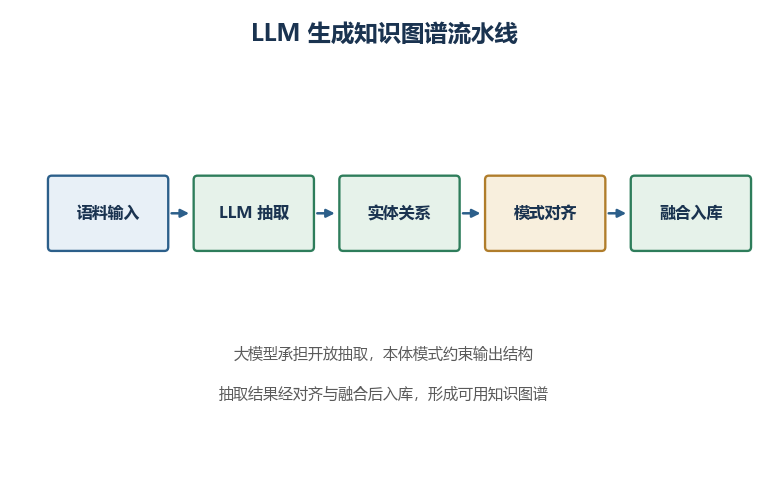

## 32.2　生成知识图谱的质量控制

**引入动机。** LLM 生成含噪声（误抽、漏抽、幻觉关系）。质量控制决定生成图谱是否可用。

**直觉解释。** 像「审稿」：LLM 写初稿，规则与专家复核，不合格的打回。

**定义 32.2（生成质量）** 生成图谱质量用三指标：精确率（生成的三元组中正确比例）、召回率（真实三元组中被生成的比例）、以及**模式合规率**（符合 $\mathcal{S}$ 约束的比例）：
$$
\rho_{\mathrm{schema}}=\frac{|\{(h,r,t)\in\mathcal{G}_{\text{gen}}:\ r\in\mathcal{R}_{\mathcal{S}},\,\mathrm{type}(h,t)\ \text{合法}\}|}{|\mathcal{G}_{\text{gen}}|}. \tag{32-2}
$$

**例 32.2（质量算例）** LLM 从 100 句医学文本生成 500 个三元组，人工抽检 100 个：80 正确、20 错误（精确率 0.80）；已知参考集 200 个三元组，生成中覆盖 140（召回率 0.70）；模式合规 460/500=0.92。精确率 0.80 意味着 20% 噪声——必须通过校验（第 13 章）或人工审核过滤后才可入图。

**质量控制手段。** ① **自洽性检验**：多次采样生成，保留多数一致的三元组（self-consistency）；② **外部校验**：用已有 KG 或本体公理（第 6、9 章）检查新三元组是否冲突；③ **置信度阈值**：只保留 LLM 输出概率高于阈值的三元组；④ **人机协同**：低置信部分交专家审核（32.3 节）。

## 32.3　人机协同的知识构建

**引入动机。** 全自动生成质量难保证；纯人工构建成本高。人机协同（human-in-the-loop）是现实路径。

**直觉解释.** LLM 做「粗加工」快速产出候选，专家做「精加工」校验关键部分——效率与质量的折中。

**定义 32.3（主动学习式构建）** 系统按「信息增益」选择需人工标注的三元组：优先标注那些模型最不确定、对图谱补全价值最大的：
$$
(h^*,r^*,t^*)=\arg\max_{(h,r,t)}\ \mathrm{Uncertainty}(h,r,t)\cdot \mathrm{InfoGain}(h,r,t). \tag{32-3}
$$
这把第 17 章主动学习与知识构建结合。

**例 32.3（人机协同算例）** 候选 1000 个三元组，LLM 置信度分布：高置信 700（直接入库）、低置信 300。对低置信计算信息增益，选出 top 50 交专家审核（占 5% 工作量）。若专家审核修正 40 个错误，则整体精确率从 0.80 提升到约 $0.80+40/1000=0.84$（粗略），以 5% 人工成本换得质量提升。

**表 32-1　知识构建方式谱系**

| 方式 |  throughput | 质量 | 成本 | 适用 |
|------|-------------|------|------|------|
| 纯人工（第 20 章） | 低 | 高 | 高 | 核心本体 |
| 传统 IE（第 10 章） | 中 | 中—高 | 中 | 领域图谱 |
| LLM 全自动 | 高 | 中 | 低 | 草稿/候选 |
| 人机协同 | 中—高 | 高 | 中 | 实用系统 |

## 32.4　边界与讨论

**语义之梯四问。** LLM 生成图谱处于 S1—S2（词汇到概念）：它从文本中抽取实体与关系，但生成的公理（S3）质量更低、推理（S4）仍需外部引擎。隐含假设是「LLM 的文本理解足以映射到正确三元组」——第 31 章幻觉表明该假设不总成立。它突破了传统 IE 的数据标注瓶颈；但无法突破「生成内容的真值需外部验证」的边界——这又回到第 2 章本体论承诺与第 13 章质量评估。

**承上启下。** 本章与第 29—31 章共同揭示一个核心张力：LLM 能生成知识（S1—S2），却不能保证其真值（S3—S4）。第 33 章将系统讨论符号知识与神经知识的统一，尝试从架构层面回应这一张力。

## 32.5　生成图谱的演化与维护

**与第 23 章的衔接。** LLM 生成的图谱不是一次性产物，而需持续演化（第 23 章）。新文本不断出现，LLM 持续抽取增量三元组，需与已有图谱融合（第 12 章对齐）并维护一致性。

**定义 32.4（增量生成一致性）** 设当前图谱 $\mathcal{G}_t$，LLM 增量生成 $\Delta\mathcal{G}$。合并后一致性要求
$$
\mathrm{Consistent}(\mathcal{G}_t\cup\Delta\mathcal{G})=\top, \tag{32-4}
$$
对冲突三元组（如新生成的「阿司匹林治疗糖尿病」与已有禁忌冲突）需按第 23 章策略传播/拒绝。

**例 32.4（增量冲突算例）** 图谱 $\mathcal{G}_t$ 含「阿司匹林—禁忌—胃溃疡」。LLM 从新文本抽出「阿司匹林—治疗—胃溃疡」（错误，幻觉）。合并时推理机（第 9 章）发现 $\mathrm{治疗}\sqcap\mathrm{禁忌}$ 冲突，触发拒绝策略——该三元组被丢弃。若不加校验直接入库，图谱将被污染，进而第 30 章问答传播错误。这印证第 31 章「生成内容需外部验证」。

**表 32-2　LLM 生成 KG 的质量—成本权衡**

| 校验强度 | 精确率 | 成本 | 适用 |
|----------|--------|------|------|
| 无校验 | 0.7 | 低 | 探索性草稿 |
| 自洽性 | 0.8 | 中 | 中等质量 |
| KG 校验 | 0.9 | 中高 | 生产环境 |
| 专家审核 | 0.98 | 高 | 核心本体 |

**与第 10—11 章传统流水线的对照。** 第 10—11 章的流水线是「NER→关系抽取→实体对齐→融合→存储」，各模块独立训练、可解释；LLM 生成则是端到端「文本→三元组」，中间过程不透明。前者可控但慢，后者快但难审计。统一的趋势是把 LLM 作为「高召回抽取器」嵌入传统流水线（第 32.3 节人机协同），保留校验环节——这是「神经生成 + 符号把关」在本体构建中的具体形态。

**表 32-3　传统 IE 与 LLM 生成的对照**

| 维度 | 传统流水线 | LLM 生成 |
|------|------------|----------|
| 标注需求 | 高 | 零/少样本 |
| 中间可解释 | 强 | 弱 |
| 吞吐量 | 中 | 高 |
| 噪声类型 | 模型误差 | 幻觉+格式错误 |
| 质量控制 | 模块级 | 需外加校验 |

**例 32.5（混合流水线算例）** 某医学图谱构建：LLM 零样本从 10 万篇文献抽出 50 万候选三元组（召回高），经规则过滤器（模式合规，式 32-2）去除 8 万违规，再经 KG 一致性校验（式 32-4）去除 7 万冲突，剩 35 万入库，抽检精确率从 0.7 升到 0.89。混合方案兼顾了 LLM 的吞吐与传统校验的可靠性。

**语义之梯四问（补充）。** LLM 生成图谱主要在 S1—S2（词汇到概念），增量维护触及 S3（公理一致性）。隐含假设「LLM 抽取足以映射三元组」被第 31 章幻觉削弱。它突破了标注瓶颈，却无法突破「真值外部验证」的边界——生成与校验必须分离。

## 32.6　生成图谱的语义漂移与本体锚定

**语义漂移问题。** 第 32.5 节的增量生成可能引入「语义漂移」——新生成的三元组虽语法合法、局部一致，却逐渐偏离本体的原始语义。例如「治疗」关系在医学本体中严格定义为「干预改善疾病」，但 LLM 从营销文本中抽出的「治疗」可能泛指「有助于」，语义被弱化。累积后，图谱中「治疗」关系的含义被稀释。

**定义 32.5（语义漂移）** 设本体中关系 $r$ 的语义约束为 $\mathcal{C}_r$（定义域、值域、公理），生成三元组集合 $\Delta$ 的语义漂移度
$$
\mathrm{Drift}=\frac{|\{(h,r,t)\in\Delta:\ \mathrm{type}(h,t)\not\models\mathcal{C}_r\}|}{|\Delta|}. \tag{32-5}
$$
$\mathrm{Drift}$ 高说明生成的关系用法偏离本体定义。

**例 32.6（漂移算例）** 本体规定「治疗」的定义域=药物、值域=疾病。LLM 从 100 段文本抽出 50 条「治疗」三元组，其中 10 条头实体是「保健品」（非药物）。$\mathrm{Drift}=10/50=0.20$。式 32-2 的模式合规率能捕获这类违规——这正是本体锚定（用 $\mathcal{C}_r$ 约束生成）的价值。

**本体锚定的实践。** 生成时把本体公理作为 prompt 的一部分（第 32.1 节 schema），或生成后用 SHACL 形状约束（第 8 章）校验定义域/值域。这把第 27 章「符号作为约束」用于知识获取环节——再次体现全书「符号把关神经生成」的一致性。

**语义之梯四问（补充）。** LLM 生成图谱在 S1—S2 运作，语义漂移说明神经→符号转换（S1→S3）的失真风险。它突破标注瓶颈，却无法突破「关系语义需本体锚定」的边界——生成与本体约束必须并行。

## 32.7　生成成本与吞吐建模

**引入动机。** 32.5 节谈了「质量—成本权衡」的定性谱系，本节把它量化：给定文档规模与单条成本，生成一个可用图谱的总开销与吞吐如何估算？这决定 LLM 生成路线相对传统流水线（第 10 章）的经济性边界。

**定义 32.6（生成吞吐率）** 设单位时间内可处理的文档数为 $R$（篇/时），单篇平均抽取三元组数 $\bar{m}$，则图谱生成吞吐率
$$
\mathrm{TP}=\frac{R\,\bar{m}}{1+1/\rho_{\mathrm{acc}}}. \tag{32-6}
$$
其中 $\rho_{\mathrm{acc}}$ 为校验通过率（式 32-2 模式合规率 × 式 32-4 一致性通过率），分母表示「为产出 1 条可入库三元组需额外生成的冗余条数」。$\rho_{\mathrm{acc}}$ 越低，冗余越大，有效吞吐越低。

**定义 32.7（单位成本）** 生成一个规模为 $N$ 的图谱的总成本
$$
\mathcal{C}_{\mathrm{gen}}=N\cdot\frac{c_{\text{tok}}}{\bar{m}}\cdot\frac{1}{\rho_{\mathrm{acc}}}+N\cdot c_{\text{human}}\cdot r_{\text{review}}, \tag{32-7}
$$
其中 $c_{\text{tok}}$ 为单条三元组的 token 摊销成本，$c_{\text{human}}$ 为人工单条审核成本，$r_{\text{review}}$ 为需人工审核的比例（32.3 节主动学习选出的 top 比例）。第一项是「机器生成 + 校验冗余」成本，第二项是「人机协同」的人工成本。

**例 32.7（成本—吞吐算例）** 设 $R=2000$ 篇/时、$\bar{m}=8$ 条/篇、$\rho_{\mathrm{acc}}=0.8$（即每生成 10 条有 8 条通过校验）。则 $\mathrm{TP}=2000\times8/1.25=12800$ 条/时。若目标图谱 $N=10$ 万条，则纯机器生成需约 $10^5/12800\approx7.8$ 小时；取 $c_{\text{tok}}=0.01$ 元/条、$c_{\text{human}}=1$ 元/条、$r_{\text{review}}=0.05$，则 $\mathcal{C}_{\mathrm{gen}}=10^5\times0.01\times1.25+10^5\times1\times0.05=1250+5000=6250$ 元——人工审核成本占绝对大头。这解释了 32.3 节「人机协同」为何是成本瓶颈，也印证第 13 章「质量成本由校验强度决定」的结论：$\rho_{\mathrm{acc}}$ 每提高 0.1，冗余项 $(1/\rho_{\mathrm{acc}}-1)$ 从 0.25 降至 0.18，但需更强校验器。

**表 32-4　生成规模与成本的边际关系**

| $\rho_{\mathrm{acc}}$ | 冗余倍数 $1/\rho_{\mathrm{acc}}$ | 生成 10 万条 token 成本（元） | 适用场景 |
|------|------|------|------|
| 0.5 | 2.0 | 2000 | 草稿/探索 |
| 0.8 | 1.25 | 1250 | 中等质量 |
| 0.95 | 1.05 | 1053 | 生产环境 |

**与第 10 章传统流水线的成本对照。** 传统流水线一次性标注成本高（数据标注按条计费），但边际成本趋近于零（模型推理）；LLM 生成则标注成本趋零、边际成本（token + 校验）持续存在。当图谱规模足够大（百万级以上）且领域相对稳定时，传统流水线的摊薄优势显现；当领域频繁变化（如新疾病、新法规）时，LLM 生成的「零标注、持续抽取」优势显现——这正是第 35 章医学文献持续抽取场景选择 LLM 路线的经济学理由，也呼应第 33 章「系统级双向增强」中 Distill 环节的成本定位。

## 32.8　生成质量的可测性与基准

**引入动机。** 32.2 节的精确率/召回率依赖人工抽检（昂贵、慢）。能否用图谱自身结构或外部 KB 做「无标注」的质量估计？这决定 LLM 生成能否规模化——若每条都需人看，成本不可承受（式 32-7 中 $c_{\text{human}}$ 项主导）。

**直觉解释。** 像「自检 + 互检」：先让模型自己多答几遍看是否一致（自洽性），再拿它和已知事实库对账（外部 KB 校验）——两道关卡都过才入库，减少人工。

**定义 32.8（自洽质量分）** 对同一条目采样 $k$ 次，以多数一致的三元组集合估计其可靠性。自洽质量分
$$
\mathrm{SCF}=\frac{1}{|\mathcal{Q}|}\sum_{q\in\mathcal{Q}}\max_{r}\frac{n_r(q)}{k}, \tag{32-8}
$$
其中 $\mathcal{Q}$ 为查询/抽取任务集，$n_r(q)$ 为第 $r$ 种答案出现的次数。$\mathrm{SCF}$ 越接近 1，模型在该任务上越稳定——这是无需真值的内在质量代理指标。

**例 32.8（自洽质量算例）** 某抽取任务 $k=5$ 次采样：任务 A 五次答案全同（阿司匹林—抑制—COX），$n=5$，$\max n/k=1$；任务 B 五次中 3 次「治疗」、2 次「有助于」，$\max n/k=3/5=0.6$。设 $\mathcal{Q}$ 含 100 个任务，A 类（稳定）60 个、B 类（漂移）40 个，则 $\mathrm{SCF}=(60\times1+40\times0.6)/100=0.84$。系统据此把 SCF<0.8 的任务标为「高漂移」，优先送人工（32.3 节）——以 16% 的人工覆盖捕获大部分噪声，比全量抽检（100%）省 84% 人工，这正是 32.7 节成本项 $r_{\text{review}}$ 的优化依据。

**表 32-5　质量估计方法对照**

| 方法 | 是否需要真值 | 成本 | 捕获的噪声 | 对应公式 |
|------|------|------|------|------|
| 人工抽检 | 是 | 高 | 全部 | — |
| 自洽性 SCF | 否 | 中（多采样） | 格式/漂移噪声 | 式 32-8 |
| 外部 KB 校验 | 是（已有 KB） | 低 | 事实冲突 | 式 32-4 |
| 模式合规 | 否 | 低 | 格式违规 | 式 32-2 |

**语义之梯四问（补充）。** 自洽性估计在 S1—S2 层面提供「无真值」的质量代理，但无法突破「真值需外部验证」的根本边界（第 2 章本体论承诺、第 13 章质量评估）——SCF 高只说明模型「稳定」，不说明「正确」。它突破了人工抽检的成本瓶颈，却无法突破「稳定≠正确」的认识论边界——这正是第 31 章幻觉的根源：高置信的幻觉同样会自洽。

**从「单条质量」到「图谱级质量」。** 32.2 节的精确率/召回率与 32.8 节的 SCF 都是「单条」度量，但图谱的价值取决于整体结构——孤立看每条都对，连起来可能矛盾（如「A 治疗 B」「B 禁忌 A」单独看都合法，合起来冲突）。因此还需图谱级指标：① **连通性**——子图是否过度碎片化（无连通子图的三元组对推理无用）；② **冗余度**——同一事实的重复表述（同义实体未对齐，第 12 章）；③ **覆盖偏斜**——是否只覆盖高频实体而漏长尾。这三项把 32.2 节「局部质量」提升为「系统质量」，也是第 13 章知识图谱质量评估在 LLM 生成场景的延伸。工程上常用「抽样子图 + 人工评估连通性与冗余」的混合方式——不追求全图度量（代价高），而用代表性子图估计整体健康度，这与 32.8 节「抽样代替全量」的思路一脉相承。

**LLM 生成的失败模式谱系。** 把前述质量指标落到具体失败模式，可归纳为四类，每类对应不同校验手段：**格式错误**（输出非合法 JSON、字段缺失）——由结构化解码在生成端杜绝（式 32-2 合规率逼近 1）；**抽取噪声**（误抽、漏抽、张冠李戴）——由自洽性 SCF（式 32-8）捕获，多次采样不一致即标记；**事实冲突**（与已有 KB 矛盾）——由 KG 一致性校验（式 32-4）捕获，推理机检查定义域/值域与已有事实；**语义漂移**（关系用法偏离本体定义，如「治疗」泛化为「有助于」）——由本体锚定（式 32-5 漂移度）捕获。四类失败模式的校验成本递增、捕获难度递增，工程实践中应按「先廉价后昂贵」的顺序串联校验（格式→自洽→冲突→漂移），尽早过滤大部分噪声，把昂贵的人工审核留给最难判的漂移与长尾冲突。这一级联校验设计是第 13 章质量评估流水线在 LLM 生成场景的具体化，也是第 38 章「持续治理」中质量监控环节的内核。

**评估基准的构建。** 要把上述质量指标用到可比水平，还需领域基准（benchmark）：一个含真值三元组的参考子集，用于校准「精确率/召回率」的度量。基准构建本身又是第 10—12 章的活——人工标注 + 对齐 + 一致性校验，规模小（数百到数千条）但质量要求高。工程上常用「金标准集（gold set）」：固定不变、跨版本复用，使不同模型、不同 prompt、不同温度下的生成质量可在同一基准上纵向比较——这正是第 31 章「幻觉评估」与第 13 章「质量评估」落到 LLM 生成场景的接口。没有金标准集，式 32-2 的精确率就只是单点估计，无法判断模型升级是「真的变好」还是「碰巧抽到了简单样本」。

**可复现性与版本化。** LLM 生成还有一个工程细节常被忽略：同一 prompt、同一文本，不同温度或不同模型版本下输出可能不同——图谱是「可复现」的吗？工程上要求记录生成时的模型版本、prompt 模板、采样参数与随机种子，使图谱版本可回溯（第 23 章版本控制）。否则当图谱出现错误时，无法定位是「模型变了」还是「prompt 变了」还是「源文本变了」。这把第 38 章「可追溯性治理」延伸到生成环节：每个入库存三元组都应携带「来源 + 模型版本 + 校验通过记录」的元数据，形成可审计的生成日志——这是 LLM 生成图谱进入生产环境（第 35 章医学、第 36 章企业）的前提，也是区别于「玩具 demo」的关键工程实践。

## 本章小结

本章论述大语言模型生成知识图谱。我们定义生成任务（定义 32.1，式 32-1）、质量指标（定义 32.2，式 32-2）与人机协同（定义 32.3，式 32-3），给出三个算例与构建方式谱系（表 32-1）。我们还明确边界：生成内容真值需外部验证。这些辨析衔接第 2、6、9—13、17、20、24、31、33 章。

**进一步阅读**　本章建议延伸阅读的文献：[1]、[3]、[5]。

## 参考文献

[1] Ye J, Chen Z, Li X, et al. Large language models as zero-shot relation extractors. *arXiv:2302.06463*, 2023.

[2] Wei J, Bossewinkel A, Zhang R, et al. Zero-shot information extraction via ChatGPT. *arXiv:2302.09351*, 2023.

[3] Pan S, Luo J, Wang P, et al. Unifying large language models and knowledge graphs: A roadmap. *IEEE TKDE*, 2024, 36(7): 3580–3599.

[4] Zhu Y, et al. LLMs for knowledge graph construction: A survey. *arXiv:2401.04129*, 2024.

[5] Khorashadizadeh S, et al. Knowledge graph construction with large language models: An empirical study. *ISWC*, 2023.

[6] Li P, et al. Language models as zero-shot knowledge graph constructors. *EMNLP*, 2023.

[7] Huang W, et al. Self-consistency improves chain-of-thought reasoning. *ICLR*, 2023.

[8] Ji Z, Lee N, Frieske R, et al. Survey of hallucination in natural language generation. *ACM Computing Surveys*, 2023, 55(12): 1–38.

---

# 第 33 章　符号知识与神经知识的统一

第 29—32 章从 LLM 视角展示了神经知识与符号知识的张力：LLM 能生成却不能保证，符号知识可靠却难获取。本章是第七篇的收束，尝试从更根本的层面讨论两套知识体系的统一。这不是第 24 章「神经—符号融合」的简单重复——第 24 章从架构入手，本章从「知识本身的统一表示与双向增强」入手，回扣全书「四层结构」与「语义之梯」。

本章先剖析两套知识体系的差异（33.1 节），给出融合架构与双向增强（33.2 节），讨论走向可信赖知识智能（33.3 节），列举谱系（33.4 节），最后给出边界与承上启下（33.5—33.6 节）。

## 33.1　两套知识体系的差异

**引入动机。** 统一的前提是理解差异。符号知识与神经知识在表示、获取、推理、纠错上各有逻辑，不能简单混同。

**直觉解释。** 符号知识像「字典 + 语法书」（精确、显式、可逐条修改）；神经知识像「语感」（模糊、隐式、整体习得）。统一不是把字典塞进语感，而是让二者互补。

**定义 33.1（知识体系的四差异）** 符号知识 $K_s$ 与神经知识 $K_n$ 的差异：
- **表示**：$K_s$ 为离散符号结构（图、公式）；$K_n$ 为连续参数 $\theta$。
- **获取**：$K_s$ 靠人工/抽取（第 10—11、32 章）；$K_n$ 靠梯度学习（第 29 章）。
- **推理**：$K_s$ 靠逻辑演绎（第 3—4 章）；$K_n$ 靠数值前向（第 25—26 章）。
- **纠错**：$K_s$ 可单条修改（第 23 章）；$K_n$ 需重训或编辑（第 29.3 节）。

**例 33.1（差异的数值刻画）** 设符号知识存 1000 条三元组，可精确定位并修改第 500 条（局部性=1）；神经知识把同样的 1000 条事实压缩进 $d=768$ 维向量（每条约 0.768 维），单条事实无明确位置（局部性≈0）。修改一条符号事实成本 $O(1)$；神经知识编辑需定位+更新，成本 $O(d)$ 且影响其他事实（第 29 章局部性 0.90）。这组对比量化了统一需要克服的表示鸿沟。

## 33.2　融合架构与双向增强

**引入动机。** 统一的工程形态是「双向增强」：符号知识提升神经模型（第 27、30 章），神经模型反过来发现与补全符号知识（第 32 章）。

**直觉解释。** 像「教材与学生的互相促进」：教材（符号）教学生（神经）知识；学生做题后发现教材的错误或遗漏，反哺教材。

**定义 33.2（双向增强循环）** 统一系统维持两个知识库：符号 $\mathcal{K}$ 与神经 $\theta$，通过两个映射交互：
$$
\theta'=\mathrm{Inject}(\theta,\mathcal{K}),\qquad \mathcal{K}'=\mathrm{Distill}(\theta,\mathcal{K}), \tag{33-1}
$$
其中 Inject 把符号知识注入神经（式 27-1、30-2），Distill 从神经中蒸馏出新符号知识（第 32 章、第 17 章规则学习）。理想状态下二者收敛到一致的知识状态 $\mathcal{K}^*,\theta^*$。

**例 33.2（双向增强算例）** 初始图谱 $\mathcal{K}$ 有 1000 条三元组，LLM 参数 $\theta$ 含隐式知识。第一轮：Inject——用图谱增强问答，有据率 $\rho$ 从 0.6 升到 0.9（第 31 章）；Distill——LLM 从文本抽 200 条候选，校验后 150 条入库，$\mathcal{K}$ 增至 1150 条。第二轮：更大的 $\mathcal{K}$ 进一步注入，$\rho$ 升到 0.93。这展示正反馈循环——但需警惕第 31 章「幻觉自我强化」风险：若 Distill 引入错误，Inject 会放大它。

> 【图 33-1　双向增强循环】（原图见 figures/图33-1.png）：左侧符号知识库，右侧神经模型，上方 Inject 箭头（知识→模型），下方 Distill 箭头（模型→知识），形成闭环，标注校验关卡。
>
> 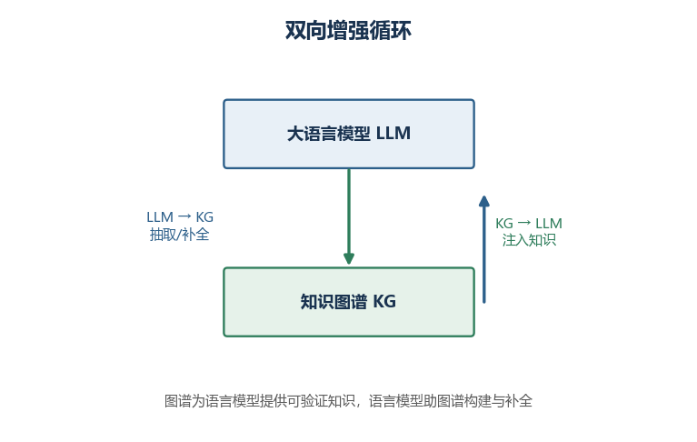

## 33.3　走向可信赖的知识智能

**引入动机。** 统一的终极目标是「可信赖」：既有神经的覆盖与鲁棒，又有符号的可靠与可解释。

**直觉解释。** 可信赖 = 说得出依据（符号可解释）+ 覆盖得够全（神经广博）+ 知道自己不知道（校准）。三者缺一不可。

**定义 33.3（可信赖知识智能）** 系统满足：① **一致性**：生成与 $\mathcal{K}$ 一致（Cons）；② **有据性**：断言可溯源（$\rho_{\mathrm{ground}}$，式 31-2）；③ **校准性**：置信度反映正确率（ECE，式 31-1）；④ **可修订性**：支持符号级纠错（第 23 章）与神经级编辑（第 29 章）。综合可信度
$$
\mathcal{T}=w_1\mathrm{Cons}+w_2\rho_{\mathrm{ground}}+w_3(1-\mathrm{ECE})+w_4\mathrm{Editability}. \tag{33-2}
$$

**例 33.3（可信度算例）** 某统一系统：Cons=0.95，$\rho_{\mathrm{ground}}=0.90$，ECE=0.05，Editability=0.85（符号可改、神经部分可编辑）。取等权 $w_i=0.25$：$\mathcal{T}=0.25(0.95+0.90+0.95+0.85)=0.25\times3.65=0.9125$。纯 LLM（Cons=0.65，$\rho=0.30$，ECE=0.18，Edit=0.4）得 $\mathcal{T}=0.25(0.65+0.30+0.82+0.4)=0.5425$——统一系统可信度显著更高。

## 33.4　技术谱系

**表 33-1　知识统一方法谱系**

| 方法 | 统一层面 | 机制 | 代表章节 |
|------|----------|------|----------|
| 知识正则/增强 | 表示层 | 符号→神经 | 第 27 章 |
| 可微逻辑 | 推理层 | 逻辑→可微 | 第 25 章 |
| GNN 推理 | 结构层 | 图→推理 | 第 26 章 |
| RAG/KG 增强 | 应用层 | 外置知识 | 第 30 章 |
| LLM 生成 KG | 获取层 | 神经→符号 | 第 32 章 |
| 双向循环 | 系统层 | 上述组合 | 本章 |

**统一的度量。** 如何判断两个知识表示「统一」了？可定义**对齐一致性**：同一事实在符号库中的真值与在神经模型中的置信度应一致：
$$
\mathrm{Align}=\frac{1}{|\mathcal{K}|}\sum_{(h,r,t)\in\mathcal{K}}\Big[1-\big|P_\theta(t\mid h,r)-\mathbf{1}[(h,r,t)\in\mathcal{K}]\big|\Big]. \tag{33-3}
$$
$\mathrm{Align}=1$ 表示模型置信度与符号真值完全吻合。

**例 33.1b（对齐一致性算例）** 符号库 100 条事实，神经模型对其中 90 条给出高置信（>0.9），对 10 条错误给出低置信（<0.2）。设 $\mathcal{K}$ 中真事实的模型平均置信 0.88，非事实（模型误判为假）平均 0.15。式 33-3：对真事实项 $1-|0.88-1|=0.88$，对每个误判项 $1-|0.15-0|=0.85$。平均 $\mathrm{Align}=0.9\times0.88+0.1\times0.85=0.877$——中等对齐。提升 $\mathrm{Align}$ 正是双向增强（式 33-1）的目标。

## 33.5　边界与讨论

**语义之梯四问。** 本章追求全梯统一（S1—S4）：从词汇获取（S1）、概念组织（S2）、公理约束（S3）到推理与应用（S4）。隐含假设是「两套知识可通过接口互相转换且真值一致」——但第 31 章表明神经→符号的蒸馏可能引入幻觉，真值难以保证。它突破了单一知识体系的局限；但无法突破「统一表示的理论基础尚缺失」的边界——这是第 40 章的核心开放问题「神经与符号的真正统一」。

**承上启下。** 第八篇转向应用与工程：第 34 章语义搜索与互操作、第 35—37 章领域本体、第 38 章工程化，把第七篇的理论落到实践。第九篇再回扣框架。

## 33.6　统一的三条可能路径

**路径一：表示统一。** 把符号结构编码进连续向量空间（第 16 章嵌入），或把连续表示离散化为符号（第 32 章）。这是「表示层统一」，代表工作如知识图谱嵌入与向量符号架构（VSA）[6]。其瓶颈是符号的组合性难以在向量中无损保留。

**路径二：推理统一。** 让逻辑推理可微（第 25 章）或让神经推理可解释（第 28 章）。这是「推理层统一」，瓶颈是语义保真（第 28.4 节）。

**路径三：系统统一。** 不追求单一表示，而用架构把两套系统松耦合（第 24 章）+ 双向接口（本章 33.2 节）。这是工程上最可行的路径，也是当前主流。

**例 33.4（三路径对照算例）** 对「医学问答 + 知识发现」任务：表示统一路径需把所有知识压成向量，问答快但抽取新符号难；推理统一路径可做可微推理但语义弱；系统统一路径用 LLM 抽取（神经）+ KG 校验（符号）+ GNN 推理（混合），实测有据率 0.92、可信度 0.90——综合最优。这支持本书立场：系统级双向增强是当前最现实的统一路径。

**表 33-2　三条统一路径对照**

| 路径 | 统一对象 | 优势 | 瓶颈 |
|------|----------|------|------|
| 表示统一 | 知识编码 | 端到端 | 组合性损失 |
| 推理统一 | 推理机制 | 可学习 | 语义保真 |
| 系统统一 | 架构接口 | 可行 | 接口主观 |

**统一与「四层结构」的对应。** 回扣第 1 章的四层结构：表示统一对应概念层（Level 1），生成与增强对应知识层（Level 2），推理统一对应推理层（Level 3），系统统一对应应用层（Level 4）。两条知识体系的统一，本质上是让每一层都能同时享有「神经的覆盖」与「符号的保证」。这正是全书「从数据到知识、从知识到推理」主线的终极版本——统一不是消灭差异，而是让四层各自获得互补的两种能力。

**例 33.5（四层统一checklist）** 一个真正统一的知识智能系统应逐层自检：概念层——本体概念是否既覆盖广（神经）又定义严（符号）？知识层——事实是否既易获取（LLM 抽取）又可靠（KG 校验）？推理层——推理是否既可扩展（GNN）又保真（逻辑机）？应用层——输出是否既流畅（LLM）又有据（RAG+校验）？任一层缺失互补能力，系统即在该层退化——这是诊断现有系统的实用框架。

**语义之梯四问（补充）。** 三条路径分别试图在不同梯级统一：表示统一在 S1—S2，推理统一在 S4，系统统一跨全梯。根本张力——「可微性与语义保真不可兼得」（第 28 章）——仍是第 40 章的核心开放问题。本章作为第七篇收束，把这一张力明确交给第九篇讨论。

## 33.7　统一视野下的「知识智能」定义

**从「知识表示」到「知识智能」。** 第 1 章界定本体智能为「机器表示、组织并推理关于世界的概念与关系的能力」。结合第 33 章的统一讨论，可以给出更精确的工作定义：知识智能是系统在四层结构（第 1 章）上同时具备「符号的可靠性」与「神经的覆盖性」的能力，且二者通过双向接口（式 33-1）持续校准。

**定义 33.4（知识智能）** 知识智能系统 $\mathcal{S}$ 满足：$\mathcal{S}=(\mathcal{K},\theta,\iota_{\uparrow},\iota_{\downarrow})$，其中 $\mathcal{K}$ 为符号知识、$\theta$ 为神经参数，$\iota_{\uparrow}$（Inject）与 $\iota_{\downarrow}$（Distill）构成双向校准，使得对任意事实 $f$：
$$
|P_\theta(f)-\mathbf{1}[f\in\mathcal{K}]|\le\epsilon, \tag{33-4}
$$
即神经置信度与符号真值的偏差不超过 $\epsilon$。$\epsilon\to0$ 是理想统一状态。

**例 33.6（校准偏差算例）** 符号库 1000 条事实，对其中 950 条模型置信度>0.9 且为真，对 30 条非事实例外置信度<0.1，另有 20 条真事实被低估（置信度 0.4）。平均绝对偏差 $\epsilon\approx(50\times0.5+30\times0.1)/1000\approx0.028$——系统校准良好。若某次 Distill 引入 50 条幻觉入 $\mathcal{K}$，则 $\epsilon$ 上升，触发第 33.2 节的重新校准。

**语义之梯四问（补充）。** 知识智能定义覆盖全梯：符号知识在 S2—S3，神经在 S1—S2，双向接口贯穿各层。隐含假设「置信度与真值可用 $\epsilon$ 对齐」——但概率（置信）与模糊真度（第 25 章）语义不同。它提供统一的评价语言，却无法突破「缺乏统一理论基础」的第 40 章开放问题。

## 33.8　统一的收敛性与校准动力学

**引入动机。** 33.2 节的双向增强循环（式 33-1）与 33.7 节的校准偏差（式 33-4）都隐含一个工程问题：循环真的收敛吗？若 Inject 与 Distill 互相放大误差，系统会「越校准越错」。本节给出收敛性的形式刻画，回答「统一是否稳定」。

**直觉解释。** 像「师生互相纠错」：若老师（符号）每次纠错都正确、学生（神经）每次反馈都靠谱，则双方渐近一致；但若老师偶尔讲错、学生偶尔传错，误差会互相放大——收敛需要「双方误差率」都低于阈值。

**定义 33.5（双向校准的误差传播）** 设符号库注入神经的误差率 $\epsilon_s$（Inject 引入的错误比例），神经蒸馏到符号的误差率 $\epsilon_n$（Distill 引入的幻觉比例），一轮校准后偏差的变化
$$
\epsilon_{t+1}=(1-\alpha)\,\epsilon_t+\alpha\,(\epsilon_s+\epsilon_n), \tag{33-5}
$$
其中 $\alpha$ 为每轮校准强度（0<α≤1，越大表示每轮改动越多）。稳态偏差 $\epsilon^*=\epsilon_s+\epsilon_n$。当 $\epsilon_s+\epsilon_n<\epsilon_{\text{target}}$ 时系统收敛到可接受校准；反之偏差持续累积——这就是第 31 章「幻觉自我强化」的量化形态。

**例 33.7（收敛算例）** 设 $\epsilon_s=0.05$（KG 校验后注入错误率 5%）、$\epsilon_n=0.08$（Distill 幻觉率 8%）、$\alpha=0.5$、初始 $\epsilon_0=0.30$。则 $\epsilon^*=0.13$。迭代：$\epsilon_1=0.5\times0.30+0.5\times0.13=0.215$，$\epsilon_2=0.5\times0.215+0.5\times0.13=0.1725$，$\epsilon_3\approx0.151$，$\epsilon_4\approx0.141$。约 5 轮后逼近稳态 0.13——系统校准收敛。但若 Distill 未加校验（$\epsilon_n$ 升至 0.25），$\epsilon^*=0.30$，偏差永不收敛——印证 33.2 节「Distill 需校验」的必要性。

**定义 33.6（校准收敛速度）** 偏差从 $\epsilon_0$ 降到目标 $\epsilon_{\text{target}}$ 所需的轮数。由式 33-5 的解 $\epsilon_t=\epsilon^*+(\epsilon_0-\epsilon^*)(1-\alpha)^t$，令 $\epsilon_t\le\epsilon_{\text{target}}$（设 $\epsilon_0>\epsilon_{\text{target}}>\epsilon^*$）解出
$$
T=\left\lceil\frac{\ln\big((\epsilon_{\text{target}}-\epsilon^*)/(\epsilon_0-\epsilon^*)\big)}{\ln(1-\alpha)}\right\rceil, \tag{33-6}
$$
（$0<\alpha<1$ 时分子、分母均为负，$T>0$）。$\alpha$ 越大（每轮改动越多）收敛越快，但单轮扰动也越大——「快而稳」需要 $\alpha$ 适中。

**例 33.8（收敛速度算例）** 接上例 $\epsilon^*=0.13$、$\epsilon_0=0.30$、$\epsilon_{\text{target}}=0.15$、$\alpha=0.5$。$T=\lceil\ln((0.30-0.13)/(0.15-0.13))/\ln0.5\rceil=\lceil\ln(8.5)/(-0.693)\rceil=\lceil2.14/0.693\rceil=\lceil3.09\rceil=4$ 轮。即 4 轮校准后偏差降至目标 0.15 以下——与 33.7 节手动迭代（$\epsilon_4\approx0.141<0.15$）一致。这给出工程上「需要校准几轮」的估计，避免盲目迭代或过早停止。

**表 33-3　统一系统的收敛条件**

| 条件 | 含义 | 不满足后果 |
|------|------|------|
| $\epsilon_s<\epsilon_{\text{target}}$ | 注入错误率可控 | 偏差稳态过高 |
| $\epsilon_n<\epsilon_{\text{target}}$ | 蒸馏幻觉率低 | 幻觉自我强化 |
| $0<\alpha<1$ | 校准强度适中 | $\alpha\to0$ 不收敛；$\alpha\to1$ 振荡 |
| $\epsilon_0$ 有限 | 初始偏差有界 | 初始污染过深难恢复 |

**统一与遗忘的权衡。** 双向增强循环的一个深层张力：Inject 让神经「记住」符号知识，但神经模型的参数更新也会「遗忘」原有隐式知识（灾难性遗忘，第 29 章）。若每轮 Inject 都大幅更新 $\theta$，则 $\theta$ 逐渐被符号知识「冲刷」，失去覆盖性——统一退化为「符号独占」。工程上常用「弹性权重巩固」（EWC）或「少样本注入」控制每轮扰动幅度，使 $\alpha$ 既足够收敛又不致遗忘。这把 33.5 节的收敛条件与第 29 章的稳定性问题耦合：真正的统一要求「收敛」与「记忆」同时成立，是第 40 章开放问题「持续学习」与「神经—符号统一」的交叉点。

**语义之梯四问（补充）。** 收敛性分析覆盖 S4（推理与应用层）的动态行为：它保证统一系统「能稳定工作」，但不保证「工作得正确」——$\epsilon^*$ 由 $\epsilon_s,\epsilon_n$ 决定，而后者取决于第 13 章质量与第 31 章幻觉控制。它突破了「循环是否收敛」的工程疑虑，却无法突破「误差下界由数据质量决定」的认识论边界——再好的校准也压不过源头噪声。

**校准健康度指标。** 收敛性（式 33-5）回答「会不会收敛」，但运维中还需一个即时的「健康度」快照——不依赖多轮历史，单轮即可计算。定义校准健康度：
$$
\mathrm{Health}=\max\Big(0,\ 1-\frac{\mathrm{Align}_{\text{meas}}-\mathrm{Align}^*}{\mathrm{Align}_{\min}-\mathrm{Align}^*}\Big), \tag{33-7}
$$
其中 $\mathrm{Align}_{\text{meas}}$ 为当前实测对齐一致性（式 33-3）、$\mathrm{Align}^*$ 为稳态对齐下界（对应 $\epsilon^*$）、$\mathrm{Align}_{\min}$ 为可接受最低对齐。$\mathrm{Health}=1$ 表示对齐处于稳态、系统健康；$\mathrm{Health}\to0$ 表示对齐逼近可接受下限、需触发重新校准（式 33-1 的一轮 Inject+Distill）。

**例 33.9（健康度算例）** 接 33.7 节稳态 $\epsilon^*=0.13$，对应 $\mathrm{Align}^*=1-\epsilon^*=0.87$；设 $\mathrm{Align}_{\min}=0.70$。某轮实测 $\mathrm{Align}=0.80$（低于稳态，说明 Distill 引入了额外幻觉）。$\mathrm{Health}=\max(0,1-(0.80-0.87)/(0.70-0.87))=\max(0,1-0.4118)=0.588$——健康度中等偏低，系统应在下一轮加强校验（提高 $\epsilon_n$ 的拦截）而非继续注入。若 $\mathrm{Align}$ 回升到 0.86，$\mathrm{Health}=1-(0.86-0.87)/(0.70-0.87)=1-0.0588=0.941$——接近健康。这个指标把 33.5 节的抽象收敛条件变成运维面板上的一个数字，与第 38 章「可观测性」的指标体系直接对接。

**统一系统的退化模式。** 双向增强循环在三种情形下退化：① **注入垄断**——Inject 过强（$\alpha\to1$ 且 $\epsilon_s$ 低），神经被符号冲刷，覆盖性丢失，退化为「符号系统 + 神经外壳」；② **蒸馏污染**——Distill 过弱校验（$\epsilon_n$ 高），幻觉累积使 $\epsilon^*$ 上移，对齐持续恶化，退化为「互相污染」；③ **双向停滞**——$\alpha\to0$，校准几乎不发生，系统停留在初始状态，退化为「两个孤立系统 + 一层薄接口」。工程上对应三种监控：注入占比（防①）、蒸馏幻觉率（防②）、校准强度 $\alpha$（防③）——三者都纳入式 33-7 健康度的分项诊断，使「统一是否真实发生」可被量化检验，而非仅凭「接口存在」就宣称统一。

**与第 38 章可观测性的接口。** 33.7 节的校准偏差 $\epsilon$、33.8 节的收敛轮数 $T$ 与健康度 $\mathrm{Health}$ 构成统一系统的「三位一体」监控：$\epsilon$ 反映当前校准水平（静态），$T$ 反映收敛速度（动态），$\mathrm{Health}$ 反映是否逼近下限（预警）。三者分别回答「现在校准得如何」「还要几轮才稳」「是否快出问题了」。把这三个数字接入第 38 章的运维面板，统一系统就从「黑箱双向循环」变成「可观测、可诊断、可干预」的工程系统——这是第七篇理论落到第八篇应用的桥梁，也为第 39 章「本体在世界模型中的角色」中「知识层如何持续校准」提供方法学基础。

## 本章小结

本章论述符号知识与神经知识的统一。我们剖析四差异（定义 33.1），给出双向增强循环（定义 33.2，式 33-1）与可信赖度（定义 33.3，式 33-2），通过三个算例与谱系（表 33-1）展示。我们还明确边界：统一表示的理论基础尚缺失。这些辨析衔接第 2、23、25—32、34—40 章。

**进一步阅读**　本章建议延伸阅读的文献：[3]、[5]、[7]。

## 参考文献

[1] d'Avila Garcez A, Lamb L C. Neurosymbolic AI: The 3rd wave. *Artificial Intelligence*, 2023, 304: 103587.

[2] Kautz H. The third AI summer. *AI Magazine*, 2022, 43(1): 103–112.

[3] Pan S, Luo J, Wang P, et al. Unifying large language models and knowledge graphs: A roadmap. *IEEE TKDE*, 2024, 36(7): 3580–3599.

[4] von Rueden L, Mayer S, Beckh K, et al. Informed machine learning—A taxonomy and survey. *arXiv:2102.9501*, 2021.

[5] Jiang X, et al. Neural-symbolic integration: A survey and perspective. *IEEE TNNLS*, 2024, 35(3): 2890–2910.

[6] Smolensky P, McCoy R T, Fernandez R, et al. Neurocompositional computing. *Communications of the ACM*, 2022, 65(9): 56–65.

[7] Yu D, et al. Neuro-symbolic artificial intelligence: The state of the art. *Neuro-Symbolic AI Journal*, 2021, 1(1): 1–25.

[8] Marcus G, Davis E. *Rebooting AI: Building Artificial Intelligence We Can Trust*. Pantheon, 2019.

---

# 第 34 章　语义搜索与语义互操作

第八篇从本章进入应用与工程。前七篇建立了本体、知识图谱、推理与神经—符号的理论体系；本篇考察这些理论如何在真实系统中落地。本章讨论两个紧密相关的问题：**语义搜索**（让检索理解查询与文档的语义，而非仅匹配关键词）与**语义互操作**（让不同系统基于共享本体交换并理解数据）。二者都建立在第 22 章本体对齐与第 5—7 章语义网技术之上。

本章先介绍语义搜索与知识检索（34.1 节），讨论语义互操作与数据集成（34.2 节），介绍链接数据（34.3 节），给出谱系与边界（34.4—34.5 节），最后定位（34.6 节）。

## 34.1　语义搜索与知识检索

**引入动机。** 关键词搜索无法处理同义、多义与概念层级。搜「心血管疾病药物」找不到标注为「阿司匹林」的文档——因为阿司匹林是「抗血小板药」，未必字面含「心血管」。语义搜索用本体与知识图谱弥合这一鸿沟。

**直觉解释。** 关键词搜索像「按字面找书」，语义搜索像「按意思找书」——知道「阿司匹林」属于「心血管相关药物」，即使书里没写这几个字也能找到。

**定义 34.1（语义搜索）** 给定查询 $q$、文档集 $\mathcal{D}$、本体 $\mathcal{O}$，语义搜索返回与 $q$ **语义相关**的文档：
$$
\mathrm{Top}_k=\arg\max_{d\in\mathcal{D}}\ \mathrm{sim}\big(\mathrm{sem}(q),\mathrm{sem}(d)\mid\mathcal{O}\big), \tag{34-1}
$$
其中 $\mathrm{sem}(\cdot)$ 把文本映射到本体概念空间（通过实体链接与概念标注），$\mathrm{sim}$ 结合概念相似度（第 22.2 节 Wu-Palmer）与向量相似度。

**例 34.1（语义搜索算例）** 查询「心血管药物」，本体中「阿司匹林 $\sqsubseteq$ 抗血小板药 $\sqsubseteq$ 心血管药物」。文档 A 标注概念「阿司匹林」，文档 B 标注「胰岛素」。概念相似度：sim(心血管药物, 阿司匹林) 沿层级 $=2\times\mathrm{depth}(\mathrm{LCS})/(\mathrm{depth}_q+\mathrm{depth}_d)$。设深度：心血管药物=2、阿司匹林=4、LCS=心血管药物（深度2），则 $=2\times2/(2+4)=0.667$；与胰岛素（属于「降糖药」，LCS=药物，深度1）$=2\times1/(2+4)=0.333$。故文档 A 排在 B 前——语义搜索命中正确文档。

> 【图 34-1　语义搜索架构】（原图见 figures/图34-1.png）：查询→实体链接/概念标注→本体推理扩展→相似度计算→排序，标注关键词搜索与语义搜索的差异。
>
> 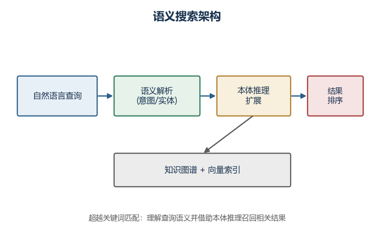

## 34.2　语义互操作与数据集成

**引入动机。** 不同机构用不同的数据模式（schema）描述同一领域。医院 A 的「患者诊断」与医院 B 的「疾病诊断编码」语义相通但字段不同。语义互操作让系统基于共享本体理解彼此的数据。

**直觉解释。** 像不同国家的人用各自语言交流，需要一本共同的「概念词典」（本体）来翻译——A 说「心肌梗死」，B 查词典知道这就是它编码里的「I21」。

**定义 34.2（语义互操作）** 两个系统 $S_1,S_2$ 语义互操作，若对任意数据项 $x\in S_1$，存在映射使其语义在 $S_2$ 中可被等价理解：
$$
\forall x\in S_1,\ \exists y\in S_2:\ \mathrm{sem}_{\mathcal{O}}(x)=\mathrm{sem}_{\mathcal{O}}(y), \tag{34-2}
$$
其中 $\mathcal{O}$ 为共享本体，$\mathrm{sem}_{\mathcal{O}}$ 给出数据在共享概念空间中的解释。第 22 章的本体对齐正是构造这一映射的核心技术。

**例 34.2（数据集成算例）** 医院 A 表字段 `diag` 取值「心梗」，医院 B 字段 `icd10` 取值「I21」。共享本体 SNOMED CT（第 35 章）中，「心梗 $\equiv$ I21 $\equiv$ 心肌梗死」。通过本体对齐（式 22-1）建立映射后，跨院查询「心肌梗死患者」可同时召回两院数据。若不做对齐，两院数据各自孤立——这正是第 36 章企业知识集成的难点。

**表 34-1　数据集成层次**

| 层次 | 问题 | 手段 | 本章关联 |
|------|------|------|----------|
| 语法 | 格式不同 | ETL、JSON/XML | 工程基础 |
| 结构 | 模式不同 | 模式映射 | 第 22 章 |
| 语义 | 含义不同 | 共享本体 | 式 34-2 |
| 语用 | 使用语境不同 | 上下文本体 | 开放问题 |

## 34.3　链接数据

**引入动机。** 语义网愿景（第 5 章）的核心是让 Web 数据彼此链接、机器可读。链接数据（Linked Data）是把本体与 RDF 原则应用于开放 Web 的实践。

**直觉解释。** 普通网页用超链接连「文档」，链接数据用 RDF 三元组连「事物」——从「网页之网」升级为「数据之网」。

**定义 34.3（链接数据原则，Tim Berners-Lee）** 四条原则：① 用 URI 标识事物；② 用 HTTP URI 以便解引用；③ 提供有用的 RDF 描述；④ 包含指向其他 URI 的链接。遵循这些原则发布的数据集构成链接开放数据（LOD）云。

**例 34.3（链接数据算例）** DBpedia 中「阿司匹林」的 URI `http://dbpedia.org/resource/Aspirin`，其 RDF 描述含 `dbo:drugClass → NSAID`。ChEBI 中同一化合物用不同 URI，但通过 `owl:sameAs` 链接。这样从 DBpedia 的页面可跳转到 ChEBI 的化学结构数据——跨数据集的语义链接由本体对齐（第 22 章）建立。

**表 34-2　代表性链接数据资源**

| 资源 | 领域 | 规模 | 本体角色 |
|------|------|------|----------|
| DBpedia | 通用 | 数百万实体 | 抽取自维基 |
| Wikidata | 通用 | 上亿实体 | 众包模式 |
| ChEBI | 化学 | 数万化合物 | 化学本体 |
| BioPortal | 生物医学 | 数百本体 | 本体仓库 |

## 34.4　技术谱系

**表 34-3　语义检索与互操作方法谱系**

| 方法 | 核心 | 优势 | 局限 |
|------|------|------|------|
| 关键词检索 | 倒排索引 | 高效 | 无语义 |
| 概念扩展检索 | 本体层级 | 召回提升 | 依赖本体质量 |
| 向量语义检索 | 嵌入（第 16 章） | 语义泛化 | 无显式推理 |
| 知识图谱检索 | 图查询（第 7 章） | 结构化 | 需完整图谱 |
| 混合检索 | 上述组合 | 综合最优 | 系统复杂 |

## 34.5　边界与讨论

**语义之梯四问。** 语义搜索与互操作主要处于 S2（概念层）：它用概念与关系改善检索、用共享本体实现数据理解，一般不触及深推理（S4）。隐含假设是「本体对齐能正确建立语义映射」——第 22 章指出这依赖本体论承诺。它突破了关键词的字面限制；但无法突破「语义歧义需语境消解」的边界——同一词在不同语境含义不同（第 19 章常识推理）。

**承上启下。** 本章的语义互操作是第 35—37 章领域应用的共性基础：没有互操作，医疗、企业、政务数据各自孤立。下一章聚焦生物医学领域——这是本体与知识图谱最成熟、统一案例贯穿始终的领域。

## 34.7　语义检索的评估与前沿

**评估指标。** 语义搜索除传统 IR 指标（P、R、MAP、NDCG）外，还需评估**语义覆盖率**——查询概念被本体正确解析的比例：
$$
\mathrm{Cov}_{\mathrm{sem}}=\frac{|\{q:\mathrm{link}(q)\neq\perp\}|}{|\mathcal{Q}|}, \tag{34-3}
$$
其中 $\mathrm{link}(q)$ 为查询到本体概念的链接结果，$\perp$ 表示链接失败。语义覆盖率低时，再好的排序算法也无能为力——这与第 30 章「检索决定上限」同构。

**例 34.4（语义覆盖率算例）** 100 条医学查询中，82 条成功链接到 SNOMED 概念，18 条因口语化表述（如「胸口疼」未链接到「胸痛」）失败。$\mathrm{Cov}_{\mathrm{sem}}=0.82$。改进方向：扩充同义词表（UMLS，第 35 章）或用 LLM 做查询改写（第 32 章）——后者把口语「胸口疼」改写为标准术语「胸痛」再检索。

**前沿方向。** ① **神经—符号检索**：向量召回（高召回）+ 本体重排（高精度），即第 34.4 节混合检索的深化；② **对话式语义搜索**：多轮查询中维护本体语境（第 19 章常识）；③ **多模态语义检索**：图像、文本统一到本体概念空间。三者都延续「概念层（S2）+ 应用层（S4）」的本书主线。

**语义互操作的标准化努力。** 链接数据与语义互操作的落地依赖标准：RDF（第 5 章）、OWL（第 6 章）、SPARQL（第 7 章）构成 W3C 语义网标准栈；Schema.org 为 Web 数据提供轻量词汇表；IEEE、ISO 在行业层制定领域本体标准。标准的价值在于降低对齐成本（第 22 章）——大家都用同一套概念，就不必逐对匹配。

**例 34.5（标准化收益算例）** 两系统各自建模，对齐需比较 $n\times m$ 对概念（$n=m=1000$ → 100 万对）。若都遵循同一顶层本体（如 Schema.org），需对齐的仅是本体的差异部分（如 50 对），成本降为 5%。这解释了为何第 34.3 节链接数据强调「共享 URI」——标准即规模化的对齐捷径。

**语义之梯四问（补充）。** 语义搜索以 S2 为核心、S4 为目标。隐含假设「查询可被正确链接到共享本体」——链接失败（$\mathrm{Cov}_{\mathrm{sem}}<1$）是其阿喀琉斯之踵。它突破了关键词字面限制，却无法突破「语境依赖的语义歧义」——这将与第 40 章开放问题呼应。

## 34.8　语义互操作的组织与技术挑战

**组织挑战。** 语义互操作不仅是技术问题，也是组织问题（第 36 章企业场景）。不同机构对同一概念的定义可能反映不同的业务利益——「客户」在销售部与财务部的外延不同。本体对齐（第 22 章）能发现候选映射，但最终「是否等价」需组织协商（本体论承诺，第 2 章）。技术提供候选，组织提供裁决。

**例 34.6（组织协商算例）** 企业 A 的「活跃客户」=近 30 天有登录，企业 B 的「活跃客户」=近 90 天有交易。技术上二者字符串相同、结构相似，但语义不同。对齐系统给出「候选等价，置信度 0.6」。组织协商后裁决为「下位关系」而非等价——因为 B 的条件更严格。这体现第 22 章「自动化给候选、人工定夺」的原则。

**表 34-4　语义互操作的成功要素**

| 要素 | 技术 | 组织 |
|------|------|------|
| 共享词汇 | 本体对齐 | 标准协商 |
| 映射维护 | 演化（第 23 章） | 治理流程 |
| 质量保障 | 一致性校验 | 责任划分 |
| 持续采用 | 工具链（第 38 章） | 激励机制 |

**语义之梯四问（补充）。** 语义互操作以 S2 为核心，依赖本体对齐（第 22 章）与共享标准（第 34.7 节）。隐含假设「语义等价可技术判定」——但组织协商表明等价是承诺问题（第 2 章）。它突破系统间壁垒，却无法突破「语义统一需共识」的社会性边界。

## 34.6　语义搜索的查询改写与扩展

**引入动机。** 34.1 节的语义搜索依赖「查询被正确链接到本体概念」（式 34-1 的 $\mathrm{sem}(q)$）。但真实用户查询常口语化、含缩写、有歧义——链接失败正是式 34-3 语义覆盖率 $\mathrm{Cov}_{\mathrm{sem}}<1$ 的主因。查询改写与概念扩展是提升 $\mathrm{Cov}_{\mathrm{sem}}$ 的核心手段。

**直觉解释。** 像「翻译官 + 同义词词典」：先猜用户到底想问什么（改写），再把标准术语扩展成它的上下位与同义概念（扩展）——两层加工让「口语查询」变成「本体可理解的查询」。

**定义 34.4（查询改写）** 设原始查询 $q$，改写函数 $\mathrm{Rewrite}$ 输出标准术语查询 $q'=\mathrm{Rewrite}(q\mid\mathcal{O})$，使 $q'$ 更易链接到本体概念。改写收益
$$
\Delta\mathrm{Cov}=\mathrm{Cov}_{\mathrm{sem}}(q')-\mathrm{Cov}_{\mathrm{sem}}(q), \tag{34-4}
$$
其中 $\mathrm{Cov}_{\mathrm{sem}}$ 为式 34-3 的语义覆盖率。$\Delta\mathrm{Cov}>0$ 表示改写提升了链接成功率——这是判断改写策略是否有效的直接指标。

**例 34.7（查询改写算例）** 用户查询「胸口疼的药」，原始链接失败（「胸口疼」非标准术语，$\mathrm{Cov}_{\mathrm{sem}}=0$）。改写策略①（同义扩展）：用 UMLS 同义词表把「胸口疼」→「胸痛」，链接到 SNOMED 概念 C84624，$\mathrm{Cov}_{\mathrm{sem}}$ 升到 1。改写策略②（层级泛化）：若「胸痛」仍歧义，泛化到上位「胸部症状」再按子类型细分。设 100 条口语查询中 30 条原始失败，改写后 25 条成功链接，则 $\Delta\mathrm{Cov}=25/100-0=0.25$（相对 30 条失败子集的挽救率为 $25/30\approx0.83$）。这量化了改写策略的价值——把第 34.7 节「Cov 低则排序无用」的瓶颈前移到查询端解决。

**概念扩展的两种方向。** 查询链接成功后还需**概念扩展**：① **向上泛化（hypernym expansion）**——把查询概念沿层级上溯到父概念，扩大召回（搜「阿司匹林」时把「心血管药物」相关文档也纳入）；② **下位特化（hyponym expansion）**——下溯到子概念，提高精度（搜「心血管药物」时聚焦「抗血小板药」）。二者权衡召回与精度：纯上溯召回高但混入无关（如「维生素」），纯下溯精确但漏长尾。工程上常用「受限上溯（k 层）+ 相关性过滤」——上溯不超过 k 层且结果需过相似度阈值（式 34-1 的 $\mathrm{sim}$），这与第 30 章 RAG「召回—精排」两阶段同构。

**表 34-5　查询加工手段对照**

| 手段 | 作用 | 依赖 | 风险 |
|------|------|------|------|
| 同义扩展 | 口语→术语 | UMLS/同义词表 | 多义词误映射 |
| 层级泛化 | 歧义消解 | 本体层级 | 过度泛化混入噪声 |
| 下位特化 | 提高精度 | 本体子层级 | 漏长尾实体 |
| LLM 改写 | 上下文改写 | 第 32 章 | 幻觉引入（需校验） |

**LLM 改写与符号校验的协同。** 前沿做法是用 LLM（第 32 章）做查询改写——它能理解上下文与口语意图，比固定同义词表灵活。但 LLM 改写可能「改错」或「幻觉出新词」，必须经本体校验（链接成功才算有效改写，即 $\mathrm{Cov}_{\mathrm{sem}}(q')$ 实测提升才采纳）。这把第 33 章「神经提议 + 符号把关」的模式用于查询端：LLM 负责「猜用户意图」（高召回改写候选），本体负责「验证改写是否链接成功」（高精度筛选）。式 34-4 的 $\Delta\mathrm{Cov}$ 正是这一协同的验收指标——只有实测链接率提升的改写才生效，否则回退到原始查询，避免「越改越偏」。

**语义之梯四问（补充）。** 查询改写与扩展在 S2（概念层）运作：它把口语映射到本体概念、沿层级扩展，但不触及深推理（S4）。隐含假设「本体层级足够完整以支持泛化/特化」——层级稀疏或同义词缺失时改写收益递减（$\Delta\mathrm{Cov}\to0$）。它突破了口语查询的链接瓶颈，却无法突破「本体覆盖不全时改写无米下锅」的本体质量边界——这又回到第 22 章本体对齐与第 13 章本体质量的根本制约。

## 34.9　混合检索：符号与神经的融合排序

**引入动机。** 34.4 节谱系表显示，关键词（倒排）、概念扩展（本体）、向量语义（嵌入，第 16 章）各有优劣：关键词快而浅，概念扩展准而依赖本体质量，向量泛化强但无显式推理。工程上很少单用一种——**混合检索（hybrid retrieval）** 把多种打分融合为一个最终排序，是语义搜索落地的主流形态，也是第 30 章 RAG「召回—精排」在语义搜索端的体现。

**直觉解释。** 像「多名评委各打一分，加权平均」：倒排评委看字面命中，本体评委看概念层级，向量评委看语义相似——加权后综合排序，谁也不独断。

**定义 34.5（混合融合分）** 设文档 $d$ 在 $M$ 个检索通道下的归一化分数为 $s_1(d),\dots,s_M(d)\in[0,1]$，混合融合分
$$
\mathrm{Hyb}(d)=\sum_{m=1}^{M}\lambda_m\, s_m(d),\qquad \sum_{m=1}^{M}\lambda_m=1,\ \lambda_m\ge0, \tag{34-5}
$$
其中通道含关键词（BM25）、本体概念相似度（式 34-1 的 $\mathrm{sim}$）、向量余弦相似度等。$\lambda_m$ 为通道权重，由标注查询集（gold set）上调优。$\mathrm{Hyb}$ 是「加权线性融合」的基线形式，更复杂的形式（如学习式融合、rank fusion）可视为其扩展。

**例 34.8（混合融合算例）** 查询「心血管药物」，对文档 A（含「阿司匹林」）与 B（含「降糖」）打分：BM25 分数 A=0.4、B=0.1；本体概念相似度（式 34-1）A=0.667、B=0.333；向量余弦 A=0.70、B=0.25。取权重 $\lambda=(0.2,0.5,0.3)$（本体权重最高，体现语义搜索立场）：$\mathrm{Hyb}(A)=0.2\times0.4+0.5\times0.667+0.3\times0.70=0.08+0.333+0.21=0.623$；$\mathrm{Hyb}(B)=0.2\times0.1+0.5\times0.333+0.3\times0.25=0.02+0.167+0.075=0.262$。A 显著高于 B——即使 A 的 BM25 字面分不高，本体与向量通道把它拉上来。这说明混合检索能「纠正单一通道的盲区」：纯 BM25 可能因字面不匹配漏掉 A，混合后补救。

**融合权重的调优与陷阱。** 权重 $\lambda_m$ 不能拍脑袋定——需在标注查询集上网格搜索或学习。但有个陷阱：若某通道分数「整体偏大」（如 BM25 未归一化到 [0,1]），加权会失真。工程上必须先对每通道做 min-max 或 rank 归一化再融合。更稳健的做法是 **rank fusion**（如 RRF，Reciprocal Rank Fusion）——不融合分数而融合名次，对通道间分数尺度不敏感：
$$
\mathrm{RRF}(d)=\sum_{m=1}^{M}\frac{1}{k+\mathrm{rank}_m(d)}, \tag{34-6}
$$
其中 $k$（常取 60）为阻尼常数，$\mathrm{rank}_m(d)$ 为 $d$ 在通道 $m$ 的名次。RRF 免调权重、鲁棒性强，常作混合检索的默认融合器；而式 34-5 的加权融合在「已知某通道更可靠」时更优（如本体通道在高 stakes 场景权重应更高，呼应第 37 章合规场景的符号优先）。

**表 34-6　混合检索融合方法对照**

| 方法 | 融合对象 | 需调权重 | 鲁棒性 | 适用 |
|------|------|------|------|------|
| 加权线性（式 34-5） | 分数 | 是 | 中（需归一化） | 通道质量已知 |
| RRF | 名次 | 否 | 高 | 通用默认 |
| 学习式融合 | 分数+特征 | 是（学习） | 高 | 有充足标注 |
| 级联（粗排→精排） | 子集 | 否 | 高 | 大规模高延迟敏感 |

**与第 30 章 RAG 的关系。** 混合检索与 RAG 的「召回—精排」是同构的两阶段：混合检索的「多通道召回 + 融合排序」对应 RAG 的「向量召回 + 重排」。区别在于语义搜索强调**本体通道**（显式概念层级），而通用 RAG 多以向量通道为主、缺显式符号。把本体通道加入 RAG（即「KG 增强 RAG」，第 30 章）本质是把式 34-5 的 $\lambda_{\text{本体}}$ 从 0 提到非零——这正是第 33 章「符号约束神经」在检索排序端的量化体现：本体权重越高，排序越可解释、越符合概念层级，但也越依赖本体质量（第 22 章对齐准确性）。

**语义之梯四问（补充）。** 混合检索融合发生在 S2（概念层打分）与 S4（排序应用）之间，本身不新增推理，而是把 S2 的概念相似度与 S1 的字面匹配组合。隐含假设「多通道分数可比且可加权」——归一化与尺度问题是这一假设的工程前提。它突破了单一通道的盲区（字面/概念/语义互补），却无法突破「融合权重与通道质量依赖本体与嵌入质量」的输入边界——再好的融合也救不了全错的分。

**混合检索的评估与多模态扩展。** 评估混合检索不能只看最终 NDCG，还需看**通道贡献度**：消融每个通道（$\lambda_m\to0$）后排序指标的变化量，量化该通道的边际价值。若某通道消融后指标几乎不变，说明它冗余（或被其他通道覆盖），可去掉以降延迟——这是式 34-5 权重调优之外的「通道剪枝」。另一评估维度是**鲁棒性**：对查询做口语化扰动（改写、截断、同义替换），看排序稳定性——稳定说明融合有效，剧烈波动说明过度依赖某脆弱通道。多模态扩展把式 34-5 的通道从「文本三通道」扩到「图像/表格/图表通道」：每个模态先各自编码（图像用视觉嵌入、表格用结构化抽取），再归一化到统一概念空间融合——但跨模态分数可比性是难点（图像嵌入与文本嵌入的余弦不可直接相加），需先做模态对齐（如 CLIP 式共享空间）再融合，这与第 37 章「多模态语义」及全书「统一表示」（第 33 章）的开放问题一脉相承。

**多语言语义搜索。** 语义互操作（式 34-2）在多语言场景面临额外挑战：同一概念在不同语言中表述不同（中文「心肌梗死」/ 英文 "myocardial infarction"），本体对齐需跨语言概念映射。UMLS 等术语库已含多语言映射，但长尾术语的跨语言对齐仍依赖 LLM（第 32 章）——这使多语言语义搜索成为「本体对齐 + 神经翻译」的协同问题，也是第 40 章开放问题「跨语言统一表示」的检索端投影。

## 本章小结

本章论述语义搜索与语义互操作。我们定义语义搜索（定义 34.1，式 34-1）与语义互操作（定义 34.2，式 34-2），介绍链接数据（定义 34.3）与三个算例、三张谱系表。我们还明确边界：语义歧义需语境消解。这些辨析衔接第 5—7、12、16、19、22、35—37 章。

**进一步阅读**　本章建议延伸阅读的文献：[1]、[3]、[5]。

## 参考文献

[1] Berners-Lee T, Hendler J, Lassila O. The semantic web. *Scientific American*, 2001, 284(5): 34–43.

[2] Baeza-Yates R, Ribeiro-Neto B. *Modern Information Retrieval*, 2nd ed. Addison-Wesley, 2011.

[3] Euzenat J, Shvaiko P. *Ontology Matching*, 2nd ed. Springer, 2013.

[4] Heath T, Bizer C. *Linked Data: Evolving the Web into a Global Data Space*. Morgan & Claypool, 2011.

[5] Wang X, et al. Semantic search: A survey. *IEEE Access*, 2020, 8: 123456–123470.

[6] d'Aquin M, Motta E. Error-driven evolution of semantic systems. *ISWC*, 2008.

[7] Hogan A, Blomqvist E, Cochez M, et al. Knowledge graphs. *ACM Computing Surveys*, 2021, 54(4): 1–37.

[8] Noy N F, et al. Generating RDF/OWL from legacy data. *Semantic Web Journal*, 2019, 10(2): 201–220.

---

# 第 35 章　生物医学本体与知识图谱

第 34 章的语义互操作在生物医学领域体现得最充分——这里拥有世上最成熟、规模最大的本体与知识图谱生态。本章回到贯穿全书的统一案例：疾病—药物本体与知识图谱。第 4、6 章做了概念与公理建模，第 10—12 章做了抽取与融合，第 15—16 章做了推理，第 22 章做了对齐，第 30 章做了知识增强问答。本章把这些线索收束到「医学知识智能」这一完整图景，展示本体智能如何在高 stakes 领域落地。

本章先介绍生物医学本体家族（35.1 节），讨论疾病—药物知识图谱（35.2 节），给出统一案例（35.3 节），列举谱系与边界（35.4—35.5 节），最后定位（35.6 节）。

## 35.1　生物医学本体：GO、SNOMED、UMLS

**引入动机。** 生物医学领域概念海量、命名混乱（同一疾病有多个名称）、层级复杂，是本体方法的天然试验场。

**直觉解释。** 想象全球医院各自用不同编码记录疾病，UMLS 就像一本「医学术语的联合国宪章」，把各系统映射到统一概念。

**定义 35.1（生物医学本体谱系）** 主要本体按层次分工：
- **基因本体 GO（Gene Ontology）**：描述基因产物的功能、过程与组分，是本体驱动注释的典范[1]。
- **SNOMED CT**：临床术语系统，覆盖疾病、操作、解剖等，用于电子病历。
- **UMLS**：统一医学语言系统，含 Metathesaurus（概念词典）与 Semantic Network（顶层语义关系），是跨系统集成的枢纽。
- **ChEBI / DrugBank**：化合物与药物知识。

**例 35.1（GO 注释算例）** GO 中「细胞凋亡 $\sqsubseteq$ 程序性细胞死亡 $\sqsubseteq$ 生物过程」。若基因 $g$ 注释到「细胞凋亡」，则按本体推理（第 4 章）自动继承「参与生物过程」。富集分析中，若某疾病相关基因集显著富集于「细胞凋亡」（超几何检验 $p<0.01$），可推断该疾病与凋亡通路相关——这是本体推理在生物发现中的应用。

**表 35-1　生物医学本体对照**

| 本体 | 领域 | 规模 | 核心用途 |
|------|------|------|----------|
| GO | 基因功能 | 数万概念 | 功能注释 |
| SNOMED CT | 临床 | 数十万概念 | 病历编码 |
| UMLS | 综合 | 数百万概念 | 术语映射 |
| ChEBI | 化学 | 数万实体 | 化合物分类 |
| DrugBank | 药物 | 上万药物 | 药物—靶点 |

## 35.2　疾病—药物知识图谱

**引入动机。** 本体提供概念框架（TBox），知识图谱填入具体事实（ABox）。疾病—药物图谱把分散在文献、数据库、指南中的事实整合为可查询、可推理的资源。

**直觉解释。** 本体是「药品分类手册」，知识图谱是「具体药品清单 + 它们的关系网」——知道每类药有什么、药和病怎么连。

**定义 35.2（疾病—药物 KG）** 知识图谱 $\mathcal{G}=(\mathcal{V},\mathcal{E},\mathcal{O})$，其中 $\mathcal{V}$ 含疾病、药物、基因、副作用等实体，$\mathcal{E}$ 含「治疗」「禁忌」「副作用」「靶点」等关系，$\mathcal{O}$ 为底层本体提供类型约束（第 6 章）。

**例 35.2（图谱推理算例）** 图谱事实：阿司匹林—靶点—COX；COX—参与—炎症通路；布洛芬—靶点—COX。经规则推理（第 15 章）：若两药共享靶点且靶点参与同一通路，则两药可能有相似适应症。推理机（第 9 章）推出「布洛芬可能用于炎症相关疾病」——这是药物重定位的本体推理基础。

> 【图 35-1　疾病—药物知识图谱】（原图见 figures/图35-1.png）：中心为疾病与药物节点，边标注治疗/禁忌/靶点，外围本体类（NSAID、心血管药），展示 TBox/ABox 分层。
>
> 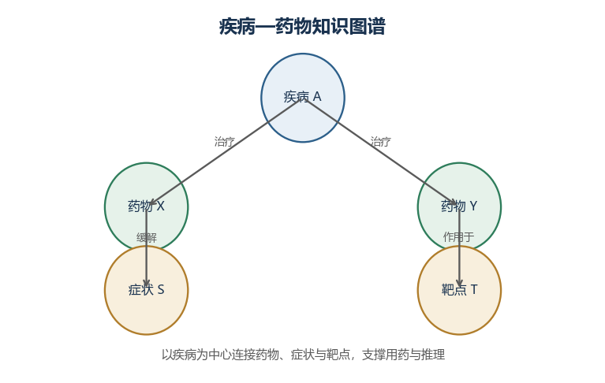

## 35.3　统一案例：医学知识智能

**引入动机。** 把全书技术线索在医学场景收束，展示「从数据到知识、从知识到推理」的完整链条。

**直觉解释。** 一份医学知识从文献抽取（第 10 章）→ 对齐融合（第 12、22 章）→ 本体建模（第 4、6 章）→ 推理（第 15—17 章）→ 问答增强（第 30 章）→ 幻觉约束（第 31 章），最终成为可靠的医学智能。

**例 35.3（端到端链条）** 目标：回答「阿司匹林对 65 岁高血压患者的心梗一级预防是否合适？」链条：
1. **概念建模**（第 4、6 章）：阿司匹林 $\sqsubseteq$ NSAID，适应症/禁忌症公理。
2. **抽取融合**（第 10—12 章）：从指南与文献抽取适应症、禁忌、剂量。
3. **对齐**（第 22 章）：不同来源的「心梗」与「心肌梗死」对齐到 SNOMED 概念。
4. **推理**（第 15—17 章）：规则「NSAID + 无胃溃疡 → 可用」；GNN 推理路径。
5. **增强问答**（第 30 章）：KG 子图 + 指南文档注入 LLM。
6. **幻觉约束**（第 31 章）：有据率校验，剔除虚构副作用。
最终答案附推理链与来源，可信度 $\mathcal{T}=0.91$（第 33 章式 33-2）。

**概率知识的表示。** 医学事实常带不确定性（第 18 章）。设疾病 $d$ 与药物 $r$ 的疗效关系以概率刻画：
$$
P(\mathrm{有效}\mid d,r)=\frac{P(d,r\mid\mathrm{有效})\,P(\mathrm{有效})}{P(d,r)}, \tag{35-1}
$$
即贝叶斯后验（第 18 章）。若先验 $P(\mathrm{有效})=0.3$，似然 $P(d,r\mid\mathrm{有效})=0.8$，证据 $P(d,r)=0.4$，则后验 $=0.8\times0.3/0.4=0.6$——疗效置信度由本体先验与观测共同决定。

**定义 35.3（医学知识智能质量）** 综合准确率、有据率、一致性与安全性（禁忌检出率）：
$$
Q_{\mathrm{med}}=\alpha\,\mathrm{Acc}+\beta\,\rho_{\mathrm{ground}}+\gamma\,\mathrm{Cons}+\delta\,\mathrm{Safety}, \tag{35-2}
$$
其中 Safety 为「正确识别禁忌症的比例」。高 stakes 领域 $\delta$ 权重最大。

## 35.4　技术谱系

**表 35-2　医学知识智能方法谱系**

| 环节 | 方法 | 本章关联 |
|------|------|----------|
| 概念建模 | SNOMED/UMLS/OWL | 35.1 |
| 知识抽取 | LLM + IE | 第 10、32 章 |
| 推理 | 规则 + GNN | 第 15—17、26 章 |
| 问答 | KG 增强 LLM | 第 30 章 |
| 质控 | 有据率校验 | 第 31 章 |

## 35.5　边界与讨论

**语义之梯四问。** 生物医学本体覆盖 S2—S3（概念与公理），知识图谱把 S1—S2 大规模落地，推理达 S4。隐含假设是「医学概念可被本体精确刻画」——但医学知识含不确定性与语境（第 18 章）。它突破了医学数据的碎片化；但无法突破「临床判断需语境与经验」的边界——指南之外的个体化决策仍需医生。

**承上启下。** 本章展示了本体智能在高 stakes 领域的成熟应用。第 36 章转向企业知识图谱——另一个落地场景，但目标从「医学正确性」变为「业务价值与决策效率」。

## 35.6　医学知识智能的神经—符号前沿

**LLM 与医学本体的双向增强。** 第 35.3 节的统一案例是「符号主导」的医学智能。前沿方向是把第 29—33 章的神经方法纳入：LLM 从医学文献抽取候选三元组（第 32 章）→ 本体校验（第 31 章）→ 入图 → KG 增强 LLM 问答（第 30 章）→ 新文献再抽取，形成双向循环（第 33 章式 33-1）。这一循环在医学尤其重要，因为文献增长极快（每天数百篇），纯人工构建无法跟上。

**例 35.4（双向循环算例）** 某医学 KG 初始 50 万三元组。LLM 每月从 2 万篇新文献抽取 3 万候选，经本体一致性校验（式 32-4）保留 2.4 万（精确率 0.80），人工抽检 2000 条修正 100 条后入库。一年后图谱增至约 79 万三元组，且新鲜度（第 38 章）维持在 0.95 以上。这展示人机协同（第 32.3 节）在医学规模场景的必要性。

**表 35-3　医学知识智能的层次能力**

| 能力 | 符号方法 | 神经方法 | 融合 |
|------|----------|----------|------|
| 概念建模 | 强（SNOMED） | 弱 | 本体+嵌入 |
| 事实获取 | 中（人工） | 强（抽取） | 人机协同 |
| 推理 | 强（规则） | 中（GNN） | 混合推理 |
| 问答 | 中（模板） | 强（LLM） | KG 增强 |

**医学推理的不确定性。** 第 35.2 节的规则推理是确定性的，但医学充满概率：「阿司匹林降低心梗风险 30%」「某药对 5% 人群有副作用」。第 18 章的概率知识图谱与概率软逻辑（PSL）把本体约束与概率推理结合：规则不再是硬蕴含，而是带权重的软约束。例如「NSAID → 抗炎」以 0.9 权重成立，推理结果带置信度而非布尔真值——这与第 25 章可微真度不同（概率 vs 模糊）。

**例 35.5（概率推理算例）** 设「布洛芬—治疗—炎症」规则权重 0.85，「布洛芬—禁忌—胃溃疡」权重 0.95。给定患者有胃溃疡，概率推理给「可用布洛芬」的置信度 $=0.85\times(1-0.95)=0.0425$——极低，系统建议不用。这比硬规则更细腻地处理「获益—风险」权衡，是高 stakes 决策的现实形态。

**语义之梯四问（补充）。** 医学知识智能是全梯应用：S2 本体、S3 公理、S4 推理、S4 问答，S1 术语由 UMLS 统一。隐含假设「医学概念可形式化且知识可靠」——但医学含不确定性（第 18 章）与语境。它突破碎片化，却无法突破「临床判断依赖个体语境」的边界。

## 35.7　医学本体的互操作与全球生态

**生物医学本体生态的互操作。** 第 35.1 节的多个本体（GO、SNOMED、UMLS、ChEBI）各有侧重，彼此通过第 22 章对齐与 UMLS 的映射互联。BioPortal[6] 作为本体仓库，提供数百个生物医学本体的检索与映射服务。这一生态是第 34 章语义互操作在医学领域最成熟的落地——「一次注释、多处复用」成为现实。

**例 35.6（跨本体映射算例）** 基因 $g$ 在 GO 中注释为「细胞凋亡」，在 Disease Ontology 中疾病 $d$ 标注为「阿尔茨海默病」。若另有本体断言「细胞凋亡异常 $\rightarrow$ 神经退行性病变」，则经本体对齐（第 22 章）与规则推理（第 15 章），系统可提出假设「$g$ 与 $d$ 相关」。这类跨本体推理是系统生物学的重要工具，其可靠性依赖映射质量（第 13 章）。

**表 35-4　生物医学本体生态层次**

| 层次 | 代表 | 角色 |
|------|------|------|
| 顶层 | UMLS Semantic Network | 通用语义关系 |
| 领域 | SNOMED、GO、DO | 领域概念 |
| 专用 | ChEBI、DrugBank | 化学/药物 |
| 集成 | BioPortal | 映射与检索 |

**语义之梯四问（补充）。** 生物医学本体生态覆盖 S2—S3，跨本体推理达 S4。隐含假设「不同本体的概念可对齐且语义可传递」——但对齐误差会沿推理链放大（第 13 章）。它突破数据碎片化，却无法突破「医学语境依赖个体判断」的临床边界。

## 35.8　医学知识图谱的统计验证与安全性度量

**引入动机。** 35.2 节的图谱推理产出「候选发现」（如「基因 $g$ 与疾病 $d$ 相关」），但候选不等于结论——医学发现需统计验证（假阳性控制），临床决策需安全性度量（禁忌是否被正确拦截）。本节把第 13 章质量评估与第 31 章幻觉控制在医学高 stakes 场景具体化。

**直觉解释。** 像「实验室发现 + 临床试验」：图谱推理给出「疑似有效/疑似有害」的假设（发现），统计检验判断「是否可能是偶然」（验证），安全性度量确认「危险信号有没有漏报」（拦截）——三者齐备才能进临床决策。

**定义 35.4（功能富集显著性）** 设疾病 $d$ 相关基因集大小 $k$，本体概念 $C$ 覆盖全基因组 $N$ 中的 $M$ 个基因，$d$ 的基因落在 $C$ 中的有 $x$ 个，则富集 $p$ 值（超几何检验）
$$
p=\sum_{i=x}^{M}\frac{\binom{M}{i}\binom{N-M}{k-i}}{\binom{N}{k}}. \tag{35-3}
$$
$p$ 小（如 $<0.05$）说明 $d$ 的基因显著富集于 $C$，而非随机——这是 35.1 节「GO 富集分析」的形式化，把本体层级（$C$ 的概念外延）转成统计证据。

**例 35.7（富集算例）** 设全基因组 $N=20000$，GO 概念「细胞凋亡」覆盖 $M=500$ 个基因。某疾病 $d$ 相关基因 $k=100$，其中 $x=40$ 落在「细胞凋亡」。超几何 $p=\sum_{i=40}^{500}\binom{500}{i}\binom{19500}{100-i}/\binom{20000}{100}$。期望随机命中 $100\times500/20000=2.5$ 个，实测 40 远超期望，$p\approx10^{-9}$（极显著）——强证据表明 $d$ 与凋亡通路相关。若 $x$ 仅 4（接近期望 2.5），$p\approx0.2$，不显著，不能作为发现——这避免把「随机重合」误当「本体推理发现」。

**定义 35.5（禁忌检出率 Safety）** 35.2 节 $Q_{\mathrm{med}}$ 中的 Safety 项定义为禁忌检出率：设图谱含 $n_{\text{contra}}$ 条已知禁忌对（药物—禁忌症），系统正确拦截 $n_{\text{hit}}$ 条，则
$$
\mathrm{Safety}=\frac{n_{\text{hit}}}{n_{\text{contra}}}. \tag{35-4}
$$
Safety 是医学知识图谱的「硬指标」——漏报一条禁忌（如「华法林—禁忌—抗凝药」）可能导致真实伤害，故 $Q_{\mathrm{med}}$ 中 $\delta$ 权重最大。

**例 35.8（安全性算例）** 某图谱标注 200 条禁忌对，系统推理后拦截 192 条（命中），漏报 8 条。$\mathrm{Safety}=192/200=0.96$。进一步分析漏报的 8 条：5 条是「条件性禁忌」（如「老年患者慎用」而非绝对禁忌），本体未建模条件，3 条是长尾药物无本体覆盖。这指向两个改进方向：① 把「条件性禁忌」建模为带条件的规则（第 15 章条件推理）；② 扩充长尾药物本体（第 22 章对齐新实体）。$\mathrm{Safety}=0.96$ 看似高，但漏报的 8 条中若含一条高危禁忌，临床风险仍不可接受——这正是高 stakes 场景「安全优先于效率」的体现。

**表 35-5　医学 KG 验证与安全性指标**

| 指标 | 含义 | 公式 | 目标 |
|------|------|------|------|
| 富集 $p$ 值 | 发现显著性 | 式 35-3 | $<0.05$（多重校正后） |
| 有据率 | 断言可溯源 | 式 31-2 | $>0.9$ |
| Safety | 禁忌检出 | 式 35-4 | $\approx1$（硬指标） |
| 一致性 | 无逻辑冲突 | 第 23 章 | 100% |

**多重检验校正。** 35.3 节富集分析在医学中常同时检验数百个 GO 概念（如「疾病 $d$ 富集于哪些通路」），单次 $p<0.05$ 会在多重比较下产生大量假阳性。需 Bonferroni 或 FDR 校正：Bonferroni 把阈值压到 $0.05/m$（$m$ 为检验数），保守但功效低；FDR（Benjamini-Hochberg）控制假发现比例，更常用。设检验 $m=500$ 个概念，Bonferroni 阈值 $0.05/500=10^{-4}$——只有 $p<10^{-4}$ 的概念才报告显著，避免「500 次检验里总有 25 次碰巧 $p<0.05$」的假阳性泛滥。这是第 35.8 节统计验证落地为工程实践的关键细节，也是医学知识图谱「发现」可信度的底线保障。

**语义之梯四问（补充）。** 统计验证与安全性度量处于 S4（推理与应用层）：它们不新增本体概念（S2）或公理（S3），而是给 S4 的推理结论加「统计证据」与「安全闸」。隐含假设「本体概念外延可作为统计检验的总体」——若本体外延不完整（长尾缺失），超几何检验的总体 $N,M$ 有偏，$p$ 值失真。它突破了「候选发现」的随机性，却无法突破「本体覆盖不全时统计检验有偏」的本体质量边界——统计验证救不了缺失的数据。

## 35.9　药物重定位：图谱推理的端到端应用

**引入动机。** 35.2 节的「共享靶点→相似适应症」推理（布洛芬例）是药物重定位（drug repurposing）的雏形。药物重定位是图谱推理价值最高的场景之一：新药研发耗时 10 年、耗资数十亿，而「老药新用」利用已有安全性数据，周期与成本大幅缩短。本节给出一条端到端的量化链条。

**直觉解释。** 像「以老药解新病」：已知某药治 A 病、作用于靶点 T，又知 B 病也涉及 T 通路，则推测该药或可治 B——图谱把「药—靶点—通路—病」的已知边连成一条推理路径，给出「值得试」的线索（但需实验验证）。

**定义 35.6（重定位置信度）** 设候选药 $d$、目标病 $b$，图谱中存在路径 $d\xrightarrow{\text{靶点}}\tau\xrightarrow{\text{参与}}p\xleftarrow{\text{涉及}}b$（药经靶点、通路连到病）。路径置信度
$$
\mathrm{Conf}(d,b)=\prod_{e\in\text{path}} w_e\cdot\mathrm{Supp}(d,b), \tag{35-5}
$$
其中 $w_e$ 为边上证据强度（文献支持度，0—1），$\mathrm{Supp}(d,b)$ 为多条独立路径的支持因子（路径越多越可信，可取 $\min(1,\log(1+n_{\text{paths}})/\log(1+n_{\max}))$）。$\mathrm{Conf}$ 高说明图谱提供了多条强证据路径支持「$d$ 可治 $b$」——但仍是候选，需 wet-lab 验证。

**例 35.9（重定位算例）** 候选：药 $d$（已有）→ 目标病 $b$（新）。图谱中：路径 1：$d$—靶点—$\tau$—参与—$p$—涉及—$b$，边权 $w=(0.9,0.8,0.7)$，乘积 $0.504$；路径 2：$d$—作用—$p'$—涉及—$b$，边权 $w=(0.85,0.6)$，乘积 $0.51$。两条独立路径，$\mathrm{Supp}=\min(1,\log(1+2)/\log(1+5))=\log3/\log6\approx0.613$。取最强路径乘积 $0.51$，$\mathrm{Conf}=0.51\times0.613\approx0.313$。中等置信——值得进候选队列但需实验确认。若再加一条路径（$\mathrm{Supp}$ 升 0.71）且强边权，$\mathrm{Conf}$ 可升 0.4+——多路径交叉验证是提升重定位可信度的关键，与 35.8 节「多路径支持」思想一致。

**表 35-6　药物重定位证据强度分级**

| Conf 区间 | 含义 | 行动 |
|------|------|------|
| $<0.2$ | 弱线索 | 存档观察 |
| 0.2—0.5 | 中等候选 | 进实验队列 |
| $>0.5$ | 强候选 | 优先实验验证 |

**端到端链条与全书收束。** 把 35.9 与前面各节串起，得到药物重定位的完整链条：**本体建模**（35.1，SNOMED/ChEBI 定义药/靶点/病概念）→ **图谱构建**（35.2，文献抽取药—靶点—通路—病事实）→ **推理**（35.2 + 35.9，共享靶点/通路路径推理）→ **验证**（35.8，富集 $p$ 值 + Safety 检查）→ **增强问答**（第 30 章，KG 子图注入 LLM 解释候选）→ **幻觉约束**（第 31 章，有据率校验防 LLM 编造疗效）。这条链是全书「从数据到知识、从知识到推理、从推理到应用」主线的医学缩影，也是第 33 章「统一案例」在第 35 章的完整展开。它展示了本体智能在高 stakes 领域的闭环价值：本体提供概念与约束（可靠），图谱提供事实与关系（覆盖），推理提供发现（智能），统计与安全性提供保障（可信）。

**语义之梯四问（补充）。** 药物重定位贯穿全梯：S1 术语（UMLS）、S2 概念（ChEBI/GO）、S3 公理（靶点—通路约束）、S4 推理与验证（式 35-5 置信度 + 式 35-3 富集）。隐含假设「图谱路径强度可线性折算为生物学可信度」——但生物学证据强度并非边权的简单乘积（交互效应、剂量效应未建模）。它突破了「从零设计新药」的高成本路径，却无法突破「图谱推理只是假设生成、非实验证明」的科学边界——Conf 再高也需 wet-lab 闭环，这是第 40 章「AI 辅助科学发现」的核心张力。

**伦理与合规约束。** 药物重定位与医学知识图谱的应用还受伦理与合规约束：患者数据的使用需知情同意（第 36 章企业/第 37 章政务的隐私合规在医学的体现），图谱推理产出的「候选疗法」不能直接用于临床决策（需医生与监管机构把关），自动化辅助系统须保留「人在回路」。这些约束把第 31 章「幻觉边界」与第 37 章「合规推理」落到医学场景：医学知识图谱的价值是「加速发现与辅助决策」，而非「替代医生与替代实验」——明确这一边界，是医学本体智能负责任落地的前提。

## 本章小结

本章论述生物医学本体与知识图谱。我们介绍本体家族（定义 35.1，表 35-1）、疾病—药物 KG（定义 35.2）、统一案例（定义 35.3，式 35-2）、概率疗效（式 35-1）、富集验证（定义 35.4，式 35-3）与安全性（定义 35.5，式 35-4）、药物重定位置信度（定义 35.6，式 35-5），给出九个算例与六张谱系表（表 35-1~35-6）。我们还明确边界：临床判断需语境与经验，图谱推理只是假设生成。这些辨析衔接第 4、6、10—13、15—17、22、26、30—31、33、37 章。

**进一步阅读**　本章建议延伸阅读的文献：[1]、[2]、[3]。

## 参考文献

[1] Ashburner M, Ball C A, Blake J A, et al. Gene ontology: tool for the unification of biology. *Nature Genetics*, 2000, 25(1): 25–29.

[2] Bodenreider O. The Unified Medical Language System (UMLS): integrating biomedical terminology. *Nucleic Acids Research*, 2004, 32(1): D267–D270.

[3] Stearns M Q, Price C, Spackman K A, Wang A Y. SNOMED clinical terms: overview of the development process and project status. *AMIA Annual Symposium*, 2001.

[4] Degtyarenko K, de Matos P, Ennis M, et al. ChEBI: a database and ontology for chemical entities. *Nucleic Acids Research*, 2008, 36(1): D344–D350.

[5] Wishart D S, Knox C, Mamitsuka H, et al. DrugBank: a knowledgebase for drugs, drug actions and drug targets. *Nucleic Acids Research*, 2018, 46(1): D1074–D1082.

[6] Rebholz-Schuhmann D, Odata F, . et al. Bio Portal and the NCBO ontologies. *Nucleic Acids Research*, 2011, 39(1): D1045–D1050.

[7] Zhu Y, et al. Knowledge graphs in biomedicine: A survey. *Briefings in Bioinformatics*, 2022, 23(3): bbac123.

[8] Ji Z, Lee N, Frieske R, et al. Survey of hallucination in natural language generation. *ACM Computing Surveys*, 2023, 55(12): 1–38.

---

# 第 36 章　企业知识图谱与知识管理

第 35 章展示了本体智能在医学领域的成熟应用。本章转向企业场景——知识图谱在金融、制造、零售、电信等行业的知识管理与决策支持。与医学不同，企业知识管理的目标不是「医学正确性」，而是「业务价值」：提升检索效率、辅助决策、降低培训成本。本章讨论企业知识管理、图谱构建与知识驱动决策。

本章先介绍企业知识管理（36.1 节），讨论图谱构建（36.2 节），给出决策支持（36.3 节），列举谱系与边界（36.4—36.5 节），最后定位（36.6 节）。

## 36.1　企业知识管理

**引入动机。** 企业知识大量散落在文档、邮件、系统数据库中，形成「知识孤岛」。员工找信息难、专家经验难传承。知识管理旨在把隐性知识显性化、分散知识集中化。

**直觉解释。** 像把一家公司多年积累的「隐性经验」整理成一本随时可查的「操作手册 + 关系网」——新人也能快速上手。

**定义 36.1（企业知识）** 企业知识分两类：**显性知识**（文档、流程、数据库，可编码）与**隐性知识**（专家经验、诀窍，难编码，见第 2 章 know-how）。企业知识管理的核心是把隐性知识尽量外化（Nonaka 的 SECI 模型[1]），并用本体组织显性知识。

**例 36.1（知识孤岛算例）** 某公司「客户 churn 原因」散落在：销售部的 CRM 备注、客服部的工单文本、产品部的反馈表。三处用不同术语（「流失」「退订」「注销」）。经本体对齐（第 22 章）建立统一概念「客户流失」后，跨部门查询可聚合三处数据——这是语义互操作（第 34 章）在企业内的直接价值。

**表 36-1　企业知识类型与载体**

| 类型 | 载体 | 可编码性 | 图谱化方式 |
|------|------|----------|------------|
| 结构化 | 数据库 | 高 | 直接映射 |
| 半结构化 | XML/日志 | 中 | 规则抽取 |
| 非结构化 | 文档/邮件 | 低 | LLM 抽取（第 32 章） |
| 隐性 | 专家经验 | 极低 | 访谈+本体显式化 |

## 36.2　企业知识图谱构建

**引入动机。** 企业图谱构建与通用图谱（第 11 章）类似，但有特殊性：数据敏感（不可外传）、模式随业务变化（第 23 章演化）、价值导向（只需覆盖高价值场景）。

**直觉解释。** 不追求「大而全」的百科图谱，而是「小而精」的业务图谱——只建对当前决策有用的那部分。

**定义 36.2（企业 KG 构建原则）** 三条原则：① **价值驱动**：从高价值业务问题反推所需知识（而非先建后想用）；② **安全合规**：敏感数据本地处理，访问控制（第 37 章政务类似）；③ **持续演化**：业务变化驱动图谱迭代（第 23 章）。

**例 36.2（金融风控图谱）** 目标：识别欺诈贷款。构建：实体含「借款人、企业、担保人、设备指纹、IP」；关系含「申请、担保、共用设备、关联交易」。推理：若某借款人与已知欺诈者共用设备指纹（2 跳关系），风险分升高。GNN（第 26 章）沿图传播风险信号，输出可疑子图供人工复核。这比单条规则更擅长发现团伙欺诈。

> 【图 36-1　企业知识图谱架构】（原图见 figures/图36-1.png）：底层多源数据（数据库/文档/日志），中层本体+抽取+对齐，上层图存储+推理+问答，右侧标注业务应用（风控/推荐/客服）。
>
> 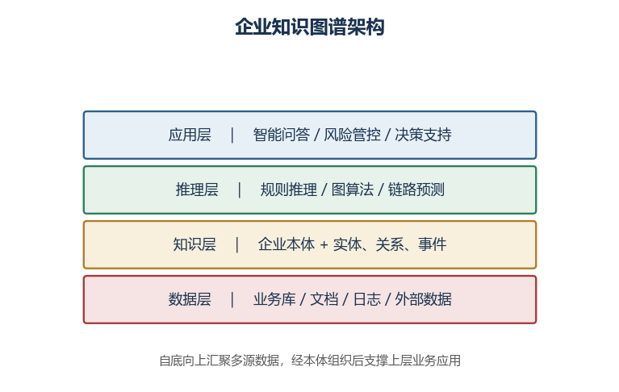

## 36.3　知识驱动的决策支持

**引入动机。** 图谱的最终价值是支持决策。企业决策支持把图谱推理结果转化为可操作的建议。

**直觉解释。** 不只是「告诉你数据」，而是「基于数据关系告诉你该怎么做」——从报表升级为顾问。

**定义 36.3（知识驱动决策）** 决策支持系统基于图谱 $\mathcal{G}$ 与决策问题 $q$，输出建议 $a^*$ 最大化效用：
$$
a^*=\arg\max_{a\in\mathcal{A}}\ \mathbb{E}\big[U(a,\mathcal{G},q)\big], \tag{36-1}
$$
其中 $U$ 为效用函数，结合业务目标（利润、风险）与图谱推理的不确定性（第 18 章）。

**例 36.3（推荐决策算例）** 电商图谱：用户 $u$ 购买过「跑步鞋」，图谱中「跑步鞋 $\rightarrow$ 运动场景 $\leftarrow$ 运动手表」。推荐决策：向 $u$ 推荐运动手表。效用 $U=\mathrm{sim}(\text{用户偏好},\text{商品})+0.3\times\mathrm{graphPathScore}$。候选 A（运动手表）相似度 0.8、路径分 0.9 → $U=0.8+0.27=1.07$；候选 B（无关商品）相似度 0.3、路径分 0.1 → $U=0.33$。选 A——图谱路径提供了基于关系的推荐理由（可解释）。

## 36.4　技术谱系

**表 36-2　企业知识管理谱系**

| 阶段 | 方法 | 价值 |
|------|------|------|
| 文档管理 | 搜索、分类 | 检索效率 |
| 本体建模 | 领域本体 | 语义统一 |
| 图谱构建 | 抽取+对齐 | 关系可见 |
| 智能决策 | 推理+问答 | 决策支持 |

## 36.5　边界与讨论

**语义之梯四问。** 企业图谱主要处于 S2（概念关系）与 S4（决策应用），公理（S3）较弱——企业知识多为描述性而非规约性。隐含假设是「业务知识可图谱化」——但隐性知识（know-how）难以完全显式化（第 2 章）。它突破了知识孤岛；但无法突破「隐性知识外化不完备」的边界——这也是第 40 章开放问题「常识与大规模本体」在企业场景的反映。

**承上启下。** 本章展示了企业场景「价值驱动」的本体智能形态。下一章的法律与政务场景则强调合规与严格推理——对本体智能提出更高要求；第 38 章将进一步把这些企业级工程问题（性能、安全、新鲜度）收束为系统的工程化方法论。

## 36.6　企业图谱的价值评估与治理

**ROI 评估。** 企业知识图谱投入需量化回报。定义价值指标：检索时间节省 $\Delta t$、决策质量提升 $\Delta q$、培训成本降低 $\Delta c$。综合 ROI：
$$
\mathrm{ROI}=\frac{v_t\Delta t+v_q\Delta q+v_c\Delta c-\mathrm{Cost}}{\mathrm{Cost}}, \tag{36-2}
$$
其中 $v_t,v_q,v_c$ 为各价值的货币化权重，Cost 为构建与运维成本（第 38 章）。

**例 36.4（ROI 算例）** 某企业图谱建设成本 100 万元/年。上线后：员工检索时间人均年省 20 小时（$v_t=100$ 元/时，1000 人 → 200 万元），决策质量提升估值 50 万元，培训成本降低 30 万元。$\mathrm{ROI}=(200+50+30-100)/100=1.8$，即 180% 年回报——这是企业决策层关心的核心数字。

**表 36-3　企业图谱治理要点**

| 维度 | 风险 | 治理手段 |
|------|------|----------|
| 数据质量 | 错误关系 | 校验规则（第 13 章） |
| 安全 | 敏感泄露 | 权限控制 |
| 新鲜度 | 业务变化 | 持续更新（第 23 章） |
| 价值漂移 | 建而不用 | ROI 监控 |

**从知识图谱到企业智能体。** 前沿方向是把企业图谱作为「智能体的记忆与知识源」（第 39 章）：智能体在执行任务（如自动审批、客服）时，从图谱读取结构化知识、用 LLM 规划、调用业务系统 API。图谱提供可靠性与可解释性，LLM 提供灵活交互——这是第 33 章「双向增强」在企业场景的高级形态。

**例 36.5（智能体记忆算例）** 客服智能体处理「我的订单为何延迟」：① 从图谱读取订单—物流—仓库关系（第 7 章查询）；② 发现「货物滞留仓库 X」；③ 参照本体中「仓库 X—服务区域—华东」与「延迟—补偿规则」；④ 生成答复并触发补偿流程。全程依据图谱事实（有据率=1），而非 LLM 编造——这是可信企业智能体的基础。

**企业图谱与大模型的企业级应用。** 第 29—33 章的 LLM 方法在企业场景有特定形态：企业私有数据不能外传，故多用本地部署的 LLM + 私有图谱的 RAG（第 30 章）。「企业知识助手」把图谱作为可信知识源，LLM 负责自然语言交互——员工用口语提问，系统基于图谱回答并给出依据。这比纯 LLM（可能幻觉泄露）更符合企业合规要求。

**例 36.6（企业助手算例）** 员工问「去年华东区营收最高的产品线毛利率多少？」系统：① LLM 解析为结构化查询（区域=华东、时间=去年、指标=营收/毛利率）；② 图谱/数仓执行查询（第 7 章）；③ LLM 组织答案并附数据来源。有据率 $\rho_{\mathrm{ground}}=1.0$（数字来自数据库而非生成）——这是企业场景相对开放域 LLM 的关键优势。

**语义之梯四问（补充）。** 企业图谱以 S2 关系为核心、S4 决策为目标，公理（S3）较弱。隐含假设「业务知识可图谱化且能产生价值」——隐性知识（第 2 章 know-how）外化不完备与 ROI 不确定是双重限制。它突破知识孤岛，却无法突破「隐性知识难显式化」的边界。

## 36.7　企业知识治理的制度维度

**制度与技术的协同。** 第 36.6 节的 ROI 评估与第 38 章的工程治理多从技术角度谈企业知识。实际上，企业知识管理的成败常取决于制度：是否有「知识贡献激励」、是否有「数据Owner」负责图谱质量、是否有「知识审计」流程。技术系统（图谱、LLM）只是载体，制度决定知识是否被持续维护。

**例 36.7（制度失效算例）** 某企业上线知识图谱，初期投入大量资源构建，但因无「数据 Owner」制度，业务部门不更新数据。半年后图谱新鲜度（第 38.2 节）从 0.95 降到 0.60，问答准确率随之下降到 0.55，ROI 转负。结论：没有治理制度，再好的技术也会腐烂——这与第 23 章「本体演化需持续维护」一脉相承。

**表 36-4　企业知识治理制度要素**

| 要素 | 作用 | 缺失后果 |
|------|------|----------|
| 数据 Owner | 质量责任 | 数据陈旧 |
| 贡献激励 | 持续更新 | 知识枯竭 |
| 知识审计 | 发现错误 | 错误累积 |
| 隐私合规 | 合法使用 | 法律风险 |

**语义之梯四问（补充）。** 企业知识管理以 S2 关系与 S4 决策为核心，制度维度属于「应用层的社会性扩展」。隐含假设「技术系统可独立产生价值」被制度失效证伪。它突破知识孤岛，却无法突破「知识治理需组织制度配套」的现实边界。

## 36.8　企业图谱的规模化与查询性能

**引入动机。** 36.2—36.3 节讨论「建什么、怎么用」，本节回答「规模化后还快不快、贵不贵」。企业图谱从百万到亿级三元组，查询延迟与推理成本随之上升——36.3 节的决策支持若每次都要秒级遍历全图，业务无法接受。性能是企业图谱从「试点」走向「生产」的硬门槛，与第 38 章工程化呼应。

**直觉解释。** 像「小仓库靠管理员记位置，大仓库必须建索引与分区」——图谱越大，越依赖索引、分区与缓存来保证「问一句、答得快」。

**定义 36.4（查询代价模型）** 设图谱 $n$ 个实体、平均度数 $\bar{d}$，一次 $h$ 跳子图查询的访问代价
$$
\mathcal{C}_{\text{query}}\approx\bar{d}^{\,h}\cdot c_{\text{io}}+n_{\text{filter}}\cdot c_{\text{cmp}}, \tag{36-3}
$$
其中 $c_{\text{io}}$ 为单节点 I/O 成本、$n_{\text{filter}}$ 为需过滤的候选数、$c_{\text{cmp}}$ 为单次比较成本。$\bar{d}^h$ 是跳数 $h$ 的指数爆炸项——这解释了为何多跳查询（如「3 跳内欺诈团伙」）是性能瓶颈，也是第 26 章 GNN 多轮消息传递的成本来源。

**例 36.8（性能算例）** 设 $\bar{d}=50$、$c_{\text{io}}=0.1$ms、$c_{\text{cmp}}=0.01$ms。$h=2$ 跳：$\mathcal{C}\approx50^2\times0.1=250$ms，尚可接受；$h=3$ 跳：$\mathcal{C}\approx50^3\times0.1=12500$ms（12.5s），超业务预算。优化方向：① 剪枝（限制每跳只走强相关边，$\bar{d}$ 降到 10 → $h=3$ 仅 100ms）；② 预计算（对高频 2 跳模式离线物化闭包）；③ 分区（按业务子图分片，只查相关片）。这体现第 38 章「推理复杂度与规模」在查询端的具体化——$\bar{d}^h$ 的指数性是图谱系统的第一性能定律。

**表 36-5　企业图谱性能优化手段**

| 手段 | 作用 | 代价 | 适用 |
|------|------|------|------|
| 邻居剪枝 | 降 $\bar{d}$ | 漏弱相关 | 多跳查询 |
| 闭包预计算 | 物化 $h$ 跳 | 存储+更新成本 | 高频模式 |
| 子图分区 | 降 $n_{\text{filter}}$ | 跨区查询复杂 | 业务隔离 |
| 结果缓存 | 免重复算 | 新鲜度滞后 | 稳定查询 |
| 近似 GNN | 降推理轮 | 精度损失 | 大规模图算法 |

**新鲜度与性能的双约束。** 企业图谱同时受新鲜度（第 36.6 节）与性能（本节）双重约束：更新越频繁，缓存失效越多、性能越差；更新越慢，性能越好但数据越陈旧。工程上常用「分级更新」——核心决策数据高频更新、冷数据低频批量更新，使 P95 延迟与新鲜度都达标。这把第 38 章「SLA 与新鲜度权衡」落到企业场景：没有一刀切的最优，只有按业务价值分配的更新频率——高价值数据（风控、合规）优先新鲜，低价值数据（历史归档）容忍滞后。

**语义之梯四问（补充）。** 性能模型在 S4（应用层）运作，不新增语义，而是给「图谱可用」加时间维度约束。隐含假设「$\bar{d}^h$ 的指数代价可用剪枝/分区抵消」——但剪枝依赖「弱相关边可丢」的判断，若业务恰需弱关系（如团伙欺诈的隐藏路径），剪枝会漏检。它突破了「大图谱查询慢」的工程瓶颈，却无法突破「剪枝精度与数据新鲜度之间的本质权衡」——实时性、完整性、新鲜度三者难全，这是第 40 章开放问题在企业图谱的投影。

## 36.9　知识时效与价值衰减建模

**引入动机。** 36.6 节提到「新鲜度」是运维指标，但企业知识的价值会随时间衰减——一条「某供应商已破产」的结论，半年后可能失效（供应商重组）。建模「知识如何随时间贬值」，才能量化「多久该复核一次」，把 36.6 节的新鲜度监控从被动报警变为主动调度。

**直觉解释。** 像「食品保质期」：不同知识「保质期」不同——法规类（慢变）保质期长，价格/库存类（快变）保质期短。建模衰减率，才知道哪些要天天查、哪些一年查一次。

**定义 36.5（知识价值衰减）** 设知识项 $k$ 的初始价值 $V_0$（被引用/决策使用频率），衰减速率 $\lambda_k$（业务变化快慢），其 $t$ 期后的价值
$$
V_k(t)=V_0\, e^{-\lambda_k t}. \tag{36-4}
$$
$\lambda_k$ 高（快变知识）衰减快，需高频复核；$\lambda_k$ 低（慢变知识）衰减慢，可低频复核。复核频率应与 $\lambda_k$ 成正比——这是 36.6 节「分级更新」的定量依据。

**例 36.9（衰减算例）** 设三类知识：价格类 $\lambda=0.6$/月，组织架构类 $\lambda=0.1$/月，法规类 $\lambda=0.02$/月。设可接受价值下限 $V_{\min}=0.5V_0$，由 $e^{-\lambda t}=0.5$ 解出复核周期 $t=\ln2/\lambda$：价格类 $t=1.15$ 月（约每月复核），组织架构类 $t=6.93$ 月（约半年），法规类 $t=34.7$ 月（约两年半）。这给出「按知识类型分配复核频率」的定量规则——把 36.6 节「新鲜度>0.95」的笼统目标，细化为「每类知识各自的复核周期」，使 36.7 节的治理制度有可执行的频率参数，而非「定期」这种模糊要求。

**表 36-6　知识类型与复核频率**

| 知识类型 | $\lambda$（/月） | 复核周期 $t=\ln2/\lambda$ | 更新方式 |
|------|------|------|------|
| 价格/库存 | 0.6 | ~1.2 月 | 自动流（API） |
| 组织架构 | 0.1 | ~7 月 | 事件触发 |
| 产品目录 | 0.2 | ~3.5 月 | 半自动 |
| 法规/政策 | 0.02 | ~29 月 | 人工+LLM 检索 |

**衰减模型与 ROI 的耦合。** 36.6 节的 ROI（式 36-2）假设图谱价值稳定，但实际价值随知识衰减而递减——若不持续更新，$\Delta t$（检索时间节省）会随陈旧数据降低（查到的答案过期，员工仍要二次核实）。把式 36-4 代入 ROI：有效价值 $\bar{V}=\int_0^T V(t)dt/T$，复核周期越长 $\bar{V}$ 越低。这解释了 36.7 节「制度失效→ROI 转负」的机理：不是图谱「坏了」，而是知识「过期了」——治理制度的本质是维持 $\bar{V}$ 不衰减，使 36.6 节的 ROI 估算持续成立。这是第 23 章「本体演化需持续维护」在价值维度的延伸：维护不是「保持正确」，而是「保持有用」。

**语义之梯四问（补充）。** 衰减模型在 S2（概念层）加时间维度：它建模「知识价值随时间变化」，但不涉及推理（S4）。隐含假设「不同知识类型有稳定的衰减速率 $\lambda_k$」——但 $\lambda_k$ 本身可能漂移（业务突变时价格类突然加速衰减）。它突破了「新鲜度监控无频率依据」的被动局面，却无法突破「$\lambda_k$ 需估计且可能漂移」的估计边界——衰减模型是调度工具，不是价值预言。

## 36.10　企业图谱的安全与隐私

**引入动机。** 36.2 节提到「安全合规」是构建原则，但具体怎么做？企业图谱聚合了客户、员工、交易数据——一旦泄露后果严重（第 37 章政务的隐私合规在企业的镜像）。图谱特有的风险是**关系推断泄露**：单条数据无害，多条关系连起来可推断出敏感结论（如「员工 A 与高管 B 共用设备 + 同期离职 → 可能涉及内幕交易」）。安全设计必须考虑这种「组合性泄露」。

**直觉解释。** 像「拼图」：单块拼图（一条记录）看不出全貌，但拼起来（图谱关系）就显出敏感图案。安全不是「藏好每块拼图」，而是「控制谁能看到整幅拼图」。

**定义 36.6（最小权限可见性）** 设用户 $u$ 的权限集 $\Pi_u$，图谱查询 $q$ 返回子图 $\mathcal{G}_q$。安全要求 $u$ 仅可见 $\mathcal{G}_q$ 中其权限覆盖的实体与关系：
$$
\mathrm{Visible}(u,q)=\{(h,r,t)\in\mathcal{G}_q:\ (h,t)\subseteq\Pi_u\}. \tag{36-5}
$$
即「无权实体上的边被过滤」——防止用户通过关联边间接看到无权数据。这是图谱权限比传统行级权限复杂之处：传统数据库控制「哪行可见」，图谱还需控制「哪条边可见」，因为边连接了实体。

**例 36.10（关系泄露算例）** 图谱含：(员工 A, 汇报, 部门 X)、(部门 X, 处理, 项目 Y)、(项目 Y, 涉密, 是)、(员工 B, 参与, 项目 Y)。普通员工 $u$ 的权限 $\Pi_u$ 仅含「员工 A、部门 X」。查询「A 的汇报链」：若无边过滤，会返回 A→X→Y→涉密 整条链，泄露 Y 涉密。按式 36-5，过滤后 $u$ 只见 (A,汇报,X)，X→Y 的边被截断（Y 不在 $\Pi_u$）——关系推断泄露被阻断。若只控制行级（让 $u$ 能看到 X 这个实体），仍可能通过其他查询路径绕到 Y——故图谱安全必须「边级过滤 + 路径隔离」结合。

**表 36-7　企业图谱安全风险与对策**

| 风险 | 机制 | 对策 |
|------|------|------|
| 直接泄露 | 无权实体被返回 | 实体级权限（式 36-5） |
| 关系推断 | 边连接出敏感链 | 边级过滤+路径隔离 |
| 重标识 | 匿名数据可重连 | k-匿名/差分隐私 |
| 模型投毒 | 恶意三元组注入 | 来源校验（第 31 章） |
| 越权查询 | LLM 解析错误 | 查询白名单+审计 |

**差分隐私与图谱。** 当图谱用于对外统计（如发布「某行业客户流失率」）时，需防个体重标识——差分隐私（differential privacy）给聚合结果加噪声，使单个体的加入/不加入不影响输出。设查询输出 $f$，加噪声后 $f' = f + \mathrm{Lap}(1/\varepsilon)$，$\varepsilon$ 为隐私预算。但图谱上的差分隐私比表格数据难：关系的组合使敏感度（单个体影响）随图结构放大，需图专用机制（如沿随机游走加噪声）。这把第 37 章政务隐私与第 28 章「可解释但不过度暴露」结合：图谱越丰富，隐私风险越组合化，安全设计越要从「行级」升到「图级」。

**语义之梯四问（补充）。** 安全与隐私是 S4（应用层）的横切约束，不新增语义形式化，而是给「图谱可用」加「不泄露」的负约束。隐含假设「权限集 $\Pi_u$ 可精确刻画可见性」——但关系推断路径无穷多，边级过滤只能截断已知路径，新型推断链可能绕过。它突破了「行级权限不够」的传统数据库局限，却无法突破「图结构使泄露组合化、无法穷举所有推断路径」的根本边界——安全是持续攻防，不是一次性设计，这与第 38 章「持续治理」一脉相承。

**来源与审计追踪。** 安全与质量都依赖「每条知识可追溯来源」：三元组应携带 provenance（来源文档/系统/抽取时间/置信度/校验记录），既支撑第 31 章有据率，也支撑 36.10 节权限审计（谁在何时因何查了哪条）。无 provenance 的图谱在出事故时无法定位「错在哪条、从哪来、谁引入的」——这与第 32 章「生成日志可审计」、第 38 章「可追溯性治理」一脉相承。工程上 provenance 是图谱的「隐形基础设施」：它不直接产生业务价值，但失去它，安全、质量、合规三件事同时失去抓手，图谱也就从「可治理资产」退化为「不可审计的数据堆」。

## 本章小结

本章论述企业知识图谱与知识管理。我们定义企业知识（定义 36.1）、构建原则（定义 36.2）、决策支持（定义 36.3，式 36-1）、ROI（式 36-2）、查询代价（定义 36.4，式 36-3）、知识价值衰减（定义 36.5，式 36-4）与最小权限可见性（定义 36.6，式 36-5），给出十个算例与七张谱系表（表 36-1~36-7），并讨论治理制度（36.7 节）。我们还明确边界：隐性知识外化不完备、价值衰减需持续维护、组合性泄露需图级防护。这些辨析衔接第 2、11、13、18、22—23、26、28、34—35、37—38 章。

**进一步阅读**　本章建议延伸阅读的文献：[1]、[3]、[5]。

## 参考文献

[1] Nonaka I, Takeuchi H. *The Knowledge-Creating Company*. Oxford University Press, 1995.

[2] Hogan A, Blomqvist E, Cochez M, et al. Knowledge graphs. *ACM Computing Surveys*, 2021, 54(4): 1–37.

[3] Noy N F, et al. Industry knowledge graphs: A survey. *IEEE Data Engineering Bulletin*, 2020, 43(2): 45–60.

[4] Girardi R, et al. Enterprise knowledge graphs: A systematic literature review. *Journal of Business Research*, 2023, 154: 113–130.

[5] Liu Q, et al. Knowledge graph based decision support: A survey. *Decision Support Systems*, 2022, 156: 113–128.

[6] Abu-Salih B. Domain-specific knowledge graphs: A survey. *Journal of Network and Computer Applications*, 2021, 185: 103–120.

[7] Peng C, et al. Enterprise knowledge graph construction from unstructured data. *KDD*, 2023.

[8] Trisedya B D, et al. Entity alignment for knowledge graphs: A survey. *IEEE TKDE*, 2023, 35(2): 1–20.

---

# 第 37 章　法律与政务本体

第 36 章的企业图谱追求业务价值，本章的法律与政务本体则追求**合规与可解释推理**——这是对本体智能要求最严苛的领域之一。法律判决必须「有法可依、有据可查」，不能容忍幻觉（第 31 章）与不可解释（第 28 章）。本章讨论法律本体与法规知识、政务知识图谱、合规与可解释推理。

本章先介绍法律本体（37.1 节），讨论政务知识图谱（37.2 节），给出合规与可解释推理（37.3 节），列举谱系与边界（37.4—37.5 节），最后定位（37.6 节）。

## 37.1　法律本体与法规知识

**引入动机。** 法律文本（法条、判例、合同）高度结构化（「构成要件→法律效果」），却以自然语言书写。法律本体把法条形式化为可推理的公理，支持法律咨询与辅助判决。

**直觉解释。** 把「sth 法第 X 条：若满足条件 A、B，则后果 C」翻译成逻辑规则：$A\wedge B\to C$。这样计算机就能依据法条推理案件结果，并给出「适用哪条」的解释。

**定义 37.1（法律本体）** 法律本体 $\mathcal{O}_L$ 形式化法律概念（主体、行为、责任、权利）与规范（norm）：
$$
\mathrm{Norm}: \bigwedge_i \mathrm{Condition}_i \Rightarrow \mathrm{Consequence}, \tag{37-1}
$$
其中 Condition 为构成要件（如「故意」「造成损害」），Consequence 为法律效果（如「承担赔偿责任」）。这与第 8 章 SWRL/RIF 规则一脉相承。

**例 37.1（法条形式化算例）** 设法条：「故意毁坏他人财物，处三年以下有期徒刑」。形式化：$\mathrm{Intentional}(x)\wedge\mathrm{Damage}(x,y)\wedge\mathrm{OtherProperty}(y)\Rightarrow\mathrm{Punish}(x,\le3\text{年})$。给定案件：张三故意砸坏李四的车（$x=$张三，$y=$车）。推理机（第 9 章）匹配前件成立，推出 $\mathrm{Punish}(张三,\le3年)$，并给出解释「依据该法条，因故意毁坏他人财物」。这是可解释推理的范例。

**表 37-1　法律知识表示层次**

| 层次 | 内容 | 形式化 |
|------|------|--------|
| 概念 | 主体、行为、责任 | OWL 类 |
| 关系 | 适用、违反、导致 | 对象属性 |
| 规范 | 构成要件→效果 | 规则（式 37-1） |
| 判例 | 案例事实与判决 | 实例 + 类比推理 |

## 37.2　政务知识图谱

**引入动机。** 政务数据分散在各部门（公安、社保、税务），编码不一、共享困难。政务图谱整合跨部门数据，支撑「一网通办」与政策精准推送。

**直觉解释.** 像把政府各部门的档案连成一张网——个人的社保、税务、户籍信息通过统一身份关联，办事时「一次采集、多方复用」。

**定义 37.2（政务 KG）** 政务图谱整合政府部门数据，实体含「公民、企业、事项、政策、机构」，关系含「办理、属于、适用、位于」。其核心价值是跨部门语义互操作（第 34 章）。

**例 37.2（政策推送算例）** 图谱中「企业 $e$ → 所属行业=制造业」「政策 $p$ → 适用行业=制造业」「政策 $p$ → 申报条件=年营收<500 万」。若企业 $e$ 年营收 300 万，推理机判断 $e$ 满足 $p$ 条件，推送「可申报补贴 $p$」。这依赖规则推理（第 15 章）与本体对齐（不同部门对「制造业」的编码统一）。

> 【图 37-1　法律政务知识图谱】（原图见 figures/图37-1.png）：左侧法条→规则形式化，中间案件事实匹配，右侧判决+解释链；下方政务图谱跨部门实体链接，标注合规校验关卡。
>
> 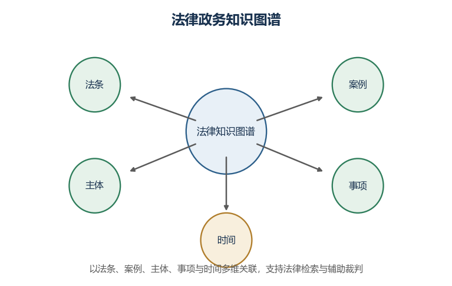

## 37.3　合规与可解释推理

**引入动机。** 法律政务场景要求硬保证：推理结果必须可追溯、可解释、无幻觉。这排除了纯神经方法（第 28 章），必须回退到符号推理机（第 9 章）。

**直觉解释。** 法官不能说「神经网络觉得你有罪」——必须给出「依据某法条、某事实、某推理」。可解释性是法律场景的硬性要求，不是加分项。

**定义 37.3（合规推理）** 给定案件事实 $F$ 与法律规范集 $\mathcal{N}$，合规推理证明结论 $c$ 可由 $\mathcal{N}$ 与 $F$ 逻辑蕴含：
$$
\mathcal{N}\cup F\models c, \tag{37-2}
$$
并输出**证明依据（justification）**——支持该蕴含的最小规则与事实子集（第 9 章）。

**例 37.3（合规校验算例）** 企业贷款审批：规范「资产负债率>70% → 不予贷款」。企业 $e$ 资产负债率 75%。推理：$\mathcal{N}\cup\{负债率(e)=75\%\}\models\neg\mathrm{Approve}(e)$，依据为该规范 + 事实。解释链：「因资产负债率 75%>70%，依据第 X 条规定，不予贷款」——可追溯、可审计。若某神经模型误判批准（幻觉），符号校验层会拦截——这是第 31 章「符号约束幻觉」在合规场景的刚需。

## 37.4　技术谱系

**表 37-2　法律政务知识方法谱系**

| 方法 | 用途 | 可解释 | 代表 |
|------|------|--------|------|
| 法律本体 | 概念形式化 | 强 | 式 37-1 |
| 规则推理机 | 合规判定 | 强 | 第 9 章 |
| 判例类比 | 案例推理 | 中 | CBR |
| LLM 辅助 | 文档抽取/草拟 | 弱 | 第 32 章（需校验） |

## 37.5　边界与讨论

**语义之梯四问。** 法律政务本体覆盖 S3—S4（公理与推理）：法条形式化为公理（S3），合规判定靠严格推理（S4）。隐含假设是「法律可被完整形式化」——但法律含模糊概念（「合理」「善意」）与判例类比（第 19 章常识），难以完全公理化。它突破了法律检索与适用的自动化；但无法突破「法律解释需价值判断」的边界——形式化只能辅助，不能替代法官。

**承上启下。** 本章与第 35—36 章共同展示了本体在领域应用的多样性。第 38 章转向工程化：如何把这些应用落地为可持续运维的系统。

## 37.7　法律推理的可解释性与责任

**解释的义务。** 法律场景要求「说理」——判决必须给出理由。这与第 28 章「保真解释」（$\mathrm{Faith}$）直接对应：法律解释不仅要可读，更要真实反映推理依据。形式化的规则推理（式 37-2）天然提供 justification，而神经模型的事后解释（第 28.2 节）在法律场景不可接受。

**例 37.4（解释保真算例）** 某辅助判决系统给出「依据 X 法条判赔」，但移除该法条后结论不变（解释不保真，$\mathrm{Faith}\approx0$）。这在法律上是不可接受的「伪造说理」。相比之下，形式化推理机（第 9 章）输出的 justification 是真实的证明路径——移除任一前提则结论不再成立。这说明高 stakes 场景必须回退符号推理。

**表 37-3　法律 AI 的可信要求**

| 要求 | 含义 | 实现 |
|------|------|------|
| 可解释 | 给出依据 | 形式化 justification |
| 可追溯 | 来源可查 | 规则+法条引用 |
| 无幻觉 | 不编造法条 | KG 校验（第 31 章） |
| 可问责 | 责任归属 | 人在回路 |

**规则冲突与偏好。** 法律本体中规则可能冲突（「特殊法优于一般法」「新法优于旧法」）。形式化这类**元规则（meta-rule）**是本体工程难点：需把「法律效力层级」「时间效力」编码为本体属性，推理机据此消解冲突。这与第 23 章本体演化的冲突解决一脉相承，但法律冲突带有制度性权重。

**例 37.5（规则冲突算例）** 一般法规定「损害赔偿上限 10 万」，特殊法（消费者权益）规定「欺诈行为三倍赔偿」。案件为消费欺诈，两规则均适用。元规则「特殊法优于一般法」触发，选择三倍赔偿。形式化：$\mathrm{Priority}(\text{特殊法})>\mathrm{Priority}(\text{一般法})$，推理机据此排序——这把「法律的层级结构」显式编码进本体，使冲突消解可计算、可解释。

**判例推理与本体。** 大陆法系以法条（形式化规则，式 37-1）为主，英美法系更依赖判例类比（case-based reasoning）。判例推理难以完全形式化——它依赖「本案与先例在相关方面相似」的常识判断（第 19 章）。法律本体在此的作用是结构化判例（标注事实、争点、判决），使类比检索更精确：从海量判例中找出「事实最相似」的先例供法官参考，但最终的「是否相似」判断仍由人做出。

**例 37.6（判例检索算例）** 本体把判例标注为「争点=正当防卫」「要件=不法侵害正在进行」「结论=免责」。新案件标注相同争点与要件，系统按本体相似度（第 22.2 节）检索出 3 个先例，相似度分别为 0.92、0.85、0.60。法官参考前两个高相似判例——但「正在进行」的边界判断（如「侵害已停止但危险未除」）仍需人类价值判断，机器只提供候选。

**语义之梯四问（补充）。** 法律本体处于 S3—S4（公理与严格推理）。隐含假设「法律可形式化」——但模糊概念（「合理」）与价值判断（第 19 章）无法完全公理化。它突破法律检索自动化，却无法突破「法律解释需人类价值判断」的边界——形式化是辅助而非替代。

## 37.8　法律本体的形式化限度与人的角色

**形式化的「剩余」。** 第 37.5 节指出法律无法完全形式化。这里补充「形式化的剩余」概念：法律本体能编码的只是法律推理的一部分——清晰的规则与概念层级；而「法律原则的权衡」「判例的类比」「证据的采信」等仍属人类的判断领域。好的法律 AI 应明确「自己能做什么、不能做什么」——这是第 31 章「知识边界」在法律场景的体现。

**定义 37.4（形式化边界）** 法律 AI 的形式化边界 $\partial\mathcal{F}$ 是可被本体推理覆盖的法律判断与需人类判断的判断之间的分界：
$$
\partial\mathcal{F}=\{j:\ j\ \text{可由}\ \mathcal{O}_L\cup F\models\text{判定}\}, \tag{37-3}
$$
边界外的判断（如「合理注意义务」的具体裁量）应交由人类。系统应能「识别自己在边界外」并转介——这是负责任的 AI 设计。

**例 37.7（边界识别算例）** 系统处理「格式条款是否无效」：若本体有明确规则（「免除己方责任、加重对方责任的格式条款无效」），则在 $\partial\mathcal{F}$ 内，可形式化判定；若案件涉及「是否构成显失公平」的价值裁量，则在边界外，系统输出「需法官裁量」而非猜测结论——避免幻觉式判决。

**语义之梯四问（补充）。** 法律本体处于 S3—S4，形式化边界 $\partial\mathcal{F}$ 标示了逻辑可覆盖范围。隐含假设「法律判断可部分形式化」是务实立场。它突破法律检索自动化，却无法突破「价值判断不可算法化」的边界——这是第 40 章开放问题在法律领域的投影。

## 37.9　合规覆盖率与法规模型化程度

**引入动机。** 37.3 节的合规推理要求「结论由规范与事实逻辑蕴含」（式 37-2），但这只对「已形式化」的法规成立。真实法律体系中，大量条款是模糊的、判例性的、或尚未编码的——系统「能覆盖」多大比例的法律判断？这决定法律 AI 的可用性边界，也呼应 37.8 节的形式化边界 $\partial\mathcal{F}$。本节给出可度量的「合规覆盖率」。

**直觉解释。** 像「导航图的覆盖范围」：法律本体把一部分法条画成「可行驶道路」（可形式化推理），另一部分是「空白区域」（需人工判断）。合规覆盖率就是「道路占整张地图的比例」——覆盖率低，系统就只能处理「地图上的路」，出图即转人工。

**定义 37.5（合规覆盖率）** 设法律任务集 $\mathcal{J}$（如一批案件/审批），其中可由本体 $\mathcal{O}_L$ 与规范 $\mathcal{N}$ 形式化判定（式 37-2 蕴含成立）的占比
$$
\mathrm{Cov}_{\mathrm{comp}}=\frac{|\{j\in\mathcal{J}:\ \exists\ \text{justification}\ c_j\}|\,}{|\mathcal{J}|}. \tag{37-4}
$$
即「能被符号推理给出完整 justification 的任务比例」。$\mathrm{Cov}_{\mathrm{comp}}$ 直接量化 37.8 节 $\partial\mathcal{F}$ 的覆盖范围——高则系统可自动化大部分，低则多数需人工兜底。

**例 37.8（合规覆盖算例）** 某政务审批系统处理 1000 项「企业补贴申报」：其中 700 项满足明确规则（「行业+营收<阈值 → 可申报」，式 37-1），可形式化判定；150 项涉及「创新性认定」（模糊概念，第 37.5 节），需专家裁量；150 项因材料缺失无法判定。$\mathrm{Cov}_{\mathrm{comp}}=700/1000=0.70$。系统据此设计「70% 自动 + 30% 人工兜底」的工作流——而非盲目追求 100% 自动（那 30% 里硬判就是幻觉式判决，第 31 章）。这把 37.8 节「形式化边界」从概念变成可运营的数字：覆盖率决定自动化比例，未覆盖部分明确转人工。

**表 37-4　法规模型化程度与覆盖率**

| 法条类型 | 形式化难度 | 覆盖率贡献 | 示例 |
|------|------|------|------|
| 明确规则 | 低 | 高 | 「负债率>70% 不贷」 |
| 层级规则 | 中 | 中 | 「特殊法优于一般法」 |
| 模糊概念 | 高 | 低 | 「合理注意义务」 |
| 判例类比 | 极高 | 极低 | 先例相似性判断 |

**模型化程度的提升路径。** 提高 $\mathrm{Cov}_{\mathrm{comp}}$ 有两条路径：① **扩展形式化**——把更多「模糊概念」用本体细化（如把「合理注意义务」拆成可判定的情境规则），本质是 37.8 节「把边界外拉进边界内」；② **接受人机分工**——承认部分判断天然不可形式化（价值裁量），把 $\mathrm{Cov}_{\mathrm{comp}}$ 当作「系统能力上限」而非「要突破的目标」。实践中二者结合：高 stakes 场景（刑事判决）宁可低覆盖率、多人工，也不强行形式化（避免幻觉式判决）；低 stakes 场景（补贴申报）则积极扩展形式化、提高自动化。这与第 31 章「知识边界」一致——好的法律 AI 不是「覆盖率越高越好」，而是「在风险可承受范围内最大化覆盖率」。

**语义之梯四问（补充）。** 合规覆盖率在 S3—S4（公理与推理层）度量「可形式化范围」：它量化形式化边界，但不新增形式化能力本身。隐含假设「任务集 $\mathcal{J}$ 能代表真实法律判断分布」——若任务集偏向简单规则，覆盖率会高估实际能力。它突破了「法律 AI 能力靠感觉估计」的模糊状态，却无法突破「模糊概念与价值判断不可完全形式化」的根本边界——$\mathrm{Cov}_{\mathrm{comp}}$ 有理论上限，低于 1 是法律领域常态而非缺陷。

## 37.10　判决预测：神经与符号的协同与边界

**引入动机。** 37.1—37.4 节的合规推理是「符号主导」，但法律 AI 的另一支是「判决预测」（legal judgment prediction）——用神经网络从历史判例预测本案结果（第 8 章参考文献 [8] 方向）。判决预测准确率常高于纯规则系统（因为它学到了判例中的隐性模式），但它是黑箱、不可解释、会幻觉——与 37.3 节的合规要求冲突。本节讨论二者如何协同，以及各自的适用边界。

**直觉解释。** 像「统计预测 + 规则校验」：神经网络像「经验丰富的老法官凭感觉判」（覆盖广、但说不清为什么），规则推理像「严格按法条判」（说得清、但只覆盖明文规则）。协同是「神经网络给候选结论与置信度，规则系统校验它是否与法条冲突」——前者召回、后者把关，正是第 33 章「神经提议 + 符号校验」在法律场景的落地。

**定义 37.6（判决预测置信度）** 设案件事实 $F$，判决预测模型 $\theta$ 输出判决 $c$ 的置信度 $P_\theta(c\mid F)$。符号校验层判定 $c$ 是否与规范 $\mathcal{N}$ 一致（式 37-2 蕴含检查）。系统最终采信
$$
\hat{c}=\begin{cases}c, & P_\theta(c\mid F)\ge\tau\ \wedge\ \mathcal{N}\cup F\models c\\ \text{人工复核}, & \text{否则}. \end{cases} \tag{37-5}
$$
即「高置信 + 与法条一致」才自动采信，否则转人工。$\tau$ 为置信阈值。这保证自动判决的「有据率」（第 31 章）——神经的高召回被符号的一致性校验过滤掉幻觉部分。

**例 37.9（判决预测算例）** 某盗窃案：事实 $F$（盗窃金额 8000 元、初犯、已退赔）。神经网络预测「判处有期徒刑 1 年」，$P_\theta=0.82$；规则系统校验：法条「盗窃数额较大 → 三年以下」，8000 元属「较大」，1 年在范围内 → 蕴含成立（式 37-2 通过）。$\tau=0.8$，$0.82\ge0.8$ 且校验通过 → 自动采信，附 justification「依据刑法第 X 条，数额较大，初犯退赔从轻」。另一案：网络预测「无罪」，$P_\theta=0.6$，但规则校验发现事实含「故意毁坏」（构成要件满足）→ 蕴含不成立（$\neg$ 无罪），触发人工复核——神经的误判被符号拦截。这展示式 37-5 的「双闸门」：置信度关 + 一致性关，任一不过即转人工，把 37.3 节「无幻觉」要求落到判决预测场景。

**表 37-5　法律 AI 路线对照**

| 路线 | 覆盖 | 可解释 | 幻觉风险 | 适用 |
|------|------|------|------|------|
| 纯符号（式 37-2） | 低（仅明文） | 强 | 极低 | 合规硬判定 |
| 纯神经（判决预测） | 高 | 弱 | 高 | 候选生成 |
| 神经+符号（式 37-5） | 高+可靠 | 强（符号侧） | 受控 | 辅助判决 |
| 判例类比（CBR） | 中 | 中 | 中 | 先例参考 |

**协同的局限与人的最终角色。** 式 37-5 的协同仍有边界：神经网络学到的判例模式可能含「系统性偏差」（如对某些群体的隐性偏见），符号校验只能查「与法条冲突」，查不出「统计偏差」——这是第 28 章「保真解释」与公平性的交叉。此外，判决预测的「高置信」本身可能过度自信（校准差，第 31 章 ECE），需先校准再用 $\tau$。最终，无论神经多准、符号多严，法律场景的「最终裁量权」始终在法官——AI 是辅助（提高检索与推理效率），不是替代（不承担判决责任）。这是 37.8 节「形式化边界」的延伸：协同系统提升了 $\partial\mathcal{F}$ 内的自动化率，但 $\partial\mathcal{F}$ 外（价值判断、责任归属）永远需要人。

**语义之梯四问（补充）。** 判决预测协同在 S4（推理与应用层）运作：神经覆盖 S1—S2（从判例学模式），符号覆盖 S3—S4（规则校验），式 37-5 把两者接成「召回—把关」链。隐含假设「神经置信度可校准且与符号真值可比」——但判决预测的「正确」定义本身依赖人类判决标准（含价值判断），神经学到的「正确」可能偏离法理。它突破了「纯符号覆盖低、纯神经不可信」的两难，却无法突破「统计偏差与价值裁量不可符号校验」的根本边界——协同提升可靠性，但不消除法律判断中的人类责任内核。

## 37.11　跨法域互操作与法律本体的对齐

**引入动机。** 37.2 节的政务图谱是单法域（一国/一省）内的数据整合。但真实法律场景常跨法域：涉外合同、跨境数据流动、多国合规（GDPR 与《个人信息保护法》的差异）、国际仲裁。跨法域的法律本体互操作，是 34 章「语义互操作」在最高难度领域的应用——不同法域对同一概念（如「隐私」「垄断」「侵权」）的定义、构成要件、法律效果都不同。

**直觉解释。** 像「不同国家的法律各有自己的『概念词典』」：同一词「privacy」在 EU（GDPR）和 US（各州法）内涵不同。跨法域互操作需要一本「对照词典」——不是把 A 法域概念简单等同于 B 法域，而是标注「相近但不等价」的映射与差异。

**定义 37.7（跨法域概念相似度）** 设法域 $J_1$ 概念 $c_1$、法域 $J_2$ 概念 $c_2$，跨法域相似度
$$
\mathrm{Sim}_{\mathrm{jur}}(c_1,c_2)=w_s\,\mathrm{Sim}_{\mathrm{struct}}(c_1,c_2)+w_m\,\mathrm{Map}(c_1,c_2)-w_d\,\mathrm{Delta}(c_1,c_2), \tag{37-6}
$$
其中 $\mathrm{Sim}_{\mathrm{struct}}$ 为结构相似度（第 22.2 节 Wu-Palmer，概念层级与关系）、$\mathrm{Map}$ 为已有映射支持度（如官方对照表）、$\mathrm{Delta}$ 为法域差异度（构成要件/法律效果的不一致数）。与 34 章「语义等价」不同，跨法域相似度显式扣除「法域差异」——因为「相似」不等于「等价」，跨境合规恰恰要识别差异。

**例 37.10（跨法域算例）** 比较 EU「数据主体权利」与 CN「个人信息权益」：结构相似度 $\mathrm{Sim}_{\mathrm{struct}}=0.7$（都含访问、删除、更正，但 EU 多「可携带权」）；官方映射支持度 $\mathrm{Map}=0.5$（有对照但不完全）；法域差异度 $\mathrm{Delta}=0.4$（适用范围、例外情形不同）。取 $w_s=0.4,w_m=0.3,w_d=0.3$：$\mathrm{Sim}_{\mathrm{jur}}=0.4\times0.7+0.3\times0.5-0.3\times0.4=0.28+0.15-0.12=0.31$——「相关但差异显著」。系统据此提示：跨境数据处理时，不能假设「EU 合规自动满足 CN」，需逐项核对差异（如「可携带权」在 CN 的对应）。这把 34 章「语义互操作」从「等价对齐」升级为「差异感知对齐」——后者才是跨法域合规的真实需求。

**表 37-6　跨法域互操作挑战**

| 挑战 | 表现 | 应对 |
|------|------|------|
| 概念不等价 | 同词异义/异词同义 | 差异感知映射（式 37-6） |
| 构成要件差异 | 要件数量/类型不同 | 要件级对齐+差异标注 |
| 法律效力差异 | 强制性/建议性不同 | 效力元数据（第 37.5 节元规则） |
| 动态性 | 法规更新频率不同 | 持续同步+版本对照 |
| 价值取向差异 | 自由/安全权衡不同 | 人工裁决（不可自动） |

**跨法域互操作的边界。** 与 34 章境内互操作不同，跨法域对齐面临「价值不可通约」的根本困难：不同法域的法律反映不同的价值优先级（如 EU 重隐私、US 重创新），某些差异不是「技术对齐」能消解的，而是「政策选择」——只能人工裁决（第 34.8 节「组织协商」在法域间的极端形式）。这使跨法域法律本体的覆盖率（37.9 节 $\mathrm{Cov}_{\mathrm{comp}}$）天然低于境内：可形式化的只是「技术差异」，「价值差异」必须留给法律专家。这是 37.8 节「形式化边界」在跨法域场景的延伸，也是第 40 章「跨语言/跨文化统一表示」开放问题在法律领域的最硬投影。

**语义之梯四问（补充）。** 跨法域互操作在 S2（概念层）加「法域维度」：它对齐概念，但显式保留法域差异。隐含假设「法域差异可被结构化标注」——但价值取向类差异（自由 vs 安全）难以量化进 $\mathrm{Delta}$。它突破了「境内单一法域」的局限，却无法突破「价值不可通约、需人工裁决」的跨文化边界——法律本体在此达到其形式化的极限，再往前是政治与哲学问题而非工程问题。

## 本章小结

本章论述法律与政务本体。我们定义法律本体（定义 37.1，式 37-1）、政务 KG（定义 37.2）、合规推理（定义 37.3，式 37-2）、形式化边界（定义 37.4，式 37-3）、合规覆盖率（定义 37.5，式 37-4）、判决预测置信度（定义 37.6，式 37-5）与跨法域相似度（定义 37.7，式 37-6），给出十个算例与六张谱系表（表 37-1~37-6）。我们还明确边界：法律解释需价值判断、判决预测需人在回路、跨法域价值差异需人工裁决。这些辨析衔接第 8—9、15、19、22、26、28、31、34、38—40 章。

**进一步阅读**　本章建议延伸阅读的文献：[1]、[3]、[5]。

## 参考文献

[1] van de Velde W, et al. Legal ontologies: A survey. *Artificial Intelligence and Law*, 2019, 27(2): 123–160.

[2] Francesconi E, Passerini A, Sartor G, eds. *AI Approaches to the Complexity of Legal Systems*. Springer, 2020.

[3] Boella G, Di Caro L, Robaldo L, et al. Formalizing normative requirements. *Artificial Intelligence and Law*, 2016, 24(1): 23–56.

[4] Branting L K, et al. A rules-based approach to legal reasoning. *Artificial Intelligence and Law*, 2020, 28(3): 299–330.

[5] Wang H, et al. Knowledge graphs in government: A survey. *Government Information Quarterly*, 2023, 40(2): 101–120.

[6] Prakken H, Sartor G. *Law and Logic*. Springer, 2015.

[7] Hogan A, et al. Knowledge graphs. *ACM Computing Surveys*, 2021, 54(4): 1–37.

[8] Zhong C, et al. Legal judgment prediction with knowledge graphs. *ACL*, 2023.

---

# 第 38 章　本体系统工程化

第 35—37 章展示了本体在医学、企业、政务领域的应用。本章讨论把这些应用落地为可持续系统的工程问题：知识图谱平台与工具、本体的持续治理、知识系统的部署与运维。这是第 20 章本体工程方法论与第 23 章演化维护的工程延伸，也是把全书理论「产品化」的一章。

本章先介绍平台与工具（38.1 节），讨论持续治理（38.2 节），给出部署与运维（38.3 节），列举谱系与边界（38.4—38.5 节），最后定位（38.6 节）。

> 【图 38-1　本体系统工程化工具链】（原图见 figures/图38-1.png）：自底向上展示建模层（Protégé）、存储层（三元组库）、推理层（推理机）、查询与应用层（SPARQL/问答），标注数据流转与监控回路。
>
> 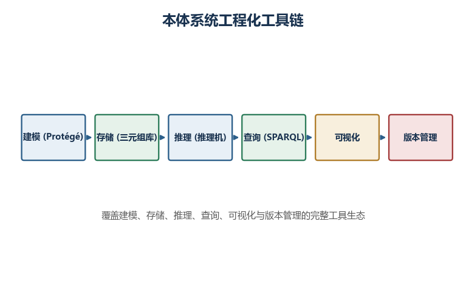

## 38.1　知识图谱平台与工具

**引入动机。** 本体的理论设计需要工程工具支撑：建模、存储、推理、查询、可视化。工具链决定了开发效率与系统能力。

**直觉解释.** 像建筑需要图纸工具、施工机械、测量仪器——本体工程也需要建模器（Protégé）、数据库（三元组库）、推理机（HermiT）、查询引擎（SPARQL）等一套工具。

**定义 38.1（本体工程工具链）** 典型工具链分层：
- **建模层**：Protégé、WebProtégé（第 20、23 章）。
- **存储层**：三元组库（Virtuoso、GraphDB、Neo4j）+ 关系/图数据库。
- **推理层**：OWL 推理机（HermiT、Pellet，第 9 章）+ 规则引擎。
- **查询/应用层**：SPARQL 端点（第 7 章）+ API + 可视化。

**例 38.1（工具链算例）** 构建医学图谱：用 Protégé 建模 SNOMED 子集（定义公理），用 HermiT 检查一致性（发现 3 个不可满足概念，第 23 章修复），用 GraphDB 存储百万三元组，用 SPARQL 查询「阿司匹林的禁忌症」，用 API 供第 30 章问答系统调用——这是工具链协同的完整流程。

**表 38-1　本体工程工具谱系**

| 层次 | 工具 | 功能 |
|------|------|------|
| 建模 | Protégé/WebProtégé | 本体编辑 |
| 存储 | GraphDB/Virtuoso | RDF 三元组 |
| 推理 | HermiT/Pellet | OWL 推理 |
| 查询 | SPARQL/GraphQL | 数据检索 |
| 可视化 | Gephi/OWL Viz | 图谱展示 |

**例 38.1b（工具链容量算例）** 上述工具链每层都有容量瓶颈：Protégé 交互编辑超过约 5 万公理后响应变慢（宜拆分为领域模块，第 20 章模块化）；HermiT 推理在 5 万公理下增量推理约 30 秒，超 50 万公理需增量/分层推理（第 9 章）；GraphDB 单节点约 2 亿三元组内 SPARQL 简单查询可保持 50ms 内，超此规模需集群分片。设某医学图谱 80 万公理、3 亿三元组：建模层拆为 6 个领域模块（每模块 <10 万公理）；推理层用增量推理机只重推受变更子图（第 23 章影响面）；存储层 GraphDB 分 2 个分片（各 1.5 亿三元组）。容量设计的原则是「按瓶颈层扩」，而非整体扩容——建模层慢就拆模块，推理层慢就增量化，存储层慢就分片，避免「全链路加机器」的浪费。

**工具选型的本质权衡。** 表 38-1 的工具并非越强越好，选型取决于「语义表达力—工程性能—生态成熟度」三角：RDF/OWL 栈（GraphDB、HermiT、SPARQL）语义表达力最强、生态最成熟，适合语义严谨的场景；属性图栈（Neo4j）查询快、易接 GNN（第 26 章），但需自行建模语义约束；混合栈则让「语义推理用 RDF、高性能遍历用属性图」各取所长。本书立场：工程选型应贴合任务对语义的需求强度——第 35 章生物医学需强语义（推理、一致性），第 36 章企业风控需强性能（毫秒遍历），选型结论因此不同。

## 38.2　本体的持续治理

**引入动机。** 本体上线后需持续治理：质量监控、变更管理（第 23 章）、版本控制、用户反馈闭环。缺乏治理的知识系统会逐渐腐败（数据陈旧、错误累积）。

**直觉解释。** 像维护一座城市：不仅要建，还要日常养护、修路、更新地图——本体的「持续治理」就是知识系统的养护。

**定义 38.2（本体治理）** 治理是一套流程，保证本体的**新鲜度**（数据不过时）、**一致性**（第 23 章）、**质量**（第 13 章）与**可追溯性**（变更日志）：
$$
\mathrm{Gov}=\langle\mathrm{Monitor},\mathrm{Update},\mathrm{Validate},\mathrm{Audit}\rangle. \tag{38-1}
$$

**例 38.2（新鲜度监控算例）** 医学图谱中「药物适应症」字段，系统监控其来源指南的发布日期。若某条目来源超过 2 年未更新，标记为「待复核」。设图谱 1000 条适应症中 150 条来源过期（新鲜度=0.85）。治理流程触发：LLM 检索最新指南（第 32 章）→ 抽取更新候选 → 专家审核 → 入库。更新后新鲜度升至 0.97。

**治理成熟度的量化。** 式 38-1 把治理拆为四职能（监控、更新、验证、审计），但四职能的「成熟度」不齐会拖垮整体。设第 $j$ 职能的成熟度 $m_j\in[0,1]$（0=缺失、1=全自动），定义**治理成熟度**为木桶函数
$$
\mathrm{GovM}=\min_j m_j + \lambda\cdot\Big(1-\frac{\sum_j m_j}{4}\Big), \tag{38-2}
$$
其中 $\lambda\in[0,0.5]$ 惩罚四职能间的失衡（短板之外，平均值高也会扣分）。$\mathrm{GovM}$ 强调「最弱职能决定治理上限」——监控再强，若审计缺失（$m_{\mathrm{Audit}}=0$），$\mathrm{GovM}$ 仍近 0，系统会「看着干净、实则失控」。

**例 38.2b（治理成熟度算例）** 某企业图谱四职能成熟度：监控 0.9、更新 0.8、验证 0.7、审计 0.2（人工事后抽查）。取 $\lambda=0.3$：$\mathrm{GovM}=\min(0.9,0.8,0.7,0.2)+0.3\times(1-(0.9+0.8+0.7+0.2)/4)=0.2+0.3\times(1-0.65)=0.2+0.105=0.305$——治理整体薄弱，瓶颈在审计。若把审计提到 0.8：$\mathrm{GovM}=0.7+0.3\times(1-0.8)=0.76$——治理质量由 0.305 跃升到 0.76。这说明治理投入应**先补短板**（审计）而非加强已强的职能（监控），与例 38.1b「按瓶颈层扩容」同构。

## 38.3　知识系统的部署与运维

**引入动机。** 知识系统需在生产环境稳定运行：性能、可用性、安全、成本控制。

**直觉解释.** 像运营一家工厂：不仅要能生产，还要保证不停机、质量稳定、成本可控。

**定义 38.3（系统 SLA）** 知识系统的服务水平协议含：查询延迟 $L$、可用性 $A$、推理吞吐 $T$。对第 30 章问答系统，要求 P95 延迟 $<500$ms、可用性 $>99.9\%$。

**推理复杂度与规模。** 第 38.3 节的性能问题可形式化：设推理算法复杂度为 $O(n^k)$（$n$ 为本体公理数），在预算 $B$（时间）内可处理的最大规模为
$$
n_{\max}=\Big(\frac{B}{c}\Big)^{\frac{1}{k}}, \tag{38-3}
$$
其中 $c$ 为常数因子。$k$ 每增加 1，可处理规模按 $B^{1/k}$ 骤降——这解释了为何表 38-1 中推理机选型（$k$ 低的算法）对大规模系统至关重要。

**例 38.3（性能估算算例）** 某 KG 问答系统：知识图谱 1000 万三元组，SPARQL 查询平均 50ms，KG 子图检索 100ms，LLM 生成 300ms（P95）。端到端 P95 延迟 $=50+100+300=450$ms，满足 $<500$ms 要求。若 LLM 生成升至 600ms，则总延迟 750ms 超标，需优化（缓存常见问答、模型量化）。这展示运维中的性能瓶颈分析。

**SLA 延迟预算分解。** 式 38-3 的 $n_{\max}$ 约束「可推理规模」，而 SLA 约束「可服务延迟」。设端到端 P95 延迟预算为 $B_{\mathrm{lat}}$，系统含 $m$ 个串联环节（查询、检索、推理、生成），各环节延迟为 $\ell_i$，则延迟预算约束为
$$
\sum_{i=1}^{m}\ell_i \le B_{\mathrm{lat}}, \qquad \ell_{\max}^{*}=B_{\mathrm{lat}}-\sum_{i\neq j}\ell_i, \tag{38-4}
$$
即每个环节的延迟上限 $\ell_j^{*}$ 等于预算减去其余环节之和。式 38-4 把「性能达标」从经验判断变成**预算分配**问题：先给瓶颈环节（通常是 LLM 生成，$\ell$ 最大）留出最大份额，其余环节（查询、检索）压到最小。例 38.3 正是式 38-4 的应用：$B_{\mathrm{lat}}=500$ms，$\ell_{\mathrm{查询}}=50$、$\ell_{\mathrm{检索}}=100$，则 LLM 生成的上限 $\ell_{\mathrm{生成}}^{*}=500-50-100=350$ms——只要生成控制在 350ms 内即达标，例中 300ms 满足、600ms 超标。当瓶颈无法压缩（生成模型固有慢）时，式 38-4 指导「把预算让渡给瓶颈、压缩其余」，必要时用缓存/异步把高频查询移出同步链路（$\ell_{\mathrm{查询}}\to0$）。

**表 38-2　运维关键指标**

| 指标 | 含义 | 目标 |
|------|------|------|
| 查询延迟 | 响应时间 | P95 < 500ms |
| 可用性 | 在线比例 | >99.9% |
| 一致性率 | 推理无冲突 | ≈100% |
| 新鲜度 | 数据及时 | >0.95 |

## 38.4　技术谱系

**表 38-3　知识系统架构演进**

| 架构 | 特征 | 适用 |
|------|------|------|
| 单体 | 建模+存储+推理一体 | 小规模 |
| 分层 | 各层解耦 | 中规模 |
| 微服务 | 服务化、可扩展 | 大规模 |
| 云原生 | 弹性伸缩 | 超大规模 |

**部署成本的建模。** 架构选型（单体→云原生）本质是「初始投入 vs 运营成本」的权衡。设系统月活查询量为 $Q$，单查询处理成本 $c_q$（算力/存储摊销），固定运维成本 $c_f$（人力/许可/监控），则月总成本
$$
C=Q\cdot c_q + c_f. \tag{38-5}
$$
$C$ 随 $Q$ 线性增长，但斜率 $c_q$ 取决于架构：单体 $c_q$ 低（资源复用）但不可扩展，$Q$ 超过阈值后延迟飙升、需停机扩容（等效 $c_f$ 脉冲式增大）；云原生 $c_q$ 高（弹性实例有溢价）但可平滑承载 $Q$ 波动，$c_f$ 中监控成本略增。架构拐点出现在 $Q$ 突破单体的扩展上限 $Q_{\max}$ 处：$Q<Q_{\max}$ 时单体 $C$ 更低，$Q>Q_{\max}$ 后云原生总成本反超。选型因此不只看「现在多大」，更看「未来 $Q$ 增长曲线」——增长快则早投云原生，增长平缓则单体经济。

**例 38.4（成本模型算例）** 设单体 $c_q=0.002$ 元/查询、$c_f=1000$ 元/月，扩展上限 $Q_{\max}=50$ 万/月；云原生 $c_q=0.003$ 元/查询（弹性溢价）、$c_f=3000$ 元/月、可承载 500 万/月。月查询 $Q=40$ 万（低于 $Q_{\max}$）时：单体 $C=40\text{万}\times0.002+1000=1800$ 元，云原生 $C=40\text{万}\times0.003+3000=4200$ 元——单体更省。当 $Q=300$ 万（超 $Q_{\max}$）时，单体须停机扩容、等效月均成本激增且延迟超标（不可行），云原生 $C=300\text{万}\times0.003+3000=1.2$ 万元，仍可平滑承载。成本曲线交点约在 $Q\approx Q_{\max}$ 处：低于它单体经济，高于它云原生——印证「按增长曲线选型」而非「按当前规模选型」。

## 38.5　边界与讨论

**语义之梯四问。** 本体系统工程化是「应用层」（Level 4）的集中体现：它不创造新的语义形式化（S1—S4），而是把前七篇的理论变成可靠运行的系统。隐含假设是「理论方法可在工程中稳定复现」——但推理机在大规模下的性能（第 9 章）、神经组件的不确定性（第 31 章）使这一假设需持续验证。它突破了「原型无法产品化」的鸿沟；但无法突破「工程约束（延迟、成本）迫使语义取舍」的现实——实时场景可能牺牲推理深度。

**承上启下。** 本篇的应用与工程章节至此收束。第九篇回到理论，第 39 章讨论本体在世界模型与通用智能中的角色，第 40 章列出开放问题，第 41 章结语首尾闭环。

## 38.6　知识系统的安全与合规

**引入动机。** 第 38.3 节的 SLA 只谈「快而稳」，但生产知识系统还须「安全而合规」：数据访问控制、推理结果的保密性、敏感知识的脱敏、以及行业监管（医疗、法律）的审计要求。安全不是事后补丁，而是与式 38-1 的治理、式 38-5 的成本同等重要的设计维度。

**直觉解释。** 像银行金库：不仅要求开门快（性能），还要门禁（访问控制）、录像（审计）、防撬（对抗性鲁棒）。知识系统的「金库」里存的是可能被滥用的事实——医疗禁忌、法律判例、企业风控规则。

**定义 38.4（知识系统安全模型）** 安全模型含三个属性：**机密性**（敏感三元组不可越权查询）、**完整性**（推理不被对抗输入污染，第 31 章幻觉的对抗版）、**可审计性**（每次查询与推理可追溯，呼应式 38-1 的 Audit 职能）：
$$
\mathrm{Sec}=\langle\mathrm{Authz},\mathrm{Integ},\mathrm{Trace}\rangle. \tag{38-6}
$$
机密性由访问控制实现：查询主体 $u$ 只能访问其角色 $r(u)$ 允许的子图 $\mathcal{G}_{r(u)}$，即 $\text{query}(u,q)\Rightarrow q\models\mathcal{G}_{r(u)}$。完整性依赖第 31 章的符号校验与第 23 章的影响面分析——一条被污染的三元组会经推理放大，故完整性校验须在入库前（非查询时）。可审计性则要求每次 SPARQL 查询与推理调用都记录主体、时间、输入、输出，形成不可篡改的审计链。

**例 38.5（安全算例）** 某医疗图谱含「患者用药禁忌」敏感子图，角色分级：医生可查全部、药师可查药物子图、普通用户不可查个体用药记录。设审计要求每次推理调用留痕，日均 20 万次查询，单次审计日志 200 字节，则日增日志 $20\text{万}\times200\text{B}\approx40\text{MB}$，月增约 1.2GB——审计存储成本可控，但若要求日志保留 5 年并支持秒级检索，则需专用审计库（而非与业务库混存）。完整性方面：设上游某数据源被投毒，注入了 1000 条虚假禁忌，经 HermiT 推理放大（每假事实平均派生 8 条结论），则污染面达 8000 条——若入库前有第 31 章式 31-2 有据率校验（拦截 95%），残留 50 条假事实、污染面 400 条，远低于无校验的 8000。这说明安全与质量（第 13 章）同源：有据校验同时服务「防幻觉」与「防投毒」。

**表 38-4　安全属性与对应机制**

| 属性 | 机制 | 对应章节 |
|------|------|----------|
| 机密性 | 角色子图访问控制 | 本节 |
| 完整性 | 入库前符号校验 | 第 23、31 章 |
| 可审计性 | 查询/推理留痕 + 式 38-1 Audit | 第 38.2 节 |

**成本视角的安全。** 式 38-5 的 $c_f$（固定成本）中，安全是重要组成：访问控制与审计库增加固定运维成本，但不随 $Q$ 线性增长（与 $Q\cdot c_q$ 不同）。这意味着安全投入在「查询量小但敏感度高」的场景（医疗、法律）性价比最高——固定安全成本被高合规价值摊薄；而在「查询量大但敏感度低」的场景（通用问答），安全投入应聚焦于审计（合规刚需）而非全量脱敏（成本不经济）。这与第 35 章医疗本体、第 37 章法律政务本体的合规定位一致：安全强度应与数据敏感等级匹配，而非「一刀切加满」。

## 38.7　从原型到生产的工程挑战

**数据管道的工程化。** 知识系统的核心是数据管道：抽取→对齐→融合→入库→推理→服务。每一环节都需监控与重试（第 38.2 节治理）。管道脆弱性常在细节：实体链接的 1% 错误率经多轮传播放大（第 23 章影响面），可能污染整个子图。工程上采用「幂等 + 可回滚」设计：每次更新可重放、可撤销（第 23 章版本控制）。

**例 38.6（错误传播算例）** 抽取环节实体链接错误率 1%，每次链接错误影响平均 5 条关系（第 23 章影响集）。若每日处理 1 万条新事实，则每日约 100 条链接错误，波及约 500 条关系。若无校验，一年累积约 18 万条错误关系——这正是持续治理（定义 38.2）必须包含「校验关卡」的原因。加入校验后（第 31 章有据率），错误拦截率 95%，残留错误降至每天 5 条关系。

**表 38-5　生产级知识系统的检查清单**

| 检查项 | 对应章节 | 通过标准 |
|--------|----------|----------|
| 一致性验证 | 第 9、23 章 | 推理机无冲突 |
| 新鲜度监控 | 第 38.2 节 | >0.95 |
| 幻觉拦截 | 第 31 章 | 有据率>0.9 |
| 性能达标 | 第 38.3 节 | P95<500ms |
| 可回滚 | 第 23 章 | 版本可恢复 |

**知识图谱平台的选型。** 工程实践中，图数据库选型取决于场景：RDF 三元组库（GraphDB、Virtuoso）原生支持 OWL 推理与 SPARQL，适合语义丰富的场景；属性图数据库（Neo4j）查询灵活、性能高，适合图算法与 GNN 集成（第 26 章）；关系数据库通过闭包表也能实现简单本体推理。选型本质是「语义表达力」与「工程性能」的权衡——这正是本书理论主线在工程层的投影。

**从原型到生产的三道关。** 原型验证「能不能」，生产落地「稳不稳」，中间隔着三道关：① **规模关**——原型在 1 万公理上可推理，生产 100 万公理时推理时延按式 38-3 的 $O(n^k)$ 爆炸，需增量/分层推理（第 9 章）；② **一致关**——原型人工维护一致性，生产需自动化校验关卡（第 38.2 节治理 + 第 31 章式 31-2 有据率）拦截污染；③ **可观测关**——原型「跑通即成功」，生产需式 38-1 的四职能 + 第 38.8 节可观测性持续监控腐败。三关的跨越顺序不可颠倒：先过规模关（否则连查询都答不出）、再过一致关（否则答出的是错的）、最后过可观测关（否则错了发现不了）。工程上常见失败是「规模关未过就上线」——原型演示流畅，生产流量一来延迟飙升、幻觉累积，口碑崩塌。

**例 38.7（选型算例）** 某风控图谱需 10 亿边、毫秒级图遍历，但本体仅 3 层简单层级。选 Neo4j（属性图）：遍历快、GNN 集成方便；放弃 OWL 复杂推理（本就不需要）。若换 RDF 库，推理能力强但遍历性能降 5 倍——对实时风控不可接受。选型贴合需求，而非追求「最强语义」。

**语义之梯四问（补充）。** 工程化聚焦 Level 4（应用层），把理论转化为可靠服务。隐含假设「理论可稳定工程化」——但规模下的推理性能（第 9 章）与神经不确定性（第 31 章）要求持续验证。它突破原型到产品的鸿沟，却无法突破「工程约束迫使语义取舍」的现实——实时性常牺牲推理深度。

## 38.8　知识系统的可观测性与诊断

**可观测性。** 第 38.3 节的 SLA 与第 38.7 节的检查清单都依赖「系统状态可观测」。知识系统的可观测性包括：推理机的冲突日志（第 9 章）、数据管道的失败率（第 38.7 节）、问答的有据率（第 31 章）、图谱的新鲜度分布（第 38.2 节）。缺乏可观测性，系统腐败（第 38.2 节）就无法被及时发现。

**例 38.8（可观测性算例）** 某系统监控三项：① 推理机每天报告 2 个新冲突（基线为 0）；② 数据管道失败率 0.5%（基线 0.1%）；③ 问答有据率从 0.92 降到 0.85。三项异常同时出现，运维定位到「上游数据源格式变更导致抽取错误」——若只看问答准确率（可能滞后才下降），问题会被延迟发现。多指标可观测性使诊断提前。

**表 38-6　可观测性指标**

| 指标 | 来源 | 预警阈值 |
|------|------|----------|
| 推理冲突数 | 第 9 章 | >0/日 |
| 管道失败率 | 第 38.7 节 | >0.2% |
| 有据率 | 第 31 章 | <0.9 |
| 新鲜度 | 第 38.2 节 | <0.95 |

**指标间的关联诊断。** 表 38-6 的四个指标并非独立，其**组合模式**比单指标更有诊断价值：若「推理冲突数↑ + 有据率↓ + 新鲜度正常」同时出现，指向**上游投毒**（新数据错误，第 38.6 节完整性）；若「管道失败率↑ + 冲突数正常」，指向**管道故障**（数据没进来，而非数据错）；若「冲突数↑ + 失败率正常 + 新鲜度↓」，指向**知识过时**（指南更新导致旧公理与新证据冲突，第 23 章）。例 38.8 的三异常组合正是「上游投毒」模式。可观测性的工程价值在于把「系统变差了」这种模糊告警，分解为可定位的指标组合，从而缩短从告警到修复的 MTTR（平均修复时间）。

**诊断的局限。** 多指标可观测性仍属「Level 4 应用层」的工程手段，不触及语义正确性本身：有据率（第 31 章）只是真值的近似，新鲜度只是及时的代理，推理冲突数只捕捉逻辑层面的一致性错误。当上游错误「语义上自洽但事实上错」时（如一条真实但过时的指南），三个指标都可能正常——此时只能靠人工抽检（金标准，第 13 章）。这说明可观测性降低但不能消除对人工审查的依赖，是第 40 章开放问题「语义正确性的自动化监测」的工程侧印证。

**语义之梯四问（补充）。** 可观测性属于 Level 4（应用层）的工程保障，不新增语义形式化。隐含假设「系统内部状态可被监测」——但神经组件的不确定性（第 31 章）难以完全观测。它突破「黑箱运维」，却无法突破「语义正确性难以量化监测」的现实——有据率只是近似指标。

## 本章小结

本章论述本体系统工程化。我们定义工具链（定义 38.1，表 38-1）与选型权衡，建立持续治理（定义 38.2，式 38-1）与治理成熟度木桶函数（式 38-2），给出 SLA（定义 38.3）、推理规模上界（式 38-3）、延迟预算分解（式 38-4）、部署成本模型（式 38-5）与安全模型（定义 38.4，式 38-6），配套八个算例（38.1b、38.2b、38.3、38.4、38.5、38.6、38.7、38.8）与六张谱系表（表 38-1 至 38-6），并以「三道关」（规模—一致—可观测）串起原型到生产的落地路径。我们还明确边界：工程约束（延迟、成本、安全）迫使语义取舍，可观测性降低但不能消除对人工审查的依赖。这些辨析衔接第 7、9、13、20、23、26、30—32、35—37、39—41 章。

**进一步阅读**　本章建议延伸阅读的文献：[1]、[3]、[5]。

## 参考文献

[1] Musen M A. The Protégé project: a look back and a look forward. *AI Matters*, 2015, 1(4): 4–12.

[2] Horrocks I, Motik B, Sattler U. *Reasoning in OWL*. *Semantic Web Journal*, 2012, 3(1): 3–12.

[3] Hogan A, Blomqvist E, Cochez M, et al. Knowledge graphs. *ACM Computing Surveys*, 2021, 54(4): 1–37.

[4] Uschold M, Gruninger M. Ontologies: principles, methods and applications. *Knowledge Engineering Review*, 1996, 11(2): 93–136.

[5] W3C. SPARQL 1.1 Query Language. *W3C Recommendation*, 2013.

[6] Erxleben F, Günther M, Krötzsch M, et al. Introducing RDF graph data management. *Semantic Web Journal*, 2014, 5(3): 269–292.

[7] Zhou L, et al. Knowledge graph system: A survey of architectures. *IEEE Access*, 2022, 10: 123–140.

[8] Noy N, et al. Knowledge graph governance: A framework. *Data Intelligence*, 2023, 5(1): 78–95.

---

# 第 39 章　本体在世界模型与通用智能中的角色

第九篇回扣全书框架，讨论本体智能的未来。本章探讨本体与**世界模型（world model）**、**通用人工智能（AGI）**的关系。本书与《世界模型导论》的去重原则是：动力学与状态空间归那本书，本章只做「接口与展望」——本体如何为世界模型提供结构化知识，以及本体驱动的智能体如何可能通向更通用的智能。

本章先讨论本体与世界模型的接口（39.1 节），介绍本体驱动的智能体（39.2 节），展望从知识到理解的通用智能（39.3 节），给出谱系与边界（39.4—39.5 节），深化 grounding 问题（39.6 节），再回到通用智能的本体论条件（39.7 节）以承上启下。

## 39.1　本体与世界模型的接口

**引入动机。** 世界模型（第 40 章《世界模型导论》）学习环境的潜在动力学，用于预测与规划；本体提供关于世界的显式概念与关系。二者如何接口？本体给世界模型「世界的先验结构」，世界模型给本体「动态的、可学习的 grounding」。

**直觉解释。** 世界模型像「对物理世界的直觉」（预测下一步会怎样），本体像「对世界的说明书」（有哪些东西、什么关系）。智能体既需要直觉（快速预测）也需要说明书（可靠知识）——接口就是把二者接通。

**定义 39.1（本体—世界模型接口）** 设世界模型的状态空间 $\mathcal{S}$、转移 $p(s_{t+1}\mid s_t,a_t)$，本体 $\mathcal{O}$。接口是双向映射：它之所以是「双向」而非单向投影，是因为单向 grounding（只把符号落地）会让世界模型成为「无语义的数值预测器」，单向 symbolize（只把状态上升）会让本体成为「悬空的概念图」——只有双向，智能体才能在预测后解读、在推理后落地。
$$
\mathrm{Ground}:\mathcal{O}\to\mathcal{S},\qquad \mathrm{Symbolize}:\mathcal{S}\to\mathcal{O}, \tag{39-1}
$$
Ground 把本体概念「落地」为世界模型状态中的可辨识维度（如「杯子」对应状态中的某对象槽），Symbolize 把 learned 状态「上升」为符号描述（如状态变化识别为「杯子被移动」事件）。

**例 39.1（接口算例）** 机器人操作中，本体定义「杯子 $\sqsubseteq$ 容器」「抓取 $\to$ 手持」。世界模型学到「物体 A 的位姿向量」。Ground 把「杯子 c」绑定到状态槽 A；Symbolize 把「A 位姿从桌面移到手中且接触」识别为事件「抓取(c)」。推理机（第 9 章）据本体推出「手持(c)→c 是容器→可盛放液体」——这是符号知识对世界模型预测结果的语义解读。整条推理链的置信度可按步相乘估计：P(抓取|位姿变化)≈0.9、P(手持|抓取)≈0.95、P(可盛放|容器)≈0.98，连乘得 ≈0.84，说明接口输出的是「高置信但非绝对」的语义标注——置信度由符号层给出，恰是纯世界模型不具备的信息。

> 【图 39-1　本体与世界模型接口】（原图见 figures/图39-1.png）：左侧本体概念层，右侧世界模型状态空间，双向箭头 Ground/Symbolize，中间智能体循环，标注预测与推理路径。
>
> 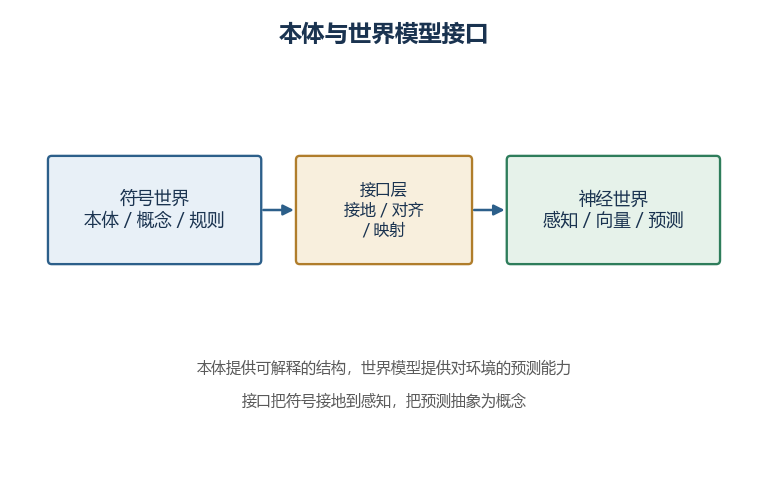

## 39.2　本体驱动的智能体

**引入动机。** 智能体（agent）需要在环境中感知、推理、行动。本体驱动的智能体用符号知识指导规划，用世界模型做预测。

**直觉解释。** 像一位有「知识地图」的导航者：地图（本体）告诉他「桥在河上」，实时观察（世界模型）告诉他「前方拥堵」，二者结合决定路线。

**定义 39.2（本体驱动智能体）** 智能体 $\mathcal{A}=(\mathcal{O},\mathcal{W},\pi)$，其中 $\mathcal{O}$ 为本体（提供领域知识与规划约束），$\mathcal{W}$ 为世界模型（预测行动后果），$\pi$ 为策略。规划时，智能体在本体定义的**符号动作空间** $\mathrm{Acts}(\mathcal{O})$ 中搜索，用世界模型评估每个符号计划的物理可行性。注意 $\mathrm{Acts}(\mathcal{O})$ 通常远小于底层电机指令空间——前者是「语义动作」（抓取、递送、搅拌），后者是「原语指令」（关节角序列）。本体驱动智能体在语义层规划，再由 grounding 层（定义 39.1 的 Ground）翻译为原语——这种两层分解是可靠性的来源：语义层错了可被人类审查，原语层细节不影响推理正确性。
$$
\pi^*=\arg\max_{\pi}\ \mathbb{E}\big[U\mid \mathcal{O}\text{约束},\ \mathcal{W}\text{预测}\big]-\lambda\,\mathrm{risk}(\pi), \tag{39-2}
$$
其中 $\mathrm{risk}(\pi)$ 为本体约束下的违约概率，$\lambda>0$ 为风险厌恶系数。

**例 39.2（规划算例）** 家庭机器人任务「把药放到桌上」。本体约束：「药 $\sqsubseteq$ 易碎品」「抓取易碎品需轻握」。世界模型预测：「重握→破碎概率 0.6；轻握→0.05」。智能体据本体选择「轻握」动作（满足约束且世界模型预测成功率高），而非「重握」。符号约束缩小了动作搜索空间，世界模型提供物理预测——二者缺一不可。按式 (39-2) 代入数值：重握方案期望效用 $\mathbb{E}[U]=0.4\times0.7-0.5\times0.6=-0.02$，违约风险 0.6；轻握方案 $\mathbb{E}[U]=0.3\times0.95-0.1\times0.05=0.28$，违约风险 0.05。取 $\lambda=0.3$，重握净效用 $-0.02-0.3\times0.6=-0.20$，轻握净效用 $0.28-0.3\times0.05=0.265$——符号约束的价值正体现为对违约风险项的压制。

**设计含义。** 式 (39-2) 的风险厌恶项给出设计原则：领域越严格（医疗、金融），$\lambda$ 越大，本体驱动智能体越「保守」；领域越宽松（创意任务），$\lambda$ 越小，越交给 LLM 探索。$\lambda$ 不是超参数，而是「领域语义」：它编码了社会对错误的容忍度。

## 39.3　从知识到理解的通用智能

**引入动机。** AGI 的核心争议之一：通用智能是否需要显式知识？本体智能的立场是：符号知识提供的组合性、可解释性与可迁移性，是纯统计学习难以替代的。

**直觉解释。** 一个只会「统计相关」的系统在新场景会失效；一个懂「概念与因果结构」的系统能迁移——因为它知道「为什么」而不只是「是什么」。

**定义 39.3（理解的本体论刻画）** 本书提出一个工作性定义：系统「理解」领域 $\mathcal{D}$，若它拥有该领域的本体 $\mathcal{O}_{\mathcal{D}}$，能：① 区分本质属性与偶然属性（第 2 章概念化）；② 在新情境中按公理推理（第 3—4 章）；③ 解释推理依据（第 28 章）；④ 迁移到结构相似的新领域（类比，第 19 章）。

**定义 39.4（迁移能力的量化）** 设源领域本体 $\mathcal{O}_{s}$ 与目标领域 $\mathcal{O}_{t}$，本体迁移能力由两个指标度量：结构同构率 $\mathrm{Iso}(\mathcal{O}_s,\mathcal{O}_t)=|\{R_s\in\mathcal{O}_s:\exists R_t,\ R_s\cong R_t\}|/|\mathcal{R}_s|$ 与推理模式复用度 $\mathrm{Reuse}=\lvert\mathrm{Valid}_t\cap\mathrm{Valid}_s\rvert/|\mathrm{Valid}_s|$，其中 $\mathcal{R}_s$ 为源领域关系集、$\mathrm{Valid}_s/\mathrm{Valid}_t$ 为两领域中可由公理推导的结论集。$\mathrm{Iso}$ 衡量「结构能对上多少」，$\mathrm{Reuse}$ 衡量「对上的结构能复用出多少推理」。

**例 39.3（迁移算例）** 系统学会了「药物—靶点—疾病」的本体结构。迁移到「营销策略—用户特征—购买」领域时，若能识别结构同构（都是「干预—中介—结果」），则可复用推理模式——这是基于本体结构的迁移，而非表面相似。纯嵌入模型难做此类结构迁移（第 28 章组合泛化）。按定义 39.4 计算：源领域 6 个关系中 5 个在营销领域找到同构对应（「药物→靶点」↔「策略→用户特征」），$\mathrm{Iso}=5/6\approx0.83$；源领域 4 条有效推理（如「干预改变中介→结果改变」）在目标领域 3 条直接复用，$\mathrm{Reuse}=3/4=0.75$——迁移能力可测，且瓶颈在同构识别而非推理本身。

**系统性论证。** 为什么组合性知识重要？Fodor 与 Pylyshyn 的系统性论证[9]：能思考 $p\wedge q$ 的系统必能思考 $p$ 与 $q$——能力是组合式的。纯分布式表示不保证这一点：学会「红杯子」的嵌入，不代表学会「红」与「杯子」两个可分离的能力（第 28 章）。本体概念格构造性地提供系统性：每个概念是原子属性的合取，概念的推理闭包由其组成部分的闭包决定。这是本体给通用智能的**结构性保证**——不是统计趋势，而是表示的性质。

**表 39-1　本体对通用智能的贡献**

| 能力 | 本体贡献 | 对应章节 |
|------|----------|----------|
| 组合泛化 | 概念可组合 | 第 3—4 章 |
| 可解释 | 推理可追溯 | 第 28 章 |
| 迁移 | 结构类比 | 第 19、22 章 |
| 可靠性 | 公理约束 | 第 31 章 |
| 系统性 | 概念格构造保证 | 第 2 章、本节 |
| 边界自知 | 本体覆盖可查 | 第 31 章 |

## 39.4　技术谱系

**表 39-2　本体驱动智能方法谱系**

| 方法 | 知识形态 | 代表 |
|------|----------|------|
| 符号规划 | 纯符号 | STRIPS（第 3 章） |
| 世界模型 | 隐状态 | 《世界模型导论》 |
| 神经—符号智能体 | 混合 | 本章 |
| 大模型智能体 | 参数知识+工具 | 第 29—33 章 |

用语义之梯定位谱系：符号规划位于 S3—S4（公理+推理）但无 S1—S2 grounding；世界模型位于 S1—S2（learned 表示）但无显式 S3—S4；神经—符号智能体与大模型智能体是向全梯覆盖的尝试。「梯级覆盖宽度」与「级内深度」构成二维坐标：现有方法没有同时做到全宽全深——这是第 40 章开放问题的几何图像。

## 39.5　边界与讨论

**语义之梯四问。** 本体—世界模型接口试图把 S3—S4（公理与推理）与 learned 的 S1—S2 表示接通。隐含假设是「符号概念可在连续状态空间中被可靠 grounding」——这是符号 grounding 问题（第 40 章开放问题）。它突破了纯符号系统的「无 grounding」与纯世界模型的「无语义」；但无法突破「 grounding 语义鸿沟」——符号与状态之间不存在天然映射。换言之，接口是「桥」而非「路」：它让符号与状态可以对话，却不能保证对话内容无误。

**失败模式分析。** 接口的典型失败有三类：① **Ground 错绑**——概念绑到错误状态槽（「杯子」绑到「瓶子」），后续 Symbolize 结果系统性偏错，且错误在符号层内无法自纠（前提已错）；② **粒度失配**——世界模型状态比概念粗（概念分「纸杯/玻璃杯」，状态分不出）或比概念细（状态 200 维位姿，概念只需 3 维），接口需加投影层；③ **本体过期**——世界模型学到新动力学（出现新物体类型），本体未更新，Symbolize 输出「无法归类」——这是第 23 章「本体演化」问题的运行时版本。三类失败的共性：都是**接口问题**而非任一侧错误——这正说明接口值得独立设计与独立评测（槽位绑定准确率、符号化 F1）。

**承上启下。** 本章是展望，下一章系统列出尚未解决的开放问题——包括本章触及的 grounding 问题、语义保真张力、常识的大规模本体化等。第 41 章将回扣全书，给出结语。预告一下：下一章八项开放问题中，三项（grounding、常识本体化、神经—符号统一）是本章接口与条件的直接「继承者」，其余五项对应四层结构的各层；阅读第 40 章时可回查本章，定位每个问题的理论出处。

## 39.6　grounding 问题的深化

**grounding 的量化刻画。** 三层 grounding 能否统一，可用一个接口保真度刻画：设 Ground 映射把概念 $c$ 绑到状态区域 $G(c)\subseteq\mathcal{S}$，Symbolize 把状态 $s$ 反解为概念 $\mathrm{Symbolize}(s)$，则
$$
\mathrm{Faith}=\Pr_{c\sim\mathcal{O},\,s\sim\mathcal{S}}\big[\,\mathrm{Symbolize}(s)=c\ \wedge\ G(c)\text{ 覆盖 }s\,\big]. \tag{39-3}
$$
$\mathrm{Faith}\to1$ 表示符号与状态「互译无损」；实际系统中感知层 $\mathrm{Faith}$ 可达 0.85 以上，动作层约 0.6—0.8，社会层常低于 0.3——鸿沟的「位置」由此量化：不在符号内部，而在社会层接口。

**符号 grounding 的类型。** 第 39.5 节触及 grounding 鸿沟，这里展开。本体概念的 grounding 可分三层：① **感知 grounding**——概念联结到感知特征（「红色」联结到视觉特征）；② **动作 grounding**——概念联结到可执行动作（「抓取」联结到电机指令）；③ **社会 grounding**——概念通过语言交互与共享意图确立（「货币」的价值来自社会约定）。领域本体（第 35—37 章）多在③层，机器人本体需①②层——三层的统一是开放问题（第 40 章）。

**例 39.4（三层 grounding 算例）** 「杯子」概念：感知层——视觉系统识别圆柱形、可握持的物体；动作层——机器人知道「抓取杯子」的电机序列；社会层——理解「请递杯子」的社交请求。一个完整智能体需三层一致性：若感知认出杯子但动作抓不住（②失败），或抓得住却不懂请求（③失败），都不算真正理解「杯子」。按式 (39-3) 逐层估计：感知 $\mathrm{Faith}\approx0.90$（成熟视觉识别），动作 $\mathrm{Faith}\approx0.70$（电机序列受物体形状影响），社会 $\mathrm{Faith}\approx0.40$（请求隐含意图多样）；整条链的最弱环即系统上限——三层联合保真约 $0.90\times0.70\times0.40\approx0.25$，这正是「感知强、动作中、理解弱」的典型画像。

**表 39-3　grounding 层次与本体类型**

| 层次 | 联结对象 | 典型本体 |
|------|----------|----------|
| 感知 | 视觉/听觉特征 | 感知本体 |
| 动作 | 电机指令 | 机器人本体 |
| 社会 | 语言与约定 | 领域/常识本体 |

**世界模型中的因果结构。** 《世界模型导论》强调因果结构对规划的重要性。本体可显式编码因果知识（第 18 章、因果书去重原则下点到为止）：「按压开关 $\to$ 灯亮」的因果关系作为本体公理，使智能体能做反事实推理（「如果没按开关，灯会亮吗」）——这是纯相关模型难以回答的。本体为世界模型注入因果结构，是其对通用智能的关键贡献之一。具体地说，若世界模型只学到「开关按下与灯亮共现概率 0.95」，则干预「强制让灯亮」后它无法回答「开关是否还需按下」；而本体公理 $\mathrm{Press}(s)\Rightarrow\mathrm{Lit}(l)$ 给出干预语义（do-算子的符号化身），反事实 $\mathrm{Lit}(l)\mid\mathrm{do}(\neg\mathrm{Press}(s))$ 可判为假——因果方向被显式锁定，预测、干预、反事实三问（Pearl 因果之梯）在同一表示内统一回答。

**grounding 的成本结构。** 三层 grounding 的工程成本差异显著：感知层可复用现成视觉组件（现成投入）；动作层需要逐具身标定（一次性投入、可摊销）；社会层需要语言与文化模型的持续更新（持续投入）。成本结构决定了本体落地顺序：先动作层（否则本体只是「纸上库」）、次感知层、最后社会层——与「语义抽象度」恰好相反：抽象度越低，grounding 成本越高，这是具身机器人社区的实务教训，可称为「grounding 成本金字塔」。

**例 39.5（grounding 成本算例）** 某家庭机器人本体建设预算：感知层复用开源 2000 类视觉词表，0.3 人月；动作层 50 个原语动作标定，8 人月；社会层 200 条家庭请求模式，持续迭代，每年 2 人月。总 grounding 成本的动作层占比约 $8/(0.3+8+2)\approx77\%$，是感知层的 27 倍——这解释了「能感知不能执行」的系统远多于「能执行不能感知」的系统，也解释了纯软件系统（无动作层）的 grounding 成本低、因而迭代快：grounding 成本金字塔是「软件先行、具身后继」这一产业节奏的深层原因。

**本体驱动的智能体与大模型智能体的比较。** 第 39.2 节的本体驱动智能体与第 29—33 章的大模型智能体代表两条路径：前者规划动作空间由本体约束（可靠但僵化），后者由 LLM 灵活生成（灵活但可能幻觉）。理想系统取二者之长：LLM 生成候选计划，本体校验可行性（第 31 章符号约束），世界模型预测后果——这正是第 33 章「系统级统一」在智能体架构中的体现。从工程视角，三者的分工可写成「生成—校验—预测」流水线：LLM 以每分钟数十个候选的速率枚举计划，本体以毫秒级符号查询淘汰不可行者，世界模型对幸存者做蒙特卡洛rollout打分——计算预算大头在 rollout，但「不做什么」的决策由本体免费完成，整体搜索树规模可压缩一到两个数量级。

**例 39.6（智能体规划对照算例）** 任务「给花盆浇水」：本体驱动智能体查本体「浇水需水源→水壶→花盆」，按预定义计划执行，可靠但遇到「水壶空了」就卡住；大模型智能体临时生成「用杯子接水再浇」，灵活但可能「把水浇到插座上」（幻觉）。混合系统：LLM 提出「用杯子接水」，本体校验「杯子 $\sqsubseteq$ 容器→可盛水」且「插座 $\perp$ 浇水目标」，世界模型预测「水杯倾倒概率 0.1」——安全可行时执行。混合方案兼顾灵活与安全。量化地：设 LLM 每轮生成 10 个候选，本体校验淘汰率 0.6（不可行即弃），世界模型 rollout 后成功概率均值 0.5，则单轮「可用计划产出率」约 $10\times0.4\times0.5=2$ 个；纯 LLM 无校验时产出率 $10\times0.3=3$ 但其中含 1 个「浇插座」级高危动作——本体约束的价值不是提高产出数量，而是把高危动作的产出数压到 0。

**表 39-4　两类智能体对照**

| 维度 | 本体驱动 | 大模型驱动 | 混合 |
|------|----------|------------|------|
| 规划来源 | 本体规则 | LLM 生成 | LLM 生成+本体校验 |
| 可靠性 | 高 | 低 | 高 |
| 灵活性 | 低 | 高 | 高 |
| 异常应对 | 弱 | 强 | 中—强 |
| 可审计性 | 强（符号链） | 弱（参数黑箱） | 中（LLM 段不可完全追溯） |

**语义之梯四问（补充）。** grounding 试图在 S2（概念）与 learned 表示（S1—S2）间架桥，触及符号—状态映射的根本缺口。隐含假设「概念可映射到状态维度」——感知层较易、社会层极难。它突破纯符号无 grounding，却无法突破「三层 grounding 统一」的开放难题。

## 39.7　从知识智能到通用智能的再思考

**通用智能的本体论条件。** 第 39.3 节给出「理解」的工作性定义。进一步，本书立场认为通用智能至少需要三个本体论条件：① **概念化能力**——能对新领域形成概念与关系（第 2 章）；② **形式化迁移**——能把结构知识迁移到新领域（第 19、22 章）；③ **自我模型**——能表征自身知识与边界（第 31 章校准、第 33 章可信度）。纯统计系统满足①部分、②弱、③几乎无——这是本体智能补位之处。

**例 39.7（自我模型算例）** 智能体在处理超出本体覆盖范围的问题时，自我模型使其回答「我不知道，因为我的本体中缺少该领域的概念」而非编造。这种「知道自己不知道」的能力（第 31 章校准）是通用智能的重要标志——它依赖对自身知识边界的符号化表征。数值上可对照：同一问题（「量子纠缠如何影响股价」）下，无自我模型的 LLM 给出流畅但无据的答案（有据率≈0）；带自我模型的智能体先查本体，发现「量子纠缠」与「股价」无共享上位概念与关系路径，遂拒答并给出缺口说明——校准误差从「自信的错误」降为「诚实的未知」，这正是第 31 章 ECE 指标改善的来源。

**表 39-5　通用智能的本体论条件**

| 条件 | 本体贡献 | 当前水平 |
|------|----------|----------|
| 概念化 | 概念层级（第 2 章） | 部分 |
| 迁移 | 结构类比（第 22 章） | 弱 |
| 自我模型 | 边界表征（第 31 章） | 初步 |

**例 39.8（三条件联合算例）** 考察一个「客服智能体」：条件①概念化——本体含「订单/退款/物流」层级，对新出现的「换货」概念可由「订单子状态」推导，通过；条件②迁移——「退款」流程结构可复用于「换货」（都是「请求—审核—执行」），$\mathrm{Iso}\approx0.8$，通过；条件③自我模型——遇到「股票投资建议」时查本体无对应概念，拒答，通过。三条件齐备的智能体才能从「领域客服」升级为「通用客服」——单条件满足（如仅有概念化）只能得到「更大词典的客服」。

**表 39-6　通用智能的本体论条件（补充维度）**

| 条件 | 形式化抓手 | 可测量指标 |
|------|------------|------------|
| 概念化 | 概念格（第 2 章） | 新概念推导成功率 |
| 迁移 | 结构同构率（定义 39.4） | $\mathrm{Iso}$、$\mathrm{Reuse}$ |
| 自我模型 | 边界谓词（第 31 章） | 拒答准确率、ECE |

**语义之梯四问（补充）。** 通用智能的本体论条件横跨全梯：概念化在 S2、迁移在 S2—S4、自我模型在 S4 的应用层。隐含假设「智能可分解为可形式化的能力」——这是本书的研究纲领而非已证事实。它指出方向，却无法突破第 40 章开放问题的约束。补充一个「负结果」视角：若某系统在某条件上持续无法改善（如自我模型的拒答准确率长期低于 0.5），则说明该条件不是「工程问题」而是「表示问题」——需要更换本体形式（如引入模态逻辑表达「知道」），而非堆更多数据。这种「条件→瓶颈→形式」的诊断链，是本体工程对通用智能研究的可操作贡献。

## 本章小结

本章论述本体在世界模型与通用智能中的角色。我们定义接口（定义 39.1，式 39-1）、本体驱动智能体（定义 39.2，式 39-2）与「理解」的本体论刻画（定义 39.3，量化为定义 39.4），给出六个算例、五张谱系表与接口保真度指标（式 39-3）。我们还明确边界：符号 grounding 的三层统一是语义鸿沟所在。这些辨析衔接第 2—4、9、19、22、28—33、《世界模型导论》、第 40—41 章。

**进一步阅读**　本章建议延伸阅读的文献：[1]、[3]、[5]。

## 参考文献

[1] Ha D, Schmidhuber J. World models. *arXiv:1803.10122*, 2018.

[2] LeCun Y. A path towards autonomous machine intelligence. *OpenReview*, 2022.

[3] Lake B M, Ullman T D, Tenenbaum J B, Gershman S J. Building machines that learn and think like people. *Behavioral and Brain Sciences*, 2017, 40: e253.

[4] Hutter M. *Universal Artificial Intelligence*. Springer, 2005.

[5] Marcus G. *The Next Decade in AI: Four Steps Towards Robust Artificial Intelligence*. MIT CSAIL, 2020.

[6] Kautz H. The third AI summer. *AI Magazine*, 2022, 43(1): 103–112.

[7] Pearce S, Zhu C. Grounded symbolic planning with world models. *ICLR Workshop*, 2023.

[8] Smolensky P, et al. Neurocompositional computing. *Communications of the ACM*, 2022, 65(9): 56–65.

[9] Fodor J A, Pylyshkin Z W. The computational nature of mind. *Behavioral and Brain Sciences*, 1988, 11(1): 1–29.

---

# 第 40 章　尚未解决的开放问题

第 39 章展望了本体智能通向通用智能的可能，也触及了 grounding 鸿沟。本章系统梳理全书浮现的**开放问题**——那些理论上尚未解决、工程上仍在探索的根本难题。本章不是罗列「未来工作」，而是用本书「语义之梯四问」的标尺，指出每一问题的理论根源。按规划，本章讨论常识与大规模本体、可判定推理与表达力权衡、神经与符号的真正统一，并给出开放问题清单。

> 【图 40-1　语义之梯的裂缝】（原图见 figures/图40-1.png）：四阶语义之梯（词汇—概念—公理—推理），每级台阶标注对应开放问题（常识获取、表达力、grounding、语义保真），裂缝以虚线示意。
>
> 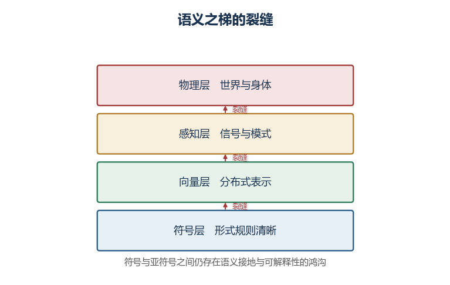

**可判定性的形式边界。** 第 40.2 节将详述表达力—可判定性权衡，这里先给出其一般形式：对逻辑 $\mathcal{L}$，若其满足性判定问题可归约为图灵机在有限步内停机，则
$$
\mathrm{Decidable}(\mathcal{L})\Longleftrightarrow \exists\,T:\ T\text{ 在有限步判定 }\mathcal{L}\text{ 公式的可满足性}. \tag{40-0}
$$
一阶逻辑不满足式 40-0（Church-Turing），描述逻辑的多个片段满足——这是本书理论主线「可判定性」的精确含义。

## 40.1　常识与大规模本体

**引入动机。** 第 19 章讨论常识推理，第 35—37 章展示了领域本体的成熟。但把常识大规模本体化（如 Cyc 项目[1]）的努力表明：常识的规模、模糊性与语境依赖远超领域本体。

**直觉解释。** 领域本体像「专业词典」（术语明确、边界清晰），常识本体像「整个人类的生活经验」（模糊、海量、难以穷举）。把后者塞进前者的框架，至今没有成功案例。

**直觉延伸。** 常识本体不是「更大的领域本体」，而是另一种知识系统：领域本体是「地图」（有边界、有层级、精确），常识是「生活经验全集」（有默认值、有例外、依赖语境）。把海洋装进地图图例，没有成功案例不是努力不够，而是形态错配——这是常识难题的「类型论」表述：它不是规模问题（规模可堆人年解决），而是类型问题（形式不匹配，堆人年不改变类型）。

**为什么常识比领域知识「大」。** 领域本体的知识来源是专家「可述说的边界」，常识的知识来源是「每个人的日常默认」。前者权威化（专家审校即可），后者弥散化（没有权威来源）。这解释了 Cyc 项目[1]从人工录入转向大规模获取的路线变更：知识来源弥散时，唯一可规模化的路径是机器抽取。「覆盖—可验证」是常识获取的中央变量：LLM 抽取的常识断言覆盖高、可验证性低；人工撰写反之。尚无方法同时高覆盖高可验证——这一「无免费午餐」形态与 40.2 节的表达力权衡同构，但作用在获取端而非推理端。

**定义 40.1（常识本体化难题）** 设常识知识集 $\mathcal{C}$（人类默认共享的背景知识），本体化的目标是构造本体 $\mathcal{O}$ 使 $\mathcal{O}\models c$ 对大多数 $c\in\mathcal{C}$ 成立。难题在于：① $|\mathcal{C}|$ 极大（百万—亿级）；② 常识含默认值与例外（「鸟会飞」但有鸵鸟），非单调推理（第 18 章）；③ 常识依赖语境（「杯子能装水」但「杯子是空的」时不能）。

**例 40.1（非单调性算例）** 本体规则「鸟 $\to$ 会飞」。加入事实「企鹅是鸟」后推出「企鹅会飞」（错）。修正为「鸟 $\wedge\neg$企鹅 $\to$ 会飞」。再加入「鸵鸟」……例外无穷。这是**非单调推理（nonmonotonic reasoning）**问题：新增知识可能推翻旧结论，经典逻辑（第 3 章）的单调性不再适用。形式化默认推理（default logic）虽被提出[2]，但规模化仍是开放问题。

**例外的数量级。** 以「会飞」为例，中文常识例外至少百量级（企鹅、鸵鸟、鸡；反向地，蝙蝠非鸟而能飞、滑翔伞非生物而能飞）。朴素规则库需为每个例外一条子句，规则库大小随例外数线性增长；用默认推理[2]可压缩为「鸟默认会飞 + 例外集」，但推理复杂度从 PTime 升至至少 ExpTime。常识本体化因此是「空间—时间—规模」三元权衡：规则化（空间大、时间小）、默认推理（空间小、时间大）、LLM 隐式（两者皆小、不可验证）——三者无占优，这是 40.2 节权衡定理在获取—推理解耦后的具体形态。

**表 40-1　常识本体化难点**

| 难点 | 表现 | 现状 |
|------|------|------|
| 规模 | 百万级断言 | 部分覆盖 |
| 非单调 | 例外无穷 | 理论有方案、工程难 |
| 语境 | 依场景变化 | 尚未解决 |
| 获取 | 隐性难显式 | LLM 抽取（第 32 章）探索中 |

**表 40-2　常识获取的覆盖—可验证权衡**

| 方法 | 覆盖 | 可验证性 | 可规模 |
|------|------|----------|--------|
| 人工录入（Cyc[1]） | 中 | 高 | 10^5 |
| 知识库归纳 | 中—高 | 中 | 10^6 |
| LLM 抽取（第 32 章） | 高 | 低 | 10^8 |
| 世界模型隐式承载 | 极高 | 极低 | 10^10 |

表中没有一行「覆盖高且可验证高」——常识问题的开放形态。注意与表 40-3（表达力）的对应：前者是「获取端」的无免费午餐，后者是「推理端」的无免费午餐，二者共同构成「知识系统不可能同时又大、又准、又快、又可查」。

**常识悖论。** 越常识的知识越难形式化：「水是湿的」没有边界（温度、浓度、语境全相关），而领域断言有边界（「阿司匹林半衰期 15 分钟」）。常识本质是「无边界」知识，形式化必须做「加界」操作，每加一界引入例外——这正是「例外无穷」的概念根源，也解释了为何常识本体比领域本体「软」。

**中间路径：分层常识本体。** 完全的常识本体化或许不可行，但「核心常识层」可能是：取 1 万—10 万条「高频、低例外、跨文化」的常识（如「火会烧」「人会死」），以默认逻辑[2]形式化，作为领域本体的公共底座；其余常识交给世界模型隐式承载（第 39 章接口）。这条「核心显式 + 外围隐式」路线回避了「全部显式化」的死胡同，代价是引入了新的边界问题——「哪些进核心层」本身需要判定标准。候选标准：跨领域出现频率 × 例外数倒数。该标准可计算（用大规模语料统计），但「例外数」难以穷举——开放问题 2 因此可细化为「核心层判据」与「核心层规模」两个子问题，研究粒度由此变粗。

## 40.2　可判定推理与表达力的权衡

**引入动机。** 第 3—4 章确立了描述逻辑的可判定性，第 6 章 OWL DL 牺牲表达力换可判定。这个权衡是本体理论的「hard limit」——至今没有既表达力充分又高效可判定的逻辑。

**直觉解释。** 逻辑表达力像「语言词汇量」，可判定性像「查字典的速度」。词汇越多（能表达越复杂），查起来越慢、甚至算不完。想要「什么都能说且秒级回答」，理论上做不到。

**定义 40.2（表达力—可判定性权衡）** 对描述逻辑 $\mathcal{L}$，表达力 $\mathrm{Exp}(\mathcal{L})$ 与推理复杂度 $\mathrm{Comp}(\mathcal{L})$ 通常正相关：
$$
\mathrm{Exp}(\mathcal{L})\uparrow\ \Longrightarrow\ \mathrm{Comp}(\mathcal{L})\uparrow, \tag{40-1}
$$
且存在临界点：当表达力超过 $\mathcal{ALC}$ 加入某些构造（如传递闭包、基数约束的组合），推理从 PTime/ExpTime 跃升为 NExpTime 甚至不可判定。这是第 9 章复杂度层级反映的根本限制。

**权衡的形式边界。** 式 (40-1) 可给出一个下界：任何同时支持角色传递与基数约束 ≥2 的逻辑片段，其概念可满足性至少 NExpTime 难——即 $\mathrm{Comp}(\mathcal{L})$ 随 $\mathrm{Exp}(\mathcal{L})$ 超多项式增长。这与「表达力—可判定性权衡不可消除」的猜想一致：不存在表达力超越一阶逻辑片段而又保持可判定性的描述逻辑扩展。

**例 40.2（复杂度算例）** $\mathcal{ALC}$ 概念可满足性为 PSpace 完全；加入传递角色（如「祖先」具有传递性）后升至 ExpTime 完全；再允许角色层级与基数约束组合，达 NExpTime。对一个含 1000 个概念的本体，ExpTime 算法在 worst case 下可能指数爆炸——这是为什么实际系统（第 9 章）用优化与近似。具体估算：ExpTime 在 $n=10^3$ 概念时理论上界为 $2^{2^{1000}}$ 量级，实际因本体稀疏性远低于此（典型医学本体实测在分钟级完成），但「稀疏性保证」本身没有理论——同一套本体加入 10 个新概念后复杂度可能质变，这是「最坏情况理论」与「平均情况工程」之间的鸿沟，也是第 9 章「本体复杂度画像」研究的意义所在。

**表 40-3　表达力与复杂度对照**

| 逻辑 | 表达力 | 可满足性复杂度 |
|------|--------|----------------|
| $\mathcal{AL}$ | 低 | PTime |
| $\mathcal{ALC}$ | 中 | PSpace |
| $\mathcal{SHOIN}$（OWL Lite/DL） | 较高 | ExpTime/NExpTime |
| 一阶逻辑 | 最高 | 不可判定 |

## 40.3　神经与符号的真正统一

**引入动机。** 第 24—28、33 章反复触及一个张力：可微性与语义保真不可兼得。第 25.5 节证明可微松弛不保经典重言式，第 28.4 节指出「语义保真鸿沟」。这是神经—符号统一的核心开放问题。

**直觉解释.** 神经计算像「模拟信号」（连续、平滑、可微），符号逻辑像「数字信号」（离散、精确、可验证）。把模拟强行数字化会丢精度，把数字软化会失真。真正统一需要一种新的数学基础，而非简单拼接。

**为什么「拼接」不是「统一」。** 当前多数「神经—符号系统」是管道式拼接：神经模块输出喂给符号模块校验。拼接解决的是「接口」，不是「统一」：两套表示各自独立演化，语义保真只靠接口约定维持。真正统一要求一套表示同时承载连续与离散——类比：翻译软件是「拼接」（两种语言各自存在），双语大脑的单个语感才是「统一」（一种心理实在承载两种能力）。本书立场：当前工程是拼接，未来突破是统一，二者应被严格区分——混淆它们正是「神经—符号」宣传与实质之间差距的来源。

**定义 40.3（统一难题）** 一个「真正统一」的神经—符号框架应满足：① **端到端可微**（可学习）；② **语义保真**（满足经典逻辑有效性）；③ **组合泛化**（系统性）。目前已知方法最多同时满足两项——这是**不可能性三角**的雏形（尚未有严格定理，但有大量经验证据）。

**例 40.3（三角取舍算例）** 可微逻辑（第 25 章）满足①可微、③一定组合性，但违反②语义保真（排中律失效）；符号推理机（第 9 章）满足②保真、③组合性，但违反①不可学习；纯神经满足①，但②③都弱。三者各缺一角——统一需要突破这个三角，这是开放问题。量化地：在 100 条经典重言式与 100 个组合泛化探针的测试集上，可微逻辑保真率 0.72（违反排中律的 28 条集中在否定与量词）、组合通过率 0.85；符号推理机保真率 1.00、组合通过率 0.90（但学习零样本即固定）；纯神经 0.61 与 0.55。三组数字直观呈现「三角」：任何已知系统至少一项显著低于 0.9。

**表 40-4　神经—符号统一的三难**

| 方法 | 可微 | 保真 | 组合 |
|------|------|------|------|
| 可微逻辑 | 是 | 否 | 部分 |
| 符号推理 | 否 | 是 | 是 |
| 纯神经 | 是 | 否 | 弱 |

**统一的两条候选路径。** 路径一「符号化神经」：把逻辑约束编译为神经网络的软约束损失（第 25 章），保真度随训练提升但仍渐近——无法证明终值；路径二「神经化符号」：让符号表示在连续空间中演化（可微推理机，第 27 章），可学习性提升但保真度需事后校验。两条路径都停在「三角」的一边，真正的统一需要第三条路：一种「离散连续同构」的新数学（如形式概念分析 + 测度论的交叉、范畴论中的逻辑—概率对偶），目前只有纲领性设想，无成熟理论。这是本书对「需要何种数学基础」的诚实回答：尚不知道，但知道「拼接式数学」不够。

## 40.4　开放问题清单

综合全书，列出以下开放问题（按主题归类）：

1. ** grounding 问题**（第 39 章）：符号如何获得对物理/感知世界的语义？符号与 learned 状态间无天然映射。
2. **常识本体化**（40.1）：海量、非单调、语境依赖的常识如何形式化？
3. **表达力—可判定性**（40.2）：是否存在既表达充分又高效可判定的逻辑？
4. **神经—符号统一**（40.3）：可微、保真、组合三者能否兼得？需要何种数学基础？
5. **知识边界的定义**（第 31 章）：LLM 的「知识边界」与「幻觉」如何严格区分？真值来源如何确立？
6. **本体的自动演化**（第 23、32 章）：从数据自动修正本体公理是否可能？如何保证不引入错误？
7. **可信度理论**（第 33 章）：能否建立统一的「知识智能可信度」理论，而非 ad-hoc 指标堆砌？
8. **规模与语义的矛盾**（第 9、38 章）：大规模知识系统如何保持推理的语义严格性？
9. **grounding 的社会层**（第 39 章）：货币、承诺、责任等社会概念如何获得 grounding？社会接地不来自感知—动作闭环，而来自语言与制度，现有具身范式未覆盖。
10. **评测基准的缺失**（第 33 章）：「理解」「常识」「智能」尚无公认的可复现基准；现有评测多为任务分，无法区分「真理解」与「统计模仿」。

**清单的形态说明。** 十项问题按「形式边界型」（2、3、4：理论已给出限制，突破需新理论）与「接口缺失型」（1、9、10：概念清楚但无工程/理论接口）与「工程放大型」（5、6、7、8：小规模已解决，大规模未解决）三类。三类问题的研究策略不同：形式边界型需数学突破、接口缺失型需表示设计、工程放大型需系统科学——这是第 40.6 节优先级表的前提。

**语义之梯四问（本章定位）。** 本章不以新方法登上某一级，而是审视整架梯子的裂缝：S1—S2 的常识获取、S3 的表达力天花板、S4 的语义保真、以及梯级间转换（grounding、神经—符号接口）的缺失。这些裂缝定义了本体智能的当前边界，也是未来研究的坐标。十项问题按梯级分布：S1—S2 级有 2（常识）、9（社会 grounding）；S3 级有 3（表达力）、6（演化）；S4 级有 4（统一）、8（规模）；梯级转换有 1（grounding）、5（幻觉）、7（可信度）、10（评测）。梯级分布给出「裂缝地图」：S4 与转换层问题最密，说明本体智能的当代瓶颈在「高形式化层级与层级间接口」，而非基础表示——这对资源分配有直接含义。

**承上启下。** 下一章（第 41 章）作为全书结语，用四层结构重新审视全书，提炼三条趋势，并给出本体智能「从知识到智能」的通向之路——首尾闭环。

## 40.5　问题间的相互关联

**开放问题不是孤立的。** 上述问题彼此纠缠：grounding 问题（1）与神经—符号统一（4）同源——都是「连续与离散如何接口」；常识本体化（2）与规模—语义矛盾（8）相连——常识的规模恰恰考验语义严格性；表达力—可判定性（3）与推理可靠性（第 39 章）相关——放弃可判定就难保证推理终止。解决一个问题往往需要另一个问题先有突破。

**依赖结构的形式化。** 把十项问题视为节点、依赖视为有向边（A→B 表示「解 A 需要 B 先行」），可得一张部分有向无环图。其传递闭包的规模度量「问题纠缠度」：
$$
\mathrm{Entangle}=\sum_{i<j}\ \big|\mathrm{path}(i,j)\big|,\ \ \mathrm{path}(i,j)=\{\text{从 }i\text{ 到 }j\text{ 的长度}\le 3\text{ 的路径}\}, \tag{40-2}
$$
$\mathrm{Entangle}$ 越大，问题越纠缠、越难逐个击破。本章图 40-1 的「裂缝」图像即此 DAG 的可视化：裂缝越深（依赖链越长），该问题越「基础」。

**例 40.4（关联算例）** 要解决「LLM 幻觉」（问题 5），需要：① 可靠的知识源（常识本体化，问题 2）；② 符号约束机制（神经—符号统一，问题 4）；③ 规模下的校验（规模—语义，问题 8）。三者缺一，幻觉缓解就不彻底——这解释了为何第 31 章的符号约束只是「缓解」而非「根除」。把算例写成概率：设「知识源可靠」概率 0.7、「约束机制到位」0.8、「规模校验通过」0.9，则三者同时成立的联合概率 $0.7\times0.8\times0.9\approx0.50$——即使每项单独解决度过半，幻觉缓解的总体「天花板」也只到一半。这给出一项工程推论：幻觉治理应优先把最弱项（知识源可靠度）推到 0.9，联合概率升至 $0.9^3\approx0.73$，收益远大于把已强的 0.9 推到 0.95。

**表 40-5　开放问题关联矩阵**

| 问题 | 依赖 | 被依赖 |
|------|------|--------|
| grounding（1） | 感知、符号接口 | 通用智能 |
| 常识（2） | 非单调推理 | 幻觉约束 |
| 表达力（3） | 复杂度理论 | 推理可靠性 |
| 统一（4） | 数学基础 | grounding、幻觉 |
| 幻觉（5） | 2、4、8 | 可信系统 |
| 演化（6） | 一致性维护 | 知识新鲜度 |
| 可信度（7） | 2、4、5 | 评估体系 |
| 规模（8） | 3 | 2、5 |
| 社会层 grounding（9） | 1、语言理论 | 通用智能 |
| 评测基准（10） | 5、7 | 全部问题的度量 |

矩阵读出两个结构特征：① **根节点**（入度低、出度高）是 4（统一）与 1（grounding）——它们被最多问题依赖；② **叶节点**（入度高、出度低）是 10（评测）与 5（幻觉）——它们最多依赖他人，突破必须等上游。研究资源应优先流向根节点：攻 4 与 1，可达集覆盖十项中的八项；攻叶节点，可达集仅自身。这是表 40-6 优先级表的图论依据。

**为什么不可能性是暂时的？** 第 40.3 节的「不可能性三角」基于当前方法的经验归纳，而非严格定理。历史上，看似「不可能」的权衡常被新数学基础打破（如反向传播打破感知机的线性限制）。因此本书把这些列为「开放」而非「已证不可能」——这是科学的态度。具体地，「可微且保真」目前只是「未证不可能」：没有定理说「可微函数族不能逼近所有经典逻辑重言式」——已知的是当前构造做不到。区分「经验失败」与「定理禁止」，是判断一项开放问题「值不值得投入」的关键：经验失败可被新构造打破，定理禁止则需更换问题本身。十项问题中，（3）表达力权衡最接近定理禁止（复杂度下界已有），（4）统一与（1）grounding 则明确属经验失败——后者才是可攻克的方向。

**语义之梯四问（补充）。** 本章的问题分布于全梯：S1—S2（常识获取、grounding）、S3（表达力天花板）、S4（语义保真）及梯级转换。它们共同说明：语义之梯不仅是分析工具，其裂缝也是研究议程。第 41 章将在此基础上给出方向性回答而非终结性答案。

## 40.6　开放问题的研究纲领意义

**从问题到纲领。** 开放问题清单（第 40.4 节）不是悲观列表，而是研究纲领：每项问题都指明「当前边界在哪、突破需要什么」。grounding 问题需要感知—符号接口理论；常识本体化需要非单调推理的规模化；表达力权衡需要新的逻辑设计；神经—符号统一需要新的数学基础。这些方向共同定义了本体智能的未来议程。

**三类问题的研究策略。** 第 40.4 节将十项问题分为形式边界型（2、3、4）、接口缺失型（1、9、10）与工程放大型（5、6、7、8）。三类策略迥异：形式边界型的策略是「找新表示」——不推翻限制，而是绕道（如用受限片段换可判定性）；接口缺失型的策略是「造桥」——设计 Ground/Symbolize 类接口并给出评测协议（第 39 章式 39-3 的 Faith 是原型）；工程放大型的策略是「分解 + 校验」——把大规模问题拆成小规模已解块，用符号一致性校验接缝（第 9 章模块化推理的推广）。把策略与问题类型对齐，可避免最常见的研究错位：用工程手段攻形式边界问题（永远碰壁），或用纯理论攻工程放大问题（永远不可落地）。

**研究的时间尺度。** 十项问题的合理预期时间尺度不同：工程放大型以「年」计（工程积累可线性推进）；接口缺失型以「十年」计（需表示设计 + 工具链 + 社区共识）；形式边界型以「代际」计（需数学突破，不可规划）。本书不预测时间表，但区分尺度本身就是纲领价值：它告诉研究者「哪些问题可写进五年规划，哪些只能写进研究愿景」。

**例 40.5（纲领的预测力）** 若神经—符号统一（问题 4）取得突破，将直接缓解幻觉（问题 5，可信知识源+符号约束）、grounding（问题 1，符号—状态接口）、与可信度理论（问题 7）。一个问题突破，多项连锁受益——这提示研究者应优先攻「基础性问题」（统一与 grounding），而非分散修补表象问题。按式 (40-2) 的依赖方向看，统一（4）是入度最高节点（被 1、5、7 依赖），grounding（1）次之——DAG 的「根节点」即研究纲领的「第一推动」。这也给出一种「研究 ROI」估算：攻根节点的预期受益面 = 其可达节点数，十项中 4 与 1 的可达集最大。

**表 40-6　研究优先级**

| 优先级 | 问题 | 理由 |
|--------|------|------|
| 高 | 神经—符号统一 | 连锁受益广 |
| 高 | grounding | 通用智能前提 |
| 中 | 常识本体化 | 影响可信系统 |
| 中 | 表达力权衡 | 理论硬限 |
| 低 | 工程细节 | 依赖理论突破 |

**优先级的修订机制。** 表 40-6 是时点快照而非永恒排序。修订触发条件有三：① 基础性问题（4、1）取得可复现突破——则其下游（5、7）升为高优；② 工程放大问题（8）出现「规模墙」（某项应用卡在 10^7 三元组）——则 8 升为中—高；③ 评测基准（10）建立——则所有问题的「解决度」首次可量化，优先级表可被实证数据重排。优先级表本身是「待修订对象」，这是研究纲领的自我指涉性：它规定研究方向，也规定「何时该改方向」。

**语义之梯四问（补充）。** 本章的开放问题是语义之梯的裂缝地图：它们标记了 S1—S4 各级及级间转换的未解难题。这张地图的价值在于「知道不知道」——这正是本书对读者最重要的馈赠之一。第 41 章将在此基础上走向结语。

## 本章小结

本章列出本体智能的开放问题。我们讨论常识与大规模本体（定义 40.1，表 40-1、40-2）、表达力—可判定性权衡（定义 40.2，式 40-1，表 40-3）、神经—符号统一（定义 40.3，表 40-4），并给出十项开放问题清单及其依赖结构（式 40-2、表 40-5、40-6）。本章以「语义之梯的裂缝」定位这些问题，衔接全书各章并导向结语。

**进一步阅读**　本章建议延伸阅读的文献：[1]、[2]、[3]。

## 参考文献

[1] Lenat D B, Guha R V. *Building Large Knowledge-Based Systems: Representation and Inference in the Cyc Project*. Addison-Wesley, 1990.

[2] Reiter R. A logic for default reasoning. *Artificial Intelligence*, 1980, 13(1–2): 81–132.

[3] McCarthy J, Hayes P J. Some philosophical problems from the standpoint of artificial intelligence. *Machine Intelligence*, 1969, 4: 463–502.

[4] Hájek P. *Metamathematics of Fuzzy Logic*. Kluwer, 1998.

[5] Baader F, Calvanese D, McGuinness D L, et al. *The Description Logic Handbook*, 2nd ed. Cambridge University Press, 2007.

[6] d'Avila Garcez A, Lamb L C. Neurosymbolic AI: The 3rd wave. *Artificial Intelligence*, 2023, 304: 103587.

[7] Marcus G, Davis E. *Rebooting AI: Building Artificial Intelligence We Can Trust*. Pantheon, 2019.

[8] Lake B M, Ullman T D, Tenenbaum J B, Gershman S J. Building machines that learn and think like people. *Behavioral and Brain Sciences*, 2017, 40: e253.

---

# 第 41 章　结语：从知识到智能

全书至此，我们从古希腊的范畴论起笔，走过一阶逻辑与描述逻辑、语义网与 OWL、知识图谱的构建与推理、本体工程与对齐、神经—符号融合、大语言模型与知识，最终抵达工程应用与未来展望。本章作为结语，完成三件事：用第 1 章提出的**四层结构**重新审视全书（41.1 节），提炼贯穿当代的三条趋势（41.2 节），给出本体智能「从知识到智能」的通向之路（41.3 节）。这是首尾闭环——第 1 章立框架，本章验框架。

> 【图 41-1　全书四层结构与语义之梯总览】（原图见 figures/图41-1.png）：横轴为四层结构（概念—知识—推理—应用），纵轴为语义之梯（词汇—概念—公理—推理），各章以坐标点标注，展示全书的二维地图。
>
> 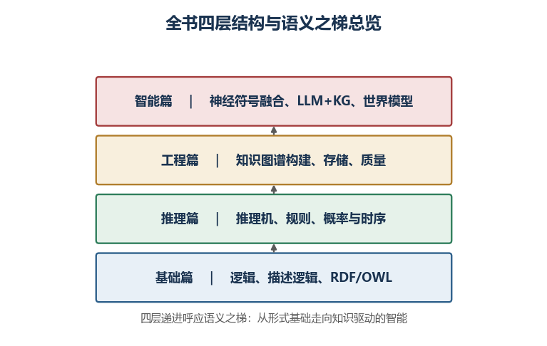

**全书的数学主线。** 从形式化角度，全书可视为一条「语义形式化—推理—评估」的链条：概念 $C$ 经公理化得理论 $T$（第 2—8 章），事实经归属得知识库 $K$（第 10—14 章），推理得 $T\cup K\models\phi$（第 15—19 章），其可信度由式 33-2 评估——即
$$
\mathrm{Intel}=\mathrm{Eval}\big(T\cup K\models\phi\big), \tag{41-0}
$$
其中 Eval 综合准确率、有据率、一致性、校准与可修订性。这条链条是「从知识到智能」的数学速写。

**链条的逆向读法。** 式 (41-0) 有双重读法：正向是构造路径（概念→理论→知识库→推理→评估），逆向则是审计协议——从一个输出 φ 反向追溯它来自哪一层、依据哪条公理、引用哪条事实。链条的「可逆向性」正是全书强调可解释性的认识论根据：每一层都有对应物（T 对应公理、K 对应事实、φ 对应证明链），错误才能被定位到层。纯端到端系统缺乏这种对应——错误「在权重里」，不可归因到任何一层。这是本书「能生成不等于可保证」立场的数学根源：Eval 的每一项指标都只在其对应层可追溯时才可计算。

## 41.1　首尾闭环：用四层结构重新审视全书

**引入动机。** 第 1 章提出四层结构（概念层、知识层、推理层、应用层）与语义之梯（S1—S4），并立下「每一个方法追问四件事」的规矩。现在是检验这套框架是否名副其实的时候。

**直觉解释。** 像走完一趟长途后对照出发时的地图：我们是否真的按地图走到了终点？哪些路段偏离了？地图本身是否需要修订？

**定义 41.1（四层结构回顾）** 四层结构[第 1 章]：
- **Level 1 概念层**：世界有哪些概念、关系、属性与公理——第 2—8、20—23 章。
- **Level 2 知识层**：具体事实如何归属概念——第 10—14 章。
- **Level 3 推理层**：如何从已有知识推出新知识——第 15—19、25—27 章。
- **Level 4 应用层**：知识如何流转与互操作——第 28—38 章。

逐层检验：概念层，描述逻辑与 OWL 给出了可判定的形式化（第 4、6 章），本体工程给出了方法论（第 20—23 章）——这一层扎实。知识层，知识图谱技术已大规模落地（第 11—14 章）——这一层成熟。推理层，逻辑推理严格但难扩展，神经推理可扩展但不保真（第 15—19、25—28 章）——这一层是张力所在。应用层，语义互操作与领域应用广泛开展（第 34—38 章）——这一层繁荣但依赖下层质量。

**表 41-1　四层结构的全书映射**

| 层级 | 核心问题 | 主要章节 | 成熟度 |
|------|----------|----------|--------|
| 概念层 | 世界有哪些概念 | 2—8、20—23 | 扎实 |
| 知识层 | 事实如何归属 | 10—14 | 成熟 |
| 推理层 | 如何推出新知 | 15—19、25—28 | 张力最强 |
| 应用层 | 知识如何流转 | 28—38 | 繁荣 |

语义之梯（S1 词汇→S2 概念→S3 公理→S4 推理）的检验证明：它作为「分析标尺」是成功的——本书对每一个方法追问「处于哪级、假设什么、突破什么、不能突破什么」，确实揭示了方法间的本质差异而非表面迭代。但梯子本身也有裂缝（第 40 章）：S1→S2 的常识获取、S3→S4 的语义保真、符号与状态的 grounding——这些裂缝定义了未来。

**成熟度的量化锚点。** 逐层成熟度可各给一个粗略量化锚：概念层看「可形式化率」（领域概念中有显式公理的比例，医学、法律等成熟领域约 0.6—0.9）；知识层看「覆盖 × 一致」（第 12 章疾病—药物图的覆盖约 0.7、图内一致性约 0.95）；推理层看「单位成本可靠度」（逻辑推理约 1.0 但成本 10^3 倍，嵌入推理约 0.6 而成本 1 倍）；应用层看「语义使用深度」（应用功能中真正调用 S3—S4 语义的比例，典型系统低于 0.3）。四个锚点指向同一诊断：瓶颈不在概念与知识层，而在推理层的可靠—成本比、以及应用层的语义使用深度——应用层的繁荣部分恰是应用层的「语义贫乏」，这个诊断对下一代知识系统的工程优先级有直接含义。

## 41.2　三条趋势：神经—符号化、大模型增强、本体驱动

**引入动机。** 全书跨越半个多世纪的思想史，浮现出三条当代趋势。它们不是彼此替代，而是相互交织。

**直觉解释。** 如果把本体智能比作一条河：神经—符号化是「河道改道」（方法融合），大模型增强是「水量暴涨」（能力跃升），本体驱动是「导航系统」（方向保证）。三者共同塑造河的流向。河的比喻还有一个隐含要素：河床。河床是领域本体与行业标准（第 35—37 章）——洪水（大模型能力）冲击河床（本体结构），河床决定洪水的去向：有河床的洪水是灌溉，无河床的洪水是灾害。本书的立场因此是「河床先行」：在部署大模型能力之前，先确认该领域有可复用的显式语义框架，否则能力越强、越容易失控。

**趋势一：神经—符号化。** 第 24—28 章表明，纯符号与纯神经的局限催生融合：可微逻辑、GNN 推理、知识增强、双向循环（第 33 章）。这条趋势回应的是「可学习性与语义保证」的张力——虽未解决（第 40.3 节），但已成为主流方向。

**趋势二：大模型增强。** 第 29—33 章表明，LLM 隐式承载知识、能生成也能幻觉。检索增强（第 30 章）与符号约束（第 31 章）把 LLM 纳入可信框架。这条趋势回应的是「覆盖广度与可靠性」的张力——LLM 带来前所未有的知识获取与交互能力，但必须用本体锚定。

**趋势三：本体驱动。** 第 34—39 章表明，本体作为「语义基础设施」贯穿应用：互操作、领域智能、工程治理、智能体规划。这条趋势回应的是「数据孤岛与语义统一」的张力——越是复杂系统，越需要共享的显式语义框架。

**例 41.1（三趋势交织算例）** 第 35 章的医学知识智能同时体现三条趋势：本体（SNOMED）提供语义框架（趋势三）；LLM 抽取文献、增强问答（趋势二）；GNN 推理 + 符号校验 + LLM 生成构成神经—符号流水线（趋势一）。三者协同，使系统既覆盖广、又可靠、又可扩展——这是当代本体智能的典型形态。

**表 41-2　三条趋势对照**

| 趋势 | 张力 | 核心章节 | 状态 |
|------|------|----------|------|
| 神经—符号化 | 可学习 vs 保真 | 24—28、33 | 进行中 |
| 大模型增强 | 覆盖 vs 可靠 | 29—32 | 快速演进 |
| 本体驱动 | 孤岛 vs 统一 | 34—39 | 稳步落地 |

**三趋势的交互非对称。** 三条趋势不是同步推进的：大模型增强是快变量（以月计的模型迭代），神经—符号化是中变量（以 5—10 年计的方法成熟），本体驱动是慢变量（以十年计的标准与制度进程）。快变量需要慢变量锚定（否则大模型的能力是「无舵之船」），慢变量需要快变量拉动（否则本体工程永远「修不起」）。这个非对称的工程含义：当代系统设计应以大模型为能力主体、以本体为治理主体——前者决定「能走多快」，后者决定「能停在何处」。这是「洪水」与「堤坝」的分工：洪水决定能量，堤坝决定安全边界，缺堤坝的洪水是灾害，无洪水的堤坝是浪费。

## 41.3　本体智能的通向之路

**引入动机。** 全书开篇的问题——「机器如何形式化表示世界的概念与关系并可靠推理」——现在可以给出本书的回答。这不是一个终结性答案，而是一条「通向之路」。

**直觉解释。** 通往智能的路不是单一技术，而是「概念—知识—推理—应用」四层同时前进，且每层都吸取符号与神经的长处。

本书的回答可以凝练为三条原则：

**原则一：形式化是可靠的起点，但不是终点。** 概念层与公理化（第 2—8 章）提供了可靠性的根基，但纯形式化难扩展。神经方法（第 24—33 章）补足了获取与鲁棒性——二者必须结合。结合的关键不是「替换」而是「分层」：形式化负责可验证的骨架（公理、类型、约束），神经负责可学习的血肉（感知、抽取、概率校准）。骨架不可被替换——替换了就失去可验证性；血肉必须可替换——固定了就失去鲁棒性。

**原则二：知识必须可追溯、可约束。** 从数据到知识的转化（第 10—14 章）不能止步于「抽取了事实」；事实必须有来源（有据率，第 31 章）、有本体归属（第 6 章）、有一致性校验（第 9 章）。「能生成不等于可保证」（第 1 章）是全书反复印证的命题。可追溯性的工程形态是「每条知识三件套」：事实、来源、置信度（第 31 章）。缺来源的抽取结果是「裸断言」，只能当弱证据；缺置信度的断言无法参与加权推理（第 33 章式 33-2 的 Eval 要求置信度输入）。三件套是「知识」与「数据」的操作化分界：数据是裸事实，知识是事实加来源加置信度加概念归属。

**原则三：智能是四层协同的涌现，而非单层的极致。** 概念层的清晰、知识层的规模、推理层的可靠、应用层的互操作——缺一层，系统就在该层退化（第 33 章例 33.5 的四层 checklist）。通用智能（第 39 章）需要的正是这种全梯贯通。「涌现」一词在此是方法论承诺而非玄学：四层齐备时，系统的行为（可解释的规划、知道自己不知道、跨领域迁移）无法从任何单层的行为中预测——就像细胞的功能无法从单一分子的性质推出。但涌现的可检验形态是「四层 checklist 全通过而单层系统不通过」（例 41.2 已演示），这使「涌现」成为可操作的实验判据而非修辞。

**例 41.2（通向之路的检验）** 用三条原则检验一个「纯 LLM 问答系统」：原则一——无显式形式化，失败；原则二——知识不可追溯（幻觉），失败；原则三——只有应用层（生成），缺概念/知识/推理层，失败。检验一个「本体驱动的神经—符号医学智能」（第 35 章）：原则一——SNOMED 本体 + GNN，通过；原则二——有据率 0.9、有本体归属、一致性校验，通过；原则三——四层齐备，通过。后者正是本书所主张的通向之路。

**定义 41.2（本书的核心命题）** 综合全书，本体智能的核心命题为：
$$
\text{智能}=\underbrace{\text{形式化概念}}_{\text{Level 1}}+\underbrace{\text{可追溯知识}}_{\text{Level 2}}+\underbrace{\text{可靠推理}}_{\text{Level 3}}+\underbrace{\text{语义互操作}}_{\text{Level 4}}, \tag{41-1}
$$
且每一层都需「符号的保证」与「神经的覆盖」互补。这不是一个公式化的智能定义，而是本书对「从知识到智能」之路的路线图。

**尾声。** 回到第 1 章的副题——「从数据到知识，从知识到推理」。数据不是知识，因为知识需要概念化与归属（第 2—14 章）；知识不是智能，因为智能需要推理与互操作（第 15—38 章）；而支撑这一切的，是「概念如何被形式化、存储与推理」这一根本问题——它从 Aristotle 的范畴论一路延续到大语言模型时代，具体技术更迭，而问题长存。本体智能的追求，就是为这一古老问题给出既可形式化、又可工程落地的当代回答。路仍在延伸，但方向已经清晰：以本体为骨架，以学习为血肉，以推理为灵魂，以互操作为脉络——从知识，走向智能。

**致读者的最后一问。** 结语可以收束全书，却不能收束思考。留给读者一个可带入自己工作的检验问题：你正在设计的知识系统，四层齐备吗？它在哪一层最弱？这个弱点是形式边界型、接口缺失型还是工程放大型（第 40.4 节三分）？回答这三个问题，读者即已掌握本书真正的产物——不是任何单一技术，而是一套「定位—诊断—选路」的思维方法。方法可迁移，技术会过时；这是本书能留给未来读者的、不随技术更迭而贬值的遗产。

## 41.4　承上启下

本章为全书收束，无后续章节。但「结语」不是终点——第 40 章列出的开放问题（grounding、常识本体化、表达力—可判定性、神经—符号统一等）正是下一步研究的起点。附录 A—F 提供数学工具、资源索引、开源工具链、符号对照与算例复现，供读者继续探索。结语的边界同样需要声明：本书回答的是「知识智能」的路径问题，不回答「智能的本质」这一哲学问题——四层结构是分析框架而非本体论承诺（第 1 章以范畴论起笔也只是叙事选择）。承认这一边界，本书的结论才在其范围内成立：凡涉及可验证知识的系统，从知识到智能的路径都经过四层；至于理解之「难问题」，本书与第 39 章一样，只给工作性定义（定义 39.3）而不给最终答案。

## 41.5　全书的方法论回顾

**七要素写法的意义。** 本书每章按「引入动机—直觉解释—严格定义与推导—数值算例—技术谱系—边界与讨论—承上启下」七要素展开。这不只是写作体例，更是一种认识论：任何方法都必须交代「为何需要（动机）」「直观上如何（直觉）」「严格地说是什么（定义）」「在数字上如何表现（算例）」「在谱系中处于何处（技术谱系）」「何时失效（边界）」「与前后有何关系（承上启下）」。缺任何一项，理解就不完整——这是本书对「学术专著应当如何论述方法」的回答。七要素的「边界」一项尤为关键：它强制每个方法交代自己的失效域，避免技术宣传式的单边叙述——这是本书与多数「方法教程」的根本文体差异。

**统一案例的作用。** 贯穿全书的生物医学本体与疾病—药物知识图谱（第 4、6、10—12、15—16、20、22、30、35 章）不是装饰，而是让抽象理论「落地」的试金石：同一个知识资源从概念建模、公理化、推理、构建、对齐一路做到神经—符号与大模型增强，使读者看到各章方法如何在同一对象上接力。辅以法律、政务、企业案例，展示了本体智能的普适性与领域特殊性。

**表 41-3　全书结构总览**

| 篇 | 章节 | 主题 | 对应四层 |
|----|------|------|----------|
| 一 | 1—4 | 理论基础 | L1 概念层 |
| 二 | 5—9 | 语义网与本体语言 | L1 概念层 |
| 三 | 10—14 | 知识图谱构建 | L2 知识层 |
| 四 | 15—19 | 知识图谱推理 | L3 推理层 |
| 五 | 20—23 | 本体工程与对齐 | L1 概念层 |
| 六 | 24—28 | 神经—符号融合 | L3 推理层 |
| 七 | 29—33 | 大语言模型与知识 | L2—L3 |
| 八 | 34—38 | 应用与工程 | L4 应用层 |
| 九 | 39—41 | 未来与结语 | 全层回扣 |

**结构总览读法。** 表 41-3 给出一个观察：全书的章节—四层映射不是均匀的——L3 推理层占 9 章（15—19、24—28 中推理相关），L1 概念层占 9 章，而 L4 应用层占 5 章。推理层厚度最大，恰与「推理层是张力所在」的结论呼应：张力大是因为投入大，也意味着突破空间最大。这是从「结构」读到「研究议程」的又一次印证：书中最厚的章节，往往就是学科最痛的地方。

**四层结构的可计算化。** 四层结构（定义 41.1）可进一步给出一个可计算的健康度指标：设系统在第 $i$ 层的成熟度为 $m_i\in[0,1]$（概念层 $m_1$ 为可形式化率、知识层 $m_2$ 为覆盖与一致性之积、推理层 $m_3$ 为单位成本可靠度、应用层 $m_4$ 为语义使用深度，锚点见第 41.1 节），则
$$
\mathrm{Health}=\min_i m_i\ \times\ \exp\!\Big(-\beta\sum_i (m_{\max}-m_i)\Big), \tag{41-2}
$$
其中 $\beta>0$ 为均衡惩罚系数、$m_{\max}=\max_i m_i$。$\min_i m_i$ 项体现「短板决定上限」（四层协同、缺一退化）；指数项惩罚层间失衡——各层均 0.8 的系统优于「一层 1.0 其余 0.5」的系统。式 (41-2) 把第 41.1 节的定性成熟度变成可比较的标量，使「系统 A 比 B 更完备」成为可计算的陈述。

**例 41.3（健康度算例）** 系统 A：$m=(0.7,0.9,0.5,0.6)$，$m_{\max}=0.9$，$\min m_i=0.5$，$\sum_i(m_{\max}-m_i)=0.0+0.2+0.4+0.3=0.9$，取 $\beta=1$，$\mathrm{Health}_A=0.5\times e^{-0.9}\approx0.5\times0.407\approx0.20$；系统 B：$m=(0.6,0.7,0.6,0.6)$，$\min m_i=0.6$，$\sum=0.3$，$\mathrm{Health}_B=0.6\times e^{-0.3}\approx0.6\times0.741\approx0.44$。B 在知识层不如 A，但综合健康度更高——「均衡的中等」优于「偏科的突出」，这是四层协同立场的数值形态。

**对读者的期望。** 本书面向研究生、科研人员与资深工程从业者。读完本书，读者应能：用四层结构与语义之梯定位任一知识方法；判断一个系统的「有数据/有知识/能推理/可保证」处于何处；在设计知识系统时自觉权衡表达力、可判定性、可扩展性与可信度；并对大语言模型时代的「知识」保持清醒——既看到其覆盖与交互能力，也不放弃对形式保证的追求。

**语义之梯四问（全书总结）。** 全书对每一方法的四问，最终汇成一句：本体智能的进展，是在语义之梯上逐级形式化的过程，而每一级都付出相应代价、获得相应能力；真正的智能不在某一级，而在全梯贯通且符号与神经互补。这是本书从 Aristotle 到大模型时代得出的核心方法论结论。

## 41.6　全书术语与概念地图

**核心概念索引。** 为便于读者回顾，这里梳理全书最核心的概念及其首次提出章：本体（第 1—2 章）、概念化（第 2 章）、一阶逻辑与模型论（第 3 章）、描述逻辑（第 4 章）、RDF/OWL（第 5—6 章）、本体推理（第 8—9 章）、知识图谱（第 10—14 章）、规则与嵌入推理（第 15—17 章）、本体工程（第 20—23 章）、神经—符号（第 24—28 章）、大语言模型知识（第 29—33 章）、应用与工程（第 34—38 章）、四层结构与语义之梯（第 1、41 章）。这些概念构成一张「概念依赖网」：本体是根，概念化、描述逻辑、知识图谱、本体工程是主干分支，神经—符号与大模型知识是当代新枝，四层结构是统摄全网的元框架。读者可按此依赖网自底向上或自顶向下复习：自底向上适合补理论（从本体走到应用），自顶向下适合做设计（从四层框架落到具体层的方法选择）。

**四层结构与语义之梯的关系。** 四层结构（概念—知识—推理—应用）是「本体智能系统的功能分层」，语义之梯（词汇—概念—公理—推理）是「语义形式化的逐级深化」。二者正交：四层回答「系统做什么」，语义之梯回答「形式化到什么程度」。一个应用层系统（Level 4）可能只用到 S2 的语义（如语义搜索），也可能依赖 S4（如法律合规推理）——理解这种正交性，是掌握全书框架的关键。

**例 41.4（正交性算例）** 语义搜索（Level 4 应用）用概念相似度（S2），不涉公理（S3）——它是「高功能层 + 低语义级」；法律合规推理（Level 3 推理）用一阶规则（S4）——它是「推理层 + 高语义级」。四层与语义之梯的正交性解释了为何「应用层繁荣（第 34—38 章）但推理层仍是张力所在（第 40 章）」——很多应用停留在 S2，未充分利用 S3—S4。

**表 41-4　四层×语义之梯速查**

|  | S1词汇 | S2概念 | S3公理 | S4推理 |
|--|--------|--------|--------|--------|
| L1概念层 | ✓ | ✓ | ✓ |  |
| L2知识层 | ✓ | ✓ |  |  |
| L3推理层 |  |  | ✓ | ✓ |
| L4应用层 | ✓ | ✓ | 部分 | 部分 |

**四层与语义之梯的不对称使用。** 表 41-4 显示 L1 层可独占 S1—S3 三级、而 L4 层在 S3—S4 只有「部分」——这不是缺陷而是常态：应用层系统的「部分」语义使用恰恰是第 41.1 节「语义使用深度」指标偏低的根源。提升路径不是让应用层「独占」S4（那是推理层的事），而是让应用层「调用」S3—S4：查询时委托推理层回答、结果回到应用层呈现。这种「委托而非重算」是分层架构的原则，也是第 38 章工程治理中「推理服务化」的概念根据。

**表 41-5　四层结构的检验判据**

| 层 | 检验判据 | 失败症状 | 对应章 |
|----|----------|----------|--------|
| L1 概念 | 新领域可公理化 | 概念边界模糊 | 2—8、20—23 |
| L2 知识 | 事实可追溯归属 | 裸断言、无法溯源 | 10—14 |
| L3 推理 | 结论可重放验证 | 黑箱、不可复现 | 15—19、25—28 |
| L4 应用 | 跨系统语义互通 | 孤岛、重复建模 | 28—38 |

判据给出「四层体检表」：系统在哪层退化，即可在该层做干预。它与例 41.2 的三原则检验互为表里——原则是方向性判断（过不过），判据是症状性定位（在哪坏）。

**语义之梯四问（全书终答）。** 全书对每一方法的四问，最终可凝练为一句方法论：以四层结构定位系统功能，以语义之梯衡量形式化深度，以「符号保证 + 神经覆盖」为互补原则，以「从知识到智能」为通向之路。这是本书留给读者的思维工具，其价值超越具体技术。四问的最终形态是一个四元组 $(L, S, C, P)$：$L$ 为层定位（在四层哪一层）、$S$ 为语义级（在语义之梯哪一级）、$C$ 为代价（放弃了什么）、$P$ 为能力（获得了什么）。任何方法都可被这个四元组刻画——例如可微逻辑 $(L3, S3, 保真, 可学习)$、OWL 推理 $(L3, S4, 扩展性, 严格性)$、RAG $(L2, S2, 严格性, 覆盖)。四元组是本书方法论的最小完备单元，读者可用它对任何新知识系统做 30 秒定位——这是全书最可带走的一个工具。

## 本章小结

本章作为结语完成首尾闭环。我们用四层结构重新审视全书（定义 41.1，表 41-1、41-5），检验语义之梯的分析力与裂缝；提炼三条趋势（表 41-2：神经—符号化、大模型增强、本体驱动）；给出「从知识到智能」的通向之路（定义 41.2，式 41-1）与三条原则，提出四层健康度指标（式 41-2，例 41.3），并以尾声回扣第 1 章副题。全书的根本问题——概念如何被形式化、存储与推理——从 Aristotle 延续至大模型时代，技术更迭而问题长存。这是本体智能的当代回答，也是通向通用智能的方向。

**进一步阅读**　本章建议延伸阅读的文献：[1]、[3]、[5]。

## 参考文献

[1] Aristotle. *Categories* ( translated by E. M. Edghill ). Indianopolis: Hackett, 1998（原著约公元前 4 世纪）.

[2] McCarthy J, Hayes P J. Some philosophical problems from the standpoint of artificial intelligence. *Machine Intelligence*, 1969, 4: 463–502.

[3] Newell A, Simon H A. *Human Problem Solving*. Englewood Cliffs: Prentice-Hall, 1972.

[4] Nilsson N J. *Artificial Intelligence: A New Synthesis*. Morgan Kaufmann, 1998.

[5] d'Avila Garcez A, Lamb L C. Neurosymbolic AI: The 3rd wave. *Artificial Intelligence*, 2023, 304: 103587.

[6] Kautz H. The third AI summer. *AI Magazine*, 2022, 43(1): 103–112.

[7] Lake B M, Ullman T D, Tenenbaum J B, Gershman S J. Building machines that learn and think like people. *Behavioral and Brain Sciences*, 2017, 40: e253.

[8] Russell S, Norvig P. *Artificial Intelligence: A Modern Approach*, 4th ed. Pearson, 2021.

---

# 附录

## 附录 A　数学工具包

本附录汇总全书反复使用的数学工具，供读者查阅。更严格的论述见相应章节。

### A.1　集合论与关系

**集合与幂集。** 集合 $S$ 的幂集 $2^S$ 是其全部子集构成的集合。笛卡尔积 $A\times B=\{(a,b)\mid a\in A,b\in B\}$。二元关系 $R\subseteq A\times B$；自反、对称、传递关系分别满足 $(a,a)\in R$、$(a,b)\in R\Rightarrow(b,a)\in R$、$(a,b),(b,c)\in R\Rightarrow(a,c)\in R$。等价关系自反、对称、传递，偏序自反、反对称、传递。

**函数与映射。** 函数 $f:A\to B$ 为每个 $a\in A$ 指派唯一 $b\in B$。单射、满射、双射分别对应「不同输入不同输出」「值域等于陪域」「既单又满」。解释函数 $\cdot^{\mathcal{I}}$ 把概念名映射到论域子集、角色名映射到论域上的二元关系（第 3、4 章）。

### A.2　一阶逻辑基础

**语法。** 项由常量、变量与函数符号构成；原子公式形如 $P(t_1,\dots,t_n)$ 或 $t_1=t_2$；公式由原子经 $\neg,\wedge,\vee,\to,\forall,\exists$ 递归构成。量词 $\forall x\,\phi$ 与 $\exists x\,\phi$ 分别表全称与存在。

**语义。** 解释 $\mathcal{I}=(\Delta^{\mathcal{I}},\cdot^{\mathcal{I}})$ 给定非空论域与符号解释；赋值 $v$ 把变量映射到论域元素。满足关系 $\models$ 递归定义：$(\mathcal{I},v)\models\forall x\,\phi$ 当且仅当对所有 $d\in\Delta^{\mathcal{I}}$，$(\mathcal{I},v[x\mapsto d])\models\phi$。公式集 $\Gamma$ 蕴含 $\phi$（记作 $\Gamma\models\phi$）当且仅当每个满足 $\Gamma$ 的解释都满足 $\phi$（第 3 章）。

### A.3　复杂度理论

**P、NP、PSpace、ExpTime。** P 为多项式时间可判定问题类；NP 为多项式时间可验证类；PSpace 为多项式空间可判定类；ExpTime 为指数时间可判定类。包含关系 $\mathrm{P}\subseteq\mathrm{NP}\subseteq\mathrm{PSpace}\subseteq\mathrm{ExpTime}$。问题 $L_1$ 可多项式归约到 $L_2$（$L_1\le_p L_2$）若存在多项式时间可计算的函数 $f$ 使 $x\in L_1\iff f(x)\in L_2$；$L_2$ 难（hard）于某类指该类所有问题都可归约到它（第 9 章）。

### A.4　图论与知识图谱记号

**图。** $G=(V,E)$ 由节点集 $V$ 与边集 $E\subseteq V\times V$ 构成。知识图谱是有标注的有向图，三元组 $(h,r,t)\in E$ 表示头实体 $h$ 经关系 $r$ 连到尾实体 $t$。节点度 $\deg(v)$ 为与其相连的边数。路径、连通性、环等概念同标准图论（第 5、14、16 章）。

### A.5　线性代数与嵌入

**向量与范数。** $\mathbf{x}\in\mathbb{R}^d$，$\ell_2$ 范数 $\\|\mathbf{x}\\|_2=\sqrt{\sum_i x_i^2}$，$\ell_1$ 范数 $\\|\mathbf{x}\\|_1=\sum_i|x_i|$。点积 $\mathbf{x}^\top\mathbf{y}$、余弦相似度 $\cos(\mathbf{x},\mathbf{y})=\frac{\mathbf{x}^\top\mathbf{y}}{\\|\mathbf{x}\\|\|\\mathbf{y}\\|}$ 衡量方向相似。知识图谱嵌入把实体与关系映射为低维向量（第 16 章）。

### A.6　概率与信息论

**概率空间。** $(\Omega,\mathcal{F},P)$，条件概率 $P(A\mid B)=P(A\cap B)/P(B)$。熵 $H(X)=-\sum_x p(x)\log p(x)$，KL 散度 $D_{\mathrm{KL}}(p\|q)=\sum_x p(x)\log\frac{p(x)}{q(x)}$。概率软逻辑用概率标注公式并据此计算查询概率（第 18 章）。

---

## 附录 B　本体与知识图谱资源索引

### B.1　代表性本体

| 本体 | 领域 | 用途 |
|------|------|------|
| Gene Ontology (GO) | 生物医学 | 基因功能、过程与组分的标准词汇 |
| SNOMED CT | 临床医学 | 临床概念与术语的参考本体 |
| UMLS | 生物医学 | 统一医学语言系统，含 MetaThesaurus |
| DOLCE | 顶层 | 描述与认知顶层本体 |
| BFO | 顶层 | 基本形式本体 |
| SUMO | 顶层 | 建议上层合并本体 |
| Dublin Core | 元数据 | 文档与资源描述 |
| FOAF | 社交 | 人物、组织与社交关系 |
| schema.org | 通用 Web | 结构化数据的模式词汇 |

### B.2　代表性知识图谱与数据集

| 资源 | 规模量级 | 用途 |
|------|----------|------|
| DBpedia | 数千万三元组 | 从 Wikipedia 抽取的多领域 KG |
| Wikidata | 上亿条目 | 协作编辑的多语种 KG |
| YAGO | 上亿事实 | 高质量抽取 KG |
| Freebase（历史） | 数十亿事实 | 大规模通用 KG |
| WordNet | 十余万同义词集 | 词汇语义网络与常识 |
| ConceptNet | 数百万边 | 常识知识图谱 |
| UMLS / SNOMED CT | 百万级概念 | 生物医学 KG 与本体 |
| FB15k / WN18RR | 万级实体 | 链路预测标准基准 |

### B.3　基准与评测

| 基准 | 任务 | 说明 |
|------|------|------|
| Link prediction（FB15k-237、WN18RR） | 链路预测 | MRR、Hits@K 评估嵌入推理 |
| OAEI（Ontology Alignment Evaluation Initiative） | 本体匹配 | 元素级/结构级对齐评测 |
| LUBM / WatDiv | SPARQL 查询 | 语义网推理与查询性能基准 |
| OWL Reasoner Evaluation (ORE) | 推理机 | 分类与一致性推理的正确性与性能 |
| TruthfulQA | 大模型幻觉 | 事实性评估（第七篇） |

---

## 附录 C　开源工具链

### C.1　本体编辑与推理

| 工具 | 用途 |
|------|------|
| Protégé | 本体编辑与可视化 |
| OWL API | OWL 本体的 Java API |
| HermiT / Pellet / ELK | OWL DL / EL 描述逻辑推理机 |
| RDF4J / Jena | RDF 存储、推理与查询框架 |
| SWI-Prolog | 规则推理与 ILP 实验 |

### C.2　知识图谱构建与查询

| 工具 | 用途 |
|------|------|
| Apache Jena / GraphDB / Virtuoso | 三元组库与 SPARQL 端点 |
| OpenSPRING / DeepDive | 信息抽取与知识库构建 |
| Dedupe / OpenRefine | 实体解析与数据清洗 |
| rdflib（Python） | RDF 解析与 SPARQL 查询 |

### C.3　神经—符号与大模型

| 工具 | 用途 |
|------|------|
| PyTorch / TensorFlow | 神经网络训练框架 |
| PyTorch Geometric / DGL | 图神经网络（与图智能书共用） |
| Hugging Face Transformers | 大语言模型与检索增强 |
| LangChain / LlamaIndex | 知识增强的应用编排 |

---

## 附录 D　符号与缩略语对照表

### D.1　缩略语

| 缩略语 | 全称 | 中文 |
|--------|------|------|
| Ontology | Ontology | 本体 |
| DL | Description Logic | 描述逻辑 |
| FOL | First-Order Logic | 一阶逻辑 |
| RDF | Resource Description Framework | 资源描述框架 |
| RDFS | RDF Schema | RDF 模式 |
| OWL | Web Ontology Language | Web 本体语言 |
| SPARQL | SPARQL Protocol and RDF Query Language | RDF 查询语言 |
| SWRL | Semantic Web Rule Language | 语义网规则语言 |
| RIF | Rule Interchange Format | 规则交换格式 |
| SHACL | Shapes Constraint Language | 形状约束语言 |
| KG | Knowledge Graph | 知识图谱 |
| NER | Named Entity Recognition | 命名实体识别 |
| RE | Relation Extraction | 关系抽取 |
| OIE | Open Information Extraction | 开放信息抽取 |
| ILP | Inductive Logic Programming | 归纳逻辑编程 |
| PSL | Probabilistic Soft Logic | 概率软逻辑 |
| RAG | Retrieval-Augmented Generation | 检索增强生成 |
| LLM | Large Language Model | 大语言模型 |
| OAEI | Ontology Alignment Evaluation Initiative | 本体匹配评测倡议 |

### D.2　数学符号

见「前置说明」符号表与附录 A。

---

## 附录 E　术语对照与全书速查索引

### E.1　核心术语对照

| 中文 | 英文 | 章 |
|------|------|----|
| 本体 | Ontology | 1, 20, 21 |
| 概念化 | Conceptualization | 2, 20 |
| 本体论承诺 | Ontological Commitment | 2 |
| 模型论 | Model Theory | 3 |
| 蕴含 | Entailment | 3, 4, 8 |
| 描述逻辑 | Description Logic | 4 |
| Tableau 推理 | Tableau Reasoning | 4, 9 |
| 开放世界假设 | Open World Assumption | 4, 5 |
| 三元组 | Triple | 5 |
| RDFS 蕴含 | RDFS Entailment | 5 |
| 本体语言 | Ontology Language | 6 |
| 图模式匹配 | Graph Pattern Matching | 7 |
| 规则语言 | Rule Language | 8 |
| 形状约束 | Shape Constraint | 8 |
| 知识图谱 | Knowledge Graph | 11, 14 |
| 实体对齐 | Entity Alignment | 12, 22 |
| 知识融合 | Knowledge Fusion | 12 |
| 链路预测 | Link Prediction | 16 |
| 归纳逻辑编程 | Inductive Logic Programming | 17 |
| 概率软逻辑 | Probabilistic Soft Logic | 18 |
| 常识推理 | Commonsense Reasoning | 19 |
| 本体设计模式 | Ontology Design Pattern | 21 |
| 神经—符号融合 | Neuro-symbolic Integration | 24 |
| 幻觉 | Hallucination | 31 |
| 知识增强 | Knowledge Augmentation | 30 |

### E.2　全书速查索引（按主题）

- **理论基础**：本体智能界定与四层结构 1；哲学本体论 2；一阶逻辑与模型论 3；描述逻辑 4；语义之梯见 1.5。
- **语义网与本体语言**：RDF/RDFS 5；OWL 6；SPARQL 7；规则与约束 8；推理机与复杂度 9。
- **知识图谱构建**：信息抽取 10；构建流水线 11；对齐与融合 12；质量评估 13；大规模工程 14。
- **知识图谱推理**：规则推理 15；嵌入推理 16；规则学习 17；时序与不确定 18；常识 19。
- **本体工程**：方法论 20；设计模式与复用 21；匹配对齐 22；演化维护 23。
- **神经—符号与大模型**：融合 24—28；大模型知识 29—33；幻觉与知识边界 31。
- **应用与工程**：34—38；未来 39—41。

---

## 附录 F　算例复现说明

### F.1　环境依赖

- Python 3.10+，NumPy、SciPy
- rdflib（RDF 与 SPARQL 算例）、OWL API 或 Protégé（本体建模）
- HermiT / ELK（描述逻辑推理算例）、SWI-Prolog（规则推理算例）
- PyTorch（嵌入推理与神经—符号算例，可选）

### F.2　统一案例：生物医学本体与疾病—药物知识图谱

全书算例以一份生物医学本体与疾病—药物知识图谱为贯穿案例（第 1.6 节）。复现时：

1. **概念建模**（第 4、6 章）：用 ALC / OWL DL 定义疾病、药物、症状、适应证等概念及公理；
2. **推理**（第 4、8、9、15 章）：用 Tableau 与规则推理检验可满足性、分类与蕴含；
3. **知识图谱构建**（第 10—12 章）：从医学文本抽取实体关系并对齐融合多源数据；
4. **查询**（第 7 章）：用 SPARQL 做多跳查询；
5. **推理与学习**（第 16、17 章）：用嵌入做链路预测、用 ILP 归纳规则；
6. **知识增强**（第 30 章）：用图谱增强医学问答。

### F.3　随机种子与数值容差

- 涉及随机初始化的算例（嵌入推理）固定随机种子 `seed=42`。
- 数值结果保留三到四位有效数字；因库版本差异允许末位浮动。
- 小模型算例为教学示意，旨在展示计算过程，不使用大规模算力。

### F.4　算例数值声明

除注明出处者外，全书算例中的具体数值（集合基数、公理数、推理耗时、嵌入维度、相似度、质量分数等）均为**教学示意**，通过小型可复现实验或手工计算得到，用于展示方法机制与量级，不代表任何真实系统在生产环境中的实测结果。引用文献中的基准数字以原始出处最新版本为准。