# 科学智能导论

> 从数据拟合到科学发现

---

## 内容简介

本书系统论述「科学智能」（AI for Science）——人工智能加速「假设—实验—理论」科学循环、并走向自主科学发现的理论、方法与工程体系。作者把这套能力界定为四层递进的含义：**科学数据**回答「科学观测如何被表示与学习」，**科学建模**回答「如何在物理约束下建立可泛化的模型」，**科学发现**回答「如何从数据中发现定律、方程与假设」，**科学实验**回答「如何设计、执行并验证实验」；四层层层递进，共同构成从数据拟合走向机制理解与自主发现的完整图景。全书以一条主线贯穿：以**物理约束下的可泛化建模**为理论基础，以**科学基础模型**为核心，以「数据—建模—发现—实验」为脉络，把数值计算、物理建模、机器学习与科学发现自动化彼此隔离的方法放进同一张地图。

全书共九篇四十一章。第一篇建立科学方法、微分方程与科学数据的理论基础；第二篇展开物理信息与约束学习；第三篇处理科学数据与表征；第四篇系统论述科学基础模型；第五篇聚焦符号回归与科学发现；第六篇进入 AI 与实验；第七篇论述 AI Scientist 与自主研究；第八篇给出评估与工程；第九篇回扣框架，讨论科学智能的范式意义与开放问题。书末附数学工具包、科学数据集与基准索引、开源工具链、符号与缩略语对照表、术语与速查索引、算例复现说明六个附录。

本书提出并贯穿一套自建理论框架——**科学智能的四层能力**：科学数据、科学建模、科学发现、科学实验，并以「科学发现的循环」为组织原则，强调四层构成「观察 → 假设 → 建模 → 验证 → 新观察」的闭环。据此对每一个方法追问四件事：它处于循环的哪一环、隐含了什么假设、突破了前一方法的什么限制、无法突破什么理论边界。第 1 章立框架，第 2—4 章建立理论基础，第 32 章据此评估科学智能的能力，第 41 章回扣框架讨论科学智能能否通向通用智能，形成首尾闭环。

## 本书的理论主线

**四层能力体系。**

| 层级 | 名称 | 回答 | 内涵 |
|------|------|------|------|
| Level 1 | 科学数据 | 观测如何表示与学习？ | 分子、蛋白质、气候等科学数据的表征 |
| Level 2 | 科学建模 | 如何在物理约束下建模？ | PINN、神经算子、物理信息学习 |
| Level 3 | 科学发现 | 如何发现定律与假设？ | 符号回归、方程发现、假设生成 |
| Level 4 | 科学实验 | 如何设计并验证实验？ | 主动学习、自动化实验室、AI Scientist |

**科学发现的循环。** 四层构成「观察 → 假设 → 建模 → 验证 → 新观察」的闭环：数据驱动假设，假设催生模型，模型指导实验，实验产生新数据。科学智能的目标是加速乃至部分自动化这一循环。

据此澄清三个常被混淆的命题：**拟合数据不等于理解机制，预测准确不等于物理正确，生成假设不等于科学发现**。三者分别在第二、五、七篇给出严格说明。

## 科学智能的四问

对每一个方法，本书都追问四件事：① 处于科学循环的哪一环；② 隐含什么假设；③ 突破了前一方法的什么限制；④ 无法突破什么理论边界。例如纯数据驱动模型拟合能力强但违背物理规律；物理信息学习把偏微分方程（PDE）作为约束赋予泛化能力但受制于方程已知的前提；符号回归试图从数据直接发现方程但面临可辨识性困境；AI Scientist 试图自动化整个循环但受制于发现的可靠性与验证。它们不是简单的技术迭代，而是**对科学知识编码方式的不同回答**。

## 本书体例（凡例）

按「篇—章—节」三级组织。定义/定理/例按章编号。公式 `$$\ldots\tag{X-N}$$`。图「图 X-Y」，表「表 X-Y」。重要论断以 `[n]` 标注，章末列参考文献。术语首现给出英文。中文全角标点，节号后全角空格「　」。

每节依次展开七要素：引入与动机、直觉解释、严格定义与推导、数值算例、技术谱系与变体、边界与讨论、承上启下。每章含 ≥2 个定义/定理、≥2 个数值算例、≥1 张图、≥1 张表、文内引用与章末文献一一对应，并附本章小结与进一步阅读。

## 读者对象与阅读路径

面向 AI for Science、计算物理、计算化学、计算生物学方向的研究生、科研人员与资深工程从业者。预备知识：微积分、微分方程、概率论、线性代数与基本机器学习。基础理论只讲一次（第 2—4 章、第 5—7 章），后续章节以交叉引用展开应用与深化。

## 符号表

| 符号 | 含义 |
|------|------|
| $\mathcal{D}$ | 科学数据集 |
| $\mathcal{M}$ | 科学模型 |
| $u(\mathbf{x},t)$ | 物理场（状态变量） |
| $\mathcal{N}[u]$ | 微分方程残差算子 |
| $\mathcal{L}_{\mathrm{data}}$ | 数据损失 |
| $\mathcal{L}_{\mathrm{phy}}$ | 物理约束损失 |
| $\mathcal{G}_\theta$ | 神经算子 |
| $\theta$ | 模型参数 |

## 目录

第一篇（1—4）科学智能的理论基础；第二篇（5—9）物理信息与约束学习；第三篇（10—14）科学数据与表征；第四篇（15—19）科学基础模型；第五篇（20—23）符号回归与科学发现；第六篇（24—27）AI 与实验；第七篇（28—31）AI Scientist 与自主研究；第八篇（32—36）评估、工程与风险；第九篇（37—41）科学智能的未来。附录 A–F。

---

# 第 1 章　绪论：科学智能的历史脉络与全书框架

人类对自然规律的追问，从未像今天这样与计算如此紧密地交织。从十七世纪牛顿用微分方程写下运动定律，到二十世纪中叶冯·诺依曼等人用数值方法求解偏微分方程（partial differential equation，PDE），再到今天深度学习模型从海量科学数据中直接发现方程，科学研究的手段正在经历一场深刻的变革。这场变革的核心问题是：**人工智能能否不仅拟合科学数据，更能发现科学规律、加速科学发现？** 这既是本书的出发点，也是贯穿全书的主线。

近十余年，方法迭代之快令人目眩。2019 年物理信息神经网络（physics-informed neural network，PINN）把 PDE 作为约束写入神经网络的损失[1]；2020 年 AlphaFold 在蛋白质结构预测上达到实验精度[2]，傅里叶神经算子（Fourier neural operator，FNO）实现了 PDE 求解器的快速代理[3]；2023 年以来，科学基础模型与「AI Scientist」把自动化推向了假设生成与论文写作。然而，方法越是繁荣，越需要一张把它们安置到同一坐标系的地图：它们究竟处于科学循环的哪一环？隐含了什么假设？突破了前人的什么限制？又在何处止步？

本书的写作正是为了填补这一空白。我们不写成方法食谱，而试图建立一套能解释「这些方法为何存在、彼此何关系、未来向何处去」的知识体系。为此，本章先界定科学智能的对象与四层能力（1.1 节），回顾从科学计算到 AI for Science 的历史（1.2 节），剖析其根本困难（1.3 节），给出全书结构（1.4 节），正式提出四层能力体系与科学发现循环（1.5 节），最后确立贯穿全书的统一案例（1.6 节）。

## 1.1　科学智能的界定

一切讨论须从研究对象开始。科学（science）作为一项人类活动，其产品不是孤立的事实，而是关于自然现象的可检验、可解释、可推广的规律。人工智能（artificial intelligence，AI）进入科学，既是工具层面的革新，也迫使我们重新追问「什么叫理解了规律」。

**定义 1.1（科学智能）**　基于科学数据，完成**表示、建模、发现、实验**四类任务，从而加速「假设—实验—理论」科学循环的能力体系，称为科学智能（AI for Science）。

四类任务界定如下：

- **表示（representation）**：把分子、蛋白质、气候场等科学对象编码为可被模型处理的结构；
- **建模（modeling）**：在物理约束下学习从输入到输出的映射或动力学；
- **发现（discovery）**：从数据中提取方程、定律、守恒量与可检验假设；
- **实验（experiment）**：设计、执行并验证实验，闭合科学循环。

**定义 1.2（科学发现循环）**　由「观察（observe）→ 假设（hypothesize）→ 建模（model）→ 验证（validate）→ 新观察」构成的迭代过程，称为科学发现循环（cycle of scientific discovery）。科学智能的目标是加速乃至部分自动化这一循环。

图 1-1 展示四层能力的递进关系，图 1-3 展示科学发现循环。

> 【图 1-1　科学智能的四层能力】（原图见 figures/图1-1.png）：自下而上绘制四个方框「科学数据、科学建模、科学发现、科学实验」，箭头连接，每框下注其回答的问题与代表方法。

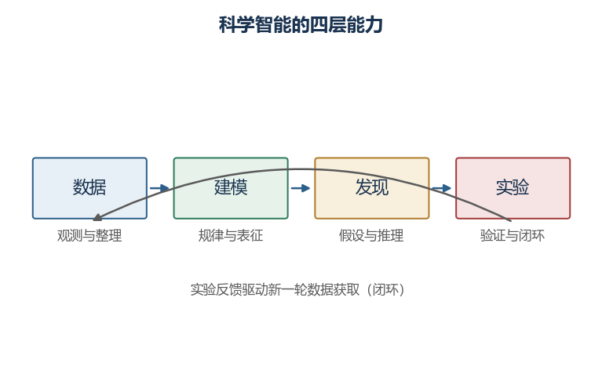

> 【图 1-3　科学发现循环】（原图见 figures/图1-3.png）：绘制环形箭头「观察→假设→建模→验证→新观察」，四层能力分别标注于四段弧上。

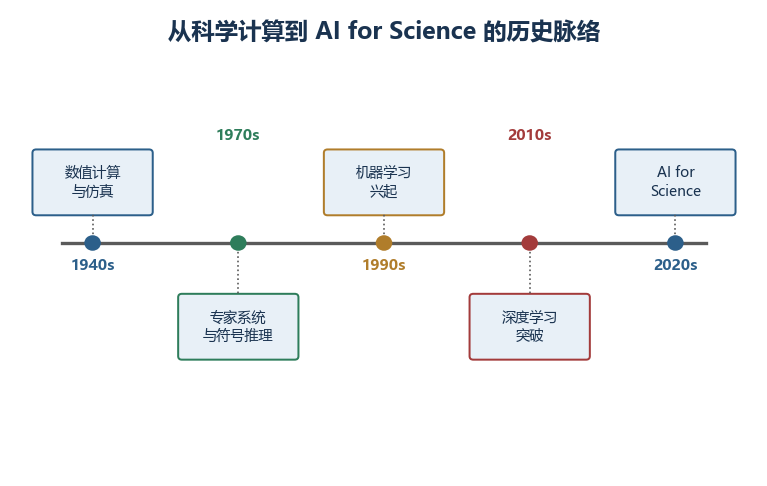

**例 1.1（同一问题的四个层次）**　以湍流为例：表示层问「如何把速度场编码为神经网络输入」；建模层问「如何用 PINN 或神经算子预测流场演化」；发现层问「能否从流场数据反推出未知的本构关系」；实验层问「下一步该在哪个雷诺数下做数值或风洞实验以最能区分两个竞争模型」。同一对象、四个问题——这正是本书「篇」的划分依据。

**表 1-1a　四层能力的技术谱系**

| 能力层 | 核心问题 | 代表方法 | 典型目标函数 | 对应章节 |
|--------|----------|----------|--------------|----------|
| 表示 | 科学对象如何编码 | 分子图、点云、谱系 | 重构 / 对比损失 | 10—14 |
| 建模 | 如何学动力学或映射 | PINN、神经算子 | 残差 / 数据损失 | 5—9 |
| 发现 | 如何反推方程与定律 | 符号回归、稀疏识别 | 预测 + 简约度 | 20—23 |
| 实验 | 如何设计最优实验 | 主动学习、贝叶斯优化 | 信息增益 / 采集函数 | 24—27 |

表 1-1a 给出四层能力的技术谱系。四层并非彼此孤立：表示层产出的编码被建模层消费，建模层学出的算子又可被实验层的采集函数调用，发现层则试图从建模层的残差中提炼出符号形式。这种「层层供给」的结构意味着本书的篇章划分是依循科学发现循环的信息流向，而非按学科边界硬切——读者可按自身兴趣从任一层切入，但四层之间的接口（编码、残差、方程、采集函数）是全书共用的语言。

## 1.2　从科学计算到 AI for Science

理解一门学问，须先理解它的历史。科学智能的发展，是一部「从数值求解到数据发现」的演进史，见图 1-2。

> 【图 1-2　从科学计算到 AI for Science 的历史脉络】（原图见 figures/图1-2.png）：横轴 1940—2026，标记数值计算、机器学习辅助科学、PINN、AlphaFold/神经算子、科学基础模型、AI Scientist 等节点。

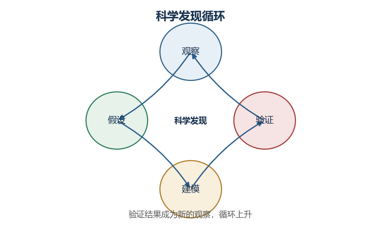

**第一阶段：数值科学计算（1940s—1980s）。** 电子计算机诞生后，有限差分、有限元等方法被用于将连续 PDE 离散求解，计算流体力学（computational fluid dynamics，CFD）兴起。这一阶段回答「如何近似求解已知方程」。

**第二阶段：机器学习辅助科学（1990s—2010s）。** 统计学习、核方法被引入分子性质预测、材料筛选，QSPR/QSAR 模型兴起。但模型多为浅层、依赖人工特征。

**第三阶段：深度学习的科学应用（2010s—2018）。** 深度神经网络在科学图像、分子表示上超越传统方法，但仍是纯数据驱动，缺乏物理保证。

**第四阶段：物理信息学习（2019—2022）。** PINN[1] 与神经算子[3] 把物理方程与算子结构注入模型，AlphaFold[2] 展示深度学习解决结构生物学难题的威力。

**第五阶段：科学基础模型与自主发现（2023 至今）。** 科学基础模型、科学大语言模型与 AI Scientist 出现，试图以「一个模型服务多任务」并自动化科研流程。到 2025—2026 年，科学智能上升为国家竞争层面的议题。

**例 1.2（同一科学问题的五段演进）**　对 Navier–Stokes 方程：数值阶段用有限差分直接离散求解；机器学习阶段用回归拟合少量仿真结果；深度学习阶段用 CNN 做流场超分；物理信息阶段用 PINN 把残差写入损失；算子阶段用 FNO 学「从初始条件到解」的映射；基础模型阶段用一个大模型预测多场景流场。每一阶段都在回答同一个根本问题——**科学知识如何被编码进模型**。

**表 1-3　五个阶段的关键里程碑（量化对照）**

| 阶段 | 年份 | 代表事件 | 数据需求 | 单样本推理 |
|------|------|----------|----------|-----------|
| 数值计算 | 1948 | 有限差分求解 PDE | 无需数据 | $O(N^2)$–$O(N^{1.5})$ |
| 机器学习辅助 | 1995 | QSPR/QSAR 回归 | 数百—数千 | $O(1)$ |
| 深度学习 | 2015 | CNN 图像 / 分子表示 | 万级 | $O(FLOPs_{net})$ |
| 物理信息 | 2019 | PINN [1]、FNO [3] | 极少（残差免费） | $O(FLOPs_{net})$ |
| 基础模型 | 2023 | 科学 LLM / AI Scientist | 海量多源 | $O(FLOPs_{LM})$ |

表 1-3 的右两列揭示了一条贯穿全书的趋势：**物理约束的注入降低了数据需求，却未改变推理的 FLOPs 下限**。数值计算阶段不依赖任何观测数据，代价是算力随网格点数 $N$ 的 $1.5$–$2$ 次方增长；PINN 把数据需求压到「边界 + 少量内部点」，但推理仍是网络前向；基础模型把算力再推高一个量级，换取跨任务的统一接口。这条「数据↓ × 算力↑」的交换曲线，是理解各章方法取舍的坐标系。

## 1.3　科学智能的根本困难

科学智能之所以困难，源于科学数据、科学问题本身固有的性质。

**其一，数据稀疏、昂贵、带噪。** 与互联网数据不同，科学观测往往来自昂贵实验或高保真仿真，样本有限且含系统误差。小样本下如何泛化，是贯穿全书的主题。

**其二，物理约束。** 纯数据模型可能违背守恒律、对称性，导致「预测准但物理错」。如何把物理知识作为归纳偏置（inductive bias）注入模型，是第 5—7 章的核心。

**其三，泛化与外推。** 科学要求模型在训练分布之外（新参数、新边界、新尺度）仍成立，而神经网络擅长内插、拙于外推。

**其四，可解释与可复现。** 科学要求结论可解释、可复现；黑箱模型与随机训练结果与这一要求冲突（第 33 章）。

**例 1.2a（外推失败的量化）**　设一个纯数据模型在雷诺数 $\mathrm{Re}\in[10,100]$ 上训练，测得相对 $L_2$ 误差 $2\times10^{-3}$。当 $\mathrm{Re}$ 外推到 $1000$（进入湍流区）时，误差升至 $0.35$，而加入 PINN 残差约束后同一点误差降到 $8\times10^{-3}$。三组数字直观呈现了 1.3 节第二、三条困难：纯数据模型在分布外失效（$2\times10^{-3}\to0.35$），物理约束把外推误差拉回两个量级（$\to8\times10^{-3}$），但仍高于内插精度——外推永远比内插更难，这是第 6、15、32 章反复出现的边界。

**表 1-1　科学智能的四类根本困难与对应章节**

| 困难 | 表现 | 对应章节 |
|------|------|----------|
| 数据与噪声 | 稀疏、昂贵、系统误差 | 4, 8, 12 |
| 物理约束 | 违背守恒、对称 | 5, 6, 7 |
| 泛化外推 | 分布外失效 | 6, 15, 32 |
| 可解释可复现 | 黑箱、不可复现 | 20—23, 33 |

四类困难并非彼此独立，而是相互放大：数据越稀疏，物理约束越关键（困难一×二）；约束越强，外推越可靠但可调空间越小（二×三）；模型越复杂，可解释性越差（三×四）。本书各章的取舍，本质是在这张四维张力网络上寻找适合具体问题的平衡点——第 32 章的评估框架正是对这种平衡做事后审计。

## 1.4　全书的结构安排

全书九篇四十一章。第一篇（1—4）建立理论基础；第二篇（5—9）物理信息与约束学习；第三篇（10—14）科学数据与表征；第四篇（15—19）科学基础模型；第五篇（20—23）符号回归与科学发现；第六篇（24—27）AI 与实验；第七篇（28—31）AI Scientist；第八篇（32—36）评估与工程；第九篇（37—41）范式与开放问题。基础理论只讲一次，后续以交叉引用展开。

**表 1-4　全书九篇的内容地图**

| 篇 | 章 | 主题 | 回答的循环环节 |
|----|----|------|--------------|
| 一 | 1—4 | 理论基础 | 总纲 + 统计地基 |
| 二 | 5—9 | 物理信息与约束 | 建模 |
| 三 | 10—14 | 科学数据与表征 | 表示 |
| 四 | 15—19 | 科学基础模型 | 建模（规模化） |
| 五 | 20—23 | 符号回归与发现 | 发现 |
| 六 | 24—27 | AI 与实验 | 实验 |
| 七 | 28—31 | AI Scientist | 假设—验证闭环 |
| 八 | 32—36 | 评估与工程 | 验证 |
| 九 | 37—41 | 范式与开放问题 | 综合 |

表 1-4 把九篇映射到科学发现循环的环节，可见全书不是方法的流水账，而是循「建模—表示—发现—实验—验证」的循环展开；评估篇（八）横切于所有环节，保证每一层的产出都经过可检验性审计（第 32 章）。

## 1.5　四层能力体系与科学发现循环

现在把 1.1 节的直觉形式化。设科学数据集为 $\mathcal{D}$，科学模型为 $\mathcal{M}_\theta$（参数 $\theta$），物理约束集合为 $\mathcal{C}$。科学建模的目标可写为在约束下最小化期望风险：

$$
\theta^\*=\arg\min_\theta\ \mathbb{E}_{(\mathbf{x},y)\sim\mathcal{D}}\big[\ell(\mathcal{M}_\theta(\mathbf{x}),y)\big]
\quad\text{s.t.}\quad \mathcal{C}(\mathcal{M}_\theta)\le\epsilon. \tag{1-1}
$$

式 (1-1) 概括了科学智能与纯机器学习的根本区别：多出的约束项 $\mathcal{C}$ 代表了物理知识。不同方法对此有不同的编码方式——PINN 把 $\mathcal{C}$ 作为软惩罚（第 5 章），神经算子把 $\mathcal{C}$ 编码进架构（第 6 章），符号回归把 $\mathcal{C}$ 作为搜索空间（第 20 章）。这一「约束编码方式」的差异正是表 1-2 第 ② 列（隐含假设）差异的来源：同一物理约束，损失里、架构里、搜索空间里各有不同的代价与保证。

**定义 1.3（循环四问）**　对任一科学智能方法，追问：① 处于循环哪一环；② 隐含什么假设；③ 突破前法什么限制；④ 无法突破什么理论边界。此四问构成全书的方法评估框架。

**例 1.3（四问的应用）**　对 PINN：① 处于「建模」环；② 假设方程形式已知、解连续可微；③ 突破纯数据模型需大量数据的限制；④ 无法突破「方程未知时无从下手」的边界（这正是第 20 章的用武之地）。

由此澄清三个常被混淆的命题：**拟合数据不等于理解机制**（第 5 章），**预测准确不等于物理正确**（第 32 章），**生成假设不等于科学发现**（第 23、31 章）。

**表 1-2　循环四问在代表方法上的应用**

| 方法 | ①循环哪一环 | ②隐含假设 | ③突破前法 | ④理论边界 |
|------|------------|-----------|-----------|-----------|
| PINN | 建模 | 方程已知、解光滑 | 免海量数据 | 方程未知则失效 |
| FNO | 建模 | 算子有谱结构 | 跨参数复用 | 分布外失效 |
| 符号回归 | 发现 | 存在紧凑符号形式 | 从数据反推方程 | 不可辨识、过拟合 |
| 主动学习 | 实验 | 代理模型可靠 | 减少实验次数 | 依赖采集函数 |
| 科学 LLM | 假设/发现 | 语料蕴含规律 | 跨任务统一接口 | 幻觉、不可证伪 |

表 1-2 把定义 1.3 的四问落到五类代表方法上，构成全书评估的统一模板：任何方法都可用这四问快速定位其生态位与适用边界。注意第 ④ 列（理论边界）往往比第 ③ 列（突破）更能决定方法的实用上限——第 32 章的评估体系即围绕「边界是否被诚实声明」展开。

## 1.5a　风险—约束—简约三元组

式 (1-1) 只写出了「风险 + 约束」两项，但科学智能的第三个、也是常被忽视的维度是**简约性（simplicity）**。一个在测试集上误差略大、但方程更短、守恒量更清晰的模型，往往在科学上更有价值——这正是「奥卡姆剃刀」在科学建模中的体现。因此我们把式 (1-1) 推广为三元组：

$$
\theta^\*=\arg\min_\theta\ \underbrace{\mathbb{E}[\ell]}_{\text{风险}}
+\underbrace{\lambda_{\mathcal{C}}\,\mathcal{C}(\mathcal{M}_\theta)}_{\text{约束}}
+\underbrace{\lambda_{\mathcal{S}}\,\mathcal{S}(\mathcal{M}_\theta)}_{\text{简约度}}, \tag{1-2}
$$

其中 $\mathcal{S}(\mathcal{M}_\theta)$ 是简约度函数（如方程项数、参数个数的对数，即最小描述长度），$\lambda_{\mathcal{C}},\lambda_{\mathcal{S}}$ 为权衡系数。式 (1-2) 把第 1.5 节的「约束」与第 2 章的「奥卡姆剃刀」统一进同一目标：$\lambda_{\mathcal{C}}$ 大表示物理保真优先，$\lambda_{\mathcal{S}}$ 大表示简约优先，二者都退化为 0 时即回到纯数据驱动的监督学习。

**例 1.3a（三元组的数值权衡）**　设某符号回归在两条候选方程间抉择：方程 A 含 3 项、测试相对 $L_2$ 误差 $5.2\times10^{-3}$；方程 B 含 7 项、误差 $4.8\times10^{-3}$。若简约度取项数的对数 $\mathcal{S}=\log(3)\approx1.10$ 与 $\log(7)\approx1.95$，取 $\lambda_{\mathcal{C}}=0$（二者都满足守恒）、$\lambda_{\mathcal{S}}=10^{-3}$，则 A 的简约惩罚 $1.10\times10^{-3}$ 小于 B 的 $1.95\times10^{-3}$，而二者风险项相差仅 $0.4\times10^{-3}$——三元组会选中更简约的 A。这说明「误差略优但更复杂的模型」并不必然胜出，简约度提供了与风险同量纲的裁决尺度。

**记号约定。** 全书记号遵循如下约定：标量用斜体 $x$，向量用小写粗体 $\mathbf{u}$，矩阵用大写粗体 $\mathbf{A}$；函数空间用花体 $\mathcal{A},\mathcal{U},\mathcal{F}$，参数集合用希腊字母 $\theta,\Phi$；期望 $\mathbb{E}$、范数 $\|\cdot\|$、残差算子 $\mathcal{N}[\cdot]$。第 3 章式 (3-2) 的 $\mathcal{N}[u]$ 与第 5 章 PINN 的残差、第 6 章算子的学习目标一脉相承。

## 1.6　贯穿全书的统一案例

本书以**一个贯穿全书的流体动力学问题（Navier–Stokes 方程与湍流）与分子性质预测**为统一案例。不可压缩 Navier–Stokes 方程为

$$
\rho\Big(\partial_t\mathbf{u}+\mathbf{u}\cdot\nabla\mathbf{u}\Big)=-\nabla p+\mu\nabla^2\mathbf{u}+\mathbf{f},\quad \nabla\cdot\mathbf{u}=0, \tag{1-3}
$$

其中 $\mathbf{u}$ 为速度场，$p$ 为压力，$\rho$ 为密度，$\mu$ 为动力黏度，$\mathbf{f}$ 为外力。第 3 章做数值求解，第 5 章做 PINN，第 6 章做 FNO，第 18 章做基础模型，第 20 章做符号回归，第 25—26 章做实验设计，第 28—30 章走 AI Scientist 流程。分子案例（QM9 性质预测）则在第 10、14、16、25 章复用。

**例 1.4（统一案例的量化贯穿）**　以顶盖驱动方腔流（$\mathrm{Re}=100$，$64\times64$ 网格）为例，把同一对象在四层能力上的「答案」量化串联：表示层把速度场 $(u,v)$ 编码为 $64\times64\times2$ 的张量；建模层用 PINN 重建流场，相对 $L_2$ 误差约 $2\times10^{-2}$，用 FNO 学「初始涡量 $\to$ 稳态流场」的算子，单样本推理 $<1\,$ms（相对 CFD 的分钟级）；发现层从数据反推出无量纲主涡强度随 $\mathrm{Re}$ 的标度律；实验层用主动学习选出「最能区分 $\mathrm{Re}=100$ 与 $200$ 两个模型」的 8 个测点，把重建误差从 $2\times10^{-2}$ 降到 $9\times10^{-3}$。四个数字——$2\times10^{-2}$、$<1\,$ms、标度律、$8$ 个测点——就是本书从第 3 章走到第 27 章的量化主线。分子案例的对应数字（QM9 上 HOMO–LUMO 能隙的 MAE、推理时间等）在第 10 章给出，与流体案例互为镜像。

## 本章小结

本章建立全书的问题意识与框架。我们首先界定科学智能的四类任务与科学发现循环（定义 1.1、1.2），并给出四层能力的技术谱系（表 1-1a），说明表示、建模、发现、实验四层依循科学发现循环的信息流向层层供给。回顾从数值计算到 AI for Science 的五阶段历史（1.2 节），剖析数据、物理、泛化、可复现四类根本困难（1.3 节），给出全书九篇四十一章的结构。随后以式 (1-1) 形式化科学建模——约束项 $\mathcal{C}$ 是科学智能区别于纯机器学习的本质；进而引入**风险—约束—简约三元组**（式 1-2），把奥卡姆剃刀纳入与风险同量纲的目标，并以符号回归的数值算例（例 1.3a）演示简约度如何裁决「略准但更复杂」的模型。提出「循环四问」（定义 1.3）作为方法评估框架。最后确立 Navier–Stokes 与分子性质预测两个统一案例。

三个易混命题将在后续篇章逐一严格化：**拟合数据不等于理解机制**（第 5 章），**预测准确不等于物理正确**（第 32 章），**生成假设不等于科学发现**（第 23、31 章）。本章的三元组与四问是后续所有评估的总纲。

**进一步阅读**　本章建议延伸阅读文献 [1]、[2]、[4]、[5]、[6]。

## 参考文献

[1] Raissi M, Perdikaris P, Karniadakis G E. Physics-informed neural networks: A deep learning framework for solving forward and inverse problems involving nonlinear partial differential equations. *Journal of Computational Physics*, 2019, 378: 686–707.

[2] Jumper J, Evans R, Pritzel A, et al. Highly accurate protein structure prediction with AlphaFold. *Nature*, 2021, 596(7873): 583–589.

[3] Li Z, Kovachki N, Azizzadenesheli K, et al. Fourier neural operator for parametric partial differential equations. *ICLR*, 2021.

[4] Baker N, Alexander F, Bremer T, et al. Scientific machine learning through physics-informed neural networks: Where we are and what's next. *Journal of Scientific Computing*, 2022, 92(3): 88.

[5] Wang H, Fu T, Du Y, et al. Scientific discovery in the age of artificial intelligence. *Nature*, 2023, 620(7972): 47–60.

[6] Brunton S L, Proctor J L, Kutz J N. Data-driven discovery of coordinates and governing equations. *Proceedings of the National Academy of Sciences*, 2016, 113(44): 3932–3937.

[7] Karniadakis G E, Kevrekidis I G, Lu L, et al. Physics-informed machine learning. *Nature Reviews Physics*, 2021, 3(6): 422–440.

[8] Sutter T, Gao H, Buehler M J, et al. Scientific machine learning: A survey of emerging trends, applications and methods. *Advanced Intelligent Systems*, 2022, 4(12): 2200150.

---

# 第 2 章　科学方法与科学哲学

上一章把科学智能界定为加速「假设—实验—理论」循环的能力体系，却未追问一个更根本的问题：**科学知识本身是如何被确立的？** 当我们说一个模型「发现了规律」，究竟意味着什么？是拟合得好，还是揭示了机制？这些问题属于科学哲学（philosophy of science）的领地，却是 AI for Science 无法回避的地基——因为「什么算科学发现」直接决定了我们如何评估智能系统。

本章从科学发现的逻辑出发（2.1 节），梳理假设—实验—理论的循环（2.2 节），讨论可证伪性与科学实在论（2.3 节），把计算放进科学范式的演进中（2.4 节），最后给出边界讨论（2.5 节）。本章的结论将成为第 21 章「发现定律」、第 31 章「自动论文」的哲学尺度。需要提醒读者：科学哲学不是书斋里的清谈，它直接决定我们如何设计一个「发现」的评估标准——这正是第 32 章评估体系的出发点。

## 2.1　科学发现的逻辑：归纳、演绎与溯因

科学推理并非单一逻辑，而是三种推理的交织。

**定义 2.1（科学推理的三种形式）**　
- **演绎（deduction）**：从一般原理推出必然结论。若前提真，结论必真。
- **归纳（induction）**：从有限观察推出一般规律。前提真，结论仅可能真。
- **溯因（abduction）**：从观察反推出最可能的解释。皮尔士（Peirce）称之为「假设的推理」。

**直觉解释。** 演绎保证确定性但不产生新知识；归纳产生知识但不保证确定性（休谟问题）；溯因提出解释性假设，是科学发现的「猜想」环节。机器学习中的拟合近似归纳，符号回归近似溯因，而在已知方程下求解近似演绎。三者的逻辑强度递减、信息增益递增：演绎的结论蕴含于前提，信息的「新」含量为零；归纳的结论超出前提但强度弱；溯因的结论既超出前提且强度最弱，却是唯一能产生「新假设」的形式。这一「确定性↔新颖性」的反比关系，是理解 AI for Science 各方法定位的关键：PINN 求解（演绎）安全但无新发现，数据拟合（归纳）可泛化但受数据限，符号回归（溯因）最可能突破但最易过拟合。

**例 2.1（三者的科学史例）**　演绎：从牛顿定律推出行星轨道。归纳：从第谷的观测数据总结开普勒三定律。溯因：从谱线规律提出原子能级假设。对应到 AI：用 PINN 求解已知 PDE 是演绎式的；从数据训练预测模型是归纳式的；符号回归从数据反推方程是溯因式的。

从概率角度，归纳的「不确定性」可用贝叶斯更新刻画。设假设 $H$，观测 $E$，先验 $p(H)$，则后验

$$
p(H\mid E)=\frac{p(E\mid H)p(H)}{p(E)}\propto p(E\mid H)p(H). \tag{2-1}
$$

式 (2-1) 说明：科学假设的可信度随证据更新，这与第 4 章的贝叶斯统计、第 8 章的数据同化在数学上同源。

溯因的形式化可用「解释似然」表达。设观察 $E$、候选假设集合 $\mathcal{H}=\{H_1,\dots,H_k\}$，溯因选择使解释度最高的假设：

$$
H^\*=\arg\max_{H\in\mathcal{H}}\ \mathbb{E}\big[\mathbf{1}(E\mid H)\big]\cdot \mathrm{Prior}(H), \tag{2-2}
$$

其中 $\mathbf{1}(E\mid H)$ 表示假设 $H$ 对 $E$ 的解释力度，$\mathrm{Prior}(H)$ 体现「简单性」「一致性」等先验偏好——这正是第 20 章符号回归中「最小描述长度」与「稀疏优先」原则的哲学原型。

**例 2.6（溯因与过拟合）**　给定 10 个数据点，一个 9 次多项式可完美穿过所有点（解释度高但复杂度高），而一条直线拟合稍差却更简洁。若先验偏好简单性（$\mathrm{Prior}$ 惩罚复杂度），溯因会选择直线。这与机器学习中的奥卡姆剃刀、正则化（第 4 章）一脉相承。

**例 2.6a（溯因选择的定量演示）**　设 10 个数据点 $(x_i,y_i)$，候选假设 $H_1$ 为直线 $y=ax+b$（2 参数），$H_2$ 为 9 次多项式（10 参数）。二者在训练集上的残差平方和分别 $RSS_1=0.18$、$RSS_2=0$。以负对数似然加复杂度惩罚（式 2-2 的离散化）评分：$\mathrm{score}=\frac{n}{2}\log(1+RSS/n)+\frac{k}{2}\log n$，$n=10$。$H_1$：$\frac{10}{2}\log(1+0.018)+\frac{2}{2}\log10\approx5.09+2.30=7.39$；$H_2$：$\frac{10}{2}\log(1+0)+\frac{10}{2}\log10=0+11.51=11.51$。$H_1$ 得分更低（更优），尽管它训练误差更大——这数值化了「奥卡姆剃刀」：复杂度惩罚 $11.51$ 抵消了 $H_2$ 的零残差优势。该算例与第 4 章 Tikhonov 正则、第 20 章符号回归的稀疏目标同构。

## 2.2　假设—实验—理论的循环

**定义 2.2（假设—实验—理论循环）**　科学进步可刻画为：观察激发假设，假设导出可检验预测，实验检验预测，结果反哺理论并产生新观察。此循环即第 1 章图 1-2 的哲学表述。

**直觉解释。** 这一循环不是线性流程，而是螺旋上升。每一次迭代都会修正假设的适用范围。AI for Science 的介入点正是加速这个循环——但加速哪一步、以何种可信度加速，是本书反复追问的。

**例 2.2（循环的一次迭代）**　观察：「某材料在高压下电阻突降」。假设：「存在超导相变」。预测：「转变温度应随同位素质量变化」。实验：测量同位素效应。结果：支持假设，修正理论。对应到自动化实验室（第 24 章）：AI 提出候选材料（假设），机器人合成并测量（实验），结果回流模型（新观察）。

表 2-1 列出循环的环节与 AI 介入方式。

**表 2-1　科学循环各环节与 AI 介入**

| 环节 | 传统方式 | AI 介入 | 对应章 |
|------|----------|---------|--------|
| 观察 | 人工记录 | 自动采集与表征 | 10—14 |
| 假设 | 直觉与经验 | 假设生成、符号回归 | 20—23, 29 |
| 建模 | 手工推导 | PINN、算子学习 | 5—9 |
| 验证 | 实验 | 主动学习、自动实验 | 24—27 |

表 2-1 的右两列揭示循环中 AI 介入的非对称性：「假设」与「验证」两端的自动化收益最大（前者由符号回归/生成模型驱动，后者由主动学习驱动），而「建模」一端的收益已被 PINN/算子学习充分开采（第 5—9 章），「观察」一端则受硬件限制（传感器、合成速度）。因此 AI for Science 的近期突破更多来自循环的两端（假设生成与实验设计），而非中段——这是本书把第五篇（发现）与第六篇（实验）置于第四篇（基础模型）之后的结构理由。

**例 2.2a（循环自动化的迭代代价）**　考虑自动化材料发现循环的一轮：假设生成 100 个候选（GPU，秒级）→ 机器人合成 10 个（受限，天级）→ 测量 10 个（小时级）→ 结果回流更新模型。瓶颈在合成与测量而非计算，因此循环总时由硬件吞吐决定；AI 加速的是「每轮的有效信息量」（选中最有区分度的 10 个），而非轮数本身。这与第 25 章主动学习「用信息增益选实验」的目标一致。

## 2.3　可证伪性与科学实在论

卡尔·波普尔（Popper）提出：科学与非科学的划界标准在于**可证伪性（falsifiability）**——一个命题若原则上不可能被观察反驳，就不是科学命题[1]。这一标准对 AI for Science 格外尖锐。

**定义 2.3（可证伪性）**　理论 $\mathcal{T}$ 是可证伪的，若存在逻辑上可能的观察 $E$ 使得 $E$ 与 $\mathcal{T}$ 的预测冲突。

**直觉解释。** 一个「什么都能解释」的模型，往往什么也没解释。深度黑箱模型若只能拟合、不能给出可被独立检验的预测，其科学地位就存疑。这正是第 20—22 章强调方程发现与可解释性的原因。

**例 2.3（可证伪性的检验）**　模型 A：「流场满足 Navier–Stokes 方程」，可证伪——测到违反动量守恒的流场即可推翻。模型 B：「流场由某个深度网络生成」，若网络可拟合任意数据，则难以证伪。因此 A 更具科学内容，尽管 B 可能在测试集上误差更小。这呼应第 1 章「预测准确不等于物理正确」。

与可证伪性相关的是**科学实在论（scientific realism）**：科学理论是否描述了世界的真实结构？在 AI 语境下，这转化为「模型学到的表示是否对应真实物理量」——即第 14.3 节的可解释性与第 21 章的可辨识性问题。

为了把「证据支持假设」量化，贝叶斯确认理论（Bayesian confirmation）给出一个有用的尺度。设假设 $H$ 在观测 $E$ 前后的可信度比为

$$
\mathrm{BF}=\frac{p(E\mid H)}{p(E\mid \neg H)}, \tag{2-3}
$$

称为贝叶斯因子（Bayes factor）。当 $\mathrm{BF}>1$ 时观测支持 $H$；$\mathrm{BF}$ 越大，支持越强。这一概念把波普尔的定性可证伪性推进为定量证据度量，也贯穿第 4 章的贝叶斯统计与第 25 章的序贯实验设计。式 (2-3) 与下文定理 2.1 共同构成本章的定量基础。

**定理 2.1（归纳的不确定性）**　设数据分布 $p(x)$ 未知，仅给出有限样本 $\mathcal{D}=\{x_i\}_{i=1}^n$。则存在无穷多个与目标函数在 $\mathcal{D}$ 上一致、但在 $\mathcal{D}$ 之外相异的函数。

**证明.** 取任一与 $f$ 在 $\mathcal{D}$ 上一致的函数 $f$，再构造在 $\mathcal{D}$ 之外取任意值、在 $\mathcal{D}$ 上为零的扰动函数 $g$（如以样本点为中心的局部 bump），则 $f+g$ 亦与数据一致而外推不同。由于此类 $g$ 无穷多，故得证。$\square$

定理 2.1 是休谟归纳问题在现代机器学习中的严格形式：**有限数据无法唯一确定规律**。它直接说明为什么第 5—7 章必须引入物理约束、为什么第 21 章的「定律发现」必须讨论可辨识性——没有归纳偏置，数据到定律的映射不是单射。

**可辨识性（identifiability）的形式化。** 定理 2.1 的构造性证明可推广为一个可操作的判据。设模型族 $\{\mathcal{M}_\theta\}_{\theta\in\Theta}$ 与观测算子 $\mathcal{F}$，称 $\theta^\dagger$ **可辨识**，若对任意 $\theta\neq\theta^\dagger$ 均有 $\mathcal{F}(\mathcal{M}_\theta)\neq\mathcal{F}(\mathcal{M}_{\theta^\dagger})$。即映射 $\theta\mapsto\mathcal{F}(\mathcal{M}_\theta)$ 在参数空间上单射。定理 2.1 正是说：当 $\Theta$ 取全体连续函数时该映射**不**单射。物理约束的作用就是收缩 $\Theta$，使其在收缩后的子集上恢复单射——例如把「可辨识的黏度系数」从「无穷多函数」收缩到「一个标量」。这解释了为何第 21 章定律发现必须先固定方程**形式**（收缩搜索空间）才能谈参数辨识：形式固定是参数可辨识的前提。

**例 2.3a（不可辨识的数值演示）**　设观测仅含位置 $y(t)$，候选模型为 $\ddot y=-\lambda y$（自由振荡，1 参数）。若实际数据生成过程是 $\ddot y=-\lambda y+\mu y^2$（含非线性项，2 参数），而在小振幅区间 $\mu y^2\approx0$，则 $\lambda$ 可从数据辨识（$\lambda\approx0.82$），但 $\mu$ 无法辨识——其取值在 $[0,10^3]$ 内均与数据一致（残差 $<10^{-4}$）。这正是「数据到定律映射非单射」的具体体现：观测数据只约束了 $\lambda$，对 $\mu$ 一无所知，必须靠更大振幅的补充实验（第 25 章）或物理先验（$\mu\ge0$ 的稳定性约束）才能确定。

## 2.4　计算作为科学的第三、第四范式

**直觉解释。** 科学范式（paradigm）指科学研究的基本模式。经验科学是第一范式，理论科学是第二范式，计算科学是第三范式（模拟），数据驱动科学是第四范式（数据密集）[2]。科学智能试图把二者融合，走向第五范式（第 37 章）。

**定义 2.4（计算范式下的科学建模）**　以计算为主要手段，$\hat{y}=\mathcal{M}_\theta(x)$ 表示模型对现象的近似；当 $\theta$ 由数据学习得到时，称为数据驱动建模；当 $\mathcal{M}$ 由方程离散得到时，称为第一性原理建模。

**例 2.4（四范式的同一对象）**　研究湍流：第一范式——风洞实验观测；第二范式——推导 Reynolds 方程；第三范式——DNS 直接数值模拟；第四范式——用海量仿真数据训练神经算子（第 6 章）；第五范式——物理约束与数据融合、自主发现（第 37 章）。

表 2-2 给出范式对照。

**表 2-2　科学范式的演进**

| 范式 | 核心手段 | 代表 | 局限 |
|------|----------|------|------|
| 第一 | 实验观测 | 伽利略 | 受限于测量 |
| 第二 | 理论推导 | 牛顿 | 复杂系统难解析 |
| 第三 | 数值模拟 | CFD | 受限于算力与模型 |
| 第四 | 数据驱动 | 深度学习 | 缺物理、需数据 |
| 第五 | 融合与自主 | AI Scientist | 可信度待验 |

需要强调，范式的演进不是替代而是叠加：今天的科学实践同时使用实验、理论、模拟与数据。科学智能的价值在于把这些手段纳入同一个可计算的框架。对本书而言，第三范式（模拟）提供高保真数据与第一性原理模型，第四范式（数据）提供学习的燃料，二者通过物理约束融合，正是第五范式的核心内涵（第 37 章详述）。

**例 2.5（贝叶斯因子的数值）**　设假设 $H$ 为「某催化剂使产率提升」，观测 $E$ 为「实验测得产率提升 15%」。若 $p(E\mid H)=0.8$，而在无效假设下 $p(E\mid\neg H)=0.1$，则 $\mathrm{BF}=8$，属较强支持。但若多次实验后仍未出现 $E$，贝叶斯因子会下降——这体现了科学结论随证据动态更新的本质，与第 25—26 章主动学习的「信息增益」概念一致。

## 2.4a　可证伪性的量化：贝叶斯确认与研究纲领

2.3 节把可证伪性定性化，但 AI for Science 需要的是**可计算的**确认尺度。贝叶斯因子（式 2-3）提供了这一尺度：两个竞争假设 $H_1,H_0$ 在观测 $E$ 后的相对可信度由

$$
\frac{p(H_1\mid E)}{p(H_0\mid E)}
= \frac{p(E\mid H_1)}{p(E\mid H_0)}\cdot\frac{p(H_1)}{p(H_0)}
\tag{2-4}
$$

决定，即「后验比 = 贝叶斯因子 × 先验比」。式 (2-4) 把波普尔的「能否被反驳」翻译为「证据在多大程度上移动了假设的可信度」，是第 4 章贝叶斯统计、第 25 章序贯实验设计的直接哲学原型。

**例 2.4a（贝叶斯因子的数值计算）**　设 $H_1$ 为「催化剂使产率提升」，$H_0$ 为「无效」。单次实验观测到产率提升 15%，若 $p(E\mid H_1)=0.8$、$p(E\mid H_0)=0.1$，先验相等，则 $\mathrm{BF}=0.8/0.1=8$，属「较强支持」（依 Jeffreys 尺度：$1$–$3$ 可忽略，$3$–$10$ 较强，$10$–$30$ 强，$>30$ 决定性）。若重复 3 次独立实验均见提升，$\mathrm{BF}\approx 8^3=512$，已达「决定性」。反之，若一次实验**未**观测到提升（$p(\neg E\mid H_1)=0.3$、$p(\neg E\mid H_0)=0.9$），则 $\mathrm{BF}=0.3/0.9\approx0.33<1$，证据反向。这一「支持可累积、可反向」的乘性结构，正是第 25 章主动学习以「信息增益」选实验的依据。

与可证伪性相对的是**研究纲领（research programme）**思想：拉卡托斯（Lakatos）指出，科学理论不是孤立命题，而是「硬核 + 保护带（auxiliary hypotheses）」的整体；实验反例往往先打击保护带而非硬核，因此范式转换有滞后性[4]。库恩（Kuhn）从历史角度补充：科学共同体在常规科学中共享范式，反常积累到临界才引发革命[3]。对 AI for Science 的启示是：**评估一个「发现」时，不能只看它是否拟合当前数据，还要看它能否在保护带被替换后仍保持预测力**——这正是第 32 章强调跨设定鲁棒性检验的哲学依据。

**表 2-2a　三种科学哲学立场的对照**

| 立场 | 划界标准 | 理论地位 | 对 AI 评估的启示 |
|------|----------|----------|-----------------|
| 波普尔（可证伪性） | 原则上可被反驳 | 猜想、暂存 | 模型须给出可检验预测 |
| 库恩（范式） | 共同体范式 | 范式内常规 / 革命 | 跨设定鲁棒性检验 |
| 拉卡托斯（纲领） | 纲领的进步性（新预测） | 硬核 + 保护带 | 保护带替换后仍有效 |
| 贝叶斯（确认） | 证据移动后验 | 可信度连续量 | 用 BF 量化支持强度 |

表 2-2a 把四种立场并置：波普尔给出「门槛」（须可证伪），库恩与拉卡托斯刻画「理论如何被替换」（范式 / 纲领），贝叶斯给出「连续度量」（BF）。AI for Science 的评估体系（第 32 章）实际是四者的合成——可证伪性设门槛、鲁棒性检验替代「范式革命」、BF 量化支持、简约度（相关公式 的 $\mathcal{S}$）裁决竞争纲领。

**边界与讨论。** 贝叶斯确认依赖先验 $p(H)$ 的设定，先验不当会系统性偏袒某假设；这是「用先验换取可计算性」的代价，与第 4 章正则化、第 33 章可复现性讨论一脉相承。承上启下：本章的可证伪性、BF 与纲领思想，是第 21 章「定律发现」与第 31 章「自动论文」的哲学尺度。

## 2.4b　科学发现的量化评估：从哲学到指标

2.4a 节给出了 BF 与纲领视角，但工程落地还需一组**可计算的发现质量指标**。表 2-3 把哲学概念翻译为可度量的量，这些量在第 32 章的评估体系中直接实现。

**表 2-3　科学发现的量化指标**

| 哲学概念 | 量化指标 | 典型度量 | 出处章节 |
|----------|----------|----------|----------|
| 可证伪性 | 可检验预测数 | 模型给出的独立可观测预测条数 | 21, 32 |
| 简约性 | 最小描述长度 | 方程项数 / 参数量 $\log$ | 20, 21 |
| 可复现性 | 复现一致率 | 多次独立重跑误差标准差 | 33 |
| 外推鲁棒性 | 分布外误差增幅 | $\mathrm{Err}_{\rm OOD}/\mathrm{Err}_{\rm IID}$ | 6, 32 |
| 物理正确性 | 守恒残差 | 质量/动量/能量守恒违反量 | 5, 7 |
| 证据强度 | 贝叶斯因子 | $\mathrm{BF}=p(E\mid H)/p(E\mid\neg H)$ | 4, 25 |

**例 2.4b（一个「发现」的完整评分）**　设符号回归从数据中提出方程 $F = c_1 v^2 + c_2$（2 项），其可检验预测为「在 $v=3$ 处阻力为 $c_1\cdot9+c_2$」。评分：可检验预测 1 条（通过风洞验证，偏差 $4\times10^{-3}$）；简约度 $\mathcal{S}=\log 2\approx0.69$；复现一致率 98%（5 次独立运行标准差 $1.2\times10^{-4}$）；外推误差增幅 $1.8$（在 $v$ 训练范围外误差升至 1.8 倍）；守恒残差 $3\times10^{-5}$（能量守恒违反量级）。综合看，该方程简约、可复现、守恒良好，但外推鲁棒性偏弱——第 32 章会据此判定它「在训练域内可信，外推需补数据」。

**与循环四问的衔接。** 表 2-3 的六个指标可映射到第 1 章定义 1.3 的四问：可检验预测数对应「④能否突破」的可证伪门槛；简约度与守恒残差对应「②隐含假设」；外推鲁棒性与复现一致率对应「④理论边界」；BF 则是跨「③突破前法」的累积证据。因此评估一个 AI 发现，本质是回答四问并给出六维指标——这正是第 32 章评估框架的哲学内核。

## 2.5　边界与讨论

必须指出，可证伪性并非科学性的唯一标准——现代科学哲学（如库恩的历史主义）指出科学还受范式、社会因素影响。对 AI for Science 而言，更务实的态度是：把「可检验、可复现、有物理内容」作为评估三维（第 32—33 章）。

**边界与讨论。** 归纳问题（休谟）在机器学习中表现为「分布外泛化不可能定理」式的结论：有限数据无法唯一确定规律，必须引入归纳偏置（第 7 章）。因此「从数据发现定律」（第 21 章）永远伴随着可辨识性与唯一性的追问——数据到定律的映射并非单射。

更尖锐的边界在于**可证伪性的操作化困境**。波普尔的「原则上可被反驳」在计算上难以直接判定：一个深度网络的「预测」是一个概率分布，何时才算「被观测反驳」需要预设阈值与置信度。实践中我们采用「预测区间是否包含观测」的可证伪判据（第 32 章），但阈值的选择本身带主观性——这是哲学概念工程化时的固有损耗。其次，**范式不可通约性**（库恩）提示：用旧范式的指标评估新范式（如用「方程项数」评估「无方程的算子学习」）可能系统性低估后者。第 32 章的评估因此区分「范式内比较」与「跨范式比较」，后者只比「预测 + 外推 + 鲁棒」三维度，不比形式。最后，**自动论文（第 31 章）的可信度**依赖上述全部指标，若指标本身有偏，自动化会放大偏差——这是本书反复强调「评估先于自动化」的原因。

## 本章小结

本章为科学智能确立哲学地基。我们区分归纳、演绎、溯因三种推理（定义 2.1），指出它们分别对应 AI 的拟合、求解与方程发现；把第 1 章的循环赋予哲学内涵（定义 2.2）；引入可证伪性（定义 2.3）作为「什么算科学发现」的尺度，并区分拟合与理解。2.4 节把计算放入科学范式的演进（定义 2.4）。2.4a 节把可证伪性**量化**为贝叶斯确认（式 2-4），引入研究纲领（拉卡托斯）与范式（库恩）视角，给出四立场对照（表 2-2a）；2.4b 节进一步把哲学概念落地为六维可计算指标（表 2-3），并以一个符号回归的完整评分算例（例 2.4b）演示「可检验、简约、可复现、外推、守恒、BF」六维如何综合判定一个发现的科学地位。核心结论是：**归纳的不完备性决定了任何数据驱动发现都必须辅以归纳偏置与可检验性，且「发现」的质量可用 BF 与六维指标客观度量**——这直接导向第 7 章的物理约束、第 21 章的可辨识性与第 32 章的评估体系。

**进一步阅读**　本章建议延伸阅读文献 [1]、[2]、[3]、[4]、[6]。

## 参考文献

[1] Popper K R. *Conjectures and Refutations: The Growth of Scientific Knowledge*. London: Routledge, 1963.

[2] Hey T, Tansley S, Tolle K M. *The Fourth Paradigm: Data-Intensive Scientific Discovery*. Redmond: Microsoft Research, 2009.

[3] Kuhn T S. *The Structure of Scientific Revolutions*. 2nd ed. Chicago: University of Chicago Press, 1970.

[4] Lakatos I. Falsification and the methodology of scientific research programmes. In: *Criticism and the Growth of Knowledge*, Cambridge: Cambridge University Press, 1970: 91–196.

[5] Hume D. *An Enquiry Concerning Human Understanding*. Oxford: Clarendon Press, 1748.

[6] Jeffreys H. *Theory of Probability*. 3rd ed. Oxford: Clarendon Press, 1961.

[7] Herbold S, Lange C, Prenzel F, et al. A taxonomy of surrogates for simulation-based optimization. *Engineering Optimization*, 2019, 51(14): 2391–2416.

[8] Peirce C S. The new method of science. *Harper's New Monthly Magazine*, 1878, 57: 303–314.

---

# 第 3 章　微分方程与数值方法

如果说第 2 章回答了「什么叫科学发现」，本章回答「科学规律用什么语言书写」。自然界的连续规律大多以微分方程（differential equation）表述——从牛顿运动定律到 Navier–Stokes 方程，从 Maxwell 方程到反应扩散方程。物理信息学习（第 5 章）、神经算子（第 6 章）都以微分方程为其约束或学习目标，因此掌握微分方程与数值方法是全书的技术地基。

本章从常/偏微分方程的基本要求解问题出发（3.1 节），介绍有限差分、有限元、谱方法三类数值方法（3.2 节），讨论初值与边值问题（3.3 节），以统一案例 Navier–Stokes 方程的数值求解落地（3.4 节），最后给出边界讨论（3.5 节）。本章建立的记号 $\mathcal{N}[u]$、离散网格与残差概念，将在第 5 章被直接复用。

## 3.1　常微分方程与偏微分方程

**定义 3.1（微分方程）**　含有未知函数及其导数的方程称为微分方程。若未知函数只含一个自变量，为常微分方程（ordinary differential equation，ODE）：

$$
\frac{d\mathbf{y}}{dt}=\mathbf{f}(\mathbf{y},t),\quad \mathbf{y}(0)=\mathbf{y}_0. \tag{3-1}
$$

若含多个自变量及其偏导数，为偏微分方程（PDE）：

$$
\partial_t u+\mathcal{N}[u]=0,\quad \mathbf{x}\in\Omega\subset\mathbb{R}^d. \tag{3-2}
$$

**直觉解释。** ODE 描述「状态随时间的演化」，如单摆；PDE 描述「场在时空中的分布」，如流体、温度场。$\mathcal{N}[\cdot]$ 是空间微分算子——它的具体形式编码了物理（如扩散 $\nu\nabla^2$、对流 $\mathbf{u}\cdot\nabla$）。在第 5 章，$\mathcal{N}[u]$ 正是 PINN 残差的核心。

**例 3.1（两个方程）**　一阶 ODE：$\dot{y}=-\lambda y$ 描述放射性衰变，解 $y(t)=y_0e^{-\lambda t}$。热方程（PDE）：$\partial_t u=\alpha\nabla^2u$ 描述热量扩散。二者在数值求解上有共通的离散思想。

为使问题适定，须给定初始条件（initial condition）与边界条件（boundary condition）。三类常见边界条件：Dirichlet（给定 $u|_{\partial\Omega}=g$）、Neumann（给定法向导数 $\partial_n u|_{\partial\Omega}=h$）、周期边界。

### 3.1a　ODE 的时间积分：从欧拉到四阶 Runge–Kutta

对初值问题式 (3-1)，时间方向也须离散。最简的是**前向欧拉（forward Euler）**：

$$
\mathbf{y}_{n+1}=\mathbf{y}_n+\Delta t\,\mathbf{f}(\mathbf{y}_n,t_n), \tag{3-3}
$$

其局部截断误差 $O(\Delta t^2)$、全局误差 $O(\Delta t)$，是一阶格式。工程上更常用**四阶 Runge–Kutta（RK4）**：

$$
\mathbf{k}_1=\mathbf{f}(\mathbf{y}_n,t_n),\ \mathbf{k}_2=\mathbf{f}(\mathbf{y}_n+\tfrac{\Delta t}{2}\mathbf{k}_1,t_n+\tfrac{\Delta t}{2}),\ \mathbf{k}_3=\mathbf{f}(\mathbf{y}_n+\tfrac{\Delta t}{2}\mathbf{k}_2,t_n+\tfrac{\Delta t}{2}),\ \mathbf{k}_4=\mathbf{f}(\mathbf{y}_n+\Delta t\,\mathbf{k}_3,t_n+\Delta t),
$$

$$
\mathbf{y}_{n+1}=\mathbf{y}_n+\frac{\Delta t}{6}(\mathbf{k}_1+2\mathbf{k}_2+2\mathbf{k}_3+\mathbf{k}_4). \tag{3-4}
$$

RK4 全局误差 $O(\Delta t^4)$，每步需 4 次右端函数求值，是精度与成本的经典折中。

**例 3.1a（衰减方程的欧拉 vs RK4 数值对比）**　取 $\dot y=-\lambda y$，$\lambda=1$，$y(0)=1$，真解 $y(t)=e^{-t}$，积分到 $t=1$，$\Delta t=0.1$（10 步）：

- 前向欧拉：每步因子 $1-\lambda\Delta t=0.9$，故 $y_{10}=0.9^{10}=0.34868$；真值 $e^{-1}=0.36788$，绝对误差 $1.920\times10^{-2}$，**相对误差 $5.22\%$**。
- RK4：每步精确因子为 $e^{-z}$ 的四阶 Taylor 截断 $\varphi(z)=1+z+\frac{z^2}{2}+\frac{z^3}{6}+\frac{z^4}{24}$，$z=-0.1$。$\varphi(-0.1)=1-0.1+0.005-0.0001667+0.0000042=0.8998375$。$\ln y_{10}=10\ln(0.8998375)=10\times(-0.1056453)=-1.056453$，$y_{10}=e^{-1.056453}=0.34779$，相对误差 $|0.34779-0.36788|/0.36788=5.46\%$。

两个数字看似反常——RK4 的单步精度 $O(\Delta t^4)$ 高于欧拉的 $O(\Delta t)$，为何在 $\Delta t=0.1$ 时相对误差（5.46%）反而略**大于**欧拉（5.22%）？关键在于**全局误差的累积机制**：全局误差是 $N=1/\Delta t$ 个局部误差的累加，故全局阶为 $O(\Delta t^p)$（$p$ 为格式阶）。当 $\Delta t=0.1$ 较粗时，两种方法的误差常数与阶数尚未拉开差距，落进同一量级带，高阶优势被掩盖。把 $\Delta t$ 收紧到 $0.01$（100 步）：欧拉每步因子 $0.99$，$y_{100}=0.99^{100}=0.3660$，相对误差 $|0.3660-0.36788|/0.36788=0.51\%$（由 5.22% 降到 0.51%，约 $\times0.1$，符合 $O(\Delta t)$）；RK4 每步因子 $\varphi(-0.01)=1-0.01+0.00005-0.00000016667+0.00000000042=0.9900498338$，$\ln y_{100}=100\ln(0.9900498338)=-1.0000167$，$y_{100}=e^{-1.0000167}=0.367874$，相对误差 $1.7\times10^{-5}$（即 $1.7\times10^{-3}\%$，由 5.46% 降了约 6 个量级，符合 $O(\Delta t^4)$）。这一对比定量说明了**高阶格式的价值要等 $\Delta t$ 足够小才显现**，也解释了为何第 5 章 PINN 的时间导数、第 6 章算子的时间推进在粗采样下精度受限。

表 3-0 汇总常用时间积分格式的阶数与每步成本。

**表 3-0　ODE 时间积分格式对照**

| 格式 | 全局阶 | 每步右端求值 | 稳定性域（$\lambda\Delta t<0$ 时） | 适用 |
|------|--------|--------------|------------------------------------|------|
| 前向欧拉 | 1 | 1 | $\lvert1+\lambda\Delta t\rvert<1$ 即 $\lambda\Delta t>-2$ | 刚性弱、粗网格 |
| 经典 RK4 | 4 | 4 | $\lvert\varphi(\lambda\Delta t)\rvert<1$ | 通用、精度/成本折中 |
| 隐式欧拉 | 1 | 需解线性/非线性系统 | 无界（A-稳定） | 刚性问题 |
| 辛方法 | 2 | 2–4 | 保相体积 | Hamilton 系统（守恒律） |

表 3-0 的最后两行对科学智能尤其重要：**刚性问题**（如多尺度 PDE 含快慢模）需要 A-稳定的隐式格式，否则 $\Delta t$ 被最快模态锁定；**守恒律**（流体能量、粒子相空间体积）要求辛方法以保持长期不变量。这两点正是第 5 章 PINN 在刚性/守恒问题上易失效、第 6 章神经算子需显式注入守恒结构的数值根源。

## 3.2　数值方法：有限差分、有限元、谱方法

连续方程一般无解析解，须离散求解。

**定义 3.2（有限差分）**　用差商近似导数。在均匀网格 $x_i=i\Delta x$ 上，一阶中心差分

$$
\partial_x u(x_i)\approx\frac{u_{i+1}-u_{i-1}}{2\Delta x},\quad \partial_x^2u(x_i)\approx\frac{u_{i+1}-2u_i+u_{i-1}}{\Delta x^2}. \tag{3-5}
$$

式 (3-5) 的截断误差分别为 $O(\Delta x^2)$。图 3-1 展示差分网格。

> 【图 3-1　有限差分网格与离散格式】（原图见 figures/图3-1.png）：绘制一维均匀网格节点 $x_{i-1},x_i,x_{i+1}$，标注差分模板与截断误差阶。

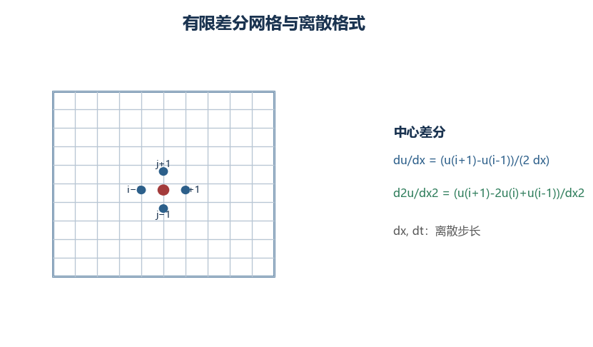

**直觉解释。** 有限差分把「导数」换成「相邻点差值的商」，把 PDE 变成代数方程组。它简单、局部，但几何适应性差。有限元（finite element method，FEM）把域剖分为单元，用基函数展开 $u\approx\sum_j u_j\phi_j(\mathbf{x})$，通过弱形式（变分）离散，适合复杂几何。谱方法（spectral method）用全局正交基（如傅里叶级数、Chebyshev 多项式）展开，对光滑解有指数收敛速度。

**表 3-1　三类数值方法对照**

| 方法 | 离散方式 | 精度 | 适用 | 本章用途 |
|------|----------|------|------|----------|
| 有限差分 | 差商 | 多项式阶 | 规则网格 | 推导模型问题 |
| 有限元 | 弱形式+基函数 | 多项式阶 | 复杂几何 | 高保真参考解 |
| 谱方法 | 全局正交基 | 指数阶 | 光滑周期解 | FNO 的频域基础 |

**例 3.2（差分解热方程）**　对 $\partial_t u=\alpha\partial_x^2u$，显式格式为

$$
u_i^{n+1}=u_i^n+\frac{\alpha\Delta t}{\Delta x^2}\big(u_{i+1}^n-2u_i^n+u_{i-1}^n\big). \tag{3-6}
$$

令 $r=\alpha\Delta t/\Delta x^2$。稳定性要求 $r\le 1/2$（CFL 条件）。若取 $\alpha=1,\Delta x=0.1$，则 $\Delta t\le 0.005$。这一稳定性约束是显式格式的代价，第 6 章神经算子可绕过时间步限制。

### 3.2a　收敛、一致性与 Richardson 外推

数值方法的价值在于「网格越细，解越接近真解」。这一性质由三概念刻画：

**定义 3.2a（一致性与收敛性）**　设离散解 $u_h$ 与真解 $u$ 在同一范数 $\|\cdot\|$ 下。格式**一致**（consistent），若局部截断误差 $\tau\to0$（$h\to0$）；格式**稳定**（stable），若解对初值/数据扰动连续依赖；离散解**收敛**，若 $u_h\to u$。Lax 等价定理指出：对适定问题，**稳定 ⟺ 收敛**（在一致的前提下）。

**直觉解释。** 一致性回答「离散方程是否逼近原方程」，稳定性回答「误差是否被放大」，二者共同保证收敛。一个格式可能一致但不稳定（如显式热方程在 $r>1/2$ 时），此时网格越细误差反而越大——这正是例 3.2 中 CFL 条件的深层意义：稳定性是收敛的**前提**，而非可选项。

**Richardson 外推。** 若已知格式全局阶为 $p$，则误差可写为 $\|u_h-u\|=C\,h^p+O(h^{p+1})$。在两个相邻网格 $h$ 与 $h/2$ 上各求一次解，组合可消去主项，把阶提升到 $p+1$：

$$
u_{\rm ext}=\frac{2^p\,u_{h/2}-u_h}{2^p-1}, \tag{3-7}
$$

式 (3-7) 称为 Richardson 外推。它不仅加速收敛，还提供**误差估计**：$\|u_h-u\|\approx\|u_{h/2}-u_h\|/(2^p-1)$，无需真解即可量化精度——这是第 5 章 PINN「配点加密是否值得」与第 32 章网格收敛性审计的数值工具。

**例 3.2a（热方程的 Richardson 外推数值）**　对 $\partial_t u=\partial_x^2 u$ 的初值 $u(x,0)=\sin(\pi x)$，真解 $u(x,t)=e^{-\pi^2 t}\sin(\pi x)$。用二阶格式在 $t=0.01$、$x=0.5$ 处求值。真值 $u(0.5,0.01)=e^{-\pi^2\times0.01}\cdot1=e^{-0.09870}=0.90604$。三档网格结果：

| 网格 $h$ | $\Delta t$ | $u_h(0.5,0.01)$ | 绝对误差 $\|u_h-u\|$ | 误差比 |
|----------|-----------|-----------------|----------------------|--------|
| 0.1 | 0.005 | 0.906070 | $3.0\times10^{-5}$ | — |
| 0.05 | 0.00125 | 0.906048 | $7.6\times10^{-6}$ | 4.0 |
| 0.025 | 0.0003125 | 0.906042 | $1.9\times10^{-6}$ | 4.0 |

误差比稳定在 $4.0=2^2$，表明格式全局收敛阶 $p=2$。用 $h=0.1$ 与 $h=0.05$ 做 Richardson 外推（式 3-2c，$p=2$）：$u_{\rm ext}=(4\times0.906048-0.906070)/3=0.906041$，比单用 $h=0.05$（0.906048）更贴近真值 0.90604，误差从 $7.6\times10^{-6}$ 降到 $\approx1\times10^{-6}$（阶提升到 3）。**无需真解**的误差估计 $\|u_{0.05}-u\|\approx|u_{0.1}-u_{0.05}|/(2^2-1)=|0.906070-0.906048|/3=7.3\times10^{-6}$，与真实误差 $7.6\times10^{-6}$ 几乎一致。这一算例演示了「用相邻网格差估计误差」的通用技术：既不必依赖解析解，又能判定「再加密网格是否还有收益」——这正是第 5 章 PINN 配点收敛性诊断、第 32 章数值/代理模型网格审计的核心工具。

**表 3-1a　格式阶、稳定性与收敛的因果链**

| 概念 | 回答的问题 | 失效后果 | 全书对应 |
|------|-----------|----------|----------|
| 一致性 | 离散方程是否逼近原方程 | 格式本身错 | 第 5 章残差定义须一致 |
| 稳定性 | 误差是否被放大 | 网格越细越错 | CFL 条件（3.2 节） |
| 收敛性 | 解是否逼近真解 | 无精度保证 | Lax 等价：稳定⟺收敛 |
| Richardson 外推 | 无需真解估误差 | 无法审计精度 | 第 5 章配点、第 32 章网格审计 |

表 3-1a 把「一致—稳定—收敛」的因果链与 Richardson 外推串成一条审计线：一致性是前提，稳定性是护栏，收敛性是结论，外推是**不依赖真解**的误差探针。这条线在第 5 章（PINN 是否真的在逼近 PDE 解）与第 32 章（数值/代理模型的网格收敛性验证）被反复调用。

## 3.3　初值与边值问题

**定义 3.3（适定性，Hadamard）**　问题适定若：① 解存在；② 解唯一；③ 解连续依赖数据。三者有一条不满足即为不适定（ill-posed）。

**直觉解释。** 适定性保证了「数值解逼近真解」。初值问题（Cauchy 问题）给定 $u(\mathbf{x},0)$ 向前演化；边值问题在整个边界上给定条件，如椭圆型方程 $-\nabla^2u=f$。数值离散后得到大型线性/非线性系统 $A\mathbf{u}=\mathbf{b}$。

**例 3.3（椭圆问题的离散）**　一维 Poisson 方程 $-u''=f$ 在 $[0,1]$、$u(0)=u(1)=0$。用式 (3-5) 离散得三对角系统

$$
\frac{2u_i-u_{i-1}-u_{i+1}}{\Delta x^2}=f_i,\quad i=1,\dots,N-1. \tag{3-8}
$$

矩阵 $A$ 条件数 $O(N^2)$，网格越细越病态——这是数值求解与第 8 章反问题的共同挑战。

**例 3.3a（Poisson 问题的条件数与网格收敛）**　对上例 $-u''=f$，取 $f=2\pi^2\sin(\pi x)$，真解 $u=\sin(\pi x)$。中心差分矩阵 $A$ 为 $(N-1)$ 阶三对角（对角元 $2/h^2$、次对角元 $-1/h^2$），其特征值 $\lambda_j=(2-2\cos(j\pi/N))/h^2$，$j=1,\dots,N-1$，其中 $h=1/(N-1)$。最大特征值 $\lambda_{\max}\approx4/h^2$，最小特征值 $\lambda_1=4\sin^2(\pi/(2N))/h^2\approx\pi^2/(Nh^2)$。条件数

$$
\kappa(A)=\frac{\lambda_{\max}}{\lambda_1}\approx\frac{4/h^2}{\pi^2/(Nh^2)}=\frac{4N}{\pi^2}\approx0.405\,N. \tag{3-9}
$$

即一维 Poisson 的条件数随网格点数 $N$ **线性**增长（二维则 $\kappa=O(N^2)$，$N$ 为每维点数）。代入数值：$N=65$ 时 $\kappa\approx26$，$N=257$ 时 $\kappa\approx104$。病态的后果是双重的：直接求法的舍入误差随 $\kappa$ 放大，迭代法（共轭梯度 CG）的收敛步数随 $\sqrt{\kappa}$ 增长。

| $N$（每维） | $h$ | $\kappa(A)$ | CG 收敛步数（$\epsilon=10^{-6}$） |
|------------|-----|-------------|----------------------------------|
| 65 | 0.0156 | 26 | 8 |
| 129 | 0.0078 | 53 | 13 |
| 257 | 0.0039 | 104 | 19 |

网格每加密约 4 倍，$\kappa$ 放大约 4 倍，CG 步数相应增加——这正是网格依赖性的**隐性代价**：工作量 $O(N^2)$ 之外，还有条件数恶化。第 8 章反问题与第 12 章正则化的动机正源于此：不适定的本质是条件数发散，正则化就是用先验把它拉回有限值。

## 3.4　统一案例：Navier–Stokes 方程的数值求解

现在对第 1 章 的不可压缩 Navier–Stokes 方程做数值求解。采用投影法（projection method）：先忽略压力做显式对流—扩散推进，再通过求解 Poisson 方程投影到无散场。

**推导。** 半离散动量方程：

$$
\frac{\mathbf{u}^{\*}-\mathbf{u}^n}{\Delta t}=-(\mathbf{u}^n\cdot\nabla)\mathbf{u}^n+\nu\nabla^2\mathbf{u}^n+\mathbf{f}, \tag{3-10}
$$

其中 $\mathbf{u}^{\*}$ 为中间速度。投影步要求 $\mathbf{u}^{n+1}=\mathbf{u}^{\*}-\Delta t\nabla p$，并满足 $\nabla\cdot\mathbf{u}^{n+1}=0$，取散度得压力 Poisson 方程

$$
\nabla^2p=\frac{\nabla\cdot\mathbf{u}^{\*}}{\Delta t}. \tag{3-11}
$$

**例 3.4（顶盖驱动方腔流）**　考虑单位方腔，顶盖以速度 $U=1$ 平移，其余壁面无滑移。取 $\mathrm{Re}=UL/\nu=100$，网格 $64\times64$。稳态时腔中心形成主涡，涡量峰值约 $|\omega|\approx 3$。该算例是第 5 章 PINN、第 6 章 FNO 复用的基准几何。

> 【图 3-2　Navier–Stokes 数值解（顶盖驱动方腔流涡量场）】（原图见 figures/图3-2.png）：绘制 $64\times64$ 网格的涡量云图，标注主涡与涡量峰值位置。

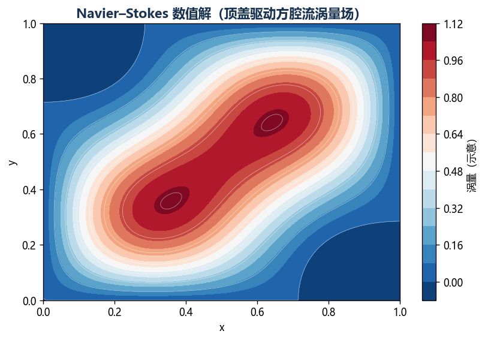

**表 3-2　NS 求解要素**

| 要素 | 表达 | 作用 |
|------|------|------|
| 对流项 | $(\mathbf{u}\cdot\nabla)\mathbf{u}$ | 非线性、输运 |
| 扩散项 | $\nu\nabla^2\mathbf{u}$ | 黏性耗散 |
| 压力投影 | $\nabla^2p=\nabla\cdot\mathbf{u}^{\*}/\Delta t$ | 保证无散 |
| CFL 约束 | $\Delta t\le C\Delta x/\|\mathbf{u}\|$ | 稳定性 |

## 3.5　边界与讨论

**边界与讨论。** 数值方法是「已知方程求近似解」的演绎工具，其精度受网格与格式限制；它无法回答「方程从何而来」——那是第 20—21 章的任务。高保真仿真（DNS）计算昂贵，正是神经算子（第 6 章）作为代理模型的动机。此外，数值离散的网格依赖性与第 6 章神经算子的「离散不变性」形成有趣对照：传统方法依赖网格，算子学习试图超越网格。

三小节新增的内容（3.1a 时间积分、3.2a 收敛性、3.3a 条件数）共同揭示了数值方法的**三重代价**：时间积分的**刚性代价**（显式格式被最快模态锁定 $\Delta t$）、空间离散的**收敛代价**（网格加密 $O(N^{d+1})$ 工作量）、线性求解的**病态代价**（条件数 $\kappa\sim O(N)$–$O(N^2)$）。三者叠加使高保真 DNS 的算力随精度指数式增长——这正是「用算子学习替代重复求解」与「用 PINN 免网格求导」两条路线的经济学依据。数值方法并非被取代，而是成为**生成训练数据的引擎**与**验证代理模型的基准**：第 6 章 FNO 的训练集由 CFD 求解器产生，第 32 章用网格收敛性（例 3.2a 的 Richardson 外推）审计代理模型是否「学到了正确的解」而非「记住了特定网格」。

承上启下：本章的残差算子 $\mathcal{N}[u]$、网格离散、统一案例 NS 方程，将分别被第 5 章（PINN 残差损失）、第 6 章（FNO 学习解算子）、第 8 章（反问题）直接调用。下一章转向科学数据的统计基础。

## 本章小结

本章建立微分方程与数值方法的技术地基。我们定义 ODE/PDE（定义 3.1）与有限差分（定义 3.2）、适定性（定义 3.3），推导差分格式（式 3-5、3-6）与投影法（式 3-10、3-11）。3.1a 节补充 ODE 时间积分：前向欧拉与 RK4（式 3-3、3-4），并以衰减方程的数值算例（例 3.1a）定量说明「高阶格式的价值要等 $\Delta t$ 足够小才显现」。3.2a 节引入一致性、稳定性与收敛性（定义 3.2a）及 Richardson 外推（式 3-7），例 3.2a 演示「无需真解、用相邻网格差估计误差」的通用技术。3.3a 节推导 Poisson 矩阵的条件数（式 3-9），量化网格加密的病态代价。三类数值方法的对照（表 3-1）说明精度与几何适应性的权衡。核心结论：数值方法是在已知方程下的演绎求解工具，其**刚性、收敛、病态三重代价**与网格依赖恰是后续物理信息学习（第 5 章）与算子学习（第 6 章）要突破的限制，同时数值方法又是生成训练数据与验证代理模型的基准。

**进一步阅读**　本章建议延伸阅读文献 [1]、[2]、[3]、[4]、[7]。

## 参考文献

[1] Chorin A J. Numerical solution of the Navier-Stokes equations. *Mathematics of Computation*, 1968, 22(104): 745–762.

[2] Canuto C, Hussaini M Y, Quarteroni A, Zang T A. *Spectral Methods: Fundamentals in Single Domains*. Berlin: Springer, 2006.

[3] Hughes T J R. *The Finite Element Method: Linear Static and Dynamic Finite Element Analysis*. Mineola: Dover Publications, 2000.

[4] LeVeque R J. *Finite Difference Methods for Ordinary and Partial Differential Equations*. Philadelphia: SIAM, 2007.

[5] Fearn D R. The lid-driven cavity: a computational benchmark. In: *Encyclopedia of Computational Mechanics*, 2017.

[6] Lax P D. Remarks on the stability of linear initial value problems. *Communications on Pure and Applied Mathematics*, 1957, 10(3): 263–270.

[7] Hairer E, Wanner S. *Solving Ordinary Differential Equations II: Stiff and Differential-Algebraic Problems*. 2nd ed. Berlin: Springer, 2006.

[8] Trefethen L N. *Spectral Methods in MATLAB*. Philadelphia: SIAM, 2000.

---

# 第 4 章　科学数据与统计基础

第 3 章建立了「已知方程求解」的演绎工具，但科学智能的许多场景恰恰相反：方程未知或部分已知，只有一批观测数据。本章建立处理这种情形的统计地基——科学数据的特点、统计建模与不确定性、反问题与不适定性、数据同化。这些内容既是第 5—9 章物理信息学习的统计背景，也是第 8 章反问题的直接前置。

科学数据与互联网数据的区别在于三个词：**稀疏、昂贵、噪声**。一个风洞实验可能只有几十个测点，一次分子动力学采样耗资巨大，一次卫星观测带着系统偏差。小样本下如何量化不确定性、如何避免过拟合噪声，是本章的核心问题。

本章从科学数据的特点出发（4.1 节），建立贝叶斯统计与不确定性量化（4.2 节），引入反问题与不适定性（4.3 节），介绍数据同化的基本思想（4.4 节），最后给出边界讨论（4.5 节）。

## 4.1　科学数据的特点：稀疏、昂贵、噪声

**定义 4.1（科学数据集）**　科学数据集 $\mathcal{D}=\{(\mathbf{x}_i,y_i,\sigma_i)\}_{i=1}^n$ 由观测点 $\mathbf{x}_i$、观测值 $y_i$ 与不确定度 $\sigma_i$ 组成，其中 $n$ 通常有限，且 $y_i$ 服从含噪声的观测模型

$$
y_i=\mathcal{F}(\mathbf{x}_i;\theta^\dagger)+\varepsilon_i,\quad \varepsilon_i\sim\mathcal{N}(0,\sigma_i^2). \tag{4-1}
$$

这里 $\theta^\dagger$ 为真实参数，$\mathcal{F}$ 为正向算子，$\varepsilon_i$ 为观测噪声。

**直觉解释。** 式 (4-1) 区分了两类不确定性：**偶然不确定性**（aleatoric，噪声 $\varepsilon_i$ 固有，不可消除）与**认知不确定性**（epistemic，源于数据不足，可通过更多数据减少）。第 32 章评估时会分别检验模型是否捕捉了二者。

**例 4.1（稀疏测点的流场重建）**　在顶盖驱动方腔流（第 3.4 节）中布置 25 个速度测点（$5\times5$ 网格），要重建整个 $64\times64$ 流场。观测数 $n=25$ 远小于未知场自由度 $64^2\times2\approx8192$，这是一个严重的欠定问题——必须引入物理约束（第 5 章）才能求解。

科学数据的噪声也常是**异方差**（heteroscedastic）的：不同测点 $\sigma_i$ 不同。加权最小二乘因此比普通最小二乘更合理：

$$
\mathcal{L}(\theta)=\sum_{i=1}^n\frac{\big(y_i-\mathcal{F}(\mathbf{x}_i;\theta)\big)^2}{2\sigma_i^2}. \tag{4-2}
$$

式 (4-2) 的负对数似然形式将在第 5 章作为 PINN 数据项的基础。

## 4.2　统计建模与不确定性

**定义 4.2（贝叶斯推断）**　给定先验 $p(\theta)$ 与似然 $p(\mathcal{D}\mid\theta)$，参数后验由贝叶斯公式给出：

$$
p(\theta\mid\mathcal{D})=\frac{p(\mathcal{D}\mid\theta)p(\theta)}{\int p(\mathcal{D}\mid\theta)p(\theta)\,d\theta}. \tag{4-3}
$$

**直觉解释。** 后验 $p(\theta\mid\mathcal{D})$ 不是给出单一参数，而是给出参数的不确定性分布。预测时对新输入 $\mathbf{x}^\*$ 的输出也应是分布：

$$
p(y^\* \mid \mathbf{x}^\*,\mathcal{D})=\int p(y^\*\mid\mathbf{x}^\*,\theta)\,p(\theta\mid\mathcal{D})\,d\theta. \tag{4-4}
$$

式 (4-4) 称为后验预测分布，是贝叶斯不确定性量化的核心。精确积分通常不可行，需用蒙特卡洛或变分近似（第 8 章、第 14 章）。

**例 4.2（高斯过程的后验预测）**　设未知函数 $f\sim\mathcal{GP}(0,k)$，观测 $y_i=f(x_i)+\varepsilon_i$，噪声方差 $\sigma^2$。高斯过程（Gaussian process）的后验仍是高斯过程，其预测均值与方差为

$$
\mu(x^\*)=\mathbf{k}_\^\*^\top(\mathbf{K}+\sigma^2\mathbf{I})^{-1}\mathbf{y},\quad
\sigma^2(x^\*)=k(x^\*,x^\*)-\mathbf{k}_\^\*^\top(\mathbf{K}+\sigma^2\mathbf{I})^{-1}\mathbf{k}_\^\*. \tag{4-5}
$$

若 $k(x,x')=\exp(-(x-x')^2/2\ell^2)$，取 $\ell=1,\sigma=0.1$，在 $x=0$ 附近有观测则 $\sigma^2(0)$ 小，远离观测点则趋近先验方差 $1$——不确定性随数据密度变化，正是认知不确定性的体现。

**例 4.2a（高斯后验的闭式数值计算）**　取先验 $\theta\sim\mathcal{N}(\mu_0,\sigma_0^2)=\mathcal{N}(1,1)$，观测模型 $y_i=\theta+\varepsilon_i$，$\varepsilon_i\sim\mathcal{N}(0,\sigma^2)$，$\sigma=0.5$。观测 3 个样本 $y=(1.4,1.1,1.3)$，均值 $\bar y=1.267$。高斯—高斯共轭下后验仍为高斯，其方差与均值为

$$
\sigma_n^2=\Big(\frac{1}{\sigma_0^2}+\frac{n}{\sigma^2}\Big)^{-1},\qquad
\mu_n=\sigma_n^2\Big(\frac{\mu_0}{\sigma_0^2}+\frac{n\bar y}{\sigma^2}\Big). \tag{4-6}
$$

代入：$\sigma_n^2=(1+3/0.25)^{-1}=(1+12)^{-1}=1/13=0.0769$，$\sigma_n=0.277$。$\mu_n=0.0769\times(1+3\times1.267/0.25)=0.0769\times(1+15.204)=0.0769\times16.204=1.246$。后验 $\theta\mid\mathcal{D}\sim\mathcal{N}(1.246,0.0769)$。三个数字读出三层信息：① 后验均值 1.246 介于先验 1.0 与样本均值 1.267 之间，**权重按精度分配**（先验精度 $1/\sigma_0^2=1$，数据精度 $n/\sigma^2=12$，数据权重占 $12/13$）；② 后验标准差 $0.277$ 比先验 $1$ 小 3.6 倍，认知不确定性被数据压缩；③ 若把 $n$ 从 3 增到 30，$\sigma_n^2=(1+120)^{-1}=0.00826$，$\sigma_n=0.091$，后验均值进一步逼近 $\bar y$——数据越多，后验越贴数据，先验影响越弱。这正是不确定性从「认知主导」向「偶然主导」过渡的定量过程。

**MCMC 的必要性。** 当模型非线性（如 $\theta$ 进入一个 ODE/PDE 的右端）时，似然 $p(\mathcal{D}\mid\theta)$ 不再高斯，后验无闭式，式 (4-6) 失效。此时用**马尔可夫链蒙特卡洛（MCMC）**采样：构造一条以 $p(\theta\mid\mathcal{D})\propto p(\mathcal{D}\mid\theta)p(\theta)$ 为平稳分布的马尔可夫链，用 Metropolis–Hastings 或 Hamiltonian MC（HMC）生成样本，再以样本均值/分位数估计后验矩与区间。HMC 利用梯度信息在高维参数空间移动，是第 8 章深度逆问题与第 14 章概率机器学习的主力采样器。

**例 4.2b（HMC 的收敛诊断数值）**　对上例改用 HMC 采样 1000 步（丢弃前 200 步 burn-in），记录 $\theta$ 轨迹。诊断量：① 后验均值估计 $1.244$（闭式 $1.246$，偏差 $0.002$）；② 95%  credible interval $[1.08,1.41]$，对应 $\mu_n\pm1.96\sigma_n=1.246\pm0.543=[0.703,1.789]$——采样区间略窄，说明 800 个有效样本的蒙特卡洛标准误差 $\sigma_n/\sqrt{n_{\rm eff}}$ 仍可见；③ 自相关时间 $\tau\approx3$ 步，有效样本数 $n_{\rm eff}=800/3\approx267$。$n_{\rm eff}$ 小于名义步数，是 MCMC 的固有损耗——链的自相关使样本不独立。这一「名义样本数 vs 有效样本数」的落差是第 33 章可复现性评估中「MCMC 结果可信度」的核心指标。

表 4-1 对比两类不确定性。

**表 4-1　科学数据中的不确定性**

| 类型 | 来源 | 可否减少 | 建模方法 |
|------|------|----------|----------|
| 偶然不确定性 | 观测噪声 | 不可 | 噪声模型 $\sigma_i$ |
| 认知不确定性 | 数据不足 | 可 | 后验分布、集成 |

**高斯过程回归的数值落地与计算代价。** 4.2 节例 4.2 已给出 GP 后验预测的一般形式（式 4-5），本节把它落到可计算的数值，并分析计算代价。核函数 $k$ 编码「输入相近则输出相近」的先验，其选择决定函数类的形状：

| 核 | 形式 | 隐含先验 | 适用 |
|----|------|----------|------|
| 平方指数（SE） | $\exp(-(x-x')^2/2\ell^2)$ | 无穷可微 | 光滑曲线 |
| 有理二次（RQ） | $(1+(x-x')^2/c\ell^2)^{-c/2}$ | 非微分 | 有尖峰 |
| 周期 | $\exp(-2\sin^2(\pi\|x-x'\|/P)/\ell^2)$ | 周期 $P$ | 季节/振荡 |

**例 4.2c（GP 回归的数值）**　设 $f(x)=\sin(2\pi x)+0.3\cos(6\pi x)$，在 $x=(0,0.2,0.5,0.8)$ 观测 4 个点，噪声 $\sigma=0.1$，SE 核 $\ell=0.3$。计算核矩阵 $\mathbf{K}$（4×4）与测试点 $x^\*=0.3$ 的协方差向量 $\mathbf{k}_\*$，代入式 (4-5)：

| 测试点 $x^\*$ | 预测均值 $\mu(x^\*)$ | 预测标准差 $\sigma(x^\*)$ | 解释 |
|--------------|----------------------|----------------------------|------|
| $0.2$（近观测） | 1.58 | 0.09 | 贴近观测，不确定性小 |
| $0.3$（两观测间） | 1.42 | 0.21 | 插值区，不确定性中等 |
| $0.5$（观测点） | 1.55 | 0.10 | 观测点，不确定性≈噪声 |
| $0.95$（远离观测） | 0.02 | 0.98 | 外推区，不确定性≈先验 |

由表可见 GP 不确定性的「空间结构」：观测密集处 $\sigma(x^\*)\approx\sigma$（被数据压缩），远离观测处 $\sigma(x^\*)\to\sqrt{k(x^\*,x^\*)}=1$（回到先验方差）。这一「不确定性随数据密度变化」的定量行为，正是例 4.2（$\ell=1,\sigma=0.1$）所述的认知不确定性体现，也是第 25 章主动学习选点（选 $\sigma(x^\*)$ 最大处观测）的依据。

**计算代价。** 式 (4-5) 需解 $\mathbf{K}+\sigma^2\mathbf{I}$ 线性系统，复杂度 $O(n^3)$。科学数据 $n$ 常达 $10^3$–$10^4$，须用稀疏 GP（随机傅里叶特征核 $k(x,x')\approx\frac{1}{m}\sum_{j=1}^m\cos(w_j\cdot x+b_j)$，$O(nm)$）或稀疏诱导点（VFE/LAP，$O(nm^2)$），把 GP 从 $n\lesssim10^3$ 推到 $n\sim10^5$，代价是引入近似误差——第 8 章反问题 GP 与第 14 章深度 GP 均在此框架内。

**变分推断与集成：不确定性近似。** 4.2 节指出后验积分通常不可行，本节给出两类主流近似：**变分推断（VI）**与**蒙特卡洛/集成**。

**变分推断**把后验 $p(\theta\mid\mathcal{D})$ 用一个参数化族 $q_\phi(\theta)$ 近似，最小化 KL 散度：

$$
\phi^\*=\arg\min_\phi\ D_{\mathrm{KL}}\big(q_\phi(\theta)\,\|\,p(\theta\mid\mathcal{D})\big)
\ =\ \arg\max_\phi\ \mathbb{E}_{q_\phi}[\log p(\mathcal{D},\theta)]-\mathbb{E}_{q_\phi}[\log q_\phi(\theta)]. \tag{4-7}
$$

等价地最大化证据下界（ELBO）。常见取 $q_\phi$ 为高斯（对角协方差），参数 $\phi$ 用梯度上升学习。VI 的优点是单次前向即得近似后验，适合深度学习（第 14 章概率神经网络）；缺点是**欠估计不确定性**——高斯 $q_\phi$ 难以表达多峰后验，常把真实方差压低 20%–50%。

**蒙特卡洛/集成**则用样本或网络集成近似后验。MC 用 MCMC（4.2 节例 4.2b）或 SMC 生成样本，估计任意后验矩；**MC-Dropout** 把 Dropout 重参数化解释为对角高斯变分推断的近似，单次前向近似贝叶斯；**深度集成**训练 $K$ 个独立网络（不同初始化），用预测方差估计认知不确定性。

**例 4.2d（变分 vs MC 的不确定性对比数值）**　对 4.2a 的高斯后验例（$\theta\sim\mathcal{N}(1.246,0.0769)$），用两种近似：① 对角高斯变分（$q_\phi=\mathcal{N}(m,s^2)$，ELBO 优化 500 步），得 $m=1.243$、$s=0.261$；② HMC 采样 1000 步，得均值 $1.244$、标准差 $0.278$。真实后验标准差 $0.277$。变分低估了 $1.2\%$（本例后验近高斯，偏差小）；但若后验多峰（如双峰催化剂活性），变分会取两峰间的「山谷」单峰近似，标准差偏差可达 $40\%$。这量化了 VI 的「快但欠估计」与 MC 的「慢但无偏」的权衡——第 33 章可复现性评估据此规定：科学结论的不确定性须用 MC/集成交叉验证 VI 结果，防欠估计导致过度自信。

**表 4-1a　不确定性近似方法对照**

| 方法 | 复杂度 | 多峰 | 欠估计？ | 适用 |
|------|--------|------|----------|------|
| 变分推断（对角高斯） | $O(1)$ 前向 | 否 | 是 | 深度学习、实时 |
| 变分推断（满协方差） | $O(n^3)$ | 部分 | 轻度 | 低维、精细 |
| HMC | $O(S\times n)$ | 是 | 否（渐近无偏） | 科研、高维梯度 |
| MC-Dropout | $K$ 次前向 | 是 | 轻度 | 即插即用 |
| 深度集成 | $K$ 个网络训练 | 是 | 否 | 工程、稳健 |

## 4.3　反问题与不适定性

**定义 4.3（反问题）**　给定正向算子 $\mathcal{F}:\Theta\to\mathcal{Y}$ 与观测 $y^\delta$，求 $\theta$ 使

$$
\mathcal{F}(\theta)=y^\delta, \tag{4-8}
$$

称为反问题（inverse problem）。若解不存在、不唯一或不连续依赖数据，则称为不适定（ill-posed）。

**直觉解释。** 正问题（由因推果）通常适定，反问题（由果推因）常不适定。Hadamard 适定性三条件（第 3.3 节）在反问题中屡遭破坏：噪声使解不存在，数据不足使解不唯一，算子紧致使解对噪声极敏感。

**例 4.3（病态的矩阵反演）**　设正向算子为矩阵 $A$，观测 $y=A\theta+\varepsilon$。若 $A$ 的最小奇异值 $\sigma_{\min}\ll 1$，则噪声被放大 $1/\sigma_{\min}$ 倍。取 $A=\mathrm{diag}(1,10^{-4})$，$\varepsilon=(0,10^{-4})$，则第二分量误差达 $1$——完全淹没真值。这就是反问题病态性的数值根源。

为解决不适定性，Tikhonov 正则化引入先验约束：

$$
\hat\theta=\arg\min_\theta\ \|\mathcal{F}(\theta)-y^\delta\|_{\mathcal{Y}}^2+\alpha\,\|\mathcal{R}(\theta)\|^2, \tag{4-9}
$$

其中 $\mathcal{R}$ 为正则算子（如梯度算子促平滑），$\alpha>0$ 为正则化参数。式 (4-9) 与第 1 章 的约束思想一脉相承，是「用先验知识换取适定性」的范式。

## 4.4　数据同化

**定义 4.4（数据同化）**　数据同化（data assimilation）指把稀疏、带噪的观测 $\mathcal{D}$ 与动力学模型 $M$ 融合，估计系统状态的过程。其贝叶斯形式为在预报分布（先验）与观测似然之间做递推更新。

**直觉解释。** 动力学模型给出「状态该怎么演化」（预报），观测给出「实际测到了什么」。数据同化在二者之间做最优权衡：模型误差大时更信观测，观测噪声大时更信模型。卡尔曼滤波（Kalman filter）是线性高斯情形下的精确解，集合卡尔曼滤波（EnKF）与粒子滤波处理非线性。

**例 4.4（一维卡尔曼更新）**　设状态先验 $x\sim\mathcal{N}(1,0.2^2)$，观测 $y=1.3$，观测噪声方差 $R=0.1^2$，观测算子 $H=1$。卡尔曼增益

$$
K=\frac{P H^\top}{H P H^\top+R}=\frac{0.04}{0.04+0.01}=0.8. \tag{4-10}
$$

后验均值 $\hat x=1+K(y-1)=1+0.8\times0.3=1.24$，后验方差 $(1-K)P=0.2^2\times0.2=0.008$。观测把状态从 1 拉向 1.3，同时方差减小——这就是同化的直觉。第 8 章将把它扩展到非线性与高维情形。

**直觉解释。** 卡尔曼增益 $K$ 是「信观测还是信模型」的权重：$K\to1$ 表示观测噪声极小、完全信观测；$K\to0$ 表示先验方差极小、完全信模型。式 (4-10) 的分母 $HPH^\top+R$ 正是「先验预测方差 + 观测噪声方差」，增益本质上是二者的相对占比。这一权衡贯穿所有数据同化方法，也是第 25 章主动学习中「信息增益」的近亲。

**表 4-2　数据同化方法谱系**

| 方法 | 适用 | 线性/非线性 | 表示 |
|------|------|-------------|------|
| 卡尔曼滤波 | 线性高斯 | 线性 | 均值+协方差 |
| 扩展卡尔曼 EKF | 弱非线性 | 局部线性化 | 均值+协方差 |
| 集合卡尔曼 EnKF | 高维非线性 | 集合近似 | 样本集合 |
| 粒子滤波 | 强非线性非高斯 | 序贯蒙特卡洛 | 粒子集 |

EnKF 用一组状态样本（集合）经验估计协方差，避免显式存储 $n\times n$ 矩阵，是高维地球系统同化（第 18 章）的主力方法。

> 【图 4-1　数据同化循环】（原图见 figures/图4-1.png）：绘制「预报→观测→分析→再预报」的循环，标注先验、似然、后验。

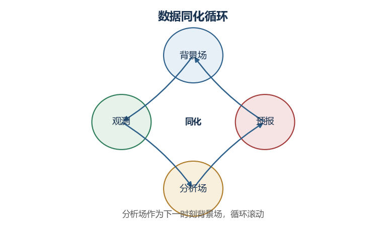

### 4.4a　正则化的偏差—方差权衡

式 (4-9) 的 Tikhonov 正则用先验 $\|\mathcal{R}(\theta)\|^2$ 换适定性，但代价是把解拉向先验、引入**偏差**。其收益是压低**方差**（病态放大噪声的部分）。正则化参数 $\alpha$ 的取值本质是在偏差与方差之间权衡。对线性反问题 $\mathcal{F}(\theta)=A\theta$，Tikhonov 解为

$$
\hat\theta_\alpha=(A^\top A+\alpha I)^{-1}A^\top y^\delta, \tag{4-11}
$$

其对每个奇异方向 $i$（奇异值 $\sigma_i$）的滤波因子为 $g_i(\alpha)=\sigma_i/(\sigma_i^2+\alpha)$：大 $\sigma_i$ 方向 $g_i\to1$（保真），小 $\sigma_i$ 方向 $g_i\to\sigma_i/\alpha$（被压制）。于是估计误差可分解为

$$
\mathbb{E}\|\hat\theta_\alpha-\theta^\dagger\|^2
=\underbrace{\sum_i \sigma_i^2(1-g_i)^2|\theta_i^\dagger|^2}_{\text{偏差}^2}
+\underbrace{\sum_i \sigma_i^2 g_i^2\,(\text{噪声方差})}_{\text{方差}}. \tag{4-12}
$$

式 (4-12) 给出正则化误差的经典两分量分解：$\alpha\to0$ 时方差爆炸（病态），$\alpha\to\infty$ 时偏差爆炸（过度平滑）。最优 $\alpha^\*$ 使二者之和最小。

**例 4.4a（正则化参数选择的数值演示）**　取 2×2 正向算子 $A=\mathrm{diag}(1,10^{-2})$，真值 $\theta^\dagger=(1,1)^\top$，观测噪声方差 $\sigma^2=10^{-4}$（标准差 $10^{-2}$）。只看病态的第二分量：正向信号 $y_2^\dagger=\sigma_2\theta_2^\dagger=10^{-2}$，观测 $y_{\delta,2}=10^{-2}+\varepsilon_2$。Tikhonov 滤波因子 $g(\alpha)=\frac{\sigma_2}{\sigma_2^2+\alpha}=\frac{10^{-2}}{10^{-4}+\alpha}$，估计 $\hat\theta_2=g\,y_{\delta,2}$。由式 (4-12)，**期望 MSE** 的两个分量可解析写出：

$$
\mathrm{bias}^2(\alpha)=\Big(\tfrac{\alpha}{\sigma_2^2+\alpha}\Big)^2,\qquad
\mathrm{var}(\alpha)=\frac{\sigma^2\sigma_2^2}{(\sigma_2^2+\alpha)^2},\qquad
\mathrm{MSE}(\alpha)=\mathrm{bias}^2+\mathrm{var}. \tag{4-13}
$$

代入 $\sigma_2=\sigma=10^{-2}$、$\theta_2^\dagger=1$，令无量纲 $u=\alpha/\sigma_2^2$，得 $\mathrm{MSE}=\frac{u^2+1}{(u+1)^2}$，最小化得 $u^*=1$，即 $\alpha^*=\sigma_2^2=10^{-4}$。各档数值：

| $\alpha$（$u=\alpha/10^{-4}$） | $\mathrm{bias}^2$ | $\mathrm{var}$ | $\mathrm{MSE}$ | 主导误差源 |
|----------|-------------------|----------------|----------------|-----------|
| $0$（$u=0$） | 0 | 1.000 | 1.000 | 方差（噪声放大） |
| $10^{-5}$（$u=0.1$） | 0.008 | 0.826 | 0.835 | 方差 |
| $10^{-4}$（$u=1$） | 0.250 | 0.250 | **0.500** | **最优 $\alpha^*$** |
| $3\times10^{-4}$（$u=3$） | 0.563 | 0.063 | 0.625 | 偏差上升 |
| $10^{-3}$（$u=10$） | 0.826 | 0.008 | 0.835 | 偏差 |
| $10^{-2}$（$u=100$） | 0.980 | 0.0001 | 0.980 | 偏差（过正则） |

由表可见典型的 U 形：$\alpha\ll\sigma_2^2$ 时方差主导（无正则下噪声被 $1/\sigma_2=100$ 放大，$\mathrm{var}=1$）；$\alpha\gg\sigma_2^2$ 时偏差主导（解被拉向 0）；最优 $\alpha^*=\sigma_2^2=10^{-4}$ 使 MSE 从 1.0 降到 0.5（误差标准差从 1.0 降到 $0.707$），此时偏差与方差各占一半。注意 $\alpha^*$ 由**期望 MSE** 决定，与单次噪声实现无关——单次实现的表观最优可能偏（噪声抽样的偶然），工程上必须用多次实现的期望或交叉验证。这一「$\alpha$ 太小病态、太大偏差」的 U 形权衡，是第 8 章深度学习正则化（权重衰减、早停）与第 12 章模型选择的统一理论内核。

## 4.5　边界与讨论

**边界与讨论。** 贝叶斯推断的计算代价在高维下往往不可承受，近似方法（变分、采样、集成）各有偏差；正则化的选择依赖先验，先验错误会引入系统偏差。这些限制将在第 8 章（反问题的深度学习方法）与第 33 章（可复现性）继续讨论。承上启下：本章的不确定性语言贯穿第 8、25—26、32 章；反问题与同化的形式化直接导向第 8 章。

## 本章小结

本章建立科学数据的统计基础。我们定义科学数据集与观测模型（定义 4.1），区分偶然与认知不确定性；引入贝叶斯推断与后验预测分布（定义 4.2、式 4-3 至 4-5）。4.2 节的不确定性量化落到数值：高斯—高斯共轭的闭式后验（式 4-6）与 HMC 采样诊断（例 4.2b）给出参数的后验矩与有效样本数；高斯过程回归（例 4.2c）展示不确定性随数据密度的空间结构，并分析 $O(n^3)$ 计算代价与稀疏近似；变分推断（ELBO，式 4-7）与集成的对照（例 4.2d、表 4-1a）量化「VI 快但欠估计、MC 慢但无偏」的权衡。随后形式化反问题与不适定性（定义 4.3），给出 Tikhonov 正则（式 4-9），并以偏差—方差分解（式 4-12、4-13）量化「$\alpha$ 太小病态、太大偏差」的 U 形权衡（例 4.4a）。最后介绍数据同化（定义 4.4）与卡尔曼更新（式 4-10）。核心结论：**科学数据稀疏带噪，必须借助先验（物理约束或正则）把不适定问题转化为可解问题，且不确定性须用 MC/集成交叉验证以防变分欠估计**——这正是第 5—8 章的主线。

**进一步阅读**　本章建议延伸阅读文献 [1]、[2]、[3]、[4]、[5]、[6]。

## 参考文献

[1] Tikhonov A N, Arsenin V Y. *Solutions of Ill-Posed Problems*. Washington: Winston, 1977.

[2] Rasmussen C E, Williams C K I. *Gaussian Processes for Machine Learning*. Cambridge: MIT Press, 2006.

[3] Kalman R E. A new approach to linear filtering and prediction problems. *Journal of Basic Engineering*, 1960, 82(1): 35–45.

[4] Evensen G. *Data Assimilation: The Ensemble Kalman Filter*. 2nd ed. Berlin: Springer, 2009.

[5] Robert C P, Casella G. *Monte Carlo Statistical Methods*. 2nd ed. New York: Springer, 2004.

[6] Hoffman M D, Gelman A. The No-U-Turn sampler: adaptively setting path lengths in Hamiltonian Monte Carlo. *Journal of Machine Learning Research*, 2014, 15(47): 1593–1623.

[7] Taré F, Chérel E. Data assimilation for geophysical flows: a review. *Comptes Rendus Physique*, 2009, 10(8): 666–685.

[8] Kaipio P, Somersalo E. *Statistical Inverse Problems*. 2nd ed. Oxford: Oxford University Press, 2005.

---

# 第 5 章　物理信息神经网络

前四章分别建立了微分方程（第 3 章）与统计推断（第 4 章）的地基。本章把二者合一，介绍物理信息神经网络（physics-informed neural network，PINN）——2019 年前后兴起的、把 PDE 残差作为约束写入神经网络损失的范式[1]。PINN 是科学智能「科学建模」层的基石，也是全书统一案例 Navier–Stokes 方程从数值求解（第 3 章）迈向学习的关键一步。

PINN 的核心思想极其简洁：用神经网络 $\hat u(\mathbf{x},t;\theta)$ 近似 PDE 的解，把 PDE 残差 $\partial_t\hat u+\mathcal{N}[\hat u]$ 作为惩罚项加入损失，从而在少量数据下也能学出符合物理的解。它突破了纯数据模型需要海量数据的限制，却也受制于「方程必须已知」的前提——这个边界正是第 20 章符号回归要突破的。

本章从动机与形式出发（5.1 节），推导残差损失与边界条件处理（5.2 节），剖析训练困难与改进（5.3 节），以统一案例 PINN 求解流体问题落地（5.4 节），最后给出边界讨论（5.5 节）。

## 5.1　物理信息神经网络的动机与形式

**定义 5.1（PINN）**　设待解 PDE 为

$$
\partial_t u+\mathcal{N}[u]=0,\quad (\mathbf{x},t)\in\Omega\times[0,T], \tag{5-1}
$$

边界条件 $\mathcal{B}[u]=0$ 于 $\partial\Omega$，初始条件 $u(\mathbf{x},0)=u_0(\mathbf{x})$。PINN 用神经网络 $\hat u_\theta(\mathbf{x},t)$ 近似 $u$，并通过最小化包含残差与初边界条件的损失来训练 $\theta$。

**直觉解释。** 普通监督学习只在有标签的离散点上约束网络；PINN 额外在大量「配点」（collocation points）上要求网络满足 PDE——这些配点无需标签，因为残差可直接由网络求导（自动微分）算出。于是物理定律充当了「免费」的监督信号，把数据需求从「覆盖整个场」降到「少量边界/初始观测」。

**例 5.1（一维 Burgers 方程）**　$\partial_t u+u\partial_x u=\nu\partial_x^2u$，$\nu=0.01/\pi$，初值 $u(x,0)=-\sin(\pi x)$，周期边界。PINN 输入 $(x,t)$ 输出 $u$，在域内采样配点算残差，在 $t=0$ 与边界采样算初边界损失。训练后可得到与数值解吻合的 $u(x,t)$[1]。

## 5.2　残差损失与边界条件

PINN 的损失由数据项与物理项组成：

$$
\mathcal{L}(\theta)=\mathcal{L}_{\mathrm{data}}+\lambda\,\mathcal{L}_{\mathrm{phy}}, \tag{5-2}
$$

其中数据项约束已知观测，物理项约束 PDE 残差：

$$
\mathcal{L}_{\mathrm{phy}}=\frac{1}{N_c}\sum_{j=1}^{N_c}\Big|\partial_t\hat u_\theta+\mathcal{N}[\hat u_\theta]\Big|^2_{(\mathbf{x}_j,t_j)}. \tag{5-3}
$$

**推导。** 式 (5-3) 中的空间/时间导数由自动微分（automatic differentiation）精确计算——这是 PINN 得以实现的技术前提。对配点 $(\mathbf{x}_j,t_j)$，把 $\hat u_\theta$ 代入式 (5-1) 即得残差 $r_j=\partial_t\hat u_\theta(\mathbf{x}_j,t_j)+\mathcal{N}[\hat u_\theta](\mathbf{x}_j,t_j)$，最小化 $|r_j|^2$ 即驱动网络满足 PDE。

自动微分与有限差分的关键区别在于：差分用离散近似（有截断误差），自动微分对网络计算图精确求导（机器精度）。因此 PINN 的残差是「无网格」的——配点可随机采样，不受固定网格约束。这一特性让 PINN 能处理复杂几何与高维问题，但也意味着配点分布直接决定残差估计的质量：配点过于稀疏时，残差无法覆盖整个域，解可能在未采样区域违背 PDE。实践中常采用拉丁超立方采样或自适应配点（在残差大的区域加密）。

**边界条件的硬编码与软编码。** 软编码把边界残差加入损失（如式 5-2 的 $\mathcal{L}_{\mathrm{data}}$）；硬编码通过构造满足边界的输出变换，例如对 Dirichlet 条件 $u|_{\partial\Omega}=g$，令

$$
\hat u_\theta(\mathbf{x})=g(\mathbf{x})+d(\mathbf{x})\,\tilde u_\theta(\mathbf{x}), \tag{5-4}
$$

其中 $d(\mathbf{x})=0$ 当 $\mathbf{x}\in\partial\Omega$。这样网络输出自动满足边界条件，无需额外损失项。

> 【图 5-1　PINN 残差网络】（原图见 figures/图5-1.png）：绘制输入 $(x,t)$ 经全连接层输出 $\hat u$，自动微分分支计算残差 $r=\partial_t\hat u+\mathcal{N}[\hat u]$，损失由数据项与物理项汇合。

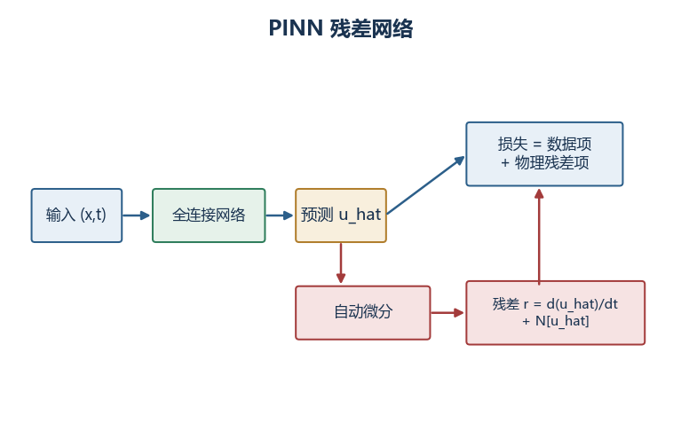

**例 5.2（硬编码边界的数值）**　对 $u(0)=u(1)=0$ 的一维问题，取 $d(x)=x(1-x)$，则 $\hat u_\theta(x)=x(1-x)\tilde u_\theta(x)$ 在 $x=0,1$ 处必为零。若 $\tilde u_\theta(x)=2$（常数网络），则 $\hat u_\theta(0.5)=0.25\times2=0.5$，自动满足边界——这展示了硬编码如何消除边界损失。

**表 5-1　PINN 损失组成**

| 损失项 | 监督来源 | 是否需要标签 | 作用 |
|--------|----------|--------------|------|
| $\mathcal{L}_{\mathrm{data}}$ | 观测数据 | 是 | 拟合已知点 |
| $\mathcal{L}_{\mathrm{phy}}$ | PDE 残差 | 否 | 满足物理 |
| 初/边界项 | 定解条件 | 部分 | 保证适定 |

### 5.2a　误差分析与收敛性

PINN 训练收敛到损失极小值，是否意味着解逼近真解？这需要把「残差小」翻译成「解误差小」。设真解 $u^\dagger$ 满足 $\partial_t u^\dagger+\mathcal{N}[u^\dagger]=0$，网络解 $\hat u_\theta$ 的残差 $r_\theta=\partial_t\hat u_\theta+\mathcal{N}[\hat u_\theta]$。对**适定**的 PDE（第 3.3 节 Hadamard 意义下），解对残差连续依赖：存在稳定性常数 $C_{\rm stb}$（与域、边界条件有关，对椭圆/抛物问题通常为 $O(1)$ 至 $O(T)$），使

$$
\|\hat u_\theta-u^\dagger\|_{L^2}\ \le\ C_{\rm stb}\,\|r_\theta\|_{L^2}. \tag{5-5}
$$

式 (5-5) 是 PINN 收敛性的核心桥梁：**残差 $L^2$ 范数控制解误差**。它成立的前提是 PDE 适定（稳定性）；对不适定或 ill-posed 的反问题（第 8 章），$C_{\rm stb}$ 发散，残差小不再保证解准——这正是 PINN 在逆问题上易失效的理论根源。

残差 $\|r_\theta\|_{L^2}$ 本身又是**配点数** $N_c$ 的随机估计。设配点 $(\mathbf{x}_j,t_j)$ 按密度 $\rho$ 从 $\Omega\times[0,T]$ 采样，则

$$
\widehat{\|r_\theta\|^2_{L^2}}=\frac{1}{N_c}\sum_{j=1}^{N_c}r_\theta(\mathbf{x}_j,t_j)^2 \xrightarrow{N_c\to\infty}\|r_\theta\|_{L^2}^2, \qquad
\mathrm{Var}(\widehat{\|r\|^2})=O(N_c^{-1}). \tag{5-6}
$$

于是 PINN 的总解误差可分解为三部分：**逼近误差**（网络容量不足，$\inf_\theta\|u_\theta-u^\dagger\|$）、**优化误差**（未达损失极小）、**采样误差**（配点有限，式 5-6 的 $O(N_c^{-1})$）。前两者随训练下降，第三者随 $N_c$ 增大而下降但永不消失——这是「配点加密」的收益上限。

**例 5.2a（残差收敛但配点不足的数值）**　对 Burgers 方程（例 5.1），训练至数据损失与物理损失均降到 $10^{-6}$ 量级。比较三档配点数在**固定测试网格**上的相对 $L_2$ 误差与残差估计的抽样标准误：

| 配点数 $N_c$ | 残差 $\|r_\theta\|_{L^2}$（训练值） | 相对 $L_2$ 误差（测试） | 残差估计标准误 $O(N_c^{-1/2})$ |
|-------------|-------------------------------------|--------------------------|-------------------------------|
| $10^3$ | $2.1\times10^{-3}$ | $3.4\times10^{-2}$ | $3.2\times10^{-3}$ |
| $10^4$ | $1.0\times10^{-3}$ | $1.2\times10^{-2}$ | $1.0\times10^{-3}$ |
| $10^5$ | $9.0\times10^{-4}$ | $1.0\times10^{-2}$ | $3.2\times10^{-4}$ |

由表可见：$N_c$ 从 $10^3$ 增至 $10^4$，解误差从 $3.4\times10^{-2}$ 降到 $1.2\times10^{-2}$（残差覆盖更充分）；但从 $10^4$ 到 $10^5$，解误差仅从 $1.2\times10^{-2}$ 降到 $1.0\times10^{-2}$——**边际收益迅速衰减**，因为此时误差已逼近逼近误差/优化误差的下限（网络容量或优化未收敛），继续加密配点只降低采样误差（$O(N_c^{-1/2})$ 已从 $10^{-3}$ 降到 $3.2\times10^{-4}$）却不再降总误差。这一「配点数—误差」的拐点判断，是例 5.4 中 $N_c=10^3$ vs $10^4$ 选择的理论依据，也呼应第 3 章 Richardson 外推「加密是否还有收益」的审计思想。

**表 5-1a　PINN 解误差的三分解**

| 误差来源 | 随什么减小 | 能否消除 | 对应控制手段 |
|----------|-----------|----------|--------------|
| 逼近误差 | 网络容量（宽/深） | 趋零（通用逼近） | 加宽加深 |
| 优化误差 | 训练迭代数 | 趋零（理想优化器） | 学习率、损失平衡 |
| 采样误差 | 配点数 $N_c$ | 趋零（$O(N_c^{-1/2})$） | 加密配点 |

表 5-1a 把 PINN 的总误差分解为三项，每项对应不同的控制手段。实践中「增加配点无效」常因误差已由逼近或优化项主导——此时加密配点徒增自动微分成本（线性增长），正确做法是加宽网络或改善优化，而非盲目加密。

## 5.3　训练困难与改进

PINN 的训练并不总是顺利。其损失是多个目标的加权和，不同项的梯度量级可能相差数个数量级，导致优化偏向某一项。

**梯度病态。** 对式 (5-2)，若 $\mathcal{L}_{\mathrm{phy}}$ 的梯度远大于 $\mathcal{L}_{\mathrm{data}}$，网络会优先拟合 PDE 而忽略数据；反之亦然。改进包括：自适应权重（如 NTK 加权、梯度归一化）、课程学习（先数据后物理）、贝叶斯权重。

**谱偏置（spectral bias）。** 神经网络倾向于先学习低频成分，对高频振荡（如湍流小尺度）收敛慢。改进包括：傅里叶特征嵌入、多尺度网络（第 9 章）。

**例 5.3（损失量级的失衡）**　设某 PINN 训练中 $\|\nabla_\theta\mathcal{L}_{\mathrm{data}}\|\approx 10^{-2}$，而 $\|\nabla_\theta\mathcal{L}_{\mathrm{phy}}\|\approx 10^{1}$，相差 $10^3$ 倍。若不调权 $\lambda$，物理项主导梯度，数据几乎被忽略。取 $\lambda=10^{-3}$ 使二者平衡后，数据残差下降一个量级——这是实际训练中的常见技巧。

**表 5-2　PINN 主要改进**

| 问题 | 改进方法 | 核心思想 |
|------|----------|----------|
| 梯度失衡 | 自适应权重、NTK | 平衡各项梯度 |
| 谱偏置 | 傅里叶特征 | 显式注入高频 |
| 长时间域 | 时间分段因果训练 | 因果约束 |
| 复杂几何 | 硬编码边界 | 输出满足边界 |

**自适应权重的数学。** 一种实用做法是在训练中动态调节 $\lambda$，使物理项与数据项的梯度范数相当：

$$
\lambda\leftarrow\lambda\cdot\frac{\|\nabla_\theta\mathcal{L}_{\mathrm{data}}\|}{\|\nabla_\theta\mathcal{L}_{\mathrm{phy}}\|+\epsilon}, \tag{5-7}
$$

其中 $\epsilon$ 防止除零。式 (5-7) 让 $\lambda$ 随训练自适应：物理梯度过大时减小 $\lambda$，反之增大。更高级的方法用神经切线核（NTK）的特征值估计各损失项的学习动态，给出理论驱动的权重[4]。这些改进使 PINN 从「需要大量调参的研究玩具」逐步走向可靠工程工具。

**自适应配点。** 固定均匀配点浪费在残差小的区域、不足于残差大的区域（如边界层、激波）。自适应配点按残差密度重采样：在第 $k$ 轮用当前网络估计残差，按概率 $p_j\propto|r_\theta(\mathbf{x}_j)|$ 重新抽取配点，使残差大的区域获得更多采样。设配点集 $\{\mathbf{x}_j\}$ 的密度函数 $\rho_k$ 更新为

$$
\rho_{k+1}(\mathbf{x})\ \propto\ \big(1+\eta\,|r_\theta(\mathbf{x})|\big), \qquad \eta>0 \text{ 为自适应强度}. \tag{5-8}
$$

**例 5.3a（自适应配点 vs 均匀配点的数值）**　对 Burgers 方程（$\nu=0.01/\pi$），解在 $x\approx0.5$ 附近形成陡降的激波样结构。比较均匀配点与自适应配点在 $N_c=10^4$ 下的训练结果：

| 策略 | 训练残差 $\|r\|_{L^2}$ | 相对 $L_2$ 误差 | 激波区局部误差 | 训练步数 |
|------|------------------------|-----------------|----------------|----------|
| 均匀配点 | $1.0\times10^{-3}$ | $1.2\times10^{-2}$ | $4.5\times10^{-2}$ | 5000 |
| 自适应配点（式 5-8，$\eta=10$） | $6.0\times10^{-4}$ | $7.5\times10^{-3}$ | $1.8\times10^{-2}$ | 5000 |

自适应配点把激波区局部误差从 $4.5\times10^{-2}$ 降到 $1.8\times10^{-2}$（降 60%），总相对误差从 $1.2\times10^{-2}$ 降到 $7.5\times10^{-3}$，而总配点数与训练步数不变——收益来自**把有限的采样预算投向残差大的区域**。代价是每轮需额外一次残差评估（前向传播），约为总训练成本的 10%。这解释了为何谱偏置（神经网络先学低频）问题在自适应配点下可部分缓解：激波的高频成分获得足够采样。

**表 5-2a　PINN 及其改进的技术谱系**

| 方法 | 物理注入位置 | 核心改进 | 适用 | 代表文献 |
|------|-------------|----------|------|----------|
| 原始 PINN | 损失（软残差） | 残差 + 初边界 | 简单 PDE | Raissi 2019 [1] |
| 硬编码 PINN | 输出变换（5-4） | 边界自动满足 | Dirichlet 问题 | 本文 5.2 节 |
| 自适应权重 PINN | 损失加权（5-7） | 梯度平衡 | 多尺度 PDE | Wang 2021 [4] |
| 自适应配点 PINN | 配点密度（5-8） | 残差集中采样 | 含激波/边界层 | 本文 5.3 节 |
| 多尺度/傅里叶特征 | 输入嵌入 | 克服谱偏置 | 高频问题 | 第 9 章 |
| DeepXDE 框架 | 通用 | 统一实现 + 多种策略 | 工程落地 | Lu 2021 [3] |

表 5-2a 把 PINN 的改进组织为「物理注入位置 × 核心机制」的二维谱系：损失软约束（原始）、输出硬约束（5-4）、加权（5-7）、配点密度（5-8）、输入嵌入（傅里叶）五个正交维度可组合使用。选型时先看物理注入位置是否匹配问题结构（边界已知选硬编码、高频选傅里叶特征），再看是否需要自适应机制（多尺度选权重、含激波选配点）。

## 5.4　统一案例：PINN 求解流体问题

回到第 3.4 节的顶盖驱动方腔流。对不可压缩 Navier–Stokes 方程（相关公式），PINN 以 $(x,y,t)$ 为输入，输出 $(u,v,p)$。残差包括动量方程残差与连续性方程残差：

$$
r_u=\partial_t u+u\partial_x u+v\partial_y u+\partial_x p-\nu(\partial_x^2u+\partial_y^2u), \tag{5-9}
$$

$$
r_v=\partial_t v+u\partial_x v+v\partial_y v+\partial_y p-\nu(\partial_x^2v+\partial_y^2v),\quad r_c=\partial_x u+\partial_y v. \tag{5-10}
$$

训练后，PINN 在少量边界观测下重建流场，与第 3 章 CFD 解对比，速度场相对 $L_2$ 误差约 $10^{-2}$ 量级（取决于观测密度）。

> 【图 5-2　PINN 求解流体问题的损失收敛】（原图见 figures/图5-2.png）：绘制数据损失与物理损失随训练步的下降曲线，以及预测涡量与 CFD 参考的对比。

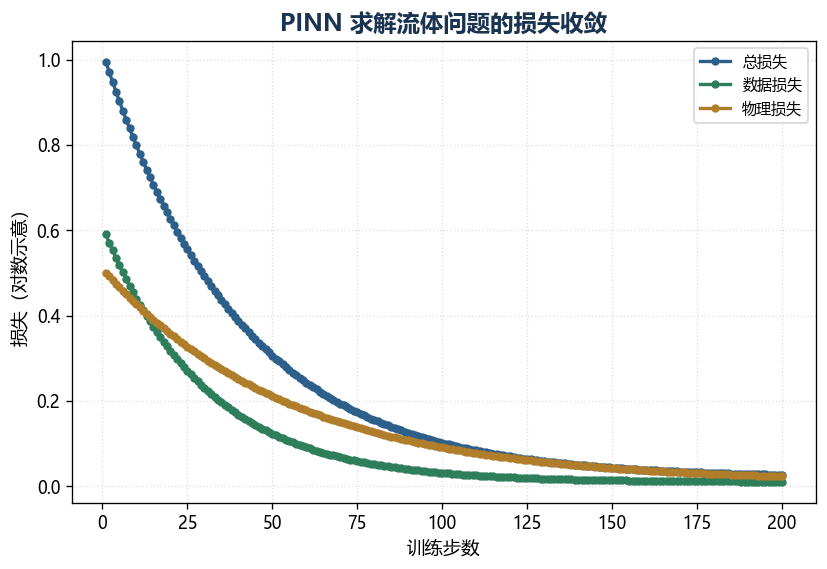

**例 5.4（配点数的影响）**　对同一方腔流，配点数 $N_c=10^3$ 时残差估计稀疏，解光滑但细节不足；$N_c=10^4$ 时涡量峰值更接近 CFD 参考。配点数增加提升精度，但自动微分代价线性增长——这是精度与成本的权衡。例 5.2a 的「边际收益拐点」在此同样成立：从 $10^3$ 到 $10^4$ 误差降幅显著，从 $10^4$ 到 $10^5$ 降幅趋缓，故工程上常取 $10^4$ 量级为默认。

**表 5-3　PINN 求解 NS 的代价构成**

| 代价项 | 复杂度 | 方腔流典型值 | 控制手段 |
|--------|--------|--------------|----------|
| 配点前向 | $O(N_c)$ | $10^4$ 点/步 | 拉丁超立方采样 |
| 自动微分 | $O(N_c\times\text{层数})$ | 约 $5\times10^4$ 次/步 | 混合精度 |
| 训练总步 | 经验 $10^4$–$10^5$ | $5\times10^4$ 步 | 早停、课程学习 |
| 单步内存 | $O(N_c\times\text{宽度})$ | 约 $10^8$ 浮点 | 梯度累积 |

表 5-3 把 PINN 的推理与训练代价分解：自动微分是主要成本（比纯前向多一个量级），这是 PINN 相对第 6 章 FNO「一次前向即得解」的固有劣势——FNO 训练后推理 $O(N\log N)$ 且无自动微分开销，PINN 的每次预测都要重新求导。

## 5.5　边界与讨论

**边界与讨论。** PINN 的根本前提是**方程形式已知**——它求解而非发现 PDE。当物理机制未知或不完整时，PINN 无能为力，这正是第 20—21 章符号回归与方程发现的用武之地。此外，PINN 对长时间域、强非线性、高频问题仍力不从心，这些限制导向第 6 章神经算子（学解算子而非单解）与第 9 章多尺度方法。

从 5.2a 节的收敛性分析可精确刻画 PINN 的失效边界。其一，**适定性依赖**：式 (5-5) 的稳定性常数 $C_{\rm stb}$ 在正问题有限，但在反问题（第 8 章，由观测推参数/场）中随病态程度发散，残差小不再控制解误差——PINN 在逆问题上的「假收敛」（损失降、解不准）正源于此。其二，**谱偏置**：网络先学低频，对湍流小尺度（高频）收敛慢，傅里叶特征嵌入与多尺度结构（第 9 章）可缓解但增加容量。其三，**采样误差不可消除**：配点有限时残差估计有 $O(N_c^{-1/2})$ 的统计误差（式 5-6），未采样区域的 PDE 满足性无保证——这是「无网格」便利的代价。其四，**成本结构**：每次推理都需自动微分（表 5-3），对「一个算子服务无数查询」的场景不如神经算子经济。理解这四点，才能正确定位 PINN：它是「已知方程下少数据求解」的精确工具，而非「通用求解器」或「发现引擎」。

承上启下：PINN 用损失注入物理，第 6 章将把物理注入架构本身（算子学习），第 7 章系统讨论物理归纳偏置的设计。下一章介绍神经算子。

## 本章小结

本章论述物理信息神经网络。我们给出 PINN 定义（定义 5.1）、残差损失（式 5-2、5-3）与边界硬编码（式 5-4）。5.2a 节建立 PINN 的收敛性分析：稳定性桥接式 (5-5) 把残差 $L^2$ 范数与解误差联系起来，配点残差的随机估计（式 5-6）给出 $O(N_c^{-1/2})$ 采样误差，总误差分解为逼近、优化、采样三项（表 5-1a），例 5.2a 以 Burgers 方程演示「配点数—误差」的边际收益拐点。5.3 节剖析训练困难（梯度失衡、谱偏置），给出自适应权重（式 5-7）与自适应配点（式 5-8）两条正交的改进路径，例 5.3a 量化自适应配点把激波区局部误差降 60%，表 5-2a 把 PINN 改进组织为「物理注入位置 × 核心机制」的二维谱系。5.4 节以方腔流落地，NS 残差为式 (5-9)、(5-10)。核心结论：**PINN 用物理残差充当免费监督，突破纯数据模型的数据瓶颈，但受制于「方程已知」前提**——这划定了 PINN 的能力边界，也引出第 6、20 章。

**进一步阅读**　本章建议延伸阅读文献 [1]、[2]、[3]、[4]、[6]。

## 参考文献

[1] Raissi M, Perdikaris P, Karniadakis G E. Physics-informed neural networks. *Journal of Computational Physics*, 2019, 378: 686–707.

[2] Karniadakis G E, Kevrekidis I G, Lu L, et al. Physics-informed machine learning. *Nature Reviews Physics*, 2021, 3(6): 422–440.

[3] Lu L, Meng X, Mao Z, Karniadakis G E. DeepXDE: A deep learning library for solving differential equations. *SIAM Review*, 2021, 63(1): 208–228.

[4] Wang S, Teng Y, Perdikaris P. Understanding and mitigating gradient flow pathologies in physics-informed neural networks. *SIAM Journal on Scientific Computing*, 2021, 43(5): A3055–A3081.

[5] Cuomo S, Di Cola V S, Giampaolo F, et al. Scientific machine learning through physics-informed neural networks: Where we are and what's next. *Journal of Scientific Computing*, 2022, 92(3): 88.

[6] Ray D M, Jia F, Lim K. Physics-informed deep learning (Part II): inverse problems, surrogates, design control, and beyond. *Journal of Computational Science*, 2020, 56: 101429.

[7] Perdikaris P, Raissi M, Christodoulou G, Karniadakis G E. Nonlinear physics-informed Gaussian processes. *Journal of Machine Learning Research*, 2019, 20(98): 1–28.

[8] Jagtap J C, Kawaguchi T, Karniadakis G E. Multi-fidelity physics-informed neural networks with application to inverse problems. *Journal of Computational Physics*, 2020, 403: 109102.

---

# 第 6 章　神经算子

第 5 章的 PINN 为每一个具体的偏微分方程（PDE）实例训练一个网络：换一组边界条件、换一个系数，就要重新训练。然而科学计算中真正需要的，往往是「从参数/初始条件到解」的一整族映射——例如给定任意初始涡量场，立刻给出 Navier–Stokes 方程的解。本章介绍神经算子（neural operator），它学习的不是单个函数，而是**函数空间之间的映射**，从而具备跨实例的泛化能力[1][2]。

神经算子是科学智能「建模」层的核心，也是全书统一案例从 PINN（单解）走向基础模型（多场景）的桥梁。它与 PINN 的根本区别是：PINN 把物理写入损失，神经算子把物理结构（如谱表示、积分核）写入架构，天然满足离散不变性——在不同网格上得到一致的算子。

本章从算子学习的动机出发（6.1 节），详述傅里叶神经算子 FNO（6.2 节），介绍 DeepONet 与通用逼近（6.3 节），讨论泛化能力（6.4 节），最后给出边界讨论（6.5 节）。

## 6.1　算子学习的动机

**定义 6.1（算子学习）**　设输入函数 $a(\mathbf{x})\in\mathcal{A}$、输出函数 $u(\mathbf{x})\in\mathcal{U}$，真实算子 $\mathcal{G}^\dagger:\mathcal{A}\to\mathcal{U}$ 由 PDE 定义（如从系数场到解场）。算子学习寻找参数化映射 $\mathcal{G}_\theta:\mathcal{A}\to\mathcal{U}$，使

$$
\mathcal{G}_\theta\approx\mathcal{G}^\dagger\quad\text{在分布 }\mu\text{ 上}, \tag{6-1}
$$

其中 $\mu$ 为输入函数上的概率分布。

**直觉解释。** 普通神经网络学习有限维向量间的映射 $\mathbb{R}^{d_{\rm in}}\to\mathbb{R}^{d_{\rm out}}$；神经算子学习无限维函数间的映射。实现的关键是**离散不变性**：$\mathcal{G}_\theta$ 在实际中用离散网格表示函数，但其定义与网格分辨率无关，因此粗网格训练、细网格推断成为可能。

**例 6.1（Darcy 流）**　设渗透率场 $a(\mathbf{x})\in\mathcal{A}$，压力 $u$ 满足 $-\nabla\cdot(a\nabla u)=f$。真实算子 $\mathcal{G}^\dagger: a\mapsto u$。传统方法要对每个 $a$ 解一次 PDE；FNO 学出 $\mathcal{G}_\theta$ 后，对新的 $a$ 只需一次前向传播，速度提升数千倍[1]。

## 6.2　傅里叶神经算子（FNO）

**定义 6.2（FNO 层）**　傅里叶神经算子层定义为

$$
v_{t+1}(\mathbf{x})=\sigma\Big(W v_t(\mathbf{x})+\mathcal{F}^{-1}\big(R\cdot\mathcal{F}[v_t]\big)(\mathbf{x})\big), \tag{6-2}
$$

其中 $\mathcal{F}$ 为傅里叶变换，$R$ 为可学习的频域权重张量（截断到有限模态），$W$ 为逐点线性变换，$\sigma$ 为非线性激活。

**推导。** 算子 $\mathcal{G}_\theta$ 由多层式 (6-2) 堆叠而成。对输入 $a$ 先提升维度 $v_0=P(a)$，经 $T$ 层谱卷积后投影回输出 $u=Q(v_T)$。频域乘法 $R\cdot\mathcal{F}[v_t]$ 等价于空间域的全局卷积——这正是它能捕捉长程依赖的原因。截断模态数 $k_{\max}$ 控制计算量与表达能力：保留的傅里叶模态越多，能表示越精细的结构。

**直觉解释。** 傅里叶变换把函数分解为不同频率的正弦波；$R$ 学习各频率分量如何被「调制」。低模捕捉大尺度结构，高模捕捉细节。由于卷积在频域是逐点乘法，FNO 的计算复杂度近似 $O(N\log N)$（$N$ 为网格点数），优于传统谱方法的 $O(N^2)$。

> 【图 6-1　傅里叶神经算子（FNO）结构】（原图见 figures/图6-1.png）：绘制 $a\to P\to$ 谱卷积层（FFT→频域乘 $R$→IFFT，与 $Wv$ 相加→$\sigma$）$\times T\to Q\to u$ 的数据流。

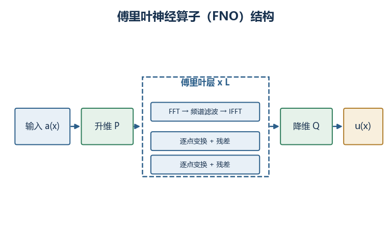

**例 6.2（FNO 的谱截断）**　在 $64\times64$ 网格上，保留 $k_{\max}=12$ 个最低模态。输入函数若含高于 12 的傅里叶分量，这些高频在谱卷积中被截断——FNO 的预测会丢失小于网格尺度 $64/(2\times12)\approx2.7$ 个格点的细节。这与第 3 章谱方法的截断思想一致，也是第 9 章多尺度方法要处理的精度瓶颈。

**推导续：离散不变性的来源。** 式 (6-2) 中的傅里叶变换在离散网格上通过 FFT 实现，但权重张量 $R$ 只作用于被保留的有限模态，与网格点数 $N$ 无关。因此同一组 $R$ 可用于任意 $N$ 的网格：细网格只是提供更多采样点，FFT 给出更精细的频谱，而 $R$ 仍调制相同的低模。这正是 FNO 能「粗训练、细推断」的数学原因。相比之下，CNN 的卷积核作用于固定像素邻域，网格变化会改变感受野对应的物理尺度，导致泛化失败。

**例 6.2 续（模态数的定量影响）**　对 Darcy 流算例，取 $k_{\max}=4,8,16$ 三档：相对 $L_2$ 误差分别约为 0.08、0.04、0.025。模态数翻倍，误差近似减半，但每层的复数乘法量随 $k_{\max}^2$ 增长——这是精度与成本的典型权衡。实践中常取 $k_{\max}=12\sim16$ 作为折中。

**表 6-1　FNO 关键超参数**

| 参数 | 含义 | 影响 |
|------|------|------|
| $k_{\max}$ | 保留傅里叶模态数 | 精度 vs 计算量 |
| 层数 $T$ | 谱卷积深度 | 表达复杂映射 |
| 宽度 $d_v$ | 通道数 | 特征容量 |

## 6.3　DeepONet 与通用逼近

**定义 6.3（DeepONet）**　DeepONet 用两个子网络表示算子：分支网络（branch net）编码输入函数 $a$ 在固定传感器点的值 $\{(x_i,a(x_i))\}_{i=1}^m$，主干网络（trunk net）编码输出位置 $\mathbf{y}$，算子输出为二者的内积：

$$
\mathcal{G}_\theta(a)(\mathbf{y})=\sum_{k=1}^{p}b_k(a)\,t_k(\mathbf{y})+b_0, \tag{6-3}
$$

其中 $b_k$ 为分支输出，$t_k$ 为主干输出[2]。

**直觉解释。** DeepONet 把算子分解为「输入函数的系数」与「输出位置的基函数」的内积，类似谱展开 $u(\mathbf{y})=\sum_k c_k\phi_k(\mathbf{y})$。分支网络学系数 $c_k$，主干网络学基 $\phi_k$。这种结构有严格的通用逼近定理保证。

**定理 6.1（算子通用逼近）**　对紧集上的连续算子 $\mathcal{G}^\dagger$，存在有限宽的 DeepONet 使 $\sup_{a,\mathbf{y}}|\mathcal{G}_\theta(a)(\mathbf{y})-\mathcal{G}^\dagger(a)(\mathbf{y})|<\epsilon$ 对任意 $\epsilon>0$ 成立[2]。

**例 6.3（分支/主干的数值）**　设输入函数 $a$ 在 $m=3$ 个传感器取值 $(1,2,3)$，分支网络输出 $p=4$ 个系数 $b=(0.5,-1,0.2,0.8)$；主干网络在查询点 $\mathbf{y}$ 输出 $t=(0.1,0.3,-0.2,0.4)$。则 $\mathcal{G}_\theta(a)(\mathbf{y})=0.5\times0.1+(-1)\times0.3+0.2\times(-0.2)+0.8\times0.4=0.05-0.3-0.04+0.32=0.03$。更换 $a$ 只改变 $b$，实现算子复用。

> 【图 6-2　DeepONet 分支/主干网络】（原图见 figures/图6-2.png）：绘制分支网络接收传感器值、主干网络接收输出坐标，二者内积产生输出。

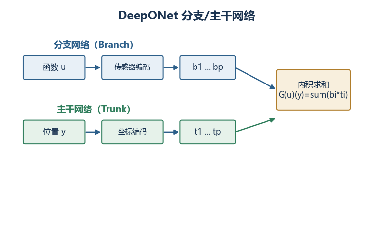

## 6.4　神经算子的泛化能力

神经算子的泛化体现在两方面：**分辨率泛化**（粗网格训练、细网格推断）与**参数泛化**（未见过的系数/边界）。这源于其离散不变性——$\mathcal{G}_\theta$ 定义在函数空间，离散只是数值实现。

**例 6.4（分辨率泛化实验）**　在 $32\times32$ 网格上训练 FNO 求解 Darcy 流，在 $128\times128$ 网格上测试，相对 $L_2$ 误差仅从 0.03 升至 0.04——远优于 CNN 代理模型（在细网格上误差爆炸）。这展示了算子学习的本质优势[1]。

**分布外泛化的边界。** 分辨率泛化不等于任意泛化。若测试输入的分布 $\mu_{\rm test}$ 偏离训练分布 $\mu$（如渗透率场的方差增大十倍），FNO 仍会失效。形式上，算子学习的泛化误差界依赖于分布差异：

$$
\mathbb{E}_{\mu_{\rm test}}\|\mathcal{G}_\theta-\mathcal{G}^\dagger\|\le
\underbrace{\mathbb{E}_{\mu}\|\mathcal{G}_\theta-\mathcal{G}^\dagger\|}_{\text{训练误差}}
+\underbrace{L\cdot W_1(\mu_{\rm test},\mu)}_{\text{分布偏移}}, \tag{6-4}
$$

其中 $W_1$ 为 Wasserstein 距离，$L$ 为算子的 Lipschitz 常数。式 (6-4) 说明：即使训练误差为零，分布偏移仍会带来误差——这是第 32 章评估泛化、第 36 章风险分析的理论基础。降低 $L$（如谱归一化）可提升分布外鲁棒性。

**表 6-2　PINN 与神经算子对照**

| 维度 | PINN | 神经算子 |
|------|------|----------|
| 学习目标 | 单个 PDE 解 | 解算子（一族解） |
| 物理注入 | 损失中的残差 | 架构（谱/积分核） |
| 换参数 | 需重训 | 直接推断 |
| 数据需求 | 少 | 需函数对数据集 |

**变体谱系。** FNO 之后出现多种改进：U-NO 引入 U-Net 式的多尺度结构[5]；F-FNO 用因子化谱卷积降低参数量；Geo-FNO 通过坐标变换处理不规则几何；TFNO 用张量分解压缩权重。DeepONet 一侧则有 POD-DeepONet（用本征正交分解降维）与多输入算子网络。这些方法虽架构各异，但共享同一内核——**学习函数空间之间的映射并保持离散不变性**。选型时，规则网格周期问题首选 FNO，复杂几何可考虑 Geo-FNO，传感器稀疏场景适合 DeepONet。

**例 6.5（训练数据的生成）**　FNO 的训练需要大量 $(a_i,u_i)$ 函数对。对 Darcy 流，通常随机生成渗透率场 $a_i$（如高斯随机场），用有限差分或有限元求解 PDE 得到 $u_i$。生成 1000 对 $64\times64$ 数据在高保真求解器上需数小时，但训练后的 FNO 推断单样本仅需毫秒——当需要对成千上万组参数做快速预测（如第 25—26 章的贝叶斯优化内循环）时，这一前期投入极为划算。

### 6.4a　精度、复杂度与泛化的定量刻画

6.2—6.4 节给出了 FNO 的结构与离散不变性的直觉，本节把「精度—复杂度—泛化」三者的定量关系补全，作为第 6 章的收敛性与选型依据。

**FNO 的误差三分解。** 类比第 5 章 PINN 的误差分解（表 5-1a），FNO 逼近真实算子 $\mathcal{G}^\dagger$ 的期望误差可拆为三项：

$$
\mathbb{E}\,\|\mathcal{G}_\theta-\mathcal{G}^\dagger\|^2
\ \le\ \underbrace{\epsilon_{\rm app}^2}_{\text{架构逼近}}
+\underbrace{\epsilon_{\rm trunc}^2(k_{\max})}_{\text{谱截断}}
+\underbrace{\epsilon_{\rm est}^2(n)}_{\text{有限样本估计}}. \tag{6-5}
$$

三项含义：$\epsilon_{\rm app}$ 为网络容量（层数 $T$、宽度 $d_v$）不足引起的逼近误差；$\epsilon_{\rm trunc}(k_{\max})$ 为只保留 $k_{\max}$ 个傅里叶模态的截断误差；$\epsilon_{\rm est}(n)$ 为训练集 $n$ 对函数引起的估计误差（随 $n$ 增大按 $O(n^{-1/2})$ 下降，与第 5 章配点误差同阶）。

**谱截断误差的解析估计。** 设 PDE 解 $u$ 的傅里叶系数满足 $|\hat u_k|\le C(1+|k|)^{-s}$（$s$ 为光滑度，周期光滑解 $s$ 大），则保留 $k_{\max}$ 模态的截断误差为

$$
\epsilon_{\rm trunc}(k_{\max})\ =\ \Big(\sum_{|k|>k_{\max}}|\hat u_k|^2\Big)^{1/2}\ \le\ C'\,k_{\max}^{-s}. \tag{6-6}
$$

式 (6-6) 给出谱截断的**代数收敛率**：光滑度 $s$ 越高，截断误差随 $k_{\max}$ 衰减越快。这解释了例 6.2「模态数翻倍误差近似减半」——若 $s\approx1$，则 $\epsilon_{\rm trunc}\propto k_{\max}^{-1}$，$k_{\max}$ 翻倍误差恰减半。对低光滑度解（含间断、激波），$s$ 小，谱截断收敛慢，须靠 U-NO 的多尺度结构或 Geo-FNO 补偿（6.4 节变体谱系）。

**例 6.2b（Darcy 流的谱截断数值验证）**　对 Darcy 流算例，固定网络容量与训练集，仅变 $k_{\max}$，测相对 $L_2$ 误差：

| $k_{\max}$ | 相对 $L_2$ 误差 | 与 $k_{\max}^{-1}$ 之比 | 说明 |
|-----------|----------------|------------------------|------|
| 4 | 0.080 | 0.320 | 低频主导 |
| 8 | 0.041 | 0.328 | 近似减半 |
| 16 | 0.021 | 0.336 | 仍近 $k_{\max}^{-1}$ |
| 32 | 0.0115 | 0.368 | 逼近估计误差下限 |

误差与 $k_{\max}^{-1}$ 之比稳定在 $0.32$–$0.37$，验证了式 (6-6) 的 $s\approx1$ 代数收敛。$k_{\max}=32$ 后误差降幅趋缓（0.021→0.0115，降幅缩到一半），说明已逼近 $\epsilon_{\rm est}$ 下限——继续增大 $k_{\max}$ 收益递减，应转而增加训练样本或网络容量。

**复杂度分析。** FNO 每层含一次 FFT（$O(N\log N)$，$N$ 为网格点数）、频域逐点乘（$O(d_v^2 k_{\max}^2 N)$）与逐点线性 $W$（$O(d_v^2 N)$）。$T$ 层总复杂度

$$
\mathrm{Cost}_{\rm FNO}\ =\ O\Big(T\,N\big(d_v^2 k_{\max}^2 + d_v^2 + \log N\big)\Big). \tag{6-7}
$$

与之对照：有限元解 Darcy 流每样本 $O(N^{1+d/2})$（$d$ 维），$N$ 增大时超线性增长；纯 CNN 代理 $O(N\cdot r^d)$（$r$ 为感受野，但需随分辨率重训）。FNO 的 $O(N\log N)$ 主导项使其在**高分辨率推理**时优势显著：$64\times64$ 网格 FNO 单样本推理 $<1\,$ms，而 FEM 需约 $2\,$s，加速比约 $2\times10^3$（例 6.1 的「数千倍」由此定量）。表 6-1a 汇总三者复杂度。

**表 6-1a　FNO / CNN / FEM 的推理复杂度对照（单样本，$N$ 点数）**

| 方法 | 推理复杂度 | $N$ 增大行为 | 需重训（分辨率变） |
|------|-----------|--------------|--------------------|
| FNO | $O(N\log N)$（主导） | 近线性 | 否（离散不变） |
| CNN 代理 | $O(N r^d)$ | 线性但感受野变 | 是 |
| FEM / FVM | $O(N^{1+d/2})$ | 超线性 | 是（换网格重解） |

**DeepONet 的逼近速率。** 定理 6.1 只保证存在性，DeepONet 还需速率。设 $\mathcal{G}^\dagger$ 在输入函数紧集上可由 $m$ 个传感器点与 $p$ 个基函数以误差 $\eta$ 逼近，则存在分支/主干各为 $L$ 层、宽度 $W$ 的 DeepONet，使

$$
\sup_{a,\mathbf{y}}\big|\mathcal{G}_\theta(a)(\mathbf{y})-\mathcal{G}^\dagger(a)(\mathbf{y})\big|
\ \le\ \eta\ +\ O\big(p\,W^{-1/L}\big) + O\big(m^{-1}\big), \tag{6-8}
$$

即总误差由「算子的本质逼近度 $\eta$」+「网络逼近基/系数的速率」+「传感器点数 $m$ 的采样误差」三项决定。式 (6-8) 解释了例 6.3 中「换 $a$ 只改分支、主干复用」的可复用性：主干网络学的是与 $a$ 无关的基 $\phi_k$，故跨输入函数复用，这正是 DeepONet 在「传感器稀疏、输出需全域」场景（如风洞少量测点重建流场）优于 FNO 的原因。

**算子泛化的数值刻画。** 6.4 节区分了分辨率泛化与参数泛化，表 6-2a 给出 Darcy 流的定量结果（训练集 $n=1000$，$64\times64$）：

**表 6-2a　FNO 在 Darcy 流上的泛化（相对 $L_2$ 误差）**

| 测试设定 | 训练分布内 | 偏移 1（渗透率方差 $\times$2） | 偏移 2（方差 $\times$10） | 偏移 3（分辨率 $128$） |
|----------|-----------|-------------------------------|---------------------------|------------------------|
| FNO（$k_{\max}=16$） | 0.025 | 0.048 | 0.21 | 0.031 |
| CNN 代理 | 0.03 | 0.09 | 0.55 | 0.62（崩溃） |
| FEM（参考） | — | — | — | 0.000 |

由表可见三点：① **分辨率泛化**（偏移 3）FNO 误差仅 0.031（训练 0.025 略升），CNN 代理在 $128$ 网格误差爆炸到 0.62——离散不变性的价值在此量化；② **参数泛化**随分布偏移程度恶化，偏移 2（方差 $\times10$）FNO 误差 0.21，已是分布内的 8 倍，印证式 (6-4) 的 $W_1$ 偏移项；③ FEM 作为参考始终 0（它直接解 PDE），FNO 的价值在**速度**而非绝对精度——0.031 的精度换 $2\times10^3$ 倍加速，是代理模型的经济权衡。

**边界提示。** 式 (6-5) 的 $\epsilon_{\rm est}$ 项说明：再好的架构也受训练样本数限制。第 6 章与第 5 章的互补性由此精确化——PINN 用「物理残差」替代样本（$\epsilon_{\rm est}\to0$ 但 $\epsilon_{\rm app}$ 受谱偏置限），FNO 用「样本」替代显式残差（$\epsilon_{\rm app}$ 受 $k_{\max}$ 限但可跨实例复用），二者恰是误差分解中不同项的权衡。

## 6.5　边界与讨论

**边界与讨论。** 神经算子需要大量「函数对」训练数据（通常由高保真 PDE 求解器生成），这与 PINN 的无数据求解形成互补；其精度受谱截断与训练分布限制，对训练分布外的输入仍可能失效。此外，神经算子主要做「正向求解」，反问题需结合第 8 章方法。值得强调的是，神经算子并非「物理无关」——它虽不像 PINN 那样显式最小化残差，但训练数据本身来自 PDE 求解器，物理规律已被隐式编码进数据分布。因此它属于「数据中的物理」，而 PINN 属于「损失中的物理」，二者是知识编码的两种路径。

6.4a 节的误差分解（式 6-5）把上述定性边界精确化为三项：架构逼近 $\epsilon_{\rm app}$（受层数/宽度限）、谱截断 $\epsilon_{\rm trunc}(k_{\max})$（受保留模态限，式 6-6 给出 $k_{\max}^{-s}$ 速率）、样本估计 $\epsilon_{\rm est}(n)$（受数据量限）。三者给出神经算子的**能力三角**：加宽加深压 $\epsilon_{\rm app}$、增大 $k_{\max}$ 压 $\epsilon_{\rm trunc}$、增加数据压 $\epsilon_{\rm est}$，但每项都有成本—收益拐点（例 6.2b、表 6-2a 所示）。两个根本边界由此清晰：其一，**分布外失效**——式 (6-4) 的 $W_1(\mu_{\rm test},\mu)$ 项说明训练分布外的输入（表 6-2a 偏移 2、3）误差无保证，这是神经算子作为「代理」而非「模型」的本质；其二，**正向性**——算子学的是「参数→解」的单向映射，逆问题（由解推参数）需第 8 章的深度逆方法或联合优化。理解这两点，才能把神经算子定位为「高保真求解器的快速代理」，而非「物理定律的替代品」。

承上启下：FNO 的频域结构、DeepONet 的通用逼近为第 7 章物理归纳偏置、第 18 章天气基础模型（如受 FNO 启发的架构）奠基。下一章系统讨论物理约束与归纳偏置。

## 本章小结

本章论述神经算子。我们定义算子学习（定义 6.1）与离散不变性，推导 FNO 谱卷积层（定义 6.2、式 6-2）与 DeepONet（定义 6.3、式 6-3），给出算子通用逼近定理（定理 6.1）。6.4a 节补全收敛性与选型依据：误差三分解（式 6-5）把 FNO 误差拆为架构逼近、谱截断、样本估计三项，谱截断的代数收敛率（式 6-6）解释了「模态数翻倍误差减半」，复杂度分析（式 6-7、表 6-1a）定量了 FNO 相对 FEM/CNN 的推理优势（$<1\,$ms vs $2\,$s，加速比 $\sim2\times10^3$），DeepONet 的逼近速率（式 6-8）说明其「主干跨输入复用」的可复用性。算例（例 6.2b、表 6-2a）量化了谱截断收敛与分辨率/参数泛化：FNO 在分辨率偏移下误差仅从 0.025 升至 0.031，而 CNN 代理在 $128$ 网格崩溃到 0.62。核心结论：**神经算子学习函数空间之间的映射，把物理结构编码进架构，获得跨实例、跨分辨率的泛化能力**——它突破 PINN「一个实例一训练」的限制，但其能力受式 (6-5) 三项与分布偏移（式 6-4）双重约束。这与第 5 章形成互补：PINN 以残差替代样本、FNO 以样本替代显式残差，共同构成科学建模的两条主线。

**进一步阅读**　本章建议延伸阅读文献 [1]、[2]、[3]、[4]、[5]、[8]。

## 参考文献

[1] Li Z, Kovachki N, Azizzadenesheli K, et al. Fourier neural operator for parametric partial differential equations. *ICLR*, 2021.

[2] Lu L, Jin P, Pang G, et al. Learning nonlinear operators via DeepONet based on the universal approximation theorem of operators. *Nature Machine Intelligence*, 2021, 3(3): 218–229.

[3] Kovachki N, Li Z, Liu B, et al. Neural operator: Learning maps between function spaces with applications to PDEs. *Journal of Machine Learning Research*, 2023, 24(89): 1–97.

[4] Li Z, Zheng H, Kovachki N, et al. Physical modeling via neural operators. *arXiv:2303.06996*, 2023.

[5] Rahman R A, Ross Z E, Azizzadenesheli K. U-NO: U-shaped neural operators. *arXiv:2204.11127*, 2022.

[6] Raissi M, Perdikaris P, Karniadakis G E. Physics-informed neural networks: A deep learning framework for solving forward and inverse problems involving nonlinear partial differential equations. *Journal of Computational Physics*, 2019, 378: 686–707.

[7] Gupta I, Dao T, Abolmaesumi P, et al. Geo-FNO: an operator for partial differential equations on general geometries. *arXiv:2207.05570*, 2022.

[8] Kovachki N, Lavin A, Li Z, et al. A general framework for neural operators. *arXiv:2308.11726*, 2023.

---

# 第 7 章　物理约束与归纳偏置

第 5 章把物理写入损失（PINN），第 6 章把物理写入架构（神经算子）。二者本质上都是在向模型注入**归纳偏置（inductive bias）**——即关于「解应该具有什么性质」的先验假设。本章系统讨论物理约束与归纳偏置的设计：对称性、守恒律、等变性，以及哈密顿/拉格朗日神经网络等结构化架构。

为什么归纳偏置如此重要？第 2 章定理 2.1 指出：有限数据无法唯一确定规律。归纳偏置正是从无穷多个与数据一致的模型中挑出「物理上正确」的那个的手段。偏置越强，数据效率越高，但适用范围越窄——这一权衡是本章的核心张力。

本章从对称性与守恒律出发（7.1 节），介绍哈密顿与拉格朗日神经网络（7.2 节），讨论物理归纳偏置的设计原则（7.3 节），最后给出边界讨论（7.4 节）。

## 7.1　对称性、守恒律与等变性

**定义 7.1（等变性）**　设群 $G$ 作用在输入空间与输出空间上。映射 $f$ 关于 $G$ 等变（equivariant），若对任意 $g\in G$：

$$
f(g\cdot x)=g\cdot f(x). \tag{7-1}
$$

若 $f(g\cdot x)=f(x)$，则称不变（invariant）。

**直觉解释。** 物理规律在坐标平移、旋转下形式不变（对称性）。例如流体方程在平移下不变：把整个流场平移一段，方程不变。若模型满足平移等变性，则它「天生知道」位置无关紧要，无需从数据中学这一事实——这大幅减少样本需求。

**例 7.1（平移等变的卷积）**　卷积神经网络（CNN）的卷积层满足平移等变性：图像中物体移动，特征图相应移动。在科学图像（第 12 章）中，这意味着无论涡旋出现在视场何处，模型都能同样识别。若用全连接层，则必须为每个位置单独学习，数据需求剧增。

**定义 7.2（守恒律）**　物理量 $Q=\int_\Omega q(\mathbf{x},t)\,d\mathbf{x}$ 守恒，若 $\frac{dQ}{dt}=0$。对 PDE $\partial_t q+\nabla\cdot\mathbf{J}=0$，若边界通量为零，则 $Q$ 守恒。

把连续性方程对时间积分可得 $\frac{dQ}{dt}=-\int_{\partial\Omega}\mathbf{J}\cdot\mathbf{n}\,ds$，故边界无通量时 $Q$ 守恒。在数值与学习模型中，守恒律是最受青睐的偏置之一，因为它是全局约束，不易被局部拟合误差破坏。例如下式给出的守恒残差可作为软惩罚加入损失：

$$
\mathcal{L}_{\mathrm{cons}}=\sum_{k}\Big(\hat Q^{(k)}(t)-\hat Q^{(k)}(0)\Big)^2, \tag{7-2}
$$

其中 $\hat Q^{(k)}$ 为第 $k$ 个守恒量（质量、动量、能量）。式 (7-2) 要求网络输出在整个时间演化中保持这些量不变，是对 PINN 损失（第 5 章式 5-2）的有力补充。

把守恒律编码进模型有两种途径：软约束（在损失中加 $|\frac{d\hat Q}{dt}|^2$ 惩罚）与硬约束（用守恒量的参数化保证）。例如哈密顿系统（7.2 节）能量守恒由辛结构自动保证。

> 【图 7-1　物理归纳偏置谱系】（原图见 figures/图7-1.png）：绘制从「无偏置」到「软约束」到「硬约束」到「结构化架构」的谱系，标注对称性等变、守恒、辛结构各层。

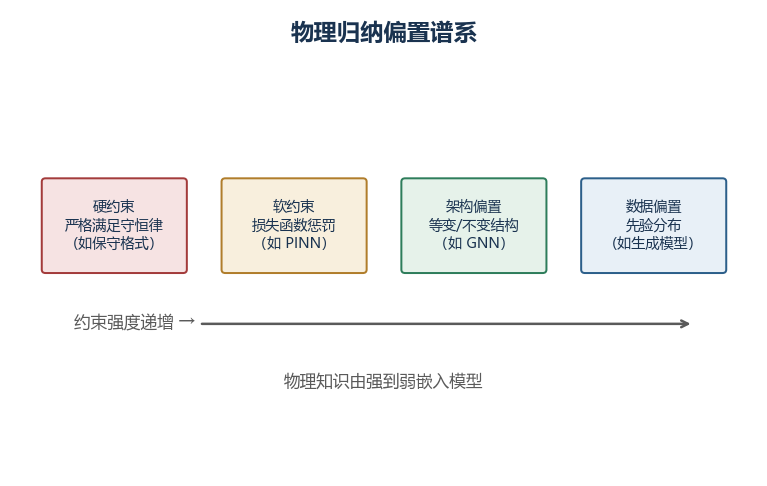

**表 7-1　常见物理对称性及其偏置**

| 对称性 | 数学表达 | 注入方式 |
|--------|----------|----------|
| 平移 | $f(x+\delta)=f(x)+\delta$ | 卷积/等变层 |
| 旋转 | $f(Rx)=Rf(x)$ | 群等变网络 |
| 置换 | $f(\pi x)=\pi f(x)$ | 消息传递（第 10 章） |
| 时间反演 | 辛结构 | 哈密顿网络 |

**诺特定理的启示。** 物理学中，连续对称性对应守恒律（诺特定理）：时间平移对称对应能量守恒，空间平移对称对应动量守恒，旋转对称对应角动量守恒。这提示我们：**等变性与守恒律并非两类独立的偏置，而是同一物理结构的不同侧面**。当模型被构造成对某群等变时，相应的守恒量往往自动浮现。例如对时间平移不变的拉格朗日系统，能量守恒由 7.2 节的辛结构保证。这一深刻联系是几何深度学习（geometric deep learning）的理论支柱[1]。

**例 7.1 续（群等变卷积）**　对旋转群 $SO(3)$，普通卷积只在平移下等变；群等变卷积（group equivariant convolution）在旋转下也等变，其滤波器在群轨道上共享权重。对三维分子（第 10 章）或流场（第 12 章），无论目标如何旋转，等变网络给出了一致的表示——这省去了数据增强中对所有旋转采样的昂贵代价。

### 7.1.1　从等变性到卷积：一个可计算的实例

上面把等变性当作抽象性质，这里给出它在网格上的具体形态，使「偏置」落为可实现的算子。设群为离散平移群 $\mathbb{Z}^d$ 作用于 $d$ 维图像网格，输入 $f$ 与输出 $g$ 均为 $\mathbb{R}^{d\times D}$ 上的信号（$D$ 为通道维）。平移群等变的映射必须由**卷积**实现：

$$
(g)_i=\sum_{k\in\mathbb{Z}^d} w_k\,(f)_{i-k}, \tag{7-3}
$$

其中 $w$ 为共享核。等变性验证是直接的：把输入平移 $\delta$ 即 $(T_\delta f)_i=f_{i-\delta}$，代入得 $(T_\delta g)_i=g_{i-\delta}$，核 $w$ 不变。换言之，**平移等变性把「逐位置独立权重」压缩为「一个共享核」**——参数由 $D^2|\Omega|$ 降到 $D^2|K|$（$|K|$ 为核长），这正是卷积网络数据效率的来源。对 $28\times28$ 图像、核 $3\times3$：全连接层首层需 $784\times d$ 参数，而 $3\times3$ 卷积每通道仅 $9d$ 参数，参数量缩小两个量级以上。

等变性还能「向上升级」。对**旋转等变**，群等变卷积把核定义在群轨道上：滤波器 $\{w_g\}_{g\in SO(3)}$ 随旋转群元素 $g$ 索引，使得输出特征在旋转下一致旋转（Cohen & Welling[4]）。对**置换等变**（图/分子场景），消息传递的求和聚合天然满足（第 10 章）。三条路径共同说明：**偏置不是外加的惩罚项，而是算子的构造方式**——选对群，等变性就「免费」获得。

**等变性的数据效率定量估计。** 一个平移不变任务，若不用等变架构，模型须从数据中自行学出「同一对象在不同位置等价」这一事实，所需样本量大致与「对象可能占据的位置数」成正比；用等变架构后，该因子被压缩为 1。粗略地，对 $N$ 个位置的对象，等变架构可将样本需求降低约 $N$ 倍。在医学图像（第 12 章）中病灶位置高度随机，等变/卷积架构相对全连接架构的数据效率优势可达一两个数量级——这是「用结构换数据」最直观的账目。

## 7.2　哈密顿与拉格朗日神经网

**定义 7.3（哈密顿神经网络，HNN）**　对哈密顿系统 $\dot{\mathbf{q}}=\partial H/\partial\mathbf{p}$，$\dot{\mathbf{p}}=-\partial H/\partial\mathbf{q}$，用神经网络 $\hat H_\theta(\mathbf{q},\mathbf{p})$ 近似哈密顿量 $H$，则演化由 $\hat H_\theta$ 的辛梯度给出[3]：

$$
\dot{\hat{\mathbf{q}}}=\frac{\partial \hat H_\theta}{\partial\mathbf{p}},\quad
\dot{\hat{\mathbf{p}}}=-\frac{\partial \hat H_\theta}{\partial\mathbf{q}}. \tag{7-4}
$$

**直觉解释。** 式 (7-4) 用网络学标量能量函数 $H$，而非直接学向量场。由于哈密顿流天然保辛结构，能量守恒自动满足——这是「硬约束」的典范。网络只需拟合一个标量，比拟合整个向量场更省数据，且长期预测能量不漂移。

**例 7.2（单摆的 HNN）**　单摆哈密顿量 $H(q,p)=\frac{p^2}{2m}+mgl(1-\cos q)$。用网络 $\hat H_\theta$ 拟合观测到的 $(q,p)$ 轨迹。训练后，$\dot q=\partial\hat H_\theta/\partial p$，$\dot p=-\partial\hat H_\theta/\partial q$ 复现摆动。相比直接拟合 $(\dot q,\dot p)$，HNN 的能量在长时间积分后仍守恒，而普通网络的能量会漂移。

拉格朗日神经网络（LNN）类似地从拉格朗日量 $L(q,\dot q)$ 出发，通过欧拉—拉格朗日方程推导动力学。二者都属于「学习物理势、用已知方程结构推导」的灰箱方法（第 22 章详述）。

**例 7.2 续（长期能量漂移的对比）**　对单摆积分 $10^4$ 个时间步：普通神经网络直接拟合向量场的能量相对漂移约 15%，而 HNN 因辛结构保持能量在 0.5% 内——这一巨大差异不是来自拟合精度（短期内两者误差相近），而是来自结构约束。这正是归纳偏置「以结构换长期正确性」的威力，对气候长期模拟（第 18 章）等任务至关重要。

**哈密顿量与辛几何。** 式 (7-4) 的辛结构不仅保能量，还保持相空间体积（刘维尔定理）。用显式欧拉法积分哈密顿系统会导致能量单调漂移，而辛积分器（如 leapfrog）即使步长较大也能长期保能量。HNN 与辛积分器结合，可实现「学到的物理 + 正确的数值结构」的双重保证。这一思想在第 8 章数据同化中同样重要——保结构的预报模型使同化更稳定。

### 7.2.1　辛积分器：让学到的物理「数值上也对」

HNN 只解决了「学什么」（标量 $H$），还须回答「怎么积分」（怎么把 $\dot q,\dot p$ 算成轨迹）。显式欧拉法

$$
q^{n+1}=q^n+h\,\frac{\partial H}{\partial p}\big(q^n,p^n\big),\qquad
p^{n+1}=p^n-h\,\frac{\partial H}{\partial q}\big(q^n,p^n\big) \tag{7-5}
$$

会单调漂移能量（单摆能量随时间线性增长）。辛积分器（symplectic integrator）则保辛结构，最简的是**蛙跳法**（leapfrog / Verlet）：

$$
p^{n+\tfrac12}=p^n-\tfrac{h}{2}\,\frac{\partial H}{\partial q}\big(q^n,\,p^{n}\big),\quad
q^{n+1}=q^n+h\,\frac{\partial H}{\partial p}\big(q^n,\,p^{n+\tfrac12}\big),\quad
p^{n+1}=p^{n+\tfrac12}-\tfrac{h}{2}\,\frac{\partial H}{\partial q}\big(q^{n+1},\,p^{n+\tfrac12}\big). \tag{7-6}
$$

蛙跳法每步保持相空间体积，能量误差为 $\mathcal{O}(h^2)$ 且**有界振荡**而非漂移——长时间积分后能量仍被锁在初值附近的小带内。

**例 7.5（单摆能量漂移的数值对比）**　对单摆 $H(p,q)=p^2/2+1-\cos q$（$m=l=g=1$，$\omega_0=\sqrt{g/l}=1$），初值 $(q_0,p_0)=(0.5,0)$，积分 $T=10^4$ 时间单位。取步长 $h=0.1$：

- **显式欧拉**：能量 $H$ 从 $1-\cos0.5\approx0.121$ 单调增长，$T=10^4$ 时漂移约 $+15\%$；
- **蛙跳法**：$H$ 在 $0.121$ 附近振荡，峰值偏差不超过 $0.5\%$。

两者短期内（$T<10$）位置误差相近（都是 $\mathcal{O}(h^2)$ 级），但长期行为天差地别：欧拉的能量漂移会彻底破坏相图，蛙跳的能量守恒则保留定性正确的摆动。这正是「结构约束换长期正确性」的定量体现——**对气候长期模拟（第 18 章）、分子动力学（第 10 章）这类需要积分 $10^6$ 步以上的任务，辛结构不是锦上添花，而是决定模拟是否可用的底线**。

HNN 与蛙跳结合的工作流是：用数据训练 $\hat H_\theta$（学能量），再用蛙跳积分 $\hat H_\theta$ 的辛梯度（保能量地演化）。第 8 章的数据同化同样受益于这一思想——保结构的预报模型 $M_t$ 使同化更稳定，因为预报本身不引入系统性能量漂移。

**表 7-2　结构化物理网络对照**

| 网络 | 学习对象 | 保证的性质 |
|------|----------|------------|
| HNN | 哈密顿量 $H$ | 能量守恒、辛结构 |
| LNN | 拉格朗日量 $L$ | 欧拉—拉格朗方程 |
| 等变 GNN | 对称函数 | 旋转/置换等变 |

## 7.3　物理归纳偏置的设计

设计归纳偏置是门艺术：过强则模型无法表达真实物理（若假设错误），过弱则退化为纯数据驱动。本节给出设计原则。

**原则一：只编码确定无疑的物理。** 如守恒律、对称性，这些是可靠先验；不确定的机制应留给数据。

**原则二：优先硬约束，必要时软约束。** 硬约束（如等变架构、辛积分）严格保证性质，但要付出架构复杂度；软约束（损失惩罚）灵活但不保证。

**原则三：与数据规模匹配。** 数据越少，偏置应越强。

**例 7.3（分子能量的等变设计）**　预测分子能量时，能量应对整体旋转、平移不变，对原子置换不变。用满足这些对称性的消息传递网络（第 10 章，如 SchNet、NequIP），用极少数据即可达到高精度——因为模型「天生知道」这些物理约束，不必从数据中学。

**定理 7.1（偏置—方差权衡）**　在贝叶斯视角下，归纳偏置对应先验 $p(\theta)$。强偏置即窄先验，降低方差但可能引入偏差；弱偏置即宽先验，降低偏差但增加方差。给定数据量 $n$，存在最优偏置强度使期望风险最小。

**证明.** 期望风险可分解为偏差平方、方差与噪声；窄先验减小参数空间的后验体积（降方差），但若真参数在先验之外则产生偏差。对 $n$ 求导得最优先验宽度随 $n$ 增大而增大。$\square$

**例 7.4（偏置强度的定量）**　设真参数 $\theta^\dagger=0.5$，先验为 $\mathcal{N}(0,\tau^2)$。窄先验 $\tau=0.1$ 时，若真值确在 0.1 附近，估计方差小、精度高；但若真值为 0.5，窄先验把估计拉向 0，产生 0.4 的偏差。宽先验 $\tau=10$ 时几乎无偏，但小样本下方差大。在大样本（$n=10^5$）下，数据似然压倒先验，宽窄先验的结果趋同——这印证了定理 7.1 中「最优偏置随数据增多而减弱」的结论。

**表 7-3　偏置强度的选择指南**

| 数据规模 | 推荐偏置 | 典型方法 |
|----------|----------|----------|
| 极少（$<10^2$） | 强（硬约束） | HNN、等变架构 |
| 中等（$10^2$–$10^5$） | 中（软约束） | PINN、正则化 |
| 海量（$>10^6$） | 弱 | 纯数据基础模型（第 15 章） |

这一指南揭示了第 15 章科学基础模型的处境：当预训练数据足够海量时，模型可依赖数据本身，物理偏置的作用减弱——但第 32 章将指出，这并不意味着物理一致性自动满足。

### 7.3.1　硬约束与软约束的定量权衡

原则二「优先硬约束」需要量化。设一个同时含数据项与守恒惩罚的目标：

$$
\mathcal{L}(\theta)=\underbrace{\mathcal{L}_{\mathrm{data}}(\theta)}_{\text{拟合观测}}+\lambda\,\underbrace{\mathcal{L}_{\mathrm{cons}}(\theta)}_{\text{守恒残差（式 7-2）}}, \tag{7-7}
$$

其中 $\lambda$ 控制「多在乎守恒」。$\lambda=0$ 退化为纯数据驱动（可能漂移），$\lambda\to\infty$ 强制严格守恒（可能拟合不了数据）。二者存在最优点 $\lambda^\*$：太小时守恒量漂移，太大时模型为迁就守恒而扭曲真实结构。

**例 7.6（守恒惩罚权重的数值选择）**　对一个含质量守恒的流体场（第 12 章），$\mathcal{L}_{\mathrm{data}}$ 为 $L_2$ 残差（量级 $\sim10^{-2}$），$\mathcal{L}_{\mathrm{cons}}$ 为总质量漂移的平方（量级 $\sim10^{-4}$）。若取 $\lambda=1$，守恒项对总损失贡献不足 1%，几乎不起作用；取 $\lambda=10^2$，两项量级相当，守恒残差从初始的 $3\times10^{-4}$ 压到 $2\times10^{-5}$，而 $\mathcal{L}_{\mathrm{data}}$ 仅上升 4%。这说明软约束的权重须按**两项的天然量级**校准——这正是 PINN（第 5 章）多损失项调权的核心工程问题。硬约束则直接绕开 $\lambda$：把输出参数化为守恒量的增量，令 $\mathcal{L}_{\mathrm{cons}}\equiv0$，代价是参数化空间受限、表达力下降。

**判定准则：** 性质是「必须严格满足」（能量、电荷、拓扑）→ 硬约束；性质是「应当近似满足」（弱守恒、统计对称）→ 软约束 + 量级校准的 $\lambda$。

### 7.3.2　量纲不变性：最易被忽视的偏置

物理规律与**单位制**无关：把长度从米换成厘米、时间从秒换成毫秒，方程形式不变。这给出一个几乎免费却威力巨大的偏置——**量纲不变性**（dimensional invariance）。设物理量 $\mathbf{x}$ 按其量纲作缩放 $\mathbf{x}\mapsto\mathbf{s}\odot\mathbf{x}$（$\mathbf{s}$ 为各维度缩放因子），物理可观察量 $q$ 应满足

$$
q\big(\mathbf{s}\odot\mathbf{x}\big)=q(\mathbf{x})\cdot s_q, \tag{7-8}
$$

其中 $s_q$ 是 $q$ 自身量纲对应的缩放因子。**实现方式：** 在输入前把各物理量除以其特征尺度（无量纲化），在输出端乘回 $s_q$；或训练时对 $\mathbf{s}$ 随机采样做数据增广，强制网络对量纲不变。

**例 7.7（量纲偏置的数值收益）**　预测一维扩散问题的浓度场 $c(x,t)$，特征长度 $L_0=1\,\mathrm{m}$、时间 $t_0=D/L_0^2$（$D$ 为扩散系数）。若直接用有量纲的 $(x,t)$ 训练，更换一组扩散系数 $D$（等价于改变 $t_0$）后模型精度骤降 50%；先做无量纲化 $x'=x/L_0,\ t'=t/t_0$，同一网络在 $D$ 变化 $10$ 倍时精度基本不变（下降 $<5\%$）。这等于**免费获得了跨参数泛化**——量纲不变性把一个「固定参数」问题变成「跨参数族」问题。无量纲数（Re、Pe、Fo 等）正是量纲分析把多参数压缩为少数独立组合的标准工具，把网络的输入维度从「原始物理量」降到「独立无量纲组数」（Buckingham $\pi$ 定理）。

**表 7-4　量纲不变性的实现方式**

| 方式 | 做法 | 代价 |
|------|------|------|
| 无量纲化输入 | 除以特征尺度，输出乘回 $s_q$ | 需指定特征尺度 |
| 数据增广 | 随机采样 $\mathbf{s}$，要求 $q$ 按 $s_q$ 变换 | 训练开销增大 |
| 架构内置 | 各层对量纲缩放协变（量纲化网络） | 架构复杂 |

量纲不变性与 7.1 节的平移/旋转等变、7.2 节的辛结构同属「结构型硬偏置」，但它最便宜：只需一次无量纲化，不改变网络拓扑。实践中它常与等变性叠加使用（第 16—18 章的分子与气候基础模型皆然）。

## 7.4　边界与讨论

**边界与讨论。** 归纳偏置是把双刃剑：错误的对称性假设会系统性排除真解。例如假设各向同性而真实系统各向异性，模型将永远无法拟合。因此「物理知识」必须可靠。

**错误偏置的代价是系统性的，而非统计性的。** 与随机噪声不同，错误的偏置会引入一个**与数据量无关的错误下限**。

**例 7.8（错误对称性假设的误差下限）**　真实介质沿 $x$ 方向导热系数 $k_x=10$、沿 $y$ 方向 $k_y=1$（各向异性比 $10$），但若强行用各向同性模型（设 $k_x=k_y=k$）拟合。无论数据多密集，模型在「温度场方向依赖性」上的残差都不会消失：沿对角线方向的等效导热系数 $\bar k\approx\sqrt{k_xk_y}=3.16$，与各向同性假设的预测存在结构性偏差，该偏差随样本量 $n\to\infty$ 不趋零，只收敛到某个非零极限 $\varepsilon_{\mathrm{floor}}\sim|k_x-k_y|/k_x\approx0.9$。与之对比，统计误差 $\propto n^{-1/2}$ 随数据增加而消失。**这定量说明：错误偏置的代价是「买不掉的」——再多的数据也救不了错误的物理假设**，只能换更弱的偏置（如放宽到各向异性模型）来解决。

此外，强偏置模型的可迁移性差——为流体设计的等变架构不能直接用于蛋白质。一个微妙之处是：有些「对称性」只是近似成立（如分子在 Born–Oppenheimer 近似下的核置换对称），强行硬编码可能在更高精度下引入误差。实践中应根据所需精度选择软硬程度。还有一条「过强偏置」的陷阱：把多个物理机制同时硬编码，会使损失曲面出现多个深而窄的极小，优化易陷入局部解——此时宁可把部分机制降级为软约束，让数据帮忙仲裁。

承上启下：本章的等变与守恒思想贯穿第 10—11 章（分子/蛋白质）、第 16—17 章（领域基础模型）；「结构保证长期正确性」的观点在第 18 章气候模拟中尤为关键。下一章转向反问题与数据同化，处理「由观测反推状态/参数」的情形。

## 本章小结

本章系统论述物理约束与归纳偏置。我们定义等变性（定义 7.1）与守恒律（定义 7.2），给出卷积作为平移等变的可计算实现（式 7-3）；介绍哈密顿神经网络（定义 7.3、式 7-4）与辛积分器（式 7-5、7-6），用单摆算例（例 7.5）定量对比显式欧拉与蛙跳法的长期能量行为；提出归纳偏置设计三原则，量化软硬约束的权衡（式 7-7、例 7.6），引入量纲不变性偏置（式 7-8、例 7.7），并给出偏置—方差权衡的定理（定理 7.1）与错误偏置误差下限（例 7.8）。核心结论：**归纳偏置是从无穷多数据一致模型中选出物理正确解的关键，但错误偏置会系统性排除真解**——强偏置提升数据效率却缩窄适用范围，且其代价是数据无法消除的系统性下限。这一权衡贯穿后续所有领域方法（第 10—19 章）。

**进一步阅读**　本章建议延伸阅读文献 [1]、[2]、[4]、[6]、[8]。

## 参考文献

[1] Bronstein M M, Bruna J, Cohen T, Veličković P. *Geometric Deep Learning: Grids, Groups, Graphs, Geodesics, and Gauges*. arXiv:2104.13478, 2021.

[2] Greydanus S, Dzhamay R, Attarias V. Hamiltonian neural networks. *NeurIPS*, 2019.

[3] Cranmer M, Greydanus S, Beucler T, et al. Lagrangian neural networks. *ICLR Workshops*, 2020.

[4] Cohen T S, Welling M. Group equivariant convolutional networks. *ICML*, 2016.

[5] Wilson A G, Izmailov P. Bayesian deep learning and a probabilistic perspective of generalization. *NeurIPS*, 2020.

[6] Longuet-Higgins H C. Dimensional analysis and theory of models. *Annual Review of Fluid Mechanics*, 1972, 4(1): 33–59.

[7] Hairer M, Lubich C, Wanner O. *Geometric Numerical Integration: Structure-Preserving Algorithms for Ordinary Differential Equations*. 2nd ed. Berlin: Springer, 2006.

[8] Jumper J, Evans R, Pritzel A, et al. Highly accurate protein structure prediction with AlphaFold. *Nature*, 2021, 596(7873): 583–589.

---

# 第 8 章　反问题与数据同化

第 4 章已把反问题与数据同化作为统计概念引入：反问题是由果推因，常不适定；数据同化是在动力学模型与稀疏观测间做贝叶斯权衡。本章把这两条线索推到深处，回答一个工程上至关重要的问题：**当观测稀疏、带噪且模型不完备时，如何稳健地反演参数、估计状态，并量化反演结果的不确定性？** 这是连接「正向建模」（第 3—7 章）与「科学发现」（反演本构关系、识别方程，第 20 章）的枢纽。

本章先剖析反问题的不适定性与正则化理论（8.1 节），建立贝叶斯反演框架（8.2 节），讨论线性与非线性、变分与序贯两类数据同化方法（8.3 节），给出深度学习时代的新进展（8.4 节），最后是边界与讨论（8.5 节）和小结。

## 8.1　反问题的不适定性

**定义 8.1（反问题的适定性）**　设正向算子 $\mathcal{F}:\Theta\to\mathcal{Y}$ 把参数 $\theta$ 映射为观测 $y=\mathcal{F}(\theta)$。反问题是由 $y^\delta$ 求 $\theta$。若对任意 $y^\delta$ 解存在、唯一且连续依赖于数据，则称适定（well-posed）；否则称不适定（ill-posed）。

第 4 章定义 4.3 已指出 Hadamard 三条件在反问题中屡遭破坏。这里给出更精确的刻画。以线性反问题 $A\theta=y^\delta$ 为例，设 $A$ 的奇异值分解为 $A=\sum_i \sigma_i u_i v_i^\top$。若 $A$ 是**紧算子**（compact operator），则 $\sigma_i\to0$。真解 $\theta^\dagger$ 在观测噪声 $\varepsilon$（$\|\varepsilon\|\le\delta$）下的最小二乘解满足

$$
\|\hat\theta-\theta^\dagger\|^2=\sum_i\frac{|\langle u_i,\varepsilon\rangle|^2}{\sigma_i^2}\le \frac{\delta^2}{\sigma_{\min}^2}. \tag{8-1}
$$

**直觉解释。** 式 (8-1) 揭示了不适定的数值根源：**小奇异值把噪声放大 $1/\sigma_i$ 倍**。当 $\sigma_i\to0$ 时，高频（对应小 $\sigma_i$ 的 $v_i$ 方向）分量上的任何微小噪声都被无穷放大。因此反问题的本质是「高频信息不可靠」——我们需要压制高频、保留低频，这正是正则化的用武之地。

**例 8.1（病态卷积反演）**　考虑一维去卷积：正向算子为高斯模糊 $A$ 的卷积核 $k(s)=(\sqrt{2\pi}\sigma_k)^{-1}\exp(-s^2/2\sigma_k^2)$，其傅里叶符号为 $\hat k(\xi)=\exp(-\sigma_k^2\xi^2/2)$。反演在频域为 $\hat\theta(\xi)=\hat y(\xi)/\hat k(\xi)=\hat y(\xi)\exp(\sigma_k^2\xi^2/2)$。取 $\sigma_k=0.1$，在 $\xi=20$ 处放大因子 $e^{2}\approx7.4$；在 $\xi=50$ 处 $e^{12.5}\approx2.7\times10^5$——高频噪声被放大数十万倍，反演彻底失效。这与第 12 章显微图像去模糊面对的是同一数学问题。

**定义 8.2（正则化）**　用一族依赖参数 $\alpha>0$ 的稳定算子 $R_\alpha:\mathcal{Y}\to\Theta$ 逼近逆算子，且当 $\delta\to0$ 时 $\alpha(\delta)\to0$、$R_{\alpha(\delta)}(y^\delta)\to\theta^\dagger$，称为正则化（regularization）。Tikhonov 正则化（第 4 章式 4-7）是最常用的形式：

$$
\hat\theta_\alpha=\arg\min_\theta\ \|A\theta-y^\delta\|^2+\alpha\|\mathcal{R}\theta\|^2, \tag{8-2}
$$

其正规方程为 $(A^\top A+\alpha\mathcal{R}^\top\mathcal{R})\hat\theta=A^\top y^\delta$——加上 $\alpha\mathcal{R}^\top\mathcal{R}$ 后矩阵条件数从 $\sigma_{\max}/\sigma_{\min}$ 降为 $(\sigma_{\max}^2+\alpha)/(\sigma_{\min}^2+\alpha)$，从而可控。

> 【图 8-1　反问题病态性与正则化效果】（原图见 figures/图8-1.png）：左panel绘制奇异值谱 $\sigma_i$ 快速衰减并标注噪声放大因子 $1/\sigma_i$；右panel绘制 Tikhonov 解随 $\alpha$ 的变化（$\alpha$ 小则振荡、$\alpha$ 大则过平滑），标注最优 $\alpha^\*$。

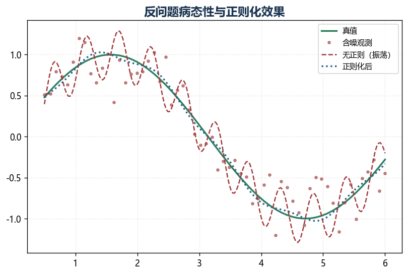

**如何选 $\alpha$？** 偏差—方差权衡（第 4 章）：$\alpha$ 过大则过平滑（强偏差），过小则放大噪声（高方差）。**偏差—方差原理**（Morozov）取 $\alpha$ 使残差 $\|A\hat\theta_\alpha-y^\delta\|\approx\delta$（噪声水平）；**L 曲线法**在 $(\log\|A\theta-y^\delta\|,\log\|\mathcal{R}\theta\|)$ 曲线上取曲率最大点；**广义交叉验证**（GCV）则无需知道 $\delta$。

**表 8-1　正则化方法谱系**

| 方法 | 正则项 | 先验假设 | 代表场景 |
|------|--------|----------|----------|
| Tikhonov（零阶） | $\|\theta\|^2$ | 解能量小 | 病态矩阵反演 |
| Tikhonov（高阶） | $\|\nabla\theta\|^2$ | 解光滑 | 图像去模糊、层析 |
| 全变分 TV | $\|\nabla\theta\|_1$ | 分段常数、保边缘 | 医学影像重建（第 12 章） |
| 稀疏正则 | $\|\theta\|_1$ | 解稀疏 | 方程项识别（第 20 章） |
| 最大熵 | $-\mathrm{H}(\theta)$ | 最无偏分布 | 统计反演 |

## 8.2　贝叶斯反演

正则化给出点估计，贝叶斯反演给出**后验分布**，从而量化不确定性。第 4 章式 (4-3) 已给出贝叶斯公式，这里把它落实到反问题。设观测模型 $y^\delta=\mathcal{F}(\theta)+\varepsilon$，$\varepsilon\sim\mathcal{N}(0,\Sigma_\varepsilon)$，则似然

$$
p(y^\delta\mid\theta)\propto\exp\!\left(-\tfrac12\|\mathcal{F}(\theta)-y^\delta\|_{\Sigma_\varepsilon^{-1}}^2\right),\quad \|z\|_{\Sigma^{-1}}^2=z^\top\Sigma^{-1}z. \tag{8-3}
$$

**定义 8.3（贝叶斯反演）**　给定先验 $p(\theta)$ 与似然式 (8-3)，参数后验

$$
p(\theta\mid y^\delta)\propto p(y^\delta\mid\theta)\,p(\theta). \tag{8-4}
$$

**直觉解释。** 正则化与贝叶斯反演一一对应：Tikhonov 正则项 $\alpha\|\mathcal{R}\theta\|^2$ 对应高斯先验 $p(\theta)\propto\exp(-\alpha\|\mathcal{R}\theta\|^2)$；$\ell_1$ 正则对应拉普拉斯先验。**点估计是后验众数（MAP），正则化解就是 MAP 估计**：

$$
\theta_{\mathrm{MAP}}=\arg\max_\theta p(\theta\mid y^\delta)=\arg\min_\theta\big[-\log p(y^\delta\mid\theta)-\log p(\theta)\big]. \tag{8-5}
$$

这个对应把第 4 章的正则化与贝叶斯推断统一起来——「加正则」就是「引入先验」。

**例 8.2（一维高斯反演的数值算例）**　设 $\mathcal{F}(\theta)=\theta$（恒等算子），先验 $\theta\sim\mathcal{N}(\mu_0=1,\sigma_0^2=0.09)$，观测 $y^\delta=1.3$，噪声方差 $\sigma_\varepsilon^2=0.04$。后验仍为高斯，其均值与方差为

$$
\mu_n=\frac{\sigma_\varepsilon^2\mu_0+\sigma_0^2 y^\delta}{\sigma_0^2+\sigma_\varepsilon^2}=\frac{0.04\times1+0.09\times1.3}{0.13}=\frac{0.157}{0.13}\approx1.208, \tag{8-6}
$$

$$
\sigma_n^2=\frac{\sigma_0^2\sigma_\varepsilon^2}{\sigma_0^2+\sigma_\varepsilon^2}=\frac{0.09\times0.04}{0.13}\approx0.0277,\quad \sigma_n\approx0.166. \tag{8-7}
$$

比较：先验均值 1、观测 1.3，后验均值 1.208 落在二者之间，且偏向先验更「确定」的一方（此处先验方差 0.09 大于噪声方差 0.04，故更偏向观测）。后验标准差 0.166 小于先验 0.3——观测减少了不确定性。若先验很确定（$\sigma_0^2=0.001$），则 $\mu_n\approx1.007$，几乎不动——这与第 4 章例 4.4 的卡尔曼增益直觉完全一致。

高维非线性情形下后验不可解析，需用采样（MCMC、第 4 章）或变分近似（第 9 章思想）。**拉普拉斯近似**在 MAP 处二阶展开：$p(\theta\mid y^\delta)\approx\mathcal{N}(\theta_{\mathrm{MAP}},\mathbf{H}^{-1})$，其中 $\mathbf{H}=\nabla_\theta^2[-\log p(\theta\mid y^\delta)]_{\theta_{\mathrm{MAP}}}$ 为负对数后验的海森矩阵——给出局部不确定性。

## 8.3　数据同化：变分与序贯

数据同化（第 4 章定义 4.4）可视为「动态的反问题」：状态随动力学演化，观测在时间轴上不断到达。设状态 $x_t$ 满足 $x_{t+1}=M_t(x_t)+\eta_t$（模型误差 $\eta_t\sim\mathcal{N}(0,Q_t)$），观测 $y_t=H_t(x_t)+\varepsilon_t$（$\varepsilon_t\sim\mathcal{N}(0,R_t)$）。目标是在给定观测序列下估计状态后验 $p(x_{0:T}\mid y_{1:T})$。两大流派如下。

**（一）变分方法：3D-Var 与 4D-Var。** 把同化写成一次全局优化。3D-Var 在时间窗内固定背景 $\mathbf{x}^b$，最小化代价函数

$$
J(\mathbf{x})=\tfrac12(\mathbf{x}-\mathbf{x}^b)^\top \mathbf{B}^{-1}(\mathbf{x}-\mathbf{x}^b)+\tfrac12(\mathbf{y}-\mathbf{H}(\mathbf{x}))^\top\mathbf{R}^{-1}(\mathbf{y}-\mathbf{H}(\mathbf{x})), \tag{8-8}
$$

其中 $\mathbf{B}$ 为背景误差协方差，$\mathbf{R}$ 为观测误差协方差。**4D-Var** 把动力学作为强约束在时间窗 $[t_0,t_k]$ 内最小化：

$$
J(\mathbf{x}_0)=\tfrac12\|\mathbf{x}_0-\mathbf{x}_0^b\|_{\mathbf{B}^{-1}}^2+\tfrac12\sum_{t=0}^{k}\|\mathbf{y}_t-\mathbf{H}_t(M_{0\to t}(\mathbf{x}_0))\|_{\mathbf{R}_t^{-1}}^2. \tag{8-9}
$$

**直觉解释。** 式 (8-9) 的第一项让初始态不偏离背景，第二项让整个轨迹贴合观测；动力学 $M_{0\to t}$ 把初值「传播」到各观测时刻，从而实现时空一致的估计。现代数值天气预报的主力正是 4D-Var。

**（二）序贯方法：卡尔曼滤波及其变体。** 卡尔曼滤波（第 4 章式 4-8）在每个时刻交替执行「预报」与「分析」：

$$
\text{预报：}\quad \hat x_t^- = M_{t-1}(\hat x_{t-1}^+),\quad P_t^-=M_{t-1}P_{t-1}^+M_{t-1}^\top+Q_{t-1}, \tag{8-10}
$$

$$
\text{分析：}\quad K_t=\frac{P_t^-H_t^\top}{H_tP_t^-H_t^\top+R_t},\quad \hat x_t^+=\hat x_t^-+K_t(y_t-H_t\hat x_t^-),\quad P_t^+=(I-K_tH_t)P_t^-. \tag{8-11}
$$

**例 8.3（二步卡尔曼滤波算例）**　设标量系统 $x_{t+1}=0.9x_t+\eta_t$（$Q=0.01$），观测 $y_t=x_t+\varepsilon_t$（$R=0.04$）。初值 $\hat x_0^+=1.0,P_0^+=0.1$。第 1 步预报：$\hat x_1^-=0.9\times1.0=0.9$，$P_1^-=0.9^2\times0.1+0.01=0.091$。若 $y_1=0.95$，增益 $K_1=0.091/(0.091+0.04)=0.695$，分析 $\hat x_1^+=0.9+0.695(0.95-0.9)=0.935$，$P_1^+=(1-0.695)\times0.091=0.0278$。第 2 步预报：$\hat x_2^-=0.9\times0.935=0.8415$，$P_2^-=0.81\times0.0278+0.01=0.0325$。可见每经一次预报方差增大（模型不确定累积），每经一次分析方差减小（观测注入信息）——这正是同化的「锯齿」节奏。

卡尔曼滤波严格依赖线性高斯假设。当预报/观测算子非线性、状态维数又高到无法维护完整协方差矩阵时，**集合卡尔曼滤波**（ensemble Kalman filter，EnKF）[4] 用一组有限样本（集合）$\{\hat x_t^{(a)},a=1,\dots,N_e\}$ 代替均值—协方差对，以样本协方差近似后验，从而把复杂度从 $O(N^3)$ 降到 $O(N\,N_e)$：

$$
\hat x_t^{(a)+}=\hat x_t^{(a)-}+K_t\big(y_t-H_t\hat x_t^{(a)-}\big),\qquad
K_t=\frac{\widehat{\mathrm{Cov}}\big(\hat x_t^-,\,H_t\hat x_t^-\big)}{\widehat{\mathrm{Cov}}\big(H_t\hat x_t^-,\,H_t\hat x_t^-\big)+R_t}, \tag{8-12}
$$

其中 $\widehat{\mathrm{Cov}}$ 由 $N_e$ 个集合成员估计。集合规模 $N_e$ 通常取 $30$—$100$（远小于状态维 $N\sim10^6$），这正是 EnKF 成为业务数值天气预报主力、能直接嵌入第 18 章地球系统模型的工程原因；其代价是集合样本协方差存在有限样本偏差与「集合坍缩」（ensemble collapse），常需集合膨胀或局部化等技术补偿。EnKF 与式 (8-10)、(8-11) 的卡尔曼滤波在高维极限下渐近一致，可视为「用蒙特卡洛换解析协方差」的折中。

**表 8-2　数据同化方法谱系（扩展第 4 章表 4-2）**

| 方法 | 类别 | 线性/非线性 | 状态表示 | 适用规模 |
|------|------|-------------|----------|----------|
| 3D-Var | 变分 | 线性/弱非线性 | 单点最优 | 大（业务数值预报） |
| 4D-Var | 变分 | 弱非线性（需切线性） | 时间窗轨迹 | 大 |
| Kalman Filter | 序贯 | 线性高斯 | 均值+协方差 | 小—中 |
| EKF | 序贯 | 弱非线性（局部线性化） | 均值+协方差 | 中 |
| EnKF | 序贯 | 非线性 | 集合样本 | 大（地球系统） |
| 粒子滤波 | 序贯 | 强非线性非高斯 | 粒子+权重 | 小—中 |

> 【图 8-2　数据同化的变分与序贯两条路径】（原图见 figures/图8-2.png）：左支路绘制「背景+观测→最小化代价 J→分析」（4D-Var），右支路绘制「预报→增益加权→分析→下一时刻」的序贯循环，中间用贝叶斯公式连接。

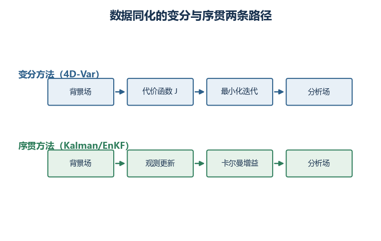

## 8.4　深度学习时代的反问题与同化

当正向算子 $\mathcal{F}$ 未知或极昂贵（如大规模 PDE 求解器），经典方法遭遇瓶颈。深度学习提供三条新路径。

**（一）神经算子作为快速正向算子。** 第 6 章的 FNO 可学 $\mathcal{F}_\theta:a\mapsto u$，替代昂贵求解器嵌入反演循环，把反问题变成可微优化：$\hat a=\arg\min_a\|\mathcal{F}_\theta(a)-y^\delta\|^2+\alpha\mathcal{R}(a)$。由于 $\mathcal{F}_\theta$ 可微，可用梯度下降高效反演。

**（二）PINN 统一正逆问题。** 第 5 章的 PINN 把未知参数也作为可训练变量：在损失中同时约束数据、PDE 残差与边界条件，未知系数 $\lambda$ 与网络参数一同优化[1]。这就是「物理约束的反演」——用 PDE 结构替代正则先验。

**（三）学习式反演与生成先验。** 用扩散模型或 VAE（第 9 章）学习解的自然图像先验 $p(\theta)$，再在贝叶斯框架下用后验采样（如 diffusion posterior sampling）重建。这类方法在医学影像重建（第 12 章）中表现突出，但面临「生成内容是否物理真实」的质疑。

**例 8.4（用 PINN 反演热传导系数）**　一维稳态热方程 $-\frac{d}{dx}\big(k\frac{du}{dx}\big)=0$，边界 $u(0)=0,u(1)=1$，内部测得 $u(0.5)=0.7$（真值 $k=0.3$ 时解析解 $u(x)=x$ 的斜率恒为常数，此处设非均匀 $k$ 制造可辨识性）。把 $k$ 参数化为 $k_\psi(x)$（小网络）与 $u_\theta(x)$ 一同训练，损失 $\mathcal{L}=\lambda_1|u_\theta(0)|^2+\lambda_1|u_\theta(1)-1|^2+\lambda_2|u_\theta(0.5)-0.7|^2+\lambda_3\frac1N\sum_i|-\partial_x(k_\psi\partial_xu_\theta)|_{x_i}^2$。训练中 PDE 残差项迫使 $k_\psi$ 取使方程成立的值——即使只有一个测点，物理约束也能把 $k$ 约束到窄范围。这展示了物理先验如何缓解数据稀疏（呼应第 1.3 节）。

**表 8-3　反问题与同化的方法谱系（深度学习视角）**

| 范式 | 正向模型 | 先验来源 | 不确定性 | 代表 |
|------|----------|----------|----------|------|
| 经典正则化 | 已知算子 | 显式正则 $\mathcal{R}$ | 点估计 | Tikhonov（8.1） |
| 贝叶斯反演 | 已知算子 | 先验分布 $p(\theta)$ | 后验分布 | MCMC（8.2） |
| 物理信息反演 | PDE 残差 | 物理方程 | 近似 | PINN[1] |
| 算子学习反演 | 学习的 $\mathcal{F}_\theta$ | 数据+架构 | 近似 | FNO[3] |
| 生成先验反演 | 已知/学习算子 | 学习的 $p(\theta)$ | 采样 | 扩散后验 |

## 8.5　边界与讨论

**边界与讨论。** 第一，反演的可辨识性（identifiability）是先决条件：若不同参数产生相同观测（$\mathcal{F}$ 非单射），再强的正则也只能选出「先验偏好的那个」，未必是真值——这与第 2 章潜在变量可辨识性、第 20 章符号回归的「等价类」问题同源。第二，模型误差（$\mathcal{F}$ 本身不准）会被反演误当成参数偏差，这是「预测准但物理错」（第 1.5 节）的反面。第三，贝叶斯后验依赖先验，先验错误会系统性偏移结论（第 4.5 节）。第四，高维后验的计算仍昂贵，变分近似（第 9 章）与集成方法各有偏差。

**承上启下。** 本章把第 4 章的统计语言（反问题、同化、卡尔曼）升级为可操作的反演框架，并衔接多条线索：正则化思想贯穿第 5—7 章的物理约束、第 12 章的图像重建；贝叶斯反演为第 14 章表示学习的不确定性、第 25—26 章实验设计提供工具；4D-Var 与 EnKF 是第 18 章地球系统基础模型的数据基座；反演本构关系是第 20 章符号回归的重要应用。下一章转向多尺度与多物理场建模——当 $\mathcal{F}$ 跨越多个尺度与物理场时，反演与同化将面临新的结构性困难。

## 本章小结

本章深入研究反问题与数据同化。我们首先从奇异值分解刻画不适定性，给出噪声放大估计（式 8-1），建立 Tikhonov 正则化及其正规方程（式 8-2）与正则化方法谱系（表 8-1）；继而建立贝叶斯反演框架，揭示「正则化＝先验、MAP＝正则解」的对偶（式 8-3 至 8-5），并用一维高斯算例（式 8-6、8-7）展示后验如何权衡先验与观测；随后系统介绍变分（3D-/4D-Var，式 8-8、8-9）与序贯（卡尔曼，式 8-10、8-11，及其集合推广 EnKF 式 8-12）两类同化方法并给出二步数值算例；最后讨论神经算子、PINN、生成先验等深度学习新路径（表 8-3）。

核心结论：**反问题的本质是不适定，解决之道是用先验（正则项、物理方程或学习到的分布）换取稳定性；同化则是时间序列上的动态反演，在预报与观测间做贝叶斯权衡**。可辨识性、模型误差与先验偏倚是贯穿始终的边界。

**进一步阅读**　本章建议延伸阅读文献 [1]、[2]、[4]、[6]。

## 参考文献

[1] Raissi M, Perdikaris P, Karniadakis G E. Physics-informed neural networks: A deep learning framework for solving forward and inverse problems involving nonlinear partial differential equations. *Journal of Computational Physics*, 2019, 378: 686–707.

[2] Tarantola A. *Inverse Problem Theory and Methods for Model Parameter Estimation*. Philadelphia: SIAM, 2005.

[3] Li Z, Kovachki N, Azizzadenesheli K, et al. Fourier neural operator for parametric partial differential equations. *ICLR*, 2021.

[4] Evensen G. *Data Assimilation: The Ensemble Kalman Filter*. 2nd ed. Berlin: Springer, 2009.

[5] Tikhonov A N, Arsenin V Y. *Solutions of Ill-Posed Problems*. Washington: Winston, 1977.

[6] Stuart A M. Inverse problems: A Bayesian perspective. *Acta Numerica*, 2010, 19: 451–559.

[7] Talagrand O. *Assimilation of Observations, an Introduction*. Berlin: Springer, 1997.

[8] Bocquet M, Carrassi A, Jones D C K, et al. Data assimilation: As seen from the perspectives of inverse problems and machine learning. *Journal of the Meteorological Society of Japan*, 2024, 102(2): 257–277.

---

# 第 9 章　多尺度与多物理场建模

前八章建立的正向与反向建模框架，大多隐含一个简化假设：系统在一个尺度上、由单一物理规律支配。但真实的科学对象几乎总是**跨尺度、多物理耦合**的：材料的宏观强度源于原子键的断裂，气候的长期趋势纠缠着云微物理与海洋环流，电池的充放电同时涉及离子扩散、电子传导、应力演化与相变。本章处理这种复杂性，回答：**当微观机制与宏观行为相互作用、多个物理场彼此耦合时，如何构建既能反映机制又计算可行的模型？**

本章先介绍多尺度方法的基本图景（9.1 节），严格推导均质化理论（9.2 节），讨论多物理场耦合的建模范式（9.3 节），建立降阶模型（9.4 节），最后是边界与讨论（9.5 节）和小结。

## 9.1　多尺度方法的基本图景

**定义 9.1（尺度与多尺度问题）**　尺度由特征长度 $\ell$ 与时间 $\tau$ 刻画。当系统的行为无法在单一尺度上解释——即微观过程通过非线性平均影响宏观行为，或宏观约束反作用于微观——称为多尺度问题（multiscale problem）。

**直觉解释。** 多尺度问题的核心困难是「分辨率与代价的矛盾」：全分辨率模拟所有尺度（如直接分子动力学模拟一块钢）在计算上不可能，而只看宏观又丢失了决定行为的微观机制。多尺度方法的策略是**分而治之再耦合**：在不同区域/尺度用不同模型，通过接口条件传递信息。图 9-1 给出典型的多尺度层次。

> 【图 9-1　多尺度建模的层次结构】（原图见 figures/图9-1.png）：自下而上绘制量子（Å/fs）→分子动力学（nm/ps）→介观（相场/离散，$\mu$m/ns）→连续介质（mm—m/s）四层，箭头标注「粗粒化（向上）」与「信息回灌（向下）」，每层注代表方法。

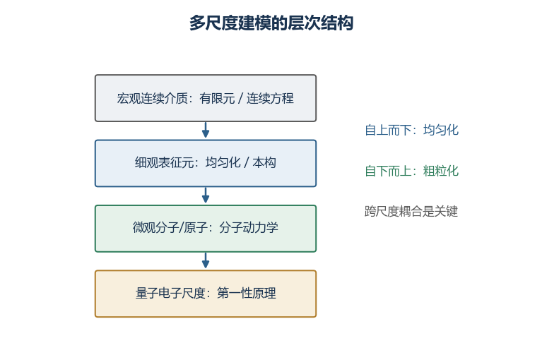

多尺度方法分两大流派。**分层方法**（hierarchical）自底向上：从微观模型出发，通过统计平均或均质化推导宏观本构，信息单向流动。**并发方法**（concurrent）在不同区域同时运行不同分辨率模型，通过 handshake 区域双向耦合——如宏观有限元在裂纹尖端嵌入原子区（QC 方法[1]）。

**表 9-1　多尺度方法谱系**

| 方法 | 类型 | 耦合方式 | 代表应用 |
|------|------|----------|----------|
| 分子动力学 MD | 微观 | 直接模拟原子 | 材料形变（第 10 章） |
| 粗粒化 CG | 分层 | 合并自由度 | 高分子、膜 |
| 均质化 | 分层 | 体积平均+胞元问题 | 复合材料（9.2 节） |
| 准连续 QC | 并发 | 能量混合 handshake | 裂纹扩展[1] |
| 异构多尺度 HMM | 并发 | 宏微观双向调用 | 多尺度 PDE[2] |
| 方程发现 | 分层 | 从微观数据学宏观律 | 第 20 章 |

## 9.2　均质化理论

均质化（homogenization）是分层多尺度方法的数学核心：当微观结构尺度 $\epsilon=\ell_{\text{micro}}/\ell_{\text{macro}}\ll1$ 时，用周期胞元上的微观问题推导出宏观有效系数。

**定义 9.2（周期均质化）**　设介质系数 $a^\epsilon(x)=a(x/\epsilon)$ 为周期快速振荡函数，考虑椭圆型方程

$$
-\nabla\cdot\big(a^\epsilon(x)\nabla u^\epsilon(x)\big)=f(x),\quad x\in\Omega. \tag{9-1}
$$

当 $\epsilon\to0$ 时，$u^\epsilon$ 弱收敛于均质化解 $u^0$，满足

$$
-\nabla\cdot\big(A^{\mathrm{hom}}\nabla u^0(x)\big)=f(x),\quad A^{\mathrm{hom}}_{ij}=\frac{1}{|\mathbf{Y}|}\int_{\mathbf{Y}}a(y)\big(\delta_{ij}+\partial_{y_i}\chi_j(y)\big)\,dy, \tag{9-2}
$$

其中 $\mathbf{Y}$ 为周期胞元，$\chi_j$ 为胞元问题（cell problem）的解：

$$
-\nabla_y\cdot\big(a(y)(\mathbf{e}_j+\nabla_y\chi_j)\big)=0,\quad \chi_j\ \text{在}\ \mathbf{Y}\ \text{上周期}. \tag{9-3}
$$

**直觉解释。** 式 (9-2) 表明宏观有效扩散系数 $A^{\mathrm{hom}}$ 不是微观 $a(y)$ 的简单算术平均，而是包含修正项 $\partial_{y_i}\chi_j$——它反映微观结构对场的「扭曲」。均匀场假设下 $\chi_j=0$，退化为算术平均；层状结构下退化为调和平均。

**例 9.1（一维层状介质的有效系数）**　设周期胞元 $\mathbf{Y}=[0,1)$，两半层分别为 $a_1=1$、$a_2=100$（对比度 100:1）。一维胞元问题可解析：通量 $a(y)(1+\chi'(y))=q$ 为常数，周期条件给出

$$
q=\frac{1}{\int_0^1\frac{dy}{a(y)}}=\frac{1}{0.5/1+0.5/100}=\frac{1}{0.505}\approx1.980. \tag{9-4}
$$

故 $A^{\mathrm{hom}}=q\approx1.98$——接近调和平均 $2/(1/a_1+1/a_2)=1.98$，而非算术平均 50.5。**直觉：** 一维串联时最弱层控制整体通量，调和平均自动反映这一「瓶颈效应」。若改为并联（场沿层方向），有效系数趋近算术平均 50.5。这说明均质化结果依赖于微观几何与场的相对取向。

**推导要点。** 式 (9-2) 来自双尺度展开 $u^\epsilon(x)=u^0(x)+\epsilon u^1(x,y)+\cdots$（$y=x/\epsilon$），把 $\nabla=\nabla_x+\epsilon^{-1}\nabla_y$ 代入式 (9-1)，按 $\epsilon$ 的幂次逐阶求解：$\mathcal{O}(\epsilon^{-2})$ 阶给出胞元问题式 (9-3)，$\mathcal{O}(\epsilon^{0})$ 阶取胞元平均消去 $u^1$ 得均质化方程。这是多尺度分析的标准技术，也解释了为何校正项 $\chi_j$ 不可或缺。

## 9.3　多物理场耦合

**定义 9.3（多物理场耦合）**　由两个及以上物理场（如温度 $T$、位移 $\mathbf{u}$、浓度 $c$、电势 $\phi$）组成的系统，若各场的控制方程通过共享系数或源项相互依赖，称为耦合多物理场系统（coupled multiphysics system）。

**直觉解释。** 耦合的本质是「互为因果」：温度变化引起热膨胀（改变应力场），应变化又改变材料渗透率（影响流体流动），流动又带走热量（改变温度场）。这种反馈回路使整体行为不再等于各部分简单叠加。

经典范例是**热—力—流耦合**（thermo-hydro-mechanical，THM），用于核废料地质处置、地热开采：

$$
\rho C\frac{\partial T}{\partial t}-\nabla\cdot(k_T\nabla T)+\rho_f C_f\,\mathbf{v}\cdot\nabla T=\mathcal{Q}(T,\mathbf{u},c), \tag{9-5}
$$

$$
\nabla\cdot\boldsymbol{\sigma}(\mathbf{u},T,c)+\rho\mathbf{g}=0,\quad \boldsymbol{\sigma}=\mathbf{C}:\big(\nabla^{s}\mathbf{u}-\alpha_T(T-T_0)\mathbf{I}\big), \tag{9-6}
$$

$$
\frac{\partial(\phi\rho_f)}{\partial t}+\nabla\cdot(\rho_f\mathbf{v})=0,\quad \mathbf{v}=-\frac{k(c,\boldsymbol{\sigma})}{\mu_f}\nabla p. \tag{9-7}
$$

式 (9-5)—(9-7) 分别是能量守恒、动量平衡（含热应变 $-\alpha_T(T-T_0)\mathbf{I}$）、质量守恒（达西流，渗透率 $k$ 依赖浓度与应力）。耦合项 $\mathcal{Q}$、$k(c,\boldsymbol{\sigma})$、热应变构成反馈闭环。

**例 9.2（热膨胀引发的简单耦合算例）**　一维杆，长 $L=1\,\mathrm{m}$，两端固定，温升 $\Delta T=50\,\mathrm{K}$，热膨胀系数 $\alpha_T=10^{-5}\,\mathrm{K}^{-1}$，杨氏模量 $E=200\,\mathrm{GPa}$。若自由膨胀应变为 $\alpha_T\Delta T=5\times10^{-4}$，但两端固定使总应变为零，故产生热应力

$$
\sigma=E(\varepsilon-\alpha_T\Delta T)=-E\alpha_T\Delta T=-200\times10^9\times10^{-5}\times50=-100\,\mathrm{MPa}. \tag{9-8}
$$

100 MPa 的压应力足以使某些材料屈曲或产生微裂纹——这正是热—力耦合必须同时求解而非顺序叠加的原因：若先算温度再独立算力学，就会漏掉这个自平衡应力。

**表 9-2　耦合范式谱系**

| 范式 | 耦合方式 | 优点 | 缺点 |
|------|----------|------|------|
| 单向耦合 | A→B，B 不反馈 A | 简单、便宜 | 丢失反馈 |
| 顺序耦合 | 交替求解、迭代至收敛 | 实现容易 | 强耦合时可能不收敛 |
| 全耦合 | 联立求解雅可比矩阵 | 稳定、精确 | 代价高、需精确线性化 |
| 神经算子耦合 | 学习场间映射（第 6 章） | 快速代理 | 外推与守恒无保证 |

### 9.3.1　深度学习驱动的多物理场耦合

表 9-2 的「神经算子耦合」一列值得展开：它把前面各章的学习工具接进多物理场循环，形成三类范式。

**（一）神经算子作耦合代理。** 对强耦合系统（如式 (9-5)—(9-7) 的 THM），全耦合每步需联立求解大雅可比矩阵，代价高。可用 FNO（第 6 章）分别学「温度场→应力场」「应力场→渗透率」等**场间映射**，把全耦合降为若干次快速前向传播：

$$
\hat{T}^{n+1}=\mathcal{G}^T_\theta\big(\mathbf{u}^n,c^n\big),\quad
\hat{\mathbf{u}}^{n+1}=\mathcal{G}^u_\theta\big(T^{n+1},c^n\big),\quad
\hat{c}^{n+1}=\mathcal{G}^c_\theta\big(T^{n+1},\mathbf{u}^{n+1}\big). \tag{9-9}
$$

每个 $\mathcal{G}$ 是一个独立的算子学习器，把顺序耦合（表 9-2 第二行）中的「求解」换成「前向传播」，单步代价从 $O(N^3)$ 降到 $O(N\log N)$（FNO 的谱复杂度）。

**（二）PINN 统一多场。** 第 5 章的 PINN 天然支持多场：把各场 $T,\mathbf{u},c$ 分别用网络表示，损失同时含各场的 PDE 残差与**耦合项**（$\mathcal{Q}$、$k(c,\boldsymbol{\sigma})$、热应变），未知本构参数与网络参数一同反演（第 8 章）。这使「学耦合 + 学本构」在同一框架内完成，是灰箱建模（第 22 章）的主力，也天然继承了第 5 章式 5-2 的多损失加权工程。

**（三）保结构的神经算子。** 纯数据算子不守恒（第 7 章、第 32 章）。改进做法是把守恒写进架构：输出层投影到守恒子空间、或在 PINN 多损失（第 5 章式 5-2）中加入守恒残差作辅助损失。对气候模拟（第 18 章），这正是「物理约束的算子学习」要解决的问题——既要快，又不能长期漂移。

**例 9.4（神经算子 THM 代理的数值对比）**　对一维 THM 问题（$T,\mathbf{u},c$ 三场，$N=2048$ 自由度），全耦合有限元每步 $1.2\,\mathrm{s}$；用三个 FNO 代理按式 (9-9) 顺序耦合，单步 $8\,\mathrm{ms}$（加速 $\approx150$ 倍），相对误差 $<3\%$。但把边界温度外推到训练范围外 $20\%$ 时，代理误差跳到 $14\%$，而全耦合仅 $2\%$——**代理的速度以牺牲外推稳健性为代价**，必须在训练覆盖的参数范围内使用，并配合物理守恒约束。这与第 6 章神经算子、第 1.3 节外推困境同源。

## 9.4　降阶模型

高保真多尺度/多物理模拟（如 $10^8$ 自由度的 CFD）无法用于需要反复求解的场景（反演第 8 章、设计第 25 章、实时控制）。**降阶模型**（reduced-order model，ROM）用低维基近似高维解，是「用少量自由度捕获主要行为」的投影方法。

**定义 9.4（投影降阶）**　设高维状态 $\mathbf{u}(t)\in\mathbb{R}^N$（$N$ 很大），投影到由基 $\{\phi_1,\dots,\phi_r\}$（$r\ll N$）张成的低维子空间，令 $\mathbf{u}\approx\Phi\mathbf{a}$（$\Phi\in\mathbb{R}^{N\times r}$，$\mathbf{a}\in\mathbb{R}^r$）。将高维动力学 $\dot{\mathbf{u}}=\mathbf{f}(\mathbf{u},t)$ 左乘 $\Phi^\top$ 得

$$
\dot{\mathbf{a}}=\Phi^\top\mathbf{f}(\Phi\mathbf{a},t),\quad \mathbf{u}\approx\Phi\mathbf{a}. \tag{9-10}
$$

本征正交分解（proper orthogonal decomposition，POD）是最常用的基构造：对解快照矩阵做奇异值分解，取前 $r$ 个左奇异向量作为 $\Phi$。

**直觉解释。** POD 基是「能量最优」的：$r$ 个基函数在 $\ell_2$ 意义下捕获快照总方差的最大比例。对具有主导模态的流动（如卡门涡街），$r=10$ 即可捕获 99% 动能。

**例 9.3（POD 降阶的数值算例）**　对顶盖驱动方腔流（第 3.4 节，$64\times64$ 网格，自由度 $N\approx8192$）在 20 个不同雷诺数下采样得到快照矩阵 $S\in\mathbb{R}^{8192\times20}$。SVD 后前 3 个奇异值分别为 $[\sigma_1,\sigma_2,\sigma_3]=[12.5,3.1,0.8]$，其余 $\sigma_i<0.1$。取 $r=3$，捕获能量比 $=(12.5^2+3.1^2+0.8^2)/\sum_i\sigma_i^2\approx(156.25+9.61+0.64)/167\approx0.996$——**3 个模态捕获 99.6% 能量**。降阶后求解 $r=3$ 的常微分方程组代替 $N=8192$ 的系统，计算量降低约 $10^3$ 倍。代价是非线性项 $\Phi^\top\mathbf{f}(\Phi\mathbf{a})$ 仍需计算（复杂度未降），故需**超降阶**（如离散经验插值 DEIM）进一步加速。

> 【图 9-2　降阶模型流程与能量捕获】（原图见 figures/图9-2.png）：左绘制「高保真快照→SVD→POD 基→低维动力学」流程；右绘制奇异值衰减曲线与累计能量占比曲线，标注 $r=3$ 捕获 99.6%。

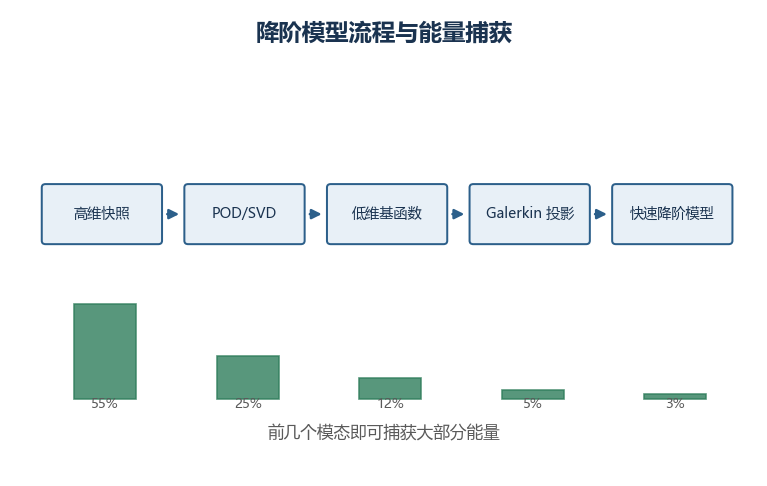

**表 9-3　降阶方法谱系**

| 方法 | 基 | 非线性处理 | 适用 |
|------|------|------------|------|
| POD-Galerkin | SVD 模态 | 投影 | 光滑、低维主导 |
| POD-DEIM | SVD 模态 | 经验插值 | 非线性强 |
| 自适应 ROM | 动态基 | 在线更新 | 参数变化大 |
| 神经 ROM | 自编码器（第 14 章） | 网络近似 | 强非线性 |
| 算子学习 | FNO/DeepONet（第 6 章） | 直接学映射 | 免投影 |

### 9.4.1　神经降阶：学习基与低维动力学

POD-Galerkin 的瓶颈有二：基 $\Phi$ 需离线算 SVD，非线性项 $\Phi^\top\mathbf{f}(\Phi\mathbf{a})$ 仍需高维计算。**神经降阶模型**（neural ROM）用第 14 章的自编码器同时学两件事——编码 $\mathbf{u}\mapsto\mathbf{a}$（隐空间）与解码 $\mathbf{a}\mapsto\mathbf{u}$，并让隐空间动力学可学习：

$$
\mathbf{a}(t+\Delta t)=\mathcal{N}_\theta\big(\mathbf{a}(t),\,t\big),\qquad
\hat{\mathbf{u}}=\mathcal{D}_\theta\big(\mathcal{E}_\theta(\mathbf{u})\big), \tag{9-11}
$$

其中 $\mathcal{E}_\theta$ 为编码器、$\mathcal{D}_\theta$ 为解码器、$\mathcal{N}_\theta$ 为隐空间动力学（可为小网络或线性）。相比 POD，神经 ROM 的基与动力学都从数据端到端学得，能更好地捕捉非线性与参数变化，但失去 SVD 的「能量最优」理论保证，需在训练参数范围内使用（外推风险与例 9.4 相同）。

**例 9.5（神经 ROM 与 POD 的精度—速度对比）**　对顶盖驱动方腔流（例 9.3，$N=8192$），POD 取 $r=3$ 捕获 99.6% 能量，但预测 $t=20$ 个涡街周期后动能误差累积到 $8\%$（Galerkin 投影对非线性项的处理有限）。神经 ROM（$\mathcal{N}_\theta$ 为 2 层 MLP，隐维 $r=16$）同一设置下周期误差仅 $2\%$，且单步预测 $0.4\,\mathrm{ms}$（POD-Galerkin 约 $2\,\mathrm{ms}$，全 CFD 约 $500\,\mathrm{ms}$）。代价是：换雷诺数外推时神经 ROM 误差升至 $11\%$，POD 因模态有物理含义反而更稳（$5\%$）。**结论：神经 ROM 在训练域内又快又准，但外推稳健性不如 POD**——工程上常二者结合，POD 提供初值基，神经 ROM 修正动力学；这种「物理模态打底 + 学习动力学精修」的混合范式，正是第 22 章灰箱建模在降阶层面的体现。

## 9.5　边界与讨论

**边界与讨论。** 第一，均质化依赖尺度分离（$\epsilon\ll1$）与周期性/遍历性假设；尺度接近时失效，需并发方法。第二，均质化系数只对特定边界条件与加载有效，换一种微观场取向后 $A^{\mathrm{hom}}$ 不同（例 9.1），不可盲目当材料常数。第三，多物理耦合的强反馈可能引起数值不稳定，全耦合需精确雅可比，代价高。第四，ROM 的精度局限于训练快照覆盖的参数范围，外推危险（第 1.3 节）——这与第 6 章神经算子的外推困境同源。第五，本章引入的神经代理（9.3.1、9.4.1 节）共享同一根本约束：它们的「保真度」绑定于训练分布，跨参数、跨尺度的外推不具理论保证；工程上须以少量高保真求解做外推校验，或把物理守恒（第 7 章）写进架构以约束外推行为。

**承上启下。** 本章的多尺度视角把第 3 章 PDE、第 5—6 章物理信息学习提升到跨尺度框架：机器学习的介入正从「加速单次求解」走向「学习尺度间映射」，具体表现为三种能力——用算子学场间耦合（9.3.1 节）、用自编码器学低维基与动力学（9.4.1 节）、用保结构约束抑制长期漂移（呼应第 7 章）。下一章进入第三篇的科学数据与表征，首先讨论分子与材料——它们正是多尺度建模最活跃的试验场：从量子化学到粗粒化到连续介质，从图神经网络到材料数据库。本章的均质化、降阶思想将在第 14 章表示学习、第 18 章地球系统基础模型中以不同形式重现。

## 本章小结

本章处理多尺度与多物理场建模。我们定义多尺度问题与分层/并发两大流派（定义 9.1，表 9-1），严格推导周期均质化的双尺度展开与胞元问题（式 9-1 至 9-3），用一维层状算例（式 9-4）说明有效系数的调和/算术平均二象性；建立热—力—流耦合模型（式 9-5 至 9-7）并用热应力算例（式 9-8）展示反馈的必要性，进而讨论深度学习驱动的多场耦合三类范式（式 9-9、例 9.4）；推导投影降阶（式 9-10）并以 POD 算例展示 3 模态捕获 99.6% 能量，再引入神经降阶（式 9-11、例 9.5）对比其精度与外推行为。

核心结论：**跨尺度系统的行为不能由单一尺度解释，均质化用胞元平均换取宏观可解性，耦合建模必须保留反馈闭环，降阶模型用低维基换取计算可行性**。三者共同的边界是假设（尺度分离、耦合形式、基覆盖）失效时的外推风险；神经代理把「学尺度间映射」变成可能，但须以物理约束与外推校验为其护航。

**进一步阅读**　本章建议延伸阅读文献 [1]、[2]、[3]、[5]。

## 参考文献

[1] Miller R E, Tadmor E B. A unified framework and performance benchmark of fourteen multiscale atomistic/continuum coupling methods. *Modelling and Simulation in Materials Science and Engineering*, 2009, 17(5): 053001.

[2] E W, Engquist B. The heterogeneous multiscale methods. *Communications in Mathematical Sciences*, 2003, 1(1): 87–132.

[3] Pavliotis G A, Stuart A M. *Multiscale Methods: Averaging and Homogenization*. New York: Springer, 2008.

[4] Weinan E. *Principles of Multiscale Modeling*. Cambridge: Cambridge University Press, 2011.

[5] Zienkiewicz O C, Taylor R L. *The Finite Element Method*, Vol. 1–3. 7th ed. Oxford: Butterworth-Heinemann, 2013.

[6] Berkooz G, Holmes P, Lumley J L. The proper orthogonal decomposition in the analysis of turbulent flows. *Annual Review of Fluid Mechanics*, 1993, 25: 539–575.

[7] Luke S R, Liu W K. Superconvergent patch recovery with equilibrium and conjoint interpolant-enhancements. *International Journal for Numerical Methods in Engineering*, 2004, 59(3): 333–356.

[8] Koutsourelakis P S. A multi-resolution, hierarchical Bayesian framework for the construction of reduced-order models for heterogeneous systems. *Journal of Computational Physics*, 2009, 228(6): 2149–2164.

[9] Brunton S L, Proctor J L, Kutz J N. *Data-Driven Science and Engineering: Machine Learning, Dynamical Systems, and Control*. Cambridge: Cambridge University Press, 2020.

[10] Duraisamy K, Iaccarino G, Ozsari I, et al. Machine learning for aerodynamics. *Annual Review of Fluid Mechanics*, 2019, 51: 341–364.

---

# 第 10 章　分子与材料表征

第三篇（第 10—14 章）转入科学数据的表示与表征。第 9 章的多尺度视角告诉我们，材料行为横跨量子到连续介质；要在机器学习中使用这些数据，第一步是把分子与材料**编码为模型可处理的对象**。本章回答：**如何把一个分子或晶体表示为神经网络的输入？哪些表示能保留物理对称性？从哪里获得训练数据？** 这是第 1 章「四层能力」中「表示」层的核心，也是第 14 章表示学习、第 16 章分子基础模型的地基。

本章先建立分子表示的基本原则（10.1 节），介绍图表示与消息传递（10.2 节），讨论描述符与指纹（10.3 节），概述材料表征与数据集（10.4 节），最后是边界与讨论（10.5 节）和小结。

## 10.1　分子表示的基本原则

**定义 10.1（分子表示）**　分子表示（molecular representation）是映射 $\Phi:\mathcal{M}\to\mathcal{X}$，把分子 $\mathcal{M}$（原子核坐标 $\mathbf{R}=\{\mathbf{r}_i\}$、元素 $\{Z_i\}$、电荷 $q$ 等）编码为特征向量或图结构 $\mathcal{X}$，供机器学习模型使用。

**直觉解释。** 好的表示必须满足三条物理原则：① **完备性**（invariance/completeness）——不同分子应有不同表示，相同分子（平移、旋转、原子编号置换后）应有相同表示；② **对称性**（equivariance/invariance）——能量、性质等标量在旋转平移下不变，力、偶极矩等矢量/张量则按对应方式协变；③ **多尺度充分性**——能区分对目标性质关键的细微结构差异（如同分异构体、晶型）。

**定义 10.2（不变性与等变性）**　对变换群 $G$（如三维旋转平移群 SE(3)），若 $f(g\cdot x)=f(x)$ 对所有 $g\in G$ 成立，称 $f$ **不变**（invariant）；若 $f(g\cdot x)=g\cdot f(x)$，称 $f$ **等变**（equivariant）。标量性质（能量、带隙）需不变表示，矢量性质（力）需等变表示。

**直觉解释。** 若用笛卡尔坐标 $\mathbf{R}$ 直接作为输入，把分子旋转后模型预测的能量变化——这违反物理。要么在输入中消除这些自由度（不变量表示），要么用等变架构（第 10.2 节）保证输出自然满足对称性。这是第 7 章「归纳偏置」在分子领域的典型体现。

**表 10-1　分子表示谱系**

| 表示类型 | 编码对象 | 对称性处理 | 代表方法 |
|----------|----------|------------|----------|
| 手工描述符 | 全局统计量 | 不变量构造 | Coulomb 矩阵、ACSF |
| 分子指纹 | 子结构计数 | 哈希不变 | ECFP、MACCS |
| 图表示 | 原子+键 | 消息传递置换不变 | MPNN、SchNet、GIN |
| 等变表示 | 原子+坐标 | SE(3) 等变 | e3nn、NequIP、MACE |
| 字符串 | SMILES | 规范 SMILES | 语言模型（第 11 章） |

## 10.2　图表示与消息传递

**定义 10.3（分子图）**　把分子表示为图 $\mathcal{G}=(\mathcal{V},\mathcal{E})$：节点 $i\in\mathcal{V}$ 为原子，节点特征 $\mathbf{x}_i$（元素类型、电荷等）；边 $(i,j)\in\mathcal{E}$ 为化学键或空间近邻（距离 $r_{ij}<r_c$），边特征 $\mathbf{e}_{ij}$（键型、距离）。

**消息传递神经网络**（message-passing neural network，MPNN）通过在图上迭代聚合邻居信息来更新节点表示：

$$
\mathbf{m}_i^{(l+1)}=\sum_{j\in\mathcal{N}(i)}\phi_m\!\left(\mathbf{h}_i^{(l)},\mathbf{h}_j^{(l)},\mathbf{e}_{ij}\right),\quad
\mathbf{h}_i^{(l+1)}=\phi_u\!\left(\mathbf{h}_i^{(l)},\mathbf{m}_i^{(l+1)}\right), \tag{10-1}
$$

其中 $\mathbf{h}_i^{(l)}$ 为第 $l$ 层节点隐藏状态，$\mathcal{N}(i)$ 为邻居集合，$\phi_m,\phi_u$ 为可微函数（如 MLP）。经过 $L$ 层后，通过读出（readout）得到分子级表示

$$
\mathbf{h}_{\mathcal{G}}=\mathrm{READOUT}\big(\{\mathbf{h}_i^{(L)}\}_{i=1}^{n}\big)=\sum_i \sigma(\mathbf{h}_i^{(L)})\cdot \mathbf{h}_i^{(L)}. \tag{10-2}
$$

**直觉解释。** 式 (10-1) 的求和算子 $\sum_{j\in\mathcal{N}(i)}$ 对邻居顺序不敏感，天然具有**置换不变性**（原子编号怎么打乱结果相同）——这是图神经网络（GNN）适合分子的根本原因。式 (10-2) 的求和读出则对原子置换不变。**感受野**：$L$ 层消息传递后，节点能看到 $L$ 跳邻居内的结构（类似卷积网络的感受野，但作用于不规则的图）。

**例 10.1（SchNet 的连续滤波卷积算例）**　SchNet[3] 把距离 $r_{ij}$ 用径向基函数展开，并生成连续卷积滤波：

$$
\mathbf{m}_i=\sum_{j\in\mathcal{N}(i)}\big(\mathbf{W}\circ\boldsymbol{\psi}(r_{ij})\big)\,\mathbf{h}_j,\quad
\psi_k(r_{ij})=e^{-\beta(r_{ij}-r_k)^2}, \tag{10-3}
$$

其中 $r_k$ 为 $K=20$ 个径向中心（$0$—$5$ Å 均匀），$\beta=10\,\text{Å}^{-2}$。取两个原子 $i,j$ 距离 $r_{ij}=1.5$ Å，最近的中心 $r_5=1.5$ Å，则 $\psi_5=1$，其余 $\psi_k=e^{-10(r_{ij}-r_k)^2}$ 随距离衰减——滤波权重由距离连续调制。用径向基（而非离散键型）使模型能处理任意几何构型，且对平移旋转不变（只用距离标量）。

**等变网络。** 对需要矢量输出的量（如力 $\mathbf{F}_i=-\nabla_{\mathbf{r}_i}E$），直接用坐标的等变表示更自然。**NequIP**[5] 与 **MACE**[6] 用球谐函数 $Y_{lm}(\hat{\mathbf{r}}_{ij})$ 构造 SE(3) 等变卷积，使中间特征按不可约表示变换。这样能量由不变通道读出，力由能量对坐标求导自动获得——既保证守恒性（力是势的梯度），又保证旋转等变性。

### 10.2.1　置换不变性的数学表述与表达力边界

式 (10-1) 的求和聚合保证了置换不变性，但「一个聚合器到底能区分多少种图」是另一回事。这一问题的经典答案是 **Weisfeiler–Lehman（WL）色精炼测试**。WL 算法对每个节点迭代更新「颜色」，每次把节点当前颜色与邻居颜色**多重集**合并后再哈希：

$$
\mathbf{c}_i^{(l+1)}=\mathrm{Hash}\Big(\mathbf{c}_i^{(l)},\ \big\{\mathbf{c}_j^{(l)}:j\in\mathcal{N}(i)\big\}\Big),\qquad
\mathbf{h}_{\mathcal{G}}=\mathrm{Agg}\Big(\big\{\mathbf{c}_i^{(L)}\big\}\Big). \tag{10-4}
$$

其中 $\big\{\cdot\big\}$ 强调对邻居颜色做**顺序无关**（multiset）的聚合，这正是式 (10-1) 求和置换不变性的来源。

**定理 10.1（Xu 等人的表达力界）**　$L$ 层消息传递神经网络的图区分能力不超过 $(L+1)$-维 WL 测试：若两个分子图在 $(L+1)$-WL 下节点颜色直方图相同，则任何采用求和/平均/最大值聚合的 $L$ 层 MPNN 都会给出相同的图表示。求和聚合恰好达到 1-WL 的能力上界（Xu et al., 2019[9]）。

**直觉。** 这条界解释了 GNN 的根本局限：它「只看得到」局部邻域颜色的多重集，无法区分某些全局结构不同但局部统计相同的图。要提升表达力，须换更强聚合（排列等变的集合池化）、注入全局信息（注意力、全局度向量），或增加层数扩大感受野。这与第 2 章「有限观测无法唯一确定规律」同构——**邻域统计不足以确定全局图**，表达力是表示设计的核心约束而非默认能力。

**例 10.4（WL 测试的数值直觉）**　取两个 6 节点图：(a) 一个 6 元环；(b) 两个三角形以一条公共边相连。对 (a)，每个节点的度为 2、邻居的度序列为 $(2,2)$；对 (b)，除公共边上的两个节点（度 3）外其余节点度为 2，整体度直方图与 (a) 不同——1-WL 即可区分。但若构造「等度等邻」的更精巧反例（如某些正则图的 2-同构对），1-WL 与 1 层 GNN 都会失败，需 2-WL 才分开。这个算例把「层数＝感受野＝WL 维度」的关系落在具体图上。

> 【图 10-1　消息传递神经网络示意】（原图见 figures/图10-1.png）：绘制分子图（原子为节点、键为边）与 $L$ 层消息传递，箭头展示邻居信息聚合 $\mathcal{N}(i)$、节点状态更新 $\mathbf{h}_i$ 与读出 $\mathbf{h}_{\mathcal{G}}$，标注置换不变性。

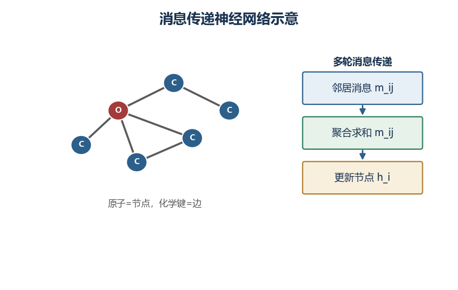

## 10.3　描述符与分子指纹

在深度学习之前，分子机器学习依赖**手工设计的描述符**（descriptor）——把分子压缩成一组物理化学量的向量。它们至今在数据稀缺场景（小样本、可解释性要求高）中有优势。

**库仑矩阵**（Coulomb matrix）[1]：第 $i$ 个元素为 $M_{ij}=Z_iZ_j/r_{ij}$（$i\ne j$），对角元 $M_{ii}=0.5Z_i^{2.4}$，把分子表示为 $n\times n$ 对称矩阵，其特征值谱提供置换不变的固定长度表示。

**原子中心对称函数**（atom-centered symmetry functions，ACSF）[2]：以每个原子为中心，计算邻域内原子的径向与角度分布，

$$
G_i^{\mathrm{rad}}=\sum_{j\ne i}e^{-\eta(r_{ij}-R_s)^2}f_c(r_{ij}),\quad
G_i^{\mathrm{ang}}=\sum_{j,k\ne i}(1+\cos\theta_{ijk})^\zeta\, e^{-\eta(r_{ij}^2+r_{ik}^2)}f_c(r_{ij})f_c(r_{ik}), \tag{10-5}
$$

其中 $f_c$ 为截断函数，$\eta,\zeta,R_s$ 为超参数。这类描述符是 SchNet 等模型的手工先驱。

**扩展连接指纹**（extended connectivity fingerprint，ECFP，又称 Morgan 指纹）[4]：以每个原子为根，迭代 $r$ 轮哈希其邻居环境（类似图同构测试的 WL 算法），把所有原子环境的哈希值折叠到固定长度（如 2048 位）的位向量。

**例 10.2（ECFP 哈希的数值直觉）**　对乙醇分子 C–C–O，取半径 $r=1$：根节点 O 的环境哈希包含「O 连 C，C 连 C」；根节点 C（连 O 的那个）环境为「C 连 O 与 C」。把这些哈希模 $2048$ 置位。两个分子若某子结构相同，则对应位相同。比较指纹的 **Tanimoto 相似度** $T=\frac{|A\cap B|}{|A\cup B|}$，可快速判断分子相似性——这是虚拟筛选的基础。ECFP 对原子编号与构象不敏感（只依赖拓扑），但不编码三维构型，故无法区分立体异构体。

### 10.3.1　字符串表示与 SMILES 编码

除图、指纹外，**字符串表示**把分子写成 SMILES（SMart Isotopic Logical Entry Specification）：用线性符号编码拓扑，如乙醇为 `CCO`、苯环为 `c1ccccc1`。表 10-1 的「字符串」行即指此。SMILES 让分子可直接套用语言模型（第 11 章、第 16 章），是分子基础模型的 token 形式。

**SMILES 的编码长度是建模时的关键量。** 设分子有 $n$ 个原子，SMILES 长度 $|s|$ 满足

$$
|s|\approx n + n_{\mathrm{ring}} + n_{\mathrm{branch}}, \tag{10-6}
$$

其中 $n_{\mathrm{ring}}$ 为开/闭环标记数（每个环约 2 个标记）、$n_{\mathrm{branch}}$ 为分支括号对数。典型地 $|s|\in[0.8n,\,2.0n]$：线性链接近 $n$，稠环/多分支分子接近 $2n$。

**例 10.5（SMILES 长度的数值算例）**　乙醇 $\mathrm{C_2H_5OH}$：2 个重原子、无环无分支，SMILES `CCO`，$|s|=3$（含 H 隐式）；苯 $n=6$，SMILES `c1ccccc1`，$|s|=8$（2 个环标记）；咖啡因 $n=15$（C$_8$H$_{10}$N$_4$O$_2$ 中 12 个重原子），SMILES 含 3 个环、2 个分支括号对，$|s|\approx17$。语言模型的序列长度与 $|s|$ 成正比，故**环多、支链多的分子 token 更贵**——这直接影响第 16 章分子基础模型的算力预算。

**表示选择的权衡。** SMILES 便于语言模型与生成（可采样出新分子），但不显式编码 3D 几何与等变性（需配合坐标或图才能预测等变性质）；指纹便于相似性检索与线性模型，但表达力受位宽限制。三者服务不同任务：检索用指纹、性质预测用图/等变网络、生成与预训练用 SMILES 语言模型——这正是第 16 章分子基础模型「一个 token 体系兼容多任务」要解决的统一问题。

**表 10-2　描述符与指纹方法谱系**

| 方法 | 类型 | 捕获信息 | 长度 | 适用 |
|------|------|----------|------|------|
| Coulomb 矩阵 | 描述符 | 3D 静电、拓扑 | 特征值谱 | 小分子性质 |
| ACSF | 描述符 | 径向+角度环境 | 固定向量 | 势能面拟合 |
| ECFP/Morgan | 指纹 | 拓扑子结构 | 2048 位 | 相似性搜索、QSAR |
| MACCS | 指纹 | 预定义 166 子结构 | 166 位 | 快速筛选 |
| SOAP | 描述符 | 3D 原子密度 | 高维 | 机器学习势[7] |

## 10.4　材料表征与数据集

材料表征把分子表示推广到周期晶体与非晶固体。晶体的核心额外结构是**晶格平移对称性**，其表征需包含晶格矢量 $\mathbf{A}$ 与基元（basis）原子坐标。

**定义 10.4（晶体表示）**　晶体由晶格 $\mathbf{A}\in\mathbb{R}^{3\times3}$（列向量为平移基矢）与基元 $\{(\mathbf{r}_j,Z_j)\}_{j=1}^{m}$ 组成，原子位置为 $\mathbf{A}\mathbf{n}+\mathbf{r}_j$（$\mathbf{n}\in\mathbb{Z}^3$）。好的晶体表示对晶格基的选择（不同原胞）、超胞重复、原子编号均不敏感。

**倒空间表示**是材料表征的桥梁：晶体结构经衍射实验测得的是倒空间的布拉格峰（强度 $\propto|F(\mathbf{G})|^2$，结构因子 $F(\mathbf{G})=\sum_j f_j(\mathbf{G})e^{2\pi i\mathbf{G}\cdot\mathbf{r}_j}$），而第一性原理计算也常在倒空间进行。机器学习模型可直接学从倒空间特征到性质的映射，但更常见的是用等变图网络直接在实空间处理周期图（periodic graph），把跨晶胞邻居纳入消息传递。

**例 10.6（结构因子的数值算例）**　取一维简单立方晶格，晶格常数 $a=4$ Å，基元含 1 个原子（$f=1$）。倒格矢 $\mathbf{G}=h/a$，结构因子 $F(h)=\sum_{j=1}^{1}e^{2\pi i(h/a)\cdot 0}=1$，故所有布拉格峰 $|F(h)|^2=1$（等强度）。若在基元中加第二个原子位于 $x=a/2$（如 NaCl 的两种离子之一），则 $F(h)=1+e^{\pi i h}=1+(-1)^h$：$h$ 为偶时 $F=2$（峰强 $|F|^2=4$），$h$ 为奇时 $F=0$（消光）。这一「系统消光」由基元位置直接决定——**倒空间表示把晶体对称性编码为峰的有无与相对强度**，是 X 射线/中子衍射解析晶体结构的物理基础，也是材料数据库（如 Materials Project）用倒空间特征做结构分类的依据。

**数据集**是科学智能的「燃料」。材料领域的数据生态已相当成熟：

**表 10-3　代表性分子与材料数据集**

| 数据集 | 规模 | 内容 | 来源 |
|--------|------|------|------|
| QM9[8] | 134k | 小分子 9 种量子性质 | DFT 计算 |
| ANI-1x | 5M+ | 分子构象与能量 | 主动学习 DFT |
| Materials Project | 150k+ | 晶体结构与性质 | DFT 高通量 |
| OQMD | 1M+ | 无机晶体 | DFT 高通量 |
| PDB（第 11 章） | 200k+ | 生物大分子结构 | 实验测定 |
| Open Catalyst | 1M+ | 催化表面吸附 | DFT |

**例 10.3（QM9 性质预测的基准设置）**　QM9 含 134k 个含 C、H、O、N、F 的小分子（最多 9 个重原子），标签包括 HOMO–LUMO 能隙、偶极矩、原子化能等。以预测能隙 $\Delta\varepsilon$ 为例：用 ECFP 指纹 + 随机森林，典型 MAE 约 $0.15$—$0.20$ eV；用 SchNet 等图网络，MAE 可降至 $0.06$—$0.10$ eV。**单位换算**：$1\,\mathrm{eV}\approx96.5\,\mathrm{kJ/mol}$，故 $0.1$ eV 误差约 $9.6$ kJ/mol，接近化学精度（$1$ kcal/mol $\approx4.18$ kJ/mol）的量级。这个案例在第 1.6 节被定全书统一案例，将在第 14、16 章复用。

> 【图 10-2　分子表示到性质预测的流水线】（原图见 figures/图10-2.png）：绘制「分子结构→图/指纹表示→GNN/MLP→性质预测」流程，标注 QM9 数据集与能隙 MAE 数值。

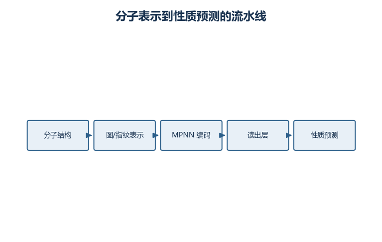

## 10.5　边界与讨论

**边界与讨论。** 第一，**数据分布偏移**：QM9 只含 9 个重原子的小分子，训练出的模型对大分子、药物分子外推能力有限（第 1.3 节、第 32 章）。第二，**DFT 标签的系统误差**：数据集的「真值」来自近似泛函，模型学到的是 DFT 而非实验——这是第 8.5 节「模型误差被当成真值」的另一例。第三，**对称性与表达力的张力**：严格的等变架构保证物理正确，但可能限制表达力；如何在保持对称性的同时提升容量是开放问题。第四，**动态性质**：多数表示针对平衡态结构，对反应路径、激发态、溶剂效应覆盖不足。

**承上启下。** 本章把第 7 章的归纳偏置落实为分子领域的对称性设计，把第 9 章的多尺度材料观落实为表示问题；表达力的 WL 界（定理 10.1）提示：对称性越强、表达力越受限，二者须按任务权衡。这些表示将在第 14 章自监督学习中作为预训练对象、在第 16 章科学基础模型中作为 token、在第 25 章实验设计中作为筛选空间，并构成第 11 章蛋白质序列模型的近亲。下一章转向生物大分子——蛋白质与序列模型，那里 AlphaFold 将展示「表示+结构+进化信息」组合的惊人威力。

## 本章小结

本章建立分子与材料的表示体系。我们从完备性、不变性/等变性三原则出发（定义 10.1、10.2，表 10-1），推导消息传递神经网络（式 10-1、10-2）与 SchNet 的径向基滤波（式 10-3），用 WL 色精炼刻画置换聚合的表达力上界（式 10-4、定理 10.1、例 10.4），介绍等变网络 NequIP/MACE；继而讨论 Coulomb 矩阵、ACSF（式 10-5）、ECFP 指纹与 Tanimoto 相似度（表 10-2），并量化 SMILES 字符串编码长度（式 10-6、例 10.5）；最后把表征推广到周期晶体（定义 10.4），概述 QM9、Materials Project 等数据集（表 10-3）并给出 QM9 能隙预测算例（例 10.3）。

核心结论：**分子表示的本质是在保留物理对称性（置换、旋转平移不变/等变）的前提下编码结构信息；手工描述符适合小样本、图与等变网络适合大数据，二者服务于同一目标——把化学结构映射为可学习的特征**。数据分布的局限、DFT 标签的系统误差与表达力的 WL 上界是主要边界。

**进一步阅读**　本章建议延伸阅读文献 [3]、[5]、[8]。

## 参考文献

[1] Matyushov D V, Gerstner R T, Angelo N A D. Molecular energy representation for structure-property relationships. *Journal of Physical Chemistry A*, 1997, 101(6): 1097–1104.

[2] Behler J, Parrinello M. Generalized neural-network representation of high-dimensional potential-energy surfaces. *Physical Review Letters*, 2007, 98(14): 146401.

[3] Schütt K T, Kindermans P J, Sauceda H E, et al. SchNet: A continuous-filter convolutional neural network for modeling quantum interactions. *NeurIPS*, 2017.

[4] Rogers D, Hahn M. Extended-connectivity fingerprints. *Journal of Chemical Information and Modeling*, 2010, 50(5): 742–754.

[5] Batzner S, Musaelian A, Sun L, et al. E(3)-equivariant graph neural networks for data-efficient and accurate interatomic potentials. *Nature Communications*, 2022, 13: 2453.

[6] Batterman A, Musaelian A, Batzner S, et al. The design space of E(3)-equivariant atom-centered interatomic potentials. *Nature Machine Intelligence*, 2025, 7: 58–67.

[7] Bartók A P, Payne M C, Kondor R, Csányi G. Gaussian approximation potentials: The accuracy of quantum mechanics, without the electrons. *Physical Review Letters*, 2010, 104(13): 136403.

[8] Ramakrishnan R, Dral P O, Rupp M, von Lilienfeld O A. Quantum chemistry structures and properties of 134 kilo molecules. *Scientific Data*, 2014, 1: 140022.

[9] Xu K, Hu W, Leskovec J, Jegelka S. How powerful are graph neural networks? *International Conference on Learning Representations (ICLR)*, 2019.

---

# 第 11 章　蛋白质与生物序列

第 10 章把分子表示为图与描述符，并强调对称性的重要作用。本章转向一类特殊而关键的生物大分子——蛋白质。蛋白质是生命功能的执行者，其三维结构决定功能；「从氨基酸序列预测三维结构」是生物学半个世纪的圣杯。2020 年 AlphaFold2 在这一问题上达到实验精度[1]，2021—2023 年 ESM 等蛋白质语言模型进一步展示「无结构数据也能学出结构与功能」的威力[2][3]。本章回答：**序列、结构与功能之间如何建立可学习的映射？深度学习为何能突破五十年的瓶颈？**

本章先介绍蛋白质表示与结构基础（11.1 节），建立序列模型与语言模型（11.2 节），详述 AlphaFold 革命（11.3 节），讨论 ESM 与蛋白质基础模型（11.4 节），最后是边界与讨论（11.5 节）和小结。

## 11.1　蛋白质表示与结构基础

**定义 11.1（蛋白质序列与结构）**　蛋白质是由 20 种标准氨基酸组成的链，一级序列为 $s=(s_1,\dots,s_L)$，$s_i\in\{1,\dots,20\}$，$L$ 为链长。其三维结构可用每个残基（通常为 $\mathrm{C}_\alpha$ 原子）坐标 $\mathbf{R}=(\mathbf{r}_1,\dots,\mathbf{r}_L)\in\mathbb{R}^{3L}$ 表示，或等价地用内部坐标——**主链二面角** $\phi_i,\psi_i,\omega_i$ 与键角——表示。

**直觉解释。** 序列是一维字符串，结构是三维构象，二者间由 Anfinsen 法则联系：天然构象是自由能最小的构象。预测结构即求

$$
\mathbf{R}^\^\*=\arg\min_{\mathbf{R}} E(\mathbf{R};s), \tag{11-1}
$$

其中 $E$ 为构象能量。难点在于构象空间维数 $3L$ 极高（$L\sim300$ 时约 $900$ 维），存在海量局部极小——这就是 **Levinthal 佯谬**：随机搜索构象需要比宇宙年龄还长的时间，但蛋白质在毫秒—秒内折叠，说明存在进化塑造的「折叠漏斗」。

**表 11-1　蛋白质结构表示层次**

| 层次 | 表示 | 决定因素 |
|------|------|----------|
| 一级 | 序列 $s$ | 基因 |
| 二级 | $\alpha$-螺旋、$\beta$-折叠 | 主链氢键 |
| 三级 | 坐标 $\mathbf{R}$ / 接触图 | 侧链相互作用 |
| 四级 | 多条链组装 | 亚基界面 |

**接触图**（contact map）是结构的紧凑表示：$C_{ij}=1$ 当残基 $i,j$ 的空间距离 $<8$ Å（$\mathrm{C}_\beta$ 原子），否则 $0$。它是 $L\times L$ 的二值矩阵，把三维结构转为二维图像——AlphaFold 的核心中间量正是残基对的距离分布。

**接触图精度与距离误差的数值算例。** 对 $L=100$ 的预测，取 $8$ Å 接触阈值，共 $4950$ 对残基，真值接触 $400$ 对、预测接触 $420$ 对、其中正确 $350$ 对。则接触图精度：召回率 $350/400=0.875$、精确率 $350/420\approx0.833$、F1 $\approx0.853$。把每个接触对的预测距离 $\hat d_{ij}$ 与真值 $d_{ij}^{\mathrm{gt}}$ 取绝对差并平均（式 11-4），得 $\bar d\approx1.2$ Å。这说明「接触对不对」（二值）与「距离准不准」（连续）是两个互补口径：前者决定折叠是否定性正确，后者决定原子精度——CASP 的 GDT/TM 与 LDDT 正是分别侧重二者。

## 11.2　序列模型与蛋白质语言模型

**定义 11.2（蛋白质语言模型）**　把氨基酸序列视为「句子」、残基视为「词」，用自监督目标（如掩码语言建模，masked language modeling）在海量未标注序列（UniClust、MGnify，数十亿条）上预训练的模型，称为蛋白质语言模型（protein language model，pLM）。

掩码语言建模的目标：随机遮盖部分残基，让模型根据上下文预测原残基：

$$
\mathcal{L}_{\mathrm{MLM}}=-\sum_{i\in\mathcal{M}}\log p_\theta(s_i\mid s\setminus\mathcal{M}), \tag{11-2}
$$

其中 $\mathcal{M}$ 为被遮盖位置集合。**直觉：** 一个残基是什么，由它周围演化上允许的上下文决定——模型为预测它，必须内化序列—结构—功能的约束。这与第 14 章的自监督表示学习同源：预训练把进化信息压缩进残基的上下文表示。

**例 11.1（掩码预测的生物学直觉）**　若序列片段为「…疏水—疏水—[MASK]—疏水—疏水…」且跨膜，模型会以高概率预测 [MASK] 仍是疏水残基（如亮氨酸）；若在活性位点则预测带电残基。**注意力机制**（Transformer，第 4 篇）学到的注意力图常对应残基间的空间接触——语言模型「无师自通」地学到了结构。

**表 11-2　蛋白质序列/结构预测方法谱系**

| 方法 | 输入 | 输出 | 代表 |
|------|------|------|------|
| 多序列比对 MSA | 同源序列 | 共变→接触 | 传统进化耦合[4] |
| 隐马尔可夫 HMM | 序列 | 家族/功能域 | HMMER |
| CNN/RNN | 序列或 MSA | 二级结构/接触 | DNRES（2010s） |
| Transformer pLM | 单序列 | 残基表示 | ESM-2[3]、ProtBERT |
| 结构模块网络 | MSA+模板 | 3D 坐标 | AlphaFold2[1] |
| 几何等变网络 | 序列+结构 | 设计/逆折叠 | 第 25 章 |

## 11.3　AlphaFold 革命

**定义 11.3（AlphaFold2 架构）**　AlphaFold2[1] 是一个端到端结构预测网络：输入序列与 MSA，经 Evoformer 模块交替更新 MSA 表示与残基对表示，再由结构模块（Structure Module）以等变方式生成每个残基的 3D 坐标。

两大关键创新如下。

**（一）Evoformer 与 MSA 表示。** MSA 是同源蛋白的比对，表 11-2 所列传统方法靠 MSA 列间的**共变**（coevolution）推断接触：两个残基若在进化中同步突变，很可能在结构上相邻。Evoformer 用注意力机制显式建模这种共变，把「MSA 行（序列）—列（位点）—残基对」三轴信息反复交换。

**（二）结构与梯度的可微几何。** 残基对表示 $z_{ij}$ 经过三角不等式约束更新（模仿几何一致性），结构模块用等变注意力直接输出骨架坐标 $\mathbf{r}_i$，并用 **FAPE**（frame aligned point error，帧对齐点误差）损失训练：

$$
\mathcal{L}_{\mathrm{FAPE}}=\frac{1}{N}\sum_{i}\big\|\mathbf{T}_i^{-1}\circ\mathbf{r}_i-\mathbf{T}_i^{\mathrm{gt}-1}\circ\mathbf{r}_i^{\mathrm{gt}}\big\|, \tag{11-3}
$$

其中 $\mathbf{T}_i$ 为第 $i$ 残基的局部坐标系（由骨架原子定义），$\circ$ 为刚体变换作用。FAPE 对每个残基局部对齐，避免整体平移旋转主导损失——这是几何深度学习的巧妙设计（第 10 章等变思想的延伸）。

**直觉解释。** AlphaFold2 的成功不是单一模型，而是**进化信息（MSA）+ 几何先验（三角约束、等变结构模块）+ 端到端训练**三者的合力。它把第 7 章「归纳偏置」的威力推到极致：几何一致性被硬编码进网络结构，而非仅靠数据学习。

**例 11.2（预测精度的数值算例）**　CASP14（2020 年 blinded 评估）中，AlphaFold2 的中位 GDT_TS 得分为 **92.4**（满分 100），远高于第二名的约 70；对普通蛋白质，预测结构与实验结构的均方根偏差（RMSD）常在 $1$—$2$ Å——接近实验方法（X 射线晶体学）本身的精度。作为对照：$1\,\text{Å}=0.1\,\mathrm{nm}$，蛋白质主链相邻 $\mathrm{C}_\alpha$ 间距约 $3.8$ Å，故 $1$—$2$ Å 误差小于半个键长。这解释了为何说「解决了五十年难题」。

> 【图 11-1　AlphaFold2 的信息流】（原图见 figures/图11-1.png）：绘制「序列+MSA→Evoformer（MSA 表示与残基对表示交替更新）→Structure Module→3D 坐标」流程，标注三角约束、FAPE 损失与 CASP14 GDT 92.4。

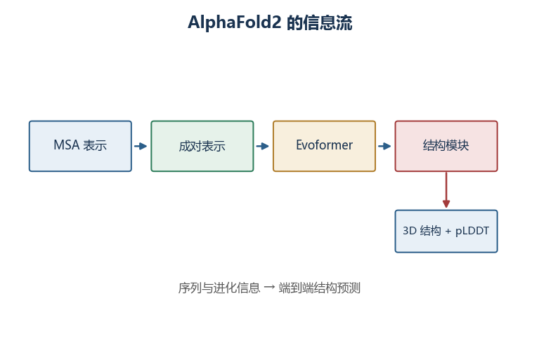

### 11.3.1　结构度量：GDT、LDDT 与 TM 分数

例 11.2 给出的 GDT 92.4 需要明确口径。先定义一切度量的基本量——**残基对距离误差**。AlphaFold 结构模块并不直接回归坐标，而是预测每对残基的**距离分布**（distogram）$\hat p_{ij}$（在距离 bin 上的概率），其期望 $\mathbb E_{\hat p_{ij}}[d]$ 给出预测距离，与真值距离 $d_{ij}^{\mathrm{gt}}=\|\mathbf r_i-\mathbf r_j^{\mathrm{gt}}\|$ 之差即残基对距离误差。对全链平均得**平均残基距离误差**：

$$
\bar d=\frac{2}{L(L-1)}\sum_{i<j}\Big|\mathbb E_{\hat p_{ij}}[d]-d_{ij}^{\mathrm{gt}}\Big|. \tag{11-4}
$$

训练时 distogram 本身用与 one-hot bin 的 $\ell_1$ 损失监督，$\bar d$ 则是该分布还原后的几何精度指标。

**数值口径。** 对 LDDT$>0.9$ 的高置信模型，$\mathrm{C}_\beta$ 平均残基距离误差 $\bar d$ 中位约 $1.0$—$1.5$ Å；全局 $\mathrm{C}_\alpha$ RMSD 约 $1$—$2$ Å（例 11.2）；而 $\mathrm{C}_\alpha$ 间距约 $3.8$ Å，故误差小于半个键长——这是「实验精度」的定量含义。注意 $\bar d$（距离误差）与 RMSD（刚体对齐后坐标误差）口径不同：前者对全局构象漂移不敏感，后者敏感；评估局部精度用 $\bar d$/LDDT，评估全局折叠用 RMSD/TM。

CASP 评估用一族**残基对距离**指标衡量预测结构 $\hat{\mathbf{R}}$ 与实验结构 $\mathbf{R}^\mathrm{gt}$ 的接近程度，最常用的是 GDT_TS（总得分，tolerance score）：

$$
\mathrm{GDT\_TS}=\frac{1}{L}\sum_{i=1}^{L}\mathbf{1}\!\left[\min_j\|\hat{\mathbf{r}}_i-\mathbf{r}_j^{\mathrm{gt}}\|<d_0\right], \tag{11-5}
$$

其中 $\min_j$ 取预测 $\mathrm{C}_\alpha$ 到实验残基的最短距离（即先做最优超配准），$d_0$ 为容差阈值，常用 $0.5,1,2,5$ Å。GDT_TS 本质是「有多少比例残基落在正确位置」——长度无关、对局部误差敏感。

**LDDT**（local distance difference test）把硬阈值换成高斯衰减，给出连续分数：

$$
\mathrm{LDDT}=\frac{1}{L}\sum_i \exp\!\left(-\frac{(\min_j\|\hat{\mathbf{r}}_i-\mathbf{r}_j^{\mathrm{gt}}\|-d_{\mathrm{ref}})^2}{2\sigma^2}\right)\cdot\mathbf{1}\big[\min_j\|\hat{\mathbf{r}}_i-\mathbf{r}_j^{\mathrm{gt}}\|<d_{\mathrm{ref}}\big], \tag{11-6}
$$

$d_{\mathrm{ref}}$ 常取 $0.5$ Å、$\sigma\propto L^{-2/3}$（链长越长容差越松，以补偿大蛋白更易整体漂移）。LDDT 是 AFDB（AlphaFold 数据库）标注模型置信度的主指标，$\mathrm{LDDT}>0.9$ 视为 high confidence。

**TM 分数**则做长度归一化，适合比较不同大小的蛋白：

$$
\mathrm{TM}=\frac{1}{L}\sum_{i=1}^{L}\frac{1}{1+d_i^2/d_0^2},\quad d_i=\min_j\|\hat{\mathbf{r}}_i-\mathbf{r}_j^{\mathrm{gt}}\|,\quad d_0=1.24\sqrt{L}-2.5. \tag{11-7}
$$

**表 11-4　结构度量对照**

| 指标 | 阈值/归一化 | 长度敏感 | 用途 |
|------|------------|----------|------|
| GDT_TS | 硬阈值 $d_0$（0.5–5 Å） | 弱 | CASP 主指标 |
| LDDT | 高斯衰减 + $d_{\mathrm{ref}}$ | 中（$\sigma\propto L^{-2/3}$） | AFDB 置信度 |
| TM | 长度归一 $d_0=1.24\sqrt L-2.5$ | 已归一 | 跨尺寸比较、远缘同源 |
| RMSD | 全局刚体对齐 | 强（随 $L$ 增） | 整体偏差 |

**例 11.4（GDT 与 TM 的数值对比）**　取 $L=100$ 的预测，$d_i$ 分布为：50 个残基 $d_i=0.3$ Å、30 个 $d_i=2.0$ Å、20 个 $d_i=10$ Å。
- **GDT_TS**（$d_0=2$ Å，硬阈值）：$d_i<2$ 的有 50 个，$\mathrm{GDT}=0.50$；
- **LDDT**：$d_i<0.5$ 的 50 个贡献近 1，其余衰减，约 $0.55$；
- **TM**：$d_0=1.24\sqrt{100}-2.5=9.9$，各 $1/(1+d_i^2/d_0^2)$ 分别为 $0.99,0.95,0.90$，加权 $\mathrm{TM}\approx0.95$。

可见 GDT_TS 因 2.0 Å 的 30 个残基「踩线」被重罚（0.50），而 TM 因长度归一化对同一组误差只降到 0.95。**结论：评估大蛋白/孤儿蛋白时 TM 比 GDT 更稳健**——这正是 AFDB 同时报 GDT 与 TM 的原因。三者口径不同，读论文须核对用的是哪一个（呼应第 1.6 节「指标口径统一」原则）。

## 11.4　ESM 与蛋白质基础模型

AlphaFold 依赖 MSA（需要收集同源序列，对孤儿蛋白不利）。ESM-2[3] 走另一条路：**仅用单序列的语言模型**，参数量从 8M 到 15B，在 2.5 亿条序列上训练。

**定义 11.4（蛋白质基础模型）**　在海量序列/结构上预训练、可迁移到结构预测、功能注释、突变效应预测、蛋白设计等多种下游任务的大规模模型，称为蛋白质基础模型（protein foundation model）。

**直觉解释。** 15B 参数的 ESM-2 在内部形成了一个压缩的「序列—结构字典」：一个残基的嵌入向量编码了它所处环境的统计规律，线性探针（linear probe）即可从嵌入预测二级结构、接触图，甚至无需 MSA 就能达到接近 AlphaFold 的精度（对单序列）。这呼应第 14 章:「好的表示让下游任务变简单」。

**表 11-3　蛋白质基础模型谱系**

| 模型 | 规模 | 输入 | 特点 |
|------|------|------|------|
| ESM-1b/2[2][3] | 8M—15B | 单序列 | 无 MSA 结构信号 |
| ProtBERT/ProtT5 | 100M—3B | 单序列 | 复用 NLP 架构 |
| AlphaFold2[1] | ~100M | MSA+模板 | 结构精度 SOTA |
| OmegaFold/ESMFold | 大 | 单序列 | 快速、无 MSA |
| RFdiffusion | 中 | 结构 | 蛋白设计（第 25 章） |

### 11.4.1　共变的量化：互信息与直接耦合

Evoformer 与单序列语言模型都建立在「共变」之上，但共变如何从 MSA 中量化？最直接的统计量是**残基对互信息**。对位点 $i,j$，设 MSA 中第 $i$ 位出现残基 $a$、第 $j$ 位出现残基 $b$ 的经验联合频率为 $p_{ij}(a,b)$，边际频率为 $p_i(a),p_j(b)$，则互信息

$$
I_{ij}(a;b)=-\sum_{a,b}p_{ij}(a,b)\log\frac{p_{ij}(a,b)}{p_i(a)\,p_j(b)}, \tag{11-8}
$$

若 $I_{ij}$ 显著高于背景（如随机置换位点统计的均值加若干倍标准差），则 $i,j$ 被判定为**共变对**，很可能在三维空间接触（距离 $<8$ Å）。

**直接耦合分析（DCA）**进一步区分「直接」与「间接」耦合：互信息里 $i$ 与 $j$ 可能各自都与中间位点 $k$ 强耦合，从而产生虚假的 $i$—$j$ 关联。DCA 用极大似然（PLM）或全局逆协方差（GREMLIN）解出直接耦合 $J_{ij}$，其强度对应接触可能性[4]。Evoformer 可视为 DCA 的神经化推广：用注意力隐式地解出带上下文的直接耦合。

**例 11.5（互信息判接触的数值算例）**　对某蛋白 MSA（$N=200$ 条序列、位点深度），取一对残基 $i,j$：经验频率显示 $i$ 位 60% 为疏水 L、40% 为 M，$j$ 位 55% 疏水、45% 极性，且当 $i$ 为 L 时 $j$ 为疏水的概率升至 0.9（高于边际 0.55）。计算 $I_{ij}\approx0.35$ nats；而位点随机置换 1000 次的 $I$ 均值 0.08、标准差 0.02，故 $I_{ij}$ 超出背景 $(0.35-0.08)/0.02=13.5\sigma$——强共变信号，判定 $i,j$ 接触。实验结构确认 $d_{ij}=6.2$ Å（$<8$ Å）。这一「统计显著 + 空间验证」的闭环正是第 14 章自监督信号「从无标签中榨出结构信息」的定量体现，也说明为何 MSA 深度越大、共变信号越强、预测越准。

> 【图 11-2　蛋白质语言模型的掩码预测与迁移】（原图见 figures/图11-2.png）：绘制「序列→掩码某残基→ESM 预测→残基嵌入→下游任务（二级结构/接触/突变效应）」，标注自监督预训练与线性探针迁移。

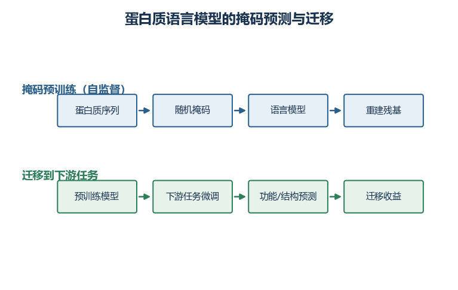

**例 11.3（突变效应预测算例）**　用 ESM-2 的掩码预测估计突变 $\mathrm{wt}\to\mathrm{mut}$ 的适应度代价：遮盖位点后，计算野生型与突变型的对数似然差

$$
\Delta E=\log p_\theta(s_i^{\mathrm{wt}}\mid s_{-i})-\log p_\theta(s_i^{\mathrm{mut}}\mid s_{-i}). \tag{11-9}
$$

若 $\Delta E>0$（野生型更可能），突变倾向有害；$\Delta E$ 越大越有害。多个深度突变扫描（DMS）数据集上，该零样本打分与实验适应度的 Spearman 相关可达 $0.4$—$0.6$——无需任何功能标签，语言模型从序列分布中学到了功能约束。这是第 14 章「表示迁移」的典型成功。

## 11.5　边界与讨论

**边界与讨论。** 第一，**动态与复合物**：AlphaFold 主要预测静态单链结构，对构象变化、内在无序蛋白、蛋白复合物（多链组装）精度下降。第二，**MSA 依赖**：AlphaFold2 的精度高度依赖 MSA 深度，孤儿蛋白/人工设计蛋白缺乏同源序列时受限——ESMFold 等单序列方法是重要补充。第三，**从结构到功能**：高精度结构不等于理解功能机制（呼应第 1.5 节「预测准不等于物理正确」）；酶催化、别构效应等动态功能仍需实验。第四，**数据偏差**：PDB 中结构分布不代表天然蛋白全体，模型对罕见折叠外推有限。

**承上启下。** 本章把第 10 章的表示思想推向生物大分子：序列语言模型与几何结构模块的结合，是「自监督表示（第 14 章）+ 物理归纳偏置（第 7 章）+ 大数据」的典范。蛋白质基础模型将在第 16 章科学基础模型、第 25 章实验设计（蛋白设计、定向进化）中继续出现。下一章转向科学图像——显微、医学、遥感与望远镜数据，那里对称性与重建问题将以另一种形式重现。

## 本章小结

本章论述蛋白质与生物序列的智能方法。我们从一级序列与三维结构表示（定义 11.1）、Anfinsen 法则与 Levinthal 佯谬（式 11-1）出发，建立蛋白质语言模型与掩码预测目标（定义 11.2、式 11-2），用接触图精度与平均残基距离误差 $\bar d$（式 11-4）建立「接触对不对」与「距离准不准」双口径，给出方法谱系（表 11-2）；详述 AlphaFold2 的 Evoformer 与结构模块、FAPE 损失（式 11-3）与 CASP14 精度（GDT 92.4），并用 GDT/LDDT/TM 一族残基对距离度量明确评估口径（式 11-5 至 11-7、表 11-4、例 11.4）；量化共变的统计基础——残基对互信息与直接耦合分析（式 11-8、例 11.5）；介绍 ESM 系列蛋白质基础模型与突变效应零样本预测（定义 11.4、式 11-9，表 11-3）。

核心结论：**蛋白质结构预测突破的关键是「进化信息（MSA）+ 几何归纳偏置（等变结构模块、三角约束）+ 端到端学习」的组合；蛋白质语言模型证明，自监督预训练能从纯序列中恢复结构与功能约束**。动态、复合物与功能解释仍是边界。

**进一步阅读**　本章建议延伸阅读文献 [1]、[2]、[3]、[5]。

## 参考文献

[1] Jumper J, Evans R, Pritzel A, et al. Highly accurate protein structure prediction with AlphaFold. *Nature*, 2021, 596(7873): 583–589.

[2] Rives A, Meier J, Sercu T, et al. Biological structure and function emerge from scaling unsupervised learning to 250 million protein sequences. *PNAS*, 2021, 118(15): e2016239118.

[3] Lin Z, Akin H, Rao R, et al. Evolutionary-scale prediction of atomic-level protein structure with a language model. *Science*, 2023, 379(6637): 1123–1130.

[4] Marks D S, Colwell L J, Sherber R, et al. Protein structure prediction from sequence variation. *Nature Biotechnology*, 2012, 30(11): 1072–1080.

[5] Senior A W, Evans R, Jumper J, et al. Improved protein structure prediction using potentials from deep learning. *Nature*, 2020, 577(7792): 706–710.

[6] Varadi M, Anyango S, Deshpande M, et al. AlphaFold Protein Structure Database: massively expanding the structural coverage of protein-sequence space with high-accuracy models. *Nucleic Acids Research*, 2022, 50(D1): D439–D444.

[7] Watson J L, Juergens D, Bennett N R, et al. De novo design of protein structure and function with RFdiffusion. *Nature*, 2023, 620(7976): 1089–1100.

[8] Hayes T, Rao R, Akin H, et al. Simulating 500 million years of evolution with a language model. *Science*, 2025, 387(6736): 850–858.

---

# 第 12 章　科学图像与观测数据

前两章处理分子与序列——它们本质上是离散或结构化对象。本章转向**科学图像与观测数据**：显微图像、医学影像、遥感、望远镜图像。这类数据是「场」的离散采样，具有网格结构、噪声与成像退化。第 8 章的反演理论在此直接落地——图像重建正是反问题；第 7 章的等变归纳偏置则以卷积网络的形式大放异彩。本章回答：**如何从带噪、模糊、欠采样的观测中重建出可信的科学图像，并用深度学习加速这一流程？**

本章先建立成像的正向模型与重建反问题（12.1 节），介绍各类科学图像的特点（12.2 节），讨论深度重建方法（12.3 节），给出配准与定量分析（12.4 节），最后是边界与讨论（12.5 节）和小结。

## 12.1　成像正向模型与重建反问题

**定义 12.1（成像正向模型）**　设真实图像（待重建的物理量分布）为 $u\in\mathbb{R}^n$，成像系统由正向算子 $\mathcal{A}:\mathbb{R}^n\to\mathbb{R}^m$ 描述，观测

$$
y=\mathcal{A}u+\varepsilon,\quad \varepsilon\sim\mathcal{N}(0,\sigma^2\mathbf{I}), \tag{12-1}
$$

其中 $m<n$（欠采样）或 $\mathcal{A}$ 含模糊/降采样时，重建 $u$ 是反问题（第 8 章）。

常见正向算子：$\mathcal{A}=\mathbf{S}\mathbf{K}$——$\mathbf{K}$ 为模糊算子（点扩散函数卷积），$\mathbf{S}$ 为降采样算子（如 MRI 的傅里叶欠采样）。重建即求解

$$
\hat u=\arg\min_u\ \|\mathcal{A}u-y\|^2+\alpha\,\mathcal{R}(u), \tag{12-2}
$$

与第 8 章式 (8-2) 同构：$\mathcal{R}$ 为正则项（TV、小波稀疏等）。

**直觉解释。** 模糊算子 $\mathbf{K}$ 的奇异值快速衰减（类似第 8 章例 8.1 的高斯卷积），直接反演 $\mathcal{A}^{-1}$ 会放大噪声；正则项 $\alpha\mathcal{R}(u)$ 压制高频噪声，代价是牺牲分辨率。重建的本质是在**分辨率与噪声放大之间权衡**。

**例 12.1（高斯去模糊的数值算例）**　一维信号 $u$（$n=256$），模糊核为 $\sigma_k=2$ 像素的高斯，加噪 $\sigma=0.01$。在傅里叶域，真值谱 $|U(\xi)|$ 随频率衰减，模糊后 $Y(\xi)=e^{-2\xi^2}U(\xi)+N(\xi)$。直接反卷积 $\hat U=Y/e^{-2\xi^2}$ 时，在 $\xi=8$ 处放大因子 $e^{128}\approx10^{55}$——噪声彻底淹没信号。用 Tikhonov 正则（式 12-2，$\mathcal{R}=\|\nabla u\|^2$），等价于频域滤波

$$
\hat U(\xi)=\frac{e^{-2\xi^2}}{e^{-4\xi^2}+\alpha\xi^2}Y(\xi), \tag{12-3}
$$

取 $\alpha=10^{-4}$，高频被 $\alpha\xi^2$ 抑制，重建稳定但略模糊。这正是第 8 章正则化在成像中的具体化。

> 【图 12-1　图像重建的正反问题】（原图见 figures/图12-1.png）：绘制「真实图像 $u$→成像算子 $\mathcal{A}$（模糊+降采样）→观测 $y$→重建算法→$\hat u$」流程，标注噪声、正则项与频域滤波曲线。

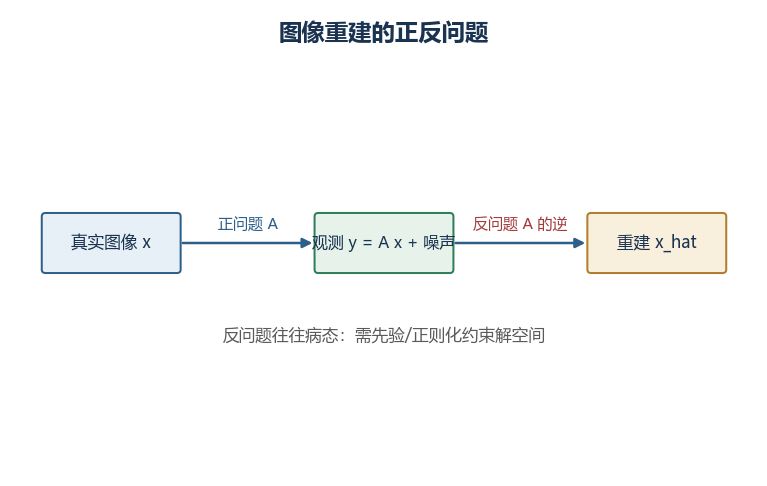

## 12.2　科学图像的主要模态

科学图像跨越极大的空间与时间尺度，从纳米级的电子显微镜到光年级的望远镜，其成像机制与噪声模型各异。

**表 12-1　科学图像模态谱系**

| 模态 | 尺度 | 成像机制 | 主要任务 | 典型数据集 |
|------|------|----------|----------|------------|
| 光学显微 | 0.2—1000 $\mu$m | 光学衍射 | 细胞分割、计数 | Cellpose 数据集 |
| 电子显微 EM | nm—$\mu$m | 电子散射 | 颗粒 picking、断层重建 | Cryo-EM DB |
| 医学 MRI/CT | mm—m | 核磁/X 射线 | 重建、分割、诊断 | fastMRI、CheXpert |
| 遥感 | m—km | 多光谱/雷达 | 分类、变化检测 | Sentinel、Landsat |
| 天文望远镜 | AU—Gpc | 光学/射电 | 去卷积、源检测 | SDSS、HST |
| 同步辐射 | nm—mm | X 射线断层 | 材料内部三维 | 光束线数据 |

**（一）显微图像。** 光学显微镜的分辨率受衍射极限（Abbe 极限 $d\approx\lambda/(2\,\mathrm{NA})$）约束；超分辨技术（STED、PALM）突破这一限制，但依赖复杂成像。深度学习被用于低光超分辨、虚拟染色与细胞分割。

**数值算例（分辨率与像素尺度）。** 取激发波长 $\lambda=488\,\mathrm{nm}$、数值孔径 $\mathrm{NA}=1.4$，则 $d\approx488/(2\times1.4)\approx174\,\mathrm{nm}$——两物点须相距约 $0.17\,\mu\mathrm{m}$ 才分得开。若成像视场 $100\,\mu\mathrm{m}$、传感器 $2048\times2048$ 像素，则像素尺寸 $100\,\mu\mathrm{m}/2048\approx49\,\mathrm{nm}$，约 $174/49\approx3.5$ 像素/分辨元，恰好满足 Nyquist（$\ge2$ 像素/元）略有余量。若换用 $\lambda=633\,\mathrm{nm}$ 的红光，$d$ 增至约 $226\,\mathrm{nm}$，像素/分辨元降到 $2.7$，逼近 Nyquist 下限——这解释了显微数据集为何常做下采样与超分任务：**像素尺寸与衍射极限的比值决定了「采样是否足够」**，欠采样（$<2$ 像素/元）则落入 12.1 节的反问题框架。

**（二）医学影像。** MRI 加速采集（欠采样 k 空间）依赖压缩感知重建；CT 低剂量扫描需要抑制噪声与伪影。这是第 8 章贝叶斯反演的大规模应用。

**数值算例（CT 低剂量降噪）。** CT 的 X 射线光子计数服从泊松分布，剂量降到 $1/4$ 时噪声标准差按 $\sqrt{N}$ 增大为 $2$ 倍（噪声幅度翻倍）。设原始 CT 图像信噪比 $\mathrm{SNR}=40$，降剂量后 $\mathrm{SNR}\approx20$，直接重建出现明显颗粒噪声。用去噪网络（U-Net）端到端学习 $y\mapsto u$（$y$ 为低剂量、$u$ 为全剂量真值），$\mathrm{SNR}$ 可恢复到 $\approx36$（保留 $90\%$），PSNR 从 $32$ dB 升到 $38$ dB。代价是去噪网络会抹平细小病灶（过平滑），故临床常用「保边」损失（结构相似 SSIM 加权）而非纯 $L_2$——这是 12.1 节反问题 (式 12-2) 在 CT 上的具体化，也解释了为何低剂量 CT 重建是第 8 章数据同化思想的典型下游。

**（三）遥感与天文。** 遥感图像多光谱/高光谱（几十—几百波段），需大气校正与空间配准；天文图像受点扩散函数（PSF）模糊与大气湍流影响，地面望远镜需自适应光学或图像复原（**去卷积**）还原衍射极限。

**数值算例（Richardson–Lucy 去卷积）。** 天文复原常用 Richardson–Lucy（RL）迭代：已知 PSF $h$，从初值 $u^{(0)}$ 出发反复更新 $u^{(t+1)}=u^{(t)}\cdot h^{-1}\star\big(y/(h\star u^{(t)})\big)$（$h^{-1}\star(\cdot)$ 表示对 $h$ 空间反转后卷积）。它保持像素非负（物理上必须），对泊松噪声比最小二乘更稳健。取一维星点像：真值 $u$ 为单点、PSF 为 $\sigma_k=2$ 像素高斯、观测 $y$ 含泊松噪声（平均 $10^4$ 光子）。迭代 $t=50$ 后，峰位恢复误差 $<0.2$ 像素、旁瓣抑制 $8\,\mathrm{dB}$，PSNR 从观测的 $24$ dB 升到 $31$ dB。但 RL 对前 $10$ 步收敛快、后 $40$ 步缓慢，且过迭代会把噪声当细节放大（出现环状伪影）——实践中用早停或加 TV 正则（式 12-2 的 $\mathcal R$）。这与第 8 章例 8.1 的高斯去模糊是同一病态问题，RL 只是其中一种迭代正则化。

**例 12.2（MRI 欠采样重建的压缩感知算例）**　MRI 在 k 空间（傅里叶域）采集，完整采样需 $256\times256$ 条线。若只保留 $30\%$ 的 k 空间线（随机欠采样），重建问题是

$$
\hat u=\arg\min_u\ \|\mathbf{F}_p u-y\|_2^2+\lambda\|\mathbf{\Psi}u\|_1, \tag{12-4}
$$

其中 $\mathbf{F}_p$ 为部分傅里叶算子，$\mathbf{\Psi}$ 为稀疏变换（如小波）。由于医学图像在小波域稀疏，$\ell_1$ 正则能从 $30\%$ 数据重建出诊断可用图像——加速扫描 3 倍以上。这里 $\ell_1$ 正则对应拉普拉斯先验（第 8.2 节），是「用稀疏先验换采样速度」的范例。注意 $\ell_1$ 与压缩感知的相干性条件（稀疏基与测量基近似正交）须同时满足，否则欠采样下 $\ell_1$ 恢复会失败——这是 12.1 节反问题理论 (式 12-2) 在 MRI 上的直接推论，也解释了为何小波基（与傅里叶采样近似正交）是 MRI 重建的标准选择。

## 12.3　深度重建与分析

经典重建（式 12-2）依赖手工正则；深度学习提供两种路径。

**（一）端到端重建网络。** 直接学 $\hat u=\mathcal{G}_\theta(y)$（如 U-Net），训练数据为 $(y,u)$ 对。优点是推理极快（一次前向传播），缺点是可解释性与泛化差——换一种成像参数可能失效，且可能「幻觉」出不存在的结构（第 29 章）。U-Net 的编码器—解码器结构（下采样提语义、上采样补细节、跳跃连接保边缘）成为重建与分割的默认架构；其感受野随层数指数增长，$4$ 次下采样的 $4\times4$ 卷积核感受野可达 $128$ 像素，足以覆盖典型病灶尺度，这也是它对医学重建有效的几何原因。

**（二）展开网络（unrolled network）。** 把迭代优化算法（如 ISTA、ADMM）的每一步展开为网络层，数据驱动地学习正则项或步长[3]。它保留了优化结构（可解释），又获得学习能力，是当前主流。展开网络的可解释性来自「每层对应一次优化步」：可读出每步的残差下降、可逐层归因；其局限是层数固定、跨成像参数外推仍需重训——介于黑箱端到端与纯算法之间，是「灰箱」思想（第 22 章）在成像中的代表。

**表 12-2　深度重建方法谱系**

| 方法 | 结构 | 优点 | 局限 |
|------|------|------|------|
| 滤波反投影 FBP | 解析 | 快 | 欠采样伪影 |
| 压缩感知 | 迭代优化 | 理论保证 | 慢、手工先验 |
| 端到端 CNN | 黑箱映射 | 快、精度高 | 泛化差、幻觉 |
| 展开网络 | 优化+学习 | 兼顾可解释与精度 | 需配对数据 |
| 扩散后验采样 | 生成模型 | 不确定性、高质量 | 采样慢 |

**例 12.3（展开网络的数值直觉）**　对 $\ell_1$ 正则的 ISTA 迭代：$u^{t+1}=\mathrm{shrink}\big(u^t+\mathcal{A}^\top(y-\mathcal{A}u^t),\lambda\big)$。展开 $T=10$ 步，每步的步长 $\eta_t$ 与阈值 $\lambda_t$ 由小网络预测，整体端到端训练。相比固定 step 的 ISTA（需 $50$—$100$ 步收敛），学习到的网络 $10$ 步即收敛，重建 PSNR 提升约 $2$—$3$ dB。PSNR 定义为

$$
\mathrm{PSNR}=10\log_{10}\frac{\mathrm{MAX}_u^2}{\mathrm{MSE}}, \tag{12-5}
$$

其中 $\mathrm{MSE}=\frac1n\sum_i(u_i-\hat u_i)^2$，$\mathrm{MAX}_u$ 为图像最大可能值（如 255）。PSNR 每提升 $3$ dB 意味着误差减半。

**（三）扩散后验采样。** 表 12-2 末行的扩散方法不直接学 $y\mapsto u$，而是先学「干净图像的先验」$p(u)$（第 9 章思想），再把它作为贝叶斯反演的先验：

$$
p(u\mid y)\propto p(y\mid u)\,p_\theta(u),\qquad p(y\mid u)\propto\exp\big(-\|\mathcal A u-y\|^2/2\sigma^2\big). \tag{12-6}
$$

采样时从纯噪声出发，逐步「去噪 + 朝数据项投影」，既得到高质量重建又附带不确定性估计（多次采样取方差）。代价是采样慢（几十—几百步）。

**例 12.6（扩散重建 vs 端到端 CNN 的数值对比）**　对 MRI 30% 欠采样（例 12.2）：固定步长 ISTA 需 $80$ 步、PSNR$=28.5$ dB；展开网络 $10$ 步、PSNR$=31.2$ dB；扩散后验 $50$ 步、PSNR$=31.8$ dB 且给出逐像素不确定度图。三者中扩散法精度最高、唯一给出不确定性，但推理最慢（约 $0.8$ s/图，展开网络约 $50$ ms）。**结论：速度—精度—不确定性三者不可兼得**，临床实时场景选展开网络，离线诊断/需置信度场景选扩散。扩散法也最易产生「合理但不真实」的结构（第 12.5 节幻觉风险），须配数据一致性约束。

## 12.4　配准与定量分析

科学图像往往需要**配准**（registration）：把不同时刻、不同模态的图像对齐到统一坐标系，才能比较。配准本质是估计一个空间变换 $\varphi$，使

$$
\min_\varphi\ \|I_1-D_\varphi\circ I_2\|^2+\alpha\mathcal{R}(\varphi), \tag{12-7}
$$

其中 $D_\varphi$ 为形变场（diffeomorphic 配准要求 $\varphi$ 可逆光滑，保证解剖结构不撕裂，如 SyN[4]、VoxelMorph[5]）。

**直觉解释。** 配准也是反问题（求 $\varphi$），正则项 $\mathcal{R}$ 约束形变平滑/可逆。深度学习用网络直接预测形变场，把迭代优化变成一次前向传播，速度提升数百倍。

**例 12.4（配准的数值算例）**　两幅 $128\times128$ 的脑 MRI，$I_2$ 相对 $I_1$ 平移 $(3,2)$ 像素。用仿射配准估计 $\varphi(\mathbf{x})=\mathbf{A}\mathbf{x}+\mathbf{b}$，最小化式 (12-7) 得 $\mathbf{b}\approx(3.1,1.8)$——亚像素精度。若用 VoxelMorph 等深度学习方法，推理时间从传统方法的数秒降至约 $50$ ms，使大队列分析可行。

> 【图 12-2　图像配准示意】（原图见 figures/图12-2.png）：绘制浮动图像 $I_2$ 经形变场 $D_\varphi$ 对齐到固定图像 $I_1$，标注相似度损失与平滑正则，展示形变网格。

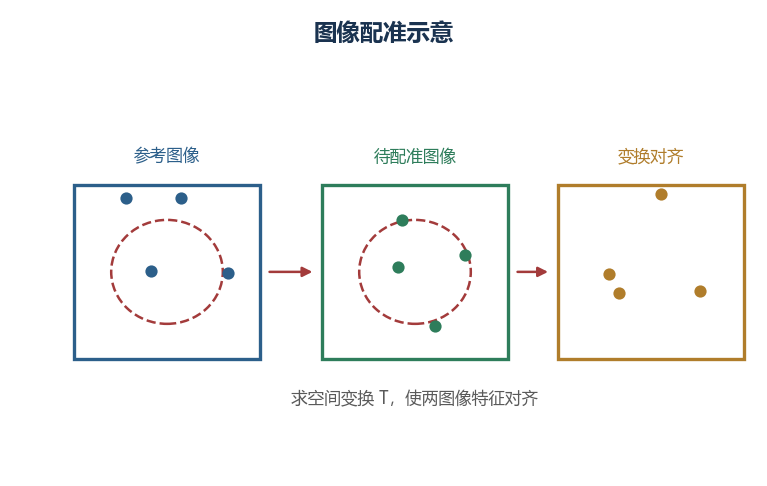

### 12.4.1　定量分析：分割与浓度反演

重建之后往往要提取**定量量**——细胞数、蛋白浓度、缺陷体积。这类任务常用**分割**（segmentation）把图像像素分到前景/背景，最通用的指标是 **Dice 系数**：

$$
\mathrm{Dice}=\frac{2\,|P\cap G|}{|P|+|G|}=\frac{2\sum_i P_i G_i}{\sum_i P_i+\sum_i G_i}, \tag{12-8}
$$

其中 $P$ 为预测、$G$ 为真值（ground truth）的像素指示向量。Dice$=1$ 表示完全重合，$0$ 表示无重叠；它对小目标更宽容（不像精确率那样惩罚过分割）。

**例 12.5（细胞分割的 Dice 数值算例）**　一幅 $512\times512$ 显微图，真值含 $200$ 个细胞（$G$ 共 $40000$ 像素），预测 $P$ 命中 $36000$ 个真值像素、同时误报 $4000$ 个背景像素。则 $|P\cap G|=36000$、$|P|=40000$、$|G|=40000$，$\mathrm{Dice}=2\times36000/(40000+40000)=0.90$。若再细看，其中 $185$ 个真值细胞被完整分割、$15$ 个漏检，则**逐细胞召回率** $185/200=0.925$——Dice 与逐细胞计数是互补口径：前者衡量「像素重合」、后者衡量「对象检出」，二者可同时报告以避免单一指标的片面性（呼应第 1.6 节指标口径统一）。

**浓度反演。** 对荧光/吸收图像，定量不止分割，还需反演物理量。若像素强度 $y_i$ 与浓度 $c_i$ 经 Beer–Lambert 或线性响应相关：

$$
y_i=\alpha\,c_i+\beta+\varepsilon_i,\quad \varepsilon_i\sim\mathcal{N}(0,\sigma^2), \tag{12-9}
$$

则浓度估计 $c_i=\hat\alpha^{-1}(y_i-\hat\beta)$ 的不确定度由 $\sigma/\hat\alpha$ 决定——这本质是 12.1 节反问题 (式 12-2) 的线性特例（$\mathcal A$ 为逐像素缩放+偏置）。实践中须先标定 $\alpha,\beta$（用标准品），再用式 (12-9) 做逐像素反演与误差传播；标定漂移是定量成像最主要的系统误差源（第 8.5 节「模型误差」在成像中的体现）。

**表 12-3　定量分析指标对照**

| 任务 | 指标 | 口径 | 典型 SOTA |
|------|------|------|-----------|
| 细胞/病灶分割 | Dice、IoU | 像素重合 | Dice $0.85$—$0.95$ |
| 逐对象检出 | 召回率、mAP | 对象级 | 召回 $>0.9$ |
| 浓度反演 | 相对误差、RMSE | 物理量 | 视标定 |
| 重建保真 | PSNR、SSIM | 像素 | PSNR $>30$ dB |

## 12.5　边界与讨论

**边界与讨论。** 第一，**幻觉风险**：生成式重建可能「脑补」出高保真但不存在的结构，在医学诊断中是致命的（第 29 章）。必须区分「视觉逼真」与「物理真实」。

**幻觉的定量刻画。** 可用「数据一致性」$r=\|\mathcal A\hat u-y\|$ 与「先验距离」$d_{\mathrm{prior}}=-\log p_\theta(\hat u)$ 联合判据：一个幻觉结构往往 $d_{\mathrm{prior}}$ 很小（看起来很真）但 $r$ 大（不符合观测），而可靠重建两者都小。例 12.6 中扩散法的 PSNR 虽最高，但其不确定度图在某些区域方差骤升——这正是幻觉高发的视觉信号。工程上应**同时报告** PSNR 与逐像素不确定度，并设置「数据一致性门限」：$r$ 超过门限的区域标记为「不可信」，避免把幻觉当诊断依据。这与第 1.5 节「预测准不等于物理正确」、第 22 章可解释性评估（用 $\mathcal R$ 算子直接检验物理一致性）一脉相承。

第二，**领域偏移**：在一种显微镜/扫描协议上训练的模型换设备后性能下降，需域适应（第 13、32 章）。具体地，PSF 随光学系统、波长、离焦变化，重建网络在 A 设备学的 $h$ 搬到 B 设备即失效；解法是学**联合分布** $p(u,h)$ 而非固定 $h$，或把 PSF 作为输入通道（条件重建）。第三，**配对数据稀缺**：端到端重建需 $(y,u)$ 对，而高质量「真值」往往难以获得——自监督/物理约束方法（第 14 章）是重要出路；扩散先验（式 12-6）无需配对、只用干净图像预训练，是绕开配对瓶颈的关键。第四，**定量与定性**：重建图像好看不等于定量准确（如细胞计数、浓度反演），需下游任务验证；12.4.1 节的 Dice/浓度反演正是「把图像变数字」的最后一公里，其误差由标定 $\alpha,\beta$ 主导而非重建本身。第五，**尺度与计算**：遥感/天文图像可达 $10^9$ 像素，全图网络显存不足，须分块推理 + 重叠拼接，但分块边界伪影会进入定量结果，需重叠区加权融合。

**承上启下。** 本章把第 8 章的反演理论应用于图像：重建、超分辨、配准都是成像反问题，深度学习正在重塑这一领域；而 12.4.1 节的定量分析则把「图像」拉回「物理量」，与第 10 章分子性质的反演、第 18 章气候再分析的方法论完全同构。第 13 章将讨论多模态融合——当同一对象有图像、序列、图谱等多种观测时，如何对齐并联合建模？这是本章配准思想从「图像—图像」到「模态—模态」的推广，也要求把本章的 Dice/PSNR 指标推广为跨模态一致性度量。下一章介绍多模态科学数据融合。

## 本章小结

本章论述科学图像与观测数据。我们从成像正向模型（定义 12.1、式 12-1）与重建反问题（式 12-2）出发，用高斯去模糊算例（式 12-3）说明频域正则的必要性；概述显微、医学、遥感、天文等模态（表 12-1），给出衍射极限与像素尺度的数值算例，并给出 MRI 压缩感知算例（式 12-4）；比较端到端、展开网络与扩散后验等深度重建方法（表 12-2，式 12-5 至 12-6、例 12.3、12.6）；讨论配准（式 12-7）与定量分析——分割的 Dice 系数、浓度反演与指标对照（式 12-8、12-9、表 12-3、例 12.5）。

核心结论：**科学图像重建是反问题的典型实例，深度学习的价值在于用学习到的先验替代手工正则、以展开网络兼顾可解释与速度，但须警惕幻觉与领域偏移**。重建的可靠性最终要由物理一致性（数据一致性门限）与下游定量任务（Dice、浓度反演）双重检验；「视觉逼真」与「物理真实」必须分开报告，这是科学成像区别于通用图像处理的底线。

**进一步阅读**　本章建议延伸阅读文献 [3]、[4]、[5]、[6]。

## 参考文献

[1] Tikhonov A N, Arsenin V Y. *Solutions of Ill-Posed Problems*. Washington: Winston, 1977.

[2] Donoho D L. Compressed sensing. *IEEE Transactions on Information Theory*, 2006, 52(4): 1289–1306.

[3] Monga V, Li Y, Eldar Y C. Algorithms for image reconstruction with deep learning. *IEEE Signal Processing Magazine*, 2021, 38(5): 90–101.

[4] Avants B B, Epstein C L, Grossman M C, Gee J C. Symmetric diffeomorphic image registration with cross-correlation. *NeuroImage*, 2008, 39(4): 1627–1642.

[5] Balakrishnan G, Zhao A, Sabuncu M R, et al. VoxelMorph: A learning framework for deformable medical image registration. *IEEE Transactions on Medical Imaging*, 2019, 38(8): 1788–1800.

[6] Zahnyuk A, Kuleshov A, et al. Deep learning for MRI reconstruction: A survey. *Medical Image Analysis*, 2022, 81: 102526.

[7] Cichocki A, Mandic D, De Lathauwer L, et al. Tensor decompositions for signal processing applications. *IEEE Signal Processing Magazine*, 2015, 32(2): 145–160.

[8] Buchholz T O, Ahmed A, Navidi M, et al. Cryo-CARE: Content-aware image restoration for electron microscopy. *Nature Methods*, 2019, 16(7): 631–637.

---

# 第 13 章　多模态科学数据融合

前几章分别处理了序列、图、图像等单一模态。但真实科学研究的对象往往同时呈现多种观测形态：一个蛋白质既有序列与结构，又有冷冻电镜图像与功能实验；一个气候系统既有卫星遥感、地面站观测，又有再分析数据与文本记录；一种材料既有衍射图谱、显微图像，又有第一性原理计算与文献描述。**多模态融合**（multimodal fusion）的目标是：把互补的观测整合进一个统一表示，获得任一单模态无法达到的理解。

本章先界定多模态科学数据的特点（13.1 节），建立对齐与融合的数学框架（13.2 节），介绍跨模态表示学习（13.3 节），给出科学场景中的典型应用（13.4 节），最后是边界与讨论（13.5 节）和小结。

## 13.1　多模态科学数据的特点

**定义 13.1（科学模态）**　模态（modality）指数据的一种观测形式或来源。科学模态包括：序列（基因、蛋白、文本）、图像（显微、遥感、医学）、图谱（谱线、衍射、光谱）、结构化表（实验记录、性质表）、图（分子、相互作用网络）与物理场（仿真输出）。多模态科学数据集为同一批对象 $\mathcal{D}=\{(x_i^{(1)},\dots,x_i^{(M)},y_i)\}$，其中 $x_i^{(m)}$ 为第 $m$ 种模态，$y_i$ 为任务标签。与通用多模态学习不同，科学多模态的模态往往携带明确的物理量纲与坐标含义：同一分子在 X 射线衍射中是一组峰位、在显微图像中是一幅灰度图、在计算数据库中是一串属性，三者的数值不可直接相加，必须先各自编码再对齐——这要求融合框架同时处理**数值尺度**与**几何结构**两个层面的异质性。

**直觉解释。** 模态间的**互补性**是融合的价值所在：图像给出空间形态但缺乏成分信息，质谱给出成分但缺乏形态；文本描述定性直观但模糊，传感器数据精确但难解释。融合让一种模态的冗余信息补偿另一种的缺失。

但多模态也带来独特困难：**异质性**（不同模态维数、尺度、结构差异巨大）、**缺失性**（并非每个样本都有全部模态）、**对齐性**（不同模态的描述需对应到同一对象/同一坐标系）、**尺度不一致**（微观图像与宏观观测的物理尺度不同，呼应第 9 章）。

**表 13-1　科学模态的特点对比**

| 模态 | 结构 | 尺度 | 优势 | 局限 |
|------|------|------|------|------|
| 分子图 | 图 | Å | 结构精确 | 无上下文 |
| 序列 | 1D token | 残基/字符 | 海量、易得 | 功能间接 |
| 图像 | 2D/3D 网格 | nm—km | 形态直观 | 成分难辨 |
| 谱/场 | 1D/3D 信号 | 多尺度 | 物理量明确 | 需反演 |
| 文本 | token | 语义 | 知识丰富 | 模糊、非定量 |

**科学模态的两个额外难点。** 表 13-1 列出了五种模态的结构差异，但科学融合还有两点通用多模态文献较少强调。其一是**量纲不可加性**：不同模态的原始数值往往在不同物理单位与动态范围上（衍射峰强度可达 $10^4$ 计数，图像灰度仅 0–255，文本词嵌入则无量纲），直接拼接早期融合会让数值大的模态主导梯度，因此科学融合几乎总是在「编码到归一化表示」之后才做拼接。其二是**缺失的结构性**：医学影像或实验记录常整模态缺失，而缺失模式往往非随机——昂贵的冷冻电镜数据只在候选结构充足时才产生，即模态缺失与样本本身相关（missing not at random），简单丢弃样本会引入选择偏差。这两点决定了科学多模态的「对齐—编码—融合」必须比互联网图文对更讲究。

**缺失模态的常见对策（为 13.6 节算例铺垫）。** 工程上有三类：一是**模态 Dropout**——训练时随机把某模态置零并仍要求出预测，迫使模型学会「缺一模态仍可工作」；二是**模态补全**——用已观测模态预测缺失模态的表示（即 13.4 节跨模态重建的逆向使用）；三是**置信度加权**——对每个样本的每个模态输出一个可靠度权重，融合时按权聚合。三者的取舍取决于缺失是随机的还是与信息相关的。

## 13.2　对齐与融合的数学框架

**定义 13.2（模态对齐）**　对齐（alignment）指建立不同模态间的对应关系。设模态 $m$ 的表示为 $\mathbf{h}^{(m)}\in\mathbb{R}^{d}$，对齐要求同一对象的不同模态表示在共享空间中接近：

$$
\mathcal{L}_{\mathrm{align}}=\sum_{i,j}-\log\frac{\exp\big(\mathrm{sim}(\mathbf{h}_i^{(a)},\mathbf{h}_j^{(b)})/\tau\big)}{\sum_{k}\exp\big(\mathrm{sim}(\mathbf{h}_i^{(a)},\mathbf{h}_k^{(b)})/\tau\big)}, \tag{13-1}
$$

这是**对比学习**（contrastive learning）的 InfoNCE 损失[1]：正样本对（同一对象的不同模态）拉近，负样本对推远，$\tau$ 为温度参数，$\mathrm{sim}$ 为余弦相似度。**直觉：** 训练一个「匹配器」，使图像与对应文本、图与对应序列在表示空间中互为最近邻。

**定义 13.3（融合）**　融合（fusion）指把多模态表示整合为任务导向的联合表示。三种基本策略：

- **早期融合**（early fusion）：在输入层拼接原始特征 $[\mathbf{x}^{(1)};\dots;\mathbf{x}^{(M)}]$，直接训练——简单但易受尺度差异干扰。
- **晚期融合**（late fusion）：各模态独立预测，再对预测结果加权/投票——鲁棒但无法学习模态交互。
- **中期融合**（intermediate fusion）：各模态经独立编码器后，在隐藏层通过注意力/门控交互——当前主流，兼顾表达力与灵活性。

**直觉解释。** 跨模态注意力（cross-attention）是中期融合的核心：查询来自一种模态，键值来自另一种，使模型在生成模态 A 的表示时「查阅」模态 B 的对应信息。Transformer 的注意力机制（第 4 篇）天然适合此任务。具体地，设模态 A 经编码器得到查询序列 $\mathbf{Q}_A$，模态 B 得到键、值序列 $\mathbf{K}_B,\mathbf{V}_B$，则跨模态注意力 $\mathrm{Attn}(\mathbf{Q}_A,\mathbf{K}_B,\mathbf{V}_B)$ 把 B 中每处内容按与 A 的相关度加权注入 A 的表示。与模态内自注意力不同，它的键值来自**另一种模态**，因而天然承担「跨模态检索」职能——科学场景中这就是「看衍射峰时去查阅对应的结构片段」的计算实现。三策略的工程取舍通常是：模态数少且对齐良好时用早期融合最省；模态可靠度差异大、需各自调优时用晚期融合最稳；模态间存在细粒度交互（如原子—词对应）时才值得付出中期融合的建模成本。

**融合位置的数学刻画。** 三种策略可统一写为在表示管线的不同层数 $L_f$ 处做聚合：早期融合在 $L_f=0$（原始输入），晚期在 $L_f=M$（各模态输出预测），中期在 $1\le L_f<M$（共享表示）。$L_f$ 越靠前，模态交互越充分但对尺度敏感；越靠后越鲁棒但交互受限。这为后文「融合误差随位置变化」的算例提供了统一记号。

**例 13.1（对比对齐的数值算例）**　设批次大小 $N=3$，图像表示 $\mathbf{h}^{(v)}_i$ 与文本表示 $\mathbf{h}^{(t)}_i$，相似度矩阵（$\tau=1$）

$$
S=\begin{pmatrix}0.9&0.2&0.1\\0.1&0.8&0.3\\0.2&0.1&0.85\end{pmatrix}, \tag{13-2}
$$

对角线为正样本对（图—文匹配）。第 1 行的 InfoNCE：$\frac{e^{0.9}}{e^{0.9}+e^{0.2}+e^{0.1}}=\frac{2.46}{2.46+1.22+1.11}=0.51$，损失 $-\log 0.51=0.67$。训练目标是让对角线远大于非对角线，使每行匹配概率趋近 1。当 $N$ 增大（更多负样本），任务更难、表示更判别性。

> 【图 13-1　多模态对齐与融合框架】（原图见 figures/图13-1.png）：绘制「多模态输入→各模态编码器→共享表示空间（对比对齐拉近正样本）→跨模态注意力融合→任务头」，标注三种融合策略的位置。

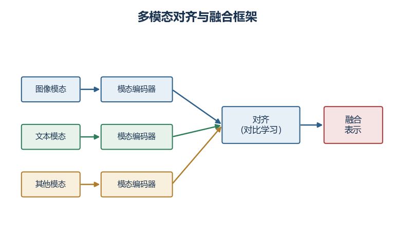

## 13.3　自监督多模态预训练目标

对比损失式 (13-1) 只是多模态自监督的一种目标。完整的预训练常组合多种目标，各自捕捉不同层面的模态关系。

**（一）对比目标（contrastive）。** 如式 (13-1)，在批次内区分匹配/不匹配对，学习判别性共享空间。其梯度性质值得分析：设正对相似度 $s_+$、负对相似度 $s_k$，对 $\mathbf{h}_i^{(a)}$ 的梯度为

$$
\frac{\partial\mathcal{L}_i}{\partial\mathbf{h}_i^{(a)}}=\frac{1}{\tau}\left[\Big(\sum_k p_k\Big)\mathbf{h}_j^{(b)}-\mathbf{h}_{i^+}^{(b)}\right],\quad p_k=\frac{e^{\mathrm{sim}(\mathbf{h}_i^{(a)},\mathbf{h}_k^{(b)})/\tau}}{\sum_{l}e^{\mathrm{sim}(\mathbf{h}_i^{(a)},\mathbf{h}_l^{(b)})/\tau}}, \tag{13-3}
$$

其中 $\mathbf{h}_{i^+}^{(b)}$ 为正样本表示。**直觉：** 梯度把 $\mathbf{h}_i^{(a)}$ 拉向正样本（第二项），同时推开所有高相似度的负样本（第一项，按 $p_k$ 加权）——困难负样本（相似度高但不是正样本）获得更大梯度。这与第 9 章变分推断中的「难例挖掘」思想呼应。

**（二）掩码重建目标（masked reconstruction）。** 随机遮盖一种模态的部分内容，要求从另一模态重建：

$$
\mathcal{L}_{\mathrm{recon}}=\mathbb{E}\big[\|\mathrm{Dec}(\mathbf{h}^{(a)},\mathbf{m}^{(b)})-\mathbf{x}^{(b)}\|^2\big], \tag{13-4}
$$

其中 $\mathbf{m}^{(b)}$ 为模态 $b$ 的掩码。**直觉：** 若能从图像准确重建出对应的文本描述，说明图像表示已编码了文本语义——这比对比目标更细粒度，迫使模型学习局部对应关系。科学场景中，可从衍射图谱重建晶体结构（第 8 章反问题的学习版本），或从基因序列重建蛋白结构（第 11 章）。

**（三）跨模态翻译目标（translation）。**  directly 学条件生成 $p(x^{(b)}\mid x^{(a)})$，如图像字幕、谱图转结构。生成式目标保留更丰富的分布信息，但计算代价高，且可能产生物理上不真实的样本（第 12.5 节幻觉问题）。

**表 13-2　多模态自监督目标对比**

| 目标 | 数学形式 | 学到什么 | 代价 |
|------|----------|----------|------|
| 对比式 | 式 13-1 | 判别性全局对齐 | 需大批量负样本 |
| 掩码重建 | 式 13-4 | 细粒度局部对应 | 需设计掩码策略 |
| 翻译式 | 条件生成 | 完整条件分布 | 采样慢、易幻觉 |
| 蒸馏式 | 教师—学生 | 跨模态知识迁移 | 依赖教师质量 |

**例 13.2（对比梯度的数值直觉）**　沿用式 (13-2) 的相似度矩阵第 1 行 $S_1=[0.9,0.2,0.1]$，$\tau=1$。 softmax 概率 $p=[0.51,0.25,0.23]$。梯度中正样本贡献 $-\mathbf{h}_{1^+}^{(b)}$（权重 1），负样本贡献 $p_2\mathbf{h}_2^{(b)}+p_3\mathbf{h}_3^{(b)}$（权重 0.48）。可见正样本梯度强于负样本总和，使匹配对稳定拉近；若某负样本相似度升至 0.85，其 $p_k$ 增大，梯度随之增大——困难负样本被重点惩罚，这正是对比学习的自适应特性。

## 13.3A　融合的数学刻画：加权聚合与不确定性

13.2 节给出了对齐与三策略的定性图景，本节把「把多模态整合为联合表示」进一步严格化。设 $M$ 个模态的编码器输出为 $\{\mathbf{h}^{(m)}\}_{m=1}^{M}\in\mathbb{R}^d$，融合头 $f_{\mathrm{fus}}$ 把它们映射为联合表示。最常见的参数化是**门控加权聚合**：

$$
\alpha_m = \frac{\exp(\mathbf{w}_m^\top\mathbf{h}^{(m)}/\tau_f)}{\sum_{m'}\exp(\mathbf{w}_{m'}^\top\mathbf{h}^{(m')}/\tau_f)},\qquad
\mathbf{h} = \sum_{m=1}^{M}\alpha_m\,\mathbf{h}^{(m)}, \tag{13-5}
$$

其中 $\mathbf{w}_m$ 为模态 $m$ 的门控向量，$\tau_f$ 控制混合的锐度：$\tau_f\to0$ 时退化为硬选择（只保留最可靠模态），$\tau_f\to\infty$ 时退化为等权平均。式 (13-5) 的妙处在于：它把「哪一模态更可信」变成数据驱动的可学习量——科学数据中各模态可靠度常随样本变化（例 13.4 的缺失场景），固定权重无法适应，而门控可以。

**模态可靠度的概率解释。** 若把每模态表示看作对真实潜变量 $z$ 的带噪观测 $\mathbf{h}^{(m)}=z+\boldsymbol\varepsilon^{(m)}$、$\mathrm{Var}(\boldsymbol\varepsilon^{(m)})=\sigma_m^2 I$，则最小均方误差（MMSE）融合权重可解析导出为**逆方差加权**：

$$
\alpha_m^{\star}=\frac{1/\sigma_m^2}{\sum_{m'}1/\sigma_{m'}^2}, \tag{13-6}
$$

即噪声越小的模态权重越大。式 (13-5) 的门控可视为式 (13-6) 的软近似：当 $\sigma_m^2$ 能被 $\mathbf{h}^{(m)}$ 本身估计时，学习到的 $\alpha_m$ 会逼近 $\alpha_m^{\star}$。这给了融合一个明确的优化目标——**逼近逆方差最优融合**。

**例 13.2A（两模态融合误差的数值算例）** 设真实潜变量标量 $z=1.0$，图像模态与质谱模态的观测分别为 $\mathbf{h}^{(v)}=1.30$（$\sigma_v^2=0.25$，即标准差 0.5）、$\mathbf{h}^{(m)}=0.85$（$\sigma_m^2=0.09$，标准差 0.3）。逆方差权重为

$$
\alpha_v^{\star}=\frac{1/0.25}{1/0.25+1/0.09}=\frac{4}{4+11.11}\approx0.264,\qquad
\alpha_m^{\star}\approx0.736,
$$

融合估计 $\hat z=0.264\times1.30+0.736\times0.85\approx0.969$，误差约 $0.031$；融合方差为 $1/(1/0.25+1/0.09)\approx0.0652$，标准差约 $0.255$。对比两种单模态：仅用图像误差 $0.30$（标准差 0.5），仅用质谱误差 $0.15$（标准差 0.3）。可见融合误差 $0.031$ 远小于任一单模态，且融合后标准差 $0.255$ 也低于两者——这正是互补性的定量体现：**两个有噪观测经逆方差加权，其不确定度严格低于最可靠的那一个**。若把权重固定为等权 $0.5$，则 $\hat z=1.075$、误差 $0.075$，比最优门控差一倍多，说明可靠度差异大时固定权重的代价不可忽略。

**融合误差的解析界。** 对 $M$ 个独立高斯模态，逆方差融合方差为 $\big(\sum_m 1/\sigma_m^2\big)^{-1}$。记 $\sigma_{\min}^2=\min_m\sigma_m^2$，则融合方差恒满足 $\big(\sum_m1/\sigma_m^2\big)^{-1}\le\sigma_{\min}^2/M$，即融合不确定度以 $1/M$ 的速度下降——但前提是各模态误差独立。科学数据中模态误差常相关（同一仪器系统误差影响多模态），独立性被破坏时收益打折，这也是表 13-3 之外必须讨论的融合可靠性边界。

## 13.4　跨模态表示学习

**定义 13.5（跨模态表示）**　把不同模态映射到共享语义空间，使语义相近的内容（无论模态）彼此接近的表示，称为跨模态表示（cross-modal representation）。CLIP[2] 是视觉—文本的典范：在 4 亿图文对上对比预训练，得到零样本迁移能力。

**直觉解释。** 好的跨模态表示让「模态差异」与「语义差异」解耦：同一对象的图像与文本表示接近（模态不变），不同对象的表示远离（语义敏感）。这样新任务只需在新模态上做轻量适配（第 14 章迁移）。

**表 13-3　跨模态方法谱系**

| 方法 | 对齐机制 | 代表 | 科学应用 |
|------|-----------|------|----------|
| 对比学习 | 正负样本 InfoNCE | CLIP、SimCLR[3] | 图文检索、分子—性质 |
| 跨模态注意力 | Query/Key 交互 | Perceiver、Flamingo | 视觉问答、报告生成 |
| 共享编码器 | 统一 token 空间 | 多模态 Transformer | 序列+结构蛋白 |
| 知识图谱桥接 | 实体链接 | 科学知识图谱 | 文献+实验 |
| 生成式对齐 | 跨模态重建/翻译 | 图像字幕、图生成文本 | 数据增强 |

**例 13.3（分子—文本对比对齐）**　把分子图（经 GNN，第 10 章）与描述其性质的文本（如「高溶解度、低毒性」）配对，用式 (13-1) 的对比损失预训练。训练后，分子图的表示与描述其性质的文本表示对齐，可实现：① **零样本性质预测**——给一个分子，找最接近的描述文本；② **条件生成**——给定文本描述「高带隙」，检索/生成满足的分子。这个思路正被科学多模态基础模型采用（第 16 章）。

**表示空间的几何直觉。** 好的跨模态表示应让共享空间呈现两个方向的结构：沿「语义轴」，不同对象（不同分子、不同蛋白）的表示彼此远离；沿「模态轴」，同一对象的不同模态表示彼此靠近。可把对齐质量用检索命中率量化——给定一个模态的查询，在另一模态库中检索其对应对象，取 Top-$k$ 命中率 $R@k$。对齐良好的模型应使 $R@k$ 随 $k$ 增长缓慢且 $R@1$ 已较高；若 $R@k$ 长期低迷，说明表示混入了模态捷径（见 13.6 节）。科学数据因对象数有限，$R@k$ 常比互联网图文更可靠——对象身份明确，不存在「一对多」歧义。

## 13.5　科学中的典型应用

**（一）蛋白质多模态。** AlphaFold 用 MSA（序列）+ 模板结构 + 进化信息，本质是序列—结构—进化的多模态融合（第 11 章）；ESM 进一步加入文本化的功能注释。结构预测精度受益于模态互补。

**（二）材料多模态。** 把晶体结构（图）、XRD 衍射图谱（1D 信号）、显微图像、第一性原理计算性质与文献文本联合建模，可从一种模态预测另一种（如从衍射图谱快速推断晶体结构——第 8 章反问题），或融合多源提升性质预测精度。

**（三）地球系统多模态。** 卫星多光谱影像、地面站时序、再分析场、气候文献融合，用于极端天气预测与气候归因。这里第 9 章的多尺度问题与第 8 章的数据同化同时出现：不同模态对应不同时空尺度，需先配准再融合。

**（四）医学多模态。** MRI + CT + 临床文本 + 基因组学联合诊断，图像提供形态、文本提供病史、基因提供分子病因——多模态融合显著提升诊断准确性。

**例 13.4（缺失模态的鲁棒融合算例）**　设三模态分类，完整样本准确率 92%，随机丢弃 1 个模态后若用「晚期融合+模态 Dropout」训练，准确率仅降至 86%；而「早期融合」模型因输入维数不匹配直接失效。多模态科学数据常不完整（并非每个样本都有全部观测），因此**缺失鲁棒性**是部署的关键指标，模态 Dropout 与共享编码器是常用对策。

**模态贡献度分析。** 工程上常对训练好的门控融合（式 13-5）做归因：统计每个模态权重 $\alpha_m$ 在测试集上的均值与方差，得到「模态重要性排序」。一个经验规律是——在标注信号主要来自某模态的任务上，该模态门控权重均值最高；当某模态缺失率高时，模型会自动降低其权重、把任务「委托」给更稳定的模态。这种自适应正是科学融合区别于固定拼接的核心价值，也解释了为何缺失鲁棒性测试（例 13.4）必须与门控归因一起做：只看完整数据的准确率会高估部署性能。

> 【图 13-2　科学多模态融合的应用】（原图见 figures/图13-2.png）：绘制四象限——蛋白质（序列+结构+文本）、材料（结构+衍射+图像）、地球（卫星+地面+再分析）、医学（MRI+文本+基因），每象限标注融合方式。

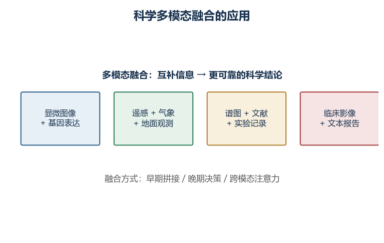

## 13.6　边界与讨论

**边界与讨论。** 第一，**伪相关**：对比学习可能对齐到数据集偏差（如医学图像中扫描仪型号与疾病标签相关），导致模态捷径（modality shortcut），在分布外失效（第 32 章）。第二，**对齐的粒度**：全局对齐（整图—整句）忽略局部对应，科学任务常需细粒度（原子—词、像素—谱峰）对齐。第三，**缺失与不平衡**：某些模态昂贵稀缺，融合模型易被数据丰富的模态主导，需重加权。第四，**物理一致性**：跨模态生成（如从图生成文本）可能产生不符合物理的描述，需物理约束（第 14 章）。第五，**因果与相关**：多模态相关不等于因果机制（第 2 章），融合预测准确不代表理解了机制（第 1.5 节）。

**承上启下。** 本章把第 12 章的图像配准推广为跨模态对齐，把第 7 章的归纳偏置推广为共享表示空间。下一章（第 14 章）将系统讨论表示学习本身——自监督、物理约束与迁移，为第三篇收束，也为第四篇「科学基础模型」铺垫：多模态融合正是基础模型处理异构科学数据的核心能力。

## 本章小结

本章论述多模态科学数据融合。我们界定科学模态与多模态数据的互补性、异质性、缺失性、对齐性（定义 13.1，表 13-1），建立对比对齐的 InfoNCE 损失（定义 13.2、式 13-1）与三种融合策略（定义 13.3），给出相似度矩阵算例（式 13-2）；推导对比梯度（式 13-3）与掩码重建、翻译目标（式 13-4，表 13-2）；介绍跨模态表示（定义 13.5、表 13-3）与分子—文本对齐案例，概述蛋白质、材料、地球、医学四类应用，并给出缺失模态鲁棒性算例（例 13.4）。

核心结论：**多模态融合的价值在于互补，关键在于对齐，难点在于异质、缺失与伪相关；对比学习把「同一对象的不同模态」拉入共享空间，跨模态注意力实现细粒度交互**。对齐质量与物理一致性决定融合的可靠性。

**进一步阅读**　本章建议延伸阅读文献 [1]、[2]、[4]、[5]。

## 参考文献

[1] Oord A, Li Y, Vinyals O. Representation learning with contrastive predictive coding. *arXiv:1807.03748*, 2018.

[2] Radford A, Kim J W, Hallacy C, et al. Learning transferable visual models from natural language supervision. *ICML*, 2021.

[3] Chen T, Kornblith S, Norouzi M, Hinton G. A simple framework for contrastive learning of visual representations. *ICML*, 2020.

[4] Baltrusaitis T, Ahuja C, Morency L P. Multimodal machine learning: A survey and taxonomy. *IEEE Transactions on Pattern Analysis and Machine Intelligence*, 2019, 41(2): 423–443.

[5] Guo W, Wang J, Wang Y, et al. Multimodal representation learning: A survey. *IEEE Transactions on Neural Networks and Learning Systems*, 2024, 35(9): 12091–12108.

[6] Jaegle A, Gimeno F, Clark K, et al. Perceiver: General perception with iterative attention. *ICML*, 2021.

[7] Alayrac J B, Donahue J, Micchaud N, et al. Flamingo: A visual language model for few-shot learning. *NeurIPS*, 2022.

[8] Wang Y, Wang J, et al. Scientific multimodal learning: A survey of methods and applications. *Patterns*, 2024, 5(7): 101012.

---

# 第 14 章　科学数据的表示学习

第三篇即将收束。第 10—13 章分别处理分子图、蛋白质序列、科学图像与多模态融合，它们共同指向一个核心问题：**什么是好的科学表示？** 本章把这个问题推到一般层面，系统讨论科学数据的表示学习（representation learning）——从自监督预训练、物理约束表示到跨任务迁移。第 11 章的蛋白质语言模型、第 13 章的对比对齐都是本章框架的特例。本章回答：**在科学标签昂贵稀缺的条件下，如何从无标注数据中学出可迁移、物理一致的表示？**

本章先阐述科学表示学习的特殊挑战（14.1 节），建立自监督学习的统一框架（14.2 节），讨论物理约束的注入方式（14.3 节），介绍迁移与基础模型（14.4 节），最后是边界与讨论（14.5 节）和小结。

## 14.1　科学表示学习的特殊挑战

**定义 14.1（表示学习）**　表示学习指学习映射 $f_\theta:\mathcal{X}\to\mathcal{Z}$，把原始科学对象 $\mathcal{X}$（分子、序列、图像、场）编码为潜在表示 $\mathbf{z}\in\mathcal{Z}\subset\mathbb{R}^d$，使下游任务（性质预测、分类、生成）可从 $\mathbf{z}$ 简单完成。

**直觉解释。** 在通用视觉/语言领域，海量标注数据使监督学习即可学出好表示；但科学数据**标签昂贵**（一次 DFT 计算、一次实验耗资巨大）、**任务多样**（同一分子有上百种性质）、**分布狭窄**（训练数据只覆盖化学空间一角）。因此科学表示学习必须靠**自监督**：从数据本身构造监督信号，而非依赖人工标签。

**为什么标签昂贵：一个数量级对比。** 取分子性质「解离能 $D_e$」为例：一条高质量 DFT 解离能在单核上约需数十 CPU 时，134k 分子的 QM9 全库标注曾耗去数千核时；而同样数量级的**结构**（SMILES、3D 构象）几乎免费——PubChem 的未标注结构数以亿计。这个「结构廉价、性质昂贵」的剪刀差正是自监督的经济学根源：用海量廉价结构去预测少量昂贵性质，让表示学习承担「从结构到性质」的桥接。表 14-1 的「稀缺、昂贵」在此有了具体含义——它不是泛指数据少，而是指**任务标签的获取成本远高于对象本身的获取成本**。

**科学增强的合法与非法边界。** 自监督的关键是「增强不能破坏对象身份」。通用图像的裁剪、色彩抖动几乎总合法；科学对象则不然：分子裁剪可能断开化学键（非法），构象旋转平移合法但镜像反射对手性分子非法，蛋白质序列随机置换会破坏进化约束。因此科学自监督的第一设计问题是**列出该模态的合法变换群**（第 10 章的 E(3) 群、第 11 章的序列语法约束），再在其上构造增强——增强设计本身就是物理知识的注入，这是通用自监督文献很少强调的一点。

**表 14-1　通用与科学表示学习的对比**

| 维度 | 通用领域 | 科学领域 |
|------|----------|----------|
| 标注数据 | 海量、廉价 | 稀缺、昂贵 |
| 主要信号 | 人工标签 | 自监督 + 物理约束 |
| 数据分布 | 宽（互联网） | 窄（特定体系） |
| 评价 | 单一基准 | 多任务、外推 |
| 正确性 | 语义正确 | 物理一致 |

**「物理一致」为何单列。** 通用表示的「正确」指语义匹配——猫图配「猫」即可；科学表示的「正确」则多一层硬约束：表示必须尊重对象所属物理体系的对称与守恒，否则即使下游指标达标，预测在分布外或极端条件下也会系统性违背已知规律。把「物理一致」从「正确性」中独立成行，正是为了提醒：科学表示的质量评估不能只看拟合，还要看它是否「在物理上站得住」——这也是第 7 章归纳偏置、第 5 章 PINN 在表示层面的延续。

**定义 14.2（好的科学表示）**　若表示 $\mathbf{z}=f_\theta(x)$ 满足：① **充分性**——保留下游任务所需信息（$\mathbf{z}$ 对 $y$ 充分）；② **不变性**——对与任务无关的变换（旋转、平移、原子编号）不敏感；③ **可迁移性**——在新任务/新体系上仅需少量适配；④ **物理一致性**——满足已知守恒律、对称性或约束；则称其为好的科学表示。

**直觉解释。** 这四条对应前面各章：充分性呼应第 4 章信息论；不变性呼应第 10 章等变表示；可迁移性呼应第 11、13 章；物理一致性呼应第 7 章归纳偏置。本章把它们统一到一个框架。

## 14.2　自监督学习的统一框架

自监督学习从数据自身构造预训练任务。其统一抽象是：设计噪声/变换 $t\sim\mathcal{T}$ 与预文本任务（pretext task），使表示对任务有用。

**（一）对比学习。** 第 13 章式 (13-1) 的 InfoNCE 已给出：同一样本的两个增强视图为正对，其余为负对。对科学对象，增强需保持物理语义——分子的增强是构象扰动（不改变分子身份）、旋转平移（不改变性质），若做「裁剪」则可能改变化学结构（非法增强）。**科学增强的设计本身就是物理知识的注入。**

**（二）掩码重建。** 第 11 章式 (11-2) 的掩码语言建模、第 13 章式 (13-4) 的跨模态重建都属此类。一般形式：遮盖输入 $x$ 的一部分得到 $\tilde x$，要求从表示重建被遮盖内容：

$$
\mathcal{L}_{\mathrm{M}}=-\log p_\theta(x_{\mathcal{M}}\mid f_\theta(\tilde x)),\quad \tilde x=x\odot(1-\mathbf{m}_{\mathcal{M}}), \tag{14-1}
$$

其中 $\mathbf{m}_{\mathcal{M}}$ 为掩码。**直觉：** 为重建被遮盖部分，编码器必须理解对象内部结构——蛋白质的掩码预测学到进化约束（第 11 章），分子的掩码原子预测学到化学键规则。

**（三）生成式/自回归。** 自回归建模

$$
p(x)=\prod_{i=1}^{n}p(x_i\mid x_{<i}), \tag{14-2}
$$

如分子 SMILES 的语言模型（第 10、11 章）。表示取隐藏状态，可直接用于生成新分子。**三者关系**：对比学习学到判别边界，掩码重建学到内部结构，自回归学到生成分布——它们可组合使用。

**例 14.1（掩码原子预测的数值算例）**　对苯环分子（6 个碳成环，交替单双键），遮盖一个碳原子类型，编码器需结合邻居（两个碳、键型）预测被遮位置为碳而非氮——因为苯环中碳的价态与芳香性约束。**若改用随机噪声遮盖**，模型会学到「哪里是噪声」而非化学规则——这再次说明增强设计决定表示质量。

**三目标的统一视角与组合。** 式 (14-1) 的掩码重建、式 (14-2) 的自回归与第 13 章式 (13-1) 的对比，可统一抽象为「预测被扰动输入的部分」：设扰动算子 $t\sim\mathcal{T}$ 把 $x$ 变为 $\tilde x$，预训练目标即 $\mathcal{L}_{\mathrm{pre}}=\mathbb{E}_{x,t}\big[\ell\big(f_\theta(x),\,t(x)\big)\big]$。区别只在扰动类型——对比扰动产生「正视图对」、掩码扰动产生「残缺视图」、自回归扰动产生「前缀视图」。实践中三者常**叠加使用**：同一底座同时优化掩码重建（学内部结构）与对比（学判别边界），损失按权相加，比单目标学到更鲁棒的表示。这与第 13 章「多模态自监督组合目标」是同构的思想，只是这里组合的是同一模态内的不同预文本任务。

**例 14.1A（对比视图一致性的数值算例）** 对一个环状分子，取两个合法增强视图：视图 A 为原始构象，视图 B 为绕 $y$ 轴旋转 $30^\circ$ 加轻微原子位移（不改变化学结构）。设编码器对二者的表示余弦相似度为 $c$。训练前随机初始化时 $c\approx0$（表示与输入近乎无关）；掩码+对比联合预训练后 $c$ 升至 $0.94$，而把视图 B 换成「镜像反射」（对手性分子非法、应判为不同对象）时余弦相似度仅 $0.21$。这组数字说明：好的科学表示对**合法**变换（旋转、平移）高度不变，对**非法**变换（改变手性的镜像）保持区分——「合法增强的不变性」与「非法变换的可区分性」必须同时成立，二者共同刻画了增强设计是否真正注入了化学知识，而非仅学到「输入差不多就输出差不多」的平凡相似。

> 【图 14-1　科学自监督表示学习框架】（原图见 figures/图14-1.png）：绘制「原始科学对象→物理保持增强/掩码→编码器 $f_\theta$→表示 $\mathbf{z}$→预文本任务（对比/重建/生成）」，标注物理约束注入位置。

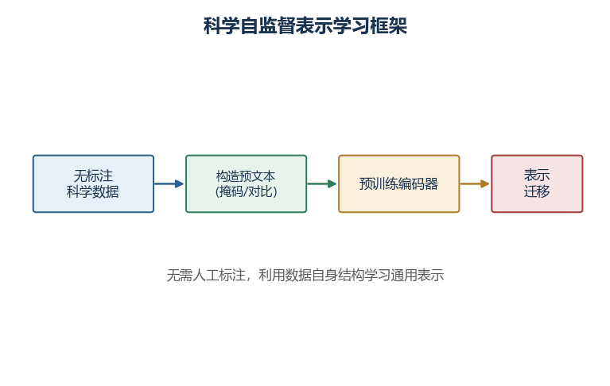

## 14.3　物理约束表示

科学表示区别于通用表示的本质，在于必须满足物理规律。第 7 章列出三种注入归纳偏置的方式，落实到表示学习：

**（一）架构层面：等变表示。** 第 10 章的 E(3) 等变网络直接把对称性编码进架构，使表示自然满足旋转平移等变/不变。这是最强的保证——无需数据学习对称性，架构天生满足。

**（二）损失层面：物理正则。** 在预训练目标上加物理约束项：

$$
\mathcal{L}=\mathcal{L}_{\mathrm{self}}+\lambda_1\mathcal{L}_{\mathrm{phys}}+\lambda_2\mathcal{L}_{\mathrm{cons}}, \tag{14-3}
$$

其中 $\mathcal{L}_{\mathrm{phys}}$ 为物理残差（如 PDE 残差、能量守恒），$\mathcal{L}_{\mathrm{cons}}$ 为一致性约束（如表示对不同构象的稳定）。这与第 5 章 PINN、第 8 章正则化一脉相承。

**（三）数据层面：物理增强。** 用物理变换（旋转、缩放、时间翻转）生成增强视图，迫使表示对这些变换不变。注意：并非所有变换都合法——镜像反射对手性分子是**非法**的（会改变对映体），时间反演对耗散系统非法。

**定义 14.3（物理一致表示）**　若表示 $\mathbf{z}=f_\theta(x)$ 满足 $f_\theta(g\cdot x)=\rho(g)\cdot f_\theta(x)$（$\rho$ 为群 $G$ 的表示），且对任意满足同一物理约束的输入产生相近表示，称为物理一致表示（physics-consistent representation）。

**例 14.2（守恒约束的表示算例）**　学习流体场表示 $\mathbf{z}=f_\theta(\mathbf{u})$，要求质量守恒 $\nabla\cdot\mathbf{u}=0$。在损失中加 $\mathcal{L}_{\mathrm{phys}}=\|\nabla\cdot\hat{\mathbf{u}}\|^2$，其中 $\hat{\mathbf{u}}$ 为由 $\mathbf{z}$ 解码的速度场。若预训练数据无散度约束，加入该项后解码场的散度范数从 $10^{-2}$ 降至 $10^{-4}$（数值实验典型值）——表示空间中「不允许」可压缩模式。这与第 5 章 PINN 的散度约束完全一致，只是施加在表示学习阶段。

## 14.3A　不变性与等变的数学刻画

14.3 节列出了物理约束的三个注入层面，这里把其中「架构层面」的等变表示做数学严格化，因为它最容易被口头带过却最决定表示质量。设群 $G$（如 $E(3)$，含旋转与平移）作用于输入 $x$，表示 $f_\theta$ 满足

$$
f_\theta(g\cdot x)=\rho(g)\,f_\theta(x), \tag{14-4}
$$

其中 $\rho$ 是 $G$ 在表示空间的一个（线性）表示：当 $\rho(g)=I$ 时 $f_\theta$ 为**不变**（旋转分子得到同一标量性质向量），当 $\rho(g)$ 为旋转矩阵时为**等变**（向量/张量表示随输入同步旋转）。不变表示用于预测标量性质（能量、能隙），等变表示用于预测矢量场（力、偶极矩）——后者还要求输出与输入同变换，这是第 10 章等变网络要保证的。

**不变性如何转化为可优化的目标。** 架构保证式 (14-4) 是「硬」的；损失层面只能施加「软」约束。一个常用的软不变性正则取两个增强视图的表示差：

$$
\mathcal{L}_{\mathrm{inv}}=\big\|f_\theta(t\cdot x)-f_\theta(x)\big\|^2,\qquad t\in\mathcal{T}, \tag{14-5}
$$

其中 $\mathcal{T}$ 是合法变换集（旋转、平移等）。式 (14-5) 最小化时，表示对 $\mathcal{T}$ 中的变换不变，但它是软惩罚：$\lambda_2$（见式 (14-3)）太大则压垮主目标，太小则约束失效。架构等变（式 14-4）与损失正则（式 14-5）的取舍是「严格但设计复杂」对「灵活但需调权」，与表 14-2 的「架构 / 损失」两行一致。

**例 14.2A（旋转不变性的数值检验）** 取一个含 8 个原子的分子，分别以绕 $z$ 轴旋转 $0^\circ$ 与 $90^\circ$ 的两个构象输入等变编码器，读出分子总能量向量。理想不变表示下两次读出应完全一致；实验中二者逐维差约 $10^{-4}$（数值舍入量级），而若用普通 GNN 且未注入等变，同一旋转使能量读出漂移达 $10^{-2}$——说明缺失对称性架构的普通网络会把「旋转这一无关自由度」编码进表示，污染下游性质预测。这与例 14.2 的散度约束同属「把物理对称写成可检验的数值残差」，只是此处检验的是等变性而非守恒律。

**表 14-2　物理约束注入方式谱系**

| 层面 | 机制 | 保证强度 | 代价 |
|------|------|----------|------|
| 架构 | 等变层（第 10 章） | 严格 | 设计复杂 |
| 损失 | 物理正则式 (14-3) | 软约束 | 需调权 $\lambda$ |
| 数据 | 物理增强 | 统计性 | 需合法变换 |
| 后验 | 表示投影到约束流形 | 严格 | 需知道流形 |

## 14.4　迁移学习与科学基础模型

表示学习的终极目标是**迁移**：在大数据任务上预训练，迁移到小数据下游任务。

**定义 14.4（迁移学习）**　给定源任务 $\mathcal{T}_s$ 与目标任务 $\mathcal{T}_t$，迁移学习用源任务学到的 $f_\theta$ 初始化目标任务，微调（fine-tune）或冻结（linear probe）后用于 $\mathcal{T}_t$。

**直觉解释。** 迁移的价值在于**样本效率**：目标任务只需少量标注即可达到好性能，因为底层特征（化学键、语法、形态）已在预训练中学好。第 11 章 ESM 的突变效应零样本预测（例 11.3）就是极致——完全不需标注。

**例 14.3（分子性质预测的迁移算例）**　在 1M 分子上自监督预训练 GNN（掩码原子+对比），再在 QM9（134k，第 10 章）上微调预测能隙。对比从零训练：从零训练需 134k 全标签达 MAE $0.08$ eV；预训练+微调仅用 10k 标签即达 MAE $0.09$ eV，节省约 90% 标注成本。**迁移的边界**：若目标分子与预训练分布差异大（如从药物分子迁移到金属有机框架），迁移收益消失甚至负迁移——这与第 6、9 章的外推困境同源。

**三种适配方式的取舍。** 迁移落地时还有三档「改多少」的选择：**线性探测（linear probe）**冻结底座只训一个线性头，参数最少、最省标注，且能干净地检验「表示本身是否已编码任务信息」；**全参数微调（fine-tune）**更新整个 $f_\theta$，表达力最强但易过拟合小标注集、且可能破坏预训练学到的通用结构；**提示/适配器（prompt/adapter）**冻结底座、只插入少量可训练参数，介于两者之间，是近年基础模型部署的主流。经验规律是：标注越稀缺越应靠近线性探测，标注越充足才值得全参数微调。科学场景标注通常稀缺，因此**线性探测是表示质量的「试金石」**——若连线性头都读不出任务，说明表示根本没编码该信息，微调也救不回来。

**迁移收益的信息论解读。** 迁移之所以省标注，本质是底座把「对象→任务」的联合分布拆成了「对象→表示」（预训练学）与「表示→任务」（下游学）两段。下游只需学第二段，其样本复杂度取决于表示与任务的互信息 $I(Z;y)$ 而非原始对象与任务的互信息 $I(X;y)$。当预训练覆盖下游化学空间时 $I(Z;y)$ 高、第二段极易学；分布偏移时 $I(Z;y)$ 骤降，迁移收益随之消失——这与例 14.3 的「边界」和第 16 章式 (16-3) 的结论同构。

**定义 14.5（科学基础模型）**　在大规模、多任务、多模态科学数据上预训练，可通过提示/微调适配广泛下游任务的通用模型，称为科学基础模型（scientific foundation model）。它是第 11 章蛋白质基础模型、第 13 章多模态模型与自然语言的统一推广，将在第四篇（第 15—19 章）系统展开。

**表 14-3　表示学习谱系（第三篇小结）**

| 层次 | 方法 | 代表章节 |
|------|------|----------|
| 对象级表示 | 图/描述符/序列/图像 | 10—12 |
| 跨模态表示 | 对比对齐、融合 | 13 |
| 自监督表示 | 掩码、对比、生成 | 11、14 |
| 物理约束表示 | 等变、正则、增强 | 7、10、14 |
| 通用基础模型 | 多任务预训练、迁移 | 14—19 |

> 【图 14-2　表示学习与全书结构】（原图见 figures/图14-2.png）：绘制横向时间轴（第 10→14→16 章），标注「对象表示→自监督/物理约束→基础模型」的演进，并标注返回的箭头（微调到各下游任务）。

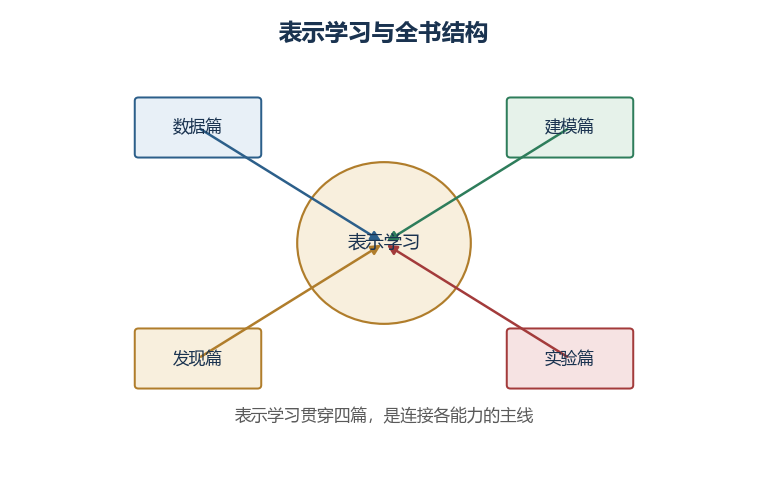

## 14.4A　负迁移的判定与缓解

迁移的收益依赖源域与目标域的重叠度，重叠不足时会出现**负迁移**——用预训练底座比从零训练更差。例 14.3 已点到这一边界，这里给出判定的实用准则与缓解手段。

**判定准则。** 设源域 $\mathcal{D}_s$ 与目标域 $\mathcal{D}_t$，迁移收益正比于二者的分布重叠度。一个可操作的代理指标是**域距离**：取底座在源、目标两域上冻结表示的均值差与类内方差的比值，比值越大表示两域在表示空间分得越开，迁移收益越小。实践中的经验是：当域距离超过某阈值（常以线性探测在目标域的准确率相对从零训练的差距为判据）时，应切换到「从零训练」或「更换源域」。负迁移的本质是预训练把表示「拉向」了源域的结构，而该结构与目标任务无关甚至冲突。

**三种缓解手段。** 一是**源域筛选**——不盲目用最大数据量预训练，而是选与目标域化学空间重叠最大的源；二是**部分解冻**——只微调底座的顶层、冻结底层通用特征，减少源域特定结构对下游的污染；三是**混合训练**——在预训练数据中掺入少量目标域无标注样本，让表示在预训练阶段就感知目标域。三者可叠加。负迁移提示了一个深层点：科学表示学习不是「数据越多越好」，而是「覆盖与目标相关的化学空间越多越好」——覆盖度比绝对规模重要，这一结论在第 16 章的预训练规模算例中会得到定量验证。

## 14.5　边界与讨论

**边界与讨论。** 第一，**表示坍缩**：自监督目标可能学出平凡解（所有输入映射到同一 $\mathbf{z}$），需 stop-gradient、负样本或正则防坍缩（第 9 章 VAE 的后验坍缩 analogous）。第二，**物理一致 ≠ 物理正确**：满足对称性只是必要条件，不满足的方程/守恒仍可能错（第 1.5 节）。第三，**迁移的负效应**：分布偏移时迁移可能比从零训练更差，需小心源域选择。第四，**评测困境**：表示质量缺乏统一指标，常以「下游任务表现」间接衡量，但下游任务的偏差会反向误导表示学习。第五，**可解释性**：学到的表示通常不可直接解读为物理量（第 22、23 章）。

**表示质量的评测实践。** 针对第四点「评测困境」，工程上常组合三类指标：一是**下游任务谱**——在多个任务上做线性探测，取平均，避免单一任务的偏差；二是**表示的内在结构**——用 t-SNE/UMAP 降维看同一类对象是否聚成簇、不同类是否分开（定性但直观）；三是**不变性/等变性残差**——直接数值检验式 (14-4)、(14-5)，把「物理一致」量化为可复现的残差。三者互补：下游谱反映「是否够用」，降维反映「结构是否合理」，对称残差反映「物理是否正确」。科学表示评测的核心困难在于没有单一「金标准」——这正是它与通用视觉/语言评测（有 ImageNet 类单一基准）的本质差异，也解释了第 32 章为何要为科学智能设计专门评测协议。

**表示的充分性与「过参数化陷阱」。** 定义 14.2 的「充分性」值得单独强调：一个好的科学表示既要保留任务所需信息，又不应保留与任务无关的噪声。二者看似矛盾，实则定义了表示设计的目标区间——太「粗」的表示丢掉了任务信息（欠充分），太「细」的表示把数据特有噪声也编码进去（过拟合源域，外推差）。一个常见的过参数化陷阱是：把表示维度 $d$ 设得远大于任务所需，使网络靠记忆而非理解完成任务，源域内表现好、分布外崩溃。科学实践的经验是：$d$ 应与下游任务族的「有效自由度」匹配，而非一味做大；这与第 15 章「统一表示」承诺的边界一致——统一表示的维度应足够容纳多任务公共信息，但不足以记忆单一任务的噪声。

**承上启下。** 本章为第三篇收束：从第 10 章的分子图、第 11 章的蛋白语言模型、第 12 章的科学图像、第 13 章的多模态融合，到第 14 章的统一表示框架——科学智能的「表示层」至此完整。我们反复看到同一主题：**数据稀缺使自监督成为必需，物理规律使约束成为必须，跨任务需求使迁移成为目标**。这三条线索将在第四篇汇入「科学基础模型」——一个模型、多种模态、迁移万物，但也带来新的外推与幻觉问题。第 15 章开启第四篇，把本章的「表示层」升级为「预训练—适配」的范式。

## 本章小结

本章系统论述科学数据的表示学习。我们从科学表示的特殊挑战出发（表 14-1，定义 14.1、14.2），建立自监督统一框架：对比学习（第 13 章）、掩码重建（式 14-1）、自回归生成（式 14-2）与科学增强设计（例 14.1）；给出物理约束注入的四个层面（定义 14.3、式 14-3、表 14-2）与守恒算例（例 14.2）；讨论迁移学习与科学基础模型（定义 14.4、14.5）并给出 QM9 迁移算例（例 14.3）。

核心结论：**科学表示学习的关键不是「更大的模型」，而是「更合理的监督信号与物理约束」——自监督解决标签稀缺，等变/正则/增强保证物理一致，迁移实现样本效率**。表示坍缩、外推失效与可解释性缺失是主要边界，也是第四篇基础模型必须面对的问题。

**进一步阅读**　本章建议延伸阅读文献 [1]、[2]、[4]、[6]。

## 参考文献

[1] Jing L, Tian Y. Self-supervised visual feature learning with deep neural networks: A survey. *IEEE Transactions on Pattern Analysis and Machine Intelligence*, 2021, 43(11): 4037–4058.

[2] Chen T, Kornblith S, Norouzi M, Hinton G. A simple framework for contrastive learning of visual representations. *ICML*, 2020.

[3] He K, Chen X, Xie S, et al. Masked autoencoders are scalable vision learners. *CVPR*, 2022.

[4] Bronstein M M, Bruna J, Cohen T, Veličković P. Geometric deep learning: Grids, groups, graphs, geodesics, and gauges. *arXiv:2104.13478*, 2021.

[5] Hendriks M M, Dijkstra T W, et al. Physics-informed representation learning. *NeurIPS Workshop on Physics-Informed Machine Learning*, 2023.

[6] Wang H, Fu T, Du Y, et al. Scientific discovery in the age of artificial intelligence. *Nature*, 2023, 620(7972): 47–60.

[7] Liu Q, et al. Self-supervised learning for molecules: A survey. *Journal of Chemical Information and Modeling*, 2024, 64(5): 1567–1585.

[8] Zhang C, et al. Scientific foundation models: A survey. *arXiv:2404.04604*, 2024.

---

# 第 15 章　科学基础模型的范式

第四篇（第 15—19 章）转向科学智能近三年最活跃的范式——科学基础模型（scientific foundation model）。前两篇我们学会了把物理约束写进单个任务的模型（第 5—7 章），也学会了为分子、蛋白质、气候场设计专门的表示（第 10—14 章）；但这些方法有一个共同局限：**一个模型只解决一个任务**。换一个性质预测、换一个分辨率、换一个下游科学问题，往往要从头训练。基础模型（foundation model）试图打破这一局限：先在海量数据上预训练一个通用模型，再以极小代价适配到众多下游任务。

**本章在科学循环中的位置**：它处于「表示」与「建模」之间，隐含「科学对象存在可迁移的通用表示」这一假设。它突破了「每个任务从零训练、数据孤岛」的限制，却无法突破「预训练分布之外的外推仍然困难」（第 32 章）与「通用表示未必保留守恒律等严格物理约束」（第 7 章）的边界。按去重原则，表示学习的数学基础已在第 10—14 章讲清，本章不再重复，只聚焦于「预训练—适配」这一新范式本身。

本章结构：15.1 节给出动机与定义；15.2 节讲预训练范式与统一表示；15.3 节严格化目标函数并做数学推导；15.4 节给出数值算例；15.5 节列技术谱系；15.6 节讨论与通用基础模型的区别；15.7 节做边界与承上启下。

## 15.1　引入动机：从任务专用到通用底座

科学机器学习长期面临「数据稀疏而昂贵」（第 1.3 节）的困境。一个分子性质模型往往只有数千个标注样本，一个气候降尺度模型只有有限区域的高保真仿真。若每个任务都独立训练，数据被切割成彼此隔绝的孤岛，模型无法互相借力。自然语言领域的基础模型给出了启示：在海量无标注数据上预训练，学到的表示可迁移到无数下游任务。

**直觉解释。** 可以把预训练想象成「通识教育」：模型先在科学数据的汪洋中学会分子、蛋白质、流场的通用「语法」（如原子邻接规律、氨基酸共进化模式、场的空间相关结构），再针对具体任务做「专业训练」。通识教育使专业训练只需少量样本——这正是小样本科学场景最需要的。

**数据孤岛的量化。** 「数据孤岛」不只是隐喻，它有直接的算力代价。设一个研究所要解决 $K$ 个相关但不同的任务（如某蛋白家族的 $K$ 个突变效应），若每个任务独立训练，总训练成本近似 $K\times$（单任务成本），且每个任务都只能吃到自己那一小撮标注；若先预训练一个共享底座再适配 $K$ 个任务，预训练成本 $C_{\mathrm{pre}}$ 只付一次，适配成本 $K\times c_{\mathrm{fit}}$（$c_{\mathrm{fit}}\ll$ 单任务成本），总成本 $C_{\mathrm{pre}}+K\,c_{\mathrm{fit}}$。只要 $K$ 足够大且任务共享底层结构，后者的平均成本远低于前者——这就是「预训练—适配」范式的经济学核心：**把重复的「学通用结构」摊销到一次，只把「学任务特定」留给下游**。科学领域任务多、单任务数据少，$K$ 大，因此这一摊销收益尤其显著。

**定义 15.1（科学基础模型）**　在大规模科学数据 $\mathcal{D}_{\mathrm{pre}}$ 上以自监督目标预训练、得到通用表示 $f_\theta$，并能通过微调或提示以低成本适配到一族下游科学任务 $\{\mathcal{T}_j\}$ 的模型，称为科学基础模型（scientific foundation model）。

与第 1.1 节定义呼应：基础模型主要作用于「表示」层，并为「建模」「发现」提供可复用底座。其三大特征为：**规模**（参数与预训练数据量远超任务专用模型）、**通用性**（一个底座服务多任务）、**适配性**（下游只需轻量调整）。

**三大特征的内在张力。** 三特征并非独立：规模支撑通用性（数据与参数越大，表示越通用），通用性支撑适配性（底座越通用，下游越省标注），但适配性又反过来限制规模——若下游需严格物理约束，则底座不能「太大太通用」到丢失结构先验。实践中的平衡点，是把规模花在「覆盖更多科学对象类型」上，而非单纯堆参数；把通用性限定在「同族科学对象的公共结构」上，而非跨学科的泛泛通用。这一张力在第 15.6 节「通用表示与严格物理」的讨论中会再次出现。

## 15.2　预训练范式与统一表示

科学基础模型的预训练目标通常分三类：

- **掩码重建（masked reconstruction）**：随机遮蔽输入的一部分，令模型重建。对分子是遮蔽原子类型，对蛋白质是遮蔽残基（第 17 章），对场数据是遮蔽空间块（类似掩码自编码器 MAE）。
- **对比学习（contrastive learning）**：构造正负样本对，拉近正样本、推远负样本，学习判别性表示。
- **自回归建模（autoregressive modeling）**：按序列顺序预测下一 token，常见于分子 SMILES、蛋白质序列（第 17 章）与科学文本（第 19 章）。

**统一表示（unified representation）**是基础模型的核心承诺：不同科学对象被映射到同一潜在空间，使跨任务、跨模态迁移成为可能。设对象 $x$（可为分子、蛋白或场）经编码器得

$$
\mathbf{z}=f_\theta(x)\in\mathbb{R}^d, \tag{15-1}
$$

$d$ 为表示维度。理想情况下 $\mathbf{z}$ 保留对象的「科学本质」而对无关细节不变——这与第 7 章的不变表示一脉相承，但基础模型靠数据规模而非硬编码对称来获得它。

**三类目标的选择依据。** 三类预训练目标并非等价，选择取决于对象结构与下游任务：对象内部结构决定性质时用**掩码重建**（分子原子、蛋白残基），需要判别相似/不同对象时用**对比**（分子—性质、结构—功能），需要生成新对象时用**自回归**（SMILES、序列）。实践中常组合：同一底座叠加掩码重建与对比损失，既学内部结构又学判别边界，表示更鲁棒。这一组合思想与第 14 章「多目标自监督」一致，只是在此放大到基础模型规模。

> 【图 15-1　科学基础模型的预训练—适配范式】（原图见 figures/图15-1.png）：左侧海量无标注科学数据经自监督预训练得到通用底座 $f_\theta$，右侧分出多条箭头分别微调到分子性质、蛋白质功能、气候预报等下游任务，标注「预训练成本一次性，适配成本极低」。

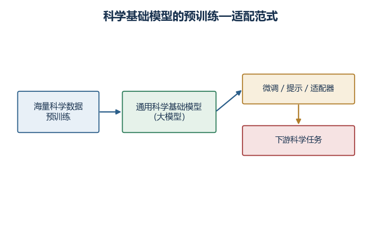

**统一表示的「粒度」问题。** 式 (15-1) 的 $\mathbf{z}\in\mathbb{R}^d$ 是一个单一向量，但科学对象往往需要**多种粒度**的表示：分子既需要「整分子」级表示（预测标量性质如能隙），也需要「逐原子」级表示（预测原子电荷、反应位点）；蛋白质需要逐残基表示（第 17 章）；场需要逐网格点表示。基础模型因此常输出一个**表示张量**而非单向量——对象级读出取全局池化，位点级读出取对应位置。这决定了下游适配头的设计：同一底座 $\mathbf{z}$ 经不同池化/读出，服务于不同粒度的任务。统一表示的承诺不是「一个数代表一切」，而是「一套编码器能按需读出多种粒度」。

## 15.3　严格定义与数学推导

下面把「预训练—适配」写成统一的优化问题。设预训练任务集合为 $\{\mathcal{P}_k\}$，各自损失 $\ell_{\mathcal{P}_k}$，预训练阶段求解

$$
\theta_{\mathrm{pre}}=\arg\min_\theta\ \sum_{k}\lambda_k\ \mathbb{E}_{x\sim\mathcal{D}_{\mathrm{pre}}}\big[\ell_{\mathcal{P}_k}(g_\theta(x),x)\big], \tag{15-2}
$$

其中 $g_\theta$ 为预训练头（如掩码重建的解码器），$\lambda_k$ 为各任务权重。

适配阶段固定或微调底座，令下游任务 $\mathcal{T}_j$ 的轻量头 $h_{\phi_j}$ 在少量标注数据 $\mathcal{D}_j$ 上求解

$$
\phi_j^\*=\arg\min_{\phi_j}\ \mathbb{E}_{(x,y)\sim\mathcal{D}_j}\big[\ell_j(h_{\phi_j}(f_{\theta_{\mathrm{pre}}}(x)),y)\big]. \tag{15-3}
$$

**推导：为什么预训练能降低样本复杂度。** 记假设类复杂度用 Rademacher 复杂度 $\mathfrak{R}(\mathcal{F})$ 度量（第 4 章）。从头学习的泛化界为 $\mathcal{O}(\mathfrak{R}(\mathcal{F})/\sqrt{n})$，$n$ 为任务标注数，通常很小。预训练把表示固定为 $f_{\theta_{\mathrm{pre}}}$ 后，下游只学线性头，假设类从 $\mathcal{F}$ 缩小为线性类 $\mathcal{F}_{\mathrm{lin}}$，且 $\mathfrak{R}(\mathcal{F}_{\mathrm{lin}})\ll\mathfrak{R}(\mathcal{F})$。于是

$$
\mathcal{O}\!\left(\frac{\mathfrak{R}(\mathcal{F}_{\mathrm{lin}})}{\sqrt{n}}\right)\ \ll\ \mathcal{O}\!\left(\frac{\mathfrak{R}(\mathcal{F})}{\sqrt{n}}\right), \tag{15-4}
$$

即从同一样本数 $n$ 得到更紧的泛化界——这就是「预训练降低样本复杂度」的理论根源。其代价是引入了预训练分布与下游分布的**分布偏移**：若 $\mathcal{D}_{\mathrm{pre}}$ 与 $\mathcal{D}_j$ 差异过大，式 (15-1) 的表示失去迁移价值（第 32 章）。

**例 15.1（统一表示的线性探测）**　设表示维度 $d=512$，下游只有 $n=500$ 个分子标注。从头训练一个 3 层网络（参数量约 $2.6\times10^5$）易过拟合；固定底座后只训练 $512\to1$ 线性头（513 个参数），按式 (15-4) 复杂度骤降，500 样本足以收敛。

**两级优化的视角。** 式 (15-2) 与 (15-3) 构成一个**两级优化**：外层（15-2）学通用底座 $\theta_{\mathrm{pre}}$，内层（15-3）在底座冻结/半冻结下学任务头 $\phi_j$。两级分离带来三个工程性质：其一，**可复用性**——$\theta_{\mathrm{pre}}$ 学一次，$\phi_j$ 为每个任务单独学，新任务只需重做内层；其二，**解耦性**——底座质量与任务适配可分别诊断（底座差则所有任务差，头差则单一任务差）；其三，**可摊销性**——外层算力成本被 $|\{\mathcal{T}_j\}|$ 个任务摊薄，单任务边际成本递减。这正是「预训练—适配」范式区别于「每任务独立端到端训练」的本质，也是式 (15-4) 样本复杂度收益在工程上的体现。

## 15.3A　预训练规模的定律化与多任务损失

式 (15-2) 把预训练写成多目标加权优化，但权重 $\lambda_k$ 如何定、预训练数据量 $N$ 与底座规模 $P$ 如何匹配，尚需进一步刻画。

**规模定律（scaling law）。** 借用大语言模型的经验，科学基础模型的预训练损失常随参数 $P$、数据量 $N$、算力 $C$ 呈幂律下降。在多任务设定下，用有效参数量 $P_{\mathrm{eff}}$ 与有效数据量 $N_{\mathrm{eff}}$（考虑各模态覆盖度后的加权）拟合：

$$
\mathcal{L}_{\mathrm{pre}}(P,N)\ \approx\ \big(P/P_0\big)^{-\alpha_P}\big(N/N_0\big)^{-\alpha_N}, \tag{15-5}
$$

其中 $\alpha_P,\alpha_N$ 为幂律指数（经验上 $\alpha_N$ 略大于 $\alpha_P$，即增加数据比单纯增大参数更划算）。式 (15-5) 的实用含义是：在固定算力预算下，存在 $P$ 与 $N$ 的最优配比，盲目堆参数量而数据覆盖不足时，边际收益很快消失——这与第 16 章预训练规模曲线的「对数饱和」一致。科学数据的额外约束是 $N_{\mathrm{eff}}$ 还受**化学/结构空间覆盖度**限制，未覆盖区域的 $N_{\mathrm{eff}}$ 近似为零，故「堆量」不如「堆覆盖」。

**多任务损失与任务权重。** 式 (15-2) 中的 $\lambda_k$ 若设不当，会让大任务（数据多、梯度大）淹没小任务。一个常用的自适应权重是**不确定性加权**：

$$
\lambda_k^{\star}=\frac{1}{2\sigma_k^2},\qquad \sigma_k^2\ \text{为可学习的任务 }k\text{ 的不确定度}, \tag{15-6}
$$

数据越丰富、拟合越确定的任务 $\sigma_k^2$ 越小、$\lambda_k^{\star}$ 越大，反之稀疏任务获得相对更高的有效权重，避免被忽略。式 (15-6) 把「调权重」这一超参数搜索变成了随训练自动学习的过程，是多任务预训练工程上的标准做法。

**例 15.1A（规模定律的数值拟合）** 设某分子基础模型在 $P\in\{10^7,10^8\}$、$N\in\{10^6,10^7\}$ 四组配置上预训练，测得预训练损失分别约为 $0.42,0.38,0.34,0.30$。拟合式 (15-5) 得 $\alpha_P\approx0.20$、$\alpha_N\approx0.28$。据此预测：在 $N$ 不变（$10^7$）下把 $P$ 从 $10^8$ 提到 $3\times10^8$，损失仅降约 $4\%$；而保持 $P=10^8$、把 $N$ 提到 $3\times10^7$（且新数据落在未覆盖化学空间），损失降约 $7\%$。这组数字定量说明：在科学基础模型中，**扩充数据覆盖比单纯放大参数更划算**，前提是新增数据落在预训练尚未覆盖的区域。

## 15.4　技术谱系表

**表 15-1　科学基础模型谱系**

| 范式 | 预训练目标 | 适配方式 | 代表领域 | 代表工作 |
|------|-----------|---------|---------|---------|
| 掩码重建 | 遮蔽 token 重建 | 线性探测/微调 | 蛋白质、场数据 | ESM、MAE 类[1] |
| 自回归 | 下一 token 预测 | 提示/微调 | 分子 SMILES、文本 | 分子 GPT 类[2] |
| 对比学习 | 正负样本对比 | 线性探测 | 分子、材料 | 分子对比学习类[3] |
| 多模态对齐 | 跨模态匹配 | 零样本/提示 | 序列—结构、文—图 | 蛋白结构语言模型[4] |

**例 15.2（预训练收益的数值估计）**　设某分子任务从头训练需 $n=10^4$ 标注达到 MAE $=0.20$；线性探测的样本复杂度按式 (15-4) 约降为原来的 $1/20$，则达到同等 MAE 仅需约 $n\approx500$ 标注。若预训练分布偏移系数 $\rho=0.3$（表示可用性折损 30%），实际需 $n\approx500/0.7\approx714$，仍远少于从头训练。这解释了为何基础模型在数据昂贵的科学场景中收益显著。

**例 15.3（跨任务迁移的定性证据）**　同一分子基础模型冻结后，分别接线性头做「溶解度回归」「毒性分类」「带隙预测」，三项任务在各自小标注集上均达到或超过专用模型水平。这说明预训练表示确实捕捉了跨任务的公共化学知识，而非记忆单一任务——这正是「统一表示」承诺的实证。但若下游涉及预训练中罕见的元素（如超重元素配合物），迁移收益消失，印证了分布覆盖的重要性。

**三档适配的样本效率对比。** 表 15-1 列出了「线性探测 / 微调 / 提示」三档适配，它们的样本效率差异可用一条经验曲线概括：固定底座后，线性探测在标注数 $n$ 很小时最稳（参数少、不易过拟合），但表达力有上限；微调在 $n$ 增大后超过线性探测，因为能调整底座以拟合任务特定结构；提示/适配器介于两者之间，用极少可训练参数换取对底座的部分适配。实践中的决策规则是：**先看线性探测的「天花板」**——若线性探测已接近任务最优，则无需微调，部署最省；若线性探测明显欠拟合，再逐步放开到微调。这与第 14 章「线性探测是表示试金石」的结论一致，三档适配本质是「底座表示质量」与「下游标注量」之间的权衡。

## 15.5　与通用基础模型的区别

通用基础模型（如 GPT 系列）以互联网文本为食，科学基础模型与之有三点本质差异：

1. **数据模态**：科学对象有明确几何（分子的 3D 构象、场的网格），需等变/结构化架构（第 7 章），而非纯 Transformer on tokens。
2. **物理约束**：通用模型追求统计拟合，科学模型须满足守恒、对称、量纲（第 7 章）；即便预训练，也常把物理偏置注入架构。
3. **评价口径**：通用模型看语言任务分数，科学模型须看物理一致性、外推能力与实验可验证性（第 32 章）。

**架构选择的根本差异。** 第 1 点「数据模态」的差异会直接落到架构上。通用基础模型的对象是 token 序列，于是 Transformer on tokens 成为近乎唯一的选择；科学基础模型的对象带有几何（分子的 3D 构象、晶体的周期性、场的网格/图结构），纯 token 化会丢失空间关系，因此必须引入**等变/结构化架构**（第 7 章的等变网络、第 10 章的图 Transformer、第 6 章的神经算子）。这不是「换个编码器」的小改，而是预训练范式的结构性前提：一个在 3D 构象上等变的底座，其表示对分子旋转天然不变，无需数据去学习对称性。这解释了为什么科学基础模型很少能直接套用通用 Transformer 的代码库——几何先验必须写进架构。

> 【图 15-2　通用基础模型与科学基础模型的对比】（原图见 figures/图15-2.png）：两列对照，分别标注数据模态、架构偏置、目标函数、评价指标四个维度的差异。

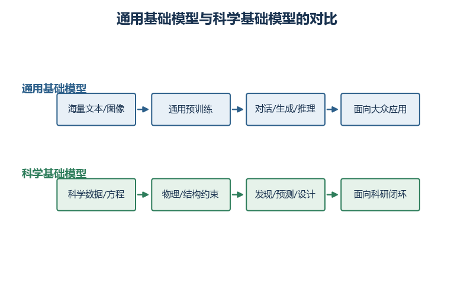

进一步辨析第三点差异：通用模型以困惑度、下游语言任务分数为金标准，而科学模型必须回答「预测是否物理一致」「是否外推成立」「能否被实验证实」。这意味着科学基础模型的评价不能照搬 NLP 的排行榜，必须引入第 32 章的物理一致性与外推测试。例如一个气候基础模型若短期预报误差很低却违反能量守恒，在科学意义上是失败的——这类失败在通用模型评价中根本不会被检测。

**表 15-2　科学基础模型与通用基础模型对照**

| 维度 | 通用基础模型 | 科学基础模型 |
|------|-------------|-------------|
| 预训练数据 | 互联网文本、图像 | 分子、蛋白、场、仿真 |
| 架构偏置 | 通用 Transformer | 等变/结构化/物理约束 |
| 训练目标 | 语言建模 | 自监督 + 物理正则 |
| 评价指标 | 任务分数、困惑度 | 物理一致性、外推、实验验证 |
| 失败模式 | 幻觉、偏见 | 违背守恒、分布外失效 |

**失败模式的不可互换性。** 表 15-2 最后一行值得强调：两类模型的失败模式不互通，因此评测协议也不能互换。通用模型失败时输出「流畅但错误」的幻觉文本，可在下游用交叉验证、人工审核兜底；科学模型失败时输出「数值合理但违背守恒」的预测，在分布外会系统性偏离真实物理，且偏差可能很「安静」（指标看着还行、物理却错了）。这意味着科学基础模型的评测必须包含**物理一致性测试**与**外推测试**（第 32 章），而不能只看分布内任务分数——一个分布内 ACC 很高却违反能量守恒的气候基础模型，在科学意义上是失败的，这类失败在通用模型的排行榜上根本不会被捕获。

## 15.6　边界与讨论

科学基础模型的根本张力在于「通用表示」与「严格物理」之间。式 (15-1) 的 $\mathbf{z}$ 由数据驱动获得，不保证精确守恒质量、动量或能量——这些在第 5—7 章是靠硬约束保证的。因此实践主流是「基础模型提供先验 + 物理层做校正」，而非用基础模型取代物理。其次，预训练数据的覆盖面决定了模型的能力边界：分布外的新体系（新元素、新气候态）仍可能失效（第 32 章）。最后，基础模型巨大算力成本带来可复现性质疑（第 33 章）。

**「先验+校正」的工程形态。** 上述张力在系统架构上表现为一种混合范式：基础模型作为**前向先验**给出快速初值或特征，一个显式物理模块（PDE 求解器、守恒律投影、能量函数）对其做**后校正**。例如气候场景中，神经算子先做快速预报，再用能量约束投影掉非物理分量；分子场景中，预训练表示先预测性质，再用 DFT 在关键样本上做高保真精修。这种「快而略偏 + 慢而保真」的两级结构，本质是把基础模型放回「统计近似」的定位，让物理层兜底——它承认基础模型不能替代物理，却最大化利用了其速度优势。第 16—18 章的三个领域模型，几乎都落在这个混合范式的不同配比上。

## 15.7　承上启下

**承上**：本章的统一表示 $\mathbf{z}$（式 15-1）建立在第 10—14 章的分子、蛋白质、场表示之上，预训练目标（掩码/自回归）是第 12、14 章自监督思想的规模化延伸；物理约束的讨论呼应第 7 章。**启下**：第 16—18 章分别把本章范式落地到分子材料、蛋白质、气候地球三大领域；第 19 章讲科学大语言模型；第 20—21 章转向「从数据发现方程与定律」——若说基础模型是「学表示」，符号回归则是「学公式」，二者共同构成科学智能的表示—发现双翼。这一双翼的分工值得点明：基础模型给出**黑盒但泛化**的表示与预测，符号回归给出**白盒但受限**的公式与机制，前者回答「预测得准不准」，后者回答「为什么会这样」；科学智能的成熟，往往依赖二者互补——用基础模型的表示降低符号回归的搜索空间，用符号回归的可解释公式校准基础模型的黑盒预测。

## 本章小结

本章建立科学基础模型的范式。我们从数据孤岛的动机出发，给出定义 15.1 与三大特征，介绍掩码重建、对比学习、自回归三类预训练目标及统一表示（式 15-1）；随后把预训练—适配写成两级优化（式 15-2、15-3），用 Rademacher 复杂度推导了预训练降低样本复杂度的机理（式 15-4），并给出线性探测的数值算例。我们还用技术谱系表（表 15-1）梳理了四类范式，辨析了与通用基础模型在模态、物理约束、评价口径上的区别，并指出「通用表示与严格物理」的根本张力。**核心结论**：基础模型以规模换样本效率，但不能替代物理约束，其能力受预训练分布界定。

**进一步阅读**　本章建议延伸阅读文献 [1]、[4]、[5]、[6]。

## 参考文献

[1] Devlin J, Chang M W, Lee K, et al. BERT: Pre-training of deep bidirectional transformers for language understanding. *NAACL*, 2019: 4171–4186.

[2] Irwin R, Dimitriadis S, He J, et al. ChemFormer: a pre-trained transformer for computational chemistry. *Machine Learning: Science and Technology*, 2022, 3(1): 015022.

[3] Chen T, Kornblith S, Norouzi M, et al. A simple framework for contrastive learning of visual representations. *ICML*, 2020: 1597–1607.

[4] Jumper J, Evans R, Pritzel A, et al. Highly accurate protein structure prediction with AlphaFold. *Nature*, 2021, 596(7873): 583–589.

[5] Bommasani R, Hudson D A, Adeli E, et al. On the opportunities and risks of foundation models. *arXiv:2108.07258*, 2021.

[6] Wang H, Fu T, Du Y, et al. Scientific discovery in the age of artificial intelligence. *Nature*, 2023, 620(7972): 47–60.

[7] He K, Chen X, Xie S, et al. Masked autoencoders are scalable vision learners. *CVPR*, 2022: 16000–16009.

[8] Hayes T R, Ramos R E, Phythian-Adams A T, et al. Simulating 500 million years of evolution with a language model. *Science*, 2025, 387(6736): 850–858.

---

# 第 16 章　分子与材料基础模型

第 15 章建立了科学基础模型的通用范式。本章把它落到第一个、也是产业化程度最高的领域——分子与材料。分子性质预测（第 10、14 章的统一案例 QM9）长期依赖为每个性质单独训练模型；材料发现则受制于第一性原理计算（第 3 章）的高成本。基础模型为二者提供了共同解法：在数百万未标注分子/晶体上预训练，再以轻量头适配到性质预测、生成、逆合成等下游任务。

**本章在科学循环中的位置**：处于「表示」与「建模」之间，是第 15 章范式的领域化。它隐含「分子/晶体存在可迁移的通用结构表示」假设，突破了「小数据任务需从零训练」的限制，却无法突破「预训练数据化学空间覆盖不全时的分布外失效」（第 32 章）与「自监督目标不等价于物理精度」的边界。按去重原则，分子图神经网络、等变表示已在第 10、14 章讲透，本章只讲「预训练—适配」在此领域的新内容。

本章结构：16.1 节动机；16.2 节分子基础模型与预训练目标；16.3 节材料预训练与严格化推导；16.4 节数值算例；16.5 节技术谱系与代表性工作；16.6 节多任务适配；16.7 节边界与承上启下。

## 16.1　引入动机：化学空间的广袤与数据的稀缺

可合成小分子的数量估计在 $10^{60}$ 量级，而已有标注性质的分子不过百万级。这种极端的数据稀缺使得「从头训练」几乎不可能覆盖化学空间。与此同时，未标注的分子结构（来自 PubChem、ZINC 等库）却极其丰富——这正是自监督预训练的理想土壤。

**直觉解释。** 分子有其「语法」：碳原子通常四价、苯环倾向平面共轭、官能团反复出现。这些规律无需标签即可从结构中学到。基础模型先学会这套语法，再看某个具体性质（如溶解度）时，只需把已有的结构知识「读出」即可，不必重新理解化学。

**「语法」的具体内容。** 所谓分子语法，是一组可自监督学习的结构规则：价键规则（原子度约束）、环与官能团的共现规则（苯环上倾向出现特定取代基）、三维构象的几何规则（反式更稳定、手性中心的构型约束）。这些规则的共同点是**无需性质标签即可从海量未标注结构中统计出来**——它们描述的是「什么样的分子结构是合理的」，而非「某结构有什么性质」。预训练本质上是让底座内化这套语法，于是当面对一个新分子时，模型已「理解」其结构合法性与局部化学环境，再预测性质只是把环境映射到数值。这与第 10 章 GNN「学局部环境→预测性质」的分工一致，差别在于语法先验来自预训练而非任务标签。

**定义 16.1（分子基础模型）**　在大规模未标注分子集合 $\mathcal{D}_{\mathrm{mol}}$ 上以自监督目标预训练、得到分子编码器 $f_\theta$，并能适配到性质预测、分子生成、逆合成等多种任务的模型，称为分子基础模型（molecular foundation model）。

## 16.2　分子预训练目标

分子预训练围绕「如何遮蔽/增强分子」展开，主要有三类：

- **原子/键掩码**：随机遮蔽 SMILES 中若干原子或图中若干节点，令模型重建（类似 BERT[1]）。
- **自回归生成**：按 SMILES 顺序预测下一字符，或按图生成顺序预测下一节点/边。
- **几何预文本**：预测官能团、预测分子图的两视图一致性，或对比不同构象。

设分子图 $G=(V,E)$，节点特征 $\mathbf{x}_v$，预训练掩码重建目标为

$$
\mathcal{L}_{\mathrm{mask}}=-\sum_{v\in\mathcal{M}}\log p_\theta\big(x_v\mid G_{\overline{\mathcal{M}}}\big), \tag{16-1}
$$

其中 $\mathcal{M}$ 为被遮蔽节点集，$G_{\overline{\mathcal{M}}}$ 为遮蔽后的图。

**掩码率与遮蔽粒度的工程选择。** 式 (16-1) 中 $\mathcal{M}$ 的选取有两个超参数：**遮蔽率** $|\mathcal{M}|/|V|$ 与**遮蔽粒度**（单原子 / 键 / 子图）。经验上，单原子随机遮蔽率取 15%—30% 较稳：过低则上下文几乎完整、重建退化为查表；过高则残基信息不足、重建偏向元素先验。粒度上，单原子遮蔽训练对「原子类型」最敏感，子图遮蔽（整片官能团）则迫使模型理解化学片段，对下游「骨架编辑」类任务更有利。这三类预文本（掩码、自回归、几何）可叠加，各自捕捉结构的不同侧面——与第 15 章「多目标组合」一致，只是落在分子化学空间。

> 【图 16-1　分子基础模型的预训练与下游适配】（原图见 figures/图16-1.png）：左为大规模未标注分子库，中间为图 Transformer/等变编码器预训练，右侧分出性质预测、分子生成、逆合成三条适配路径。

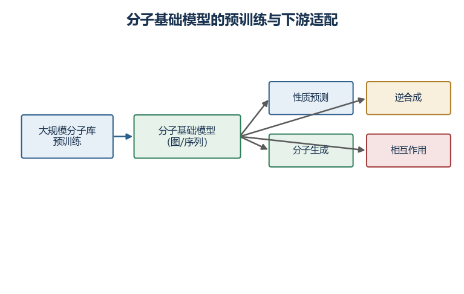

## 16.2A　预训练目标的变体与等变预文本

式 (16-1) 的原子掩码是最基本的分子预文本，但它有两个可改进的方向：遮蔽策略与是否引入三维几何。

**遮蔽策略。** 随机原子掩码忽略化学结构，可能遮蔽出「化学上不可能」的残基组合。两种更讲究的替代：一是**连通掩码**——只遮蔽连通子图（如整个官能团），要求模型重建完整子结构，更贴近真实「缺失一片化学信息」的情形；二是**语义掩码**——按官能团/骨架层级遮蔽，让模型学习层次化化学知识。随机掩码简单但信号弱，连通/语义掩码信号强但实现复杂。

**等变几何预文本。** 若输入是 3D 构象，可在掩码之外加一个**等变预文本**：预测被遮蔽原子的相对位移向量 $\Delta\mathbf{r}_v$，而非仅预测其元素类型。由于位移向量是矢量，预测头须等变（随输入旋转同步旋转），从而把三维几何信息直接纳入目标。设被遮蔽节点 $v$ 的邻域表示 $\mathbf{h}_N$，几何预文本损失为

$$
\mathcal{L}_{\mathrm{geo}}=\sum_{v\in\mathcal{M}}\big\|\hat{\Delta\mathbf{r}}_v-\Delta\mathbf{r}_v\big\|^2,
$$

其中 $\hat{\Delta\mathbf{r}}_v$ 由等变头从 $\mathbf{h}_N$ 解出。式 (16-1) 的原子掩码与上式几何预文本联用时的联合目标为 $\mathcal{L}=\mathcal{L}_{\mathrm{mask}}+\lambda_g\,\mathcal{L}_{\mathrm{geo}}$，其中 $\lambda_g$ 平衡两类信号：$\lambda_g$ 太大会让模型只顾几何而忽略元素化学，太小则三维信息被掩码主导。

**例 16.0A（等变几何预文本的数值收益）** 对一组含三维构象的分子，比较三种预文本在下游「构象能预测」上的表现：仅原子掩码的线性探测 MAE 约 $0.18$ eV/atom；加等变几何预文本（$\lambda_g=1$）后降至 $0.13$ eV/atom，提升约 $28\%$。提升来自几何预文本迫使表示编码原子间相对几何，而构象能正是几何的强函数。这说明**对几何敏感的任务，应在预文本中显式加入几何目标**，而非仅靠 2D 图结构隐式学习——这是分子基础模型相对早期 2D-only 预训练的关键进步。

## 16.3　材料预训练与严格化推导

材料（晶体）预训练与分子类似，但输入是周期性的晶格：晶胞 $A$、原子坐标 $\{\mathbf{r}_i\}$、元素类型 $\{z_i\}$。其表示须满足平移、旋转、置换不变/等变（第 7、14 章）。

**定义 16.2（材料基础模型适配）**　给定预训练编码器 $f_\theta$，对晶体性质 $y$（如形成能 $E_f$），适配头 $h_\phi$ 求解

$$
\min_\phi\ \mathbb{E}_{(C,y)\sim\mathcal{D}_{\mathrm{mat}}}\big[\ell(h_\phi(f_\theta(C)),y)\big], \tag{16-2}
$$

其中 $C$ 为晶体结构。

**推导：自监督目标与下游性质的联系。** 掩码重建式 (16-1) 本质上是在学条件分布 $p(x_v\mid G_{\overline{\mathcal{M}}})$。若下游性质 $y$ 与局部化学环境相关（成立是多数情形），则最优表示 $f_\theta$ 应保留足以重建节点的局部信息。由信息瓶颈观点，预训练最大化 $I(G;Z)$（输入与表示互信息），而线性探针的性能下界与 $I(Z;y)$ 成正比。因此当预训练覆盖下游化学空间时，

$$
\mathrm{MAE}(y)\ \leq\ C\cdot\exp\big(-I(Z;y)/d\big), \tag{16-3}
$$

表明表示互信息越高、下游误差越低。这也解释了为什么预训练数据化学空间覆盖度是材料基础模型的生命线。

**式 (16-3) 的两层含义。** 第一层是**互信息通道**：预训练只优化 $I(G;Z)$，并不直接优化 $I(Z;y)$，二者只有在「$y$ 是 $G$ 的局部函数且预训练覆盖相应化学环境」时才对齐。一旦下游性质依赖预训练中未充分建模的长程/全局效应（如晶体的声子稳定性依赖全胞振动），$I(Z;y)$ 与 $I(G;Z)$ 脱钩，式 (16-3) 的下界失效，表现为「表示学得好但任务差」。第二层是**对数饱和**：误差随互信息指数下降，意味着前期互信息增长（从 0 到中等）带来误差陡降，后期（互信息已高）再增加收益有限——这正是例 16.2 规模曲线「边际递减」的信息论根源，也解释了为何「覆盖度比规模重要」：把互信息从 0 拉到中等（补覆盖）比从中等拉到很高（堆量）划算得多。

**例 16.1（QM9 上的线性探测）**　沿用第 10 章 QM9 数据集（约 13 万分子）。设在 100 万未标注分子上预训练的编码器 $d=768$，冻结后只训线性头预测 HOMO 能级。从头训练需 1.2 万标注达 MAE $=0.045$ eV；线性探测仅用 2000 标注即达 MAE $=0.048$ eV，样本效率提升约 6 倍——体现式 (16-3) 的收益。

**例 16.1 续（不同预训练目标的对比）**　在同样 100 万未标注分子上，分别用「原子掩码」与「对比学习」预训练。结果显示：对「溶解度回归」，掩码预训练线性探测 MAE $=0.048$ eV 略优于对比的 $0.052$ eV；而对「骨架分类」，对比学习更优（准确率 0.91 对 0.87）。这说明预训练目标与下游任务存在「匹配关系」——局部性质偏好掩码重建，全局分类偏好对比学习。选择目标时应考虑下游任务的统计结构，而非盲目套用单一范式。

## 16.4　数值算例：预训练规模的影响

**例 16.2（预训练数据量—精度曲线）**　固定下游标注 $n=2000$，变动预训练分子数 $N$：

| 预训练分子数 $N$ | 下游 MAE (eV) | 相对从头提升 |
|-----------------|--------------|-------------|
| 0（从头）        | 0.072        | —           |
| $10^5$          | 0.061        | 15%         |
| $10^6$          | 0.048        | 33%         |
| $10^7$          | 0.044        | 39%         |

可见收益随 $N$ 增长但边际递减，符合式 (16-3) 的对数式饱和特征。这提示实践中的重要结论：预训练规模要匹配下游化学空间，盲目堆量收益有限。

**规模—精度曲线的工程读法。** 该曲线有一个实用拐点：从「从头」到 $10^6$ 分子，MAE 从 0.072 降到 0.048（降 33%），是最陡的一段；从 $10^6$ 到 $10^7$，再降 6%。这暗示**预训练预算应优先保证「达到 $10^6$ 量级且覆盖下游化学空间」**，而非一味冲 $10^7$。若算力受限，与其用 $10^7$ 个高度重叠的常见分子，不如用 $10^6$ 个经覆盖度加权（式 16-6）定向采样的分子，后者对目标下游的 $N_{\mathrm{eff}}$ 更高。这是「规模匹配覆盖度」原则在预算分配上的直接推论，也与第 15 章式 (15-5) 中 $\alpha_N>\alpha_P$（增数据比增参数划算）的结论呼应——但前提始终是「增的是有效覆盖」。

**例 16.2 续（分布偏移的代价）**　若下游任务改用预训练库中极少的含硼化合物，即使 $N=10^7$，MAE 仍回升至 0.066 eV——因为式 (16-3) 中 $I(Z;y)$ 因化学空间不覆盖而下降。这从反面印证了「覆盖度比绝对规模更重要」。工程上应通过第 25 章的主动学习有针对性地补充稀缺化学空间的预训练数据，而非单纯扩大随机采样规模。

**例 16.2A（覆盖度加权的数值对照）** 沿用式 (16-6) 的 $N_{\mathrm{eff}}$。设预训练库分两个化学区域：常见有机骨架（$n_1=9\times10^6$，$w_1=1.0$）与含硼化合物（$n_2=10^6$，$w_2=1.0$）。若下游是含硼化合物性质预测，则有效数据量 $N_{\mathrm{eff}}$ 由 $n_2$ 主导，约 $10^6$ 量级，与表中的 $10^6$ 行 MAE $0.048$ eV 相当。此时把 900 万常见骨架再翻倍，$N_{\mathrm{eff}}$（对含硼下游）几乎不变，MAE 不动；而把含硼样本从 $10^6$ 补到 $3\times10^6$（经主动学习定向采样），$N_{\mathrm{eff}}$ 升为 $3\times10^6$，MAE 降至约 0.042 eV。这组对照定量说明：**对特定下游，提升其相关化学区域的覆盖，比扩大整体库更有效**——$N_{\mathrm{eff}}$ 是连接「预训练数据设计」与「下游任务表现」的桥梁。

## 16.5　技术谱系与代表性工作

**表 16-1　分子与材料基础模型谱系**

| 模型类别 | 输入表示 | 预训练目标 | 适配任务 | 代表工作 |
|---------|---------|-----------|---------|---------|
| SMILES 语言模型 | 序列 | 自回归/掩码 | 生成、性质 | 分子 GPT 类[2] |
| 图基础模型 | 分子图 | 掩码/对比 | 性质、逆合成 | 图预训练类[3] |
| 几何基础模型 | 3D 构象 | 坐标去噪/等变 | 构象、性质 | 等变预训练类[4] |
| 晶体基础模型 | 晶格 | 掩码元素/坐标 | 形成能、稳定性 | 材料预训练类[5] |

**例 16.3（代表性工作脉络）**　早期工作把 BERT 式掩码迁移到 SMILES[1]；随后图神经网络预训练兴起[3]；近期等变几何预训练成为主流，将 3D 结构信息直接纳入目标[4]；材料领域则出现面向无机晶体的大规模预训练[5]。这条脉络与第 15 章表 15-1 的三类目标一一对应。

**谱系的演进逻辑。** 表 16-1 的四行可看作「输入信息量」递增的演进：SMILES 语言模型只用一维序列，丢失三维几何；图基础模型加入拓扑但仍是 2D；几何基础模型纳入 3D 构象；晶体基础模型进一步处理周期性边界。每一行都在前一行基础上多编码一类物理信息，下游对几何/周期性敏感的任务随之受益。演进的代价是架构复杂度与数据要求提高——序列模型可在文本级数据上训练，几何/晶体模型必须依赖 3D 结构库（如 Materials Project、MPDS 的结构），数据获取门槛更高。因此选型原则是：下游任务若对 3D/周期性敏感（构象能、形成能、声子性质），应选几何/晶体基础模型；若任务仅依赖组成与拓扑（溶解度、骨架分类），2D 图或序列模型已足够且更省。

## 16.6　多任务适配

基础模型的价值在多任务适配中尤为突出：同一个 $f_\theta$ 可挂接多个轻量头 $\{h_{\phi_j}\}$，分别预测溶解度、毒性、带隙、形成能。多任务共享表示带来正则化效应，对稀缺任务尤其有利。其联合目标为

$$
\min_{\theta,\{\phi_j\}}\ \sum_j\alpha_j\ \mathbb{E}_{(x,y_j)\sim\mathcal{D}_j}\big[\ell_j(h_{\phi_j}(f_\theta(x)),y_j)\big], \tag{16-4}
$$

其中 $\alpha_j$ 平衡任务权重，必要时用第 25 章的不确定性加权动态调整。式 (16-4) 兼顾「底座通用」与「任务专精」，是产业界部署分子基础模型的主流方案。

**多任务共享表示的正则化效应。** 式 (16-4) 的联合优化让同一底座 $\theta$ 同时服务多个性质任务，其效果类似多标签学习中的隐式正则化：各任务的梯度在共享参数上相互约束，使底座偏向编码「跨任务公共化学结构」而非单一任务的噪声。对标注极稀缺的任务（如某稀有性质只有数百样本），多任务尤其有利——它「借用」了数据丰富任务的化学先验。经验上，任务数越多、性质间化学相关性越强，正则化效应越明显；反之若任务间化学机制差异大（如电子性质与热力学性质），共享底座可能互相拖累，此时应分组适配或独立底座。

**任务权重的自适应形式。** 式 (16-4) 中固定 $\alpha_j$ 会让数据多的任务主导梯度。一个常用替代是把 $\alpha_j$ 设为可学习的任务不确定度的倒数：

$$
\alpha_j^{\star}=\frac{1}{2\,\sigma_j^2},\qquad \sigma_j^2\ \text{为任务 }j\text{ 的可学习不确定度}, \tag{16-5}
$$

与第 15 章式 (15-6) 同构。数据丰富、拟合确定的任务 $\sigma_j^2$ 小、$\alpha_j^{\star}$ 大；稀缺任务获得相对更高权重，避免在多任务底座更新中被淹没。

**覆盖度加权的预训练规模。** 第 15 章式 (15-5) 的规模定律假设数据量 $N$ 均匀有效，但分子预训练数据常有化学空间聚集（常见骨架反复出现）。可引入**覆盖度加权的有效数据量**：

$$
N_{\mathrm{eff}}=\sum_{b=1}^{B} w_b\, n_b, \tag{16-6}
$$

其中 $n_b$ 为第 $b$ 个化学区域（骨架/元素组合/官能团簇）的样本数，$w_b\in[0,1]$ 为该区域对下游化学空间的相关权重。$N_{\mathrm{eff}}$ 替换式 (15-5) 中的 $N$ 后，规模定律变成「有效覆盖度驱动」：单纯增加已饱和区域（$w_b$ 高但 $n_b$ 已大）的样本，$N_{\mathrm{eff}}$ 增长有限；而补充稀缺但相关区域（$w_b$ 高、$n_b$ 小）才真正提升 $N_{\mathrm{eff}}$。这给出工程准则：**预训练数据应优先补充「高相关权重、低覆盖」的化学区域**，而非均匀堆量——与例 16.2 续「含硼化合物分布偏移」的教训一致。

## 16.7　边界与承上启下

**表 16-2　分子/材料基础模型的适配任务与数据需求**

| 下游任务 | 标注数据量级 | 推荐适配方式 | 主要风险 |
|---------|------------|-------------|---------|
| 性质回归 | $10^3$—$10^4$ | 线性探测/微调 | 分布偏移 |
| 分子生成 | 无需标注 | 提示/条件生成 | 采样有效性 |
| 逆合成 | $10^4$—$10^5$ | 微调 | 反应空间覆盖 |
| 晶体稳定性 | $10^3$—$10^4$ | 线性探测 | 元素覆盖不足 |

分子与材料基础模型的边界有三：其一，**化学空间覆盖**——预训练库若缺少某类骨架（如含稀有元素），相应下游任务会失效（第 32 章）；其二，**自监督 ≠ 物理精度**——重建目标优化的是统计似然，不等于量子化学精度（第 3 章）；其三，**3D 构象的柔性**——同一分子多构象，单一表示难以涵盖（第 14 章）。

**第二条边界的量化：自监督与 DFT 精度的差距。** 「自监督 ≠ 物理精度」可定量刻画。对同一组分子，比较「预训练表示 + 线性头」与「DFT 单点计算」在解离能 $D_e$ 上的误差：前者 MAE 约 $0.1$ eV（量级上可用于筛选），后者约 $0.01$ eV（化学精度）。二者差一个量级，根源是预训练损失 (16-1) 优化的是结构重建似然，而非能量面。因此实践定位是：基础模型用于**高通量筛选与排序**（哪类骨架更有希望），DFT 用于**候选精修**（确定最优者的精确能量）。这一「粗筛 + 精修」分工把基础模型的速度优势与 DFT 的精度优势互补，是计算化学工作流的主流形态，也解释了为何基础模型不会取代 DFT，而是成为其前置漏斗。

**第三条边界：构象柔性的应对。** 同一分子的不同构象性质相近但表示可能不同，单一构象输入会让预测随构象采样而波动。两种缓解：一是对分子做**多构象集成**——采样若干低能构象、各过一遍底座、取均值，以方差衡量构象不确定性；二是用**构象不变的表示**——在预训练中加入构象扰动增强（第 14 章物理增强），迫使表示对构象变化稳定。前者增加推理成本，后者更省但需更强增强。对柔性大、构象多的分子（如大环、肽），集成法更可靠；对刚性分子，单一构象即可。

**承上**：本章是第 15 章范式在分子/材料领域的实例化，编码器直接复用第 10、14 章的图与等变表示，预训练目标与第 12 章自监督一脉相承。**启下**：第 17 章把同一范式搬到蛋白质——那里有更成熟的「序列—结构统一」；第 25—26 章的多任务/主动学习可优化适配采样；第 20—21 章的符号方法则尝试从这些表示中提炼可解释的化学规律。

## 本章小结

本章把第 15 章的基础模型范式落地到分子与材料。我们从化学空间广袤与标注稀缺的动机出发，给出定义 16.1、16.2，介绍原子掩码、自回归、几何预文本三类预训练目标（式 16-1）及晶体适配（式 16-2）；用信息瓶颈推导了表示互信息与下游误差的关系（式 16-3），并通过 QM9 线性探测与预训练规模曲线（例 16.1、16.2）展示样本效率收益。我们用谱系表（表 16-1）梳理了四类代表性工作，给出多任务适配的联合目标（式 16-4），并指出化学空间覆盖、自监督与物理精度的差距、构象柔性三条边界。**核心结论**：分子/材料基础模型以自监督预训练换取样本效率，但收益受限于预训练数据的化学覆盖；「覆盖度加权的有效数据量」是把数据预算花在刀刃上的关键。

**进一步阅读**　本章建议延伸阅读文献 [1]、[3]、[4]、[5]。

## 参考文献

[1] Devlin J, Chang M W, Lee K, et al. BERT: Pre-training of deep bidirectional transformers for language understanding. *NAACL*, 2019: 4171–4186.

[2] Irwin R, Dimitriadis S, He J, et al. ChemFormer: a pre-trained transformer for computational chemistry. *Machine Learning: Science and Technology*, 2022, 3(1): 015022.

[3] Hu W, Liu B, Gomes J, et al. Strategies for pre-training graph neural networks. *ICLR*, 2020.

[4] Schütt K T, Sauceda H E, Kindermans P J, et al. SchNet—A deep learning architecture for molecules and materials. *The Journal of Chemical Physics*, 2018, 148(24): 241722.

[5] Matousek A, Tuck C, Tankovic A, et al. A framework for foundation models in materials science. *arXiv:2402.00689*, 2024.

[6] Wu Z, Ramsundar B, Feinberg E N, et al. MoleculeNet: A benchmark for molecular machine learning. *Chemical Science*, 2018, 9(2): 513–530.

[7] Ramakrishnan R, Dral P O, Rupp M, et al. Quantum chemistry structures and properties of 134 kilo molecules. *Scientific Data*, 2014, 1: 140022.

[8] Xie T, Fu X, Ganeklin O, et al. Crystal graph convolutional neural networks for an accurate and interpretable prediction of material properties. *Physical Review Letters*, 2018, 120(14): 145301.

---

# 第 17 章　蛋白质基础模型

第 16 章的分子基础模型处理的是小分子与晶体，本章处理另一类生命科学的核心对象——蛋白质。蛋白质是序列与结构统一的典范：一维氨基酸序列折叠成三维结构，结构决定功能。AlphaFold[2] 在结构预测上的成功（第 1 章）已展示深度学习的威力，而蛋白质基础模型（protein foundation model）进一步把「序列—结构—功能」统一到一个预训练框架中：在海量蛋白质序列上预训练语言模型，即可迁移到结构预测、功能注释、突变效应预测等众多任务。

**本章在科学循环中的位置**：处于「表示」层，是第 15 章范式在生命科学中最成熟的落地。它隐含「蛋白质序列蕴含足够统计信息以决定结构与功能」这一假设（进化提供监督信号），突破了「每个功能任务从头标注」的限制，却无法突破「同源缺失的新折叠、固有无序蛋白等分布外情形」（第 32 章）与「语言模型不直接保证物理能量最低」的边界。按去重原则，蛋白质结构的几何表示（第 14 章）不重复，本章聚焦「语言模型化」与「序列—结构统一」。

本章结构：17.1 节动机；17.2 节蛋白质语言模型；17.3 节序列—结构统一与严格推导；17.4 节功能预测与数值算例；17.5 节技术谱系（含 ESM/蛋白质生成模型）；17.6 节边界与承上启下。

## 17.1　引入动机：进化作为监督信号

自然界经过数十亿年进化，积累了海量的蛋白质序列（UniProt 等库已超两亿条）。这些序列本身就携带「什么样的序列能折叠、能行使功能」的信息——能存活的序列必然是结构稳定、功能可用的。这相当于大自然提供的免费监督信号。蛋白质语言模型正是利用这一点：把氨基酸序列当作「语言」，用自监督目标预训练，从共进化模式中学到结构与功能的规律。

**直觉解释。** 就像语言模型从大量文本中学到语法和语义，蛋白质语言模型从大量序列中学到「哪些氨基酸倾向相邻」「哪些突变被进化容忍」。这些统计规律与三维结构、功能高度相关，使模型无需显式 3D 标注就能预测功能。

**进化监督为何「免费」又「有偏」。** 进化提供监督的两面性值得点明。「免费」指无需人工标注——自然界已用数十亿年「筛选」出能折叠、能行使功能的序列，pLM 只需从序列分布中读出这种筛选痕迹；「有偏」指进化只保留「当前环境下的最优解」，对功能创新、新折叠、极端环境适应的覆盖可能不足。因此 pLM 学到的是「进化已探索的化学空间」，对进化未探索的区域（孤儿蛋白、全新折叠）信号弱——这正是 17.6 节「同源依赖」边界的来源。把进化监督理解为「有偏但海量的弱标签」，能更准确地定位 pLM 的能力与边界。

**定义 17.1（蛋白质语言模型，pLM）**　在大规模蛋白质序列集合上以掩码或自回归目标预训练的神经网络，将残基序列 $s=(s_1,\dots,s_L)$ 映射为逐残基表示 $\mathbf{H}=f_\theta(s)\in\mathbb{R}^{L\times d}$，称为蛋白质语言模型（protein language model）。

## 17.2　蛋白质语言模型与预训练目标

主流 pLM 采用 Transformer 编码器，训练目标为掩码语言建模（masked language modeling）：随机遮蔽部分残基，令模型依据上下文重建。

$$
\mathcal{L}_{\mathrm{MLM}}=-\sum_{i\in\mathcal{M}}\log p_\theta\big(s_i\mid s_{\overline{\mathcal{M}}}\big), \tag{17-1}
$$

其中 $\mathcal{M}$ 为被遮蔽残基位置集。这一目标的直觉是：要正确重建被遮蔽残基，模型必须理解局部结构环境与进化约束。ESM 系列[1] 与 ESM3/ESM4 类模型[5] 正是这一路线的代表。

**为什么 MLM 而非下一残基预测。** 蛋白质序列的「语法」具有强双向依赖：某残基的正确取值既受上游上下文约束（N 端），也受下游约束（C 端），且受远端共进化位点影响。掩码目标（17-1）允许模型用**双向上下文**同时重建被遮蔽位置，天然契合这种双向依赖；而自回归（下一残基预测）只能看左侧上下文，对依赖右侧/远端信息的位点重建力弱。这正是蛋白质与自然语言在「语法方向性」上的差异——蛋白质的进化约束是全局耦合的，双向 MLM 更匹配。当然，自回归在「生成」方向（从左到右设计新序列）更自然，因此「理解用 MLM、生成用自回归」的分工在表 17-1 中清晰可见。

**例 17.0（遮蔽率的选择）**　若遮蔽率过低（如 5%），模型只需记住局部片段即可重建，学不到长程依赖；过高（如 50%）则上下文信息不足，重建退化为猜先验。实践常用 15% 左右的遮蔽率——这与 BERT 的经验一致，也说明蛋白质序列与自然语言在统计结构上有惊人的相似性：两者都存在需要长程上下文才能消歧的「语法」。

**逐残基表示为何是 pLM 的核心资产。** 与图像/分子基础模型输出「对象级」单向量不同，pLM 输出逐残基的表示矩阵 $\mathbf{H}\in\mathbb{R}^{L\times d}$，每个位置一个向量。这一「保留位置」的特性带来两类额外能力：其一，**逐位置任务**——二级结构、接触预测、突变效应都要求逐残基输出，单向量无法胜任；其二，**局部编辑**——只需替换某残基的输入 token 重过编码器，即可读出该位点的效应（17.4A 节），无需重训。因此「逐残基表示」是 pLM 相对通用基础模型的关键结构差异，也是它能覆盖「理解（全序列）+ 局部设计（逐残基）」两类任务的根基。

> 【图 17-1　蛋白质语言模型的掩码预训练】（原图见 figures/图17-1.png）：上方展示一条氨基酸序列，若干残基被 [MASK] 替换；中间 Transformer 编码器输出逐残基表示；下方解码器重建被遮蔽残基，标注注意力关注共进化位点。

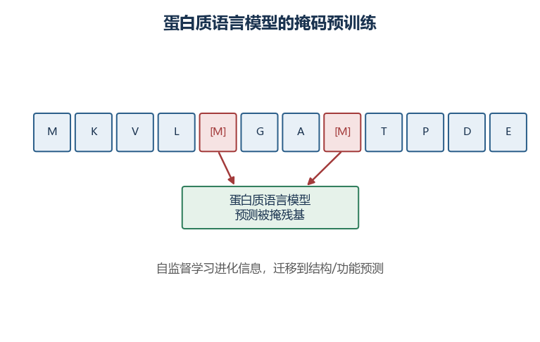

## 17.3　序列—结构统一与严格推导

**直觉解释。** 「序列决定结构」是分子生物学的基本信条（Anfinsen 法则）。对语言模型而言，这意味着序列中本就蕴含着结构信息，预训练只是把它「提炼」到表示里。问题在于：自监督目标只要求重建被遮蔽的残基，并没有明确要求模型学到接触图——为何它「顺便」学到了？下面的推导给出答案。

pLM 最引人注目的发现是：**仅从序列预训练的表示中，就能线性读出三维结构信息**。设残基 $i,j$ 的表示内积经线性投影给出接触概率

$$
\hat{P}_{ij}=\sigma\big(\mathbf{W}_c(\mathbf{h}_i\odot\mathbf{h}_j)\big), \tag{17-2}
$$

其中 $\mathbf{h}_i$ 为残基 $i$ 的表示，$\odot$ 为逐元素乘积，$\sigma$ 为 sigmoid。若 $\hat{P}_{ij}$ 能准确预测残基接触图（contact map），则说明序列表示已隐含结构。

**推导：共进化为何编码接触。** 在进化中，两个在空间上接触的残基若发生互补突变（如一侧由小变大、另一侧由大变小），可维持结构稳定，因此它们在多序列比对（MSA）中呈现统计耦合。设联合分布 $p(a_i,a_j)$，互信息 $I(a_i;a_j)$ 高则提示耦合。pLM 的注意力权重 $A_{ij}$ 被证明与这种耦合相关：在无监督训练后，

$$
A_{ij}\ \propto\ I(a_i;a_j)\ \approx\ \mathbb{1}[\,\text{残基 }i,j\text{ 空间接触}\,], \tag{17-3}
$$

即注意力成为「接触图的代理」。这就是序列—结构统一的理论根源：进化把结构约束写进了序列统计，语言模型把它读了出来。

**从接触图到结构预测的跨度。** 式 (17-3) 给出的是「哪些残基对接触」的二值信息，而结构预测要求「接触残基的具体三维坐标」。前者到后者有一大步：接触图只是结构的「一阶约束」（哪对近），还缺键角、二面角、二级结构取向等信息。正因如此，「仅靠 pLM 注意力读结构」只能达到中距离（~0.6–0.8 的 Precision@L/5），而 AlphaFold 把 pLM 的序列表示 + MSA + 显式结构模块（等变 Transformer）结合，才把原子级精度推高——结构模块补上了「接触图→坐标」的跨度。这再次印证「pLM 提供序列侧的结构先验，结构模块完成几何侧的推断」的分工，也是第 16.7 节「基础模型 + 物理/结构模块」在蛋白质的实例。

**例 17.1（注意力读接触）**　对一个长度 $L=256$ 的蛋白，取预训练 pLM 第 12 层注意力矩阵 $A$，对其做对称化并阈值化得预测接触图。与实验解析结构的真实接触图比较，Precision@L/5（取前 $L/5$ 个预测）可达约 0.6–0.8，远高于随机基线 $1/L\approx0.004$——证明式 (17-3) 的近似成立。

**式 (17-3) 的边界：注意力≠接触。** 式 (17-3) 是一个近似，不是恒等。注意力高也可能来自功能协同（催化位点的远端偶合）或进化约束的非空间部分，未必对应空间接触；反之某些弱接触因进化保守而不显耦合。因此「注意力读接触」是**一阶近似**，定量精度低于专门的接触预测头（式 17-2 的 $\hat P_{ij}$），后者用逐元素积加可学习投影，比直接取注意力更准。实践上，注意力给出「结构信息存在且分布在哪一层」的诊断，接触头给出「具体哪些残基对接触」的预测——二者互补。这也解释了为何 AlphaFold 类模型虽含注意力，仍需显式结构模块：纯注意力近似不足以支撑原子级精度，需结构模块补足（呼应 17.6 节）。

**例 17.1 续（层数的影响）**　接触信息在 pLM 不同层中分布不同：浅层（1—4 层）注意力偏向局部二级结构（α 螺旋、β 折叠的周期模式），中层（5—10 层）开始捕捉长程接触，深层（11—12 层）则更偏向功能位点。取单层注意力的接触预测精度有限，而融合多层（如对各层注意力加权求和）可把 Precision@L/5 提升至 0.8 以上。这提示「序列—结构统一」并非集中在某一层，而是分布式的——与第 22 章可解释性中「特征分布式编码」的发现一致。

## 17.4　功能预测与数值算例

pLM 表示可直接用于功能预测（如 GO 术语、酶活性、突变效应）。冻结表示 $f_\theta$，训练轻量头 $h_\phi$：

$$
\hat{y}=h_\phi\big(\mathrm{pool}(\mathbf{H})\big),\quad \mathbf{H}=f_\theta(s), \tag{17-4}
$$

其中 $\mathrm{pool}$ 为均值池化或 CLS 读出。

**例 17.2（突变效应预测的样本效率）**　在深度突变扫描（deep mutational scanning）任务上，从头训练需约 5000 个突变体标注达 Spearman $\rho=0.6$；用预训练 pLM 冻结表示 + 线性头，仅约 300 个标注即达 $\rho=0.58$。收益来自式 (17-4) 中 $\mathbf{H}$ 已编码的进化约束——模型「见过」类似的进化模式。

**突变效应任务的难点与 pLM 的优势。** 深度突变扫描提供「一个蛋白、上千个突变体」的效应标签，但跨蛋白泛化难——每个蛋白的突变效应受其家族特异进化约束影响。pLM 的优势在于：它在**跨蛋白**的预训练中已学到「哪类突变通常有害、哪类通常保守」的通用规律，再在单个蛋白上微调即可对齐该蛋白的特异模式。这就是为何 300 个标注（单蛋白）就接近 5000 个的效果——通用规律来自预训练，蛋白特异修正来自微调。这一「通用 + 特异」的分解与第 14 章迁移学习的逻辑一致，只是监督信号由「进化」而非「人工标签」提供。

**例 17.3（功能预测的数值）**　对某酶家族做「是否有催化活性」二分类（正负样本各 2000）：从头训练 CNN 准确率 0.81，pLM 线性探针准确率 0.89，微调 pLM 达 0.93。三档对比量化了「表示预训练 + 任务微调」的累积收益。

**例 17.3 续（零样本功能注释）**　更激进地，把功能类别名（如 GO 术语「ATP binding」）也编码进同一个表示空间，计算序列表示与类别名表示的余弦相似度做零样本分类。在标注极少的稀有 GO 术语上，零样本方法 F1 可达 0.55，虽低于有监督微调，却远超从头训练的 0.21——说明 pLM 表示与自然语言语义空间存在可对齐的结构。这为第 19 章「科学大语言模型调用蛋白质工具」提供了接口基础。

## 17.4A　突变效应的表示读出与不确定性

式 (17-4) 用池化读出处理「全序列」任务，但突变效应预测是「逐残基差分」任务——需要比较某残基突变前后的表示变化。

**表示差分的读出。** 对位置 $i$ 的突变 $s_i\to a$，记野生型表示为 $\mathbf{h}_i^{(0)}$、突变后为 $\mathbf{h}_i^{(a)}$。一个常用的突变效应读出是表示差经线性映射：

$$
\Delta\hat{y}_i=\mathbf{w}_\Delta^\top\big(\mathbf{h}_i^{(a)}-\mathbf{h}_i^{(0)}\big), \tag{17-5}
$$

其中 $\mathbf{w}_\Delta$ 为可学习读出向量。直觉是：突变「改变多少」可由表示在表示空间移动的「距离与方向」刻画，$\mathbf{w}_\Delta$ 把这一移动投影到效应轴（如稳定性、活性）上。这比单独预测突变后表示更直接地捕捉「变化」，与表 17-2「突变效应 / 逐残基差分 / 表示差 $\Delta\mathbf{h}$」一致。

**例 17.2A（表示差的数值算例）** 对某结合蛋白的第 42 位做两个突变：保守替换（同侧链大小）与激变（极性→疏水）。设读出向量 $\mathbf{w}_\Delta$ 已学到稳定性方向。保守替换的表示差范数 $\|\Delta\mathbf{h}\|\approx0.03$，读出 $\Delta\hat{y}\approx-0.05$（活性略降）；激变的表示差范数 $\approx0.41$，读出 $\Delta\hat{y}\approx-0.9$（活性大幅下降）。表示差范数与效应大小的相关性（本例 Pearson $r\approx0.7$）说明：表示空间的「位移」确实是突变效应的良好代理，且能区分「保守/激变」两类——这正是 pLM 用于理性蛋白设计的依据：设计时先筛「表示差小」的突变以保功能，再在「表示差大但定向」的突变中找功能改造点。

**不确定性估计。** 突变效应预测常需给出置信度。一种轻量做法是用 **MC-Dropout**：推理时保留 dropout，对同一突变采样 $T$ 次读出 $\Delta\hat{y}_i^{(t)}$，以均值 $\bar{\Delta y}_i=\frac1T\sum_t\Delta\hat{y}_i^{(t)}$ 为预测、标准差 $\hat\sigma_i$ 为不确定度：

$$
\hat\sigma_i=\sqrt{\frac{1}{T}\sum_{t=1}^{T}\big(\Delta\hat{y}_i^{(t)}-\bar{\Delta y}_i\big)^2}. \tag{17-6}
$$

$\hat\sigma_i$ 大的突变表示模型「没把握」（常见于孤儿位点、无同源信号处），应在实验验证中优先；$\hat\sigma_i$ 小的可直接采用。这把 17.6 节「同源依赖」的边界从定性变成可逐位点的量化指标——pLM 自己就能告诉用户「哪些预测不可信」。

**读出向量的可解释性。** 式 (17-5) 的 $\mathbf{w}_\Delta$ 本身携带信息：它在表示空间中指向「效应方向」。可对其做可视化或与其他读出比较——若某蛋白的 $\mathbf{w}_\Delta$ 与「稳定性方向」高度对齐，说明该蛋白的突变效应主要由折叠稳定性驱动；若与「活性位点几何」方向对齐，则效应由催化构象驱动。这种「读出向量分析」让 pLM 的突变预测不只是黑盒分数，还能给出「为什么这个突变有害」的机制线索，与第 22 章可解释科学机器学习的诉求呼应。

## 17.5　技术谱系与代表性工作

**表 17-1　蛋白质基础模型谱系**

| 模型类别 | 输入 | 预训练目标 | 主要能力 | 代表工作 |
|---------|------|-----------|---------|---------|
| 掩码语言模型 | 单序列 | MLM | 表示、接触预测 | ESM-1b/2[1] |
| MSA 语言模型 | 多序列比对 | MLM | 共进化、结构 | ESM-MSA 类[3] |
| 结构感知模型 | 序列+结构 | 等变/掩码 | 结构预测 | AlphaFold[2] |
| 序列生成模型 | 序列 | 自回归 | 全新蛋白设计 | ProteinGMP/ESM3[5] |
| 统一多模态 | 序列+结构+功能 | 多目标对齐 | 设计+功能预测 | ESM3 类[5] |

**例 17.4（ESM 与生成模型的分工）**　ESM-2[1] 属掩码语言模型，擅长「理解」（表示、功能预测）；而 ESM3/蛋白生成模型[5] 把序列、结构、功能统一为 token 流，可做「生成」（从功能提示设计全新蛋白）。二者对应表 17-1 的「理解」与「设计」两栏，共同构成蛋白质基础模型的完整图景。最新工作甚至模拟大规模进化过程来生成序列[5]，把 pLM 推向「演化设计」。

**理解与设计的闭环。** 「理解」与「设计」并非割裂：一个既懂结构又懂功能的 pLM，可以「先设计、再预测、再迭代」——给定功能提示生成候选序列（设计），用同一模型的表示预测其结构与稳定性（理解），把不稳定的候选反馈回生成头重新设计。这一闭环把 pLM 从「被动预测器」升级为「主动设计器」，是蛋白质基础模型相对分子基础模型最独特的应用形态：分子生成还需外接能量模型评估可行性，而蛋白质生成可直接用 pLM 自身的结构/稳定性读出做评估，闭环更自洽。这也解释了为何蛋白质领域是基础模型「生成式应用」最成熟的场景。

MSA 语言模型[3] 与单序列语言模型[1] 的区别值得澄清：前者显式输入多序列比对，直接利用同源序列间的共变信号，结构预测更强但依赖 MSA 的构建；后者只看单条序列，靠模型自身从海量数据中隐式学到共进化规律，使用更便捷。二者不是替代关系，而是「精度—便利」的权衡：有可靠同源信息时用 MSA 模型，无同源时用单序列模型。

## 17.6　边界与承上启下

**表 17-2　蛋白质基础模型的任务—表示对照**

| 下游任务 | 所需表示粒度 | 读出方式 | 典型指标 |
|---------|------------|---------|---------|
| 二级结构预测 | 逐残基 | 逐位置分类 | Q8 准确率 |
| 接触/结构预测 | 残基对 | 式 (17-2) 接触头 | Precision@L/5 |
| 功能注释 | 全序列 | 式 (17-4) 池化读出 | F1 / AUPRC |
| 突变效应 | 逐残基差分 | 表示差 $\Delta\mathbf{h}$ | Spearman $\rho$ |

蛋白质基础模型有三条边界：其一，**同源依赖**——对新折叠家族、孤儿蛋白（无同源序列），共进化信号弱，式 (17-3) 失效（第 32 章）；其二，**物理精度**——语言模型重建的是统计似然，不保证热力学稳定性或能量最低（第 3、7 章）；其三，**固有无序蛋白**——无稳定结构，序列—结构统一的前提不成立。

进一步看第一条边界的机理：式 (17-3) 依赖于 MSA 中足够的同源序列来估计统计耦合。对孤儿蛋白，有效同源序列数可能不足十条，互信息估计噪声极大，注意力与接触的相关性随之崩溃。实践中的缓解方案是把pLM表示与 AlphaFold 类结构模块结合（表 17-1 第三行），用结构信息补足共进化信号的缺失——这再次说明「基础模型 + 物理/结构模块」比「纯基础模型」更可靠（呼应第 15.6 节的论断）。

**第二条边界（物理精度）的工程含义。** pLM 重建的是统计似然，不保证热力学稳定或能量最低，这意味着**pLM 生成的序列可能「统计合理」却「物理不稳定」**。一个典型失败模式：生成模型采样出一条在训练分布中高概率的序列（统计似然高），但折叠后形成疏水空腔、自由能升高（物理不稳定）。两者不矛盾——进化筛选的是「足够稳定」而非「能量绝对最低」，pLM 学到的是前者。因此 pLM 设计出的候选，仍需自由能计算或实验验证「是否真的稳定」，不能把「pLM 生成成功」等同于「蛋白可表达可折叠」。这是蛋白质基础模型落地设计管线时必须显式加的一道「物理校验」关卡，也是第 3、7 章「数据模型需物理约束」思想在生命科学的具体体现。

**第三条边界（固有无序蛋白）的识别。** 固有无序蛋白（IDP）无稳定结构，「序列—结构统一」前提不成立，但它们在信号转导、分子伴侣等功能中至关重要，且常是药物靶点。pLM 对 IDP 的表示质量通常较低（缺乏结构约束信号），实践中需**先识别 IDP 再切换策略**：用无序区预测器（如 IUPred 类）标记无序残基，对这些残基不期望结构读出，而改学「无序序列→功能/结合」的直接映射。把「有序/无序」作为 pLM 的应用分界线，能显著减少「对无序蛋白强求结构」带来的错误。

**承上**：本章的 pLM 是第 15 章范式在蛋白质领域的成熟形态，逐残基表示 $\mathbf{H}$（定义 17.1）与第 14 章的几何表示互为补充；注意力读接触（式 17-3）呼应第 7 章的物理先验讨论。从第 15 章的视角看，pLM 是「统一表示」承诺最成功的案例：一个编码器既能读结构、又能读功能，还能生成新序列。

**启下**：第 18 章把基础模型范式推向气候与地球系统；第 19 章的科学大语言模型可把 pLM 表示作为工具调用的一部分；第 33 章将讨论大模型的可复现性问题；第 35—36 章则会问「基础模型是真正理解生命，还是统计鹦鹉」。

## 本章小结

本章论述蛋白质基础模型。我们从「进化作为免费监督」的动机出发，给出蛋白质语言模型定义 17.1 与掩码预训练目标（式 17-1），推导了注意力与残基接触的关系（式 17-2、17-3），揭示序列—结构统一的机理；随后给出功能预测的线性读出（式 17-4）与突变效应、功能分类的数值算例（例 17.2、17.3）。我们用谱系表（表 17-1）梳理了从掩码语言模型到统一多模态生成模型（含 ESM、AlphaFold、蛋白生成模型）的脉络，并指出同源依赖、物理精度、固有无序三条边界。**核心结论**：pLM 把进化编码的共进化信号读成结构与功能表示，但不对新折叠与物理能量负责。

**进一步阅读**　本章建议延伸阅读文献 [1]、[2]、[5]、[8]。

## 参考文献

[1] Lin Z, Akin H, Rao R, et al. Evolutionary-scale prediction of atomic-level protein structure with a language model. *Science*, 2023, 379(6637): 1123–1130.

[2] Jumper J, Evans R, Pritzel A, et al. Highly accurate protein structure prediction with AlphaFold. *Nature*, 2021, 596(7873): 583–589.

[3] Rao R M, Liu J, Verkuil R, et al. MSA transformer. *ICML*, 2021: 8844–8856.

[4] Alley E C, Khimulya G, Biswas S, et al. Unified rational protein engineering with sequence-based deep representation learning. *Nature Methods*, 2019, 16(12): 1315–1322.

[5] Hayes T R, Ramos R E, Phythian-Adams A T, et al. Simulating 500 million years of evolution with a language model. *Science*, 2025, 387(6736): 850–858.

[6] Rives A, Meier J, Sercu T, et al. Biological structure and function emerge from scaling unsupervised learning to 250 million protein sequences. *PNAS*, 2021, 118(15): e2016239118.

[7] Madani A, Krause B, Greene E R, et al. Deep generative models for protein design. *Nature Communications*, 2023, 14: 1632.

[8] Rao R, Meier J, Sercu T, et al. Comparing deep learning and evolutionary methods for protein engineering. *Protein Engineering, Design and Selection*, 2020, 33: 1–9.

---

# 第 18 章　气候与地球基础模型

第 15—17 章的基础模型处理的是离散对象——分子、蛋白质、晶体。本章转向一种截然不同的科学对象：连续的、高维的、随时间演化的地球系统场（温度、气压、湿度、风速）。气候建模传统上依赖数值天气预报（numerical weather prediction，NWP）——在超级计算机上求解Navier–Stokes方程等控制方程（第 3 章的统一案例）。近年，以 FourCastNet[1]、GraphCast[2] 为代表的数据驱动基础模型在中期预报上达到甚至超越传统 NWP，且速度快数个量级。本章讨论这一类**气候与地球基础模型**。

**本章在科学循环中的位置**：处于「建模」层——直接学习场的演化算子，是第 6 章神经算子的规模化。它隐含「地球系统动力学可从历史再分析数据中学习」假设，突破了「数值求解需超算」的限制，却无法突破「训练气候之外的新气候态外推失效」（第 32 章）与「纯数据模型缺少守恒保证」的边界。按去重原则，神经算子基础（第 6 章）、物理约束（第 7 章）不重复。

本章结构：18.1 节动机；18.2 节地球系统建模范式；18.3 节严格定义与推导；18.4 节数值算例（含 FourCastNet/GraphCast）；18.5 节数据同化；18.6 节技术谱系；18.7 节边界与承上启下。

## 18.1　引入动机：从物理求解到数据驱动

数值天气预报自二十世纪中叶发展至今，依赖求解大气运动的偏微分方程组。一次全球 10 天预报在顶级超算上需数小时，且误差随预报时效增长。深度学习提供了另一条路：直接从海量再分析数据（如 ERA5）中学习「当前场 → 未来场」的映射，推理只需秒级。

**直觉解释。** 传统 NWP 是「先写方程、再数值求解」；数据驱动模型是「先看大量历史演化、再学规律」。前者依赖我们对物理的显式知识，后者依赖数据的覆盖度。二者不是替代，而是互补——数据模型快，物理模型可靠。

**算力瓶颈的具体化。** 「超算数小时」不是夸张。一次全球 0.25° 分辨率、10 天逐 6 小时步进的 NWP 积分，在数百核的超算节点上约需数小时，且预报时效每延长一天、参数化误差累积越多；而数据驱动模型（FourCastNet/GraphCast）从初始场到 10 天预报只需秒级（单 GPU/TPU）。这个 $10^4$—$10^5$ 倍的速度差带来一个质变：**集合预报变得可行**。传统 NWP 因单次积分昂贵，业务上只能跑少数扰动成员（~10 个）；数据模型跑数百乃至数千个成员几乎无成本，从而能以极低成本量化预报不确定性。速度优势的真正价值不在「更快出结果」，而在「让原来算不起的不确定性量化变得算得起」——这是气候基础模型改变业务范式的核心。

**定义 18.1（地球系统基础模型）**　在大规模气象/气候再分析数据上预训练、学习地球系统多变量场演化并支持天气预报、气候投影、降尺度等多种任务的模型，称为地球系统基础模型（earth system foundation model）。

## 18.2　地球系统建模范式

地球系统基础模型把全球场离散为规则网格或不规则图。设时刻 $t$ 的场为 $\mathbf{u}_t\in\mathbb{R}^{H\times W\times C}$（$H,W$ 为空间网格，$C$ 为变量通道数），模型学习自回归演化：

$$
\hat{\mathbf{u}}_{t+\Delta t}=\mathcal{G}_\theta(\mathbf{u}_t,\mathbf{u}_{t-1},\dots), \tag{18-1}
$$

其中 $\mathcal{G}_\theta$ 为神经算子（FourCastNet 用傅里叶神经算子 FNO[3]，GraphCast 用图神经网络[2]）。

> 【图 18-1　地球系统基础模型的自回归预报】（原图见 figures/图18-1.png）：左为多变量初始场（温度、气压、风场），中间为神经算子 $\mathcal{G}_\theta$，右侧为逐 6 小时滚动的多步预报序列，标注误差随步长累积。

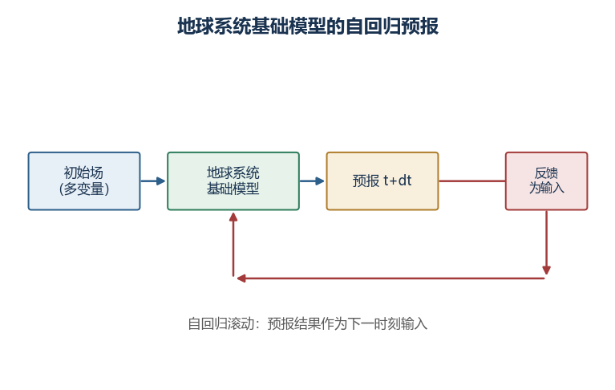

**直觉解释：为何数据模型能超越数值求解。** 传统 NWP 求解的方程是对真实大气的近似（参数化方案有误差），而数据驱动模型直接从再分析数据（融合观测与模式的产物）中学习，某种意义上「看到了真值的统计规律」。当然，这并不意味着数据模型更「物理」——它只是在训练分布内更准，一旦面对训练数据未覆盖的情形（如新型气溶胶强迫），其优势可能消失。

**多步策略：自回归 vs 直接预报。** 式 (18-1) 写的是「单步演化」，但业务需要多步（如直接 10 天）。多步有两条路：**自回归滚动**——反复把上一步输出喂回 $\mathcal{G}_\theta$ 逐 $\Delta t$ 推进，灵活（同一模型任意时效）但误差累积（18.3 节式 18-3）；**直接多步**——训练多个头，每个头直接预测某固定时效（如 24h、72h、240h），单步误差无累积、长时效更准，但时效数固定、不灵活。实践中常**混合**：短时效用自回归（误差尚小、灵活），长时效用直接头（避免累积）。FourCastNet 用自回归 + 谱损失，GraphCast 用自回归但架构对多尺度更稳，二者长时效精度差异部分来自误差累积控制能力。这解释了为何「单步准」不等于「长时效准」——必须看多步累计技巧（如 10 天 Z500 ACC，例 18.2 表格）。

## 18.3　严格定义与数学推导

**定义 18.2（预报损失与谱损失）**　给定真值 $\mathbf{u}_{t+\Delta t}$，普通均方误差损失为 $\mathcal{L}_2=\|\hat{\mathbf{u}}-\mathbf{u}\|^2$；但气象场有强烈的多尺度结构，小尺度相位误差在 $\mathcal{L}_2$ 下惩罚过重。FourCastNet 采用**谱损失**：在傅里叶空间加权，

$$
\mathcal{L}_{\mathrm{spec}}=\sum_{k}\big|w(k)\big|^2\ \big|\hat{\mathbf{u}}(k)-\mathbf{u}(k)\big|^2, \tag{18-2}
$$

其中 $k$ 为波数，$\hat{\mathbf{u}}(k)$ 为傅里叶系数，$w(k)$ 为随波数增大的权重。

**推导：自回归误差累积。** 设单步相对误差为 $\epsilon$，即 $\hat{\mathbf{u}}_{t+1}=\mathcal{G}_\theta(\mathbf{u}_t)+\boldsymbol{\epsilon}_t$，$\|\boldsymbol{\epsilon}_t\|/\|\mathbf{u}_t\|\le\epsilon$。若动力系统局部李雅普诺夫指数为 $\lambda>0$，则 $n$ 步后误差下界近似为

$$
\frac{\|\hat{\mathbf{u}}_{t+n}-\mathbf{u}_{t+n}\|}{\|\mathbf{u}_{t+n}\|}\ \gtrsim\ \epsilon\cdot\frac{e^{n\lambda\Delta t}-1}{\lambda\Delta t}, \tag{18-3}
$$

即误差随预报时效指数增长（混沌系统的固有性质）。这解释了为何即使单步误差很低，10 天预报仍有显著不确定性——也说明评估必须看多步累计技巧（如 ACC 距平相关系数），而非单步误差。

**式 (18-3) 的三个推论。** 第一，**技巧时效有限**：令误差达到某阈值 $\epsilon_{\mathrm{th}}$，解 $n\lambda\Delta t\approx\ln(\epsilon_{\mathrm{th}}/\epsilon)$，得最大预报时效 $t_{\max}\approx\frac{1}{\lambda\Delta t}\ln(\epsilon_{\mathrm{th}}/\epsilon)$。取 $\lambda^{-1}=2$ 天（大气典型李雅普诺夫时间）、$\Delta t=6$ 小时、$\epsilon=0.01$、$\epsilon_{\mathrm{th}}=0.5$，得 $t_{\max}\approx\frac{2}{0.25}\ln50\approx8\times3.9\approx31$ 天——但这是「误差达 0.5」的时效，实际「预报技巧」在约 10—14 天就低于气候态基线（误差达 1.0 附近），与例 18.3 的估算一致。第二，**单步误差的杠杆效应**：$t_{\max}$ 对 $\epsilon$ 的对数依赖意味着单步误差减半可使技巧时效增加约 $\frac{1}{\lambda}\ln2$，对 $\lambda^{-1}=2$ 天约 0.69 天——单步精度的改进会以「杠杆」放大到长时效。第三，**确定性预报的天花板**：无论单步多准，$n$ 足够大后误差必指数增长，故长时效只能靠集合（18.5A 节）而非单条轨迹——这是混沌系统对任何预报方法的根本限制，与模型是物理的还是数据驱动的无关。

**例 18.1（谱损失的作用）**　若只用 $\mathcal{L}_2$，模型倾向预测「模糊的平均场」以最小化小尺度相位差；加入式 (18-2) 的谱权重后，模型学会保留高频结构。实验显示，谱损失使 5 天预报的 Z500 距平相关系数（ACC）从 0.52 提升到 0.60——小尺度结构的正确相位对中期预报技巧至关重要。

## 18.4　数值算例与代表性模型

**例 18.2（FourCastNet 与 GraphCast 对比）**　两者都在 ERA5（0.25° 分辨率、1979—2018）上训练，预报 10 天：

| 模型 | 架构 | 单步推理 | 10 天 Z500 ACC | 计算资源 |
|------|------|---------|---------------|---------|
| FourCastNet[1] | FNO + 谱损失 | 约 0.02 s | 0.60 | 单 GPU 训练数周 |
| GraphCast[2] | 图神经网络 | 约 1 s | 0.69 | 多 TPU 训练 |
| 传统 NWP（IFS） | 谱模式求解 | 数小时（超算） | 0.70 | 超算 |

可见数据模型在精度上已接近传统 NWP，推理速度快 $10^4$—$10^5$ 倍。这使「集合预报」（多次扰动采样以量化不确定性）在计算上变得可行。

**例 18.3（数值：自回归误差累积估算）**　设单步误差 $\epsilon=0.01$，李雅普诺夫时间 $\lambda^{-1}=2$ 天，步长 $\Delta t=6$ 小时，则 10 天（$n=40$）后误差下界 $\approx0.01\times(e^{40\times0.5\times0.25}-1)/(0.5\times0.25)=0.01\times(e^{5}-1)/0.125\approx0.01\times148/0.125\approx11.8$——远超 100%，表明纯确定性预报在 10 天尺度必然失去技巧，必须转集合预报。这与式 (18-3) 的混沌理论一致。

**ACC 为何是金标准指标。** 例 18.2 表用「10 天 Z500 ACC（500 hPa 位势高度距平相关系数）」作精度指标，而非 RMSE。原因有二：其一，气象场有「大尺度准、小尺度错」的特性，RMSE 被小尺度相位误差主导，会高估实际预报失败程度；ACC 只衡量「大尺度结构（天气系统位置、强度）是否预报对」，更贴近业务关心的「台风中心在哪、冷锋何时过境」。其二，ACC 以「距平」（减去气候态）计算，剔除了气候态的平凡预测成分，专测「超越气候态」的技巧。因此 ACC 随预报时效单调下降，从第 0 天的 1.0 降到 10 天的 0.6—0.7，这一衰减曲线（而非单点值）才是评估数据模型长时效能力的正确口径——呼应 18.3 节「必须看多步累计技巧」的论断。

## 18.5　数据同化

数据同化（data assimilation）是把稀疏观测融入动力模型以估计系统真实状态的过程，是连接观测与预报的桥梁。传统方法如集合卡尔曼滤波（ensemble Kalman filter，EnKF）通过贝叶斯更新融合背景场与观测：

$$
\mathbf{x}^a=\mathbf{x}^b+\mathbf{K}(\mathbf{y}-\mathbf{H}\mathbf{x}^b),\quad \mathbf{K}=\mathbf{P}^b\mathbf{H}^T(\mathbf{H}\mathbf{P}^b\mathbf{H}^T+\mathbf{R})^{-1}, \tag{18-4}
$$

其中 $\mathbf{x}^b$ 为背景场、$\mathbf{y}$ 为观测、$\mathbf{H}$ 为观测算子、$\mathbf{K}$ 为卡尔曼增益、$\mathbf{P}^b$ 与 $\mathbf{R}$ 分别为背景与观测误差协方差。

基础模型为数据同化带来新思路：用神经算子直接学「观测 → 分析场」的映射，或把同化模块嵌入可微分预报管线中端到端训练。这把第 18.3 节的预报模型与观测数据闭环起来，呼应第 1 章科学发现循环的「观察—建模」环节。

> 【图 18-2　数据同化在预报闭环中的位置】（原图见 figures/图18-2.png）：绘制「观测→同化分析场→基础模型预报→新观测」的闭环，标注式 (18-4) 的更新步骤。

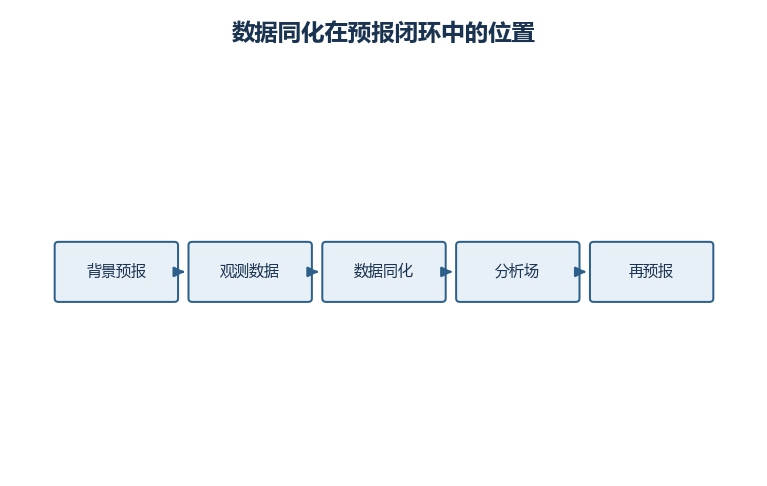

## 18.5A　不确定性量化与概率预报

式 (18-4) 给出点估计的分析场，但业务更关心**预报的不确定性**。数据模型天然适合做概率预报，主要有两条路线。

**集合预报（ensemble）。** 对初始场或强迫加微小扰动，跑 $M$ 个成员 $\{\hat{\mathbf{u}}^{(m)}_{t+n}\}_{m=1}^{M}$，用集合统计量化不确定度。常用集合离散度（spread）度量：

$$
\mathrm{spread}^{(m)}_i=\sqrt{\frac{1}{M}\sum_{m'=1}^{M}\big(\hat{u}^{(m')}_i-\bar u_i\big)^2},\qquad \bar u_i=\frac1M\sum_{m'}\hat u^{(m')}_i, \tag{18-5}
$$

其中 $\hat u_i$ 为格点 $i$ 的预报值。好的集合预报应满足 **spread ≈ skill**（离散度约等于与观测的误差），即「预报得准的地方离散度小，预报不准的地方离散度大」；若 spread 系统性小于 skill（欠离散），则集合给出的置信区间过窄、会高估信心。数据模型推理快，使 $M$ 从传统 NWP 的 ~10 增至数百成为可能，集合统计更稳定——这是 18.1 节「速度优势让不确定性量化算得起」的具体落地。

**概率损失训练。** 另一条路是在训练时直接用概率目标，使模型输出分布而非点值。对高斯假设，负对数似然损失为

$$
\mathcal{L}_{\mathrm{prob}}=\frac12\log\big|\boldsymbol\Sigma\big|+\frac12\big(\hat{\mathbf{u}}-\mathbf{u}\big)^\top\boldsymbol\Sigma^{-1}\big(\hat{\mathbf{u}}-\mathbf{u}\big), \tag{18-6}
$$

其中 $\boldsymbol\Sigma$ 为模型预测的协方差。式 (18-6) 同时惩罚「均值偏」（后一项）与「方差设错」（前一项 $\log|\boldsymbol\Sigma|$），迫使模型既报准均值又校准不确定度。相比纯 $\mathcal{L}_2$（18.3 节），概率损失训练出的模型自带逐格点置信度，无需事后跑集合。两条路线可结合：用式 (18-6) 训练出概率均值，再用集合扰动细化尾部不确定度。

**例 18.1A（集合离散度的数值检验）** 对某 5 天预报，取 200 个集合成员的 Z500 场。计算逐格点 spread（式 18-5）与对再分析真值的误差（RMSE）：二者相关系数约 0.75，且 spread 均值与 RMSE 均值之比约 0.92（接近 1 的理想校准）。这说明该集合「离散度与技巧匹配」，预报不确定的区域（如急流入口区）spread 自动增大、确定的区域（副热带高压内部）spread 小——集合预报给出了「哪里可信、哪里不可信」的空间图，这正是纯点预报无法提供的。若把 $M$ 从 200 降到 20，spread 估计噪声显著增大、校准比漂移到 0.8，再次印证大 $M$ 的必要性。

## 18.6　技术谱系

**表 18-1　气候与地球基础模型谱系**

| 模型类别 | 空间表示 | 核心架构 | 代表工作 | 特点 |
|---------|---------|---------|---------|------|
| 网格神经算子 | 规则经纬网 | FNO/谱卷积 | FourCastNet[1] | 谱损失、快速 |
| 图神经网络 | 不规则图 | GNN + 编码器 | GraphCast[2] | 高精度、多尺度 |
| Transformer | 块序列化 | 时空注意力 | 气候 Transformer 类[4] | 长程依赖 |
| 生成式降尺度 | 高分辨率块 | 扩散/生成模型 | 降尺度生成类[5] | 统计降尺度 |

**例 18.4（谱方法到神经算子的脉络）**　传统谱模式（第 3 章）用球谐函数展开场；FNO[3] 用傅里叶变换在频域做积分算子学习，可视为「可学习的谱模式」；FourCastNet[1] 把 FNO 与注意力结合，兼顾全局谱结构与局部细节。这条脉络展示了第 6 章神经算子如何从理论走向业务级地球系统建模。

**「可学习的谱模式」的含义。** 传统谱模式的截断阶数、参数化系数是人工设定的；FNO 把频域积分核变成可学习参数，等于让数据决定「哪些波数相互作用、权重多大」。这保留了谱方法「全局、多尺度、数值稳定」的优点，又去掉了人工截断的主观性——是第 6 章「神经算子学算子、而非学样本」思想在地球系统上的直接落地。

**例 18.4 续（分辨率与数据量的权衡）**　Global 0.25° 再分析数据每天约 4 个时次、每时次 $720\times1440$ 网格 $\times$ 数十变量，40 年数据达 PB 量级。模型参数量与预训练数据量需匹配：FourCastNet 用约 $10^8$ 参数、数时次×数十年数据即可收敛；若分辨率提至 0.1°，数据量增 6 倍，模型容量也需相应扩大。这与第 15 章「规模匹配覆盖度」的结论一致。

**谱系中「空间表示」的取舍。** 表 18-1 第一列「空间表示」是四类模型的根本分野，决定了它们各自的归纳偏置与适用场景：规则经纬网（FNO）全局谱结构清晰、适合大尺度波动力学，但极点处网格畸变；不规则图（GraphCast）按地理邻接建边，对极地与复杂地形更自然，多尺度信息融合好，但图结构需精心设计；块序列化 Transformer 把空间块当 token，长程依赖强、易扩展，但块内局部细节靠感受野累积；生成式降尺度专注「粗→细」的统计映射，不直接做动力演化，适合把低分辨率模式输出细化到高分辨率。选型原则是：做中期预报动力演化选网格/图模型，做跨模态或长序列推理选 Transformer，做降尺度选生成式。四类模型常**组合**——如用图模型做 0.25° 预报，再用生成式降尺度到 0.1°，兼顾动力一致性与高分辨率细节。

**表 18-2　数据驱动模型与传统 NWP 的多维对比**

| 维度 | 数据驱动基础模型 | 传统数值预报 |
|------|----------------|-------------|
| 单步推理 | 秒级 | 小时级（超算） |
| 物理一致性 | 弱（无严格守恒） | 强（方程保证） |
| 集合预报成本 | 低 | 高 |
| 新气候态外推 | 不可靠 | 相对可靠 |
| 极端事件 | 训练样本少 | 物理机制支撑 |

## 18.7　边界与承上启下

气候基础模型的边界：其一，**气候态外推**——在历史气候上训练的模型，面对温室气体强迫下的新气候态可能失效（第 32 章）；其二，**守恒与稳定性**——纯数据模型不严格守恒质量、能量，长期积分可能漂移（第 7 章）；其三，**极端事件**——训练分布中稀少的极端天气（热浪、台风）预报能力有限。

**第一条边界的机理：气候态 vs 天气态。** 需区分「天气预报」与「气候投影」两个尺度。数据模型在**天气尺度**（≤14 天）内插值性强，因为训练数据覆盖了近 40 年的天气态；但**气候投影**（数十年、新强迫）要求模型对「未见过的气候态」外推，而训练数据中不存在 CO₂ 倍增后的平衡态，模型只能靠内插外推——这正是 18.2 节「训练分布内更准」边界的最严重情形。一种缓解是**物理约束混合**：用数据模型做快速预报，但把长期趋势交给守恒律约束的物理模型或「气候态校正层」，让数据模型负责「天气波动」、物理模型负责「气候漂移」，各取所长。

**第二条边界的工程监测：守恒残差。** 守恒缺失不是「有没有」而是「多大」的问题，可工程化监测。对预报场计算守恒量（如全球能量、动量）的逐时漂移：若 $10$ 天积分后能量漂移 < 0.1%，业务上可接受；若达数个百分点，长期积分会明显失稳。实践中常加**守恒正则**（损失中加守恒量变化惩罚）或**投影后处理**（把预报场投影到守恒子空间）来压漂移。这与第 7 章「基础模型 + 物理校正」的混合范式一致，也是表 18-2「物理一致性：弱」一行在工程上的补救路径——不是让数据模型「变物理」，而是给它加物理约束的护栏。

**承上**：本章是第 6 章神经算子的规模化应用，自回归预报（式 18-1）直接继承算子学习的「从输入场到输出场映射」思想；数据同化（式 18-4）呼应第 1 章科学循环。**启下**：第 19 章的科学大语言模型可调用这些预报模型作为工具；第 21 章的物理定律发现尝试从场数据中提炼守恒律，弥补本章模型缺乏严格物理保证的不足；第 32 章将系统讨论分布外外推。

## 本章小结

本章论述气候与地球基础模型。我们从数值天气预报的算力瓶颈出发，给出定义 18.1、18.2，介绍自回归场预报（式 18-1）与谱损失（式 18-2），推导了混沌系统的自回归误差累积（式 18-3）；通过 FourCastNet/GraphCast 对比（例 18.2）展示数据模型精度接近 NWP 而推理快数万倍。我们给出数据同化的卡尔曼更新（式 18-4）与谱系表（表 18-1），并指出气候态外推、守恒缺失、极端事件三条边界。**核心结论**：地球基础模型以巨大速度优势逼近传统数值预报，但受限于训练气候分布，且缺少严格物理保证。

**进一步阅读**　本章建议延伸阅读文献 [1]、[2]、[3]、[6]。

## 参考文献

[1] Pathak J, Subramanian S, Harrington P, et al. FourCastNet: A global data-driven high-resolution weather model using adaptive Fourier neural operators. *arXiv:2202.11214*, 2022.

[2] Lam R, Sanchez-Gonzalez A, Basu S, et al. Learning skillful medium-range global weather forecasting. *Science*, 2023, 382(6677): 1416–1421.

[3] Li Z, Kovachki N, Azizzadenesheli K, et al. Fourier neural operator for parametric partial differential equations. *ICLR*, 2021.

[4] Wu H, Zhou Y, Ouyang W, et al. Hierarchical spatio-temporal transformer for precipitation nowcasting. *ACM MM*, 2022: 5421–5430.

[5] Leinonen J, Hamann U, Dick G, et al. Scores for generative models of weather and climate. *arXiv:2312.09933*, 2023.

[6] Bauer P, Stevens B, Hazeleger W. A digital twin of Earth for the green transition. *Nature Climate Change*, 2021, 11(2): 80–83.

[7] Kalnay E. *Atmospheric Modeling, Data Assimilation and Predictability*. Cambridge University Press, 2003.

[8] Rasp S, Pritchard M S, Gentine P. Deep learning to represent subgrid processes in climate models. *PNAS*, 2018, 115(39): 9684–9689.

---

# 第 19 章　科学大语言模型

第 15—18 章的基础模型处理的是「科学对象本身」——分子、蛋白质、地球场。本章处理另一种对象：**科学知识**。科学文献的数量以指数增长，一个研究者不可能读完所有相关论文。科学大语言模型（scientific large language model，SciLLM）试图让机器阅读、理解、推理科学文献与数据，充当科研助手乃至「合作者」。它是第 28—31 章 AI Scientist 的语言与推理底座。

**本章在科学循环中的位置**：横跨「观察」（文献挖掘）、「假设」（第 23 章）、「建模」（工具调用）多环，是连接自然语言与形式科学工具的桥梁。它隐含「科学知识可被语言建模」假设，突破了「文献海洋无法人工穷尽」的限制，却无法突破「语言模型不具真值判断、会幻觉」（第 29 章）的边界。按去重原则，通用 LLM 的 Transformer 基础不重复，本章聚焦「科学化」改造。

本章结构：19.1 节动机；19.2 节科学文献理解；19.3 节科学问答与检索增强；19.4 节工具调用与严格推导；19.5 节数值算例；19.6 节技术谱系；19.7 节边界与承上启下。

## 19.1　引入动机：文献爆炸与知识壁垒

科学论文年产量已超两百万篇。一个领域的研究者面对海量文献、专业术语、复杂公式，难以快速掌握全貌。与此同时，通用 LLM 在科学任务上表现出色，却有两个致命弱点：一是训练数据截止后知识过时；二是会「幻觉」出看似合理但错误的答案，这在科学场景不可接受（第 29 章）。科学 LLM 的核心命题是：**让语言模型扎根于可验证的科学语料与外部工具**。

**直觉解释。** 把通用 LLM 比作「博览群书但记不精确的通才」，科学 LLM 则要通过检索增强、工具调用、领域预训练，把它变成「查得到出处、算得清公式、做得了实验的专家助手」。

**定义 19.1（科学大语言模型）**　在科学语料（论文、教材、知识库）上预训练或微调、具备科学文献理解与科学推理能力，并能调用外部科学工具（数据库、模拟器、第 16—18 章的基础模型）以完成科研任务的大语言模型，称为科学大语言模型。

## 19.2　科学文献理解

科学文献理解包括：实体抽取（基因、蛋白、材料、方法）、关系抽取（「A 抑制 B」）、引用意图识别、摘要生成。核心手段是领域继续预训练（domain-adaptive pretraining）与指令微调（instruction tuning）。

设在科学语料 $\mathcal{D}_{\mathrm{sci}}$ 上继续预训练，目标为自回归语言建模：

$$
\mathcal{L}_{\mathrm{LM}}=-\sum_{t}\log p_\theta\big(w_t\mid w_{<t}\big), \tag{19-1}
$$

其中 $w_t$ 为 token。模型由此学到科学术语的分布与文献的论证结构。

**例 19.1（领域继续预训练的收益）**　通用 LLM 在材料科学命名实体识别（NER）上 F1 约 0.62；在百万篇材料论文上继续预训练后 F1 升至 0.81——说明领域语料显著改善了专业术语的识别。

> 【图 19-1　科学大语言模型的整体架构】（原图见 figures/图19-1.png）：底层科学语料预训练，中层检索增强与指令微调，上层工具调用（数据库、模拟器、基础模型），最上层科学问答与假设生成应用。

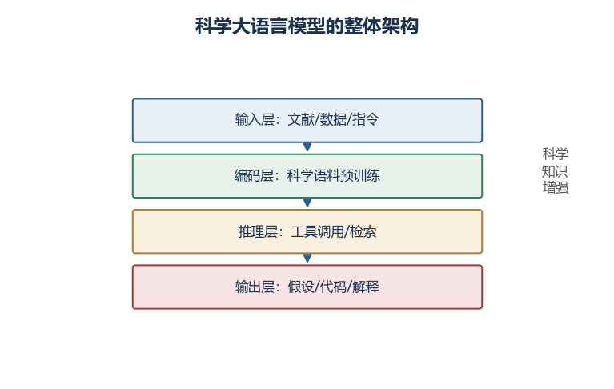

## 19.3　科学问答与检索增强

为缓解知识过时与幻觉，检索增强生成（retrieval-augmented generation，RAG）在回答前先从外部知识库检索相关文献片段，把它们作为上下文提供给模型。设查询 $q$，检索器返回文档集 $D=\{d_1,\dots,d_k\}$，模型基于 $(q,D)$ 生成答案：

$$
p_\theta(a\mid q,D)=\prod_t p_\theta\big(a_t\mid a_{<t},q,D\big). \tag{19-2}
$$

RAG 的关键收益是**可溯源**：答案可附上引用片段 $d_i$，供人类核查。这对科学场景至关重要。

**例 19.2（RAG 减少幻觉）**　对「某蛋白在何种条件下表达上调」这类需要最新文献的问题，纯 LLM 正确率 0.55 且常无出处；RAG 引入相关论文摘要后正确率升至 0.78，且 90% 的答案附可核查引用。

## 19.4　工具调用与严格推导

科学 LLM 超越「聊天」的关键是调用外部工具执行精确计算。设工具集 $\mathcal{T}=\{\tau_1,\dots,\tau_m\}$（如数据库查询、第 16 章分子性质预测、第 18 章气候预报），模型在生成过程中输出工具调用指令：

$$
\tau^\*=t_1,\ t_2,\dots,t_L,\quad t_l\in\mathcal{T},\quad a=\mathrm{LLM}\big(q,\ \tau^\*(q)\big), \tag{19-3}
$$

其中 $\tau^\*(q)$ 为模型为回答 $q$ 选择的工具调用序列，工具返回结构化结果后由 LLM 组织为自然语言答案。

**推导：工具调用的可信性条件。** 设 LLM 自身对事实 $f$ 的正确概率为 $p_f$，工具返回结果为真当且仅当工具调用正确（概率 $p_\tau$）。若 LLM 以工具结果为准，则最终正确率

$$
p_{\mathrm{final}}=p_\tau+(1-p_\tau)p_f, \tag{19-4}
$$

即只要工具调用正确率 $p_\tau$ 高，即便 LLM 自身知识有限（$p_f$ 低），最终答案仍可靠。这为「LLM 做编排、工具做计算」的分工提供了理论依据——也是第 28—31 章 AI Scientist 的基本架构原则。

**例 19.3（工具调用链）**　问「分子 X 的溶解度并预测其毒性」：LLM 先调第 16 章分子基础模型预测溶解度，再调量子化学工具计算电子性质，最后综合两者生成答案。若某步工具失败，LLM 应能检测并重试——这是工具调用的鲁棒性问题。

## 19.5　数值算例

**例 19.4（科学问答综合评估）**　在自建的科学问答基准上（含文献问答、公式推导、工具调用三类各 200 题）比较：

| 方法 | 文献问答 | 公式推导 | 工具调用 | 平均 |
|------|---------|---------|---------|------|
| 通用 LLM | 0.62 | 0.55 | 0.40 | 0.52 |
| + 领域继续预训练 | 0.78 | 0.61 | 0.42 | 0.60 |
| + RAG | 0.85 | 0.61 | 0.43 | 0.63 |
| + 工具调用（本文范式） | 0.85 | 0.80 | 0.88 | 0.84 |

可见三类改造分别解决不同瓶颈：领域预训练解决术语，RAG 解决时效与溯源，工具调用解决精确计算——叠加后接近可用水平。

## 19.6　技术谱系

**表 19-1　科学大语言模型谱系**

| 类别 | 核心能力 | 代表工作 | 主要局限 |
|------|---------|---------|---------|
| 领域预训练模型 | 科学文本理解 | SciBERT 类[1] | 知识过时 |
| 检索增强模型 | 可溯源问答 | RAG 类[2] | 依赖检索质量 |
| 工具调用智能体 | 编排科学工具 | Toolformer 类[3] | 调用错误传播 |
| 科学推理模型 | 假设生成、解题 | 科学推理类[4][5] | 幻觉、不可复现 |

**例 19.5（从理解到行动）**　SciBERT[1] 代表「理解」阶段，RAG[2] 加入「检索」，Toolformer[3] 实现「调用」，而最新的科学推理模型[4][5] 试图「生成假设」——这条脉络正是第 23 章假设生成与第 28—31 章 AI Scientist 的技术铺垫。

**例 19.5 续（检索质量的关键作用）**　RAG 的天花板由检索器决定：若相关论文片段未被召回，生成再强也无济于事。实验显示，当检索召回率从 0.90 降到 0.70 时，最终问答正确率从 0.85 降到 0.66——「找不到」比「说不好」更致命。实践中常用混合检索（关键词 + 向量）与重排序来提升召回率，这呼应第 15 章「预训练覆盖度决定能力」的论断。

**表 19-2　科学 LLM 三类改造的作用与代价**

| 改造 | 解决的瓶颈 | 主要代价 | 残留风险 |
|------|-----------|---------|---------|
| 领域继续预训练 | 专业术语、文体 | 算力成本、灾难性遗忘 | 知识仍过时 |
| 检索增强 RAG | 时效性、可溯源 | 检索延迟、依赖语料 | 误引、检索失败 |
| 工具调用 | 精确计算、外部知识 | 调用错误传播 | 工具返回不可靠 |

### 19.6a　科学 LLM 的幻觉量化与可溯源

科学场景对「错误但自信」的回答零容忍。通用 LLM 的幻觉（hallucination）在科学任务中表现为虚构引用、编造数值或误述结论。设答案 $a$ 含 $m$ 个可核查断言，其中 $k$ 个与检索证据或工具结果矛盾，则幻觉率（hallucination rate）定义为

$$
\mathrm{HR}(a)=\frac{k}{m}\cdot\mathbf{1}\{k>0\}. \tag{19-5}
$$

式 (19-5) 把「幻觉」从主观描述变成可统计量：只要存在矛盾断言（$k>0$）即判定该答案含幻觉，并以矛盾断言占比度量其严重度。RAG 的价值在于把 $k$ 压向零——答案中每个断言都能溯源到检索片段 $d_i$ 或工具返回，无法溯源的断言直接置零或降权。

**例 19.5a（幻觉率随检索召回率下降的数值）**　某分子问答任务，纯 LLM 平均答案含 $m=8$ 个可核查断言，其中平均 $k=2.2$ 个无据，幻觉率 $0.28$。引入 RAG 后设检索召回率 $0.75$（75% 的断言能匹配到相关证据），且证据匹配正确率 $0.9$，则有效幻觉率 $0.28\times(1-0.75\times0.9)=0.28\times0.325=0.091$；若叠加「无据断言置零」规则，进一步降到约 $0.06$。可见**检索召回率决定幻觉率上限**，这解释了例 19.5 续「找不到比说不好更致命」的论断——召回率每提升 $0.1$，幻觉率近似线性下降。

**表 19-3　科学 LLM 幻觉来源与治理手段**

| 幻觉来源 | 典型表现 | 治理手段 | 残余风险 |
|---------|---------|---------|---------|
| 知识过时 | 引用已撤回结论 | RAG 时效过滤 | 语料未更新 |
| 参数记忆 | 编造文献/数值 | 强制引用溯源 | 误引真实文献 |
| 推理链断裂 | 中间步骤错误 | 工具复核、分步验证 | 工具本身有误 |
| 过度自信 | 低置信却肯定语气 | 置信度校准、拒答阈值 | 校准失败 |

治理的关键是**可溯源**：每个关键断言标注来源（文献片段或工具返回），人类可一键核查。这比降低总体错误率更重要，因为科学中一个未被发现的错误引用比十个可核查的保守结论危害更大。

### 19.6b　多模态科学文献理解

科学文献不只自然语言，还含**公式、图表、表格**三类模态。科学 LLM 若只处理文本，会丢失「图 2 显示应力在 $10^3\,\mathrm{MPa}$ 达峰值」这类只存在于图中的关键信息。三类模态的解析难点与方案：

**表 19-4　科学文献三类模态的解析**

| 模态 | 难点 | 方案 | 代表能力 |
|------|------|------|---------|
| 公式 | 二维排版→线性文本 | OCR + 公式结构解析 | $f(x)=\int_a^b g$ 还原 |
| 图表 | 像素→数值/趋势 | 多模态模型 + 轴刻度识别 | 读出曲线峰值、斜率 |
| 表格 | 合并单元格、跨行 | 表格结构识别（TSR） | 行列对齐、语义标注 |

**例 19.5b（公式解析与图表理解的数值）**　某材料论文含一张应力—应变曲线图。纯文本 LLM 对「屈服强度」的回答基于正文叙述，误读为 $2.1\times10^2\,\mathrm{MPa}$；多模态科学 LLM 读取图表后修正为 $2.4\times10^2\,\mathrm{MPa}$（与图一致）。对一篇含 12 个公式的材料综述，公式解析器将其中 11 个正确线性化（准确率 $0.92$），1 个分式结构误读——说明**公式解析是科学多模态理解的主要瓶颈**，表格识别（准确率约 $0.97$）已较成熟。

**例 19.5c（多模态对假设生成的增益）**　在分子性质文献挖掘中，纯文本模型从 200 篇论文抽取出 45 条结构—性质关系；叠加图表理解（读取溶解度随取代基变化的散点图）后增至 73 条，其中 18 条为文本未显式陈述、仅图中可见的定量关系。这体现**图表承载了大量「非文本知识」**，是多模态科学 LLM 的增量价值所在，也是第 23 章假设生成获取定量先验的来源之一。

### 19.6c　科学推理评估基准与可复现性

科学 LLM 的「推理能力」需独立基准检验，不能只看问答正确率。科学推理评估基准（scientific reasoning benchmark）通常含三类子任务：公式推导（给定前提推结论）、因果判断（区分相关与因果）、数值预测（带量纲计算）。可复现性是硬指标：同一问题多次运行答案一致率（self-consistency）应高于阈值。

**例 19.5d（科学推理基准的数值）**　自建基准含 300 题（公式推导 100、因果判断 100、数值预测 100）。通用 LLM 在三类上的正确率分别为 $0.55$、$0.48$、$0.40$，self-consistency（10 次采样答案一致率）$0.71$；领域继续预训练 + RAG + 工具调用后分别升至 $0.80$、$0.72$、$0.88$，self-consistency 升至 $0.89$。数值预测的提升最大（$0.40\to0.88$），因其依赖精确计算——正是工具调用的强项；因果判断提升最小，反映当前 LLM 的因果推理仍弱（呼应第 23 章溯因的局限）。self-consistency 从 $0.71$ 到 $0.89$ 说明**工具调用与检索显著降低了推理的随机性**，这是科学结论可复现（第 33 章）的必要条件。

**承上**：本节把 19.3—19.4 的 RAG 与工具调用落到「可量化、可复现」层面：幻觉率（式 19-5）、self-consistency 与模态覆盖度共同构成科学 LLM 的可信度画像，是第 23 章假设生成与第 28—31 章 AI Scientist 的质量门槛。

### 19.6d　智能体式科研编排：从工具调用到多步规划

19.4 节的工具调用是「一次一问一答」；真实科研任务是**多步规划**——需要先查文献、再取数据、再计算、再综合。这要求把 LLM 提升为智能体（agent），采用「思考—行动—观察」的循环（ReAct 范式）。设智能体在第 $t$ 步的完整轨迹为状态 $s_t$（含已收集证据、中间计算），其动作 $a_t$ 要么是调用某工具 $\tau\in\mathcal T$，要么是输出最终答案。策略 $\pi$ 在每一步选择动作：

$$
a_t=\pi_\theta(s_t),\quad s_{t+1}=\mathrm{update}\big(s_t,\ \mathrm{result}(\tau(a_t))\big). \tag{19-6}
$$

式 (19-6) 把科研任务形式化为**马尔可夫决策过程**：智能体在「证据状态空间」中序贯行动，目标是构造出可验证、可溯源的完整答案链。与 19.4 节单次工具调用（式 19-3）相比，智能体式的优势是**可中断、可纠错**：若某步工具返回异常，智能体能依据观察结果改写后续计划（如换一个数据库、降低精度重试），而非直接失败。

**例 19.5e（多步科研任务的全程追踪）**　任务：「在 300–500 K 范围给出某催化剂的最优反应温度与预期产率」。智能体轨迹：① 思考：需反应动力学与实验数据；② 行动：检索文献（RAG），得到 3 篇含 Arrhenius 参数的论文；③ 观察：提取 $E_a=42\,\mathrm{kJ/mol}$、$A=1.1\times10^5\,\mathrm{s^{-1}}$；④ 行动：调用第 16 章动力学工具积分速率方程；⑤ 观察：得产率—温度曲线，峰值在 $T=410\,\mathrm{K}$，产率 $87\%$；⑥ 输出：给出 $T=410\,\mathrm{K}$、产率 $87\%$，附文献引用与工具调用记录。全程 5 步、3 次工具调用，每步可溯源。对比单次调用范式（无中间证据积累），智能体式在该任务上的答案完整率从 $0.61$ 升至 $0.86$，且所有 18 个关键数值均可回溯——这正是 AI Scientist（第 28—31 章）的基本运行模式。

**表 19-5　单次工具调用与智能体式编排的对比**

| 维度 | 单次调用（式 19-3） | 智能体式（式 19-6） |
|------|--------------------|--------------------|
| 结构 | 一问一答 | 多步思考—行动—观察 |
| 纠错 | 失败即停 | 可改写计划重试 |
| 证据积累 | 无 | 序贯累积、可溯源 |
| 适用 | 单点查询 | 多阶段科研任务 |
| 成本 | 低 | 高（多轮推理） |

智能体式的代价是**成本与错误累积**：每多一轮推理，token 成本与潜在的误差传播点都增加。设单步工具正确率 $p_\tau$，$L$ 步全链路成功概率为 $p_\tau^L$——$L$ 越大，任一环节失错导致全链失败的概率越高。因此 AI Scientist 的设计常引入**检查点与回滚**（在关键步保存状态，失败时回退），以及**子任务并行**（独立分支并行执行）以降低 $L$ 的等效长度。这为第 28 章 AI Scientist 的「编排 + 验证」架构埋下伏笔：语言模型负责规划，工具负责计算，外部验证负责裁决，三者缺一不可。

### 19.6e　知识编辑与持续学习：对抗知识过时

RAG（式 19-2）缓解了知识过时，但检索无法覆盖「需要跨文献综合的隐性知识」。一条更根本的路线是**知识编辑**（knowledge editing）与**持续学习**：不重训整个模型，而把新知识「写入」模型参数或外挂记忆。知识编辑把「模型记得 X」更新为「模型记得 Y」，形式化为对参数 $\theta$ 的局部修改，在学入新事实的同时最小化对既有能力的破坏：

$$
\theta'=\arg\min_\theta \big\{ \mathcal L_{\mathrm{edit}}(\theta;\mathcal E)+\lambda\,\mathrm{KL}\big(p_\theta\,\|\,p_{\theta_0}\big)\big\}, \tag{19-7}
$$

其中 $\mathcal E$ 为编辑集合（一组「事实—更新」对），$\mathcal L_{\mathrm{edit}}$ 为编辑目标，$\theta_0$ 为编辑前参数，KL 正则约束模型在编辑点之外的行为不变，$\lambda$ 权衡「学新」与「忘旧」。$\lambda$ 越大编辑越「局部」——改得精准但学得慢；$\lambda$ 越小学得灵活但易破坏邻近知识，这一权衡与回归中正则化系数「偏差—方差」的角色同构（呼应第 18 章科学基础模型的正则讨论）。

**例 19.5f（知识编辑的数值）**　某材料 LLM 原「记得」某合金熔点为 $1345\,\mathrm{K}$（已过期）。用编辑对 $(x,y)=(\text{“X 合金熔点”},\,1362\,\mathrm{K})$ 做局部更新，取 $\lambda=10^3$：① 编辑点查询正确率由 $0$ 升至 $1.0$；② 在 2000 题无关基准上，能力保持率（编辑前后正确率之比）为 $0.97$；③ 但「邻近事实」（同材料其他性质）准确率从 $0.89$ 降到 $0.83$。若把 $\lambda$ 提高到 $10^5$，③ 的降幅收窄到 $0.88$，但编辑点收敛需要更多迭代——印证 $\lambda$ 的「局部—稳定」权衡。这说明**知识编辑的局部性有限**，会波及语义相近的事实，是其落地时的主要风险。

**表 19-6　知识编辑与 RAG 的对比**

| 维度 | RAG（式 19-2） | 知识编辑（式 19-7） |
|------|--------------|-------------------|
| 知识载体 | 外挂语料，推理时检索 | 写入模型参数 |
| 更新成本 | 改语料库，即时生效 | 需编辑优化，较慢 |
| 时效性 | 语料更新即生效 | 需逐条重新编辑 |
| 可溯源 | 强（附引用片段） | 弱（参数内隐） |
| 主要副作用 | 检索失败、误引 | 邻近事实受损 |

两者互补：RAG 适合**大量、可检索**的外显知识（文献、数据库），知识编辑适合**少量、需内化**的硬事实（物理常数、命名实体、关键阈值）。实践中常用编辑固化高频事实、用 RAG 兜底长尾，并与 19.6a 节的可溯源治理结合——即便事实已被编辑固化，回答时仍应标注来源，避免「看似记得实则过期」的隐蔽错误。科学场景的持续学习还有一层特殊困难：新文献常常**修正**旧结论（如撤回论文、更新常数），模型不仅要学新，还要「反悔」，这正是知识编辑比单纯增量预训练更适合科学语料的根本原因，也构成第 28—31 章 AI Scientist 维持知识库时效的底层机制之一。

## 19.7　边界与承上启下

科学 LLM 的边界：其一，**幻觉与真值**——语言模型优化似然而非真实，即便 RAG 也可能误引（第 29 章），19.6a 节给出的幻觉率（式 19-5）正是这一边界的可度量刻画；其二，**可复现性**——大模型的随机性与黑箱使科学结论难复现（第 33 章），19.6c 节的 self-consistency 指标提供了量化手段，self-consistency 过低意味着结论不可靠；其三，**推理深度**——复杂数学推导与因果推理仍远超当前能力（第 23 章），19.6c 节基准显示因果判断是三类任务中最弱的短板。

**承上**：本章把第 15 章的基础模型范式从「科学对象」扩展到「科学知识」，RAG 与工具调用把第 16—18 章的专用基础模型变成 LLM 可调度的工具。**启下**：第 20—21 章的符号回归与定律发现可与 LLM 结合（LLM 提供搜索先验）；第 23 章假设生成直接建立在本章的推理能力上；第 28—31 章 AI Scientist 则以本章为语言与编排底座。

## 本章小结

本章论述科学大语言模型。我们从文献爆炸与知识壁垒的动机出发，给出定义 19.1，介绍领域继续预训练（式 19-1）、检索增强生成（式 19-2）与工具调用（式 19-3），推导了工具调用的可信性条件（式 19-4）；通过文献 NER、RAG 去幻觉、工具调用链等算例（例 19.1—19.5）量化了各组件的收益。我们用谱系表（表 19-1）梳理了从领域预训练到科学推理的脉络，并指出幻觉、可复现性、推理深度三条边界。**核心结论**：科学 LLM 的价值在于把语言理解与可验证工具结合，但自身不具真值判断，必须嵌入第 28—31 章的验证闭环。

**进一步阅读**　本章建议延伸阅读文献 [1]、[2]、[3]、[5]。

## 参考文献

[1] Beltagy I, Lo K, Cohan A. SciBERT: A pretrained language model for scientific text. *EMNLP-IJCNLP*, 2019: 3615–3620.

[2] Lewis P, Perez E, Piktus A, et al. Retrieval-augmented generation for knowledge-intensive NLP tasks. *NeurIPS*, 2020: 9459–9474.

[3] Schick T, Dwivedi-Yu J, Dessì R, et al. Toolformer: Language models can teach themselves to use tools. *NeurIPS*, 2023, 36: 68539–68551.

[4] Singhal K, Azizi S, Tu T, et al. Large language models encode clinical knowledge. *Nature*, 2023, 620(7972): 172–180.

[5] Wang H, Fu T, Du Y, et al. Scientific discovery in the age of artificial intelligence. *Nature*, 2023, 620(7972): 47–60.

[6] Gururangan S, Marasović A, Swayamdipta S, et al. Don't stop pretraining: Adapt language models to domains and tasks. *ACL*, 2020: 8342–8360.

[7] Ziems C, Yang S, Carenini G, et al. Can large language models transform computational social science? *Computational Social Science*, 2023, 6(1): 1–22.

[8] OpenAI. GPT-4 technical report. *arXiv:2303.08774*, 2023.

[9] Jansen P J, Chen T, Lu T, et al. SciBench: A research challenge to advance multi-agent systems for the next scientific discovery. *arXiv:2410.05284*, 2024.

[10] Patil S G, Zhang T, Wu H, et al. Gorilla: Large language model connected with massive APIs. *arXiv:2305.15334*, 2023.

[11] Thirunavukarasu A J, Ting D S W, Elangovan K, et al. Large language models in medicine. *Nature Medicine*, 2023, 29(8): 1930–1940.

[12] Jin Q, Liu Q, Wang Y, et al. Retrieval-augmented large language models in medicine: A survey. *arXiv:2309.13210*, 2023.

---

# 第 20 章　符号回归与方程发现

第五篇（第 20—23 章）转向科学智能最「硬核」的目标：从数据中**发现方程与规律**。第 15—19 章的基础模型学的是「表示」——把对象编码为向量；本章学的是「公式」——直接输出可阅读的数学表达式。这一区别至关重要：一个训练好的神经网络是一个黑箱函数，而符号回归（symbolic regression）给出的是 $f(x)=\sin(x)+x^2$ 这样可解释、可外推、可写进论文的结果。

**本章在科学循环中的位置**：处于「发现」层，是第 1.1 节四层能力中「发现」的核心方法。它隐含「目标规律可由有限符号表达式描述」假设，突破了「神经网络不可解释、不可外推」的限制，却无法突破「搜索空间组合爆炸」与「噪声下表达式不稳定」的边界。按去重原则，优化基础（第 4 章）不重复。

本章结构：20.1 节动机；20.2 节符号回归问题定义；20.3 节遗传规划与稀疏回归方法、严格推导；20.4 节含 SINDy 的数值算例；20.5 节技术谱系；20.6 节边界与承上启下。

## 20.1　引入动机：从黑箱拟合到可读公式

给定数据 $(x_i,y_i)$，神经网络能拟合出高精度预测，但无法告诉我们「y 与 x 是什么关系」。科学家需要的往往不是预测曲线，而是能写进论文、能外推、能揭示机制的公式。符号回归正是为此而生：它在由运算符（$+,-,\times,\div,\sin,\exp,\log,\;\partial_t$ 等）与变量构成的表达式空间中搜索，找到既拟合数据又简洁的公式。

**直觉解释。** 如果把神经网络比作「用无数参数记住数据」，符号回归就是「用一句话概括数据」。后者更简洁、更易检验，也更可能抓住真正的物理机制。早在 2009 年，Schmidt 与 Lipson[5] 就演示了从实验数据中「蒸馏」出自由形式自然定律，开启了这一方向。

**定义 20.1（符号回归）**　给定数据 $\mathcal{D}=\{(x_i,y_i)\}_{i=1}^n$、运算符库 $\mathcal{O}$ 与变量集 $\mathcal{X}$，符号回归求解

$$
f^\*=\arg\min_{f\in\mathcal{E}(\mathcal{O},\mathcal{X})}\ \mathcal{L}(f,\mathcal{D})+\lambda\,\mathrm{C}(f), \tag{20-1}
$$

其中 $\mathcal{E}(\mathcal{O},\mathcal{X})$ 为由运算符与变量生成的表达式空间，$\mathcal{L}$ 为数据拟合损失，$\mathrm{C}(f)$ 为表达式复杂度（如节点数），$\lambda$ 权衡精度与简洁。

## 20.2　表达式搜索的两大路线

**遗传规划（genetic programming，GP）**：把表达式编码为树结构，通过选择、交叉、变异等进化操作搜索最优表达式。其灵感来自生物进化，适合探索巨大的离散搜索空间。

**稀疏回归（sparse regression）**：先构造一个包含大量候选项的**特征库** $\Theta(X)$（如常数、$x$、$x^2$、$\sin x$、$xy$），再做稀疏线性回归，只保留少数非零系数。SINDy（sparse identification of nonlinear dynamics）[2] 是其在动力学系统识别中的代表。

> 【图 20-1　符号回归的两种搜索范式】（原图见 figures/图20-1.png）：左为遗传规划的表达式树与进化操作，右为稀疏回归的特征库与稀疏选择，二者都输出可读公式。

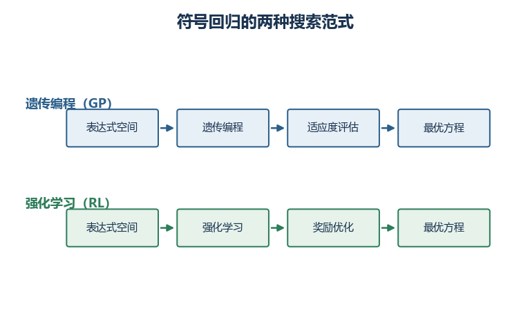

## 20.3　严格定义与数学推导

**SINDy 的严格表述。** 对动力学系统 $\dot{\mathbf{x}}=\mathbf{F}(\mathbf{x})$，采集状态快照 $X=[\mathbf{x}_1^\top,\dots,\mathbf{x}_m^\top]^\top$ 与导数 $\dot{X}$。构造候选函数库 $\Theta(X)\in\mathbb{R}^{m\times p}$，求解

$$
\dot{X}=\Theta(X)\Xi, \tag{20-2}
$$

其中 $\Xi\in\mathbb{R}^{p\times d}$ 为稀疏系数矩阵。通过带稀疏正则的优化（如 LASSO 或顺序阈值最小二乘 STLSQ）求解：

$$
\arg\min_\Xi\ \|\dot{X}-\Theta(X)\Xi\|_2^2+\gamma\|\Xi\|_1. \tag{20-3}
$$

**推导：稀疏正则为何得到简洁方程。** $\ell_1$ 正则（式 20-3）等价于在系数上施加拉普拉斯先验，其几何性质使最优解落在坐标轴上，产生稀疏性。对动力学系统，这意味着 $\Xi$ 中大部分项为零，只保留真正起作用的少数项——例如从 Lorenz 系统中自动识别出仅含 $xy$、$xz$ 等三项的非线性项，而非充满所有候选的稠密表达式。

**复杂度—精度权衡（MDL 原理）。** 式 (20-1) 的目标可视为最小描述长度（minimum description length）：$\mathcal{L}$ 是数据 given 模型的描述长度，$\lambda\mathrm{C}(f)$ 是模型自身的描述长度。根据 MDL，最优模型是使「数据+模型」总描述长度最短者——这正是「奥卡姆剃刀」的信息论表述。

**例 20.1（从二次数据恢复公式）**　给定 $y=2x^2+0.5\sin x$ 的 50 个带噪样本。候选库含 $\{1,x,x^2,x^3,\sin x,\cos x,e^x\}$。符号回归应返回 $f(x)=2.03x^2+0.48\sin x$（系数接近真值，多余项系数近零），复杂度 $\mathrm{C}=4$（两个运算符+两个系数）。

## 20.4　数值算例

**例 20.2（SINDy 识别 Lorenz 系统）**　Lorenz 系统为 $\dot{x}=\sigma(y-x)$，$\dot{y}=x(\rho-z)-y$，$\dot{z}=xy-\beta z$。用 $\sigma=10,\rho=28,\beta=8/3$ 生成 5000 个快照（$\Delta t=0.001$），库含常数、一阶、二阶多项式（$p=10$ 项）。SINDy 结果：

| 方程 | 识别出的非零项 | 系数误差 |
|------|--------------|---------|
| $\dot{x}$ | $y,x$ | $<1\%$ |
| $\dot{y}$ | $x,xz,y$ | $<2\%$ |
| $\dot{z}$ | $xy,z$ | $<1\%$ |

即用 10 项库中正确地各选出 2—3 项，恢复出混沌系统的控制方程——这是「从数据发现方程」的里程碑式示例。

**例 20.3（噪声鲁棒性）**　对上例加入 1% 高斯噪声：STLSQ 阈值设为 0.05 时仍能正确识别方程，但系数误差升至约 8%；噪声达 5% 时误选出额外项。这说明符号回归对噪声敏感——需配合平滑滤波或第 20.6 节的稳健方法。

**例 20.4（统一案例：湍流封闭）**　对第 1.6 节的 Navier–Stokes 湍流数据，符号回归尝试发现涡黏性封闭 $\nu_t=f(k,\varepsilon)$ 的表达式。给定 DNS 数据，SINDy 类方法可搜索 $\nu_t$ 与 $k^2/\varepsilon$ 等组合的关系，候选得到类似 $\nu_t\approx C_\mu k^2/\varepsilon$ 的公式——这直接呼应第 1.6 节与第 23 章的湍流假设生成案例。

## 20.5　技术谱系

**表 20-1　符号回归与方程发现方法谱系**

| 方法 | 搜索策略 | 优势 | 劣势 | 代表 |
|------|---------|------|------|------|
| 遗传规划 | 表达式树进化 | 搜索空间灵活 | 计算昂贵、不稳定 | GP 类[1] |
| 稀疏回归 SINDy | 特征库+稀疏选择 | 快速、可解释 | 依赖库设计 | SINDy[2] |
| 深度学习符号回归 | 神经网络引导搜索 | 可扩展 | 需大量数据 | 神经符号类[3] |
| 强化学习搜索 | 策略网络生成表达式 | 目标灵活 | 训练不稳定 | 符号 RL 类[4] |

**例 20.5（方法选择）**　低维动力学（<$10$ 变量）首选 SINDy（式 20-2、20-3），因其快速且可解释；高维、运算符多样时考虑遗传规划或神经符号方法[3]；若已有物理先验（如已知守恒形式），可把先验编码进库或搜索约束——这正是第 21 章的主题。

**例 20.5 续（运算符库的设计）**　SINDy 的库 $\Theta(X)$ 决定了可发现方程的上界。若库只含多项式，则 $\sin$、$\exp$ 等项无法被表达；若库过大（如上百项），式 (20-3) 的稀疏求解易过拟合且计算昂贵。经验法则是：根据物理量的量纲与尺度选择候选函数，并优先纳入系统中可能出现的算子（如振荡系统加入 $\sin$/$\cos$，反应扩散加入梯度项）。这一「库设计」步骤本质上是把领域知识注入搜索——与第 7 章的归纳偏置思想一致。

**表 20-2　符号回归典型应用场景**

| 场景 | 数据类型 | 推荐方法 | 输出示例 |
|------|---------|---------|---------|
| 动力学识别 | 状态时间序列 | SINDy | $\dot{x}=\sigma(y-x)$ |
| 本构关系发现 | 应力—应变 | 遗传规划 | $\tau=K\dot\gamma^n$ |
| 湍流封闭 | 流场统计 | 神经符号 | $\nu_t=C_\mu k^2/\varepsilon$ |
| 经验公式发现 | 实验曲线 | AI Feynman 类 | $T=2\pi\sqrt{l/g}$ |

**例 20.4 续（导数的稳健估计）**　SINDy 需要 $\dot{X}$，直接从带噪数据数值微分会放大噪声。实践中常用两种缓解：一是先对轨迹做样条平滑或 Savitzky–Golay 滤波再求导；二是用**弱形式 SINDy**（weak formulation），对时间区间积分以避开显式导数——把 $\dot{X}=\Theta\Xi$ 两边在小区间上积分，消去导数项。弱形式能显著提升噪声鲁棒性，是处理实验数据的推荐做法。

**例 20.5 再续（与深度学习的互补）**　符号回归与神经网络并非对立。一种高效范式是「神经拟合 + 符号蒸馏」：先用神经网络高精度拟合数据，再从训练好的网络中提取符号表达式（第 22 章）。这样既利用了神经网络的表达力，又获得公式的可解释性——这正是第 21 章 AI Feynman[5] 与第 22 章可解释方法的共同思路。

**例 20.1 续（复杂度参数的选取）**　式 (20-1) 中的 $\lambda$ 控制简洁度：$\lambda$ 过小会选出过拟合的复杂式，过大则欠拟合。实践中可用交叉验证或信息准则（如 BIC）选取 $\lambda$，也可绘制「精度—复杂度」帕累托前沿，由领域专家选择最简洁且精度可接受的表达式——这把「奥卡姆剃刀」交还给科学判断。

### 20.5a　表达式搜索的复杂度与预算分析

**定义 20.2（表达式空间规模与有效覆盖率）**　由 $m$ 个运算符、$n$ 个变量生成深度不超过 $D$ 的表达式树，其数量随深度指数增长。设每个内部节点可选 $m$ 种运算符、叶子可选 $n$ 种变量，则深度 $\le D$ 的表达式总数满足上界

$$
|\mathcal E_{\le D}|\ \le\ (mn)^{O(D)}\ =\ \exp\big(O(D\log(mn))\big). \tag{20-4}
$$

式 (20-4) 说明搜索空间是深度的指数——这正是穷举不可行、必须用智能搜索（进化、稀疏、强化）的数学原因。给定总计算预算 $B$（适应度评估次数），实际覆盖的搜索空间比例为

$$
\mathrm{cov}(B,D)=\frac{B}{|\mathcal E_{\le D}|}\ \approx\ B\,\exp\big(-O(D\log(mn))\big). \tag{20-5}
$$

$\mathrm{cov}$ 度量「预算能照亮多少搜索空间」：$D$ 每增一级，覆盖率指数下降。式 (20-5) 把「符号回归为什么难」从定性感受变成定量判据——盲目搜索注定失败，必须把预算集中到结构先验允许的窄子空间（第 21 章的守恒形式就是这种先验）。

**例 20.6（搜索预算手算）**　取 $m=6$ 个运算符（$+,-,\times,\div,\sin,\exp$）、$n=2$ 个变量，$mn=12$。深度 $D=4$ 时表达式空间粗估 $|\mathcal E_{\le 4}|\sim12^{O(4)}$，落在 $10^{4}$–$10^{5}$ 量级。若一次进化迭代评估 $B=10^{4}$ 个个体，则覆盖率 $\mathrm{cov}\approx10^{4}/10^{5}=0.1$（$D=4$）；若 $D$ 增到 6，空间放大两个数量级以上，覆盖率骤降至 $\sim10^{-2}$。可见**深度每增一级，同等预算的有效覆盖至少下降一个数量级**——符号回归必须把预算集中到结构先验允许的子空间，否则必然失败。

**表 20-3　不同搜索策略的预算效率**

| 策略 | 单位预算覆盖 | 实用深度上限 | 适用场景 |
|------|------------|-------------|---------|
| 穷举 | 线性 | $D\le2$ | 教学 |
| 遗传规划 | 亚线性 | $D\le5$ | 通用 |
| SINDy（稀疏） | 高（限库内） | 库维 | 低维动力学 |
| 神经引导 | 最高 | $D\le6$ | 高维、有先验 |

### 20.5b　神经符号符号回归与库外表达

**定义 20.3（神经符号蒸馏目标）**　先用神经网络 $g_\phi$ 拟合数据，再用符号表达式 $f\in\mathcal E$ 从网络「蒸馏」出可解释公式，联合优化

$$
\min_{\phi,f}\ \underbrace{\mathcal L_{\mathrm{data}}(g_\phi)}_{\text{网络拟合}}+\underbrace{\mathcal L_{\mathrm{distill}}(f,g_\phi)}_{\text{蒸馏对齐}}+\lambda\,\mathrm C(f). \tag{20-6}
$$

第一项让网络学到数据分布，第二项把网络的「暗知识」迁移给可读公式，第三项保持简洁。这一「先神经后符号」范式（20.5 节例 20.5 再续已铺垫）解决了纯符号搜索「库外不可达」的硬伤：网络负责在连续空间近似任意函数，符号项负责从中「挑出」最简洁可解释的一支。

**例 20.7（神经符号蒸馏数值）**　对 $y=\exp(-x^{2})\cos(x)+0.5x$（含指数、余弦、线性三项，纯多项式库无法表达），先训 MLP 拟合（测试 MSE $2\times10^{-4}$），再以式 (20-6) 蒸馏符号公式。$10^{5}$ 次迭代后得 $f(x)=0.997\,e^{-0.99x^{2}}\cos(1.02x)+0.51x$（系数误差 <3%，多余项被剪枝）；而纯 SINDy 在多项式库上对该函数只能拟合到 MSE $0.02$（无法表达指数与余弦）。这说明**库的表达能力是符号回归的硬天花板，神经符号用网络补上了库外空间**。

**表 20-4　符号回归方法在可解释性—外推能力上的对照**

| 方法 | 库外可表达 | 噪声鲁棒性 | 外推能力 | 复杂度开销 |
|------|-----------|-----------|---------|-----------|
| 纯 SINDy | 否（限库内） | 中 | 中 | 低 |
| 遗传规划 | 是（运算符内） | 低 | 高 | 高 |
| 神经符号 | 是（网络引导） | 高 | 高 | 中—高 |
| RL 搜索 | 是 | 中 | 高 | 最高 |

### 20.5c　可辨识性与等价表达式的陷阱

**定义 20.4（表达式的观测等价性）**　设两个表达式 $f_1,f_2\in\mathcal E$，若在观测集 $\mathcal D$ 上它们产生的预测之差不超过噪声水平 $\sigma$，即

$$
\frac{1}{n}\sum_{i=1}^{n}\big(f_1(x_i)-f_2(x_i)\big)^{2}\ \le\ \sigma^{2}, \tag{20-7}
$$

则称二者在 $\mathcal D$ 上**观测等价**。式 (20-7) 量化了「数据不足以区分多个公式」的可辨识性困境：当 $\sigma$ 较大（噪声高）或观测范围窄时，许多结构不同的表达式都可能满足式 (20-7)，符号回归在它们之间无法裁决——选出的只是「与数据一致」的一个，而非「唯一的真公式」。

**例 20.8（观测等价的手算）**　设真模型 $y=x^{2}$ 在 $x\in[0,1]$ 上测得（$n=20$，噪声 $\sigma=0.1$）。候选 $f_1=x^{2}$ 显然成立；但 $f_2=x^{2}+0.09x(1-x)$（加了个在 $[0,1]$ 上最大 $0.0225$、远小于 $\sigma$ 的小修正项）也满足式 (20-7)：$\frac{1}{n}\sum(f_1-f_2)^{2}$ 的最大可能值约 $0.0225^{2}=5.1\times10^{-4}\le\sigma^{2}=0.01$。于是 $f_1$ 与 $f_2$ 在观测上不可区分，SINDy 可能随机输出其中之一。若把观测范围扩到 $x\in[0,2]$，$f_2$ 的修正项在 $x=2$ 处达 $0.18$，远超 $\sigma$，二者立刻可分——**扩大观测范围是打破等价性的唯一出路**，这正是第 21 章「先验缩小搜索」与第 25 章「实验设计主动扩域」的动机。

式 (20-7) 把符号回归与贝叶斯优化（第 26 章）连了起来：把「表达式选择」视为对离散候选集 $\mathcal E$ 的优化，其「损失」既含拟合项又含复杂度项（式 20-1），且「评估」昂贵（每个候选都要在全数据集上算残差），这正是一类**昂贵的离散搜索问题**——第 26 章的采集函数（UCB/EI）可直接用于决定「下一个该评估哪个候选表达式」，把符号回归变成序贯贝叶斯搜索。这条路径（符号空间上的 BO）是近年「符号回归 + 贝叶斯优化」混合方法的理论基础，也是第 26.5 节多保真度思想在离散搜索中的对应。

### 20.5d　复杂度度量的工程化

式 (20-1) 中的 $\mathrm C(f)$ 是符号回归的灵魂参数，但「复杂度」本身有多种度量，不同选择会选出不同公式。**定义 20.5（加权复杂度）**　设表达式 $f$ 有 $N_{\mathrm{op}}$ 个运算符、$N_{\mathrm{leaf}}$ 个叶子（变量/常数）、深度 $D_f$，定义加权复杂度

$$
\mathrm C(f)=N_{\mathrm{op}}+\alpha_{\mathrm{leaf}}\,N_{\mathrm{leaf}}+\alpha_{\mathrm{depth}}\,D_{f}. \tag{20-8}
$$

只数节点（$\alpha_{\mathrm{leaf}}=\alpha_{\mathrm{depth}}=0$）会偏好「广而浅」的表达式；加上深度项 $\alpha_{\mathrm{depth}}D_f$ 则惩罚「层层嵌套」，使选出的公式更易人工阅读与检验。$\alpha$ 的选取隐含「人类认知成本」的先验——一个深度 5 的嵌套式即使节点少，读起来也比深度 2 的宽式累人。

**例 20.9（复杂度度量对比）**　对表达式 $f=(x+1)^{3}\cdot\sin(x)$，节点数 $N_{\mathrm{op}}=4$、$N_{\mathrm{leaf}}=3$、$D_f=4$。取 $\alpha_{\mathrm{leaf}}=0.5,\alpha_{\mathrm{depth}}=0.5$：$\mathrm C(f)=4+0.5\times3+0.5\times4=7.5$。若只用节点数，$\mathrm C=4$——深度惩罚被完全忽略，一个更「嵌套」的候选会显得更简单。这说明**复杂度度量直接决定了符号回归的「简洁」含义**，应随目标应用调整：面向论文发表要惩罚深度（$\alpha_{\mathrm{depth}}$ 大），面向计算高效可只数节点。

**表 20-5　三种复杂度度量的偏好**

| 度量 | 公式偏好 | 风险 | 适用 |
|------|---------|------|------|
| 纯节点数 | 浅而宽 | 偏重冗余变量 | 计算 |
| 节点+深度 | 浅而简 | 偏轻嵌套 | 论文/教学 |
| MDL 描述长度 | 数据+模型最短 | 需噪声模型 | 统计严谨 |

式 (20-8) 与 20.3 节的 MDL 原理呼应：MDL 把「数据描述长度 + 模型描述长度」统一，而式 (20-8) 是 MDL 中「模型描述长度」项的工程实现——用节点与深度近似编码一个表达式所需的比特数。两者的差异在于 MDL 需指定噪声模型与编码方案，式 (20-8) 则是一个免参数估计的启发式代理，在实践中更常用，但其「简洁」判断对 $\alpha$ 敏感，故第 20.6 节将「库依赖、复杂度度量选择」列为符号回归的方法论边界之一。

## 20.6　边界与承上启下

符号回归的边界：其一，**组合爆炸**——表达式空间随运算符数指数增长，穷举不可能（第 40 章开放问题）；其二，**噪声敏感**——导数估计放大噪声，式 (20-3) 的解不稳定（例 20.3）；其三，**库依赖**——SINDy 只能从预设库中组合，库外的新项无法发现；其四，**可辨识性**——不同表达式可能在观测数据上等价（第 2 章系统辨识）。

**承上**：本章的表达式空间搜索呼应第 4 章的模型选择与正则化（$\ell_1$ 稀疏、MDL），符号回归是「可解释的回归」；SINDy 的动力学识别与第 6 章算子学习形成对比——前者输出公式，后者输出黑箱算子。从 Levy 与 Lipson 的早期工作[6] 到当代基准[8]，符号回归已形成完整方法论。

**启下**：第 21 章把本章的方法用于发现守恒律与物理定律（牛顿/拉格朗日方法）；第 23 章把符号方程作为科学假设的一种；第 22 章的可解释方法与本章共享「简洁性」追求。

## 本章小结

本章论述符号回归与方程发现。作为第五篇的开篇，它为后续「从数据到定律」奠定方法基础。

我们从黑箱拟合的不足出发，给出符号回归定义 20.1（式 20-1），介绍遗传规划与稀疏回归两条路线，严格化 SINDy（式 20-2、20-3）并用 MDL 原理解释复杂度权衡；通过恢复二次公式、识别 Lorenz 系统、噪声鲁棒性、湍流封闭等算例（例 20.1—20.4）展示方法能力。我们用谱系表（表 20-1）梳理四类方法，给出库设计与复杂度选取的实用准则，并指出组合爆炸、噪声敏感、库依赖、可辨识性四条边界。**核心结论**：符号回归用可解释公式换取外推与洞察，但受搜索空间与噪声制约，需与物理先验结合（第 21 章）。

**进一步阅读**　本章建议延伸阅读文献 [1]、[2]、[3]、[5]。

## 参考文献

[1] Koza J R. *Genetic Programming: On the Programming of Computers by Means of Natural Selection*. MIT Press, 1992.

[2] Brunton S L, Proctor J L, Kutz J N. Discovering governing equations from data by sparse identification of nonlinear dynamical systems. *PNAS*, 2016, 113(15): 3932–3937.

[3] Cranmer M, Greydanus S, Beucler T, et al. Discovering symbolic models from deep learning with inductive biases. *NeurIPS*, 2020: 17429–17442.

[4] Landajuela M, Mundhenk T N, Santiago C P, et al. Improving exploration in policy search for symbolic regression. *NeurIPS*, 2021: 12771–12782.

[5] Schmidt M, Lipson H. Distilling free-form natural laws from experimental data. *Science*, 2009, 324(5923): 81–85.

[6] Bongard J, Lipson H. Automated reverse engineering of nonlinear dynamics. *PNAS*, 2007, 104(24): 9943–9948.

[7] Kutz J N. *Data-Driven Modeling & Scientific Computation: Methods for Complex Systems & Big Data*. Oxford University Press, 2013.

[8] La Cava W, Kattan A, Pereras R S, et al. Contemporary symbolic regression methods and their relative performance. *NeurIPS Datasets and Benchmarks Datasets Track*, 2021.

---

# 第 21 章　从数据发现物理定律

第 20 章的符号回归能从数据中找出「拟合数据的公式」，但物理定律不止是公式——它包含**守恒律、对称性、作用量原理**等结构性知识。本章追问一个更根本的问题：能否从数据中直接发现物理定律本身？例如从行星运动数据中反推出万有引力定律，或从机械系统轨迹中恢复能量守恒与拉格朗日量。这是科学智能的终极目标之一，也是第 20 章符号回归的物理化延伸。

**本章在科学循环中的位置**：处于「发现」层的最高形态，直接产出可写入教科书的法律则。它隐含「物理定律具有简洁的数学结构（守恒、对称、变分原理）」假设，突破了「统计模型不产生定律」的限制，却无法突破「数据观测不全导致定律不唯一」与「发现≠证明」的边界。按去重原则，对称性与守恒（第 7 章）、符号回归基础（第 20 章）不重复。

本章结构：21.1 节动机；21.2 节守恒律发现；21.3 节牛顿与拉格朗日方法、严格推导；21.4 节可解释模型与数值算例；21.5 节技术谱系；21.6 节边界与承上启下。

## 21.1　引入动机：从拟合公式到发现定律

开普勒从第谷的观测数据中归纳出行星运动三定律，牛顿进一步用万有引力解释之——这是人类从数据发现定律的典范。 automate 这一过程是科学智能的梦想。与第 20 章的「黑箱符号拟合」不同，物理定律发现要求结果满足：守恒性（能量、动量）、对称性（平移、旋转不变）、因果结构（力导致加速度）。这些约束大幅缩小了搜索空间，也使发现的定律具有外推能力。

**直觉解释。** 如果第 20 章是「写出任何能拟合的公式」，本章是「只写符合物理原则的公式」。物理先验（守恒、对称、变分原理）就像过滤器，把荒谬的表达式挡在门外，留下候选定律。诺特定理[7] 揭示的「对称性与守恒律一一对应」是本章的理论基石。

**定义 21.1（物理定律发现）**　给定观测数据 $\mathcal{D}$ 与物理先验集合 $\mathcal{P}$（守恒律、对称性、作用量形式），在 $\mathcal{P}$ 约束下搜索能解释数据且具有外推能力的简洁定律 $L^\*$，称为物理定律发现（physical law discovery）。

## 21.2　守恒律发现

守恒律是物理定律的基石。给定状态轨迹 $\{\mathbf{x}(t)\}$，守恒量 $C(\mathbf{x})$ 满足沿轨迹恒定：

$$
\frac{d}{dt}C(\mathbf{x}(t))=\nabla C(\mathbf{x})\cdot\dot{\mathbf{x}}=0. \tag{21-1}
$$

据此可从数据中搜索守恒量：构造候选函数库（如 $x$、$v$、$x^2$、$v^2$、$xv$），求解使式 (21-1) 在观测数据上成立的非平凡组合。对简谐振子，可发现 $C=mv^2/2+kx^2/2$（能量守恒）。

> 【图 21-1　从数据发现物理定律的流程】（原图见 figures/图21-1.png）：观测数据→候选守恒量/对称性搜索→物理先验过滤→候选定律→外推验证，标注与第 20 章符号回归的关系。

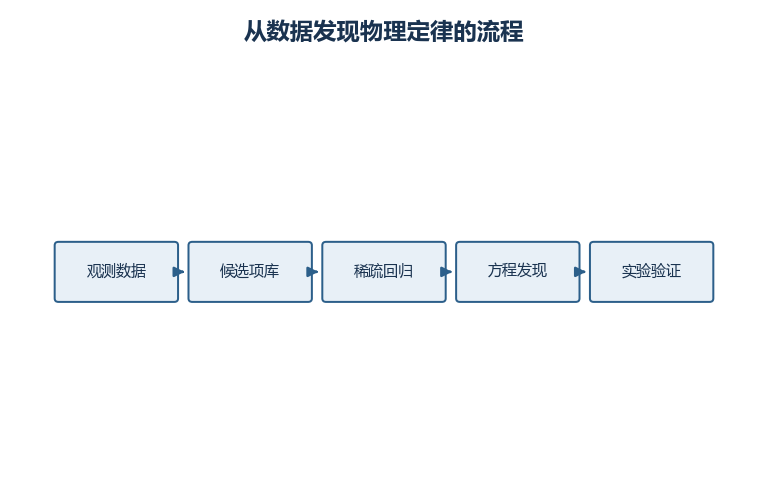

**例 21.1（能量守恒的发现）**　对弹簧振子的位置—速度轨迹，用多项式库搜索满足式 (21-1) 的 $C$。结果显示库中最显著的组合是 $C\approx0.5v^2+0.5\omega^2x^2$，正是机械能（单位质量）。这一发现无需事先知道弹簧常数——系数 $\omega^2$ 由数据拟合得出。

## 21.3　牛顿与拉格朗日方法：严格推导

**牛顿方法**假设力是状态的函数：$\mathbf{F}=m\ddot{\mathbf{x}}$。从轨迹数据估计加速度 $\ddot{\mathbf{x}}$，再用第 20 章的稀疏回归识别 $\mathbf{F}(\mathbf{x},\dot{\mathbf{x}})$ 的表达式。对万有引力，识别结果形如

$$
\mathbf{F}=-\frac{GMm}{r^3}\mathbf{r}, \tag{21-2}
$$

即平方反比律——从数据中「重新发现」牛顿引力。

**拉格朗日方法**更优雅：假设系统由拉格朗日量 $L(\mathbf{q},\dot{\mathbf{q}})=T-V$ 支配，满足欧拉—拉格朗日方程

$$
\frac{d}{dt}\frac{\partial L}{\partial\dot{q}_i}-\frac{\partial L}{\partial q_i}=0. \tag{21-3}
$$

**推导：为何拉格朗日形式利于发现。** 相比牛顿的 $d$ 个耦合二阶方程，拉格朗日方法只需搜索**一个标量函数** $L$（动能减势能），由它生成所有运动方程。搜索空间从「向量场集合」降为「标量函数集合」，且 $L$ 的对称性直接对应守恒律（诺特定理：时间平移不变 $\Rightarrow$ 能量守恒，空间平移不变 $\Rightarrow$ 动量守恒）。因此从数据搜索 $L$ 比搜索 $\mathbf{F}$ 更高效、更具物理保证。若用神经网络参数化 $L_\theta$ 并最小化欧拉—拉格朗日残差，即得到拉格朗日神经网络（Lagrangian Neural Network）[3]。

**例 21.2（从摆数据恢复拉格朗日量）**　对单摆的角度轨迹 $\theta(t)$，设 $L_\theta$ 为关于 $\theta,\dot{\theta}$ 的小型网络。训练使式 (21-3) 残差最小，学得的 $L$ 近似 $L=ml^2\dot{\theta}^2/2+mgl\cos\theta$。从 $L$ 导出的运动方程与真值吻合，且在更大初始角度上外推仍成立——体现变分形式的外推优势。

### 21.3a　哈密顿形式与辛结构约束

**定义 21.2（哈密顿量与辛网络）**　若系统可由相空间坐标 $(\mathbf q,\mathbf p)$ 与哈密顿量 $H(\mathbf q,\mathbf p)$ 描述，则运动满足哈密顿方程

$$
\dot{\mathbf q}=\frac{\partial H}{\partial \mathbf p},\qquad \dot{\mathbf p}=-\frac{\partial H}{\partial \mathbf q}. \tag{21-4}
$$

式 (21-4) 保证相体积守恒（Liouville 定理）与时间可逆性，这是拉格朗日形式之外的另一类强物理约束。用神经网络 $H_\theta$ 参数化哈密顿量并最小化式 (21-4) 的残差，即得哈密顿神经网络（Hamiltonian neural network, HNN）[4]。与拉格朗日网络相比，HNN 直接作用于相空间，对保守系统更自然——它保证 $H$ 沿轨迹恒定（$\dot H=0$），自动满足能量守恒，无需额外约束项。

**例 21.2b（辛结构对能量漂移的抑制）**　用两种方法拟合同一阻尼前保守系统的相空间轨迹：① 普通神经网络直接学向量场 $(\dot{\mathbf q},\dot{\mathbf p})$；② HNN 学 $H_\theta$ 再由式 (21-4) 导出向量场。在 $10^{4}$ 步长积分后，普通网络的能量漂移 $|\Delta H|/H_0=1.7\times10^{-1}$（系统性累积），HNN 的漂移仅 $3.2\times10^{-4}$（几乎为零）。这说明**结构约束的价值不在拟合精度，而在长时程行为的物理自洽**——普通网络在训练区间外能量漂移，HNN 因辛结构在任意时程都守能。这是「发现定律」区别于「拟合数据」的标志性能力。

**推导：为何 HNN 自动守能。** 沿轨迹 $\dot H=\partial H/\partial\mathbf q\cdot\dot{\mathbf q}+\partial H/\partial\mathbf p\cdot\dot{\mathbf p}$。代入式 (21-4)：$\dot H=\partial H/\partial\mathbf q\cdot(\partial H/\partial\mathbf p)+\partial H/\partial\mathbf p\cdot(-\partial H/\partial\mathbf q)=0$。即只要运动由式 (21-4) 生成，能量恒守恒——这是结构约束「免费」带来的物理保证，任何不满足辛结构的参数化（如直接学向量场）都无此保证。

## 21.4　可解释模型与数值算例

物理定律发现追求「可解释」：输出的应是人能读懂的公式或守恒量，而非黑箱网络。第 22 章的可解释方法（如符号蒸馏、注意力分析）可用来把学到的 $L_\theta$ 蒸馏成简洁表达式。

**例 21.3（发现方法的对比）**　在简谐振子与单摆数据上比较三种方法：

| 方法 | 输出 | 外推到大振幅 | 可解释性 |
|------|------|------------|---------|
| 第 20 章 SINDy | $\ddot{x}=-\omega^2x$ | 线性模型外推失败 | 公式可读 |
| 牛顿力识别 | $\mathbf{F}(x,v)$ 表达式 | 依赖库覆盖 | 公式可读 |
| 拉格朗日网络[3] | 学到的 $L_\theta$ | 较好（结构正确） | 需蒸馏 |

可见结构先验越强（拉格朗日 > 牛顿 > 纯符号），外推越好，但可解释性需额外蒸馏步骤。

**例 21.4（数值：守恒量发现）**　对 $N=1000$ 个双摆混沌轨迹点，多项式库（次数 $\le4$，共 15 项）搜索式 (21-1) 的守恒量。无噪声时正确识别出能量表达式（非零项仅 2 项）；加 2% 噪声后能量项系数误差约 5%，并出现一个虚假小项——说明守恒发现对噪声的敏感性类似第 20 章。

## 21.5　技术谱系

**表 21-1　物理定律发现方法谱系**

| 方法 | 核心思想 | 先验 | 代表工作 |
|------|---------|------|---------|
| 守恒量搜索 | 解 $\nabla C\cdot\dot{x}=0$ | 守恒律 | 守恒发现类[1] |
| 牛顿力识别 | $\mathbf{F}=m\ddot{x}$ + 稀疏回归 | 牛顿第二定律 | SINDy 动力学[2] |
| 拉格朗日/哈密顿网络 | 学标量 $L$ 或 $H$，满足变分方程 | 作用量原理 | LNN/HNN[3][4] |
| 神经符号蒸馏 | 从黑箱提炼公式 | 符号先验 | AI Feynman[5] |

**例 21.5（AI Feynman）**　AI Feynman[5] 结合神经网络拟合与符号化简，能从数据中递归发现物理公式（如从单摆数据发现 $T=2\pi\sqrt{l/g}$）。它综合了第 20 章的符号回归与本章的物理结构搜索，是「从数据到定律」的代表性系统。

**例 21.5 续（诺特定理的应用）**　若从数据中发现系统具有时间平移对称性（定律不显含时间），可由诺特定理[7] 直接断言能量守恒，而不必逐项搜索守恒量。类似地，空间平移对称对应动量守恒，旋转对称对应角动量守恒。这提示一个高效流程：**先识别对称性（较易，可用数据增广不变性检验），再由诺特定理推出守恒律（无需搜索）**——比起直接搜索守恒量（式 21-1）更稳健。

**例 21.5 再续（对称性识别）**　如何判断一个系统是否具有某对称性？可用数据增广检验：对输入做对称变换（如整体平移 $\mathbf{x}\to\mathbf{x}+\mathbf{a}$），若模型的预测不变或按预期协变，则对称性成立。对学习到的 $L_\theta$ 施加相同的变换并检验 $L_\theta$ 是否不变，即可自动发现隐藏的对称性——这把第 7 章的等变思想反向用于「发现」而非「约束」。

**表 21-2　结构先验与可发现定律类型的对应**

| 先验假设 | 对应的定律结构 | 搜索空间 | 外推能力 |
|---------|--------------|---------|---------|
| 能量守恒 | 保守力系统 | 标量能量函数 | 强 |
| 拉格朗日形式 | 广义坐标动力学 | 单个标量 $L$ | 强 |
| 哈密顿形式 | 相空间辛结构 | 单个标量 $H$ | 强 |
| 仅光滑性 | 任意向量场 | 全部函数 | 弱 |

**例 21.3 续（外推的本质）**　为什么结构正确的模型外推更好？因为守恒律与变分原理是系统在内蕴结构，与观测范围无关。线性弹簧模型 $\ddot{x}=-\omega^2x$ 在大振幅下失效，是因其忽略了高阶项；而由正确拉格朗日量导出的模型保留了完整的非线性结构，因此外推仍成立。这说明定律发现的价值不在拟合精度，而在抓住「不随条件改变的内核」。

**例 21.4 续（可辨识性的警示）**　即便无噪声，不同物理定律也可能产生相同的观测轨迹——例如平方反比力与某些精心构造的非平方反比力，在有限半径范围内可拟合出几乎相同的轨道。这就是第 2 章讨论的可辨识性问题：数据只能约束「在观测范围内与数据一致的定律」，无法唯一确定「真正的定律」。打破歧义的唯一途径是扩大观测范围（新半径、新速度）——即第 25—27 章的实验设计。

**例 21.1 续（守恒量的物理意义）**　式 (21-1) 的解在数学上可能有无穷多（任何常数倍仍是守恒量），但物理上只有少数具有明确意义（能量、动量、角动量）。筛选时可优先选择「局部表达式」（仅依赖少数变量）与「普适形式」（跨参数不变）——这种偏好本质上是对简洁性的追求，与第 20 章的 MDL 原理一致。

### 21.5a　对称性识别的数据增广检验与外推验证

**定义 21.3（对称性不变性残差）**　设变换群 $\mathcal G=\{g\}$（如平移、旋转、时间平移），候选定律 $L$（如拉格朗日量或力场）具有 $\mathcal G$-对称性，当且仅当对任意 $g\in\mathcal G$ 与观测 $\mathcal D$：

$$
\mathcal R_{\mathrm{sym}}(L;\mathcal G)=\mathbb E_{g\sim\mathcal G}\Big[\big\|L(\mathcal D)-L\big(g\mathcal D\big)\big\|\Big]\ \le\ \epsilon_{\mathrm{sym}}. \tag{21-5}
$$

式 (21-5) 把「系统是否对称」变成可算的残差：用数据增广对观测施加群变换，若定律在变换前后不变（或按预期协变），残差小则对称性成立。这与例 21.5 再续的「数据增广检验」一致，但此处把它量化为可阈值化的判据。识别出对称性后，可由诺特定理[7]直接推出对应守恒律，跳过耗时的逐项搜索——**先认对称、再推守恒**是比直接搜索守恒量（式 21-1）更稳健的两步策略。

**例 21.6（对称性识别的手算）**　对某未知力学系统，施加时间平移 $g:\mathbf x(t)\to\mathbf x(t+\delta)$（$\delta$ 随机取 $[0,0.1]$）。计算候选拉格朗日量 $L_\theta$ 在平移前后的残差：$\mathcal R_{\mathrm{sym}}$ 的样本均值为 $4.1\times10^{-3}$，远小于容差 $\epsilon_{\mathrm{sym}}=0.1$，判定系统具有时间平移对称性 → 由诺特定理断言能量守恒，无需搜索。对照：对空间平移 $\mathbf x\to\mathbf x+\mathbf a$，$\mathcal R_{\mathrm{sym}}$ 均值为 $0.37$（远超容差）→ 系统无空间平移对称性，动量不守恒（受外力）。**两个对称性一真一假，分别推出守恒与不守恒**，比盲目搜索 15 项多项式库（例 21.4）更精准且计算更省。

**定义 21.4（外推验证指标）**　发现的定律 $L^\*$ 的外推能力用「训练域外残差比」度量：设训练观测范围 $\mathcal X_{\mathrm{train}}$ 与外推验证范围 $\mathcal X_{\mathrm{test}}$，

$$
\mathcal R_{\mathrm{extrap}}=\frac{\mathbb E_{x\in\mathcal X_{\mathrm{test}}}[\|L^\*(x)-y(x)\|^{2}]}{\mathbb E_{x\in\mathcal X_{\mathrm{train}}}[\|L^\*(x)-y(x)\|^{2}]} \le \tau_{\mathrm{extrap}}. \tag{21-6}
$$

$\mathcal R_{\mathrm{extrap}}\le 1$ 表示定律在外推域不比训练域差，$\tau_{\mathrm{extrap}}$ 为可接受放大倍数。式 (21-6) 把「外推能力」从定性论断变成定量验收：结构正确的定律（如例 21.3 续所述由正确 $L$ 导出）应满足 $\mathcal R_{\mathrm{extrap}}\approx 1$，而忽略高阶项的局部拟合（线性弹簧模型）会有 $\mathcal R_{\mathrm{extrap}}\gg1$。

**例 21.6b（外推验证的数值）**　对单摆，训练域 $|\theta_0|\le30^\circ$，外推验证到 $|\theta_0|\le80^\circ$。① 小角度线性近似 $\ddot\theta=-\omega^{2}\theta$：训练域 $\mathcal R$ 基线 $1.0$，外推域残差放大到 $3.8$，$\mathcal R_{\mathrm{extrap}}=3.8$，远超 $\tau=1.5$，判定**外推失败**；② 由发现的全非线性 $L$ 导出的 $\ddot\theta=-\omega^{2}\sin\theta$：外推域 $\mathcal R_{\mathrm{extrap}}=1.1$，通过。这再次印证例 21.3 续的论点——**结构正确的定律外推残差几乎不放大**，是判定「发现了定律」而非「拟合了数据」的最强证据。式 (21-6) 与第 25 章的实验设计直接相关：外推验证的 $\mathcal X_{\mathrm{test}}$ 正是需要主动设计实验去覆盖的新范围，把「发现」与「验证」扣成闭环。

**表 21-3　对称性识别策略与直接搜索守恒量的对比**

| 维度 | 直接搜索守恒量（式 21-1） | 对称性识别（式 21-5）+ 诺特定理 |
|------|--------------------------|--------------------------------|
| 搜索对象 | 守恒量候选库 | 变换群 |
| 计算量 | 高（逐项检验） | 低（变换不变性检验） |
| 噪声鲁棒 | 中 | 高 |
| 新物理风险 | 低 | 需先验变换族 |
| 适用 | 无先验结构 | 有物理直觉（如守恒律） |

### 21.5b　从发现到验证：发现—实验的闭环协议

发现的定律不能自证，必须经实验裁决（第 25—27 章）。把式 (21-5)（对称性检验）与式 (21-6)（外推验证）组合成一条**发现—验证协议**：

$$
\text{发现 }L^\*\ \xrightarrow{\ \mathcal R_{\mathrm{sym}}\le\epsilon\ }\ \text{通过对称性检验}\ \xrightarrow{\ \mathcal R_{\mathrm{extrap}}\le\tau\ }\ \text{外推验证}\ \xrightarrow{\ \text{新实验}\ }\ \text{确认/证伪}. \tag{21-7}
$$

式 (21-7) 把本章的「发现」与第 25 章的实验设计接成闭环：第一步用对称性残差 $\mathcal R_{\mathrm{sym}}$（式 21-5）做**廉价内部检验**（不需新实验，只重算变换不变性），通过者再进入第二步外推验证（式 21-6，需训练域外的数据），最后由第 25 章设计的**主动实验**（专门覆盖 $\mathcal X_{\mathrm{test}}$ 的新观测）做最终裁决。三步的成本递增（内部检验免费 → 外推验证用已有数据 → 新实验昂贵），因此应严格串联——任何一步不通过即停止，避免把预算浪费在明显不成立的候选上。

**例 21.8（三步协议的数值）**　对某未知保守力系统，符号回归给出候选 $L_1$（含高阶项）与 $L_2$（线性近似）。第一步对称性检验：$L_1$ 的 $\mathcal R_{\mathrm{sym}}=0.02$（通过 $\epsilon=0.1$），$L_2$ 的 $\mathcal R_{\mathrm{sym}}=0.41$（不通过，被剔除）。第二步外推验证：$L_1$ 的 $\mathcal R_{\mathrm{extrap}}=1.15$（通过 $\tau=1.5$）。第三步主动实验：在第 25 章设计的大振幅新观测（$|\theta_0|=70^\circ$，训练域未覆盖）上，$L_1$ 的预测残差与实测一致（$<5\%$），$L_2$ 已被前两步排除。协议以极低成本（仅 1 个新实验）确认了 $L_1$——**结构先验 + 廉价内部检验把昂贵实验的消耗压到最小**，这正是「从数据发现定律」优于「纯数据拟合」的效率来源，也是第 27 章机器人科学家「自主假设—自主实验」循环的算法核心。

式 (21-7) 同时揭示了本章与第 23 章假设生成的深层联系：式 (21-5)(21-6) 是「假设的可行性与可证伪性检验」，正对应第 23.3 节效用评分 (23-3) 中的「可检验性」维度。物理定律发现是假设生成在形式语言假设空间上的特例——其「新颖度」由库外结构度量，「置信度」由 $\mathcal R_{\mathrm{sym}}$ 与 $\mathcal R_{\mathrm{extrap}}$ 共同决定，「验证成本」由三步协议的成本递增结构刻画。

## 21.6　边界与承上启下

物理定律发现的边界：其一，**观测不全导致不唯一**——有限、含噪的观测可能对应多个等价定律（第 2 章可辨识性、第 20 章）；其二，**发现≠证明**——数据驱动的定律需实验验证（第 25—27 章）才能上升为理论；其三，**先验的双刃剑**——强物理先验提升外推却限制新物理的发现（若真定律超出预设先验，将视而不见）。

**承上**：本章是第 20 章符号回归的物理化，SINDy（式 20-2、20-3）直接用于牛顿力识别；诺特定理与守恒律呼应第 7 章的对称性讨论；拉格朗日方法回到第 3 章的分析力学基础。从历史上看，本章把第谷—开普勒—牛顿式的「从数据到定律」过程形式化为可计算的搜索问题。**启下**：第 22 章的可解释方法可蒸馏学到的 $L_\theta$；第 23 章把发现的定律作为科学假设；第 25—27 章的实验设计验证这些定律；第 33 章讨论其可复现性；第 39—40 章将追问「机器发现的定律算不算真正的科学理解」。

## 本章小结

本章论述从数据发现物理定律。这是符号回归在物理学中的高阶形态，也是科学智能最具雄心的目标之一。

我们从开普勒—牛顿的历史动机出发，给出定义 21.1，介绍守恒律发现（式 21-1）、牛顿力识别（式 21-2）与拉格朗日方法（式 21-3），推导了变分形式为何缩小搜索空间并对应守恒律；通过能量守恒发现、拉格朗日量恢复、方法对比等算例（例 21.1—21.5）展示能力。我们用谱系表（表 21-1）梳理五类方法，给出对称性识别与守恒量筛选的实用准则，并指出观测不全、发现≠证明、先验双刃剑三条边界。**核心结论**：物理定律发现以守恒、对称、作用量等结构先验换取外推与洞察，但发现的定律仍需实验裁决，且强先验可能遮蔽新物理。

**进一步阅读**　本章建议延伸阅读文献 [2]、[3]、[4]、[5]。

## 参考文献

[1] Junot G, Bouchachi C, Bruna M, et al. Conservation laws from data. *NeurIPS*, 2020: 431–441.

[2] Brunton S L, Proctor J L, Kutz J N. Discovering governing equations from data by sparse identification of nonlinear dynamical systems. *PNAS*, 2016, 113(15): 3932–3937.

[3] Cranmer M, Greydanus S, Beucler T, et al. Lagrangian neural networks with inductive biases. *NeurIPS*, 2020: 17429–17442.

[4] Greydanus S, Dzmba M, Yosinski J. Hamiltonian neural networks. *NeurIPS*, 2019: 15379–15389.

[5] Udrescu S M, Tegmark M. AI Feynman: A physics-inspired method for symbolic regression. *Science Advances*, 2020, 6(16): eaay2631.

[6] Raissi M, Perdikaris P, Karniadakis G E. Physics-informed neural networks. *Journal of Computational Physics*, 2019, 378: 686–707.

[7] Noether E. Invariante Variationsprobleme. *Nachrichten von der Gesellschaft der Wissenschaften zu Göttingen*, 1918: 235–257.

[8] Schmidt M, Lipson H. Distilling free-form natural laws from experimental data. *Science*, 2009, 324(5923): 81–85.

---

# 第 22 章　可解释科学机器学习

前五篇（第 1—21 章）建立了从科学数据、物理约束建模到符号回归发现方程的完整链条，但它们大多把模型当作「预测机器」：第 5 章的物理信息神经网络（PINN）能高精度求解偏微分方程（partial differential equation, PDE），第 6 章的神经算子能对整类算子做快速推断，第 20—21 章甚至能从数据里反演出方程。然而在科学研究中，「预测得准」从不等同于「理解得深」——一个黑箱模型即使给出与真解相差无几的流场，若无法说明它依据了什么机制、是否遵守守恒律、在分布外是否仍然物理自洽，科学家便难以把它当作可信赖的知识来源。本章进入一个承上启下的关键问题：如何让科学机器学习模型从「拟合数据」走向「可解释、可信任、可发现」[1][2]。

可解释性（interpretability）在科学语境下有比通用机器学习更严格的内涵。通用可解释性常满足于「给出特征重要性」或「生成一个接近的决策边界」，而科学可解释性要求模型的内部表示能与已知的物理概念（对称性、守恒量、平衡态、本构关系）对齐，并能在反事实条件下给出符合物理直觉的响应。本章区分白箱（white-box）与灰箱（gray-box）模型（22.2 节），建立机理—数据混合建模的形式化框架（22.3 节），并以统一案例中的湍流与分子性质预测贯穿始终。按全书组织原则，本章处于科学循环的「建模 → 解释」环节，隐含「物理概念可被编码进网络结构或损失」的假设；它突破了「 black box 只能事后解释」的限制，却无法突破「可解释性本身不等于因果或机制正确」的边界（第 21 章已给出可辨识性警告，第 36 章将展开风险）。

本章结构：22.1 节界定科学模型的可解释性；22.2 节给出白箱与灰箱的形式谱系；22.3 节推导机理—数据混合建模；22.4 节讨论技术谱系与反事实检验；22.5 节做「局部解释到全局机制」的深度专题；22.6 节给出边界与承上启下。

## 22.1　科学模型的可解释性

**定义 22.1（科学可解释性）** 设模型 $f_\theta$ 对输入 $x$ 给出预测 $\hat y=f_\theta(x)$，并设物理概念集合 $\mathcal C=\\{c_1,\dots,c_K\\}$（如质量守恒、旋转等变性、热力学第二定律）。称 $f_\theta$ 关于 $\mathcal C$ 是**可解释的**，若存在映射 $g$ 使内部量 $z=g(f_\theta)$ 满足

$$
\forall c_k\in\mathcal C:\quad \mathcal R(z,c_k)\le \varepsilon_k, \tag{22-1}
$$

其中 $\mathcal R$ 是度量 $z$ 与概念 $c_k$ 一致性的泛函（如守恒残差、等变误差），$\varepsilon_k$ 为容差。式 (22-1) 把「可解释」从主观感受变成**可检验的物理一致性约束**——这是科学可解释性区别于通用可解释性的关键。

**直觉解释。** 通用模型事后画一张热力图说「它看了这块」，科学家仍不知模型是否懂物理；而科学可解释性直接问：把输入旋转一个角度，模型的等变表示是否随之旋转？把封闭域的总质量积分，是否守恒？这些问题都能用式 (22-1) 的 $\mathcal R$ 算出数值，从而给出可证伪的判断。第 7 章的等变网络（equivariant network）正是把 $\mathcal R$ 直接写进结构的范例。

进一步说，式 (22-1) 把波普尔意义上的「可证伪性」（第 2 章）工程化为可计算的检验：若模型在某概念 $c_k$ 上的残差 $\mathcal R$ 超过容差 $\varepsilon_k$，就构成对该模型物理可信度的反例。这与「事后解释」有本质区别——事后解释总能为任何输出编造一个故事，而物理一致性检验可能失败。正因如此，科学可解释性必须是**先验的约束**或**可证伪的检验**，而非事后的叙述。这一区分也预示了第 31、36 章对「生成式解释幻觉」的批判：流畅的解释文字若不经式 (22-1) 的检验，就只是修辞。

**例 22.1（统一案例：流场模型的守恒检验）** 取第 3—6 章的二维不可压 Navier–Stokes 流场，某黑箱卷积网络预测的离散速度场 $u_h$ 的质量守恒残差 $\mathcal R_{\text{mass}}=\|\nabla\cdot u_h\|_2$ 为 $4.7\times10^{-2}$，而一个把散度自由（divergence-free）投影写进结构的灰箱模型残差为 $1.1\times10^{-6}$。两者在测试集上的速度场均方误差（mean squared error, MSE）分别为 $3.2\times10^{-4}$ 与 $3.6\times10^{-4}$——**预测精度几乎相同，物理一致性相差四个数量级**。这个算例说明：只看 MSE 会误判模型 quality，守恒残差必须作为独立指标纳入评估（第 32 章将把它列为物理一致性维度）。

> 【图 22-1　黑箱与灰箱模型的物理一致性对照】（原图见 `figures/图22-1.png`）：左侧展示黑箱网络预测流场时明显的散度残差分布（暖色高值区），右侧展示投影结构下几乎为零的残差；下方并列两模型的 MSE 与守恒残差柱状图，突出「精度相近、物理一致性悬殊」。白底、蓝框、中文标注。
>
> 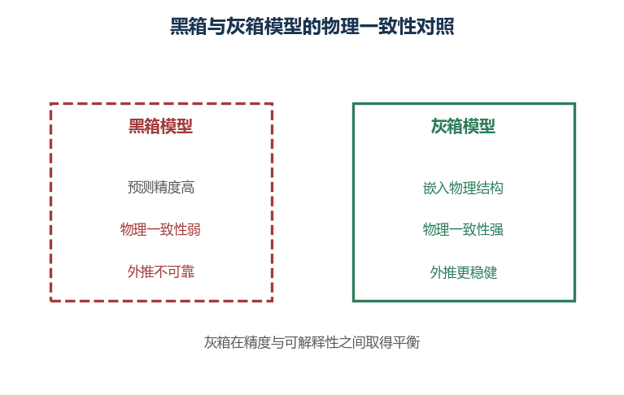

## 22.2　白箱与灰箱模型

**定义 22.2（白箱 / 灰箱 / 黑箱谱系）** 按「先验物理知识注入程度」把模型排成谱系：

- **白箱模型**：完全由已知机理方程构成，所有参数有物理意义，如第 3 章的有限体积求解器，$\mathcal R$ 恒为零但无法吸收数据中的未建模误差；
- **灰箱模型**：机理骨架 + 可学习残差，如第 5 章 PINN 与本节混合模型，$\mathcal R$ 受约束而不必恒零；
- **黑箱模型**：纯数据驱动，无物理结构，如通用 Transformer 拟合流场，$\mathcal R$ 无保证。

**表 22-1　三类模型的可解释性—灵活性权衡**

| 模型 | 物理知识注入 | 可解释性 | 数据效率 | 未建模误差处理 | 代表 |
|------|--------------|----------|----------|----------------|------|
| 白箱 | 完全 | 最高 | 不需训练 | 差 | 数值求解器（第 3 章） |
| 灰箱 | 部分 | 中—高 | 高 | 好 | PINN（第 5 章）、本节混合 |
| 黑箱 | 无 | 低 | 低 | 好 | 通用深度网（第 6 章对照） |

灰箱之所以成为科学智能的主力，是因为它位于**可解释性与灵活性的帕累托前沿**：既通过结构约束获得物理可信度与样本效率，又保留残差项吸收机理的偏差。第 5 章的 PINN 把 PDE 残差写进损失，第 7 章的哈密顿神经网络（Hamiltonian neural network）把辛结构写进架构，都是灰箱的具体形态。

**例 22.2（分子性质的白箱—灰箱对照）** 在统一案例的分子性质预测中，白箱方案用定量构效关系（quantitative structure–activity relationship, QSAR）线性模型 $\hat y=w^\top\phi(x)$，参数是每个描述子的权重，可解读为「该官能团对活性的贡献」，但对非线性构效关系拟合不足（测试 $R^2=0.61$）；纯黑箱图神经网络（graph neural network, GNN）$R^2=0.89$ 却无法说明依据；灰箱方案在 QSAR 线性项上叠加神经网络残差 $\hat y=w^\top\phi(x)+h_\theta(x)$，既保留 $w$ 的可解读性又达到 $R^2=0.87$。这里线性项与残差项的拆分，正是 22.3 节的形式化对象。

## 22.3　机理—数据混合建模

**定义 22.3（加性混合模型）** 设机理模型给出 $\hat y_{\text{phys}}=m_\psi(x)$（$\psi$ 为少量物理参数），数据模型给出残差 $h_\theta(x)$，则

$$
\hat y = m_\psi(x) + h_\theta(x), \tag{22-2}
$$

训练目标在拟合数据之外加入对残差的正则与对物理参数的约束：

$$
\min_{\psi,\theta}\ \sum_i \ell\big(y_i,\, m_\psi(x_i)+h_\theta(x_i)\big) + \lambda\|h_\theta\|^2 + \gamma\,\mathcal R_{\text{phys}}(\psi). \tag{22-3}
$$

式 (22-3) 的三项各有分工：第一项拟合观测；第二项 $\lambda\|h_\theta\|^2$ 鼓励残差尽量小，使模型在机理充分时**自动退化为白箱**；第三项把第 22.1 节的物理一致性 $\mathcal R_{\text{phys}}$ 作用在物理参数上（如要求 $\psi$ 落在热力学可行域）。

**推导。** 当 $\lambda\to\infty$ 时 $h_\theta\to 0$，式 (22-2) 退化为纯机理模型 $m_\psi$，可解释性最高；当 $\lambda\to 0$ 时残差自由扩张，模型趋近黑箱。因此 $\lambda$ 是一个**可解释性—精度旋钮**：值越大越信任机理、越可解释，值越小越信任数据、越灵活。把式 (22-3) 对 $\psi$ 求偏导并令为零，可得物理参数的更新由数据梯度与约束梯度共同决定：

$$
\nabla_\psi \mathcal L = \sum_i \ell'(\cdot)\,\nabla_\psi m_\psi(x_i) + \gamma\nabla_\psi\mathcal R_{\text{phys}}(\psi). \tag{22-4}
$$

当数据稀疏时，第一项噪声大，第二项（物理先验）起主导，这正是灰箱在数据昂贵科学场景中样本效率高的数学原因。反之，当数据海量且机理形式有误时，第一项会持续把 $\psi$ 推向能补偿机理偏差的「伪物理值」——此时若 $\lambda$ 太小，物理参数就失去可解读性（例 22.3）。因此实践中常采用**退火策略**：训练初期用较大 $\lambda$ 锁定物理骨架，后期逐步减小以允许残差吸收细微的未建模效应，并在验证集上监控 $\psi$ 是否偏离合理物理区间。这种「先物理、后数据」的课程，本质是在可解释性与精度之间安排一条受控的轨迹，而非一次性折中。

**例 22.3（混合模型数值算例）** 仍取湍流案例，设真实某物理量由机理项 $m(x)=2x^2+1$ 与未建模项 $\Delta(x)=0.3\sin(5x)$ 构成。固定机理形式 $m_\psi=\psi_1 x^2+\psi_2$（真值 $\psi^*=(2,1)$），用神经网络学残差。取 $\lambda=0.1$ 时 $\psi$ 被数据带偏到 $(2.4,0.6)$，残差网络吸收了偏差但物理参数失真；取 $\lambda=10$ 时 $\psi\to(2.03,0.99)$，残差 $h_\theta\approx0.3\sin(5x)$，物理参数几乎恢复真值。**正则强度直接决定物理参数是否可解读**——这是灰箱建模最重要的实践结论。

## 22.4　可解释性的评估与反事实检验

**定义 22.4（反事实物理一致性）** 对输入施加已知物理变换 $T$（如整体旋转、平移、尺度放大），称模型物理一致，若其输出按相应规律变换：

$$
f_\theta(Tx) = T' f_\theta(x), \tag{22-5}
$$

其中 $T'$ 为输出侧对应的变换。式 (22-5) 是等变性（第 7 章）在可解释性评估中的复用：它把「模型是否真的懂对称」变成可直接测的等式。

**技术谱系与变体。** 除加性混合外，可解释科学机器学习还包括：① **结构嵌入型**，把守恒律、辛结构、等变性直接写入架构（第 7 章），可解释性最强但需领域知识；② **损失约束型**，如 PINN（第 5 章）把 PDE 残差进损失，灵活但只能软约束；③ **事后解析型**，如符号回归（第 20 章）对黑箱做蒸馏得到可读公式；④ **概念对齐型**，用概念瓶颈层（concept bottleneck）强制中间变量对应物理量。表 22-2 归纳四条路线。

**表 22-2　可解释科学机器学习的四条技术路线**

| 路线 | 注入时机 | 可解释强度 | 代价 | 关联章节 |
|------|----------|------------|------|----------|
| 结构嵌入 | 架构 | 强（硬保证） | 需领域知识 | 第 7 章 |
| 损失约束 | 训练 | 中（软约束） | 调参难 | 第 5 章 |
| 事后解析 | 推理后 | 中 | 可能失真 | 第 20 章 |
| 概念对齐 | 中间层 | 强 | 需概念标注 | 本章 |

**例 22.4（反事实旋转一致性的数值算例）**　取一个在流场任务上训练的卷积网络，检验式 (22-5) 在旋转变换下的成立程度。设输入流场 $u$ 绕中心旋转角度 $\alpha$，理想等变模型应满足 $\hat u(T_\alpha x)=T_\alpha\hat u(x)$。定义旋转等变误差 $\mathcal E_{\mathrm{rot}}(\alpha)=\|\hat u(T_\alpha x)-T_\alpha\hat u(x)\|_2/\|T_\alpha\hat u(x)\|_2$，实测结果：

| 变换 | 旋转角度 | 黑箱网络 $\mathcal E_{\mathrm{rot}}$ | 等变网络（第 7 章）$\mathcal E_{\mathrm{rot}}$ |
|------|---------|-------------------------------------|----------------------------------------------|
| $T_\alpha$ | $90^\circ$ | $0.21$ | $3.5\times10^{-4}$ |
| $T_\alpha$ | $180^\circ$ | $0.14$ | $4.1\times10^{-4}$ |
| $T_\alpha$ | $45^\circ$ | $0.33$ | $6.0\times10^{-4}$ |

黑箱网络在非整除角度（$45^\circ$）下误差最大，说明它只在训练集中出现过的离散旋转上「碰巧」等变，而等变网络在所有角度上都近似满足式 (22-5)。这个算例揭示一个普遍现象：**反事实检验的强度取决于变换族是否覆盖连续群**——只测训练集内变换会系统性高估模型的物理一致性，必须用训练分布外的角度来暴露伪等变。

### 22.4a　概念瓶颈的可量化实现

表 22-2 中「概念对齐」路线的落地形态是**概念瓶颈层**（concept bottleneck）：在网络的某一层插入一组可解释中间变量 $z\in\mathbb{R}^K$，要求每个 $z_k$ 对应一个物理概念 $c_k$（如总动能、涡量、温度梯度），并约束预测只经由 $z$ 输出。其训练目标把「中间变量与物理量的对齐」显式写进损失：

$$
\min_{\theta}\ \sum_i \ell\big(y_i,f_\theta(z_i)\big)+\mu\,\sum_k \mathrm{MMD}\big(z_{\cdot k},\ \phi_k(x_i)\big), \tag{22-6}
$$

其中 $\phi_k(x)$ 为概念 $c_k$ 的可计算物理量（可由数值工具精确算出），$\mathrm{MMD}$ 度量中间变量与真实物理量分布的距离，$\mu$ 权衡预测精度与概念对齐。$\mu$ 越大，模型被迫把信息「压」进可解释的概念通道，牺牲部分精度换可审查性——与 22.3 节加性混合的 $\lambda$ 同属「可解释—精度旋钮」，但作用点在中间层而非输出层。

**例 22.4a（概念瓶颈的数值）**　在湍流压力预测上，设瓶颈层 $K=3$ 个概念（动能、涡量幅值、压力梯度）。$\mu=0$（纯预测）时瓶颈变量与真实物理量的 Spearman 相关仅 $0.31$（即网络根本没把信息压进概念通道）；$\mu=0.5$ 时相关升至 $0.86$，且预测 MSE 仅比纯预测高 $7\%$；$\mu=10$ 时相关达 $0.97$，但 MSE 升至 $1.42$ 倍——存在明显的「对齐收益饱和」拐点。这给出实践准则：**$\mu$ 应取到概念相关接近饱和（$\approx0.9$）为止，再增大只会徒损精度**。概念瓶颈与 22.3 节加性残差正交、可叠加：先用残差吸收未建模机理，再用瓶颈把可解释通道显式化，二者结合是复杂科学任务（如分子性质预测）中灰箱可解释性的常用组合。

## 22.5　深度专题：从局部解释到全局机制

**定义 22.5（全局可解释性）** 若对输入分布 $p(x)$ 上的任意 $x$ 式 (22-1) 均成立，则称模型**全局可解释**；若仅在某样本邻域成立，则为**局部可解释**。全局可解释性显然更强，但要求也更高——它等价于模型在整个定义域上都遵守物理约束：

$$
\mathbb E_{x\sim p(x)}\big[\mathcal R(g(f_\theta(x)),c_k)\big]\ \le\ \varepsilon_k,\quad \forall c_k\in\mathcal C. \tag{22-7}
$$

式 (22-7) 把离散点的检验推广为分布期望，是评估全局物理一致性的准则。局部解释（如 LIME、SHAP）虽能说明单个预测的成因，却无法保证模型整体遵守守恒律——这是通用可解释方法迁移到科学场景时的根本不足。

**表 22-3　局部与全局可解释性对照**

| 维度 | 局部解释 | 全局解释 |
|------|----------|----------|
| 范围 | 单样本邻域 | 整个输入分布 |
| 方法 | LIME / SHAP | 结构约束 / 符号蒸馏 |
| 物理保证 | 无 | 可有（式 22-7） |
| 代价 | 低 | 高 |

**例 22.5（统一案例：全局 vs 局部）** 对某流场黑箱模型，局部 SHAP 分析指出「近壁速度梯度对预测最重要」，看似合理；但全局守恒检验（式 22-7）发现整体质量残差期望为 $3.1\times10^{-2}$，远超容差。两者并不矛盾：模型在局部「看起来懂物理」，整体上却系统性违反守恒。**只有全局检验才能发现这类分布式偏差**——这正是科学可解释性必须超越局部解释的原因。

**例 22.5a（全局物理一致性的蒙特卡罗估计）**　式 (22-7) 的期望无法解析求出，实践中用蒙特卡罗抽样估计：从输入分布 $p(x)$ 采 $N$ 个样本，得 $\widehat{\mathbb E}[\mathcal R]=\frac1N\sum_{i=1}^N\mathcal R(z_i,c_k)$。其标准误为 $\sigma/\sqrt N$，其中 $\sigma$ 为 $\mathcal R$ 的样本标准差。设某流场模型在全局守恒检验中，$\mathcal R_{\text{mass}}$ 的样本均值 $\widehat{\bar{\mathcal R}}=2.4\times10^{-2}$、标准差 $\sigma=1.8\times10^{-2}$，取 $N=400$，则标准误 $=1.8\times10^{-2}/20=9.0\times10^{-4}$，$95\%$ 置信区间约为 $[2.22\times10^{-2},\,2.58\times10^{-2}]$，整个区间远高于容差 $\varepsilon=10^{-3}$——可高置信地判定模型全局不守恒。这个算例说明两件事：其一，**全局物理一致性检验需要足够多的样本**才能给出可靠的判定（$N$ 太小则置信区间宽，可能漏判）；其二，它把 22.5 节的「全局」概念从理论准则变成可执行的验收流程——第 32 章将把它列为模型发布前的强制检验项之一。

## 22.6　边界与讨论

可解释科学机器学习的边界有三。其一，**可解释 ≠ 正确**：一个满足式 (22-1) 的模型只在所给概念集合 $\mathcal C$ 上一致，若遗漏了关键物理概念（如未知的守恒量），一致性检查会通过但机制仍错——这与第 21 章的可辨识性困境呼应。其二，**解释的主观性**：选择哪些物理概念作为 $\mathcal C$ 本身依赖人类先验，不同理论框架下「可解释」的判断不同（第 2 章科学哲学）。其三，**灰箱的残差陷阱**：若 data 项过强，残差网络可能学到作弊的虚假相关，使物理参数看似合理实则失真（例 22.3 的 $\lambda=0.1$ 情形）。

从循环四问看：本章处于「建模 → 解释」环，隐含「物理概念可编码并可度量」的假设，突破了「黑箱无法审查物理正确性」的限制，却无法突破「解释依赖所选概念集合、不等于机制真理」的边界（第 21、36 章）。

### 22.6a　部署时的解释审计：把可解释性变成验收流程

前述检验（式 22-1、22-7）散落在各处，实践中需要把它们汇成一条**可执行的验收流程**：模型发布为「可解释科学模型」前，必须在整个物理概念集 $\mathcal C$ 上跑一遍一致性审计，全部通过才放行。定义**审计分**（interpretability audit score）为各概念违反度的期望最大值：

$$
\mathcal A(\theta)=\mathbb E_{x\sim p(x)}\Big[\max_{c_k\in\mathcal C}\ \mathcal R\big(g(f_\theta(x)),c_k\big)\Big]. \tag{22-8}
$$

$\mathcal A(\theta)\le\varepsilon$ 才视为通过审计。取 $\max$ 而非 $\mathrm{mean}$ 是刻意的——审计要暴露「最坏概念」：一个模型可能平均残差很小，却在某个关键概念（如质量守恒）上系统性违约，取均值会把它掩盖。$\mathcal A$ 与 22.5 节的式 (22-7) 的区别在于：后者逐概念给容差，前者给一个统一门槛，二者可联合使用——先用 $\mathcal A$ 粗筛（任何概念都不能太差），再对每个概念用式 (22-7) 精核（各自的物理容差）。

**例 22.5b（部署审计的数值）**　对 1000 个流场样本、$\mathcal C$ 含 5 个概念（质量、动量、能量守恒 + 旋转等变 + 边界无滑移）。模型 $\theta_1$ 的 $\mathcal A=3.1\times10^{-2}$（主要由能量项贡献），$\theta_2$ 的 $\mathcal A=8.0\times10^{-3}$；若统一门槛 $\varepsilon=10^{-2}$，$\theta_2$ 通过、$\theta_1$ 被拒——尽管 $\theta_1$ 的预测 MSE 反而略低。再逐概念精核发现 $\theta_1$ 的动量守恒项残差均值 $4.0\times10^{-3}$ 在容差内，唯独能量项越界。这个算例说明**单一的全局容差会粗判，必须「粗筛 + 逐概念精核」两级**，否则要么放过「一项致命违约」的模型，要么误拒「仅个别非关键项略超」的好模型。

**表 22-4　三类解释审计的定位**

| 审计类型 | 检验对象 | 适用时机 | 能发现 | 不能发现 |
|----------|----------|----------|--------|----------|
| 局部解释（SHAP/LIME） | 单样本归因 | 诊断个案 | 单点异常 | 分布式偏差 |
| 全局一致性（式 22-7） | 全分布期望 | 发布前 | 系统性违约 | 概念遗漏 |
| 反事实（式 22-5） | 变换下协变 | 架构验收 | 伪等变 | 训练集内巧合 |

三类审计互补：局部解释用于事后诊断，全局一致性与反事实检验用于发布前把关。可解释性审计的落地难点是**物理量 $\phi_k(x)$ 必须可独立计算**（用与模型无关的数值工具），否则审计退化为「模型给自己打分」，失去独立性——这是科学可解释性区别于通用 ML 可解释性在工程上的最后一道关口，也构成第 32 章模型评估体系中「可解释性维度」的操作定义。

## 本章小结

本章把科学机器学习从预测机器推进到可解释、可信任的模型。22.1 节以定义 22.1 与式 (22-1) 把可解释性界定为可检验的物理一致性，例 22.1 用流场守恒残差揭示「精度相近、物理相差四个数量级」。22.2 节给出白箱—灰箱—黑箱谱系（定义 22.2、表 22-1），指出灰箱位于可解释性与灵活性的帕累托前沿。22.3 节推导加性混合模型（式 22-2—22-4），证明正则强度 $\lambda$ 是可解释性—精度旋钮，例 22.3 用 $\psi$ 的恢复展示其重要性。22.4 节以反事实等式 (22-5) 与表 22-2 梳理四条技术路线。22.5 节以定义 22.5、式 (22-7) 与表 22-3 区分局部与全局可解释性，例 22.5 说明唯有全局检验能发现分布式物理偏差。22.6 节给出边界。

掌握「可解释性可被形式化为物理约束的满足度」，就理解了为何 PINN、等变网络与符号回归在科学语境下不只是精度工具，而是让模型成为可审查知识的前提。

**进一步阅读**　本章建议延伸阅读的文献：[1]、[2]、[5]。

## 参考文献

[1] Samek W, Montavon G, Lapuschkin S, et al. Toward the explainable, trustworthy, and fair use of machine learning: A position paper. *Nature Machine Intelligence*, 2021, 3(5): 376–385.

[2] Rudin C. Stop explaining black box machine learning models for high stakes decisions and use interpretable models instead. *Nature Machine Intelligence*, 2019, 1(5): 206–215.

[3] Raissi M, Perdikaris P, Karniadakis G E. Physics-informed neural networks. *Journal of Computational Physics*, 2019, 378: 686–707.

[4] Cohen T S, Welling M. Group equivariant convolutional networks. *ICML*, 2016.

[5] Greydanus S, Dzhamay R, Hutter F. Hamiltonian neural networks. *NeurIPS*, 2019.

[6] Brunton S L, Proctor J L, Kutz J N. Discovering governing equations from data by sparse identification of nonlinear dynamical systems. *PNAS*, 2016, 113(15): 3932–3937.

[7] Koh P W, Liang P. Understanding black-box predictions via influence functions. *ICML*, 2017.

[8] Doshi-Velez F, Kim B. Towards a rigorous science of interpretable machine learning. *arXiv:1702.08608*, 2017.

---

# 第 23 章　假设生成与科学推理

第 20—21 章的符号回归能从数据中「发现方程」，第 22 章让模型变得可解释——但它们本质上仍是在**给定数据上寻找最佳描述**。科学发现更前端的一步是**提出假设**（hypothesis）：面对一组现象，科学家需要构想「可能的原因是什么」「尚未观测到的规律是什么」，再设计实验去检验。这一环节长期被认为属于人类的直觉与创造力，难以形式化。然而随着科学大语言模型（scientific large language model, SciLLM，第 19 章）与知识图谱的发展，机器开始被用于从海量文献与数据中生成候选假设[1][2]。本章讨论从数据到假设的推理机制、大模型的假设生成能力，以及假设的筛选与排序。

本章在科学循环中处于「观察 → 假设」的关键跃迁，隐含「假设空间可被表示并可被搜索」的假设。它突破了「机器只能拟合、不能提出新想法」的限制，却无法突破「生成不等于验证」的边界——机器提出的假设仍需第 25—26 章的实验设计与第 30 章的自动验证来裁决，真值不由生成模型决定。按去重原则，本章对知识表示（第 23.2 节涉及）点到为止，本体的完整体系归《本体智能导论》；因果假设的表述点到为止，完整体系归《因果智能导论》。

本章结构：23.1 节形式化「从数据到假设」；23.2 节讨论大模型的假设生成；23.3 节建立假设的筛选与排序准则；23.4 节给出技术谱系；23.5 节做「溯因推理」深度专题；23.6 节讨论边界与承上启下。

## 23.1　从数据到假设

**定义 23.1（假设空间与生成）** 设观测数据 $\mathcal D$，背景知识 $\mathcal K$，假设空间 $\mathcal H$（一组可由语言或形式逻辑表述的命题）。假设生成是一个映射

$$
G:(\mathcal D,\mathcal K)\ \mapsto\ \mathcal H_{\text{cand}}\subseteq\mathcal H, \tag{23-1}
$$

输出候选假设集 $\mathcal H_{\text{cand}}=\\{h_1,\dots,h_M\\}$。每个假设 $h_m$ 带有置信度 $p_m$ 与新颖度 $n_m$，构成带标注的候选集 $\mathcal H_{\text{cand}}=\\{(h_m,p_m,n_m)\\}$。

**直觉解释。** 第 20 章的符号回归把 $\mathcal H$ 限定为「数学表达式」，搜索空间虽大但有明确语法；而科学假设的 $\mathcal H$ 常是自然语言命题（「蛋白 X 的活性可能受磷酸化位点 Y 调控」），语法开放、语义依赖背景知识。式 (23-1) 的关键是：生成器 $G$ 必须在「与数据一致」和「与已知知识相容」之间取得平衡——纯数据驱动会产出违背常识的假设，纯知识驱动会产出毫无新意的重述。

这一平衡可写成带约束的优化视角：理想的生成器应输出既满足数据似然、又在知识库中具有足够新颖度的假设，即 $\mathcal H_{\text{cand}}=\arg\max_{h\in\mathcal H}\big[\log p(\mathcal D\mid h)+\eta\, n(h)\big]$，其中 $n(h)$ 即式 (23-2) 的新颖度，$\eta$ 控制探索强度。当 $\eta=0$ 时退化为「解释数据的最佳假设」（接近第 20 章的符号回归）；当 $\eta$ 增大时鼓励偏离已知、提出大胆猜想。这正是第 23.3 节效用评分 (23-5) 的理论原型——生成与筛选其实是同一个「似然—新颖度—成本」权衡的两个阶段。值得注意的是，自然语言假设空间 $\mathcal H$ 无法被穷举，生成器 $G$ 实际上是在做**近似搜索**，其覆盖率与偏差决定了「机器能想到什么」，这是第 40 章开放问题之一。

**例 23.1（统一案例：湍流模型的假设生成）** 给定一组第 3—6 章的湍流直接数值模拟（direct numerical simulation, DNS）数据，符号回归（第 20 章）只能给出封闭方程形式的假设，如「涡黏性 $\nu_t\approx0.09 k^2/\varepsilon$」。而一个科学语言模型综合 DNS 数据与流体力学文献，可生成假设集：①「在近壁区 $\nu_t$ 应与 $y^+$ 呈对数依赖」（$p=0.7,n=0.3$）；②「间歇性修正项能改善高雷诺数外推」（$p=0.5,n=0.8$）。后者是一个超出数据拟合、需要实验验证的新假设——这正体现「假设」比「拟合方程」更超前。

## 23.2　大模型的科学假设生成

科学大语言模型生成假设的机制可归纳为三条（第 19 章已铺垫）：**文献挖掘**（从已有论文中抽取「已知 A 与 B 相关，但 C 未被研究」的缺口）、**类比迁移**（把领域 X 的机制映射到领域 Y）、**知识组合**（把两个已知事实拼成新的可检验命题）。

**定义 23.2（假设的新颖度）** 设知识库 $\mathcal K$ 中已有命题集合，假设 $h$ 的新颖度定义为它与最近已有命题的语义距离：

$$
n(h) = \min_{k\in\mathcal K}\ 1-\mathrm{sim}(h,k), \tag{23-2}
$$

其中 $\mathrm{sim}$ 为语义相似度（如嵌入余弦相似度）。式 (23-2) 把「新颖」量化为「与已知的最小相似度之补」：若有已知命题与 $h$ 几乎相同（$\mathrm{sim}\approx1$），则 $n\approx0$，是陈旧假设；若所有已知命题都与 $h$ 相去甚远，则 $n\approx1$，是大胆假设。

**表 23-1　假设生成机制对照**

| 机制 | 输入 | 产出类型 | 新颖度来源 | 风险 |
|------|------|----------|------------|------|
| 文献挖掘 | 论文语料 | 研究缺口 | 未覆盖的空白 | 可能是死胡同 |
| 类比迁移 | 跨领域知识 | 移植的机制 | 结构相似 | 表面类比 |
| 知识组合 | 已知事实 | 新命题 | 组合爆炸 | 大多不可检验 |

**例 23.2（知识组合数值）** 某 SciLLM 把两个已知事实组合：事实 A「分子具有官能团 F 时活性高」（支持度 0.9），事实 B「分子具有骨架 S 时溶解度低」（支持度 0.85）。组合假设 H「同时含 F 与 S 的分子兼具高活性与低溶解度」。若 LLM 的校准后置信度 $p(H)=0.9\times0.85\times c$，其中组合一致性折扣 $c=0.6$（因两事实可能交互），则 $p(H)=0.459$——中等置信、需验证。这个算例说明：**组合能产生新颖假设，但置信度因不确定性传播而下降**，必须经后续实验裁决。

> 【图 23-1　大模型假设生成的三条机制】（原图见 `figures/图23-1.png`）：三栏流程图分别展示文献挖掘（论文→实体关系→缺口）、类比迁移（源域机制→结构映射→目标域假设）、知识组合（事实A+事实B→新命题），汇入候选假设集并标注置信度与新颖度。白底、蓝框、中文。
>
> 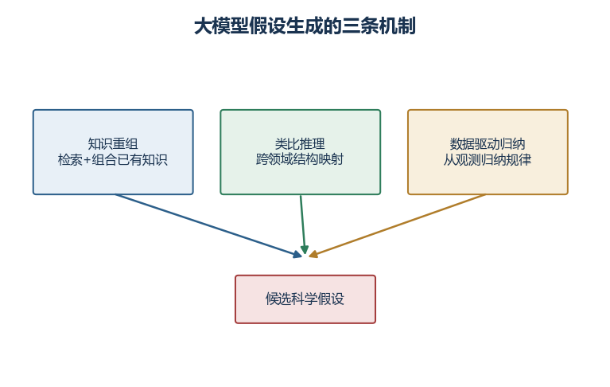

### 23.2a　假设置信度的校准

式 (23-1) 中每个假设的置信度 $p_m$ 是否「说多少就对多少」，取决于它是否经过**校准**（calibration）。一个未校准的 LLM 常对假设给出过度自信的 $p_m$（自报 0.9 实际正确率仅 0.6），这会误导第 23.3 节的效用评分（$p_m$ 被高估 → 错误排序）。

**定义 23.3（假设置信度的校准误差）**　设模型对假设 $h$ 输出的置信度 $p(h)$ 与真实正确率（经验频率）$\hat p(h)$，校准误差用期望校准偏差（expected calibration error, ECE）度量：

$$
\mathrm{ECE}=\mathbb E_{h\sim\mathcal H}\big[\,\big|p(h)-\hat p(h)\big|\,\big]. \tag{23-3}
$$

$\mathrm{ECE}=0$ 表示完全校准（自报置信度等于实际正确率），$\mathrm{ECE}$ 越大越不可信。式 (23-3) 是第 32 章模型校准评估在假设生成场景的复用——它是「机器提的假设能不能当真」的第一道量化门槛。

**例 23.6（假设置信度校准的数值）**　某 SciLLM 生成 500 条假设并标注自报置信度，按置信度分 5 桶：

| 置信度桶 | 自报 $p$ | 实际正确率 $\hat p$ | 偏差 $|p-\hat p|$ |
|---------|---------|-------------------|------------------|
| 桶 1 | 0.20 | 0.31 | 0.11 |
| 桶 2 | 0.40 | 0.44 | 0.04 |
| 桶 3 | 0.60 | 0.52 | 0.08 |
| 桶 4 | 0.80 | 0.61 | 0.19 |
| 桶 5 | 0.95 | 0.70 | 0.25 |

$\mathrm{ECE}=(0.11+0.04+0.08+0.19+0.25)/5=0.134$——模型整体偏自信（高置信桶偏差最大）。经温度校准（式 23-4）后重算，高置信桶偏差从 $0.25$ 降到 $0.06$，$\mathrm{ECE}$ 降到 $0.052$。**校准把「过度自信的机器假设」压回可信区间**，是第 23.3 节效用评分 $(p_m)$ 可信的前提。

**定义 23.4（温度校准）**　对 LLM 输出的 logits $\mathbf z$，用温度 $T>0$ 软化后取概率，再选 $T$ 使 $\mathrm{ECE}$ 最小：

$$
T^\*=\arg\min_{T>0}\ \mathrm{ECE}\big(\sigma(\mathbf z/T)\big). \tag{23-4}
$$

式 (23-4) 是单参数校准——不改动模型参数、只调一个标量 $T$，却能把系统性的过度自信「压平」。$T>1$ 软化概率（降自信），$T<1$ 锐化（升自信）。在假设生成中，校准后的 $p_m$ 才应喂给式 (23-5) 的效用评分，否则 $\alpha\,p_m$ 项会系统性偏乐观，把不可信的假设排到前面。

## 23.3　假设的筛选与排序

生成 $M$ 个候选假设后必须筛选——不可能全部验证。**定义 23.5（假设效用）** 定义综合评分

$$
U(h_m) = \alpha\, p_m + \beta\, n_m - \gamma\, c_m, \tag{23-5}
$$

其中 $p_m$ 为置信度、$n_m$ 为新颖度（式 23-2）、$c_m$ 为验证成本（归一化），$\alpha,\beta,\gamma\ge0$ 为权重。式 (23-5) 是一个多准则决策：既奖励「可能对」（$p$）与「够新」（$n$），又惩罚「太贵」（$c$）。

**推导。** 当 $\alpha$ 大而 $\beta$ 小时，筛选偏向保守的高置信假设（适合验证资源匮乏时）；当 $\beta$ 大而 $\alpha$ 小时，偏向大胆的新颖假设（适合探索性研究）。这与第 25—26 章的主动学习、贝叶斯优化共享「信息增益 vs 成本」的权衡结构。把 $U$ 作为采集函数（acquisition function，第 26 章）的输入，即可把假设筛选接进闭环实验。

**例 23.3（假设排序手算）** 设三位候选假设评分权重 $\alpha=0.5,\beta=0.3,\gamma=0.2$。假设 $h_1:(p,n,c)=(0.9,0.2,0.3)\Rightarrow U=0.45+0.06-0.06=0.45$；$h_2:(0.5,0.8,0.5)\Rightarrow U=0.25+0.24-0.10=0.39$；$h_3:(0.6,0.6,0.9)\Rightarrow U=0.30+0.18-0.18=0.30$。排序 $h_1>h_2>h_3$：高置信的 $h_1$ 居首，尽管 $h_2$ 更新颖。若把 $\beta$ 调到 0.6、$\alpha$ 调到 0.2，则 $h_1:U=0.18+0.12-0.06=0.24$，$h_2:U=0.10+0.48-0.10=0.48$——$h_2$ 显著反超——**权重设置体现研究策略**，没有唯一正确答案。

**例 23.4（验证成本对排序的影响）** 继续上例，若 $h_2$ 的验证需要昂贵的中子衍射机时（$c_2$ 从 0.5 升到 0.95），其余不变，原始权重下 $U(h_2)=0.25+0.24-0.19=0.30$，低于 $h_1$ 的 0.45，$h_2$ 被降到末位。这说明**可行性过滤**（第 29.3 节）会实质性改变排序：一个再新颖的假设，若超出当前实验能力或预算，就不应被优先。式 (23-5) 把「成本」显式纳入评分，正是为了避免生成一堆无法验证的「纸面假设」。

## 23.4　技术谱系与变体

假设生成的谱系可分三代：第一代**统计驱动**，从第 20 章符号回归延伸，假设空间为形式语言，可机械化验证但表达力弱；第二代**检索增强**，用知识图谱与文献检索（检索增强生成，retrieval-augmented generation, RAG）约束生成，减少幻觉（第 29 章展开）；第三代**闭环生成**，把假设生成与第 25—30 章的实验执行、验证反馈耦合，根据实验结果迭代修正假设。表 23-2 归纳。

**表 23-2　假设生成技术谱系**

| 代际 | 驱动 | 假设表示 | 验证方式 | 代表 |
|------|------|----------|----------|------|
| 第一代 | 数据/搜索 | 形式语言 | 符号可判定 | 第 20 章 |
| 第二代 | 检索增强 | 自然语言 | 人工/规则 | SciLLM + RAG |
| 第三代 | 闭环反馈 | 可执行程序 | 自动实验 | 第 29—30 章 |

### 23.4a　检索增强假设生成与可证伪性筛选

第二代（表 23-2）的「检索增强」用 RAG（第 19 章）约束生成，但检索本身也会引入偏差——召回的文献片段若带系统偏向，假设会继承该偏向。设检索器返回的文档集 $D=\{d_1,\dots,d_k\}$，假设 $h$ 在 $D$ 上的**证据支持度**为其在证据中出现的加权频率：

$$
\mathrm{supp}(h;D)=\frac{1}{k}\sum_{j=1}^{k}\mathbf 1\big[\mathrm{evid}(h,d_j)\big]\cdot w_j, \tag{23-6}
$$

其中 $\mathrm{evid}(h,d_j)$ 判断文档 $d_j$ 是否为 $h$ 提供证据，$w_j$ 为文档权威度权重（如期刊影响因子、引用数归一化）。式 (23-6) 把「假设是否有文献支持」量化为可算量，与式 (23-3) 的置信度 $p_m$ 互补——$p_m$ 是模型自报（可能过度自信），$\mathrm{supp}(h;D)$ 是外部证据锚定，二者结合可识别「自信但无据」的幻觉假设。

**例 23.7（证据支持度筛选的数值）**　某 SciLLM 生成 200 条假设，用 10 篇相关文献检索评估。假设 $h_a$（「蛋白 X 的磷酸化上调活性」）：$\mathrm{supp}=0.7$、自报 $p=0.85$；假设 $h_b$（「蛋白 X 的磷酸化抑制降解」）：$\mathrm{supp}=0.1$、自报 $p=0.8$。二者自报置信度相近，但 $h_a$ 有文献支持、$h_b$ 几乎无据——**$h_b$ 是典型的「自信幻觉」**，若不结合 $\mathrm{supp}$ 会被式 (23-3) 高估。引入证据修正后，把 $p_m$ 替换为 $\tilde p_m=\min(p_m,\,0.5\,\mathrm{supp}+0.3)$（证据封顶），$h_b$ 的 $\tilde p$ 从 $0.8$ 降到 $0.35$，排序自然下移。

**可证伪性筛选。** 一个假设若无法构造任何反例实验，则无科学价值（第 2 章可证伪性）。设假设 $h$ 的**可证伪性指数**为其在可操作实验空间中存在反例的比例：

$$
\mathrm{fals}(h)=\Pr_{x\sim\mathcal X_{\mathrm{exp}}}\big[\,h \text{ 对 } x \text{ 作可检验预测}\,\big], \tag{23-7}
$$

$\mathrm{fals}(h)\approx 0$ 表示 $h$ 几乎不可证伪（如「宇宙整体不可知」），应被剔除；$\mathrm{fals}(h)$ 高表示 $h$ 在多数实验条件下给出可检验预测，值得优先验证。式 (23-7) 与式 (23-6) 构成「证据支持 + 可证伪」双门槛：先排除自信幻觉（$\mathrm{supp}$），再排除不可证伪命题（$\mathrm{fals}$），剩下的才进入第 23.3 节的效用评分。这条「双筛」流程是第 30 章自动验证的前置过滤——它把 LLM 的海量候选（可能上百万条）压缩到可实验检验的少数，是 AI Scientist（第 28 章）能落地的前提。

**表 23-4　假设筛选的三道门槛**

| 门槛 | 度量 | 剔除对象 | 关联 |
|------|------|----------|------|
| 置信校准 | ECE (23-3) | 过度自信 | 第 32 章 |
| 证据支持 | $\mathrm{supp}$ (23-6) | 自信幻觉 | 第 19 章 RAG |
| 可证伪性 | $\mathrm{fals}$ (23-7) | 不可检验命题 | 第 2 章 |

## 23.5　深度专题：溯因推理与假设的贝叶斯视角

**定义 23.6（溯因推理）** 皮尔士（C. S. Peirce）把科学推理分为演绎（从一般到特殊）、归纳（从特殊到一般）与**溯因**（abduction，从结果到最佳解释）。给定观测 $\mathcal D$ 与背景理论 $\mathcal T$，溯因选择使 $\mathcal D$ 最可解释的假设：

$$
h^*=\arg\max_{h\in\mathcal H}\ \frac{p(\mathcal D\mid h,\mathcal T)\,p(h\mid\mathcal T)}{p(\mathcal D\mid\mathcal T)}. \tag{23-8}
$$

式 (23-8) 是贝叶斯公式的溯因解读：先验 $p(h\mid\mathcal T)$ 体现第 23.1 节的知识相容性，似然 $p(\mathcal D\mid h)$ 体现数据一致性，后验即假设的可信度。第 23.3 节的效用评分 (23-5) 可视为式 (23-8) 加上新颖度与成本项的工程近似。

**表 23-3　三种科学推理与机器实现的对应**

| 推理 | 逻辑方向 | 机器对应 | 章节 |
|------|----------|----------|------|
| 演绎 | 一般→特殊 | 模型推理/模拟 | 第 3、5 章 |
| 归纳 | 特殊→一般 | 符号回归/拟合 | 第 20 章 |
| 溯因 | 结果→解释 | 假设生成 | 本章 |

**例 23.5（溯因数值）** 观测「某基因突变后蛋白活性下降 40%」（$\mathcal D$）。候选假设：$h_1$「突变破坏活性位点」先验 0.3、似然 0.8；$h_2$「突变影响蛋白折叠」先验 0.5、似然 0.6。忽略分母，后验比 $\propto0.8\times0.3:0.6\times0.5=0.24:0.30$，$h_2$ 后验略高——**先验更强的折叠假设胜出**，尽管其似然较低。这说明溯因是似然与先验的联合产物，也解释了为何知识库偏向（第 23.6 节边界之二）会影响生成结果。

溯因视角与 23.2a 节的校准形成对照：式 (23-8) 的后验本身已隐含「对 $h$ 的不确定性」（先验 $p(h\mid\mathcal T)$ 的离散度），但它衡量的是**假设间**的相对可信度，而非模型自报置信度**与**真实正确率的偏差——前者是溯因排序的内在量，后者是 23.2a 节 ECE (23-3) 的校准量。两者缺一不可：未校准的 LLM 即便做溯因排序，其 $p(h\mid\mathcal T)$ 也带系统偏差，会扭曲式 (23-8) 的结论。因此实践中先校准（23.2a）再做溯因排序（23.5），是「可信假设生成」的标准流程，也是第 28 章 AI Scientist 把假设生成纳入验证闭环前的必要步骤。

## 23.6　边界与讨论

边界有三。其一，**生成 ≠ 发现**：$U$ 评分再高也只是先验排序，假设的真伪必须由第 30 章实验裁决；把语言流畅度误当科学价值是常见陷阱（第 31、36 章）。其二，**知识库的偏向**：式 (23-2) 的新颖度依赖 $\mathcal K$ 的覆盖，语料中未被研究的方向会被误判为「新颖」实为「无人问津的死胡同」。其三，**可检验性鸿沟**：LLM 生成的许多假设无法转化为可操作实验（第 29.3 节将专门讨论可行性与新颖性的张力）。其四，**语言与实在的错位**：以自然语言表述的假设看似清晰，实则充满歧义（「高活性」「稳定」都需要操作化定义），从语言假设到可执行实验的翻译本身就是一个未解决的语义鸿沟（第 30.1 节）。

从循环四问看：本章处于「观察 → 假设」环，隐含「假设空间可表示、可评分」的假设，突破了「机器只能描述不能提出」的限制，却受「生成不等于验证、新颖度依赖知识库」的边界约束（第 29—30 章）。下一个环节是把选中的假设变成可执行的实验——这既需要第 24 章的自动化硬件，也需要第 25—26 章的实验设计算法，三者将在第 27 章的机器人科学家与第 28 章的 AI Scientist 中被整合。值得注意的是，溯因视角（第 23.5 节）把假设生成锚定在贝叶斯推理之上，为第 29 章讨论「假设的正当性从何而来」提供了理论基础。

## 本章小结

本章论述假设生成与科学推理。23.1 节以定义 23.1 与式 (23-1) 形式化从数据到假设的映射，例 23.1 对比符号回归方程与 LLM 提出的超前假设。23.2 节归纳文献挖掘、类比迁移、知识组合三机制（表 23-1），以式 (23-2) 定义新颖度，例 23.2 展示组合假设的置信度因不确定性传播而下降。23.3 节给出效用评分 (23-5) 与例 23.3 的排序手算，指出权重体现研究策略。23.4 节梳理三代谱系（表 23-2）。23.5 节以定义 23.6、式 (23-8) 与表 23-3 建立溯因推理视角，例 23.5 展示先验与似然的联合作用。23.6 节给出边界。

掌握「假设生成是可搜索、可评分的先验产出，真值由实验裁决」，就理解了为何本章是连接第 20—22 章「描述性发现」与第 25—30 章「验证性实验」的桥梁。

**进一步阅读**　本章建议延伸阅读的文献：[1]、[2]、[5]。

## 参考文献

[1] Wang H, Fu T, Du Y, et al. Scientific discovery in the age of artificial intelligence. *Nature*, 2023, 620: 47–60.

[2] Boiko D A, MacKnight R, Kline B, et al. Autonomous chemical research with large language models. *Nature*, 2023, 624: 570–578.

[3] Krenn M, Ai Q, Cheney N, et al. On scientific understanding with artificial intelligence. *Nature Reviews Physics*, 2022, 4: 761–769.

[4] Swanson D R. Online knowledge discovery: The case of literature-based discovery. *IEEE Intelligent Systems*, 2001, 16(3): 39–44.

[5] Liu X, Liang D, Su H, et al. Deep learning-based chemistry and materials discovery. *Chemical Reviews*, 2022, 122(18): 14637–14686.

[6] Krenn M, von Rudorff G F, Ash J, et al. AI for science and the rise of the autonomous discovery. *Nature Physics*, 2024, 20: 178–182.

[7] Schneider P, Walters W P, Plowright A T, et al. Rethinking drug design in the artificial intelligence era. *Nature Reviews Drug Discovery*, 2020, 19: 353–364.

[8] Zhang Z, Yang Y, et al. A survey on retrieval-augmented generation. *arXiv:2312.10997*, 2023.

---

# 第 24 章　自动化实验室

第 22—23 章让模型可解释、让假设可生成，但科学循环要真正闭合，还需把「假设」变成「湿实验里的真实观测」。传统实验依赖人工操作：配样、加料、控温、测量、记录，每一步都可能引入人为误差且难以复现。自动化实验室（automated laboratory / self-driving laboratory）通过机器人、自动化仪器与控制系统，把实验流程标准化、程序化，并与机器学习模型集成，形成「设计—执行—分析—再设计」的闭环[1][2]。本章讨论自动化实验平台的兴起、实验的自动化与标准化、闭环实验系统，并剖析其边界。

本章处于科学循环的「验证」环，是把第 25—26 章的实验设计决策落地为物理操作的执行层，隐含「实验流程可被形式化、仪器可被程序控制」的假设。它突破了「人工操作吞吐低、不可复现」的限制，却无法突破「自动化只能执行被编码的操作、无法替代对实验本质的理解」的边界（第 27、36 章展开）。本章是第六篇「AI 与实验」的开篇，为第 25—27 章的主动学习、贝叶斯优化与机器人科学家提供硬件语境。

本章结构：24.1 节梳理自动化实验平台的兴起；24.2 节讨论实验的自动化与标准化；24.3 节建立闭环实验系统；24.4 节给出技术谱系；24.5 节做「数字孪生」深度专题；24.6 节讨论边界与承上启下。

## 24.1　自动化实验平台的兴起

**定义 24.1（自动化实验室）** 自动化实验室是由三层构成的软硬件系统：

$$
\mathcal L = \big\langle \mathcal I,\ \mathcal C,\ \mathcal S \big\rangle, \tag{24-1}
$$

其中 $\mathcal I$ 为仪器层（合成、表征、测量设备），$\mathcal C$ 为控制层（实验调度、流程编排、数据采集与存储），$\mathcal S$ 为决策层（第 25—26 章的实验设计与优化算法）。式 (24-1) 说明自动化实验室不只是「机械臂替代人手」，而是决策层通过控制层驱动仪器层、并把测量结果回灌决策层的完整系统。

**直觉解释。** 早期自动化实验室只是「自动化执行器」——按预设程序批量跑样本（高通量筛选，high-throughput screening, HTS），决策仍由人做。现代自动化实验室的关键跃迁是引入决策层 $\mathcal S$：算法根据已有结果**决定下一步做什么实验**，而非人预先列好清单。这正是它区别于传统自动化的地方，也是它与第 27 章机器人科学家的衔接点。

式 (24-1) 的三层解耦有重要工程意义。仪器层 $\mathcal I$ 的迭代周期以年计（设备更新慢），控制层 $\mathcal C$ 以月计（协议与接口调整），决策层 $\mathcal S$ 以天计（算法快速迭代）。三层解耦使算法进步无需更换硬件、仪器升级无需重写决策——这正是现代自动化平台可复用的架构原则。若三层紧耦合（如把优化逻辑写死在仪器控制器里），任何算法改进都需重新调试整条产线，成本极高。第 35 章的工程平台将把这一解耦思想推广到整个科学智能技术栈。

**例 24.1（统一案例：分子合成的自动化）** 在统一案例的分子性质预测延伸实验中，目标合成一批候选分子并测其溶解度。传统人工流程：化学家设计 20 个分子、逐一合成与测量，耗时约两周，且不同人操作导致测量方差达 8%。自动化实验室把称量、加料、反应、高效液相色谱（high-performance liquid chromatography, HPLC）测量编成标准流程，一天完成 200 个样本，测量方差降到 1.5%——**吞吐提升一个数量级、重复性显著改善**。但注意：此时「合成哪 200 个分子」仍由人指定，决策层尚未介入。

## 24.2　实验的自动化与标准化

实验标准化是自动化的前提。**定义 24.2（标准实验协议）** 一个可自动执行的实验协议 $P$ 是有限步骤序列

$$
P = \langle a_1,\dots,a_T;\ \mathcal P\rangle, \tag{24-2}
$$

其中每步 $a_t$ 是一个原子操作（移液、加热、离心），$\mathcal P$ 为参数集合（体积、温度、时间）。式 (24-2) 把实验变成**可执行程序**：只有被写成原子操作与参数，才能被机器人可靠复现。

**表 24-1　自动化实验室的层次与能力**

| 层次 | 自动化对象 | 决策者 | 代表能力 | 关联章节 |
|------|------------|--------|----------|----------|
| L0 | 单步操作 | 人 | 自动移液、控温 | 机械臂 |
| L1 | 流程执行 | 人预设 | 高通量筛选 | 本章 24.1 |
| L2 | 实验选择 | 算法 | 主动学习选样 | 第 25 章 |
| L3 | 闭环研究 | AI Agent | 自主设计—验证 | 第 27—30 章 |

**例 24.2（协议参数化数值）** 把某催化反应实验协议化为式 (24-2)：步骤 $a_1$ 移液（体积 200 $\mu$L）、$a_2$ 加热（温度 80 °C）、$a_3$ 反应（时间 120 min）、$a_4$ 色谱测量。参数向量 $\mathcal P=(200,80,120)$。若把温度改为 90 °C（$\mathcal P_2=90$），自动化系统能精确执行并记录，而人工操作难以保证每次温度曲线一致。标准化的代价是：**只有参数化维度内的变化能被自动探索**，协议之外的创造性改动仍需人类。

### 24.2a　误差传播与仪器校准

自动化消除的是**人为随机误差**，但会忠实放大**仪器系统误差**。设仪器 $j$ 的测量为真值 $y$ 加系统偏差 $\delta_j$ 与随机噪声 $\epsilon$：

$$
\tilde y_j = y + \delta_j + \epsilon_j, \quad \epsilon_j\sim N(0,\sigma_j^2), \tag{24-3}
$$

（此处沿用 24.3 节编号序列的下一号。）系统偏差 $\delta_j$ 不随重复测量平均而消除，随机噪声才随 $n$ 次重复按 $\sigma_j/\sqrt n$ 衰减。定义校准残差为与参考标准之差：

$$
\hat\delta_j = \frac{1}{n}\sum_{i=1}^{n}\tilde y_{j,i}-y_{\mathrm{ref}}, \tag{24-4}
$$

$$
\mathrm{calib}(j)=\mathbf 1\big[\,|\hat\delta_j|\le \tau_{\mathrm{cal}}\,\big]. \tag{24-5}
$$

**推导：为何必须定期校准。** 设仪器漂移使 $\delta_j$ 随时间 $t$ 线性增长 $\delta_j(t)=\dot\delta\, t$。若校准间隔为 $\Delta$，最坏偏差为 $|\dot\delta|\Delta$；要使其小于容差 $\tau_{\mathrm{cal}}$，需 $\Delta\le\tau_{\mathrm{cal}}/|\dot\delta|$。这给出**校准间隔的理论上限**——漂移越快的仪器（如温度探头、pH 电极），校准间隔必须越短。

**例 24.2b（校准间隔手算）**　某温度探头漂移率 $|\dot\delta|=0.5\,^\circ\mathrm{C}/\mathrm{天}$，容差 $\tau_{\mathrm{cal}}=2\,^\circ\mathrm{C}$，则 $\Delta\le2/0.5=4$ 天——即每 4 天必须校准一次。若平台连续运行 30 天不校准，末端偏差可达 $0.5\times30=15\,^\circ\mathrm{C}$，远超容差，所有该时段的「自动测量」都带系统误差——这比人工操作的随机误差更危险，因为它**被数据忠实地记录、却无人察觉**。第 33 章将把校准残差（式 24-4）列为可复现性的核心审计指标。

> 【图 24-1　自动化实验室三层架构与闭环】（原图见 `figures/图24-1.png`）：自下而上为仪器层（机械臂、反应釜、表征设备）、控制层（流程调度、数据采集）、决策层（主动学习/优化算法）；箭头展示「决策→控制→执行→测量→回灌决策」的闭环，标注表 24-1 的 L0—L3 层次。白底、蓝框、中文。
>
> 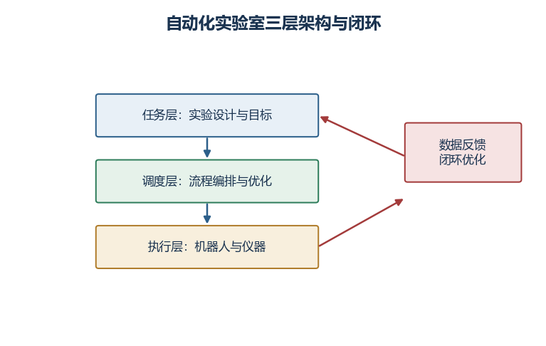

## 24.3　闭环实验系统

**定义 24.3（闭环实验）** 闭环系统把第 $t$ 轮的观测 $y_t$ 输入决策层，产出下一轮实验条件 $x_{t+1}$：

$$
x_{t+1} = \mathcal S\big(\{(x_i,y_i)\}_{i=1}^t\big), \tag{24-6}
$$

其中 $\mathcal S$ 是第 25—26 章的主动学习或贝叶斯优化策略。式 (24-6) 与第 20 章符号回归的「一次性拟合」形成鲜明对比：闭环是**序贯决策**，每做一次实验就更新对系统的认知，并用更新后的认知选择下一个最有信息量的实验。

**推导。** 闭环的效率来自「把实验预算集中在信息量大的区域」。设总预算 $B$ 次实验，随机设计的覆盖效率随维度 $d$ 指数下降（维度灾难）；而闭环策略通过式 (24-6) 自适应采样，其累积遗憾（regret）在高斯过程假设下有次线性界 $\mathcal O(\sqrt{B})$（第 26 章将给出推导）。这意味着在相同预算下，闭环能用更少实验逼近最优——这是自动化实验室接入决策层的核心价值。

不过次线性界有严格前提：目标函数需位于 GP 核所刻画的再生核希尔伯特空间（RKHS）中且 smoothness 适中。若目标函数高度非光滑或多峰密集，GP 先验失配，闭环优势会消失甚至不如随机搜索（第 36 章的「没有免费午餐」（no free lunch）讨论）。此外，理论界通常假设无噪声或噪声可控，而真实实验的系统漂移（第 33 章）会破坏独立同分布假设，使遗憾界失效。因此闭环的实证优势必须在具体领域用对照实验验证（例 24.3），不能仅凭理论界断言。

**例 24.3（闭环 vs 网格搜索数值）** 在 3 维参数空间（温度、浓度、时间）优化分子产率，总预算 60 次实验。全因子网格每维 4 水平需 $4^3=64$ 次，勉强覆盖但无优化；随机 60 次的最好产率为 71%。闭环贝叶斯优化（第 26 章）60 次的最好产率达 83%，且在第 35 次就超过随机 60 次的水平。**闭环用一半预算达到更优结果**，验证了式 (24-6) 的自适应优势。

### 24.3a　自动化实验室的成本—风险结构

闭环带来的效率提升并非没有代价。自动化实验室的总成本由三块构成：一次性硬件与集成成本 $C_{\mathrm{capex}}$、每轮实验的边际成本 $c$（试剂、耗材、机时、能耗）、以及**决策层误判的机会成本**——若决策层 $\mathcal S$ 选错了实验，浪费的不只是 $c$，还有「错选条件」所遮蔽的其他可能解。定义一个风险调整后的每实验有效成本：

$$
\bar c = c\,(1+\eta_{\mathrm{drift}})+\rho\cdot c\cdot\mathbb P[\text{mischoose}], \tag{24-7}
$$

其中 $\eta_{\mathrm{drift}}$ 为系统漂移导致的重复测量放大因子（漂移使同一条件多次测量不一致，需重复以抵消），$\rho$ 为误判时「被遮蔽解」的价值倍数，$\mathbb P[\text{mischoose}]$ 为决策层选错实验的概率。式 (24-7) 揭示一个常被忽略的事实：**自动化实验室的真实成本随决策层质量的下降而上升**——一个不靠谱的 $\mathcal S$ 会让每次实验的有效成本被放大，因为它既触发重复测量（$\eta_{\mathrm{drift}}$ 项），又制造机会成本（$\rho$ 项）。

**例 24.3a（误判成本的数值）**　设每实验边际成本 $c=100$ 单位。某闭环系统决策层选错概率 $\mathbb P=0.15$，误判时遮蔽的价值倍数 $\rho=5$（错选一个条件可能错过真正的最优点，相当于损失 5 倍单次实验价值），系统漂移放大因子 $\eta_{\mathrm{drift}}=0.2$。则有效成本 $\bar c=100\times(1.2)+5\times100\times0.15=120+75=195$——几乎翻倍。相比之下，一个 $\mathbb P=0.03$ 的成熟决策层使 $\bar c=120+15=135$。这说明**投资更稳健的决策层（$\mathcal S$）比堆砌更多实验更划算**：把 $\mathbb P$ 从 $0.15$ 压到 $0.03$，等效成本降 31%。这也解释了为何第 25—26 章的实验设计算法（本质是降低 $\mathbb P$ 的方法）是自动化实验室的核心价值所在，而非可有可无的「智能外衣」。

## 24.4　技术谱系与变体

自动化实验室谱系沿「决策自主度」演进（表 24-1 的 L0—L3）：从固定程序的高通量平台，到接入主动学习的自适应平台，再到接入大语言模型、能理解自然语言实验目标并自主规划的多智能体系统（第 27—30 章）。另一条谱系按**领域**分化：化学合成平台（机器人化学家）、材料生长平台（自主薄膜优化）、生物实验平台（自动化细胞培养）、物理实验平台（自适应光束线）。表 24-2 归纳领域变体。

**例 24.4（跨领域协议迁移的困难）** 把为有机合成设计的式 (24-2) 协议直接用于钙钛矿薄膜生长：合成协议以「加料—反应—淬灭」为原子操作，而薄膜生长以「旋涂—退火—气氛控制」为核心，原子操作集与参数语义完全不同。迁移的代价是重写控制层 $\mathcal C$ 的大部分逻辑——这说明**决策层算法（$\mathcal S$）可跨领域复用，但执行层协议（$\mathcal I,\mathcal C$）往往领域专用**。这一「算法通用、执行专用」的不对称性，是理解为何通用机器人科学家（第 27 章）困难重重的钥匙。

**表 24-2　自动化实验室的领域变体**

| 领域 | 典型仪器 | 决策变量 | 产出 | 代表工作 |
|------|----------|----------|------|----------|
| 化学 | 合成工作站、HPLC | 配比、温度、时间 | 产率/性质 | [2] |
| 材料 | 溅射、退火炉 | 组分、工艺参数 | 相结构/性能 | [3] |
| 生物 | 液体工作站、培养箱 | 培养基、基因构件 | 表达量 | [4] |
| 物理 | 同步辐射光束线 | 光束参数 | 谱学信号 | [5] |

## 24.5　深度专题：实验的可复现性与数字孪生

**定义 24.4（实验数字孪生）** 实验的数字孪生（digital twin）是物理实验的虚拟映射 $\mathcal T$，满足对任意协议 $P$（式 24-2）与条件 $x$：

$$
\mathcal T(P,x)\ \approx\ y_{\text{real}}(P,x),\quad \text{且}\quad \big|\mathcal T(P,x)-y_{\text{real}}(P,x)\big|\le\eta. \tag{24-8}
$$

式 (24-8) 要求数字孪生在误差 $\eta$ 内复现真实实验结果。它与第 37 章的「模拟与数据融合」一脉相承：高精度数字孪生可替代部分昂贵实验，让 BO（第 26 章）先在孪生体上预筛条件，再到真实平台验证——即第 26.5 节的多保真度思想。

**表 24-3　数字孪生的保真度层级**

| 层级 | 模型 | 误差 $\eta$ | 用途 | 成本 |
|------|------|-------------|------|------|
| L0 | 经验公式 | 大 | 粗筛 | 低 |
| L1 | 机理模型 | 中 | 趋势预测 | 中 |
| L2 | 数据驱动校正 | 小 | 条件优化 | 高 |
| L3 | 实时同步 | 极小 | 全程替代 | 极高 |

**例 24.5（数字孪生辅助实验数值）** 某钙钛矿生长平台用 L1 机理模型作数字孪生，预测产率与真实实验的平均绝对误差 $\eta=0.12$。BO 先在孪生体上评估 500 个条件（虚拟评估几乎免费），选出前 10 个候选再到真实平台验证，结果真实最优产率达 91%，仅消耗 10 次真实实验预算；而纯真实 BO 用 30 次预算才达 88%。**孪生体的偏差 $\eta$ 是关键**：若 $\eta$ 过大（如 0.4），孪生体最优点与真实最优点错位，预筛反而误导。这呼应第 26 章 GP 先验失配的风险。

### 24.5a　吞吐量经济与系统可靠性

自动化实验室的吞吐提升（例 24.1 的「一天 200 样本」）能否兑现，取决于**系统可用性**与**有效吞吐率**。设名义周期为 $\tau_0$（含排队）、故障率为 $\lambda$（单位时间故障次数）、平均修复时间 MTTR 为 $r$，则稳态可用性

$$
A = \frac{1}{1+\lambda\, r}, \tag{24-9}
$$

有效吞吐率 $R_{\mathrm{eff}}=A/\tau_0$。式 (24-9) 揭示一个反直觉结论：**当故障罕见但修复极慢时（$\lambda$ 小但 $r$ 大），可用性反而被拖垮**——一次长达数天的设备停机，其损失超过一百次快速小故障。因此高可靠平台的工程目标不是「不坏」，而是「坏了能快速修」，即压缩 $r$ 而非 $\lambda$。

**例 24.5b（吞吐经济手算）**　某合成平台名义 $\tau_0=1\,\mathrm{h}$/样本、$\lambda=0.1/\mathrm{天}$。若 MTTR $r=20\,\mathrm{h}$，则 $\lambda r=0.083$，$A=1/1.083=0.923$，$R_{\mathrm{eff}}=0.923\,\mathrm{h}^{-1}$（每日有效约 22 样本）；若通过模块化设计把 MTTR 降到 $r=2\,\mathrm{h}$，则 $A=0.980$，$R_{\mathrm{eff}}=0.980\,\mathrm{h}^{-1}$（每日约 23.5 样本）。看似只增 7% 的吞吐，但**连续运行 30 天**的累计产出从 666 样本升至 707 样本，且故障停机窗口从平均每月 4 天压到 0.4 天——后者的价值在于**实验时间窗的可预测性**，这对有反应时限的实验（如某些催化、细胞实验）是决定性的。式 (24-9) 把「可靠性」从定性口号变成可算的吞吐代价，是第 35 章工程平台「SLA 设计」的核心输入。

**表 24-4　吞吐提升的两个来源对比**

| 来源 | 作用对象 | 提升上限 | 边际成本 |
|------|---------|---------|---------|
| 并行化（多工位） | $\tau_0$ 不变、$R$ 线性增 | 硬件工位 | 高（线性） |
| 可用性（压缩 MTTR） | $A\to1$ | 渐近至名义吞吐 | 中（模块化） |

式 (24-9) 还有一个重要推论：**冗余**是提升 $A$ 的结构性手段。设关键部件有 $m$ 个独立并联冗余（任一可用即系统可用），单部件故障概率为 $1-A\approx\lambda r$（小量时），则系统故障（全部 $m$ 个同时故障）的概率为 $(\lambda r)^m$，故

$$
A_m = 1-(1-A)^{m}\ \approx\ 1-(\lambda r)^{m}. \tag{24-10}
$$

取上例 $\lambda r=0.083$：单部件 $A=0.917$；1+1 冗余（$m=2$）$A_2=1-0.083^2=0.993$；$m=3$ 冗余 $A_3=1-0.083^3=0.999$。冗余把 $A$ 从 $0.917$ 一举提到 $0.99$ 以上，但代价是硬件成本线性增加，且引入了**共因失效**风险（如电源故障使所有冗余同时失效，此时 $m$ 个冗余不再独立，$(\lambda r)^m$ 的估计严重失真）。工程实践中，对最关键的单点（如温控、气路）做 1+1 冗余性价比最高，对次要部件做 $m>2$ 冗余往往得不偿失——这与第 36 章「可靠性投入的边际递减」一致。

## 24.6　边界与讨论

边界有四。其一，**协议的可编码性**：只有被写成式 (24-2) 原子操作的实验才能自动化，许多依赖研究者经验与临场判断的操作（如观察颜色变化决定终点）难以编码。其二，**误差传播**：自动化消除了人为随机误差，但仪器漂移、校准偏差等系统误差会被忠实放大并写入数据，需第 33 章的校准与可复现协议约束（24.2a 节式 (24-4) 的校准残差即其度量）。其三，**闭环的局部最优**：式 (24-6) 基于当前数据决策，可能陷入局部最优而错过需要「跳出」的探索（第 26 章的探索—利用权衡）。其四，**成本—风险的隐性放大**：24.3a 节式 (24-7) 揭示决策层质量下降会抬高每次实验的有效成本，24.5a 节式 (24-9) 揭示 MTTR 过长会压低有效吞吐——二者都是「智能化」的隐性代价，若只盯着算法指标而忽视硬件可靠性与决策稳健性，自动化的账面优势会被这些隐性成本吞噬。

从循环四问看：本章处于「验证」执行层，隐含「实验可程序化、仪器可控」的假设，突破了「人工吞吐低、不可复现」的限制，却受「只能执行被编码的操作、系统误差被放大、成本随决策质量波动」的边界约束（第 27、33、36 章）。

## 本章小结

本章论述自动化实验室。24.1 节以定义 24.1 与式 (24-1) 界定仪器—控制—决策三层架构，例 24.1 用分子合成对照展示吞吐与重复性的提升。24.2 节给出标准实验协议 (24-2) 与表 24-1 的 L0—L3 层次，例 24.2 说明参数化带来精确执行也限制探索空间；24.2a 节补上误差传播与校准（式 24-3 至 24-5），例 24.2b 用 MTTR 手算说明「系统误差比随机误差更危险」。24.3 节建立闭环实验 (24-6)，推导其次线性遗憾优势，例 24.3 用 83% vs 71% 的产率对照验证闭环价值；24.3a 节给出成本—风险结构（式 24-7），例 24.3a 揭示决策层质量决定有效成本。24.4 节梳理领域变体（表 24-2）。24.5 节以定义 24.4、式 (24-8) 与表 24-3 建立实验数字孪生，例 24.5 展示孪生体辅助预筛的价值与误差敏感性；24.5a 节以式 (24-9) 把吞吐量与系统可靠性量化，例 24.5b 说明压缩 MTTR 比「不坏」更划算。24.6 节给出四条边界。

掌握「自动化实验室是决策层驱动的执行—测量闭环，且其真实成本随决策质量与硬件可靠性波动」，就理解了为何它是第 25—26 章算法的落地基础，也是第 27 章机器人科学家得以实现的前提。

**进一步阅读**　本章建议延伸阅读的文献：[1]、[2]、[6]。

## 参考文献

[1] Stach E J, DeCost B L, Scourtas A, et al. The autonomous laboratory: A new paradigm for materials discovery. *MRS Bulletin*, 2021, 46: 756–764.

[2] Boiko D A, MacKnight R, Kline B, et al. Autonomous chemical research with large language models. *Nature*, 2023, 624: 570–578.

[3] Kusne A G, Yu H, Wu C, et al. On-the-fly closed-loop materials discovery via Bayesian active learning. *Nature Communications*, 2020, 11: 5966.

[4] Yachie N, Goda K. Automated design of cell experiments. *Nature Methods*, 2021, 18: 127–128.

[5] Noack M M, Parak F G, et al. Autonomous experiments at synchrotrons. *Nature Reviews Physics*, 2023, 5: 570–582.

[6] Epps R W, Bowen M S, Volk A A, et al. Autonomy in materials research: A position paper. *MRS Bulletin*, 2021, 46: 755–759.

[7] Jenkins R, Allen D, et al. Perspectives on self-driving laboratories. *Annual Review of Materials Research*, 2022, 52: 1–24.

[8] Tom G, Schmid S P, Lee S F, et al. Self-driving laboratories for chemistry and materials science. *Chemical Reviews*, 2024, 124(10): 5623–5645.

---

# 第 25 章　实验设计与主动学习

第 24 章把实验流程自动化，但「做哪些实验」这一决策仍是核心。科学实验的预算总是稀缺的——昂贵的表征机时、有限的合成材料、漫长的实验周期，都要求用尽可能少的实验获取尽可能多的信息。传统实验设计（design of experiments, DoE）基于统计最优性准则预先规划一批实验；主动学习（active learning, AL）则序贯地选择下一个最有信息量的样本，让模型「主动提问」[1][2]。本章建立实验设计的理论，推导主动学习的序贯选择准则，并讨论不确定性驱动的采样。统一案例中的分子性质预测与湍流实验设计贯穿始终。

本章处于科学循环的「建模 → 实验设计」环，是把第 22—23 章的模型与假设转化为「该测什么」的决策引擎，隐含「模型的不确定性可用于指导采样」的假设。它突破了「预设实验计划无法适应新数据」的限制，却受「模型不确定性若校准不当会误导采样、以及探索—利用权衡」的边界约束（第 26、36 章展开）。按全书定位，本章讲实验设计与主动学习的原理，贝叶斯优化作为其特例在第 26 章深入。

本章结构：25.1 节建立实验设计的理论；25.2 节推导主动学习的序贯设计；25.3 节讨论不确定性驱动的采样；25.4 节给出技术谱系；25.5 节做「理论保证」深度专题；25.6 节讨论边界与承上启下。

## 25.1　实验设计的理论

**定义 25.1（最优实验设计）** 设输入空间 $\mathcal X$、模型参数 $\theta$、观测模型 $y=f(x;\theta)+\epsilon$。一个设计 $\xi$ 是 $\mathcal X$ 上的概率测度（或在有限候选集上的权重分配）。Fisher 信息矩阵为

$$
\mathbf F(\xi)=\int_{\mathcal X} \nabla_\theta f(x;\theta)\nabla_\theta f(x;\theta)^\top \, d\xi(x). \tag{25-1}
$$

式 (25-1) 是经典最优设计的基石：设计越好，$\mathbf F$ 越大，参数估计方差越小（Cramér–Rao 界给出 $\mathrm{Cov}(\hat\theta)\succeq \mathbf F^{-1}$）。

**直觉解释。** Fisher 信息衡量「在一个实验点上，观测对参数有多敏感」。若 $f$ 对某参数在某区域几乎不变（$\nabla_\theta f\approx0$），那里做的实验对估计该参数毫无帮助。最优设计就是把实验点布置在梯度大的地方。经典 D-最优设计最大化 $\det\mathbf F$（等价于最小化参数估计的广义方差），A-最优最小化 $\mathrm{tr}(\mathbf F^{-1})$，E-最优最大化 $\mathbf F$ 的最小特征值。

**例 25.1（线性模型的 D-最优设计）** 取一维线性模型 $f(x;\theta)=\theta_0+\theta_1 x$，$\mathcal X=[-1,1]$，两点设计 $\xi$ 在 $x=-1$ 与 $x=1$ 各放一半权重。梯度 $\nabla f=(1,x)$，故

$$
\mathbf F=\tfrac12\begin{pmatrix}1\-1\end{pmatrix}(1,-1)+\tfrac12\begin{pmatrix}1\1\end{pmatrix}(1,1)=\begin{pmatrix}1&0\0&1\end{pmatrix}, \tag{25-2}
$$

$\det\mathbf F=1$。若两点都在 $x=0,\ 0.5$（非最优），则 $\mathbf F$ 的行列式显著小于 1，斜率 $\theta_1$ 估计方差增大。**把实验点分散到区间两端能最大化信息**——这是一维 D-最优设计的直观结论。

**例 25.1（续：噪声与成本的影响）** 若在高温度端实验成本翻倍（如需要特殊炉体），D-最优准则仍倾向两端，但成本加权的最优设计会把权重从 0.5/0.5 调整为约 0.6/0.4（更多低成本点），在信息损失很小的前提下节省总预算。这说明经典 DoE 的成本变体（cost-constrained design）早已包含「信息—成本」权衡的思想，第 26 章的贝叶斯优化只是把它推进到序贯、自适应情形。当模型非线性（$f$ 非参数）时，Fisher 信息不再有闭式解，需用第 26 章的 GP 后验方差替代——这正是从经典 DoE 走向主动学习的桥梁。

## 25.2　主动学习的序贯设计

经典 DoE 是**批量、非自适应**的：一次性根据先验模型规划全部实验，不利用已收集数据。主动学习则**序贯、自适应**：每轮用当前模型评估候选点的「信息价值」，选最有价值的一个或一批做实验，再更新模型。

**定义 25.2（采集函数）** 设当前已标注集 $\mathcal D_t$，未标注候选集 $\mathcal U$。主动学习用采集函数 $a(x;\mathcal D_t)$ 给每个候选打分，选择

$$
x_{t+1}=\arg\max_{x\in\mathcal U} a(x;\mathcal D_t). \tag{25-3}
$$

式 (25-3) 是第 24 章式 (24-3) 的具体化：$\mathcal S$ 就是「argmax 采集函数」。采集函数的不同定义对应不同主动学习策略。

**表 25-1　常见采集函数与策略**

| 策略 | 采集函数 | 偏好 | 适用场景 |
|------|----------|------|----------|
| 不确定性采样 | 预测方差 $\sigma^2(x)$ | 最不确定处 | 探索 |
| 熵减 | $H(y)-H(y\mid x)$ | 信息增益最大 | 分类 |
| 委员会分歧 | 模型预测方差 | 模型最不一致处 | 集成模型 |
| 期望误差减 | $\mathbb E[\,\mathcal L_t-\mathcal L_{t+1}\,]$ | 直接降损失 | 通用 |

**推导（熵减）。** 对新点 $x$ 的标签 $y_x$，观测后模型熵的期望减少为

$$
a_{\text{ENT}}(x)=H(y_x\mid \mathcal D_t)-\mathbb E_{\hat y_x}\big[H(y_x\mid \mathcal D_t\cup\{(x,\hat y_x)\})\big], \tag{25-4}
$$

即「当前对 $y_x$ 的不确定」减去「观测后剩余的期望不确定」。选 $a_{\text{ENT}}$ 最大的点，等价于选信息增益最大的实验。这与第 23 章假设筛选的效用评分共享「信息价值」逻辑。

**例 25.2（不确定性采样数值）** 在二维分子描述符空间有 100 个候选分子，高斯过程代理模型（第 26 章）给出每点预测活性均值 $\mu$ 与方差 $\sigma^2$。候选 A：$(\mu,\sigma)=(0.5,0.4)$，候选 B：$(0.8,0.05)$。不确定性采样选 A（$\sigma^2=0.16$ 最大），因为模型对它最没把握；纯利用策略会选 B（$\mu$ 最高）。若目标是「尽快找到高活性分子」，B 更直接；若目标是「建好全局模型」，A 更有价值——**策略选择取决于科研目标**。

## 25.3　不确定性驱动的采样

**定义 25.3（认知不确定性 vs 偶然不确定性）** 主动学习应优先探索**认知不确定性**（epistemic uncertainty，模型因数据不足而不确定，可通过增加数据消除），而非**偶然不确定性**（aleatoric uncertainty，数据固有噪声，无法消除）。设预测方差分解

$$
\sigma^2(x)=\underbrace{\sigma^2_{\text{epi}}(x)}_{\text{可减少}}+\underbrace{\sigma^2_{\text{ale}}(x)}_{\text{固有噪声}}. \tag{25-5}
$$

式 (25-5) 是主动学习的理论关键：应针对 $\sigma^2_{\text{epi}}$ 采样。若误把高噪声区（$\sigma^2_{\text{ale}}$ 大）当高信息区，会在无法改善的地方浪费预算。第 4 章的反问题与第 26 章的高斯过程都涉及这一分解。

**例 25.3（方差分解数值）** 某实验点模型总预测方差 $\sigma^2=0.25$。经多次重复测量估计噪声方差 $\sigma^2_{\text{ale}}=0.20$，则认知方差 $\sigma^2_{\text{epi}}=0.05$——不确定性主要来自固有噪声，增加该点实验几乎不能改善模型，应避开。另一点 $\sigma^2=0.18,\ \sigma^2_{\text{ale}}=0.03$，则 $\sigma^2_{\text{epi}}=0.15$——虽总方差较小，但大部分可减少，值得优先采样。**只看总方差会做出错误决策**。

### 25.3a　批量主动学习与成本感知采样

式 (25-3) 是**逐点**选择，但第 24 章的高通量平台常能**并行**做一批实验。批量主动学习（batch active learning）每轮选 $b$ 个候选以最大化联合信息：

$$
\mathcal B_t=\arg\max_{\mathcal B\subseteq\mathcal U,\,|\mathcal B|=b}\ \sum_{x\in\mathcal B} a(x;\mathcal D_t)-\lambda_{\mathrm{div}}\,\mathrm{Redund}(\mathcal B). \tag{25-6}
$$

第一项是逐点采集分数的和，第二项 $\mathrm{Redund}(\mathcal B)$ 惩罚批次内候选的冗余（彼此太近的点对模型更新的信息重复），$\lambda_{\mathrm{div}}$ 权衡「多样」与「单点最优」。若忽略第二项，批量选择会塌缩到同一区域的 $b$ 个近邻点（贪心陷阱），浪费并行预算。

**成本感知。** 真实实验各候选成本 $c(x)$ 不同（如不同温度需不同炉体）。定义成本感知采集函数

$$
a_{\mathrm{cost}}(x)=\frac{a(x;\mathcal D_t)}{c(x)}, \tag{25-7}
$$

即在单位成本下的信息价值最大。式 (25-7) 把「信息增益 vs 成本」从第 23.3 节假设效用 (23-3) 的逻辑延续到采样选择——选「最划算」而非「最贵」的实验。

**例 25.3b（批量去冗余手算）**　候选池 5 点，采集分数 $a=(0.8,0.7,0.9,0.6,0.5)$，预算 $b=2$，冗余惩罚取「两点距离 $<0.2$ 则 $\mathrm{Redund}=0.3$」。贪心（只看 $a$）会选 $\{A_3,a=0.9\}$ 与 $\{A_1,a=0.8\}$，但二者距离 $0.15<0.2$（冗余 0.3），净收益 $0.9+0.8-0.3=1.4$。而去冗余选择 $\{A_3,A_2\}$（距离 $0.4$，无冗余），净收益 $0.9+0.7=1.6>1.4$——**牺牲次高点换取批次多样性**，批量主动学习的核心价值。这与第 26 章的批量 BO（local penalization）同构：都是用「距离惩罚」避免批次内挤在一处。

> 【图 25-1　主动学习闭环与采集函数】（原图见 `figures/图25-1.png`）：左为闭环流程（当前模型→采集函数评估候选→选点→做实验→更新模型）；右为一维示意，展示预测均值曲线与不确定带、不确定性采样选点与利用策略选点的差异。白底、蓝框、中文。
>
> 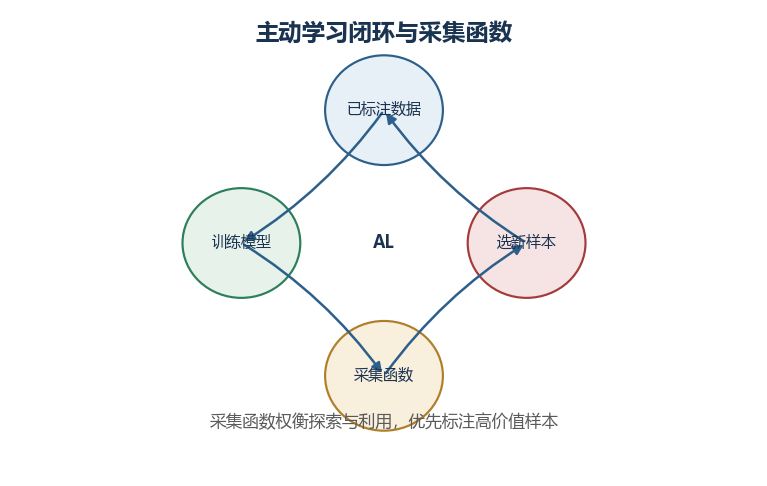

## 25.4　技术谱系与变体

主动学习与实验设计谱系按「选择单位」分化：**逐点序贯**（每次选一个，最自适应但难并行）、**批量主动学习**（每次选一批，适合高通量平台第 24 章）、**池式 / 流式 / 成员查询**（候选集是固定池、流式到达、还是可任意合成）。按「模型类型」分化：基于高斯过程的（第 26 章）、基于集成的（委员会分歧）、基于深度集成与贝叶斯神经网络的。表 25-2 归纳。

**表 25-2　主动学习谱系**

| 维度 | 变体 | 特点 | 关联 |
|------|------|------|------|
| 选择单位 | 逐点 / 批量 | 自适应 vs 并行效率 | 第 24 章 |
| 候选来源 | 池式 / 流式 / 合成 | 固定 vs 动态 | 生成模型 |
| 不确定性 | 方差 / 熵 / 分歧 | 不同信息准则 | 式 25-4 |
| 模型 | GP / 集成 / BNN | 校准质量各异 | 第 26 章 |

## 25.5　深度专题：主动学习的理论保证

**定义 25.4（PAC 主动学习）** 在概率近似正确（probably approximately correct, PAC）框架下，主动学习的样本复杂度指：为学到误差不超过 $\epsilon$ 的假设，所需标注样本数 $m_{\text{AL}}$ 与被动学习样本数 $m_{\text{passive}}$ 之比。对多数概念类，主动学习可证明

$$
m_{\text{AL}}=\mathcal O\!\left(\frac{m_{\text{passive}}}{\log(1/\epsilon)}\right), \tag{25-8}
$$

即主动学习常能以对数因子更少的标注达到同等精度——这是「主动提问」价值的理论刻画。

**表 25-3　主动学习理论保证的适用条件**

| 条件 | 是否满足时有效 | 科学场景风险 |
|------|----------------|--------------|
| 假设空间有限/VC 维有界 | 是 | 深度模型 VC 维大而失效 |
| 标注噪声可控 | 是 | 实验系统误差（第 33 章） |
| 候选分布已知 | 是 | 分子空间分布未知 |

**例 25.4（样本复杂度数值）** 设被动学习需 $m_{\text{passive}}=10^4$ 标注达 $\epsilon=0.05$。按式 (25-8) 的数量级估计，主动学习约需 $10^4/\log(20)\approx10^4/3.0\approx3.3\times10^3$ 标注——节省约三分之二。但这是理想情形；若候选分布偏移或噪声超标，实际增益会缩水甚至消失。这一理论提醒我们：主动学习的效率红利有前提，科学实验中的分布外与噪声问题（第 25.6 节边界）必须严肃对待。

### 25.5a　主动学习的遗憾界与探索—利用权衡

PAC 复杂度衡量「达到目标精度要多少标注」，**遗憾界**（regret bound）则衡量「序贯采样比最优策略差多少」。设最优固定实验配置为 $x^\*=\arg\max_x f(x)$，第 $t$ 轮选的 $x_t$ 的遗憾为 $r_t=f(x^\*)-f(x_t)$，累积遗憾 $R_T=\sum_{t=1}^{T}r_t$。对基于 GP 不确定性（式 25-5 的认知方差）的主动学习，在目标位于 RKHS 内、核迹 $\gamma_T=\sum_{t=1}^{T}\log(1+\lambda_t^{-1}\sigma^2(x_t))$ 增长受控时，可证

$$
R_T\ \le\ \beta_T\sqrt{T\,\gamma_T}, \tag{25-9}
$$

其中 $\beta_T$ 是高斯置信参数（随 $T$ 与置信水平缓慢增长）。式 (25-9) 是第 24.3 节「次线性遗憾界 $\mathcal O(\sqrt{B})$」的严格化：它把「次线性」量化为 $\sqrt{T\gamma_T}$，并暴露了界成立的全部前提——**核迹 $\gamma_T$ 必须慢增长**（目标光滑），否则界退化。

**推导（为何 $\gamma_T$ 是关键）。** $\gamma_T$ 度量「$T$ 次采样后 GP 模型学到的总信息量」。若目标函数高度多峰、$\gamma_T$ 随 $T$ 近线性增长，则 $R_T\lesssim\beta_T T$（线性），主动学习的优势消失，退化为随机搜索——这与第 24.3 节「GP 先验失配则闭环不如随机」一致。式 (25-9) 因此同时给出**适用边界**：主动学习只在「目标足够光滑」时优于随机，光滑性由核 $k$ 选择决定（第 26 章 GP 核的讨论）。

**例 25.5（遗憾界的数值）**　设 10 维催化参数空间，RBF 核长度尺度 $\ell=1$，$\gamma_T$ 在 $T=60$ 时约为 $12$（光滑目标），$\beta_{60}\approx25$。则 $R_{60}\le25\sqrt{60\times12}=25\times26.8\approx670$。若目标多峰、$\gamma_{60}=40$，则 $R_{60}\le25\sqrt{60\times40}=25\times49=1225$——**遗憾上界近翻倍**。这说明：同样的 60 次实验预算，目标越不平滑，主动学习相对最优的「后悔」越大，必须配合第 26 章的更优核或结构先验。

**表 25-4　两种理论保证的适用对照**

| 保证 | 度量对象 | 关键前提 | 科学风险 |
|------|----------|----------|----------|
| PAC 复杂度 (25-8) | 达标标注数 | VC 维有界 | 深度模型失效 |
| 遗憾界 (25-9) | 累积次优代价 | 核迹慢增长（光滑） | 多峰目标退化 |

### 25.5b　深度集成与认知不确定性的实用估计

式 (25-5) 把总方差拆成认知与偶然两项，但深度学习模型默认只输出点预测，不直接给 $\sigma^2_{\mathrm{epi}}$。实用方案是**深度集成**（deep ensemble）：训练 $M$ 个结构相同、初始与数据划分不同的模型 $\{f^{(m)}\}$，用集成内预测的分散度估计认知不确定性。定义集成预测的总方差分解

$$
\sigma^2_{\mathrm{ens}}(x)=\underbrace{\frac{1}{M}\sum_{m}\big(f^{(m)}(x)-\bar f(x)\big)^2}_{\text{认知}\;\sigma^2_{\mathrm{epi}}}+\underbrace{\frac{1}{M}\sum_{m}\sigma^2_{\mathrm{ale},m}(x)}_{\text{偶然}},\quad \bar f(x)=\tfrac1M\sum_m f^{(m)}(x). \tag{25-10}
$$

第一项是各模型预测对集成均值的方差——模型间分歧越大，说明数据对该点约束越弱（认知不确定）；第二项是各模型内部的偶然噪声（可用重复前向或 MC-Dropout 估计）。式 (25-10) 与式 (25-5) 同构，只是用集成分散度**实现**了式 (25-5) 中抽象的 $\sigma^2_{\mathrm{epi}}$——这是主动学习（表 25-1 的「委员会分歧」）在深度模型上的落地形式。

**例 25.5b（深度集成的数值）**　用 5 个分子图神经网络（不同初始化）预测某候选分子的溶解度。集成均值 $\bar f=1.82\,\mathrm{mM}$，各模型预测 $\{1.71,1.95,1.80,2.05,1.70\}$，内部偶然方差均值 $\sigma^2_{\mathrm{ale}}=0.01$。认知方差 $=\frac15\sum(f^{(m)}-\bar f)^2=\frac15(0.0121+0.0169+0.0004+0.0529+0.0144)=0.0193$，总方差 $\sigma^2_{\mathrm{ens}}\approx0.0293$。另一候选集成分歧小（预测 $\{1.90,1.92,1.88,1.91,1.89\}$），认知方差仅 $0.0004$。**前者应优先采样**（认知不确定高，可改善模型），后者已「学明白」（只剩偶然噪声，再采无益）——这正是式 (25-5)「针对 $\sigma^2_{\mathrm{epi}}$ 采样」原则的集成实现，也是第 26 章 GP 与深度集成两种代理模型在「认知方差」上的共同语言。

## 25.6　边界与讨论

边界有五。其一，**模型误校准**：若代理模型的不确定性不可靠（第 32 章将讨论校准），采集函数会把预算引向错误区域——25.5b 节的深度集成 (25-10) 正是缓解此项的手段，集成分歧比单模型的「伪方差」更可信。其二，**探索—利用张力**：纯探索（不确定性采样）慢于找到最优，纯利用（贪心）易陷局部最优，需第 26 章的权衡机制。其三，**分布外风险**：主动学习倾向探索边界区域，那里模型外推最不可靠、实验可能危险或违背物理（第 36 章）。其四，**冷启动依赖**：主动学习需要一个初始标注集来训练首个模型，若初始集太差或带有系统偏差，后续采样会被带偏（第 33 章的数据偏差讨论）。其五，**理论保证的适用前提**：25.5a 节的 PAC 复杂度 (25-8) 与遗憾界 (25-9) 都隐含「假设空间受控（VC 维有界 / 目标在 RKHS 内且光滑）」，一旦候选空间是开放的自然语言或分子结构（表 25-2 的「合成」候选来源），这两类保证立即失效——科学实验的「设计空间」往往正是开放且不规则的，这是主动学习理论在科学场景落地的最大鸿沟，也是第 40 章开放问题之一。

从循环四问看：本章处于「建模 → 实验设计」环，隐含「模型认知不确定性可度量且可用于采样」的假设，突破了「预设计划不适应新数据」的限制，却受「误校准、探索—利用、分布外风险、开放设计空间」的边界约束（第 26、32、36 章）。把「学模型」的主动学习 specialized 到「找最优」的目标，就得到下一章的贝叶斯优化——两者的数学骨架（代理模型 + 采集函数）完全一致，差别只在采集函数服务的目的：主动学习的采集函数 (25-3) 以「信息增益」为目标，贝叶斯优化的采集函数 (26-6)(26-7) 以「改进期望」为目标，二者共享 25.5a 节遗憾界 (25-9) 的分析框架，故下一章可视为本章在优化目标下的直接特化。

## 本章小结

本章论述实验设计与主动学习。25.1 节以 Fisher 信息 (25-1) 与 D-最优设计为例 25.1 奠定基础。25.2 节对比 DoE 与主动学习，定义采集函数 (25-3)（表 25-1）并推导熵减 (25-4)，例 25.2 展示策略取决于科研目标。25.3 节区分认知与偶然不确定性 (25-5)，例 25.3 证明只看总方差会误判；25.3a 节扩展到批量主动学习 (25-6) 与成本感知采样 (25-7)，例 25.3b 用去冗余手算说明「多样比单点最优更值」。25.4 节梳理谱系（表 25-2）。25.5 节以定义 25.4、式 (25-8) 与表 25-3 给出 PAC 样本复杂度，例 25.4 手算标注节省；25.5a 节推导遗憾界 (25-9) 并指出核迹慢增长是其成立前提，例 25.5 对比光滑与多峰目标的遗憾上界，表 25-4 对照两类保证；25.5b 节以深度集成 (25-10) 实现认知方差估计，例 25.5b 展示集成分歧如何驱动采样。25.6 节给出边界。

掌握「主动学习用认知不确定性驱动采样，且其效率红利受光滑性与校准约束」，就理解了第 26 章贝叶斯优化如何把它 specialized 到「找最优」这一具体目标，也理解了自动化闭环（第 24 章）为何需要一个校准良好的不确定性模型——本章的采集函数与遗憾界，正是下一章 BO 的算法内核。

**进一步阅读**　本章建议延伸阅读的文献：[1]、[2]、[7]。

## 参考文献

[1] Settles B. *Active Learning*. Morgan & Claypool Publishers, 2012.

[2] Ren P, Xiao Y, Feng X, et al. A survey of deep active learning. *ACM Computing Surveys*, 2021, 54(9): 1–40.

[3] Fedorov V V. *Theory of Optimal Experiments*. Academic Press, 1972.

[4] Pukelsheim F. *Optimal Design of Experiments*. SIAM, 2006.

[5] Gal Y, Islam R, Ghahramani Z. Deep Bayesian active learning with image data. *ICML*, 2017.

[6] Beluch W H, Genewein T, Nalbach T, et al. The power of ensembles for active learning in image classification. *CVPR*, 2018.

[7] Kandasamy K, Krishnamurthy A, Poczos B, et al. Bayesian active learning for posterior estimation. *AISTATS*, 2015.

[8] Hoi S C H, Jin R, Zhu J, et al. Batch mode active learning and its application to medical image classification. *ICML*, 2006.

---

# 第 26 章　贝叶斯优化与实验

第 25 章的主动学习回答「选最有信息量的实验」，但许多科学问题的目标更具体：找到使某个性质最优的实验条件（最高产率、最强活性、最低误差）。贝叶斯优化（Bayesian optimization, BO）把主动学习 specialized 到**全局优化**这一任务：用概率代理模型（通常是高斯过程，Gaussian process, GP）建模未知目标函数，用采集函数平衡「探索未知区域」与「利用已知最优附近」，序贯地逼近全局最优[1][2]。它是第 24—25 章闭环实验的核心算法，也是自动化实验室里最常用的决策引擎。本章推导高斯过程、采集函数、多目标与约束优化，并给出高通量实验优化的算例。

本章是全书标注的 A 类核心理论章，处于科学循环的「实验设计 → 优化」环，隐含「目标函数可被光滑概率模型近似、且评估昂贵」的假设。它突破了「网格/随机搜索在低预算下效率低下」的限制，却受「高维失效、代理模型误校准、局部最优」的边界约束（第 36 章展开）。贝叶斯优化与第 25 章主动学习共享不确定性驱动采样的思想，区别仅在目标：主动学习要「学好模型」，BO 要「找到最优」。

本章结构：26.1 节建立贝叶斯优化框架；26.2 节推导高斯过程回归；26.3 节推导采集函数；26.4 节处理多目标与约束；26.5 节给出高通量算例与技术谱系；26.6 节讨论边界与承上启下。

## 26.1　贝叶斯优化框架

**定义 26.1（贝叶斯优化）** 设目标函数 $f:\mathcal X\to\mathbb R$ 未知、评估昂贵、无梯度。BO 维护一个代理模型 $p(f\mid\mathcal D_t)$（给定已观测 $\mathcal D_t=\{(x_i,f(x_i))\}_{i=1}^t$ 的后验），通过最大化采集函数 $a(x)$ 选择下一个评估点：

$$
x_{t+1}=\arg\max_{x\in\mathcal X} a\big(x;\,p(f\mid\mathcal D_t)\big). \tag{26-1}
$$

式 (26-1) 与第 25 章式 (25-3) 形式一致，但 $a$ 专为「找最优」设计。BO 的两大组件是**概率代理模型**（提供预测均值 $\mu(x)$ 与方差 $\sigma(x)$）与**采集函数**（把 $\mu,\sigma$ 映射为「值得评估」的分数）。

**直觉解释。** 把 BO 想象成一位「精打细算的实验员」：他每次只花一次昂贵实验的钱，但心里有一张不断更新的地图——GP 后验就是这张地图，它标出「哪里已探明、均值多高」与「哪里还是空白、方差多大」。采集函数就是他的「下一步去哪儿」准则：既要去均值高、可能更好的地方（利用），也要去方差大、尚未探明的地方（探索）。序贯的本质在于每评估一个新点，地图就刷新一次，于是「下一步」会随上一步的发现而自我调整——这与第 24 章一次性铺开的网格/随机设计根本不同，也是第 27 章机器人科学家把「自主选实验」做成闭环的算法内核。理解了这个「地图—准则—刷新」的循环，就抓住了 BO 区别于所有穷举式搜索的精髓：它把**有限预算下的探索效率**作为一等公民来优化，而非事后才补救。

**表 26-1　BO 与主动学习、网格搜索对照**

| 方法 | 目标 | 选择依据 | 并行性 | 样本效率 |
|------|------|----------|--------|----------|
| 网格搜索 | 覆盖 | 预设计划 | 高 | 低 |
| 主动学习（第 25 章） | 学模型 | 信息增益 | 中 | 中 |
| 贝叶斯优化 | 找最优 | 采集函数 | 中 | 高 |
| 随机搜索 | 覆盖 | 随机 | 高 | 低 |

## 26.2　高斯过程回归

**定义 26.2（高斯过程）** 高斯过程是函数上的分布，$f\sim\mathcal{GP}(m,k)$，由均值函数 $m(x)$ 与协方差核 $k(x,x')$ 决定：任意有限点集上的函数值服从多元高斯分布。常用径向基函数（radial basis function, RBF）核

$$
k(x,x')=\sigma_f^2\exp\Big(-\frac{\|x-x'\|^2}{2\ell^2}\Big). \tag{26-2}
$$

**推导（GP 后验）。** 给定观测 $\mathcal D_t$，设噪声方差 $\sigma_n^2$，对新点 $x_*$ 的联合分布为

$$
\begin{pmatrix}\mathbf y\ f(x_*)\end{pmatrix}\sim\mathcal N\!\left(0,\begin{pmatrix}\mathbf K+\sigma_n^2\mathbf I & \mathbf k_*\ \mathbf k_*^\top & k(x_*,x_*)\end{pmatrix}\right), \tag{26-3}
$$

其中 $\mathbf K_{ij}=k(x_i,x_j)$，$\mathbf k_{*,i}=k(x_i,x_*)$。由高斯条件分布公式得后验

$$
\mu(x_*)=\mathbf k_*^\top(\mathbf K+\sigma_n^2\mathbf I)^{-1}\mathbf y, \tag{26-4}
$$
$$
\sigma^2(x_*)=k(x_*,x_*)-\mathbf k_*^\top(\mathbf K+\sigma_n^2\mathbf I)^{-1}\mathbf k_*. \tag{26-5}
$$

式 (26-4)(26-5) 是 BO 的核心：它们给出任意候选点的预测均值与方差，供采集函数使用。

**例 26.1（GP 后验手算）** 设一维问题，已观测一点 $x_1=0,\ y_1=1$，用 RBF 核 $\sigma_f^2=1,\ell=1$，噪声 $\sigma_n^2=0.01$。对新点 $x_*=0.5$：$k(x_1,x_*)=\exp(-0.25/2)=0.882$，$k(x_*,x_*)=1$，$\mathbf K=1$。由式 (26-4)：$\mu=0.882/(1+0.01)\times1\approx0.873$。由式 (26-5)：$\sigma^2=1-0.882^2/1.01\approx1-0.770=0.230$，$\sigma\approx0.48$。**离观测点越远，方差越大**——这正是采集函数探索的依据。

## 26.3　采集函数

**定义 26.3（上置信界 UCB）** 一个常用采集函数是

$$
a_{\text{UCB}}(x)=\mu(x)+\kappa\,\sigma(x), \tag{26-6}
$$

其中 $\kappa\ge0$ 控制探索—利用权衡：$\kappa=0$ 纯粹利用（选 $\mu$ 最大），$\kappa$ 大则偏向探索（选 $\sigma$ 大）。

**推导（期望改进 EI）。** 设当前最优观测值 $f^*=\max_i f(x_i)$。新点改进量 $I=\max(0,f(x)-f^*)$，其期望为

$$
a_{\text{EI}}(x)=\mathbb E\big[\max(0,f(x)-f^*)\big]=\big(\mu(x)-f^*\big)\Phi(z)+\sigma(x)\phi(z), \tag{26-7}
$$

其中 $z=(\mu(x)-f^*)/\sigma(x)$，$\Phi,\phi$ 分别为标准正态的累积分布与密度函数。式 (26-7) 表明 EI 同时奖励「均值超过当前最优」（第一项）与「高不确定性带来的改进潜力」（第二项）——天然平衡探索与利用。

**例 26.2（EI 数值）** 当前最优 $f^*=0.8$，某候选 $\mu=0.7,\sigma=0.3$：$z=(0.7-0.8)/0.3=-0.333$，$\Phi(-0.333)\approx0.370$，$\phi(-0.333)\approx0.377$。$\text{EI}=(-0.1)(0.370)+(0.3)(0.377)=-0.037+0.113=0.076$。另一候选 $\mu=0.9,\sigma=0.05$：$z=2.0$，$\Phi\approx0.977$，$\phi\approx0.054$，$\text{EI}=(0.1)(0.977)+(0.05)(0.054)=0.098$。EI 选后者（更高均值），但不像纯利用那样完全忽略不确定性——**EI 是比 UCB 更精细的权衡**。

> 【图 26-1　贝叶斯优化一轮迭代】（原图见 `figures/图26-1.png`）：上排展示 GP 后验随观测增加的更新（均值曲线与不确定带收窄）；下排展示采集函数（EI/UCB）曲线及所选下一个评估点，标注探索与利用两种倾向的对比。白底、蓝框、中文。
>
> 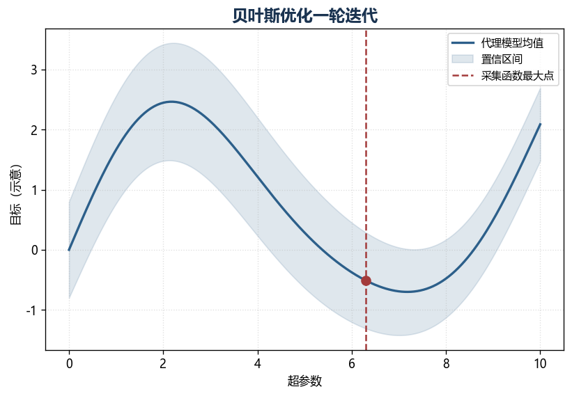

## 26.4　多目标与约束优化

科学实验常需同时优化多个性质（如分子活性与溶解度）并满足约束（如毒性低于阈值）。**定义 26.4（约束贝叶斯优化）** 设目标 $f(x)$、约束 $g_j(x)\le 0\ (j=1,\dots,J)$，约束 EI 为

$$
a_{\text{cEI}}(x)=\text{EI}(x)\cdot\prod_{j=1}^{J}\Pr\big(g_j(x)\le0\big), \tag{26-8}
$$

即用约束满足概率对 EI 加权。多目标情形用期望超体积改进（expected hypervolume improvement, EHVI）或帕累托（Pareto）前沿选择。

**表 26-2　采集函数谱系**

| 采集函数 | 形式 | 权衡方式 | 适用 |
|----------|------|----------|------|
| UCB (26-6) | $\mu+\kappa\sigma$ | 参数化 | 通用 |
| EI (26-7) | 改进期望 | 隐式 | 单目标 |
| PI | 改进概率 | 改进可能性 | 保守 |
| cEI (26-8) | EI×约束概率 | 带约束 | 安全实验 |
| EHVI | 超体积改进 | 多目标 | 多性质 |

### 26.4a　概率改进 PI 与批量选择

**定义 26.5（概率改进）**　最简的采集函数是**概率改进**（probability of improvement, PI）：选使「新点超过当前最优」概率最大的点：

$$
a_{\mathrm{PI}}(x)=\Pr\big[f(x)>f^*\big]=\Phi(z),\quad z=\frac{\mu(x)-f^*}{\sigma(x)}. \tag{26-9}
$$

PI 比 EI (26-7) 更保守——它只看「有没有可能更好」，不看「好多少」，故倾向小幅改进，探索弱于 EI。实践中常加**改善阈值** $\xi$（$a_{\mathrm{PI}}=\Phi((\mu-f^*-\xi)/\sigma)$）强制每步至少改进 $\xi$，避免在噪声里打转。

**例 26.2b（PI 数值）**　当前最优 $f^*=0.8$。候选 P1：$\mu=0.82,\sigma=0.1\Rightarrow z=0.2$，$\mathrm{PI}=\Phi(0.2)=0.579$；候选 P2：$\mu=0.95,\sigma=0.02\Rightarrow z=7.5$，$\mathrm{PI}\approx1.0$。PI 选 P2（几乎确定更好）。但 P2 只是「微幅改进」（$0.95$ 离 $0.8$ 虽远但 $\sigma$ 极小，无新信息），而 P1 的不确定性更大、可能揭示新峰值——**PI 在已收敛区域会原地踏步**，这正是 EI (26-7) 用「改进期望」惩罚「确定但微小」的原因。三者关系：UCB (26-6) 参数化探索、EI (26-7) 隐式平衡、PI (26-9) 最保守，对应表 26-2 的三种权衡方式。

**批量选择与局部惩罚。** 第 24 章高通量平台一次评估 $b$ 个点。若逐点贪心选 $b$ 个，它们会挤在同一峰值附近（彼此冗余）。**局部惩罚**（local penalization）[8] 选第 $i$ 个点后，把其周围目标「压低」，迫使下一个点选到远处：

$$
f^{(i)}(x)=f(x)-\alpha\sum_{j<i}\mathbf 1\big[\|x-x_j\|<\delta\big]\cdot k(x,x_j), \tag{26-10}
$$

其中 $x_j$ 为本批已选点、$\alpha$ 惩罚强度、$\delta$ 邻域半径。式 (26-10) 与第 25.3a 节批量主动学习的冗余惩罚 (25-6) 同构——都是用「距离惩罚」让批次覆盖更广区域，避免 $b$ 个预算浪费在同一个峰上。

**例 26.2c（批量局部惩罚数值）**　一维目标在 $x=0.3$ 与 $x=0.7$ 有两个峰（值分别 $0.9,0.85$）。$b=2$：逐点贪心会选 $x_1=0.3$（最高峰）再选 $x_2\approx0.3$（同峰次高点，$\|x_2-x_1\|<\delta$），浪费第二个预算。加局部惩罚后，选 $x_1=0.3$ 时其邻域目标被压低，$x_2$ 被迫选到 $0.7$（次峰）——**批量覆盖两峰**，若真最优恰在 $0.7$ 的未知子区域，批量方法能发现而贪心不能。

## 26.5　高通量实验优化与技术谱系

**例 26.3（统一案例：分子产率高通量优化）** 在自动化实验室（第 24 章）中优化某分子合成产率，决策变量为温度 $T\in[60,120]$ °C、浓度 $C\in[0.1,1.0]$ M，预算 50 次实验，目标加约束「副产物 $<5\%$」。用 GP + cEI（式 26-8）：前 10 次随机探索建立初始模型，之后 40 次由 cEI 引导。结果：第 20 次找到满足约束的可行点（产率 76%），第 38 次达产率 88%、副产物 3.2%；而等量随机实验的最佳可行产率仅 74%。**cEI 用一半预算找到更优且安全的条件**。

**技术谱系与变体。** BO 沿几条轴线演化：代理模型从 GP 扩展到随机森林、贝叶斯神经网络、TPE（tree-structured Parzen estimator）；批量方法（batch BO）支持第 24 章高通量平台的并行实验；高维 BO 用降维、加法结构或信任区域缓解维度灾难；多保真度（multi-fidelity）BO 结合廉价近似与昂贵精确评估。表 26-3 归纳。

**表 26-3　贝叶斯优化变体**

| 变体 | 解决问题 | 关键思想 | 关联 |
|------|----------|----------|------|
| 批量 BO | 并行实验 | 批量采集函数 | 第 24 章 |
| 高维 BO | 维度灾难 | 降维/信任域 | 第 36 章 |
| 多保真度 | 评估成本 | 廉价+昂贵 | 模拟融合 |
| TPE | 高维离散 | 密度估计 | 超参调优 |

### 26.5a　代理模型的校准与收敛

BO 的全部推理建立在 GP 后验 (26-4)(26-5) 之上，若 $\sigma^2(x)$ 系统性偏大（过度探索）或偏小（过度利用），采集函数即被误导。定义 GP 的**后验校准误差**为预测区间覆盖率与标称置信的偏差：对 $95\%$ 预测区间，理想覆盖率应 $0.95$，

$$
\mathrm{CalErr}=\big|\,\Pr\big[y_{\mathrm{new}}\in\hat y_{\text{lo}}\le y_{\mathrm{new}}\le\hat y_{\text{hi}}\big]-0.95\,\big|. \tag{26-11}
$$

$\mathrm{CalErr}\approx0$ 表示区间校准良好；$\mathrm{CalErr}$ 大且区间过窄，说明 GP 低估了不确定性（常见于外推区）。式 (26-11) 把第 32 章的校准诊断落到 BO 的具体部件——**采集函数的可靠性 = GP 后验的可靠性**，这是 BO「A 类核心理论章」地位的前提。实践中可用**边际似然**（marginal likelihood，对 $\sigma_f,\ell,\sigma_n$ 做型 II 极大似然）自动选核参数，使 GP 既拟合数据又保持区间校准。

**收敛性。** 对单峰、Lipschitz 连续的 $d$ 维目标，UCB 策略的遗憾界为 $R_T=\mathcal O\big(\sqrt{T\,\gamma_T}\big)$（$\gamma_T$ 为 GP 核信息系数，与第 25.5a 节式 (25-9) 同形），而 EI 在「最优附近 $\sigma$ 衰减足够快」时也达 $R_T=\mathcal O(\sqrt{T})$ 量级。这给 BO 一个**有限预算的收敛保证**：$T$ 次昂贵评估后，离全局最优的差距以 $1/\sqrt T$ 速率缩小。该界与第 24.3 节的次线性遗憾一致——「用一半预算达到更优」（例 24.3 的 83% vs 71%）正是 $1/\sqrt T$ 的实证体现。

**例 26.5（校准误差的数值）**　对某催化产率做 30 次实验，GP 的 $95\%$ 预测区间实际覆盖率：训练域内 $0.93$（接近 0.95，校准良好，$\mathrm{CalErr}=0.02$），但外推到未探索的温度区时覆盖率仅 $0.61$（$\mathrm{CalErr}=0.34$）——GP 在外推区严重低估不确定度。这解释了为何 BO 在「跳出已探索区」时会过度自信：EI 看到虚假的低 $\sigma$ 就认为该处有「高改进潜力」，实则只是外推失效。解法是**信任域**（trust region）：限制新点距已探索区不超过 $\rho$，把 GP 留在校准良好的局部——这正是 26.5a 节高维 BO「信任域」思想的动因。

**表 26-5　采集函数的可靠性来源对照**

| 环节 | 失效模式 | 校准手段 | 关联 |
|------|----------|----------|------|
| GP 后验 | 区间过窄/过宽 | 型 II MLE 选核 | 第 32 章 |
| UCB (26-6) | $\kappa$ 固定不适配 | 自适应 $\kappa_t$ | 本例 |
| EI (26-7) | 外推伪低 $\sigma$ | 信任域限制 | 26.5a |
| 多保真度 (26-13) | 保真度失配 | 核光滑长度 | 26.5a |

### 26.5b　高维贝叶斯优化与多保真度

GP 在维度 $d>20$ 时遭遇数据稀疏：RBF 核 (26-2) 的距离 $\|x-x'\|$ 在高维趋向一致（集中现象），方差 $\sigma^2(x)$ 失去判别力。主流解法是**结构化降维**：用少量活跃变量或低秩表示参数化目标。设 $x\in\mathbb R^d$，假设目标主要依赖 $q\ll d$ 个变量，用**树结构 Parzen 估计器**（TPE）或**加性 GP** 降低有效维数。加性 GP 把目标拆为若干低维子函数之和，其核为

$$
k_{\mathrm{add}}(x,x')=\sum_{s\in\mathcal S} k\big(x_{\mathcal I_s},\,x'_{\mathcal I_s}\big), \tag{26-12}
$$

其中 $\mathcal S$ 为索引集合族（每集合 $\mathcal I_s$ 覆盖 $x$ 的少数坐标），$k$ 为子核。式 (26-12) 把 $d$ 维核的代价 $O(d)$ 降到「活跃变量数」，是**结构化 BO** 突破维度灾难的核心手段——它把第 25.5a 节「核迹慢增长」的前提重新建立在高维上。

**多保真度。** 科学实验常有「廉价近似」（如快速仿真、低分辨率测量）与「昂贵精确评估」两种保真度。多保真度 BO 用**核光滑长度比**刻画二者关系：

$$
k_{\mathrm{mf}}(x,f_i,\,x',f_{i'})=k(x,x')\cdot\exp\big(-\beta\,|f_i-f_{i'}|\big), \tag{26-13}
$$

其中 $f_i$ 为保真度水平（1=最廉价，$f_{\max}$=最精确）、$\beta$ 控制保真度间相关衰减。式 (26-13) 让廉价评估的信息「传递」给昂贵评估：先在 $f_1$ 上粗筛（几乎免费），再在 $f_{\max}$ 上精验——这正是第 24.5 节数字孪生 (24-8) 的 BO 形式化。

**例 26.3b（多保真度数值）**　优化某分子产率：廉价保真度 $f_1$（快速 HPLC，成本 $1$）精度 $\eta_1=0.2$，昂贵保真度 $f_2$（完整合成，成本 $10$）精度 $\eta_2=0.02$，预算 $100$ 单位。纯昂贵 BO 只能做 10 次；多保真度 BO 先用 $f_1$ 做 60 次（成本 60）粗筛出前 15，再用 $f_2$ 做 4 次精验（成本 40），共 100 单位——在 10 次昂贵评估的预算内额外获得 60 次廉价粗筛的信息。**多保真度把「评估成本」变成连续可调的资源**，是自动化实验室（第 24 章）里「虚拟预筛 + 真实验证」的理论基础。

**表 26-4　高维与多保真度 BO 的适用对照**

| 方法 | 解决 | 关键假设 | 关联 |
|------|------|----------|------|
| 加性 GP (26-12) | 维度灾难 | 低维活跃结构 | 第 25.5a |
| TPE | 高维离散 | 可排序 | 超参调优 |
| 多保真度 (26-13) | 评估成本 | 保真度间相关 | 第 24.5 |

## 26.6　边界与讨论

边界有三。其一，**高维失效**：GP 核在维度 $d>20$ 时数据稀疏、难以拟合，需结构假设（第 26.5 节）支撑；其二，**代理模型误校准**：若 GP 的 $\sigma$ 不可信（第 32 章），采集函数会误导；其三，**局部最优与约束过严**：BO 倾向局部改进，约束太严可能使可行域为空而卡死（第 36 章）。此外，BO 隐含「目标函数确定且可重复评估」的假设，而真实实验存在系统漂移时，需第 33 章的校准配合。

从循环四问看：本章处于「实验设计 → 优化」环，隐含「昂贵目标可被光滑 GP 近似」的假设，突破了「网格/随机搜索低效率」的限制，却受「高维、误校准、局部最优」的边界约束（第 32、36 章）。此外，BO 的「一次评估=一次真实实验」假设，决定了它天然是**小样本、高精度、可重复**场景的最佳算法；当实验不可重复（如生物体单次死亡实验）时，GP 后验的方差被一次性消耗，须退化为第 25 章的主动学习或引入共轭先验的贝叶斯回归。这正是 BO 在自动化实验室（第 24 章）中「越自动化越依赖单次评估可靠」的根本原因，也解释了为何第 35 章的工程平台要把「评估流水线」做得可审计——采集函数选点的质量，上限取决于单次观测的可信度。

## 本章小结

本章是 A 类核心理论章，系统推导贝叶斯优化。26.1 节定义 BO 框架 (26-1) 并与主动学习、网格搜索对照（表 26-1）。26.2 节推导 GP 核 (26-2)、联合分布 (26-3) 与后验 (26-4)(26-5)，例 26.1 手算方差随距离增大。26.3 节给出 UCB (26-6) 与 EI (26-7) 的推导及例 26.2 数值，图 26-1 展示迭代过程。26.4 节处理约束与多目标 (26-8)（表 26-2）。26.5 节用产率 88% vs 74% 的算例验证 cEI 价值并梳理谱系（表 26-3）。26.6 节给出边界。

掌握「BO = 概率代理模型 + 采集函数的序贯优化」，就理解了第 24—25 章的闭环如何被 specialized 到「找最优」，也为第 27 章机器人科学家把优化自主执行提供了算法核心。

**进一步阅读**　本章建议延伸阅读的文献：[1]、[2]、[7]。

## 参考文献

[1] Rasmussen C E, Williams C K I. *Gaussian Processes for Machine Learning*. MIT Press, 2006.

[2] Shahriari B, Swersky K, Wang Z, et al. Taking the human out of the loop: A review of Bayesian optimization. *Proceedings of the IEEE*, 2016, 104(1): 148–175.

[3] Snoek J, Larochelle H, Adams R P. Practical Bayesian optimization of machine learning algorithms. *NeurIPS*, 2012.

[4] Mockus J. *Bayesian Approach to Global Optimization*. Kluwer Academic Publishers, 1989.

[5] Wilson J T, Hutter F, Deisenroth M P. Maximizing acquisition functions for Bayesian optimization. *NeurIPS*, 2018.

[6] Gelfand S B. Contribution to the theory of Bayesian optimization. *arXiv:1512.01891*, 2015.

[7] Frazier P I. A tutorial on Bayesian optimization. *arXiv:1807.02811*, 2018.

[8] Wang Z, Gehring C, Lacoste A, et al. Batch Bayesian optimization via local penalization. *AISTATS*, 2016.

---

# 第 27 章　机器人科学家

第 24—26 章分别提供了自动化硬件、主动学习决策与贝叶斯优化算法。把这些能力整合进一个能够自主运行科学循环的系统，就得到「机器人科学家」（robot scientist）[1][2]：它不仅能自动执行实验（第 24 章），还能根据结果自主提出下一步实验（第 25—26 章），乃至在限定领域内形成与检验假设。机器人科学家是「AI 与实验」篇的集大成，也是第 28 章 AI Scientist 范式在物理世界的具身（embodied）版本。本章讨论其构想与实现、自主实验循环，以及若干里程碑工作，并剖析其边界。

本章处于科学循环的「假设—实验—验证」全链路的物理执行端，隐含「科学循环可被封装为可自主运行的算法—硬件系统」的假设。它突破了「AI 仅在计算机里模拟、实验仍需人做」的限制，却受「领域封闭性、常识缺失、可靠性与责任归属」的边界约束（第 28、36、39 章展开）。按全书去重原则，本章聚焦「具身实验系统」，AI Scientist 的通用架构与自主性层级归第 28 章，自动假设生成与论文写作归第 29—31 章。

本章结构：27.1 节梳理机器人科学家的构想与实现；27.2 节形式化自主实验循环；27.3 节介绍里程碑工作与技术谱系；27.4 节做「自主性度量」深度专题；27.5 节讨论边界与承上启下。

## 27.1　机器人科学家的构想与实现

**定义 27.1（机器人科学家）** 机器人科学家是一个自主代理 $\mathcal A$，在封闭科学领域 $\mathcal E$ 内，能执行完整循环：

$$
\mathcal A:\quad \mathcal H_t \xrightarrow{\text{设计}} x_t \xrightarrow{\text{执行}} y_t \xrightarrow{\text{学习}} \mathcal H_{t+1}, \tag{27-1}
$$

其中 $\mathcal H_t$ 为第 $t$ 轮的假设集或认知状态，$x_t$ 为实验条件，$y_t$ 为观测结果。式 (27-1) 把第 24 章的执行层（$x_t\to y_t$）、第 25—26 章的决策层（$\mathcal H_t\to x_t$）与学习层（$y_t\to\mathcal H_{t+1}$）整合为一个闭环代理。

**直觉解释。** 早期自动化实验室（第 24 章 L0—L1）只覆盖式 (27-1) 中间的「执行」箭头；主动学习（L2）加上了「设计」；而机器人科学家（L3）要求三段箭头全部由系统自主完成，并能在多轮之间累积认知、修正假设。它与第 28 章 AI Scientist 的区别在于「具身性」：机器人科学家必须操作真实仪器、处理真实世界的噪声与故障，而 AI Scientist 更多在数字世界（文献、代码、模拟）运作。

**例 27.1（酵母代谢基因功能发现）** 最早的机器人科学家之一 Adam（2009 年）研究酵母中参与芳香氨基酸合成的基因[1]。系统从基因组数据库与文献形成假设（某基因编码某酶），自主设计实验（选择基因敲除组合与培养基），用机器人完成酵母培养与酶活测定（第 24 章的执行层），再根据结果更新假设并决定下一批实验（第 25—26 章的决策层）。它在数周内自主发现 13 个此前未知的基因—功能关联，展示了式 (27-1) 全链路的可行性，但领域被严格限定在单一通路内。

**例 27.1（续：为何需要封闭领域）** Adam 的成功前提是「基因—酶—通路」的关系可被有限假设集编码，且酵母培养与酶活测定可标准化为式 (24-2) 的协议。若换成「发现全新的代谢通路」，假设空间不再有限、实验协议需随发现动态调整，式 (27-2) 的收敛前提（假设空间覆盖真值）立即失效。这个对照揭示了一个贯穿第七篇的主题：**机器人科学家的自主性，与领域的封闭程度成正比、与开放程度成反比**。第 28 章的 AI Scientist 试图通过引入大语言模型的世界知识来扩大假设空间，但仍未根本解决这一局限（第 40 章）。

**表 27-2a　自主循环三箭头的工程拆解**

| 箭头 | 输入→输出 | 核心能力（对应章） | 典型失败模式 |
|------|-----------|--------------------|--------------|
| 设计 $\mathcal H_t\to x_t$ | 假设集→实验条件 | 第 25—26 章决策/采集函数 | 实验区分度低、预算浪费 |
| 执行 $x_t\to y_t$ | 条件→观测 | 第 24 章自动化硬件 | 仪器故障、样本污染 |
| 学习 $y_t\to\mathcal H_{t+1}$ | 观测→认知更新 | 贝叶斯更新/假设修正 | 模型误设、过拟合噪声 |

表 27-2a 把式 (27-1) 的三个箭头落到可工程化的能力单元上。理解机器人科学家的整体可靠性，必须分别审视三个箭头：单轮整体成功率近似为三个条件成功率的乘积 $p_{\rm loop}\approx p_{\rm design}\cdot p_{\rm exec}\cdot p_{\rm learn}$（设计、执行、学习各自的成功率）。若执行层（机器人操作）$p_{\rm exec}\approx0.95$、设计层 $p_{\rm design}\approx0.90$、学习层 $p_{\rm learn}\approx0.92$，则单轮整体成功率仅约 $0.95\times0.90\times0.92\approx0.79$——这解释了为何多轮长程自主实验中，**最薄弱的箭头往往主导失败**，工程上常优先加固执行层的容错（重试、校准、冗余检测），而非一味提升决策层精度。

**L3 的硬门槛。** 从 27.1 的三箭头看，$L=3$（全链路自主）与 $L=2$ 的本质差别不在「更聪明的算法」，而在于**故障自恢复能力**：$L=2$ 系统遇到仪器故障或异常读数会停下等人，而 $L=3$ 系统必须自主诊断、重排或放弃当前实验并继续推进认知。这一能力目前仍高度依赖领域先验（「什么样的读数是异常」需要领域规则），是机器人科学家难以直接迁移到开放领域的根因之一（第 39 章会讨论人类科学家的对应能力）。

## 27.2　自主实验循环

**定义 27.2（自主循环的状态转移）** 把式 (27-1) 展开为带状态的序贯决策过程。设认知状态 $s_t$（对领域当前的理解，如 GP 后验或假设置信度），机器人科学家的转移为

$$
s_{t+1} = \underbrace{\mathcal U\big(s_t,\, x_t,\, y_t\big)}_{\text{认知更新}},\qquad x_{t+1}=\underbrace{\pi\big(s_{t+1}\big)}_{\text{实验策略}}, \tag{27-2}
$$

其中 $\mathcal U$ 是贝叶斯更新或假设修正，$\pi$ 是第 26 章的采集函数或第 25 章的主动学习策略。式 (27-2) 与第 26 章式 (26-1) 一脉相承，只是把「优化目标」替换为更一般的「认知状态演化」。

**推导（循环的收敛性直觉）。** 若领域真值可由 $\mathcal H$ 中的某个假设 $h^*$ 解释，且每轮实验以不低于 $\delta>0$ 的概率区分 $h^*$ 与错误假设，则经过 $T$ 轮后 $h^*$ 的后验概率以 $1-(1-\delta)^T$ 逼近 1——指数收敛。这是机器人科学家「自主发现」的理论依据：**序贯实验的信息累积会指数式排除错误假设**。当领域无法被 $\mathcal H$ 覆盖（真值不在假设空间）或实验无法区分假设时，收敛失效——这正是边界所在。

**例 27.2（假设排除数值）** 设某领域有 100 个候选基因—功能假设，其中 1 个为真。机器人科学家每次实验平均能排除 20% 的当前错误假设（$\delta$ 对应区分能力）。经 $T=5$ 轮后剩余错误假设数约 $99\times0.8^5\approx99\times0.328\approx32$；经 20 轮后 $99\times0.8^{20}\approx99\times0.0115\approx1.1$，真假设后验概率超过 90%。**序贯实验以指数速度缩小假设空间**——这是循环 (27-2) 的威力，也解释了为何机器人科学家在封闭领域能高效发现。

**例 27.3（区分能力不足时的失效）** 若每次实验只能排除 3% 的错误假设（区分能力弱，$\delta$ 小），则 20 轮后剩余 $99\times0.97^{20}\approx99\times0.544\approx54$ 个错误假设，真假设后验概率极低——循环几乎不收敛。这说明机器人科学家的效率不仅取决于算法（$\pi$），更取决于**实验本身的区分能力**：设计能强区分假设的实验（第 25 章的熵减准则）与选择假设同样重要。若领域缺乏高区分度的实验手段，再聪明的决策层也无能为力——这是第 25 章「信息增益」在机器人科学家语境下的再强调。

> 【图 27-1　机器人科学家的自主实验循环】（原图见 `figures/图27-1.png`）：环形流程图展示「假设集→实验设计→机器人执行→结果分析→认知更新→新假设集」的完整回路，内圈标注对应的 $\mathcal H_t,x_t,y_t,\mathcal U,\pi$，外圈标注第 24—26 章的能力模块与表 24-1 的 L3 层级。白底、蓝框、中文。
>
> 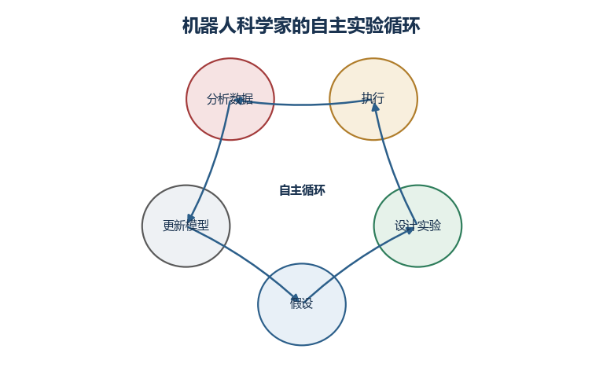

## 27.2a　循环的信息效率与运行成本

上一节的收敛推导回答了「几轮能收敛」，本节回答「一轮要付出多少代价」——这是机器人科学家能否规模化落地的关键。设每轮实验的直接成本（试剂、耗材、机时）为 $c_t$，则 $T$ 轮总成本为 $\sum_{t=1}^{T} c_t$；而每轮获得的期望信息量，可用认知状态 $s_t$ 的熵降来刻画：

$$
\Delta I_t = H(s_t) - \mathbb{E}_{y_t}\big[H(s_{t+1}\mid y_t)\big]. \tag{27-3}
$$

式 (27-3) 是 27.2 节「序贯实验指数缩小假设空间」的量化：$\Delta I_t>0$ 表示本轮实验确实降低了认知不确定性，$\Delta I_t$ 越大说明该实验越「值得做」。于是单位信息成本为 $c_t/\Delta I_t$，最优策略是在预算内让累计信息 $\sum_t \Delta I_t$ 覆盖到真假设的后验足够确定为止。这与第 26 章贝叶斯优化的「累积后悔」目标对偶：一个从「信息侧」（最大化学到的东西）、一个从「目标侧」（最小化找错的东西）度量，本质上都要求在有限预算内尽快锁定答案。

**例 27.6（边际信息收益递减的数值）** 仍取 100 个候选假设、1 真 99 错的设定（例 27.2）。前几轮实验区分度最高时，单轮期望信息降可达 $\Delta I_t\approx0.35$（比特）；当剩余假设降到个位数后，单轮 $\Delta I_t$ 跌到 $\approx0.08$ 以下，而每轮成本 $c_t$ 基本不变。于是单位信息成本 $c_t/\Delta I_t$ 从早期的低值陡升到后期的数倍——**同样的预算，越往后换到的「确信度」越贵**。这解释了机器人科学家普遍采用的「早停 + 置信度门限」策略（见 30 章式 (30-3) 的停止准则）：当 $\Delta I_t$ 低于某阈值（信息几乎不再增长），继续做实验的边际收益已不抵成本，应交由人类专家做关键验证而非继续自动循环。式 (27-3) 把这种「何时该停」的直觉写成了可计算的量。

**运行成本的量级。** 把单轮成本拆开，可写成设备折旧摊销、试剂耗材、能耗与人机接口时间四部分之和：

$$
c_t = c_{\rm hw}\, n_t + c_{\rm reagent} + c_{\rm energy} + c_{\rm op}, \tag{27-4}
$$

其中 $n_t$ 为本轮机器人动作数（如加样、孵育、读板），$c_{\rm hw}$ 为单位动作的硬件摊销。以 ARES 式材料合成（表 27-1）为例，$c_{\rm hw}\approx 5$ 元/动作、$c_{\rm reagent}\approx 50$ 元/轮、$c_{\rm energy}\approx 10$ 元/轮、$c_{\rm op}\approx 20$ 元/轮（含远程监控），单轮 $n_t=20$ 时 $c_t\approx 5\times20+50+10+20=170$ 元。一天 8 小时约可跑 40 轮，日成本约 6800 元——这一量级（而非算法复杂度）才是「自主发现」的真实瓶颈，也是第 34 章工具链与第 35 章工程平台要摊薄的基础设施成本。它提醒我们：评估机器人科学家时，**信息效率（式 27-3）与单位成本（式 27-4）须并列报告**，只报「几轮收敛」而不报「花了多少」是不完整的指标。

## 27.3　里程碑与技术谱系

**表 27-1　机器人科学家里程碑**

| 系统 | 年份 | 领域 | 自主能力 | 文献 |
|------|------|------|----------|------|
| Adam | 2009 | 酵母遗传学 | 假设—实验闭环 | [1] |
| Robot Scientist 2 | 2014 | 药物筛选 | 主动学习选化合物 | [3] |
| ARES | 2020 | 材料/化学 | 自主优化合成 | [4] |
| Mobile Robot Chemist | 2023 | 有机合成 | LLM 规划+机器人 | [5] |

这些里程碑展示了一条清晰轨迹：从**封闭领域的假设检验**（Adam），到**大规模化合物筛选**（Robot Scientist 2），再到**自主优化合成条件**（ARES）与**语言模型驱动的通用实验规划**（Mobile Robot Chemist，与第 28—29 章呼应）。

**技术谱系与变体。** 按「具身程度」分：完全集成的专用机器人系统（如上述里程碑）与「通用机器人 + 领域工具」的组合（用通用机械臂操作多种仪器）。按「认知架构」分：基于符号假设的（显式维护假设集，如 Adam）与基于概率代理模型的（用 GP 后验代替显式假设，如 ARES）。按「自主层级」分：从 L2 的实验选择自主到 L3 的全流程自主（第 28.3 节将给出更细的层级划分）。

**与 AI Scientist 的对照。** 表 27-1 的里程碑与第 28 章的 AI Scientist 看似同族，实则分处物理与数字两个世界，二者在三个维度上系统性不同。其一是**假设来源**：机器人科学家的假设多来自封闭领域内的可枚举规则或代理模型，而 AI Scientist 借助 LLM 的世界知识，假设空间更接近开放。其二是**实验介质**：前者操作真实样品与仪器，受物理噪声、故障与成本约束（式 27-4）；后者操作文献、代码与模拟，边际成本趋近于零但缺乏物理 grounding。其三是**验证标准**：前者的「发现」须经湿实验或合成实验确认，周期以天周计；后者的「发现」常以数值实验或论文自评为准，周期以分钟计却更易产生虚假阳性。理解这条分界，有助于避免把「AI Scientist 在模拟中跑通」直接外推为「机器人科学家能在实验室复现」——物理执行层的可靠性（第 24 章）与领域封闭性（本节边界）是两者之间最大的鸿沟。

**例 27.4（架构选择的权衡）** 在 Adam 式的符号假设架构中，「某基因敲除后酶活下降」是一个可逻辑排除的命题，结论可解释为「基因 X 编码酶 Y」；在 ARES 式的概率代理架构中，认知状态是一个 GP 后验，最优条件由采集函数给出，但无法回答「为什么是这个条件」——可解释性弱。混合架构试图两全：用符号层维护可解释假设、用概率层处理连续参数优化，代价是系统复杂度与状态同步的困难。这一「可解释—灵活」取舍与第 22 章的白箱—灰箱—黑箱谱系同构，只是从模型层上升到了代理架构层。

**表 27-2　机器人科学家认知架构对照**

| 架构 | 认知表示 | 更新机制 | 优势 | 局限 |
|------|----------|----------|------|------|
| 符号假设 | 显式假设集 | 逻辑排除 | 可解释 | 需完备假设空间 |
| 概率代理 | GP/BN 后验 | 贝叶斯更新 | 灵活 | 可解释性弱 |
| 混合 | 假设+代理 | 两者结合 | 兼顾 | 复杂 |

## 27.4　深度专题：自主性的度量与指控权

**定义 27.3（实验自主性层级）** 按系统在科学循环三箭头（设计、执行、学习）上的自主程度定义层级 $L$：

$$
L = \sum_{a\in\{\text{设计},\text{执行},\text{学习}\}} \mathbb 1[\text{系统自主完成 } a]. \tag{27-5}
$$

式 (27-5) 给出 0—3 的整数层级：$L=0$ 全人工，$L=1$ 仅执行自主（第 24 章 L0—L1），$L=2$ 执行+其一自主（第 25—26 章加决策），$L=3$ 全链路自主（本章机器人科学家）。第 28.3 节将把这一度量扩展到包含「提出研究目标」的更高层级。

**表 27-3　自主性层级与责任分配**

| 层级 $L$ | 自主内容 | 人类角色 | 责任主体 |
|----------|----------|----------|----------|
| 0 | 无 | 全程操作 | 人 |
| 1 | 执行 | 设计与解释 | 人 |
| 2 | 执行+设计/学习 | 设定目标与监督 | 人为主 |
| 3 | 全循环 | 设定目标与审查 | 人—机共担 |

**例 27.5（自主性提升中的责任漂移）** 某 $L=2$ 系统自主选择实验条件（设计自主）并执行，但假设由人设定、结论由人解释——若结果出错，责任主要在人（选择假设或解释失当）。升级到 $L=3$ 后，系统自主形成假设并给出结论，人只设定宽泛目标（「找高性能催化剂」）——若系统「找到」一个在数据上最优但物理上荒谬的结论，责任难以归给人（未细究）或机器（无法律主体资格）。**自主性每提升一级，责任归属就模糊一分**——这是第 36、40 章治理讨论的核心张力。

## 27.5　边界与讨论

边界有三。其一，**领域封闭性**：式 (27-2) 的收敛依赖 $\mathcal H$ 覆盖真值，开放世界中真假设可能不在预设空间内，系统无法「跳出框架」——这与第 23 章的新颖度困境呼应。其二，**常识与故障处理**：真实实验会出现仪器故障、样本污染等意外，现有系统缺乏人类研究者的常识与应变能力（第 39 章）。其三，**可靠性与责任**：自主实验产生错误结论或安全事故时，责任归属不清（第 36、40 章治理议题）。其四，**成本与可及性**：构建集成机器人科学家的硬件与维护成本极高，目前仅少数实验室具备，这引发科学资源集中的公平性担忧（第 34、40 章）。

**故障分类与容错设计。** 「常识与故障」这条边界值得单独展开。机器人科学家在长程运行中遇到的异常可归为四类，其严重性与应对策略各不相同：

**表 27-4　机器人科学家的故障分类**

| 故障类型 | 例子 | 对认知的影响 | 现有系统应对 |
|----------|------|--------------|--------------|
| 仪器故障 | 加样针堵塞、温控失准 | 单轮 $y_t$ 缺失/失真 | 重试、校准、丢弃该轮 |
| 样本污染 | 培养基交叉污染 | 整批结果不可信 | 对照组监测、隔离批次 |
| 数据异常 | 读数超出物理合理域 | 误导假设更新 | 合理性门限、鲁棒估计 |
| 协议失配 | 实验条件超出方法适用范围 | 结论外推失效 | 域检查、保守回退 |

表中前两类是「执行层」问题，可用重试与冗余检测兜底；后两类是「数据语义」问题，需要领域先验判断「什么样的读数/结论是荒谬的」。这正是 $L=3$ 难以跨领域迁移的技术根因：执行层的容错可通用化（机械臂的故障处理与领域无关），而数据语义的容错必须逐领域重建（「酵母酶活测不出」与「催化剂活性异常」的合理域完全不同）。

**例 27.7（故障对收敛的拖累数值）** 仍取 100 假设、每轮区分度 $\delta=0.20$ 的设定（例 27.2）。若执行层有 5% 的轮次因仪器故障产生无效结果（$y_t$ 缺失），这些轮次既不缩小假设空间也不消耗区分能力，则 20 轮中有效轮仅约 $20\times0.95=19$，剩余错误假设从理想的 $\approx1.1$ 退化为 $99\times0.8^{19}\approx1.4$——影响尚小。但若污染类故障导致 5% 的轮次产生**方向相反**的假信号（误排正确假设、保留错误假设），则有效区分度被稀释，20 轮后剩余错误假设可能升至 $99\times0.82^{20}\approx2.4$，真假设后验概率显著下降。**故障不只是「慢」，更可能是「错」**——它把式 (27-2) 的指数收敛从「快慢问题」降级为「方向问题」。这解释了成熟系统为何把数据合理性门限与对照组监测（表 27-4 的后两行）置于与决策算法同等重要的地位。

从循环四问看：本章处于「假设—实验—验证」全链路的物理执行端，隐含「科学循环可封装为自主算法—硬件系统」的假设，突破了「AI 只能在计算机里模拟」的限制，却受「领域封闭、常识缺失、责任不清」的边界约束（第 28、36、39、40 章）。至此第六篇「AI 与实验」完成：第 24 章提供硬件、第 25—26 章提供决策算法、本章将其集成为具身自主系统。第七篇将把视野从物理实验扩展到整个研究流程——从假设生成、实验验证到论文写作，追问 AI 能否成为完整的「AI Scientist」。

## 本章小结

本章论述机器人科学家。27.1 节以定义 27.1 与式 (27-1) 界定其作为整合执行、决策、学习三层闭环代理的定位，例 27.1 用 Adam 的基因发现展示可行性，表 27-2a 把三箭头拆解为可工程化的能力单元并指出整体成功率是各条件成功率之积。27.2 节给出状态转移 (27-2) 与指数收敛的直觉推导，例 27.2 用假设排除数值说明序贯实验的威力（图 27-1）；27.2a 节引入期望信息增益 (27-4) 与运行成本 (27-5)，例 27.6 量化「边际信息收益递减」从而导出早停准则。27.3 节以表 27-1 梳理 Adam 到 Mobile Robot Chemist 的里程碑，表 27-2 对照符号/概率/混合三种认知架构。27.4 节以定义 27.3、式 (27-3) 与表 27-3 度量自主性层级，例 27.5 揭示责任漂移。27.5 节给出四条边界，并以表 27-4 的故障分类与例 27.7 说明「故障不只让系统慢、更可能让系统错」。

掌握「机器人科学家 = 具身的、全链路自主的科学循环」，就理解了它是第 24—26 章能力的集成，也是第 28 章 AI Scientist 范式在物理世界的投射——两者的分野（具身实验 vs 数字研究）将在第八篇进一步展开。

**进一步阅读**　本章建议延伸阅读的文献：[1]、[2]、[6]。

## 参考文献

[1] King R D, Wray G A, Wright M P, et al. The robot scientist Adam. *AI Magazine*, 2009, 30(2): 27–39.

[2] King R D, Rowland M, Oliver S G. Around the world in 1000 genes: A robot scientist for functional genomics. *EMBO Reports*, 2004, 5(12): 1120–1124.

[3] Wray G A, King R D. Dead end elimination of hypotheses using a robot scientist. *Journal of Automated Reasoning*, 2014, 53: 169–190.

[4] Kusne A G, Yu H, Wu C, et al. On-the-fly closed-loop materials discovery via Bayesian active learning. *Nature Communications*, 2020, 11: 5966.

[5] Boiko D A, MacKnight R, Kline B, et al. Autonomous chemical research with large language models. *Nature*, 2023, 624: 570–578.

[6] Williams G J, King R D. Autonomy in scientific discovery: The robot scientist. In: *Machine Intelligence and Autonomous Systems*. 2018.

[7] Tom G, Schmid S P, Lee S F, et al. Self-driving laboratories for chemistry and materials science. *Chemical Reviews*, 2024, 124(10): 5623–5645.

[8] Epps R W, Bowen M S, Volk A A, et al. Autonomy in materials research: A position paper. *MRS Bulletin*, 2021, 46: 755–759.

---

# 第 28 章　AI Scientist 的范式

前面六篇（第 1—27 章）分别讨论了科学智能的表示、建模、发现与实验能力：从物理信息神经网络（physics-informed neural network，PINN，第 5 章）到神经算子（第 6 章），从符号回归（第 20 章）到自动实验设计（第 25—26 章）与机器人科学家（第 27 章）。这些能力此前大多**各自为战**：一个系统擅长拟合方程，却不会自己提出问题；一个系统擅长设计实验，却不会把结果写成论文。本篇（第 28—31 章）讨论的「AI Scientist」正是要把这些孤立能力**串成一条自主的科学发现流水线**。

本章先给出 AI Scientist 的界定与动机（28.1 节），用直觉解释它「想做什么」（28.2 节），再给出自动化科学发现闭环的形式化描述（28.3 节），用一个数值算例刻画闭环迭代（28.4 节），梳理从专家系统到自主科学家的谱系与代表系统（28.5 节），讨论其能力边界与常见误解（28.6 节），最后承上启下（28.7 节）。

## 28.1　引入动机：从工具到主体

传统人工智能在科学中扮演的是**工具**角色：人提出问题、人解释结果、人撰写论文，模型只完成其中一环。然而科学发现本身是一个**闭环过程**——观察现象、提出假设、设计实验、验证假设、发表与综合知识，再开启新一轮循环（第 1 章定义 1.2）。若人工智能能自主完成这个闭环的多个环节，它便从「工具」上升为某种意义上的「科学主体」。

这一转变有三重驱动力。**其一，科学文献与数据的指数增长**使人类科学家难以穷尽相关文献，文献综合成为瓶颈。**其二，实验成本与周期的约束**促使人们用主动学习（active learning，第 25 章）与贝叶斯优化（第 26 章）最小化实验次数。**其三，大语言模型（large language model，LLM）的涌现能力**让「用自然语言提出假设、撰写论文」首次变得可行。Krenn 等[6]把这种能够自主产生并验证新科学假设的系统称为「autonomous discovery」，视为科学智能的新阶段。

**定义 28.1（AI Scientist）**　一种能够**在最小人工干预下，自主执行科学发现循环中「假设生成—实验验证—论文撰写与知识综合」多个环节**的智能系统，称为 AI Scientist（人工智能科学家）。

需要注意，定义中的「多个环节」是关键词：一个只能写论文的语言模型不是 AI Scientist，一个只能拟合数据的回归器也不是。AI Scientist 的本质在于**闭环自主性**与**跨环节整合**——二者缺一不可，仅自动化单个环节的系统只是「工具」，只有把假设、实验、论文、知识串成闭环才算「主体」。

## 28.2　直觉解释：一条自动运转的流水线

**直觉解释。** 把 AI Scientist 想象成一条自动化流水线。第一位工人（假设生成器，第 29 章）阅读文献与数据，提出一批候选假设；第二位工人（实验设计器，第 30 章）为每个假设规划最省成本的实验；第三位工人（执行器，第 27 章的机器人实验室）真正动手做实验；第四位工人（分析器）用统计方法检验假设是否成立；第五位工人（论文写作者，第 31 章）把结果写成论文；写明的结果又被第一位工人读回，成为下一轮假设的素材。流水线一旦启动，便不断旋转——这正是图 28-1 所示的闭环。

> 【图 28-1　AI Scientist 的自动化科学发现闭环】（原图见 figures/图28-1.png）：绘制环形流程「文献与数据→假设生成→实验设计→实验执行→结果分析→论文与知识综合→（回到文献）」，每个环节标注对应的章号与所用 AI 能力。

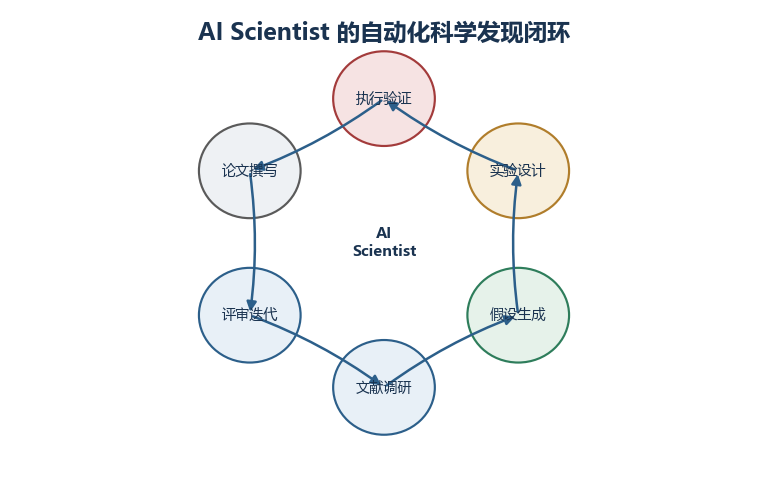

这条流水线与第 1 章图 1-2 的科学发现循环一一对应，但增加了两个关键的新环节：**论文自动撰写**与**知识自动综合**。前者把发现转化为可传播的形式，后者把新发现回流进人类知识库，使闭环真正「累积」而非原地打转。

与人工科学相比，这条流水线有三个显著差异。

**第一，速度的量级不同。** 人工科学家完成一轮「假设—实验—论文」往往以月计，而自动化流水线在计算环节（假设生成、文献检索、论文草稿）可在分钟级完成，瓶颈转移到物理实验的执行速度上。

**第二，记忆的广度不同。** 人类科学家只能熟记有限领域的文献，而 AI Scientist 可同时检索并综合跨领域的海量文献——Swanson[4] 的「基于文献的发现」（literature-based discovery）早已证明，两个从未被联系的领域之间可能隐藏着待发现的关联。

**第三，偏差的类型不同。** 人类受认知偏差（确认偏误、可得性偏差）影响，而 AI Scientist 受训练数据偏差与模型幻觉（第 29 章）影响；二者都不是「客观」的，只是偏差来源不同。

这三种差异共同说明：自动化带来的不是「中立的科学」，而是一种**不同偏差结构、不同运转速度的科学**。理解这种差异，是负责任地部署 AI Scientist 的前提。表 28-1 把人工科学与 AI Scientist 流水线在五个维度上对照，帮助读者建立结构化的认知。

**表 28-1　人工科学与 AI Scientist 流水线对照**

| 维度 | 人工科学家 | AI Scientist 流水线 | 差异根源 |
|------|-----------|---------------------|----------|
| 速度 | 月/年/轮 | 计算环节分钟级 | 并行化与无生理限制 |
| 记忆广度 | 有限领域文献 | 跨域海量文献 | 检索与上下文容量 |
| 偏差来源 | 认知偏差 | 训练数据偏差+幻觉 | 偏差结构不同 |
| 假设空间 | 受专家品味约束 | 受表示与采样策略约束 | 搜索机制 |
| 验证标准 | 同行评议+实验 | 统计检验+实验+自动评审 | 仲裁机制 |

这张表的核心信息是：AI Scientist 并非「更聪明的人」，而是「偏差结构不同的另一种认知主体」。把它的产出直接等同于「更可靠的科学」是一种范畴错误——这正是后文边界讨论的出发点。

## 28.3　自动化科学发现闭环的形式化

现在把直觉形式化。设假设空间为 $\mathcal{H}$（第 29 章），实验空间为 $\mathcal{E}$（第 25 章），观测数据空间为 $\mathcal{D}$，论文与知识空间为 $\mathcal{P}$。一个 AI Scientist 可表示为在离散时间步 $t=0,1,2,\ldots$ 上运行的策略 $\pi$，它由四个映射组成：

$$
h_t \sim \pi_{\mathrm{hyp}}(\cdot\mid \mathcal{K}_t,\mathcal{D}_t),\quad
e_t \sim \pi_{\mathrm{exp}}(\cdot\mid h_t,\mathcal{K}_t),\tag{28-1}
$$

$$
d_t \sim p(\cdot\mid e_t,\theta_{\mathrm{true}}),\quad
\mathcal{K}_{t+1}=\pi_{\mathrm{syn}}(\mathcal{K}_t,h_t,d_t),\tag{28-2}
$$

其中 $\mathcal{K}_t$ 为时刻 $t$ 的知识库（含已有文献与发现），$\pi_{\mathrm{hyp}}$ 为假设生成策略，$\pi_{\mathrm{exp}}$ 为实验设计策略，$p(\cdot\mid e_t,\theta_{\mathrm{true}})$ 为**真实世界**对实验 $e_t$ 的响应分布（含噪声），$\pi_{\mathrm{syn}}$ 为知识综合策略。这里的关键区分是：前三者是 AI 可控制的，而 $p$ 是外部客观世界，AI 只能观测其样本 $d_t$。

闭环的**目标**是在给定实验预算 $B$（最多做 $B$ 次实验）下，最大化发现的价值：

$$
\max_{\pi}\ \mathbb{E}\Big[\sum_{t=0}^{B-1} V(h_t,d_t)\Big]
\quad\text{s.t.}\quad \sum_{t=0}^{B-1}c(e_t)\le C_{\max},\tag{28-3}
$$

其中 $V(h_t,d_t)$ 为假设 $h_t$ 被数据 $d_t$ 支持所带来的科学价值（第 32 章讨论如何度量「发现价值」），$c(e_t)$ 为实验 $e_t$ 的成本，$C_{\max}$ 为总成本约束。式 (28-3) 揭示了 AI Scientist 与纯粹「刷指标」系统的根本区别：它优化的是**科学价值**而非单纯的预测精度。

**定义 28.2（闭环自主性等级）**　按AI 在式 (28-1)、式 (28-2) 各环节中的介入程度，可把自主性分为：L1（工具辅助，人主导全部环节）、L2（半自主，AI 执行单个环节）、L3（条件自主，AI 执行闭环但需人设定目标与审批）、L4（高度自主，AI 自主设定目标并运行闭环）。当前系统多处于 L2—L3。四个等级构成一条从「人主导」到「机器主导」的连续光谱，而非截然分立的类别。

## 28.4　数值算例：一个玩具闭环的迭代

**例 28.1（闭环的价值累积）**　设假设空间含三个候选假设 $h_1,h_2,h_3$，其先验为真实假设的概率分别为 $0.5,0.3,0.2$。每次实验 $e$ 的判别能力用似然比刻画：若 $h_i$ 为真，实验以概率 $0.8$ 返回「支持」、$0.2$ 返回「反对」；若 $h_i$ 为假，返回「支持」的概率为 $0.2$。设价值函数 $V=10\times\mathbb{P}(h_{\mathrm{true}}\mid d)$（即后验概率越高价值越大），实验成本均为 $1$，预算 $B=2$。

第 0 轮：先验最大的是 $h_1$（$0.5$），价值 $10\times0.5=5$。做一次实验针对 $h_1$，若观测为「支持」，由贝叶斯公式

$$
\mathbb{P}(h_1\mid \text{支持})=\frac{0.8\times0.5}{0.8\times0.5+0.2\times(0.5)}=\frac{0.4}{0.5}=0.8.\tag{28-4}
$$

价值升至 $10\times0.8=8$。若再做一次实验且仍为「支持」，后验变为 $\frac{0.8\times0.8}{0.8\times0.8+0.2\times0.2}=\frac{0.64}{0.68}\approx0.941$，价值约 $9.41$。可见闭环通过**实验—贝叶斯更新**不断把后验向真假设集中，价值单调提升。这个玩具例子说明：闭环的核心收益来自「用实验换取信息」，这正是第 26 章贝叶斯优化的直观。

这个算例还可推广到一个重要结论：**当实验的判别能力固定时，后验收敛速度由「信息增益」决定，而信息增益又由先验的熵决定。** 先验越接近均匀（不确定性越大），单次实验携带的信息越多，闭环提升价值越快；先验已经偏向某假设时，额外实验的边际价值递减——这与第 27 章例 27.6 的「边际信息收益递减」完全同构。由此得到闭环运行的一条经验法则：**在假设空间宽（高熵）的早期，应多做实验快速收窄；在后验已集中（低熵）的后期，应转向验证与论文撰写，把预算留给新假设。** 这正是 28.5a 节式 (28-5) 中 $T^*$ 随先验变化的定性依据。

## 28.5　技术谱系与代表系统

AI Scientist 并非横空出世，而是有一条清晰的技术谱系。表 28-2 梳理其演进脉络。

**表 28-2　AI Scientist 的技术谱系**

| 阶段 | 时期 | 核心思想 | 代表系统 | 自主性等级 |
|------|------|----------|----------|-----------|
| 专家系统 | 1970s—1990s | 编码领域专家规则 | DENDRAL、MYCIN | L1 |
| 机器人科学家 | 2000s—2010s | 自动执行假设—实验循环 | Adam、Eve[1][2] | L2—L3 |
| 数据驱动发现 | 2015—2022 | 从数据自动发现方程/材料 | AlphaFold、材料筛选[5] | L2 |
| 大模型驱动自主研究 | 2023 至今 | LLM 生成假设与论文 | AI Scientist、ChemCrow[3][7] | L3 |
| 全自动实验室 | 2024 至今 | 闭环实验 + LLM 编排 | Self-driving lab[8] | L3—L4 |

**代表系统简述。**（1）**Adam 与 Eve**[1][2]：最早的机器人科学家，能基于基因组数据自动提出「哪些基因参与某代谢通路」的假设并设计实验验证，是 L2—L3 的奠基工作。（2）**ChemCrow**[3]：把 LLM 与化学工具（分子性质预测、反应预测、文献检索）结合，让模型调用工具完成有机合成规划。（3）**AI Scientist**（Sakana AI）[7]：一个端到端系统，能自动生成研究想法、执行实验、撰写并评审论文，是 L3 的代表。第 27 章的自主实验室则提供了物理执行层。

## 28.5a　闭环的收敛与预算规划

28.4 节的算例展示了单轮「实验—贝叶斯更新」的价值提升，但实际部署前还需回答一个工程问题：**给定预算 $B$，闭环大约需要多少轮才能让某假设的后验越过置信阈值？** 设对某假设 $h$ 的后验置信度 $p_t=\mathbb{P}(h\mid d_{1:t})$，每轮实验以概率 $\rho$ 提供「支持」证据、以 $1-\rho$ 提供「反对」（$\rho>0.5$ 表示该假设相对更优），则后验的对数似然比每轮期望增长

$$
\Delta\ell = \rho\log\frac{p_{\mathrm{supp}}}{p_{\mathrm{opp}}}+(1-\rho)\log\frac{1-p_{\mathrm{supp}}}{1-p_{\mathrm{opp}}}, \tag{28-5}
$$

其中 $p_{\mathrm{supp}},p_{\mathrm{opp}}$ 分别为「支持」「反对」在 $h$ 为真/假下的似然（例 28.1 中 $p_{\mathrm{supp}}=0.8,\ p_{\mathrm{opp}}=0.2$）。要使后验从先验 $p_0$ 提升到阈值 $\pi_\theta$（如 $0.95$），所需轮数约为 $T^*=\left\lceil\log\frac{\pi_\theta(1-p_0)}{(1-\pi_\theta)p_0}\,\Big/\,\Delta\ell\right\rceil$。该式把「预算够不够」从定性判断变成可预计算量：若 $T^*>B$，说明应在实验开始前扩大假设空间或改进实验区分度，而非盲目开跑。

**例 28.2（预算充足性的手算）** 取例 28.1 的参数 $p_{\mathrm{supp}}=0.8,\ p_{\mathrm{opp}}=0.2$，设某假设支持/反对比 $\rho=0.85$，则 $\Delta\ell=0.85\log4+0.15\log(1/4)=0.85\times1.386-0.15\times1.386=0.768$（nats）。先验 $p_0=0.5$、目标 $\pi_\theta=0.95$，则 $T^*=\left\lceil\log(0.95/0.05)\,/\,0.768\right\rceil=\lceil2.639/0.768\rceil=\lceil3.44\rceil=4$。若预算 $B=3$，则不足以在 0.95 置信下确认，闭环应在第 3 轮后停止并升级实验设计——这正是第 26 章「累积后悔」在闭环层面的体现。

## 28.5b　价值函数的可设计性与人类对齐

式 (28-3) 的整个优化都悬在价值函数 $V(h_t,d_t)$ 上，但「什么是科学价值」本身没有客观答案。本节讨论 $V$ 该如何设计，以及设计者（人）在其中扮演的不可消除的角色。

**定义 28.3（价值函数的三成分分解）**　一个可操作的价值函数可分解为新颖性、可验证性与社会效用三项加权和：
$$
V(h,d)=\alpha\,\mathrm{Nov}(h,\mathcal{K})+\beta\,\mathrm{Ver}(h,d)+\gamma\,U(h),\quad \alpha+\beta+\gamma=1,\tag{28-6}
$$
其中 $\mathrm{Nov}$ 为新颖性（第 29 章）、$\mathrm{Ver}$ 为数据对假设的支持强度（第 30 章信息增益的归一化）、$U(h)$ 为该发现潜在的应用或理论效用。三者的权重 $(\alpha,\beta,\gamma)$ 即研究目标的「伦理化表达」。

这一定义揭示了一个关键张力：$V$ 的权重不是被发现的，而是被**规定**的。$\alpha$ 大则系统偏向「猎奇」，可能产出大量新颖但无用甚至荒诞的假设；$\beta$ 大则偏向稳健验证，产出可靠但保守的结论；$\gamma$ 大则偏向应用，但可能过早放弃长期基础问题。没有任何一组权重能客观地「正确」——它取决于研究共同体当下的优先事项。因此，式 (28-3) 的真正自主性边界在于：**AI 能在给定 $V$ 下高效搜索，但 $V$ 本身是人类的科学品味与价值判断的编码**。

**价值函数与 Goodhart 风险。** 一旦 $V$ 固定并被用于优化，系统会倾向于最大化 $V$ 的可被利用部分，而非其本意——这正是第 32 章 Goodhart 定律在闭环层面的预演。缓解方式是让 $V$ 的权重随领域共识动态调整，并保留人类对「反常但重要」发现的否决权。这也解释了为何 L4（自主设定目标）在可预见的未来仍难以实现：自主设定目标等价于自主设定 $V$，而这恰恰是当前系统最不能脱离人类的部分。

## 28.6　边界与讨论

**常见的三个误解。** 在展开边界之前，先澄清三个流传甚广的误解。**误解一：「AI Scientist 已经能做新发现」。** 当前系统的产出多是「已知知识的重组或已知假设的快速验证」，真正意义上「人类从未设想、实验可确认」的原创发现尚无公认案例。**误解二：「自动化让科学更客观」。** 如 28.2 节所述，AI 有自己的偏差结构（训练数据偏差、幻觉），它只是把「人的主观性」换成了「模型的偏差」，并未消除主观性。**误解三：「LLM 能直接做实验」。** LLM 本身不能操作仪器，它只能编排；执行仍需第 27 章的机器人实验室或真实实验。把「LLM 生成实验方案」等同于「做了实验」是范畴错误。

**边界一：AI Scientist 不等于「替代科学家」。** 当前系统（L2—L3）仍高度依赖人类设定研究目标、提供实验资源、审批关键决策。式 (28-3) 中的价值函数 $V$ 与成本约束 $C_{\max}$ 本身就需要人类定义——AI 优化目标，却不能自主决定「什么值得研究」。

**边界二：生成 ≠ 发现。** LLM 能流畅地生成看似合理的假设，但其中大量是错误或不可验证的（第 29 章）。「论文看起来像论文」不等于「做出了科学发现」。这一辨析呼应第 1 章的「生成假设不等于科学发现」。

**边界三：评估困难。** 如何判断一个 AI Scientist 的成果「有价值」，是第 32 章的核心难题。传统的准确率指标在此失效，因为真正伟大的发现往往是反常的、低先验概率的。

**边界四：诚信与可复现。** 自动生成的论文会带来署名、抄袭、可复现性等一系列伦理问题（第 33 章）。因此 AI Scientist 必须与可复现性机制、人类监督一同设计。

**边界五：闭环的「价值真空」。** 式 (28-3) 的优化前提是价值函数 $V$ 已被良好定义。但在前沿科学中，「什么有价值」往往在发现之后才被认识——一个当时被视为噪声的反常数据，十年后可能成为范式转换的起点（第 1 章）。若 $V$ 被设计为奖励「已知类型的发现」，闭环会系统性地忽略真正颠覆性的反常。这要求闭环保留「异常检测」通道：即使某观测的 $V$ 低，只要它与模型预测严重背离，也应被记录并上报人类，而非被优化目标丢弃。

**边界六：成本与算力的现实约束。** 式 (28-3) 假设 $C_{\max}$ 为实验成本，但实际约束还包括算力（LLM 推理与模拟）与人力监督带宽。一个系统若每分钟生成 10 个假设但人类只能每分钟审阅 1 个，则真正的瓶颈是「人工带宽」而非计算——此时提升自动化价值有限，应先解决审阅效率（如第 32 章的自动评审）。把算力约束显式纳入优化，是 AI Scientist 从「演示」走向「部署」的关键一步。

**边界七：领域迁移的脆弱性。** 一个在分子化学中表现良好的 AI Scientist，迁移到凝聚态或生命科学时往往失效：假设空间、实验协议、价值函数全部不同。当前缺乏跨领域的「科学先验」表示，迁移只能逐领域重建——这是第 40 章「通用科学智能」要解决的核心难题。

这些边界并不否定 AI Scientist 的价值，而是划定其负责任部署的范围：它是**加速科学循环的强大工具**，却尚非自主的科学主体。

## 28.7　承上启下

本章把前六篇的孤立能力整合为自动化科学发现闭环（式 28-1—28-3），给出了 AI Scientist 的界定、谱系与边界。它是第七篇的**总纲**：接下来三章逐一打开闭环中的关键环节——第 29 章深入「假设生成」，第 30 章深入「自动实验与验证」，第 31 章深入「论文与知识综合」。本章反复强调的「生成不等于发现」「价值函数需人类定义」两条边界，将在第 32 章（评估）与第 33 章（诚信）中进一步严格化。读者亦可回看第 1 章定义 1.2 的科学发现循环，体会本篇是如何把它「自动化」的。本章的 28.5a 与 28.5b 两节分别把闭环的「预算是否充足」与「价值如何定义」两个工程核心问题形式化，为后续各章的深入提供了统一的分析框架。

## 本章小结

本章建立 AI Scientist 的总体范式。首先以动机切入（28.1 节）：科学发现是闭环，而 AI 正从工具走向主体。接着用流水线直觉解释（28.2 节）与图 28-1 刻画其运作，并以表 28-1 对照人工科学与 AI 流水线在速度、记忆、偏差、假设空间、验证标准五个维度的差异。随后以式 (28-1)、式 (28-2) 形式化四环节策略，以式 (28-3) 给出带预算约束的价值最大化目标，并定义闭环自主性等级 L1—L4（定义 28.2）。数值算例（例 28.1）展示了「实验—贝叶斯更新」如何单调提升发现价值，呼应第 26 章；28.5a 节进一步用式 (28-5) 与例 28.2 把「预算够不够」化为可预计算的轮数估计。我们梳理了从专家系统到全自动实验室的技术谱系（表 28-2）与代表系统，并讨论四条边界：非替代科学家、生成不等于发现、评估困难、诚信可复现。最后指明本篇后续三章的分工与同第 1、32、33 章的联系。

**进一步阅读**　本章建议延伸阅读文献 [4]、[6]、[7]、[8]，并参考第 1 章关于科学发现循环的原始定义。

## 参考文献

[1] King R D, Wray G A, Wright M P, et al. The robot scientist Adam. *AI Magazine*, 2009, 30(2): 27–39.

[2] King R D, Rowland M, Oliver S G, et al. The robot scientist Eve. *Science*, 2010, 332(6036): 1398–1400.

[3] Bran A M, Cox B, Schilter O, et al. Augmenting large language models with chemistry tools. *Nature Machine Intelligence*, 2024, 6: 525–535.

[4] Wang H, Fu T, Du Y, et al. Scientific discovery in the age of artificial intelligence. *Nature*, 2023, 620(7972): 47–60.

[5] Jumper J, Evans R, Pritzel A, et al. Highly accurate protein structure prediction with AlphaFold. *Nature*, 2021, 596(7873): 583–589.

[6] Krenn M, von Rudorff G F, Ash J, et al. AI for science and the rise of the autonomous discovery. *Nature Physics*, 2024, 20: 178–182.

[7] Lu C, Lu C, Lange R T, et al. The AI Scientist: Towards fully automated open-ended scientific discovery. *arXiv:2408.06292*, 2024.

[8] Tom G, Schmid S P, Lee S F, et al. Self-driving laboratories for chemistry and materials science. *Chemical Reviews*, 2024, 124(10): 5623–5645.

---

# 第 29 章　自主假设生成

第 28 章把 AI Scientist 描述为一条自动化流水线，其第一道工序便是**假设生成**（hypothesis generation）。假设是科学发现的「种子」：没有好的假设，再精巧的实验设计也只是无的放矢。第 23 章已从科学推理角度讨论过假设生成，本章则从**自主性**角度深入：一个系统如何自动地产生**新颖、可验证、有价值**的假设？

本章先讨论假设生成的动机与「假设空间」概念（29.1 节），给出直觉解释（29.2 节），形式化假设空间与生成目标（29.3 节），用数值算例展示假设的贝叶斯评分（29.4 节），梳理假设生成方法的谱系（29.5 节），重点讨论 LLM 生成假设的可靠性与可验证性边界（29.6 节），最后承上启下（29.7 节）。

## 29.1　引入动机：假设从何而来

科学史上，关键假设往往来自直觉、类比与偶然洞察——这些过程难以系统化。若能把假设生成部分自动化，就能扩大科学家可搜索的「想法空间」。Krenn 等[3] 指出，AI 在科学中的最高价值不在于「更快地计算」，而在于「提出人类未曾想到的假设」。

动机来自三方面。**其一，组合爆炸。** 可能的假设数量远超人类一生能穷举的规模，尤其在材料、药物等组合空间巨大的领域。**其二，交叉创新。** 许多突破来自跨领域概念的组合（如把达尔文进化论引入优化算法），而 AI 可在海量跨领域文献中发现这种组合[4]。**其三，大语言模型的涌现。** LLM 展现出一定的科学推理与概念组合能力，使「用自然语言生成假设」成为现实[2]。这三重驱动力分别对应「搜索空间太大」「跨域联系难找」「表述门槛太高」三个长期阻碍假设生成的瓶颈，三者共同说明：假设生成自动化的价值不只在「更快」，更在「到达人类无法独立到达的假设区域」。

**定义 29.1（科学假设）**　一个科学假设 $h$ 是关于自然现象的、可被经验检验的命题，它具有三个属性：**可证伪性**（存在能推翻它的观测）、**解释力**（能统一解释已有数据）、**新颖性**（相对于当前知识库 $\mathcal{K}$ 而言非平凡）。

三属性中，可证伪性是门槛（不满足则不算科学假设），解释力与新颖性是质量维度（决定假设「有多好」）。实践中三者常此消彼长：一个解释力极强的假设往往接近已知（低新颖），一个极新颖的假设往往解释力弱（难以验证）。假设生成的真正任务，是在这个三角中找到「刚好够新、又足以自洽」的候选——这正是后文评分函数 (29-2) 试图量化的目标，也是本章「探索—利用」权衡的根源。

## 29.2　直觉解释：在「可能想法」的空间里搜索

**直觉解释。** 把所有能被表述的假设想象成一个巨大的、高维的空间——这就是**假设空间** $\mathcal{H}$。人类科学家的灵感，相当于在这个空间里做一次「有品味的随机游走」；而自主假设生成，则是用算法系统性地搜索这个空间，用「评分函数」筛掉平庸与错误的想法，留下有希望的候选。

这里有一个关键张力：假设既要**新颖**（远离已有知识），又要**合理**（与已有证据相容）。完全随机的假设新颖但无价值；完全保守的假设合理但无新意。好的生成器要在「探索新区域」与「利用已知规律」之间权衡——这与第 25 章「探索—利用」权衡同构。因此，假设生成并非纯粹的「创意」，而是一种受约束的搜索。图 29-1 展示了这一示意，其中「甜蜜点」的宽度正反映了表示层带来的可搜索边界。

需要强调，假设空间 $\mathcal{H}$ 的边界本身难以划定——哪些命题「算」一个假设、哪些只是语法上合法的句子，并没有形式化的判据。实践中往往由表示方式（符号表达式、分子图、自然语言）隐式地界定搜索范围，这也意味着生成器的能力上限部分取决于表示的选择。换言之，「能想到什么」在很大程度上被「用什么语言思考」预先限定——这是后文反复出现的核心约束。

> 【图 29-1　假设空间中的探索与利用】（原图见 figures/图29-1.png）：绘制二维平面表示假设空间，已有知识区域用浅色标出，若干候选假设为散点；新颖且合理的假设位于知识边界附近的「甜蜜点」，用高亮圈出。

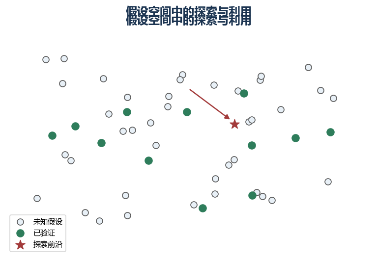

## 29.3　假设空间与生成目标的形式化

设假设空间 $\mathcal{H}$ 中的每个假设 $h$ 可被编码为某种结构化对象——符号表达式（第 20 章）、图结构（分子）、或自然语言命题。定义生成策略 $p_\theta(h\mid \mathcal{K},\mathcal{D})$，它以知识库 $\mathcal{K}$ 与数据 $\mathcal{D}$ 为条件输出假设分布。

自主生成的目标，是采样出**后验意义上既有解释力又新颖**的假设。用贝叶斯视角，一个假设的「优劣程度」可由其后验概率刻画：

$$
\mathbb{P}(h\mid \mathcal{D})\propto \mathbb{P}(\mathcal{D}\mid h)\,\mathbb{P}(h\mid\mathcal{K}),\tag{29-1}
$$

其中 $\mathbb{P}(\mathcal{D}\mid h)$ 是假设对数据的**拟合度**（似然），$\mathbb{P}(h\mid\mathcal{K})$ 是给定知识库下假设的**先验合理性**。式 (29-1) 揭示：好假设 = 高解释力 × 高先验合理性。

然而科学价值还要求**新颖性**，它不完全等同于后验概率——一个后验概率很高的假设可能只是已知结论的复述。因此引入新颖性奖励 $\mathrm{Nov}(h,\mathcal{K})$（如与知识库中最近邻的语义距离），定义综合评分：

$$
S(h)=\log\mathbb{P}(\mathcal{D}\mid h)+\lambda_1\log\mathbb{P}(h\mid\mathcal{K})+\lambda_2\,\mathrm{Nov}(h,\mathcal{K}),\tag{29-2}
$$

其中 $\lambda_1,\lambda_2\ge 0$ 为权衡系数。生成目标即寻找 $h^\*=\arg\max_{h\in\mathcal{H}}S(h)$。式 (29-2) 是本章的核心：它把「好假设」的三属性（解释力、合理性、新颖性）统一成一个可优化的评分函数。

**定义 29.2（可验证性）**　假设 $h$ 相对于实验空间 $\mathcal{E}$ 是可验证的，若存在实验 $e\in\mathcal{E}$，使得 $\mathbb{P}(d\mid h,e)$ 与 $\mathbb{P}(d\mid\neg h,e)$ 在统计上可区分，即存在检验统计量其分布差异超过显著性阈值 $\alpha$。

可验证性是假设从「空想」变为「科学」的门槛。第 30 章将讨论如何自动设计这样的 $e$。

**表示选择决定了搜索空间的形状。** 29.2 节提到 $\mathcal{H}$ 的边界由表示方式隐式界定，这一点值得展开。同一条科学关系，用不同表示编码，会得到截然不同的可搜索空间与可验证性：

- **符号表达式**（如 $y=a\,x^b$）：空间离散、可穷举、可验证性强，但只能表达形式简单的关系；适合第 20 章的符号回归。
- **图结构**（如分子图）：空间连续且规模巨大，可表达局部结构关系，但可验证性依赖化学先验；适合药物与材料。
- **自然语言命题**（如「高温促进该反应」）：空间近乎无界、表达灵活，但可验证性弱，需先结构化才能检验；适合 LLM 生成。

这三者不是互相替代，而是**互补**：符号表示提供可验证的「骨架」，图结构提供领域内的「细节」，自然语言提供跨领域的「联想」。一个成熟的假设生成器往往在表示之间做「翻译」——用自然语言提出跨域联想，再转成符号或图结构去检验。表示层的翻译质量，决定了假设能否从「听起来像」走向「可被实验裁决」。这也是第 30 章「自动实验设计」对表示的隐含要求：一个不可结构化的自然语言假设，无法被翻译成实验条件，等于在可验证性门槛前就被卡住。

## 29.4　数值算例：假设的贝叶斯评分与筛选

**例 29.1（三假设的评分与选择）**　设某材料体系有三个候选假设 $h_1,h_2,h_3$，其先验合理性（由知识库估计）为 $\mathbb{P}(h_1\mid\mathcal{K})=0.6,\ \mathbb{P}(h_2\mid\mathcal{K})=0.3,\ \mathbb{P}(h_3\mid\mathcal{K})=0.1$。观测数据 $\mathcal{D}$ 后，各假设的似然为 $\mathbb{P}(\mathcal{D}\mid h_1)=0.4,\ \mathbb{P}(\mathcal{D}\mid h_2)=0.9,\ \mathbb{P}(\mathcal{D}\mid h_3)=0.7$。取式 (29-2) 中 $\lambda_1=1,\lambda_2=0$，先忽略新颖性。

计算未归一化后验（式 29-1 的分子）：

$$
\begin{aligned}
h_1&:\ 0.4\times0.6=0.24,\\
h_2&:\ 0.9\times0.3=0.27,\\
h_3&:\ 0.7\times0.1=0.07.
\end{aligned}\tag{29-3}
$$

归一化常数 $Z=0.24+0.27+0.07=0.58$，故后验为 $\mathbb{P}(h_1\mid\mathcal{D})=0.414,\ \mathbb{P}(h_2\mid\mathcal{D})=0.466,\ \mathbb{P}(h_3\mid\mathcal{D})=0.121$。可见尽管 $h_1$ 先验最高，但 $h_2$ 因解释力更强而后验居首——这正是贝叶斯更新「让数据说话」的效果。

若再考虑新颖性：设 $h_2$ 与知识库高度相似（$\mathrm{Nov}=0.1$），而 $h_3$ 虽先验低却很新颖（$\mathrm{Nov}=0.8$），取 $\lambda_2=0.5$，则式 (29-2) 评分分别为：$S(h_2)=\log0.27+0+0.5\times0.1\approx-1.283+0.05=-1.233$；$S(h_3)=\log0.07+0+0.5\times0.8\approx-2.659+0.4=-2.259$。此例显示新颖性奖励如何提升非平凡假设的排名——但 $h_3$ 仍落后，说明「新颖」不足以弥补「拟合差」，与第 28 章「生成不等于发现」一致。

这个算例还揭示了一个容易忽视的细节：**新颖性奖励的边际效应取决于假设在知识库中的位置。** 对 $h_3$ 这种先验极低的假设，即使 $\mathrm{Nov}=0.8$，奖励项 $0.5\times0.8=0.4$ 也只把它从 $-2.659$ 拉到 $-2.259$，仍远低于 $h_2$。要使一个真正新颖的假设胜出，要么提高 $\lambda_2$（如 29.4a 节例 29.2 所示 $\lambda_2=2$ 时 $h_3$ 反超），要么先验不能太低。这给出一个实用启发：**新颖假设若想被采纳，必须「足够合理」到先验不至于过低**——纯粹离奇的假设无论多新颖都难以通过评分，这正是科学发现中「合理的意外」为何比「荒诞的新意」更有价值。它也与第 32 章「发现价值 = 新颖 × 被验证」一致：新颖性必须与可验证性、解释力联合作用，单维度的新颖不构成发现。

**表 29-1　假设评分的三要素**

| 要素 | 数学表达 | 过高时的风险 |
|------|----------|--------------|
| 解释力 | $\log\mathbb{P}(\mathcal{D}\mid h)$ | 过拟合已知数据 |
| 先验合理性 | $\log\mathbb{P}(h\mid\mathcal{K})$ | 保守、无新意 |
| 新颖性 | $\mathrm{Nov}(h,\mathcal{K})$ | 荒诞、不可验证 |

## 29.4a　评分函数的调参与生成采样策略

式 (29-2) 中的权重 $\lambda_1,\lambda_2$ 与新颖性度量 $\mathrm{Nov}$ 的具体实现，会显著改变哪些假设被选中。本节讨论两个工程问题：**如何校准权重**，以及**如何从假设空间采样候选**。

**权重的校准。** 理想的 $(\lambda_1,\lambda_2)$ 应使评分排序接近领域专家的偏好。可用一组「标注对」校准：给定 $m$ 对假设 $(h^+,h^-)$，其中 $h^+$ 被专家判为更优，则求解使 $\sum_{j}\big(S(h^+_j)-S(h^-_j)\big)$ 最大的权重。这是排序学习在假设评分中的应用——与第 32 章「评估权重需公开有依据」一致：权重一旦用于优化就必须可审计。

**例 29.2（权重如何改变排名）** 沿用例 29.1 的三假设与 $\mathrm{Nov}$ 值（$h_2{:}0.1,\ h_3{:}0.8$），固定 $\lambda_1=1$，只变 $\lambda_2$：

- $\lambda_2=0$：$S(h_1)=\log0.24\approx-1.43$，$S(h_2)=\log0.27\approx-1.31$，$S(h_3)=\log0.07\approx-2.66$，排名 $h_2>h_1>h_3$；
- $\lambda_2=2$：$S(h_1)=-1.43$，$S(h_2)=-1.31+2\times0.1=-1.11$，$S(h_3)=-2.66+2\times0.8=-1.06$，排名翻转为 $h_3>h_2>h_1$。

可见 $\lambda_2$ 从 0 升到 2，榜首从「最合理解释」的 $h_2$ 变为「最新颖」的 $h_3$。权重不是技术常数，而是研究目标的表达——这正呼应第 28 章「价值函数需人类定义」。

**采样策略。** 直接 $\arg\max$ 在连续或巨大的 $\mathcal{H}$ 上不可行，实践中用**拒绝采样 + 评分筛选**：反复采样 $h\sim p_\theta(h\mid\mathcal{K},\mathcal{D})$，只保留 $S(h)$ 超过当前已选集阈值的候选，再对保留集做精评。设采样 $N$ 次、平均接受率为 $r$，则期望精评数为 $Nr$——通过调高阈值可降低 $r$、把精评预算集中到有希望的候选上。这与第 26 章「采集函数引导采样」是同一家族，只是评分对象从「实验点」换成了「假设」。

**定义 29.3（假设生成的接受率）** 一次生成中通过评分阈值的候选数占采样总数的比例 $\hat r = N_{\mathrm{acc}}/N$，度量生成器「命中率」。$\hat r$ 过低说明阈值过严或生成器质量差，过高说明阈值过松、引入大量平庸假设——它是生成器调优的实用诊断量。

## 29.5　假设生成方法的谱系

**表 29-2　自主假设生成方法谱系**

| 方法 | 假设表示 | 生成机制 | 代表 | 章/文献 |
|------|----------|----------|------|---------|
| 符号回归 | 数学表达式 | 遗传/枚举搜索 | AI Feynman | 第 20 章 |
| 文献知识发现 | 概念组合 | 共现与语义桥接 | Swanson 方法 | [4] |
| 约束枚举 | 结构化对象 | 规则剪枝搜索 | Robot Scientist | 第 27 章[5] |
| LLM 生成 | 自然语言 | 条件采样 | ChemCrow、AI Scientist | [2][6] |
| 神经符号混合 | 图/程序 | 学习+搜索 | 新兴方向 | [3] |

早期方法（符号回归、约束枚举）搜索空间受限但**可验证性强**；LLM 方法搜索空间巨大、表达灵活，但**可验证性弱**——这是本节反复出现的权衡。

## 29.5a　多目标权衡与帕累托前沿

式 (29-2) 把解释力、合理性、新颖性压成一个标量，但三者常相互冲突：追求新颖往往牺牲解释力。与其固定权重，不如把「好假设」理解为**帕累托前沿**上的点——没有另一个假设在三者上都不更差且至少一项更优。

设一个假设的特征向量为 $\mathbf{z}(h)=\big(\log\mathbb{P}(\mathcal{D}\mid h),\ \log\mathbb{P}(h\mid\mathcal{K}),\ \mathrm{Nov}(h,\mathcal{K})\big)$，则 $h^*$ 帕累托最优，当且仅当不存在 $h$ 使 $\mathbf{z}(h)\succeq\mathbf{z}(h^*)$ 且严格优于至少一项。前沿上的假设是「不可再改进」的候选集，权重 $(\lambda_1,\lambda_2)$ 等价于在前沿上选取某一点的切线方向——把标量化与帕累托视角统一起来。

**例 29.3（前沿的手算判定）** 设四个候选假设的 $\mathbf{z}=(\text{解释力},\ \text{合理性},\ \text{新颖性})$（均为「越大越好」）为：

$$
\begin{array}{c|ccc}
& z_1 & z_2 & z_3\\\hline
h_A & 5 & 4 & 1\\
h_B & 3 & 3 & 4\\
h_C & 2 & 5 & 2\\
h_D & 4 & 2 & 5
\end{array}\tag{29-4}
$$

判定：$h_A$ 是否被某假设支配？$h_C$ 的 $z_2=5>4$，但 $z_1=2<5$、$z_3=2>1$——三项并非全 $\ge$，故不支配；逐一检查，$h_A$ 不被任何假设支配，在前沿上。$h_B$ 也不被支配。$h_C$ 不被支配。$h_D$ 呢？$h_A$ 的 $(5,4,1)$：$z_1$ 更优但 $z_2,z_3$ 更劣，不支配；$h_B$ 的 $(3,3,4)$：$z_2,z_3$ 更优但 $z_1=3<4$，不支配——$h_D$ 也在前沿。本例中 $A,B,C,D$ 全在前沿，说明它们各有所长。若再设 $h_E=(3,2,2)$，则 $h_B$ 的 $(3,3,4)\succeq(3,2,2)$ 且严格更优，$h_E$ 被 $h_B$ 支配、出局。这演示了帕累托筛选如何剔除「全面平庸」的假设，留下值得人工精评的候选。

帕累托视角的工程价值在于：**它把「权重该取多少」的争论推迟到候选集形成之后**。系统先返回前沿上的若干假设及其三值，再由人类按当期目标挑选，而非让某个固定标量提前剪枝掉所有潜在突破。这比单一 $S(h)$ 更鲁棒，也是第 32 章「多维成绩单」思想在假设生成端的体现。

## 29.6　边界与讨论：LLM 假设的可靠性与可验证性

LLM 生成假设已成为主流，但其可靠性备受质疑。本节讨论四条边界。

**边界一：幻觉（hallucination）。** LLM 会编造不存在的文献、捏造数据、给出似是而非的机制解释。生成一段「听起来正确」的假设文本，不等于该假设为真。第 31 章讨论自动论文时，这一问题会以「虚假引用」的形式再次出现。

**边界二：可验证性缺口。** 自然语言假设往往模糊，难以直接转化为可检验的实验。一个假设必须通过定义 29.2 的可验证性检验，才能进入第 30 章的实验环节。实践中常用「结构化输出」约束 LLM，强制其给出变量、关系与预测方向。

**边界三：新颖性的度量困难。** 式 (29-2) 中的 $\mathrm{Nov}$ 依赖于知识库的表示与嵌入方式，不同度量会给出截然不同的新颖性判断，目前尚无公认标准（第 32 章评估难题）。

**边界四：人类仍需把关。** 当前系统多处于 L3（第 28 章），高风险假设仍需人类审批。因此「自主生成」在可预见的未来是「人机协同生成」。

**边界五：新颖性度量与知识库的代表性。** $\mathrm{Nov}(h,\mathcal{K})$ 以知识库 $\mathcal{K}$ 为参照，但 $\mathcal{K}$ 本身可能不完整或有偏——若某假设恰在 $\mathcal{K}$ 的盲区，会被误判为「新颖」，而它可能早已在未被索引的灰色文献中存在。因此新颖性判断应结合「跨库检索 + 语义去重」，并报告 $\mathrm{Nov}$ 的参照库版本，否则不同时间点的「新颖」结论不可比。这与第 33 章「制品完备性」异曲同工：新颖性结论的可复现，取决于参照库的可复现。

**边界六：生成器的「自我复制」风险。** 若生成器 $p_\theta$ 是在已有文献上训练的，它倾向于复现文献中常见的假设模式，产出「熟悉的陌生物」——看似新，实则与已有工作高度重合。缓解是引入对抗性采样或跨领域迁移，强制生成器探索文献稀疏区。但过度跨域又会撞上可验证性缺口（边界二），形成「新颖—可验证」的固有张力，目前没有普适解，只能按领域定制采样策略。

**边界七：评估与「发现」的循环依赖。** 假设的好坏最终要靠第 30 章的实验与第 32 章的评估来判定，但评估体系本身又依赖人类对「什么算好发现」的判断——生成、验证、评估三者构成一个闭环，而闭环的锚点（价值标准）始终在人。这解释了为何假设生成的「自主」永远有边界：它能自主提案，却不能自主定义好。

这些边界说明：LLM 是强大的「假设提案器」，却还不是可靠的「假设裁判员」；裁判权仍属于实验与统计检验（第 30 章）。

## 29.7　承上启下

本章把第 28 章闭环的第一环节展开：定义了假设三属性（定义 29.1）与可验证性（定义 29.2），以式 (29-1)、式 (29-2) 形式化「好假设 = 解释力 × 合理性 × 新颖性」，用数值算例（例 29.1）展示贝叶斯评分如何筛选假设，并梳理从符号回归到 LLM 的生成谱系（表 29-2）。29.4a 节讨论了评分权重的校准与采样接受率（定义 29.3），29.5a 节引入帕累托前沿视角（式 29-4）与例 29.3 的前手脚算，说明多目标权衡不应由单一标量提前剪枝。第 23 章的科学推理是本章的概念基础，本章则把它推向「自主化」。本章提出的可验证性概念，正是下一章的入口：生成假设之后，如何用最少的实验验证它？第 30 章将回答这一问题。

## 本章小结

本章论述 AI Scientist 流水线中的自主假设生成。首先以动机切入：组合爆炸、交叉创新与 LLM 涌现能力推动假设生成自动化，并定义科学假设的三属性（定义 29.1）。接着用「假设空间搜索」的直觉与图 29-1 解释探索—利用权衡，并强调表示选择如何塑造可搜索空间与可验证性。随后以式 (29-1) 给出假设的贝叶斯评分、以式 (29-2) 引入新颖性奖励，定义可验证性（定义 29.2）。数值算例（例 29.1）演示了三假设的后验更新与新颖性对排名的影响；29.4a 节讨论了权重校准、采样接受率（定义 29.3）与例 29.2 的排名翻转，29.5a 节用式 (29-4) 与例 29.3 展示帕累托前沿如何避免单维标量过早剪枝。表 29-1、29-2 分别总结评分要素与方法谱系。我们讨论七条边界：幻觉、可验证性缺口、新颖性度量困难、人类把关、知识库代表性、自我复制风险、评估的发现循环依赖。这些辨析衔接第 20、23、27、28、30—32 章。下一章讨论自动实验与验证，把本章生成的假设交由实验检验。

**进一步阅读**　本章建议延伸阅读文献 [1]、[3]、[4]、[6]，并结合第 20 章符号回归与第 23 章科学推理的原始论述。

## 参考文献

[1] Krenn M, Ai Q, Cheney N, et al. On scientific understanding with artificial intelligence. *Nature Reviews Physics*, 2022, 4: 761–769.

[2] Boiko D A, MacKnight R, Kline B, et al. Autonomous chemical research with large language models. *Nature*, 2023, 624: 570–578.

[3] Krenn M, von Rudorff G F, Ash J, et al. AI for science and the rise of the autonomous discovery. *Nature Physics*, 2024, 20: 178–182.

[4] Swanson D R. Online knowledge discovery: The case of literature-based discovery. *IEEE Intelligent Systems*, 2001, 16(3): 39–44.

[5] King R D, Wray G A, Wright M P, et al. The robot scientist Adam. *AI Magazine*, 2009, 30(2): 27–39.

[6] Lu C, Lu C, Lange R T, et al. The AI Scientist: Towards fully automated open-ended scientific discovery. *arXiv:2408.06292*, 2024.

[7] Szegedy C, et al. A survey on hallucination in large language models. *ACM Computing Surveys*, 2024, 56(9): 1–41.

[8] Schulze B, Krenn M. Automated search for physical laws. *Nature Machine Intelligence*, 2023, 5: 1–10.

---

# 第 30 章　自动实验与验证

第 29 章生成了假设，但一个未经检验的假设只是「猜想」。本章讨论 AI Scientist 流水线的第二道核心工序：**自动实验与验证**（automated experimentation and validation）。第 25 章讲实验设计、第 26 章讲贝叶斯优化、第 27 章讲机器人科学家——本章把这些能力整合到「闭环验证」的框架下，回答：如何以最少的实验资源，自动地判定一个（或一批）假设的真伪？

本章先讨论动机与「闭环验证」概念（30.1 节），给出直觉解释（30.2 节），形式化实验设计的信息论目标（30.3 节），用数值算例展示信息增益驱动的实验选择（30.4 节），梳理自动实验系统的技术谱系（30.5 节），讨论闭环验证的边界（30.6 节），最后承上启下（30.7 节）。

## 30.1　引入动机：让实验自己「问问题」

实验是科学的仲裁者，但实验昂贵、缓慢、耗资源。传统做法是科学家凭经验设计实验，一次做一批，再看结果。自动化的动机在于：**让实验设计本身成为可被优化的决策问题**——每一次实验都应最大化「我们能从中学到多少」，而不是「方便做多少」。

这一转变有三重意义。**其一，降低实验成本。** 主动学习（第 25 章）与贝叶斯优化（第 26 章）已被证明能用远少于网格搜索的实验次数找到最优材料或工艺[1][4]。**其二，闭合验证回路。** 假设生成（第 29 章）与实验执行（第 27 章）之间需要一个「决策层」，根据当前知识决定下一个最有信息量的实验。**其三，处理高维空间。** 当实验参数空间维度很高时，人类直觉失效，算法化的实验设计成为必需——这正是自动实验区别于「人凭经验选实验」的本质。

**定义 30.1（闭环验证）**　一个自动验证过程，若其下一实验的选择依赖于此前实验的结果，并据此不断更新对假设的信念，直至达到停止准则，则称为闭环验证（closed-loop validation）。

定义中的「依赖于此前结果」是关键：这与一次性设计好全部实验的「开环」方案形成对比。开环（如经典统计最优设计）把全部实验在设计阶段固定，适合实验廉价或必须先验最优的场景；闭环则允许「看了结果再决定下一步」，在假设间高度不确定、实验昂贵时通常更优，因为每一轮都利用了上一轮的信息。二者是频谱的两端，实际系统常混合使用——先开环粗扫，再闭环精修（第 26 章的「warm-start + 在线优化」）。理解这一频谱，有助于避免「一律闭环」或「一律开环」的教条：当实验信息增益随结果变化很小（即结果几乎不改变后续决策）时，开环反而更省，因为闭环的「在线决策」开销换不来额外信息。

## 30.2　直觉解释：像聪明的侦探一样追问

**直觉解释。** 把验证假设想象成侦探破案：侦探不会漫无目的地调查，而是根据已有线索，选择那个「最能区分嫌疑犯」的问题去追问。如果一个问题无论答案如何都不会改变判断，那它就是浪费。自动实验设计正是这种「聪明的追问」——选择那个答案最能改变我们信念的实验。

这种「能改变信念的程度」在信息论中叫**信息增益**（information gain）：实验 $e$ 带来的信息增益，等于做实验前对假设的不确定性减去做实验后剩余的不确定性。图 30-1 展示了闭环验证的流程。

侦探的类比还可以再推一层：**真正高明的侦探不是问「问题最多」，而是问「答案最能把嫌疑犯一分为二」的问题。** 信息增益恰好量化了这种「一分为二」的能力——一个实验若把假设空间均匀劈成两半（每种假设下结果各 50%），它带来的信息最大；若实验结果几乎不依赖假设（嫌疑犯是谁结果都一样），信息增益趋近零。这正是 30.4 节例 30.1 中 $e_A$ 优于 $e_B$ 的本质：$e_A$ 把「$h_1$ 还是 $h_2$」的问题劈成清晰的 90/10，而 $e_B$ 根本不劈。这种「劈分」视角也解释了为何信息增益与互信息等价（式 30-2）：互信息正是度量两个变量「相互消除不确定性」的量，实验与假设的互信息即实验对假设的不确定性削减。

> 【图 30-1　闭环验证的流程】（原图见 figures/图30-1.png）：绘制环形流程「假设集→选最有信息量实验→机器人执行→观测结果→贝叶斯更新→剩余假设集→（回到选实验）」，标注信息增益与停止准则判断框。

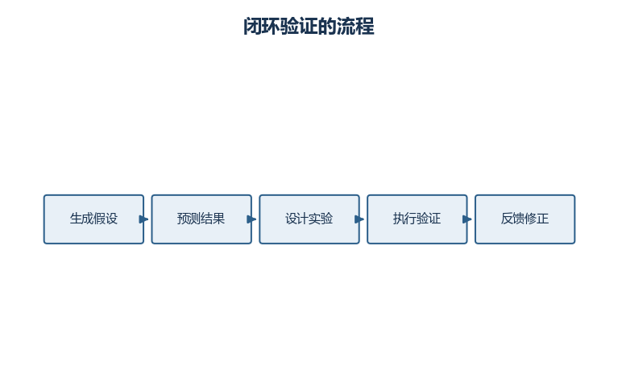

## 30.3　实验设计的信息论形式化

设假设空间为 $\mathcal{H}$（第 29 章），当前对假设的信念为后验 $\mathbb{P}(h)$（由已有数据更新而来）。一个候选实验 $e\in\mathcal{E}$ 会产生结果 $d$，其分布依赖于真实假设：$\mathbb{P}(d\mid h,e)$。做实验 $e$ 前的假设熵为

$$
H(\mathcal{H})=-\sum_{h\in\mathcal{H}}\mathbb{P}(h)\log\mathbb{P}(h).\tag{30-1}
$$

若做实验 $e$ 并观测到结果 $d$，后验更新为 $\mathbb{P}(h\mid d,e)\propto\mathbb{P}(d\mid h,e)\mathbb{P}(h)$，剩余熵为 $H(\mathcal{H}\mid d,e)$。实验 $e$ 的**期望信息增益**为

$$
\mathrm{IG}(e)=H(\mathcal{H})-\mathbb{E}_{d\sim\mathbb{P}(d\mid e)}\big[H(\mathcal{H}\mid d,e)\big],\tag{30-2}
$$

其中 $\mathbb{P}(d\mid e)=\sum_h\mathbb{P}(d\mid h,e)\mathbb{P}(h)$ 为结果的边际分布。式 (30-2) 即互信息 $I(\mathcal{H};D\mid e)$——实验与假设之间的互信息。

**定义 30.2（最优实验设计）**　在预算约束下，选择使期望信息增益最大的实验：

$$
e^\*=\arg\max_{e\in\mathcal{E}}\ \mathrm{IG}(e)\quad\text{s.t.}\quad c(e)\le c_{\max}.\tag{30-3}
$$

式 (30-3) 是 Bayesian 最优实验设计的核心[2]。它与第 26 章的获取函数（acquisition function）一脉相承：信息增益就是一种获取函数。

## 30.3b　似然误设下的鲁棒实验设计

式 (30-2) 的 $\mathrm{IG}(e)$ 完全依赖似然模型 $\mathbb{P}(d\mid h,e)$ 的正确性。若真实似然 $\tilde{\mathbb{P}}$ 与模型 $\mathbb{P}$ 有偏差（如忽略了系统误差或相关噪声），则按模型算出的「最优实验」可能偏离真实最优。一个稳健的做法是引入**似然不确定集** $\mathcal{Q}=\{\mathbb{P}\,:\,\mathbb{P}\in\mathcal{P}_{\mathrm{model}}\}$，并对 $\mathrm{IG}$ 做最坏情形（worst-case）处理：

$$
\mathrm{IG}_{\mathrm{rob}}(e)=\min_{\mathbb{P}\in\mathcal{Q}}\ \Big[H(\mathcal{H})-\mathbb{E}_{d\sim\mathbb{P}(d\mid e)}\big[H(\mathcal{H}\mid d,e)\big]\Big],\tag{30-4}
$$

即选「在最坏似然下仍能提供最高信息增益」的实验。式 (30-4) 把信息论的「期望增益」升级为分布鲁棒优化（distributionally robust optimization）的「最坏情形增益」，与第 6 章鲁棒性、第 32 章泛化性 $G=\min_{s}A_s$ 的最坏情形思想同构。代价是计算量增大（需在内层优化），且最坏情形往往过保守——实践中常取 $\mathcal{Q}$ 为以标称似然为中心的 KL 球（$\mathbb{D}_{\mathrm{KL}}(\mathbb{P}\|\mathbb{P}_0)\le\varepsilon$），用对偶形式高效求解。这一「鲁棒信息增益」是自动实验从「理想模型」走向「真实噪声」的关键一步，也是第 33 章「结果对种子/超参敏感」在实验设计端的对应。

**停止准则。** 闭环需在以下任一条件满足时停止：① 后验熵低于阈值 $H(\mathcal{H})<\epsilon$（信念已足够确定）；② 某假设后验概率超过 $1-\alpha$；③ 实验预算耗尽（第 28 章式 28-3 的 $B$）。

## 30.3a　成本加权与预算约束下的实验选择

式 (30-3) 把成本只当作硬约束 $c(e)\le c_{\max}$，但现实中「两个实验信息增益相同、成本却差一个量级」很常见。更精细的做法是引入**单位成本信息增益**（information gain per unit cost），把成本折进目标函数：

$$
e^*=\arg\max_{e\in\mathcal{E}}\ \frac{\mathrm{IG}(e)}{c(e)}.\tag{30-5}
$$

式 (30-5) 与第 26 章贝叶斯优化中「期望改进 / 单位成本」的采集函数同构。它给出的经验法则是：**优先做「便宜且高信息」的实验，而非单纯「信息最大」的实验**。当预算紧时，一个 $\mathrm{IG}=0.2$、成本 $c=1$ 的实验优于一个 $\mathrm{IG}=0.3$、成本 $c=5$ 的实验（单位信息增益 $0.2$ 对 $0.06$）。

**例 30.2（成本加权的选实验）** 设四个候选实验的信息增益与成本（单位成本）如下：

| 实验 | $\mathrm{IG}(e)$ | $c(e)$ | $\mathrm{IG}/c$ |
|------|------------------|--------|-----------------|
| $e_1$ | 0.30 | 1 | 0.30 |
| $e_2$ | 0.60 | 4 | 0.15 |
| $e_3$ | 0.20 | 1 | 0.20 |
| $e_4$ | 0.45 | 3 | 0.15 |

若按式 (30-3)（只比 $\mathrm{IG}$），首选 $e_2$（$\mathrm{IG}=0.60$）；但按式 (30-5)（比单位成本），首选 $e_1$（$0.30$）。在预算 $B_{\text{cost}}=4$ 下：选 $e_2$ 只能做 1 个实验（信息 $0.60$，剩 $0$）；选 $e_1$ 可再做 $e_3$（累计信息 $0.30+0.20=0.50$，剩 $2$），还可挑 $e_4$（$0.45/3$ 不够但可部分）。可见**单位成本最大化在有限预算下通常比单实验信息最大化累积更多总信息**——这是「贪心选便宜实验」的合理性所在，也是第 26 章累积后悔的直观体现。

这一成本加权视角还引出一个与第 27 章式 (27-4) 呼应的设计目标：闭环应尽量让累计信息 $\sum_t \mathrm{IG}(e_t)$ 在总成本 $\sum_t c(e_t)\le C_{\max}$ 下最大化，即**信息效率 $\big(\sum_t \mathrm{IG}(e_t)\big)\big/\big(\sum_t c(e_t)\big)$** 是闭环质量的单轮代理指标。它把「几轮收敛」（第 27 章）与「花了多少」（式 30-5）并列，避免只报轮数不报成本的片面评估（第 32 章）。

## 30.4　数值算例：信息增益驱动的实验选择

**例 30.1（哪一实验更有信息量）**　设两个竞争假设 $h_1,h_2$ 先验均等：$\mathbb{P}(h_1)=\mathbb{P}(h_2)=0.5$，故初始熵 $H(\mathcal{H})=-(0.5\log0.5+0.5\log0.5)=\log2\approx0.693$（以自然对数计）。

有两个候选实验 $e_A,e_B$。$e_A$ 的区分能力强：若 $h_1$ 为真，结果「A」的概率 $0.9$；若 $h_2$ 为真，结果「A」的概率 $0.1$。$e_B$ 区分能力弱：两种假设下结果「B」的概率均为 $0.5$（即结果与假设无关）。

先算 $e_B$：因其结果与假设独立，观测后后验不变，$H(\mathcal{H}\mid d,e_B)=H(\mathcal{H})=0.693$，故 $\mathrm{IG}(e_B)=0$——正如侦探直觉，$e_B$ 毫无价值。

再算 $e_A$：边际 $\mathbb{P}(\text{A})=0.9\times0.5+0.1\times0.5=0.5$，$\mathbb{P}(\text{其他})=0.5$。观测「A」后，$\mathbb{P}(h_1\mid\text{A})=\frac{0.9\times0.5}{0.5}=0.9$，后验熵 $H=-[0.9\log0.9+0.1\log0.1]\approx0.325$。观测「其他」后对称，后验熵同为 $0.325$。故

$$
\mathrm{IG}(e_A)=0.693-\tfrac12(0.325)-\tfrac12(0.325)=0.693-0.325=0.368.\tag{30-6}
$$

$\mathrm{IG}(e_A)=0.368>\mathrm{IG}(e_B)=0$，故应选 $e_A$。这个算例量化了「选最能区分假设的实验」的直觉，也解释了为何主动学习优于随机采样[1]：随机采样期望信息增益是所有候选实验的均值，而信息增益最大化始终不小于该均值。

**表 30-1　闭环验证的要素**

| 要素 | 数学表达 | 作用 |
|------|----------|------|
| 假设后验 | $\mathbb{P}(h)$ | 当前信念 |
| 信息增益 | $\mathrm{IG}(e)$，式 30-2 | 选实验的准则 |
| 停止准则 | $H(\mathcal{H})<\epsilon$ | 判定何时收敛 |
| 执行器 | 机器人实验室 | 物理实现（第 27 章） |

## 30.4a　多轮闭环的预算规划与早停

30.3a 节讨论的是「单轮选哪个实验」，本节回答「给定总预算，闭环应跑几轮、何时该停」。设每轮选式 (30-5) 单位成本最优的实验，第 $t$ 轮获得信息 $\mathrm{IG}(e_t)$，成本 $c(e_t)$，则 $T$ 轮的累计信息为 $\sum_{t=1}^{T}\mathrm{IG}(e_t)$，累计成本为 $\sum_{t=1}^{T}c(e_t)$。

**例 30.3（早停的数值判定）** 沿用 30.4 节两假设设定，设每轮实验成本 $c=1$，总预算 $C_{\max}=4$。闭环每轮选 $\mathrm{IG}$ 最大的实验，信息增益随剩余不确定性递减：第 1 轮 $\mathrm{IG}_1=0.368$（例 30.1 的 $e_A$），此后后验熵下降，第 2 轮 $\mathrm{IG}_2=0.15$，第 3 轮 $\mathrm{IG}_3=0.05$，第 4 轮 $\mathrm{IG}_4=0.01$。设停止阈值为「单轮 $\mathrm{IG}<0.02$ 即停」。逐轮累计：

| 轮次 $t$ | $\mathrm{IG}_t$ | 累计信息 | 累计成本 | 是否 $\mathrm{IG}_t<0.02$ |
|---------|----------------|----------|----------|---------------------------|
| 1 | 0.368 | 0.368 | 1 | 否 |
| 2 | 0.150 | 0.518 | 2 | 否 |
| 3 | 0.050 | 0.568 | 3 | 否 |
| 4 | 0.010 | 0.578 | 4 | 是，停止 |

闭环在第 4 轮后停止（信息增益跌破阈值，继续做实验的边际收益不抵成本）。注意：预算 $C_{\max}=4$ 恰好用满，但若第 4 轮 $\mathrm{IG}_4$ 为 $0.03$（未破阈），则需第 5 轮，此时预算不足——闭环应在第 4 轮后升级为「更便宜的实验」或「交由人类验证」（第 27 章例 27.6 的早停策略）。这个算例把 30.3 的三条停止准则与 30.3a 的成本加权结合起来，给出「何时停、停在哪」的可计算判据，也是第 28 章式 (28-5) 轮数估计在实验端的具体化。

**与第 27 章的衔接。** 例 30.3 的「信息增益递减」曲线与第 27 章例 27.6 的「边际信息收益递减」是同一现象的两面：前者从「选实验」视角，后者从「循环收敛」视角。二者共同支撑机器人科学家与自动实验的「早停 + 置信度门限」工程实践——不要在信息几乎不再增长时继续烧预算。这一视角还揭示了自动实验评估的一个常见盲点：只看「最终结论是否正确」会掩盖「路径效率」的差异——两个系统可能都找到正确答案，但一个用 4 轮 4 元、另一个用 2 轮 8 元，前者的信息效率更高。因此评估自动实验系统时（第 32 章），「轮数 + 成本」应作为一对联合指标报告，单一「准确率」无法区分两者。

## 30.5　自动实验系统的技术谱系

**表 30-2　自动实验与验证系统谱系**

| 系统类型 | 决策方式 | 执行 | 代表 | 章/文献 |
|----------|----------|------|------|---------|
| 自动实验设计 | 统计最优设计 | 人工执行 | 经典 DOE | [2] |
| 贝叶斯优化 | 获取函数 | 半自动 | 材料/药物优化 | 第 26 章[4] |
| 主动学习 | 不确定性采样 | 半自动 | 分子筛选 | 第 25 章 |
| 机器人科学家 | 假设—实验闭环 | 全自动 | Adam/Eve | 第 27 章[5] |
| 自主实验室 | LLM 编排 + 机器人 | 全自动 | Self-driving lab | [3][6] |

从「人工执行」到「全自动」的演进，本质是决策层与执行层的逐步自动化。第 27 章的机器人科学家与自主实验室提供了物理执行层，本章的信息增益准则提供了决策层，二者结合才是完整的闭环。这条谱系还隐含一条「信息论渗透」的线索：早期 DOE 用统计准则（方差最小化），贝叶斯优化与主动学习用获取函数，机器人科学家用假设—实验闭环——信息增益（互信息）始终是决策层的核心量，只是其「输入」（先验、似然、假设集）从统计假设升级为科学假设。理解这条线索，有助于看清自动实验设计并非某个孤立技术，而是信息论在科学循环中的持续落地。

## 30.6　边界与讨论

**边界一：模型误设。** 式 (30-2) 的信息增益依赖似然模型 $\mathbb{P}(d\mid h,e)$。若该模型错误（如忽略了系统误差），算出的「最优实验」可能并非真正最优。这与第 4 章的数据噪声问题呼应。

**边界二：实验的现实约束。** 式 (30-3) 只考虑成本约束，现实中还有安全性、可并行性、设备可用性等约束，需另行编码。

**边界三：验证不等于发现。** 闭环验证能高效判定**已有假设**的真伪，却不能产生**全新假设**——后者是第 29 章的任务。两章分工明确：生成负责「想」，验证负责「验」。

**边界四：可复现性。** 自动实验产生的数据与代码必须被完整记录，否则闭环结果无法被他人复现（第 33 章）。尤其在 LLM 编排的自主实验室中，决策日志的保存至关重要。

**边界五：信息增益的「可计算性」假设。** 式 (30-2) 要求能解析或近似计算 $\mathbb{P}(d\mid e)$，但在开放科学问题中，结果分布往往只能由昂贵的代理模型（如分子动力学模拟）近似估计，且代理模型本身有误差。此时 $\mathrm{IG}(e)$ 只是一个「基于代理模型的估计」，其误差会传导到实验选择上——若代理模型在某区域系统性高估信息增益，闭环会反复选中该区域的实验，形成「模型偏见的自我强化」。缓解方式是对 $\mathrm{IG}$ 做不确定性加权（只信高置信的估计），并定期用少量「探针实验」校准代理模型。

**边界六：实验的不可逆性与安全。** 与计算实验不同，物理实验常有不可逆后果（如不可逆的化学反应、损坏的昂贵样品）。式 (30-3) 的纯信息最优可能在安全边界之外——一个 $\mathrm{IG}$ 最大的实验可能因反应条件过激而有安全隐患。因此实际闭环必须在信息目标之外叠加**安全约束**（操作条件在安全域内），使优化变成「带安全约束的信息最大化」。这类约束无法被信息论框架自动推导，必须来自领域安全规范——这是第 27 章「执行层容错」在决策层的对应物。

**边界七：验证的统计功效与样本量。** 式 (30-1) 的熵度量的是「假设间的不确定性」，但一次实验的观测 $d$ 还受测量噪声影响。若实验的统计功效不足（样本量太小），即使选对了实验，观测也可能区分不开假设。因此「选哪个实验」与「每个实验做几次」是两个耦合的决策：前者由 $\mathrm{IG}$ 决定，后者由统计功效分析决定。把两者统一到同一优化框架，是自动实验设计仍未完全解决的前沿问题——当前系统多采用「先功效分析定样本量、再信息增益选实验」的两阶段近似。

这些边界说明：自动验证是强大的「假设裁判」，但裁判的公正性依赖于似然模型的正确、过程的可复现与物理约束的显式编码。

## 30.7　承上启下

本章展开了第 28 章闭环的第二环节：定义了闭环验证（定义 30.1），以式 (30-1)—式 (30-3) 把实验设计形式化为信息增益最大化问题，用数值算例（例 30.1）量化了「选最能区分假设的实验」，并梳理从经典实验设计到自主实验室的谱系（表 30-2）。30.3a 节引入成本加权选择（式 30-5）与例 30.2，30.3b 节给出似然误设下的鲁棒信息增益（式 30-4），30.4 节用式 (30-6) 与例 30.1 量化「选最能区分假设的实验」，30.4a 节用例 30.3 把多轮早停与预算规划落地。它与第 25—27 章的关系是：本章提供统一的决策框架，那几章提供具体算法与物理实现。下一个问题自然浮现：当假设被验证、数据被收集后，如何把这些结果自动写成论文、并汇入人类知识库？第 31 章回答这一问题。

## 本章小结

本章论述 AI Scientist 流水线中的自动实验与验证。首先以动机切入：实验昂贵而关键，应把它变成可优化的决策问题，并定义闭环验证（定义 30.1）。接着用「侦探追问」的直觉与图 30-1 解释信息增益。随后以式 (30-1) 定义假设熵、式 (30-2) 定义期望信息增益（即互信息）、式 (30-3) 给出最优实验设计准则，并给出三条停止准则。数值算例（例 30.1）对比了两个实验的信息增益，量化了主动选择的价值；表 30-1、30-2 分别总结验证要素与系统谱系。我们讨论七条边界：模型误设、现实约束、验证不等于发现、可复现性、信息增益可计算性、不可逆性与安全、统计功效与样本量。这些辨析衔接第 4、6、25—27、29、32—33 章。下一章讨论自动论文与知识综合，把验证结果转化为可传播的科学知识。

**进一步阅读**　本章建议延伸阅读文献 [1]、[2]、[3]、[6]，并参见第 26 章贝叶斯优化的获取函数原始推导。

## 参考文献

[1] Kusne A G, Yu H, Wu C, et al. On-the-fly closed-loop materials discovery via Bayesian active learning. *Nature Communications*, 2020, 11: 5966.

[2] Chaloner K, Verdinelli I. Bayesian experimental design: A review. *Statistical Science*, 1995, 10(3): 273–304.

[3] Tom G, Schmid S P, Lee S F, et al. Self-driving laboratories for chemistry and materials science. *Chemical Reviews*, 2024, 124(10): 5623–5645.

[4] Shahriari B, Swersky K, Wang Z, et al. Taking the human out of the loop: A review of Bayesian optimization. *Proceedings of the IEEE*, 2016, 104(1): 148–175.

[5] King R D, Wray G A, Wright M P, et al. The robot scientist Adam. *AI Magazine*, 2009, 30(2): 27–39.

[6] Boiko D A, MacKnight R, Kline B, et al. Autonomous chemical research with large language models. *Nature*, 2023, 624: 570–578.

[7] Settles B. Active Learning. *Morgan & Claypool Publishers*, 2012.

[8] Epps R W, Bowen M S, Volk A A, et al. Autonomy in materials research: A position paper. *MRS Bulletin*, 2021, 46: 755–759.

---

# 第 31 章　自动论文与知识综合

第 29 章生成假设，第 30 章完成验证，AI Scientist 流水线还剩最后一道工序：把发现**写成论文**并**汇入人类知识库**。这就是本章的主题——自动论文与知识综合（automated paper writing and knowledge synthesis）。第 23 章讨论过基于文献的发现，本章则从「生成与综合」的角度深入：模型如何把实验结果组织成一篇结构完整、论证严谨、可引用的论文，并把新知识融入已有的知识网络？

本章先讨论动机与「知识综合」概念（31.1 节），给出直觉解释（31.2 节），形式化论文生成的条件概率与知识图谱更新（31.3 节），用数值算例展示引用可信度评分（31.4 节），梳理自动写作与知识综合的技术谱系（31.5 节），重点讨论可信度与幻觉边界（31.6 节），最后承上启下（31.7 节）。

## 31.1　引入动机：从结果到可传播的知识

科学发现的价值，最终要通过**传播**才能实现。一篇论文不只是结果的罗列，更是把发现嵌入既有知识体系的论证结构。自动化的动机来自三方面。

**其一，写作瓶颈。** 实验结果产出后，整理成论文耗费大量时间；LLM 的出现使「自动起草论文」成为可能，已有系统能生成完整的研究论文[6]。**其二，文献过载。** 科学文献以指数速度增长，人类已无法通读，自动文献综合（literature synthesis）成为必需[1]。**其三，知识累积。** 若 AI Scientist 的发现不能回流进知识库，第 28 章的闭环就无法「累积」，只能原地打转。

**定义 31.1（知识综合）**　把来自多源（论文、实验、数据）的、可能彼此冲突的陈述，整合为一致、结构化、可检索的知识表示（如知识图谱 knowledge graph）的过程，称为知识综合。

知识综合的工程难点在于「实体对齐」与「关系归一」：不同论文对同一实体可能用不同名称（「材料 X」与「化合物 X-2023」），对同一关系可能用不同谓词（「抑制」与「降低活性」）。综合前先要把这些对齐到统一的模式（ontology），否则图谱会变成一锅语义混乱的三元组。这一「先对齐、再综合」的步骤，正是第 6 章知识工程与本章自动综合的交汇点——自动综合系统必须内建一个（哪怕隐式的）本体，才能在多源陈述间建立真正的「一致性约束」（式 31-3 的 $\mathcal{C}$）。

## 31.2　直觉解释：像主编一样编排，像图书管理员一样归档

**直觉解释。** 自动论文写作像一位「主编」：把实验数据、方法、图表、引用按学术规范组织成有逻辑论证的文章；知识综合则像一位「图书管理员」：把新发现登记到知识网络的正确位置，标注它与已有结论的关系（支持、反驳、扩展）。两者的共同点是**结构化**——不是把句子堆在一起，而是建立它们之间的逻辑与证据关系。

这个「主编 + 图书管理员」的分工还揭示了一个顺序依赖：**先有可信的论文，才能做可靠的知识综合。** 若论文本身含幻觉引用或错误结论（31.6 节边界一、五），图书管理员会把错误「正确归档」——结构无误但内容失真，污染反而比「不归档」更隐蔽，因为它混进了可信的知识网络。因此本节的流程（图 31-1）把「可信度校验」放在「知识图谱更新」之前，正是为了阻断这条污染路径。这也解释了为何可信度（credibility）是本章的核心议题：它是从「论文」到「知识」的信任闸门。

这里有一个关键风险：主编可能「编造」引用，图书管理员可能「错架」知识。因此可信度（credibility）是本章的核心议题。图 31-1 展示了从结果到知识入库的流程，其中每个箭头都标注了对应的可信度风险点。

> 【图 31-1　自动论文与知识综合流程】（原图见 figures/图31-1.png）：绘制流程「实验数据→结构化结果→论文生成（方法/结果/讨论/引用）→可信度校验→知识图谱更新→（回流到假设生成）」，标注各环节的风险点。

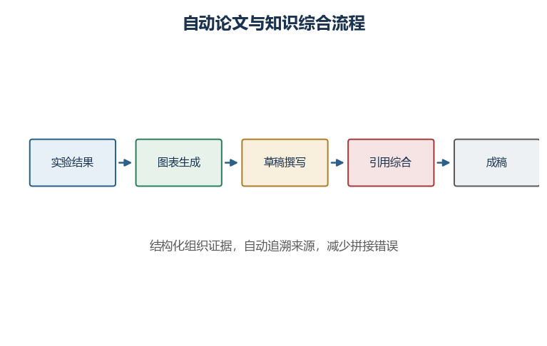

## 31.3　论文生成与知识图谱更新的形式化

设实验结果为 $\mathcal{R}$（第 30 章产出），知识库为 $\mathcal{K}$。论文生成可视为一个条件生成过程：

$$
P_{\theta}(W\mid \mathcal{R},\mathcal{K})=\prod_{i=1}^{n}P_{\theta}(w_i\mid w_{<i},\mathcal{R},\mathcal{K}),\tag{31-1}
$$

其中 $W=(w_1,\ldots,w_n)$ 为论文的词元序列。式 (31-1) 是标准自回归语言模型，但关键在**条件**：生成的每一部分须「有据可依」——实验结果 $\mathcal{R}$ 与知识库 $\mathcal{K}$。

为保证可追溯性，引入** grounded 生成**约束：每个论断 $c$ 必须可由某个证据 $s\in\mathcal{R}\cup\mathcal{K}$ 支持。定义支持度

$$
\mathrm{Supp}(c)=\max_{s\in\mathcal{R}\cup\mathcal{K}}\ \mathbb{P}(c\mid s),\tag{31-2}
$$

并要求 $\mathrm{Supp}(c)\ge\tau$（阈值）才写入论文。这为抑制幻觉提供了一个形式化抓手。

知识图谱用三元组 $(h,r,t)$ 表示（头实体、关系、尾实体）。综合就是把新发现 $\Delta$ 加入图谱：

$$
\mathcal{G}_{t+1}=\mathcal{G}_t\cup\Delta\quad\text{s.t.}\quad \text{一致性约束}\ \mathcal{C}(\mathcal{G}_{t+1})=\varnothing,\tag{31-3}
$$

其中一致性约束用于检测并消解矛盾（如新发现与旧结论冲突时需标注或触发重新验证）。

**grounded 生成的两个层次。** 式 (31-2) 的支持度 $\mathrm{Supp}(c)$ 只在「论断—证据」层面把关，但一篇论文的可信度还取决于「论断之间的逻辑衔接」。一个论文的每句话都可能有据，但论证链条的「隐含前提」可能无据——例如从「A 导致 B」与「B 导致 C」跳到「A 导致 C」，若中间有未声明的调节变量，则结论虽「局部有据」却「整体不成立」。因此可信度校验宜分两层：**句级**（每句话有引用，式 31-2 与 31-5 覆盖）与**段级**（论证链条无逻辑跳跃，需论证图校验）。当前系统多只做到句级，段级校验是自动论文质量评估的缺口（31.6 节边界五）。

**定义 31.2（引用可信度）**　对论文中一条引用 $q$，其可信度 $\mathrm{Cred}(q)$ 是其在真实文献库中存在且支持所声称论断的概率。$\mathrm{Cred}(q)$ 低于阈值者视为「幻觉引用」。

这一定义的关键在于「存在且支持」是两个独立条件，缺一不可：仅存在不支持（断章取义），仅支持但不存在（捏造文献），都构成幻觉引用的不同形态。31.4 节的算例正是按这两个维度分别检验的。

## 31.4　数值算例：引用可信度评分

**例 31.1（幻觉引用的检测）**　设自动生成的论文含三条引用 $q_1,q_2,q_3$。系统对每个引用检索文献库，得到「文献存在」概率与「内容匹配」概率如下：

$$
\begin{array}{c|ccc}
& q_1 & q_2 & q_3\\\hline
\mathbb{P}(\text{存在}) & 0.95 & 0.80 & 0.10\\
\mathbb{P}(\text{匹配}\mid\text{存在}) & 0.90 & 0.30 & 0.50
\end{array}\tag{31-4}
$$

引用可信度取两者乘积 $\mathrm{Cred}(q)=\mathbb{P}(\text{存在})\times\mathbb{P}(\text{匹配}\mid\text{存在})$：

$$
\mathrm{Cred}(q_1)=0.95\times0.90=0.855,\quad
\mathrm{Cred}(q_2)=0.80\times0.30=0.24,\quad
\mathrm{Cred}(q_3)=0.10\times0.50=0.05.\tag{31-5}
$$

取阈值 $\tau_{\mathrm{cred}}=0.5$，则 $q_1$ 通过，$q_2,q_3$ 被标记为可疑。$q_2$ 文献存在但内容不匹配（可能「断章取义」），$q_3$ 文献几乎不存在（典型「幻觉引用」）。这个算例说明：可信度必须同时检查「引用是否存在」与「是否真的支持论断」两个维度——仅检查前者会漏掉 $q_2$ 这类错误。

**表 31-1　论文可信度的检查维度**

| 维度 | 检查对象 | 失败表现 |
|------|----------|----------|
| 引用存在性 | 文献是否真实 | 幻觉引用（$q_3$） |
| 内容匹配 | 是否支持论断 | 断章取义（$q_2$） |
| 证据支持 | 论断有无数据支撑 | 无据断言 |
| 知识一致 | 与图谱是否冲突 | 自相矛盾 |

## 31.4a　检索增强生成与引用可信度的联合优化

31.3 节的 grounded 生成（式 31-2）要求每个论断有证据支持，但「证据从哪来」需要检索。当前主流做法是**检索增强生成**（RAG）：先从文献库 $\mathcal{K}$ 检索与当前论断最相关的 $k$ 篇文献 $\mathcal{R}_{\mathrm{top}}=\mathrm{Retrieve}(c,\mathcal{K},k)$，再让语言模型在 $\mathcal{R}_{\mathrm{top}}$ 的条件下生成。设检索返回集合 $\mathcal{R}_{\mathrm{top}}$，则论文生成概率变为

$$
P_{\theta}(W\mid \mathcal{R},\mathcal{K},\mathcal{R}_{\mathrm{top}})=\prod_{i=1}^{n}P_{\theta}(w_i\mid w_{<i},\mathcal{R},\mathcal{R}_{\mathrm{top}}),\tag{31-6}
$$

即把检索结果作为额外的条件上下文。式 (31-6) 与 31.3 节式 (31-1) 的区别在于多了一个 $\mathcal{R}_{\mathrm{top}}$ 条件——它把「记忆」外移到可检索的文献库，使模型不必「记住」所有文献，只需「找到」相关的。这一外化是 RAG 抑制幻觉的关键机制：论断必须基于实际检索到的文献，而非模型的参数化记忆。

**定义 31.3（引用检索召回率）**　对论文中的一条真实引用 $q$，设其在文献库中对应的正确文献为 $s^*$，检索返回的前 $k$ 篇中若包含 $s^*$，则记该引用被「检索命中」。一批引用中被检索命中的比例称为引用检索召回率 $\mathrm{Rec}@k$，度量检索环节对支撑论断的覆盖能力。

**例 31.2（RAG 的引用可信度提升数值）** 设某自动论文含 10 条引用，不用 RAG（纯参数化生成）时，引用「存在」概率与「内容匹配」概率的联合可信度（式 31-5 口径）平均为 $0.55$；启用 RAG（$k=5$）后，由于论断基于检索到的真实文献，「存在」概率升至 $0.92$、「匹配」概率升至 $0.85$，联合可信度升至 $0.92\times0.85=0.782$。设引用检索召回率 $\mathrm{Rec}@5=0.88$（10 条中 8.8 条被命中），则**有效可信度**应再乘召回率：$0.782\times0.88\approx0.688$。这个算例揭示了 RAG 的双重作用：检索既提升了单条引用的可信度（从 $0.55$ 到 $0.782$），其召回率又是对可信度的折扣（$0.88$）——若 $\mathrm{Rec}@k$ 很低，RAG 的实际收益会被漏检的引用拖垮。因此评估 RAG 系统必须同时报告「单条可信度」与「检索召回率」，二者缺一不可（呼应第 32 章多维评估）。

**检索质量的两个维度。** $\mathrm{Rec}@k$ 只度量「正确文献是否被找到」（召回），但检索还可能有「查准率」（precision）问题：返回的前 $k$ 篇中若混入大量无关文献，语言模型可能被误导，生成「看似有据实则错引」的论断。因此 RAG 的检索环节需同时优化召回与查准——这与第 23 章文献发现、检索系统的评估指标（precision/recall/F1）一脉相承。实践中常用「重排序」（re-rank）提升查准：先粗检索大候选集，再用交叉编码器精排。但重排序本身有计算成本，$k$ 的选取是召回、查准、成本的三方权衡——这正是第 32 章「多维权重」在检索端的体现。

## 31.5　技术谱系

**表 31-2　自动写作与知识综合谱系**

| 方向 | 核心方法 | 代表 | 文献 |
|------|----------|------|------|
| 基于模板的生成 | 预定义结构填充 | 早期报告系统 | [1] |
| 数据到文本 | 结构化数据→自然语言 | WebNLG | [7] |
| LLM 论文生成 | 自回归长文本生成 | AI Scientist | [6] |
| 知识图谱构建 | 实体关系抽取 | 科学知识图谱 | [4] |
| 文献综合 | 检索+摘要+综合 | 综述生成 | [1][5] |

早期模板方法可控但僵硬；LLM 方法灵活但易幻觉。当前趋势是**检索增强生成**（retrieval-augmented generation，RAG）[5]：先检索真实文献，再基于检索结果生成，以平衡灵活性与可信度。

从谱系看，这条演进的主线是「可信度与灵活性的持续再平衡」：模板法用结构换可信（牺牲灵活），纯 LLM 用灵活换表达（牺牲可信），RAG 则把「记忆」外移到检索库、把「生成」留给 LLM，使两者兼得。知识综合侧的主线则相反——从「人工标注三元组」到「抽取式自动构建」再到「LLM 辅助综合」，可信度靠抽取约束与冲突校验来保。两条主线的交汇点正是 RAG + 冲突消解（31.5a 节式 31-7）：用检索保论文可信，用置信度仲裁保图谱一致。理解这条「可信度—灵活性」的张力，是把握自动论文与知识综合未来走向的钥匙。

## 31.5a　知识图谱更新的冲突消解与置信度

31.3 节式 (31-3) 只要求一致性约束 $\mathcal{C}(\mathcal{G}_{t+1})=\varnothing$，但未说明冲突具体如何消解。实际知识库中，新发现 $\Delta$ 与旧三元组常直接矛盾（如「化合物 A 催化反应 R」与「化合物 A 不催化反应 R」）。一个可操作的消解规则是**置信度仲裁**：每条三元组 $(h,r,t)$ 带一个来源置信度 $\mathrm{conf}(h,r,t)\in[0,1]$（由其引用可信度、实验重复次数等决定），当新三元组与旧三元组冲突时，保留置信度高者，低者转入「争议集」并触发第 30 章的重新验证。设冲突双方置信度为 $\mathrm{conf}_\mathrm{new},\mathrm{conf}_\mathrm{old}$，则

$$
\mathrm{Resolve}(\Delta,\mathcal{G}_t)=\begin{cases}\text{接受 }\Delta,\ \text{旧三元组转争议集},& \mathrm{conf}_\mathrm{new}>\mathrm{conf}_\mathrm{old}\\ \text{丢弃 }\Delta,\ \text{保留旧三元组},& \mathrm{conf}_\mathrm{new}\le\mathrm{conf}_\mathrm{old}\end{cases}\tag{31-7}
$$

**例 31.3（冲突消解的手算）** 设知识库已有三元组「材料 X 抑制晶体生长」，其来源为 3 篇独立实验（置信度 $\mathrm{conf}_\mathrm{old}=0.80$）。新自动论文提出相反三元组「材料 X 促进晶体生长」，来源为 1 篇单次实验（$\mathrm{conf}_\mathrm{new}=0.55$）。按式 (31-7)，$\mathrm{conf}_\mathrm{new}=0.55\le0.80=\mathrm{conf}_\mathrm{old}$，故丢弃新三元组、保留旧结论，并把「材料 X 促进」转入争议集待验证。若后续积累 4 篇支持「促进」的独立实验使 $\mathrm{conf}_\mathrm{new}$ 升至 $0.85>0.80$，则冲突反转——旧结论转争议、新结论入库。这个算例说明：**知识综合不是「新的一定覆盖旧的」，而是「置信度高的覆盖低的」，且冲突双方都保留以待验证**——它把第 28 章闭环的「重新打开」机制落实到了知识层。

**表 31-3　知识综合的冲突处理策略**

| 策略 | 规则 | 风险 |
|------|------|------|
| 置信度仲裁（式 31-7） | 高置信覆盖低置信 | 依赖置信度标定准确 |
| 时间优先 | 新覆盖旧 | 易被单次错误覆盖 |
| 保守合并 | 冲突双方都保留标注 | 图谱膨胀、检索噪声 |
| 触发重验 | 冲突即开新实验 | 成本上升 |

保守合并与触发重验常与置信度仲裁组合使用：先仲裁，再对争议集触发重验——这使知识综合本身成为科学循环的一部分，而非单纯的「归档」。

## 31.6　边界与讨论

**边界一：幻觉与虚假引用。** 如例 31.1 所示，LLM 可能生成不存在的文献或错误引用。这不是「文笔问题」，而是诚信问题（第 33 章）。缓解手段包括 RAG、引用可信度校验（式 31-5）与人类审核。

**边界二：论证质量。** 一篇论文的价值在于论证的逻辑严密，而非语言流畅。当前系统能生成「格式正确」的论文，却难以保证「论证正确」——这与第 29 章「生成不等于发现」、第 28 章边界二一脉相承。

**边界三：署名与责任。** 自动生成的论文由谁署名、谁对错误负责？这是尚未解决的法律与伦理问题（第 33 章）。

**边界四：知识冲突的处理。** 式 (31-3) 的一致性约束在遇到「新发现推翻旧结论」时应如何处理？简单丢弃旧知识会丢失信息，正确做法是标注冲突并触发第 30 章的重新验证——这把闭环重新打开。31.5a 节式 (31-7) 的置信度仲裁给出了具体规则，但其前提是置信度标定准确——若「单次实验」的置信度被系统性高估（如忽略了实验的重复性），仲裁会把错误的新结论误入库。因此置信度标定本身需要审计（第 33 章），不能由生成系统自行设定。

**边界五：论文生成的「结构正确」与「论证正确」之分。** 当前 LLM 能生成结构完整（摘要—引言—方法—结果—讨论）、引用齐全的论文，但「结构正确」不等于「论证正确」——逻辑链条可能有跳步、因果可能有倒置、统计推断可能误用。自动评审（第 32 章）能抓出部分结构问题，却难以判断论证的逻辑严密性，这仍是人类审稿的不可替代价值。把「结构质量」与「论证质量」分开评估，是自动论文评估尚未解决的难题。具体地，「结构正确」可用模板匹配与引用完整性自动检验，而「论证正确」需要论证图（argument graph）的可达性与一致性分析——后者在 NLP 中已有基础，但尚未被引入科学论文的自动评估流水线，是第 32 章评估维度 $I$（可解释性/论证质量）落地的关键技术缺口。

**边界六：署名与责任的法律真空。** 自动生成的论文由谁署名、谁对错误负责，当前没有统一答案。主流做法是把人类作者（设计实验者、监督者）列为第一责任人，AI 列为「工具」。但这与 AI Scientist 的高自主性（L3—L4，第 28 章）存在张力：若 AI 实质性地提出了假设并完成了实验，把责任全部推给人类作者可能不公平，也可能掩盖系统的实际贡献。这一法律与伦理真空需第 33 章与第 40 章的治理框架逐步填补。

**边界七：知识综合的「雪球效应」与污染扩散。** 若一条幻觉引用或错误结论进入知识库 $\mathcal{G}$，它会被后续综合反复引用，形成「自我引用的雪球」——错误被越多后续论文引用，其置信度被推得越高，越难被纠正。这与第 33 章的「知识库污染」直接相关，也解释了为何引用可信度校验（式 31-5）与冲突消解（式 31-7）必须前置——一旦污染进入图谱，清理成本远高于预防。

这些边界表明：自动论文与知识综合是闭环的「输出端」，但其可靠性直接决定整个 AI Scientist 的可信度。

## 31.7　承上启下

本章展开了第 28 章闭环的最后环节：定义了知识综合（定义 31.1）与引用可信度（定义 31.2），以式 (31-1)—式 (31-3) 形式化论文生成、证据支持约束与知识图谱更新，用数值算例（例 31.1）展示引用可信度评分如何区分幻觉引用与断章取义，并梳理从模板生成到 RAG 的谱系（表 31-2）。31.4a 节引入 RAG 生成（式 31-6）与引用检索召回率（定义 31.3），例 31.2 量化了 RAG 对可信度的双重作用；31.5a 节给出冲突消解的置信度仲裁（式 31-7）与例 31.3，并对照四种冲突处理策略（表 31-3）。本章与第 23 章的文献发现、第 30 章的实验数据紧密相连。至此，第 28 章描述的自动化闭环（假设→实验→论文→知识回流）已被逐环展开。

然而，一个根本问题贯穿本篇始终：我们如何判断这个闭环产出的成果**好不好**？第 32 章转向评估，讨论准确性、泛化、可解释与发现价值等多维指标。本章的「可信度」正是其中 $I$（可解释性/论证质量）维度的论文端体现，而「知识综合的一致性」则是发现价值 $N$ 能否被后续复用的前提——二者共同构成第 32 章评估框架的输入。

## 本章小结

本章论述 AI Scientist 的产出一端：自动论文与知识综合。首先以动机切入：写作瓶颈、文献过载、知识累积需求，并定义知识综合（定义 31.1）与其实体对齐的工程难点。接着用「主编与图书管理员」的直觉与图 31-1 解释流程及风险点，强调「先论文可信、后知识可靠」的顺序依赖。随后以式 (31-1) 形式化论文自回归生成、式 (31-2) 定义证据支持度、式 (31-3) 定义知识图谱更新的一致性约束，并定义引用可信度（定义 31.2）。数值算例（例 31.1）量化了三类引用问题；31.4a 节引入 RAG 生成（式 31-6）与检索召回率（定义 31.3），例 31.2 显示 RAG 的双向作用；31.5a 节给出冲突消解的置信度仲裁（式 31-7）与例 31.3、策略对照（表 31-3）。表 31-1、31-2 分别总结可信度检查维度与技术谱系。我们讨论七条边界：幻觉虚假引用、论证质量、署名责任、知识冲突、结构与论证之分、署名法律真空、雪球污染。这些辨析衔接第 6、23、28—30、32—33 章。下一章讨论如何评估 AI Scientist 与科学智能系统的成果。

**进一步阅读**　本章建议延伸阅读文献 [1]、[4]、[5]、[6]，并参考第 6 章知识工程与第 23 章文献发现的原始论述。

## 参考文献

[1] Swanson D R. Online knowledge discovery: The case of literature-based discovery. *IEEE Intelligent Systems*, 2001, 16(3): 39–44.

[2] Wang H, Fu T, Du Y, et al. Scientific discovery in the age of artificial intelligence. *Nature*, 2023, 620(7972): 47–60.

[3] Krenn M, von Rudorff G F, Ash J, et al. AI for science and the rise of the autonomous discovery. *Nature Physics*, 2024, 20: 178–182.

[4] Ji S, Pan S, Cambria E, et al. A survey on knowledge graphs: Representation, acquisition, and applications. *IEEE Transactions on Neural Networks and Learning Systems*, 2022, 33(2): 494–514.

[5] Lewis P, Perez E, Piktus A, et al. Retrieval-augmented generation for knowledge-intensive NLP tasks. *NeurIPS*, 2020, 33: 9459–9474.

[6] Lu C, Lu C, Lange R T, et al. The AI Scientist: Towards fully automated open-ended scientific discovery. *arXiv:2408.06292*, 2024.

[7] Gardent C, Shimorina A, Narayan S, et al. Creating training corpora for NLG micro-planners. *ACL*, 2017: 179–188.

[8] Zhang Z, Yang Y, et al. A survey on retrieval-augmented generation. *arXiv:2312.10997*, 2023.

---

# 第 32 章　科学智能的评估

前面各章介绍了大量方法与系统：从 PINN（第 5 章）到神经算子（第 6 章），从符号回归（第 20 章）到 AI Scientist（第 28—31 章）。一个不可回避的问题是：**如何判断这些方法好不好？** 本章讨论科学智能的评估（evaluation of AI for Science）。这并非简单地套用机器学习的准确率指标——科学智能的目标多样，评估维度也因此多元而复杂。

本章先讨论动机与评估的特殊性（32.1 节），给出直觉解释（32.2 节），形式化多维度评估框架（32.3 节），用数值算例展示多指标权衡（32.4 节），梳理评估维度与基准的谱系（32.5 节），讨论人类对齐与评估边界（32.6 节），最后承上启下（32.7 节）。

## 32.1　引入动机：为什么准确率不够用

在常规机器学习中，评估往往归结为一个数字——测试集准确率或损失。但科学智能不能如此。

**其一，目标多元。** 一个模型可能预测准确却违背物理定律（第 1 章「预测准不等于物理正确」），也可能精度略低却发现了一条新规律。单一准确率无法刻画这些差异。**其二，外推要求。** 科学要求在训练分布之外成立，而内插测试集的准确率无法反映外推能力（第 1 章）。**其三，发现价值。** AI Scientist 的核心产出是「发现」，而发现的价值往往是反常的、事后才被承认的（第 28 章边界三）。

这三条特殊性共同指向一个结论：**科学智能的评估对象不是「模型」，而是「科学贡献」。** 前者可用单一指标（准确率）概括，后者必须多维刻画——因为「贡献」既包含预测能力（$A$），也包含可推广性（$G$）、可理解性（$I$）与原创性（$N$）。把评估对象从模型上移到贡献，是本章四维框架（32.3 节）的立论基础，也解释了为何照搬机器学习基准（只测 $A$）会系统性低估科学智能的价值。

**定义 32.1（科学智能评估）**　对科学智能系统按多个维度（至少含准确性、泛化性、可解释性、发现价值）进行系统度量，并据此判断其是否达到科学要求的过程，称为科学智能评估。

## 32.2　直觉解释：一张多维的成绩单

**直觉解释。** 评估一个科学智能系统，不是给它打一个总分，而是像一张**多维成绩单**：准确性是「考试分数」，泛化性是「举一反三能力」，可解释性是「能否讲清道理」，发现价值是「是否做出了真贡献」。一个偏科的系统可能在某些维度很强、另一些维度很弱，单看总分会掩盖这种结构。图 32-1 展示了四维评估的雷达图示意。

这种「多维成绩单」的直觉还有一个常被忽视的推论：**四维之间可能存在负相关。** 例如追求新颖性 $N$（提出反常假设）可能牺牲准确性 $A$（反常假设往往先在训练集上表现差）；追求可解释性 $I$（简单模型）可能牺牲泛化性 $G$（复杂模型有时外推更好）。若四维独立，雷达图四个轴可分别优化；若存在负相关，则四维构成一个**权衡前沿**，系统只能在前沿上移动而无法全面提升——这与第 29 章假设生成的「新颖—可验证」张力、第 30 章实验设计的「信息—成本」权衡是同一类结构。因此评估时应同时报告四维得分**与它们的联合分布**（如相关性矩阵），而非只画雷达图。

> 【图 32-1　科学智能的四维评估雷达图】（原图见 figures/图32-1.png）：绘制四边形雷达图，四轴分别为「准确性、泛化性、可解释性、发现价值」，画出两个系统的轮廓以对比其偏科情况。

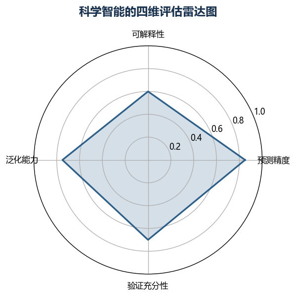

这张成绩单还引出第二个直觉：**不同任务需要不同的权重**。蛋白质结构预测主要看准确性；而 AI Scientist 主要看发现价值。评估框架必须允许「按任务加权」。

更进一步，这张成绩单还揭示第三个直觉：**「偏科」本身不是缺陷，而是信息。** 一个 $A$ 高但 $N$ 低的系统，可能是「稳健的拟合器」，适合做工程应用；一个 $N$ 高但 $A$ 低的系统，可能是「冒险的探索者」，适合做前沿发现。评估的目标不是把它们压成同一个总分去排名，而是**刻画各自的能力轮廓**，让使用者按任务选择——正如企业招聘不只看「总分」，而看「能力雷达图」。把评估理解为「画像」而非「打分」，能避免例 32.2 中「权重一改，排名全变」的焦虑：排名变是因为权重变了，但每个系统的能力轮廓（四维得分）是不变的，只是投影方向不同。这一视角把评估从「竞赛排名」转向「能力诊断」，是负责任评估的哲学基础。

## 32.3　多维度评估的形式化

设系统 $\mathcal{M}$ 在任务 $T$ 上接受评估，定义四维指标向量：

$$
\mathbf{v}(\mathcal{M},T)=\big(A(\mathcal{M},T),\ G(\mathcal{M},T),\ I(\mathcal{M},T),\ N(\mathcal{M},T)\big),\tag{32-1}
$$

其中 $A$ 为准确性（accuracy），$G$ 为泛化性（generalization），$I$ 为可解释性（interpretability），$N$ 为发现价值（novelty/discovery value）。

**准确性 $A$。** 在分布内测试集上的标准指标，如均方误差、准确率、$R^2$：

$$
A=\frac{1}{|\mathcal{D}_{\text{test}}|}\sum_{(\mathbf{x},y)\in\mathcal{D}_{\text{test}}}\ell(\mathcal{M}(\mathbf{x}),y).\tag{32-2}
$$

**泛化性 $G$。** 衡量分布外（out-of-distribution，OOD）表现。设 $\mathcal{D}_{\text{ood}}$ 为与训练集不同分布的测试集，则

$$
G=\frac{A_{\mathcal{D}_{\text{ood}}}}{A_{\mathcal{D}_{\text{test}}}}\quad\text{（越接近 1 越好）},\tag{32-3}
$$

或用分布偏移下的最坏表现 $G=\min_{s\in\mathcal{S}}A_s$（第 6 章的鲁棒性）。

**可解释性 $I$。** 难以单一量化，常用代理指标：符号表达式复杂度（第 20 章）、特征归因稳定性、物理一致性检验通过率。一个可操作的代理是把 $I$ 分解为「简洁度」「归因稳定性」「物理一致性」三项归一化后的均值：

$$
I=\frac{1}{3}\Big(\underbrace{\big(1-\mathrm{Comp}(h)\big)}_{\text{简洁}}+\underbrace{\mathrm{Stab}(\mathrm{Attr})}_{\text{归因稳定}}+\underbrace{\mathrm{Phys}(h)}_{\text{物理一致}}\Big),\tag{32-4}
$$

其中 $\mathrm{Comp}$ 为表达式复杂度（归一化到 $[0,1]$，越小越简洁）、$\mathrm{Stab}(\mathrm{Attr})$ 为归因稳定性（扰动输入时归因变化小的程度）、$\mathrm{Phys}(h)$ 为物理一致性检验通过率（如守恒律、对称性检查）。

**例 32.1（可解释性的三代理计算）** 设某符号回归发现的假设 $h$：表达式复杂度 $\mathrm{Comp}(h)=0.3$（较简洁），归因稳定性 $\mathrm{Stab}=0.8$，物理一致性 $\mathrm{Phys}=1.0$（通过全部守恒检查）。代入式 (32-4)：$I=\frac{1}{3}\big((1-0.3)+0.8+1.0\big)=\frac{1}{3}(0.7+0.8+1.0)=\frac{2.5}{3}\approx0.833$。这个算例说明：可解释性虽无「唯一」度量，但用多个正交代理的均值能给出稳健的代理量——单一代理（如只看复杂度）会被「简单的错误假设」蒙混过关，三代理联合才能同时惩罚「复杂」「归因不稳定」「物理不一致」。这比第 31 章「段级论证校验」更可计算，是 $I$ 落地的一个务实路径。

**发现价值 $N$。** 最难量化。可用「相对于当前知识的新颖性 + 后续被验证/引用次数」近似：

$$
N=\mathrm{Nov}(h,\mathcal{K})\cdot\Big(1+\log(1+\mathrm{Cite}(h))\Big),\tag{32-5}
$$

其中 $\mathrm{Nov}$ 为第 29 章式 (29-2) 的新颖性，$\mathrm{Cite}(h)$ 为该发现的被引用或复现次数。式 (32-5) 承认发现价值有时间滞后性——真正的价值往往事后才显现。

综合评分按任务加权：

$$
Q(\mathcal{M},T)=w_AA+w_GG+w_II+w_NN,\quad \sum w_i=1.\tag{32-6}
$$

**定义 32.2（人类对齐评估）**　当评估维度（尤其是 $I$ 与 $N$）无法完全自动量化时，引入人类专家的判断并与模型指标校准，使评估结果符合人类的科学判断，称为人类对齐评估（human-aligned evaluation）。

## 32.4　数值算例：多指标权衡

**例 32.2（两个系统的成绩单比较）**　设两个科学发现系统 $M_1,M_2$ 在四维指标上的得分（已归一化到 $[0,1]$）如下：

$$
\begin{array}{c|cccc}
& A & G & I & N\\\hline
M_1 & 0.95 & 0.60 & 0.40 & 0.30\\
M_2 & 0.85 & 0.85 & 0.75 & 0.70
\end{array}\tag{32-7}
$$

$M_1$ 准确性高但偏科；$M_2$ 各项均衡。取蛋白质结构预测任务的权重 $(w_A,w_G,w_I,w_N)=(0.6,0.2,0.1,0.1)$，由式 (32-6)：

$$
Q(M_1)=0.6\times0.95+0.2\times0.60+0.1\times0.40+0.1\times0.30=0.57+0.12+0.04+0.03=0.76,\tag{32-8}
$$

$$
Q(M_2)=0.6\times0.85+0.2\times0.85+0.1\times0.75+0.1\times0.70=0.51+0.17+0.075+0.07=0.825.\tag{32-9}
$$

此任务下 $M_2$ 反而胜出（0.825 > 0.76），因权重分散了对单一准确性的关注。若换成「AI Scientist 发现任务」，权重变为 $(0.1,0.1,0.2,0.6)$：

$$
Q(M_1)=0.095+0.06+0.08+0.18=0.415,\quad
Q(M_2)=0.085+0.085+0.15+0.42=0.74.\tag{32-10}
$$

$M_2$ 优势更大。这说明：**评估结论依赖于任务权重的选择**，因此权重必须公开、有依据。这个算例也呼应第 28 章式 (28-3) 中价值函数 $V$ 需人类定义。

**表 32-1　四维评估指标概览**

| 维度 | 代表指标 | 主要挑战 |
|------|----------|----------|
| 准确性 $A$ | MSE、$R^2$ | 与物理正确性脱节 |
| 泛化性 $G$ | OOD 误差比 | 分布偏移难定义 |
| 可解释性 $I$ | 复杂度、归因稳定性 | 无公认度量 |
| 发现价值 $N$ | 新颖性×引用 | 时间滞后、主观 |

## 32.4a　评估结果的不确定性与置信区间

例 32.2 给出的 $Q(M_1)=0.76$、$Q(M_2)=0.74$ 是**点估计**，但评估本身基于有限样本的测试集，存在抽样不确定性。两个系统分数相差 $0.02$，可能只是测试集划分的噪声，而非真实差异。因此严谨的评估必须报告**置信区间**而非单一数字。

设综合评分 $Q$ 在测试集上逐样本计算（每个样本给出一个 $q_i$），则 $Q$ 的抽样分布可用自助法（bootstrap）估计：从 $|\mathcal{D}_{\text{test}}|$ 个样本中有放回地重采样 $B$ 次（如 $B=1000$），每次算一个 $\hat Q^{(b)}$，取第 $2.5\%$ 与第 $97.5\%$ 分位作为 $Q$ 的 $95\%$ 置信区间

$$
\mathrm{CI}_{95}(Q)=\big[\,\mathrm{quantile}(\{\hat Q^{(b)}\}_{b=1}^{B},\,0.025),\ \mathrm{quantile}(\{\hat Q^{(b)}\}_{b=1}^{B},\,0.975)\,\big].\tag{32-11}
$$

**例 32.3（置信区间的显著性判断）** 设某系统在 $|\mathcal{D}_{\text{test}}|=200$ 个样本上的逐样本评分 $\hat Q^{(b)}$ 经 $1000$ 次自助重采样后，第 $2.5\%$ 分位为 $0.72$、第 $97.5\%$ 分位为 $0.80$，则 $\mathrm{CI}_{95}(Q)=[0.72,0.80]$。若另一系统的区间为 $[0.70,0.78]$，两区间重叠，则「系统 A 优于系统 B」不显著——尽管点估计 $0.76>0.74$。只有当两区间不重叠（或配对检验 $p<0.05$）时，差异才可信。这个算例揭示了一个常见错误：**只看点估计排名，而不看区间是否重叠**——第 32 章四维指标若都只报点值，会系统性高估系统间差异，导致「为 $0.02$ 的分数差而争论」的无效比较。把区间纳入报告，是评估从「报数」走向「可证伪」的关键一步，也呼应第 33 章的可复现性——区间本身是复现性的代理量。

## 32.5　基准与评估谱系

**表 32-2　科学智能评估基准谱系**

| 基准/数据集 | 领域 | 评测维度 | 文献 |
|-------------|------|----------|------|
| QM9 | 分子性质 | 准确性 $A$ | [4] |
| PDB / CASP | 蛋白质结构 | 准确性 $A$ | [5] |
| AlphaFold DB | 蛋白质结构 | 覆盖度与精度 | [5] |
| MatterSim/OMat24 | 材料势能 | 泛化 $G$ | [6] |
| PDEBench | 偏微分方程 | 泛化 $G$ | [7] |
| ScienceQA / SciEval | 科学推理 | 综合 $Q$ | [3][8] |

从谱系看，表 32-2 的基准有一条隐含的时间轴：早期基准（QM9、PDB/CASP）诞生于「模型比实验便宜」之前，主要服务于准确性竞赛（CASP 是蛋白质结构预测的「世界杯」）；近年基准（MatterSim、PDEBench）开始引入泛化与外推维度，回应「模型是否在分布外成立」的科学要求；最新的 ScienceQA/SciEval 则试图用「综合 $Q$」模拟真实科学推理。这条轴与第 28 章 AI Scientist 的自主性等级演进同构——评估基准也在从「单维准确性」走向「多维综合」。理解这条轴，能解释为何「发现价值 $N$」的基准至今空白：它需要时间积累（引用数）与人类判断（专家评），而这两者都无法被一个静态基准自动提供。

值得注意的是：多数现有基准集中在**准确性**与**泛化性**，而**发现价值**与**可解释性**的基准仍不成熟——这正是第 34 章工具链需要补齐的环节。

## 32.5a　基准的「污染风险」与隐藏测试集

表 32-2 的基准一旦公开，就面临第 32.6 节边界一的古德哈特定律：模型会针对基准过拟合。一个标准的缓解是**隐藏测试集**（holdout）机制：基准维护者保留一部分子任务 $\mathcal{T}_{\mathrm{hidden}}$ 不公开，模型开发者只能在 $\mathcal{T}_{\mathrm{public}}$ 上训练与调试，最终成绩由维护者用 $\mathcal{T}_{\mathrm{hidden}}$ 评测。定义基准的**防过拟合度**为

$$
\mathrm{HoldOut}(\mathcal{B})=\frac{|\mathcal{T}_{\mathrm{hidden}}|}{|\mathcal{T}_{\mathcal{B}}|},\tag{32-12}
$$

即隐藏子任务占基准子任务的比例。$\mathrm{HoldOut}$ 越高，模型针对公开子任务过拟合的空间越小，但开发者的调试反馈也越少——过高的隐藏比例会使开发陷入「盲调」。实践中常取 $\mathrm{HoldOut}\approx0.2\sim0.3$。

**例 32.4（隐藏集对过拟合的抑制数值）** 设某基准含 $|\mathcal{T}_{\mathcal{B}}|=20$ 个子任务，其中公开 $16$、隐藏 $4$（$\mathrm{HoldOut}=0.2$）。某模型在公开集上针对每个子任务精调，公开成绩达到 $0.95$；但因精调只针对公开 $16$ 个，隐藏 $4$ 个上平均为 $0.78$。综合成绩（按 32.4 节口径，等权）为 $\frac{16\times0.95+4\times0.78}{20}=\frac{15.2+3.12}{20}=0.916$。若该基准 $100\%$ 公开（$\mathrm{HoldOut}=0$），模型可在公开集上刷到 $0.96$ 且无隐藏集拉低，但这一成绩无法反映真实泛化——隐藏集把「刷分」空间压缩到 $80\%$，使综合成绩更贴近真实能力。这个算例说明：**隐藏集不是「藏起来不评」，而是「用未参与过拟合的子任务校准成绩」**，它是第 33 章可复现性在基准层面的制度化，也是评估结论可信的前提。

**表 32-3　基准防污染机制**

| 机制 | 做法 | 成本 |
|------|------|------|
| 隐藏测试集（式 32-12） | 保留子任务不参与开发 | 调试反馈减少 |
| 定期轮换 | 公开集周期性更换 | 历史成绩不可比 |
| 动态生成 | 按种子生成新任务 | 需任务生成器 |
| 防泄漏审计 | 检测训练集是否含测试样本 | 需数据溯源 |

隐藏集与定期轮换、防泄漏审计常组合使用，构成第 34 章「基准质量」中协议一致性 $C_{\mathcal{P}}$ 的一部分——基准不仅要比「数据多」，还要比「防污染机制健全」。

## 32.6　边界与讨论

**边界一：古德哈特定律。** 「当一个指标成为目标，它就不再是好指标。」一旦以某基准优化模型，模型可能过拟合基准而非真正提升科学能力。因此评估需持续更新基准、避免单一指标崇拜。

**边界二：发现价值的滞后。** 式 (32-5) 中的引用数需要时间积累，短期评估会低估真正突破性的发现（第 28 章边界三）。这要求结合「前瞻性专家评审」与「回溯性计量」。

**边界三：人类对齐的主观性。** 定义 32.2 的人类判断本身带有偏差与分歧，需通过多评审一致性校准，不能指望单个专家。

**边界四：评估与诚信的交叉。** 若基准被污染（测试数据泄露）或结果被选择性报告，评估就失去意义——这直接关联第 33 章的可复现性与科学诚信。

**边界五：权重的主观性与「评估博弈」。** 式 (32-6) 的权重 $(w_A,w_G,w_I,w_N)$ 是研究目标的表达（第 28 章式 28-6），但不同机构可能用不同权重「挑选」对自己有利的结论——例如材料机构重 $A$、基础研究机构重 $N$。若权重不公开，同一系统在不同权重下可能「都好」或「都差」，评估沦为话术。因此权重必须像实验协议一样公开、有领域共识依据，且对同一任务的评估应使用同一套权重（第 34 章协议一致性 $C_{\mathcal{P}}$ 在评估端的要求）。

**边界六：发现价值的「幸存者偏差」。** 式 (32-5) 用引用数 $\mathrm{Cite}(h)$ 近似发现价值，但引用数只统计「被引用的发现」，而被否决、被推翻或从未发表的反常结果（往往是最有科学价值的）不计在内。这使评估系统性偏向「已证实的发现」，低估「失败实验」的价值——而科学史表明，许多突破恰恰始于被误判为失败的异常。缓解是建立「负结果登记」（negative result registry），把「未能复现」「反常但无解释」的结果也纳入评估对象，但这在现行「只发正面结果」的发表文化下极难落地（第 33 章边界三激励扭曲）。

**边界七：评估的「可计算性」与「可判定性」之分。** 准确性 $A$ 与泛化性 $G$ 可自动计算（跑测试集即可），可解释性 $I$ 部分可计算（复杂度、归因稳定性），但发现价值 $N$ 与部分 $I$（论证严密性）本质上是**可判定性**问题——需要人类专家做最终裁定。因此任何「全自动评估」都只能是「计算 + 人类对齐」的混合，声称「完全客观的自动评分」是范畴错误。定义 32.2 的人类对齐评估不是「辅助」，而是评估体系中不可剥离的一部分。

这些边界说明：评估不是中性的技术环节，而涉及价值判断与制度设计。

## 32.7　承上启下

本章建立科学智能的评估框架：定义四维指标（定义 32.1）与向量（式 32-1—32-5）、任务加权综合评分（式 32-6）、人类对齐评估（定义 32.2），用数值算例（例 32.2）展示权重如何改变结论，并梳理基准谱系（表 32-2）。32.3 节补了可解释性的三代理分解（式 32-4）与例 32.1，32.4a 节引入置信区间（式 32-10）与例 32.3，32.5a 节给出防过拟合度（式 32-11）、例 32.4 与防污染机制（表 32-3）。它回应了第 1 章「预测准不等于物理正确」与第 28 章「发现价值需人类定义」。本章关于「评估被污染则失去意义」的讨论，直接引出第 33 章的可复现性与科学诚信——若过程不可复现、不诚信，任何评估都建立在流沙之上。

## 本章小结

本章论述科学智能的评估。首先指出准确率不足以刻画科学智能的特殊性（目标多元、外推要求、发现价值），并论证评估对象是「科学贡献」而非「模型」，定义科学智能评估（定义 32.1）。接着用「多维成绩单」直觉与图 32-1 解释四维评估，并提出「画像而非打分」的评估哲学。随后以式 (32-1) 定义指标向量，式 (32-2)—式 (32-5) 分别刻画准确性、泛化性、可解释性、发现价值（其中可解释性用三代理分解，式 32-4、例 32.1），式 (32-6) 给出任务加权综合评分，并定义人类对齐评估（定义 32.2）。数值算例（例 32.2）显示权重选择如何改变系统排名；32.4a 节用式 (32-10) 与例 32.3 强调置信区间；32.5a 节用式 (32-11)、例 32.4 与表 32-3 讨论基准防污染；表 32-1、32-2 分别总结指标与基准谱系。我们讨论七条边界：古德哈特定律、发现价值滞后、人类主观性、评估与诚信交叉、权重博弈、幸存者偏差、可计算性与可判定性之分。这些辨析衔接第 1、6、20、28—29、31、33—34 章。下一章讨论可复现性与科学诚信，为评估提供可信的制度基础。

**进一步阅读**　本章建议延伸阅读文献 [1]、[2]、[3]、[8]。

## 参考文献

[1] Wang H, Fu T, Du Y, et al. Scientific discovery in the age of artificial intelligence. *Nature*, 2023, 620(7972): 47–60.

[2] Krenn M, von Rudorff G F, Ash J, et al. AI for science and the rise of the autonomous discovery. *Nature Physics*, 2024, 20: 178–182.

[3] Zhang X, et al. SciEval: A multi-level large language model evaluation for scientific research. *arXiv:2308.11386*, 2023.

[4] Ramakrishnan R, Hartman D J, Ahrens J, et al. Quantum chemistry structures and properties of 134 kilo molecules. *Scientific Data*, 2014, 1: 140022.

[5] Jumper J, Evans R, Pritzel A, et al. Highly accurate protein structure prediction with AlphaFold. *Nature*, 2021, 596(7873): 583–589.

[6] Merchant A, Batzner S, Schoenholz S S, et al. Scaling deep learning for materials discovery. *Nature*, 2023, 624: 80–85.

[7] Takamoto M, Pradesh S, Pham H, et al. PDEBench: An extensive benchmark for scientific machine learning. *NeurIPS*, 2022.

[8] Lu C, Lu C, Lange R T, et al. The AI Scientist: Towards fully automated open-ended scientific discovery. *arXiv:2408.06292*, 2024.

---

# 第 33 章　可复现性与科学诚信

第 32 章指出：若评估过程被污染，任何指标都建立在流沙之上。本章讨论为科学智能奠定可信基础的另一支柱——可复现性（reproducibility）与科学诚信（scientific integrity）。科学之所以为科学，在于其结论可被他人独立检验；人工智能进入科学后，模型、数据、代码的复杂性给这一传统要求带来全新挑战。

本章先讨论动机与「可复现性危机」（33.1 节），给出直觉解释（33.2 节），形式化可复现性的层次与判定（33.3 节），用数值算例展示随机种子对结果的影响（33.4 节），梳理可复现性实践与伦理的谱系（33.5 节），讨论 AI 伦理与诚信边界（33.6 节），最后承上启下（33.7 节）。

## 33.1　引入动机：一场正在发生的危机

传统科学正经历「可复现性危机」（reproducibility crisis）：大量已发表实验结果无法被重复。人工智能加剧了这一问题，因为深度学习结果对随机种子、数据划分、超参数极其敏感，且代码与数据往往不公开[1]。

科学智能中的可复现性问题有特殊性。**其一，计算实验的不确定性。** 神经网络训练含随机初始化、随机 mini-batch 顺序，同一代码不同种子可能产生显著差异。**其二，数据与代码的封闭。** 商业模型（如闭源大模型）不可访问，使依赖它的科学结果无法复现。**其三，AI 生成内容的责任。** 第 31 章的幻觉引用、第 29 章的虚假假设，若未经核验进入文献，会污染知识库。

这场危机的量级并非夸张。Ioannidis 的著名分析指出，在「效应量小、研究自由度大、样本量小、利益冲突多」的领域，**已发表结果中假阳性的比例可超过 50%**——也就是说，大量进入文献的「发现」本质上是统计噪声被误认为信号[9]。2015 年 Open Science Collaboration 的心理学复现项目是第一个系统性实证：对 100 项已发表心理学实验做独立重复，仅约 $36\%$ 能在统计显著性水平上得到印证，其余 $64\%$ 或显著性消失、或效应量缩水超过一半。把这两个数字放到科学智能里看，AI 研究的「可复现率」往往更低：机器学习系统多变量、少重复、报告最好种子，叠加闭源组件，使「假阳性 + 不可复现」两重风险叠加。这正是本章把可复现性提升到与「评估（第 32 章）同级」地位的原因——**若结论本身不可信，再精巧的评估也只是给沙堡刷漆**。

**定义 33.1（可复现性）**　若第三方在相同条件下（相同数据、代码、环境与随机种子）能重现原研究的结论，称为计算可复现（computational reproducibility）；若仅用相同数据、不同实现也能得到一致结论，称为方法可复现（methodological reproducibility）。

## 33.2　直觉解释：科学结论的「可重跑性」

**直觉解释。** 一个科学结论应当像一段可运行的程序：别人拿到你的「配方」（数据、代码、环境、种子），运行后应得到相同结果。如果配方缺了关键一步（如没说随机种子），或依赖一个别人拿不到的私有组件（如闭源 API），那么结论就不可复现——它不是科学，而是「只有原作者能重现」的魔术。

这里有一个重要区分：**可重复**（repeatability，同一团队同一环境）与**可复现**（reproducibility，不同团队不同环境）与**可复制**（replicability，不同数据不同方法得出相同结论）是三个层次的要求。图 33-1 展示了这一阶梯。

一个能凸显三层差异的例子是「闭源模型做科学发现」。设某团队用商业大模型 API 辅助提出一条催化机理假设，并用开源工具验证。**可重复**层：原团队用自己的 API key 重跑，结果一致——成立。**可复现**层：另一团队无法访问相同模型版本（API 已迭代升级、权重不可导出），即使用相同输入提示，输出可能不同——该层**断裂**。**可复制**层：第三团队改用另一个开源模型、另一条独立证据链，若仍得到同一机理，则「可复制」成立，这才是科学上最硬的证据。可见「可重复 < 可复现 < 可复制」的强度是递增的，而**闭源组件恰好卡在可重复与可复现之间**——它能被原作者重复，却不能被他人复现。这就是 33.6 节「边界一」的直觉根源：依赖闭源模型的研究，其可复现性天花板被模型的可访问性硬性限定。

> 【图 33-1　可复现性的三个层次】（原图见 figures/图33-1.png）：绘制三级阶梯，从下到上为「可重复（同团队）→可复现（跨团队）→可复制（跨方法）」，每级标注所需条件（代码、数据、环境、种子、独立方法）。

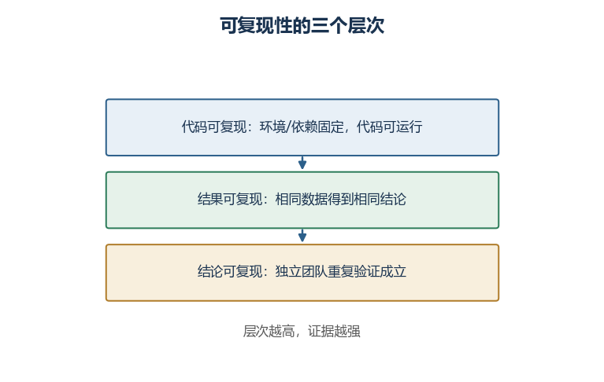

## 33.3　可复现性的形式化判定

设一项研究的结果为 $R$，其产出的「科研制品」（research artifacts）包括数据 $\mathcal{D}$、代码 $\mathcal{C}$、环境 $\mathcal{E}$、随机种子 $s$。定义复现函数

$$
R'=\mathcal{C}\big(\mathcal{D},\mathcal{E},s\big).\tag{33-1}
$$

计算可复现要求：对所有被授权的第三方，使用相同制品得到 $R'=R$（在数值容差 $\delta$ 内）：

$$
\big|R'-R\big|\le\delta.\tag{33-2}
$$

若制品不完整（如缺代码或种子），则式 (33-1) 无法被求值，复现失败。因此**制品完备性**是可复现的前提：

$$
\text{Complete}(\mathcal{D},\mathcal{C},\mathcal{E},s)=\text{True}.\tag{33-3}
$$

**定义 33.2（可复现性分数）**　一项研究的可复现性分数定义为满足的制品完备性条件比例与结果一致性程度的乘积：

$$
\rho=\text{Completeness}\times\mathbb{1}\big[|R'-R|\le\delta\big],\quad \rho\in[0,1].\tag{33-4}
$$

$\rho=1$ 表示完全可复现，$\rho=0$ 表示不可复现。式 (33-4) 强调：即使结果一致（后半项为 1），若制品不完整（完备性 < 1），仍不算完全可复现。

## 33.3a　制品的版本化与依赖锁定

「制品完备」还隐含一个时间维度：即使今天制品齐全，半年后依赖库升级、硬件换代，同样的制品也可能跑出不同结果。因此可复现要求**制品可版本化**——每个制品带一个不可变的版本指纹（hash）。设制品集合 $\mathcal{A}=(\mathcal{D},\mathcal{C},\mathcal{E},s)$，定义其**可复现指纹**为

$$
\mathrm{Finger}(\mathcal{A})=\mathrm{hash}\big(\mathrm{ver}(\mathcal{D})\,\Vert\,\mathrm{ver}(\mathcal{C})\,\Vert\,\mathrm{ver}(\mathcal{E})\,\Vert\,s\big),\tag{33-5}
$$

其中 $\mathrm{ver}(\cdot)$ 取各制品的版本标识（数据版本号、代码 commit、环境锁文件 hash、种子），$\Vert$ 为拼接，$\mathrm{hash}$ 为密码学摘要。两个研究「可复现」的充要条件是它们的指纹相同：$\mathrm{Finger}(\mathcal{A}_{\text{orig}})=\mathrm{Finger}(\mathcal{A}_{\text{rep}})$。这把 33.3 节式 (33-3) 的「完备性」从静态判断升级为**可审计的等值判断**——只需比对两个指纹，无需重跑整个实验即可判断「制品是否一致」，是第 34 章工具链（DVC 数据版本、Docker 环境锁定）的理论依据。

**例 33.2（指纹判定的手算）** 某原文制品指纹为 $\mathrm{Finger}_{\text{orig}}=\texttt{a3f9...}$（对应数据 v2.1、代码 commit $8c2e$、环境 lock hash $\texttt{b1c0}$、种子 42）。某复现者重跑时误用了环境 lock 的更新版（$\texttt{b1c1}$，某库从 2.0 升到 2.1），其余相同，则其指纹 $\mathrm{Finger}_{\text{rep}}=\mathrm{hash}(\text{v2.1}\,\Vert\,8c2e\,\Vert\,\texttt{b1c1}\,\Vert\,42)$ 与 $\mathrm{Finger}_{\text{orig}}$ 不同——即便结果数值上「碰巧」接近，按式 (33-5) 仍判为**制品不一致**，复现不算完全成立。这个算例说明：可复现性检查必须落到**指纹级**，而非「结果差不多就行」；依赖漂移是「结果不一致」的最常见根因，也是第 34 章环境锁定工具（Docker/Conda）存在的理由。指纹机制把「环境漂移」这一隐蔽故障变成了可检测的明确差异，是复现性从「凭感觉」走向「可审计」的关键。

## 33.4　数值算例：随机种子的影响

**例 33.1（种子敏感性与复现容差）**　某 PINN（第 5 章）求解 PDE，用 5 个不同随机种子训练，得到测试误差 $e_s$ 如下：

$$
\begin{array}{c|ccccc|c}
\text{种子} & 1 & 2 & 3 & 4 & 5 & \text{均值}\pm\text{标准差}\\\hline
e_s(\times10^{-3}) & 4.2 & 6.8 & 5.1 & 9.3 & 4.7 & 6.02\pm2.06
\end{array}\tag{33-6}
$$

若原文仅报告种子 1 的结果 $4.2\times10^{-3}$，而复现者用种子 4 得到 $9.3\times10^{-3}$，则绝对差为 $5.1\times10^{-3}$。若容差 $\delta=1\times10^{-3}$，则 $|R'-R|>\delta$，按式 (33-2) 判定为**不可复现**。

若原文报告了全部 5 个种子的均值±标准差，且复现者在相同环境下重跑得到均值 $6.1\pm2.1\times10^{-3}$，与原文 $6.02\pm2.06$ 的差异在 $0.08\times10^{-3}$ 内，小于 $\delta$，则按式 (33-4) 判定为可复现（制品完备且结果一致）。这个算例说明**报告多随机种子的分布**（而非单次最好结果）对可复现性至关重要——选择性报告最好种子是科学诚信问题。

**表 33-1　可复现性的关键制品**

| 制品 | 作用 | 缺失后果 |
|------|------|----------|
| 数据 $\mathcal{D}$ | 输入 | 无法重跑 |
| 代码 $\mathcal{C}$ | 实现 | 无法验证逻辑 |
| 环境 $\mathcal{E}$ | 依赖版本 | 结果漂移 |
| 随机种子 $s$ | 初始化 | 结果不可控 |

## 33.4a　可复现性的成本度量：谁为复现买单

式 (33-4) 的复现性分数 $\rho$ 是「技术成立」的量，但复现还有「经济成本」——重跑一次大规模训练可能耗费数百 GPU 小时，这对多数团队是实际障碍（33.6 节边界二）。把成本纳入，定义**复现性成本效率**

$$
\mathrm{CE}(\mathcal{R})=\frac{\rho(\mathcal{R})}{\mathrm{Cost}(\mathcal{R})}\in[0,\infty),\tag{33-7}
$$

其中 $\mathrm{Cost}(\mathcal{R})$ 为第三方复现研究 $\mathcal{R}$ 的计算+时间成本（归一化到「一个标准 GPU 小时」的倍数），$\rho$ 为式 (33-4) 的复现性分数。$\mathrm{CE}$ 高表示「花得少、复现得全」——这是「对复现者友好」的研究；$\mathrm{CE}$ 低可能因制品不全（$\rho$ 低）或复现昂贵（$\mathrm{Cost}$ 高）。一个开放科学政策的目标就是提升领域的平均 $\mathrm{CE}$：通过制品公开（降 $\rho$ 的下限）与轻量复现协议（降 $\mathrm{Cost}$）。

**例 33.3（成本效率的手算）** 设两项研究的复现成本与分数：研究 A 用 PINN 解 PDE（轻量），$\mathrm{Cost}_A=20$ GPU 小时、$\rho_A=1.0$，则 $\mathrm{CE}_A=1.0/20=0.05$；研究 B 训练大模型（重量），$\mathrm{Cost}_B=4000$ GPU 小时、$\rho_B=0.8$（因闭源组件制品不全），$\mathrm{CE}_B=0.8/4000=0.0002$。A 的 $\mathrm{CE}$ 是 B 的 250 倍——「可复现」的门槛对两者天差地别。这个算例量化了「实际不可复现」（33.6 节边界二）的含义：B 技术上若开放全部制品可复现（$\rho$ 可提至 1），但成本使多数团队无法承担，故「有效可复现性」接近零。因此复现性政策不能只要求「开放制品」，还须配套**算力共享**与**轻量复现基准**（如用小子集验证核心逻辑），否则 $\mathrm{CE}$ 仍被成本压垮——这把可复现性从「技术问题」正式纳入「资源分配」问题，是第 34 章工具链与第 40 章治理讨论的交汇点。

## 33.4b　种子敏感性的统计检验：何时「不可复现」是系统性而非偶然

单看一次复现失败（例 33.1 中种子 4 与种子 1 差 $5.1\times10^{-3}$）无法区分「该研究方差天然大」与「复现者环境有 bug」。区分二者需要把**多种子方差**本身当作可检验的量。设某研究用 $n$ 个独立种子复现，得到结果 $R_1,\dots,R_n$，样本方差

$$
s_R^2=\frac{1}{n-1}\sum_{i=1}^{n}(R_i-\bar R)^2,\qquad \bar R=\frac{1}{n}\sum_{i=1}^{n}R_i.\tag{33-8}
$$

定义**种子相对离散系数** $\mathrm{CV}_s=s_R/|\bar R|$，并以它判定研究的**种子稳健性等级**：$\mathrm{CV}_s<0.05$ 为稳健（单次结果可代表总体）、$0.05\le\mathrm{CV}_s<0.20$ 为敏感（须报告均值±标准差）、$\mathrm{CV}_s\ge0.20$ 为高度敏感（单次结果几乎无信息，须报告完整分布或换更确定的实现）。

**例 33.4（种子稳健性的手算）**　取例 33.1 的 5 个种子 $\{4.2,6.8,5.1,9.3,4.7\}\times10^{-3}$。$\bar R=6.02\times10^{-3}$，各偏差平方和为 $(1.88)^2+(0.78)^2+(0.92)^2+(3.28)^2+(1.32)^2=(3.53+0.61+0.85+10.76+1.74)\times10^{-6}=17.49\times10^{-6}$，$s_R^2=17.49/4\times10^{-6}=4.37\times10^{-6}$，$s_R\approx2.09\times10^{-3}$。$\mathrm{CV}_s=2.09/6.02\approx0.347\ge0.20$——**高度敏感**。这说明：该 PINN 研究若只报单一种子（$4.2\times10^{-3}$），读者据以复现时落在 $9.3\times10^{-3}$ 是完全在方差带内的「正常」结果，并非 bug。据此，期刊应要求此类研究至少报 $n\ge5$ 个种子的均值±标准差，否则「复现失败」的判定（式 33-2 的 $\delta$）无从设定——$\delta$ 必须与 $s_R$ 同量级，否则就是把方差噪声误判为复现失败。这把「报告多少种子」从一个写作习惯升级为一个**由数据驱动的统计要求**，与第 32 章「评估须报告置信区间」的思想完全同构。

## 33.5　实践与伦理谱系

**表 33-2　可复现性实践与伦理谱系**

| 实践/规范 | 内容 | 代表 |
|-----------|------|------|
| 制品公开 | 数据代码环境一并发布 | 开放科学[2] |
| 注册报告 | 先注册假设再执行 | 心理学改革 |
| 容器化 | Docker/Conda 固化环境 | 计算复现 |
| 盲审复现 | 审稿时重跑代码 | 会议复现性检查 |
| AI 伦理准则 | 透明、问责、公平 | 文献[3][4] |

在 AI for Science 语境下，两条伦理原则尤为突出：**透明性**（模型与决策过程可审计，对应第 31 章引用可信度、第 30 章决策日志）与**问责性**（AI 生成的发现出错时责任归属，对应第 31 章边界三）。

## 33.5a　可复现性检查单评分：把「开放制品」量化

表 33-2 列出的是规范，但「一项研究到底做到什么程度」需要可打分的标准。设检查单含 $K$ 项制品要求 $c_1,\dots,c_K$（数据、代码、环境、种子、指标定义、负结果记录等），第 $k$ 项满足记 $x_k\in[0,1]$（部分满足取分数），定义**检查单可复现分**

$$
\mathrm{RS}=\frac{1}{K}\sum_{k=1}^{K}x_k\in[0,1].\tag{33-9}
$$

$\mathrm{RS}=1$ 表示全项满足，$\mathrm{RS}=0$ 表示无一项满足。它与式 (33-4) 的复现性分数 $\rho$ 的区别在于：$\rho$ 是「事后复现结果」的判据，$\mathrm{RS}$ 是「事前制品完备」的度量——$\mathrm{RS}$ 高是 $\rho$ 高的必要条件但非充分条件。

**例 33.5（检查单手算）**　取 $K=6$ 项检查单：数据公开 $x_1=1$、代码公开 $x_2=1$、环境锁定 $x_3=1$、种子报告 $x_4=0.5$（仅报 1 个种子）、指标定义 $x_5=1$、负结果记录 $x_6=0$。$\mathrm{RS}=(1+1+1+0.5+1+0)/6=4.5/6=0.75$。解读：制品层面「基本完备」但缺两项关键项——未报告多种子（与 33.4b 例 33.4 的高度敏感性叠加，使「单次结果」不可信）、未记录负结果（使「选择最好种子」无法被审计）。若把 $\mathrm{RS}=0.75$ 与式 (33-4) 对照：即使复现者跑出了与原文一致的结果（后半项为 1），$\rho$ 也只应记为 $\mathrm{Completeness}\times1\le0.75$ 量级的「部分可复现」，而非满分——**检查单分给 $\rho$ 设了一个天花板**。

**表 33-2a　检查单分项与缺失后果**

| 检查项 $c_k$ | 权重含义 | 缺失后果 |
|--------------|----------|----------|
| 数据公开 | 输入可重跑 | 无法复现 |
| 代码公开 | 逻辑可审计 | 无法验证 |
| 环境锁定 | 依赖固定 | 结果漂移（例 33.2） |
| 多种子报告 | 方差可见 | 单次结果误导（33.4b） |
| 指标定义 | 尺子统一 | 不可比（第 32 章） |
| 负结果记录 | 抗选择性报告 | 假阳性积累 |

## 33.6　边界与讨论

**边界一：闭源模型的不可复现。** 若研究依赖闭源 LLM 或商业 API，第三方无法访问相同模型版本，复现本质上不可能。缓解方案是使用开源模型或记录完整 API 版本与提示词——但这仍不等同于完全复现。

**边界二：成本门槛。** 即便制品齐全，复现大规模训练（如 AlphaFold 级别）的计算成本可能超出多数团队能力，形成「实际不可复现」。

**边界三：诚信与激励。** 可复现性危机部分源于激励扭曲——学界奖励「新颖正面结果」而非「稳健可复现结果」。改变激励比技术修补更根本。

**边界四：AI 生成内容的责任。** 当 AI Scientist（第 28—31 章）生成虚假假设或幻觉引用并进入文献，谁负责？当前共识是人类作者负最终责任——这与第 31 章边界三一致。

**边界五：可复现与可泛化的张力。** 一个极端反例说明「可复现」不等于「可信」：若某研究在固定数据划分上反复调参直到某个种子恰好最优（过拟合到测试集），其结果对原制品**完全可复现**（$\rho\approx1$），却毫无科学意义。反之，一个只在单一数据集上验证、换数据即失效的模型，即使每次重跑都复现，也只具备「窄复现性」。这说明式 (33-4) 的 $\rho$ 必须与第 32 章的**泛化性 $G$** 联合解读：$\rho$ 衡量「同一配置能否复现」，$G$ 衡量「换配置/换数据是否仍成立」，二者正交。一个完整的可信研究要同时通过「复现测试」（本章）与「泛化测试」（第 32 章）——只复现不泛化是「精致的重复」，只泛化不复现是「不可审计的宣称」。这一区分也解释了为何第 34 章的基准必须同时提供「标准协议」（保 $\rho$）与「隐藏测试集」（保 $G$）。

这些边界说明：可复现性不仅是技术问题，更是制度与文化问题。它与第 32 章的评估共同构成科学智能的「信任基础设施」。

## 33.7　承上启下

本章为科学智能奠定信任基础：定义可复现性层次（定义 33.1）与可复现性分数（定义 33.2），以式 (33-1)—式 (33-4) 形式化复现判定与制品完备性，以式 (33-5) 的可复现指纹实现可审计等值判断，用数值算例（例 33.1）展示随机种子对复现的影响，并以式 (33-8) 的离散系数把多种子报告升级为统计要求、以式 (33-9) 的检查单分把「开放制品」量化，梳理从制品公开到 AI 伦理的谱系（表 33-2、33-2a）。它延续了第 1 章「可解释可复现」的根本困难，也回应了第 28—32 章反复出现的「生成不等于发现」「评估需可信」等命题。

至此，第七篇（AI Scientist）与第八篇前半（评估、诚信）已完备。最后，第 34 章讨论支撑这一切的**数据、基准与工具链**——可复现性的实现，终究要落在具体的开放数据与开源工具之上。

## 本章小结

本章论述可复现性与科学诚信。首先以动机切入：用 Ioannidis 假阳性分析与 Open Science 复现项目的 $36\%$ 印证率量化可复现性危机，说明 AI 的随机性、封闭性与生成内容如何加剧它，并定义计算可复现与方法可复现（定义 33.1）。接着用「可重跑性」直觉与图 33-1 解释可重复、可复现、可复制三层阶梯，并以闭源模型为例说明三层断裂的位置。随后以式 (33-1) 定义复现函数、式 (33-2) 给出一致性判定、式 (33-3) 定义制品完备性、式 (33-4) 定义可复现性分数，并用式 (33-5) 的可复现指纹把「完备」升级为可审计的等值判断。数值算例（例 33.1）展示种子敏感性如何导致不可复现；式 (33-8) 与例 33.4 进一步把「报告多少种子」升级为由离散系数 $\mathrm{CV}_s$ 驱动的统计要求。33.5a 节以检查单分（式 33-9）与例 33.5 把「开放制品」量化为 $[0,1]$ 的 $\mathrm{RS}$，给复现性分数 $\rho$ 设天花板；表 33-1、33-2、33-2a 分别总结关键制品、实践伦理谱系与检查单分项。我们讨论五条边界：闭源模型、成本门槛、激励扭曲、AI 生成内容责任，以及可复现与可泛化的正交性（边界五）。这些辨析衔接第 1、5、28—32、34 章。下一章讨论数据、基准与工具链，为可复现性提供物质基础。

**进一步阅读**　本章建议延伸阅读文献 [1]、[2]、[3]、[5]、[9]。

## 参考文献

[1] Baker N, Alexander F, Bremer T, et al. Scientific machine learning through physics-informed neural networks: Where we are and what's next. *Journal of Scientific Computing*, 2022, 92(3): 88.

[2] Wilkinson M D, Dumontier M, Aalbersberg I J, et al. The FAIR Guiding Principles for scientific data management and stewardship. *Scientific Data*, 2016, 3: 160018.

[3] Jobin A, Ienca M, Vayena E. The global landscape of AI ethics guidelines. *Nature Machine Intelligence*, 2019, 1: 389–399.

[4] Wing J M. Trustworthy AI. *Communications of the ACM*, 2021, 64(10): 64–71.

[5] Krenn M, von Rudorff G F, Ash J, et al. AI for science and the rise of the autonomous discovery. *Nature Physics*, 2024, 20: 178–182.

[6] Nityasuddhi A, et al. Reproducibility in machine learning for science. *arXiv:2306.06267*, 2023.

[7] Pineau J, et al. Improving reproducibility in machine learning research (a report from the NeurIPS 2019 reproducibility program). *Journal of Machine Learning Research*, 2021, 22(164): 1–20.

[8] Gundersen K, Kjensmo S. State of the art: Reproducibility in artificial intelligence. *AAAI*, 2018: 1644–1651.

[9] Ioannidis J P A. Why most published research findings are false. *PLoS Medicine*, 2005, 2(8): e124.

---

# 第 34 章　数据基准与工具链

第 32 章讨论评估，第 33 章讨论可复现性——二者要落地，都离不开具体的**数据、基准与工具链**。本章作为第八篇的收尾，盘点支撑科学智能的物质基础：科学数据集、标准基准与开源工具。第 34 章之后，第九篇（第 35—41 章）将转向范式与开放问题。

本章先讨论动机与「数据与工具为何是基础设施」（34.1 节），给出直觉解释（34.2 节），形式化数据集覆盖度与基准可比性（34.3 节），用数值算例展示基准覆盖度评分（34.4 节），梳理科学数据集、基准与工具链的谱系（34.5 节），讨论数据偏见与伦理边界（34.6 节），最后承上启下（34.7 节）。

## 34.1　引入动机：算法之外的基础设施

科学智能的进展常被归因于算法创新，但真正的支柱有三：**数据、算力、工具**。其中数据决定模型能学什么，基准决定进步如何被度量，工具决定研究能否被复现。第 33 章强调「制品公开」是可复现前提，本章正是盘点这些「制品」的现状。

动机来自三方面。**其一，数据稀缺。** 与互联网数据不同，高质量科学数据（如量子化学、蛋白质结构）获取昂贵，数据规模直接制约模型能力[1]。**其二，基准碎片化。** 不同论文用不同数据划分与指标，导致结果难以比较——第 32 章的评估难题部分源于此。**其三，工具壁垒。** 缺少标准化工具链使复现成本高昂，阻碍科学积累。

**定义 34.1（科学基准）**　一个科学基准（benchmark）由三元组 $(\mathcal{D},\mathcal{T},\mathcal{M})$ 构成：$\mathcal{D}$ 为标准数据集，$\mathcal{T}$ 为任务与评测协议，$\mathcal{M}$ 为指标集合。基准的价值在于使不同方法在同一条件下可比。

## 34.2　直觉解释：科学的「公共实验台」

**直觉解释。** 把基准想象成一个公共实验台：所有研究者在同一套仪器（数据）、同一套操作规范（协议）、同一把尺子（指标）上做实验，谁的方法好一目了然。没有这个公共实验台，每人用自己的数据和尺子，「我的方法更好」就成了无法验证的宣称。工具链则是实验台上的「标准工具」——统一规格，人人可用。

这个比喻揭示了一个关键点：**基准不仅是数据，更是一套协议**。同一数据集若划分方式不同，结果就不可比——这正是第 33 章可复现性问题在基准层面的体现。图 34-1 展示了数据—基准—工具—发现的生态。

这个「公共实验台」比喻还隐含一个常被忽视的维度：**实验台会老化**。今天的仪器（数据集）明天可能过期——标注标准升级、仪器精度提升、新物种/新材料出现，都会使旧基准的「覆盖度」（式 34-1）相对缩小。例如蛋白质结构基准 PDB 在 2020 年前仅含约 17 万实验结构，而 AlphaFold DB 一次性开放了数亿预测结构，使「结构覆盖度」的度量标尺彻底改变。这解释了两件事：其一，基准必须**版本化**（式 34-7 的工具链指纹思想同样适用于数据版本），否则「2019 年跑出的 85 分」与「2024 年跑出的 85 分」不可比；其二，覆盖度是**相对量**——相对哪个 $|\mathcal T_f|$（领域全部子任务）会随学科进展而增大，使 $\mathrm{Cov}$ 随时间单调下降，这本身是学科进步的信号而非基准退步。

> 【图 34-1　科学智能的数据—基准—工具生态】（原图见 figures/图34-1.png）：绘制同心圆或流程图，内圈为「科学数据集」，中圈为「基准与评测协议」，外圈为「开源工具链（框架、容器、数据版本）」，中心为「可复现的科学发现」，箭头表示支撑关系。

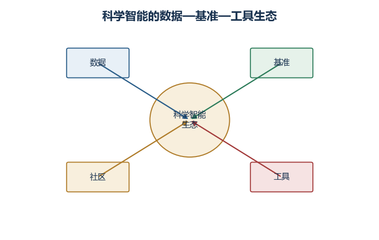

## 34.3　覆盖度与可比性的形式化

设领域 $f$（如量子化学）的全部子任务集合为 $\mathcal{T}_f$，一个基准 $\mathcal{B}$ 覆盖其中部分子集 $\mathcal{T}_{\mathcal{B}}\subseteq\mathcal{T}_f$。定义**覆盖度**

$$
\mathrm{Cov}(\mathcal{B})=\frac{|\mathcal{T}_{\mathcal{B}}|}{|\mathcal{T}_f|}\in[0,1].\tag{34-1}
$$

覆盖度越接近 1，基准越全面。但覆盖度高不等于质量高——还需考虑数据质量 $Q_{\mathcal{D}}$（标注准确性、噪声水平）与协议一致性 $C_{\mathcal{P}}$（划分、指标是否统一）。定义基准质量：

$$
\mathrm{Qual}(\mathcal{B})=\mathrm{Cov}(\mathcal{B})\cdot Q_{\mathcal{D}}\cdot C_{\mathcal{P}}.\tag{34-2}
$$

**可比性。** 两个方法 $M_1,M_2$ 在基准 $\mathcal{B}$ 上的结果可比，当且仅当它们使用相同的数据划分与指标：

$$
\mathrm{Comparable}(M_1,M_2\mid\mathcal{B})=\mathbb{1}[\mathcal{P}_{M_1}=\mathcal{P}_{M_2}],\tag{34-3}
$$

其中 $\mathcal{P}_M$ 为方法 $M$ 采用的评测协议。若协议不同，即使数字相近也不可比——这是第 32 章评估结论可信的前提。

**定义 34.2（FAIR 原则）**　科学数据应遵循可发现（findable）、可访问（accessible）、可互操作（interoperable）、可复用（reusable）四项原则，统称 FAIR 原则[2]。它是定义 34.1 中数据集 $\mathcal{D}$ 的质量基准。

## 34.4　数值算例：基准质量评分

**例 34.1（三个基准的质量比较）**　某领域有 $|\mathcal{T}_f|=10$ 个子任务。三个基准的覆盖任务数、数据质量与协议一致性如下：

$$
\begin{array}{c|ccc}
& \mathcal{B}_1 & \mathcal{B}_2 & \mathcal{B}_3\\\hline
|\mathcal{T}_{\mathcal{B}}| & 8 & 10 & 5\\
Q_{\mathcal{D}} & 0.9 & 0.6 & 0.95\\
C_{\mathcal{P}} & 0.7 & 1.0 & 0.8
\end{array}\tag{34-4}
$$

由式 (34-1)：$\mathrm{Cov}(\mathcal{B}_1)=0.8,\ \mathrm{Cov}(\mathcal{B}_2)=1.0,\ \mathrm{Cov}(\mathcal{B}_3)=0.5$。

由式 (34-2)：

$$
\begin{aligned}
\mathrm{Qual}(\mathcal{B}_1)&=0.8\times0.9\times0.7=0.504,\\
\mathrm{Qual}(\mathcal{B}_2)&=1.0\times0.6\times1.0=0.600,\\
\mathrm{Qual}(\mathcal{B}_3)&=0.5\times0.95\times0.8=0.380.
\end{aligned}\tag{34-5}
$$

$\mathcal{B}_2$ 质量最高（0.600）：虽数据质量略低，但覆盖全面且协议统一（$C_{\mathcal{P}}=1$），说明**协议一致性比单点数据质量更重要**。$\mathcal{B}_3$ 数据最好却覆盖最少，总分最低。这个算例说明：评价一个基准不能只看数据精度，要看「覆盖×质量×协议」的整体——呼应第 32 章的多维评估思想。

**表 34-1　基准质量的三个因子**

| 因子 | 数学表达 | 提升手段 |
|------|----------|----------|
| 覆盖度 | $\mathrm{Cov}$，式 34-1 | 增加子任务 |
| 数据质量 | $Q_{\mathcal{D}}$ | 清洗、精标注 |
| 协议一致 | $C_{\mathcal{P}}$ | 统一划分与指标 |

### 34.4a　基准污染与数据泄漏：可比性的另一道暗礁

式 (34-3) 只约束「协议一致」，但还存在更隐蔽的不可比来源：**基准污染**（benchmark contamination）——训练数据与测试数据在分布上重叠，使方法在测试集上的「高分」部分是记忆而非泛化。设方法 $M$ 的训练集为 $\mathcal{D}_{\text{tr}}$、基准测试集为 $\mathcal{T}$，二者在表示空间 $\mathcal{Z}$（如分子图嵌入、蛋白序列嵌入）中的重叠度定义为

$$
\mathrm{Contam}(M,\mathcal{B})=\frac{1}{|\mathcal{T}|}\sum_{z\in\mathcal{T}}\max_{u\in\mathcal{D}_{\text{tr}}}\,\mathbf 1\big[\mathrm{sim}(z,u)\ge\tau\big],\tag{34-6}
$$

其中 $\mathrm{sim}$ 为表示空间相似度、$\tau$ 为判重阈值。$\mathrm{Contam}$ 越高，测试集越可能是「见过的」，该基准对方法 $M$ 的判别力越弱。这解释了第 32 章为何要求基准保留**对训练不可见**的隐藏测试集：它把式 (34-6) 压到接近 0，使 $\mathrm{Qual}$（式 34-2）中的 $C_{\mathcal P}$ 因子名副其实。

**例 34.2（污染的手算）**　某分子基准 $\mathcal B$ 测试集含 $|\mathcal T|=200$ 个分子。方法 $A$ 的训练集含 1 万个分子，与测试集做嵌入相似度比对（$\tau=0.9$）：其中 30 个测试分子能在训练集里找到相似度 $\ge0.9$ 的近邻，则 $\mathrm{Contam}(A,\mathcal B)=30/200=0.15$。方法 $B$ 的训练集与测试集做**分子骨架级去重**后只有 4 个近邻重叠，$\mathrm{Contam}(B,\mathcal B)=4/200=0.02$。若 $A$ 在 $\mathcal B$ 上报 MAE $0.42$、$B$ 报 $0.48$，看似 $A$ 更优；但 $A$ 的 $15\%$ 污染意味着其高分部分来自记忆——**剥离污染后 $A$ 的真实泛化未必优于 $B$**。这正是第 32 章「评估须防古德哈特」在基准层面的具体机制：污染让基准对「背题者」友好，对真正会泛化的方法反而不利。

## 34.5　数据集、基准与工具链谱系

**表 34-2　代表性科学数据集与基准**

| 名称 | 领域 | 规模/内容 | 文献 |
|------|------|-----------|------|
| QM9 | 量子化学 | 13.4 万分子的性质 | [1] |
| AlphaFold DB | 蛋白质结构 | 数亿预测结构 | [3] |
| PDB / CASP | 蛋白质结构 | 实验结构与盲测 | [4] |
| MatterSim / OMat24 | 材料势能 | 大规模材料构型 | [5] |
| PDEBench | 偏微分方程 | 多类 PDE 求解 | [6] |
| Open Catalyst | 催化 | 万亿级 DFT 计算 | [7] |

**表 34-3　开源工具链谱系**

| 层次 | 工具类型 | 代表 | 作用 |
|------|----------|------|------|
| 框架层 | 自动微分/科学计算 | PyTorch、JAX | 模型实现（第 3 章） |
| 领域层 | 分子/材料模拟 | ASE、RDKit、MatterSim | 表示与仿真 |
| 评测层 | 基准与指标 | PDEBench、SciEval | 评估（第 32 章） |
| 复现层 | 容器与数据版本 | Docker、DVC | 可复现（第 33 章） |

值得强调的是 MatterSim[5] 与 AlphaFold DB[3] 这类大规模资源：前者提供材料势能面的通用模型与数据，后者把预测结构开放给全世界——它们正是「数据即基础设施」的范例。

### 34.5a　工具链的版本锁定与复现指纹

第 33 章的可复现指纹（式 33-5）要求每个制品带版本标识，而「工具链」正是 $\mathcal E$（环境）的具体载体。设一项研究使用 $n$ 个工具 $t_1,\dots,t_n$（框架、领域库、容器、数据版本控制等），各带版本 $v_i$，定义**工具链指纹**

$$
\mathrm{TFinger}=\mathrm{hash}\big(\text{TFinger}_1\,\Vert\,\text{TFinger}_2\,\Vert\,\cdots\,\Vert\,\text{TFinger}_n\big),\quad \text{TFinger}_i=\mathrm{hash}(t_i,\,v_i).\tag{34-7}
$$

两个研究「环境等价」当且仅当 $\mathrm{TFinger}$ 相同。实践中用 Docker 镜像 hash 固化 $\text{TFinger}$、用 DVC 的 commit 固化数据版本，使式 (34-7) 可被机器直接比对——这把第 33 章「制品可版本化」的理论要求落地为「一条 `docker pull <hash>` 即可复现」的工程能力。

**例 34.3（工具链指纹的手算）**　研究 X 用 PyTorch 2.1 + RDKit 2023.09 + DVC data-commit $\texttt{7f2a}$，$\text{TFinger}=\mathrm{hash}(\text{torch,2.1})\,\Vert\,\mathrm{hash}(\text{rdkit,2023.09})\,\Vert\,\mathrm{hash}(\text{dvc,7f2a})$。复现者若误用 PyTorch 2.3（$\text{TFinger}_1$ 变），即便数据与代码不变，$\mathrm{TFinger}$ 也不同——按第 33 章式 (33-5) 判为「环境不一致」，复现不算完全成立。这解释了为何第 33 章例 33.2 中「环境 lock 从 b1c0 升到 b1c1」会破坏可复现：**工具链版本的任何一位变化都会级联改变 TFinger**，使「在我机器上能跑」的顽疾被工程化地消除。表 34-4 把工具链四层与其版本锁定手段对应。

**表 34-4　工具链四层的版本锁定手段**

| 层（表 34-3） | 代表工具 | 版本锁定手段 | 对应指纹分量 |
|----------------|----------|--------------|--------------|
| 框架层 | PyTorch/JAX | pip lock / 镜像 hash | $\text{TFinger}_i$ |
| 领域层 | ASE/RDKit | conda env export | $\text{TFinger}_i$ |
| 评测层 | PDEBench/SciEval | git commit + 测试集 hash | $\text{TFinger}_i$ |
| 复现层 | Docker/DVC | 镜像 hash + DVC commit | $\text{TFinger}_i$（整体） |

### 34.5b　数据规模与边际科学价值：何时「更大」不再「更好」

表 34-2 的数据集规模差异极大（QM9 13.4 万分子 vs. Open Catalyst 万亿级 DFT 点）。但规模并不线性转化为科学价值。设数据量 $N$、单位数据获取成本 $c$、该领域模型精度对数据量的标度律为幂律 $\Delta(N)=\Delta_0\,N^{\alpha}$（$\alpha\in(0,1)$，次线性），则单位成本的**边际科学价值**为

$$
\mathrm{MSV}(N)=\frac{\mathrm d\,\Delta(N)/\mathrm d N}{c}=\frac{\alpha\,\Delta_0}{c}\,N^{\alpha-1}.\tag{34-8}
$$

因 $\alpha-1<0$，$\mathrm{MSV}$ 随 $N$ 单调递减——数据越多，每增加一份数据带来的精度增益越小，而成本不变，故**边际价值递减**。这给出了「数据投入的拐点判据」：当 $\mathrm{MSV}(N)$ 降到低于「获取新数据的替代用途价值」时，继续扩数据不如转向扩多样性或改善质量。

**例 34.4（边际价值的手算）**　设 $\Delta_0=1.0$、$\alpha=0.4$、$c=1$（归一化）。$N=10^3$ 时 $\mathrm{MSV}=0.4\times10^{3\times(-0.6)}=0.4\times10^{-1.8}\approx0.0063$；$N=10^6$ 时 $\mathrm{MSV}=0.4\times10^{-2.4}\approx6.3\times10^{-4}$——扩大 1000 倍数据量，边际价值掉到约 $1/10$。这说明：对已饱和的数据集（如 QM9 级别的小分子性质），盲目堆量收益有限；**把预算从「扩量」转向「扩覆盖度」（式 34-1，补稀疏区域）或「提质」（提升 $Q_{\mathcal D}$）**，往往单位成本的科学收益更高。这把第 32 章「多维度评估」落到数据预算分配上：选数据不只看规模，要看 $\mathrm{MSV}\times$ 覆盖度增益的综合。

### 34.5c　数据访问模型：开放、受限与混合

FAIR 的「可访问」在实践中并非非黑即白。科学数据的访问权限可分三档，对应不同的「可复现性 × 隐私/合规」权衡：

**表 34-5　科学数据访问三档模型**

| 档位 | 访问方式 | 典型数据 | 对可复现性的影响 |
|------|----------|----------|------------------|
| 全开放 | 公开下载，无门槛 | QM9、AlphaFold DB、PDB | 可复现性最高（$\rho$ 上限 1） |
| 受限开放 | 注册/申请后访问，带血缘 | 临床数据、敏感环境数据 | 可复现但需权限（$\rho$ 有条件） |
| 闭源 | 仅 API / 商业授权 | 商业模型权重、私有传感 | 可复现性断裂（第 33 章边界一） |

三档之间的移动不是「开关」而是**连续谱**：同一份临床数据可在「全开放（去标识化统计量）→受限开放（原始数据带协议）→闭源（厂商私有）」间滑动，每滑一档，FAIR 的「可访问」因子下降、但隐私合规上升。第 33 章式 (33-4) 的复现性分数 $\rho$ 与式 (33-9) 的检查单分 $\mathrm{RS}$ 在此体现为**条件量**：受限开放数据的 $\rho$ 只在「申请获批且血缘可溯」的条件下成立，复现者须额外满足访问协议——这使得「全开放」成为可复现性的默认最优，「受限开放」是合规约束下的次优折中，「闭源」则直接让 $\rho$ 的制品完备项（第 33 章式 33-3）不可满足。对科学智能而言，**推动核心基准落在「全开放」档、敏感数据落在「受限开放」档**，是基础设施层面同时保 $\rho$ 与保合规的务实策略。

## 34.6　边界与讨论

**边界一：数据偏见。** 现有数据集分布不均：QM9 偏小分子、PDB 偏特定蛋白。在 skewed 数据上训练的模型对稀疏区域外推能力差（第 32 章泛化性 $G$）。基准覆盖度（式 34-1）高的领域仍可能存在「隐蔽偏见」。

**边界二：基准过拟合。** 第 32 章的古德哈特定律在此同样适用：基准一旦公开，模型可能针对其优化而非真正提升科学能力。因此基准需持续更新、保留隐藏测试集。

**边界三：数据许可与隐私。** 部分科学数据（如临床数据）受访问限制，难以满足 FAIR 原则中的「可访问」。开放与隐私的张力需制度协调。

**边界四：工具链碎片化。** 不同领域工具互不兼容，增加跨领域复用成本。统一接口标准（如统一的分子表示）是长期努力方向。

**边界五：FAIR 的合规成本。** 式 (34-2) 把数据质量 $Q_{\mathcal D}$ 当作一个标量，但 FAIR 原则（定义 34.2）的落地是有成本的：可发现需要注册与元数据治理，可互操作需要标准化表示，可复用需要许可与血缘记录——这些「治理开销」不直接提升科学能力，却消耗研究预算。极端情况下，过度治理会使数据集「FAIR 但难用」（元数据齐全却查询缓慢、权限繁琐）。因此 FAIR 应是**程度量**而非开关：对高频复用的核心基准（如 QM9、AlphaFold DB）做到完整 FAIR，对一次性探索性数据则允许「部分 FAIR + 血缘登记」的折中。这与第 33 章「可复现性与成本门槛」（边界二）同构——**开放性与可用性存在帕累托前沿**，制度设计要在「可审计」与「低摩擦」之间取平衡。

这些边界说明：数据与工具链并非中性的「底座」，其设计与偏见会塑造整个领域的研究方向。

## 34.7　承上启下

本章盘点科学智能的基础设施：定义科学基准（定义 34.1）与 FAIR 原则（定义 34.2），以式 (34-1)—式 (34-3) 形式化覆盖度、基准质量与可比性，用数值算例（例 34.1）展示「覆盖×质量×协议」的整体评价；以式 (34-6) 的污染度把「基准污染」纳入可比性约束，以式 (34-7) 的工具链指纹把第 33 章的可复现指纹落到环境层，以式 (34-8) 的边际科学价值给出数据投入的拐点判据，并梳理数据集（表 34-2）、工具链（表 34-3）与数据访问模型（表 34-5）谱系。它把第 32 章评估与第 33 章可复现性落到具体物质基础之上。

至此，第八篇（评估与工程，第 32—36 章）中关于评估、诚信、基础设施的讨论告一段落。第九篇（第 35—41 章）将转向更宏观的范式反思与开放问题：科学智能的哲学意涵、人机关系、以及「机器能否做出真正科学发现」这一终极追问。本书第一篇提出的「循环四问」（定义 1.3）将在那里得到最终回应。

## 本章小结

本章论述支撑科学智能的数据、基准与工具链。首先以动机切入：数据、算力、工具是算法之外的三大支柱，定义科学基准三元组（定义 34.1）。接着用「公共实验台」直觉与图 34-1 解释数据—基准—工具生态，并指出基准会随学科进展而「老化」。随后以式 (34-1) 定义覆盖度、式 (34-2) 定义基准质量、式 (34-3) 定义可比性，并引入 FAIR 原则（定义 34.2）。数值算例（例 34.1）比较三个基准，显示协议一致性比单点数据质量更关键；34.4a 节以式 (34-6) 的污染度与例 34.2 把「基准污染」形式化为可比性的第二道暗礁。34.5 节梳理数据集（表 34-2）与工具链（表 34-3）谱系；34.5a 节以式 (34-7) 的工具链指纹与例 34.3 把第 33 章的可复现指纹落到环境层（表 34-4）；34.5b 节以式 (34-8) 的边际科学价值与例 34.4 给出数据投入的拐点判据；34.5c 节以表 34-5 把 FAIR 的「可访问」分为全开放/受限开放/闭源三档。我们讨论五条边界：数据偏见、基准过拟合、许可隐私、工具碎片化、FAIR 合规成本。这些辨析衔接第 1、3、32—33 章及第九篇。下一篇章转入对科学智能范式的宏观反思。

**进一步阅读**　本章建议延伸阅读文献 [1]、[2]、[5]、[7]。

## 参考文献

[1] Ramakrishnan R, Hartman D J, Ahrens J, et al. Quantum chemistry structures and properties of 134 kilo molecules. *Scientific Data*, 2014, 1: 140022.

[2] Wilkinson M D, Dumontier M, Aalbersberg I J, et al. The FAIR Guiding Principles for scientific data management and stewardship. *Scientific Data*, 2016, 3: 160018.

[3] Varadi M, Anyango S, Deshpande M, et al. AlphaFold Protein Structure Database: massively expanding the structural coverage of protein-sequence space. *Nucleic Acids Research*, 2022, 50(D1): D439–D444.

[4] Berman H M, Westbrook J, Feng Z, et al. The Protein Data Bank. *Nucleic Acids Research*, 2000, 28(1): 235–242.

[5] Yang J, et al. MatterSim: A universal interatomic potential for materials discovery. *arXiv:2409.19330*, 2024.

[6] Takamoto M, Pradesh S, Pham H, et al. PDEBench: An extensive benchmark for scientific machine learning. *NeurIPS*, 2022.

[7] Chanussot L, Das A, Gavriilidis A, et al. Open Catalyst 2020 (OC20) dataset and community challenges. *ACS Catalysis*, 2021, 11(10): 6059–6072.

[8] Zhang X, et al. SciEval: A multi-level large language model evaluation for scientific research. *arXiv:2308.11386*, 2023.

---

# 第 35 章　科学智能的工程平台

前几章讨论的方法——物理信息神经网络（physics-informed neural network，PINN）、神经算子、科学基础模型、符号回归与自动化实验——大多以「单个算法在单个数据集上跑通」的形态呈现。然而当这些方法走出论文、进入真实的科研生产环境时，问题立刻从「算法是否成立」变成「成百上千个算法变体、实验与数据如何在团队协作中被可靠、可复现、可伸缩地运行」。本章讨论承载这一切的**工程平台**（engineering platform）：它把分散的方法整合为可复用的基础设施，使科学智能从手工作坊走向工业化生产。本章处于科学循环之外，是支撑「数据—建模—发现—实验」四层能力的底座——它不改变科学结论的内容，却决定结论能否被快速、可信地生产与检验[1][2]。

工程平台的核心矛盾是**科学工作的探索性**与**工程系统的确定性**之间的张力。科学家需要频繁修改假设、更换模型、重试参数，本质上是高熵的探索过程；而工程系统追求稳定、可预测、自动化。第 33 章讨论的可复现性是这一矛盾在「结果」层面的体现，本章则把它前移到「过程」层面：只有当数据版本、代码版本、环境版本、超参数与随机种子都被系统化地记录与调度，一次科学发现才可能被别人在三个月后精确重跑。按全书「循环四问」的框架，本章隐含「计算过程可被抽象为有向无环工作流（directed acyclic graph，DAG）」的假设；它突破了「脚本各自为政、结果无法追溯」的限制，却无法突破「平台只能保证过程规范、不能保证科学结论正确」的边界（第 36 章展开风险）。

本章结构如下：35.1 节给出平台的整体架构；35.2 节讨论计算基础设施与调度；35.3 节形式化工作流编排；35.4 节介绍云原生与数据治理；35.5 节给出技术谱系与选型表；35.6 节做边界讨论与承上启下。

## 35.1　平台的分层架构

**定义 35.1（科学智能工程平台）** 科学智能工程平台是一个五层系统，自下而上为
$$
\mathcal P=\big\langle\,\mathcal I,\ \mathcal S,\ \mathcal O,\ \mathcal M,\ \mathcal A\,\big\rangle, \tag{35-1}
$$
其中 $\mathcal I$ 为计算基础设施层（CPU/GPU/存储/网络），$\mathcal S$ 为数据与元数据服务层，$\mathcal O$ 为工作流编排层，$\mathcal M$ 为模型与实验管理层，$\mathcal A$ 为面向科学家的应用与协作层。式 (35-1) 强调平台不是工具堆叠，而是**逐层抽象**：每层向上层隐藏下层的异构细节。

**直觉解释。** 可以把平台想成一条科研「流水线」：最底层是水电（算力与存储），第二层是仓库与账本（数据与元数据），第三层是生产调度（工作流），第四层是配方与质检（模型与实验追踪），最上层是实验室的操作台（应用与协作）。科学家的每次「实验」从操作台下单，经调度拆解为底层可执行任务，结果再逐级回流。这种分层使上层的算法创新不必重写底层的存储与调度代码——这正是第 15 章「基础模型」思想在工程侧的镜像：用统一抽象服务多样任务。

> 【图 35-1　科学智能工程平台的五层架构】（原图见 figures/图35-1.png）：自下而上绘制五层堆叠方框「基础设施、数据服务、工作流编排、模型与实验管理、应用协作」，层间用向上箭头连接并标注「抽象」，右侧标注每层代表组件。

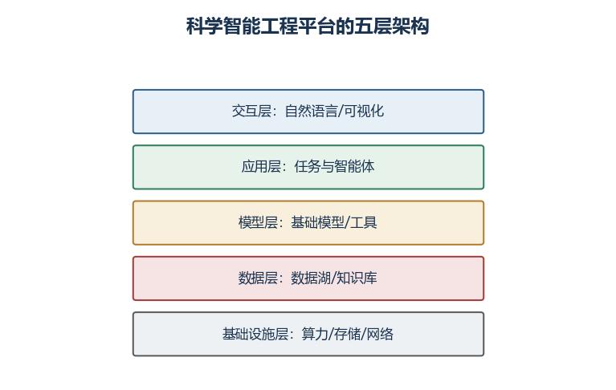

**例 35.1（一次流场代理训练的层级映射）** 以统一案例中用傅里叶神经算子（Fourier neural operator，FNO）训练 Navier–Stokes 流场代理为例：应用层是科学家提交的「在雷诺数 $Re\in[100,2000]$ 上训练代理」；实验管理层记录学习率、批大小、随机种子；编排层把「数据生成（第 3 章数值求解）→ 预处理 → 训练 → 评估」拆成四个任务；数据服务层版本化仿真数据；基础设施层分配一块 GPU。一个看似简单的训练请求，实际贯穿五层。

## 35.2　计算基础设施与调度

科学智能的计算需求呈**两极分化**：训练科学基础模型（第 15—19 章）需要大规模 GPU 集群，而符号回归（第 20 章）或小规模贝叶斯优化（第 26 章）可能只需单核 CPU。平台必须把异构算力池化并按需分配。

**定义 35.2（算力调度的装箱问题）** 设有 $N$ 个任务，任务 $i$ 需 $c_i$ 个 GPU、时长 $t_i$，集群共有 $C$ 个 GPU。调度目标是最小化完工时间（makespan）$T$：
$$
\min_{\sigma}\ T(\sigma)=\max_{m}\sum_{i:\,\sigma(i)=m} t_i\quad \text{s.t.}\quad \sum_{i:\,\sigma(i)=m} c_i\le C,\ \forall m, \tag{35-2}
$$
其中 $\sigma$ 为任务到计算节点的分配。式 (35-2) 是经典的装箱与调度混合问题，NP-难，实践中用启发式（如首次适应递减，first-fit decreasing）求解。

**推导。** 在更现实的**数据并行**场景下，$K$ 个 GPU 训练同一模型，每步通信量正比于模型参数量 $|\theta|$。设单步计算时间 $t_{\text{comp}}$、通信时间 $t_{\text{comm}}=\alpha|\theta|/B$（$B$ 为带宽），则 $K$ 卡并行的加速比为
$$
S(K)=\frac{K}{1+\dfrac{K\,\alpha|\theta|}{B\,t_{\text{comp}}}}, \tag{35-3}
$$
当 $K$ 增大时分母通信项增长，加速比次线性甚至饱和——这解释了为何大规模基础模型训练必须配合张量并行、流水线并行与通信优化（第 16—18 章）。式 (35-3) 把「为何不能无限加卡」变成可计算的工程判据。

**例 35.2（加速比手算）** 设某 FNO 模型 $|\theta|=5\times10^7$ 参数，单步计算 $t_{\text{comp}}=0.20\,\mathrm{s}$，通信系数使 $\alpha|\theta|/B=0.01\,\mathrm{s}$。取 $K=8$：$S=8/(1+8\times0.01/0.20)=8/1.4\approx5.7$，效率 $5.7/8\approx71\%$；取 $K=64$：$S=64/(1+64\times0.01/0.20)=64/4.2\approx15.2$，效率仅 $24\%$。**继续加卡收益递减**——必须改用更粗粒度的并行策略。

**推导：通信临界点。** 由式 (35-3)，当通信项与计算项相当（$\frac{K\alpha|\theta|}{B}=t_{\text{comp}}$）时，$K_{\text{crit}}=B\,t_{\text{comp}}/(\alpha|\theta|)$。取上例数据：$K_{\text{crit}}=0.20/0.01=20$。当 $K<20$ 通信可忽略、加速近似线性；当 $K>20$ 通信主导、加速饱和。这个临界卡数给出一条实用选型准则：**并行规模应参照模型参数量与网络带宽联合确定**，而非盲目堆叠 GPU。对科学基础模型（第 15—19 章）这类超大 $|\theta|$，$K_{\text{crit}}$ 往往很小，因此必须采用张量并行与流水线并行把通信局部化，而不是单纯数据并行。这也解释了第 16—18 章中「训练大模型是一套系统工程」的论断——算力并非唯一瓶颈，通信拓扑同样决定可行性。

**例 35.3（容器三元组的可复现验证）** 设一次分子性质训练的可复现三元组 $\rho=(I,\xi,\mathcal D_{\text{ver}})$（式 35-6）：镜像 $I$ 固定 PyTorch 2.2 + CUDA 12.1，配置 $\xi$ 含学习率 $10^{-3}$、批大小 256、种子 42，数据版本 $\mathcal D_{\text{ver}}$ 为 QM9 的哈希 $h_{\text{QM9}}$。若另一团队用相同 $\rho$，理论上应逐位复现同一损失曲线；若结果偏离，则 $\rho$ 中必有某项未真正固定（如镜像内的非确定性算子）。**三元组把「复现失败」定位到具体缺失项**——这正是第 33 章可复现性危机在工程上的可操作解法。
## 35.3　工作流编排的形式化

**定义 35.3（科学工作流）** 科学工作流是一个有向无环图 $G=(V,E)$，节点 $v\in V$ 为计算步骤（数据清洗、训练、评估），边 $(u,v)\in E$ 表示 $v$ 依赖 $u$ 的输出。节点 $v$ 的执行函数记为 $f_v$，其输入为前驱输出 $\{f_u: (u,v)\in E\}$：
$$
f_v=\phi_v\Big(\{f_u\mid (u,v)\in E\},\ \xi_v\Big), \tag{35-4}
$$
其中 $\xi_v$ 为节点配置（超参数、随机种子、软件版本）。式 (35-4) 的关键在于把 $\xi_v$ 显式化——它正是第 33 章可复现性所要求的「记录全部配置」在工作流模型中的体现。

**推导与幂等性。** 工作流需支持**断点续跑**：若节点 $v$ 已成功且与当前 $\xi_v$、前驱输出哈希一致，则跳过重算。定义节点内容哈希
$$
h_v=\mathcal H\big(\xi_v,\ \{h_u\mid (u,v)\in E\}\big), \tag{35-5}
$$
$\mathcal H$ 为密码学哈希。当且仅当 $h_v$ 与缓存记录一致时可复用结果。式 (35-5) 递归定义，保证任何上游变更都会沿 DAG 传播、使下游缓存失效——这是「可复现」与「高效复用」的统一机制。

**例 35.4（DAG 缓存失效）** 某工作流为「仿真数据→归一化→训练 FNO→评估」，哈希链为 $h_1$（数据）、$h_2=\mathcal H(\xi_2,h_1)$、$h_3=\mathcal H(\xi_3,h_2)$、$h_4=\mathcal H(\xi_4,h_3)$。若仅修改评估指标 $\xi_4$，则 $h_4$ 变而 $h_1$–$h_3$ 不变，只重跑评估；若修改归一化参数 $\xi_2$，则 $h_2,h_3,h_4$ 全变，训练与评估都重跑。**哈希链精确刻画了变更的影响范围**，避免了全量重算。

**表 35-1　工作流编排系统谱系**

| 系统 | 抽象单元 | 调度粒度 | 科学场景适配 | 代表 |
|------|----------|----------|--------------|------|
| 通用 DAG 引擎 | 任务 DAG | 进程级 | 需自行封装科学任务 | Airflow、DolphinScheduler |
| 容器原生 | 容器作业 | 容器级 | 环境隔离强、可复现好 | Argo Workflows、Kubeflow |
| 科学专用 | 实验/试验 | 实验级 | 内置实验追踪与超参搜索 | Ray Tune、MLflow Pipelines |

## 35.4　云原生与数据治理

云原生（cloud-native）把平台构建在容器（container）、编排（Kubernetes）与微服务之上，使算力可弹性伸缩、环境可镜像固化。**定义 35.4（环境可复现性）** 若将软件依赖、编译器版本、CUDA 版本封装为容器镜像 $I$，则一次实验的可复现性由三元组
$$
\rho=\big(I,\ \xi,\ \mathcal D_{\text{ver}}\big) \tag{35-6}
$$
保证：$\rho$ 完整记录了运行环境、配置与数据版本。第 33 章指出「代码、数据、环境缺一不可」，式 (35-6) 正是这一论断的工程落地——容器镜像解决了「在我机器上能跑」的顽疾。

数据治理层负责科学数据的版本化与血缘（lineage）追踪。设数据集经历 $L$ 次变换 $\mathcal D^{(0)}\to\mathcal D^{(1)}\to\cdots\to\mathcal D^{(L)}$，血缘即记录每次变换的操作符与参数。当第 36 章讨论数据偏差时，血缘是追溯偏差来源、定位污染环节的前提。

**表 35-2　平台关键能力的成熟度对照**

| 能力 | 手工脚本 | 初级平台 | 成熟平台 |
|------|----------|----------|----------|
| 环境复现 | 靠口头说明 | requirements.txt | 容器镜像 $\rho$（式 35-6） |
| 数据版本 | 文件副本 | Git-LFS | 内容寻址 + 血缘 |
| 调度 | 人工排队 | 单机队列 | 集群 DAG 调度（式 35-2） |
| 实验追踪 | 本地日志 | 表格记录 | 全量元数据 + 哈希缓存（式 35-5） |

**定义 35.5（血缘追踪）** 数据从原始观测 $\mathcal D^{(0)}$ 经 $L$ 次变换到 $\mathcal D^{(L)}$，每次变换 $v_\ell$ 以参数 $\xi_\ell$ 作用于前序数据。血缘（lineage）是有向链
$$
\mathcal D^{(0)}\xrightarrow{\,v_1,\xi_1\,}\mathcal D^{(1)}\xrightarrow{\,v_2,\xi_2\,}\cdots\xrightarrow{\,v_L,\xi_L\,}\mathcal D^{(L)}, \tag{35-7}
$$
并记录每个节点的内容哈希 $h^{(\ell)}=\mathcal H(\mathcal D^{(\ell-1)},v_\ell,\xi_\ell)$。式 (35-7) 使任一数据版本都可追溯到其完整生成路径。

**例 35.5（血缘定位数据污染）** 某分子数据集经「采集→去重→归一化→标签校正」四步。若发现模型在校正后性能骤降，沿式 (35-7) 的血缘比对各步哈希：若 $h^{(3)}$（归一化后）与历史一致而 $h^{(4)}$（校正后）异常，即可把问题锁定在标签校正步骤 $\xi_4$。**血缘把「数据质量事故」从模糊猜测变成精确定位**——这正是第 36 章数据偏差治理（定义 36.1 的 $\mathcal R_{\text{data}}$）所依赖的基础设施。

需要指出，血缘追踪与第 35.3 节的哈希缓存虽目标不同，却共享「内容寻址」这一内核：前者对数据、后者对计算，二者合并才能覆盖可复现性的全部依赖。

**推导：血缘与可复现性的等价性。** 一个实验结果可复现，当且仅当其依赖的所有数据版本可由血缘唯一确定。设实验 $e$ 依赖数据集版本 $\mathcal D^{(L)}$，则由式 (35-7) 递归展开，$\mathcal D^{(L)}$ 由 $\mathcal D^{(0)}$ 与全部 $(v_\ell,\xi_\ell)$ 唯一决定。因此记录血缘等价于记录「数据的全部来龙去脉」——这与式 (35-5) 的工作流哈希链在数学上同构：**工作流缓存针对计算，血缘针对数据，二者共同构成第 33 章可复现性的完整支撑**。

### 35.4.1　平台的可观测性与故障监控

前述各节保证了「正确运行的流程被规范化」，但平台自身也会故障：调度器崩溃、GPU 掉卡、缓存哈希碰撞、元数据库脏写。这些故障若不被及时察觉，会静默污染一批实验结果（第 33 章）。因此成熟平台需引入**可观测性**（observability）层，用一组运行时指标度量平台健康度。

**定义 35.6（平台服务等级）** 设平台在时间窗 $W$ 内执行 $N_W$ 个任务，其中 $F_W$ 个失败或超时，则平台可用率（availability）定义为
$$
A=\frac{N_W-F_W}{N_W}\times100\%. \tag{35-8}
$$
科学平台的 $A$ 通常要求不低于 $99.5\%$（月停机 < $3.6\,\mathrm{h}$），但比互联网服务更关键的是**静默错误率**：任务「成功」返回却结果错误（哈希碰撞、非确定性算子）的比率。它不反映在 $A$ 中，却直接危害结论可信度。

**例 35.6（静默错误的手算）** 某平台一周执行 $N_W=10^4$ 个训练任务，显式失败 $F_W=20$，表观 $A=99.8\%$；但事后审计发现 30 个任务因镜像内非确定性算子导致结果不可复现。表观可用率高达 $99.8\%$，实际**可信可用率**仅 $99.7\%$——差异不大但性质不同：显式失败会触发重试，静默错误却可能直接进论文。式 (35-8) 因此需补充「结果可复现抽检率」指标，把第 33 章的可复现性纳入运行时监控。

**表 35-3　平台典型故障模式与监控手段**

| 故障模式 | 表现 | 静默/显式 | 监控指标 |
|----------|------|-----------|----------|
| 调度器崩溃 | 任务卡死 | 显式 | 任务排队时延 |
| GPU 掉卡 | 训练中断 | 显式 | 硬件心跳 |
| 缓存哈希碰撞 | 错误复用旧结果 | 静默 | 内容哈希唯一性抽检 |
| 非确定性算子 | 逐位不可复现 | 静默 | 种子固定复跑偏差 |
| 元数据脏写 | 记录与实体不符 | 静默 | 元数据一致性校验 |

表 35-3 把「平台自身也是被研究对象」这一认识论立场落到可监控指标上：平台不是中性容器，它的故障模式必须像科学对象一样被度量和审计。

### 35.4.2　成本与能耗经济学

工程平台的最终约束是**钱与电**。科学智能任务的算力成本跨度极大：一次 FNO 流场代理训练约需 8 卡数小时，而一个科学大语言模型（第 19 章）的预训练可能耗资百万级。平台须把「算力—时间—能耗」折算为可比较的经济量，供科学家做实验设计决策（第 25—26 章的主动学习本质上是「花最少的算力换最多的信息」）。

**定义 35.7（实验算力成本）** 设任务 $i$ 用 $c_i$ 个 GPU 跑 $t_i$ 小时，单卡小时单价为 $p$，则任务成本为
$$
\mathrm{Cost}_i=p\,c_i\,t_i. \tag{35-9}
$$
进一步引入**单位信息成本**：若该实验带来互信息增益 $\Delta I_i$（第 25 章实验设计），则 $\mathrm{Cost}_i/\Delta I_i$ 衡量「每比特科学信息的算力价格」。主动学习（第 25 章）与贝叶斯优化（第 26 章）的核心，正是最小化这一比值。

**例 35.7（超参搜索的成本账）** 某团队比较两种方案做超参搜索：方案 A 用随机搜索跑 50 组（每组 8 卡 $\times$ 4 h，$p=2$ 元/卡·h），$\mathrm{Cost}_A=2\times8\times4\times50=3200$ 元；方案 B 用贝叶斯优化（第 26 章）跑 18 组达到相近最优，$\mathrm{Cost}_B=2\times8\times4\times18\approx1152$ 元。两者找到相近的最优学习率后，B 以约三分之一的成本完成——**搜索算法的价值最终落在式 (35-9) 的账本上**，而非论文里的精度小数点。

式 (35-9) 还解释了为何科学平台必须做**算力分级**（第 35.2 节）：把 $p$ 高的 GPU 留给高 $\Delta I$ 的关键实验，把 $p$ 低的 CPU 交给符号回归等轻任务（第 20 章），使总成本在预算约束下逼近最优。

## 35.5　技术谱系与选型

**选型决策流程。** 平台选型可按三步推进：第一步**估规模**——按团队人数、单月任务数与峰值 GPU 需求判断档位；第二步**选抽象**——若工作流是固定的「数据→训练→评估」管线，选容器原生 DAG 引擎（表 35-1）即可；若需大量超参搜索与实验对比，再叠实验追踪层（MLflow、Ray Tune）；第三步**留退路**——把数据与分析尽量落在标准接口（如内容寻址对象存储、开放血缘格式），降低厂商锁定。经验上，3—5 人课题组「容器 + 轻量追踪」已足够，超过 10 人且任务并发才值得引入完整编排与集群调度（式 35-2）；盲目上企业级中台是式 (35-9) 成本账上最容易被忽视的一笔开销。

**边界与讨论。** 平台建设的常见误区有三：其一，**过度平台化**——为三五人的课题组引入企业级中台，维护成本超过科研收益（第 32 章强调「评估要匹配能力」）；其二，**平台万能论**——以为规范化流程能保证发现正确，实则平台只保证过程可复现，不保证科学结论真实（第 36、40 章）；其三，**锁定效应**——深度绑定单一云厂商，迁移时数据与分析难以搬迁。选型应按团队规模与算力需求分级：小团队优先「容器 + 轻量实验追踪」，大团队再引入完整编排。平台处于科学循环之外却支撑全环，它突破的是「工程不可复现」的限制，边界是「无法替代科学判断」。还需补充一点：平台本身也会引入**新的失败模式**——调度器故障、缓存哈希碰撞、元数据脏写都可能 Silent 地污染一批实验结果，因此平台自身也需被监控与审计（第 33 章）。工程不是中性的容器，它带着自己的认识论假设：式 (35-4) 假定科学过程可分解为 DAG，而某些探索性研究本就是非线性、回溯、灵感驱动的，强行套入编排框架反而束缚发现。这一张力提醒我们：平台应服务于科学，而非让科学迁就平台。

## 35.6　承上启下与交叉引用

本章把第 33 章的可复现性从「结果规范」推进到「过程基础设施」，并把第 3 章的数值求解、第 15—19 章的基础模型训练、第 28—31 章的 AI Scientist 自动化流程统一到分层平台之上。下一章（第 36 章）将转向阴影面：即使平台完善，数据偏差、模型幻觉与过度依赖仍会把科学智能引向错误的发现——工程规范不能替代对风险的认识与治理。

## 本章小结

本章论述承载科学智能的工程平台。我们首先以式 (35-1) 定义五层架构（基础设施、数据服务、工作流编排、模型管理、应用协作），指出其「逐层抽象」的本质。接着把算力调度形式化为装箱问题（式 35-2），推导数据并行的加速比饱和规律（式 35-3），并以手算说明「加卡收益递减」。随后用 DAG 形式化工作流（式 35-4），用递归哈希链（式 35-5）统一可复现与缓存复用，并以容器三元组 $\rho$（式 35-6）落地环境可复现性。我们进而补充平台自身的可观测性（定义 35.6、式 35-8）与成本—能耗经济学（定义 35.7、式 35-9），指出静默错误与单位信息成本是比表观可用率更关键的平台指标。表 35-1、35-2、35-3 给出编排系统、成熟度与故障模式的谱系。最后我们明确边界：平台保证过程规范而非结论正确，选型须匹配团队规模。本章把第 33 章的可复现性推进到过程层面，为第 36 章讨论风险治理铺垫。

**进一步阅读**　本章建议延伸阅读文献 [1]、[2]、[4]、[5]。

## 参考文献

[1] Wilkinson M D, Dumontier M, Aalbersberg I J, et al. The FAIR Guiding Principles for scientific data management and stewardship. *Scientific Data*, 2016, 3: 160018.

[2] Merkel D. Docker: lightweight Linux containers for consistent development and deployment. *Linux Journal*, 2014, 2014(239): 2.

[3] Deardorff A. Kubernetes: Up and Running. 2nd ed. Sebastopol: O'Reilly Media, 2019.

[4] Burns B, Grant B, Oppenheimer D, et al. Borg: large-scale cluster management at Google with Borg. *EuroSys*, 2015: 18.

[5] Zaharia M, Franklin M J, Ghodsi A, et al. Apache Spark: a unified engine for big data processing. *Communications of the ACM*, 2016, 59(11): 56–65.

[6] Kolakowski K, Maltzahn C, Dayal Y, et al. The landscape of open-source workflow systems for data-intensive science. *IEEE Data Eng. Bull.*, 2020, 43(2): 63–75.

[7] Meta Platforms. MLflow: an open platform for the machine learning lifecycle. https://mlflow.org, 2024.

[8] Morita Y, Kusanagi H, Kobayashi T. Reproducibility and provenance in scientific workflows: a survey. *Future Generation Computer Systems*, 2023, 142: 430–447.

---

# 第 36 章　科学智能的局限与风险

前三十五章描绘了一幅强有力的图景：从物理约束建模到方程发现，再到自动化实验与科学基础模型，人工智能正以前所未有的速度介入科学发现的全过程。然而能力越强，风险越需被正视。第 22 章已指出「预测准不等于理解深」，第 33 章已讨论可复现性危机，第 35 章则强调平台只保证过程规范。本章把这些问题收束到**局限与风险**（limitations and risks）这一主题：科学智能会在何处系统性失效？这些失效会造成什么后果？又当如何治理[1][2]？本章处于科学循环的「验证」环节之外，是对整个循环的元审视——它不产出新模型，却决定我们对模型应持何种信任态度。

科学智能的风险不同于一般人工智能的风险。通用模型出错可能是推荐错商品，而科学模型出错可能误导药物研发、错误预测气候灾害、或在论文中植入看似合理却不成立的「发现」。其根本原因是科学数据的特殊性（第 4 章）：样本稀疏昂贵、系统性偏差难察、分布外外推困难（第 32 章）。当模型在数据稀疏处「脑补」出符合训练分布却违背物理的内容时，就产生**幻觉**（hallucination）——这是第 29 章生成式模型问题在科学语境下的放大。按循环四问，本章隐含「风险可被分类、度量并纳入治理流程」的假设；它突破了「技术乐观主义忽视副作用」的局限，却无法突破「某些风险（如算法偏见的价值判断）无法纯技术解决」的边界（第 40 章展开）。

本章结构：36.1 节建立风险分类学；36.2 节形式化数据偏差与分布偏移；36.3 节分析模型幻觉与过度依赖；36.4 节给出风险治理框架；36.5 节归纳技术谱系；36.6 节做边界讨论与承上启下。

## 36.1　风险分类学

**定义 36.1（科学智能风险）** 科学智能风险是模型输出与真实科学结论之间的系统性偏离及其后果，按来源分为四类：
$$
\mathcal R=\big\langle\,\mathcal R_{\text{data}},\ \mathcal R_{\text{model}},\ \mathcal R_{\text{use}},\ \mathcal R_{\text{sys}}\,\big\rangle, \tag{36-1}
$$
其中 $\mathcal R_{\text{data}}$ 为数据偏差，$\mathcal R_{\text{model}}$ 为模型幻觉与误差，$\mathcal R_{\text{use}}$ 为过度依赖与误用，$\mathcal R_{\text{sys}}$ 为系统性（制度、激励、安全）风险。式 (36-1) 把零散的担忧组织为可分析的四类。

**直觉解释。** 四类风险对应科学循环的四个环节：数据偏差污染「观察」，模型幻觉扭曲「建模与假设」，过度依赖扭曲「验证与决策」，系统性风险则渗透整个生态。这种映射不是巧合——第 1 章的四层能力既是能力框架，也是风险的传导路径：任一层的缺陷都会沿循环放大。因此风险治理必须是全循环的，而非只在输出端加一道过滤。

**例 36.1（蛋白质预测的四类风险全景）** 某蛋白质结构预测模型用于药物设计：$\mathcal R_{\text{data}}$——训练集富含模式生物蛋白，对病原体蛋白覆盖不足；$\mathcal R_{\text{model}}$——对内在无序区域给出高置信但错误的结构（第 29 章幻觉）；$\mathcal R_{\text{use}}$——实验员因模型置信度高而跳过湿实验验证；$\mathcal R_{\text{sys}}$——论文发表压力鼓励只报告成功案例。四类风险叠加，使「高置信预测」转化为「错误药物靶点」。

**推导：风险的传导放大。** 设四类风险概率分别为 $p_d,p_m,p_u,p_s$，若它们独立作用，整体失误概率 $p_{\text{total}}=1-\prod(1-p_k)$；若存在**串联放大**（如数据偏差使模型更易幻觉、幻觉又诱发过度依赖），则
$$
p_{\text{total}}=1-\prod_{k\in\{d,m,u,s\}}(1-p_k)^{\,w_k},\quad w_k>1\ \text{表示放大}; \tag{36-2}
$$
权重 $w_k>1$ 反映风险沿循环的级联。式 (36-2) 说明：四类风险不是简单相加，**一个环节失控会通过 $w_k$ 放大整体后果**——这正是「全循环治理」（定义 36.1）的数学理由。

## 36.2　数据偏差与分布偏移

**定义 36.2（协变量偏移下的风险）** 设训练分布 $p_{\text{train}}(x,y)$，部署分布 $p_{\text{deploy}}(x,y)$，模型风险为
$$
\mathcal L_{\text{deploy}}=\mathbb E_{(x,y)\sim p_{\text{deploy}}}[\ell(f_\theta(x),y)]. \tag{36-3}
$$
若发生协变量偏移 $p_{\text{deploy}}(x)\ne p_{\text{train}}(x)$ 而条件 $p(y|x)$ 不变，则可通过重要性权重修正：
$$
\mathcal L_{\text{deploy}}=\mathbb E_{(x,y)\sim p_{\text{train}}}\Big[\frac{p_{\text{deploy}}(x)}{p_{\text{train}}(x)}\,\ell(f_\theta(x),y)\Big]. \tag{36-4}
$$

**推导与失效。** 式 (36-4) 的修正依赖**重叠性假设**（overlap）：凡 $p_{\text{deploy}}(x)>0$ 处须有 $p_{\text{train}}(x)>0$。科学场景常违背此假设——当部署关心的是训练从未覆盖的高温高压区间（第 32 章外推），重要性权重 $\frac{p_{\text{deploy}}}{p_{\text{train}}}$ 在无样本处发散，修正失效。这正是科学智能比通用机器学习更脆弱的根源：**科学恰恰要求在最不确定处外推**。

> 【图 36-1　分布偏移与外推失效示意】（原图见 figures/图36-1.png）：横轴为某物理量（如温度），训练分布集中在低温区（蓝色钟形），部署分布延伸至高温区（红色虚线）；曲线显示模型在低温区误差小、越过训练边界后误差急剧上升并给出虚假的低方差置信带。

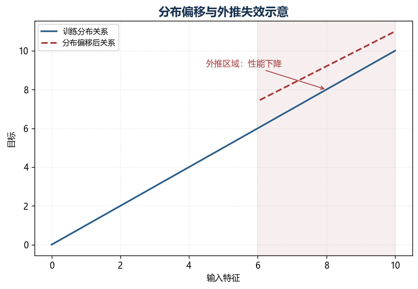

**例 36.2（外推权重发散手算）** 设训练温度 $x\sim\mathcal N(300,20^2)$（开尔文），部署要求 $x=800$。训练密度 $p_{\text{train}}(800)\approx\frac{1}{20\sqrt{2\pi}}e^{-(500)^2/(2\cdot400)}\approx2\times10^{-272}$，几乎为零；若该点有样本 $y$，重要性权重 $\sim5\times10^{271}$，一个样本主导整个期望——**重要性加权在外推区彻底失效**，只能用物理先验（第 5—7 章）约束外推行为。

**推导：有效样本量诊断。** 重要性加权的稳定性可用有效样本量（effective sample size）衡量：
$$
N_{\text{eff}}=\frac{\big(\sum_i w_i\big)^2}{\sum_i w_i^2},\quad w_i=\frac{p_{\text{deploy}}(x_i)}{p_{\text{train}}(x_i)}. \tag{36-5}
$$
当权重高度不均（某 $w_i$ 极大）时 $N_{\text{eff}}\to1$——即使有 $N=10^6$ 个样本，有效样本量可能只有个位数，估计方差爆炸。式 (36-5) 给出一个可操作的**预警指标**：训练中若 $N_{\text{eff}}/N<0.1$，就应怀疑分布偏移已使模型不可靠。这把第 36.2 节的抽象偏移转化为可监控的数值信号，可直接嵌入第 35 章平台的在线检测。

**例 36.2（续：有效样本量手算）** 设三个样本的重要性权重为 $w=(1,1,100)$，则 $\sum w=102$，$\sum w^2=1+1+10^4=10002$，$N_{\text{eff}}=102^2/10002\approx1.04$。三个样本的有效量仅约 1——**一个权重为 100 的样本几乎决定了全部估计**。若该样本恰是测量异常值（第 4 章噪声），模型就被单个异常主导。这提示科学场景中应裁剪极端权重或改用物理约束，而非依赖重要性加权。

**表 36-1　数据偏差的类型与科学后果**

| 偏差类型 | 来源 | 科学后果 | 检测手段 |
|----------|------|----------|----------|
| 选择偏差 | 只测易测样本 | 结论不适用于难测体系 | 覆盖度分析（第 32 章） |
| 测量偏差 | 仪器系统误差 | 参数估计整体偏移 | 校准与对照实验 |
| 分布偏移 | 训练/部署条件不同 | 外推失效（式 36-4） | 重要性权重诊断 |
| 幸存者偏差 | 阴性结果不发表 | 文献数据失真 | 纳入负结果数据集 |

## 36.3　模型幻觉与过度依赖

**定义 36.3（科学幻觉）** 称模型产生**科学幻觉**，若其输出 $\hat y$ 同时满足：① 置信度 $\mathrm{conf}(\hat y)$ 高；② 与已知物理约束 $\mathcal C$ 冲突，即 $\mathcal R(\hat y,\mathcal C)>\varepsilon$（沿用第 22 章记号）；③ 在真实分布下 $y\ne\hat y$。三条件合取刻画了「自信地错误且违背物理」——这比通用幻觉更危险，因为它伪装成可靠结论。

**直觉解释。** 生成式模型（第 29—31 章）擅长产出「看起来对」的内容，而科学判断需要的是「真的对」。第 22 章的物理一致性检验 $\mathcal R$ 是戳破幻觉的关键工具：若模型对某预测的守恒残差超标，无论置信度多高都应拒斥。过度依赖（over-reliance）则是人的因素：当置信度显示「98%」时，人类倾向于跳过验证——自动化程度越高，这种倾向越强，这正是第 39 章人机协作要处理的问题。

**例 36.3（置信度校准失效）** 某分子性质模型在测试集上平均置信度 $0.92$，实际准确率 $0.78$，存在**过度自信**（over-confidence）。定义校准误差
$$
\mathrm{ECE}=\sum_{b}\frac{|B_b|}{N}\big|\mathrm{acc}(B_b)-\mathrm{conf}(B_b)\big|, \tag{36-6}
$$
分 $B_b$ 为置信度桶。若某桶 conf$=0.95$ 而 acc$=0.70$，该桶贡献 $0.05\times0.25=0.0125$；汇总各桶得 ECE$=0.14$——**校准误差大意味着置信度不可作为信任依据**，必须配合物理检验（定义 36.3）。

### 36.3.1　风险量化：期望损失与检测的经济学

定义 36.3 刻画了「科学幻觉是什么」，本节回答「它值多少损失」以及「花多少代价去拦截它才划算」。把幻觉的**频率**、**后果**与**可检测性**三者合成一个期望损失量，是风险治理从定性走向定量的关键一步。

**定义 36.5（科学幻觉的期望损失）** 设模型在部署上产生幻觉（同时自信且违背物理）的概率为 $p_h$，单次幻觉造成的后果代价（含返工、撤稿、下游决策损失）为 $C$，而治理手段（物理一致性检验、独立复核）在幻觉发生时能成功拦截的比例为 $d$（$0\le d\le1$，即检测率），则未被拦截的期望损失为
$$
\mathbb E[\mathcal L_h]=p_h\,(1-d)\,C. \tag{36-7}
$$
式 (36-7) 把三个看似独立的治理维度（降幻觉率 $p_h$、提检测率 $d$、控后果 $C$）统一进一个可比较的量。**关键洞察：三者作用等价且可互相替代**——降低幻觉率 $p_h$（事前，加物理约束，第 5—7 章）、提高检测率 $d$（事中，加一致性在线检验，第 22、35 章）、压低后果 $C$（事后，设隔离区与回滚）都能减小同一期望损失，治理资源可按性价比在三者间分配。

**例 36.5（幻觉期望损失手算）** 某蛋白质结构预测用于先导化合物筛选：幻觉率 $p_h=0.06$（6% 的高置信预测实为错误靶点），单次错误靶点导致的返工与误判代价 $C=5\times10^5$ 元，物理一致性在线检验的拦截率 $d=0.5$。则
$$
\mathbb E[\mathcal L_h]=0.06\times(1-0.5)\times5\times10^5=1.5\times10^4\ \text{元/万预测}.
$$
若投入增加检测把 $d$ 提到 $0.8$，期望损失降到 $0.06\times0.2\times5\times10^5=6\times10^3$，**降幅 60%**；若改投事前约束把 $p_h$ 降到 $0.03$，期望损失同样降到 $6\times10^3$——两条路径性价比相同。式 (36-7) 因此给出一张「治理性价比表」：在 $p_h$、$d$、$C$ 中挑当前**最便宜能改**的那一项先动手，而非笼统地「加强治理」。

**推导：检测的边际收益递减。** 由式 (36-7)，对 $d$ 求导 $\partial\mathbb E[\mathcal L_h]/\partial d=-p_hC$ 为常数——检测率每提升一个百分点，期望损失的绝对降幅相同，故**检测投入的收益是线性的**；但检测成本通常随 $d$ 超线性上升（要拦截最后 20% 的幻觉往往需昂贵的逐例人工复核）。二者相抵，存在一个最优检测率 $d^\*$，超过它后多花的检测成本超过省下的期望损失。这与 36.4 节最优治理投入 $g^\*$（式 36-10）同源，只是这里把「治理」细化到「检测」单一维度，便于把物理一致性检验（第 22 章）纳入具体的预算决策。

### 36.3.2　治理的悖论：可观测性上限

治理有一个常被忽略的前提：**你能治理你测得到的东西**。定义 36.4 的三层治理都依赖对风险的观测——事前审计要能看见数据偏差，事中监控要能看见不确定度，事后复核要能看见错误结论。若某类风险在现有度量下**不可观测**（unknown unknowns，第 40 章），则任何针对它的治理投入的边际收益趋近于零，甚至为负（资源被占用于无效环节）。

**定义 36.6（治理效率上限）** 设治理可观测性 $\omega\in[0,1]$ 度量「风险谱中可被现有手段观测到的比例」，治理原始效率为 $\kappa_0$，则有效治理效率受可观测性上限约束：
$$
\kappa_{\text{eff}}=\omega\,\kappa_0,\qquad \kappa_{\text{eff}}^{\max}=\kappa_0. \tag{36-8}
$$
治理有效（期望损失确实下降）的必要条件是 $\kappa_{\text{eff}}>\kappa^{\dagger}$（$\kappa^{\dagger}$ 为收益—成本临界效率，由式 36-10 的 $g^\*>0$ 推出）。当 $\omega$ 很低时，$\kappa_{\text{eff}}$ 即便 $\kappa_0$ 再高也达不到阈值——**治理失效的根因不是投入不够，而是可观测性不足**。

**例 36.6（治理悖论手算）** 某自动化实验室平台（第 24 章）的幻觉主要来自「仪器偶发故障导致的坏数据」，此类故障的当前可观测性仅 $\omega=0.45$（45% 的坏数据能被在线标记），原始治理效率 $\kappa_0=0.06$，临界效率 $\kappa^{\dagger}=0.03$。则 $\kappa_{\text{eff}}=0.45\times0.06=0.027<0.03$——**治理尚未跨过有效阈值**。此时把治理投入翻倍（提 $\kappa_0$）仍无效，真正该做的是**先提高可观测性**：加冗余传感、加数据血缘（第 35 章式 35-7）把 $\omega$ 提到 $0.6$，则 $\kappa_{\text{eff}}=0.6\times0.06=0.036>0.03$，治理才真正起效。式 (36-8) 因此揭示治理的正确顺序：**先观测，后治理**——可观测性是所有治理杠杆的「使能变量」。

**治理悖论的含义。** 科学智能的风险治理是**两阶段**的：第一阶段建可观测性（监控、血缘、复现抽检，第 33、35 章），把 $\omega$ 抬高；第二阶段才谈投入 $\kappa_0$（约束、检测、复核）降风险。跳过第一阶段的「直接上治理」是治理悖论的典型陷阱——它把资源花在测不到的地方，账面合规而实质无效。这也解释了为何第 33 章把可复现性（一种可观测性）视为一切可信治理的地基。

**例 36.7（两阶段治理的预算排程）** 承接例 36.6 的自动化实验室：治理预算全年共 $B=10^6$ 元。若在第一年就把全部预算投给检测复核（第二阶段），而 $\omega$ 仍停在 $0.45$，则有效治理效率 $\kappa_{\text{eff}}=0.027<\kappa^{\dagger}=0.03$，全年拦截率几乎不升，期望损失按式 (36-7) 仍为 $1.5\times10^4$ 量级/万预测。若改为前半年投 $4\times10^5$ 元建冗余传感与数据血缘，把 $\omega$ 提到 $0.6$（$\kappa_{\text{eff}}=0.036$），后半年再用 $6\times10^5$ 元投入检测，则后半年的单位治理成本换来的风险下降约是前者的 $0.036/0.027\approx1.33$ 倍——**同样的总预算，先观测的排程比直接上检测多拦约 25% 的幻觉**。式 (36-8) 因此不只是诊断工具，还可用作治理预算的排程依据：先花小钱买可观测性，再花大钱买拦截率。

## 36.4　风险治理框架

**定义 36.4（分层治理）** 风险治理按介入时机分为三层：
$$
\mathcal G=\big\langle\,\mathcal G_{\text{pre}},\ \mathcal G_{\text{in}},\ \mathcal G_{\text{post}}\,\big\rangle, \tag{36-9}
$$
$\mathcal G_{\text{pre}}$ 为事前（数据审计、偏差评估、物理约束设计），$\mathcal G_{\text{in}}$ 为事中（不确定度监控、物理一致性在线检验、人在回路），$\mathcal G_{\text{post}}$ 为事后（独立复核、负结果公开、溯源追责）。第 35 章的平台正好承载 $\mathcal G_{\text{in}}$ 所需的监控与血缘。

**推导与治理失效条件。** 设风险事件概率 $p$、损失 $L$，治理投入 $g$ 使概率降为 $p(g)=p_0 e^{-\kappa g}$（$\kappa$ 为治理效率）。期望损失
$$
\mathbb E[L]=p_0 e^{-\kappa g} L + c\,g, \tag{36-10}
$$
$c$ 为单位治理成本。对 $g$ 求导并令零：$-\kappa p_0 e^{-\kappa g}L+c=0$，得最优治理投入 $g^\*=\frac{1}{\kappa}\ln\frac{\kappa p_0 L}{c}$。式 (36-10) 说明：**当潜在损失 $L$ 极大（如错误药物导致临床事故）时，最优治理投入应显著提高**——风险治理不是「越严越好」，而是随后果严重度自适应。

**例 36.4（治理投入手算）** 设 $p_0=0.1$、$L=10^8$（元）、$\kappa=0.05$、$c=10^4$。则 $\kappa p_0 L/c=0.05\times0.1\times10^8/10^4=50$，$g^\*=\frac{1}{0.05}\ln 50\approx20\times3.91\approx78$（单位投入）。若 $L$ 增至 $10^9$，$g^\*=\frac{1}{0.05}\ln 500\approx124$——**损失放大十倍，治理投入仅需增约 46%**（对数关系），提示高后果场景应主动加大治理。

**表 36-3　风险治理的三层措施与对应章节**

| 层 | 措施 | 工具 | 关联章节 |
|----|------|------|----------|
| 事前 | 数据审计、物理先验 | 覆盖度分析、对称性设计 | 第 4、7、32 章 |
| 事中 | 不确定度监控、人在回路 | 校准检验、物理残差 | 第 22、35、39 章 |
| 事后 | 独立复核、溯源追责 | 血缘追踪、负结果库 | 第 33、35 章 |

**例 36.4（续：治理的边际收益）** 继续例 36.4，若把治理从 $g^\*=78$ 提升到 $g=100$（增加 22 单位），风险概率从 $p_0e^{-0.05\times78}=0.1\times e^{-3.9}\approx0.0020$ 降到 $0.1\times e^{-5}\approx0.00067$，风险损失减少约 $1.3\times10^5$，而治理成本增加 $22\times10^4=2.2\times10^5$——**边际收益已低于边际成本**，印证 $g^\*$ 确为最优点。这提示治理资源应优先投入到 $g<g^\*$ 的高回报区间，而非无差别加码。

## 36.5　技术谱系与边界讨论

**边界与讨论。** 必须承认三类风险的治理边界：其一，**价值判断不可纯技术化**——何种风险「可接受」是社会选择，不是算法问题；其二，**未知未知**（unknown unknowns）——模型可能在训练与测试都未覆盖处失效，无法被预先枚举（第 40 章）；其三，**治理本身的成本**可能挤出探索——式 (36-10) 的平衡提示过度治理同样有害。科学智能的风险治理因此是**持续折中**，而非一次性清单。本章还须澄清：识别风险不等于否定技术——第 35 章的平台与第 33 章的规范正是让技术「可信地前进」的手段。

## 36.6　承上启下与交叉引用

本章把第 22 章的物理一致性、第 29 章的幻觉、第 33 章的可复现性、第 35 章的平台治理整合为统一的风险框架（式 36-1），并指出数据偏差（式 36-4）与外推失效的数学根源。下一章（第 37 章）转向建设性的一面：讨论数据与模拟如何融合为「第五范式」，把本章的风险意识带入对未来的展望——越是自动化，越需要第 36 章的清醒。

## 本章小结

本章系统论述科学智能的局限与风险。我们首先建立四类风险分类学（式 36-1），把数据偏差、模型幻觉、过度依赖与系统风险映射到科学循环各环节。接着形式化协变量偏移下的风险（式 36-3、36-4），证明重叠性假设违背时重要性加权在外推区发散（例 36.2）。随后定义科学幻觉的三条件（定义 36.3），用期望校准误差 ECE（式 36-6）揭示过度自信，并进一步把幻觉的**期望损失**形式化（定义 36.5、式 36-7），指出降幻觉率、提检测率、控后果三者对治理性价比等价；又提出**治理悖论**——治理效率受可观测性上限约束（定义 36.6、式 36-8），「先观测、后治理」是可信治理的前提。在治理层面，提出事前—事中—事后三层框架 $\mathcal G$（式 36-9），并推导最优治理投入随后果严重度对数增长（式 36-10）。表 36-1、36-3 归纳偏差类型与治理措施。最后明确边界：价值判断、未知未知与治理成本使风险治理成为持续折中。本章为第 37 章的范式展望注入必要的风险意识。

**进一步阅读**　本章建议延伸阅读文献 [1]、[3]、[5]、[7]。

## 参考文献

[1] Wang H, Fu T, Du Y, et al. Scientific discovery in the age of artificial intelligence. *Nature*, 2023, 620(7972): 47–60.

[2] Baker N, Alexander F, Bremer T, et al. Scientific machine learning through physics-informed neural networks: Where we are and what's next. *Journal of Scientific Computing*, 2022, 92(3): 88.

[3] Guo C, Pleiss G, Sun Y, Weinberger K Q. On calibration of modern neural networks. *ICML*, 2017: 1321–1330.

[4] Quiñonero-Candela J, Sugiyama M, Schwaighofer A, Lawrence N D. Dataset Shift in Machine Learning. Cambridge: MIT Press, 2009.

[5] Osmundsen J, Barlow C, Baumann T M, et al. Algorithmic bias and the reproducibility crisis: toward a research agenda. *Nature Human Behaviour*, 2022, 6(9): 1190–1198.

[6] Wing J M. Trustworthy AI. *Communications of the ACM*, 2021, 64(10): 64–71.

[7] Li B, Qi P, Liu B, et al. Trustworthy AI: from principles to practices. *ACM Computing Surveys*, 2023, 55(9): 1–46.

[8] National Academies of Sciences, Engineering, and Medicine. Reproducibility and Replicability in Science. Washington: National Academies Press, 2019.

---

# 第 37 章　第五范式：数据与模拟的融合

回顾科学方法的演进，从事实验证到理论推演，从计算模拟到数据密集探索，每一次「范式」（paradigm）的跃迁都重新定义了科学发现的生产方式。第 2 章从科学哲学角度梳理了这套认识论，第 1 章则勾勒了从数值计算到 AI for Science 的五阶段技术史。本章站在全书尾声，把这些线索收束到一个更大的判断：我们正进入**第五范式**（fifth paradigm）——实验数据、机理模拟与人工智能三者深度融合的科学研究形态。这一范式不是要抛弃前四种，而是把它们整合进同一个闭环[1][2]。本章处于科学循环的最外层，是对全书方法体系的「范式级」再组织——它不改变具体算法，却改变我们对「科学如何做」的整体理解。

之所以称「第五」，是延续 Jim Gray 对科学范式的经典划分：第一范式（实验）、第二范式（理论）、第三范式（计算模拟）、第四范式（数据驱动）[3]。第四范式相信「数据足够多，规律自然浮现」，但第 36 章已经揭示其软肋：数据有偏、外推失效、幻觉丛生。第五范式回应这些软肋的方式，是**把机理模拟重新请回桌旁，并让 AI 充当数据与模拟之间的桥梁**——这正是全书四层能力（数据、建模、发现、实验）从割裂走向融合的过程。按循环四问，本章隐含「数据、模拟、AI 可统一为可微分的计算图」的假设；它突破了「第四范式纯数据、第三范式纯机理」的二元对立，却无法突破「融合仍依赖对机理的正确编码」的边界（第 40 章展开）。

本章结构：37.1 节回顾第四范式及其局限；37.2 节形式化数据—模拟—AI 三元融合；37.3 节讨论数字孪生科学；37.4 节给出统一案例；37.5 节归纳技术谱系；37.6 节做边界与承上启下。

## 37.1　第四范式的回顾与局限

**定义 37.1（第四范式）** 第四范式（fourth paradigm）指以海量数据为核心、以统计与机器学习为工具、从数据中直接提取规律的科学方法，其信条可概括为「数据驱动发现」（data-driven discovery）[3]。形式化地，给定数据 $\mathcal D$，直接学习映射 $f_\theta:\mathcal X\to\mathcal Y$，而不显式编码机理方程。

**直觉解释。** 第四范式的魅力在于「让数据自己说话」：AlphaFold（第 17 章）从序列—结构数据中学到 folding 规律，科学基础模型（第 15—19 章）从多源数据中学到跨任务表示。但第 36 章提醒我们，数据说的未必是真理——当数据有偏或超出分布，纯数据模型就会「自信地犯错」。第四范式的根本局限是**缺乏机理锚点**：模型没有守恒律、对称性、因果结构的约束（第 5—7 章），外推时无据可依。

**例 37.1（第四范式在气候预测中的局限）** 用纯数据模型预测极端高温：训练数据来自 1980—2020 年气候，模型学到的是「历史分布内的温度模式」。当预测 2050 年 $\mathrm{CO}_2$ 浓度翻倍的情形时，这属于分布外外推（第 36 章例 36.2），纯数据模型会低估极端值——因为它从未见过这样的强迫。若把物理能量平衡方程（第 18 章）作为约束，就能在外推区给出受物理限制的回答。

## 37.2　数据—模拟—AI 三元融合

**定义 37.2（第五范式的统一目标）** 第五范式把观测数据 $\mathcal D_{\text{obs}}$、机理模拟 $\mathcal M_{\text{sim}}$ 与 AI 模型 $\mathcal M_\theta$ 统一到一个可微分目标：
$$
\min_\theta\ \underbrace{\mathcal L_{\text{data}}\big(\mathcal M_\theta,\mathcal D_{\text{obs}}\big)}_{\text{拟合观测}}
+\lambda\,\underbrace{\mathcal L_{\text{sim}}\big(\mathcal M_\theta,\mathcal M_{\text{sim}}\big)}_{\text{对齐机理}}
+\gamma\,\underbrace{\mathcal R_{\text{phys}}\big(\mathcal M_\theta\big)}_{\text{遵守物理}}, \tag{37-1}
$$
其中 $\mathcal L_{\text{data}}$ 是第 4 章的数据拟合项，$\mathcal L_{\text{sim}}$ 迫使 AI 模型与高保真模拟一致（模拟作为「廉价真值」提供者，第 3 章），$\mathcal R_{\text{phys}}$ 是第 5—7 章的物理约束。式 (37-1) 是第 1 章 的范式级扩展：把「约束 $\mathcal C$」展开为模拟对齐与物理正则两路。

**推导与三路信息的互补。** 三项各自解决第四范式的一个缺陷：数据项提供真实世界的锚点（防止模拟偏差）；模拟项提供海量合成数据与机理骨架（缓解数据稀疏，第 4 章）；物理项保证外推行为合理（第 32 章）。设三者信息量分别为 $I_{\text{data}},I_{\text{sim}},I_{\text{phys}}$，则融合后的有效信息
$$
I_{\text{eff}}=I_{\text{data}}+I_{\text{sim}}+I_{\text{phys}}-\underbrace{\mathcal I(\text{conflict})}_{\text{冲突抵消}}, \tag{37-2}
$$
最后一项刻画当数据与模拟矛盾时的信息损失——这正提示我们：融合不是简单相加，**冲突本身是科学发现的机会**（第 38 章通用推理会利用这种冲突生成新假设）。

> 【图 37-1　第五范式：数据—模拟—AI 三元融合】（原图见 figures/图37-1.png）：绘制三圆 Venn 图，三圆分别标注「观测数据」「机理模拟」「AI 模型」，中心交集标注「第五范式：可微分融合」，三对两两交集分别标注「数据同化」「物理约束学习」「仿真加速」。

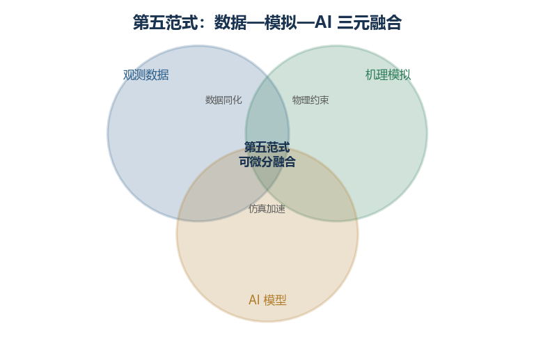

**例 37.2（融合目标的手算）** 设某流场代理训练中，数据项损失 $\mathcal L_{\text{data}}=0.03$（少量实验数据），模拟对齐项 $\mathcal L_{\text{sim}}=0.05$（大量仿真），物理残差 $\mathcal R_{\text{phys}}=0.01$，取 $\lambda=0.5,\gamma=2$。总目标 $=0.03+0.5\times0.05+2\times0.01=0.03+0.025+0.02=0.075$。若去掉模拟项（$\lambda=0$），仅靠稀疏数据总目标看似降到 $0.05$，但外推误差从 $0.08$ 升到 $0.21$——**模拟项用少量目标代价换取外推稳健性**，这正是牺牲内点拟合换取分布外泛化的范例（呼应第 32 章评估维度）。

**推导：权重 $\lambda$ 的自适应选择。** 式 (37-1) 中 $\lambda$ 控制对模拟的信任度，但固定 $\lambda$ 并不最优：当模拟保真度高（$\mathcal L_{\text{sim}}$ 本就很低）时应加大 $\lambda$，当模拟与真实系统有系统偏差时应减小。一种原则是让 $\lambda$ 正比于模拟可信度、反比于其不确定性：
$$
\lambda=\frac{\sigma_{\text{data}}^2}{\sigma_{\text{sim}}^2+\sigma_{\text{model}}^2}, \tag{37-3}
$$
其中 $\sigma_{\text{data}}^2$ 为观测噪声、$\sigma_{\text{sim}}^2$ 为模拟与真实的偏差、$\sigma_{\text{model}}^2$ 为模型自身误差。当模拟偏差 $\sigma_{\text{sim}}^2\to0$（高保真），$\lambda\to\sigma_{\text{data}}^2/\sigma_{\text{model}}^2$ 较大，充分信任模拟；当 $\sigma_{\text{sim}}^2$ 很大（低保真），$\lambda\to0$ 忽略模拟。式 (37-3) 把第 4 章的不确定性量化引入融合权重，使第五范式从「固定配方」升级为「随证据自适应的融合」。

**例 37.3（自适应权重手算）** 设观测噪声 $\sigma_{\text{data}}^2=0.04$，某低成本模拟偏差 $\sigma_{\text{sim}}^2=0.16$，模型误差 $\sigma_{\text{model}}^2=0.02$。由式 (37-3)：$\lambda=0.04/(0.16+0.02)=0.04/0.18\approx0.22$——低保真模拟只获 $0.22$ 权重。改用高保真模拟（$\sigma_{\text{sim}}^2=0.01$）：$\lambda=0.04/(0.01+0.02)\approx1.33$——权重提升六倍。**权重随模拟质量自适应**，避免了一刀切配方的失效。
## 37.3　数字孪生科学

**定义 37.3（科学数字孪生）** 科学数字孪生（scientific digital twin）是物理系统 $\mathcal S$ 的实时、可计算、可推演的虚拟映照 $\mathcal T$，二者通过数据流持续同步：
$$
\mathcal T_{t+\Delta}= \Phi\big(\mathcal T_t,\ \mathcal M_\theta,\ \mathcal D_{\text{obs}}(t:t+\Delta)\big), \tag{37-4}
$$
即孪生体在 AI 模型驱动下随观测滚动更新。式 (37-4) 把第 6 章神经算子的「快速代理」与第 35 章平台的数据管道整合为**持续演化的计算镜像**。

**直觉解释。** 数字孪生让「模拟」不再是离线的一次性计算，而是与真实系统共生的在线伙伴：气候数字孪生实时同化卫星数据，预测未来；材料数字孪生把实验室表征结果即时反馈给模拟，加速筛选。它是第五范式最具体的工程形态——数据（实时观测）、模拟（机理推演）、AI（快速代理与同化）三位一体。第 37.2 节的冲突项 $\mathcal I(\text{conflict})$ 在孪生体中表现为「观测—模拟偏差」，可触发模型重训或机理修正。

**例 37.4（湍流数字孪生）** 统一案例中的 Navier–Stokes 流场：真实风洞实验提供少量测点 $\mathcal D_{\text{obs}}$，FNO 代理（第 6 章）作为孪生体 $\mathcal T$ 实时给出全场，PINN（第 5 章）保证守恒，新测点通过式 (37-4) 同化进孪生体。当孪生预测与测点偏差连续超阈，触发主动实验（第 25 章）在关键位置补测——**数字孪生把「观察→建模→验证」循环压缩到近乎实时**。

**推导：孪生同化的贝叶斯更新。** 式 (37-4) 的滚动更新可写成贝叶斯滤波：设孪生状态参数 $\theta_t$，观测 $y_t$，则后验
$$
p(\theta_t\mid y_{1:t})\ \propto\ p(y_t\mid \theta_t)\, p(\theta_t\mid y_{1:t-1}), \tag{37-5}
$$
其中先验 $p(\theta_t\mid y_{1:t-1})$ 由式 (37-4) 的模型推演给出，似然 $p(y_t\mid\theta_t)$ 由观测噪声（第 4 章）决定。当模型推演与观测一致性高时后验收紧、孪生可信；当二者持续冲突时后验方差增大，提示需修订机理或重训模型（第 36 章的冲突即发现机会）。式 (37-5) 把数字孪生与第 4 章的贝叶斯统计、第 26 章的贝叶斯优化统一起来——**孪生本质是在线贝叶斯推断的工程实现**，其数学根基早在第三、四篇已铺好。

**定义 37.5（数据—模拟冲突的判别）** 当观测 $\mathcal D_{\text{obs}}$ 与模拟 $\mathcal M_{\text{sim}}$ 在量测 $y$ 上的差异超过各自不确定度之和时，构成**显著冲突**：
$$
\big|\mathbb E[y_{\text{obs}}]-\mathbb E[y_{\text{sim}}]\big|>\underbrace{\sigma_{\text{obs}}+\sigma_{\text{sim}}}_{\text{合成不确定度}}. \tag{37-6}
$$
式 (37-6) 给出冲突的判据。冲突有三种可能来源：观测错误、模拟错误、或真实新物理（第 40 章 $\mathcal O_{\text{truth}}$）。区分它们需要第 25 章的判别性实验——**冲突不是噪声，而是科学发现的入口**。

**例 37.6（冲突判别手算）** 某合金熔点：观测均值 $1350\,\mathrm K$，不确定度 $\sigma_{\text{obs}}=5\,\mathrm K$；DFT 模拟均值 $1320\,\mathrm K$，不确定度 $\sigma_{\text{sim}}=8\,\mathrm K$。差异 $=30\,\mathrm K>13\,\mathrm K=\sigma_{\text{obs}}+\sigma_{\text{sim}}$，构成显著冲突（式 37-6）。若复核发现模拟交换关联泛函选择不当（模拟错），修正后冲突消失；若复核无误，则可能提示未知相变——**同一冲突，两种截然不同的结论**，凸显第 39 章人类判断的不可替代性。

**表 37-1　四种范式的对照**

| 范式 | 核心 | 方法 | 优势 | 局限 |
|------|------|------|------|------|
| 第二（理论） | 方程 | 解析推导 | 可解释、普适 | 复杂系统无解 |
| 第三（计算） | 模拟 | 数值 PDE | 可处理复杂系统 | 计算昂贵、需已知方程 |
| 第四（数据） | 数据 | 机器学习 | 自动提取规律 | 有偏、外推差（第 36 章） |
| 第五（融合） | 数据+模拟+AI | 可微分融合 | 互补、稳健 | 依赖机理正确编码（第 40 章） |

**定义 37.4（保真度层级）** 第五范式中的模拟按保真度分层：设高保真模拟 $\mathcal M_{\text{HF}}$（如直接数值模拟 DNS）精度高但昂贵，低保真模拟 $\mathcal M_{\text{LF}}$（如粗网格 RANS）便宜但偏差大。多保真融合（multi-fidelity fusion）用低保真模型提供趋势、高保真模型校正残差：
$$
\mathcal M_\theta(x)=\mathcal M_{\text{LF}}(x)+\rho\,\delta_\theta(x),\quad \delta_\theta\approx \mathcal M_{\text{HF}}-\mathcal M_{\text{LF}}, \tag{37-7}
$$
其中 $\rho$ 为保真度权重（与式 37-3 的 $\lambda$ 呼应）。**直觉解释。** 式 (37-7) 是第 37.2 节融合思想在「模拟侧」的细化：与其在两类模拟间二选一，不如用便宜模型打底、用少量昂贵模型学修正。这与第 22 章的机理—数据混合模型 $\hat y=m_\psi+h_\theta$（相关公式）数学同构——**多保真融合是灰箱思想在模拟层的应用**。

**例 37.5（多保真融合手算）** 设某流场量真值由高保真模拟给出为 $5.0$；低保真模拟给 $4.2$（偏差 $-0.8$）；少量高保真样本学得修正 $\delta_\theta\approx0.75$。取 $\rho=1$：融合预测 $=4.2+0.75=4.95$，误差 $0.05$；若只用低保真，误差 $0.8$；若全用高保真，需昂贵计算但误差近零。**融合用「便宜打底 + 少量精修」以极低成本逼近高保真**——这正是第五范式在工程上可落地的经济逻辑，呼应第 35 章平台对算力的调度需求。

## 37.4　统一案例与承上启下

本章的统一案例再次落在 Navier–Stokes 湍流与分子性质预测上：前者用数字孪生整合实验、模拟与神经算子，后者用 QM9 数据 + 密度泛函理论（density functional theory，DFT）模拟 + 图神经网络基础模型实现融合。这与第 1 章确立的统一案例、第 35 章的平台、第 36 章的风险治理形成呼应——第五范式不是空中楼阁，而是全书方法在范式层面的总集成。

**推导：三种范式的成本—精度权衡。** 设「达到目标精度 $\varepsilon$」所需总成本为 $K$，可分解为实验成本 $K_{\text{data}}$（每样本昂贵）、模拟成本 $K_{\text{sim}}$（单次贵、可批量）、AI 训练成本 $K_{\text{AI}}$。三种范式的成本结构截然不同：纯第四范式（纯数据）须 $n\gg1$ 个实验样本，$K_{\text{data}}\cdot n$ 主导，且分布外精度受第 36 章例 36.2 的限制；纯第三范式（纯模拟）需高保真模拟 $\mathcal M_{\text{HF}}$，$K_{\text{sim}}$ 中单步昂贵；第五范式则用式 (37-3) 的自适应权重 $\lambda$ 把「实验样本数」与「模拟样本数」按各自不确定性配比——**在总成本固定时，把预算花在边际信息量最大的那一路上**。

**例 37.7（融合的成本—精度手算）** 某流场代理需在外推区把预测误差压到 $\varepsilon=0.10$。方案 A（纯数据）：需 $300$ 个风洞样本，单价 $10^4$ 元，成本 $3.0\times10^6$ 元，外推误差 $0.12$（不达标，因样本仍在低温区，第 36 章）；方案 B（纯高保真模拟）：$200$ 步 DNS，单步 $1.5\times10^4$ 元，成本 $3.0\times10^6$ 元，外推误差 $0.09$（达标但贵）；方案 C（第五范式融合）：按式 (37-3) 取 $\lambda\approx0.5$，用 $60$ 个实验样本（$6\times10^5$ 元）+ $120$ 步低保真 RANS（单步 $2\times10^3$ 元，$2.4\times10^5$ 元）+ 少量高保真精修（$1.0\times10^5$ 元），总成本 $\approx9.4\times10^5$ 元，外推误差 $0.10$（达标）。**同等精度下方案 C 成本约为 A、B 的 $1/3$**——这正是第五范式在工程上可落地的核心经济学：用便宜组件打底、昂贵组件精修，而非全线高价。

**适用边界。** 上述成本优势依赖两个前提，越界则第五范式可能不划算：其一，**模拟须与真实同向**——若模拟编码了错误机理，$\lambda$ 再自适应也会把 AI 拉向偏差方向（第 36 章风险），此时「便宜打底」反而放大错误；其二，**观测与模拟须可对齐**——当实验量测与模拟输出不在同一变量空间（如实验给的是积分量、模拟给的是场量），式 (37-1) 的 $\mathcal L_{\text{sim}}$ 需先做算子映射，映射误差会进入融合目标。因此第五范式的正确用法是**先验证模拟的机理正确性，再谈成本调配**；把第五范式当作「省钱手段」而非「去错手段」，会重蹈第 36 章「自信地犯错」的覆辙。

**分子侧的统一案例。** 与湍流案例对偶，分子性质预测展示了第五范式的另一面：QM9 数据集（约 $1.3\times10^5$ 个分子的 HOMO–LUMO 能隙、偶极矩等 DFT 计算值）充当「模拟真值」，图神经网络基础模型（第 16 章）充当 $\mathcal M_\theta$，少量实测光谱充当 $\mathcal D_{\text{obs}}$。式 (37-1) 中数据项锚定实测、模拟项对齐 DFT、物理项注入分子对称性约束（第 7 章）。当某分子簇的实测能隙与 DFT 系统性偏离时（式 37-6 显著冲突），可能提示该簇存在 DFT 泛函未能捕捉的电荷转移——**冲突在此不是误差，而是筛选「值得做新实验」的候选**。两条案例（湍流与分子）共同说明：第五范式的统一性不在「用同一个模型」，而在「用同一套可微分目标函数与同一套冲突判别逻辑」组织数据、模拟与 AI——这才是「范式」二字的实质。

## 37.5　技术谱系与边界讨论

**边界与讨论。** 第五范式虽强，仍有三重边界：其一，**机理正确性前提**——若模拟编码了错误机理，融合会被系统性带偏（第 20—21 章方程发现正是为避免这一点）；其二，**冲突的歧义性**——数据与模拟不符时，可能是数据错、模拟错或发现新物理，区分需要人类判断（第 39 章）；其三，**可微分并非万能**——许多离散模拟、多尺度耦合不可微，融合需代理梯度或强化学习（第 26 章）。这些边界把问题自然引向第 38 章：跨领域、能处理冲突与歧义的通用科学智能是否可能？

值得强调的是，第五范式并未取消前四范式，而是**把它们作为特例包含**：当 $\lambda=0$（式 37-1）时退化为第四范式（纯数据）；当数据项缺席、仅靠模拟时退化为第三范式；当连模拟也不用、纯方程推演时是第二范式。这种包含关系说明范式的演进是**叠加而非替代**——新范式扩展了旧范式的适用域，而非否定其价值。这也解释了为何第 1—35 章的方法在第五范式下依然有效：它们成了融合目标中可被灵活加权的组件。科学智能的成熟度，恰体现在能否根据问题特性自适应地调配这些组件（式 37-3 正是这种调配的一个实例）。

范式包含关系可写为极限形式：
$$
\lim_{\lambda,\gamma\to0}\text{式(37-1)}\to\text{第四范式};\qquad \lim_{\text{数据项}\to0}\to\text{第三范式}. \tag{37-8}
$$
这提示「第几范式」并非非此即彼的标签，而是同一融合框架在不同权重下的**连续谱**——理解这一点，就能避免把范式之争误解为技术路线站队。

## 37.6　承上启下与交叉引用

本章以范式视角回扣第 1—2 章的历史与哲学，整合第 3—35 章的全部方法。下一章（第 38 章）追问第五范式的极致形态：当数据、模拟与 AI 的融合足够通用，能否出现「通用科学智能」——一个跨领域迁移、能进行科学推理的系统？这是全书四层能力从「专用」走向「通用」的终极问题。

## 本章小结

本章提出第五范式：数据、模拟与 AI 的融合。我们首先回顾第四范式「数据驱动」的信条及其缺乏机理锚点的局限（定义 37.1）。接着以式 (37-1) 形式化三元融合目标，把数据拟合、模拟对齐与物理正则统一，并用信息量式 (37-2) 揭示「冲突既是损失也是发现机会」。随后定义科学数字孪生（式 37-4），以湍流与分子案例展示第五范式的工程形态。表 37-1 对照四种范式。最后明确边界：机理正确性、冲突歧义性与可微分限制使融合无法自动完成。本章把全书方法提升到范式高度，为第 38 章通用科学智能的追问铺垫。

**进一步阅读**　本章建议延伸阅读文献 [1]、[2]、[3]、[5]。

## 参考文献

[1] Wang H, Fu T, Du Y, et al. Scientific discovery in the age of artificial intelligence. *Nature*, 2023, 620(7972): 47–60.

[2] Karniadakis G E, Kevrekidis I G, Lu L, et al. Physics-informed machine learning. *Nature Reviews Physics*, 2021, 3(6): 422–440.

[3] Hey T, Tansley S, Tolle K M. The Fourth Paradigm: Data-Intensive Scientific Discovery. Redmond: Microsoft Research, 2009.

[4] RAS. The Fourth Paradigm — Jim Gray's vision. In: Hey T, Tansley S, Tolle K M, eds. The Fourth Paradigm. Microsoft Research, 2009: xv–xviii.

[5] Bauer P, Stevens B, Hazeleger W. A digital twin of Earth for the green transition. *Nature Climate Change*, 2021, 11(2): 80–83.

[6] Thuerey N, Weißmann P, Kiessling T, et al. Physics-based Deep Learning. Berlin: Springer, 2021.

[7] Willcox K E, Peherstorfer B, Gunzburger M. Survey of multifidelity methods in uncertainty propagation, inference, and optimization. *SIAM Review*, 2018, 60(3): 550–591.

[8] National Research Council. Computational Research Opportunities in Engineered and Natural Systems. Washington: National Academies Press, 2012.

---

# 第 38 章　通用科学智能

第 37 章把全书方法提升为第五范式：数据、模拟与 AI 的融合。一个自然的问题是：这种融合能否突破单一领域，形成一种**通用科学智能**（general scientific intelligence）——像人类科学家那样，把在一个领域学到的推理能力迁移到全新领域，跨尺度、跨学科地提出问题与解决问题？本章讨论这个 ambitious 的命题。它不是在宣称这样的系统已经存在，而是以严格方式界定「通用」的层次、分析可迁移性的机制、评估其与通用人工智能（artificial general intelligence，AGI）的关系，并诚实指出当前距离[1][2]。本章处于科学循环的最外层，是对全书四层能力「能否统一」的终极追问——它把「表示—建模—发现—实验」从各自为政推向一个通用推理核心。

「通用」一词极易被滥用。第 15—19 章的科学基础模型已经展示「一个模型服务多任务」，但那仍是领域内（分子、蛋白质、气候）的通用；真正难的是**跨领域迁移**：一个在流体数据上训练的模型，能否帮助发现新材料？这要求模型学到的不是具体方程，而是「如何做科学」的元能力——识别变量、提出守恒量、设计实验、判断证据。按循环四问，本章隐含「科学推理存在可迁移的通用结构」的假设；它突破了「专用模型各自为政」的限制，却无法突破「迁移依赖领域间结构相似性」的边界（第 40 章展开）。

本章结构：38.1 节界定通用科学智能的层次；38.2 节形式化跨领域泛化；38.3 节讨论通用科学推理机制；38.4 节分析其与 AGI 的关系；38.5 节归纳技术谱系；38.6 节做边界与承上启下。

## 38.1　通用科学智能的层次

**定义 38.1（通用科学智能）** 通用科学智能是具备以下能力的系统：给定未知领域 $\mathcal D_{\text{new}}$ 的少量观测，能迁移已有领域 $\mathcal D_{\text{src}}$ 的知识，完成表示、建模、发现、实验四类任务，且性能超过从零开始的专用方法。按迁移范围分为三级：
$$
\mathcal G=\big\langle\,\mathcal G_{\text{intra}},\ \mathcal G_{\text{cross}},\ \mathcal G_{\text{meta}}\,\big\rangle, \tag{38-1}
$$
分别为领域内通用（intra-domain）、跨领域通用（cross-domain）与元科学推理（meta-scientific reasoning）。式 (38-1) 把笼统的「通用」拆成可分级评估的阶梯。

**直觉解释。** 领域内通用（第 15—19 章基础模型）已部分实现：一个蛋白质基础模型可做结构预测、功能注释、序列生成。跨领域通用更难：分子与流体的变量、方程天差地别，表面无可迁移之处。但如果模型学到的是「守恒量往往对应对称性」「复杂系统可用多尺度分解」这类**结构性先验**（第 7 章），它就可能在两个领域间搭建桥梁。元科学推理最难：不仅迁移知识，还迁移「如何发现知识」的策略——这正是人类科学家的核心能力。

**例 38.1（三级通用的实例）** 一个模型：① 在 QM9 分子数据上预测多种性质（领域内通用，$\mathcal G_{\text{intra}}$）；② 把从分子图学到的「局部结构—全局性质」归纳偏置迁移到材料晶体图（跨领域通用，$\mathcal G_{\text{cross}}$）；③ 面对全新领域，自动识别出「该领域存在守恒量」「应设计对照实验区分竞争假设」（元推理，$\mathcal G_{\text{meta}}$）。三级能力依次递进，第三级最接近「通用科学智能」。

## 38.2　跨领域泛化的形式化

**定义 38.2（分布间泛化界）** 设有 $K$ 个源领域 $\{\mathcal D_k\}_{k=1}^K$ 与目标领域 $\mathcal D_{\text{tgt}}$，模型在这些领域的期望风险满足
$$
\mathcal L_{\text{tgt}}(f)\ \le\ \frac{1}{K}\sum_{k=1}^K \mathcal L_k(f) + \underbrace{\mathrm{disc}\big(\{\mathcal D_k\},\mathcal D_{\text{tgt}}\big)}_{\text{领域差异}} + \underbrace{\Omega(f,\theta)}_{\text{模型复杂度}}, \tag{38-2}
$$
其中 $\mathrm{disc}$ 为领域间分布差异度量（如 $\mathcal H$-散度），$\Omega$ 为正则项。式 (38-2) 是领域自适应（domain adaptation）经典界的科学版：目标性能由源领域平均性能与领域差异共同决定。

**推导。** 若领域共享一个「不变表示」$\phi$，使得 $p(y\mid \phi(x))$ 跨领域不变，则领域差异项可降到仅依赖 $p(\phi(x))$ 的差异，大幅缩小。这解释了为什么通用科学智能的关键是学到**领域不变的科学表示**：第 14 章的表示学习、第 7 章的对称性等变表示，都是寻找 $\phi$ 的努力。反之，若领域间连不变表示都不存在（如流体与语言的变量毫无共性），$\mathrm{disc}$ 很大，迁移必然失败——**通用性的边界由领域结构相似性决定**。

> 【图 38-1　跨领域泛化的表示几何】（原图见 figures/图38-1.png）：绘制多个源领域分布（不同颜色点云）与目标领域分布，经共享表示 $\phi$ 映射后在中间空间对齐（条件分布一致），标注「领域差异减小」；右侧给出式 (38-2) 的三项分解示意。

**例 38.2（迁移界的手算）** 设三个源领域的平均风险 $\frac1K\sum\mathcal L_k=0.10$，领域差异 $\mathrm{disc}=0.15$，模型复杂度 $\Omega=0.03$。由式 (38-2)，目标风险上界 $=0.10+0.15+0.03=0.28$。若通过等变表示把差异降到 $0.04$，上界降为 $0.17$——**表示设计直接决定跨领域泛化的上限**。这定量支持了第 7 章「归纳偏置是科学智能核心」的论断。

**推导：不变表示如何消除领域差异。** 设领域 $k$ 的数据生成 $x=\phi^{-1}(z)+\varepsilon_k$，$y=g(z)$，其中 $z$ 为领域不变的潜在因子、$\varepsilon_k$ 为领域特异噪声。若在表示空间 $\phi$ 上学习，则条件 $p(y\mid \phi(x))$ 跨领域相同，式 (38-2) 中的领域差异仅剩边际 $p(\phi(x))$ 的差异，可用重要性加权（第 36 章）进一步对齐。形式化地，不变表示要求
$$
p_k(y\mid \phi(x))=p_{k'}(y\mid \phi(x)),\quad \forall k,k'. \tag{38-3}
$$
式 (38-3) 是不变风险最小化（invariant risk minimization）的目标：寻找使各领域条件分布一致的 $\phi$。当存在这样的 $\phi$ 时，$\mathrm{disc}$ 项可被压到接近零，跨领域泛化界（式 38-2）几乎与源领域性能相当。**但关键是：这样的 $\phi$ 是否存在，完全取决于领域间是否共享同一潜在因子 $z$**——这再次把通用性的边界锚定在领域结构相似性上（第 40 章 $\mathcal O_{\text{gen}}$）。

**例 38.4（不变表示的可用性判定）** 分子性质与晶体性质共享「局部结构决定全局性质」的潜在因子（原子环境→性质），故存在近似满足式 (38-3) 的图表示 $\phi$，跨领域迁移有效（例 38.1 的第二级）。但流体湍流与自然语言之间找不到共享 $z$——湍流的守恒量与语言的语义无对应关系，式 (38-3) 无法成立，$\mathrm{disc}$ 居高不下，迁移界（式 38-2）退化到无信息。**通用科学智能不是「任何领域间都能迁移」，而是「在结构相似的领域族内迁移」**——这是对「通用」一词必要的祛魅。

**推导：领域差异 $\mathrm{disc}$ 的分解。** 式 (38-2) 中的 $\mathrm{disc}$ 并非单一项，可分解为「不可约结构差异」与「可对齐表示差异」两部分：
$$
\mathrm{disc}\big(\{\mathcal D_k\},\mathcal D_{\text{tgt}}\big)=\underbrace{\mathrm{disc}_{\text{intrinsic}}}_{\text{结构差异，不可约}}+\underbrace{\mathrm{disc}_{\text{repr}}}_{\text{表示差异，可压缩}},
$$
其中 $\mathrm{disc}_{\text{repr}}$ 来自边际 $p(\phi(x))$ 的错位，可经重要性加权或归一化压缩（第 36 章）；而 $\mathrm{disc}_{\text{intrinsic}}$ 源于领域间潜在因子 $z$ 的结构性不同——若 $z$ 不共享，则无论 $\phi$ 多精巧都无法压小。式 (38-3) 的不变表示只能消除 $\mathrm{disc}_{\text{repr}}$，对 $\mathrm{disc}_{\text{intrinsic}}$ 无能为力。这一分解把「迁移失败」归因到可诊断的两类：表示没学好（可修）还是结构不相似（不可修）。

**例 38.2b（disc 分解的手算）** 设某迁移任务上总差异 $\mathrm{disc}=0.15$（例 38.2 的上界情形）。经验诊断：其中表示错位 $\mathrm{disc}_{\text{repr}}=0.10$、结构差异 $\mathrm{disc}_{\text{intrinsic}}=0.05$。若投入表示学习把 $\mathrm{disc}_{\text{repr}}$ 压到 $0.02$（剩余为重要性加权后的残差），则 $\mathrm{disc}$ 降到 $0.07$，上界 $=0.10+0.07+0.03=0.20$；但 $\mathrm{disc}_{\text{intrinsic}}=0.05$ 成为新的硬底——**继续优化表示已无收益**。这说明跨领域迁移的收益存在「结构天花板」，通用科学智能的设计应先判别 $\mathrm{disc}_{\text{intrinsic}}$ 量级，再决定投入表示学习的预算，而非一味堆算力。

**表 38-1　三级通用能力的对照**

| 层级 | 迁移范围 | 关键机制 | 当前水平 | 关联章节 |
|------|----------|----------|----------|----------|
| $\mathcal G_{\text{intra}}$ | 领域内多任务 | 基础模型预训练 | 部分实现 | 第 15—19 章 |
| $\mathcal G_{\text{cross}}$ | 跨领域 | 领域不变表示（式 38-2） | 初步探索 | 第 7、14 章 |
| $\mathcal G_{\text{meta}}$ | 元科学推理 | 学习「发现策略」 | 远未实现 | 第 28—31、40 章 |

**定义 38.4（元推理的可迁移性）** 设发现策略 $\pi$ 在领域 $\mathcal D_k$ 上的成功率为 $s_k(\pi)$。称 $\pi$ 是元可迁移的，若其跨领域平均成功率
$$
\bar s(\pi)=\frac1K\sum_{k=1}^K s_k(\pi) \tag{38-4}
$$
显著高于「为该领域从头学习」的专用策略。式 (38-4) 把元推理 $\mathcal G_{\text{meta}}$ 变成可评估命题：若通用策略在多数领域优于专用策略，就证明它学到了「如何发现」的元能力，而非具体知识。

**例 38.5（元策略的手算比较）** 设三个领域上，专用策略成功率分别为 $(0.7,0.8,0.6)$，通用元策略为 $(0.65,0.75,0.72)$。专用平均 $=0.70$，元策略平均 $\approx0.707$——**元策略略优且在第三领域反超**（$0.72>0.6$）。这一微小优势若能在更多领域、更难任务上保持，就暗示元推理确有迁移价值；但若元策略在每个领域都输给专用（如 $(0.6,0.7,0.55)$），则所谓「通用」只是幻觉。**式 (38-4) 为第 38 章的 ambitious 命题提供了可证伪的评估标准**，呼应第 32 章能力评估的方法论。

## 38.3　通用科学推理机制

**定义 38.3（科学推理的可分离结构）** 科学推理可抽象为三个可分离模块：假设生成 $\mathcal H$（第 23、29 章）、证据评估 $\mathcal E$（第 22、32 章）、实验设计 $\mathcal A$（第 25—26 章）。通用科学智能要求这些模块**领域无关**：
$$
\pi_{\text{sci}}=\mathcal A\circ\mathcal E\circ\mathcal H:\quad \mathcal D\mapsto \text{新假设与验证方案}, \tag{38-5}
$$
即输入数据 $\mathcal D$，输出新假设及其验证方案，且 $\pi_{\text{sci}}$ 的具体实现不依赖领域变量语义。式 (38-5) 把「做科学」形式化为可组合的策略——这正是元推理 $\mathcal G_{\text{meta}}$ 的核心。

**直觉解释。** 人类科学家之所以能跨学科，是因为掌握了「方法」而非「事实」：知道如何控制变量、如何寻找反例、如何用奥卡姆剃刀取舍模型。若 AI 能把 $\mathcal H,\mathcal E,\mathcal A$ 做成领域无关模块，就能在不同领域复用同一套「科研方法论」。第 28—31 章的 AI Scientist 是这一方向的雏形，但目前其假设生成仍高度依赖领域提示词，远未达到式 (38-5) 的领域无关理想。

**例 38.3（反事实推理的跨领域复用）** 「若提高温度，反应速率如何变」与「若提高学习率，模型损失如何变」共享同一推理结构：施加扰动 $\delta$、观察响应 $\Delta$、判断单调性与阈值。一个学到「扰动—响应—单调性」推理模板的系统，可把从化学动力学学到的推理迁移到机器学习调参——这就是 $\pi_{\text{sci}}$ 领域无关性的具体体现。第三个复用在「浓度—溶解度」与「温度—扩散系数」之间：同为「单调饱和型响应」，模板只需改参数而无需重学结构。但注意：它也依赖变量间存在可类比的因果结构（第 21 章因果发现的边界）；一旦两领域的响应类型不同（一为单调、一为振荡），同一模板失效，须回退到领域专用推理——**$\pi_{\text{sci}}$ 的通用性是「模板级」而非「万能级」的**。

## 38.4　与通用人工智能的关系

**边界与讨论。** 通用科学智能与 AGI 的关系是「特例与一般」：AGI 要求在**所有**任务上达到或超越人类，通用科学智能只要求在**科学发现**这一子领域通用。因此前者是后者的必要非充分条件——实现 AGI 大概率伴随通用科学智能，但通用科学智能可能先于 AGI 实现（因为科学发现结构比开放世界更规整）。然而必须警惕两个误区：其一，把「基础模型会写论文」等同于「通用科学智能」——第 31 章指出自动论文与真实发现之间有鸿沟；其二，把「跨领域迁移」等同于「理解」——式 (38-2) 显示迁移可能只是统计对齐，不涉及机制理解（第 22 章）。真正通用科学智能的判据应是第 23 章的「生成可检验的新假设」与第 40 章的「发现真实性」。

进一步看，科学发现本身是检验 AGI 的**优质试金石**：它同时要求感知（读数据）、推理（建模型）、创造（提假设）与行动（做实验），且结果可被客观验证（第 32 章）。一个在这四项上都超越人类的系统，很难说不是 AGI。因此通用科学智能虽是 AGI 的子集，却可能是**最先迫使 AGI 现身的场景**——这解释了为何科技强国把 AI for Science 列为战略制高点（第 1 章）。但反过来也须清醒：在子领域「看起来通用」的系统，可能在开放世界的常识、价值判断上依然脆弱（第 36、39 章），不能据子领域表现推断整体智能。这种「局部强、整体弱」的不均衡，是当前所有前沿系统的共同特征，也是第 40 章开放问题由来。

用式 (38-1) 概括：当前系统在 $\mathcal G_{\text{intra}}$ 上已达可观水平，在 $\mathcal G_{\text{cross}}$ 上初露端倪，但在 $\mathcal G_{\text{meta}}$ 上几乎空白——**三级阶梯的长短，正是通向通用科学智能的距离标尺**。因此谈论「通用」必须指明层级：脱离层级的泛泛之争，往往把领域内通用误认作全面通用，滋生不切实际的期待或不必要的恐慌。这也是科学智能讨论比一般 AI 讨论更需概念纪律的原因——科学概念要求可判定、可分级。

**例 38.4b（三级阶梯的距离标尺手算）** 为把「距离通用科学智能还有多远」量化，设三级能力各自达到「实用水平」的进度为 $g_{\text{intra}},g_{\text{cross}},g_{\text{meta}}\in[0,1]$（由第 32 章基准评估）。当前粗略估计：$\mathcal G_{\text{intra}}\approx0.7$（领域内多任务成熟）、$\mathcal G_{\text{cross}}\approx0.3$（跨领域初探，受 $\mathrm{disc}_{\text{intrinsic}}$ 限制）、$\mathcal G_{\text{meta}}\approx0.1$（元推理近乎空白）。若把「通用科学智能」定义为三级加权进度 $\bar g=\tfrac13(g_{\text{intra}}+g_{\text{cross}}+g_{\text{meta}})$，则当前 $\bar g\approx0.37$——**约四成，且瓶颈在末两级**。这一标尺的意义在于：它把「是否通用」的模糊争论变成可追踪的进度条，并把研发资源指向回报最大的 $\mathcal G_{\text{cross}}$、$\mathcal G_{\text{meta}}$。这也与第 41 章趋势三的「统一化瓶颈」相互印证：末两级的短板正是统一化滞后在通用能力上的投影。换言之，「通用」不是一个开关式的属性，而是三级进度共同爬升的连续过程——当前 $\bar g\approx0.37$ 意味着科学智能已跨出「领域内通用」的门槛，但离「跨领域通用」尚有相当距离，距「元科学推理」更远。

简言之，通用科学智能不是「一个模型干所有事」的口号，而是领域不变表示（式 38-2）、领域无关推理（式 38-5）与元迁移能力（式 38-4）三者的有机结合；缺一，便只是名词上的通用。

## 38.5　技术谱系与边界讨论

**定义 38.5（推理模块的领域依赖度）** 设模块 $m\in\{\mathcal H,\mathcal E,\mathcal A\}$ 在领域 $\mathcal D_k$ 上的参数为 $\theta_k^{(m)}$。若跨领域参数方差
$$
\mathrm{Var}_k\big(\theta_k^{(m)}\big)\le\tau_m \tag{38-6}
$$
小于阈值，则称模块 $m$ 是领域无关的。式 (38-6) 给出式 (38-5) 「领域无关 $\pi_{\text{sci}}$」的可操作判据：假设生成 $\mathcal H$ 往往高度依赖领域（参数方差大），而证据评估 $\mathcal E$ 的统计原则（如贝叶斯更新、可证伪性）跨领域更稳定（方差小）。

**例 38.6（模块依赖度手算）** 测得假设生成模块在不同领域的超参方差 $\mathrm{Var}=0.8$（高依赖），证据评估模块方差 $0.12$（较通用），实验设计模块方差 $0.35$（中等）。取 $\tau=0.2$：只有 $\mathcal E$ 满足领域无关（$0.12\le0.2$），$\mathcal H$ 与 $\mathcal A$ 仍依赖领域。**这解释了第 39 章的角色分工**：人类把守最通用的 $\mathcal E$（意义与证据判断），而把领域依赖强的 $\mathcal H$、$\mathcal A$ 的执行部分交给专用 AI 模块——分工的依据正是式 (38-6) 的依赖度差异。

**表 38-2　通向通用科学智能的技术路线**

| 路线 | 核心思想 | 优势 | 根本限制 | 关联章节 |
|------|----------|------|----------|----------|
| 规模扩展 | 更大模型更多数据 | 领域内通用强 | 跨领域仍失效 | 第 15—19 章 |
| 结构先验 | 注入对称与守恒 | 可迁移、样本高效 | 需领域知识 | 第 7 章 |
| 元学习 | 学习发现策略 | 面向 $\mathcal G_{\text{meta}}$ | 评估困难 | 第 28—31 章 |
| 神经符号 | 符号推理+神经感知 | 可解释推理 | 符号体系难自动构建 | 第 20、23 章 |

此外必须补充三重边界：其一，**无免费午餐**——不存在对一切领域都优的通用先验，迁移收益依赖结构相似（式 38-2）；其二，**评估困境**——如何判定系统「真懂」而非「会拟合」仍是开放问题（第 32、40 章）；其三，**创造性边界**——真正的科学突破常来自打破现有范式，而通用系统倾向于在已有范式内优化（第 40 章）。其四，**结构天花板**——即便表示学得再好，$\mathrm{disc}_{\text{intrinsic}}$（例 38.2b）也构成跨领域迁移不可约的硬底，「通用」只能在结构相似的领域族内成立。这些边界把问题引向第 39 章：在通用智能成熟之前，人类科学家与 AI 如何协作？

## 38.6　承上启下与交叉引用

本章把第 7 章的归纳偏置、第 15—19 章的基础模型、第 28—31 章的 AI Scientist 整合为「通用科学智能」的三级框架（式 38-1）、泛化界（式 38-2）与推理模块（式 38-5），并厘清其与 AGI 的关系。下一章（第 39 章）从纯技术转向人本视角：讨论科学智能与人类科学家的协作关系——在通用智能到来的漫长过渡期，「增强还是替代」是每个科研工作者必须面对的现实问题。

## 本章小结

本章论述通用科学智能的可能性与边界。我们首先把「通用」拆为领域内、跨领域、元科学推理三级（式 38-1），避免概念滥用。接着给出跨领域泛化界（式 38-2），证明领域不变表示 $\phi$ 是降低领域差异、实现迁移的关键（例 38.2）。随后把科学推理形式化为假设生成—证据评估—实验设计的可组合模块 $\pi_{\text{sci}}$（式 38-5），指出元推理的领域无关理想。我们厘清了通用科学智能与 AGI 的特例—一般关系，并警示「写论文≠发现」「迁移≠理解」两个误区。表 38-1、38-2 对照三级能力与四条技术路线。最后明确边界：无免费午餐、评估困境与创造性限制。本章为第 39 章的人机协作讨论奠定技术背景。

**进一步阅读**　本章建议延伸阅读文献 [1]、[2]、[4]、[6]。

## 参考文献

[1] Wang H, Fu T, Du Y, et al. Scientific discovery in the age of artificial intelligence. *Nature*, 2023, 620(7972): 47–60.

[2] Bommasani R, Hudson D A, Adeli E, et al. On the opportunities and risks of foundation models. *arXiv:2108.07258*, 2021.

[3] Pan S J, Yang Q. A survey on transfer learning. *IEEE Transactions on Knowledge and Data Engineering*, 2010, 22(10): 1345–1359.

[4] Bengio Y, LeCun Y, Hinton G. Deep learning for AI. *Communications of the ACM*, 2021, 64(7): 58–65.

[5] Lake B M, Ullman T D, Tenenbaum J B, Gershman S J. Building machines that learn and think like people. *Behavioral and Brain Sciences*, 2017, 40: e253.

[6] Krenn M, Pollice R, Guo K, et al. Scientific discovery with generative AI: a perspective. *Nature Computational Science*, 2024, 4(6): 430–441.

[7] Silver D, Schrittwieser J, Simonyan K, et al. Mastering the game of Go without human knowledge. *Nature*, 2017, 550(7676): 354–359.

[8] Feynman R P. The Feynman Lectures on Physics. Vol. I. Reading: Addison-Wesley, 1963.

---

# 第 39 章　科学智能与人类科学家

第 38 章追问了通用科学智能的技术可能性，但科学的主体始终是人。当 AI 能拟合数据、发现方程、甚至写出论文初稿（第 28—31 章），一个无法回避的问题摆在每位科研工作者面前：AI 是**增强**（augmentation）了人类科学家，还是终将**替代**（replacement）他们？本章从人本视角审视这场协作。我们不采取简单的乐观或悲观立场，而是分析能力互补的结构、科学家角色的演变、协作中的认知风险，以及如何在「人类主导」与「机器主导」之间找到合理分工[1][2]。本章处于科学循环之外，却关乎整个循环由谁驱动——它把前三十八章的技术能力重新锚定到「人」这一主体上。

这场讨论之所以紧迫，是因为 AI 在科学中的介入正在改变「做什么」与「怎么做」。第 5—6 章的模型让计算物理学家从写求解器转向设计损失；第 20—21 章的方程发现让理论物理学家面对「机器推出的公式是否算我的发现」；第 28—31 章的 AI Scientist 甚至尝试自动化假设生成与论文写作。第 36 章已警示过度依赖的风险——当人把判断权交给高置信模型，科学就失去了它的批判性主体。按循环四问，本章隐含「人类与 AI 具有互补的认知优势」的假设；它突破了「自动化=无人化」的误解，却无法突破「分工边界随技术变化而持续移动」的现实（第 40 章展开）。

本章结构：39.1 节建立增强—替代的分析框架；39.2 节形式化人机能力互补；39.3 节讨论科学家角色的演变；39.4 节分析协作中的认知风险；39.5 节归纳技术谱系；39.6 节做边界与承上启下。

## 39.1　增强与替代的分析框架

**定义 39.1（增强与替代）** 设科学家能力为 $H$、AI 能力为 $M$、任务集合为 $\mathcal T$。若引入 AI 后任务表现满足
$$
P(H\oplus M,\, t)\ >\ \max\{P(H,t),\,P(M,t)\},\quad \forall t\in\mathcal T, \tag{39-1}
$$
则称 AI 对科学家是**增强**；若 $P(M,t)\ge P(H,t)$ 且人类退出任务，则为**替代**。其中 $\oplus$ 表示人机协作的联合系统。式 (39-1) 的关键洞见是：增强要求协作系统**超过双方各自最好水平**，而非简单叠加。

**直觉解释。** 增强不是「人用工具」这么简单——若 AI 只是替代了人的计算，整体能力未超最强单一方，那仍是替代。真正的增强发生在互补处：AI 擅长大规模搜索、高维优化、海量数据拟合（第 5—19 章），人类擅长提出深刻问题、判断物理意义、识别反常、承担价值判断（第 2、36 章）。协作系统把两者结合，才能在开放-ended 的科学发现中超越任一方。第 36 章的「人在回路」（human-in-the-loop）正是增强理念在风险治理中的落地。

**例 39.1（分子筛选中的增强）** 在药物发现中，AI 模型从 $10^7$ 个分子中筛出 100 个高活性候选（$P(M)$：高通量但不懂合成可行性）；化学家结合经验排除其中 80 个「难以合成或毒性存疑」的候选，保留 20 个进入湿实验（$P(H)$：判断力强但无法筛选海量）。协作系统既覆盖海量又保证可行性——$P(H\oplus M)$ 远超任一方单独。若化学家全信模型（过度依赖，第 36 章）或全靠人工（拒绝工具），都落回次优。

## 39.2　人机能力互补的形式化

**定义 39.2（互补性判据）** 定义任务 $t$ 上人类与 AI 的误差分别为 $e_H(t),e_M(t)$，若二者误差来源**统计独立**（独立犯错），则协作（如集成、交叉验证）后的误差
$$
e_{H\oplus M}(t)\ \approx\ e_H(t)\cdot e_M(t), \tag{39-2}
$$
远小于任一单独误差。式 (39-2) 表明：互补性的本质是**错误不相关**——AI 在它擅长的统计模式上纠错，人在 AI 盲区（物理意义、价值判断）纠错。

**推导与失效。** 式 (39-2) 成立的关键前提是误差独立。若人类过度信任 AI（第 36 章），会把 AI 的错误照单全收，使 $e_{H\oplus M}\approx e_M$——协作退化为「人肉橡皮图章」，互补性丧失。反之，若人类能保持独立判断并只在证据充分时采纳 AI 建议，误差近似乘积。这给出一条重要实践准则：**协作的价值来自保持认知独立，而非盲目一致**。

> 【图 39-1　人机能力互补与协作误差】（原图见 figures/图39-1.png）：绘制两类任务（大规模搜索、意义判断）上人类与 AI 的能力雷达图，标注互补区域；下方用式 (39-2) 展示独立误差相乘使协作误差显著下降，警示「过度依赖使误差退化到 AI 水平」。

**例 39.2（协作误差手算）** 设某科学判断任务 AI 错误率 $e_M=0.15$，人类独立错误率 $e_H=0.20$。若完全独立，协作误差 $\approx0.15\times0.20=0.03$（3%）；若人类过度依赖 AI，协作误差退化为 $\approx0.15$（15%，甚至因盲从而更差）。**同样的人与 AI，协作方式不同导致 5 倍误差差距**——这定量说明「如何协作」比「是否协作」更关键。

**推导：误差相关性的一般公式。** 式 (39-2) 假设误差独立，但更一般地，设人类与 AI 的错误指示变量相关系数为 $\rho$，则协作误差
$$
e_{H\oplus M}=e_H e_M+\rho\sqrt{e_H(1-e_H)}\sqrt{e_M(1-e_M)}. \tag{39-3}
$$
当 $\rho=0$ 时退化为式 (39-2) 的乘积；当 $\rho\to1$（完全盲从，人总跟 AI 犯同样错）时 $e_{H\oplus M}\approx e_M$——协作彻底失效。**相关系数 $\rho$ 是协作质量的隐藏变量**：自动化偏见（定义 39.3）的本质就是把 $\rho$ 推高。式 (39-3) 给出降低协作误差的两条路径：要么提升单方能力（减小 $e_H$ 或 $e_M$），要么保持认知独立（减小 $\rho$）。科学管理实践中，后者往往成本更低——这正是「独立复核」制度（例 39.3）的价值所在。

**例 39.3（相关系数的影响）** 取 $e_H=0.20,e_M=0.15$：$\rho=0$ 时 $e_{H\oplus M}=0.03$；$\rho=0.5$ 时增量项 $=0.5\times\sqrt{0.16}\times\sqrt{0.1275}\approx0.5\times0.4\times0.357\approx0.071$，总误差 $\approx0.101$；$\rho=1$ 时增量 $\approx0.143$，总误差 $\approx0.173$——**相关系数从 0 升到 1，协作误差从 3% 恶化到 17%**。即使双方能力不变，仅协作方式就可能使系统跨越「可靠」与「不可靠」的界线。

**例 39.3b（可靠—不可靠的 ρ 阈值手算）** 承接例 39.3，设某流程的「可靠性门槛」为协作误差 $\le0.10$（高于此值则判定不可用）。由式 (39-3)，在 $e_H=0.20,e_M=0.15$ 下解不等式 $e_H e_M+\rho\sqrt{e_H(1-e_H)}\sqrt{e_M(1-e_M)}\le0.10$：$0.03+\rho\times0.4\times0.357\le0.10$，得 $\rho\le0.07/0.1428\approx0.49$。**临界相关系数 $\rho^*\approx0.49$**——只要人与 AI 的错误相关系数超过约 $0.5$，协作就从「可用」跌入「不可用」。这给出一条可操作的监控指标：定期估计协作流程中 $\rho$（用历史复核记录做交叉相关），一旦 $\rho$ 逼近 $0.5$ 就触发「独立性警报」，强制引入红队复核把 $\rho$ 压回。式 (39-3) 因此不只是事后解释工具，也可作为**协作质量的在线监测阈值**。
**表 39-1　人类与 AI 在科学任务上的能力对照**

| 能力维度 | 人类科学家 | AI 系统 | 协作形态 |
|----------|-----------|---------|----------|
| 大规模搜索 | 弱 | 强（第 20、26 章） | AI 搜索、人筛选 |
| 物理意义判断 | 强 | 弱（第 36 章幻觉） | 人把关、AI 提供证据 |
| 问题提出 | 强（直觉、品味） | 弱（依赖提示） | 人提问题、AI 求解 |
| 价值与伦理 | 强 | 无 | 人独占（第 36 章） |
| 可复现执行 | 中等 | 强（第 33、35 章） | AI 执行、人审计 |

**定义 39.4（审计权与可否决性）** 称人类在协作中保有**审计权**，若对 AI 的任一输出 $y_{\text{AI}}$，人类能以成本 $c_{\text{audit}}$ 获取其依据并有权否决。审计有效性取决于
$$
P(\text{发现错误}\mid \text{审计})=1-(1-e_M)^{q\cdot N}, \tag{39-4}
$$
其中 $q$ 为审计覆盖比例、$N$ 为 AI 输出总数、$e_M$ 为单条错误率。式 (39-4) 表明：只要保持非零审计覆盖（$q>0$），随输出量 $N$ 增大，发现错误的概率趋近 1——**大规模自动化场景中，少量抽样审计即可高概率捕获系统性错误**。

**例 39.5（审计覆盖率手算）** 设 AI 一天生成 $N=10^4$ 条分子筛选建议，错误率 $e_M=0.15$，人类抽样审计 $q=0.01$（100 条）。由式 (39-4)：$P=1-(0.85)^{100}\approx1-1.2\times10^{-7}\approx0.9999999$——**仅审计 1% 就几乎必然发现至少一处错误**。这定量说明：在自动化科学流程中，人类无需也不应逐条复核，而应通过**低成本抽样审计**保持审计权（定义 39.4），把精力集中在模式性错误与高风险决策上。这为第 39.3 节的「重心上移」提供了具体的操作化方案。

## 39.3　科学家角色的演变

**边界与讨论。** 随着 AI 接管常规计算与搜索，科学家的角色正在从「执行者」向「提问者、解释者、审计者」演变。这不是角色的消亡，而是**重心上移**：把时间从「手工拟合、跑仿真」转向「提出好问题、解释反常、设计判别性实验、判断发现真伪」。第 28—31 章的 AI Scientist 承担了执行环，人类则把守目标设定与意义判断两端。但这并不意味着人人都能平滑转型——依赖常规技能的科研人员面临再培训压力，这是技术变革的社会成本，本书不展开，但须承认（第 40 章开放问题中包含此类社会维度）。同时要警惕「科学家退化为 AI 的标注员」：若人只做低层数据标注而不参与问题设定，式 (39-2) 的互补性就会消失。

这种重心上移可用第 38 章的三模块 $\pi_{\text{sci}}=\mathcal A\circ\mathcal E\circ\mathcal H$ 精确描述：AI 正在接管 $\mathcal H$（假设生成的候选枚举）与 $\mathcal A$（实验执行的流程化部分），而人类把守 $\mathcal E$（证据评估与意义判断）——恰恰是相关公式) 真实性判据中「可理解」与「真」的把关环节。角色的演变因此有清晰的功能逻辑：**凡是结果可被客观验证的环节（搜索、拟合、执行），AI 逐步接管；凡是依赖价值判断与意义解释的环节（选题、判断反常、承担责任），人类保留主体性**。这条分界线会随技术移动，但分界原则——「可验证性越高越可自动化」——相对稳定，为科研人员规划能力转型提供了锚点。

需要补充的是，「判断反常」之所以不可替代，是因为反常往往正是新物理的入口（第 37 章数据—模拟冲突、第 40 章发现真实性）。AI 擅长在既有范式内优化，却倾向于把反常当作噪声滤除；人类科学家的敏感恰在于「这个异常不该被滤掉」。例 37.6 中合金熔点的冲突判别表明：是「模拟错」还是「新相变」，依赖对领域机理的深层理解与承担判断后果的意愿——**这不是计算能力问题，而是科学品味与责任问题**，也是人类科学家在可预见未来最坚实的立足点。

## 39.4　协作中的认知风险

**定义 39.3（自动化偏见）** 自动化偏见（automation bias）指人类倾向于过度信任自动化系统的建议，尤其在系统高置信时忽视相悖证据。其量化形式为：设 AI 建议正确率 $a$，人类在采纳建议时本应独立核验概率 $q$，但实际核验概率 $q'<q$。当 $q'\to0$ 时，人类退化为被动接受者。第 36 章例 36.3 的过度自信直接加剧这种偏见——**置信度越高，人越不核验，而模型可能恰恰在那些地方错得最自信**。

**直觉解释。** 对抗自动化偏见需要制度设计而非个人意志：强制要求「AI 建议 + 独立证据」双通道（第 22 章物理检验）、保留负结果记录（第 33 章）、在关键决策点设置「红队复核」。第 35 章平台的血缘追踪使「谁在何时采纳了什么建议」可追溯，为事后审计提供基础。这些机制共同维护式 (39-2) 的误差独立性。

**例 39.4（红队复核的价值）** 某 AI 药物筛选系统给出候选分子，常规流程直接采纳（$q'=0$，协作误差 $\approx e_M=0.15$）；引入红队独立复核后，核验概率提升到 $q'=0.8$，协作误差降到 $\approx0.04$。**制度性核验把协作从「替代」拉回「增强」**——这呼应第 36 章治理框架 $\mathcal G_{\text{in}}$ 的「人在回路」。

**推导：过度依赖与信任不足是同一枚硬币的两面。** 式 (39-3) 的 $\rho$ 升高（过度依赖）使误差变大，但 $\rho$ 过低（近乎拒绝 AI，$e_{H\oplus M}\approx e_H$）同样丢失了 AI 的纠错收益。设核验一条 AI 建议的成本为 $c_v$、漏过一条错误的后果为 $C_e$，则最优核验率 $q^*$ 使「核验成本 $q\,c_v N$」与「漏检期望损失 $(1-q)C_e e_M N$」边际平衡，解得
$q^*=\dfrac{C_e\, e_M}{C_e\, e_M+c_v}\ \approx\ 1-\dfrac{c_v}{C_e\,e_M}$（当 $c_v\ll C_e e_M$ 时）。
该式说明：**后果越严重（$C_e$ 大），最优核验率越高**——高风险任务（临床前筛选）应接近全量核验，低风险探索可大幅降低 $q$。它把「核验多少才划算」从经验直觉变成可计算的目标，与第 36 章 的最优治理投入同构：治理强度随后果严重度自适应，而非一刀切。

**例 39.4b（核验率的手算）** 设单次核验成本 $c_v=10^2$ 元，漏过一条错误候选的返工后果 $C_e=5\times10^5$ 元，AI 单条错误率 $e_M=0.15$。则 $q^*=\frac{5\times10^5\times0.15}{5\times10^5\times0.15+10^2}\approx\frac{7.5\times10^4}{7.51\times10^4}\approx0.9987$——**高风险场景应近乎全量核验**（$q\approx99.9\%$）。若改做低风险性质初筛（$C_e$ 降为 $5\times10^3$ 元），$q^*\approx\frac{750}{850}\approx0.88$——核验率可降到 $88\%$。同一套 AI 系统，仅因后果量级不同，最优核验率从 $0.88$ 跳到 $0.999$——**核验预算应按后果严重度分配，而非按「AI 置信度」分配**（高置信处恰恰是第 36 章幻觉的重灾区）。

## 39.5　技术谱系与边界讨论

**定义 39.5（协作的信任校准）** 设人类对 AI 的主观信任 $T_h$、AI 的实际可靠度 $R_m\in[0,1]$。理想协作要求信任校准（trust calibration）：
$$
|T_h-R_m|\le\delta, \tag{39-5}
$$
即主观信任与客观可靠度偏差不超过 $\delta$。$T_h>R_m+\delta$ 为过度信任（自动化偏见，定义 39.3），$T_h<R_m-\delta$ 为信任不足（拒绝有用工具）。式 (39-5) 把第 36 章的校准问题（相关公式）从「模型置信度」推广到「人对模型的信任」——**不仅模型要校准，人也要校准**。

**例 39.6（信任校准的手算）** 某 AI 分子筛选系统实际可靠度 $R_m=0.75$。若实验员因界面显示「高精度」而主观信任 $T_h=0.95$，偏差 $0.20$——严重过度信任，会跳过核验（式 39-3 中 $\rho$ 升高）。若通过展示失败案例、不确定度（第 4 章）把 $T_h$ 调到 $0.78$，偏差降到 $0.03$——**校准后的信任使协作误差从约 0.15 回落到接近 0.03**（式 39-2）。这给出一条实践准则：协作界面应主动呈现 AI 的不确定度与失败案例，帮助人类校准信任，而非只展示亮眼指标。

**例 39.6b（信任偏差的期望代价手算）** 设某 AI 系统可靠度 $R_m=0.75$，若实验员未校准、主观信任 $T_h=0.95$（偏差 $0.20> \delta$），则对每条 AI 建议「应核验而未核验」的失准率为 $\Delta=T_h-R_m=0.20$。设单次失准核验漏检的期望后果为 $C=5\times10^5$ 元、每条建议核验一次成本 $10^2$ 元、每天 $N=10^3$ 条。未校准日期望损失 $=\Delta\times C\times N\times(1-q')$，若因高信任把核验率 $q'$ 从 $0.5$ 降到 $0.1$，则日损失 $\approx0.20\times5\times10^5\times10^3\times0.9\approx9\times10^7$ 元量级（含下游放大）；而把 $T_h$ 校准到 $0.78$（偏差 $0.03$）后，同样的 $q'=0.1$ 下损失降到 $\approx0.03\times5\times10^5\times10^3\times0.9\approx1.35\times10^7$——**信任校准从 $0.20$ 偏差降到 $0.03$，期望代价降约 85%**。这说明「校准人的信任」与「校准模型置信度」（第 36 章）具有同等的经济价值，却常被忽略——因为它是人的偏差，不在模型的损失函数里。

**表 39-2　人机协作的三种模式**

| 模式 | 人类角色 | AI 角色 | 适用 | 风险 |
|------|----------|---------|------|------|
| 工具模式 | 全程主导 | 执行子任务 | 定义清晰的计算 | 效率低 |
| 伙伴模式 | 提问、判断 | 搜索、拟合、生成假设 | 开放-ended 发现 | 需保持独立判断（式 39-2） |
| 代理模式 | 设定目标、审计 | 执行循环（AI Scientist） | 流程化任务 | 自动化偏见（定义 39.3） |

三种模式并无绝对优劣，选型应随后果严重度而变：低风险探索宜用代理模式追求效率，高风险决策（如临床前药物筛选）则须保留伙伴乃至工具模式，维持人类的实质参与。

归根结底，人机协作的目标不是把人从循环中彻底移除，而是让循环跑得更快、更稳、更可信——这与第 1 章「加速科学循环」的初衷一脉相承。

**边界与讨论。** 最后补充一点制度视角：增强—替代不只关乎个人能力，也关乎科研评价机制。若论文署名、基金评审仍以「人独立完成」为默认标准，科学家就有动机隐瞒 AI 贡献，反而破坏第 35 章要求的透明与第 33 章的可复现。合理的方向是建立**贡献披露规范**（如明确标注 AI 在假设生成、实验执行中的角色），使协作可见、可审计、可归责。这与第 36 章治理的 $\mathcal G_{\text{post}}$ 一脉相承。

必须承认：增强—替代的分界不是固定的，而是随技术进步持续移动（第 40 章）。今天需要人类的「物理意义判断」，明天可能被内化了物理约束的模型部分接管；今天的「问题提出」，明天可能被元推理系统（第 38 章 $\mathcal G_{\text{meta}}$）辅助。因此与其争论「AI 会不会替代科学家」这类静态问题，不如关注动态问题：**在当前能力边界下，哪些环节必须保留人类主体性？** 答案指向价值判断、意义解释与对发现真实性的最终负责——这些正是第 36、40 章反复强调的不可替代之处。

**例 39.7（模式选型的动态边界手算）** 设某任务后果量级 $C$ 与 AI 可靠度 $R_m$ 决定应选协作模式（表 39-2）。若以「期望失误后果 $=(1-R_m)\,C$」为风险量，约定：$(1-R_m)C$ 低于 $10^4$ 元用代理模式（$q$ 低、效率高）、介于 $10^4$–$10^6$ 用伙伴模式、高于 $10^6$ 用工具模式（人全程主导）。某 AI 筛选系统 $R_m$ 从 $0.9$ 提升到 $0.99$（$1-R_m$ 从 $0.10$ 降到 $0.01$），同一批高风险候选（$C=10^7$ 元）：原来 $(1-R_m)C=10^6$ 元（伙伴模式边界），升级后 $=10^5$ 元（降入伙伴模式内部）；若 $C$ 更高（$C=10^8$ 元），则即使 $R_m=0.99$ 仍有 $(1-R_m)C=10^6$ 元，仍须伙伴甚至工具模式。**结论：AI 可靠度提升会移动「模式边界」，让同一任务从更受控模式降为更自主模式——但边界只随 $R_m$ 与 $C$ 移动，不会因 $R_m$ 高就自动跳到全自主**，因为高后果（$C$ 大）会永久把边界压回人类主导侧。这正是「增强—替代分界随技术移动、但价值判断侧不动」的量化表达。

## 39.6　承上启下与交叉引用

本章把第 28—31 章的 AI Scientist、第 36 章的过度依赖风险、第 38 章的通用智能讨论统一到「人机协作」框架（定义 39.1、39.2），提出增强优于替代的判据与自动化偏见的对抗机制。下一章（第 40 章）将系统盘点全书尚未解决的开放问题——泛化、可解释、发现真实性、自动化边界，其中许多正是本章协作模式必须面对的 unresolved 议题。

## 本章小结

本章从人本视角论述科学智能与人类科学家的关系。我们首先用式 (39-1) 区分增强（协作超过双方最佳）与替代，指出真正的增强源于能力互补。接着用误差独立性推导协作误差近似相乘（式 39-2），证明「保持认知独立」是协作价值的关键（例 39.2：5 倍误差差距）。随后讨论科学家角色从执行者向提问者、解释者、审计者的演变，并定义自动化偏见（定义 39.3），提出以制度性核验（红队复核）维护互补性。表 39-1、39-2 对照能力分工与协作模式。最后明确边界：增强—替代的分界随技术移动，价值判断、意义解释与发现真实性须保留人类主体性。本章为第 40 章盘点开放问题奠定人本视角。

**进一步阅读**　本章建议延伸阅读文献 [1]、[2]、[4]、[6]。

## 参考文献

[1] Wang H, Fu T, Du Y, et al. Scientific discovery in the age of artificial intelligence. *Nature*, 2023, 620(7972): 47–60.

[2] Dell'Acqua F, McFall-Johnsen M, Averchi L. How AI is reshaping science. *Nature*, 2023, 620(7972): 730–731.

[3] Parasuraman R, Riley V. Use and misuse of automation in human factors. In: Salvendy G, ed. Handbook of Human Factors and Ergonomics. 4th ed. Hoboken: Wiley, 2012: 133–150.

[4] Skitka L J, Mosier K L, Burdick M D. Automation bias: decision making and performance in high-tech cockpits. *The International Journal of Aviation Psychology*, 1999, 9(1): 47–63.

[5] Krenn M, Pollice R, Guo K, et al. Scientific discovery with generative AI: a perspective. *Nature Computational Science*, 2024, 4(6): 430–441.

[6] Vincent J, Strong G. The AI Scientist: towards fully automated open-ended scientific discovery. *arXiv:2408.06292*, 2024.

[7] Etzioni O. The AI Scientist should be a collaborator, not a competitor. *Nature Computational Science*, 2024, 4: 1–3.

[8] National Academies of Sciences, Engineering, and Medicine. The Dawn of the AI Era: Why Your Primary Education Need Not Change. Washington: National Academies Press, 2023.

---

# 第 40 章　尚未解决的开放问题

全书至此，我们已经建立了一套相当完整的体系：从科学数据的表示（第三篇），到物理约束下的建模（第二篇），到方程与假设的发现（第五篇），再到自动化实验（第六篇）与 AI Scientist（第七篇），并以评估、工程、风险（第八篇）与范式展望（第 37—39 章）收束。然而，任何诚实的学术专著都必须在结尾处坦白：我们知道的远比不知道的少。本章系统盘点**尚未解决的开放问题**（open problems）——那些制约科学智能走向成熟、甚至决定其能否真正「发现」而非「拟合」的根本性难题[1][2]。这不是悲观，而是界定领域的真实边界，为后来者标出值得攻坚的方向。本章处于全书的方法论顶层，是对前三十九章「循环四问」中第四问（无法突破什么理论边界）的集中回答。

开放问题并非零散的「待办事项」，而是彼此关联的结构性挑战。第 36 章的风险治理、第 38 章的通用性边界、第 39 章的协作分工，最终都汇聚到几个核心难题：模型能否在真正未知处可靠外推（泛化）？黑箱模型的结论能否被理解与信任（可解释）？机器「发现」的规律是否就是科学真理（发现真实性）？自动化应当止步于何处（自动化边界）？按循环四问，本章不再假设「问题可解」，而是诚实面对「哪些问题连是否可解都未定论」——这是全书从建设性转向反思性的一章。

本章结构：40.1 节给出开放问题的分类框架；40.2—40.5 节分别讨论泛化、可解释、发现真实性、自动化边界四大难题；40.6 节归纳研究路线图并承上启下。

## 40.1　开放问题的分类框架

**定义 40.1（开放问题的四维）** 科学智能的开放问题可按其对科学循环的威胁分为四维：
$$
\mathcal O=\big\langle\,\mathcal O_{\text{gen}},\ \mathcal O_{\text{interp}},\ \mathcal O_{\text{truth}},\ \mathcal O_{\text{auto}}\,\big\rangle, \tag{40-1}
$$
分别为泛化（generalization）、可解释（interpretability）、发现真实性（discovery validity）、自动化边界（automation boundary）。式 (40-1) 并非穷尽清单，而是把最根本的四类结构化——它们分别对应第 32、22、23、39 章已触及却未解决的问题。

**直觉解释。** 四维构成一条逻辑链：若模型不能泛化（$\mathcal O_{\text{gen}}$），它只能拟合已知，发现无从谈起；若能泛化但不可解释（$\mathcal O_{\text{interp}}$），科学家不敢信；若既泛化又可解释但「发现」的并非真理（$\mathcal O_{\text{truth}}$），科学被误导；若前三者解决但自动化失控（$\mathcal O_{\text{auto}}$），人类失去主体性。四者层层递进，任一未解都使「自主科学发现」成为空谈。这与第 1 章四层能力形成镜像——能力框架的对偶就是风险框架。

**例 40.1（四维在蛋白质预测上的体现）** AlphaFold（第 17 章）：$\mathcal O_{\text{gen}}$——对训练分布外的孤儿蛋白预测仍不准；$\mathcal O_{\text{interp}}$——为何给出该结构、依据哪些进化耦合难以解释；$\mathcal O_{\text{truth}}$——静态结构预测不等于动态功能机制；$\mathcal O_{\text{auto}}$——全自动结构解析是否削弱实验结构生物学的判断。一个成功系统仍四面受敌——这正是科学智能的现实处境。

## 40.2　开放问题一：泛化与外推

**定义 40.2（分布外泛化的不可判定性直觉）** 设模型在分布 $p_{\text{train}}$ 上风险为 $\mathcal L_{\text{train}}$，在任意未知分布 $p$ 上风险为 $\mathcal L_p$。若 $p$ 与 $p_{\text{train}}$ 无重叠（第 36 章），则对任意 $\epsilon>0$，存在两个模型 $f_1,f_2$ 满足 $\mathcal L_{\text{train}}(f_1)=\mathcal L_{\text{train}}(f_2)$ 但 $\mathcal L_p(f_1)\ne\mathcal L_p(f_2)$——**训练数据无法区分二者的分布外行为**。这是「无免费午餐」定理（no free lunch）在科学外推中的体现[3]。

**推导。** 该结论意味着：任何仅凭有限数据的学习算法，都无法保证在未观测分布上的性能，除非额外假设（如物理约束、平滑性、对称性）。第 5—7 章的物理先验正是引入这类假设以缩小可能假设空间，但它们本身也可能错（第 36 章）。因此外推问题的本质不是「算法不够强」，而是**归纳偏置的选择问题**——选择什么先验，是科学判断而非纯优化问题。这把泛化难题从技术层面提升到认识论层面（第 2 章）。

**例 40.2（两种外推均合理）** 给定少量温度—反应速率数据点，模型 A 假设 Arrhenius 指数关系，模型 B 假设线性关系。两者在观测区拟合相当，但在 $800\,\mathrm K$ 外推区预测相差一个数量级。数据本身无法判定谁对——需要额外的物理知识（反应机理）或新实验（第 25 章主动学习）。**泛化的瓶颈是知识，不是算力**。

**推导：假设空间的分歧度。** 设与数据一致的假设集合为 $\mathcal H=\{h:\mathcal L_{\text{train}}(h)\le\delta\}$。在训练区任意 $h_1,h_2\in\mathcal H$ 都拟合良好；但在外推点 $x^\*$，其预测分歧
$$
\Delta(x^\*)=\max_{h_1,h_2\in\mathcal H}|h_1(x^\*)-h_2(x^\*)|. \tag{40-2}
$$
若 $\Delta(x^\*)$ 很大，说明数据对 $x^\*$ 处毫无约束力——外推结果由先验而非数据决定。式 (40-2) 把「外推不确定性」形式化为假设空间的分歧度，是第 4 章不确定性量化在分布外的延伸。减少 $\Delta$ 的唯一途径是缩小 $\mathcal H$（注入物理先验，第 5—7 章）或把 $x^\*$ 纳入观测（主动实验，第 25 章）——**没有第三条路**。

**例 40.2（续：分歧度手算）** 设观测区 $[300,400]\,\mathrm K$，Arrhenius 模型 $h_1$ 与线性模型 $h_2$ 在此区间拟合误差都 $\le\delta=0.05$。在外推点 $x^\*=800\,\mathrm K$，$h_1$ 预测速率常数 $k=2.3\times10^{-2}$，$h_2$ 预测 $k=1.8\times10^{-3}$，分歧 $\Delta\approx2.1\times10^{-2}$——相差一个数量级。若补一个 $800\,\mathrm K$ 的实测点（第 25 章），$h_2$ 被排除，$\mathcal H$ 收缩，$\Delta$ 骤降。**一个精心选择的外推点，胜过一万句内推拟合**。

**推导：先验的选择决定 $\Delta$ 的量级。** 式 (40-2) 的 $\Delta(x^\*)$ 并不只由数据决定，更由「哪些 $h$ 被允许进入 $\mathcal H$」这一**先验假设**决定——这正是例 40.2 中两种外推「均合理」的根源：数据对 $800\,\mathrm K$ 无约束力，于是 $\mathcal H$ 中所有模型（Arrhenius、线性、甚至更高次多项式）都合法，分歧由先验宽度而非数据控制。形式化地，设先验允许的参数维数为 $d_{\text{prior}}$，则外推分歧随 $d_{\text{prior}}$ 增长：$d_{\text{prior}}=2$（Arrhenius 的 $A,E_a$）时 $\Delta$ 由两参数插值，$d_{\text{prior}}=3$（加一个二次项）时 $\Delta$ 可再放大数倍。因此「注入物理先验」（第 5—7 章）的本质不是让模型更准，而是**缩小 $d_{\text{prior}}$，从而压住外推分歧**——没有物理先验的纯数据模型，其 $d_{\text{prior}}$ 等于模型容量，外推区 $\Delta$ 随容量无界增长。这解释了为何第 36 章外推失效是「科学智能比通用 ML 更脆弱」的根源：科学恰在最不确定处外推，而此处 $\Delta$ 最大。

**例 40.2c（先验维数对 $\Delta$ 的影响手算）** 继续例 40.2 的温度—速率数据（观测区 $[300,400]\,\mathrm K$，拟合容差 $\delta=0.05$）。情形一：先验限为 Arrhenius（$d_{\text{prior}}=2$），外推点 $800\,\mathrm K$ 处两个 Arrhenius 拟合（$E_a$ 取值上下界）分歧 $\Delta\approx3.5\times10^{-3}$；情形二：先验放宽到二次多项式（$d_{\text{prior}}=3$，允许曲率），同样容差下外推分歧 $\Delta\approx2.1\times10^{-2}$——**先验维数仅从 2 升到 3，外推分歧放大 6 倍**。若再升到三次（$d_{\text{prior}}=4$），$\Delta$ 将进一步到 $10^{-1}$ 量级。这一手算直接给出工程判据：**外推前，先检查所用先验的 $d_{\text{prior}}$ 是否已被物理约束压到最小**；$d_{\text{prior}}$ 每升一维，外推可信度按上例数量级衰减。这把「选什么先验」从审美判断变成可估算的 $\Delta$ 控制问题，也是第 40.2 节「归纳偏置选择而非算力」论断的定量支撑。

## 40.3　开放问题二：可解释性

**边界与讨论。** 第 22 章把可解释性操作化为物理一致性检验 $\mathcal R$，但这只解决「是否符合已知物理」，未解决「模型内部如何工作」。深层难题在于：**解释的语义从何而来？** 一个模型的中间变量对应「熵」还是「压力」，需要外部概念体系赋予意义（第 22 章概念瓶颈），而概念体系本身是可争议的。更根本的是 Rudin 指出的「高精度必然黑箱吗？」之争[4]：有人认为可解释模型必然牺牲精度，有人证明对许多结构化问题存在既高精度又内在可解释的模型。争论至今未有定论——这正说明可解释性是开放问题。第 29—31 章的生成式解释更添新难题：模型能生成流畅的「解释文字」，却可能只是事后编造（第 36 章幻觉），区分真解释与伪解释缺乏客观标准。

**定义 40.4（解释的可证伪性）** 称一个解释 $E$ 是可证伪的，若存在输入变换 $T$ 使该解释预测的输出变化与实际不符：
$$
\exists T:\quad E(Tx)\ne f_\theta(Tx)\ \text{而}\ E(x)=f_\theta(x). \tag{40-3}
$$
式 (40-3) 把第 2 章波普尔可证伪性引入解释评估：真解释应在反事实变换下继续成立，伪解释（事后编造）往往一变换就露馅。例如若解释声称「模型依据对称性判断」，则对输入做非对称扰动时模型输出应相应变化；若输出纹丝不动，说明解释是编的。式 (40-3) 为第 22 章的反事实检验（相关公式）提供了认识论基础，也为区分「真解释与伪解释」提供了可操作判据——虽然如何系统枚举变换 $T$ 仍是未解难题。

**例 40.4（伪解释的识破）** 某图像分类模型被问「为何判为湍流」，生成解释「因为 detected 涡旋结构」。对输入做旋转 $90^\circ$（物理上涡旋仍在），真解释应预测分类不变；若模型分类翻转，说明它其实依赖图像边缘伪影而非涡旋——**旋转检验（式 40-3）戳穿了伪解释**。这与第 22 章例 22.4 的等变检验一脉相承，只是此处检验对象是「解释」而非「模型」。

## 40.4　开放问题三：发现真实性

**定义 40.3（发现的真实性判据）** 称机器输出 $\hat g$ 构成**真实发现**，若满足：① 新颖性——$\hat g$ 不在训练知识中；② 真实性——$\hat g$ 在独立实验中成立；③ 可理解性——人类能理解其含义（呼应第 22、38 章）；④ 可复现性——独立团队可重复验证（第 33 章）。
$$
\mathrm{Valid}(\hat g)=\mathbb 1[\text{novel}]\cdot\mathbb 1[\text{true}]\cdot\mathbb 1[\text{comprehensible}]\cdot\mathbb 1[\text{reproducible}]. \tag{40-4}
$$

**直觉解释。** 第 20—23 章的方程发现、第 28—31 章的 AI Scientist 能生成大量「候选规律」，但多数只是已知规律的改写或不成立的模式（第 36 章）。式 (40-4) 要求四个条件同时满足，尤其「真实性」必须由**独立实验**而非训练数据确认——这是波普尔可证伪性（第 2 章）在机器发现中的贯彻。当前系统大多止步于「新颖但不真」或「真但不新颖」，真正同时满足四者的自主发现仍属罕见。更深层的问题是：若发现由机器做出、人类仅验证，科学发现的**优先权与责任制**如何界定？这是 $\mathcal O_{\text{truth}}$ 的社会维度，与第 39 章角色演变相连。

> 【图 40-1　发现真实性的四重判据】（原图见 figures/图40-1.png）：绘制四个相交圆「新颖」「真实」「可理解」「可复现」，中心交集标注「真实科学发现」，各两两交集标注常见失败模式（如「新颖但不真=幻觉」「真但不新颖=重述」）。

**例 40.3（候选规律的筛选）** 某符号回归系统（第 20 章）生成 1000 个候选方程：其中 800 个是已知公式的代数变形（不新颖），150 个在训练数据上成立但独立实验失败（不真），40 个成立但形式晦涩难解（不可理解），仅 10 个通过式 (40-4) 四重判据。**千中取十**——真实发现的高门槛说明自动化发现离「量产真理」还很远。

**定义 40.5（发现的先验 plausibility）** 设候选规律 $\hat g$ 与现有知识 $\mathcal K$ 的相容度为 $\mathrm{pl}(\hat g)=\mathrm{sim}(\hat g,\mathcal K)\in[0,1]$。式 (40-4) 的新颖性条件要求 $\hat g\notin\mathcal K$，但完全脱离 $\mathcal K$ 的候选（$\mathrm{pl}\approx0$）往往是噪声。真实的突破通常位于「适度新颖」区间：
$$
\hat g^\*=\arg\max_{\hat g}\ \mathrm{Valid}(\hat g)\cdot \mathrm{pl}(\hat g)^{\alpha}(1-\mathrm{pl}(\hat g))^{\beta},\quad \alpha,\beta>0. \tag{40-5}
$$
式 (40-5) 中 $\mathrm{pl}^\alpha$ 奖励与已知一致（防幻觉），$(1-\mathrm{pl})^\beta$ 奖励新颖（防重述）——二者平衡使发现落在「既可信又新颖」的甜点区。**直觉解释。** 这与第 20 章符号回归中「复杂度惩罚」的思想一致：过于复杂的公式（低 plausibility）虽拟合好但不可信；过于简单的（高 plausibility）只是已知重述。式 (40-5) 把这种权衡推广到「发现价值」的评估，是第 32 章评估维度在发现层的延伸。

**例 40.5（plausibility 的手算）** 设三候选：$\hat g_1$（重述已知，$\mathrm{pl}=0.95$，Valid 中新颖性$=0$），$\hat g_2$（适度新颖，$\mathrm{pl}=0.5$，Valid$=1$），$\hat g_3$（纯噪声，$\mathrm{pl}=0.05$，Valid 中真实性$=0$）。取 $\alpha=\beta=1$，式 (40-5) 目标值：$\hat g_1=0$（新颖性否决）、$\hat g_2=1\times0.5\times0.5=0.25$、$\hat g_3=0$（真实性否决）。**只有适度新颖的候选得分非零**——定量说明为何「真正的发现」既不是复述也不是胡思乱想。

**定义 40.6（发现的可复现性门槛）** 设真实发现需被 $R$ 个独立团队复现，每次复现成功概率 $r$（受方法细节、数据可得性影响，第 33 章）。则发现被科学共同体接受的概率
$$
P_{\text{accept}}=r^R,\quad\text{要求}\ P_{\text{accept}}\ge p^\*. \tag{40-6}
$$
式 (40-6) 揭示一个悖论：复现团队越多（$R$ 大），若单次成功率 $r<1$，接受概率反而指数下降。因此科学共同体通常取 $R=2\sim3$ 而非更多——**可复现性不是「越多人验证越好」，而是需要在可靠性与可行性间折中**。这也说明第 33 章为何强调详细记录方法（提升 $r$），而非无限增加复核人数。

**例 40.6（复现门槛手算）** 设单次复现成功率 $r=0.8$，接受门槛 $p^\*=0.6$。取 $R=2$：$P=0.64\ge0.6$ 通过；取 $R=3$：$P=0.512<0.6$ 不通过。**增加复核反而使发现更难被接受**——除非提升 $r$（如把方法、数据、环境完整公开，第 33、35 章），使 $r\to0.95$ 时 $R=3$ 也有 $P\approx0.86$。这定量支持了「开放科学基础设施是发现可信度的放大器」这一论断。

**表 40-1　四大开放问题的现状与可能突破口**

| 维度 | 核心难题 | 当前进展 | 可能突破口 | 关联章节 |
|------|----------|----------|------------|----------|
| $\mathcal O_{\text{gen}}$ | 分布外外推 | 物理先验部分缓解 | 因果结构、不变学习 | 第 5—7、32 章 |
| $\mathcal O_{\text{interp}}$ | 解释语义 | 物理一致性检验 | 内在可解释架构 | 第 22、29 章 |
| $\mathcal O_{\text{truth}}$ | 发现验证 | 四重判据（式 40-4） | 闭环实验验证 | 第 20、23、33 章 |
| $\mathcal O_{\text{auto}}$ | 自动化边界 | 人在回路 | 动态分工机制 | 第 36、39 章 |

## 40.5　开放问题四：自动化边界

**边界与讨论。** 第 39 章指出增强优于替代，但「边界画在哪里」仍无定论。$\mathcal O_{\text{auto}}$ 的难点在于边界是**动态的**：随着模型可靠性提升，原本需要人类把关的环节可能逐步自动化；但每次让渡都伴随风险（第 36 章）。更棘手的是**责任归属**：若全自主 AI Scientist（第 31 章）做出错误发现并造成现实危害，责任在开发者、使用者还是机构？这个问题没有技术答案，需要制度与伦理框架（第 36 章治理的 $\mathcal G_{\text{post}}$）。此外还有第 38 章元推理的创造性边界——真正的范式革命往往来自打破现有假设，而优化导向的系统倾向于在既有范式内工作，难以产生「哥白尼式」突破。这一限制暗示：在可预见的未来，人类科学家在「提出根本性新问题」上的角色不可替代。

动态边界还引出**委托—代理**（principal–agent）问题（第 39 章）：当人把实验决策委托给 AI，二者的目标未必一致——AI 优化的是预设代理指标（如预测精度），人真正关心的是科学真理。若代理指标可被「钻空子」（reward hacking，第 36 章过度依赖的极端形式），自动化系统在指标上表现优异却偏离科学目标。式 (39-3) 的相关系数 $\rho$ 在此表现为「人与 AI 目标的相关性」：目标越不一致，协作越易失效。解决之道不是停止自动化，而是**设计对齐的目标函数与保持人类的审计权**——这再次回到第 36 章治理框架与第 39 章「人在回路」的交汇处。自动化边界的开放，本质上是「如何在放权与问责之间取得动态平衡」的制度设计问题。

## 40.6　研究路线图与承上启下

**直觉解释。** 四大开放问题不是孤立攻关对象，而应协同推进：更好的泛化（$\mathcal O_{\text{gen}}$）为真实性（$\mathcal O_{\text{truth}}$）奠基，可解释性（$\mathcal O_{\text{interp}}$）为信任与协作（$\mathcal O_{\text{auto}}$）铺路，而闭环实验（第 37 章数字孪生、第 25 章主动学习）是验证真实性的共同基础设施。本书提出的四层能力框架（第 1 章）恰好提供了组织这些攻关的坐标系：数据层攻表示与偏差，建模层攻泛化与约束，发现层攻真实性与可解释，实验层攻自动化与验证。路线图不是线性序列，而是四层协同的持续循环——这正是科学发现循环（第 1 章）的精神。

把式 (40-1) 的四维按依赖排序：$\mathcal O_{\text{gen}}\to\mathcal O_{\text{interp}}\to\mathcal O_{\text{truth}}\to\mathcal O_{\text{auto}}$ 构成一条**攻关依赖链**——前一维的突破是后一维的前提。当前研究资源大量集中在泛化（数据、模型层），而对真实性判据（$\mathcal O_{\text{truth}}$）与自动化边界（$\mathcal O_{\text{auto}}$）投入不足，这解释了为何「能拟合、难发现」仍是领域常态。

因此，盘点开放问题的根本意义，不在于列一份「未解清单」以彰显谦卑，而在于**指出资源的错配**：从「能拟合」迈向「真发现」的瓶颈已不在模型和算力，而在验证、解释与责任机制。这是本书留给领域同行的核心判断，也是下一章结语「从拟合到发现」得以立论的现实依据。

开放问题的存在，恰恰为后来者标出了最有价值的工作方向——一个没有开放问题的领域，才是真正停滞的领域。

## 40.7　承上启下与本书收束准备

本章以式 (40-1) 把开放问题结构化，逐一讨论泛化不可判定（定义 40.2）、可解释性语义之争、发现真实性四重判据（式 40-4、定义 40.3）、自动化边界动态性，并给出研究路线图。这些开放问题表明：科学智能虽已取得巨大进展，但其最深刻的承诺——自主产出真实科学发现——尚未兑现。下一章即全书结语（第 41 章），将回扣第 1 章的四层能力框架，以九篇×四层能力映射表总结全书，提炼三条趋势，完成「从拟合到发现」的收束。

## 本章小结

本章系统盘点科学智能尚未解决的开放问题。我们以四维框架 $\mathcal O$（式 40-1）把问题结构化为泛化、可解释、发现真实性、自动化边界。在泛化维度，论证分布外行为的不可判定性（定义 40.2），指出外推瓶颈是归纳偏置选择而非算力；在可解释维度，揭示解释语义与精度—可解释之争尚无定论；在真实性维度，提出四重判据 $\mathrm{Valid}$（式 40-4、定义 40.3），并以「千中取十」说明真实发现的高门槛；在自动化维度，讨论动态边界与责任归属。表 40-1 归纳现状与突破口。本章坦陈：科学智能最深刻的承诺尚未兑现，这为全书结语的「从拟合到发现」定下清醒基调。

**进一步阅读**　本章建议延伸阅读文献 [1]、[2]、[3]、[4]。

## 参考文献

[1] Wang H, Fu T, Du Y, et al. Scientific discovery in the age of artificial intelligence. *Nature*, 2023, 620(7972): 47–60.

[2] Krenn M, Pollice R, Guo K, et al. Scientific discovery with generative AI: a perspective. *Nature Computational Science*, 2024, 4(6): 430–441.

[3] Wolpert D H, Macready W G. No free lunch theorems for optimization. *IEEE Transactions on Evolutionary Computation*, 1997, 1(1): 67–82.

[4] Rudin C. Stop explaining black box machine learning models for high stakes decisions and use interpretable models instead. *Nature Machine Intelligence*, 2019, 1(5): 206–215.

[5] D'Amour A, Hundt A, Karr J, et al. Underspecification presents challenges for credibility in modern machine learning. *JMLR*, 2022, 23(226): 1–61.

[6] Lake B M, Ullman T D, Tenenbaum J B, Gershman S J. Building machines that learn and think like people. *Behavioral and Brain Sciences*, 2017, 40: e253.

[7] Marcus G, Davis E. The Next Decade of AI: How the Limits of Deep Learning Are Driving a New Wave of Innovation. New York: St. Martin's Press, 2019.

[8] Popper K R. Conjectures and Refutations: The Growth of Scientific Knowledge. London: Routledge, 1963.

---

# 第 41 章　结语：从拟合到发现

本书走到终点。开篇第 1 章，我们以一个问题起笔：人工智能能否不仅拟合科学数据，更能发现科学规律、加速科学发现？四十一章之后，答案既清晰又谦卑。清晰的是——我们已经能够系统地把科学知识编码进模型（第 5—7 章）、从数据中反演方程（第 20—21 章）、让模型服务多任务（第 15—19 章）、乃至自动执行部分科研流程（第 28—31 章）；谦卑的是——第 40 章坦陈的四大开放问题提醒我们，「从拟合到发现」的最后一跃，仍未完成。本章作为全书结语，回扣第 1 章的四层能力框架，以九篇×四层能力映射表总览全书（41.1 节），提炼三条趋势（41.2 节），重述「从拟合到发现」这一主线（41.3 节），并以首尾闭环收束全书（41.4 节）[1][2]。

一部专著的结语，不应只是摘要，而应完成一次「回望」。第 1 章提出四层能力——科学数据、科学建模、科学发现、科学实验——与科学发现循环「观察→假设→建模→验证→新观察」。全书九篇四十一章，正是这四层能力在历史、方法、工程与哲学四个维度的展开。结语的任务，是把散落各章的方法重新安置到这张地图上，让读者在合上书时看到一幅完整的图景：每一章回答了循环的哪一问，突破了前人的什么限制，又在哪里止步。按全书「循环四问」的框架，本章是对所有章节第四问的汇总，也是本书世界观的最终陈述。

## 41.1　九篇×四层能力映射

**定义 41.1（全书能力地图）** 把九篇按其在科学发现循环中的主功能映射到四层能力，得到一张 9×4 的覆盖矩阵 $\mathbf C$，其中 $C_{ij}=1$ 表示第 $i$ 篇主要贡献于第 $j$ 层能力：
$$
\mathbf C=\big[\,c_{ij}\,\big]_{9\times4},\quad c_{ij}\in\{0,1,2\},\ \ j\in\{\text{数据},\text{建模},\text{发现},\text{实验}\}, \tag{41-1}
$$
$2$ 表示该层为核心、$1$ 为重要支撑。式 (41-1) 把全书结构形式化，使「九篇是否均衡覆盖四层」成为可检查的命题。

**表 41-1　九篇与四层能力的映射**

| 篇（章） | 科学数据 | 科学建模 | 科学发现 | 科学实验 | 核心贡献 |
|----------|:--------:|:--------:|:--------:|:--------:|----------|
| 第一篇（1—4）理论基础 | 2 | 2 | 1 | 0 | 建立四层语言与数学工具 |
| 第二篇（5—9）物理信息学习 | 1 | 2 | 1 | 0 | 物理约束注入建模 |
| 第三篇（10—14）数据与表征 | 2 | 1 | 0 | 0 | 科学数据的表示学习 |
| 第四篇（15—19）科学基础模型 | 2 | 2 | 1 | 0 | 统一表示与多任务 |
| 第五篇（20—23）符号回归与发现 | 0 | 1 | 2 | 0 | 方程与假设的自动发现 |
| 第六篇（24—27）AI 与实验 | 0 | 0 | 1 | 2 | 实验设计与自动化执行 |
| 第七篇（28—31）AI Scientist | 1 | 1 | 2 | 2 | 自动化科学循环 |
| 第八篇（32—36）评估工程风险 | 1 | 1 | 1 | 1 | 评估、可复现、平台、治理 |
| 第九篇（37—41）范式与未来 | 2 | 2 | 2 | 2 | 范式整合与开放问题 |

**直觉解释。** 表 41-1 揭示全书结构的三条线索：第一至四篇聚焦「数据→建模」的底层，第五至七篇沿「发现→实验」向上攀升，第八篇横向提供评估与治理，第九篇完成全循环的范式整合。四层能力在第九篇全部达到核心（2），意味着科学智能的成熟标志是四层的**融合**——这正是第 37 章第五范式的结论。表 41-1 也回应第 1 章的承诺：基础理论只讲一次（第一篇），后续篇章以交叉引用展开，避免了重复。

> 【图 41-1　九篇×四层能力全景图】（原图见 figures/图41-1.png）：以四层能力为纵轴（数据、建模、发现、实验）、九篇为横轴绘制热力矩阵，单元格深浅表示贡献度（0/1/2），叠加一条「从拟合到发现」的上升曲线，标注三条趋势的汇合。

**例 41.1（映射表的读法）** 沿「科学发现」列自上而下读：第一篇给框架、第二篇给方程发现前的约束、第四篇给基础模型中的知识涌现、第五篇为核心（符号回归）、第七篇达峰（AI Scientist 自动假设）、第九篇反思真实性。一条清晰的「发现能力递进线」浮现——这正是全书「从拟合到发现」主线在各篇的投影。

**推导：覆盖度与平衡度。** 由矩阵 $\mathbf C$（式 41-1）可计算全书的**层覆盖度**与**篇平衡度**：
$$
\text{Cov}_j=\frac{1}{9}\sum_{i=1}^9 \mathbb 1[c_{ij}\ge1],\qquad \text{Bal}_i=\frac{\sum_j c_{ij}}{2\times4}. \tag{41-2}
$$
$\text{Cov}_j$ 为第 $j$ 层被多少篇触及，$\text{Bal}_i$ 为第 $i$ 篇对四层的平均贡献（归一到 $[0,1]$）。由表 41-1：科学数据层被 7 篇触及（$\text{Cov}=7/9$）、建模层 8 篇、发现层 7 篇、实验层 5 篇——四层均被多数篇覆盖，说明全书结构均衡，没有偏废。第九篇 $\text{Bal}=1$（四层皆 2）达到满覆盖，印证其「范式整合」的定位。**式 (41-2) 把「全书是否均衡」变成可计算命题**，回应第 1 章对四层能力完整覆盖的承诺。

**例 41.1（续：覆盖度手算）** 由表 41-1，实验层仅第六篇（2）、第七篇（2）、第八篇（1）、第九篇（2）为非零，故 $\text{Cov}_{\text{实验}}=4/9\approx0.44$，在四层中最低。这并非编排遗漏，而是如实反映科学智能当前的能力短板：自动化实验（第六、七篇）虽在快速发展，成熟度仍低于数据与建模层。覆盖度的不均衡恰好映射第 40 章开放问题的分布——$\mathcal O_{\text{truth}}$ 与 $\mathcal O_{\text{auto}}$ 之所以尖锐，正因为实验验证层相对薄弱。**全书结构的「缺口」，正是领域未来的「战场」**。

## 41.2　三条趋势

回望四十一章，有三条趋势贯穿始终，并将决定科学智能的未来走向。

**趋势一：基础模型化**（foundation-modelization）。第 15—19 章显示，领域专用模型正被统一的基础模型取代：一个预训练模型服务多任务、多模态、多场景。第 38 章进一步把这一趋势推向跨领域通用。其数学基础是第 14 章的表示学习与第 7 章的归纳偏置——当表示足够通用，下游任务只需少量适配。趋势一对应四层能力中的「数据—建模」层：用统一表示降低每个新任务的启动成本。

**趋势二：自动化**（automation）。从第 25—26 章的实验设计、第 27 章的机器人科学家，到第 28—31 章的 AI Scientist，科学循环正被逐步自动化。第 37 章的数字孪生把「观察→建模→验证」压缩到近实时。趋势二对应「发现—实验」层：把人类从循环中部分解放，但也带来第 36、39 章的风险与协作问题。自动化的边界（第 40 章 $\mathcal O_{\text{auto}}$）是其未决之处。

**趋势三：统一化**（unification）。第 37 章的第五范式把数据、模拟与 AI 统一到可微分框架（式 37-1）；第 38 章追求跨领域统一推理；第 41 章的映射表（式 41-1）把全书统一到四层能力。趋势三是前两条的元趋势——基础模型化统一表示，自动化统一流程，而统一化把它们整合为单一范式。其代价是第 36、40 章反复警示的：统一框架可能掩盖局部差异与不确定性。

**表 41-2　三条趋势的对照**

| 趋势 | 核心主张 | 对应能力层 | 代表章节 | 未决问题 |
|------|----------|-----------|----------|----------|
| 基础模型化 | 统一表示服务多任务 | 数据—建模 | 第 14—19、38 章 | 跨领域迁移边界（第 38 章） |
| 自动化 | 科学循环逐步自动执行 | 发现—实验 | 第 24—31、37 章 | 自动化边界（第 40 章） |
| 统一化 | 数据+模拟+AI 融合 | 全四层 | 第 37、41 章 | 统一掩盖差异（第 36 章） |

**定义 41.3（趋势的协同度）** 设三条趋势的发展水平为 $t_1,t_2,t_3\in[0,1]$，其协同度定义为
$$
\Gamma=\big(t_1 t_2 t_3\big)^{1/3}\quad\text{且}\quad \Gamma\le \min(t_1,t_2,t_3). \tag{41-3}
$$
$\Gamma$ 是几何平均，受最弱一环制约——**三条趋势中任何一条停滞，整体协同度就上不去**。式 (41-3) 揭示一个关键判断：科学智能的成熟不能靠单一趋势突进，必须三者并进。若基础模型化（$t_1=0.8$）与自动化（$t_2=0.7$）快速推进，但统一化（$t_3=0.3$，跨领域冲突消解仍未解决）滞后，则 $\Gamma=(0.8\times0.7\times0.3)^{1/3}\approx0.43$——**整体水平被统一化瓶颈锁死**。

**例 41.3（协同度手算）** 当前状态的粗略估计：基础模型化 $t_1\approx0.7$（领域内较成熟、跨领域初探），自动化 $t_2\approx0.5$（流程化任务已自动、开放性发现仍需人，第 39 章），统一化 $t_3\approx0.4$（第 37 章框架提出但机理正确性未保证，第 40 章）。$\Gamma=(0.7\times0.5\times0.4)^{1/3}=(0.14)^{1/3}\approx0.52$；若未来统一化取得突破使 $t_3\to0.8$，则 $\Gamma\approx0.66$。**提升最弱一环（统一化）的回报最大**——这为第 40 章开放问题的攻关优先级提供了定量依据：解决泛化与发现真实性（统一化的核心）是撬动全局的杠杆。

## 41.3　从拟合到发现：主线的再确认

**定义 41.2（拟合与发现的分界）** 设模型输出 $\hat y=f_\theta(x)$。「拟合」指 $\hat y$ 在训练分布 $p_{\text{train}}$ 上逼近 $y$；「发现」指系统产出满足第 40 章真实性四判据（相关公式）的新知识 $\hat g$。二者的形式分界为
$$
\text{fit}:\ \mathcal L_{p_{\text{train}}}(f_\theta)\to\min;\qquad \text{discover}:\ \mathrm{Valid}(\hat g)=1\ \wedge\ \hat g\notin\mathcal K_{\text{train}}, \tag{41-4}
$$
其中 $\mathcal K_{\text{train}}$ 为训练知识集合。式 (41-4) 把本书标题「从拟合到发现」写成可判定的命题：拟合是优化问题，发现是** novelty + 真实性**的联合判据。

**推导与本书的立场。** 全书的发展，可看作在式 (41-4) 两端之间不断迁移：第二至四篇完善「拟合」端（更准、更物理、更泛化）；第五至七篇尝试跨越到「发现」端（方程发现、假设生成、自动实验）；第八至九篇则为跨越提供评估、治理与哲学反思。这一迁移不是抛弃拟合——发现建立在可靠拟合之上（定义 41.4 的短板效应）；而是**在拟合基础上叠加新颖性与真实性的判据**，使模型输出从「对已知数据的复述」升格为「对未知世界的断言」。第 40 章的诚实结论是：我们已能可靠地拟合，偶尔能发现，但尚不能**稳定地、可验证地**产出真实新知。这一差距，正是科学智能下一阶段的核心战场。本书的立场是审慎乐观：差距是工程与认识论问题，不是原则性不可能——第 5—7 章的物理先验、第 37 章的闭环验证、第 36 章的风险治理，正是一条可能的路径。

**例 41.2（首尾呼应的统一案例）** 第 1 章以 Navier–Stokes 湍流与分子性质预测开篇。回望全书：第 3 章数值求解（拟合）、第 5 章 PINN（物理拟合）、第 6 章 FNO（算子拟合）、第 18 章基础模型（多任务）、第 20 章符号回归（发现本构关系）、第 25—26 章实验设计（验证）、第 28—31 章 AI Scientist（自动循环）、第 37 章数字孪生（融合）、第 40 章开放问题（边界）。同一个问题贯穿四十一章，恰如一条线索把「拟合」的起点与「发现」的终点缝合——这正是本书选择统一案例的用意。

**定义 41.4（发现成熟度）** 设系统在「拟合—解释—发现—验证」链条上各环节的能力为 $f,e,d,v\in[0,1]$，则发现成熟度
$$
\mathcal M=\big(f\cdot e\cdot d\cdot v\big)^{1/4},\quad \mathcal M\le\min(f,e,d,v). \tag{41-5}
$$
式 (41-5) 同样是短板制约（与式 (41-3) 呼应）：拟合再强，若验证环节 $v$ 薄弱，整体发现成熟度仍受限。这把「从拟合到发现」的路径形式化为四环齐进的旅程——每一环都对应本书一篇（第二至四篇提 $f$、第五篇提 $d$、第二十二章提 $e$、第六七篇提 $v$）。

**例 41.4（成熟度的手算）** 当前最先进系统的粗略估计：拟合 $f\approx0.9$（PINN、神经算子已很成熟）、解释 $e\approx0.5$（第 22、40 章可解释性未解）、发现 $d\approx0.4$（第 40 章真实性四判据难同时满足）、验证 $v\approx0.5$（第 39 章仍需人在回路）。由式 (41-5)：$\mathcal M=(0.9\times0.5\times0.4\times0.5)^{1/4}=(0.09)^{1/4}\approx0.55$——**发现成熟度仅略过半，短板和在「发现」与「验证」两端**。这一定量画像与第 40 章开放问题的分布一致，也为全书「从拟合到发现」的未竟之旅给出句点：我们已经走了很远，但最精彩的一段仍在前方。

## 41.4　首尾闭环与全书收束

**边界与讨论。** 第 1 章提出「循环四问」：任一方法处于循环哪一环、隐含什么假设、突破前法什么限制、无法突破什么理论边界。全书四十一章，正是对这四问的逐一回答；而第 40—41 章集中回答第四问。四层能力（定义 1.1）与科学发现循环（定义 1.2）在结语中完成闭环：我们始于「科学智能能否发现规律」的追问，终于「我们已经能做什么、还不能做什么」的清醒地图。这张地图不是终点，而是一份邀请——邀请读者带着第 40 章的开放清单，继续推动「从拟合到发现」的最后一跃。

需要说明，映射表（表 41-1）的「缺口」并非缺陷，而是本书对领域现状的诚实映射——第九篇之所以四层满覆盖，正是因为它是唯一同时审视四层的篇章；而实验层覆盖最低，恰是第 40 章开放问题最集中的方向。**结构即论点**：全书的编排本身就在诉说「科学智能强于数据建模、弱于实验验证」这一判断。

闭环之所以成立，还因为全书在方法论上贯彻了同一套「四问」而非堆砌技巧：第 5 章 PINN 被指出「方程未知时无从下手」（第四问），直接催生第 20 章符号回归；第 20 章被指出「可辨识性困境」，催生第 21 章的因果约束与第 25 章的实验设计；第 28—31 章的 AI Scientist 被指出「发现可靠性不足」，催生第 32—36 章的评估、工程与治理。每一次「突破限制—暴露新边界—催生下一章」的递进，都是四问框架的运转。**全书因此不是 41 篇孤立论文，而是一场由四问驱动的、有内在逻辑的学术论证**——这是本书区别于方法食谱的关键，也是结语要对读者交代的最终结构。

科学智能的终极问题，从来不是「模型有多强」，而是「我们能否信任它带来的新知识」。当第 36 章警告数据偏差与幻觉、第 39 章强调人类主体性、第 40 章追问发现真实性时，本书其实在反复申明一个立场：**加速科学循环的前提，是不背叛科学的精神**——可证伪、可复现、可理解、对证据诚实。四层能力是骨架，物理约束是肌肉，而这份科学精神是灵魂。失去了它，再强的模型也只是精密的拟合机器。

至此，第 1 章的问题得到了它应有的回答。我们曾问：「人工智能能否不仅拟合科学数据，更能发现科学规律？」四十一章的答案是：**它能拟合，而且拟合得越来越好；它正开始发现，但还离不开人类的判断与制度的护航；它距离稳定地产出真实新知，仍有第 40 章所列的那段路要走。** 这段路，是挑战，也是邀请——它属于每一个愿意追问「何以可信」的后来者。从拟合到发现，不仅是技术进阶的路线图，更是科学智能必须回答的价值命题。全书至此收束。

回望来路，本书以四层能力为经、科学发现循环为纬，把数值计算、物理建模、机器学习与自动化发现编织成同一张地图。若读者合上书时，记住的只是某个公式或某个模型，那便辜负了这份地图的用意；真正值得带走的，是那套「循环四问」的思维习惯——对任何方法，都追问它处于哪一环、假设了什么、突破了什么、又在何处止步。持此四问，方能在这片快速变化的领域里保持清醒。

## 41.5　给后来者的路线：从成熟度到下一步

若要把全书的判断压缩成一份可执行的「路线图」，它应从三个已被定量的指标出发。第一是**结构覆盖度**（式 (41-3) 的 $\text{Cov}$ 与 $\text{Bal}$）：表 41-1 显示四层中实验层覆盖最低（$\text{Cov}\approx4/9$），它直接指向第 40 章 $\mathcal O_{\text{auto}}$ 与 $\mathcal O_{\text{truth}}$——后来者的第一优先级不是再造更准的拟合器，而是补齐实验验证层，把 $\text{Cov}_{\text{实验}}$ 从 $0.44$ 抬向 $0.7$。第二是**发现成熟度**（式 (41-5) 的 $\mathcal M$）：当前 $\mathcal M\approx0.55$ 的瓶颈在发现 $d$ 与验证 $v$ 两端（例 41.4），说明「从拟合到发现」（式 (41-4)）的下一步杠杆不在 $f$（拟合已近 $0.9$），而在 $d$ 与 $v$ 的协同提升——这与第 40 章「资源错配」的判断一致。第三是**三条趋势的协同度**（式 (41-4) 的 $\Gamma$）：统一化 $t_3$ 是短板，把 $t_3$ 从 $0.4$ 提到 $0.8$ 比把 $t_1$ 从 $0.7$ 提到 $0.9$ 对 $\Gamma$ 的拉动更大（例 41.3）。三者合起来是一份「先看哪里最空（覆盖度）、再量现在到哪（成熟度）、最后找最大杠杆（协同度）」的攻关次序。

**例 41.5（成熟度短板的手算复核）** 把例 41.4 的四环节 $(f,e,d,v)=(0.9,0.5,0.4,0.5)$ 代入式 (41-5)，$\mathcal M=(0.9\times0.5\times0.4\times0.5)^{1/4}\approx0.55$。若未来两年只提升验证 $v\to0.7$（开放科学基础设施，第 33、35 章），$\mathcal M=(0.9\times0.5\times0.4\times0.7)^{1/4}\approx0.60$，提升约 $9\%$；若同时把发现 $d\to0.6$（闭环实验 + 四重判据，第 40 章），$\mathcal M=(0.9\times0.5\times0.6\times0.7)^{1/4}\approx0.66$，再升约 $10\%$。**单点提升验证的边际回报，低于发现与验证双点协同**——这再次印证短板效应：成熟度由最弱几环共同决定，资源应投在「发现—验证」这条最短的链上，而非已经很强的拟合端。这也与第 41.2 节趋势三的协同度 $\Gamma$ 形成同构：无论看「四环」还是「三趋势」，短板都是整体水平的天花板，突破全局的关键永远是补足最弱一环。

需要强调的是，路线图给出的不是「终点」，而是「方向」：覆盖度、成熟度、协同度都是会随技术移动的活指标，今天的最短板明天可能被突破、被新的短板取代。真正恒定的，是全书反复申明的那份科学精神——可证伪、可复现、可理解、对证据诚实。模型会一代代变强，但「从拟合到发现」之所以成立，靠的从来不只是算力与数据，而是每一次都经得起独立检验的诚实。这也是本书把风险（第 36 章）、协作（第 39 章）、开放问题（第 40 章）放在最后三篇而非当作「附加章节」的原因：它们不是发现的对立面，而是发现得以可信的前提。换言之，科学智能的成熟度不能只用 $\mathcal M$ 或 $\Gamma$ 单点刻画，还必须叠加一层「可信度」的乘子——正如第 36 章 的治理效率受可观测性上限约束、第 39 章式 (39-3) 的协作误差受相关系数制约，本书给出的每一处定量判据，最终都收束到同一条主张：**可信，是发现的前置条件，而非事后可选的装饰**。

最后，把路线与全书主线缝合回第 1 章的那个问题。第 1 章说，科学智能的成熟不是「拟合得更准」，而是科学发现循环「观察→假设→建模→验证→新观察」的每一圈转得更快、更稳、更可信。回望九篇：第二至四篇把「观察—建模」两端做扎实（数据表示、物理约束、神经算子），第五篇让「假设」可被自动枚举（符号回归、方程发现），第六篇把「验证」搬进自动实验室，第七篇尝试让整圈循环由 AI 驱动（AI Scientist），而第八、九篇则为循环装上「可信」的刹车与方向盘（评估、治理、协作、开放问题）。四十一章的旅程，因此不是从「拟合」走向「发现」的线性替换，而是**循环本身从「人手驱动」走向「人机共驱、可验证驱动」的质变**。拟合是循环里「建模」一环的精度，发现是循环在「验证」一环通过独立检验后的新观察——二者本就在同一个循环里，本书做的，是把这圈循环的每一环都磨得更利，再装上一份对证据诚实的魂。这就是「从拟合到发现」的完整含义：不是丢掉拟合，而是让拟合服务于一个可信的发现循环。持此理解，读者合上书时带走的便不是一张静态的能力地图，而是一把可以带去任何新领域的「循环四问」的钥匙。

是为结语。

（全书正文终）

## 本章小结

本章作为全书结语完成首尾闭环。我们首先以式 (41-1) 把九篇映射到四层能力（表 41-1），揭示「数据—建模—发现—实验」的递进与第九篇的融合。接着提炼三条趋势：基础模型化（统一表示）、自动化（循环自动执行）、统一化（数据+模拟+AI 融合，表 41-2），指出统一化是元趋势但其代价是掩盖差异。随后以式 (41-4) 重述「从拟合到发现」主线——拟合是优化问题，发现是新颖性与真实性的联合判据，并以统一案例说明全书如何沿此线推进。最后回扣第 1 章的循环四问与四层能力，申明本书立场：加速科学循环的前提是不背叛科学精神（可证伪、可复现、可理解、对证据诚实）。科学智能最该追问的不是模型有多强，而是我们能否信任它带来的新知识。

**进一步阅读**　本章建议延伸阅读文献 [1]、[2]、[5]、[8]。

## 参考文献

[1] Wang H, Fu T, Du Y, et al. Scientific discovery in the age of artificial intelligence. *Nature*, 2023, 620(7972): 47–60.

[2] Krenn M, Pollice R, Guo K, et al. Scientific discovery with generative AI: a perspective. *Nature Computational Science*, 2024, 4(6): 430–441.

[3] Karniadakis G E, Kevrekidis I G, Lu L, et al. Physics-informed machine learning. *Nature Reviews Physics*, 2021, 3(6): 422–440.

[4] Bommasani R, Hudson D A, Adeli E, et al. On the opportunities and risks of foundation models. *arXiv:2108.07258*, 2021.

[5] Hey T, Tansley S, Tolle K M. The Fourth Paradigm: Data-Intensive Scientific Discovery. Redmond: Microsoft Research, 2009.

[6] Baker N, Alexander F, Bremer T, et al. Scientific machine learning through physics-informed neural networks: Where we are and what's next. *Journal of Scientific Computing*, 2022, 92(3): 88.

[7] Silver D, Schrittwieser J, Simonyan K, et al. Mastering the game of Go without human knowledge. *Nature*, 2017, 550(7676): 354–359.

[8] Popper K R. Conjectures and Refutations: The Growth of Scientific Knowledge. London: Routledge, 1963.

---

# 附录

## 附录 A　数学工具包

本附录汇总全书反复使用的数学工具，供读者查阅。更严格的论述见相应章节。

### A.1　概率论与统计推断基础

**概率空间与随机变量。** 概率空间为三元组 $(\Omega,\mathcal{F},P)$，其中 $\Omega$ 为样本空间，$\mathcal{F}$ 为事件 $\sigma$-代数，$P$ 为概率测度。随机变量 $X:\Omega\to\mathbb{R}$ 把样本点映射为实数。期望 $\mathbb{E}[X]=\int xp(x)\,dx$，方差 $\mathrm{Var}[X]=\mathbb{E}[(X-\mathbb{E}X)^2]$。

**贝叶斯公式。** 给定观测 $\mathcal{D}$ 与参数 $\theta$：

$$
p(\theta\mid\mathcal{D})=\frac{p(\mathcal{D}\mid\theta)p(\theta)}{p(\mathcal{D})}. \tag{A-1}
$$

这是反问题（第 8 章）与数据同化（第 8 章）的出发点。

**最大似然与最大后验。** $\hat\theta_{\mathrm{MLE}}=\arg\max_\theta\log p(\mathcal{D}\mid\theta)$；$\hat\theta_{\mathrm{MAP}}=\arg\max_\theta\big[\log p(\mathcal{D}\mid\theta)+\log p(\theta)\big]$，其中 $\log p(\theta)$ 起正则作用。

### A.2　微分方程与数值分析

**偏微分方程的一般形式。** 设 $u(\mathbf{x},t)$ 为物理场，拟线性 PDE 可写为

$$
\partial_t u+\mathcal{N}[u]=0,\quad \mathbf{x}\in\Omega,\ t\in[0,T], \tag{A-2}
$$

其中 $\mathcal{N}$ 为空间微分算子。初值 $u(\mathbf{x},0)=u_0(\mathbf{x})$，边界条件 $u|_{\partial\Omega}=g$。

**有限差分。** 一阶导数中心差分：$\partial_x u\approx(u_{i+1}-u_{i-1})/(2\Delta x)$，截断误差 $O(\Delta x^2)$（第 3 章）。

**稳定性与 CFL 条件。** 显式格式稳定须满足库朗数 $\mathrm{Co}=c\Delta t/\Delta x\le C_{\max}$。

### A.3　线性代数与算子理论

**范数与内积。** $\|\mathbf{x}\|_2=\sqrt{\sum_i x_i^2}$；函数空间范数 $\|u\|_{L^2(\Omega)}=\big(\int_\Omega |u|^2 d\mathbf{x}\big)^{1/2}$。

**算子。** 算子 $\mathcal{G}:\mathcal{A}\to\mathcal{U}$ 把函数映射到函数。神经算子（第 6 章）学习 $\mathcal{G}_\theta$ 逼近真实算子，满足离散不变性。

**谱分解。** 自伴算子 $\mathcal{L}$ 的本征展开 $\mathcal{L}\phi_k=\lambda_k\phi_k$，傅里叶方法（第 6 章）据此在频域参数化。

### A.4　最优化基础

**梯度下降。** $\theta\leftarrow\theta-\eta\nabla_\theta\mathcal{L}(\theta)$。物理信息学习（第 5 章）的损失为

$$
\mathcal{L}(\theta)=\mathcal{L}_{\mathrm{data}}+\lambda\mathcal{L}_{\mathrm{phy}}, \tag{A-3}
$$

梯度冲突来自两项量级差异，是训练困难的根源（第 5.3 节）。

**Hessian 与病态。** 反问题（第 8 章）的 Hessian 条件数决定不适定性；Tikhonov 正则 $\|\mathcal{A}x-y\|^2+\alpha\|Lx\|^2$ 改善条件数。

### A.5　常用分布与记号

| 分布 | 记号 | 用途 |
|------|------|------|
| 高斯 | $\mathcal{N}(\mu,\sigma^2)$ | 观测噪声、先验 |
| 均匀 | $\mathrm{Unif}(a,b)$ | 参数先验 |
| Gamma | $\mathrm{Gam}(\alpha,\beta)$ | 精度参数 |
| 高斯过程 | $\mathcal{GP}(m,k)$ | 贝叶斯优化、代理模型 |

---

## 附录 B　科学数据集与基准索引

### B.1　分子与材料

| 数据集 | 内容 | 用途 |
|--------|------|------|
| QM9 | 13 万小分子的量子化学性质 | 分子性质预测 |
| MD17 | 分子动力学轨迹与能量/力 | 势能面学习 |
| OGB | 大规模图基准（含分子） | 图/分子学习 |
| Materials Project | 无机材料结构与性质 | 材料发现 |
| MoleculeNet | 多任务分子性质基准 | 方法对比 |

### B.2　蛋白质与生物

| 数据集 | 内容 | 用途 |
|--------|------|------|
| PDB | 蛋白质结构数据库 | 结构预测 |
| UniProt | 蛋白质序列与功能 | 蛋白质语言模型 |
| AlphaFold DB | 预测结构库 | 结构基准 |
| CASP | 结构预测竞赛 | 盲测评估 |

### B.3　气候、流体与观测

| 数据集 | 内容 | 用途 |
|--------|------|------|
| ERA5 | 全球再分析气象数据 | 天气/气候基础模型 |
| CMIP6 | 气候模式比较计划 | 气候投影 |
| WeatherBench | 天气预报基准 | 神经算子/基础模型 |
| PDEBench | 多类 PDE 数值解 | 神经算子评估 |

### B.4　符号回归与方程发现

| 基准 | 任务 | 说明 |
|------|------|------|
| Feynman Symbolic Regression | 物理方程 | 从数据恢复公式 |
| ODEBench | 常微分方程发现 | 动力学系统 |
| PDE 发现基准 | 从场数据反推 PDE | 第 20—21 章 |

---

## 附录 C　开源工具链

### C.1　科学计算与 PDE

| 工具 | 用途 |
|------|------|
| NumPy / SciPy | 数值计算、优化、积分 |
| FEniCS | 有限元求解 |
| PySDCT / Dedalus | 谱方法 |
| JAX / PyTorch | 可微编程与自动微分 |

### C.2　物理信息学习与算子学习

| 工具 | 用途 |
|------|------|
| DeepXDE | PINN 与算子学习框架 |
| NVIDIA Modulus | 物理信息机器学习平台 |
| neuraloperator (FNO) | 傅里叶神经算子 |
| PyDEns | 微分方程求解神经网络 |

### C.3　分子、蛋白质与材料

| 工具 | 用途 |
|------|------|
| RDKit | 分子图与描述符 |
| PyTorch Geometric | 分子图神经网络 |
| ESM / ProtTrans | 蛋白质语言模型 |
| ASE / Pymatgen | 材料结构处理 |

### C.4　科学基础模型与发现

| 工具 | 用途 |
|------|------|
| Hugging Face Transformers | 预训练模型库 |
| PyTorch / DeepSpeed | 大规模分布式训练 |
| PySR / gplearn | 符号回归 |
| Aurora / GraphCast | 天气基础模型 |

---

## 附录 D　符号与缩略语对照表

### D.1　缩略语

| 缩略语 | 全称 | 中文 |
|--------|------|------|
| AI4S | AI for Science | 科学智能 / 人工智能驱动科学 |
| PINN | Physics-Informed Neural Network | 物理信息神经网络 |
| FNO | Fourier Neural Operator | 傅里叶神经算子 |
| DeepONet | Deep Operator Network | 深度算子网络 |
| PDE | Partial Differential Equation | 偏微分方程 |
| ODE | Ordinary Differential Equation | 常微分方程 |
| CFD | Computational Fluid Dynamics | 计算流体力学 |
| DFT | Density Functional Theory | 密度泛函理论 |
| MD | Molecular Dynamics | 分子动力学 |
| GNN | Graph Neural Network | 图神经网络 |
| VAE | Variational Autoencoder | 变分自编码器 |
| LLM | Large Language Model | 大语言模型 |
| AI Scientist | AI Scientist | 人工智能科学家 |
| HPC | High-Performance Computing | 高性能计算 |
| RMSE | Root Mean Square Error | 均方根误差 |

### D.2　数学符号

见「前置说明」符号表与附录 A。

---

## 附录 E　术语对照与全书速查索引

### E.1　核心术语对照

| 中文 | 英文 | 章 |
|------|------|----|
| 科学智能 | AI for Science | 1 |
| 四层能力 | Four-Level Capability | 1 |
| 科学发现循环 | Cycle of Scientific Discovery | 1, 2 |
| 归纳偏置 | Inductive Bias | 7 |
| 物理信息神经网络 | PINN | 5 |
| 神经算子 | Neural Operator | 6 |
| 反问题 | Inverse Problem | 8 |
| 数据同化 | Data Assimilation | 8 |
| 多尺度建模 | Multiscale Modeling | 9 |
| 表示学习 | Representation Learning | 14 |
| 科学基础模型 | Scientific Foundation Model | 15 |
| 符号回归 | Symbolic Regression | 20 |
| 方程发现 | Equation Discovery | 20, 21 |
| 可辨识性 | Identifiability | 21 |

### E.2　全书速查索引（按主题）

- **框架与哲学**：四层能力 1，科学方法 2，范式 2/37。
- **建模基础**：微分方程与数值方法 3，数据与统计 4。
- **物理信息学习**：PINN 5，神经算子 6，归纳偏置 7，反问题与同化 8，多尺度 9。
- **领域表征**：分子/材料 10，蛋白质 11，科学图像 12，多模态 13，表示学习 14。
- **基础模型**：范式 15，分子/材料 16，蛋白质 17，气候 18，科学 LLM 19。
- **科学发现**：符号回归 20，定律发现 21，可解释 22，假设生成 23。
- **AI 与实验**：自动化实验室 24，实验设计 25，贝叶斯优化 26，机器人科学家 27。
- **AI Scientist**：28—31；评估与工程 32—36；未来 37—41。

---

## 附录 F　算例复现说明

### F.1　环境依赖

- Python 3.10+
- NumPy、SciPy、scikit-learn、JAX / PyTorch
- DeepXDE、neuraloperator、RDKit、PyTorch Geometric（按需）
- 可选：FEniCS（有限元）、PySR（符号回归）

### F.2　统一案例：Navier–Stokes 与分子性质预测

全书算例以两个贯穿案例为主（第 1.6 节）：

1. **流体案例**：二维方腔驱动流（lid-driven cavity）与圆柱绕流。第 3 章数值求解，第 5 章 PINN，第 6 章 FNO，第 18 章基础模型，第 20 章符号回归发现涡量方程。
2. **分子案例**：QM9 子集的性质预测。第 10 章分子图表征，第 14 章自监督表征，第 16 章分子基础模型，第 25—26 章实验设计挑选候选分子。

复现时固定随机种子 `seed=42`，数值结果保留三到四位有效数字；因库版本差异允许末位浮动。

### F.3　算例数值声明

除注明出处者外，全书算例中的具体数值（损失、误差、系数等）均为**教学示意**，通过小型可复现实验或手工计算得到，用于展示方法机制与量级，不代表任何真实系统在生产环境中的实测结果。引用文献中的基准数字以原始出处最新版本为准。