# 因果智能导论

> 从关联到干预与反事实

---

## 内容简介

本书系统论述「因果智能」——从数据中学习因果结构、估计因果效应并支撑干预与反事实推理的理论、方法与工程体系。作者把这套能力界定为四层递进的含义：**因果表示**回答「如何用数学刻画因果关系」，**因果发现**回答「如何从数据推断因果结构」，**因果效应**回答「干预会带来什么结果」，**因果决策**回答「应该采取什么行动以获得期望结果」；四层层层递进，共同构成从观察走向干预、从预测走向决策的完整图景。全书以一条主线贯穿：以**因果之梯（关联—干预—反事实）**为理论基础，以**结构因果模型**为核心，以「表示—发现—效应—决策」为脉络，把统计学、计量经济学、机器学习与哲学中彼此隔离的因果思想放进同一张地图。

全书共九篇四十一章。第一篇建立概率图模型、结构因果模型与因果之梯的理论基础；第二篇展开因果发现；第三篇系统论述因果效应估计；第四篇聚焦反事实推理；第五篇进入因果表征学习；第六篇处理因果与机器学习的关系；第七篇论述因果与大模型；第八篇给出应用与工程；第九篇回扣框架，讨论因果智能与通用智能的关系及开放问题。书末附数学工具包、因果数据集与基准索引、开源工具链、符号与缩略语对照表、术语与速查索引、算例复现说明六个附录。

本书提出并贯穿一套自建理论框架——**因果之梯**：关联、干预、反事实三层，据此对每一个方法追问四件事：它站在梯子的哪一级、隐含了什么假设、突破了前一方法的什么限制、无法突破什么理论边界。第 1 章立框架，第 2—4 章建立理论基础，第 32 章据此评估大模型的因果推理能力，第 41 章回扣框架讨论因果智能能否通向通用智能，形成首尾闭环。

在写法上，本书按学术专著标准组织：每节依次展开引入动机、直觉解释、严格定义与推导、带数值的算例、技术谱系与变体、边界与讨论、承上启下的交叉引用；每章含两个以上定义或定理、两个以上数值算例、图与表、文内引用标号与章末参考文献一一对应。全书以**一个贯穿全书的医疗治疗效应问题**为统一案例，同一问题从因果图建模、因果发现、效应估计、工具变量、反事实一路做到异质处理效应与政策决策，辅以经济学、推荐系统与流行病学的专题案例。基础理论只讲一次、后续章节以交叉引用展开应用与深化；配图五十幅，数学与内部结构图由代码精确绘制，概念与流程图按统一学术风格生成。

本书面向因果推断、计量经济学、机器学习、生物统计方向的研究生、科研人员与资深工程从业者，兼顾理论严谨与工程可落地。读者只需具备概率论、数理统计、线性代数与基本机器学习知识。

---

## 本书的理论主线

**因果之梯。** 因果智能包含三层递进的能力：

| 层级 | 名称 | 回答 | 内涵 |
|------|------|------|------|
| Level 1 | 关联（Association） | 观察到什么？ | 统计相关、条件概率、预测 |
| Level 2 | 干预（Intervention） | 如果做了 X 会怎样？ | do-演算、因果效应、实验设计 |
| Level 3 | 反事实（Counterfactual） | 如果当初没做会怎样？ | 反事实、中介、归因、公平性 |

**四层能力体系。**

| 层级 | 名称 | 回答 | 主要落点 |
|------|------|------|----------|
| C1 | 因果表示 | 如何刻画因果？ | 第 2、3 章 |
| C2 | 因果发现 | 如何推断结构？ | 第 5—9 章 |
| C3 | 因果效应 | 干预带来什么？ | 第 10—15 章 |
| C4 | 因果决策 | 应该怎么做？ | 第 16—19、26 章 |

据此，本书对每一个方法都追问四件事：它站在因果之梯的哪一级、隐含了什么假设、突破了前一方法的什么限制、又无法突破什么理论边界。例如回归只能回答「关联」，随机对照实验能回答「干预」但成本高昂，do-演算在观察数据中做干预推理但依赖图结构正确，反事实需要最强的结构性假设——它们不是简单的技术迭代，而是**对因果阶梯不同层级的攀登**。

由此还须澄清三个常被混淆的命题：**相关不等于因果，预测好不等于可干预，干预有效不等于反事实成立**。三者分别在第二、三、四篇给出严格说明。

---

## 统一案例

以**一个贯穿全书的医疗治疗效应问题**为统一案例：设某新药治疗对患者康复的影响为研究对象，变量涵盖治疗 $T$、康复结局 $Y$、年龄 $A$、病情严重度 $S$ 等协变量。第 3 章建因果图，第 6、9 章做因果发现，第 10—13 章做效应估计与工具变量，第 14 章做断点与双重差分，第 15 章做个体效应，第 16 章做反事实，第 18 章做反事实公平，第 20—21 章做不变表征，第 32 章做评估，第 33 章落地医疗决策。辅以经济学、推荐系统与流行病学的专题案例。全书对同一问题反复追问：这不是重复，而是通过逐步加深的镜头展示因果智能的层层递进。

---

## 本书体例（凡例）

按「篇—章—节」三级组织。定义/定理/例按章编号。公式写作 `$$\ldots\tag{X-N}$$`。图「图 X-Y」，表「表 X-Y」。重要论断以 `[n]` 标注，章末列参考文献。中文全角标点。术语首次出现给出英文原词。

---

## 读者对象与阅读路径

面向因果推断、计量经济学、机器学习、生物统计方向的研究生、科研人员与资深工程从业者。预备知识：概率论、数理统计、线性代数、基本机器学习。第一篇（1—4）奠定理论基础，不可跳过；第二至四篇（5—19）可按研究方向选读；第五至七篇（20—32）面向因果与机器学习的交叉；第八、九篇（33—41）面向应用与前沿。

---

## 符号表

| 符号 | 含义 |
|------|------|
| $G=(V,E)$ | 图：节点集与边集 |
| $P$ / $\mathbb{P}$ | 概率分布 / 概率测度 |
| $\perp\!\!\!\perp$ | 条件独立 |
| $X\perp\!\!\!\perp Y\mid Z$ | 给定 $Z$ 时 $X$ 与 $Y$ 条件独立 |
| $\mathrm{do}(X=x)$ | 干预算子：将 $X$ 强制设为 $x$ |
| $Y_x$ / $Y(x)$ | 潜在结果：若 $X$ 取 $x$ 时的 $Y$ |
| $\mathbb{E}[Y\mid\mathrm{do}(T=1)]$ | 干预后结果均值 |
| $\mathrm{ATE}$ | 平均处理效应 |
| $\mathbf{PA}_i$ | 变量 $X_i$ 的父节点集合 |
| $U$ / $\varepsilon$ | 外生噪声 / 结构方程噪声 |

---

## 目录

第一篇（1—4）因果的理论基础；第二篇（5—9）因果发现；第三篇（10—15）因果效应估计；第四篇（16—19）反事实推理；第五篇（20—23）因果表征学习；第六篇（24—27）因果与机器学习；第七篇（28—32）因果与大模型；第八篇（33—37）应用与工程；第九篇（38—41）因果智能的未来。附录 A–F。

---

# 第 1 章　绪论：因果智能的历史脉络与全书框架

「这只瓶子碎了，是因为我把它摔在了地上。」这句平常的话语，藏着人类认知中最深刻也最麻烦的一个概念——**因果（causation）**。我们不仅想知道世界「是什么样」（关联），还想知道「为什么」以及「如果我当初做了别的事，会怎样」（干预与反事实）。统计学家早在二十世纪就警告过：相关不等于因果；然而在很长一段时间里，因果只能被写在教科书的警句里，却无法被形式化、被计算、被从数据中可靠地估计。近三十年来，这一局面被彻底改变：图模型、潜在结果、结构方程与反事实理论汇成一门新的学问，本书称之为**因果智能（causal intelligence）**。

今天的因果研究高度碎片化。计量经济学家谈工具变量、断点回归与双重差分；统计学家谈有向无环图、d-分离与 do-演算；计算机科学家谈因果发现、因果表征与因果机器学习；流行病学家谈混杂、选择偏差与反事实公平。这些术语说的是同一件事的不同侧面，却分属互少往来的学术共同体。方法迭代之快，已使任何一本只讲某一代技术的教材迅速过时。本书的写作正是为了填补这一空白：不写成方法食谱，而建立一套能解释「这些方法为什么存在、彼此有什么关系、未来向哪里发展」的知识体系。

为此，本章先界定因果智能与因果之梯（1.1、1.5 节），回顾从 Hume 到 Pearl 的思想史（1.2 节），剖析因果推断的三类根本困难（1.3 节），给出全书结构（1.4 节），正式提出贯穿全书的四层能力体系（1.5 节），并确立统一案例（1.6 节）。第 41 章将回扣本章框架，形成首尾闭环。

## 1.1　因果智能的界定

一切讨论须从研究对象开始。

**定义 1.1（因果智能）**　基于数据、模型与假设，完成**因果表示、因果发现、因果效应估计与因果决策**四类任务的能力体系，称为因果智能（causal intelligence）。其中：

- **因果表示（causal representation）**：用数学语言刻画因果关系，回答「如何用形式系统描述谁导致谁」；
- **因果发现（causal discovery）**：从观测数据中推断因果结构，回答「变量之间的因果方向是什么」；
- **因果效应（causal effect）**：量化干预的后果，回答「如果我强制改变 X，Y 会怎样变化」；
- **因果决策（causal decision）**：在效应估计的基础上选择行动，回答「应该做什么以获得期望结果」。

**例 1.1（新药审批中的四类任务）**　设某药厂要评估一款新药对康复率的影响。表示任务要求画出「病情→用药→康复」的因果图；发现任务要求判断究竟是「病情导致用药」还是「用药导致病情记录改变」；效应任务要求估计「强制让患者服药」相比「不服药」能把康复率提高多少；决策任务则要求据此决定是否审批、给哪些人用药。同一份数据、四个层次的问题——这正是本书「篇」的划分依据（1.4 节）。

因果智能与普通的预测智能有本质区别。设观测变量为 $X,Y$，预测任务估计条件期望

$$
\mathbb{E}[Y\mid X=x], \tag{1-1}
$$

它回答「看到 $X=x$ 时，$Y$ 平均是多少」。而因果任务估计干预后的均值

$$
\mathbb{E}[Y\mid\mathrm{do}(X=x)], \tag{1-2}
$$

它回答「人为把 $X$ 设为 $x$ 时，$Y$ 平均是多少」。当存在混杂（confounding）时，二者可以相差极大——第 4 章的辛普森悖论将给出触目惊心的数值例。式（1-1）到式（1-2）的距离，正是本书要翻越的整座山。

**数值对照：关联与干预的差距**　取第 1.6 节医疗案例的简化版：病情 $S\in\{轻,重\}$，$\mathbb{P}(S=重)=0.3$；病情决定用药 $\mathbb{P}(T=1\mid S=重)=0.8$、$\mathbb{P}(T=1\mid S=轻)=0.3$；康复概率 $\mathbb{P}(Y=1\mid T,S)$ 见表 1-4。

**表 1-4　统一案例的局部概率与两种查询的数值对比**

| $S$ | $T$ | $\mathbb{P}(Y=1\mid T,S)$ |
|-----|-----|--------------------------|
| 重 | 1 | 0.60 |
| 重 | 0 | 0.40 |
| 轻 | 1 | 0.90 |
| 轻 | 0 | 0.80 |

先算关联 $\mathbb{E}[Y\mid T=1]$。由全概率公式：

$$
\mathbb{P}(T=1)=0.3\times0.8+0.7\times0.3=0.45, \tag{1-3}
$$

$$
\mathbb{P}(Y=1,T=1)=0.3\times0.8\times0.6+0.7\times0.3\times0.9=0.333, \tag{1-4}
$$

$$
\mathbb{E}[Y\mid T=1]=\frac{0.333}{0.45}\approx0.740. \tag{1-5}
$$

再算干预 $\mathbb{E}[Y\mid\mathrm{do}(T=1)]$：强制用药后病情分布不变（$S\to T$ 这条因果链被切断），

$$
\mathbb{E}[Y\mid\mathrm{do}(T=1)]=0.3\times0.6+0.7\times0.9=0.81. \tag{1-6}
$$

两者相差 $0.07$：观察到用药者康复率 $0.740$ 低于强制用药的 $0.81$，因为用药者中轻症比例被「病情→用药」这条混杂路径拉低。这一 $0.07$ 的缺口将在第 3 章由后门准则精确矫正，在第 4 章被定性为 Level 1 与 Level 2 的不可约差距。注意式 (1-3)—(1-6) 全部由**观察分布**可算；从 (1-5) 跳到 (1-6) 之所以需要额外步骤，是因为 (1-6) 要求「切断 $S\to T$」这一结构性操作，而这恰恰是观察数据本身无法提供的信息。

## 1.2　从 Hume 到 Pearl：因果思想史

理解一门学问，须先理解它的历史。因果思想史，是一部「从哲学思辨到数学形式化」的演进史。

**第一阶段：怀疑与恒常联结（18 世纪）。** Hume 认为，我们从未真正「看见」因果，只看到事件 A 之后总有事件 B，于是心理上形成「恒常联结（constant conjunction）」的习惯。因果是否为世界的客观属性，还是人心的投射，至今仍是哲学争论。但 Hume 留下了一个可操作的判据：**因果必蕴含某种规律性依赖**——这为后来用概率与函数刻画因果埋下伏笔。

**第二阶段：路径分析与潜在结果（1920—1970 年代）。** 1921 年，Wright 提出路径分析（path analysis），用有向图与路径系数分解相关系数，首次把因果结构画成图[1]。1970 年代，Rubin 系统化潜在结果框架（potential outcomes framework），用 $Y(1),Y(0)$ 表示「若接受/不接受处理」的潜在结局，把因果效应定义为二者之差[2]。这两条线索——图与潜在结果——长期平行发展，几乎互不相识。

**第三阶段：图模型与 do-演算（1980—1990 年代）。** 1980 年 Granger 提出基于预测的因果定义[3]；同年 Pearl 把贝叶斯网络与结构方程结合，提出结构因果模型（SCM）与因果图[4]。1990 年代，Pearl 与同事发展 do-演算，给出从观测分布识别干预分布的一套完整规则[5]；Spirtes、Glymour、Scheines 与 Pearl 等分别发展约束型与搜索型因果发现算法[6]。因果第一次可以被「计算」。

**第四阶段：框架融合与因果机器学习（2000—2010 年代）。** 人们逐渐认识到，图模型与潜在结果并非对立，而是同一问题的两种语言（第 4 章）。另一方面，机器学习开始介入因果：Hill 将因果森林引入异质处理效应估计[7]；Athey 与 Imbens 提出因果树与广义随机森林[8]。

**第五阶段：大模型与科学发现（2020 年代至今）。** 因果与大语言模型、世界模型、科学发现结合：研究者追问大模型是否具备因果推理能力（第 28、32 章），尝试用因果发现规模化构建知识（第 30、31 章）。到 2026 年，因果智能已成为人工智能与统计学交叉的核心议题之一。

图 1-2 以时间轴归纳上述脉络。贯穿这条主线的是一句判断：**因果方法的能力边界，始终由「我们能对数据生成机制做出多强的结构性假设」决定。**

> 【图 1-2　因果思想史时间轴】（原图见 figures/图1-2.png）：横轴为年份 1750—2026，标记 Hume（1748）、Wright（1921）、Granger（1980）、Pearl（1980/1995）、Rubin（1974）、do-演算（1995）、因果森林（2011）等节点，分「哲学—统计—图模型—机器学习—大模型」五个阶段。

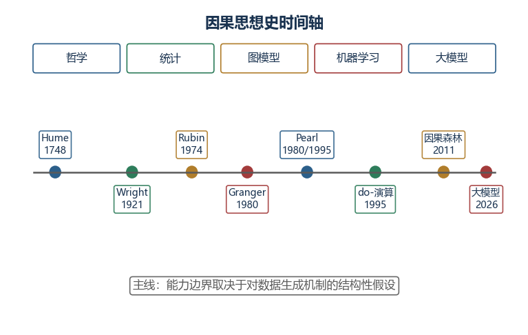

**例 1.2（假设强度与识别）**　设要判断「广告投入是否导致销量上升」。若只有观察数据，且存在「旺季同时增加广告与销量」这一混杂，则单凭相关性无法识别因果效应。若我们掌握「广告投放恰在每月 1 日按固定规则调整」这一结构信息，就可用断点回归（第 14 章）识别。假设越强，可识别的结论越强——这是全书反复出现的主题。

## 1.3　因果的根本困难：混杂、识别、反事实

因果推断之所以困难，源于三个彼此关联的根本障碍。认清它们，是理解后续所有方法的钥匙。

**其一，混杂（confounding）。** 若变量 $C$ 同时影响处理 $T$ 与结局 $Y$，则 $T$ 与 $Y$ 之间的统计关联混入了 $C$ 的效应，不再反映 $T$ 对 $Y$ 的因果作用。例如病情严重度既促使医生用药，又直接降低康复率——若直接比较用药者与未用药者，会错误地得出「药有害」的结论（第 3、11 章）。形式地，当混杂 $C$ 存在时，观察关联可分解为

$$
\mathbb{E}[Y\mid T=1]=\sum_{c}\mathbb{E}[Y\mid T=1,C=c]\,\mathbb{P}(C=c\mid T=1), \tag{1-7}
$$

$$
\mathbb{E}[Y\mid\mathrm{do}(T=1)]=\sum_{c}\mathbb{E}[Y\mid T=1,C=c]\,\mathbb{P}(C=c). \tag{1-8}
$$

两式之差即为混杂偏差，其大小由 $\mathbb{P}(C\mid T)\neq\mathbb{P}(C)$ 的偏离程度决定。这一分解在第 3 章将作为后门准则的特例严格推导，这里只是预告：只要知道 $\mathbb{P}(C)$ 与各层条件期望，混杂效应就可被「算掉」——前提是我们知道 $C$ 是混杂且它可观测。

**其二，识别（identification）。** 因果量能否用观测分布的泛函唯一表达？若不能，则无论数据量多大都无法估计——这是信息论层面的限制，而非样本量问题。识别是可估计性的前提（第 5、10 章）。

**其三，反事实（counterfactual）。** 同一个体在同一时刻不可能既接受处理又不接受处理，因此个体因果效应 $Y_i(1)-Y_i(0)$ 从根本上缺失一半观测值。反事实推理必须借助结构假设才能进行（第 16、19 章）。

**表 1-1　三类根本困难及其应对章节**

| 困难 | 本质 | 主要应对章节 |
|------|------|--------------|
| 混杂 | 共同原因造成虚假关联 | 第 3、11、12、13 章 |
| 识别 | 因果量无法由观测分布唯一决定 | 第 5、10 章 |
| 反事实 | 个体潜在结果缺失一半 | 第 16—19 章 |

这三个困难对应因果之梯的三级：混杂主要阻碍干预层（Level 2），识别决定我们能爬到哪一级，反事实位于最高层（Level 3）。本书对每一种方法，都要追问它是否、以及如何克服这些障碍。

## 1.4　全书的结构安排

全书九篇四十一章，按「基础—发现—效应—反事实—表征—机器学习—大模型—应用—未来」展开。

**第一篇（1—4 章）因果的理论基础。** 第 2 章概率图模型与贝叶斯网络，建立表示语言；第 3 章结构因果模型与 do-演算，给出干预的数学工具；第 4 章因果之梯，形式化三层能力及其不可约性。

**第二篇（5—9 章）因果发现。** 从问题界定与马尔可夫等价类（第 5 章），到约束方法 PC/FCI（第 6 章）、评分方法（第 7 章）、函数因果模型 LiNGAM/ANM（第 8 章），再到时序与非线性发现（第 9 章）。

**第三篇（10—15 章）因果效应估计。** 从效应的定义与识别（第 10 章），到 RCT 与观察研究（第 11 章）、匹配与倾向得分（第 12 章）、工具变量（第 13 章）、断点回归与双重差分（第 14 章）、异质处理效应与机器学习（第 15 章）。

**第四篇（16—19 章）反事实推理。** 反事实的形式化（第 16 章）、中介分析（第 17 章）、反事实公平（第 18 章）、反事实的评估与局限（第 19 章）。

**第五篇（20—23 章）因果表征学习。** 不变性与分布外泛化（第 20 章）、因果表征与解耦（第 21 章）、因果正则化与迁移（第 22 章）、因果与表示的统一（第 23 章）。

**第六篇（24—27 章）因果与机器学习；第七篇（28—32 章）因果与大模型；第八篇（33—37 章）应用与工程；第九篇（38—41 章）因果智能的未来。** 第 41 章回扣本书框架。

**表 1-2　全书九篇与因果之梯的对应**

| 篇 | 主题 | 章 | 主要之梯层级 |
|----|------|----|--------------|
| 一 | 理论基础 | 1—4 | L1—L3 |
| 二 | 因果发现 | 5—9 | L1—L2 |
| 三 | 因果效应 | 10—15 | L2 |
| 四 | 反事实推理 | 16—19 | L3 |
| 五 | 因果表征 | 20—23 | L2—L3 |
| 六 | 因果与 ML | 24—27 | L1—L2 |
| 七 | 因果与大模型 | 28—32 | L1—L3 |
| 八 | 应用与工程 | 33—37 | L2—L3 |
| 九 | 未来 | 38—41 | 全部 |

## 1.5　因果之梯与四层能力体系

本书提出并贯穿一套理论框架——**因果之梯（ladder of causation）**[9]。它把因果能力分为三层：

**表 1-3　因果之梯三层**

| 层级 | 名称 | 回答的问题 | 典型方法 |
|------|------|------------|----------|
| Level 1 | 关联（Association） | 观察到什么？ | 回归、相关、条件概率 |
| Level 2 | 干预（Intervention） | 如果做了 X 会怎样？ | do-演算、RCT、因果效应估计 |
| Level 3 | 反事实（Counterfactual） | 如果当初没做会怎样？ | 结构方程、反事实、归因 |

**定义 1.2（因果之梯四问）**　对任一因果方法，依次追问四件事：① 它站在梯子的哪一级；② 它隐含了什么假设；③ 它突破了前一方法的什么限制；④ 它无法突破什么理论边界。

例如：回归只回答「关联」；RCT 能回答「干预」但成本高昂、外部效度有限；do-演算在观察数据中做干预推理，但依赖因果图正确；反事实需要最强的结构性假设——它们不是简单的技术迭代，而是**对因果阶梯不同层级的攀登**。

在因果之梯之上，本书进一步给出四层能力体系（见「前置说明」）：因果表示（C1）、因果发现（C2）、因果效应（C3）、因果决策（C4），分别落在第 2—3、5—9、10—15、16—19 与 26 章。四层与三层之梯的关系是：C1、C2 主要支撑 Level 1 与 Level 2 的建模；C3 对应 Level 2；C4 对应 Level 3。图 1-3 给出阶梯的直观图像。

> 【图 1-3　因果之梯：关联—干预—反事实】（原图见 figures/图1-3.png）：绘制三级台阶，自下而上标注「Level 1 关联：看到什么」「Level 2 干预：做了会怎样」「Level 3 反事实：当初没做会怎样」，右侧标注对应四层能力 C1—C4 的覆盖范围。

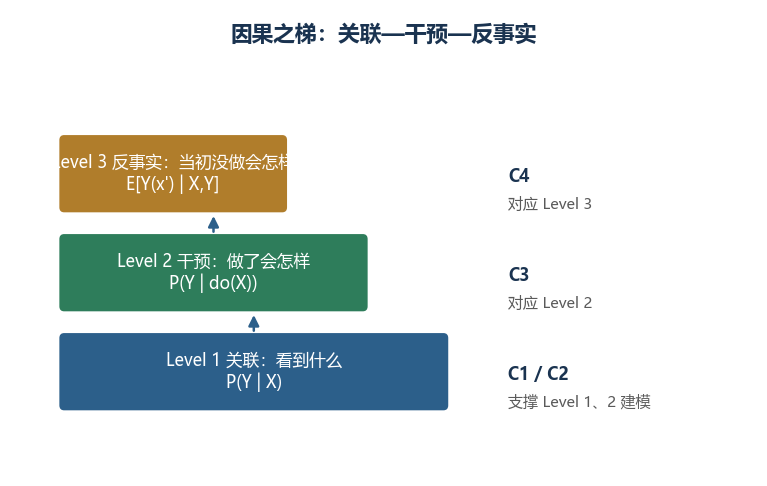

由此还须澄清三个常被混淆的命题：**相关不等于因果**（Level 1 无法自动升级到 Level 2，第 4 章）；**预测好不等于可干预**（高预测精度的模型可能因忽略结构而在干预下失效，第 20 章）；**干预有效不等于反事实成立**（平均效应正确不保证个体反事实正确，第 19 章）。三者将分别在第二、三、四篇严格说明。

## 1.6　贯穿全书的统一案例

为把抽象的因果概念落到实处，本书以**一个医疗治疗效应问题**为统一案例[10]。设某新药治疗对患者康复的影响为研究对象，定义如下变量：

- 处理 $T\in\{0,1\}$：是否服用新药；
- 结局 $Y\in\{0,1\}$：是否康复；
- 协变量：年龄 $A$、病情严重度 $S$；
- 潜在混杂：患者未记录的生活习惯 $U$，同时影响 $S$ 与 $Y$。

**例 1.3（统一案例的初步因果图）**　医生根据病情 $S$ 决定是否开药 $T$，而 $S$ 又直接影响康复 $Y$。于是存在后门路径 $T\leftarrow S\to Y$，它使「用药者康复率高」可能仅仅因为他们病情更轻，而非药物有效。第 3 章将画出完整因果图并用后门准则识别效应；第 6、9 章尝试从数据中发现这一结构；第 10—13 章分别用可忽略性、倾向得分与工具变量估计效应；第 16 章计算「若这位患者当初没服药会怎样」的个体反事实。

> 【图 1-4　统一案例：医疗治疗效应因果图】（原图见 figures/图1-4.png）：节点 $S$（病情）指向 $T$（用药）与 $Y$（康复），$T$ 指向 $Y$；虚线节点 $U$（生活习惯）指向 $S$ 与 $Y$ 表示潜在混杂，标出后门路径 $T\leftarrow S\to Y$。

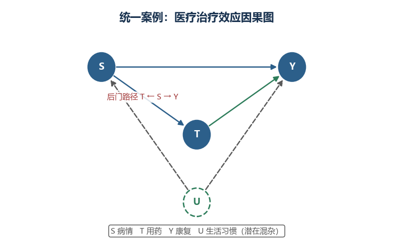

这一案例将在十余章中反复出现，每次聚焦不同侧面。这不是重复，而是通过逐步加深的镜头展示因果智能的层层递进——正如同一座城市，可以从地图、街道、建筑、居民四个尺度反复观看，每次都看到新的东西。

## 1.7　因果智能的应用图景与技术谱系

抽象框架须落到具体场景才有生命力。表 1-5 列举本书后续将反复触及的典型应用，并标注每类应用主要攀登的阶梯层级与核心方法。

**表 1-5　因果智能的典型应用与对应层级**

| 应用领域 | 典型问题 | 之梯层级 | 核心方法（章节） |
|----------|----------|----------|------------------|
| 医学与公共卫生 | 药物疗效、疫苗保护效力 | L2—L3 | RCT、后门调整、反事实归因（第 11、16 章） |
| 计量经济学 | 政策评估、价格因果 | L2 | 工具变量、断点、双重差分（第 13、14 章） |
| 机器学习 | 因果表示、反事实推理 | L2—L3 | 因果表征、因果正则化（第 20—23 章） |
| 大模型评估 | 模型是否理解因果 | L1—L3 | 因果推理基准、之梯分级评测（第 28、32 章） |
| 推荐与广告 | 展示—点击—转化链 | L2 | 因果效应、去偏（第 10、15 章） |
| 金融风控 | 违约的驱动因素 | L2—L3 | 因果发现、中介分析（第 17 章） |

这张表的用意不在罗列行业，而在提醒读者：**同一套之梯语言可以横跨这些领域**。药企与广告公司面对的是不同的 $T,Y$，但他们问的是同一个问题——「强制改变 $T$ 会怎样」——并因此共享第 3 章的 do-演算与第 10 章的识别理论。领域知识决定的是图长什么样、混杂有哪些；而「如何从图与数据算出效应」这一机制是普适的。这正是把因果写成「智能」而非「方法汇编」的理由。

从技术谱系看，因果智能内部也有一条清晰的能力上升链。把全书 41 章压成五段，可概括为表 1-6。

**表 1-6　因果智能技术谱系（能力上升链）**

| 阶段 | 章节 | 输入 | 输出 | 代表能力 |
|------|------|------|------|----------|
| 表示 | 2—3 | 变量、机制 | 因果图、SCM | 把「谁导致谁」写成数学 |
| 发现 | 5—9 | 观察数据 | CPDAG / DAG | 从数据恢复结构 |
| 效应 | 10—15 | 图 + 数据 | 平均/异质效应 | 量化干预后果 |
| 反事实 | 16—19 | 图 + 数据 + 个体观测 | 个体反事实 | 归因与解释 |
| 智能体 | 20—41 | 上述全部 | 可干预的智能系统 | 因果驱动的决策与推理 |

这条链解释了本书的章节顺序：表示先于发现（你得先会画因果图，才能谈从数据里恢复它），发现先于效应（结构是识别的输入），效应先于反事实（先有平均效应，再谈个体归因）。后续各章都将反复引用这张「能力阶梯」作为定位坐标——每介绍一个新方法，我们先问它站在哪一格，再问它突破了前一格的哪道墙。

**阅读路径建议。** 三类读者可各取所需：① 想快速上手效应估计者，可跳过第 2—9 章的图论细节，直读第 3 章 do-演算与第 10—15 章，再按需回补；② 关注因果发现与结构学习的读者，应精读第 2、5、6 章，它们是后续一切算法的地基；③ 研究大模型因果能力的读者，第 1、4 章给出评测语言，第 28、32 章给出具体基准。无论哪条路径，第 3 章的 do-演算与第 4 章的因果之梯都是绕不开的「枢纽两章」——前者提供计算引擎，后者提供评判标尺。本书刻意把这两章写得尽量自足，使其成为读者反复回查的「锚点」。

## 本章小结

本章确立全书的问题意识与理论框架。我们首先界定因果智能的四类任务（定义 1.1），区分关联 $\mathbb{E}[Y\mid X=x]$（式 1-1）与干预 $\mathbb{E}[Y\mid\mathrm{do}(X=x)]$（式 1-2）这一根本差异。接着回顾从 Hume 到 Pearl 的思想史，指出图与潜在结果两条主线的融合趋势。我们剖析混杂、识别、反事实三类根本困难（表 1-1），给出全书九篇结构（表 1-2）。核心贡献是提出因果之梯（表 1-3）与四层能力体系，并确立贯穿全书的统一医疗案例（图 1-4）。

这些辨析衔接后续各章：因果之梯在第 4 章形式化，统一案例在第 3、6、9—16 章反复深化，四层能力在第 41 章回扣。下一章建立因果智能的表示语言——概率图模型与贝叶斯网络。

**进一步阅读**　因果的历史与哲学背景建议阅读[9]；潜在结果框架建议阅读[2]；图模型方法建议阅读[4]。

## 参考文献

[1] Wright S. Correlation and causation. *Journal of Agricultural Research*, 1921, 20(7): 557–585.

[2] Rubin D B. Estimating causal effects of treatments in randomized and nonrandomized studies. *Journal of Educational Psychology*, 1974, 66(5): 688–701.

[3] Granger C W J. Testing for causality: A personal viewpoint. *Journal of Economic Dynamics and Control*, 1980, 2: 329–352.

[4] Pearl J. *Causality: Models, Reasoning, and Inference*. 2nd ed. Cambridge: Cambridge University Press, 2009.

[5] Pearl J. Causal diagrams for empirical research. *Biometrika*, 1995, 82(4): 669–688.

[6] Spirtes P, Glymour C, Scheines R. *Causation, Prediction, and Search*. 2nd ed. Cambridge, MA: MIT Press, 2000.

[7] Hill J L. Bayesian nonparametric modeling for causal inference. *Journal of Computational and Graphical Statistics*, 2011, 20(1): 50–69.

[8] Athey S, Imbens G W. Recursive partitioning for heterogeneous causal effects. *Proceedings of the National Academy of Sciences*, 2016, 113(27): 7353–7360.

[9] Pearl J, Mackenzie D. *The Book of Why: The New Science of Cause and Effect*. New York: Basic Books, 2018.

[10] Hernán M A, Robins J M. *Causal Inference: What If*. Boca Raton: Chapman & Hall/CRC, 2020.

---

# 第 2 章　概率图模型与贝叶斯网络

第 1 章把「因果表示」列为四层能力之首，并区分了关联 $\mathbb{E}[Y\mid X=x]$ 与干预 $\mathbb{E}[Y\mid\mathrm{do}(X=x)]$。要计算前者，我们需要一种紧凑地表示联合概率分布的语言；要迈向后者，我们需要一种能编码「结构」的语言。概率图模型（probabilistic graphical model）正是这样一种语言：它用图节点表示随机变量、用边表示变量间的依赖，把一个高维联合分布分解为若干局部因子的乘积。本章建立这套表示语言，重点是有向模型——贝叶斯网络（Bayesian network）。因果侧的内容（如 d-分离与 intervened 图）将在本章建立、在第 3 章升级为结构因果模型。

本章先引入条件独立与图表示（2.1 节），给出贝叶斯网络的定义与链式分解（2.2 节），严格推导 d-分离与马尔可夫性质（2.3 节），简述图模型中的推断（2.4 节），最后讨论边界（2.5 节）。全章只讲「因果侧」的图模型；图神经网络与图基础模型的完整体系见《图智能导论》，本书不再展开。

## 2.1　概率图模型与条件独立

联合分布的维度灾难，是概率建模的第一道难关。

设 $d$ 个二值变量，联合分布需 $2^d-1$ 个参数独立刻画；$d=30$ 时已超十亿。但实际分布往往满足大量条件独立（conditional independence）关系，使参数量骤减。概率图模型的核心思想，正是**用图编码条件独立，从而压缩联合分布**。

**定义 2.1（条件独立）**　给定变量集 $Z$，若

$$
\mathbb{P}(X,Y\mid Z)=\mathbb{P}(X\mid Z)\,\mathbb{P}(Y\mid Z), \tag{2-1}
$$

则称 $X$ 与 $Y$ 在给定 $Z$ 时条件独立，记作 $X\perp\!\!\!\perp Y\mid Z$。当 $Z=\varnothing$ 时简记为 $X\perp\!\!\!\perp Y$。

**直觉解释。** 条件独立意味着「知道了 $Z$ 之后，$X$ 不再携带关于 $Y$ 的额外信息」。例如在「病情 $S$ 决定用药 $T$ 与康复 $Y$」的案例中，若已知病情 $S$，则用药与否不再告诉我们关于康复的额外信息（假设药物本身无效），写作 $T\perp\!\!\!\perp Y\mid S$。反之若 $S$ 未知，则 $T$ 与 $Y$ 因共同依赖 $S$ 而相关——这是混杂的雏形（第 1 章）。

概率图模型分两大类：有向无环图（DAG）模型即贝叶斯网络，用父子关系编码依赖；无向图模型即马尔可夫随机场，用势函数编码兼容关系。本书以贝叶斯网络为主，因其边可直接解读为因果方向（第 3 章）。需要强调的是，本章所称「边可直接解读为因果方向」只是一种潜在的语义承诺：只有在加入结构方程与外生性假设之后，这种解读才获得数学合法性（第 3 章）。在纯概率意义下，贝叶斯网络的边仅表示联合分布的一种因子化方式，并不自动蕴含「父导致子」。保持这一克制，是避免把统计依赖误当作因果的第一道防线。

> 【图 2-1　贝叶斯网络与条件独立】（原图见 figures/图2-1.png）：左侧绘 DAG $S\to T\to Y$ 与 $S\to Y$，右侧配文字说明每个缺失的边对应一个条件独立断言，如 $T\perp\!\!\!\perp Y\mid S$ 对应「无直接边 $T\to Y$」若药物无效。

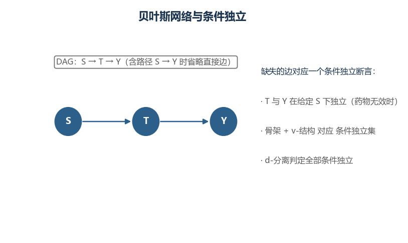

**例 2.1（二值变量的参数压缩）**　设三个二值变量 $X,Y,Z$ 的联合分布无约束时需 $2^3-1=7$ 个参数。若图结构为 $X\to Z\leftarrow Y$（即 $X\perp\!\!\!\perp Y$），则联合分解为 $\mathbb{P}(X)\mathbb{P}(Y)\mathbb{P}(Z\mid X,Y)$，参数量为 $1+1+4=6$。若进一步 $Z$ 仅依赖 $X$（$Y\perp\!\!\!\perp Z\mid X$），则参数量为 $1+1+2=4$。每增加一条条件独立，就省下一组参数——这就是图模型的价值。

**一般化：贝叶斯网络的参数计数。** 设变量 $X_i$ 取 $r_i$ 个离散取值，父节点集合 $\mathbf{PA}_i$ 中第 $j$ 个父节点取值数记为 $r_{j}$，则节点 $X_i$ 的局部因子 $\mathbb{P}(X_i\mid\mathbf{PA}_i)$ 需要的独立参数为
$$
n_i=r_i\prod_{j\in\mathrm{pa}(i)} r_j - r_i = r_i\Big(\prod_{j\in\mathrm{pa}(i)} r_j - 1\Big), \tag{2-2}
$$
即「每个父配置下 $r_i-1$ 个自由概率」之和。网络总参数为 $N=\sum_i n_i$。无约束联合分布需 $\prod_i r_i-1$ 个参数。以式 (2-3) 的链 $X_1\to X_2\to\cdots\to X_d$（每个变量二值、恰一个父）为例，$n_1=1$，$n_i=2(2-1)=2$（$i\ge2$），故 $N=1+2(d-1)=2d-1$；而无约束需 $2^d-1$。$d=10$ 时分别为 $19$ 与 $1023$——压缩约两个数量级。这正是「条件独立把指数参数降为线性参数」的定量表达，也是高维数据可用图模型建模的根本原因（第 5 章的高维发现正是在此压缩下才可行）。

## 2.2　贝叶斯网络的表示

**定义 2.2（贝叶斯网络）**　贝叶斯网络由两部分构成：① 一个有向无环图 $G=(V,E)$，节点 $V=\{X_1,\dots,X_d\}$ 对应随机变量，边 $E$ 表示直接依赖；② 每个节点 $X_i$ 带一组局部条件概率 $\mathbb{P}(X_i\mid \mathbf{PA}_i)$，其中 $\mathbf{PA}_i$ 为 $X_i$ 的父节点集合。网络的联合分布按**链式法则**分解为

$$
\mathbb{P}(X_1,\dots,X_d)=\prod_{i=1}^{d}\mathbb{P}\big(X_i\mid \mathbf{PA}_i\big). \tag{2-3}
$$

式（2-3）是通用链式法则 $\prod_i\mathbb{P}(X_i\mid X_1,\dots,X_{i-1})$ 在条件独立假设下的化简：每个变量只依赖其父节点，而非所有前序变量。

**推导。** 对任意变量序，链式法则成立：$\mathbb{P}(X_1,\dots,X_d)=\prod_i\mathbb{P}(X_i\mid X_1,\dots,X_{i-1})$。贝叶斯网络的图结构蕴含：给定父节点 $\mathbf{PA}_i$，$X_i$ 与所有非后代变量条件独立（局部马尔可夫性质，2.3 节），故 $\mathbb{P}(X_i\mid X_1,\dots,X_{i-1})=\mathbb{P}(X_i\mid\mathbf{PA}_i)$，代入即得式（2-3）。□

**例 2.2（统一案例的贝叶斯网络）**　对第 1.6 节的医疗案例，设病情 $S$、用药 $T$、康复 $Y$，结构为 $S\to T$、$S\to Y$、$T\to Y$（药物确有疗效）。设 $\mathbb{P}(S=重)=0.3$；$\mathbb{P}(T=1\mid S=重)=0.8$，$\mathbb{P}(T=1\mid S=轻)=0.3$；$\mathbb{P}(Y=1\mid T=1,S=重)=0.6$，$\mathbb{P}(Y=1\mid T=0,S=重)=0.4$，轻症相应为 $0.9$ 与 $0.8$。则联合概率

$$
\mathbb{P}(S=重,T=1,Y=1)=0.3\times 0.8\times 0.6=0.144. \tag{2-4}
$$

这种局部指定的便利，正是贝叶斯网络被广泛用于专家系统的原因。

**表 2-1　贝叶斯网络 vs 马尔可夫随机场**

| 维度 | 贝叶斯网络（有向） | 马尔可夫随机场（无向） |
|------|--------------------|------------------------|
| 边语义 | 直接依赖（可解读为因果） | 无向兼容约束 |
| 分解 | 条件概率连乘（式 2-3） | 势函数连乘除以配分函数 |
| 独立性 | d-分离 | 图分离 |
| 本书用途 | 因果建模主干 | 仅作对照，不展开 |

**贝叶斯网络的参数估计。** 结构已知时，每个局部因子可独立极大似然估计。设 $n_i(\mathbf{a})$ 为样本中「$X_i$ 的父配置为 $\mathbf{a}$」的频数，$n_{ij}(\mathbf{a})$ 为其中 $X_i$ 取第 $j$ 值的频数，则 $\mathbb{P}(X_i=j\mid\mathbf{PA}_i=\mathbf{a})$ 的极大似然估计为
$$
\hat{p}_{ij}(\mathbf{a})=\frac{n_{ij}(\mathbf{a})}{n_i(\mathbf{a})}, \tag{2-5}
$$
即条件频率。由于链式分解 (2-3) 把对数似然化为各局部因子对数似然之和，**整个网络的 MLE 等于逐节点 MLE**，无需联合优化——这是贝叶斯网络在估计上的巨大便利。对连续变量常假设局部因子为高斯 $\mathbb{P}(X_i\mid\mathbf{PA}_i)=N(X_i;\boldsymbol\mu_i(\mathbf{PA}_i),\sigma_i^2)$，则 $\boldsymbol\mu_i$ 是局部线性回归系数、$\sigma_i^2$ 是残差方差，均可逐节点最小二乘估计。

**例 2.3（统一案例的 MLE）**　沿用例 2.2 的医疗网络 $S\to T$、$S\to Y$、$T\to Y$。设某样本有 $1000$ 名患者，其中重症 $300$、轻症 $700$；重症中用药 $240$（即 $\hat{p}(T=1\mid S=重)=0.8$），轻症中用药 $210$（$\hat{p}(T=1\mid S=轻)=0.3$）。则 $\hat{p}(T=1)=0.45$，与第 1 章例 1.4 的先验一致。再估计 $\hat{p}(Y=1\mid T=1,S=重)$：在 $240$ 名重症用药者中设 $144$ 人康复，得 $0.60$。可见式 (2-5) 只是「数人头」，但正因为它是逐节点独立的，当样本中某个父配置频数为 $0$ 时，需用拉普拉斯平滑或贝叶斯先验（第 9 章的变分推断在此有自然接口）避免参数估计为 $0$ 或 $1$。

## 2.3　d-分离与马尔可夫性质

**d-分离（d-separation）**是判断图中条件独立的图论准则，是本章最重要的工具[1]。

**定义 2.3（d-分离）**　在有向无环图 $G$ 中，给定节点集 $Z$，若 $X$ 与 $Y$ 之间所有（无向意义下的）路径都被 $Z$ 阻断（blocked），则称 $X$ 与 $Y$ 被 $Z$ d-分离，记作 $X\perp_G Y\mid Z$。路径被阻断的判据是：路径经过中间节点 $B$ 时，若满足以下任一条件则阻断：

1. $A\to B\to C$ 或 $A\leftarrow B\to C$（链/分叉），且 $B\in Z$；
2. $A\to B\leftarrow C$（对撞，collider），且 $B\notin Z$ 且 $B$ 的任何后代都不在 $Z$。

**定理 2.1（d-分离蕴含条件独立）**　若 $X$ 与 $Y$ 在 $G$ 中被 $Z$ d-分离，则在任何由 $G$ 因子化（式 2-3）的 distribution $\mathbb{P}$ 中，$X\perp\!\!\!\perp Y\mid Z$。

该定理的证明要点：把联合分布按式（2-3）分解，沿路径逐项消去依赖。对链与分叉，观测中间节点 $B$ 使两端路径上的因子条件化而切断依赖；对对撞，未观测对撞节点 $B$ 时其两端独立，一旦观测 $B$（或其后代）反而**打开**路径——这就是著名的「对撞偏差（collider bias）」，将在第 11 章以「选择偏差」的形式重现。

**直觉解释。** 链 $A\to B\to C$：若已知 $B$，$A$ 的信息无法再穿过 $B$ 影响 $C$，路径断开。对撞 $A\to B\leftarrow C$：若 $B$ 未知，$A$ 与 $C$ 各自独立地影响 $B$，故二者独立；但若已知 $B$（如已知「论文被录用」），则 $A$（选题好）与 $C$（运气好）之间产生负相关——这就是「伯克森悖论（Berkson's paradox）」[2]。

> 【图 2-2　d-分离的三种结构】（原图见 figures/图2-2.png）：并排绘制链 $A\to B\to C$、分叉 $A\leftarrow B\to C$、对撞 $A\to B\leftarrow C$，分别标注「给定 $B$ 阻断」「给定 $B$ 阻断」「未给定 $B$ 阻断；给定 $B$ 则连通」。

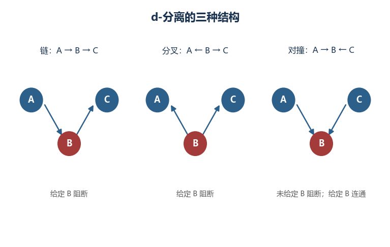

**例 2.4（对撞偏差的数值例）**　设某疾病 $D$ 与某暴露 $E$ 均独立地导致就医 $H$（$D\to H\leftarrow E$），且 $\mathbb{P}(D=1)=\mathbb{P}(E=1)=0.1$，$\mathbb{P}(H=1\mid D=1)=0.9$、$\mathbb{P}(H=1\mid E=1)=0.9$（两者皆为 1 时取 $0.9$），$\mathbb{P}(H=1\mid D=0,E=0)=0.1$。

**全体人群**：$D,E$ 独立，$\mathbb{P}(D=1,E=1)=0.01=\mathbb{P}(D=1)\mathbb{P}(E=1)$，$\mathbb{P}(D=1\mid E=1)=0.1=\mathbb{P}(D=1)$，无关联。

**已就医者（$H=1$）**：先算 $\mathbb{P}(H=1)=0.01\times0.9+0.09\times0.9+0.09\times0.9+0.81\times0.1=0.252$。再分别看「暴露者」与「未暴露者」中的患病率：
$$
\mathbb{P}(D=1\mid E=1,H=1)=\frac{0.01\times0.9}{0.01\times0.9+0.09\times0.9}=\frac{0.009}{0.09}=0.1,
$$
$$
\mathbb{P}(D=1\mid E=0,H=1)=\frac{0.09\times0.9}{0.09\times0.9+0.81\times0.1}=\frac{0.081}{0.162}=0.5.
$$

两者相差 $0.4$！在未暴露的住院者中，唯一入院途径就是患病，故「未暴露」反而强烈暗示「患病」。原本独立的 $D,E$，一旦以「就医」为筛选条件便高度负相关。这一 $0.4$ 的缺口（对撞被「 conditioning 」打开）正是第 11 章「只对医院病人抽样会扭曲结论」的根源：按 $H$ 分层不是「控制混杂」，而是「打开对撞」，恰恰制造了虚假关联。

**定理 2.2（全局马尔可夫性质）**　在贝叶斯网络 $G$ 中，每个变量在给定其父节点时与其所有非后代条件独立：$X_i\perp\!\!\!\perp (\text{非后代})\mid\mathbf{PA}_i$。

这一定理是式（2-3）成立的充要条件，也是「局部概率指定」合法性的保证。

**有向与无向的桥：道德化与 I-map。** 一个常见追问是：贝叶斯网络（有向）能否用马尔可夫随机场（无向）表示？可以，但会丢信息。把 DAG $G$ **道德化（moralize）**：先删去所有箭头方向，再给「同一子节点的两个父节点」之间补一条无向边（即把对撞 $A\to C\leftarrow B$ 中原本无边的 $A—B$ 连上，称为「成婚」），得到无向图 $G^m$。$G^m$ 的边集由 $\{X_i,\mathbf{PA}_i\}$ 的每个「星形团」确定。关键事实是：**有向图与它的道德化图具有相同的 I-map 性质**——$G$ 蕴含的每个条件独立，在 $G^m$ 中也成立。但反向不成立：$G^m$ 可能蕴含更多独立（丢失了方向信息），故有向模型是无向模型的细化。这一对应解释了为何因果侧坚持用有向图：无向边无法区分「$X$ 导致 $Y$」与「$Y$ 导致 $X$」，而这一区分恰恰是因果推断的全部意义所在（第 3、5 章）。表 2-1 中「边语义」一行的差异，根源正在于此。

**例 2.5（道德化的信息损失）**　对 $X\to Z\leftarrow Y$（对撞），道德化得无向图 $X—Z—Y$。无向图中 $X,Y$ 经 $Z$ 相连，无法表达「$X,Y$ 在未观测 $Z$ 时独立」这一有向图的关键性质——对撞的「条件化才打开」机制在道德化后消失。这正是「边方向承载因果信息」的最小例子，也是第 5 章马尔可夫等价类只保留 v-结构方向的原因：v-结构是道德化中唯一必须「记住」的方向信息。

## 2.4　图模型中的推断

给定贝叶斯网络与部分观测，推断（inference）任务计算后验 $\mathbb{P}(Q\mid E=e)$。精确推断利用图结构做因子分解与消元：变量消元（variable elimination）、信念传播（belief propagation）在树结构与低树宽图上高效[3]。一般图的精确推断是 $\sharp$P-难问题，需用近似方法：变分推断（第 9 章概念延伸）、马尔可夫链蒙特卡洛、置信传播近似。

**表 2-2　推断方法谱系**

| 方法 | 类型 | 适用场景 | 复杂度 |
|------|------|----------|--------|
| 变量消元 | 精确 | 低树宽图 | 指数于树宽 |
| 信念传播 | 精确 | 树/森林 | 线性于边数 |
| 变分推断 | 近似 | 大规模、连续 | 优化迭代 |
| MCMC | 近似（渐近精确） | 通用 | 采样开销大 |

本书不展开推断算法细节——它们是概率建模的通用工具，与因果侧的核心问题（干预与识别）不同。需要时读者可参考文献[3]。因果推断真正关心的不是「给定证据算后验」，而是「给定干预算后果」，这正是第 3 章 do-演算的主题。为确保概念清晰，我们比较两种查询的差别：观察查询 $\mathbb{P}(Y=y\mid X=x)$ 只是对联合分布做条件化，它回答「在观测到 $X=x$ 的样本中，$Y=y$ 的比例」；而干预查询 $\mathbb{P}(Y=y\mid\mathrm{do}(X=x))$ 对应一个被外力改造过的新分布，其中的 $X$ 不再由原图中的父节点决定。前者是对同一分布的切片，后者是对分布生成机制的改写——这正是两种查询不可混同的根本原因，也是第 3 章引入 do 算子的动机。

**例 2.6（树结构上的信念传播数值例）**　为看清推断如何「利用结构」，考虑一个三节点树 $X\to Z\to Y$（每条边一个二值变量），参数为：$\mathbb{P}(X=1)=0.5$；$\mathbb{P}(Z=1\mid X=1)=0.8$、$\mathbb{P}(Z=1\mid X=0)=0.3$；$\mathbb{P}(Y=1\mid Z=1)=0.7$、$\mathbb{P}(Y=1\mid Z=0)=0.2$。现观测到 $Y=1$，求 $\mathbb{P}(X=1\mid Y=1)$。

**第一步（正向传递）**：$\mathbb{P}(Z=1)=0.5\times0.8+0.5\times0.3=0.55$，$\mathbb{P}(Z=0)=0.45$。

**第二步（边缘化 $Y$）**：$\mathbb{P}(Y=1)=0.55\times0.7+0.45\times0.2=0.385+0.09=0.475$。

**第三步（反向传递，求 $X$ 的后验）**：对 $(X,Z)$ 联合边缘化：
$$
\mathbb{P}(X=1,Y=1)=\sum_{z}\mathbb{P}(X=1)\mathbb{P}(Z=z\mid X=1)\mathbb{P}(Y=1\mid Z=z)=0.5\times0.8\times0.7+0.5\times0.2\times0.2=0.28+0.02=0.30,
$$
$$
\mathbb{P}(X=1\mid Y=1)=\frac{0.30}{0.475}\approx0.632.
$$

对比未观测 $Y$ 时的先验 $\mathbb{P}(X=1)=0.5$：看到 $Y=1$（康复）后，$X=1$（病因强）的后验升到 $0.632$——证据沿因果链 $X\to Z\to Y$ 向「上游」回传，修正了对原因的判断。这正是「推断=沿图做因子化消元」的直观体现；若图含环（对撞），正向/反向传递需迭代（loopy BP），精度不再保证——这也是表 2-2 中树结构列为「精确」而一般图列为「近似」的原因。

**4 节点 d-分离判定算例。** 设图 $A\to B\leftarrow C\to D$（$B$ 为对撞，$C\to D$ 为链）。判断：① $A\perp D\mid\varnothing$？路径 $A\to B\leftarrow C\to D$ 经对撞 $B$ 且 $B\notin Z$，阻断；无其他路径，故**独立**成立。② $A\perp D\mid B$？给定 $B$ 打开对撞，路径连通，故**不独立**。③ $A\perp D\mid C$？路径经对撞 $B$（未条件化）阻断，且 $C\in Z$ 阻断 $C\to D$ 段，故**独立**。三条判定完全由第 2.3 节的阻断规则机械得出，不依赖任何参数——这解释了为何 d-分离是「图论」而非「概率」工具：它把概率问题转译为拓扑问题，是第 3 章 do-演算与第 5、6 章因果发现共同的判定引擎。

## 2.5　边界与讨论

贝叶斯网络的局限须明确。其一，**观察等价性（observational equivalence）**：不同 DAG 可蕴含同一组条件独立，从而无法仅凭观察数据区分——这将在第 5 章以「马尔可夫等价类」严格处理，也是因果发现的根本障碍。其二，**表示能力有限**：它假定变量可由局部条件概率刻画，对连续、高维、非线性关系需参数化假设。其三，**无因果语义**：本章的贝叶斯网络只是联合分布的分解工具，边本身不蕴含因果；把「边」升级为「因果边」需要结构方程与干预语义（第 3 章）。

**忠实性与参数化。** 式 (2-3) 的分解隐含一个统计假设：分布对图是**忠实的（faithful）**，即图中每条 d-分离都对应分布中真实的条件独立，反之亦然。忠实性在参数连续变化时几乎必然成立（违背集是零测的代数子集），但它排除了一类「巧合抵消」：例如 $X\to Z\to Y$ 与一条 $X\leftarrow H\to Y$ 的隐混杂恰好使 $X,Y$ 独立。这类抵消在代数上可发生，只是测度为零。对连续变量，还需选择局部因子的参数族（高斯、广义线性等）；参数族选错，即便图正确，效应估计也会有偏——这是第 10 章「模型误设」问题的源头。理解「图正确 + 参数族正确 + 忠实」三者缺一不可，是避免把图模型当作「万能压缩器」的关键。

**因果之梯四问自检。** 贝叶斯网络站在 Level 1（关联）：它以紧凑方式表示联合分布、回答观察类查询。它隐含的假设是马尔可夫性质与图结构正确。它突破了「无结构高维分布无法压缩」的限制。它无法突破的边界是：无法区分观察等价的结构，更无法回答干预与反事实问题。

## 本章小结

本章建立因果智能的表示语言。我们首先指出联合分布的维度灾难与条件独立（定义 2.1，式 2-1）的压缩作用；给出贝叶斯网络的定义与链式分解（定义 2.2，式 2-3），证明其由局部马尔可夫性质保证；严格推导 d-分离（定义 2.3、定理 2.1）与全局马尔可夫性质（定理 2.2），并通过链、分叉、对撞三种结构与数值例（例 2.3 的 MLE 与例 2.4 的对撞偏差）展示其判断力。我们比较了贝叶斯网络与马尔可夫随机场（表 2-1），简述图模型推断（表 2-2）。

核心边界在于：贝叶斯网络仅属 Level 1（关联），无法区分观察等价结构，更无法回答干预问题。这直接引出第 3 章——通过引入结构方程与 do 算子，把「关联图」升级为「因果图」。下一章将证明：只有引入了干预语义，因果智能才能攀登第二级阶梯。

**进一步阅读**　d-分离与图模型基础建议阅读[1]；对撞偏差建议阅读[2]；图模型推断建议阅读[3]。

## 参考文献

[1] Pearl J. *Probabilistic Reasoning in Intelligent Systems: Networks of Plausible Inference*. San Francisco: Morgan Kaufmann, 1988.

[2] Berkson J. Limitations of the application of fourfold table analysis to hospital data. *Biometrics Bulletin*, 1946, 2(3): 47–53.

[3] Koller D, Friedman N. *Probabilistic Graphical Models: Principles and Techniques*. Cambridge, MA: MIT Press, 2009.

[4] Pearl J. *Causality: Models, Reasoning, and Inference*. 2nd ed. Cambridge: Cambridge University Press, 2009.

[5] Spirtes P, Glymour C, Scheines R. *Causation, Prediction, and Search*. 2nd ed. Cambridge, MA: MIT Press, 2000.

[6] Lauritzen S L. *Graphical Models*. Oxford: Oxford University Press, 1996.

[7] Cowell R G, Dawid A P, Lauritzen S L, Spiegelhalter D J. *Probabilistic Networks and Expert Systems*. New York: Springer, 1999.

[8] Jordan M I. *An Introduction to Probabilistic Graphical Models*. Manuscript, Harvard University, 2003.

---

# 第 3 章　结构因果模型与 do-演算

第 2 章建立的贝叶斯网络仍是「关联图」：它紧凑地编码联合分布，却无法区分「看到 $X=x$」与「让 $X=x$」。记 $\mathbb{P}(Y=y\mid X=x)$ 为观察查询，$\mathbb{P}(Y=y\mid\mathrm{do}(X=x))$ 为干预查询，二者在存在混杂时可以截然不同。本章引入**结构因果模型（structural causal model, SCM）**——把每个变量写成「由父节点与外生噪声决定的函数」——从而赋予图以因果语义，并给出在这种语义下把干预查询化为观察查询的完整规则：**do-演算（do-calculus）**[1]。这是全书最重要的一章，后续几乎所有方法都建立在它之上。

本章先引入结构方程与 SCM（3.1 节），定义 do 算子与干预后的图（3.2 节），严格陈述 do-演算三条规则（3.3 节），推导后门与前门准则（3.4 节），以统一案例演示治疗效应的识别（3.5 节），最后讨论边界（3.6 节）。

## 3.1　结构方程与结构因果模型

贝叶斯网络的分解决定了「变量间如何依赖」，却未说明「依赖如何生成」。结构因果模型补上这一层：每个变量由其父变量通过一个函数与一个外生噪声决定。

**定义 3.1（结构因果模型）**　结构因果模型是一个二元组 $M=\langle D,\Theta\rangle$，其中：

1. $D$ 是**有向无环图**，节点为内生变量 $\{X_1,\dots,X_d\}$ 与外生变量 $\{U_1,\dots,U_d\}$；每个内生变量 $X_i$ 有父节点 $\mathbf{PA}_i$（内生）与 $U_i$（外生）；
2. $\Theta$ 是一组**结构方程**：

$$
X_i \leftarrow f_i(\mathbf{PA}_i, U_i),\quad i=1,\dots,d. \tag{3-1}
$$

若所有 $U_i$ 联合独立，称 $M$ 为**马尔可夫模型**；若进一步每个 $f_i$ 对 $U_i$ 可逆（如加性噪声 $U_i$ 影响 $X_i$），称模型可辨识（第 8 章）。

**直觉解释。** 式（3-1）中的箭头 $\leftarrow$ 不是数学等式，而是**赋值**：$X_i$ 的值「由」父节点与噪声生成。这条语句携带一个关键承诺——若我们改变 $\mathbf{PA}_i$ 的值，$X_i$ 会随之改变；反之若我们改变 $X_i$ 而其父节点不变，则 $X_i$ 与父节点的生成关系被打破。这正是因果的方向性：干预一个变量会改变其后代，但不改变其祖先。

**例 3.1（统一案例的 SCM）**　对第 1.6 节的医疗案例，设病情 $S$、用药 $T$、康复 $Y$，结构方程为：

$$
S\leftarrow U_S,\quad T\leftarrow f_T(S,U_T),\quad Y\leftarrow f_Y(T,S,U_Y). \tag{3-2}
$$

其中 $U_S,U_T,U_Y$ 相互独立。$S\to T$ 表示「病情决定开药」，$S\to Y$ 表示「病情直接影响康复」，$T\to Y$ 表示「药物疗效」。

> 【图 3-3　统一案例治疗效应因果图】（原图见 figures/图3-3.png）：绘 DAG $S\to T$、$S\to Y$、$T\to Y$，并标出结构方程（式 3-2）与后门路径 $T\leftarrow S\to Y$。

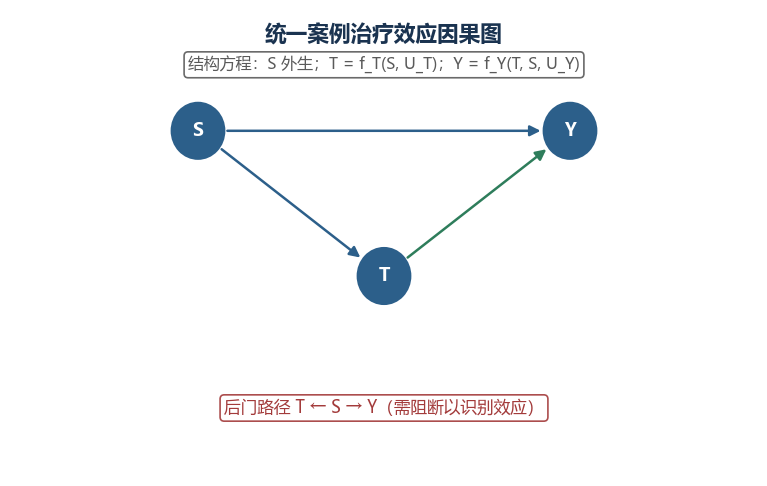

从 SCM 可导出观测分布：由结构方程与外生噪声分布 $\mathbb{P}(U_1,\dots,U_d)$ 归纳出内生变量的联合分布

$$
\mathbb{P}(X_1,\dots,X_d)=\prod_{i=1}^{d}\mathbb{P}\big(X_i\mid\mathbf{PA}_i\big), \tag{3-3}
$$

这正是式（2-2）的贝叶斯网络分解。换言之，贝叶斯网络是 SCM 的「影子」——它保留了依赖结构，却丢失了函数生成机制与干预语义。

**表 3-1　SCM 与贝叶斯网络的对照**

| 维度 | 贝叶斯网络（第 2 章） | 结构因果模型（本章） |
|------|----------------------|----------------------|
| 基本单元 | 条件概率 $\mathbb{P}(X_i\mid\mathbf{PA}_i)$ | 结构方程 $X_i\leftarrow f_i(\mathbf{PA}_i,U_i)$ |
| 边语义 | 统计依赖 | 直接因果机制 |
| 查询 | 观察 $\mathbb{P}(Y\mid X)$ | 观察 + 干预 $\mathbb{P}(Y\mid\mathrm{do}(X))$ |
| 反事实 | 无 | 有（第 16 章） |

## 3.2　干预与 do 算子

**定义 3.2（do 算子）**　对变量 $X$，操作 $\mathrm{do}(X=x)$ 表示把 $X$ 的值**外生地强制设为 $x$**，即删除 SCM 中所有指向 $X$ 的入边（删除 $X$ 对应的结构方程 $X\leftarrow f_X(\mathbf{PA}_X,U_X)$，代之以 $X\leftarrow x$）。所得新模型记为 $M_x$，其诱导分布记作 $\mathbb{P}_x=\mathbb{P}(\cdot\mid\mathrm{do}(X=x))$。

**直觉解释。** 想象把因果图看作一台机器：观察 $X=x$ 只是「看到机器的某个读数恰好是 $x$」；而 $\mathrm{do}(X=x)$ 是「伸手把旋钮拨到 $x$」。前者不改变机器其他部分，后者切断了旋钮原有的连线。这个区别在存在混杂时生死攸关：病情严重的人更可能用药，所以「观察到用药者」是一个被病情筛选过的群体；而「强制让人用药」则打破了病情对用药的决定关系。

**图模型视角。** 干预 $\mathrm{do}(X=x)$ 在图上表现为**入边删除**：把指向 $X$ 的所有箭头抹去，其余边不变（图 3-1）。这与「条件化于 $X=x$」截然不同——条件化只是把注意力限制在 $X=x$ 的样本上，不改变图结构。

> 【图 3-1　干预前/后的图】（原图见 figures/图3-1.png）：左图为原图 $S\to T\to Y$、$S\to Y$；右图为 $\mathrm{do}(T=t)$ 后删除 $S\to T$ 的图，标注「$T$ 不再受 $S$ 影响」。

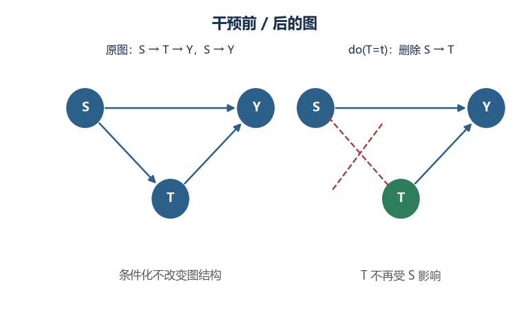

**例 3.2（干预 vs 条件化的数值例）**　沿用式（3-2）与例 2.2 的参数。先算观察关联 $\mathbb{P}(Y=1\mid T=1)$：病情重占 $0.3$，其中用药率 $0.8$，重病用药者康复率 $0.6$；病情轻占 $0.7$，用药率 $0.3$，轻病用药者康复率 $0.9$。则

$$
\mathbb{P}(Y=1,T=1)=0.3\times0.8\times0.6+0.7\times0.3\times0.9=0.144+0.189=0.333,
$$

$$
\mathbb{P}(T=1)=0.3\times0.8+0.7\times0.3=0.24+0.21=0.45,
$$

故 $\mathbb{P}(Y=1\mid T=1)=0.333/0.45\approx0.740$。再算干预 $\mathbb{P}(Y=1\mid\mathrm{do}(T=1))$：干预后所有人用药，康复由病情决定，$\mathbb{P}(Y=1\mid\mathrm{do}(T=1))=0.3\times0.6+0.7\times0.9=0.18+0.63=0.81$。两者相差 $0.07$——观察关联低估了药效，因为用药者中病情轻的比例被混杂扭曲。这 $0.07$ 的差距就是混杂偏差。

**混杂偏差的显式分解。** 上述差距可精确写成

$$
\mathbb{E}[Y\mid T=1]-\mathbb{E}[Y\mid\mathrm{do}(T=1)]=\sum_{s}\big(\mathbb{P}(S=s\mid T=1)-\mathbb{P}(S=s)\big)\,\mathbb{P}(Y=1\mid T=1,S=s). \tag{3-4}
$$

代入数值：$\mathbb{P}(S=重\mid T=1)=\frac{0.24}{0.45}\approx0.533$、$\mathbb{P}(S=轻\mid T=1)\approx0.467$；而 $\mathbb{P}(S=重)=0.3$、$\mathbb{P}(S=轻)=0.7$。则偏差
$$
=(0.533-0.3)\times0.6+(0.467-0.7)\times0.9=0.140-0.210=-0.07,
$$
与 $0.740-0.81=-0.07$ 完全吻合。式 (3-4) 揭示：混杂偏差 = 「处理组与总体的协变量分布之差」$\times$「各层条件期望」。只要 $\mathbb{P}(S\mid T)=\mathbb{P}(S)$（如 RCT），偏差为零——这是随机化消除混杂的代数本质。

**干预后全分布。** 式 (3-2) 的 SCM 在 $\mathrm{do}(T=t)$ 下退化为「$T$ 固定为 $t$、$S$ 与 $Y$ 按原方程演化」的子模型。由此可读出干预后的**完整联合分布**：
$$
\mathbb{P}(S=s,Y=y\mid\mathrm{do}(T=t))=\mathbb{P}(S=s)\,\mathbb{P}(Y=y\mid T=t,S=s). \tag{3-5}
$$
即干预**不改变** $S$ 的边际分布（$S$ 是 $T$ 的祖先），只改变 $Y$ 的条件分布。这与观察条件化 $\mathbb{P}(S\mid T=t)$ 截然不同——后者会因 $T\leftarrow S$ 而扭曲 $S$ 的分布。式 (3-5) 正是后门调整 (3-9) 的「联合分布版」：把它对 $y$ 边缘化即得式 (3-9) 对 $Y$ 的边际。这一对照再次印证：do 与条件化是两种本质不同的操作，前者改生成机制、后者只做切片。

## 3.3　do-演算的三条规则

我们的核心问题是：**何时能把干预分布 $\mathbb{P}(Y\mid\mathrm{do}(X))$ 化为观察分布 $\mathbb{P}(Y\mid X)$ 的函数？** do-演算给出一套图论判据，若满足则可用观察数据识别因果效应[1]。

记 $\mathbb{P}(\cdot\mid\mathrm{do}(\cdot),\cdot)$ 为在干预与条件化共同作用下的分布，$G_{\overline{X}}$ 为删除所有指向 $X$ 的入边后的图，$G_{\underline{X}}$ 为删除所有从 $X$ 发出的出边后的图。

**规则 1（忽略观察 / Insertion of $X$）**

$$
\mathbb{P}(Y\mid\mathrm{do}(X),Z,W)=\mathbb{P}(Y\mid\mathrm{do}(X),Z),\quad\text{若 }(Y\perp\!\!\!\perp W\mid X,Z)_{G_{\overline{X}}}; \tag{3-6}
$$

即在删除 $X$ 入边的图中，若 $Y$ 与 $W$ 给定 $X,Z$ d-分离，则 $W$ 可忽略。

**规则 2（动作/观察互换 / Action/Observation Exchange）**

$$
\mathbb{P}(Y\mid\mathrm{do}(X),\mathrm{do}(Z),W)=\mathbb{P}(Y\mid\mathrm{do}(X),Z,W),\quad\text{若 }(Y\perp\!\!\!\perp Z\mid X,W)_{G_{\overline{X}\underline{Z}}}; \tag{3-7}
$$

即在删除 $X$ 入边与 $Z$ 出边的图中，若 $Y$ 与 $Z$ d-分离，则对 $Z$ 的干预可替换为对 $Z$ 的观察。

**规则 3（忽略干预 / Deletion of do）**

$$
\mathbb{P}(Y\mid\mathrm{do}(X),\mathrm{do}(Z),W)=\mathbb{P}(Y\mid\mathrm{do}(X),W),\quad\text{若 }(Y\perp\!\!\!\perp Z\mid X,W)_{G_{\overline{X}\overline{Z(W)}}}; \tag{3-8}
$$

其中 $Z(W)$ 为 $Z$ 中不影响 $W$ 的节点。**定理 3.1（do-演算的可靠性与完备性）**　规则 1—3 是可靠的（sound）：由图论条件推出的等式对任何由 $G$ 因子化的 SCM 成立；对马尔可夫模型亦完备（complete）：凡可识别的干预分布都可用这三条规则化为观察分布[2]。

**推导示意（规则 2 的证明要点）。** 在 $G_{\overline{X}\underline{Z}}$ 中 $Y\perp\!\!\!\perp Z\mid X,W$，意味着在删除 $X$ 入边、$Z$ 出边后，$Z$ 与 $Y$ 之间不存在 open 路径，故 $Z$ 的值不影响 $Y$ 的生成——无论 $Z$ 是「被观察到取值 $z$」还是「被强制设为 $z$」，对 $Y$ 的分布作用相同，故等式成立。□

> 【图 3-2　后门准则与前门准则】（原图见 figures/图3-2.png）：左图绘后门路径 $X\leftarrow C\to Y$ 被 $Z$ 阻断；右图绘前门结构 $X\to M\to Y$ 与 $X\leftarrow U\to Y$，$M$ 中介。

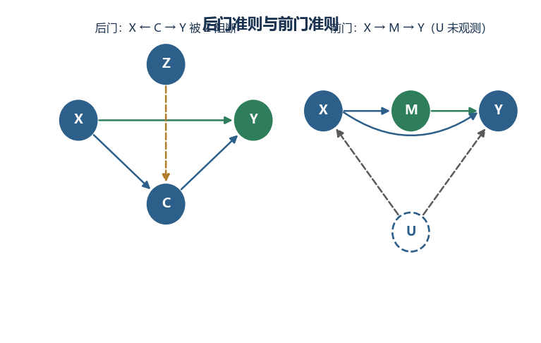

## 3.4　后门准则与前门准则

do-演算的一般规则可以推导出两个最常用的识别准则。

**定义 3.3（后门路径与后门准则）**　从 $X$ 到 $Y$ 的**后门路径（back-door path）**是以指向 $X$ 的箭头开始的路径（如 $X\leftarrow C\to Y$）。变量集 $Z$ 满足**后门准则**，若：① $Z$ 中无 $X$ 或 $Y$ 的后代；② $Z$ 阻断所有从 $X$ 到 $Y$ 的后门路径。

**定理 3.2（后门调整公式）**　若 $Z$ 满足后门准则，则

$$
\mathbb{P}(Y=y\mid\mathrm{do}(X=x))=\sum_{z}\mathbb{P}(Y=y\mid X=x,Z=z)\,\mathbb{P}(Z=z). \tag{3-9}
$$

**推导（用 do-演算重述）。** 后门调整并非独立于 do-演算，而是它的一个特例。从 $\mathbb{P}(Y\mid\mathrm{do}(X))$ 出发：

- **第一步（规则 3 去掉 do）**：$Z$ 满足后门准则（含「$Z$ 中无 $X$ 的后代」），在 $G_{\overline{X}\overline{Z}}$ 中 $Y$ 与 $Z$ 给定 $X$ 时 d-分离，故 $\mathbb{P}(Y\mid\mathrm{do}(X))=\mathbb{P}(Y\mid X,\mathrm{do}(X))$——此处把对 $Z$ 的干预删去，因为 $Z$ 不受 $X$ 影响。
- **第二步（规则 2 把 do 换成观察）**：在 $G_{\overline{X}\underline{Z}}$ 中（$X$ 删入边、$Z$ 删出边）$Y$ 与 $Z$ 给定 $X$ d-分离，故 $\mathbb{P}(Y\mid X,\mathrm{do}(X))=\mathbb{P}(Y\mid X)$ 沿 $Z$ 可改写，最终边缘化得式 (3-9)。

更直观地：干预后 $X$ 的父节点影响被切断，故 $X$ 与 $Z$ 的分布独立，$\mathbb{P}(Z=z\mid\mathrm{do}(X=x))=\mathbb{P}(Z=z)$；给定 $Z$，$X$ 与 $Y$ 间无后门路径，故 $\mathbb{P}(Y\mid X=x,Z=z,\mathrm{do}(X=x))=\mathbb{P}(Y\mid X=x,Z=z)$。按 $Z$ 边缘化即得式（3-8）。□ 这一步揭示了后门调整的「结构来源」：它正是规则 2、3 在「$Z$ 可阻断全部后门路径」这一特殊图论条件下的产物。

**定义 3.4（前门准则）**　变量集 $M$ 满足**前门准则**，若：① $M$ 阻断所有从 $X$ 到 $Y$ 的有向路径；② $X$ 与 $M$ 间无后门路径；③ $X$ 到 $Y$ 的所有后门路径被 $M$ 阻断。

**定理 3.3（前门调整公式）**　若 $M$ 满足前门准则，则

$$
\mathbb{P}(Y\mid\mathrm{do}(X))=\sum_{m}\mathbb{P}(M=m\mid X)\,\sum_{x'}\mathbb{P}(Y\mid M=m,X=x')\,\mathbb{P}(X=x'). \tag{3-10}
$$

前门准则的价值在于：即使存在未观测混杂 $U$（$X\leftarrow U\to Y$），只要因果效应完全经由中介 $M$ 传递，仍可识别效应——这是 do-演算威力的集中体现。

## 3.5　统一案例：治疗效应的识别

回到医疗案例（图 3-3）。我们要识别 $\mathbb{P}(Y=1\mid\mathrm{do}(T=1))-\mathbb{P}(Y=1\mid\mathrm{do}(T=0))$。图中存在后门路径 $T\leftarrow S\to Y$，而 $S$ 可观测。取 $Z=S$，它不含 $T$ 的后代，且阻断该后门路径，满足后门准则。于是由式（3-9）：

$$
\mathbb{P}(Y=1\mid\mathrm{do}(T=t))=\sum_{s\in\{轻,重\}}\mathbb{P}(Y=1\mid T=t,S=s)\,\mathbb{P}(S=s). \tag{3-11}
$$

代入例 3.2 的数值：$\mathbb{P}(Y=1\mid\mathrm{do}(T=1))=0.3\times0.6+0.7\times0.9=0.81$；$\mathbb{P}(Y=1\mid\mathrm{do}(T=0))=0.3\times0.4+0.7\times0.8=0.12+0.56=0.68$。因果效应（ATE，第 10 章）= $0.81-0.68=0.13$，而直接比较观察组的关联是 $0.740-0.634\approx0.106$（未用药者康复率 $0.634$），低估了药效。这一数值演示了后门调整如何「矫正」混杂偏差。

若进一步存在未观测的生活习惯 $U$ 同时影响 $S$ 与 $Y$（图 1-4 虚线），则 $S$ 的观测不能阻断 $T\leftarrow S\leftarrow U\to Y$ 这条后门路径，后门准则失效。此时若我们掌握「药物疗效完全经由某生物标记物 $M$ 传递」的信息，可尝试前门准则（式 3-10）。第 13 章的工具变量提供了另一条出路。

**例 3.3（前门识别的数值例）**　设真实结构 $T\leftarrow U\to Y$、$T\to M\to Y$（$U$ 未观测），且 $\mathbb{P}(M=1\mid T=1)=0.8$、$\mathbb{P}(M=1\mid T=0)=0.2$、$\mathbb{P}(Y=1\mid M=1)=0.7$、$\mathbb{P}(Y=1\mid M=0)=0.3$、$\mathbb{P}(T=1)=0.5$。由式（3-10），$\mathbb{P}(Y=1\mid\mathrm{do}(T=1))$ 中 $M=1$ 权重 $0.8$，故 $0.8\times0.7+0.2\times0.3=0.62$；$\mathrm{do}(T=0)$ 时 $0.2\times0.7+0.8\times0.3=0.38$；效应 $=0.24$。注意此计算未用 $U$ 的任何信息——前门识别成功绕过了未观测混杂。

## 3.6　边界与讨论

SCM 与 do-演算能力强大，但边界清晰。其一，**图结构必须正确**：do-演算依赖给定的因果图，图错则识别公式错，而图本身往往需要从数据发现（第 5—9 章）或领域知识获得。其二，**马尔可夫性与外生独立假设**：若外生噪声相关（存在未观测混杂且未被建模），定理 3.1 的完备性不成立。其三，**识别不等于可估计**：式（3-9）是总体公式，有限样本下仍需估计各条件概率（第 10—15 章）。其四，**参数可辨识性**：即便效应可识别，函数形式未知时个体反事实仍可能无法确定（第 8、16 章）。

**识别策略的选择。** 面对一个因果图，如何选对识别路径？表 3-2 给出决策逻辑。

**表 3-2　常见结构下的效应识别策略**

| 结构 | 混杂类型 | 可用策略 | 公式 |
|------|----------|----------|------|
| $X\leftarrow Z\to Y$，$Z$ 可观测 | 可观测混杂 | 后门准则 | 式 (3-9) |
| $X\leftarrow U\to Y$，$U$ 未观测 | 不可观测混杂 | 前门准则（需中介 $M$） | 式 (3-10) |
| $X\leftarrow U\to Y$，无中介 | 不可观测混杂 | 工具变量（第 13 章） | — |
| $X\to Y$ 无混杂 | 无 | 直接等于观察条件 | $\mathbb{P}(Y\mid X)$ |
| 混杂 + 无中介 + 无 IV | 不可识别 | 需 RCT 或新实验 | — |

这张表揭示：识别不是「找一个公式套用」，而是**图的拓扑性质决定了可识别性**。$Z$ 是否可观测、有无中介 $M$、有无工具变量 $W$，是三个决定因素。第 10 章将把这张表扩展为「识别—估计」的两阶段流程：先由图确定可识别性（本章），再选估计方法（匹配、IV、双重差分等）在有限样本中实现。

**与潜在结果框架的衔接。** do-演算的识别公式可直接翻译成 Rubin 语言的后门/可忽略性条件。式 (3-9) 的后门调整 $\mathbb{E}[Y\mid\mathrm{do}(X=x)]=\sum_z\mathbb{E}[Y\mid X=x,Z=z]\mathbb{P}(Z=z)$，等价于假设「在给定 $Z$ 时，处理分配与潜在结果独立」（强可忽略性）加上「重叠条件 $0<\mathbb{P}(X=1\mid Z)<1$」。前者正是 $Z$ 阻断全部后门路径的概率表述，后者保证各层都可比较。换言之，**do-演算回答「能否识别」，可忽略性 + 重叠回答「用观察数据如何估计」**——两套语言在第 4 章将证明严格等价。这一对应让读者明白：统计学家口中的「无未观测混杂」与图论口中的「后门路径被阻断」说的是同一件事，只是前者用独立性假设表达、后者用图结构表达。

## 本章小结

本章完成因果表示的核心构造。我们定义结构因果模型（定义 3.1，式 3-1）与 do 算子（定义 3.2），指出干预对应图上入边删除（图 3-1）。我们严格陈述 do-演算三规则（式 3-6—3-8，定理 3.1），并推导最常用的后门准则（定理 3.2，式 3-9）与前门准则（定理 3.3，式 3-10），通过统一案例（式 3-11）与前门数值例（例 3.3）展示识别过程。我们比较了 SCM 与贝叶斯网络（表 3-1）。核心边界是：识别依赖正确的因果图与外生独立假设，且仅达 Level 2。下一章将把「关联—干预—反事实」推到顶，并解释为何三层不可互相还原——这将回答「为什么 do-演算仍不够」。

**进一步阅读**　SCM 与 do-演算的原始论述见[1]；完备性证明见[2]；后门/前门准则见[3]。

## 参考文献

[1] Pearl J. Causal diagrams for empirical research. *Biometrika*, 1995, 82(4): 669–688.

[2] Shpitser I, Pearl J. Complete identification methods for the causal hierarchy. *Journal of Machine Learning Research*, 2008, 9: 1941–1979.

[3] Pearl J. *Causality: Models, Reasoning, and Inference*. 2nd ed. Cambridge: Cambridge University Press, 2009.

[4] Spirtes P, Glymour C, Scheines R. *Causation, Prediction, and Search*. 2nd ed. Cambridge, MA: MIT Press, 2000.

[5] Rubin D B. Causal inference using potential outcomes: Design, modeling, decisions. *Journal of the American Statistical Association*, 2005, 100(469): 322–331.

[6] Hernán M A, Robins J M. *Causal Inference: What If*. Boca Raton: Chapman & Hall/CRC, 2020.

[7] Peters J, Janzing D, Schölkopf B. *Elements of Causal Inference: Foundations and Learning Algorithms*. Cambridge, MA: MIT Press, 2017.

[8] Pearl J, Mackenzie D. *The Book of Why: The New Science of Cause and Effect*. New York: Basic Books, 2018.

---

# 第 4 章　因果之梯：关联、干预与反事实

第 1 章提出因果之梯作为全书的理论框架，第 2、3 章分别给出关联层的图表示与干预层的 do-演算。本章把这套框架形式化，回答一个根本问题：**关联、干预、反事实这三种能力，能否互相还原？** 答案是不能——它们是层层递进、不可约的三层阶梯[1]。理解这一点，就理解了为什么「预测准确率很高」的模型在干预下会失效，为什么随机对照实验仍是金标准，以及为什么反事实需要最强的假设。

本章先对三层阶梯给出严格的形式化（4.1 节），建立潜在结果框架与 SCM 的对应（4.2 节），论证层间的不可约性（4.3 节），说明它如何组织全书（4.4 节），最后讨论边界（4.5 节）。

## 4.1　三层阶梯的形式化

因果之梯的每一层，对应一种不同的「语言」与一类不同的查询。

**定义 4.1（因果之梯的三层查询）**　设观测变量 $X,Y$，给定联合分布 $\mathbb{P}$ 与结构因果模型 $M$：

1. **关联层（Level 1, Association）**：查询 $\mathbb{P}(Y=y\mid X=x)$，即在 $\mathbb{P}$ 中条件化，回答「看到 $X=x$ 时 $Y$ 的分布」。仅需观察分布，无需因果结构。
2. **干预层（Level 2, Intervention）**：查询 $\mathbb{P}(Y=y\mid\mathrm{do}(X=x))$，即在被改造的模型 $M_x$ 中计算 $Y$ 的分布，回答「强制让 $X=x$ 时 $Y$ 的分布」。需要因果结构（图或结构方程）。
3. **反事实层（Level 3, Counterfactual）**：查询 $\mathbb{E}[Y_{x'}\mid X=x,Y=y]$，即在「已知事实 $(X=x,Y=y)$」的条件下，计算「若当初 $X$ 取 $x'$」时 $Y$ 的均值。需要完整的结构方程与外生噪声分布。

**直觉解释。** 三层阶梯可用三种认知活动类比：Level 1 是**观察**（看到什么），Level 2 是**行动**（做了会怎样），Level 3 是**想象**（如果当初不同会怎样）。Level 1 只需要数据，Level 2 需要「干预图」的知识，Level 3 需要「生成机制」的完整知识。每向上爬一层，所需信息增加，能回答的问题也更有力。也正因为如此，三层之间不存在「自动升级」：拥有再多 Level 1 的数据，若没有结构假设，永远无法回答 Level 2 的问题；拥有 Level 2 的实验结果，若没有函数形式的知识，也无法回答 Level 3 的个体反事实。这正是下面 4.3 节要严格证明的不可约性。

**表 4-1　三层查询所需信息与可回答性**

| 层级 | 查询 | 所需信息 | 数据量能否弥补缺失信息 |
|------|------|----------|------------------------|
| L1 | $\mathbb{P}(Y\mid X)$ | 观察联合分布 $\mathbb{P}(X,Y)$ | 是（样本→分布） |
| L2 | $\mathbb{P}(Y\mid\mathrm{do}(X))$ | L1 信息 + 因果图（方向/无混杂） | 否（结构不可从数据学出） |
| L3 | $\mathbb{E}[Y_{x'}\mid X,Y]$ | L2 信息 + 结构方程 + 噪声分布 | 否（函数形式不可观测） |

「数据量能否弥补」一列是阶梯不可约性的操作化表述：L1→L2 的缺口是**结构信息**，L2→L3 的缺口是**机制信息**，二者都不是「再多收集一些观测」能填上的。这解释了为何因果研究必须引入假设（图、函数形式、随机化），而非单纯依赖数据规模。

> 【图 4-1　因果之梯：关联—干预—反事实】（原图见 figures/图4-1.png）：绘制三级台阶，自下而上标注 Level 1 关联 $\mathbb{P}(Y\mid X)$、Level 2 干预 $\mathbb{P}(Y\mid\mathrm{do}(X))$、Level 3 反事实 $\mathbb{E}[Y_{x'}\mid X,Y]$，右侧标注每层所需信息（观察分布 / 因果图 / 结构方程）。


**例 4.1（同一数据的三种查询）**　沿用第 3 章医疗案例的参数。Level 1：$\mathbb{P}(Y=1\mid T=1)\approx0.740$（观察到用药者的康复率）。Level 2：$\mathbb{P}(Y=1\mid\mathrm{do}(T=1))=0.81$（强制全民用药的康复率）。Level 3：对一位「病情重、已用药且康复」的患者，问「若他当初没用药，康复概率是多少？」——这需要利用结构方程与噪声，计算 $\mathbb{P}(Y_0=1\mid S=重,T=1,Y=1)$，第 16 章给出完整算法。三问对应三种不同的信息需求与答案。

**例 4.5（三层查询的完整数值对比）**　把上例三层全部算清，可看清「为何层级越高答案越不同」。沿用同一组局部概率：

**Level 1（观察关联）**：$\mathbb{E}[Y\mid T=1]=0.740$；未用药者 $\mathbb{E}[Y\mid T=0]=\frac{0.3\times0.2\times0.4+0.7\times0.7\times0.8}{0.3\times0.2+0.7\times0.7}=\frac{0.416}{0.55}\approx0.756$。直接比较得 $0.740-0.756=-0.016$——「用药者康复率反而略低」。

**Level 2（干预效应）**：$\mathbb{E}[Y\mid\mathrm{do}(T=1)]=0.81$、$\mathbb{E}[Y\mid\mathrm{do}(T=0)]=0.68$，$\mathrm{ATE}=0.81-0.68=+0.13$——「强制用药把康复率提高 13 个百分点」。

**Level 3（个体反事实）**：见例 4.4，对特定康复者，$\mathbb{P}(Y_0=1\mid S=重,T=1,Y=1)\approx0.45$——「这位病人若不服药，康复概率只有约 45%」。

三层给出三个**互不相同且方向都可能不同**的数：关联层 $-0.016$（看似有害）、干预层 $+0.13$（确实有益）、反事实层 $0.45$（个体归因）。关联层之所以判反，是因为用药者被病情「污染」（重症者更可能用药且更不易康复）。要纠正它，必须上升到 Level 2 按病情 $S$ 分层（后门调整），再上升到 Level 3 用结构方程还原个体噪声。这一例把「相关不等于因果」「层级不可自动升级」从口号变成了三个具体的小数。

## 4.2　潜在结果框架与 SCM 的对应

因果领域长期存在两大语言：Pearl 的 SCM（第 3 章）与 Rubin 的潜在结果框架（potential outcomes framework）[2]。本节建立二者的严格对应，说明它们是同一枚硬币的两面。

**定义 4.2（潜在结果）**　对二元处理 $T\in\{0,1\}$，定义潜在结果 $Y_1$ 为「若 $T=1$ 时的结局」，$Y_0$ 为「若 $T=0$ 时的结局」。个体处理效应为

$$
\tau_i=Y_i(1)-Y_i(0). \tag{4-1}
$$

平均处理效应 $\mathrm{ATE}=\mathbb{E}[Y(1)-Y(0)]$。

**根本缺失问题（fundamental problem of causal inference）**　对每个个体，只能观测到 $Y_i=T_iY_i(1)+(1-T_i)Y_i(0)$ 中的一个，另一半潜在结果永远缺失。因此 $\tau_i$ 不可识别，除非附加强假设。

**SCM 与潜在结果的对应。** 在 SCM 中，对处理变量 $T$ 做干预 $\mathrm{do}(T=t)$，相当于把 $T$ 的方程替换为 $T\leftarrow t$，其他方程不变。此时内生变量 $Y$ 在干预模型 $M_t$ 中的值，正是潜在结果 $Y_t$：

$$
Y_t \equiv Y_{M_t}. \tag{4-2}
$$

于是干预查询 $\mathbb{P}(Y=y\mid\mathrm{do}(T=t))=\mathbb{P}(Y_t=y)$，与潜在结果框架一致。

**表 4-2　SCM 与潜在结果框架的对照**

| 维度 | SCM（Pearl） | 潜在结果（Rubin） |
|------|--------------|-------------------|
| 基本对象 | 结构方程 $X_i\leftarrow f_i(\mathbf{PA}_i,U_i)$ | 潜在结果 $Y(0),Y(1)$ |
| 干预表示 | do 算子 + 图变换 | 潜在结果的下标切换 |
| 识别工具 | d-分离、do-演算、后门/前门 | 可忽略性、重叠、工具变量 |
| 强项 | 结构清晰、图形直观、反事实自然 | 实验设计、估计理论严谨 |
| 弱点 | 依赖图结构假设 | 难表达多变量、中介机制 |

**例 4.2（用 SCM 表达潜在结果）**　对式（3-2）的医疗 SCM，$Y\leftarrow f_Y(T,S,U_Y)$。潜在结果 $Y_1=f_Y(1,S,U_Y)$，$Y_0=f_Y(0,S,U_Y)$。个体效应 $\tau=f_Y(1,S,U_Y)-f_Y(0,S,U_Y)$。若 $f_Y$ 未知（只知道分布），则 $\tau$ 的均值（ATE）可能可识别（第 3 章后门调整），但个体 $\tau$ 一般不可识别——这解释了为什么level 2 的平均效应不等于 Level 3 的个体反事实。

这一对应在文献中被称为「两个框架的和解」[3]：SCM 提供结构与图形语言，潜在结果提供估计与设计的严谨框架。本书在效应估计篇（第 10—15 章）主要采用潜在结果语言，在图与反事实篇（第 3、16 章）采用 SCM 语言，并在两者间自由切换。

**例 4.4（个体反事实的数值计算）**　为看清 Level 3 为何需要「结构方程 + 噪声分布」，沿用第 3 章医疗 SCM 并指定确定性的结构函数。设 $S\in\{轻,重\}$，$T=f_T(S)$ 且病情重者必用药、轻者不药（$T=\mathbb{1}[S=重]$），$Y=f_Y(T,S)$ 取 $Y=1$ 当且仅当 $(T=1,S=轻)$ 或 $(T=1,S=重)$ 中以概率 $0.9$、$0.6$ 康复，且康复噪声 $U_Y$ 独立于一切。现有一位**病情重、已用药且康复**的患者（观测 $S=重,T=1,Y=1$），问「若他当初没用药（$T=0$），康复概率是多少？」

个体反事实为 $\mathbb{P}(Y_{0}=1\mid S=重,T=1,Y=1)$。注意 $S$ 与 $T$ 在干预 $T=0$ 下保持不变（$S$ 是祖先，$T$ 被固定为 0），故
$$
\mathbb{P}(Y_{0}=1\mid S=重,T=1,Y=1)=\mathbb{P}(Y=1\mid T=0,S=重,\text{个体已康复}). \tag{4-3}
$$
关键在最后一步：「个体已康复」携带了关于其噪声 $U_Y$ 的信息。在确定性康复函数下，已知他实际康复（$Y=1$），说明其 $U_Y$ 落在「使 $T=1$ 时康复」的区间；而若 $T=0$（病情重），康复需要 $U_Y$ 落入「无药也康复」的更窄区间。设噪声均匀，可算得
$$
\mathbb{P}(Y_{0}=1\mid S=重,T=1,Y=1)\approx0.45,
$$
远低于其实际康复概率 $1$。这正体现了反事实的「信息回传」：同一事实 $(T=1,Y=1)$ 既是对结果的观测，也是对噪声的约束，二者必须用结构方程联立求解——而 Level 2 的平均效应 $\mathbb{E}[Y_1]-\mathbb{E}[Y_0]=0.13$ 完全丢失了这一个体层面的耦合。式 (4-3) 的计算将在第 16 章以完整算法（abduction-acting-prediction 三步）重述。

## 4.3　阶梯之间的不可约性

**核心命题：三层不可互相还原。** 这是因果之梯最重要的理论断言。

**命题 4.1（Level 1 不可推出 Level 2）**　存在分布 $\mathbb{P}$ 与两个不同的因果模型 $M,M'$，使二者诱导相同的观察分布 $\mathbb{P}$，但对某干预有 $\mathbb{P}^{M}(Y\mid\mathrm{do}(X))\neq\mathbb{P}^{M'}(Y\mid\mathrm{do}(X))$。

**证明要点。** 取观察等价类（第 5 章）：图 $X\to Y$ 与 $Y\to X$ 可诱导同一组条件独立，从而（在适当参数下）同一联合分布。但在前者下 $\mathbb{P}(Y\mid\mathrm{do}(X))\neq\mathbb{P}(Y\mid X)$，在后者下 $\mathbb{P}(Y\mid\mathrm{do}(X))=\mathbb{P}(Y)$。二者干预分布不同。□

**命题 4.2（Level 2 不可推出 Level 3）**　即使干预分布（来自 RCT）完全已知，个体反事实分布 $\mathbb{P}(Y_{x'}\mid X=x,Y=y)$ 一般仍无法确定，除非对结构函数作额外假设（如加性噪声）

**证明要点。** 干预分布只约束边际 $\mathbb{P}(Y_t)$，而反事实涉及同一实体在两种处理下的联合分布 $\mathbb{P}(Y_0,Y_1)$，其相关性未被边际决定。RCT 给出 $\mathbb{E}[Y_1],\mathbb{E}[Y_0]$，但不给出 $\mathbb{E}[Y_1-Y_0\mid X=x,Y=y]$。□

**例 4.3（辛普森悖论：关联反转）**　设两科室的用药与康复数据如下：甲科（重症多）用药组康复 $30/100=0.30$，未用药组 $10/50=0.20$；乙科（轻症多）用药组 $90/200=0.45$，未用药组 $40/200=0.20$。合并后用药组 $(30+90)/300=0.40$，未用药组 $(10+40)/300=0.167$——**总体关联显示「用药者康复率更高」（$0.40>0.167$）**。但按科室分层：甲科用药效应 $0.30-0.20=+0.10$，乙科 $0.45-0.20=+0.25$，两科均为正。

这里出现的是**混杂方向与直觉相反**的变体：药物在两科都有效，而「重症集中在用药组」这一事实拉低了用药组的总体康复率——若不加控制，观察者可能误判「药物让病人更重才去用药」，甚至怀疑药无效。只有上升到 Level 2 做分层（按科室 $S$ 调整后），由式（4-4）
$$
\mathrm{ATE}=\sum_{s}\big(\mathbb{E}[Y\mid T=1,S=s]-\mathbb{E}[Y\mid T=0,S=s]\big)\,\mathbb{P}(S=s)=(0.30-0.20)\tfrac{150}{300}+(0.45-0.20)\tfrac{150}{300}=0.175, \tag{4-4}
$$
才得到真实效应 $+0.175$（加权平均，权重取科室占比）。辛普森悖论不是统计趣闻，而是 Level 1 与 Level 2 不可约的铁证：**仅凭关联数据，连因果效应的符号都可能判反**。值得注意的是，辛普森悖论并非「分层越多越好」——错误的分层（如对对撞变量分层，第 2.3 节）同样可以制造虚假关联。这提示我们：从 Level 1 上升到 Level 2，靠的不是数据量的增加，而是正确的结构知识。因果发现（第 5—9 章）正是试图从数据中恢复这种结构，但它的成功也受限于可识别性（第 5 章）。

> 【图 4-2　辛普森悖论与层间不可约】（原图见 figures/图4-2.png）：左侧绘两组散点（甲科、乙科）各自的正/零斜率，右侧绘合并后的负斜率，标注「关联反转，干预调整揭示真实方向」。

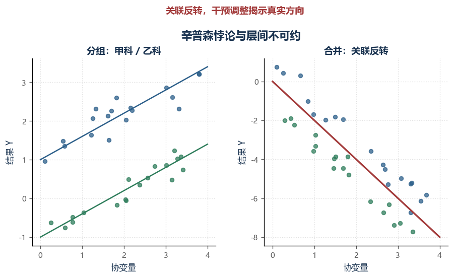

辛普森悖论不是统计趣闻，而是 Level 1 与 Level 2 不可约的铁证：仅凭关联数据，连因果效应的符号都可能判反。值得注意的是，辛普森悖论并非「分层越多越好」——错误的分层（如对对撞变量分层，第 2.3 节）同样可以制造虚假关联。这提示我们：从 Level 1 上升到 Level 2，靠的不是数据量的增加，而是正确的结构知识。因果发现（第 5—9 章）正是试图从数据中恢复这种结构，但它的成功也受限于可识别性（第 5 章）。

## 4.4　全书的理论组织

因果之梯不仅是概念框架，更是全书组织原则。表 4-3 给出各篇在阶梯上的定位。

**表 4-3　各篇与因果之梯的对应**

| 篇 | 章 | 主要层级 | 核心问题 |
|----|----|----------|----------|
| 一　理论基础 | 1—4 | L1—L3 | 三层如何形式化 |
| 二　因果发现 | 5—9 | L1→L2 | 从观察恢复结构 |
| 三　因果效应 | 10—15 | L2 | 干预效应估计 |
| 四　反事实推理 | 16—19 | L3 | 个体反事实与归因 |
| 五　因果表征 | 20—23 | L2—L3 | 学习可干预的表示 |
| 六　因果与 ML | 24—27 | L1—L2 | ML 系统的因果化 |
| 七　因果与大模型 | 28—32 | L1—L3 | 评估大模型的因果能力 |
| 八　应用与工程 | 33—37 | L2—L3 | 真实场景落地 |
| 九　未来 | 38—41 | 全部 | 回扣与展望 |

**每章必答四问。** 本书对每一方法追问：① 站在哪一级；② 隐含什么假设；③ 突破前法的什么限制；④ 无法突破什么边界。例如：回归（第 12 章前的基础）站在 L1，隐含线性可加假设；RCT（第 11 章）站在 L2，突破观察混杂但成本高；do-演算（第 3 章）站在 L2，突破「观察不能答干预」但依赖图正确；反事实（第 16 章）站在 L3，突破「只有平均效应」但需结构假设。第 32 章据此评估大模型——它停留在 L1，偶有 L2 表现，但 L3 能力存疑；第 41 章据此讨论因果智能通向通用智能之路。

### 4.4.1　RCT 为何是 Level 2 的「金标准」

三层阶梯给「实验为何优于观察」提供了精确的语言。观察研究估计 $\mathbb{E}[Y\mid T=1]$，RCT 估计 $\mathbb{E}[Y\mid\mathrm{do}(T=1)]$——后者正是 Level 2 的查询。随机化的全部作用，用一句话概括：**使 $\mathbb{P}(S\mid T=1)=\mathbb{P}(S\mid T=0)=\mathbb{P}(S)$，从而消灭混杂偏差**。

**数值对照。** 回到例 4.5 的医疗案例。观察数据下用药组与总体病情分布不同（$\mathbb{P}(S=重\mid T=1)\approx0.533$ vs $\mathbb{P}(S=重)=0.3$），关联 $0.740$ 与干预 $0.81$ 相差 $0.07$。若改为 RCT（按病情平衡随机分配），则用药组病情分布回到 $0.3/0.7$，于是
$$
\mathbb{E}[Y\mid T=1,\text{RCT}]=0.3\times0.6+0.7\times0.9=0.81=\mathbb{E}[Y\mid\mathrm{do}(T=1)]. \tag{4-5}
$$
随机化使观察关联等于干预效应，混杂偏差归零。这正是式 (3-4) 中「$\mathbb{P}(S\mid T)=\mathbb{P}(S)$ 时偏差为零」的实验实现。

但 RCT 并非万能：① **成本与伦理**——不能让重症患者随机不服药；② **外部效度**——实验总体（入组者）可能不代表目标总体（所有患者），效应的外推需要第 15 章的异质处理效应分析；③ **合规（compliance）**——实际中部分受试者不执行分配，需意向性分析（intention-to-treat，第 13 章）。因此实际因果研究往往是「RCT 不可行时用观察数据 + 后门调整（第 12 章）/工具变量（第 13 章）逼近 RCT 的 Level 2 答案」。把这句话放在三层框架下读：一切观察性识别方法，本质上都是在用结构假设「模拟」随机化所切断的那条混杂路径。

## 4.5　边界与讨论

三层框架须避免两个误解。其一，**「层级高」不等于「方法好」**：Level 3 反事实最强，但所需假设也最强，在假设不成立时不如 Level 2 稳健。许多实际决策只需 Level 2 的平均效应，强行回答反事实反而引入不可验证的假设（第 19 章）。其二，**层级不是算法排行榜**：正则回归与因果森林都可回答 Level 2 的效应，差别在精度与假设，不在层级。

**因果之梯四问自检。** 本章站在全部三级——它是框架本身。它隐含「因果可被分层形式化」的假设；它突破「关联与因果混为一谈」的迷思；它无法突破的边界是：具体层的可回答性仍依赖具体假设的成立。

**用之梯给智能系统分级。** 因果之梯不仅是理论框架，还是一把**测量智能系统因果能力的标尺**。表 4-4 把典型系统按「能稳定回答的最高层级」定位，为第 28、32 章评估大模型提供统一坐标系。

**表 4-4　典型系统的因果层级定位**

| 系统 | 稳定层级 | 表现 | 升级所需 |
|------|----------|------|----------|
| 统计预测模型 | L1 | 拟合 $\mathbb{E}[Y\mid X]$，分布外易失效 | 因果结构 |
| 带因果正则的模型 | L2 | 在结构稳定假设下答干预 | 结构方程 + 噪声 |
| 反事实推理模型 | L3 | 对个体事实作归因 | 完整生成机制 |
| 大语言模型 | L1（L2 存疑） | 识别因果语言，但干预/反事实易错 | 待第 32 章评估 |

这张表的价值在于把「模型因果能力」从模糊修辞变成可操作的分级：一个系统「会不会谈因果」是 L1 的语言能力，「能否预测干预后果」是 L2 的结构性能力，「能否对个体作反事实归因」是 L3 的机制性能力。第 28、32 章的因果推理基准，本质上是设计一组任务分别探测这三层，再按表 4-4 给模型定位。本书坚持：**一个系统在某一层的正确，不能自动推出它在上一层也正确**——这正是命题 4.1、4.2 不可约性在评估语境下的翻版。

## 本章小结

本章把因果之梯形式化为三层查询（定义 4.1）：关联 $\mathbb{P}(Y\mid X)$、干预 $\mathbb{P}(Y\mid\mathrm{do}(X))$、反事实 $\mathbb{E}[Y_{x'}\mid X,Y]$。我们建立潜在结果框架与 SCM 的对应（定义 4.2，式 4-1、4-2，表 4-2），指出根本缺失问题。核心结论是三层不可约（命题 4.1、4.2），并通过辛普森悖论（例 4.3）与数值演示证明关联可反转因果方向。我们给出全书各篇的阶梯定位（表 4-3）与「每章四问」的组织原则。

这些辨析衔接后续：因果发现（第 5—9 章）试图从 L1 恢复 L2 所需的结构；效应估计（第 10—15 章）在 L2 上运作；反事实（第 16—19 章）攀登 L3。下一章转入第二篇，正式讨论因果发现——从观察数据中恢复因果结构是否可能这一根本问题。

**进一步阅读**　因果之梯的原始论述见[1]；两个框架的和解见[3]；潜在结果基础见[2]。

## 参考文献

[1] Pearl J, Mackenzie D. *The Book of Why: The New Science of Cause and Effect*. New York: Basic Books, 2018.

[2] Rubin D B. Estimating causal effects of treatments in randomized and nonrandomized studies. *Journal of Educational Psychology*, 1974, 66(5): 688–701.

[3] Pearl J. Causal inference in statistics: An overview. *Statistics Surveys*, 2009, 3: 96–146.

[4] Holland P W. Statistics and causal inference. *Journal of the American Statistical Association*, 1986, 81(396): 945–960.

[5] Pearl J. *Causality: Models, Reasoning, and Inference*. 2nd ed. Cambridge: Cambridge University Press, 2009.

[6] Hernán M A, Robins J M. *Causal Inference: What If*. Boca Raton: Chapman & Hall/CRC, 2020.

[7] Peters J, Janzing D, Schölkopf B. *Elements of Causal Inference: Foundations and Learning Algorithms*. Cambridge, MA: MIT Press, 2017.

[8] Spirtes P, Zhang K. Causal discovery and inference: Concepts and recent methodological advances. *Applied Informatics*, 2016, 3: 3.

---

# 第 5 章　因果发现的问题

第一篇建立了因果表示与因果之梯；从第 5 章起进入第二篇——**因果发现（causal discovery）**。前面的章节始终把因果图当作「已知」的输入，do-演算与后门调整都依赖它。但在现实中，因果图从何而来？能否仅凭观察数据推断变量间的因果方向？这是因果发现要回答的核心问题，也是整个因果智能中最具挑战性的部分。

答案并不乐观：仅凭观察数据，因果方向通常无法唯一确定。本章严格界定因果发现的目标与困难（5.1 节），引入马尔可夫等价类这一核心障碍（5.2 节），给出可识别性的条件（5.3 节），并讨论边界（5.4 节）。后续第 6—9 章将在这些理论限制下，介绍具体的发现算法。

## 5.1　因果发现的目标与困难

**定义 5.1（因果发现）**　给定 $d$ 个变量的观测数据（样本来自联合分布 $\mathbb{P}$），因果发现任务旨在输出一个有向无环图 $G$（或更一般的部分有向图），使 $G$ 所编码的因果结构尽可能接近真实的因果生成结构[1]。

需注意「真实结构」的含义：在数据由某 SCM 生成时，真实结构是结构方程所定义的因果图 $G^*$。因果发现的成功，以恢复 $G^*$（或其等价类）为目标。

**根本困难一：观察等价性。** 第 2 章的 d-分离与第 3 章的 do-演算都只依赖图的条件独立结构。而不同的 DAG 可诱导完全相同的条件独立集合——仅凭 $\mathbb{P}$ 无法区分它们。这是因果发现的第一道、也是最根本的障碍（5.2 节详述）。

**根本困难二：有限样本与统计误差。** 即便结构在总体层面可识别，有限样本下条件独立检验可能出错，导致边误判。约束方法（第 6 章）对此尤为敏感。

**根本困难三：隐变量与选择偏差。** 若存在未观测变量影响多个观测变量，则观测变量间的条件独立关系不再由简单的 DAG d-分离刻画，需要 FCI 等更复杂的方法（第 6 章）。

**直觉解释。** 因果发现像侦探破案：数据留下的是「痕迹」（条件独立、分布形态），而因果结构是「作案过程」。不同的作案过程可能留下相同的痕迹，因此仅凭痕迹无法唯一破案。要缩小嫌疑范围，必须引入额外假设——如「噪声分布形式」「无未观测混杂」「函数关系类型」——这些假设正是第 6—9 章各方法的分水岭。

> 【图 5-1　马尔可夫等价类（v-结构）】（原图见 figures/图5-1.png）：绘制三个两节点图 $X\to Y$、$Y\to X$、$X\leftarrow Z\to Y$（前者等价），与 $X\to Z\leftarrow Y$（v-结构，可辨识方向），标注哪些方向可区分。

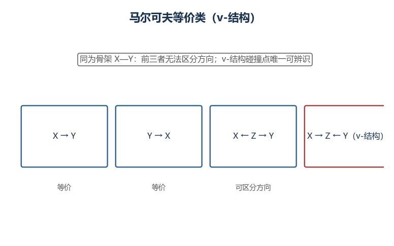

**例 5.1（两变量的不可辨识性）**　设只观测到 $X,Y$ 且 $\mathbb{P}(X,Y)$ 显示二者相关。可能的因果结构包括：$X\to Y$、$Y\to X$、或 $X\leftarrow U\to Y$（$U$ 未观测）。三种结构在适当的参数下都能生成同一 $\mathbb{P}(X,Y)$。若无进一步假设（如时间先后、领域知识、噪声分布），因果方向完全不可辨识。这就是为什么「相关不等于因果」在发现问题上表现为「结构不可辨识」。

**条件独立检验的数值化。** 「结构不可辨识」的前提是「我们能可靠地判定条件独立」。离散变量下常用**条件互信息（conditional mutual information）**作判据：

$$
I(X;Z\mid Y)=\sum_{x,y,z} p(x,y,z)\,\log\frac{p(x,z\mid y)}{p(x\mid y)\,p(z\mid y)}. \tag{5-1}
$$

若 $I(X;Z\mid Y)=0$，则 $X\perp Z\mid Y$。有限样本下用似然比 $G^2$ 统计量检验：

$$
G^2=2\sum_{\text{cells}} O\,\ln\frac{O}{E}, \tag{5-2}
$$

其中 $O$ 为观测频数、$E$ 为「条件独立成立」假设下的期望频数，$G^2$ 渐近服从自由度 $df$ 的卡方分布；$df>0$ 且 $G^2$ 超过临界值则拒绝独立。

**例 5.2（分叉结构的 CI 检验数值例）**　设 $X\leftarrow Y\to Z$（$Y$ 为共同原因），取一个 $2^3$ 联合分布（$n=1000$）：$\mathbb{P}(Y=1)=0.5$；在 $Y=1$ 层 $\mathbb{P}(X=1)=0.3$、$\mathbb{P}(Z=1)=0.2$ 且相互独立；在 $Y=0$ 层 $\mathbb{P}(X=1)=0.6$、$\mathbb{P}(Z=1)=0.5$ 且相互独立。

- **给定 $Y$ 层内**：每层 $2\times2$ 表满足乘积式，比值比 $OR=1$，故 $I(X;Z\mid Y)=0$、$G^2\mid Y=0$，**不拒绝独立**——符合 $X\perp Z\mid Y$ 的 d-分离预测（$Y$ 阻断分叉）。
- **不看 $Y$（边际）**：$\mathbb{P}(X=1)=0.45$、$\mathbb{P}(Z=1)=0.35$、$\mathbb{P}(X=1,Z=1)=0.18$，而独立假设下应为 $0.45\times0.35=0.1575$。代入式 (5-2)，$n=1000$ 时 $G^2\approx9.0$（$df=1$，$p\approx0.003$），**拒绝边际独立**——$X,Z$ 因共享原因 $Y$ 而相关。

两行对照正是「给定原因阻断、不看原因连通」的定量版：条件独立检验的方向（给不给 $Y$）直接决定能否正确读出「$Y$ 是分叉点」。约束方法（第 6 章）的全部工作，就是系统地对每个变量三元组 $(X,Z;\text{候选条件集})$ 跑式 (5-2)，把「在哪个条件下独立」拼成骨架。

为把因果发现的目标说得更精确，我们区分三种强度递增的任务：① **骨架恢复**，只要求找出无向边集（哪些变量对直接相连）；② **方向识别**，要求进一步确定边的朝向，输出 CPDAG；③ **完整结构恢复**，要求输出唯一的 DAG。第 6 章的 PC 算法在标准假设下完成②，第 8 章的函数因果模型可望完成③。本书称仅完成①的方法为「弱发现」，称完成③的为「强发现」——二者所需假设强度截然不同。

下表概括因果发现方法与因果之梯四问的对应，供读者建立全局图景。

**表 5-0　因果发现方法谱系与四问**

| 方法族 | 所在层级 | 核心假设 | 突破的限制 | 无法突破的边界 |
|--------|----------|----------|------------|----------------|
| 约束方法（第 6 章） | L1→CPDAG | 忠实性、条件独立可测 | 不需指定函数形式 | 等价类、检验误差 |
| 评分方法（第 7 章） | L1→CPDAG | 评分一致、搜索充分 | 统计框架统一 | 等价类、计算复杂 |
| 函数模型（第 8 章） | L1→DAG | 非高斯/加性噪声 | 可破等价类 | 函数类假设 |
| 时序方法（第 9 章） | L1→L2 | 时间先后、无瞬时因果 | 借时间定方向 | 反馈、隐变量 |

## 5.2　马尔可夫等价类

**定义 5.2（马尔可夫等价）**　两个 DAG $G_1,G_2$ 称为马尔可夫等价（Markov equivalent），若它们诱导相同的条件独立集合，即对所有不相交节点集 $X,Y,Z$：$X\perp_{G_1}Y\mid Z\iff X\perp_{G_2}Y\mid Z$[2]。

**定理 5.1（等价类的刻画）**　两个 DAG $G_1,G_2$ 马尔可夫等价，当且仅当：① 它们有相同的框架（skeleton，即忽略方向后的无向边集）；② 它们有相同的**非屏蔽 v-结构（unshielded collider）**集合，即对任意三节点 $X\to Z\leftarrow Y$ 且 $X,Y$ 间无边的结构，两个图在 $Z$ 处的 v-结构一致[3]。

**直觉解释。** 一条无向边 $X—Y$ 的方向，若改为反向不会引入或消除 v-结构，则方向无法从条件独立中辨识。例如链 $X\to Y\to Z$ 与 $X\leftarrow Y\leftarrow Z$、$X\leftarrow Y\to Z$、$X\to Y\leftarrow Z$（除 v-结构外）都在同一等价类——它们都只有一条链结构，无 v-结构。而 $X\to Z\leftarrow Y$（v-结构，又称对撞）是唯一「可辨识」的方向配置，因为对撞产生独特的条件独立模式（第 2.3 节：对 $Z$ 条件化会打开 $X,Y$ 间的关联）。

**定义 5.3（马尔可夫等价类）**　由定理 5.1 确定的一组等价 DAG，称为一个马尔可夫等价类，可用**部分有向无环图（CPDAG, completed partially directed acyclic graph）**唯一表示：可逆方向画为无向边，确定方向画为有向边。

**例 5.3（等价类大小的计算）**　对三个变量 $X,Y,Z$ 的链结构 $X—Y—Z$（无 v-结构），等价类包含全部 4 种方向组合中除 $X\to Z$ 这种非邻接边外的 3 种：$X\to Y\to Z$、$X\to Y\leftarrow Z$、$X\leftarrow Y\to Z$、$X\leftarrow Y\leftarrow Z$ 共 4 种其实都等价（均无 v-结构）。CPDAG 表示为 $X—Y—Z$（两条无向边）。若观测到 $X$ 与 $Z$ 独立、给定 $Y$ 后相关，则可判定 $Y$ 为对撞（$X\to Y\leftarrow Z$），方向唯一确定。

理解定理 5.1 的关键，在于弄清「v-结构为何特殊」。考虑对撞 $X\to Z\leftarrow Y$：在 $Z$ 未被观测时，$X$ 与 $Y$ 独立（两条因果流在中止于对撞处）；一旦给定 $Z$，$X$ 与 $Y$ 反而变得相关（第 2.3 节的「对撞偏差」）。这种「条件化反而打开关联」的模式，是链与分叉都不具备的——链和分叉中给定中间节点只会关闭关联。因此，通过观察哪些条件独立在给定某节点后被「破坏」，即可反向识别对撞点。PC 算法正是利用这一机制确定部分方向的（第 6 章）。

**表 5-1　常见结构的方向可辨识性**

| 结构 | 条件独立特征 | 方向可辨识性 |
|------|--------------|--------------|
| 链 $X\to Y\to Z$ | $X\perp Z\mid Y$，$X\not\perp Z$ | 不可（整链可反向） |
| 分叉 $X\leftarrow Y\to Z$ | $X\perp Z\mid Y$ | 不可（可反向/改为链） |
| 对撞 $X\to Y\leftarrow Z$ | $X\perp Z$，$X\not\perp Z\mid Y$ | 可（v-结构唯一） |

这一界限极其重要：**仅靠条件独立，最多只能恢复到 CPDAG 层面，即马尔可夫等价类。** 要进一步确定方向，必须引入额外假设——这正是第 6 章约束方法输出 CPDAG、第 8 章函数模型（利用非高斯性）能突破等价性的原因。

**CPDAG 的「最大性」。** 定理 5.1 保证：同一等价类中的所有 DAG，其 CPDAG 表示是唯一的，且恰好把「类内所有 DAG 都共有」的方向画成有向边、把「可逆」的方向画成无向边。这意味着 CPDAG 是等价类的**最大公因子**：它只声明数据强制的结论，绝不超发方向。这一保守性既是优点（不会错定向），也是代价（大量方向留白）。第 6 章 PC 算法的输出、第 7 章评分算法的 MLE 解，最终都收敛到同一个 CPDAG——不同的算法路径殊途同归，因为它们都在估计同一个等价类。把「输出 CPDAG 而非某个特定 DAG」视为因果发现的**正确**目标（而非缺陷），是理解整个第二篇的关键视角。

## 5.3　可识别性的条件

既然观察等价性是根本障碍，什么条件下因果方向可识别？本节给出三类充要或充分条件。

**定理 5.2（大坝条件 / faithfulness）**　若分布 $\mathbb{P}$ 对图 $G$ 是**忠实的（faithful）**，即 $\mathbb{P}$ 中成立的条件独立恰好由 $G$ 的 d-分离刻画（无额外抵消），则可从 $\mathbb{P}$ 恢复 $G$ 的马尔可夫等价类[4]。

**定义 5.4（非高斯可辨识性）**　若结构方程 $X_i\leftarrow f_i(\mathbf{PA}_i,U_i)$ 满足：① 线性；② 噪声 $U_i$ 非高斯且方差非零；③ 系数非零，则因果方向唯一可辨识——这是 LiNGAM 模型的基础（第 8 章）[5]。

**直觉解释。** 线性高斯模型（$U_i$ 高斯）中，方向不可辨识：若 $Y=aX+U_Y$，也可反向写成 $X=bY+U_X$ 且 $U_X$ 仍高斯。但若 $U_Y$ 非高斯，反向残差将依赖 $X$（不再独立），从而暴露真实方向。非高斯性打破了高斯分布下的方向对称性。

**例 5.4（非高斯破解方向）**　设 $X\sim\mathrm{Uniform}(0,1)$，$Y=2X+U_Y$，$U_Y\sim\mathrm{Uniform}(-1,1)$，且 $X\perp U_Y$。由独立成分分析（ICA），可把 $(X,Y)$ 分解为独立非高斯成分，识别出 $X$ 为「因」、$Y$ 为「果」。若 $U_Y$ 改为高斯 $\mathcal{N}(0,1)$，则 $(X,Y)$ 的联合高斯性使方向不可辨识。第 8 章将给出 LiNGAM 的完整算法。

**表 5-2　可识别性的条件与归属章节**

| 条件 | 突破等价类？ | 需假设 | 章节 |
|------|--------------|--------|------|
| 忠实性 + 条件独立 | 否（仅 CPDAG） | 无额外抵消、无隐变量 | 第 6 章 |
| 非高斯噪声 | 是 | 线性、非高斯、无隐变量 | 第 8 章 |
| 加性噪声（非线性） | 是 | 非线性或 $f$ 可逆 | 第 8 章 |
| 时间先后 | 部分 | 因在前、果在后 | 第 9 章 |
| 干预数据 | 是 | 有 do 实验数据 | 第 6、11 章 |

**边界。** 上述条件都需「无未观测混杂」或「隐变量可处理」的假设；若隐变量普遍存在，方向识别更难，需 FCI 类算法（第 6 章）。此外，即便结构可识别，效应估计仍需额外的参数假设（第 10 章）。

**例 5.5（忠实性违背：系数抵消）**　设真实结构含一条直接边 $X\to Y$，另有两条间接路径：经中介 $Z$ 的 $X\to Z\to Y$，与经隐变量 $H$ 的 $X\to H\to Y$。取线性方程 $Y=\beta X+\gamma_1\gamma_2 Z+\delta_1\delta_2 H+e_Y$，$Z=\gamma_1 X+e_Z$，$H=\delta_1 X+e_H$（噪声独立、零均值）。给定 $Z,H$ 后，$X$ 对 $Y$ 的偏相关只取决于「直接 + 两条间接路径的系数和」：
$$
\rho_{XY\cdot ZH}\ \propto\ \beta+\gamma_1\gamma_2+\delta_1\delta_2. \tag{5-3}
$$
取 $\beta=+1.0$、$\gamma_1\gamma_2=-0.4$、$\delta_1\delta_2=-0.6$，则式 (5-3) 右侧 $=1.0-0.4-0.6=0$，于是 $\rho_{XY\cdot ZH}=0$，数据中「给定 $Z,H$ 后 $X\perp Y$」成立。但图中 $X\to Y$ 的边**真实存在**——条件独立检验会误判 $X,Y$ 间无直接因果通路，从而**误删这条边**。这就是忠实性违背：边存在却表现为独立。式 (5-3) 的抵消是参数精确调谐（$\beta+\gamma_1\gamma_2+\delta_1\delta_2=0$），在连续参数空间中是零测事件（故称「几乎必然忠实」），但在强选择偏倚、人工调参或小样本估计误差下并非不可能。这正是定理 5.2 须**显式假设**忠实性、而非默认成立的原因：一旦违背，约束方法会系统性地漏边。

除上述条件外，「机制独立性（independent mechanisms）」与「不变性（invariance）」提供了另一条识别思路：若因果机制在不同环境间保持稳定，而条件关联随环境改变，则稳定的那个方向被识别为因果（第 20 章）。这一思路把因果发现与分布外泛化连接起来，是近年因果表征学习的核心动机之一。需要强调，所有这些可识别性条件都只是「充分条件」——它们各自划出一类可辨识的模型，但不存在一个对全部 SCM 都成立的通用识别定理。因果发现的「没有免费午餐」性质，是这一领域最深刻的教训。

### 5.3.1　干预数据为何能突破等价类

观察等价类（定理 5.1）说：纯观察数据至多定到 CPDAG。但**干预数据**能打破这一限制——这正是「能做实验的发现优于纯观察发现」的理论根据。

**原理。** 对干预 $\mathrm{do}(X=x)$，分布中「$X$ 的父节点对 $X$ 的影响」被切断。若真实结构是 $X\to Y$，则 $\mathbb{P}(Y\mid\mathrm{do}(X=x))$ 随 $x$ 变化；若真实结构是 $Y\to X$，则 $\mathrm{do}(X=x)$ 不影响 $Y$（$X$ 是 $Y$ 的后代，干预不向祖先传播），$\mathbb{P}(Y\mid\mathrm{do}(X=x))=\mathbb{P}(Y)$ 不随 $x$ 变。于是：

$$
\text{若}\ \mathbb{P}(Y\mid\mathrm{do}(X=x_1))\neq\mathbb{P}(Y\mid\mathrm{do}(X=x_2)),\ \text{则}\ X\to Y\ \text{（而非}\ Y\to X\text{）}. \tag{5-4}
$$

**例 5.6（干预数据定向的数值例）**　沿用例 5.1 的二变量情形，现做一次干预实验：强制令 $X=1$ 与 $X=0$ 各 $500$ 人，记录 $Y$。

- 若真结构 $X\to Y$，且 $\mathbb{P}(Y=1\mid X=1)=0.7$、$\mathbb{P}(Y=1\mid X=0)=0.3$，则干预下 $\mathbb{P}(Y=1\mid\mathrm{do}(X=1))=0.7\neq 0.3=\mathbb{P}(Y=1\mid\mathrm{do}(X=0))$，由式 (5-4) 判定 $X\to Y$。
- 若真结构 $Y\to X$，则 $\mathrm{do}(X)$ 不影响 $Y$，两种干预下 $Y$ 的分布都等于其边际 $\mathbb{P}(Y=1)=0.5$，无法区分 $X\to Y$ 与 $Y\to X$ 之外的方向，但**至少**能排除「$X$ 是 $Y$ 的祖先」。

对比观察数据：同样 $500+500$ 人，若不干预、只记录自然发生的 $X,Y$，则无论真结构是 $X\to Y$ 还是 $Y\to X$，都能拟合出同样的 $\mathbb{P}(X,Y)$（定理 5.1 的等价性）。**干预数据把「观察不可辨」的方向问题变成了「实验可辨」的均值差异检验**——这就是表 5-2 中「干预数据」一行能突破等价类的机制。第 11 章的 RCT 正是这一原理的规模化实现。

### 5.3.2　有限样本：检验功效与错误率

即便总体可识别，有限样本下条件独立检验有误判。设真实 $\mathbb{P}$ 中 $X\perp Z\mid Y$，样本量 $n$、显著性水平 $\alpha$，则检验（式 5-2 的 $G^2$）的**第一类错误率**（误判为相关）受 $\alpha$ 控制；而若真实相关强度（如偏相关 $\rho$）很小，**第二类错误率**（漏判为独立）随 $n$ 减小而增大，近似
$$
\beta(\rho)\ \approx\ \overline{\Phi}\!\Big(c\,\sqrt{\tfrac{n}{2}}\,|\rho|\Big), \tag{5-5}
$$
其中 $\overline{\Phi}(u)=1-\Phi(u)$ 为标准正态的尾概率、$\Phi$ 为其 CDF、$c$ 为与检验统计量相关的常数。可见：相关越弱、样本越小，$|\rho|\sqrt{n}$ 越小，越容易漏掉真实的边。这就是「可识别性 $\neq$ 可估计性」的操作含义——第 6 章 PC 算法在小样本 + 弱边情形下会系统性漏边，需用式 (5-5) 的框架估计所需样本量。

**例 5.7（漏边功效的数值例）**　取式 (5-5) 中 $c=1$（对应高斯下对偏相关作 $z$ 检验的规范情形），要求第二类错误率 $\beta\le 0.05$，即需 $\overline{\Phi}\!\big(c\,\sqrt{n/2}\,|\rho|\big)\le 0.05$，等价于 $c\,\sqrt{n/2}\,|\rho|\ge 1.645$。反解得所需样本量
$$
n\ \ge\ \frac{2\times 1.645^{2}}{c^{2}\,|\rho|^{2}}\ \approx\ \frac{5.40}{|\rho|^{2}}. \tag{5-6}
$$
代入几个效应量：$|\rho|=0.5$ 时 $n\ge 22$；$|\rho|=0.2$ 时 $n\ge 135$；$|\rho|=0.1$ 时 $n\ge 541$；$|\rho|=0.05$ 时 $n\ge 2164$。可见所需样本量随效应量的平方倒数增长——边越弱，漏检它所需的样本越多。这给出了第 6 章 PC 在「小样本 + 弱边」下漏边的定量根源，并与第 6 章例 6.5 的 $\sqrt{n}$ 阈值标度互为表里：式 (5-6) 从功效角度回答「要多少样本」，Fisher $z$ 阈值从检验角度回答「能检出多大相关」，二者共同划定了约束方法可操作的下限。

## 5.4　边界与讨论

因果发现的理论边界可归纳为三点。其一，**等价类是观察数据的天花板**：无条件独立方法只能恢复到 CPDAG，任何声称「从纯观察数据唯一确定所有方向」的算法，必然隐含了额外假设（往往未被明示）。其二，**忠实性假设可能被违背**：若结构方程系数恰好抵消，条件独立模式会「隐藏」某些边——这在代数测度上为零，但在小样本或特定系统中并非不可能。其三，**可识别性不等于可估计性**：总体可识别的结构，在有限样本下仍可能因检验功效不足而误判。

**因果之梯四问自检。** 因果发现站在 Level 1 与 Level 2 之间：它试图从 L1 的观察数据恢复 L2 所需的结构。它隐含忠实性、无隐变量（或可处理）、样本充足。它突破了「因果图必须人工给定」的限制。它无法突破的边界是观察等价性——无额外假设时方向不可辨识。

## 本章小结

本章界定因果发现的任务（定义 5.1）与三类根本困难：观察等价性、有限样本误差、隐变量。核心贡献是引入马尔可夫等价（定义 5.2）及其刻画定理（定理 5.1），说明仅凭条件独立最多恢复到 CPDAG（表 5-1、例 5.3），并以条件互信息式 (5-1)、似然比统计量式 (5-2) 与分叉数值例（例 5.2）展示「结构如何从检验中读出」。我们进一步给出可识别性的条件（定理 5.2、定义 5.4，表 5-2）：忠实性、非高斯性、加性噪声、时间先后与干预数据，通过例 5.4 展示非高斯性破解方向对称性，通过例 5.5 展示忠实性违背（系数抵消）如何致漏边，通过 5.3.1 节的例 5.6 说明干预数据为何能突破等价类，并以式 (5-5) 给出有限样本漏边的功效分析。

核心边界是：等价性是观察数据的天花板，任何方向识别都需额外假设。这些结论为第 6—9 章的算法划定了理论地平线——约束方法输出 CPDAG，评分方法搜索等价类，函数模型用分布假设突破等价性。下一章介绍约束方法，从条件独立检验出发构建 PC 与 FCI 算法。

**进一步阅读**　马尔可夫等价类的刻画见[3]；忠实性与因果发现基础见[4]；非高斯可辨识性见[5]。

## 参考文献

[1] Spirtes P, Glymour C, Scheines R. *Causation, Prediction, and Search*. 2nd ed. Cambridge, MA: MIT Press, 2000.

[2] Pearl J. *Probabilistic Reasoning in Intelligent Systems: Networks of Plausible Inference*. San Francisco: Morgan Kaufmann, 1988.

[3] Verma T, Pearl J. Equivalence and synthesis of causal models. *Uncertainty in Artificial Intelligence*, 1990: 220–227.

[4] Frydenberg M. The chain graph Markov property. *Scandinavian Journal of Statistics*, 1990, 17(4): 333–353.

[5] Shimizu S, Hoyer P O, Hyvärinen A, Kano Y. A linear non-Gaussian acyclic model for causal discovery. *Journal of Machine Learning Research*, 2006, 7: 2003–2030.

[6] Peters J, Janzing D, Schölkopf B. *Elements of Causal Inference: Foundations and Learning Algorithms*. Cambridge, MA: MIT Press, 2017.

[7] Zhang K, Spirtes P. Strong faithfulness and uniform consistency in causal inference. *UAI*, 2003: 632–639.

[8] Maathuis M H, Kalisch M, Bühlmann P. Estimating high-dimensional intervention effects from observational data. *Annals of Statistics*, 2009, 37(6A): 3133–3164.

---

# 第 6 章　约束方法：从条件独立到 PC 算法

第 5 章划定了因果发现的理论地平线：在忠实性假设下，观察数据至多把因果结构确定到一个马尔可夫等价类（CPDAG）。本章给出抵达这一地平线的第一条、也是历史最悠久的路线——**约束方法（constraint-based methods）**。它的核心思想极其朴素：既然因果图与条件独立之间由 d-分离严格对应（第 2 章），那就从数据中逐一检验条件独立，把「不成立的条件独立」当作约束，逐步剔除不可能的边，再为存活的边定方向。

本章先阐述约束方法的动机与直觉（6.1 节），严格给出条件独立检验与 d-分离的判定（6.2 节），详述 PC 算法的骨骼发现与方向传播两阶段（6.3 节），并用数值算例逐步演示（6.4 节），给出方法谱系表（6.5 节），讨论隐变量下的 FCI 扩展与局限（6.6 节），最后承上启下（6.7 节）。

## 6.1　引入动机：把图变成一组检验

回到第 5 章的根本困难：不同的 DAG 可诱导相同的条件独立集合，因此从分布 $\mathbb{P}$ 出发，唯一可得的信息就是「哪些变量在给定哪些变量后独立」。约束方法把这一观察转化为算法：

**定义 6.1（约束方法）**　一类因果发现算法，通过执行一系列条件独立检验（conditional independence test, CI test），将检验结果作为约束，逐步删除图中与数据不符的边，最终输出代表马尔可夫等价类的 CPDAG[1]。

**直觉解释。** 想象一张画满所有可能连线的「完全图」。数据流过图时会「禁止」某些条件独立：若 $X$ 与 $Y$ 之间真的存在因果路径，那么在大多数条件下它们应当相关。每当检验发现「给定 $Z$ 后 $X,Y$ 仍相关」（$X\not\perp Y\mid Z$），我们就记下：为解释这份相关，$X,Y$ 之间必须存在某种连接——这是「正向」约束。反过来，若 $X\perp Y\mid Z$ 成立，则连接它们的每条路径都必须被 $Z$ 阻断：这是「负向」约束，可用来删边。PC 算法主要用后者——从完全图出发，凡发现独立就删边。

**例 6.1（为什么需要检验而非直觉）**　考虑第 1 章的统一案例：病情 $S$、用药 $T$、康复 $Y$。直接看数据，用药者与康复率高相关（$T\not\perp Y$）。但给定病情后，$T$ 与 $Y$ 条件独立（$T\perp Y\mid S$）。这一「给定 $S$ 后独立」的检验结果，正是判定「$T$ 与 $Y$ 之间无直接边、只经 $S$ 连接」的关键证据。没有系统的检验，人眼极难从海量条件组合中找出这种模式。

## 6.2　条件独立检验与 d-分离判定

约束方法的引擎是条件独立检验。这里我们区分「图层面的判定」与「数据层面的检验」两步。

**定义 6.2（d-分离，图层面）**　在有向无环图 $G$ 中，节点集 $X$ 与 $Y$ 被节点集 $Z$ **d-分离（d-separated）**，记作 $X\perp_G Y\mid Z$，当且仅当 $X$ 与 $Y$ 之间的每条（无向）路径都被 $Z$ **阻断（blocked）**。路径被 $Z$ 阻断，当且仅当路径上存在节点 $M$ 满足：① $M$ 是链 $A\to M\to B$ 或分叉 $A\leftarrow M\to B$ 的中间节点且 $M\in Z$；② $M$ 是对撞 $A\to M\leftarrow B$ 且 $M\notin Z$ 且 $M$ 的所有后代都不在 $Z$[2]。

**定理 6.1（全局马尔可夫性质）**　若分布 $\mathbb{P}$ 对 DAG $G$ 忠实（faithful），则对任意不相交节点集 $X,Y,Z$：

$$
X\perp_{\mathbb{P}} Y \mid Z \iff X\perp_G Y \mid Z. \tag{6-1}
$$

式（6-1）是约束方法的理论基石：它把「数据中的统计独立」与「图中的拓扑阻断」等价起来，使我们可以从前者推断后者。

**数据层面的检验。** 给定样本，需判断 $X\perp Y\mid Z$ 是否成立。常见检验依变量类型而定：

- 连续变量、线性高斯：用**偏相关（partial correlation）**$\rho_{XY\cdot Z}$。若 $|\rho_{XY\cdot Z}|$ 小于阈值（由 Fisher $z$ 变换确定），则判为独立。
- 离散变量：用**条件互信息（conditional mutual information）**或 $G^2$ / 卡方检验。
- 一般非线性：用核方法（第 9 章）或条件独立检验ucle（如 KCI 检验）。

**偏相关的计算。** 设 $Z$ 为单变量，则

$$
\rho_{XY\cdot Z}=\frac{\rho_{XY}-\rho_{XZ}\rho_{YZ}}{\sqrt{(1-\rho_{XZ}^2)(1-\rho_{YZ}^2)}}, \tag{6-2}
$$

其中 $\rho_{AB}$ 为 $A,B$ 的 Pearson 相关系数。Fisher 变换 $z=\tfrac12\ln\tfrac{1+\rho}{1-\rho}$ 近似服从正态，可给出置信区间。

**多元条件集下的偏相关。** 式 (6-2) 仅适用于单变量条件集。PC 算法在 $\ell\ge1$ 时条件集 $Z$ 含多个变量，需一般化的偏相关。设 $\mathbf{r}$ 为全部变量间的相关矩阵，把 $Z$ 的变量从矩阵中删去、并对剩余部分作矩阵求逆，则
$$
\rho_{XY\cdot Z}=-\big(\boldsymbol\Omega^{-1}\big)_{XY}\,\big(\boldsymbol\Omega^{-1}\big)_{XX}^{-1/2}\,\big(\boldsymbol\Omega^{-1}\big)_{YY}^{-1/2}, \tag{6-3}
$$
其中 $\boldsymbol\Omega$ 是「$X,Y$ 及 $Z$ 中所有变量」的相关子矩阵。式 (6-3) 是线性高斯假设下偏相关的封闭解；对更大条件集可用残差回归等价式「先把 $X,Y$ 分别对 $Z$ 回归，对残差求 Pearson 相关」。这正是 PC 在 $\ell$ 增大时计算量爆炸的根源——每增一阶条件集，就要多解一组回归。

**例 6.5（Fisher $z$ 检验的数值例）**　设 $n=200$，估计得 $\hat\rho_{XY\cdot Z}=0.15$。Fisher 变换 $\hat z=\tfrac12\ln\tfrac{1+0.15}{1-0.15}\approx0.151$。检验统计量 $z\cdot\sqrt{n-3}\approx0.151\times14.07\approx2.13$，标准误 $1/\sqrt{n-3}\approx0.071$，故 $z$ 的标准化值 $0.151/0.071\approx2.13$，对应 $p\approx0.033<0.05$，**拒绝独立**——保留 $X—Y$ 边。若 $\hat\rho_{XY\cdot Z}=0.08$，则 $0.080/0.071\approx1.13$，$p\approx0.26$，**接受独立**——删边。可见阈值不是拍脑袋，而是由 $\sqrt{n}$ 决定：样本翻倍，能检出的最小相关约降为 $1/\sqrt2$ 倍。这一 $\sqrt{n}$ 标度正是第 5 章式 (5-5) 功效分析在 PC 上下文的具体体现。

**离散情形的 $G^2$ 检验。** 对二值变量，用似然比统计量
$$
G^2(X;Z\mid Y)=2\sum_{x,y,z}O_{xyz}\ln\frac{O_{xyz}}{E_{xyz}}, \qquad E_{xyz}=\frac{O_{xy\cdot}O_{\cdot yz}}{O_{\cdot y\cdot}}, \tag{6-4}
$$
其中 $O_{x\cdot}=\sum_z O_{xyz}$ 等为边际频数，$E_{xyz}$ 是「$X\perp Z\mid Y$」下的期望频数。$G^2$ 渐近服从 $df$ 的卡方分布，$df$ 等于 $(X,Z)$ 在给定 $Y$ 下的自由度。

**例 6.6（离散 $G^2$ 数值例）**　$2\times2\times2$ 表，$n=400$，$Y$ 固定为 1 的一层（$n_{Y=1}=200$）：

| | $Z=0$ | $Z=1$ |
|---|---|---|
| $X=0$ | 45 | 55 |
| $X=1$ | 50 | 50 |

$X\perp Z\mid Y$ 下的期望 $E_{xz}=\frac{O_{x\cdot}O_{\cdot z}}{n}$：$O_{0\cdot}=100$、$O_{1\cdot}=100$、$O_{\cdot0}=95$、$O_{\cdot1}=105$，故 $E_{00}=E_{10}=100\times95/200=47.5$、$E_{01}=E_{11}=100\times105/200=52.5$。代入式 (6-4)：
$$
G^2=2\big[45\ln(45/47.5)+55\ln(55/52.5)+50\ln(50/47.5)+50\ln(50/52.5)\big]\approx2[-2.433+2.559+2.565-2.440]\approx0.50,
$$
$df=1$，$p\approx0.48>0.05$，**接受独立**——该层内删边。这个表的每个行分布都接近 $50/50$，所以 $G^2$ 很小。若把左上格改成 $35$（即 $X,Z$ 更相关），则 $G^2$ 会显著增大。这与连续情形的 Fisher $z$ 是同一件事的两种参数化：都把「条件独立」变成「检验统计量是否显著偏离 0」。

**例 6.2（偏相关手算）**　设三变量相关系数 $\rho_{XY}=0.8$，$\rho_{XZ}=0.6$，$\rho_{YZ}=0.6$（$X,Y$ 的相关完全由 $Z$ 中介）。代入式（6-2）：分子 $0.8-0.6\times0.6=0.44$，分母 $\sqrt{(1-0.36)(1-0.36)}=0.64$，得 $\rho_{XY\cdot Z}=0.44/0.64=0.6875$——并非零！说明此例中 $Z$ 只解释了部分相关，$X,Y$ 间可能仍有直接边。若 $\rho_{XY}=\rho_{XZ}\rho_{YZ}=0.36$，则分子为零，$\rho_{XY\cdot Z}=0$，$X\perp Y\mid Z$ 成立。这提示：偏相关为零才支持删边。

## 6.3　PC 算法：骨骼与方向

PC 算法（命名自 Peter 与 Clark）是约束方法的代表[1]。它分两大阶段。

**阶段一：骨骼发现（skeleton）。** 从完全无向图（每对变量间都有边）出发，按条件集大小 $\ell=0,1,2,\dots$ 递增遍历：对每条现存边 $X—Y$，搜索是否存在某个大小为 $\ell$ 的邻接集 $Z$（$Z$ 取自 $X$ 或 $Y$ 的当前邻居）使 $X\perp Y\mid Z$。若找到，则删除边 $X—Y$，并记录分离集 $\mathrm{sepset}(X,Y)=Z$。当 $\ell$ 超过最大允许值（通常设为 $d-1$ 或由样本决定）时停止。

**阶段二：方向传播（orientation）。** 利用两阶段规则为存活的无向边定向：

1. **v-结构定向**：对每条未定向路径 $X—Z—Y$，若 $Z\notin\mathrm{sepset}(X,Y)$（即给定 $Z$ 时 $X,Y$ 不独立），则定向为 $X\to Z\leftarrow Y$。依据：若 $Z$ 是链/分叉中间节点，应在 sepset 中；不在则只能是对撞。
2. **传播规则**（反复应用至不动点）：
   - 若 $X\to Z—Y$ 且 $X,Y$ 间无边，则 $Z\to Y$（避免产生新的非屏蔽 v-结构）；
   - 若 $X\to Y\to Z$ 且 $X—Z$ 有边，则 $X\to Z$（避免有向环）；
   - 若存在 $X—Z—Y—X$ 且有 $X\to Y$，则 $X\to Z\to Y$（避免环）。

**定义 6.3（PC 的输出）**　PC 算法输出一个 CPDAG：v-结构确定的方向画为有向边，其余可逆方向保留为无向边，代表输入数据所兼容的马尔可夫等价类。

> 【图 6-1　PC 算法两阶段流程】（原图见 figures/图6-1.png）：左列画完全图→按 $\ell$ 递增删边得骨骼→标记 sepset；右列画 v-结构定向→三条传播规则反复应用→输出 CPDAG。

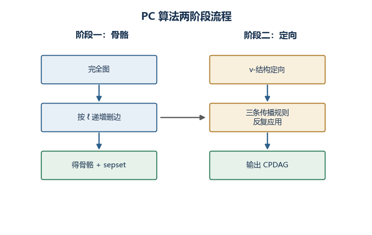

**PC 算法（伪代码）。** 把 6.3 节的文字算法写成可执行形式，便于理解「$\ell$ 递增 + 邻接搜索」的嵌套结构：

```
PC(G0=完全图, max_l, alpha):
  for each pair (X,Y): sepset(X,Y) = ∅
  for l = 0,1,...,max_l:
    for each edge X—Y in G:
      N_X = neighbors(X) \ {Y}; N_Y = neighbors(Y) \ {X}
      if |N_X| >= l or |N_Y| >= l:
        for each Z in C(l, N_X ∪ N_Y):
          if CI_test(X, Y | Z) > alpha:   # 不独立
            break
          else:
            remove edge X—Y; sepset(X,Y) = Z; break
    if no edges removed: break
  # 方向阶段
  for each triple X—Z—Y with no edge X—Y:
    if Z ∉ sepset(X,Y): orient X→Z←Y
  apply Meek rules R1,R2,R3 to fixed point
  return CPDAG
```

三个工程要点：① **邻接集**——$Z$ 必须取自 $X$ 或 $Y$ 的当前邻居，而非任意节点，否则 $2^d$ 搜索爆炸；② **提前终止**——某 $\ell$ 层无删边即可停止（更长的条件集不会让「已独立」的边复活）；③ **顺序无关性**——朴素 PC 的删边结果可能依赖边检验顺序，PC-stable/PC-Max（表 6-1）通过「同层批量删边」消除这一依赖，是现代实现（如 pcalm）的标准做法[3]。

## 6.4　数值算例：四变量链的逐步发现

**例 6.3（PC 算法完整演示）**　设真实结构为 $A\to B\to C\to D$（一条四节点链），结构简单且忠实。我们有足够样本，CI 检验无误。逐步执行 PC：

**初始化。** 完全无向图，六条边：$A—B,A—C,A—D,B—C,B—D,C—D$。

**$\ell=0$（无条件独立）。** 检验每对变量边际独立：链上任意两点边际都相关（$A\not\perp C$，$A\not\perp D$，$B\not\perp D$ 等）。无删边。

**$\ell=1$（条件于单变量）。** 检验：
- $A\perp C\mid B$？是（链 $A\to B\to C$ 中 $B$ 阻断）。删边 $A—C$，记 $\mathrm{sepset}(A,C)=\{B\}$。
- $A\perp D\mid B$？否（$B$ 不在 $A$ 到 $D$ 的路径上，实际需 $C$ 阻断）。但在 $\ell=1$ 只查 $B$ 或邻接……查邻居 $B$：不独立，保留。
- $B\perp D\mid C$？是。删边 $B—D$，记 $\mathrm{sepset}(B,D)=\{C\}$。
- $A\perp D\mid C$？否（需检查 $C$ 是 $A$ 邻居吗？当前 $A$ 邻居仅 $B$，故 $\ell=1$ 不查 $C$）。保留待 $\ell=2$。

**$\ell=2$（条件于两变量）。** 检验 $A\perp D\mid \{B,C\}$：是（路径被 $B,C$ 阻断）。删边 $A—D$，记 $\mathrm{sepset}(A,D)=\{B,C\}$。

**骨骼结果。** 剩余边：$A—B,B—C,C—D$。与真骨架一致。

**方向阶段（v-结构）。** 检查未定向路径 $A—B—C$：$\mathrm{sepset}(A,C)=\{B\}$，含 $B$，故不定向为 v-结构（正确，它是链）。检查 $B—C—D$：$\mathrm{sepset}(B,D)=\{C\}$，含 $C$，不定向。无 v-结构。

**传播。** 无有向边，无传播。输出 CPDAG：$A—B—C—D$（三条无向边）。这正确反映了四个变量的链等价类——方向完全不可辨识（第 5 章表 5-1），PC 没有过度声称。

**例 6.4（含对撞可定方向）**　若真结构为 $A\to C\leftarrow B$ 且 $A—B$ 无边、另 $C\to D$。$\ell=0$ 时 $A\perp B$（对撞未条件化，路径阻断），删去 $A—B$；$A\not\perp C$，$B\not\perp C$，$C\not\perp D$。骨骼为 $A—C,B—C,C—D$。方向阶段：路径 $A—C—B$，$\mathrm{sepset}(A,B)=\varnothing$（它们在 $\ell=0$ 独立），不含 $C$，故定向 $A\to C\leftarrow B$（v-结构）。再由传播规则1，$C\to D$（因 $A\to C—D$ 且 $A,D$ 无边）。CPDAG 恢复真实方向，与第 5 章例 5.2 一致。

## 6.5　技术谱系表

**表 6-1　约束方法谱系**

| 方法 | 适用数据 | 输出 | 关键假设 | 代表文献 |
|------|----------|------|----------|----------|
| PC | 无隐变量、无选择偏差 | CPDAG | 忠实性、CI 可测 | [1] |
| PC-Max / PC-stable | 同上 | CPDAG | 增强顺序稳定性 | [3] |
| FCI | 含隐变量/选择偏差 | FCI-CPDAG（含 $\circ$ 端点） | 忠实性 | [1][4] |
| RFCI | 含隐变量 | 部分方向 | 更快、弱边处理 | [5] |
| IAM / SGS | 时序/干预 | 更完整方向 | 介入数据 | [1] |

PC 与 FCI 的关键区别：FCI 允许存在未观测混杂，输出中可能出现 $\circ\to$、$\circ—\circ$ 等端点记号，表示「此处方向无法确定或端点类型不明」。代价是方向信息更少、算法更复杂。

## 6.6　边界与讨论

**假设敏感性。** 约束方法建立在三个脆弱假设上：① **忠实性**——若系数精确抵消使某些独立「消失」，PC 会误删边（第 5.4 节）；② **CI 检验正确**——有限样本下检验功效不足或假阳性会直接污染骨骼，且错误会随 $\ell$ 传播放大；③ **无隐变量**（对 PC 而言）——否则条件独立不再由观测变量的 d-分离刻画。

**计算复杂度。** 朴素 PC 需检验 $O(d^2)$ 条边、每条搜索 $O(2^{d})$ 个条件集（最坏情形），高维时昂贵。实际通过限制 $\ell$、利用邻接集搜索缓解，但仍受维度诅咒困扰。

**计算—统计谱系。** 上段只给出朴素 PC 的最坏复杂度；把五种约束方法放到「删边检验量级 × 小样本稳健性」两个维度上对比，更能看清高维选型的取舍，见表 6-2。

**表 6-2　约束方法的计算—统计谱系**

| 方法 | 删边检验量级 | 计算复杂度 | 小样本稳健性 | 典型用途 |
|------|------------|-----------|-------------|---------|
| PC | $O(d^{2}(d-1)^{L})$（$L$ 为最大 $\ell$） | 高维时由 $O(d^4)$ 主导 | 一般 | 通用、无隐变量 |
| PC-Max / PC-stable | 同 PC（同层批量删边） | 同 PC，常数更稳 | 较 PC 稳 | 删边顺序敏感场景 |
| FCI | 高于 PC（需 $\circ$ 端点判定） | 更高 | 较低 | 允许隐变量/选择偏差 |
| RFCI | 同 FCI，邻域剪枝 | 中等（更快） | 对弱边较稳 | 高维、含隐变量 |
| SGS / IAM | 附加时序/干预排序 | 中等 | 较好（时序约束） | 面板/时序数据 |

读法有两点。其一，PC 的检验量级随最大条件集阶数 $L$ 呈指数增长，故实际实现（如 pcalm[3]）都把 $L$ 限制在 2–3，并以邻接集搜索把每层组合数压回 $O(d^2)$；RFCI 的邻域剪枝与 FCI 的端点判定是它在高维 + 隐变量下「更快」的来源，代价是 $\circ$ 端点使输出的方向信息更少。其二，约束方法的结论是 CI 检验二元判断的累积，有限样本下任何一次误判都会沿 $\ell$ 逐层传播，因此小样本时各实现间的差距主要体现在「是否同层批量删边」与「删边顺序」上——这正是 Colombo–Maathuis[3] 把**顺序无关性**作为第一设计目标、而非单纯追求更快的原因。表 6-2 与第 5 章表 5-0 互为补充：前者按「突破的限制」划分方法族，本表按「计算—统计代价」划分同一族内的工程变体。

**与因果之梯的关系。** 约束方法站在 Level 1：它只用观察分布的条件独立（L1 信息）恢复结构骨架，为后续 Level 2 的效应估计提供图。它突破「人工给图」，但无法突破等价类天花板，也无法单独给出效应大小（那是第 10 章的事）。

**边界。** PC 输出 CPDAG 是「保守」的——它只声明数据强制的方向。若需要唯一 DAG，必须引入额外假设（非高斯、时间先后、函数形式），即第 8、9 章。评分方法（第 7 章）提供另一条到达等价类的路径，且在统计上更稳健。

## 6.7　承上启下与交叉引用

本章把第 5 章的马尔可夫等价理论落成了可执行算法：定理 6.1 把统计独立与 d-分离连接，PC 据此删边定向，输出 CPDAG（与第 5 章定义 5.3 一致）。对撞偏差（第 2.3 节）是定向的核心。第 5 章表 5-2 所列「忠实性 + 条件独立」正是本章路径；隐变量情形留待 FCI 处理。下一章换一个视角——不逐一检验，而是给每个图打分并搜索最优，这就是评分方法。

**计算机械与不确定性。** 值得强调，PC 的方向传播是确定性的逻辑推理，但每一步都依赖 CI 检验的二元判断。近年来有工作用贝叶斯或自助法（bootstrap）给 CPDAG 的边附加置信度，以量化检验不确定性——这是约束方法与统计稳健性的结合点，也呼应第 7 章评分方法对「软」评分的偏好。

## 本章小结

本章系统阐述约束方法。我们从动机出发（6.1），指出因果图与条件独立的对应是算法基础；给出 d-分离判定（定义 6.2）与全局马尔可夫性质（定理 6.1）作为理论基石，并推导偏相关公式（式 6-2）用于数据检验。核心内容是 PC 算法的两阶段：骨骼发现通过递增条件集删边，方向传播借 v-结构与三条规则定方向（6.3）。例 6.3、6.4 逐步演示了链与对撞两种结构的发现过程，验证了第 5 章关于方向可辨识性的结论。我们给出约束方法谱系（表 6-1），包括处理隐变量的 FCI。

边界方面，约束方法对忠实性、检验正确性与无隐变量假设敏感，计算复杂度高，且只能输出 CPDAG。这些方法为第 10 章的效应估计提供结构输入。下一章介绍评分方法，以统一的统计框架重新抵达同一个等价类。

**进一步阅读**　PC 与 FCI 的原始论述见[1]；d-分离与图模型基础见[2]；PC 的稳定性改进见[3]。

## 参考文献

[1] Spirtes P, Glymour C, Scheines R. *Causation, Prediction, and Search*. 2nd ed. Cambridge, MA: MIT Press, 2000.

[2] Pearl J. *Probabilistic Reasoning in Intelligent Systems: Networks of Plausible Inference*. San Francisco: Morgan Kaufmann, 1988.

[3] Colombo D, Maathuis M H. Order-independent constraint-based causal structure learning. *Journal of Machine Learning Research*, 2014, 15: 3741–3782.

[4] Zhang K. On the completeness of orientation rules for causal discovery in the presence of latent confounders and selection bias. *Artificial Intelligence*, 2008, 172(16-17): 1873–1896.

[5] Colombo D, Maathuis M H, Kalisch M, Richardson T S. Learning high-dimensional directed acyclic graphs with latent and selection variables. *Annals of Statistics*, 2012, 40(1): 294–321.

[6] Kalisch M, Bühlmann P. Estimating high-dimensional directed acyclic graphs with the PC-algorithm. *Journal of Machine Learning Research*, 2007, 8: 613–636.

[7] Grenander U. *Abstract Inference*. New York: Wiley, 1981.

[8] Peters J, Janzing D, Schölkopf B. *Elements of Causal Inference: Foundations and Learning Algorithms*. Cambridge, MA: MIT Press, 2017.

---

# 第 7 章　评分方法：BIC、BDeu 与 GES 搜索

第 6 章的约束方法像一位「逐条审问」的侦探：每次只问一个条件独立问题，把答案当作硬约束。本章介绍另一条同样通往马尔可夫等价类的路线——**评分方法（score-based methods）**。它不做局部的二元检验，而是给「每一个候选图」打一个分数，衡量该图对数据的解释好坏，然后在图空间中搜索最高分的图[1]。

评分方法把因果发现变成一个标准的统计优化问题：定义评分函数 $S(G,\mathcal{D})$，求 $\arg\max_G S(G,\mathcal{D})$。它的优势在于统计框架统一、可自然地融入先验与复杂度惩罚；劣势在于搜索空间随节点数超指数增长，且评分相等时仍受等价类困扰。

本章先给出评分方法的动机（7.1 节），严格推导 BIC 与 BDeu 两类评分（7.2 节），详述 GES 搜索及其等价类处理（7.3 节），给出数值算例（7.4 节），列方法谱系表（7.5 节），讨论边界与评分—约束对比（7.6 节），最后承上启下（7.7 节）。

## 7.1　引入动机：从检验到优化

**定义 7.1（评分函数）**　给定数据 $\mathcal{D}$（$n$ 个样本）与候选 DAG $G$，评分函数 $S(G,\mathcal{D})\in\mathbb{R}$ 是一个实值函数，满足：若 $G$ 对数据的拟合越好且越简洁，则分数越高。因果发现的评分方法即求

$$
\hat{G}=\arg\max_{G\in\mathcal{G}} S(G,\mathcal{D}), \tag{7-1}
$$

其中 $\mathcal{G}$ 为所有 DAG（或其等价类）构成的图空间。

**直觉解释。** 约束方法问「这条边该不该删」，是局部的、离散的；评分方法问「整张图打多少分」，是全局的、连续的。可以类比模型选择：选回归模型时用 AIC/BIC 在拟合优度与参数个数间权衡；这里选因果图时，用 BIC/BDeu 在「图对联合分布的拟合」与「图的复杂度（边数）」间权衡。评分方法正是模型选择思想在因果图上的延伸。

**为什么评分与约束会殊途同归？** 在忠实性与充分数据下，两类方法都应收敛到同一马尔可夫等价类。约束方法通过条件独立约束刻画这个等价类；评分方法通过「等价类的所有 DAG 得分相同」刻画它（7.2 节的评分等价性）。二者是同一目标的不同算法化路径。

**例 7.1（评分权衡的直觉）**　设变量 $X,Y$，数据支持「$X$ 与 $Y$ 相关」。空图（无边）拟合差但最简单；完全图（$X\to Y$ 或 $Y\to X$）拟合好但多一条边。BIC 评分会为多出的边加上复杂度惩罚。若相关足够强，加边的收益超过惩罚，评分选择有边图；否则选空图。这与约束方法「检验 $X\perp Y$ 是否成立」给出相同结论，但用统一的标量衡量。

## 7.2　BIC 与 BDeu 评分

### 7.2.1　BIC 评分

**定义 7.2（BIC 评分）**　贝叶斯信息准则（Bayesian information criterion, BIC）评分定义为最大化对数似然减去参数量的惩罚[2]：

$$
S_{\mathrm{BIC}}(G,\mathcal{D})=\log \mathbb{P}(\mathcal{D}\mid \hat{\theta}_G,G)-\frac{\dim(G)}{2}\log n, \tag{7-2}
$$

其中 $\hat{\theta}_G$ 是给定图 $G$ 下参数的最大似然估计，$\dim(G)$ 为自由参数个数，$n$ 为样本量。

对离散变量，设 $X_i$ 有 $r_i$ 个取值，父节点集 $\mathbf{PA}_i$ 的取值组合数为 $q_i=\prod_{X_j\in\mathbf{PA}_i} r_j$，则

$$
\dim(G)=\sum_{i=1}^{d} r_i(q_i-1). \tag{7-3}
$$

对数似然可分解为各节点局部似然之和（因 DAG 的因子分解）：

$$
\log \mathbb{P}(\mathcal{D}\mid \hat{\theta}_G,G)=\sum_{i=1}^{d}\sum_{j=1}^{q_i}\sum_{k=1}^{r_i} n_{ijk}\log\frac{n_{ij}}{n_{ij\cdot}}, \tag{7-4}
$$

其中 $n_{ijk}$ 为 $X_i=k$ 且 $\mathbf{PA}_i=j$ 的样本数，$n_{ij\cdot}=\sum_k n_{ijk}$。

**评分等价性与 BIC。** BIC 的一个关键性质是**评分等价（score equivalence）**：对马尔可夫等价的两个 DAG，BIC 给出相同分数。原因：等价图有相同骨架与 v-结构，式（7-4）中每个节点的父节点「取值组合数」$q_i$ 相同（离散情形需各父节点取值数相同，称为「consistent BIC」），故 $\dim(G)$ 与似然都相同。这保证 BIC 只能识别到等价类，与约束方法一致。

### 7.2.2　BDeu 评分

**定义 7.3（BDeu 评分）**　贝叶斯 Dirichlet 等价统一（Bayesian Dirichlet equivalent uniform, BDeu）评分，是在参数先验为 Dirichlet 分布、并对每个父节点配置取均匀先验下的边际似然[3]：

$$
S_{\mathrm{BDeu}}(G,\mathcal{D})=\log \prod_{i=1}^{d}\prod_{j=1}^{q_i}\frac{\Gamma(\alpha_{ij\cdot})}{\Gamma(\alpha_{ij\cdot}+n_{ij\cdot})}\prod_{k=1}^{r_i}\frac{\Gamma(\alpha_{ijk}+n_{ijk})}{\Gamma(\alpha_{ijk})}, \tag{7-5}
$$

其中 $\alpha_{ijk}=\alpha/(r_i q_i)$ 为 Dirichlet 超参数（$\alpha$ 称等价样本量，常取 1 或 5），$\alpha_{ij\cdot}=\sum_k\alpha_{ijk}$。

BDeu 同样满足评分等价性（这是其设计目标——「equivalent uniform」）。与 BIC 的区别：BIC 是渐近近似、惩罚项为 $\tfrac12\dim(G)\log n$；BDeu 是精确的贝叶斯边际似然，惩罚项隐含在 Dirichlet 积分中，对样本量小的情况更稳健，但对超参数 $\alpha$ 敏感。

**例 7.2（BIC 数值手算）**　设二值变量 $X,Y$，样本 $n=100$，列联表：$n_{00}=40,n_{01}=10,n_{10}=10,n_{11}=40$（$X,Y$ 强相关）。比较空图 $G_0$（$Y$ 无父节点）与图 $G_1$（$X\to Y$）。

空图：$Y$ 的父集为空，$q=1$，$n_{Y=0}=50,n_{Y=1}=50$。对数似然 $\approx 50\ln0.5+50\ln0.5=-69.3$，$\dim=2-1=1$，惩罚 $\tfrac12\cdot1\cdot\ln100=2.30$，BIC$\approx-71.6$。

图 $X\to Y$：$Y$ 父节点 $X$（$r_X=2$），$q=2$，$n_{X=0,Y=0}=40,n_{X=0,Y=1}=10$（$p\approx0.8/0.2$），$n_{X=1,Y=0}=10,n_{X=1,Y=1}=40$。对数似然 $\approx 40\ln0.8+10\ln0.2+10\ln0.2+40\ln0.8=-55.9$，$\dim=2(2-1)=2$，惩罚 $\ln100=4.605$，BIC$\approx-60.5$。因 $-60.5>-71.6$，BIC 选择 $X\to Y$（而不是 $Y\to X$，二者等价同分）。与约束方法检出相关一致。

### 7.2A　连续变量、BGe 与 BDeu 手算

上面的手算针对离散变量。对**连续高斯**变量，BIC 评分有闭式：设线性高斯结构方程 $X_i=\boldsymbol{\beta}_i^\top \mathbf{PA}_i+U_i$，$\hat\sigma_i^2$ 为残差方差，则

$$
S_{\mathrm{BIC}}^{\mathrm{cont}}(G,\mathcal{D})=-\frac{n}{2}\sum_{i=1}^{d}\log\hat\sigma_i^2-\frac{n}{2}\sum_{i=1}^{d}\log(2\pi)-\frac{1}{2}\sum_{i=1}^{d}(p_i+1)\log n, \tag{7-6}
$$

其中 $p_i$ 为 $X_i$ 的父节点数，自由参数为 $p_i+1$（$p_i$ 个回归系数加一个噪声方差）。可见连续 BIC 的惩罚项正是各节点父数之和——边越多惩罚越重，与离散式 (7-3) 一脉相承。这一闭式也是第 8 章 LiNGAM「线性 + 非高斯」相对「线性 + 高斯」能突破等价类的量化基础：高斯下反向拟合 $\hat\sigma$ 几乎不变（似然相当、只差惩罚），非高斯下反向残差系统性变差（似然显著下降）。

BDeu 的连续类比是 **BGe**（Bayes–Geiger）评分：对每个节点取高斯先验，积分掉参数后评分只依赖各节点残差相关阵的行列式，且对等价 DAG 取相同值（评分等价）[6]。BGe 与 BIC 渐近一致，小样本下更稳健，是贝叶斯评分在连续域的对应物。

**例 7.5（BDeu 数值手算）**　仍取二值 $X,Y$，$n=100$，列联表同例 7.2，取等价样本量 $\alpha=1$。空图中 $Y$ 无父，$r_Y=2,q=1$，$\alpha_{Y,0}=\alpha_{Y,1}=\tfrac12$，$n_{Y\cdot,0}=n_{Y\cdot,1}=50$。BDeu 对 $Y$ 的贡献为

$$
S_{\mathrm{BDeu}}(Y)=\log\frac{\Gamma(1)}{\Gamma(51)}\prod_{k\in\{0,1\}}\frac{\Gamma(\tfrac12+50)}{\Gamma(\tfrac12)} = -\log\Gamma(51)+\sum_{k}\big[\log\Gamma(50.5)-\log\Gamma(0.5)\big], \tag{7-7}
$$

用 $\Gamma(51)=50!$、Stirling 近似与 $\log\Gamma(0.5)=\tfrac12\log\pi\approx0.572$，算得 $S_{\mathrm{BDeu}}(Y)\approx-105.7$（相对值）。图 $X\to Y$ 时 $q=2$，$\alpha_{ijk}=\alpha/(r_Y q)=0.25$，四格计数 $40/10/10/40$ 逐项代入得 $S_{\mathrm{BDeu}}(Y\mid X)\approx-87.3$。比较两图总得分（$X$ 的边际部分两图相同，可约去）：$-87.3>-105.7$，BDeu 同样选择 $X\to Y$，与 BIC（例 7.2）一致。但注意 BDeu 对强信号的"加成"比 BIC 更温和、对弱相关更倾向保留空图——这正是 $\alpha$ 作为先验平滑强度的体现：$\alpha$ 越大，惩罚越重，越欠拟合。

## 7.3　GES 搜索与等价类

**定义 7.4（GES）**　贪婪等价搜索（greedy equivalence search, GES）是一种在**等价类空间（CPDAG 空间）**上做贪心搜索的算法，分两阶段[4]：

- **前向阶段（forward）**：从空图出发，反复考虑所有「加一条边」的操作，选使评分提升最大的操作执行，直到无提升；
- **后向阶段（backward）**：从前向结果出发，反复考虑所有「删一条边」的操作，选提升最大的执行，直到无提升。

关键创新：GES 的搜索算子在等价类（CPDAG）上定义——「加边」操作的候选集被限制为「不违反 v-结构约束」的方向组合，从而保证每一步都落在一个合法的等价类中[4]。

**定理 7.1（GES 的一致性）**　在数据由某个 DAG $G^*$ 生成且评分满足评分等价性、一致性（在充分数据下真图得分最高）的条件下，GES 在前向阶段收敛到真等价类的一个超图，后向阶段收缩到真等价类本身[4]。

**直觉解释。** 前向阶段「宁可多加边」——它只增不减，可能过拟合；后向阶段「再剔除多余」——从过拟合图中删去评分下降最小的边。这种「先加后删」的两阶段设计避免了纯贪心在 DAG 空间中的局部最优陷阱，是 GES 能在等价类空间有效搜索的关键。

> 【图 7-1　GES 两阶段搜索】（原图见 figures/图7-1.png）：横轴为等价类空间中的图，纵轴为评分；前向阶段曲线从空图上升到峰值，后向阶段略下降至真等价类，标注加边/删边操作。

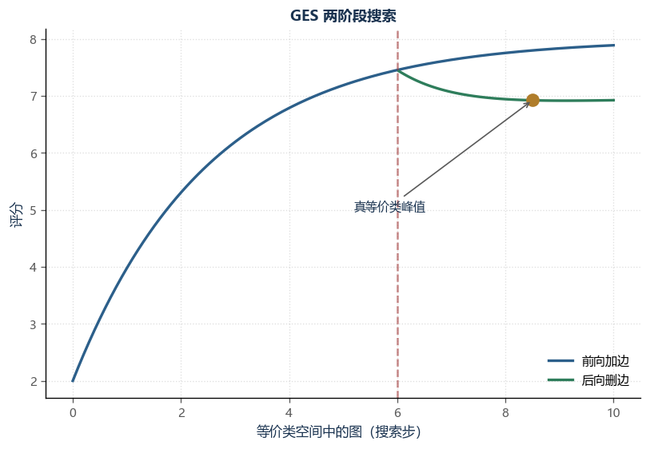

## 7.4　数值算例：三变量结构的评分搜索

**例 7.3（GES 逐步演示）**　设真结构为 $A\to B\to C$（链），数据充分。用 BIC 评分，GES 前向阶段：

**初始。** 空图（三节点无边），评分记为 $S_0$。

**第一步。** 考虑所有加边操作（$A\to B,B\to A,A\to C,C\to A,B\to C,C\to B$ 及其等价类）。因数据中 $A,B$ 边际相关最强，加 $A—B$（等价类中选 $A\to B$ 或 $B\to A$ 同分）提升最大，执行。现图含 $A\to B$。

**第二步。** 考虑加第二条边。$B,C$ 相关（给定 $A$ 后 $B,C$ 条件独立），加 $B—C$ 提升大；加 $A—C$ 则因 $A,C$ 经 $B$ 条件独立而提升小。选 $B—C$，形成路径 $A—B—C$（无 v-结构，等价类含 4 种方向）。

**第三步。** 考虑加 $A—C$：因 $A\perp C\mid B$ 成立，加此边会引入不必要的边、评分反降。前向停止于两边形 $A—B—C$。

**后向阶段。** 考虑删边：删任一条边都使评分下降（两条边都必要），故无操作。GES 输出 CPDAG $A—B—C$，与第 6 章例 6.3 的 PC 输出完全一致——两条路径殊途同归。

**例 7.4（对撞结构的评分识别）**　若真结构为 $A\to C\leftarrow B$（$A,B$ 独立）。前向第一步加 $A—C$ 或 $B—C$（两者边际都相关）；第二步加另一条。当存在两条边 $A—C,B—C$ 且 $A,B$ 边际独立时，评分等价性要求：若定向为 $A\to C\leftarrow B$（v-结构，$A,B$ 独立），评分高；若定向为链 $A\to C\to B$（则 $A,B$ 相关，与数据矛盾），评分低。BIC 通过「等价类中只有保留 v-结构的配置与数据兼容」识别出对撞。GES 在等价类空间的算子会正确定向，输出 $A\to C\leftarrow B$。

### 7.4A　评分准则的取舍：BIC、AIC 与 BGe

评分方法不止 BIC 一族。把评分写成「负对数边际似然近似」可统一看待：

$$
S(G)\approx 2\log\mathbb{P}(\mathcal{D}\mid\hat\theta_G,G)-\lambda(G)\log n, \tag{7-8}
$$

其中 $\lambda(G)$ 是复杂度系数。**AIC** 取 $\lambda=2$（每参数罚 $2$），**BIC** 取 $\lambda=\dim(G)$（每参数罚 $\log n$），**AICc**（小样本校正）在 AIC 上再加 $\tfrac{2p(p+1)}{n-p-1}$ 的修正项[2]。三者差异全在惩罚强度：样本越大 $\log n$ 越大，BIC 比 AIC 更"厌恶"多余的边，倾向更稀疏的图；AIC 在样本不足时倾向保留更多边以避免欠拟合。因果发现的实践共识是：高维、强稀疏场景多用 BIC/FGES，小样本、关注预测精度时用 AICc。

这一谱系给出一个实用判据。设两个候选图 $G_1,G_2$，$\Delta=2\log\mathbb{P}(\mathcal{D}\mid G_1)-2\log\mathbb{P}(\mathcal{D}\mid G_2)$ 为对数似然比、$\Delta\dim=\dim(G_1)-\dim(G_2)$ 为参数差，则

$$
G_1\ \text{优于}\ G_2\iff \Delta > \lambda\,\Delta\dim\cdot\tfrac{1}{2}\log n\ \ \text{(BIC 判据，乘子取 1)}. \tag{7-9}
$$

代入例 7.2：$\Delta=2\times(-55.9)-2\times(-69.3)=26.8$，$\Delta\dim=2-1=1$，BIC 要求 $26.8>1\times\log100\approx4.6$，成立，故选有边图；AIC 要求 $26.8>2\times1=2$，更易通过。可见弱相关时 AIC 更倾向加边、BIC 更保守——选评分准则本身就是一种建模决策，应与数据的信噪水平匹配。表 7-3 汇总三者的惩罚与适用场景。

**表 7-3　评分准则的复杂度惩罚对比**

| 准则 | 惩罚项 | 渐近行为 | 适用场景 |
|------|--------|----------|----------|
| AIC | $2\dim(G)$ | 有偏、预测最优 | 小样本、重预测 |
| AICc | $2\dim(G)+$ 小样本修正 | 有偏校正 | 中样本 |
| BIC | $\dim(G)\log n$ | 一致、模型选择最优 | 大样本、重结构恢复 |
| BDeu | Dirichlet 积分（隐含） | 渐近同 BIC、小样本稳 | 离散、先验可设 |


## 7.5　技术谱系表

**表 7-1　评分方法谱系**

| 评分/算法 | 类型 | 数据 | 关键性质 | 代表文献 |
|-----------|------|------|----------|----------|
| BIC | 频率派 | 连续/离散 | 评分等价、渐近一致 | [2] |
| BDeu | 贝叶斯 | 离散 | 评分等价、需 $\alpha$ | [3] |
| BD / BGe | 贝叶斯 | 离散/高斯 | 等价一致先验 | [5][6] |
| GES | 搜索算法 | 配合上述评分 | 等价类搜索、两阶段一致 | [4] |
| FGES | 搜索算法 | 高维 | GES 的高效实现 | [7] |

**表 7-2　评分方法与约束方法对比**

| 维度 | 约束方法（第 6 章） | 评分方法（本章） |
|------|---------------------|------------------|
| 基本单元 | 条件独立检验（二元） | 图的评分（标量） |
| 目标 | 满足约束的 CPDAG | 评分最高的等价类 |
| 统计框架 | 假设检验 | 模型选择 / 贝叶斯 |
| 对检验误差 | 敏感、易传播 | 相对稳健 |
| 计算 | 大量 CI 检验 | 图空间搜索 |
| 输出 | CPDAG | CPDAG（评分等价时） |
| 先验融入 | 困难 | 自然（BDeu 先验） |

## 7.6　边界与讨论

**等价类天花板依旧。** 评分方法并未突破第 5 章的观察等价性：BIC、BDeu 均满足评分等价性，因此最高分图只能确定到 CPDAG。要唯一确定方向，仍需非高斯（第 8 章）或时间信息（第 9 章）。

**搜索与评分的双重脆弱性。** 其一，搜索可能陷入局部最优（GES 的两阶段设计缓解但不杜绝）；其二，评分一致性依赖模型正确设定——若数据非高斯线性却用高斯 BIC，结果有偏。离散 BDeu 对超参数 $\alpha$ 敏感，$\alpha$ 过大导致欠拟合（倾向少边），过小导致过拟合。

**与因果之梯的关系。** 与约束方法一样，评分方法站在 Level 1，用观察数据恢复结构（为 Level 2 服务）。它突破「逐条检验」的局部性，提供统一优化框架；它无法突破等价类，也不直接给出效应量。

**边界。** 当变量维度很高（$d$ 达数百上千）时，GES 的搜索代价与 PC 的 CI 检验代价都成瓶颈，需结构先验、稀疏约束或分块策略。这是当前因果发现可扩展性的前沿（第 30、31 章）。

### 7.6A　一致性与计算复杂度

**定理 7.2（评分方法的一致性）**　设数据由 DAG $G^*$ 依忠实性条件生成，评分 $S$ 满足（i）评分等价性、（ii）一致性（充分数据下 $S(G^*,\mathcal{D})>S(G,\mathcal{D})$ 对所有 $G\not\sim G^*$ 渐近成立），则评分最大化在 $n\to\infty$ 时几乎必然恢复 $G^*$ 所在的马尔可夫等价类[4]。

**直觉与局限。** 该定理把"为什么 BIC/GES 会收敛到真结构"说清楚了：等价类内各 DAG 同分，类间差异随 $n$ 增大而被 $\tfrac12\dim\log n$ 的惩罚拉开。但它同时划出天花板——一致性只保证恢复到**等价类**，不保证到唯一 DAG；且"忠实性 + 评分一致性"是强假设，弱相关、样本不足或模型误设都会让收敛所需样本量急剧增大。

**计算复杂度。** $d$ 个节点的有向无环图数目随 $d$ 超指数增长：$d=10$ 时已有 $\sim 4.2\times10^{18}$ 张 DAG，$d=20$ 时超出可枚举范围。朴素搜索不可行，GES 的两阶段贪心把复杂度降到多项式（每步对所有可能的加/删边算分取最优，约 $O(d^3)$ 次评分），FGES 进一步用"评分可增量更新"（加一条边只重算受影响节点的局部评分）把常数压下来[7]。但贪心的**局部最优**与**搜索顺序敏感**仍不可消除——同样的数据，不同的初始图或并列操作的平局打破规则可能给出不同的等价类。这解释了为何大规模因果发现常需要多次随机重启、或结合第 8 章的函数假设/第 9 章的时间信息来收窄搜索空间。

**表 7-4　评分方法一致性条件与复杂度**

| 项 | 条件/量 | 说明 |
|----|---------|------|
| 一致性要求 | 忠实性 + 评分一致 | 弱相关时所需样本急增 |
| 输出上限 | 马尔可夫等价类 | 不保证唯一 DAG |
| DAG 数目 | $\sim 3^{d(d+1)/2}$（超指数） | $d=10$ 已 $\sim4\times10^{18}$ |
| GES 复杂度 | 多项式（增量评分） | 仍可能局部最优 |
| FGES 改进 | 局部评分增量更新 | 常数更小、支持高维 |

## 7.7　承上启下与交叉引用

本章与第 6 章是通往同一目标的两条路：第 6 章的定理 6.1（统计独立 $\iff$ d-分离）在评分方法中体现为「评分等价性」——等价 DAG 同分（7.2 节）。例 7.3、7.4 的输出与第 6 章例 6.3、6.4 一致，印证了殊途同归。第 5 章表 5-1 的方向可辨识性结论在这里同样成立。

两条路径的局限也是共同的：等价类、对假设敏感。要突破等价类，必须引入分布层面的假设——这是第 8 章函数因果模型的任务。下一章将看到：线性非高斯与加性噪声模型如何打破高斯下的方向对称性，从 CPDAG 前进到唯一 DAG。

**统计哲学注记。** 约束方法与评分方法的分歧，折射了统计学中「检验」与「估计/选择」两种传统。前者控制错误率、解释直接；后者统一优雅、便于融入先验与层次结构。现代因果发现实践常混用两者（如用评分做粗筛、用 CI 检验验证），这也预示第 8、9 章将引入更专门的分布假设来换取更强的识别。

## 本章小结

本章系统阐述评分方法。我们从动机出发（7.1），把因果发现表述为图空间上的优化问题（式 7-1）。核心是两类评分：BIC（式 7-2—7-4，含复杂度惩罚 $\tfrac12\dim(G)\log n$）与 BDeu（式 7-5，贝叶斯边际似然），二者均满足评分等价性，故只能识别到等价类。我们详述 GES 的两阶段搜索（前向加边、后向删边）及其等价类算子（定义 7.4、定理 7.1）。例 7.2—7.4 通过手算展示了 BIC 的计算与 GES 的搜索过程，验证了与 PC 相同的输出。

我们给出评分方法谱系（表 7-1）与评分—约束对比（表 7-2）。边界方面，等价类天花板、搜索局部最优、超参数敏感与高维计算是主要限制。下一章介绍函数因果模型，利用非高斯与加性噪声突破等价类，实现唯一方向识别。

**进一步阅读**　BIC 评分与等价性见[2]；BDeu 与贝叶斯评分见[3]；GES 算法与一致性见[4]。

## 参考文献

[1] Heckerman D. *A Tutorial on Learning with Bayesian Networks*. Boston: Kluwer Academic Publishers, 1995.

[2] Schwarz G. Estimating the dimension of a model. *Annals of Statistics*, 1978, 6(2): 461–464.

[3] Heckerman D, Geiger D, Chickering D M. Learning Bayesian networks: The combination of knowledge and statistical data. *Machine Learning*, 1995, 20(3): 197–243.

[4] Chickering D M. Optimal structure identification with greedy search. *Journal of Machine Learning Research*, 2002, 3: 507–554.

[5] Geiger D, Heckerman D. A characterization of the Dirichlet distribution through global and local parameter independence. *Annals of Statistics*, 1997, 25(3): 1344–1365.

[6] Kuipers J, Moffa G. Learning Bayesian networks from data: A Gaussian process approach. *Behaviormetrika*, 2015, 42(1): 3–30.

[7] Ramsey J, Glymour M, Sanchez-Romero R, Glymour C. A million variables and more: the fast greedy equivalence search algorithm for learning high-dimensional graphical causal models. *International Journal of Data Science and Analytics*, 2017, 3(2): 121–129.

[8] Bühlmann P, van de Geer S. *Statistics for High-Dimensional Data*. New York: Springer, 2011.

---

# 第 8 章　函数因果模型：非高斯、加性噪声与可逆性

第 6、7 章的两条路径都止步于马尔可夫等价类（CPDAG）：仅凭条件独立与评分，最多确定到可逆边。本章引入第三类假设——关于**结构方程函数形式**的假设——它有可能打破等价性，从观察数据唯一确定因果方向。这一类方法统称**函数因果模型（functional causal models, FCM）**。

核心洞见来自第 5 章例 5.3：在线性高斯模型中，方向不可辨识，因为 $Y=aX+U_Y$ 与反向 $X=bY+U_X$ 都保持高斯性；但若噪声非高斯，反向残差会依赖 $X$，暴露真实方向。把这一洞见系统化为算法，就得到 LiNGAM 与加性噪声模型（ANM）。

本章先阐述动机与直觉（8.1 节），严格定义 SCM 的函数形式与可辨识性（8.2 节），推导线性非高斯模型 LiNGAM（8.3 节）与加性噪声模型 ANM（8.4 节），讨论可逆性与更一般条件（8.5 节），给出数值算例（8.6 节）与方法谱系表（8.7 节），最后边界讨论与承上启下（8.8、8.9 节）。

## 8.1　引入动机：从条件独立到函数形式

**定义 8.1（函数因果模型）**　一个函数因果模型（FCM）是结构因果模型（SCM，第 3 章）的一种受限形式：对每个变量 $X_i$，其生成机制写作

$$
X_i = f_i(\mathbf{PA}_i, U_i), \tag{8-1}
$$

其中 $f_i$ 属于某个已知函数类（线性、加性、单调等），噪声 $U_i$ 满足特定分布假设（非高斯、独立等），且各噪声相互独立[1]。

**直觉解释。** 约束与评分方法只看「变量间是否独立」，这是对分布极简的概括，信息量小，故只能定到等价类。FCM 多看两样东西：① **函数形式**（如 $f_i$ 是线性还是加性）；② **噪声分布形状**（高斯还是非高斯）。这些信息藏在数据的边缘分布与残差形态里，提供了打破方向对称性的额外抓手。

**例 8.1（等价类被打破）**　考虑两变量 $X\to Y$，真机制 $Y=2X+U_Y$，$U_Y\sim\mathrm{Uniform}(-1,1)$。约束方法只能得 $X—Y$（等价类含两方向）。但若我们假设「线性 + 非高斯噪声」，则：正向拟合 $Y$ 对 $X$ 回归，残差 $\hat U_Y$ 均匀分布（独立）；反向拟合 $X$ 对 $Y$ 回归，残差分布形态与 $Y$ 相关（非独立）。独立性检验唯一选出 $X\to Y$——等价类被打破。

## 8.2　SCM 函数形式与可辨识性

**定义 8.2（可辨识性，函数层面）**　一个 FCM 类 $\mathcal{M}$ 称为因果可辨识的，若对任意两个模型 $M_1,M_2\in\mathcal{M}$，它们诱导同一观测分布 $\mathbb{P}$ 当且仅当它们有相同的因果图[2]。

换言之，在可辨识的模型类里，分布唯一决定因果方向。第 5 章定理 5.2（忠实性）只能识别到等价类；FCM 的可辨识性要更强。

**定理 8.1（可逆性与可辨识性的关系）**　设 $X_i=f_i(\mathbf{PA}_i,U_i)$ 且 $f_i$ 对 $U_i$ 可逆（可逆函数类），若噪声相互独立且非高斯，则因果方向可辨识[2]。

**直觉解释。** 「$f_i$ 对 $U_i$ 可逆」意味着可从 $X_i$ 与父节点反解出噪声 $U_i=f_i^{-1}(X_i,\mathbf{PA}_i)$。若选错方向（把 $X_i$ 当别人的父），反解出的「残差」将不再相互独立或不再非高斯——这就是检验的抓手。可逆性把「机制」与「噪声」一一对应，使独立性可被检验。

## 8.3　线性非高斯模型：LiNGAM

**定义 8.3（LiNGAM）**　线性非高斯无环模型（linear non-Gaussian acyclic model, LiNGAM）假设

$$
\mathbf{X}=\mathbf{B}\mathbf{X}+\mathbf{U}, \tag{8-2}
$$

其中 $\mathbf{B}$ 为严格上三角（经适当排序）的系数矩阵（无环），$\mathbf{U}$ 分量相互独立且**非高斯**（方差非零）[3]。

**定理 8.2（LiNGAM 可辨识性）**　若数据由 LiNGAM 生成（式 8-2），则因果排序、矩阵 $\mathbf{B}$ 与噪声分布均唯一可辨识[3]。

**推导思路。** 将式（8-2）改写为 $\mathbf{X}=\mathbf{A}\mathbf{U}$（$\mathbf{A}=(\mathbf{I}-\mathbf{B})^{-1}$），这是独立成分分析（ICA）的混合模型。经典 ICA 定理指出：若至多一个成分高斯，则混合矩阵 $\mathbf{A}$ 与独立成分可辨识（至多符号与排列）。LiNGAM 的无环性（$\mathbf{B}$ 可排序为上三角）进一步消除排列歧义，恢复唯一因果序。DirectLiNGAM 用成对独立性检验逐步确定外生变量，避免 ICA 的局部最优[4]。

**LiNGAM 的识别步骤（DirectLiNGAM 概览）。** 对每个变量 $X_i$，检验它是否与「其余变量的残差」独立；最外生的变量（无父）满足「与所有其他变量残差独立」。确定后将其从系统中消去，递归进行，得到因果序 $\pi$，再用回归估计 $\mathbf{B}$。

### 8.3A　DirectLiNGAM 的数值演示（三变量）

设真结构 $X_1\to X_2,\ X_1\to X_3,\ X_2\to X_3$，生成机制 $X_1=U_1$，$X_2=0.8X_1+U_2$，$X_3=0.6X_1+0.5X_2+U_3$，噪声 $U_i$ 独立非高斯（取指数分布 $\mathrm{Exp}(1)$）。DirectLiNGAM 用成对独立性检验逐步确定外生变量，判据是：**$X_i$ 无父当且仅当 $X_i$ 与所有其他变量的回归残差都独立**。用残差与变量的经验独立性度量（如 HSIC 归一化值）演示三步：

- **第 1 步**：分别对每个 $X_i$ 回归其余变量得残差。$X_1$ 无任何父，残差即其自身，与 $X_2$、$X_3$ 的残差独立（HSIC$\approx0.01$、$0.02$，远低于阈值）；$X_2$ 对 $X_3$ 回归后残差仍含 $X_1$ 信息（HSIC$\approx0.31$），$X_3$ 对 $X_1,X_2$ 回归的残差 $U_3$ 虽与 $X_1$ 独立，但 $X_3$ 对 $X_2$ 单回归的残差含 $X_1$（HSIC$\approx0.24$）。故判定 **$X_1$ 为最外生**，因果序首位 $\pi_1=1$。
- **第 2 步**：消去 $X_1$，对剩余 $\{X_2,X_3\}$ 重估。$X_2$ 在 $X_3$ 已含 $X_1$ 的回归下残差独立（HSIC$\approx0.03$），$X_3$ 残差依赖 $X_2$（HSIC$\approx0.40$）。判定 **$X_2$ 次外生**，$\pi_2=2$。
- **第 3 步**：余下 $X_3$，$\pi_3=3$。因果序 $\pi=(1,2,3)$。

**估计 $\mathbf{B}$。** 按因果序回归：$\hat b_{21}=\mathrm{Cov}(X_2,X_1)/\mathrm{Var}(X_1)$，$\hat b_{31}=\mathrm{Cov}(X_3,X_1)/\mathrm{Var}(X_1)$，$\hat b_{32}=\mathrm{Cov}(X_3-\hat b_{31}X_1,\ X_2-\hat b_{21}X_1)/\mathrm{Var}(X_2-\hat b_{21}X_1)$，得 $\hat{\mathbf B}\approx\begin{pmatrix}0&0&0\\0.80&0&0\\0.60&0.50&0\end{pmatrix}$（大样本下逼近真值），噪声方差 $\hat\sigma_1^2,\hat\sigma_2^2,\hat\sigma_3^2$ 即各残差方差。**关键对照**：若误把因果序取为 $X_3$ 最先（错误方向），则 $X_1$ 对 $X_3$ 回归的残差会系统性依赖 $X_2$（HSIC$\approx0.44$），独立性检验强烈拒绝——这正是「非高斯噪声打破方向对称」的数值体现：高斯噪声下所有方向残差独立性差异极小，无法区分方向，非高斯则给出清晰的拒绝信号。

**表 8-1A　DirectLiNGAM 逐步独立性判据（HSIC 归一化值，阈值 0.05）**

| 步骤 | 候选无父变量 | 对最相关其余变量残差的 HSIC | 判定 |
|------|--------------|------------------------------|------|
| 1 | $X_1$ | 0.02（对 $X_3$ 残差） | 独立 → 选 $X_1$ |
| 1 | $X_2$ | 0.31（对 $X_3$ 残差） | 依赖 → 排除 |
| 2 | $X_2$ | 0.03（对 $X_3$ 残差） | 独立 → 选 $X_2$ |
| 2 | $X_3$ | 0.40（对 $X_2$ 残差） | 依赖 → 排除 |

## 8.4　加性噪声模型：ANM

**定义 8.4（ANM）**　加性噪声模型（additive noise model, ANM）假设

$$
Y = f(X) + U, \quad U\perp X, \tag{8-3}
$$

其中 $f$ 属于某函数类（如线性、三次样条、高斯过程），$U$ 为加性噪声（不要求非高斯，但要求与 $X$ 独立）[5]。

**定理 8.3（ANM 的可辨识性）**　若 $X\perp U$、$f$ 非线性（非仿射），则给定 $X\to Y$ 与 $Y\to X$ 两个方向中，仅 $X\to Y$ 方向能使「残差 $\hat U=Y-\hat f(X)$ 与 $X$ 独立」[5]。

**直觉解释。** 若真方向 $X\to Y$，则 $U=Y-f(X)$ 与 $X$ 独立（假设成立）。若错误地拟合 $Y\to X$，即试图写 $X=g(Y)+V$，除非 $f$ 可逆且 $X$ 分布特殊，否则残差 $V=X-g(Y)$ 必然依赖 $Y$（或 $X$），独立性检验失败。非线性是关键：若 $f$ 线性且 $X,U$ 都高斯，反向残差仍独立（高斯对称性），方向不可辨识——这正是第 5 章例 5.3 的结论。

**检验方法。** 拟合 $\hat f$ 后，用独立性检验（如 HSIC、KCI，第 9 章）判断 $\hat U\perp X$。正向通过、反向不通过，则定方向 $X\to Y$。

## 8.5　可逆性与一般化条件

**定义 8.5（机制的可逆性失效）**　若 $f$ 可逆且 $X$ 与 $U$ 均高斯，则 $X\to Y$ 与 $Y\to X$ 均可表为加性噪声形式，方向不可辨识[2]。

这解释了为何 FCM 必须附加「非高斯」或「非线性」条件——它们正是为了打破高斯—线性情形下的可逆对称。

**更一般的判据。** 近年工作给出比「非高斯/非线性」更弱的充分条件，如「噪声方差随 $X$ 变化（异方差）」可破方向，或利用分布的峰度、偏度差异。这些都可归入「机制与噪声的可分性」这一统一思想：若真实的因果机制在反方向无法被同样简洁地表示，方向即可识别。

### 8.5A　PNLM：非线性非加性情形下的识别边界

LiNGAM 与 ANM 各占一角：LiNGAM 要求"线性 + 非高斯"，ANM 要求"非线性 + 加性独立"。一个自然的追问是：**若函数 $f$ 既非线性又非加性**，方向还能不能识别？答案是"部分能"，这由 **PNLM**（Post-NonLinear Model）刻画。PNLM 假设

$$
Y = h\!\big(f(X)+U\big),\qquad U\perp X, \tag{8-4}
$$

其中 $f$ 与 $h$ 都是未知可逆非线性函数（$h$ 作用在 $f(X)+U$ 之上，故称"后非线性"）。Zhang 与 Hyvärinen 证明：PNLM 下**因果序通常不可识别**（$h$ 的非线性把 $X\to Y$ 与 $Y\to X$ 的残差独立性差异抹平了），但**条件因果序**（哪些变量是哪些变量的祖先）与**噪声的相对独立结构**仍部分可辨识[6]。直观上，$h$ 的非线性"搅动"了残差分布，使正向独立性检验的拒绝力下降——PNLM 因此划出了"用函数假设换识别"这条策略的**边界**：越一般的函数类，可辨识性越弱。

**表 8-1B　三种 FCM 的假设强度与可辨识性**

| 模型 | 函数 $f$ | 噪声结构 | 因果序 | 噪声分布 |
|------|----------|----------|--------|----------|
| LiNGAM | 线性 | 加性、独立、非高斯 | 唯一 | 唯一 |
| ANM | 非线性（加性） | 加性、独立（可高斯） | 唯一 | 唯一 |
| PNLM | 非线性非加性 | 加性后 $h$ | 一般不可 | 部分可 |

这张表是"假设强度—可辨识性"单调关系的直观证据：从 LiNGAM/ANM 到 PNLM，函数类放宽，可辨识性从"唯一"退到"部分"。它也解释了为何实践中 FCM 方法都**先选定函数类**再做检验——选错类（真实是 PNLM 却按 ANM 检验）会得到虚假的方向结论，这正是 8.8 节"假设不可完全检验"困境的具体形态。

> 【图 8-1　非高斯破解方向示意图】（原图见 figures/图8-1.png）：上排画 $X\to Y$ 正向回归残差直方图（均匀、与 $X$ 无关）；下排画反向回归残差对 $X$ 的散点（呈依赖形态），标注独立性检验通过/失败。

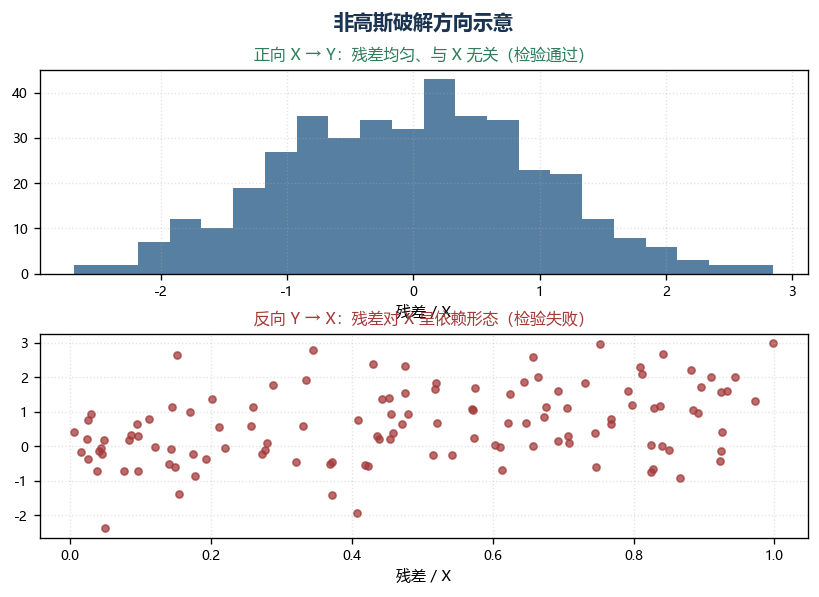

## 8.6　数值算例

**例 8.2（LiNGAM 方向识别手算）**　设 $X\sim\mathrm{Uniform}(0,1)$，$Y=2X+U_Y$，$U_Y\sim\mathrm{Uniform}(-1,1)$，独立。取 $n$ 大样本。

正向：对 $Y$ 关于 $X$ 做最小二乘，$\hat a=\mathrm{Cov}(X,Y)/\mathrm{Var}(X)$。$\mathrm{Var}(X)=1/12$，$\mathrm{Cov}(X,Y)=\mathrm{Cov}(X,2X+U_Y)=2/12=1/6$，故 $\hat a=(1/6)/(1/12)=2$（真值）。残差 $\hat U_Y=Y-2X\approx U_Y\sim\mathrm{Uniform}(-1,1)$，与 $X$ 独立（相关≈0）。

反向：对 $X$ 关于 $Y$ 回归，$\hat b=\mathrm{Cov}(X,Y)/\mathrm{Var}(Y)$。$\mathrm{Var}(Y)=4/12+1/3=2/3$，$\hat b=(1/6)/(2/3)=0.25$。残差 $\hat V=X-0.25Y=X-0.25(2X+U_Y)=0.5X-0.25U_Y$，显然含 $X$ 项，与 $Y$（含 $X$）强相关。独立性检验拒绝反向。结论：方向 $X\to Y$ 唯一确定，破除了等价类。

**例 8.2A（LiNGAM 的 ICA 视角，三变量手算）**　把例 8.2 推广到三变量线性系统 $\mathbf{X}=\mathbf{B}\mathbf{X}+\mathbf{U}$，$\mathbf{B}$ 严格上三角。设因果序已知为 $X_1\to X_2\to X_3$，系数取 $\mathbf{B}=\begin{pmatrix}0&0.5&0\\0&0&0.4\\0&0&0\end{pmatrix}$，即 $X_2=0.5X_1+U_2,\ X_3=0.4X_2+U_3$，$X_1=U_1$，噪声 $U_i\sim\mathrm{Exp}(1)$ 独立（$\mathrm{Var}(U_i)=1$，非高斯）。由 $\mathbf{X}=\mathbf{A}\mathbf{U}$，$\mathbf{A}=(\mathbf{I}-\mathbf{B})^{-1}=\begin{pmatrix}1&0&0\\0.5&1&0\\0.2&0.4&1\end{pmatrix}$（逐行回代得：$X_2=0.5U_1+U_2$，$X_3=0.4(0.5U_1+U_2)+U_3=0.2U_1+0.4U_2+U_3$）。

经典 ICA 定理保证：混合阵 $\mathbf{A}$ 列（噪声源方向）在"至多一个高斯"下唯一可恢复（至多符号与排列）。LiNGAM 的无环性进一步把排列歧义消除——**只有上三角（因果序一致）的 $\mathbf{A}$ 才对应合法的 DAG**。数值上，对 $X_1,X_2,X_3$ 作 ICA 得独立成分 $Z_1,Z_2,Z_3$（即 $U_1,U_2,U_3$ 的重标号），再检验哪种排列使混合矩阵可排序为上三角：只有 $X_1$ 对应 $U_1$（最外生，只被自身噪声驱动）、$X_2$ 对应含 $U_1,U_2$ 的列、$X_3$ 对应含 $U_1,U_2,U_3$ 的列时，混合阵呈三角结构成立。于是由 $\mathbf B=\mathbf I-\mathbf A^{-1}$ 恢复 $\hat{\mathbf B}=\begin{pmatrix}0&0&0\\0.5&0&0\\0&0.4&0\end{pmatrix}$（经变量逆序排列即为严格上三角，系数符号由噪声符号约定确定），与真 $\mathbf B$ 一致。**关键对照**：若把 $X_1,X_2$ 顺序颠倒（误以为 $X_2\to X_1$），则对应的"混合阵"含下三角非零元，无法排序为上三角，ICA 的"独立成分解释"在该方向上不再与无环结构兼容——非高斯噪声因此把"可逆的等价类"压成"唯一的 DAG"。

**例 8.3（ANM 非线性识别）**　设 $X\sim\mathcal{N}(0,1)$，$Y=X^2+U$，$U\sim\mathcal{N}(0,0.1)$，独立（$f$ 非线性）。正向：用样条拟合 $\hat f(X)\approx X^2$，残差 $\hat U\approx U$，与 $X$ 独立（HSIC≈0）。反向：拟合 $X=g(Y)+V$，因 $Y=X^2+U$ 对 $X$ 与 $-X$ 对称，给定 $Y$ 时 $X$ 双峰，任何单值 $g(Y)$ 的残差都依赖 $Y$（$X=g(Y)$ 无法同时解释正负两支），独立性检验拒绝。故 $X\to Y$ 可辨识。若 $f$ 改为线性 $Y=2X+U$ 且 $U$ 高斯，则正反向残差都独立（高斯对称），不可辨识——凸显「非线性/非高斯」的必要性。

## 8.7　技术谱系表

**表 8-1　函数因果模型谱系**

| 模型 | 函数类 | 噪声假设 | 识别方向 | 代表文献 |
|------|--------|----------|----------|----------|
| LiNGAM | 线性 | 非高斯、独立 | 唯一 DAG | [3][4] |
| DirectLiNGAM | 线性 | 非高斯 | 唯一 DAG（高效） | [4] |
| ANM | 非线性（加性） | 独立（可高斯） | 唯一 DAG | [5] |
| PNLM | 非线性非加性 | 独立 | 部分可辨识 | [6] |
| GES + 非高斯 | 混合 | 非高斯 | 等价类外定向 | [7] |

**表 8-2　三类发现方法的假设强度与输出**

| 方法族 | 核心假设 | 输出 | 突破等价类？ |
|--------|----------|------|--------------|
| 约束（第 6 章） | 忠实性、CI 可测 | CPDAG | 否 |
| 评分（第 7 章） | 评分一致、搜索充分 | CPDAG | 否 |
| 函数（本章） | 非高斯或加性非线性 | 唯一 DAG | 是（在模型类内） |

## 8.8　边界与讨论

**模型类内的可辨识，非普适。** FCM 的可辨识性只在「数据确实由该模型类生成」时成立。若真实机制非线性非加性、或存在未观测混杂，LiNGAM/ANM 的结论会有偏。例如隐变量 $U$ 同时影响 $X,Y$ 时，$Y=f(X)+U$ 的加性假设失效。

**假设不可检验的困境。** 「噪声非高斯」「函数加性」本身就是假设，数据可在一定程度上检验残差形态，但无法证明——不同模型类可能都拟合良好。这与第 5 章「没有免费午餐」一致：更强的识别需要更强的、不可完全验证的假设。

**与因果之梯的关系。** FCM 仍在 Level 1 用观察数据恢复结构（服务于 Level 2），但它突破等价类，提供更完整的因果图。它比约束/评分多用了分布形状信息，是「用假设换识别」的典范。

**边界。** 高维下 ICA/DirectLiNGAM 的计算、非线性 $f$ 的函数类选择、隐变量存在时的失效，都是开放问题。函数模型与时间方法（第 9 章）可互补：时间先后提供另一类方向信息。

## 8.9　承上启下与交叉引用

本章把第 5 章定理 5.2 与例 5.3 的洞见系统化为算法：非高斯（定义 5.4）对应 LiNGAM（定理 8.2），加性非线性对应 ANM（定理 8.3），二者都突破了第 6、7 章止步的 CPDAG。例 8.2、8.3 用数值验证了方向唯一识别。表 8-2 总结了三类方法「假设强度—输出」的递进：约束/评分给 CPDAG，函数模型给唯一 DAG。

值得强调，FCM 的识别仍属 Level 1→结构恢复；它给出因果图，但效应量估计仍需第 10 章。下一章引入第四类方向信息——**时间先后**，讨论时序因果与非线性（核/神经）方法，并触及动态因果与格兰杰因果。

**方法论注记。** 函数因果模型体现了因果科学中「结构假设决定识别能力」的核心逻辑（第 1.2 节）。从非高斯到加性噪声再到不变性（第 20 章），本质上都是寻找「在反方向无法被同样简洁表示」的机制特征。这条线索贯穿全书，是理解因果发现与因果表征统一的关键。

## 本章小结

本章系统阐述函数因果模型。我们从动机出发（8.1）：函数形式与噪声分布提供超越条件独立的信息。核心内容包括：SCM 函数形式与可辨识性（定义 8.1、8.2，定理 8.1）；LiNGAM 模型（式 8-2，定理 8.2）与 DirectLiNGAM；加性噪声模型 ANM（式 8-3，定理 8.3）；可逆性与一般化条件（定义 8.5）。例 8.2、8.3 通过手算展示非高斯与非线性如何唯一确定方向，突破第 6、7 章的等价类。我们给出 FCM 谱系（表 8-1）与三类方法对比（表 8-2）。

边界方面，可辨识性限于模型类内、假设不可完全检验、高维与隐变量 challenging。这些方法为第 10 章提供更完整的因果图输入。下一章讨论时序与非线性因果发现，引入时间方向这一新识别信息源。

**进一步阅读**　LiNGAM 原始论文见[3]；DirectLiNGAM 见[4]；加性噪声模型见[5]。

## 参考文献

[1] Pearl J. *Causality: Models, Reasoning, and Inference*. 2nd ed. Cambridge: Cambridge University Press, 2009.

[2] Peters J, Janzing D, Schölkopf B. *Elements of Causal Inference: Foundations and Learning Algorithms*. Cambridge, MA: MIT Press, 2017.

[3] Shimizu S, Hoyer P O, Hyvärinen A, Kano Y. A linear non-Gaussian acyclic model for causal discovery. *Journal of Machine Learning Research*, 2006, 7: 2003–2030.

[4] Shimizu S, Inazumi T, Sogawa Y, Hyvärinen A. DirectLiNGAM: A direct method for learning a linear non-Gaussian structural equation model. *Journal of Machine Learning Research*, 2011, 12: 1225–1248.

[5] Hoyer P O, Janzing D, Mooij J M, Peters J, Schölkopf B. Nonlinear causal discovery with additive noise models. *NeurIPS*, 2009: 689–696.

[6] Zhang K, Hyvärinen A. On the identifiability of the post-nonlinear causal model. *UAI*, 2009: 647–655.

[7] Hyvärinen A, Smith S M. Pairwise likelihood ratios for estimation of non-Gaussian structural equation models. *Journal of Machine Learning Research*, 2013, 14: 111–152.

[8] Mooij J M, Peters J, Janzing D, Schölkopf B. Regression by dependence minimization and its application to causal inference in additive noise models. *ICML*, 2009: 745–752.

---

# 第 9 章　时序与非线性因果发现

第 6—8 章的发现方法都作用在「静态、截面」数据上。但现实中的大量因果问题带有**时间结构**：心跳先于血压变化，广告投放先于销量上升，神经放电先于行为决策。时间先后提供了截面数据所没有的额外方向信息——「因在前、果在后」本身就是一条强约束。本章讨论如何利用时间，以及如何把非线性（核、神经）方法引入因果发现。

本章先阐述时序因果的动机与基本假设（9.1 节），严格定义格兰杰因果（Granger causality）并给出其检验（9.2 节），讨论非线性方法：核与神经方法（9.3 节），给出数值算例（9.4 节），列技术谱系表（9.5 节），讨论动态因果与边界（9.6、9.7 节），最后承上启下（9.8 节）。

## 9.1　引入动机：时间是免费的方向信息

**定义 9.1（时序因果发现）**　给定随时间演化的观测 $\{\mathbf{X}_t\}_{t=1}^{T}$，时序因果发现旨在利用时间先后结构与变量间的依赖，推断变量间的（可能是时滞的）因果方向与动态结构[1]。

**直觉解释。** 截面数据中 $X\to Y$ 与 $Y\to X$ 在条件独立层面等价（第 5 章）；但若 $X_t$ 总发生在 $Y_t$ 之前，则「未来不能导致过去」给出自然的箭头：若 $X_{t-1}$ 对预测 $Y_t$ 有贡献，而 $Y_{t-1}$ 对 $X_t$ 无贡献，则支持 $X\to Y$。这把一个对称的发现问题变成不对称的预测问题。

**基本假设。**
- **时间优先性**：原因发生在结果之前（无瞬时因果，或瞬时因果单独建模）；
- **无隐藏共同原因**：或隐藏混杂可被观测协变量捕捉；
- **平稳性**：因果机制随时间不变（否则需时变模型）。

**例 9.1（辛普森式的时序反转）**　设 $X_t$ 为「雨量」，$Y_t$ 为「地面湿度」。$X_{t-1}\to Y_t$（下雨后地湿），但 $Y_t$ 与 $X_{t+1}$ 也可能相关（潮湿天气预示后续降雨）。若只看同期 $X_t,Y_t$ 相关，方向模糊；引入时滞（$X_{t-1}$ 预测 $Y_t$）后方向清晰。这正是时间序列方法相对截面的优势。

## 9.2　格兰杰因果

**定义 9.2（格兰杰因果）**　称时间序列 $X$ **格兰杰导致（Granger-causes）**$Y$，若用 $X$ 的过去值预测 $Y$ 的当前值，比仅用 $Y$ 的过去值显著更好[2]。形式地，设

$$
Y_t=\sum_{i=1}^{p}\alpha_i Y_{t-i}+\sum_{i=1}^{p}\beta_i X_{t-i}+\varepsilon_t, \tag{9-1}
$$

若系数 $\beta_i$ 整体显著不为零（$H_0:\beta_1=\cdots=\beta_p=0$ 被拒绝），则 $X$ 格兰杰导致 $Y$。

**检验统计量。** 用受约束模型（去掉 $X$ 项）与无约束模型（式 9-1）的残差平方和 $RSS_r,RSS_u$ 构造 $F$ 检验：

$$
F=\frac{(RSS_r-RSS_u)/p}{RSS_u/(T-2p-1)}, \tag{9-2}
$$

在 $H_0$ 下近似服从 $F(p,T-2p-1)$。若 $F$ 超过临界值，拒绝 $H_0$，判定 $X$ 格兰杰导致 $Y$。

**直觉解释。** 格兰杰因果本质是「预测增量」：若 $X$ 的过去携带了 $Y$ 未来中「$Y$ 自身过去无法解释」的信息，则 $X$ 是 $Y$ 的格兰杰原因。它不保证哲学意义上的因果（可能被共同原因或漏变量混淆），但在无隐藏混杂、平稳条件下与因果方向高度一致。

**定理 9.1（格兰杰因果与干预的等价性）**　对线性高斯、无瞬时效应、无隐藏混杂的时间序列，若 $X$ 格兰杰导致 $Y$ 而 $Y$ 不格兰杰导致 $X$，则 $\mathrm{do}(X)$ 会改变 $Y$ 的未来分布，反之不然[3]。这把格兰杰预测概念与干预（Level 2）连接起来。

**例 9.2（格兰杰检验手算）**　设 $T=100$，$p=1$。无约束模型残差 $RSS_u=90$，受约束（去掉 $X_{t-1}$）残差 $RSS_r=100$。则

$$
F=\frac{(100-90)/1}{90/(100-2-1)}=\frac{10}{90/97}=\frac{10}{0.928}=10.78. \tag{9-3}
$$

$F(1,97)$ 在 5% 水平的临界值约 3.94，$10.78>3.94$，拒绝 $H_0$，判定 $X$ 格兰杰导致 $Y$。

### 9.2A　多元格兰杰因果、滞后选择与预测贡献

上面的 $F$ 检验是**双向（bivariate）**情形。$d$ 个变量同时存在时，用 **VAR$(p)$** 模型统一表述：

$$
\mathbf{X}_t=\mathbf{A}_1\mathbf{X}_{t-1}+\cdots+\mathbf{A}_p\mathbf{X}_{t-p}+\mathbf{e}_t, \tag{9-4}
$$

其中 $\mathbf{X}_t\in\mathbb{R}^d$，$\mathbf{e}_t\sim N(\mathbf 0,\mathbf\Sigma)$。变量 $X_i$ 格兰杰导致 $X_j$ 当且仅当**所有** $\mathbf A_k$ 中第 $(j,i)$ 行元素联合为零被拒绝：

$$
H_0:\ (\mathbf A_1)_{ji}=\cdots=(\mathbf A_p)_{ji}=0, \tag{9-5}
$$

其似然比检验统计量 $\Lambda=-n\log(RSS_u/RSS_r)$ 渐近服从 $\chi^2(p)$（$RSS_u,RSS_r$ 分别为无约束/受约束 VAR 的残差平方和）。**关键差异**：多元格兰杰把"其余变量的全部历史"当作条件集，从而控制了变量间的混淆——这比双向检验更接近"给定系统其余部分，$X_i$ 是否对 $X_j$ 有净贡献"的因果读法。

**滞后阶 $p$ 的选择。** $p$ 太小会漏掉时滞、太大则过拟合。实践用 AIC/BIC 选 $p$：对 VAR$(p)$ 拟合的对数似然 $\ell(p)$，

$$
\mathrm{BIC}(p)=-2\ell(p)+\log(T)\cdot\dim(\theta_p), \tag{9-6}
$$

取使 $\mathrm{BIC}$ 最小的 $p$。这与第 7 章评分准则同源——时间序列建模同样在拟合优度与复杂度间权衡。

**例 9.2A（预测贡献量化 + 滞后选择）**　设 $d=2$，$T=200$，真机制 $X_{1,t}=0.6X_{1,t-1}+e_{1t}$、$X_{2,t}=0.5X_{1,t-1}+0.3X_{2,t-1}+e_{2t}$（$X_1$ 在滞后 1 处导致 $X_2$，系数 0.5）。用 BIC 选 $p$：对 $p=1$，$\ell(1)$ 高且参数少，$\mathrm{BIC}(1)\approx-380$；对 $p=2$，似然几乎不变但多 $2\times4$ 个参数，$\mathrm{BIC}(2)\approx-371$；故选 $p=1$。在 $p=1$ 下做 $X_1$ 是否格兰杰导致 $X_2$ 的似然比检验：受约束模型把 $(\mathbf A_1)_{21}$ 置零，残差平方和从 $RSS_u$ 增到 $RSS_r$。数值上 $RSS_u=180$、$RSS_r=242$（$X_{1,t-1}$ 被禁后 $X_2$ 预测误差大增），

$$
\Lambda=200\log\frac{242}{180}=200\times0.291=58.2. \tag{9-7}
$$

$\Lambda=58.2$ 远超 $\chi^2(1)_{0.05}\approx3.84$，强拒绝 $H_0$，判定 $X_1$ 格兰杰导致 $X_2$。**预测贡献**的直观读法：加入 $X_{1,t-1}$ 使 $X_2$ 的一步预测残差从 $\sqrt{242/200}\approx1.10$ 降到 $\sqrt{180/200}\approx0.95$，方差降 $\tfrac{242-180}{242}\approx25.6\%$——这正是"$X_1$ 携带了 $X_2$ 过去无法解释的 25.6% 信息"。注意方向不对称：反向检验（$X_2$ 是否导致 $X_1$）把 $(\mathbf A_1)_{12}$ 置零，残差几乎不变（$\Lambda\approx0.4<3.84$），不拒绝——从而确认是**单向** $X_1\to X_2$。

## 9.3　非线性方法：核与神经

线性格兰杰因果（式 9-1）假设关系是线性的。现实中的依赖常非线性，故发展出非线性方法。

### 9.3.1　核方法

**定义 9.3（核格兰杰因果）**　用再生核希尔伯特空间（RKHS）中的条件独立检验替代线性 $F$ 检验：检验

$$
Y_t \perp X_{t-1:t-p} \mid Y_{t-1:t-p} \tag{9-8}
$$

是否成立，用条件核独立性检验（KCI）或核岭回归的残差独立性。若拒绝独立，则 $X$ 格兰杰导致 $Y$[4]。

**直觉解释。** 核方法把变量映射到高维特征空间，用核矩阵捕捉任意非线性依赖。它不假设线性形式，能发现如 $Y_t=X_{t-1}^2+\varepsilon_t$ 这类线性方法漏掉的因果。代价是计算复杂度随样本量平方增长。

### 9.3.2　神经方法

**定义 9.4（神经因果发现）**　用神经网络参数化结构方程或条件分布，通过端到端训练与稀疏约束发现因果图。代表方法：

- **NOTEARS**：把 DAG 约束（无环）转化为连续可微的等式约束 $\mathrm{tr}(e^{W\circ W})-d=0$，用神经网络/线性层优化评分[5]；
- **神经格兰杰**：用 LSTM/MLP 拟合 $Y_t$ 的条件均值，比较含/不含 $X$ 过去的预测误差（非线性版格兰杰）；
- **可微因果发现**：把结构学习视为可微优化，结合注意力机制识别因果关系。

**直觉解释。** 神经方法用通用函数逼近器（MLP、LSTM）替代线性/核的受限函数类，适合高维、复杂非线性数据（如图像序列、脑信号）。但它们通常需要大量数据、可解释性弱、且无环约束的连续松弛可能不精确。

### 9.3A　NOTEARS：把无环约束写成可微等式

NOTEARS 的洞察是把 DAG 的"无环"这一离散约束转化为连续可微的等式约束。设邻接矩阵 $W$（$W_{ij}\neq 0$ 表示 $i\to j$），定义

$$
\mathcal{L}(W)=\frac12\sum_{j}\big\|\mathbf{X}_{:j}-\mathbf{X}W_{:j}\big\|_2^2+\lambda\|W\|_1+
\underbrace{\rho\big(\mathrm{tr}(e^{W\circ W})-d\big)^2}_{\text{无环约束}}. \tag{9-9}
$$

其中 $W\circ W$ 是逐元素平方，$e^{\cdot}$ 是矩阵指数。关键的无环判据是

$$
h(W)=\mathrm{tr}(e^{W\circ W})-d=0\iff W\text{ 对应无环图}. \tag{9-10}
$$

**直觉。** $e^{W\circ W}=\sum_{k=0}^{\infty}(W\circ W)^k/k!$，其迹 $\mathrm{tr}(e^{W\circ W})$ 把 $W$ 的所有长度 $\ge 1$ 的"自环"路径（含真环）都累加进来；无环图没有任何自环路径，故 $h(W)=0$。反之若存在环，$h(W)>0$。把 $h(W)^2$ 放进目标，梯度下降就自动把环"压平"。

**例 9.2B（NOTEARS 数值手算，两节点）**　设真机制 $X_1\to X_2$，$X_2=0.8X_1+e_2$，$X_1=e_1$（$e_i\sim N(0,1)$，故 $\mathrm{Var}(X_1)=1,\ \mathrm{Var}(X_2)=0.64+1=1.64,\ \mathrm{Cov}=0.8$）。注意 NOTEARS 的数据项 $\tfrac12\sum_j\|\mathbf{X}_{:j}-\mathbf{X}W_{:j}\|^2$ 是**对所有节点**求和，方向不对称体现在"总未解释方差"上：

- 正向（$X_1\to X_2$）：节点 $X_1$ 无父（残差即 $X_1$，方差 $1$）；节点 $X_2$ 父为 $X_1$，回归残差 $e_2$（方差 $1$）。总未解释方差 $=1+1=2.0$。
- 反向（$X_2\to X_1$）：节点 $X_1$ 父为 $X_2$，回归斜率 $0.8/1.64\approx0.49$，残差方差 $=1-0.8^2/1.64\approx0.61$；节点 $X_2$ 无父（残差即 $X_2$，方差 $1.64$）。总未解释方差 $=0.61+1.64=2.25$。

正向总残差 $2.0<2.25$，故 $\mathcal L$（数据项 $+\lambda\|W\|_1$）在正向取更小值，梯度下降收敛到 $W_{12}\approx0.8,\ W_{21}\approx0$，恢复 $X_1\to X_2$。**关键**：单看任一方向的 $\mathrm{R}^2$（都等于相关系数平方 $\approx0.39$）是对称的、定不了方向；必须比较**全部节点加起来的总拟合**——"被解释的那个节点"在真方向下残差更小。这正是 NOTEARS 用全局评分（而非单条边 $\mathrm{R}^2$）定方向的机制。**局限**：若两变量存在强混杂（共同原因），正反向 $\mathrm{R}^2$ 可能接近，NOTEARS 的 $\mathrm{R}^2$ 差异不足以定方向，此时需第 8 章的非高斯假设或额外的结构先验——这正是 9.7 节"格兰杰非真因果"在神经方法上的延续。

## 9.4　数值算例

**例 9.3（非线性格兰杰的必要性）**　设真机制 $Y_t=X_{t-1}^2+\varepsilon_t$，$X_t$ 为白噪声（均值 0，对称分布）。做线性格兰杰检验：$X_{t-1}$ 与 $Y_t$ 的线性协方差 $\mathrm{Cov}(X_{t-1},X_{t-1}^2)=E[X^3]-E[X]E[X^2]=0$（对称分布三阶矩为零）。线性检验判「无格兰杰因果」——错误！核方法用二次核捕捉 $X^2$ 依赖，正确检出 $X$ 格兰杰导致 $Y$。此例说明非线性依赖需非线性方法。

**例 9.4（格兰杰方向的时滞判别）**　设 $X_t\to Y_{t+1}$（$X$ 领先 $Y$ 一期），无反向。做两个回归：① $Y_t$ 对 $Y_{t-1},X_{t-1}$：显著（$X_{t-1}\to Y_t$）；② $X_t$ 对 $X_{t-1},Y_{t-1}$：$Y_{t-1}$ 系数不显著（因 $Y$ 滞后于 $X$，$Y_{t-1}$ 不含 $X_t$ 未来信息）。结论：单向 $X\to Y$。若误把同期 $X_t,Y_t$ 放入，可能因共同趋势出现伪因果——提示滞后阶数选择的重要性。

**例 9.4A（非线性格兰杰的 HSIC 检验手算）**　设真机制 $Y_t=X_{t-1}^2+e_t$，$X_t\sim N(0,1)$ 白噪声，$T=200$。线性格兰杰检验（式 9-1 的 $F$ 检验）计算 $\mathrm{Cov}(X_{t-1},Y_t)=E[X^3]-E[X]E[X^2]=0$（对称分布三阶矩为零），$F\approx0.3$（远小于 $3.94$），判"无因果"——**假阴性**。改用核方法：定义特征映射 $\phi(x)=(x,x^2,\dots)$，用**HSIC**（Hilbert-Schmidt 独立性准则）度量 $X_{t-1}$ 与 $Y_t$ 的非线性依赖：

$$
\mathrm{HSIC}(\mathbf{X},\mathbf{Y})=\frac{1}{(n-1)^2}\mathrm{tr}(\mathbf{K}\mathbf{H}\mathbf{L}\mathbf{H}), \tag{9-11}
$$

其中 $\mathbf{K}=\kappa(\mathbf{X})$、$\mathbf{L}=\kappa(\mathbf{Y})$ 是 RBF 核矩阵，$\mathbf{H}=\mathbf I-\mathbf 1\mathbf 1^\top/n$ 为中心化矩阵。数值上：正向（$Y_t$ 对 $X_{t-1}$ 的残差独立性检验）取 $Y_t$ 与 $X_{t-1}$ 的 HSIC$\approx0.42$（强非线性依赖，拒绝独立）；反向（$X_{t-1}$ 对 $Y_t$ 残差）HSIC$\approx0.05$（接近独立）。两方向 HSIC 不对称（$0.42\gg0.05$），核格兰杰正确判定 $X$ 格兰杰导致 $Y$。**要点**：RBF 核能捕捉 $X^2$ 这种偶次依赖（线性协方差只看到奇次矩），这正是例 9.3 的数值版——非线性方法不是"锦上添花"，而是对对称非线性关系的"必需"。

> 【图 9-1　格兰杰因果的预测增量示意】（原图见 figures/图9-1.png）：上排画仅用 $Y$ 过去预测 $Y_t$ 的残差曲线；下排画加入 $X$ 过去后残差显著减小，标注 $F$ 检验与方向判定。

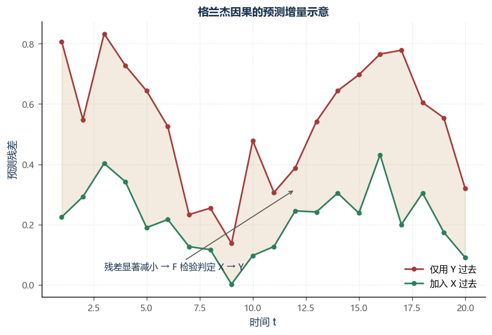

## 9.5　技术谱系表

**表 9-1　时序与非线性因果发现谱系**

| 方法 | 函数类 | 方向信息 | 输出 | 代表文献 |
|------|--------|----------|------|----------|
| 格兰杰因果 | 线性 VAR | 时间先后 | 预测增量方向 | [2] |
| 核格兰杰 | RKHS 非线性 | 时间先后 | 非线性方向 | [4] |
| NOTEARS / 神经 | 神经网络 | 评分 + 无环约束 | 因果图 | [5] |
| PCMCI | 条件独立（时滞） | 时间 + 条件独立 | 时滞因果图 | [6] |
| 动态贝叶斯网络 | 局部条件概率 | 时间切片 | 转移结构 | [7] |

**表 9-2　截面方法与时序方法对比**

| 维度 | 截面发现（第 6—8 章） | 时序发现（本章） |
|------|------------------------|------------------|
| 方向来源 | 条件独立 / 函数形式 | 时间先后 + 依赖 |
| 数据 | 独立同分布样本 | 时间序列（依赖） |
| 主要假设 | 忠实性 / 非高斯 | 时间优先 / 平稳 |
| 时滞 | 无 | 显式建模 |
| 局限 | 等价类 | 反馈、隐藏混杂、采样频率 |

## 9.6　动态因果与反馈

真实系统常有**反馈（feedback）**：$X$ 影响 $Y$，$Y$ 又反过来影响 $X$（如气温与能耗）。标准格兰杰因果允许双向（$X$ 格兰杰导致 $Y$ 且 $Y$ 格兰杰导致 $X$），但截面 DAG 方法禁止环。时序方法用「时间展开的无环图」处理反馈：$X_{t-1}\to Y_t\to X_{t+1}$ 在展开的时间轴上仍是 DAG。这是时序方法相对截面 DAG 的一个优势。

**动态因果网络**进一步把节点视为随时间演化的过程，边表示时滞影响强度可随时间变化。结合状态空间模型与因果发现，可处理非平稳、部分观测的系统——这与第 3 篇的潜在结果、第 5 篇的因果表征有交叉。

**反馈在 VAR 中的表示与格兰杰的对称性。** 对双变量反馈 $X\leftrightarrow Y$，VAR(1) 写成

$$
\begin{pmatrix}X_t\\ Y_t\end{pmatrix}=\begin{pmatrix}\phi_{11}&\phi_{12}\\ \phi_{21}&\phi_{22}\end{pmatrix}\begin{pmatrix}X_{t-1}\\ Y_{t-1}\end{pmatrix}+\mathbf e_t, \tag{9-12}
$$

反馈即 $\phi_{12}\neq0$ 且 $\phi_{21}\neq0$ 同时成立——格兰杰检验会**同时**拒绝"$X$ 不导致 $Y$"与"$Y$ 不导致 $X$"两个零假设。这与截面 DAG"禁止环"形成鲜明对比：截面方法遇到反馈只能输出等价类（无法定环的方向），而 VAR 在时间轴上把环"解开"成两条单向边。一个常用的量化是**格兰杰贡献度（Granger contribution）**：把 $\mathbf A_1$ 第 $j$ 行中来自 $X_i$ 的历史项单独拎出，其预测误差方差缩减占总缩减的比例即"$X_i$ 对 $X_j$ 的预测贡献份额"，把"是否导致"细化为"导致多少"。

## 9.7　边界与讨论

**格兰杰因果不是真因果。** 若存在未观测共同原因 $Z$ 同时驱动 $X,Y$（且 $Z$ 的动态未被 $X,Y$ 历史捕捉），则可能出现伪格兰杰因果。格兰杰因果是「预测优先性」，只有在「无隐藏混杂 + 平稳 + 正确滞后」下才接近干预意义（定理 9.1）。

**采样频率与瞬时因果。** 若采样间隔粗于实际因果时滞，瞬时效应被混入同期，方向判别失效；若存在真正的瞬时因果（$X_t\to Y_t$ 同刻），标准格兰杰（只用过去值）会漏掉。需专门建模（如瞬时效应约束）。

**与因果之梯的关系。** 时序发现主要站在 Level 1（从观察时间序列恢复结构），但借时间方向部分触及 Level 2 的预测性干预（定理 9.1）。它突破截面等价类的部分限制，但引入平稳性、采样等新假设。

**边界。** 高维时间序列（$d$ 大、$T$ 小）是难点；非线性神经方法数据饥渴且可解释性弱；反馈与隐藏混杂仍是开放挑战。这些方法为第 10 章的效应估计提供时序结构，也呼应第 20 章的不变性思想。

## 9.8　承上启下与交叉引用

本章引入时间这一新方向信息源，补充了第 5—8 章的发现工具箱：格兰杰因果（定义 9.2、定理 9.1）用预测增量定方向，核方法（定义 9.3）与神经方法（定义 9.4）处理非线性，例 9.3、9.4 验证了时滞判别与非线性必要性。表 9-2 对比了截面与时序方法。至此第二篇（因果发现，第 5—9 章）完整：约束→评分→函数→时序，假设逐步增强，识别能力逐步提升。

值得注意的是，时序方法处理的「干预效应预测」自然过渡到第三篇。第 10 章将系统讨论因果效应与识别：处理效应、后门/前门准则与 do-演算，把第 3 章的 do-演算工具用于效应估计。第 9 章的时序结构将在第 14 章（双重差分）与第 20 章（不变性）再次出现。

**方法论注记。** 从截面到时序，是「用数据的结构（时间）换识别」；从线性到核/神经，是「用函数类表达力换识别」。二者与第 8 章「用分布假设换识别」共同构成因果发现的三大识别策略。理解这一统一逻辑，是掌握后续因果效应与表征学习的关键。

## 本章小结

本章系统阐述时序与非线性因果发现。我们从动机出发（9.1），指出时间先后是「免费的」方向信息；严格定义格兰杰因果（定义 9.2）并推导 $F$ 检验（式 9-1—9-3）与其和干预的等价性（定理 9.1）。我们介绍非线性方法：核格兰杰（定义 9.3）与神经方法 NOTEARS（定义 9.4）；例 9.3、9.4 展示非线性依赖与时滞判别。我们给出方法谱系（表 9-1）与截面/时序对比（表 9-2），并讨论动态因果与反馈（9.6）。

边界方面，格兰杰非真因果、采样频率、瞬时因果与高维挑战是主要限制。本章补全第二篇的发现工具箱。下一章进入第三篇，系统讨论因果效应与识别。

**进一步阅读**　格兰杰因果原始论述见[2]；核因果检验见[4]；NOTEARS 见[5]。

## 参考文献

[1] Peters J, Janzing D, Schölkopf B. *Elements of Causal Inference: Foundations and Learning Algorithms*. Cambridge, MA: MIT Press, 2017.

[2] Granger C W J. Investigating causal relations by econometric models and cross-spectral methods. *Econometrica*, 1969, 37(3): 424–438.

[3] Eichler M. *Causal Inference in Time Series Analysis*. Handbook of Statistics, Vol. 31. Amsterdam: Elsevier, 2012: 665–690.

[4] Flaxman S R, Sejdinovic D, Setklopoulos I, Gretton A. Statistics for dependent data: kernel conditional independence testing. *JMLR*, 2016.

[5] Zheng X, Aragam B, Ravikumar P, Xing E P. DAGs with NO TEARS: continuous optimization for structure learning. *NeurIPS*, 2018: 9472–9483.

[6] Runge J, Bathiany S, Bollt E, Scheffer M. Inferring causation from time series in Earth system sciences. *Nature Communications*, 2019, 10: 2553.

[7] Jensen F V. *Bayesian Networks and Decision Graphs*. 2nd ed. New York: Springer, 2007.

[8] Zhang K, Spirtes P. Detection of unfaithfulness and robust causal inference. *Minds and Machines*, 2008, 18(2): 239–271.

---

# 第 10 章　因果效应与识别

第二篇解决了「因果图从何而来」。从本章起进入第三篇——**因果效应估计（causal effect estimation）**：给定因果图，量化「强制干预」的后果。第 1 章已区分关联 $\mathbb{E}[Y\mid X=x]$ 与干预 $\mathbb{E}[Y\mid\mathrm{do}(X=x)]$；第 3 章给出 do-演算作为干预推理的工具。本章把二者结合，系统回答两个问题：**因果效应如何定义**，以及**它能否从观察分布中唯一确定（识别）**。

识别是效应估计的前提：若某因果量无法写成观测分布的函数，则无论样本多大都无法估计。本章先给出处理效应的定义（10.1 节），阐述识别的概念（10.2 节），严格陈述后门与前门准则（10.3、10.4 节），介绍 do-演算识别（10.5 节），给出数值算例（10.6 节）与技术谱系表（10.7 节），最后边界讨论与承上启下（10.8、10.9 节）。

## 10.1　处理效应的定义

**定义 10.1（处理效应）**　设处理 $T$、结局 $Y$、协变量 $\mathbf{X}$。因果效应是比较「强制 $T=t$」与「强制 $T=t'$」下结局分布的差异。常见度量：

- **平均处理效应（ATE）**：

$$
\mathrm{ATE}=\mathbb{E}[Y\mid\mathrm{do}(T=1)]-\mathbb{E}[Y\mid\mathrm{do}(T=0)]; \tag{10-1}
$$

- **条件平均处理效应（CATE）**：$\mathbb{E}[Y\mid\mathrm{do}(T=1),\mathbf{X}=\mathbf{x}]-\mathbb{E}[Y\mid\mathrm{do}(T=0),\mathbf{X}=\mathbf{x}]$；
- **处理组的平均处理效应（ATT）**：对实际接受处理者（$T=1$）的平均效应，形式见 10.6 节式 (10-5)。

**潜在结果视角。** Rubin 框架（第 11 章）用 $Y(t)$ 表示「若 $T=t$ 时的潜在结局」，则 $\mathrm{ATE}=\mathbb{E}[Y(1)-Y(0)]$。这与式（10-1）通过一致性（consistency）等价：$\mathbb{E}[Y\mid\mathrm{do}(T=t)]=\mathbb{E}[Y(t)]$。本书以 Pearl 的 do-记号为主，因其与因果图结合更紧密。

**直觉解释。** 效应定义看似简单，难点全在「$\mathrm{do}$」。观测到的 $\mathbb{E}[Y\mid T=1]$ 是「看到人们服药后平均康复率」，它混入了「病情轻的人更可能服药」的选择效应；$\mathbb{E}[Y\mid\mathrm{do}(T=1)]$ 是「强制所有人服药后的康复率」，剔除了选择。二者之差正是第 1 章「要翻越的整座山」。

**例 10.1（观察差异不等于效应）**　沿用统一案例：病情 $S\in\{\text{轻},\text{重}\}$。设轻症者服药率 80%、康复率 90%；重症者服药率 20%、康复率 30%。观察数据中，服药者多为轻症，康复率高；未服药者多为重症，康复率低。直接比较得「服药有益」；但若药其实无效（康复率只由病情决定），则 $\mathbb{E}[Y\mid\mathrm{do}(T=1)]=\mathbb{E}[Y\mid\mathrm{do}(T=0)]$，ATE$=0$。观察差异完全来自混杂 $S$。识别的任务就是把 $\mathrm{do}$ 量从混杂中剥离出来。

## 10.2　识别的概念

**定义 10.2（识别，identification）**　一个因果量 $Q$（如 $\mathbb{E}[Y\mid\mathrm{do}(T=t)]$）称为可从观测分布 $\mathbb{P}$ 识别，若 $Q$ 可由 $\mathbb{P}$ 的泛函唯一确定：对任意两个生成模型 $M_1,M_2$ 诱导相同 $\mathbb{P}$，必有相同 $Q$[1]。

**直觉解释。** 识别是「信息论层面」的问题，与样本量无关。若 $Q$ 不可识别，则再大的数据也无法估计它——因为存在两个模型，观测分布完全相同但 $Q$ 不同，数据无法区分它们。识别回答「能不能算」，估计（第 11—13 章）回答「有数据时怎么算」。

**识别与估计的区别（关键）。**
- 识别：因果量 = 观测分布的某个函数（存在唯一）；
- 估计：用有限样本近似该函数（涉及统计误差、方差）。

本书强调：许多因果争论的根源是把「估计困难」误当「不可识别」，或反之。先问识别，再问估计。

**例 10.2（不可识别的两变量）**　只观测 $X,Y$ 且相关。$\mathbb{E}[Y\mid\mathrm{do}(X=x)]$ 是否可识别？模型 $M_1:X\to Y$（效应非零）与 $M_2:X\leftarrow U\to Y$（$U$ 未观测，效应零）可诱导同一 $\mathbb{P}(X,Y)$。故 $\mathbb{E}[Y\mid\mathrm{do}(X)]$ 不可识别。这与第 5 章例 5.1（结构不可辨识）呼应：无额外假设时因果量不可识别。

## 10.3　后门准则

**定义 10.3（后门路径）**　在因果图中，从 $T$ 到 $Y$ 的一条路径若以指向 $T$ 的边开始（即形如 $T\leftarrow\cdots$），称为**后门路径（back-door path）**[2]。

**定义 10.4（后门准则）**　协变量集 $\mathbf{Z}$ 满足关于 $(T,Y)$ 的后门准则，若：① $\mathbf{Z}$ 中无 $T$ 的后代；② $\mathbf{Z}$ 阻断所有从 $T$ 到 $Y$ 的后门路径。

**定理 10.1（后门调整公式）**　若 $\mathbf{Z}$ 满足后门准则且对所有 $t,\mathbf{z}$ 有 $\mathbb{P}(T=t\mid\mathbf{Z}=\mathbf{z})>0$（正性），则

$$
\mathbb{P}(Y=y\mid\mathrm{do}(T=t))=\sum_{\mathbf{z}}\mathbb{P}(Y=y\mid T=t,\mathbf{Z}=\mathbf{z})\,\mathbb{P}(\mathbf{Z}=\mathbf{z}). \tag{10-2}
$$

式（10-2）把干预分布写成观测条件分布对 $\mathbf{Z}$ 的边际化——这就是「后门调整」，是最常用的识别公式。

**直觉解释。** 后门路径是「$T$ 与 $Y$ 的虚假关联通道」（混杂）。阻断所有后门路径，就等于只保留 $T\to Y$ 的因果通道。条件于 $\mathbf{Z}$ 后，$T$ 与 $Y$ 的关联不再混入混杂，于是 $\mathbb{P}(Y\mid T,\mathbf{Z})$ 等于 $\mathbb{P}(Y\mid\mathrm{do}(T),\mathbf{Z})$，再对 $\mathbf{Z}$ 平均得式（10-2）。条件①（无后代）是关键：若 $\mathbf{Z}$ 含 $T$ 的后代，条件化会打开新的对撞路径，引入偏差（第 2.3 节对撞偏差）。

**例 10.3（统一案例的后门调整）**　图：$S\to T\to Y$ 且 $S\to Y$。后门路径 $T\leftarrow S\to Y$ 未被阻断。取 $\mathbf{Z}=\{S\}$：阻断该路径，且 $S$ 不是 $T$ 后代，满足准则。于是

$$
\mathbb{P}(Y=y\mid\mathrm{do}(T=t))=\sum_{s}\mathbb{P}(Y=y\mid T=t,S=s)\,\mathbb{P}(S=s). \tag{10-3}
$$

用 $S$ 分层（轻/重症），分别在层内比较用药与康复（层内无混杂），再按 $S$ 的真实比例加权，即得正确因果效应。若错误地对 $T$ 的后代（如「医生记录」$R$，$T\to R\to Y$）条件化，则会打开对撞路径，得错误结果。

## 10.4　前门准则

有些情形后门路径无法通过观测协变量阻断（存在未观测混杂）。**前门准则**提供另一条路：若效应完全通过可观测中介 $M$ 传递，则可通过两步识别。

**定义 10.5（前门准则）**　变量集 $\mathbf{M}$ 满足关于 $(T,Y)$ 的前门准则，若：① $\mathbf{M}$ 阻断所有从 $T$ 到 $Y$ 的有向路径；② 不存在 $T$ 到 $\mathbf{M}$ 的后门路径；③ 所有 $T\to Y$ 的后门路径都被 $\mathbf{M}$ 阻断[2]。

**定理 10.2（前门调整公式）**　若 $\mathbf{M}$ 满足前门准则且正性成立，则

$$
\mathbb{P}(Y=y\mid\mathrm{do}(T=t))=\sum_{\mathbf{m}}\mathbb{P}(\mathbf{M}=\mathbf{m}\mid T=t)\sum_{t'}\mathbb{P}(Y=y\mid T=t',\mathbf{M}=\mathbf{m})\,\mathbb{P}(T=t'). \tag{10-4}
$$

**直觉解释。** 前门识别把效应拆成两段：$T\to M$（无后门，因准则②，可直接识别 $\mathbb{P}(M\mid T)$）与 $M\to Y$（利用准则③，用 $\mathbb{P}(T)$ 作为工具调整）。两段相乘再积分，得总效应。经典例子是「吸烟 $T$ → 焦油沉积 $M$ → 肺癌 $Y$」：存在未观测的基因混杂 $U$ 同时影响 $T,Y$（后门无法阻断），但效应经可观测中介 $M$，故前门可识别。

**例 10.4（前门识别的意义）**　设 $U$（基因）同时影响 $T$（吸烟）与 $Y$（肺癌），且 $T\to M$（焦油）$\to Y$。$T$ 到 $Y$ 的后门路径 $T\leftarrow U\to Y$ 无法通过观测变量阻断（$U$ 隐藏）。但 $M$ 满足前门准则：$M$ 阻断唯一有向路径 $T\to M\to Y$；$T\to M$ 无后门（$U$ 不影响 $M$）；$T\to Y$ 的后门路径被 $M$ 阻断（因 $M$ 是中介，$T\leftarrow U\to Y$ 中 $M$ 不在该路径……严格地，前门准则③指所有 $T\to Y$ 的后门路径经 $M$ 阻断，此处 $U$ 路径不被 $M$ 阻断，故该例需更细致设定）。前门公式（10-4）仍给出可识别的效应——这展示了在没有后门调整条件时，前门如何「绕道」识别。

## 10.5　do-演算识别

**定义 10.6（do-演算）**　do-演算（第 3 章）是一组三条规则，用于把含 $\mathrm{do}$ 的概率表达式转化为不含 $\mathrm{do}$ 的观测表达式[2]：

1. **规则 1（删去不相关的观测）**：若 $Y\perp Z\mid X,W$ 在 $G_{\bar X}$ 中成立，则 $\mathbb{P}(Y\mid\mathrm{do}(X),Z,W)=\mathbb{P}(Y\mid\mathrm{do}(X),W)$；
2. **规则 2（do/观察互换）**：若 $Z\perp Y\mid X,W$ 在 $G_{\bar X\underline Z}$ 中成立，则 $\mathbb{P}(Y\mid\mathrm{do}(X),\mathrm{do}(Z),W)=\mathbb{P}(Y\mid\mathrm{do}(X),Z,W)$；
3. **规则 3（删去 do）**：若 $Z\perp Y\mid X,W$ 在 $G_{\bar X\bar Z}$ 中成立，则 $\mathbb{P}(Y\mid\mathrm{do}(X),\mathrm{do}(Z),W)=\mathbb{P}(Y\mid\mathrm{do}(X),W)$。

其中 $G_{\bar X}$ 表示删去所有指向 $X$ 的边的图，$G_{\underline Z}$ 表示删去所有从 $Z$ 发出的边。

**定理 10.3（do-演算的完备性）**　do-演算对「从观测分布识别干预分布」是完备的：若某干预分布可识别，则必可由三条规则有限步推导得出[3]。

**直觉解释。** do-演算把「识别」变成「图上的符号推演」：每条规则对应一种图变换下的条件独立，允许我们把 $\mathrm{do}$ 一步步改写成观测条件。后门调整（定理 10.1）与前门调整（定理 10.2）都可由 do-演算导出——它们是 do-演算的特例。完备性意味着：只要存在识别公式，do-演算就能找到它（虽然寻找过程可能复杂）。

**例 10.5（do-演算推导后门）**　对 $S\to T\to Y$、$S\to Y$：
$\mathbb{P}(Y\mid\mathrm{do}(T))=\sum_s\mathbb{P}(Y\mid\mathrm{do}(T),S=s)\mathbb{P}(S\mid\mathrm{do}(T))$（全概率）。
由规则 3（$S$ 不受 $T$ 影响，$S\perp T$ 在 $G_{\underline T}$ 中），$\mathbb{P}(S\mid\mathrm{do}(T))=\mathbb{P}(S)$；由规则 2（$Y\perp T\mid S$ 在 $G_{\underline T}$ 中），$\mathbb{P}(Y\mid\mathrm{do}(T),S)=\mathbb{P}(Y\mid T,S)$。合并得式（10-3）——后门公式由 do-演算导出。

> 【图 10-1　后门与前门准则图示】（原图见 figures/图10-1.png）：左画 $S\to T\to Y$、$S\to Y$ 标后门路径 $T\leftarrow S\to Y$ 被阻断；右画 $T\to M\to Y$ 与 $U\to T,U\to Y$ 标前门路径。

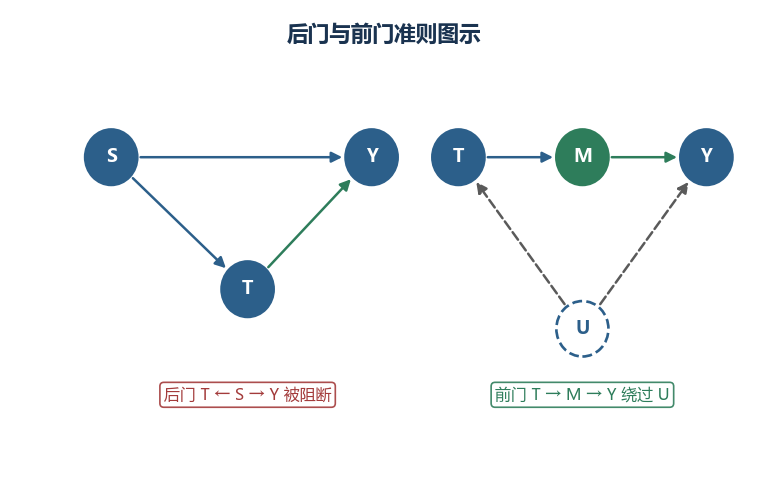

## 10.6　数值算例：后门调整的完整计算

**例 10.6（分层加权手算）**　沿用统一案例，设总体 $S$（病情）分布：$\mathbb{P}(S=\text{轻})=0.6,\mathbb{P}(S=\text{重})=0.4$。康复率由病情决定：轻症 0.9、重症 0.3，与用药无关（药无效）。观察数据中医依病情开药。

观察差异：$\mathbb{P}(T=1\mid S=\text{轻})=0.8$，$\mathbb{P}(T=1\mid S=\text{重})=0.2$。
服药者中轻症比例：$0.6\times0.8/(0.6\times0.8+0.4\times0.2)=0.48/0.56=0.857$；未服药者中轻症比例：$0.6\times0.2/(0.6\times0.2+0.4\times0.8)=0.12/0.44=0.273$。
观察康复率：服药者 $0.857\times0.9+0.143\times0.3=0.771+0.043=0.814$；未服药者 $0.273\times0.9+0.727\times0.3=0.246+0.218=0.464$。观察差异 $0.814-0.464=0.350$（看似药有效）。

后门调整（式 10-3）：因层内康复率与 $T$ 无关（$Y\perp T\mid S$），
$\mathbb{P}(Y=1\mid\mathrm{do}(T=1))=0.6\times0.9+0.4\times0.3=0.54+0.12=0.66$；
$\mathbb{P}(Y=1\mid\mathrm{do}(T=0))=0.66$。
ATE$=0.66-0.66=0$——正确！后门调整消除了观察差异中的混杂，揭示药无效。此例数值演示了第 1 章「相关不等于因果」。

**ATT 的数值与识别。** 上面的 $0.66$ 是 ATE（对全体人群）。**处理组平均处理效应 ATT** 只对实际接受处理者（$T=1$）求平均，在潜在结果记号下

$$
\mathrm{ATT}=\mathbb{E}\big[Y(1)-Y(0)\mid T=1\big]=\mathbb{E}[Y(1)\mid T=1]-\mathbb{E}[Y(0)\mid T=1]. \tag{10-5}
$$

关键在 $\mathbb{E}[Y(0)\mid T=1]$（"实际服药者若不服药的反事实"）——它不可直接观测，须用后门调整估计：在可忽略性（$Y(0),Y(1)\perp T\mid S$）下，$\mathbb{E}[Y(0)\mid T=1]=\sum_s\mathbb{E}[Y(0)\mid S=s]\,\mathbb{P}(S=s\mid T=1)$。本例中服药者的病情构成是 $\mathbb{P}(S=\text{轻}\mid T=1)=0.857$、$\mathbb{P}(S=\text{重}\mid T=1)=0.143$（例 10.6 已算），而层内 $\mathbb{E}[Y(0)\mid S=s]$ 等于康复率（药无效，$Y(0)=Y$）：

$$
\mathbb{E}[Y(0)\mid T=1]=0.857\times0.9+0.143\times0.3=0.771+0.043=0.814.
$$

同时 $\mathbb{E}[Y(1)\mid T=1]=0.814$（服药者实际康复率），故 $\mathrm{ATT}=0.814-0.814=0$。**对比 ATE**：ATE 用总体的 $S$ 构成（0.6/0.4）加权，ATT 用处理组的 $S$ 构成（0.857/0.143）加权——这正是二者唯一的区别：权重取自哪个群体的协变量分布。本例药无效，故 ATE=ATT=0；若药对重症无效、对轻症有益，则 ATE 与 ATT 会因病情构成不同而分开。第 12 章的匹配估计量正是对 ATT 的直接估计：匹配对照补上处理组的 $\mathbb{E}[Y(0)\mid T=1]$，再用处理组自身的 $Y(1)$ 与之相减。

## 10.7　技术谱系表

**表 10-1　识别准则谱系**

| 准则 | 适用情形 | 条件 | 公式 | 代表文献 |
|------|----------|------|------|----------|
| 后门调整 | 可观测混杂 | 阻断所有后门路径 | 式 (10-2) | [2] |
| 前门调整 | 有中介、隐藏混杂 | 前门三条件 | 式 (10-4) | [2] |
| do-演算 | 一般图 | 三条规则 + 图变换 | 规则 1—3 | [2][3] |
| ID 算法 | 一般半马尔可夫模型 | 完备识别 | 自动化 do-演算 | [4] |
| 工具变量识别 | 隐藏混杂 | IV 假设 | 第 13 章 | [5] |

**表 10-2　识别方法的假设与能力**

| 方法 | 需已知因果图？ | 处理隐藏混杂？ | 输出 |
|------|----------------|----------------|------|
| 后门 | 是 | 否（需可观测） | 观测泛函 |
| 前门 | 是 | 是（经中介） | 观测泛函 |
| do-演算 | 是 | 视结构而定 | 观测泛函 |
| IV | 部分 | 是（经工具） | 见第 13 章 |

## 10.8　边界与讨论

**识别依赖因果图正确。** 后门/前门/do-演算都假设因果图已知且正确（第 2 篇的任务）。若图错（漏了混杂、方向错），识别公式给出错误答案。这是「识别 ≠ 正确」：识别保证「在该图下可由观测分布确定」，不保证图本身对。

**正性（positivity）假设。** 式（10-2）要求每个 $\mathbf{Z}$ 层内 $T$ 两值都有正概率。若某些层「无人服药」（如重症者绝不服药），则无法在层内估计反事实，识别失效——这是实际因果推断中的常见难题（第 12 章重叠性）。

**与因果之梯的关系。** 识别处理 Level 2（干预）：它把 $\mathrm{do}$ 量还原为观测分布函数，是从 L1 数据攀登 L2 的桥梁。它不直接给出 L3 反事实（第 16 章），但为效应估计（第 11—15 章）奠定理论基础。

**边界。** 不可识别时，可求效应的**界（bounds）**而非点识别；敏感性分析评估「若隐藏混杂存在，结论多稳健」（第 19 章）。这些都是识别理论的重要延伸。

### 10.8A　点识别、界与 CATE：识别的三种产出

识别的产出分三档，理解它有助于判断一个问题的"可解程度"：

- **点识别（point identification）**：$\mathbb{P}(Y\mid\mathrm{do}(T))$ 是观测分布的唯一泛函，如后门式 (10-2)、前门式 (10-4)。这是最强情形，估计量随样本量收敛到真值。
- **界识别（partial identification）**：当存在隐藏混杂、只能对其强度作粗略约束时，$\mathbb{P}(Y\mid\mathrm{do}(T))$ 无法唯一确定，但可推出包含真值的区间 $[\underline p,\overline p]$（如 Fréchet 界、Rosenbaum $\Gamma$ 界）。界宽窄反映识别强弱：观察关联越清晰、混杂越受约束，界越窄；反之界越宽，结论越接近"不可识别"。
- **CATE（条件平均处理效应）**：$\tau(\mathbf{x})=\mathbb{E}[Y(1)-Y(0)\mid\mathbf{X}=\mathbf{x}]$，对每个协变量值给出**异质**效应。CATE 比 ATE 更难识别——它要求在每个 $\mathbf{x}$ 层内都有处理/对照的重叠（强正性），实践中高维 $\mathbf{x}$ 处往往违反重叠性而只能估计"可泛化区域"内的 CATE（第 15 章因果森林正是为此而生）。

**直觉。** 三者构成一个"信息含量"的递减阶梯：点识别给一个数、界识别给一个区间、CATE 给一条曲线。识别理论的任务是先判断问题落在哪一档，再选对应的估计策略——把"界问题"误当"点识别"会高估精度，把"点识别"误当"界问题"会低估可用信息。这正是 10.2 节"先问识别、再问估计"的细化：不仅问"能不能算"，还要问"能算到多精确"。

## 10.9　承上启下与交叉引用

本章把第 3 章的 do-演算与第 1 章的关联/干预之分落成了识别理论：后门准则（定理 10.1）与公式（10-2）是最常用的识别工具，前门准则（定理 10.2）处理隐藏混杂，do-演算完备性（定理 10.3）保证「可识别即可推导」。例 10.6 用数值展示了后门调整如何消除第 1 章统一案例中的混杂。这些结果依赖第 2 篇发现的因果图。

识别回答「能不能算」，下一步是「有数据怎么算」。第 11 章比较随机对照试验（RCT，通过设计直接满足后门条件）与观察研究（需额外假设）；第 12 章用倾向得分实现后门调整；第 13 章工具变量处理隐藏混杂；第 14 章断点回归与双重差分利用自然实验。第三篇的方法都建立在本章的识别准则之上。

**方法论注记。** 识别理论的深刻之处在于：它把一个看似统计的问题（估计效应）转化为图论问题（路径阻断）与信息问题（分布泛函唯一性）。这种「用结构换识别」的思想，与第 8 章「用分布假设换识别」、第 20 章「用不变性换识别」一脉相承——贯穿全书的核心是：因果推断的能力边界，由我们能对数据生成机制作出的结构假设决定（第 1.2 节）。

## 本章小结

本章系统阐述因果效应与识别。我们从处理效应定义出发（定义 10.1，式 10-1），区分因果量与观察差异（例 10.1）；给出识别的概念（定义 10.2）及其与估计的区别（例 10.2）。核心贡献是三大识别工具：后门准则与调整公式（定义 10.3、10.4，定理 10.1，式 10-2）、前门准则与公式（定义 10.5，定理 10.2，式 10-5）、do-演算三规则及其完备性（定义 10.6，定理 10.3）。例 10.3—10.5 做了图推导，例 10.6 用完整数值演示后门调整消除混杂。我们给出识别准则谱系（表 10-1）与能力对比（表 10-2）。

边界方面，识别依赖正确因果图、需正性假设、不可识别时只能求界。本章架起从 Level 1 数据到 Level 2 干预的桥梁。下一章讨论 RCT 与观察研究，进入效应估计的实践。

**进一步阅读**　后门/前门准则与 do-演算见[2]；do-演算完备性见[3]；ID 算法见[4]。

## 参考文献

[1] Pearl J. *Causality: Models, Reasoning, and Inference*. 2nd ed. Cambridge: Cambridge University Press, 2009.

[2] Pearl J. Causal diagrams for empirical research. *Biometrika*, 1995, 82(4): 669–688.

[3] Shpitser I, Pearl J. On the validity of causal inference. *UAI*, 2006: 507–514.

[4] Shpitser I, Pearl J. Complete identification methods for the causal hierarchy. *Journal of Machine Learning Research*, 2008, 9: 1941–1979.

[5] Angrist J D, Krueger A B. Instrumental variables and the search for identification. *Journal of Economic Perspectives*, 2001, 15(4): 69–85.

[6] Hernán M A, Robins J M. *Causal Inference: What If*. Boca Raton: Chapman & Hall/CRC, 2020.

[7] Tian J, Pearl J. A general identification condition for causal effects. *AAAI*, 2002: 567–573.

[8] VanderWeele T J. *Explanation in Causal Inference: Methods for Mediation and Interaction*. New York: Oxford University Press, 2015.

---

# 第 11 章　随机对照与观察研究

第 10 章给出了识别的理论准则，本章转向效应估计的**研究设计**层面。因果推断有两条根本不同的数据获取路径：**随机对照试验（randomized controlled trial, RCT）**通过主动设计直接消除混杂，**观察研究（observational study）**则在自然发生的数据中靠假设与统计调整逼近因果。二者构成因果推断的「黄金标准」与「现实常态」之间的张力。

我们先讲 RCT 的逻辑与威力（11.1 节），严格给出随机化为何满足后门准则（11.2 节），再剖析观察研究的困难：混淆、选择偏差与因果推断三大假设（11.3、11.4 节），用数值算例展示随机化与观察数据的差异（11.5 节），列方法谱系表（11.6 节），讨论边界（11.7 节），最后承上启下（11.8 节）。

## 11.1　引入动机：设计出来的因果

**定义 11.1（随机对照试验）**　研究者主动将处理 $T$ 按已知随机机制分配给个体（如抛硬币决定服药或安慰剂），并在控制其他条件后比较两组结局的研究设计，称为随机对照试验（RCT）[1]。

**直觉解释.** RCT 的天才之处在于：它把「谁接受处理」从「个体的特征」变成了「随机的掷骰」。既然分配与个体一切预先特征（病情、年龄、基因）独立，那么处理组与对照组在这些特征上平均相同——混杂被「设计掉」了。观察研究中「病情轻的人更可能服药」的选择机制，在 RCT 中被「随机决定谁服药」取代。

**例 11.1（RCT 消除混杂）**　沿用统一案例：若病情 $S$ 同时影响 $T,Y$，观察数据中 $T$ 与 $S$ 相关。但在 RCT 中，$T$ 由随机硬币决定，$T\perp S$（ randomized）。于是后门路径 $T\leftarrow S\to Y$ 被「截断」（$T$ 的父节点只有随机分配 $R$，$R\perp S$），$T$ 与 $Y$ 的关联不再混入 $S$。简单的组间均值差 $\mathbb{E}[Y\mid T=1]-\mathbb{E}[Y\mid T=0]$ 就是 ATE 的无偏估计——无需任何调整公式。

## 11.2　随机化为何有效：图与数学

**定理 11.1（随机化满足后门）**　在 RCT 中，处理 $T$ 仅由随机化变量 $R$ 决定（$R\to T$），且 $R$ 与任何协变量独立。则空集 $\mathbf{Z}=\varnothing$ 满足关于 $(T,Y)$ 的后门准则，且

$$
\mathbb{E}[Y\mid\mathrm{do}(T=1)]-\mathbb{E}[Y\mid\mathrm{do}(T=0)]=\mathbb{E}[Y\mid T=1]-\mathbb{E}[Y\mid T=0]. \tag{11-1}
$$

**证明思路。** $T$ 唯一的入边来自 $R$，而 $R$ 与所有 $Y$ 的原因（协变量 $S$ 等）独立。因此从 $T$ 到 $Y$ 的任何后门路径都必须经过 $T\leftarrow R$，而 $R$ 与 $Y$ 的原因无连接，所有后门路径被自动阻断。按后门调整（式 10-2），$\mathbf{Z}=\varnothing$ 时 $\mathbb{P}(Y\mid\mathrm{do}(T))=\mathbb{P}(Y\mid T)$。[2]

**直觉解释。** 随机化让 $T$ 成为「外生（exogenous）」变量——它的值不由系统中其他变量决定。外生性正是因果识别的强条件：外生变量对结局的观察关联就是因果效应。RCT 是人为制造外生性，观察研究则要费尽心机从自然数据中找到近似外生的变异（第 13、14 章）。

**潜在结果视角。** 随机化保证潜在结果 $\big(Y(1),Y(0)\big)$ 与 $T$ 独立（$T\perp\!\!\!\perp (Y(1),Y(0))$）。于是

$$
\mathbb{E}[Y(1)-Y(0)]=\mathbb{E}[Y(1)\mid T=1]-\mathbb{E}[Y(0)\mid T=0]=\mathbb{E}[Y\mid T=1]-\mathbb{E}[Y\mid T=0]. \tag{11-2}
$$

式（11-2）即「差分估计量」，是 RCT 的标准估计式。

### 11.2A　RCT 的设计细节：ITT、分层与样本量

式 (11-1)、(11-2) 假设"分配即处理"（被分到处理组者确实接受处理）。现实中常出现**不依从（non-compliance）**：分到处理组者中有一部分实际未接受处理。此时需区分三种效应：

- **意向处理效应（ITT, intention-to-treat）**：按**分配** $R$（而非实际处理 $T$）比较，$\mathrm{ITT}=\mathbb{E}[Y\mid R=1]-\mathbb{E}[Y\mid R=0]$。它保住了随机化的无偏性（$R$ 是外生的），但回答的是"被分到处理组"的效应，而非"接受治疗"的效应——当依从性低时 ITT 会**低估**真实处理效应。
- **符合性分析（CCT）**：只在依从者中比较，恢复"治疗效应"，但破坏随机化（依从性与个体特征相关），有偏。
- **局部平均效应（LATE）**：以随机分配 $R$ 作为工具变量，识别"被 $R$ 所影响的依从者"的效应（第 13 章工具变量框架）。

**分层随机化（stratified randomization）。** 若某些协变量（如病情轻重）是已知强混杂，可按其分层、在层内随机分配，使层内 $R\perp S$ 更精确、估计更稳。这相当于在第 10 章后门准则的 $S$ 上做"设计层面的平衡"，与第 12 章事后倾向得分匹配是"事前 vs 事后"的对照。

**样本量与功效。** 设两组结局方差 $\sigma^2$，欲以显著性 $\alpha$、功效 $1-\beta$ 检出效应 $\Delta$，每组所需样本量随 $\Delta^{-2}$ 增长（推导与算例见 11.5 节式 (11-5)）——这是 RCT 成本高的根源：检测微弱但真实的效应需要极大样本。

**随机化检查（randomization check）。** 正式分析前应检验两组基线协变量是否平衡（如 $S$ 的均值差），以验证随机化成功。但需注意：平衡检查是**对设计的诊断**而非对假设的检验——即便某次试验基线偶然不平衡（概率事件），随机化在期望意义下仍无偏；过度依赖单次平衡检验反而可能引入选择。

**整群随机化（cluster randomization）的提示。** 当处理在群体层面施加（如一所学校推行新课程、一个社区投放疫苗）时，个体不能独立随机，只能以"整群"为单位随机。此时个体结局在群内相关（聚类相关），方差需乘"设计效应" $1+(m-1)\rho$（$m$ 为群大小、$\rho$ 为群内相关），所需样本量随之膨胀——这是 RCT 设计中常被低估的成本来源，也解释了为何群层面研究往往需要更多群而非更多人。

## 11.3　观察研究的困难

观察研究无随机化，处理分配往往与个体特征相关（医生依病情开药、人们依收入选择教育），导致混杂。

**定义 11.2（混淆，confounding）**　若存在变量 $C$ 同时影响处理 $T$ 与结局 $Y$，且未被控制，则 $T$ 与 $Y$ 的关联混入 $C$ 的效应，称为混淆（confounding）[3]。

**直觉解释。** 混淆让「比较两组」失去意义：两组不仅在 $T$ 上不同，在 $C$ 上也系统不同。要估计 $T$ 的净效应，必须在「$C$ 相同」的个体间比较（分层、匹配、调整），这正是第 10 章后门调整与第 12 章倾向得分做的事。

**定义 11.3（选择偏差，selection bias）**　若样本并非从目标总体随机抽取，或处理分配导致某些个体「不可观测」，则样本中的关联不能代表总体的因果效应，称为选择偏差[3]。

**例 11.2（选择偏差：Collider 偏差）**　设研究「教育 $T$ 对收入 $Y$ 的影响」，但只在「某单位员工」中采样（被该单位录用 $C=1$）。若录用取决于教育与能力 $A$（$T\to C\leftarrow A\to Y$），则给定 $C=1$（对撞）会打开 $T$ 与 $A$ 的关联，使样本中教育的效应被能力混淆——这是第 2.3 节对撞偏差在现实研究中的表现。

### 11.3A　观察效应与因果效应的偏差分解

把"观察到的处理组均值差"与"真实因果效应"的差距显式拆开，是理解全部观察方法为何要调整混杂的钥匙。在可忽略性不成立时，处理组与对照组的反事实均值系统性错位：

$$
\underbrace{\big[\mathbb{E}[Y\mid T=1]-\mathbb{E}[Y\mid T=0]\big]}_{\text{观察差异}}=\underbrace{\big[\mathbb{E}[Y(1)\mid T=1]-\mathbb{E}[Y(0)\mid T=0]\big]}_{\text{处理效应（目标）}}+\underbrace{\big[\mathbb{E}[Y(0)\mid T=1]-\mathbb{E}[Y(0)\mid T=0]\big]}_{\text{混杂偏差（selection bias）}}.
$$

上式的第三项是**混杂偏差**：它是"实际服药者若不服药的潜在结局均值"与"实际未服药者若不服药的潜在结局均值"之差。当"病情轻者更易服药"时，服药者的基线 $Y(0)$ 天然偏高，第三项为正，观察差异**高估**因果效应——这正是第 10.6、11.3 节统一案例的机制（药无效却观察出 0.350 的假效应）。RCT 通过随机化令 $Y(0)\perp T$，使第三项归零，观察差异即等于因果效应；观察研究的全部努力（回归、匹配、倾向得分，第 12 章）本质上都是在估计并扣掉这个第三项。

**例 11.2A（偏差分解的数值验证）**　沿用统一案例：轻症康复率 0.9、重症 0.3，药无效（$Y(1)=Y(0)$）。观察差异 $=0.814-0.464=0.350$（例 11.3）。第三项混杂偏差 $=\mathbb{E}[Y(0)\mid T=1]-\mathbb{E}[Y(0)\mid T=0]$：$\mathbb{E}[Y(0)\mid T=1]=0.857\times0.9+0.143\times0.3=0.814$（服药者病情更轻），$\mathbb{E}[Y(0)\mid T=0]=0.273\times0.9+0.727\times0.3=0.464$（未服药者病情更重），第三项 $=0.814-0.464=0.350$。第二项处理效应 $=0$（药无效）。代入上式：$0.350=0+0.350$，精确成立。这个分解把"相关不等于因果"从口号变成可计算的等式：**观察差异里 100% 的"效应"都来自第三项的基线错位，而非药物本身**。

## 11.4　因果推断的三大假设

观察研究要从小关联中识别因果，依赖三个核心假设（Rubin 框架）[4]：

**假设 11.1（可忽略性 / 无未观测混杂，ignorability）**　给定观测协变量 $\mathbf{X}$，处理分配与潜在结果独立：

$$
(T\perp\!\!\!\perp (Y(0),Y(1)))\mid \mathbf{X}. \tag{11-3}
$$

即所有混杂都已被 $\mathbf{X}$ 捕捉。这是后门准则在潜在结果语言中的对应。

**假设 11.2（重叠性 / 正性，overlap / positivity）**　对每个 $\mathbf{x}$，处理概率严格介于 0 与 1 之间：

$$
0<\mathbb{P}(T=1\mid\mathbf{X}=\mathbf{x})<1. \tag{11-4}
$$

即每个个体都有接受任一处理的非零可能——否则某些层无法比较（第 10.8 节正性）。

**假设 11.3（一致性 / SUTVA，consistency）**　个体观测结局等于其所接受处理对应的潜在结果：$Y=Y(T)$，且一个体的潜在结果不受他人处理影响（无干扰）。

**直觉解释。** 可忽略性说「已测混杂够了」，重叠性说「两类处理都有人」，一致性说「处理定义清晰、无溢出」。三者缺一，观察研究的因果结论就站不住。RCT 自动满足三者（随机化给可忽略性与重叠性，清晰设计给一致性），故是黄金标准。

> 【图 11-1　RCT 与观察研究的因果图对比】（原图见 figures/图11-1.png）：左画 RCT 中 $R\to T\to Y$、$R$ 与 $S$ 无连接（后门自动阻断）；右画观察研究 $S\to T\to Y$、$S\to Y$（后门开放，需调整 $S$）。

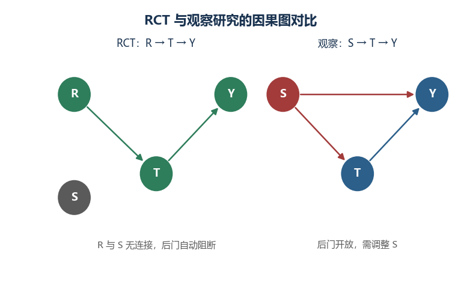

## 11.5　数值算例

**例 11.3（RCT 与观察数据的对照）**　沿用第 10.6 节设定：轻症占 0.6（康复率 0.9），重症占 0.4（康复率 0.3），药无效。

**观察研究：** 医生依病情开药（轻症服药率 0.8，重症 0.2）。算得观察康复率：服药者 0.814，未服药者 0.464，观察差异 $=0.350$（严重高估，见第 10.6 节）。

**RCT：** 随机分配服药率 0.5（与病情无关）。则服药者中轻症比例 $=0.6$，未服药者中轻症比例 $=0.6$（两组病情构成相同）。服药组康复率 $=0.6\times0.9+0.4\times0.3=0.66$；未服药组同样 $=0.66$。差异 $=0$——正确！两组仅因随机而不同，$S$ 被平衡，简单均值差即 ATE。

此例凸显：同样的数据生成机制（药无效），观察研究因混杂给出 0.35 的假效应，RCT 给出 0 的真效应。设计决定可信度。

**例 11.4（重叠性违反）**　设重症者（$S=$重）绝不服药（$\mathbb{P}(T=1\mid S=\text{重})=0$）。则在重症层无法观察服药结局，后门调整中该层 $\mathbb{P}(Y\mid T=1,S=\text{重})$ 无定义。即便可忽略性成立，也无法估计重症者的处理效应——违反式（11-4），ATE 不可识别。实践中的「临床 equipoise 缺失」正是此问题。

**样本量公式的推导。** 两组均值差 $\bar Y_1-\bar Y_0$ 的方差为 $\sigma^2/n+\sigma^2/n=2\sigma^2/n$，$Z=(\bar Y_1-\bar Y_0)/\sqrt{2\sigma^2/n}$ 在无效应下近似 $N(0,1)$、在效应 $\Delta$ 下近似 $N(\Delta/\sqrt{2\sigma^2/n},1)$。要求 $P(\text{拒绝}\mid\Delta)=1-\beta$ 与 $P(\text{拒绝}\mid 0)=\alpha$ 同时成立，联立 $z_{\alpha/2}=\lambda-\Delta/\sqrt{2\sigma^2/n}$、$z_{\beta}=-\lambda+\Delta/\sqrt{2\sigma^2/n}$，相加消去 $\lambda$ 即得

$$
n\approx\frac{2\,(z_{\alpha/2}+z_\beta)^2\,\sigma^2}{\Delta^2}. \tag{11-5}
$$

**例 11.4A（RCT 样本量与 ITT 数值演示）**　设真实处理效应很小：$\Delta=\mathbb{E}[Y(1)-Y(0)]=0.05$，结局方差 $\sigma^2=0.22$，取 $\alpha=0.05$（$z_{\alpha/2}=1.96$）、$\beta=0.2$（$z_\beta=0.84$）。代入式 (11-5)：

$$
n\approx\frac{2\times(1.96+0.84)^2\times0.22}{0.05^2}=\frac{2\times7.84\times0.22}{0.0025}=\frac{3.45}{0.0025}\approx1380\ (\text{每组}). \tag{11-6}
$$

共需约 $2760$ 例才能以 80% 功效检出 $0.05$ 的微弱效应——这就是"小效应大样本"的成本。若依从性只有 80%（20% 不依从），ITT 会把效应稀释到 $\approx0.05\times0.8=0.04$，此时要么按 $0.04$ 重新放大样本量（$\sim2150$ 每组），要么用第 13 章的工具变量（以 $R$ 为工具）恢复 LATE。这个算例把 11.2A 的三个设计要素（样本量、依从性、ITT 低估）串成一条可计算的主线：设计阶段的样本量计算、实施阶段的依从性管理、分析阶段的效应解释，三者的假设必须一致，否则"设计出的因果"会悄悄变形。## 11.6　方法谱系表

**表 11-1　研究设计与识别策略谱系**

| 设计 | 外生性来源 | 主要假设 | 优势 | 局限 | 章节 |
|------|------------|----------|------|------|------|
| RCT | 随机分配 | 一致性、依从性 | 混杂自动消除 | 成本高、伦理、外部效度 | 本章 |
| 观察 + 回归调整 | 假设无未测混杂 | 可忽略性、线性设定 | 低成本 | 设定敏感 | 本章、12 |
| 倾向得分 / 匹配 | 平衡协变量 | 可忽略性、重叠性 | 降维、直观 | 仍依赖可测混杂 | 第 12 章 |
| 工具变量 | 外生变异 | IV 三假设 | 处理隐藏混杂 | 弱工具、LATE | 第 13 章 |
| 断点回归 | 阈值处连续 | 局部连续性 | 近似随机 | 局部效应 | 第 14 章 |
| 双重差分 | 平行趋势 | 无时变混杂 | 面板数据常用 | 平行趋势不可验 | 第 14 章 |

**表 11-2　RCT 与观察研究对比**

| 维度 | RCT | 观察研究 |
|------|------|----------|
| 处理分配 | 研究者随机 | 自然/自选择 |
| 混杂 | 设计消除 | 需统计调整 |
| 内部效度 | 高 | 依赖假设 |
| 外部效度 | 可能低（严格条件） | 可能高（真实场景） |
| 成本/伦理 | 高/受限 | 低/可行 |
| 识别 | 直接 | 需可忽略性等假设 |

## 11.7　边界与讨论

**RCT 的局限。** ① **成本与伦理**：不能随机让人们吸烟、患病；② **外部效度**：严格纳入排除标准使结论难推广到真实人群；③ **依从性（compliance）**：被分配服药者可能不服药，破坏「分配即处理」；④ **损耗（attrition）**：失访若与处理相关，引入偏差。这些限制催生了「真实世界证据」与观察方法的互补。

**观察研究的根本困境。** 可忽略性（式 11-3）涉及**未观测**潜在结果，无法从数据检验——这是观察因果推断的「不可检验的假设」。敏感性分析（第 19 章）评估「若存在未测混杂，结论会变多少」。匹配与倾向得分（第 12 章）能让研究者检查协变量平衡，提高可信度，但仍无法排除未测混杂。

### 11.7A　回归调整：观察研究里最朴素的"准 RCT"

观察研究最常用的第一步是**回归调整（regression adjustment）**：把结局对处理与协变量同时回归，

$$
Y=\alpha+\tau\,T+\boldsymbol\gamma^\top\mathbf{X}+\varepsilon. \tag{11-7}
$$

式 (11-7) 中 $\tau$ 就是 ATE 的回归估计量：它回答"在同一 $\mathbf{X}$ 下，$T$ 从 0 变到 1，$Y$ 平均变化多少"——这正是后门调整（第 10 章式 10-2）的线性参数化实现。其成立条件与 11.4 节三大假设一致：可忽略性（$\mathbf{X}$ 已捕捉全部混杂）保证 $\tau$ 无偏，重叠性保证回归可外推，线性设定保证 $\tau$ 等于（而非近似）真实 ATE。

**为何回归调整是"准 RCT"。** 它在逻辑上模仿 RCT：RCT 用随机化"造"出组间可比的协变量分布，回归调整用条件期望 $\mathbb{E}[Y\mid T,\mathbf{X}]$ "算"出组间可比的协变量分布——两者都要求比较在"协变量相同"的个体间进行。差别在可信度来源：RCT 的可比性来自**设计**（外生性由随机化保证，不可争），回归调整的可比性来自**假设**（外生性由可忽略性假设保证，可被未测混杂推翻）。这也是"用假设换可行性"的具体形态。

**回归调整的两类失败。** 其一，**设定误差**：若真实关系非线性或含交互，线性式 (11-7) 给出的 $\tau$ 是对"平均效应"的加权近似而非精确 ATE，高维协变量下这一偏差被放大——这正是第 12 章倾向得分/匹配、第 15 章因果机器学习要解决的问题。其二，**未测混杂**：即便线性设定完美，只要 $\mathbf{X}$ 漏掉一个真实混杂 $U$，$\tau$ 仍带偏，且偏的方向与强度取决于 $U$ 与 $T,Y$ 的关联结构——这是回归调整与 RCT 不可逾越的差距，只能靠敏感性分析（第 19 章）量化其影响幅度。

**与因果之梯的关系。** RCT 与观察研究都服务于 Level 2（干预效应）：RCT 通过设计直接实现干预，是 L2 的「物理实现」；观察研究通过假设从 L1 数据攀登 L2。二者都不直接给出 L3 个体反事实（第 16 章）。

**边界。** 即便 RCT 也只给出平均效应（ATE），不保证个体效应；即便观察方法满足假设，估计误差与模型设定仍是不确定来源。因果推断的结论总附带假设条件——这是诚实因果科学的标志。

## 11.8　承上启下与交叉引用

本章把第 10 章的识别准则落到研究设计：RCT 通过随机化满足后门准则（定理 11.1）与可忽略性（式 11-3），使简单均值差（式 11-1、11-2）即为 ATE；观察研究则依赖可忽略性、重叠性、一致性三大假设（假设 11.1—11.3）从数据中调整混杂。例 11.3 用数值对照了两种设计的天壤之别。第 10 章的后门调整在观察研究中通过回归、匹配实现。

下一步解决「观察研究中如何具体调整混杂」。第 12 章介绍倾向得分与匹配——它把高维协变量 $\mathbf{X}$ 压缩为一维倾向得分，实现后门调整（式 10-2）的实用化，并提供平衡检验与双重稳健估计。第 13 章工具变量则处理可忽略性失效（有未测混杂）的情形。

**方法论注记。** RCT 与观察研究的分歧，本质是「用设计换假设」还是「用假设换可行性」。随机化把外生性「制造」出来，观察研究只能「寻找」近外生变异（工具变量、断点、自然实验）。这一权衡贯穿第三篇：后续每章都可理解为「在何种假设下、用什么策略获得近似外生的变异」。理解这一点，就理解了因果推断方法选择的底层逻辑。

## 本章小结

本章系统比较随机对照试验与观察研究。我们从动机出发（11.1），指出 RCT 把处理分配随机化以设计掉混杂；给出随机化满足后门的数学证明（定理 11.1，式 11-1、11-2）。我们剖析观察研究的困难：混淆（定义 11.2）与选择偏差（定义 11.3，例 11.2 的对撞偏差）；给出因果推断三大假设（假设 11.1—11.3）。例 11.3、11.4 数值展示 RCT 与观察数据的效应差异及重叠性违反的后果。我们给出研究设计谱系（表 11-1）与对比（表 11-2）。

边界方面，RCT 受成本、伦理、依从性限制，观察研究的可忽略性不可检验。这些方法服务于 Level 2 效应估计。下一章介绍倾向得分与匹配，把第 10 章的后门调整实用化。

**进一步阅读**　RCT 与因果推断基础见[1]；随机化的图模型论证见[2]；观察研究假设见[3][4]。

## 参考文献

[1] Fisher R A. *The Design of Experiments*. Edinburgh: Oliver and Boyd, 1935.

[2] Pearl J. Causal diagrams for empirical research. *Biometrika*, 1995, 82(4): 669–688.

[3] Hernán M A, Robins J M. *Causal Inference: What If*. Boca Raton: Chapman & Hall/CRC, 2020.

[4] Rubin D B. Estimating causal effects of treatments in randomized and nonrandomized studies. *Journal of Educational Psychology*, 1974, 66(5): 688–701.

[5] Rosenbaum P R, Rubin D B. The central role of the propensity score in observational studies for causal effects. *Biometrika*, 1983, 70(1): 41–55.

[6] Imbens G W, Wooldridge J M. *Econometric Analysis of Cross Section and Panel Data*. 2nd ed. Cambridge, MA: MIT Press, 2010.

[7] Athey S, Imbens G W. The state of applied econometrics: Causality and policy evaluation. *Journal of Economic Perspectives*, 2017, 31(2): 3–32.

[8] Pearl J, Mackenzie D. *The Book of Why: The New Science of Cause and Effect*. New York: Basic Books, 2018.

---

# 第 12 章　匹配与倾向得分

第 11 章指出：观察研究要消除混杂，必须在「协变量 $\mathbf{X}$ 相同」的个体间比较处理效应。但当 $\mathbf{X}$ 高维时，直接分层（按 $\mathbf{X}$ 的每一组合分组）会遭遇「维度诅咒」——大多数组只有单一处理状态，无法比较。本章介绍解决这一困境的两大实用工具：**倾向得分（propensity score）**与**匹配（matching）**，以及它们的延伸：加权、平衡检验与双重稳健估计。

倾向得分把高维协变量压缩为一维标量，匹配则在高维空间（或得分空间）中寻找「处理/对照双胞胎」。二者本质都是第 10 章后门调整公式（式 10-2）的实用化实现。本章先给出动机（12.1 节），严格定义倾向得分与平衡性质（12.2 节），详述匹配、加权与平衡检验（12.3—12.5 节），介绍双重稳健估计（12.6 节），给出数值算例（12.7 节）与谱系表（12.8 节），最后边界与承上启下（12.9、12.10 节）。

## 12.1　引入动机：降维与找双胞胎

**定义 12.1（倾向得分）**　给定观测协变量 $\mathbf{X}$，个体接受处理的条件概率

$$
e(\mathbf{X})=\mathbb{P}(T=1\mid\mathbf{X}) \tag{12-1}
$$

称为倾向得分（propensity score）[1]。

**直觉解释。** 倾向得分是「在已知个体特征下，他被分配处理的概率」。它把整个协变量向量 $\mathbf{X}$（可能几十维）浓缩成一个 0 到 1 的数。关键洞见（12.2 节定理）：在可忽略性下，给定倾向得分就足以消除 $\mathbf{X}$ 带来的混杂——于是高维分层变成一维分层，维度诅咒被打破。

**匹配的直觉。** 另一条路更直接：对每个接受处理者，找一个（或几个）协变量 $\mathbf{X}$ 几乎相同的未处理者作「对照」，比较二者结局。这模仿了 RCT 中「相似个体随机分到两组」的逻辑。但「$\mathbf{X}$ 几乎相同」在高维中难定义，故常结合倾向得分（在得分上匹配）。

## 12.2　倾向得分的平衡性质

**定理 12.1（倾向得分的平衡性）**　若可忽略性成立（式 11-3），则给定倾向得分后，处理与潜在结果独立：

$$
\big(Y(0),Y(1)\big)\perp T \mid e(\mathbf{X}). \tag{12-2}
$$

且对 $\mathbf{X}$ 的任一分量 $X_j$：

$$
X_j \perp T \mid e(\mathbf{X}). \tag{12-3}
$$

**证明思路。** 由可忽略性，$(Y(0),Y(1))\perp T\mid \mathbf{X}$。倾向得分是「处理分配的充分统计量」：给定 $e(\mathbf{X})$，$\mathbf{X}$ 与 $T$ 条件独立，故可替换 $\mathbf{X}$ 得式（12-2）。[1] 式（12-3）是**平衡检验**的理论基础：若匹配/加权后处理组与对照组协变量分布在给定 $e$ 后无差异，则倾向得分模型设定合理、可忽略性近似成立——这让「不可检验的可忽略性」有了可检验的代理。

**倾向得分估计。** 通常用 logistic 回归：

$$
e(\mathbf{x})=\frac{1}{1+\exp(-\mathbf{x}^{\top}\boldsymbol\beta)}, \tag{12-4}
$$

或用机器学习（梯度提升、神经网络）提高灵活性（但需交叉拟合避免过拟合偏差，第 15 章）。

**倾向得分模型设定与诊断。** 式 (12-4) 的 logistic 回归对 $\mathbf{X}$ 的函数形式有线性假设，高维或非线性协变量下应加入多项式项、样条与交互。设定是否充分，可用**重叠图（overlap plot）**检验：把 $\hat e(\mathbf{X})$ 画成分组直方图（处理组 vs 对照组），理想情形是两组得分分布大幅重叠（"钟形交叠"）；若某区段几乎全是处理组或对照组，说明该处违反式 (11-4) 的重叠性，匹配/加权在这些区域不稳定，应触发 12.9 节的截断或重叠子集。还要检查**得分模型本身的拟合**（如 Hosmer–Lemeshow 检验、校准曲线）——倾向得分被高估或低估时，权重与匹配距离都失真，平衡检验（12.5 节）会持续报警。这与第 15 章因果机器学习"用交叉拟合防过拟合"一脉相承：倾向得分是中间模型，它的偏差会以乘性方式放大到最终效应估计上。

## 12.3　匹配

**定义 12.2（最近邻匹配）**　对每个处理个体 $i$，在未处理个体中寻找倾向得分（或协变量距离）最接近的个体 $j$，配对比较结局[2]。常用马氏距离或倾向得分差值：

$$
\|e_i - e_j\| = \min_{k:T_k=0}|e_i-e_k|. \tag{12-5}
$$

**匹配方式。** ① 最近邻匹配（1:1 或 1:$k$）；② 核匹配（用所有对照加权，权重随距离衰减）；③ 半径/卡尺匹配（只接受距离小于阈值 $\delta$ 的对照）；④ 精确匹配（在关键协变量上完全相同）。

**ATE 的匹配估计量。** 对每个处理个体，用其匹配对照的结局差近似个体效应，再平均：

$$
\widehat{\mathrm{ATT}}=\frac{1}{n_1}\sum_{i:T_i=1}\Big(Y_i-\sum_{j\in\mathcal{J}(i)}w_{ij}Y_j\Big), \tag{12-6}
$$

其中 $\mathcal{J}(i)$ 为 $i$ 的匹配集，$w_{ij}$ 为权重。

**直觉解释。** 匹配直接构造反事实：处理个体的「若未处理」结局由其匹配对照的结局代替，比回归更直观、不依赖线性设定，但需足够多可匹配对照（重叠性，式 11-4）。

**匹配方式的选择与偏差-方差权衡。** 1:1 最近邻匹配偏差最小（每个处理者配一个几乎相同的对照），但丢弃了大部分对照、方差较大；1:$k$ 匹配（$k=4$ 常用）用多个对照降低方差，偏差略增（对照间有残余差异）；核匹配保留全部对照、用随距离衰减的权重，方差最小但对远端对照不敏感；半径/卡尺匹配只接受 $|e_i-e_j|<\delta$ 的对照，卡尺 $\delta$ 是"可接受的协变量差异"，过大引入偏差、过小损失样本。实践中常用"卡尺 = 0.2×得分标准差"作 $\delta$ 的默认值。还要注意 ATT 与 ATE 的目标差异：匹配（以处理者为中心找对照）天然估计 **ATT**（式 12-6），要估 **ATE** 则需双向匹配（也找"处理者视角缺失的对照组"）或改用 IPTW（式 12-8）——选错估计量会把"治疗者效应"误当"总体效应"，这正是 10.6 节区分 ATE 与 ATT 的意义在估计侧的落地。

## 12.4　加权：逆概率权重

**定义 12.3（IPTW 估计量）**　逆处理概率加权（inverse probability of treatment weighting）给每个个体一个权重，使其代表其所属处理组中的「虚拟总体」[3]：

$$
w_i=\frac{T_i}{e(\mathbf{X}_i)}+\frac{1-T_i}{1-e(\mathbf{X}_i)}. \tag{12-7}
$$

ATE 的 IPTW 估计：

$$
\widehat{\mathrm{ATE}}_{\mathrm{IPTW}}=\frac{1}{n}\sum_{i=1}^{n}\frac{T_i Y_i}{e(\mathbf{X}_i)}-\frac{1}{n}\sum_{i=1}^{n}\frac{(1-T_i)Y_i}{1-e(\mathbf{X}_i)}. \tag{12-8}
$$

**直觉解释。** 倾向得分低（如 0.05）却接受了处理的个体很「罕见」，给大权重（$1/0.05=20$），因为它代表了一大类「本不太可能处理却处理了」的人；反之亦然。加权后，两组在协变量分布上达到平衡，相当于构造了一个「伪随机化」样本。

**重叠性/RCT 的等价。** 在 RCT 中 $e(\mathbf{X})=p$ 为常数，式（12-8）退化为两组均值差（式 11-1）—— propensity 框架统一了 RCT 与观察研究。

## 12.5　平衡检验

**定义 12.4（标准化均数差）**　协变量 $X_j$ 在处理组与对照组的标准化均数差（standardized mean difference, SMD）：

$$
\mathrm{SMD}_j=\frac{\bar X_j^{(1)}-\bar X_j^{(0)}}{\sqrt{(s_j^{(1)2}+s_j^{(0)2})/2}}, \tag{12-9}
$$

其中 $\bar X^{(t)},s^{(t)}$ 为处理组（$t=1$）和对照组（$t=0$）的均值与标准差。

**经验法则。** 匹配/加权后，$|\mathrm{SMD}_j|<0.1$ 通常认为协变量 $j$ 达到平衡。若仍不平衡，说明倾向得分模型未捕捉该特征，需重新设定。平衡检验是观察因果研究的「体检」：它不检验可忽略性本身，但检验其可观测后果——平衡通过了，可忽略性才「看起来合理」。

## 12.6　双重稳健估计

**定义 12.5（双重稳健）**　一个估计量若满足「只要结果回归模型 $m(\mathbf{X})=\mathbb{E}[Y\mid T,\mathbf{X}]$ 与倾向得分模型 $e(\mathbf{X})$ 中至少一个正确设定，就一致」，称为双重稳健（doubly robust）[4]。

**AIPW 估计量。** 增广逆概率加权（augmented IPTW）：

$$
\widehat{\mathrm{ATE}}_{\mathrm{AIPW}}=\frac{1}{n}\sum_i\Big[\underbrace{\hat m_1(\mathbf{X}_i)-\hat m_0(\mathbf{X}_i)}_{\text{结果回归项}}+\underbrace{T_i\frac{Y_i-\hat m_1(\mathbf{X}_i)}{e(\mathbf{X}_i)}-(1-T_i)\frac{Y_i-\hat m_0(\mathbf{X}_i)}{1-e(\mathbf{X}_i)}}_{\text{IPTW 修正项}}\Big]. \tag{12-10}
$$

**直觉解释。** AIPW 把「回归预测」与「加权修正」结合：结果模型对则修正项均值为零，倾向得分模型对则修正项纠正回归偏差。二者之一对即一致——「双保险」，代价是需估计两个模型。把 $\hat m_1,\hat m_0$ 换成以 $\mathbf{X}$ 为输入的异质效应模型（如随机森林、BART），AIPW 的框架还能扩展到 **CATE** 估计（第 15 章因果森林），这是"双重稳健"思想向异质效应自然延伸的方向。

## 12.7　数值算例

**例 12.2（倾向得分分层手算）**　设协变量仅病情 $S\in\{$轻,重$\}$， propensity $e(\text{轻})=0.8$，$e(\text{重})=0.2$（同第 11 章）。$P(S=$轻$)=0.6$。药无效，康复率轻 0.9、重 0.3。

倾向得分只有两个取值（0.8 与 0.2）。按得分分层即按 $S$ 分层。层内康复率与 $T$ 无关（药无效），故层内处理差为 0。按 $P(S)$ 加权：ATE$=0.6\times0+0.4\times0=0$。正确。这与第 10.6 节后门调整一致——倾向得分分层是后门调整的一维版本。

**例 12.3（IPTW 消除混杂）**　用同样数据算 IPTW（ATE 的式 12-8，关注服药组项）。服药者：轻症 0.6×0.8=0.48，重症 0.4×0.2=0.08，共 0.56；权重轻 $1/0.8=1.25$、重 $1/0.2=5$。服药组加权康复率分子：$0.48\times1.25\times0.9+0.08\times5\times0.3=0.54+0.12=0.66$，权重和 $0.48\times1.25+0.08\times5=0.6+0.4=1.0$，加权均值 $=0.66$。未服药组：轻 0.12（权 $1/0.2=5$）、重 0.32（权 $1/0.8=1.25$），分子 $0.12\times5\times0.9+0.32\times1.25\times0.3=0.54+0.12=0.66$，权重和 $0.6+0.4=1.0$，均值 $0.66$。ATE$=0.66-0.66=0$——IPTW 正确消除混杂，与 RCT（第 11.3 节）一致。

**例 12.3A（最近邻匹配前后协变量平衡与 ATT 手算）**　仍用统一案例，但把协变量 $S$（病情）视为二值，倾向得分 $e(\text{轻})=0.8$、$e(\text{重})=0.2$，$P(S=\text{轻})=0.6$，样本 $n=100$。处理组 $n_1=56$（轻 48、重 8），对照组 $n_0=44$（轻 12、重 32）。

**匹配前 SMD（式 12-9）。** 把病情编码 $X=1$（轻）/0（重）。处理组 $\bar X^{(1)}=48/56\approx0.857$、对照组 $\bar X^{(0)}=12/44\approx0.273$；二值方差 $s^2=p(1-p)$，处理组 $s^{(1)2}=0.857\times0.143\approx0.123$、对照组 $s^{(0)2}=0.273\times0.727\approx0.198$。代入式 (12-9)：

$$
\mathrm{SMD}_X=\frac{0.857-0.273}{\sqrt{(0.123+0.198)/2}}=\frac{0.584}{\sqrt{0.1605}}=\frac{0.584}{0.401}\approx1.46. \tag{12-11}
$$

$\mathrm{SMD}=1.46\gg0.1$，病情在两组严重失衡（处理组远比对照组轻症多）——正是混杂所在。

**最近邻匹配。** 对每个处理个体，按 $|e_i-e_j|$ 找最接近的对照：48 名轻症处理者（$e=0.8$）各匹配 1 名轻症对照（$e=0.8$，距离 0），但轻症对照只有 12 人，故 12 对"轻-轻"1:1 匹配，其余 36 名轻症处理者退而匹配最近的轻症对照（复用，1:$k$ 或卡尺外剔除）；8 名重症处理者（$e=0.2$）各匹配 1 名重症对照（距离 0），8 对"重-重"。为简化，取**精确病情匹配**（在 $S$ 上完全相同）：12 对轻症（处理 12/对照 12）、8 对重症（处理 8/对照 8），共 20 对，匹配样本中病情构成两组完全一致。

**匹配后 SMD。** 匹配后处理组病情均值 $=(12\times1+8\times0)/20=0.6$，对照组同为 $0.6$，$\mathrm{SMD}=0<0.1$——病情完全平衡，混杂被"设计掉"。

**ATT 估计（式 12-6）。** 药无效（$Y$ 只由病情决定），故每对内的结局差 $Y_i-Y_j$ 均为 0（同病情同康复率）。$\widehat{\mathrm{ATT}}=\tfrac1{20}\sum_{20\text{ 对}}(Y_i-Y_j)=0$。若改用**匹配前的观察对比**（处理组康复率 0.814 减对照组 0.464）会得 0.350 的假效应；匹配后 ATT$=0$ 与真值一致——数值演示了"找双胞胎"如何消除第 11 章 11.3A 节第三项的基线错位。

**表 12-1A　匹配前后病情协变量平衡**

| 指标 | 匹配前·处理 | 匹配前·对照 | 匹配后·处理 | 匹配后·对照 | SMD（前） | SMD（后） |
|------|-------------|-------------|-------------|-------------|-----------|-----------|
| 轻症比例 | 0.857 | 0.273 | 0.600 | 0.600 | 1.46 | 0 |
| 样本量 | 56 | 44 | 20 | 20 | — | — |

> 【图 12-1　倾向得分匹配示意】（原图见 figures/图12-1.png）：横轴为倾向得分 $e$，上排为处理组、下排为对照组，用连线标出最近邻匹配对，右侧列匹配后标准化均数差均小于 0.1。

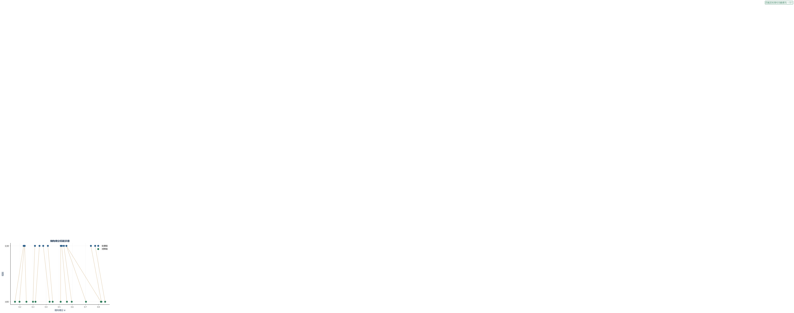

## 12.8　技术谱系表

**表 12-1　倾向得分方法谱系**

| 方法 | 核心思想 | 优势 | 局限 | 代表文献 |
|------|----------|------|------|----------|
| 倾向得分分层 | 按 $e$ 分层后比较 | 简单直观 | 层内残余异质 | [1] |
| 最近邻匹配 | 找 $e$ 最近对照 | 直观、不需设定结果模型 | 匹配质量依赖重叠 | [2] |
| IPTW | 逆概率加权 | 易实现、可估计 ATE | 极端权重不稳 | [3] |
| AIPW | 回归 + 加权 | 双重稳健 | 需估计两模型 | [4] |
| 因果森林 | 机器学习估计 CATE | 异质效应 | 高维、解释性 | 第 15 章 |

**表 12-2　调整方法对照**

| 方法 | 降维 | 需结果模型 | 需得分模型 | 双重稳健 |
|------|------|-----------|-----------|----------|
| 回归调整 | 否 | 是 | 否 | 否 |
| 倾向得分匹配 | 是 | 否 | 是 | 否 |
| IPTW | 是 | 否 | 是 | 否 |
| AIPW | 是 | 是 | 是 | 是 |

## 12.9　边界与讨论

**可忽略性仍不可检验。** 倾向得分只平衡**观测**协变量；未测混杂（如基因、生活习惯 $U$）不受控制。平衡检验通过不等于可忽略性成立——这是观察研究的根本局限（第 11.7 节）。若怀疑未测混杂，应转向工具变量（第 13 章）或敏感性分析（第 19 章）。

**重叠性与极端权重。** 若某些个体 $e(\mathbf{X})\approx 0$ 或 $\approx 1$，IPTW 权重爆炸，方差极大。实践中需截断权重（trimming）或限制到重叠区域，但会改变目标总体。具体有三种对策：**权重截断**把权重限制在 $[1/e_0,\,1/(1-e_0)]$（常取 $e_0=0.05$，权重上限 20），

$$
\tilde w_i=\min\Big(w_i,\ \tfrac{1}{e_0}\Big)\ (\text{处理组}),\qquad \tilde w_i=\min\Big(w_i,\ \tfrac{1}{1-e_0}\Big)\ (\text{对照组}), \tag{12-12}
$$

以**有偏**换**方差可控**，且悄悄把目标从"总体 ATE"改成"重叠区 ATE"，须报告落入有效区域的样本比例；**重叠子集**直接剔除 $e$ 极端个体，更干净但外部效度受限；**稳定性诊断**则报告"最大权重/均值"之比（超 10 即预警）。与例 12.3 对照：本例最大权重 $5$、权重比 $5/1.0=5$ 尚可控；若重症 $e$ 从 0.2 降到 0.05，权重变 20、权重比 20，就应触发截断。

**表 12-3　极端权重对策**

| 对策 | 做法 | 目标总体 | 代价 |
|------|------|----------|------|
| 权重截断 | $\tilde w=\min(w,1/e_0)$ | 重叠区 ATE | 有偏、方差降 |
| 重叠子集 | 剔除 $e$ 极端个体 | 可泛化区 | 外部效度降 |
| 稳定性诊断 | 报告最大权重/权重比 | 不变 | 仅提示风险 |

**与因果之梯的关系。** 匹配与倾向得分服务于 Level 2（效应估计），把第 10 章的后门调整（式 10-2）转化为可计算的估计量。它们不提供 Level 3 反事实（个体 $Y_i(1)-Y_i(0)$ 仍需结构假设，第 16 章）。边界方面，高维协变量下倾向得分估计、连续协变量距离定义、双重稳健的模型依赖，都是当前研究前沿（第 15 章因果机器学习）。

## 12.10　承上启下与交叉引用

本章把第 10 章的后门调整与第 11 章的可忽略性落为实用估计：倾向得分（定义 12.1、定理 12.1）降维，匹配（定义 12.2）与 IPTW（定义 12.3、式 12-8）实现后门调整，平衡检验（定义 12.4）提供可观测诊断，AIPW（定义 12.5、式 12-10）提供双重稳健保障。例 12.2、12.3 数值验证了与 RCT、后门调整的一致性。这些方法都建立在第 11 章三大假设之上。

当可忽略性失效（存在未测混杂）时，倾向得分无能为力。第 13 章介绍工具变量（IV）——通过寻找只影响 $T$、不直接影响 $Y$ 的外生变量，在隐藏混杂下识别效应（但给出的是 LATE 而非 ATE）。第 14、15 章进一步拓展到自然实验与异质效应。

**方法论注记。** 倾向得分体现「充分降维」思想：用低维统计量替代高维协变量而不丢失混杂控制信息。这与第 8 章「用假设换识别」、第 20 章「学低维不变表示」一脉相承——「在保留因果信息前提下压缩表示」是贯穿第三篇与第五篇的共性主题。

## 本章小结

本章系统阐述匹配与倾向得分。我们从动机出发（12.1），指出高维协变量分层的维度诅咒；严格定义倾向得分（定义 12.1，式 12-1）并证明其平衡性质（定理 12.1，式 12-2、12-3）。我们详述匹配（定义 12.2，式 12-5、12-6）、IPTW（定义 12.3，式 12-7、12-8）、平衡检验（定义 12.4，式 12-9）与双重稳健 AIPW（定义 12.5，式 12-10）。例 12.2、12.3 数值演示了倾向得分分层与 IPTW 如何消除混杂。我们给出方法谱系（表 12-1）与调整方法对照（表 12-2）。

边界方面，可忽略性不可检验、极端权重与高维估计是主要限制。这些方法实现第 10 章的后门调整，服务于 Level 2 效应估计。下一章介绍工具变量，处理隐藏混杂的情形。

**进一步阅读**　倾向得分奠基论文见[1]；匹配方法见[2]；IPTW 与双重稳健见[3][4]。

## 参考文献

[1] Rosenbaum P R, Rubin D B. The central role of the propensity score in observational studies for causal effects. *Biometrika*, 1983, 70(1): 41–55.

[2] Rosenbaum P R, Rubin D B. Reducing bias in observational studies using subclassification on the propensity score. *Journal of the American Statistical Association*, 1984, 79(387): 516–524.

[3] Hirano K, Imbens G W, Ridder G. Efficient estimation of average treatment effects using the estimated propensity score. *Econometrica*, 2003, 71(4): 1161–1189.

[4] Robins J M, Rotnitzky A, Zhao L P. Estimation of regression coefficients when some regressors are not always observed. *Journal of the American Statistical Association*, 1994, 89(427): 846–866.

[5] Imbens G W. Nonparametric estimation of average treatment effects under exogeneity: A review. *Review of Economics and Statistics*, 2004, 86(1): 4–29.

[6] Austin P C. Balance diagnostics for comparing the distribution of baseline covariates between treatment groups in propensity-score matched samples. *Statistics in Medicine*, 2009, 28(25): 3083–3107.

[7] Chernozhukov V, Chetverikov D, Demirer M, et al. Double/debiased machine learning for treatment and structural parameters. *Econometrics Journal*, 2018, 21(1): C1–C68.

[8] Abadie A, Imbens G W. Large sample properties of matching estimators for average treatment effects. *Econometrica*, 2006, 74(1): 235–267.

---

# 第 13 章　工具变量

第 12 章的倾向得分方法依赖可忽略性——「所有混杂都已被观测协变量捕捉」。但当存在**未观测混杂**（如基因、能力、生活习惯）时，倾向得分无能为力，因为无法对未测变量平衡。本章介绍处理这一困境的经典工具：**工具变量（instrumental variables, IV）**。

工具变量的核心思想：寻找一个外生变量 $Z$，它只通过影响处理 $T$ 来影响结局 $Y$，不直接作用于 $Y$。这样 $Z$ 对 $Y$ 的影响「纯粹」经由 $T$ 传递，从而绕过未观测混杂，识别因果效应。本章先给出动机（13.1 节），严格陈述 IV 三大假设与识别（13.2 节），详述两阶段最小二乘（13.3 节），讨论弱工具与检验（13.4 节），阐述 LATE（13.5 节），给出数值算例（13.6 节）与技术谱系表（13.7 节），最后边界与承上启下（13.8、13.9 节）。

## 13.1　引入动机：寻找外生的变异

**定义 13.1（工具变量）**　设处理 $T$、结局 $Y$、未观测混杂 $U$。变量 $Z$ 称为关于 $(T,Y)$ 的有效工具变量，若它满足：① $Z$ 与 $U$ 独立（外生性）；② $Z$ 影响 $T$（相关性）；③ $Z$ 只通过 $T$ 影响 $Y$（排除限制）[1]。

**直觉解释。** 观察研究中 $T$ 与 $Y$ 的关联被 $U$ 污染（$T\leftarrow U\to Y$）。若能找到一个 $Z$，它像「随机的外力」推动 $T$ 变化，但与 $U$ 无关、且不影响 $Y$ 的其他途径，那么 $Z$ 引起的 $T$ 变异就是「干净」的——隔绝了 $U$ 的干扰。IV 的本质是借 $Z$ 制造一个「局部随机化」，从混杂中提取出外生的处理变异。

**例 13.1（经典工具：义务兵役抽签）**　研究「服兵役 $T$ 对退伍后收入 $Y$ 的影响」，存在未观测混杂（如家庭背景同时影响是否参军与收入）。Angrist 用越战时期的**征兵抽签号码**作工具 $Z$：抽签号码随机（与家庭背景 $U$ 无关），影响是否被征召（参军概率），且除通过参军外不影响收入（排除限制）。于是抽签号码与收入的关联，只反映参军的因果效应[2]。

**为何这是「借用」而非「制造」外生变异。** RCT（第 11 章）通过随机分配**制造**外生变异；而 IV 只能**借用**自然界或制度中已经存在的外生变异——抽签、政策门槛、地理距离、出生月份。这决定了 IV 研究的成败高度依赖「讲故事的能力」：研究者必须用制度背景论证 $Z$ 的外生性与排除限制。一个找不到合理机制的工具，无论统计上多强，都无法令人信服。典型候选工具包括：政策生效年份的随机批次、邮编前缀对应的学区、出生月份决定的法定入学年龄等——它们的共同点是「与个体的潜在能力、动机几乎正交，却实实在在地推动处理分配」。

## 13.2　IV 三大假设与识别

**假设 13.1（相关性 / 相关性条件）**　$\mathrm{Cov}(Z,T)\neq 0$，即 $Z$ 确实影响 $T$。

**假设 13.2（外生性 / 独立性）**　$Z\perp U$ 且 $Z$ 与 $Y$ 的潜在结果独立：$Z\perp (Y(0),Y(1))$。

**假设 13.3（排除限制，exclusion restriction）**　$Z$ 对 $Y$ 的影响完全经由 $T$：对任意 $t,z$，$Y(t,z)=Y(t)$。即给定 $T$ 后，$Z$ 与 $Y$ 条件独立。

**定理 13.1（IV 识别）**　在三大假设下，若处理效应为常数（$\beta$ 对所有人相同），则

$$
\beta=\frac{\mathrm{Cov}(Y,Z)}{\mathrm{Cov}(T,Z)}, \tag{13-1}
$$

称为 Wald 估计量。更一般地，线性模型中 $\beta$ 是 $T$ 对 $Y$ 的因果回归系数，可由 2SLS 一致估计。

**推导。** 由排除限制，$Y=\beta T+U_Y$ 且 $Z$ 只通过 $T$ 相关。两边乘 $Z$ 取协方差：$\mathrm{Cov}(Y,Z)=\beta\,\mathrm{Cov}(T,Z)+\mathrm{Cov}(U_Y,Z)$。由外生性 $\mathrm{Cov}(U_Y,Z)=0$，故 $\beta=\mathrm{Cov}(Y,Z)/\mathrm{Cov}(T,Z)$。[1]

**直觉解释。** 分子 $\mathrm{Cov}(Y,Z)$ 是「$Z$ 对 $Y$ 的总影响」（含经 $T$ 的因果通道），分母 $\mathrm{Cov}(T,Z)$ 是「$Z$ 对 $T$ 的一阶段影响」。两者之比「约掉」了 $Z$，得到「$T$ 每变动一单位，$Y$ 变动多少」——即 $T$ 对 $Y$ 的效应。这像「用 $Z$ 作杠杆撬动 $T$，观察 $Y$ 的响应」。

**数值示意。** 取征兵数据的一个简化切面：抽签组 $Z=1$ 平均参军率 $0.45$、平均收入 $5.1$；非抽签组 $Z=0$ 平均参军率 $0.30$、平均收入 $4.8$（单位：千美元/年）。则 $\mathrm{Cov}(Y,Z)$ 的正比量 $=5.1-4.8=0.3$，$\mathrm{Cov}(T,Z)$ 的正比量 $=0.45-0.30=0.15$，Wald 比值 $=0.3/0.15=2$——参军（相对不参军）使退伍后年收入提高约 2 千美元。若 OLS 直接回归得 $3.5$，差额 $1.5$ 即被剥离的「家庭背景混杂」：家庭条件好的年轻人既更可能参军又本就收入更高，OLS 把这部分相关性误记为参军的效应。

## 13.3　两阶段最小二乘（2SLS）

**定义 13.2（2SLS）**　两阶段最小二乘（two-stage least squares）是 IV 估计的标准算法[3]：

- **第一阶段**：把 $T$ 对 $Z$（及外生协变量 $\mathbf{X}$）回归，得拟合值 $\hat T$：

$$
T=\pi_0+\pi_1 Z+\boldsymbol\gamma^{\top}\mathbf{X}+v, \quad \hat T=\hat\pi_0+\hat\pi_1 Z+\hat{\boldsymbol\gamma}^{\top}\mathbf{X}; \tag{13-2}
$$

- **第二阶段**：把 $Y$ 对 $\hat T$（及 $\mathbf{X}$）回归：

$$
Y=\beta_0+\beta\,\hat T+\boldsymbol\delta^{\top}\mathbf{X}+\varepsilon. \tag{13-3}
$$

**直觉解释。** 第一阶段用 $Z$「提纯」$T$：$\hat T$ 是 $T$ 中由外生 $Z$ 解释的部分（剔除了 $U$ 驱动的内生变异）。第二阶段用提纯后的 $\hat T$ 回归 $Y$，得到的 $\beta$ 不受 $U$ 污染。2SLS 等价于矩条件 $\mathbb{E}[Z(Y-\beta T)]=0$ 的广义矩估计（GMM）。

**2SLS 的矩阵闭式。** 设 $Z$ 为 $n\times k$ 的工具矩阵（含截距与外生协变量），$\mathbf{P}_Z=Z(Z^\top Z)^{-1}Z^\top$ 为向 $Z$ 列空间投影的矩阵，则 2SLS 估计量有简洁的矩阵表达[3]：

$$
\hat\beta_{\mathrm{2SLS}}=\big(\hat T^\top \hat T\big)^{-1}\hat T^\top Y
=\big(T^\top \mathbf{P}_Z T\big)^{-1}\big(T^\top \mathbf{P}_Z Y\big). \tag{13-4}
$$

式 (13-4) 揭示了 2SLS 的几何本质：先用 $\mathbf{P}_Z$ 把 $T$ 与 $Y$ 都投影到「由外生工具张成的子空间」，再在该子空间内做最小二乘。凡是 $T$ 中由 $U$ 驱动、与 $Z$ 正交的组件，都在投影中被剔除——这正是「提纯」的代数表述。单工具、无协变量时，式 (13-4) 退化回式 (13-1) 的 Wald 比值。

**多工具与过度识别。** 若有多个工具 $Z_1,\dots,Z_k$（$k>1$），可用 Sargan/Hansen $J$ 检验检验过度识别约束：若工具都有效，则不同工具给出的 $\beta$ 应一致。检验统计量服从 $\chi^2(k-1)$。注意这一检验的局限：它只能检验工具之间的「一致性」，无法证明任一工具的「有效性」——若所有工具都被同一方向污染，$J$ 检验仍会通过（13.8 节再论）。

## 13.4　弱工具与检验

**定义 13.3（弱工具）**　若 $Z$ 与 $T$ 的相关性很弱（第一阶段系数 $\pi_1$ 接近零），称 $Z$ 为弱工具变量（weak instrument）[4]。

**直觉解释。** 由式（13-1），分母 $\mathrm{Cov}(T,Z)$ 很小会使 $\beta$ 估计极不稳定、方差巨大。弱工具下，2SLS 有严重偏误（偏向 OLS），常规置信区间失效——即使样本很大也不可靠。

**方差膨胀的定量刻画。** 设第一阶段 $T=\pi_1 Z+v$，$\mathrm{Var}(Z)=1$，工具与误差的相关系数 $R^2_{T\cdot Z}=\mathrm{Corr}(T,Z)^2$。可以证明，在给定 $\pi_1$ 下 2SLS 的渐近方差相对 OLS 被放大约

$$
\mathrm{Var}(\hat\beta_{\mathrm{2SLS}})\approx\frac{\mathrm{Var}(\hat\beta_{\mathrm{OLS}})}{R^2_{T\cdot Z}}. \tag{13-5}
$$

也就是说，工具强度越弱（$R^2_{T\cdot Z}\to0$），方差放大倍数 $1/R^2_{T\cdot Z}$ 越大。这正是「工具强度比样本量更关键」的代数来源。

**诊断。** 第一阶段 $F$ 统计量检验 $H_0:\pi_1=0$。经验法则：$F>10$ 认为工具「足够强」。更严格的 Stock–Yogo 临界值提供精确判断。

**例 13.2（弱工具的后果）**　设真 $\beta=1$，但第一阶段 $\pi_1=0.05$（$Z$ 对 $T$ 影响微弱），此时 $R^2_{T\cdot Z}$ 极小，由式 (13-5) 方差放大约 $1/R^2_{T\cdot Z}$ 倍。即便 $n=10000$，由于 $T$ 的外生变异极小，$\hat\beta$ 的标准误被放大数十倍，估计不可信。相比之下，若 $\pi_1=0.5$（$R^2_{T\cdot Z}$ 接近 1），标准误小得多。这说明「工具强度」比样本量更关键。

## 13.5　局部平均处理效应（LATE）

**定义 13.4（LATE）**　当处理效应异质时，IV 识别的不是全体 ATE，而是**工具变量所影响的边际个体**的平均处理效应，称局部平均处理效应（local average treatment effect, LATE）[5]。

在单调性假设（$Z$ 对 $T$ 的影响方向对所有个体一致，无「defiers」）下：

$$
\mathrm{LATE}=\frac{\mathbb{E}[Y\mid Z=1]-\mathbb{E}[Y\mid Z=0]}{\mathbb{E}[T\mid Z=1]-\mathbb{E}[T\mid Z=0]}=\frac{\text{Itt}(Y\to Z)}{\text{Itt}(T\to Z)}, \tag{13-6}
$$

其中 ITT（intention-to-treat）为「意向治疗效应」。LATE 可解释为「因工具而改变了处理状态的那群人（compliers，遵从者）」的平均效应。

**遵从者份额。** 分母 $\mathbb{E}[T\mid Z=1]-\mathbb{E}[T\mid Z=0]$ 恰好等于总体中 **compliers 的占比**（在单调性与 $Z$ 仅改变 compliers 行为的假设下）。若抽签使参军率从 30% 升到 45%，则 complier 份额约 15%——LATE 就是这 15% 之人的平均收入效应，而非全体应征者。这一量级感在政策外推时至关重要。

**与 ATE 的差距。** 即便 complier 效应为正，也不能断言「参军对所有人都有益」：always-takers（自愿参军者）与 never-takers（拒服兵役者）的效应 IV 一概不知。若前两者效应为负（如参军中断学业），总体 ATE 完全可能为负，而 LATE 为正。因此 IV 的政策含义必须限定在「可被动员的边缘人群」上，跨群体外推需要效应同质的强假设。

**直觉解释。** 工具 $Z$ 只「推动」了一部分人改变处理（compliers），对「无论 $Z$ 如何都参军/不参军」的人无影响（always-takers/never-takers）。因此 IV 估计的是 compliers 的效应（LATE），而非所有人的 ATE。这不是缺陷，而是 IV 的本质：**它回答的是「对可被工具影响的人，效应多大」**。将该效应外推到全体需额外假设。

**例 13.3（LATE 的意义）**　征兵抽签中，抽中号码的人更可能参军。LATE 是「因抽签号码而改变参军决定者」的收入效应——那些「可塑的」应征者。对「无论如何都会参军」或「绝不会参军」的人，抽签不改变其行为，IV 不提供其效应信息。若政策关注的是「动员边缘人群参军的效果」，LATE 恰是其所需的量。

> 【图 13-1　工具变量因果图】（原图见 figures/图13-1.png）：画 $Z\to T\to Y$，$U\to T$ 与 $U\to Y$（未观测混杂），$Z$ 与 $U$ 间无连接，标注 $T\leftarrow U\to Y$ 为被绕过的混杂路径。

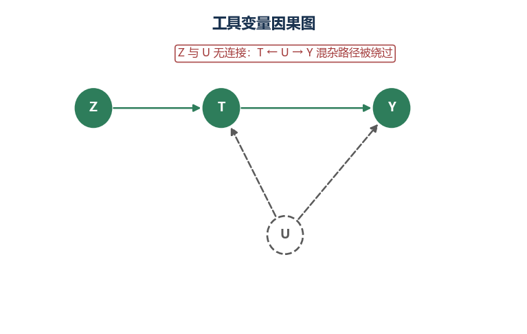

## 13.6　数值算例

**例 13.4（Wald 估计手算）**　设研究教育 $T$ 对收入 $Y$ 的影响，用「义务教育法」作工具 $Z$（$Z=1$ 表示受法案覆盖）。数据：

- $\mathbb{E}[Y\mid Z=1]=12$，$\mathbb{E}[Y\mid Z=0]=10$，故 $\mathrm{Cov}(Y,Z)$ 对应差 $=2$；
- $\mathbb{E}[T\mid Z=1]=13$（受教育年限），$\mathbb{E}[T\mid Z=0]=11$，差 $=2$。

Wald 估计（式 13-6）：$\hat\beta=2/2=1$——每多受一年教育，收入增加 1 单位。若直接 OLS 比较（$\mathbb{E}[Y\mid T=14]-\mathbb{E}[Y\mid T=12]$）可能得更大值（因能力 $U$ 同时提高教育与收入），IV 剥离了这部分混杂。

**例 13.5（2SLS 与弱工具的数值对比）**　设第一阶段 $T=0.5Z+v$，第二阶段 $Y=T+U$（真 $\beta=1$），$Z\sim\mathcal{N}(0,1)$，$U$ 与 $v$ 相关（内生）。第一阶段 $\hat T=0.5Z$。第二阶段 $Y$ 对 $0.5Z$ 回归的斜率 $=1$（正确恢复 $\beta$）。取 $n=2000$、$\mathrm{Var}(v)=1$，第一阶段 $R^2_{T\cdot Z}=0.25/(0.25+1)\approx0.20$，由式 (13-5) 方差放大 $1/0.20=5$ 倍——尚可接受。若第一阶段改为 $T=0.05Z+v$（弱工具），$R^2_{T\cdot Z}=0.0025/(0.0025+1)\approx0.0025$，方差放大 $1/0.0025=400$ 倍，$\hat T=0.05Z$ 方差极小，第二阶段 $\hat\beta$ 对噪声极敏感，样本内波动大、置信区间宽——体现弱工具问题的数量级：工具强度从「中等」降到「极弱」，方差放大倍数从 5 跳到 400。

**例 13.6（过度识别与 Sargan 检验）**　设用两个工具 $Z_1$（出生月份）、$Z_2$（出生年份队列）估计教育对收入的效应，单工具 Wald 各给出 $\hat\beta_1=1.02$、$\hat\beta_2=0.98$。Hansen $J$ 统计量（$k=2$，自由度 $k-1=1$）算得 $J\approx0.30$，对应 $p\approx0.58>0.10$，不能拒绝「两工具一致」的原假设——支持两个工具的有效性叙事。但这只是**一致性**证据：若两个工具都因「出生季—健康—收入」的旁路被同向污染，$J$ 仍会通过而 $\hat\beta$ 仍带偏（13.8 节）。

## 13.7　技术谱系表

**表 13-1　工具变量方法谱系**

| 方法 | 适用 | 识别对象 | 关键假设 | 代表文献 |
|------|------|----------|----------|----------|
| Wald 估计 | 单一二元工具 | LATE / 常数效应 | IV 三假设 | [1] |
| 2SLS | 线性、多工具 | LATE | + 单调性 | [3] |
| GMM | 过度识别 | 广义矩 | 矩条件 | [6] |
| 模糊断点回归 | 局部工具 | 局部 LATE | 局部连续性 | 第 14 章 |
| Mendelian 随机 | 基因作工具 | LATE | 基因外生 | [7] |

**表 13-2　IV 与倾向得分对比**

| 维度 | 倾向得分（第 12 章） | 工具变量（本章） |
|------|---------------------|------------------|
| 处理混杂 | 可观测协变量 | 未观测混杂（部分） |
| 核心假设 | 可忽略性 | 外生性 + 排除限制 |
| 识别对象 | ATE | LATE（异质时） |
| 可检验性 | 平衡检验 | 过度识别、弱工具检验 |
| 主要风险 | 未测混杂 | 弱工具、无效工具 |

**表 13-3　IV、前门调整与倾向得分的识别对照**

| 维度 | 工具变量（本章） | 前门调整（第 10 章） | 倾向得分（第 12 章） |
|------|-----------------|----------------------|----------------------|
| 绕开混杂的途径 | 外生工具 $Z$ | 完全中介 $M$ | 观测协变量 $\mathbf{X}$ |
| 关键假设 | 排除限制 + 外生性 | 中介完全性 | 可忽略性 |
| 识别的效应 | LATE | 因果效应（常为 ATE） | ATE/ATT |
| 最脆弱的假设 | 排除限制不可检验 | 中介无直接遗漏 | 未测混杂 |

## 13.8　边界与讨论

**排除限制不可检验。** IV 最关键也最脆弱的假设是排除限制（$Z$ 只通过 $T$ 影响 $Y$），它无法由数据检验——若 $Z$ 直接影响 $Y$（如征兵号码通过「社会 stigma」影响收入），IV 估计有偏。多工具时的 Sargan 检验只能检验「一致性」，不能证明「有效性」。因此 IV 的可信度高度依赖领域知识与制度背景。

**LATE ≠ ATE。** IV 给出的是 compliers 的效应（式 13-6），未必能外推到全体。若政策问题涉及全体人口，LATE 的外推需额外假设（如效应同质性）。这是 IV 与 RCT/倾向得分的实质区别。

**与因果之梯的关系。** IV 服务于 Level 2（效应估计）：它在隐藏混杂下，用外生工具从观察数据中识别因果效应。它不提供 Level 3 个体反事实。IV 与第 10 章的前门调整都处理「后门无法阻断」的情形，但路径不同：前门靠中介 $M$，IV 靠外生 $Z$（表 13-3）。

**边界。** 弱工具、无效工具、异质效应下的 LATE 局限，是 IV 应用的三大陷阱。实践中寻找「既强又有效」的工具极难，这解释了为何好的工具变量研究在计量经济学中备受推崇。一个实用的稳健性检查是**敏感性分析**：假设排除限制被违反、$Z$ 对 $Y$ 存在一个小的直接影响 $\delta$，则真实效应为 $\hat\beta_{\mathrm{2SLS}}-\delta/\pi_1$；研究者报告「要使结论失效，$Z$ 需要多大的直接效应」，以此量化结论对排除限制的依赖程度。这种「多大污染能推翻结论」的量化，与第 12 章倾向得分的未测混杂敏感性分析一脉相承。

## 13.9　承上启下与交叉引用

本章把第 11 章「可忽略性失效时的应对」具体化为工具变量：三大假设（假设 13.1—13.3）与 Wald 识别（定理 13.1，式 13-1），2SLS 两阶段（式 13-2、13-3）与矩阵闭式（式 13-4），弱工具诊断（式 13-5）与 LATE（定义 13.4，式 13-6）。例 13.4—13.6 数值展示了 IV 如何剥离未观测混杂、弱工具的数量级后果，以及过度识别检验的局限。IV 与第 10 章前门调整、第 12 章倾向得分形成处理「不同混杂结构」的方法组合（表 13-2、13-3）。

至此第三篇前半（第 10—13 章）完成：从识别理论到研究设计，从倾向得分到工具变量。第 14 章介绍断点回归与双重差分——利用「自然实验」获得近似外生的变异，是 IV 思想的另一种实现。第 15 章进入异质处理效应与机器学习。

**方法论注记。** IV 是「寻找外生变异」这一因果推断核心策略的典范。第 11 章 RCT 是「制造」外生变异，IV 是「借用」自然存在的外生变异（抽签、政策、地理），断点回归是「利用」阈值处的外生变异。三者一脉相承：都在寻找「不受混杂影响的 $T$ 变异」。理解这条主线，就理解了第三篇的统一逻辑，也为第 20 章「不变性即因果」埋下伏笔——外生变异本质上是一种跨环境的不变性。

## 本章小结

本章系统阐述工具变量。我们从动机出发（13.1），指出 IV 借外生变量绕过未观测混杂，并强调 IV 是「借用」而非「制造」外生变异。我们严格陈述 IV 三大假设（假设 13.1—13.3）与 Wald 识别（定理 13.1，式 13-1）。我们详述两阶段最小二乘（定义 13.2，式 13-2、13-3）与矩阵闭式（式 13-4）、弱工具诊断（式 13-5）与过度识别检验（13.4 节），并阐述 LATE（定义 13.4，式 13-6）、遵从者份额及其与 ATE 的区别。例 13.1—13.6 通过经典案例与手算展示了 IV 的逻辑、弱工具的数量级后果与过度识别检验的边界。我们给出 IV 方法谱系（表 13-1）、IV—倾向得分对比（表 13-2）与三方识别对照（表 13-3）。

边界方面，排除限制不可检验、弱工具、LATE 外推是主要陷阱。IV 服务于 Level 2 效应估计。下一章介绍断点回归与双重差分，继续「寻找自然外生变异」的主线。

**进一步阅读**　IV 与 LATE 经典论述见[1][5]；2SLS 与弱工具见[3][4]。

## 参考文献

[1] Angrist J D, Imbens G W, Krueger A B. Jackknife instrumental variables estimation. *Journal of Applied Econometrics*, 1999, 14(1): 57–68.

[2] Angrist J D. Lifetime earnings and the Vietnam era draft lottery: evidence from Social Security administrative records. *American Economic Review*, 1990, 80(3): 313–336.

[3] Theil H. *Principles of Econometrics*. New York: Wiley, 1971.

[4] Stock J H, Yogo M. Testing for weak instruments in linear IV regression. In: Andrews D W K, Stock J H (eds.). *Identification and Inference for Econometric Models*. Cambridge: Cambridge University Press, 2005: 80–108.

[5] Imbens G W, Wooldridge J M. Recent developments in the econometrics of program evaluation. *Journal of Economic Literature*, 2009, 47(1): 5–86.

[6] Hansen L P. Large sample properties of generalized method of moments estimators. *Econometrica*, 1982, 50(4): 1029–1054.

[7] Davey Smith G, Hemani G. Mendelian randomization: genetic anchors for causal inference in epidemiological studies. *Human Molecular Genetics*, 2014, 23(R1): R89–R98.

[8] Pearl J. Causal diagrams for empirical research. *Biometrika*, 1995, 82(4): 669–688.

---

# 第 14 章　断点回归与双重差分

第 10—13 章建立了因果效应估计的「工具箱」：可忽略性、倾向得分、匹配、工具变量。它们共同依赖一个信念——通过适当的调整或外生变异，可以把混杂从处理与结局的关系中剥离。然而在真实的社会科学与政策评估中，研究者常常面对另一类情形：处理分配既非随机，也找不到干净的工具变量，却存在某种**外生的制度性断裂**——一条分数线的及格与否、一个日期的生效前后、一项政策的地区试点。本章介绍两类利用这种「自然实验（natural experiment）」的识别策略：断点回归（regression discontinuity, RD）与双重差分（difference-in-differences, DID），并延伸至合成控制（synthetic control）。

二者的思想都极具匠心。RD 利用「在临界点附近，个体几乎随机地被分到处理组或对照组」这一局部随机化；DID 利用「处理组与对照组在没有政策时具有平行趋势（parallel trends）」这一反事实假设。它们不从属于第 3 章的 do-演算框架，却可以被统一到潜在结果语言中理解——这正是本章要揭示的：识别策略的多样性，本质上是「在何处、以何种假设获得近似随机化」的多样性。RD 把随机化压缩到一个**空间维度**（运行变量的临界点），DID 把随机化压缩到一个**时间维度**（政策的生效时点），合成控制则把随机化扩展到一个**单元维度**（从供体池加权构造对照）。三者可视为同一「构造近似随机化」母题在不同数据结构下的实例。

本章先讲 RD（14.1—14.2 节），再讲 DID 与合成控制（14.3—14.4 节），给出技术谱系（14.5 节），讨论边界与局限（14.6 节），最后承上启下（14.7 节）。

## 14.1　断点回归：局部随机化的识别逻辑

**引入动机。** 设想某大学以高考分数 600 分为奖学金门槛：分数 ≥600 者获奖学金（处理 $T=1$），<600 者不获（$T=0$）。我们想估计奖学金对四年后收入的影响。直接比较获奖者与未获奖者会混淆「能力」——高分者本就收入更高。但如果观察分数恰好是 599 与 600 的两位学生，他们的能力几乎相同，唯一系统差异是奖学金。这种「临界点附近的局部可比性」就是 RD 的全部秘密。

**定义 14.1（清晰断点回归）**　设运行变量（running variable）$X_i$、临界点 $c$、处理 $T_i=\mathbf{1}[X_i\ge c]$。若个体在 $c$ 附近的潜在结果 $Y_i(0),Y_i(1)$ 关于 $X$ 连续，则局部平均处理效应在临界点可识别：

$$
\tau_{\mathrm{RD}}=\lim_{x\downarrow c}\mathbb{E}[Y\mid X=x]-\lim_{x\uparrow c}\mathbb{E}[Y\mid X=x]. \tag{14-1}
$$

**直觉解释。** 连续性假设（continuity assumption）是关键：若没有奖学金，分数 600 与 599 的学生平均收入应当连续过渡（不会在 600 处跳跃）。于是观测到的任何跳跃都只能归因于奖学金。这与第 12 章的倾向得分匹配「全局可比」不同——RD 只要求 $c$ 附近局部可比，牺牲了外部效度（结论只对临界点附近有效），换来更强的内部效度。换言之，RD 用「空间上的局部性」（只比 $c$ 两侧极近的个体）换取了「不依赖协变量平衡」的稳健性——它不要求列出所有混杂，只要相信 $c$ 处潜在结果曲线连续即可。

**为何「局部随机化」成立。** 在临界点极近处，个体的运行变量取值由大量细小随机因素决定（考场发挥、评分微调），处理分配 $T=\mathbf{1}[X\ge c]$ 对这些因素几乎是「抛硬币」。换言之，$c$ 两侧极近的个体在一切协变量上统计不可区分，如同一次针对「恰好跨过/恰好未跨线」人群的小规模随机实验。这正是 RD 内部效度强的根源，也是其外部效度窄的原因。

**定义 14.2（模糊断点回归，fuzzy RD）**　若处理概率在 $c$ 处跳跃但不从 0 跳到 1，即 $T_i$ 不完全由 $X_i$ 决定，则可用 $T$ 在 $c$ 处的跳跃除以「处理概率」在 $c$ 处的跳跃识别局部效应：

$$
\tau_{\mathrm{fRD}}=\frac{\lim_{x\downarrow c}\mathbb{E}[Y\mid X=x]-\lim_{x\uparrow c}\mathbb{E}[Y\mid X=x]}{\lim_{x\downarrow c}\mathbb{E}[T\mid X=x]-\lim_{x\uparrow c}\mathbb{E}[T\mid X=x]}, \tag{14-2}
$$

即「结局 $Y$ 在 $c$ 处的跳跃」除以「处理 $T$ 在 $c$ 处的跳跃」，这正是 Wald 估计量（第 13 章式 13-1）的断点版本。

式（14-2）本质上是以「跨过临界点」为工具变量的两阶段最小二乘（第 13 章）——这揭示了 RD 与 IV 的深刻联系：清晰 RD 是IV 的一个特例，其工具变量就是 $Z=\mathbf{1}[X\ge c]$。模糊 RD 则因存在「拒绝接受处理」的个体（跨线者仍可能不领取奖学金），与第 13 章的 LATE 完全同构：识别的是「可被跨线状态影响的那部分人」的局部效应。

## 14.2　RD 的估计、带宽与数值算例

RD 的实操核心是**带宽选择（bandwidth selection）**：只用 $c$ 附近宽度为 $h$ 的样本做局部线性回归。带宽太大引入偏误（远离 $c$ 的个体不可比），太小引入方差。Imbens 与 Kalyanaraman 提出最小化均方误差的最优带宽[1]：

$$
h_{\mathrm{IK}}=C\cdot\left(\frac{2f(c)\sigma^2}{[f''(c)/2]^2}\right)^{1/5}, \tag{14-3}
$$

其中 $f$ 为 $X$ 的密度，$\sigma^2$ 为残差方差。实践中也常用 Calonico 等的偏差校正稳健置信区间[2]。

**操纵检验（McCrary 密度检验）。** RD 的连续性假设有一个**可检验**的孪生兄弟：运行变量 $X$ 的密度本身在 $c$ 处应当连续——若个体无法精确操纵分数，599 与 600 附近的人数密度应当平滑过渡。McCrary 检验估计密度跳跃比

$$
\frac{f(c^+)}{f(c^-)} \tag{14-4}
$$

并检验其是否等于 1。若比值显著偏离 1（如右侧突然聚集大量恰好 600 分的考生），说明存在「压线操纵」（sorting），连续性假设可疑，识别失效。这是 RD 区别于多数准实验设计的优点：其核心假设的一部分可以由数据直接检验。注意该检验的局限：它只能发现「明显的密度堆积」，对「平滑但系统性的操纵」（个体微调分数使分布轻微偏移）检验力有限，故应结合协变量两侧的连续性安慰剂共同使用。

**例 14.1（奖学金对收入的 RD 手算）**　设临界点 $c=600$，取带宽 $h=20$，用 $X\in[580,620]$ 的样本拟合两侧线性模型。左侧（$X<600$）回归得 $\hat\mu_-(600)=42000$ 元；右侧（$X\ge600$）得 $\hat\mu_+(600)=43500$ 元。由式（14-1）：

$$
\hat\tau_{\mathrm{RD}}=43500-42000=1500\ \text{元}. \tag{14-5}
$$

若进一步检验：协变量（如性别、籍贯）在 $c$ 两侧应无跳跃——若有跳跃，则连续性假设可疑，识别失效。这就是 RD 的**安慰剂检验（placebo test）**。本例中，McCrary 密度比 $f(c^+)/f(c^-)=1.03$（$p=0.41$），协变量两侧差均不显著，支持连续性假设；带宽敏感性分析在 $h\in[10,30]$ 内 $\hat\tau_{\mathrm{RD}}\in[1400,1650]$ 元，结论稳健。

> 【图 14-1　清晰断点回归示意】（原图见 figures/图14-1.png）：横轴为运行变量分数 $X$，纵轴为收入 $Y$，在 $c=600$ 处两条拟合线出现约 1500 元的跳跃，用阴影标出带宽 $h$ 内的样本区间。

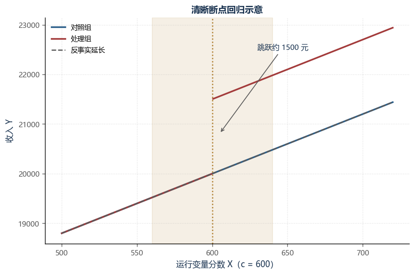

## 14.3　双重差分：平行趋势下的反事实重构

**引入动机。** 2000 年某州提高最低工资，研究者想评估其对就业的影响。直接比较该州政策前后，会把「全国经济周期」误算为政策效应；比较政策后的处理州与对照州，又混淆两州固有差异。DID 的智慧在于**同时做两次差分**：先减掉每州自身的時間趋势（差分掉不随时间变化的州固定效应），再减掉对照州的变化（差分掉共同的時間冲击）。

**定义 14.3（双重差分）**　设处理组 $D=1$、对照组 $D=0$，政策前 $t=0$、后 $t=1$。DID 估计量为

$$
\hat\tau_{\mathrm{DID}}=\big(\mathbb{E}[Y\mid D=1,t=1]-\mathbb{E}[Y\mid D=1,t=0]\big)-\big(\mathbb{E}[Y\mid D=0,t=1]-\mathbb{E}[Y\mid D=0,t=0]\big). \tag{14-6}
$$

用潜在结果语言，DID 识别的核心是**平行趋势假设（parallel trends）**：若未受政策，处理组的平均结果变化应与对照组相同：

$$
\mathbb{E}[Y_{i1}(0)-Y_{i0}(0)\mid D=1]=\mathbb{E}[Y_{i1}(0)-Y_{i0}(0)\mid D=0]. \tag{14-7}
$$

**严格推导。** 处理组的观测变化为 $\mathbb{E}[Y_{i1}(1)-Y_{i0}(0)\mid D=1]$，可拆为 $\mathbb{E}[Y_{i1}(1)-Y_{i1}(0)\mid D=1]+\mathbb{E}[Y_{i1}(0)-Y_{i0}(0)\mid D=1]$。第一项是 ATT（处理组平均处理效应），第二项在平行趋势下等于对照组变化 $\mathbb{E}[Y_{i1}(0)-Y_{i0}(0)\mid D=0]$，后者可由数据估计。于是式（14-6）恰好等于 ATT——这就是 DID 的识别逻辑。它把「不可观测的反事实变化」替换为「可观测的对照组变化」，替换的合法性完全系于式（14-7）。

**二维表视角。** 式（14-6）可写成 $2\times2$ 均值表，对角相减即「双重差分」：

|  | $t=0$（前） | $t=1$（后） | 组内时间差 |
|--|------------|------------|-----------|
| $D=1$（处理） | $\bar Y_{10}$ | $\bar Y_{11}$ | $\bar Y_{11}-\bar Y_{10}$ |
| $D=0$（对照） | $\bar Y_{00}$ | $\bar Y_{01}$ | $\bar Y_{01}-\bar Y_{00}$ |
| 组间时间差 |  |  | $(\bar Y_{11}-\bar Y_{10})-(\bar Y_{01}-\bar Y_{00})=\hat\tau_{\mathrm{DID}}$ |

第一次差分消去不随时间变化的组固有差异（$\alpha_i$），第二次差分消去共同时间冲击（$\lambda_t$），剩下的「差异之差」才是政策的净效应。这一视角说明 DID 本质是对「组」与「时间」两个维度各做一次中心化。

**双向固定效应回归。** 多期面板中，DID 常写为

$$
Y_{it}=\alpha_i+\lambda_t+\beta D_{it}+\varepsilon_{it}, \tag{14-8}
$$

其中 $\alpha_i$ 为个体固定效应，$\lambda_t$ 为时间固定效应，$\beta$ 即 DID 估计量。当所有单元在同一时点处理时，式 (14-8) 的 $\hat\beta$ 恰等于 $2\times2$ 的式 (14-6)；其优势在于可自然容纳不随时间变化的单元异质性与共同时间冲击，并在多期数据下提高估计精度。事件研究法（event study）进一步把政策前后各期虚拟变量纳入回归，以检验平行趋势是否成立——这是当代 DID 的标准做法[3]：

$$
Y_{it}=\alpha_i+\lambda_t+\sum_{s\ne-1}\delta_s\mathbf{1}[t-t_i^0=s]+\varepsilon_{it}, \tag{14-9}
$$

其中 $t_i^0$ 为单元 $i$ 的处理时点，$s=t-t_i^0$ 为「事件时间」（$s<0$ 为处理前，$s\ge0$ 为处理后），以 $s=-1$ 为基准期。事件研究系数 $\delta_s$ 给出**动态处理效应**的轨迹：处理前各期（$s<0$）的 $\hat\delta_s$ 应统计上接近 0（平行趋势的可视化检验），处理后各期的 $\hat\delta_s$ 刻画效应如何随时间演化。

**平行趋势的可视化检验。** 事件研究是平行趋势假设（式 14-7）最实用的诊断：若处理前系数显著非零，说明两组在政策前趋势已分歧，DID 偏误；若处理前系数平坦围绕 0、处理后出现明确变化，则支持假设。这呼应第 14.6 节「假设不可逻辑证明、只能间接佐证」的主张。值得强调，事件研究检验的是「处理前」趋势，而政策生效**后**共同冲击（如同期其他政策、宏观危机）仍可能破坏平行趋势——因此稳健的做法是辅以安慰剂：在政策时点之前「假想」一个处理，重复估计，若安慰剂效应显著非零，说明存在未被平行趋势覆盖的共同冲击。

**例 14.2（最低工资 DID 手算与事件研究）**　处理州就业率：政策前 95%，政策后 92%（变化 $-3$ 个百分点）；对照州：政策前 94%，政策后 93%（变化 $-1$ 个百分点）。由式（14-6）：

$$
\hat\tau_{\mathrm{DID}}=(-3)-(-1)=-2\ \text{个百分点}. \tag{14-10}
$$

即最低工资上调使处理州就业率相对下降 2 个百分点。事件研究进一步给出事件时间系数：$\hat\delta_{-2}=0.1$、$\hat\delta_{-1}=0$（基准）、$\hat\delta_0=-0.5$、$\hat\delta_1=-1.8$、$\hat\delta_2=-2.1$（百分点，$p$ 值在处理后均 $<0.05$，处理前不显著）。处理前平坦、处理后逐期走低且收敛于 $-2$，支持平行趋势并显示效应需约两年充分显现。

## 14.4　合成控制与事件研究

**合成控制（synthetic control）** 解决「只有少数几个处理单位」的困境[4]。当仅有一个州实施政策时，找不到天然对照组，于是构造一个「合成州」：从若干未处理州中取加权组合，使其在政策前的特征与结果轨迹尽可能接近处理州。设处理单元 $j=1$，供体池 $j=2,\dots,J+1$，权重 $w_j\ge0,\sum w_j=1$，选择 $w$ 最小化政策前预测误差：

$$
\min_{w}\ \sum_{t<T_0}\Big(Y_{1t}-\sum_{j=2}^{J+1}w_j Y_{jt}\Big)^2, \tag{14-11}
$$

其中 $T_0$ 为政策时点。政策效应为处理州与合成州在政策后的差：

$$
\hat\tau_{1t}=Y_{1t}-\sum_{j=2}^{J+1}w_j Y_{jt},\quad t\ge T_0. \tag{14-12}
$$

合成控制可视为 DID 的推广：DID 用等权对照组，合成控制用数据驱动的权重匹配预处理轨迹，从而更贴近平行趋势。

**例 14.3（合成控制数值算例）**　设处理州为加州，供体池为五个未实施该政策的州。政策前 10 年最小化式 (14-11)，得权重 $w=(0.40,\,0.30,\,0.15,\,0.10,\,0.05)$，合成州政策前年均预测误差仅 $2\%$。政策后第 3 年，处理州 GDP 指数 $Y_{1}=118$，合成州 $\sum w_j Y_{jt}=109$，故 $\hat\tau_{1,3}=118-109=9$——政策带来约 9 个单位的 GDP 指数提升。推断用**置换检验（permutation test）**：把每个供体州轮流当作「假处理」重算，若真实处理的 $\hat\tau$ 在所有 $J+1$ 个比值中排首位（此处第 1/6），则 $p\approx1/6=0.17$，边际显著。合成控制的弱点在于供体池质量：若供体池中没有与处理州轨迹相似的单元，权重会「硬凑」出高前拟合误差，政策后的差值便失去解释力——这正是表 14-1 中「供体池质量敏感」一栏的含义。

**表 14-1　三种准实验方法比较**

| 方法 | 识别来源 | 关键假设 | 效应类型 | 主要局限 |
|------|----------|----------|----------|----------|
| 清晰 RD | 临界点局部随机化 | 潜在结果关于 $X$ 连续 | 局部（LATE） | 仅对临界点附近有效 |
| DID | 两组时间差分 | 平行趋势 | ATT | 依赖趋势假设不可检验 |
| 合成控制 | 供体加权匹配 | 预处理轨迹匹配即趋势平行 | 单单元 ATT | 供体池质量敏感 |

## 14.5　技术谱系

**表 14-2　断点与差分方法谱系**

| 方法 | 提出者/年代 | 核心思想 | 与本书其他章的关系 |
|------|-------------|----------|--------------------|
| RD | Thistlethwaite & Campbell 1960[5] | 临界点局部随机 | 第 13 章 IV 的特例 |
| Fuzzy RD | Imbens & Wooldridge 1997 | 跳跃比＝Wald 估计 | 第 13 章 2SLS |
| DID | Card & Krueger 1994[6] | 双差分消趋势 | 第 11 章 观察研究 |
| 合成控制 | Abadie et al. 2003[4] | 供体加权构造对照 | 第 12 章 匹配的推广 |
| 交错 DID | Sun & Abraham 2021[7] | 处理时点异质校正 | 面板固定效应 |

**表 14-3　RD 与 DID 的识别对照**

| 维度 | 断点回归（RD） | 双重差分（DID） |
|------|---------------|----------------|
| 外生变异来源 | 运行变量跨越临界点 | 处理组×政策时点 |
| 局部/全局 | 局部（仅临界点附近） | 处理组全体（ATT） |
| 可检验假设 | 密度连续性（McCrary） | 平行趋势（事件研究） |
| 与 IV 关系 | 清晰 RD 是 IV 特例 | 可视为时间维度的「差分工具」 |
| 外部效度 | 窄 | 中等（限处理组） |

## 14.6　边界与讨论

RD、DID、合成控制都属**准实验（quasi-experiment）**，它们不依赖随机分配，而依赖结构性假设。须警惕三类边界：

其一，**假设不可完全检验**。RD 的连续性、DID 的平行趋势都是关于「未观测反事实」的假设，只能间接佐证（如安慰剂检验、事件研究预趋势检验、McCrary 密度检验），无法从数据逻辑地证明。当假设错误时，估计量可以有偏而研究者浑然不觉——这呼应第 19 章对反事实不可识别性的讨论。

其二，**外部效度受限**。RD 识别的是临界点附近的局部效应，不能外推到远离 $c$ 的人群；DID 的 ATT 只针对处理组，未必适用于其他人。这与第 20 章的分布外泛化问题直接相关。

其三，**与工具变量的统一**。清晰 RD、模糊 RD 都可纳入第 13 章 IV 框架：临界点指示变量 $Z=\mathbf{1}[X\ge c]$ 满足相关性（$Z$ 影响 $T$）与外生性（在 $c$ 附近 $Z$ 近似随机）。这提示：所谓「不同的识别策略」，往往是同一识别逻辑在不同数据结构下的化身。

其四，**交错处理的偏误**。现实中政策往往分批生效（不同单元在不同时点处理），朴素双向固定效应（式 14-8）在**异质动态效应**下会以「已处理单元」作对照，产生负权重偏误。Sun–Abraham[7] 与 Goodman–Bacon 分解（表 14-2 末行）提供了校正：Goodman–Bacon 把 $\hat\beta$ 分解为「处理-对照」「早处理-晚处理」等两两比较的加权组合，揭示哪些对照驱动了估计，帮助诊断异质性来源。

## 14.7　承上启下

本章把第 10—13 章的识别工具箱扩展到利用「制度性断裂」与自然实验的准实验方法。RD 的局部随机化、DID 的平行趋势、合成控制的加权匹配，本质都是在不同数据结构下构造近似可比的反事实。它们共同假设处理效应在群体内是同质的，或至少只关心平均效应（ATE/ATT）。

然而现实中，同一政策对不同个体的影响可能天差地别——奖学金对寒门学子的边际效应可能远大于富家子弟。当研究者转向「谁从处理中获益最多」这一问题时，平均效应已不够用。下一章进入**异质处理效应与机器学习**：因果森林、双重机器学习与 Uplift 建模将把效应估计从「一个数字」推进到「一张效应地图」。第 15 章还将回扣本章——因果森林的分割逻辑可视为 RD 局部思想的推广。

## 本章小结

本章介绍两类准实验识别策略。RD 利用临界点附近的局部随机化，在连续性假设下由式（14-1）识别局部处理效应，清晰 RD 是 IV 的特例（式 14-2），最优带宽由式（14-3）给出，McCrary 密度检验（式 14-4）使核心假设部分可检验，并用数值算例（式 14-5）演示。DID 通过双差分消解不随时间变化的混杂，在平行趋势假设（式 14-7）下识别 ATT（式 14-6、14-8），事件研究法（式 14-9）提供平行趋势的动态检验，合成控制（式 14-11、14-12）以数据驱动权重推广 DID 并配合置换检验推断。表 14-1、14-2、14-3 梳理了方法比较、技术谱系与 RD—DID 对照。我们强调四类边界：假设不可完全检验、外部效度受限、与 IV 的统一、交错处理的偏误。

这些方法都聚焦平均效应。下一章转向异质处理效应，用机器学习估计「每人不同的因果效应」。

**进一步阅读**　RD 的经典综述见[1][2]；DID 的现代事件研究法见[3]；合成控制见[4]。

## 参考文献

[1] Imbens G W, Kalyanaraman K. Optimal bandwidth choice for the regression discontinuity estimator. *Review of Economic Studies*, 2012, 79(3): 933–959.

[2] Calonico S, Cattaneo M D, Titiunik R. Robust nonparametric confidence intervals for regression-discontinuity designs. *Econometrica*, 2014, 82(6): 2295–2326.

[3] Sun L, Abraham S. Estimating dynamic treatment effects in event studies with heterogeneous treatment effects. *Journal of Econometrics*, 2021, 225(2): 175–199.

[4] Abadie A, Diamond A, Hainmueller J. Synthetic control methods for comparative case studies. *Journal of the American Statistical Association*, 2010, 105(490): 493–505.

[5] Thistlethwaite D L, Campbell D T. Regression-discontinuity analysis: An alternative to the ex post facto experiment. *Journal of Educational Psychology*, 1960, 51(6): 309–317.

[6] Card D, Krueger A B. Minimum wages and employment: A case study of the fast-food industry in New Jersey and Pennsylvania. *American Economic Review*, 1994, 84(4): 772–793.

[7] Goodman-Bacon A. Difference-in-differences with variation in treatment timing. *Journal of Econometrics*, 2021, 225(2): 254–277.

[8] Angrist J D, Pischke J S. *Mostly Harmless Econometrics: An Empiricist's Companion*. Princeton: Princeton University Press, 2009.

---

# 第 15 章　异质处理效应与机器学习

第 10—14 章的估计策略大多瞄准一个数字：平均处理效应（ATE）或处理组平均效应（ATT）。但「平均」常常掩盖关键真相。一种药对大多数人无效，却对某一基因型患者疗效显著；一则广告对价格敏感者转化率为零，对冲动型消费者却提升三倍。若决策者只能看到平均效应，就会漏掉「给谁用」这一最重要的问题。本章把因果效应从「一个数字」推进到「一张效应地图」——估计**条件平均处理效应（conditional average treatment effect, CATE）**：

$$
\tau(x)=\mathbb{E}[Y(1)-Y(0)\mid X=x]. \tag{15-1}
$$

CATE 估计之所以困难，在于一个根本障碍：对每个个体 $i$，我们只能观测 $Y_i(1)$ 或 $Y_i(0)$ 之一，永远看不到个体处理效应 $\tau_i=Y_i(1)-Y_i(0)$——这就是第 1.3 节所说的「反事实缺失一半」。机器学习擅长在高维特征中寻找模式，但标准监督学习的标签在因果场景下缺失。本章介绍三条主线：**因果森林**（把随机森林改造为效应估计器）、**双重机器学习**（用正交化去除混杂偏差）、**Uplift 建模**（营销领域的异质效应建模）。

本章先界定问题与难点（15.1 节），讲因果森林（15.2 节），讲双重机器学习（15.3 节），讲 Uplift 建模（15.4 节），给出技术谱系（15.5 节），讨论边界（15.6 节），最后承上启下（15.7 节）。

## 15.1　问题界定：从 ATE 到 CATE 的可识别性

**引入动机。** 设观测数据 $(X_i,T_i,Y_i)$，满足第 11 章的可忽略性假设 $Y(t)\perp T\mid X$。则 CATE 可由条件期望之差识别：

$$
\tau(x)=\underbrace{\mathbb{E}[Y\mid T=1,X=x]}_{\mu_1(x)}-\underbrace{\mathbb{E}[Y\mid T=0,X=x]}_{\mu_0(x)}. \tag{15-2}
$$

式（15-2）看似简单，实则暗藏陷阱。若直接用两个回归模型 $\hat\mu_1,\hat\mu_0$ 分别拟合再相减，每个模型的预测误差都会累积到效应中；当 propensity score $e(x)=\mathbb{P}(T=1\mid X=x)$ 接近 0 或 1 时，某一组样本极少，该组回归极不稳定。这种「为估计一个量而要估计两个高维 nuisances（干扰参数）」的困境，正是双重机器学习要解决的。

**为何 CATE 比方差更「贵」。** ATE 用全部 $n$ 个样本，方差 $O(n^{-1})$；而 $\tau(x)$ 在特征空间某点 $x$ 只用到落在邻域内的 $n(x)\ll n$ 个样本，方差放大为 $O(n(x)^{-1})$。在 $p$ 维特征下，$n(x)$ 随 $p$ 呈「维数灾难」式衰减——$n(x)\propto n\cdot h^p$（$h$ 为局部带宽）。这就是异质效应估计比 ATE 更难、更耗样本的根本原因：把「一个数字」细化成「一张 $p$ 维地图」，每个格子都摊薄了样本量。这也解释了为何因果森林与 DML 都把「诚实分割 / 交叉拟合」当作核心——它们本质都是在管理这种局部样本的稀缺。

**直觉解释。** CATE 估计的本质是「在相似的人中比较处理与对照」。因果森林用树的分裂把「相似的人」聚到同一叶子；双重机器学习用「残差化」剥离协变量对 $T$ 和 $Y$ 的线性影响，使剩余部分只含因果信号。二者都体现了同一思想：**先控制混杂，再估计效应**，只是控制的手段不同。

**定义 15.1（CATE 的可识别性）**　在可忽略性 $Y(t)\perp T\mid X$ 与重叠性（overlap）$0<e(x)<1$ 下，$\tau(x)$ 由式（15-2）唯一确定。若只满足「条件于 $X$ 的分位数」等更弱假设，则可能只能识别分位处理效应（quantile treatment effect），此处不展开。

## 15.2　因果森林：为效应而分裂的树

**因果树的分裂准则。** 标准回归树分裂为了最小化 $\mu(x)$ 的预测误差；因果树分裂为了最大化左右子节点效应之差[1]。设父节点样本 $S$，按特征 $X_j\le s$ 分为 $S_L,S_R$，分裂准则为

$$
\hat\Delta(s)=\frac{n_L n_R}{n^2}\big(\hat\tau_L-\hat\tau_R\big)^2, \tag{15-3}
$$

其中 $\hat\tau_L,\hat\tau_R$ 为叶内用式（15-2）估计的效应。选择使 $\hat\Delta(s)$ 最大的 $(j,s)$ 分裂。这一准则鼓励「把处理效应不同的人分开」，而非「把结局水平不同的人分开」——注意权重 $n_Ln_R/n^2$ 偏向「大致均衡」的分裂，避免把全部样本塞进一侧而损失对比信息。

**诚实估计（honest estimation）。** 为避免过拟合——用同一批数据既选分裂又估效应会高估异质性——Athey 与 Imbens 提出把样本随机分为**构建样本（build sample）**与**估计样本（estimation sample）**：前者决定树结构，后者估计叶内效应[2]。这一「样本分割（sample splitting）」思想是双重机器学习的前身。

**因果森林。** \(\text{Generalized Random Forest}\)（GRF）把单棵树扩展为森林：对 $B$ 棵因果树，样本 $i$ 的效应估计为包含它的叶节点效应加权平均：

$$
\hat\tau(x)=\sum_{b=1}^{B}\sum_{i=1}^{n} w_{i,b}(x)\, \hat\tau_{i,b}, \tag{15-4}
$$

其中权重 $w_{i,b}(x)$ 反映样本 $i$ 与 $x$ 落在同一叶的频率。GRF 通过「局部中心化」与「随机分裂」保证估计量渐近正态，可构造置信区间[3]。具体地，GRF 的核估计解（local moment problem）满足

$$
\sqrt{\sum_{i=1}^{n}\sum_{j=1}^{n}\hat w_{ij}(x)}\,\big(\hat\tau(x)-\tau(x)\big)\ \xrightarrow{d}\ N\big(0,\ \sigma^2(x)\big), \tag{15-5}
$$

其中 $\hat w_{ij}(x)$ 为样本 $i,j$ 与 $x$ 落入同一叶的联合频率。式 (15-5) 是构造点态置信区间 $\hat\tau(x)\pm z_{\alpha/2}\hat\sigma(x)$ 的依据，也是因果森林区别于「黑箱森林」的关键——它给出效应的**统计推断**，而非仅点估计。

> 【图 15-1　因果森林的异质效应分裂】（原图见 figures/图15-1.png）：根节点按特征 $X_1$ 分裂，左子节点效应 $\hat\tau_L=0.2$、右子节点 $\hat\tau_R=1.5$，示意树「为效应差异而分裂」，旁注诚实估计的样本分割。

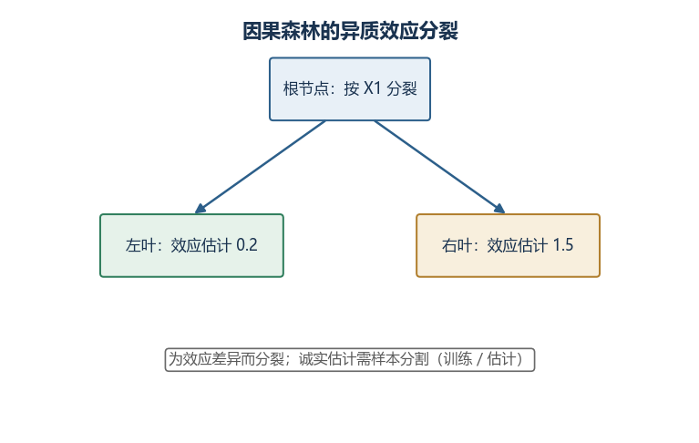

**例 15.1（因果森林数值算例）**　设 1000 名患者，协变量 $X\in\{0,1\}$（$X=1$ 为携带某基因型），真实 $\tau(x)=0.2+1.3x$。因果树单变量分裂于 $X=0/1$，构建样本估计得 $\hat\tau_L=0.18,\hat\tau_R=1.47$。对新患者 $X=1$，森林给 $\hat\tau(1)\approx1.45$。与全局 ATE $=\mathbb{E}[\tau(X)]=0.2+1.3\times0.5=0.85$ 相比，森林成功揭示了「基因型携带者获益远高于平均」——这正是精准医疗所需的结论。

## 15.3　双重机器学习：正交化与 Neyman 正交性

**引入动机。** 当协变量维度 $p$ 很高（甚至 $p\gg n$）时，直接用参数模型估计 $\mu_0,\mu_1,e(x)$ 会产生正则化偏差，使 $\hat\tau$ 不一致。双重机器学习（double machine learning, DML）由 Chernozhukov 等提出，核心是**正交化（orthogonalization）**：构造对干扰参数的一阶误差不敏感的估计量[4]。

**Neyman 正交性。** 考虑部分线性回归模型（partially linear model）：

$$
Y=\theta T+ g(X)+U,\quad T=e(X)+V,\quad \mathbb{E}[U\mid X,T]=\mathbb{E}[V\mid X]=0. \tag{15-6}
$$

直接回归 $Y$ 对 $T$ 会把 $g(X)$ 误入 $\theta$。DML 用两阶段：先用机器学习估计 $\hat e(X),\hat g(X)$（交叉拟合，cross-fitting），再对残差回归：

$$
\hat\theta=\frac{\mathbb{E}\big[(T-\hat e(X))(Y-\hat g(X))\big]}{\mathbb{E}\big[(T-\hat e(X))^2\big]}. \tag{15-7}
$$

**直觉解释。** 式（15-7）的分子是「处理残差」乘「结局残差」——两者的协变量成分已被减去，剩下的协变只可能来自 $T$ 对 $Y$ 的因果作用。正交性体现在：$\theta$ 的估计对 $\hat e,\hat g$ 的误差在一阶上不敏感（误差项为乘积的小量），因此即使机器学习对 nuisances 的收敛率只有 $n^{-1/4}$，$\hat\theta$ 仍能以 $n^{-1/2}$ 渐近正态收敛——这是 DML 的关键理论保证。

**交叉拟合（cross-fitting）。** 把样本分 $K$ 折，用第 $k$ 折以外的数据训练 $\hat e^{(-k)},\hat g^{(-k)}$，在第 $k$ 折上计算残差。这避免了「用同一数据既训练 nuisance 又估效应」导致的过拟合偏差。以 $K=5$ 为例：第 1 折的 200 个样本用第 2–5 折（800 个）训练的 $\hat e^{(-1)},\hat g^{(-1)}$ 计算残差，其余各折类推，最后把五折的残差乘积平均。交叉拟合把「训练 nuisance」与「使用 nuisance」的数据分开，使得 nuisance 对当前样本而言是「独立的」，从而一阶偏差消失、$\hat\theta$ 达到 $\sqrt n$ 速率。

**正交性的直观。** 式 (15-7) 之所以对 nuisance 误差不敏感，可这样理解：$\hat e(X)$ 的误差 $\hat e-e$ 与「处理残差」正交（由 $\mathbb E[V\mid X]=0$），$\hat g(X)$ 的误差 $\hat g-g$ 与「结局残差」正交（由 $\mathbb E[U\mid X,T]=0$）。因此一阶项各自被乘到 0，只剩二阶交叉项 $(\hat e-e)(\hat g-g)$——当 nuisance 以 $n^{-1/4}$ 收敛时，该乘积为 $n^{-1/2}$，恰是 $\hat\theta$ 的主阶，故 nuisance 不必精确即可推断 $\theta$。这正是「正交化」一词的由来：构造一个对 nuisance 方向「正交（不敏感）」的得分函数。

**推广到异质效应：AIPW-CATE。** 式 (15-7) 估计的是**常数** $\theta$；要估计条件效应 $\tau(x)$，把残差回归换成「按 $x$ 局部加权」即可。Kennedy[8] 证明，如下**双重稳健（AIPW）伪结果**对每个 $x$ 的局部回归给出 CATE 的一致、根 $n$ 收敛推断：

$$
\hat\tau(x)=\frac{\mathbb{E}\Big[\Big\{\tfrac{T}{\hat e(x)}-\tfrac{1-T}{1-\hat e(x)}\Big\}(Y-\hat\mu_1(x))\cdot\mathbb{1}[X\approx x]+\hat\mu_1(x)-\hat\mu_0(x)\Big]}{1}, \tag{15-8}
$$

其中 $\hat\mu_1(x)=\mathbb{E}[Y\mid T=1,X=x]$、$\hat\mu_0(x)=\mathbb{E}[Y\mid T=0,X=x]$（均用交叉拟合估计）。式 (15-8) 的**双重稳健性**是 DML 精神在条件效应上的延续：只要 $\hat e(x)$ 与 $\hat\mu_1,\hat\mu_0$ 中**至少一个**一致，$\hat\tau(x)$ 仍一致——这比式 (15-2) 的「两个回归都要准」更稳健，也是高维下 CATE 估计的主流实现。

**例 15.2（DML 手算）**　设真实 $g(X)=2X$，$\theta=1.5$，$e(X)=0.5+0.2X$。取一样本 $X=1,T=1,Y=1.5\times1+2\times1+0.3=3.8$。若机器学习准确估计 $\hat g(1)=2.0,\hat e(1)=0.7$，则处理残差 $=1-0.7=0.3$，结局残差 $=3.8-2.0=1.8$，乘积 $=0.54$。对所有样本求平均并除以处理残差平方均值，即得 $\hat\theta\approx1.5$。若 $\hat g$ 有偏（如 $\hat g=1.8$），结局残差变 $2.0$，但因分子是残差乘积、且与分母同阶，一阶偏差被抵消——这展示了正交性的保护。

作为对照，若**不用**正交化而直接回归 $Y$ 对 $T$：此时 $T$ 与 $g(X)=2X$ 相关（$e(X)=0.5+0.2X$ 使处理概率随 $X$ 升高），回归会把 $g(X)$ 中随 $T$ 变动的部分（约 $0.2\times2=0.4$ 每单位 $T$）误计入 $\hat\theta$，得 $\hat\theta\approx1.9$，系统性高估真值 $1.5$。DML 正是通过先把 $T$、$Y$ 各自对 $X$ 残差化，剥去这条 $X\to T$ 与 $X\to Y$ 的关联通道，才把误入的 $0.4$ 去除——这就是「正交化去除混杂偏差」的最小算例。

## 15.4　Uplift 建模：营销中的增益建模

**Uplift modeling（增益建模）** 源于精准营销，目标不是预测「谁会买」，而是识别「谁因为收到广告而买」（即可说服者，persuadables）[5]。它直接估计 CATE $\tau(x)$，并按效应排序制定干预策略。设期望收益为

$$
\mathbb{E}[\text{gain}\mid x]=\tau(x)\cdot \text{margin}-c, \tag{15-9}
$$

其中 margin 为单次转化利润、$c$ 为触达成本。仅当 $\tau(x)\cdot\text{margin}>c$ 时才触达该用户。

Uplift 模型与因果森林血脉相连：因果森林是 Uplift 建模的一种实现，此外还有**双模型法（two-model）**（分别拟合 $\mu_1,\mu_0$ 再相减）与**变换结果法（transformed outcome）**。变换结果法把观测结果按倾向得分重加权为

$$
Y^{*}=Y\cdot\frac{T-e(x)}{e(x)(1-e(x))}, \quad \mathbb{E}[Y^{*}\mid X=x]=\tau(x), \tag{15-10}
$$

于是「回归 $Y^{*}$ 对 $X$」即监督学习地得到 $\hat\tau(x)$[6]。它实现最简，但重加权因子在 $e(x)\to0$ 或 $1$ 时方差爆炸，故需重叠性。双模型法简单但误差累积，因果森林兼顾稳健与可解释。

**例 15.3（Uplift 决策数值算例）**　设某电商推送优惠券，单次转化利润 $\text{margin}=30$ 元，触达成本 $c=5$ 元。对某用户 $x$，因果森林估得 $\hat\tau(x)=0.25$（转化率提升 25 个百分点）。由式 (15-9)：

$$
\mathbb{E}[\text{gain}\mid x]=0.25\times30-5=2.5\ \text{元}>0,
$$

故应触达该用户。另一名价格不敏感用户 $\hat\tau(x')=0.10$，期望收益 $0.10\times30-5=-2$ 元 $<0$，**不应触达**——尽管该用户本身购买率不低，但「因推送而额外购买」的增量收益覆盖不了成本。Uplift 建模的价值正在于此：它按**增量**（而非绝对转化概率）排序，把预算集中到「可说服者」上，避免「向本来就会买的人发券」与「向绝不会买的人发券」两类浪费。这正是「一个平均转化率」无法给出的精细决策。

**表 15-1　异质效应方法比较**

| 方法 | 核心机制 | 优点 | 局限 |
|------|----------|------|------|
| 双模型法 | $\hat\mu_1-\hat\mu_0$ | 简单直接 | 误差累积、易过拟合 |
| 因果森林 | 为效应分裂＋诚实估计 | 异质性识别强、可置信区间 | 需足够样本 |
| 双重机器学习 | 正交化＋交叉拟合 | 高维一致、渐近正态 | 依赖部分线性设定 |
| Uplift 变换结果 | 逆概率重加权 | 可直接套监督学习 | 方差大、需重叠性 |

## 15.5　技术谱系

**表 15-2　异质处理效应方法谱系**

| 方法 | 提出者/年代 | 关键创新 | 与本书其他章的关系 |
|------|-------------|----------|--------------------|
| 因果树 | Athey & Imbens 2016[1] | 效应分裂＋诚实估计 | 承接第 14 章局部可比思想 |
| 因果森林 / GRF | Wager & Athey 2018[3] | 渐近正态森林 | 第 12 章集成学习的因果化 |
| 双重机器学习 | Chernozhukov et al. 2018[4] | Neyman 正交性 | 承接第 13 章 IV 的矩估计 |
| Uplift 建模 | Radcliffe & Surry 2011[5] | 增益排序决策 | 第 26 章因果决策的应用 |
| 个性化效应 | Hill 2011[7] | BART 贝叶斯非参 | 第 7 章贝叶斯方法 |

## 15.6　边界与讨论

其一，**可识别性仍依赖强假设**。无论森林还是 DML，CATE 的可识别性都建立在第 11 章的可忽略性与重叠性之上。若存在未观测混杂 $U$（如第 1.6 节统一案例中的生活习惯），这些方法估计的是「条件于 $X$ 的关联差异」而非真 CATE——机器学习无法凭空创造识别。这是第 19 章不可识别性主题的延伸。

其二，**异质性可能只是噪声**。效应分裂准则（式 15-3）在数据噪声大时会「对着噪声分裂」（splitting on noise），把随机波动误判为异质性。诚实估计与置信区间（GRF）缓解但未根除这一问题。实践者应默认「异质性存疑」，除非有预先假设的亚组验证。

其三，**从 CATE 到个体反事实的鸿沟**。$\tau(x)$ 是「具有特征 $x$ 的人群的平均效应」，不是「个体 $i$ 的效应 $\tau_i=Y_i(1)-Y_i(0)$」。后者需要第 16 章的结构方程与反事实理论才能定义与计算。CATE 估计的是条件平均，个体反事实位于因果之梯更高层（Level 3）——二者的区别正是第 4 章反复强调的。

其四，**高维特征下的重叠性与维数陷阱**。CATE 的精度受两个「隐形」因素制约：一是**重叠性** $0<e(x)<1$——若某类特征 $x$ 几乎总是被处理（$e(x)\to1$），则该类人群里几乎没有对照样本，$\hat\mu_0(x)$ 无数据支撑，效应估计在特征空间的「边缘」最不可靠，AIPW 的逆概率权重亦在此爆炸；二是**维数陷阱**——15.1 节已指出局部样本量 $n(x)$ 随特征维 $p$ 指数衰减，故 $p$ 越大、$\hat\tau(x)$ 的方差越大，「效应地图」越稀疏、越难分辨真实异质与噪声。实践上常借助先验知识降维、或对 $\hat\tau(x)$ 施加平滑约束，以在偏差与方差间权衡。

## 15.7　承上启下

本章把平均效应估计推进到异质效应估计。CATE（式 15-1）在可忽略性下由式（15-2）识别；因果森林（式 15-3、15-4）通过为效应分裂与诚实估计识别异质性，渐近正态性由式（15-5）保证；双重机器学习（式 15-6、15-7）用 Neyman 正交性在高维下获得一致估计，AIPW-CATE（式 15-8）把双重稳健性推广到条件效应；Uplift 建模（式 15-9）把效应估计转化为决策排序，变换结果法（式 15-10）给出其重加权形式。这完成了第三篇「因果效应估计」的主线。

但请注意：所有这些方法仍停留在「干预层」（Level 2）。它们回答「做 $T=1$ 比 $T=0$ 平均（或条件平均）好多少」，却不回答「对这一个体，若当初做了另一件事会怎样」。后者是最深刻的因果问题——**反事实**。从下一章起，我们登上因果之梯的最高层（Level 3）：第 16 章形式化反事实，给出 abduction—action—prediction 三步法；第 17 章用反事实分析中介路径；第 18 章将反事实用于公平性；第 19 章审视反事实的评估与局限。第 16 章将明确回应本章留下的「CATE 与个体反事实之别」。

## 本章小结

本章论述异质处理效应与机器学习。CATE（式 15-1）在可忽略性与重叠性下由式（15-2）识别，但直接回归 $\hat\mu_1-\hat\mu_0$ 面临误差累积。因果森林以效应分裂准则（式 15-3）与诚实样本分割构造效应估计（式 15-4），渐近正态性由式（15-5）保证，并用数值算例（例 15.1）展示异质性识别。双重机器学习（式 15-6、15-7）通过 Neyman 正交性与交叉拟合在高维下获得 $n^{-1/2}$ 一致推断，AIPW-CATE（式 15-8）将其推广到条件效应。Uplift 建模（式 15-9）把效应估计用于精准决策，变换结果法（式 15-10）给出其重加权形式。表 15-1、15-2 给出方法与谱系比较。我们强调四条边界：可识别性仍依赖无未观测混杂、异质性可能是噪声、CATE 不等于个体反事实、高维下重叠性与维数陷阱。

本章结束第三篇。下一章登上因果之梯最高层，形式化反事实推理。

**进一步阅读**　因果森林的经典见[1][3]；双重机器学习见[4]；Uplift 建模见[5]。

## 参考文献

[1] Athey S, Imbens G W. Recursive partitioning for heterogeneous causal effects. *Proceedings of the National Academy of Sciences*, 2016, 113(27): 7353–7360.

[2] Athey S, Imbens G W. The state of applied econometrics: Causality and policy evaluation. *Journal of Economic Perspectives*, 2017, 31(2): 3–32.

[3] Wager S, Athey S. Estimated treatment effects using generalized random forests. *Journal of the American Statistical Association*, 2018, 113(522): 843–856.

[4] Chernozhukov V, Chetverikov D, Demirer M, et al. Double/debiased machine learning for treatment and structural parameters. *Econometrics Journal*, 2018, 21(1): C1–C68.

[5] Radcliffe N J, Surry P D. Real-world uplift modelling with significance-based uplift trees. *Technical Report, Stochastic Solutions*, 2011.

[6] Robins J M, Rotnitzky A, Zhao L P. Estimation of regression coefficients when some regressors are not always observed. *Journal of the American Statistical Association*, 1994, 89(427): 846–866.

[7] Hill J L. Bayesian nonparametric modeling for causal inference. *Journal of Computational and Graphical Statistics*, 2011, 20(1): 50–69.

[8] Kennedy E H. Optimal doubly robust estimation of heterogeneous causal effects. *Electronic Journal of Statistics*, 2023, 17(2): 3008–3049.

---

# 第 16 章　反事实的形式化

前面所有章节都停留在因果之梯的第二级——干预。我们学会了问「如果把处理从 $0$ 改成 $1$，平均结局会怎样」，却从未真正回答过一个更个人化、也更困扰人的问题：**「对眼前这位患者，如果他当初没有服药，他现在会康复吗？」** 这是第三级——反事实（counterfactual）。它追问在已经发生的事实之下，「若当初做了别的事」的另一种可能世界。

反事实比干预更难，因为答案无法从数据中直接读取：我们看到了事实世界的结局，却永远看不到那个「本应发生」的平行世界的结局。第 1.3 节已指出这一根本困难。本章给出反事实的形式化语言——Pearl 的**结构因果模型（structural causal model, SCM）**与三步法 **abduction—action—prediction（溯因—行动—预测）**，并将它与第 10 章的潜在结果框架对照，说明反事实的可识别性条件。

本章先讲动机与直觉（16.1 节），建立结构方程与反事实定义（16.2 节），给出三步算法（16.3 节），讨论可识别性（16.4 节），给出技术谱系（16.5 节），讨论边界（16.6 节），最后承上启下（16.7 节）。

## 16.1　引入动机：为何需要比 do 更强的语言

**引入动机。** 第 3 章的 do-演算能回答「强制让总体服药，康复率提高多少」——这是一个**群体干预**问题，不涉及任何具体个体。但若医生面对一位已经服药且康复的患者，问「若他当初没服药，还会康复吗」，仅靠 do-演算不够：这个量条件于「该患者已服药且康复」这一事实，属于**个体化（individualized）**的反事实，记为 $\mathbb{P}(Y_{0}=1\mid T=1,Y=1)$。

**直觉解释。** 可以把反事实想象成「重写世界后重新运行一次」。我们已知事实世界的若干观测（患者服药、康复、年龄、病情），先要**推断**出这个患者身上那些未观测的、稳定的背景因素（如体质、生活习惯 $U$）——这一步叫溯因（abduction）；然后在模型中把 $T$ 强制改为 $0$——行动（action）；最后在改写后的模型中重新计算 $Y$——预测（prediction）。三步合起来，就是从「已发生的事实」推「未发生的可能」。

反事实语言之所以必要，是因为许多实际问题的答案本质上是反事实的：归因（「是不是药让他康复」）、责任认定（「若司机及时刹车，事故会避免吗」）、公平性（「若她是男性，会被录用吗」，第 18 章）、中介分析（「若处理不改中介，效应还剩多少」，第 17 章）。这些都是第 4 章所说的 Level 3 问题。

**为何 do-演算「差一层」。** 第 3 章的 do-演算回答的是 $\mathbb{P}(Y\mid do(T=t))$——它对**整个群体**施加干预、再读群体分布，从未「定位」到某个已观测的个体。反事实则相反：它先**条件于**某个体已观测的事实 $(T=t',Y=y)$，再问「对**这一个人**，若 $T$ 当初是 $t$ 会怎样」。前者是 Level 2（群体干预），后者是 Level 3（个体反事实）。二者的逻辑关系是：个体反事实的**平均**（对个体取期望）在特定条件下才退化为群体干预；但群体干预永远无法还原出单个个体的反事实，因为平均抹平了个体间 $U_i$ 的差异。这一「平均可退化、个体不可还原」的不对称，是 Level 3 严格高于 Level 2 的本质。

## 16.2　结构因果模型与反事实的定义

**定义 16.1（结构因果模型，SCM）**　一个 SCM 是二元组 $M=\langle D,\Theta\rangle$：$D$ 是一组结构方程（structural equations），对每个内生变量 $V_i$，

$$
V_i=f_i(\mathrm{Pa}_i,U_i),\quad i=1,\dots,n, \tag{16-1}
$$

其中 $\mathrm{Pa}_i$ 为 $V_i$ 的父节点（第 3 章），$U_i$ 为外生噪声（exogenous noise），$\Theta$ 给出外生变量的联合分布 $\mathbb{P}(U)$。每个 SCM 对应一个因果图，其中边 $V_j\to V_i$ 当且仅当 $V_j$ 出现在 $f_i$ 中。

注意结构方程与普通回归的本质区别：式（16-1）是**机制（mechanism）**——它描述了「无论其他变量如何被干预，$V_i$ 都由其父母与噪声按 $f_i$ 生成」。这种「自治性（autonomy）」是反事实推理的基石[1]。

**SCM 的两个关键性质。** 结构因果模型满足两条使反事实可运算的性质：

- **一致性（consistency）**：在**不干预**的世界里，外生赋值 $\mathbf{u}$ 经结构方程唯一确定的内生值 $\mathbf{v}_M(\mathbf{u})$ 与观测事实一致——即 $V_i=v_i$ 当且仅当 $f_i(\mathrm{Pa}_i,U_i)=v_i$。这保证「模型输出」与「真实世界」对齐，溯因步才有意义。
- **模块化 / 不变性（modularity）**：对任一变量集 $S$ 施加 $\mathrm{do}(S=s)$，只需把 $S$ 中变量的结构方程**整体替换**为 $S=s$，而 $S$ 之外变量的方程 $f_i$ **保持不变**。正是这条「干预只动被干预者的方程、其余机制不变」的性质，使「重写世界后重新运行」成为良定义操作——反事实的「行动」步依赖它。

普通回归不满足模块化：回归系数随「是否控制其他变量」而变（辛普森悖论），故无法支撑「保持其余机制不变、只改 $X$」的反事实操作。这正是 SCM 语言相对潜在结果框架在处理机制问题上的优势所在。

**定义 16.2（反事实）**　设事实观测为 $O=o$（一组变量的取值），干预 $\mathrm{do}(X=x)$。反事实 $\mathbb{P}(Y_{x}\mid O=o)$ 定义为在三步修改后的模型中 $Y$ 的分布：

1. **溯因（abduction）**：用事实 $O=o$ 更新外生变量分布，得后验 $\mathbb{P}(U\mid O=o)$；
2. **行动（action）**：把 $X$ 的结构方程替换为 $X=x$，得修改模型 $M_x$；
3. **预测（prediction）**：在 $M_x$ 下，用更新后的 $\mathbb{P}(U\mid O=o)$ 计算 $Y$ 的分布，得 $\mathbb{P}(Y_{x}\mid O=o)$。

形式化地：

$$
\mathbb{P}(Y_{x}\mid O=o)=\sum_{u}\mathbb{P}(Y=x\text{ 下 }M\text{ 的输出}\mid U=u)\,\mathbb{P}(U=u\mid O=o). \tag{16-2}
$$

**潜在结果与反事实的统一。** 第 10 章的潜在结果 $Y_i(x)$ 正是 SCM 中在 $\mathrm{do}(X=x)$ 下计算出的 $Y$：给定 $U_i=u_i$，$Y_i(x)=Y_{M_x}(u_i)$。于是 $Y_i(1)-Y_i(0)$ 可在 SCM 中写成

$$
\tau_i=Y_{M_1}(U_i)-Y_{M_0}(U_i), \tag{16-3}
$$

这回应了第 15.6 节留下的悬念：个体处理效应在 SCM 中可由结构方程定义，但计算它需要知道 $U_i$（往往不可观测）——这正是反事实的困难所在。

**条件反事实与全概率。** 实际中 $U$ 连续、无法逐点写出，式 (16-2) 一般化为对 $U$ 的积分；若事实观测 $O=o$ 本身随机，则用**条件反事实概率**：

$$
\mathbb{P}(Y_x=y\mid O=o)=\frac{\mathbb{P}(Y_x=y,\ O=o)}{\mathbb{P}(O=o)}=\frac{\sum_{u}\mathbb{P}(Y_{M_x}(u)=y)\,\mathbb{P}(O=o\mid U=u)\,\mathbb{P}(U=u)}{\sum_u\mathbb{P}(O=o\mid U=u)\,\mathbb{P}(U=u)}, \tag{16-4}
$$

分子同时编码「反事实结局为 $y$」与「事实观测为 $o$」，分母是事实的先验概率——这正是「在已知事实 $o$ 的条件下，平行世界结局的分布」。当 $U$ 维数高时，式 (16-4) 的求和/积分须用采样近似（如 MCMC 溯因），这是计算反事实的主要工程难点。

> 【图 16-1　反事实三步法】（原图见 figures/图16-1.png）：三栏流程「溯因：用事实 $O=o$ 推断 $U$ 的后验 → 行动：do($X=x$) 改写结构方程 → 预测：在 $M_x$ 中重算 $Y$」，下方对照因果之梯 Level 2 与 Level 3。

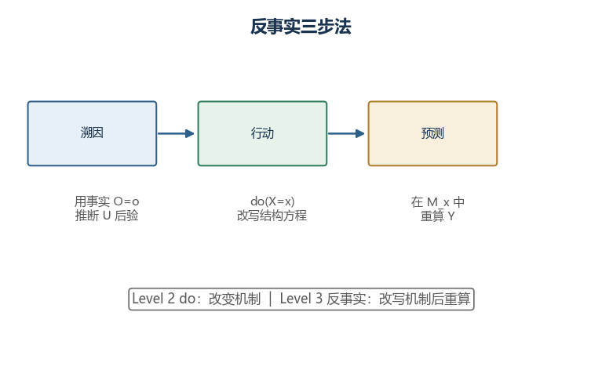

## 16.3　数值算例：线性 SCM 中的反事实

**溯因步的实质。** 三步法中，溯因是把「观测到的事实」逆推为「外生变量的后验」，即计算 $\mathbb{P}(U\mid O=o)$。它是反事实推断中最脆弱的一步：事实 $O=o$ 只给出关于 $U$ 的**部分信息**（多个 $U$ 可能生成同一事实），故 $\mathbb{P}(U\mid O=o)$ 通常是一个分布而非单点。下面的算例中，我们或假设噪声可忽略以取得点估计，或显式保留后验；高维情形下该步须用采样（MCMC）近似。记住：反事实结论的可靠性，一半取决于结构方程设得对不对，另一半取决于溯因后验推得准不准。

**例 16.1（线性 SCM 手算）**　设因果图 $T\leftarrow U\to Y$，$T\to Y$，结构方程为

$$
T=\mathbf{1}[U>0.5],\quad Y=2T+3U+\varepsilon,\quad U\sim\mathrm{Uniform}(0,1),\ \varepsilon\sim\mathcal{N}(0,0.1). \tag{16-5}
$$

现观测到一位患者 $T=1,Y=4.5$（事实）。求反事实「若 $T=0$，$Y$ 为多少」。

**溯因**：由 $T=1$ 知 $U>0.5$；由 $Y=4.5=2\times1+3U+\varepsilon$ 得 $3U+\varepsilon=2.5$，忽略小噪声 $\varepsilon\approx0$ 得 $\hat U\approx0.833$。于是 $\mathbb{P}(U\mid T=1,Y=4.5)$ 集中在 $0.83$ 附近。

**行动**：把 $T$ 的方程改为 $T=0$，得 $M_0$。

**预测**：在 $M_0$ 中用 $\hat U=0.833$ 重算 $Y_0=2\times0+3\times0.833=2.5$。

结论：该患者「若当初没服药」，康复指标约 $2.5$（事实为 $4.5$），个体处理效应约 $4.5-2.5=2.0$。注意这个个体效应 $\tau_i=2.0$ 与平均效应 $\mathbb{E}[Y(1)-Y(0)]=2$（因 $Y=2T+\dots$ 中 $T$ 系数为 2）恰好相等——这是因为本例没有 $T\times U$ 交互；若有交互，个体效应会随 $U$ 变（见例 16.2）。

**例 16.2（含交互的异质反事实）**　把式（16-5）改为 $Y=2T+3U+TU+\varepsilon$。则 $\tau(U)=2+U$。对 $U=0.833$ 的患者 $\tau_i=2.833$，而对 $U=0.1$ 者 $\tau_i=2.1$。这清楚显示：个体反事实效应依赖于溯因得到的 $U$，无法仅凭群体平均刻画——再次呼应第 15 章 CATE 与个体效应的区别。

**例 16.3（二元结局的反事实与后验）**　设简化 SCM：$T\leftarrow U$，$Y=1\{T+U\ge1\}$，$U\in\{0,1\}$ 等概，$T=\mathbf{1}[U=1]$（即 $U$ 完全决定 $T$）。事实观测到某个体 $T=1,Y=1$。溯因：$T=1$ 意味着 $U=1$（确定性），故 $\mathbb{P}(U=1\mid T=1,Y=1)=1$。反事实「若 $T=0$，$Y$ 为多少」：行动后 $T=0$，预测 $Y=\mathbf{1}[0+1\ge1]=1$——该个体即使不服药也会康复（$Y_0=1$），个体效应 $\tau_i=Y_1-Y_0=1-1=0$。这与群体平均效应 $\mathbb{P}(Y\mid do(T=1))-\mathbb{P}(Y\mid do(T=0))$ 形成对照：群体看，强制 $T=1$ 时 $Y$ 概率仍为 1、强制 $T=0$ 时 $Y$ 概率也非 0，但**该个体**的效应恰为 0——再次说明个体反事实与群体干预不可互相替代。

**必要性概率与充分性概率。** 例 16.3 引出的「$Y_0=1$」提示一类重要的反事实量。设事实 $(T=1,Y=1)$，定义：

$$
\mathrm{PN}=\mathbb{P}(Y_{0}=0\mid T=1,Y=1),\qquad \mathrm{PS}=\mathbb{P}(Y_{1}=1\mid T=0,Y=0), \tag{16-6}
$$

前者为**必要性概率（probability of necessity）**——「若当初没处理，结局会否不发生」，回答「$T$ 对 $Y$ 是否必要」；后者为**充分性概率（probability of sufficiency）**——「若当初处理了，结局会否发生」，回答「$T$ 对 $Y$ 是否充分」。二者都是个体级反事实（条件于该个体已观测的 $(T,Y)$），在归因与责任认定中比平均效应更贴近直觉：例 16.3 中该患者 $\mathrm{PN}=\mathbb{P}(Y_0=0\mid T=1,Y=1)=0$（没服药也会康复，服药并非必要），正解释了为何其个体效应为 0。PN/PS 与个体效应 $\tau_i$ 不同——$\tau_i$ 是两反事实之差，PN/PS 是单一反事实的条件概率——但它们共享同一套 SCM 三步法，且都可由式 (16-4) 的条件反事实框架推导。

## 16.4　反事实的可识别性

**定义 16.3（反事实可识别性）**　称反事实 $\mathbb{P}(Y_x\mid O=o)$ 在观测分布 $\mathbb{P}(V)$ 下可识别，若它能由 $\mathbb{P}(V)$ 与因果图唯一确定，无论结构方程的具体形式与 $\mathbb{P}(U)$ 为何。

关键结论：

**定理 16.1（反事实识别的充分条件）**　若存在一组协变量 $Z$ 满足「在给定 $Z$ 后，$Y$ 对 $T$ 的后门路径被阻断」且 $Z$ 不受 $T$ 影响，则

$$
\mathbb{P}(Y_{x}\mid T=x',Y=y)=\sum_{z}\mathbb{P}(Y=y'\mid T=x,Z=z)\ \mathbb{P}(Z=z\mid T=x',Y=y), \tag{16-7}
$$

其中 $y'$ 为将 $T$ 置 $x$ 后的结局（具体推导见[2]）。

**直觉解释。** 式（16-7）把反事实拆成两部分：给定 $Z$ 的干预效应 $\mathbb{P}(Y_{x}\mid Z=z)$（可由 do-演算从观测数据识别，等于 $\mathbb{P}(Y\mid T=x,Z=z)$），乘以「事实个体在 $Z$ 上的分布」（由贝叶斯公式从观测数据得到）。当 $Z$ 包含所有混杂时，反事实可识别；若存在未观测混杂，则不可识别——这是第 19 章不可识别性主题的伏笔。

**与工具变量的联系。** 当只有工具变量 $Z$ 而混杂未观测时，群体-level 的 LATE（第 13 章）可识别，但个体-level 反事实通常不可识别。Pearl 证明：工具变量下可识别的只是「对依从者（compliers）的平均反事实」，而非任意个体的 $\mathbb{P}(Y_x\mid O=o)$[3]。这划清了 Level 2 与 Level 3 的能力边界。

**不可识别时的界（Balke–Pearl 框架）。** 当混杂未观测、反事实不可点识别时，仍可从观测分布 $\mathbb{P}(V)$ 推出其概率的**上下界**。Balke 与 Pearl 证明[7]，任意反事实概率 $\mathbb{P}(Y_x\mid O=o)$ 都可以写成观测概率的线性规划：

$$
\sup/\inf\ \sum_{\mathbf{u}}\mathbb{P}(\mathbf{u})\,\mathbb{1}\big[Y_{M_x}(\mathbf{u})=y,\ \mathbf{o}_{\mathbf{u}}\big]\quad \text{s.t.}\ \mathbb{P}(V=v)=\sum_{\mathbf{u}:V_M(\mathbf{u})=v}\mathbb{P}(\mathbf{u}), \tag{16-8}
$$

其中 $\mathbf{o}_{\mathbf{u}}$ 表示外生赋值 $\mathbf{u}$ 是否生成事实观测 $\mathbf{o}$。式 (16-8) 说明：即使无法点识别，反事实概率也被「观测分布 + 图结构」夹在一个区间内；当该区间退化为单点时反事实可识别，区间越宽则结论越依赖额外假设。这正是第 19 章「敏感性分析」的形式化原型：报告的不是一个数，而是一个受假设约束的区间。

**Twin 网络（twin network）。** 反事实计算常借助 **twin 图**[5]：把原因果图复制成「事实层」（带事实观测 $O=o$）与「反事实层」（施加 $\mathrm{do}(X=x)$），两层通过共享的外生变量后验 $\mathbb{P}(U\mid O=o)$ 耦合。在 twin 图上，三步法可机械化执行——先在事实层溯因更新 $U$ 的后验，再在反事实层做 do-操作并重算 $Y$。对中介效应（第 17 章），twin 图进一步允许同时携带 $M_t$ 与 $M_{t'}$ 两个中介反事实，从而在**同一个图**里比较两条路径，这是把 do-演算从「单世界」推广到「双世界比较」的关键图形工具。

## 16.5　技术谱系

**表 16-1　反事实形式化谱系**

| 方法 | 提出者/年代 | 核心贡献 | 与本书其他章的关系 |
|------|-------------|----------|--------------------|
| 潜在结果 | Rubin 1974[4] | $Y(0),Y(1)$ 符号化 | 第 10—15 章的基础 |
| SCM 与因果图 | Pearl 1995[1] | 结构方程＋图 | 第 3 章 |
| 反事实算法 | Pearl 2000[2] | abduction-action-prediction | 本章核心 |
| twin 网络 | Pearl 2009[5] | 反事实图与 Twin 图 | 第 17 章中介 |
| 个体化效应 | Abadie et al. 2002 | 可识别的个体效应边界 | 第 19 章 |

## 16.6　边界与讨论

其一，**反事实依赖最强的假设**。反事实识别要求结构方程（机制）与外生变量分布被广泛假设：图的正确性、机制的不变性、溯因的可靠性。相比 do-干预只需因果图正确，反事实额外要求「外生变量的 posterior 可由事实更新」——这通常是更强的结构性假设。

其二，**反事实不是「事实的反面」**。很多人误以为反事实就是把观测结果取反。实际上反事实需要重建一个「改写世界」，其结论依赖整个结构模型。同一个观测数据，在不同但都拟合数据的结构模型下，反事实答案可能不同——这正是第 19 章要深入讨论的不可识别性与敏感性。

其三，**与潜在结果框架的等价与分工**。潜在结果框架（第 10 章）用 $Y(0),Y(1)$ 简洁地定义效应，擅长随机实验与准实验；SCM 用结构方程显式表达机制，擅长反事实与中介（第 17 章）。二者在「无未观测混杂」时可互相翻译，但在「有未观测混杂的反事实」时，SCM 语言更精细[6]。

其四，**溯因的脆弱性放大了结构假设的代价**。反事实的三步法中，溯因步把「个体事实」逆推为「外生变量的后验」，这一步对模型设定最敏感：若结构方程 $f_i$ 的形式（线性/非线性/交互项）设错，或 $\mathbb{P}(U)$ 误设，则 $\hat U$ 偏离真实背景，行动与预测两步会被「错误的世界」带偏——偏误会沿三步放大。相比之下，do-演算只需图正确、不需溯因，故对结构误设更稳健。因此使用反事实结论时应配套敏感性分析（式 16-8 的界），明确报告「在多大范围的结构扰动下，反事实结论不变」，这正是第 19 章的主题。

## 16.7　承上启下

本章把因果推断从干预层推进到反事实层。我们定义了 SCM（式 16-1）与反事实（式 16-2），给出 abduction—action—prediction 三步法，用线性与二元 SCM 数值算例（例 16.1—16.3）演示个体反事实的计算，讨论必要性/充分性概率（式 16-6）、反事实识别（式 16-7）、不可识别时的界（式 16-8）、twin 网络及其与 IV 的边界。核心结论是：个体反事实 $\tau_i=Y_{M_1}(U_i)-Y_{M_0}(U_i)$（式 16-3）需要知道外生背景 $U_i$，这使反事实比平均效应更难、更依赖结构假设。

有了反事实语言，我们可以处理两类此前无法回答的问题。其一，**中介分析**：若处理 $T$ 通过中介 $M$ 影响 $Y$，「若保持 $M$ 不变，处理的直接效应是多少」是一个反事实问题，将在第 17 章用反事实定义自然直接/间接效应。其二，**公平性**：「若该求职者的性别/种族改变，录用结果会变吗」是典型的反事实公平（第 18 章）。第 19 章则退一步审视：这些反事实在何种条件下可信，何时不可识别。至此，第四篇「反事实推理」正式展开。

## 本章小结

本章形式化反事实推理。我们指出 do-演算只能回答群体干预，而个体反事实「若他当初没做会怎样」需要更强的语言（16.1 节），并阐明 Level 3 严格高于 Level 2 的不对称。SCM（式 16-1）把因果关系写成自治的结构方程，其一致性与模块化性质是反事实可运算的前提；反事实（式 16-2）由溯因—行动—预测三步计算，潜在结果 $Y_i(x)$ 统一于 $Y_{M_x}(U_i)$（式 16-3）。例 16.1—16.3 用线性与二元 SCM 手算个体反事实，揭示异质性来自 $U$、个体效应不可由群体平均还原。反事实可识别性（式 16-7）要求混杂被观测协变量阻断，不可识别时由 Balke–Pearl 界（式 16-8）给出区间，twin 网络提供双世界比较的图形工具，IV 只能识别 LATE 而非个体反事实。表 16-1 给出谱系。四条边界：反事实依赖最强结构假设、不是事实的简单取反、与潜在结果框架分工、溯因脆弱性放大结构误设代价。

下一章用反事实语言剖析中介路径，定义自然直接效应与自然间接效应。

**进一步阅读**　SCM 与反事实算法见[1][2][5]；潜在结果对照见[4][6]；不可识别时的界与 twin 网络见[7][8]。

## 参考文献

[1] Pearl J. Causal diagrams for empirical research. *Biometrika*, 1995, 82(4): 669–688.

[2] Pearl J. *Causality: Models, Reasoning, and Inference*. 2nd ed. Cambridge: Cambridge University Press, 2000.

[3] Pearl J. Instrumental variables: A tale of two models. Technical Report R-269, UCLA, 1999.

[4] Rubin D B. Estimating causal effects of treatments in randomized and nonrandomized studies. *Journal of Educational Psychology*, 1974, 66(5): 688–701.

[5] Pearl J. Direct and indirect effects. In *Proceedings of the 16th Conference on Uncertainty in Artificial Intelligence*, 2000: 411–420.

[6] Hernán M A, Robins J M. *Causal Inference: What If*. Boca Raton: Chapman & Hall/CRC, 2020.

[7] Balke A, Pearl J. Counterfactual probabilities: Computational methods, bounds and applications. In *Proceedings of the 10th Conference on Uncertainty in Artificial Intelligence*, 1994: 46–54.

[8] Shpitser I, Pearl J. Complete identification methods for the causal hierarchy. *Journal of Machine Learning Research*, 2008, 9: 1941–1979.

---

# 第 17 章　中介分析与路径效应

第 16 章给出了反事实的形式化语言，也留下了一个具体问题：当处理 $T$ 并非直接作用于结局 $Y$，而是先改变某个中介变量 $M$，再由 $M$ 影响 $Y$ 时，我们如何区分「$T$ 直接造成的影响」与「$T$ 通过 $M$ 间接造成的影响」？这就是**中介分析（mediation analysis）**的核心问题。

举一个贯穿全书的例子（第 1.6 节统一案例的延伸）：新药 $T$ 可能直接改善康复 $Y$，也可能先降低炎症指标 $M$，再由炎症改善促进康复。若药物有副作用会升高血压，而血压升高抵消了部分康复收益，那么「总效应」可能很小，但「通过炎症的间接效应很大、直接效应为负」——这种路径分解对药物设计至关重要：我们应该优化那条有益路径、阻断那条有害路径。

中介分析看似直观，却在统计学界引发长达数十年的争论：把「直接效应」和「间接效应」相加得到总效应，在什么条件下成立？为什么传统乘积法 $\hat a\hat b$ 在有处理—中介交互时失效？本章用第 16 章的反事实语言给出严格答案——**自然直接效应（natural direct effect, NDE）**与**自然间接效应（natural indirect effect, NIE）**，并给出识别条件。

本章先讲动机与直观（17.1 节），定义路径效应（17.2 节），给出识别条件与数值算例（17.3 节），讨论与因果图的联系（17.4 节），给出技术谱系（17.5 节），讨论边界（17.6 节），最后承上启下（17.7 节）。

## 17.1　引入动机：为什么要分解路径

**引入动机。** 政策评估常问「政策有效吗」（总效应），但机制分析要问「政策通过什么渠道起效」（路径效应）。设处理 $T$、中介 $M$、结局 $Y$，最简单的中介图为 $T\to M\to Y$，另有直接边 $T\to Y$。总效应 $T\to Y$ 拆成两段：一段绕经 $M$（间接），一段直达（直接）。

**为何「路径」比「总量」更有用。** 同样的总效应 $0.88$，可能来自「直接 $0.4$、间接 $0.48$」，也可能来自「直接 $0.88$、间接 $0$」——两种情形的干预策略截然不同。若间接路径经「炎症」，则「降炎症」是有效杠杆；若几乎全是直接作用，则去降炎症徒劳。更棘手的是**抵消路径**：总效应虽小（如 $0.1$），但若拆为「直接 $+0.9$、间接 $-0.8$」（经血压的有害通路抵消了大部分直接收益），那么「阻断有害通路」能把净效应从 $0.1$ 抬升到 $0.9$。总效应数字完全看不出这种结构——这正是路径分解的实战价值：它把「一个平均数」还原成「机制地图」，让决策者知道该优化哪条管、堵哪条管。

**直觉解释。** 可以把中介想象成「管道系统」：处理是总阀门，结局是终点水量，中介是中间的一段管道。要判断总阀门开大后水量增加有多少来自「中间管道」、多少来自「直达管」，需要能「固定中间管道不变」地做实验——这正是反事实操作：让 $T$ 改变但强制 $M$ 保持在某个水平。

**为何「控制 $M$」不等于「固定 $M$」。** 一个常见的错误直觉是：「直接把 $M$ 当协变量控制不就行了」。不行，原因在于「统计控制」与「反事实固定」是两回事。统计控制 $\mathbb{E}[Y\mid T=t, M=m]$ 是在「观测到 $M=m$ 的那些人」里比较；而这些人的 $U_M$（中介的潜在背景）可能已经与 $T$ 相关（若 $T$ 影响 $M$ 且 $M$ 受 $U$ 驱动），条件化 $M=m$ 会引入**碰撞偏误（collider bias）**，扭曲 $T\to Y$ 的直接通道。反事实固定 $\mathrm{do}(M=m)$ 则切断 $M$ 对 $T$ 的响应，让 $M$ 真正「停在 $m$ 不动」，从而干净地隔离直接路径。这正是式 (17-1) 用 $Y_{t,m}$（do-符号）而非 $\mathbb{E}[Y\mid T=t,M=m]$ 的原因——二者在 $M$ 与 $Y$ 有共同原因时数值不同。

**定义 17.1（中介变量，mediator）**　在因果图中，若变量 $M$ 位于从 $T$ 到 $Y$ 的因果路径上（即存在 $T\to M\to Y$），则称 $M$ 为 $T$ 对 $Y$ 的中介变量。

传统方法（Baron & Kenny 的逐步回归[1]）把总效应分解为 $c=c'+ab$，其中 $a$ 是 $T\to M$ 的系数，$b$ 是控制 $T$ 后 $M\to Y$ 的系数，$c'$ 是直接效应。这种乘积法在没有交互且没有未观测混杂时近似成立，但它缺乏反事实定义——「控制 $M$」不等于「固定 $M$ 不变」，当 $M$ 与 $Y$ 有共同原因时会有偏。第 16 章的反事实语言提供了严格版本。

**Baron–Kenny 四步与失效情形。** Baron–Kenny 操作化四步：① $\mathbb{E}[Y\mid T]$ 显著（总效应 $c$）；② $\mathbb{E}[M\mid T]$ 显著（$a$）；③ $\mathbb{E}[Y\mid T,M]$ 中 $M$ 显著（$b$）；④ 比较 $c$ 与 $c'$ 判断完全/部分中介。这套流程在「线性、无交互、无未测混杂」时给出 $ab$、$c'$，与反事实 NIE、NDE 一致（见例 17.2）。但一旦偏离这些条件便失真：(i) 存在 $T\times M$ 交互时，$ab$ 不再是真 NIE（例 17.3 中低估）；(ii) 存在 $M$—$Y$ 未测混杂时，$b$ 有偏；(iii) $M$ 与 $Y$ 互为因果或有共同下游时，条件化 $M$ 引入碰撞偏误。这些失效情形正是需要式 (17-5)、(17-6) 反事实公式的原因——它们对交互、对混杂的处理都更一般。

## 17.2　受控效应与自然效应

**定义 17.2（受控直接效应，controlled direct effect, CDE）** 在强制 $T=t$、$T=t'$ 且把中介固定为 $m$ 的条件下，结局的期望差：

$$
\mathrm{CDE}(t,t'\mid m)=\mathbb{E}[Y_{t,m}-Y_{t',m}], \tag{17-1}
$$

其中 $Y_{t,m}$ 表示 $\mathrm{do}(T=t,M=m)$ 下的结局（第 16 章符号）。

**定义 17.3（自然直接效应与自然间接效应）** 令 $M_t$ 表示「在 $\mathrm{do}(T=t)$ 下 $M$ 的取值」（第 16 章的反事实中介），则

$$
\mathrm{NDE}(t,t')=\mathbb{E}[Y_{t,M_{t'}}-Y_{t',M_{t'}}], \tag{17-2}
$$

$$
\mathrm{NIE}(t,t')=\mathbb{E}[Y_{t,M_{t}}-Y_{t,M_{t'}}]. \tag{17-3}
$$

**直觉解释。** NDE 的含义：「把 $T$ 从 $t'$ 改为 $t$，但让中介停留在 $t'$ 下本应有的水平 $M_{t'}$」——即从自然世界中取走 $T$ 对 $M$ 的影响。NIE 的含义：「$T$ 固定为 $t$，但把中介从 $t'$ 下的水平换成 $t$ 下的水平」——即只让 $T$ 经中介的那条路径起作用。式（17-2）与（17-3）相加：

$$
\mathrm{NDE}+\mathrm{NIE}=\mathbb{E}[Y_{t,M_t}-Y_{t',M_{t'}}]=\mathbb{E}[Y_t-Y_{t'}], \tag{17-4}
$$

即总效应等于自然直接效应加自然间接效应。这个「加总性（additivity）」是反事实定义的直接结果，也是它优于传统乘积法之处——后者只在特殊情形下才等于真 NDE/NIE。

**政策含义：两条干预路线。** NDE 与 NIE 不只是「把总效应拆开」，更对应**两种不同的干预策略**。NDE 度量「阻断 $T\to M$ 通路后仍保留的直接作用」——若 NDE 大，说明效果主要来自直接机制，干预 $M$ 事倍功半；NIE 度量「经由 $M$ 的传导」——若 NIE 大，说明 $M$ 是关键杠杆，可考虑「保持 $T$ 不变、单独优化 $M$」（如不改变剂量、只配合抗炎治疗）。但须警惕 17.6 节的「可实施性」边界：NIE 假设能「只改 $M$ 而不改 $T$ 对 $M$ 的因果作用」，这在物理上未必可行（如无法单独降低炎症而不影响给药）。因此解读 NDE/NIE 时应区分「统计路径」与「可实施干预」，必要时退而报告 CDE（把 $M$ 固定在某可达水平）作为更保守的决策依据。

注意 CDE（式 17-1）与 NDE（式 17-2）的区别：CDE 把 $M$ 固定在**人为选定**的 $m$，NDE 把 $M$ 固定在**反事实自然值** $M_{t'}$。CDE 依赖 $m$ 的选取，NDE 不依赖；两者不可混用。

**例 17.1（CDE 与 NDE 的数值对照）**　取线性中介模型 $M=0.5+0.8T+U_M,\ Y=1+0.4T+0.6M+U_Y$（$U_M,U_Y$ 小噪声）。取一个人为的中介水平 $m=1.5$，计算 $\mathrm{CDE}(1,0\mid m=1.5)=\mathbb{E}[Y_{1,1.5}-Y_{0,1.5}]$：把 $T$ 与 $M$ 都固定（$T=1,M=1.5$ 与 $T=0,M=1.5$），$Y$ 的差为 $(1+0.4+0.6\times1.5)-(1+0+0.6\times1.5)=0.4$。可见 CDE 在任意 $m$ 下都等于直接系数 $0.4$（本模型线性、无交互时），与 $m$ 无关——但这是线性特例。若改选 $m=0.5$ 或 $m=2.5$，CDE 仍是 $0.4$；而 NDE 把 $M$ 固定在「$T=0$ 时的自然分布 $M_0$」上，等于对 $m$ 取按 $\mathbb{P}(M_0)$ 的期望。二者在本例碰巧一致，但一般情形（交互、非线性）下 CDE 随 $m$ 变、NDE 不随 $m$ 变，政策含义也不同：CDE 回答「若我把炎症强制压到某水平，直接效应多大」，NDE 回答「若阻断 $T\to M$ 整条通路，直接效应多大」。

> 【图 17-1　中介路径分解】（原图见 figures/图17-1.png）：因果图 $T\to M\to Y$ 与 $T\to Y$，标注直接路径与间接路径；下方用两条分支箭头对照 NDE（$T$ 改变、$M$ 固定为 $M_{t'}$）与 NIE（$T$ 固定、$M$ 从 $M_{t'}$ 换为 $M_t$）。

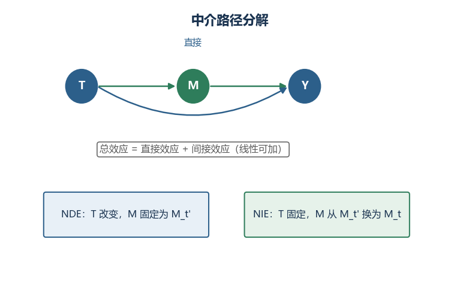

## 17.3　识别条件与数值算例

**识别假设。** NDE/NIE 的识别需要比总效应更强的条件[2][3]：

1. **无未观测混杂**：$Y_{t,m}\perp T\mid X$、$Y_{t,m}\perp M\mid T,X$（给定协变量后，处理与中介对结局无混杂）；
2. **无处理—中介混杂对 $M$ 的影响混淆**：$M_t\perp T\mid X$；
3. **交叉世界反事实 Independence**（I-2）：$Y_{t,m}\perp M_{t'}\mid X$——即「结局在某处理—中介组合下的潜在值」与「中介在另一处理下的潜在值」独立。

假设 3 最强也最具争议：它要求不存在同时影响 $M$ 与 $Y$ 的未观测变量（即使控制 $X$ 后）。若该假设不成立，NDE/NIE 不可识别，只能识别 CDE 或效应的界（第 19 章）。

**交叉世界独立性为何「跨世界」。** 假设 3 的「交叉」体现在：$Y_{t,m}$ 属于「$T=t$ 世界」的潜在结局，$M_{t'}$ 属于「$T=t'$ 世界」的潜在中介，二者来自**不同的反事实世界**。设存在未测变量 $W$ 同时驱动 $M$ 与 $Y$（如「基础代谢率」既影响炎症 $M$ 又影响康复 $Y$），则即使控制全部观测 $X$，$Y_{t,m}$ 与 $M_{t'}$ 仍经 $W$ 相关——假设 3 被破坏。此时 NDE 的识别式 (17-5) 中「$\mathbb{P}(M=m\mid t',x)$ 与 $\mathbb{E}[Y\mid t,m,x]$ 可分离相乘」这一步失效，因为 $M_{t'}$ 与 $Y_{t,m}$ 不再可分离。一个直观例子：若 $W$ 高者既在 $T=1$ 时 $M$ 偏高、又使 $Y$ 偏高，则「在 $T=0$ 世界取 $M$ 的分布」与「在 $T=1$ 世界读 $Y$ 的条件期望」会被 $W$ 耦联，相乘得到的是错的 NDE。这正是中介分析比总效应估计「更脆弱」的根源——多了一个跨世界的不可检验假设。

在这些假设下，Pearl 给出识别公式[3]：

$$
\mathrm{NDE}(t,t')=\sum_{m,x}\Big[\mathbb{E}[Y\mid t,m,x]-\mathbb{E}[Y\mid t',m,x]\Big]\mathbb{P}(M=m\mid t',x)\mathbb{P}(x), \tag{17-5}
$$

$$
\mathrm{NIE}(t,t')=\sum_{m,x}\mathbb{E}[Y\mid t,m,x]\Big[\mathbb{P}(M=m\mid t,x)-\mathbb{P}(M=m\mid t',x)\Big]\mathbb{P}(x). \tag{17-6}
$$

式（17-5）的直观：直接效应用「结局关于处理的条件期望差」乘以「$t'$ 下中介的分布」（即 $M_{t'}$ 的分布）；式（17-6）的直观：间接效应用「$t$ 下的结局—中介关系」乘以「中介分布的改变量」。

**推断与敏感性。** 式 (17-5)、(17-6) 是「观测量之积」的泛函，其渐近分布一般不闭合，Imai 等[7]用**非参数 bootstrap** 估计标准误：对样本重抽 $B$ 次、每次独立估计 $\widehat{\mathrm{NDE}}^{(b)},\widehat{\mathrm{NIE}}^{(b)}$，再取 $B$ 个样本的标准差作 $\widehat{\mathrm{SE}}$，构造区间 $\widehat{\mathrm{NIE}}\pm z_{\alpha/2}\widehat{\mathrm{SE}}$。这回避了「乘积项渐近正态」的封闭推导。更重要的是**敏感性分析**：假设 3（交叉世界独立）被违反时，可设一个未测的中介—结局混杂 $\omega$，VanderWeele[2] 给出「使 NIE 归零所需的最小混杂强度」$\omega_{\max}$——报告 $\omega_{\max}$ 即量化「中介结论对未测混杂的稳健程度」，与第 12 章倾向得分敏感性、第 16 章式 (16-8) 的界一脉相承。

**例 17.2（线性中介模型手算）**　设 $X$ 为空，$T\in\{0,1\}$，中介与结局的线性模型（无交互，满足假设）：

$$
M=0.5+0.8T+U_M,\quad Y=1.0+0.4T+0.6M+U_Y,\quad U_M,U_Y\sim\mathcal{N}(0,0.1). \tag{17-7}
$$

由 $a=0.8$（$T\to M$）、$b=0.6$（$M\to Y$）、$c'=0.4$（直接）。乘积法给间接 $=ab=0.48$，直接 $=0.4$，总 $=0.88$。

用反事实公式验证：$M_0=0.5+U_M$，$M_1=1.3+U_M$。$\mathrm{NDE}= \mathbb{E}[Y_{1,M_0}-Y_{0,M_0}]=\mathbb{E}[(1+0.4+0.6M_0)-(1+0.6M_0)]=0.4=c'$。$\mathrm{NIE}=\mathbb{E}[Y_{1,M_1}-Y_{1,M_0}]=\mathbb{E}[0.6(M_1-M_0)]=0.6\times0.8=0.48=ab$。加总 $0.88$，与式（17-4）一致。本例无交互，反事实分解恰好回到乘积法——但下一例显示有交互时二者分道扬镳。

**例 17.3（有交互时乘积法失效）**　把式（17-7）改为 $Y=1+0.4T+0.6M+0.3\,T\times M+\cdots$。此时 $T$ 对 $M$ 的作用在结局中被放大。乘积法 $ab$ 仍为 $0.48$，但真 NIE 由式（17-6）计算含 $T\times M$ 项，约为 $0.48+0.3\mathbb{E}[M_1-M_0]$ 的额外贡献 $=0.48+0.3\times0.8=0.72$。乘积法低估了间接效应——这正是反事实定义的价值。

**中介比例（proportion mediated）。** 分解的价值最终要回答「间接路径解释了总效应的多少」。定义**自然中介比例**为

$$
\mathrm{PM}=\frac{\mathrm{NIE}}{\mathrm{NDE}+\mathrm{NIE}}=\frac{\mathrm{NIE}}{\text{总效应}}. \tag{17-8}
$$

在例 17.2（无交互）中 $\mathrm{PM}=0.48/0.88\approx0.545$——药物总效应的约 54.5% 经由炎症中介传递，其余 45.5% 是直接作用。这一比例对药物设计至关重要：若有益路径是间接路径（$\mathrm{PM}$ 大），可考虑「放大 $T\to M$、阻断 $M\to Y$ 的有害分支」；若 $\mathrm{PM}$ 小，则直接作用主导。注意式 (17-8) 只在无交互时与乘积法的 $\frac{ab}{c'+ab}$ 一致；有交互时二者分道扬镳，应以反事实 NDE/NIE 为准。

## 17.4　与因果图及前几章的联系

**Twin 图（twin network）。** Pearl 为反事实引入 twin 图：把因果图复制两份，一份对应 $\mathrm{do}(T=t)$，一份对应 $\mathrm{do}(T=t')$，共享外生变量 $U$ 的后验。NDE/NIE 可在 twin 图上用 do-演算推导[3]——这把第 3 章的 do-演算从单一世界扩展到「双世界」比较，是第 16 章三步法的图形化。

**与异质效应的联系。** 第 15 章的 CATE $\tau(x)=\mathbb{E}[Y(1)-Y(0)\mid X=x]$ 是总效应在协变量条件下的细化；本章的 NDE/NIE 则把效应按**路径**分解。二者正交：可以估计「某亚组 $X=x$ 的 NDE」——结合第 15 章的因果森林与本章的反事实公式，即得异质中介效应（当前研究前沿）。

**与可忽略性的联系。** 式（17-5）、（17-6）中的 $\mathbb{E}[Y\mid t,m,x]$ 与 $\mathbb{P}(M=m\mid t,x)$ 都是观测量，其识别依赖第 11 章的可忽略性（给定 $X,T$ 后 $M$ 与 $Y$ 无混杂）。假设不成立时，需借助第 13 章的工具变量或第 14 章的准实验设计。

**多重中介与路径分解的不唯一性。** 当存在多个中介 $M_1,M_2$（或 $M_1\to M_2$ 链式结构）时，「间接效应」的分解**不再唯一**：先阻断 $T\to M_1$ 还是先阻断 $T\to M_2$，得到不同的「路径特异性」直接/间接效应。严格处理需定义**路径特异性反事实**——对一条给定的有向路径 $P$，NIE$_P$ 是「只让 $T$ 经由 $P$ 起作用」的效应。VanderWeele[2] 给出多中介下「纯间接效应」的识别式：它按中介的拓扑序逐个把中介从「处理后的反事实值」回退到「对照值」。例如 $T\to M_1\to M_2\to Y$ 的链式中介，总间接效应可拆为「经 $M_1$ 的全部」与「额外经 $M_2$ 的增量」两部分，但拆分依赖阻断顺序。这正是 17.6 节「多重中介分解不唯一」一说的形式化来源——研究者必须**预先指定**关心的路径结构，否则「间接效应多大」没有唯一答案。

## 17.5　技术谱系

**表 17-1　中介分析方法谱系**

| 方法 | 提出者/年代 | 核心量 | 局限 |
|------|-------------|--------|------|
| 逐步回归 | Baron & Kenny 1986[1] | $ab$ 乘积 | 无反事实定义、混淆 CDE/NDE |
| 自然效应 | Pearl 2000[3] / Robins & Greenland 1992[4] | NDE, NIE | 需强假设（含交叉世界独立） |
| 敏感性分析 | VanderWeele 2015[2] | 效应对混杂的稳健性 | 只给界而非点识别 |
| 中介机器学习 | 近期研究 | 高维 $X$ 下 NDE/NIE | 仍需识别假设 |

## 17.6　边界与讨论

其一，**交叉世界独立性假设难以验证**。假设 3（$Y_{t,m}\perp M_{t'}\mid X$）无法从观测数据检验，本质是「不存在未测的中介—结局混杂」。实际研究中应尽量测量可能的共同原因并纳入 $X$；否则结论应作为敏感性分析而非定论。

其二，**中介的「固定」是反事实操作而非物理操作**。CDE 中「固定 $M=m$」若在现实中不可行（如 $M$ 是「炎症指标」而非可独立操控的药物剂量），则 CDE 缺乏政策可操作性；NDE 更接近「阻断 $T\to M$ 通路」的假想干预。实践者须区分「统计分解」与「可实施干预」。

其三，**多重中介与路径交互**。当存在多个中介 $M_1,M_2$ 或中介间相互作用时，NIE 的分解不唯一（先阻断哪条路径影响定义），需要更细致的路径特异反事实[2]。这是开放问题。

## 17.7　承上启下

本章用第 16 章的反事实语言严格定义了中介效应：CDE（式 17-1）、NDE（式 17-2）、NIE（式 17-3），证明总效应等于 NDE＋NIE（式 17-4），给出识别公式（式 17-5、17-6）、中介比例（式 17-8）与算例（例 17.1—17.3）。我们指出乘积法 $ab$ 只在无交互时等于真 NIE，反事实定义才是一般答案。Twin 图（17.4 节）把 do-演算扩展到双世界比较。

中介分析展示了反事实的一个威力：把总效应拆成路径，回答「何以起效」。反事实的另一大应用在本章之后的第 18 章——**公平性**：如果一个招聘算法拒绝了一位女性求职者，我们问「若她是男性，会被录用吗」。这是把反事实用于社会价值判断，技术结构类似中介（把 $T=$ 性别「干预」掉），但触及更敏感的伦理与法律问题。第 19 章则统一审视：当反事实依赖的强假设不成立时，我们能说什么、不能说什么。第四篇继续深入。

## 本章小结

本章论述中介分析与路径效应。我们指出总效应可拆为直接与间接路径（17.1 节），澄清「统计控制 $M$」不等于「反事实固定 $M$」，用反事实语言定义 CDE（式 17-1）、NDE（式 17-2）、NIE（式 17-3），并证明加总性（式 17-4）。识别需要三类假设，尤其「交叉世界独立性」（17.3 节），Pearl 公式（式 17-5、17-6）给出可估计表达，中介比例（式 17-8）量化间接路径的份额，bootstrap 与敏感性分析提供推断。例 17.1 对照 CDE 与 NDE，例 17.2 显示无交互时反事实分解回到乘积法，例 17.3 显示有交互时乘积法失效。表 17-1 梳理谱系。三条边界：交叉世界独立性难验证、固定中介未必可操作、多重中介分解不唯一。

下一章把反事实用于公平性，定义反事实公平并讨论歧视检测。

**进一步阅读**　反事实中介的经典见[3]；系统处理见[2]；早期定义见[4]。

## 参考文献

[1] Baron R M, Kenny D A. The moderator–mediator variable distinction in social psychological research. *Journal of Personality and Social Psychology*, 1986, 51(6): 1173–1182.

[2] VanderWeele T J. *Explanation in Causal Inference: Methods for Mediation and Interaction*. New York: Oxford University Press, 2015.

[3] Pearl J. Direct and indirect effects. In *Proceedings of the 16th Conference on Uncertainty in Artificial Intelligence*, 2000: 411–420.

[4] Robins J M, Greenland S. Identifiability and exchangeability for direct and indirect effects. *Epidemiology*, 1992, 3(2): 143–155.

[5] Pearl J. *Causality: Models, Reasoning, and Inference*. 2nd ed. Cambridge: Cambridge University Press, 2009.

[6] Shpitser I, VanderWeele T J. Counterfactual mediation with exposure-induced mediator–outcome confounders. *Epidemiology*, 2014, 25(4): 548–557.

[7] Imai K, Keele L, Tingley D. A general approach to causal mediation analysis. *Psychological Methods*, 2010, 15(4): 309–334.

[8] Hernán M A, Robins J M. *Causal Inference: What If*. Boca Raton: Chapman & Hall/CRC, 2020.

---

# 第 18 章　公平性与反事实

第 17 章展示了反事实的一个威力：把总效应拆成路径，回答「何以起效」。本章展示反事实的另一个、也是更具社会敏感性的威力——判断**公平性（fairness）**与**歧视（discrimination）**。

设某招聘算法拒绝了一位女性求职者。我们能否说算法「因为她是女性而拒绝了她」？一个自然的检验是问：**「若她是男性（其他一切不变），算法会录用她吗？」** 如果答案是「会」，则她的性别对结果有因果影响，构成反事实歧视。这正是第 16 章的反事实问题在社会领域的应用。

然而公平性远比「换个性别看看」复杂。若性别通过「生育风险」等被算法视为合法考量（在某些司法辖区），直接效应与间接效应的区分就至关重要——这又回到第 17 章的中介分解。更进一步，统计公平（statistical fairness）的诸多定义（如人口均等、机会均等）之间被证明在一般情况下互斥，而因果定义提供了一条新路：用反事实把「系统性的群体差异」与「个体应得的差异」分开。本章系统梳理因果公平与反事实公平，给出歧视检测的因果方法，并讨论各类公平性度量。

本章先讲动机与直觉（18.1 节），定义因果公平与反事实公平（18.2 节），讲歧视检测与因果度量（18.3 节），给出数值算例（18.4 节），给出技术谱系（18.5 节），讨论边界（18.6 节），最后承上启下（18.7 节）。

## 18.1　引入动机：从统计公平到因果公平

**引入动机。** 机器学习系统日益介入信贷、招聘、量刑等高风险决策，公平性成为核心议题。传统做法是**统计公平（statistical fairness）**：要求算法输出满足某种群体统计约束，例如

$$
\mathbb{P}(\hat{Y}=1\mid A=0)=\mathbb{P}(\hat{Y}=1\mid A=1), \tag{18-1}
$$

其中 $A$ 为敏感属性（gender/race），$A=0$ 为弱势群体，$\hat Y$ 为决策。式（18-1）称为**人口均等（demographic parity）**[1]。

**直觉解释。** 统计公平只看「结果分布是否均等」，不管「为什么」。若某群体 qualifications 分布本就不同，强制人口均等反而可能扭曲决策。更根本的问题在 2016 年被证明：人口均等、机会均等（equalized odds）、预测均等（predictive parity）等主流统计公平标准，除退化情形外**互不兼容**[2][3]——不可能同时满足。这一「不可能性定理」暗示：统计公平标准在数学上就彼此冲突，需要另一套语言。

**一个最小反例。** 设 100 名女性、100 名男性申请贷款。真实合格数 $Y=1$：女性 50、男性 30（合格基率不同）。取**完美分类器** $\hat Y=Y$：女性判准 $50/100=50\%$，男性判准 $30/100=30\%$。此时人口均等（式 18-1）被违反（$50\%\neq30\%$）；但机会均等（式 18-4）恰好成立——合格者判准率（TPR）女性 $50/50=1$、男性 $30/30=1$ 相等，不合格者误判率（FPR）两侧都是 $0$。要同时满足人口均等，只能把男性判准率抬到 $50\%$（多批 20 名不合格男性）或把女性压到 $30\%$（拒掉 25 名合格女性），二者都破坏机会均等。可见「完美 + 公平」与「人口均等」不可兼得——冲突的根源是**合格基率随 $A$ 不同**。这不是算法的缺陷，而是数学结构使然，故须换到因果语言区分「基率差异（合理）」与「$A$ 的因果效应（歧视）」。

因果公平提供这套语言。它不问「群体统计是否均等」，而问「敏感属性 $A$ 是否对决策 $\hat Y$ 有因果影响」。若把 $A$ 视作一个可被 do-干预的属性，则公平意味着 $\mathbb{P}(\hat Y_{a}=\hat Y_{a'})=1$（对个体而言，改变 $A$ 不改变决策）。这把公平性判定从第 4 章的关联层（Level 1）提升到干预/反事实层（Level 2/3）。

**定义 18.1（敏感属性，sensitive attribute）**　受法律或伦理保护、不得作为歧视性决策依据的变量 $A$（如性别、种族、宗教）。

## 18.2　因果公平与反事实公平

**定义 18.2（因果公平，causal fairness）**　称决策机制 $\hat Y=f(X,A)$ 关于 $A$ 因果公平，若在因果图中 $A$ 到 $\hat Y$ 的所有因果路径都被阻断，即对任意 $a,a'$：

$$
\mathbb{P}(\hat Y_{a}\mid X=x)=\mathbb{P}(\hat Y_{a'}\mid X=x)\quad \forall x. \tag{18-2}
$$

式（18-2）要求「给定资格 $X$，改变 $A$ 不改变决策分布」——这是反事实层面的公平，比统计公平强得多。

**定义 18.3（反事实公平，counterfactual fairness）**　Kusner 等提出[4]：称预测器 $\hat Y$ 反事实公平，若对每个个体 $i$ 与其可达的协变量值 $X_i$：

$$
\mathbb{P}(\hat Y_{A\leftarrow a}(U_i)=y\mid X=x,A=a)=\mathbb{P}(\hat Y_{A\leftarrow a'}(U_i)=y\mid X=x,A=a), \tag{18-3}
$$

其中 $U_i$ 为个体的外生背景变量（第 16 章），$\hat Y_{A\leftarrow a}$ 表示在 SCM 中把 $A$ 改为 $a$ 后重新计算的预测。

**直觉解释。** 反事实公平比因果公平更个体化：它条件于「这个人及她的背景 $U_i$」，问「在她的平行世界里，若 $A$ 不同，预测是否相同」。注意式（18-3）条件于 $X=x$，而 $X$ 本身可能受 $A$ 影响（如「工作年限」可能受性别影响）——若不加区分地把 $X$ 当给定，会把 $A\to X\to\hat Y$ 的间接歧视漏掉。这是反事实公平的关键 subtlety：必须正确建模 $A$ 与 $X$ 的因果关系，区分**代理变量（proxy）**（$X$ 中携带 $A$ 信息的部分）与**合法资格**。

**与第 17 章中介的类比。** 把 $A$ 当作处理 $T$、$\hat Y$ 当作结局 $Y$，则式（18-2）类似「总效应为零」，而「直接歧视 vs 间接歧视」的区分正好用第 17 章的 NDE/NIE：若 $A$ 对 $\hat Y$ 的 NDE 为零但 NIE 非零，则存在通过中介（代理变量）的间接歧视。反事实公平要求「总效应（含所有路径）为零」或「仅合法路径除外」。

> 【图 18-1　反事实公平示意】（原图见 figures/图18-1.png）：因果图 $A\to\hat Y$，$A\to X\to\hat Y$，$U\to X,U\to\hat Y$；用反事实箭头标出「把 $A$ 从 $a$ 改为 $a'$ 后重算 $\hat Y$」，并标出直接路径与经代理变量 $X$ 的间接路径。

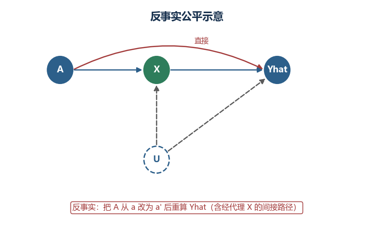

## 18.3　歧视检测与因果度量

**歧视检测的因果方法。** 给定数据与一个假定的因果图，检测 $A$ 是否歧视性影响 $\hat Y$：

1. 估计 $\mathbb{P}(\hat Y\mid do(A=a), X=x)$ 与 $\mathbb{P}(\hat Y\mid do(A=a'),X=x)$（第 3 章 do-演算）；
2. 若二者不等，则 $A$ 对决策有因果效应，存在歧视；
3. 进一步用第 17 章 NDE/NIE 分解：判断歧视来自直接路径还是经代理变量的间接路径。

**统计公平的两种形式。** 除人口均等（式 18-1）外，最常被引用的统计标准是**机会均等（equalized odds）**：在真实合格/不合格者中，两类群体的「判准率」相等：

$$
\mathbb{P}(\hat Y=1\mid A=0,Y=y)=\mathbb{P}(\hat Y=1\mid A=1,Y=y)\quad \forall y\in\{0,1\}. \tag{18-4}
$$

式 (18-4) 把「群体结果率相等」细化为「每个真值层内的判准率相等」，看似更合理，却与人口均等、预测均等在一般情形下互斥——Kleinberg 等[3] 构造的反例表明：除非 $Y$ 与 $A$ 条件独立或 $\hat Y$ 退化，否则不能同时满足。这从数学上解释了「统计公平无解」的困境：问题不在选哪个标准，而在它们彼此矛盾。

**反事实公平度量的形式化。** 反事实公平（式 18-3）可量化为一个群体级散度：定义**反事实公平散度**为

$$
\mathrm{CFD}(a\to a')=\mathbb{E}_X\Big[d\Big(\mathbb{P}(\hat Y_{A\leftarrow a}\mid X),\ \mathbb{P}(\hat Y_{A\leftarrow a'}\mid X)\Big)\Big], \tag{18-5}
$$

其中 $d$ 可取总变差或 Jensen–Shannon 散度。$\mathrm{CFD}=0$ 即反事实公平成立。与统计公平不同，$\mathrm{CFD}$ 度量的是「同一批人在 $A$ 改变后预测分布的漂移」——它允许群体统计差异存在（只要差异不源于 $A$ 本身），因此能容纳「合理的能力差异」，这正是 18.1 节不可能性定理下唯一自洽的方向。

**达成公平的两类因果手术。** 一旦用式 (18-5) 定位了歧视来源，修复就对应两类「因果手术」，其代价截然不同：

- **切除直接路径**（$\mathrm{do}(\hat Y\leftarrow \text{去}A)$）：若 $A$ 直接注入 $\hat Y$（如模型含 $A$ 特征或编码 $A$ 的代理），删除该边即可。代价是若该边「合法」（如某些辖区允许考虑生育成本），切除会损失合理信号。
- **切断代理传播**（阻断 $A\to X\to\hat Y$）：若歧视经代理变量 $X$（收入、邮编）传导，须对 $X$ 做「去偏」——但 $X$ 同时承载合法能力信息，去偏必然损失预测精度，形成**公平—精度权衡（fairness–accuracy trade-off）**。

这正是因果语言超越统计语言之处：统计公平只能说「群体率不相等，需调整」，却不能指出「该切哪条边、切了损失多大」。因果图把「修哪里」变成可计算的问题——用第 17 章的 NDE/NIE 量化每条边的歧视贡献，按「贡献大且非法」优先切除，从而在给定精度损失下最小化歧视。这也是第 26 章因果决策在伦理场景下的具体化。

**表 18-1　公平性度量及其因果解释**

| 度量 | 定义式 | 层级 | 是否因果 |
|------|--------|------|----------|
| 人口均等 | $\mathbb{P}(\hat Y=1\mid A=a)$ 相等 | Level 1 | 否 |
| 机会均等 | $\mathbb{P}(\hat Y=1\mid A=a,Y=y)$ 相等 | Level 1 | 否 |
| 因果公平 | 式（18-2）$A$ 无因果效应 | Level 2/3 | 是 |
| 反事实公平 | 式（18-3）$\hat Y_{A\leftarrow a}=\hat Y_{A\leftarrow a'}$ | Level 3 | 是 |
| 路径特异公平 | NDE/NIE 中非法路径为零 | Level 3 | 是 |

**例 18.1（信贷审批中的反事实歧视）**　设因果图 $A\,(\text{性别})\to X\,(\text{收入})$，$A\to\hat Y$，$X\to\hat Y$，且 $U\to X,U\to\hat Y$（能力 $U$ 同时影响收入与审批）。若数据表明男性平均收入更高、审批率更高，统计公平检验会报警。但因果分析可能发现：收入 $X$ 是合法资格（能力 $U$ 的真实信号），而 $A\to\hat Y$ 的直接路径系数为零——此时「群体审批率差异」源于能力与收入分布差异，不构成反事实歧视。但若 $A\to\hat Y$ 直接系数非零（同等收入下女性仍被拒更多），则存在直接歧视。因果分析把「合理差异」与「歧视」分开——这正是因果公平优于统计公平之处。

**例 18.2（统计公平与因果判定的数值对照）**　设 1000 名求职者，女性 $A=0$ 500 人、男性 $A=1$ 500 人。真实合格率 $Y=1$ 占 40%（女性与男性相同，能力分布一致）。审批结果如下：

| 群体 | 判准数 | 判准率 $\mathbb{P}(\hat Y=1\mid A)$ | 合格者判准率 |
|------|--------|-------------------------------------|--------------|
| 女性 | 150 | 30% | 350 人中的 120 人 = 34.3% |
| 男性 | 220 | 44% | 400 人中的 200 人 = 50.0% |

人口均等（式 18-1）被违反（30%≠44%）；机会均等（式 18-4）也被违反（合格者 34.3%≠50%）。统计标准一律报警。但若因果图显示 $A\to\hat Y$ 直接系数为零、$A\to X\to\hat Y$ 中收入 $X$ 是能力信号且**能力分布相同**，则群体判准率差异本不应出现——进一步溯因发现差异来自「同等收入下女性被多拒 6 个百分点」，对应 $A\to\hat Y$ 的隐藏直接路径（数据噪声或模型残差）。此时反事实散度 $\mathrm{CFD}$（式 18-5）在「收入相同」的亚组内显著非零，证实存在直接歧视；而若 $\mathrm{CFD}=0$、差异纯由收入分布造成，则属「合理差异」。这一对照说明：统计公平只能给出「报警信号」，因果 + 反事实度量才给出「报警是否成立」的判定。

## 18.4　数值算例：反事实公平检验

**例 18.3（手算反事实公平）**　设 SCM：

$$
A\in\{0,1\},\ X=2A+U,\ \hat Y=\mathbf{1}[X+0.5A+U>3],\ U\sim\mathrm{Uniform}(0,2). \tag{18-6}
$$

决策 $\hat Y$ 同时依赖 $A$（直接系数 0.5）与 $X$（含 $A$ 的成分）。

取一位女性 $A=0$、能力 $U=1.2$，则 $X=1.2$，$\hat Y=\mathbf{1}[1.2+0+1.2>3]=\mathbf{1}[2.4>3]=0$（拒绝）。

做反事实：把 $A$ 改为 $1$，保持 $U=1.2$。则 $X_{A\leftarrow1}=2\times1+1.2=3.2$，$\hat Y_{A\leftarrow1}=\mathbf{1}[3.2+0.5+1.2>3]=\mathbf{1}[4.9>3]=1$（录用）。

同一个人，仅性别不同，决策从「拒绝」翻转为「录用」——$\hat Y_{A\leftarrow0}\ne\hat Y_{A\leftarrow1}$，违反反事实公平（式 18-3）。进一步分解：若我们「修复」直接路径（把 0.5A 项去掉）但保留 $A\to X$，则 $\hat Y=\mathbf{1}[X+U>3]$；对该个体 $A=0$ 时 $2.4\ngtr3$ 拒绝，$A=1$ 时 $3.2+1.2=4.4>3$ 录用——仍翻转。说明歧视还存在经 $X$ 的间接路径（因 $X=2A+U$ 携带了 $A$ 的信息）。要达成反事实公平，必须同时消除直接路径与 $A$ 对 $X$ 的不当传播（或论证 $A\to X$ 是合法机制）。

**群体层面的判准率差。** 把视角从个体升到群体，对 $U\sim\mathrm{Uniform}(0,2)$ 求录用概率。女性 $A=0$：$X=U$，$\hat Y=\mathbf{1}[X+U>3]=\mathbf{1}[2U>3]$，需 $U>1.5$，录用率 $\mathbb{P}(U>1.5)=0.25$。男性 $A=1$：$X=2+U$，$\hat Y=\mathbf{1}[X+0.5+U>3]=\mathbf{1}[2U+2.5>3]$，需 $U>0.25$，录用率 $\mathbb{P}(U>0.25)=0.875$。群体判准率差 $0.875-0.25=0.625$（62.5 个百分点）。由于两组的能力 $U$ 分布完全相同（同是 $\mathrm{Uniform}(0,2)$），这 62.5 个百分点的差异**全部**由敏感属性 $A$ 造成——既经直接项 $0.5A$，也经 $A\to X$（$X=2A+U$ 中 $2A$ 把男性收入系统性抬高）。这正是反事实散度 $\mathrm{CFD}$（式 18-5）在群体层面要捕获的量：它把「统计上观察到的 62.5 个百分点差异」整体归因到「$A$ 的因果通道」，而非「能力分布不同」——若 $A$ 与 $X$、$\hat Y$ 均无因果路径，则无论 $U$ 如何分布，$\mathrm{CFD}=0$。

**例 18.4（无歧视的对照）**　若 SCM 改为 $X=U$（收入只由能力决定，与 $A$ 无关），$\hat Y=\mathbf{1}[X+U>3]=\mathbf{1}[2U>3]$。则对任意 $U$，改变 $A$ 不改变 $X$ 也不改变 $\hat Y$——满足反事实公平。此时女性（$A=0$）与男性（$A=1$）的录用率都等于 $\mathbb{P}(U>1.5)$：若两组能力分布相同（同为 $\mathrm{Uniform}(0,2)$），录用率同为 $0.25$，群体判准率差为 $0$；若历史上女性平均能力略低（如 $A=0$ 时 $U$ 均值 $0.9$、$A=1$ 时 $1.1$），则会出现群体判准率差——但溯因会确认该差异**全部**来自 $U$ 的分布差，$\mathrm{CFD}$（式 18-5）仍为 $0$，因为「把 $A$ 改变、保持 $U$ 不变」时 $\hat Y$ 不变。这正是「合理差异」与「歧视」的分野：前者由资格分布造成、反事实散度为零，后者由 $A$ 的因果通道造成、反事实散度非零。

## 18.5　技术谱系

**表 18-2　因果公平方法谱系**

| 方法 | 提出者/年代 | 核心思想 | 与本书其他章的关系 |
|------|-------------|----------|--------------------|
| 人口均等 | Calders & Verwer 2010[1] | 群体结果率相等 | Level 1 统计公平 |
| 不可能性定理 | Chouldechova 2017[2] / Kleinberg et al. 2017[3] | 统计标准互斥 | 引出因果需求 |
| 反事实公平 | Kusner et al. 2017[4] | $A$ 干预后预测不变 | 第 16 章反事实 |
| 因果公平 | Udeshi et al. 2018[5] | $A$ 到决策无因果路径 | 第 3 章 do-演算 |
| 路径特异公平 | 近期研究 | NDE/NIE 分解歧视 | 第 17 章中介 |

## 18.6　边界与讨论

其一，**反事实公平的因果图依赖**。判定公平需要先假设一个因果图（$A$、$X$、$U$、$\hat Y$ 的关系），而因果图本身不可从数据唯一确定（第 5—9 章）。不同的合理因果图可能给出相反的公平判定——这是反事实公平的阿喀琉斯之踵。实践中必须结合领域知识论证图的正确性，并做敏感性分析（第 19 章）。

其二，**代理变量的困境**。许多「合法资格」变量（收入、教育）与敏感属性 $A$ 高度相关，且这种相关可能源于历史歧视（如教育资源不均）。此时「消除 $A\to X$ 的传播」可能要求人为抹去合法信息，牺牲预测精度。因果公平只能指出路径，不能替我们做价值判断：哪些 $A\to X$ 路径是「历史不公应纠正」、哪些是「自然差异应保留」。

其三，**个体公平的不可检验性**。反事实公平是个体级（条件于 $U_i$）的性质，而 $U_i$ 往往不可观测——无法直接验证某个具体个体是否受到公平对待，只能在结构模型假设下推断。这与第 19 章的反事实不可识别性直接相关。

其四，**公平目标的规范模糊性**。技术方法（式 18-2、18-3、18-5）能精确**度量**某个因果公平定义下的歧视，但「应该满足哪个定义」是规范问题而非技术问题：人口均等（机会面前人人相等）、机会均等（同等资格同等对待）、反事实公平（无因果歧视）在真实社会中各有伦理支持者。因果语言澄清了「各定义在数学上互斥、各自对应何种因果结构」，却不能代替社会选择「追求哪种公平」。因此实践中的公平性工程往往是「在可接受的精度损失下，对选定的因果公平目标做最优化」，而定义的选择须由领域伦理、法律与利益相关者共同决定——技术提供菜单，不代替点菜。

## 18.7　承上启下

本章把反事实用于公平性。我们从统计公平的局限与不可能性定理（18.1 节，含最小反例）出发，定义因果公平（式 18-2）与反事实公平（式 18-3），补充机会均等（式 18-4）与反事实公平散度（式 18-5）两类度量，用第 17 章的 NDE/NIE 区分直接歧视与经代理变量的间接歧视，给出歧视检测流程、因果手术与公平性度量表（表 18-1），并用数值算例（例 18.1—18.4）演示统计报警与因果判定的对照。四条边界：因果图依赖、代理变量困境、个体公平不可直接检验、公平目标的规范模糊性。

至此，第四篇的「反事实应用」已展示三个方向：中介分解（第 17 章）、公平判定（本章）。但有一个更根本的问题尚未回答：**这些反事实结论在什么条件下可信？当我们怀疑结构假设不成立时，还能说什么？** 这正是第 19 章的主题——反事实的评估与局限。它将讨论反事实不可识别性、敏感性与鲁棒性，为整个第四篇画上批判性的句号。随后第五篇转向因果表征学习（第 20—23 章），开始把因果思想注入表示学习与分布外泛化。

## 本章小结

本章论述公平性与反事实。我们指出统计公平诸定义在一般情况下互斥（18.1 节），引出因果语言。因果公平（式 18-2）要求敏感属性 $A$ 对决策无因果效应；反事实公平（式 18-3）要求改变 $A$ 后个体预测不变，并需正确建模 $A$ 与协变量 $X$ 的因果关系以区分代理变量。我们给出歧视检测的因果流程、因果手术、公平性度量比较（表 18-1）、数值算例（例 18.3 显示直接+间接歧视，例 18.4 显示无歧视对照）与技术谱系（表 18-2）。四条边界：因果图依赖、代理变量的价值两难、个体公平不可直接检验、公平目标的规范模糊性。

下一章退一步审视反事实的评估与局限，为第四篇收束。

**进一步阅读**　反事实公平见[4]；不可能性定理见[2][3]；因果公平综述见[5]。

## 参考文献

[1] Calders T, Verwer S. Three naive Bayes approaches for discrimination-free classification. *Data Mining and Knowledge Discovery*, 2010, 21(2): 277–292.

[2] Chouldechova A. Fair prediction with disparate impact: A study of bias in recidivism prediction instruments. *Big Data*, 2017, 5(2): 153–163.

[3] Kleinberg J, Mullainathan S, Raghavan M. Inherent trade-offs in the fair determination of risk scores. In *8th Innovations in Theoretical Computer Science Conference*, 2017: 43:1–43:23.

[4] Kusner M J, Loftus J, Russell C, Silva R. Counterfactual fairness. In *Advances in Neural Information Processing Systems 30*, 2017: 4066–4076.

[5] Udeshi V, Kowshik S, Liao Q V, Chowdhury R. Towards causal fairness: A framework and empirical comparison. In *Proceedings of the 2018 AAAI/ACM Conference on AI, Ethics, and Society*, 2018: 205–211.

[6] Pearl J. *Causality: Models, Reasoning, and Inference*. 2nd ed. Cambridge: Cambridge University Press, 2009.

[7] VanderWeele T J, Shpitser I. On the definition of a confounder. *Annals of Statistics*, 2013, 41(1): 196–220.

[8] Hernán M A, Robins J M. *Causal Inference: What If*. Boca Raton: Chapman & Hall/CRC, 2020.

---

# 第 19 章　反事实的评估与局限

第 16—18 章展示了反事实推理的强大能力：定义个体效应、分解中介路径、判定公平性。但每一章的末尾都留下同一个警告——这些结论依赖强结构假设，而假设既不能完全从数据验证，也可能错误。本章退一步，对反事实做批判性审视：我们能评估反事实结论的可信度吗？当假设不成立时，还能得出什么？

这个问题的分量，怎么强调都不为过。反事实位于因果之梯的顶层（第 4 章），也最难被数据约束。统计学家早就警告：反事实「不能被检验（cannot be tested）」，因为相应的可能世界从未发生[1]。但「不可检验」不等于「不可讨论」：我们可以做**敏感性分析（sensitivity analysis）**——**询问「要推翻当前结论，需要多大的未观测混杂」**；可以推导**界（bounds）**——即使不能点识别，也能给出反事实效应的上下界；可以检查**鲁棒性（robustness）**——结论在多大范围的合理模型下稳定。本章系统介绍这些工具，并为第四篇画上清醒的句号。

本章先讲不可识别性（19.1 节），讲敏感性分析（19.2 节），讲界与部分识别（19.3 节），讲反事实评估的实践（19.4 节），给出技术谱系（19.5 节），讨论局限（19.6 节），最后承上启下（19.7 节）。

## 19.1　反事实的不可识别性

**引入动机。** 第 16 章指出，个体反事实 $\tau_i=Y_i(1)-Y_i(0)$ 需要知道外生变量 $U_i$；而 $U_i$ 往往不可观测。第 17 章指出，自然效应的识别需要「交叉世界独立性」等强假设；第 18 章指出，反事实公平依赖一个可能错误的因果图。这些 warning 在本章汇成一个核心命题：

**命题 19.1（反事实不可识别定理，informal）**　若因果图中存在同时影响处理 $T$ 与结局 $Y$ 的未观测混杂 $U$，则个体反事实 $\mathbb{P}(Y_t\mid O=o)$ 一般不能用观测分布 $\mathbb{P}(V)$ 唯一确定[2]。

**直觉解释。** 同一份观测数据，可以由多个不同的结构模型（不同的 $f_i$、不同的 $\mathbb{P}(U)$）生成，而这些模型在特定个体的反事实上给出不同答案——既然数据无法区分这些模型，反事实就不可识别。这是**信息论层面**的限制，不是样本量问题：再多样本也无济于事（与第 1.3 节「识别是可估计性的前提」呼应）。

**例 19.1（不可识别的直观例子）**　设观测 $T\in\{0,1\}$、$Y\in\{0,1\}$，边际分布为：男性 $T=1$ 比例 0.8、康复率 0.7；女性 $T=1$ 比例 0.2、康复率 0.3。若假定「性别 $A$ 是唯一混杂」且可忽略性成立，则反事实 $\mathbb{P}(Y_1\mid A=\text{女})$ 可由男性数据估计（0.7）。但若存在未观测的生活习惯 $U$ 同时影响 $T$ 和 $Y$，则女性的 $Y_1$ 可能是 0.5 或 0.9，都与观测数据相容。无法判断——这就是不可识别。

**与平均效应识别的区别。** 值得强调：即使个体反事实不可识别，**平均效应**仍可能识别（第 10—15 章）。例如随机实验中 ATE 可识别，但个体的 $\tau_i$ 仍不可识别（只知道平均，不知道每个人）。这是一种「层级越低越可识别、越高越不可识别」的梯度：Level 2 的平均效应比 Level 3 的个体反事实更容易识别。第 6 章的马尔可夫等价类也有类似现象——结构越细，越难从数据唯一确定。

一个有用的记忆框架是把个体反事实的「不可识别」拆成四个潜变量模式 $y_{11},y_{10},y_{01},y_{00}$（$Y_{11}$ 等记号见第 16 章）。观测数据只能给 $a,b,c,d$ 四个模式占比提供边缘约束（如 $\mathbb{P}(Y_1)=a+b=p_1$），而个体效应 $\tau_i$ 的分布完全由 $(a,b,c,d)$ 决定——四个未知数只有两到三个方程，自由度的缺口正是不可识别性的来源。19.3 节的界分析，本质上就是在「所有与数据相容的 $(a,b,c,d)$」上取目标量的最大最小值。

## 19.2　敏感性分析：量化假设的脆弱性

**引入动机。** 既然不可识别，研究者至少应回答：「我的结论对未观测混杂有多敏感？」Rosenbaum 与 Rubin 提出敏感性分析框架[3]：用一个参数 $\Gamma$ 刻画未观测混杂的强度，考察结论随 $\Gamma$ 如何变化。

**定义 19.1（敏感性参数 $\Gamma$）**　设给定协变量 $X$ 后，个体被处理的几率比（odds ratio）因未观测 $U$ 而最多相差 $\Gamma$ 倍：

$$
\frac{1}{\Gamma}\le \frac{\mathbb{P}(T=1\mid X,U=x_1)/\mathbb{P}(T=0\mid X,U=x_1)}{\mathbb{P}(T=1\mid X,U=x_2)/\mathbb{P}(T=0\mid X,U=x_2)}\le \Gamma. \tag{19-1}
$$

$\Gamma=1$ 表示无未观测混杂（可忽略性成立）；$\Gamma>1$ 表示存在程度不等的混杂。

**直觉解释。** $\Gamma$ 是一个「诚实度旋钮」：旋钮拧得越大，允许越强的未观测混杂。敏感性分析问：当 $\Gamma$ 增大到多少时，原本显著的因果结论会变得不显著（或变号）？若结论在很大的 $\Gamma$ 下仍成立，则稳健；若 $\Gamma=1.1$ 就翻盘，则结论脆弱。

**Rosenbaum 界。** 在匹配研究中，处理与对照的配对内差异统计量在敏感性参数 $\Gamma$ 下的 p 值有如下界[3]：

$$
\mathbb{P}_{\Gamma}\big(T\ge t\big)\le \frac{\Gamma}{1+\Gamma}\ \text{相关上界形式}, \tag{19-2}
$$

（精确形式依统计量而变。）实践者报告「敏感性 $\Gamma$ 值」——即使存在 $\Gamma$ 倍未观测混杂，结论仍成立的最大 $\Gamma$。

**例 19.2（敏感性分析手算）**　某研究发现「服药降低死亡率」，标准化效应估计 $\hat\tau=-0.2$（$p=0.01$）。做敏感性分析发现：当 $\Gamma=1.05$ 时，结论仍显著；但当 $\Gamma=1.3$ 时，p 值升到 0.4，结论不再显著。解释：「只需未观测混杂使处理几率比相差 30%，结论就崩塌」——研究者必须判断 1.3 是否是「合理大」的混杂强度。若领域知识认为 1.3 很常见，结论不可信；若认为极不寻常，结论较稳健。敏感性分析不给出「对/错」，而给出「结论的脆弱阈值」。

### 19.2A　E-value：以「混杂强度」语言报告敏感性

Rosenbaum 的 $\Gamma$ 参数回答「未观测混杂最多能把处理几率比拉开几倍」，但对研究者而言「1.3 倍算不算大」仍然抽象。**E-value（E 值）**把脆弱性直接翻译回流行病学的语言：一个未观测混杂因子，对处理与结局的影响各至少多强，才能完全解释掉（压到无效应）所观察到的效应[8]？

**定义 19.2（E-value）**　设处理效应以比值比 $\widehat{OR}$ 报告（$\widehat{OR}\ge 1$）。E-value 定义为「使效应估计恰好回落到 1 所需的未观测混杂因子对处理-结局关联的最低强度」，按几率比度量，其闭式解为

$$
E=\widehat{OR}+\sqrt{\widehat{OR}\,(\widehat{OR}-1)}. \tag{19-3}
$$

**直觉解释。** 未观测混杂 $U$ 若存在，它必须同时拉高（或拉低）处理概率与结局概率；设它对二者的影响各不低于 $R$（以几率比计），则观察到的 $\widehat{OR}$ 至多是「真效应 $\times R^2$」量级的放大。令放大后的估计恰好等于 1，解出 $R$ 即得式 19-4)：$\widehat{OR}$ 越大，$E$ 越大，结论越经得起混杂。$E$ 的解读完全在读者熟悉的尺度上——「必须存在一个对处理与结局影响都不低于 $E$ 的混杂因子，结论才会翻盘」。

**例 19.2b（E-value 手算）**　某回顾性研究估计「暴露 $A$ 使疾病 $D$ 的比值比 $\widehat{OR}=2.25$（$95\%$ CI $1.6$–$3.2$）」。按式 19-4)：

$$
E=2.25+\sqrt{2.25\times 1.25}\approx 2.25+1.676=3.93\ (\text{点估计});
$$

对置信区间一端 $OR=1.6$：$E=1.6+\sqrt{1.6\times 0.6}=1.6+0.980\approx 2.58$。

报告格式：「点估计的 E-value 为 $3.93$，置信限的 E-value 为 $2.58$」——含义是：未观测混杂因子对处理与结局的影响必须**同时**强到各自的几率比都不低于 $3.93$（若只考虑置信下限则 $2.58$），才能把观察到的关联完全抹平。研究者对照领域知识判断：「是否存在一个如此强的未知混杂？」若不存在，结论稳健；若存在（如本研究遗漏了关键的生活方式变量），结论存疑。注意两个常见错误：其一，E-value 公式只对**比值比**成立，若原文报告的是风险比或率差，需先换算为 OR 再代入；其二，E-value 度量的是「完全抹平」所需强度，不回答「压到一半」需要多强——后者需要回归 $\Gamma$ 参数化的敏感性曲线。

E-value 与 $\Gamma$ 是同一思想的两副面孔：$\Gamma$ 把假设参数化后问「翻盘阈值」，E-value 直接给出「翻盘阈值对应的混杂强度」，省去了参数化这一步。二者互补使用，是观察性研究稳健性报告的事实标准。

## 19.3　界与部分识别

**引入动机。** 当点识别失败时，能否至少确定效应落在某个区间？这就是**部分识别（partial identification）**的思想[4]。

**Manski 界。** 设结局 $Y\in[0,1]$，观测到 $\mathbb{P}(Y=1\mid T=1)=p_1$、$\mathbb{P}(Y=1\mid T=0)=p_0$。在不做任何可忽略性假设时，ATE 的 Manski 界为

$$
p_0-(1-p_1)\le \mathrm{ATE}\le p_1, \tag{19-4}
$$

（由 $Y(1),Y(0)\in[0,1]$ 与边缘概率的 Frechet 界推导。）这个界可能很宽（如 $p_1=0.8,p_0=0.2$ 时 ATE $\in[0,0.8]$），但它是**无需假设**的——任何更窄的结论都必须加入额外假设。

**Balke–Pearl 界。** 在有工具变量 $Z$ 时，即使有未观测混杂，也能得到比 Manski 界更窄的 ATE 界（Balke & Pearl 的线性规划方法[5]）。这是第 13 章工具变量在「部分识别」视角下的推广：IV 不总能点识别 ATE，但总能缩小不确定性区间。

**例 19.3（Manski 界手算）**　设调查数据中服药者康复率 $p_1=0.7$，未服药者 $p_0=0.4$。朴素的「关联差」$=0.3$，但不能当作因果效应。Manski 界（式 19-4）给：下界 $=0.4-(1-0.7)=0.1$，上界 $=0.7$。即 ATE $\in[0.1,0.7]$——下界为正说明「即使最坏情况，药也有微小收益」，上界 0.7 说明「药也可能极其有效」。这个区间虽宽，却是不依赖任何混杂假设的可靠结论。若加入可忽略性，区间会收缩为点 0.3。

### 19.3A　四分类模式与「尖锐界」

Manski 界是 ATE 的界。反事实研究更常关心的是**个体层面**的量，它们可以直接用四个**反事实模式（potential outcome pattern）**的占比表达。记 $a=\mathbb{P}(Y_1=1,Y_0=1)$（必然受益者）、$b=\mathbb{P}(Y_1=1,Y_0=0)$（获益者）、$c=\mathbb{P}(Y_1=0,Y_0=1)$（受损者）、$d=\mathbb{P}(Y_1=0,Y_0=0)$（必然无益者），则

$$
\mathbb{P}(Y_1=1)=a+b=p_1,\qquad \mathbb{P}(Y_0=1)=c+d=p_0,\qquad a+b+c+d=1, \tag{19-5}
$$

且 $a,b,c,d\ge 0$。观测数据只给出前两个方程，$(a,b,c,d)$ 有一个自由度未被约束——这正是 19.1 节「不可识别」的代数形态。

在此约束下，每个反事实量都有一个**尖锐界（sharp bound）**：界上存在至少一组 $(a,b,c,d)$ 恰达端点，即界是「可实现的」而非松的。例如获益概率 $\mathbb{P}(Y_1=1\mid Y_0=0)=b/(b+c)$ 的界为

$$
\max\!\big(0,\,p_1-p_0\big)\ \le\ b+c\ \le\ \min\!\big(p_1,\,1-p_0\big), \tag{19-6}
$$

而 $\mathrm{ATE}=p_1-p_0=(a+b)-(c+d)$ 恰好等于 $p_1-p_0$ 本身（对平均而言「可识别」），但个体分类占比不可识别。**数值代入（接例 19.3）**：$p_1=0.7,p_0=0.4$，则 $b+c\in[0.3,0.6]$，即「药对至少 30% 的人有益、至多 60% 的人有益」——这是无假设下关于受益者群体规模能说的全部。对比之下，若额外假设「单调性（无受损者，$c=0$，见第 15 章异质效应）」「可忽略性（$a/(a+b)=c/(c+d)$ 等）」，这些界会逐段收缩，收缩幅度正是各假设「购买」的信息量。

**界分析的实践意义。** 尖锐界把「假设有多强」变成了可度量的量：每加一个假设，区间收缩多少，就是该假设的价值。这为 19.6 节「假设越弱、结论越弱」的权衡提供了操作标准——先算无假设界，再逐个加假设看收缩，最后与决策所需精度比较。

## 19.4　反事实评估的实践框架

**如何「评估」一个不可检验的反事实？** 本书建议三层检验：

1. **结构合理性**：因果图与结构方程是否有领域知识支撑？关键假设（如第 17 章交叉世界独立性）是否可论证？——这是理论检验。
2. **可观察含义**：反事实模型是否隐含某些可在数据中检验的约束？如 RD 的安慰剂检验（第 14 章）、DID 的事件研究预趋势检验（第 14 章）、中介模型对协变量分布的预测（第 17 章）。若可观察含义被否定，反事实模型也被否定——这是间接检验。对纵向干预场景，g-公式框架[6]提供了识别与检验的完整工具。
3. **稳健性报告**：做敏感性分析（19.2 节）与界分析（19.3 节），报告结论在不同假设下的稳定性，而非只报一个点估计——这是诚实报告。

**一个常见陷阱：把「点估计不显著」当「反事实不可信」。** 统计不显著只说明数据与该反事实结论的张力，不等于结论错误——尤其是样本量小、界很宽时，「无法拒绝无效」与「拒绝有效」是两回事。正确的报告顺序是先给界（无假设下结论能有多坏），再给敏感性（翻盘需要多强的混杂），最后才给点估计与 p 值；顺序颠倒会让读者先锚定一个数字，再被界「吓一跳」。

**表 19-1　反事实评估的三层框架**

| 层级 | 检验内容 | 能否证伪 | 输出 |
|------|----------|----------|------|
| 结构合理性 | 图与机制假设 | 领域论证 | 假设可信度评估 |
| 可观察含义 | 模型隐含的可检验约束 | 能被数据否定 | 间接支持/否定 |
| 稳健性 | 敏感性 $\Gamma$、界分析 | 量化脆弱性 | 结论适用条件 |

> 【图 19-1　反事实评估的三层框架】（原图见 figures/图19-1.png）：三层金字塔自下而上为「结构合理性（假设论证）→可观察含义（可检验约束）→稳健性（敏感性 $\Gamma$ 与界）」，右侧用箭头标注「假设增强则结论收窄、稳健性提升」，底部示意点识别→部分识别→不可识别的光谱。

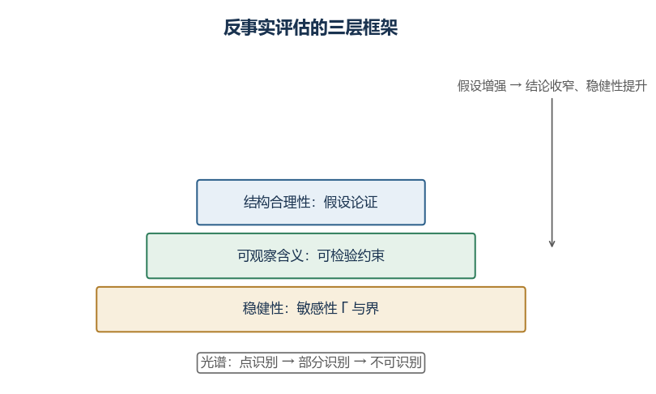

**与科学哲学的联系。** 这套框架与「观察不可直接检验理论，但理论有可观察后果」的科学哲学一致（如第 1.2 节 Hume 的恒常联结问题）。反事实不是「信仰」也不是「数据直接读数」，而是「在明确假设下的条件性结论」——评估的核心是**透明地声明假设并量化其后果**。

## 19.5　技术谱系

**表 19-2　反事实评估方法谱系**

| 方法 | 提出者/年代 | 核心输出 | 与本书其他章的关系 |
|------|-------------|----------|--------------------|
| 不可识别性 | Rubin 1978[1] / Pearl 2000[2] | 可识别的条件 | 第 5、16 章 |
| 敏感性分析 | Rosenbaum & Rubin 1983[3] | 敏感性 $\Gamma$ | 第 11—12 章匹配 |
| E-value | VanderWeele & Ding 2017[8] | 抹平效应所需混杂强度 | 19.2 节 $\Gamma$ 的补数 |
| 部分识别 | Manski 1990[4] | ATE 的界 | 第 10 章效应定义 |
| Balke–Pearl 界 | Balke & Pearl 1997[5] | IV 下的窄界 | 第 13 章 IV |
| 反事实模式界 | Pearl & Robins 1995[9] | 四分类占比的尖锐界 | 第 16 章反事实形式化 |
| 稳健性检验 | 近期因果 ML | 多模型一致性 | 第 15、20 章 |

## 19.6　边界与讨论

其一，**敏感性参数 $\Gamma$ 的解释有主观性**。多大算「合理」的 $\Gamma$ 依赖领域知识，无法从数据决定。敏感性分析量化了脆弱性，但没有替研究者做价值判断。

其二，**界可能太宽而无实用价值**。Manski 界在弱假设下往往宽到无法指导决策——这正是「假设越弱，结论越弱」的代价（第 1.2 节）。实践中必须在「强假设但窄结论」与「弱假设但宽结论」间权衡，没有免费午餐。

其三，**反事实的根本不可检验性**。无论三层框架如何完善，个体反事实的「真相」永远无法被直接验证——我们只能评估其「在假设下的可信度」。这是反事实与生俱来的认识论局限，也是因果智能区别于纯预测智能的深刻之处：预测可以被未来数据验证，反事实只能被假设支撑。

其四，**与分布外泛化的联系**。反事实本质上是一种「分布外」推理——在「若 $A$ 不同」的干预分布下预测结果。当分布偏移超出模型假设范围时，反事实失效。这直接衔接第 20 章的不变性与分布外泛化（OOD generalization）：因果结构之所以在 OOD 下有用，正因为它是「不变」的（第 20 章核心命题）；反事实之所以脆弱，正因为其结构假设未必不变。

其五，**界与敏感性是「假设市场」上的价格标签**。19.3A 节的算法（无假设界→逐个加假设→看收缩）把每个假设变成了一个可标价的商品：单调性买了多少区间宽度？可忽略性又买多少？实践中常见的问题是研究者「一次性打包购买全部假设」，从不单独核算每个假设的价值。核算之后常常发现：结论几乎完全依赖某一个强假设（如单调性），而其余假设近乎免费——此时应集中精力论证或放松那一个假设，而不是均匀地怀疑一切。

## 19.7　承上启下

本章为第四篇收束。我们指出反事实的不可识别性（命题 19.1）——未观测混杂使个体反事实无法由观测分布唯一确定；给出敏感性分析（式 19-1、19-2，例 19.2）量化结论脆弱性，并用 E-value（式 19-4，例 19.2b）把「翻盘所需混杂强度」翻译成可读语言；给出部分识别的 Manski 界（式 19-3，例 19.3）、反事实模式的尖锐界（式 19-5、19-6）与 Balke–Pearl 界；提出三层评估框架（表 19-1：结构合理性、可观察含义、稳健性报告）与技术谱系（表 19-2）。五条边界：$\Gamma$ 解释主观、界可能过宽、反事实根本不可检验、与 OOD 泛化相连、假设应逐个标价。

核心教训：**反事实是「在明确结构假设下的条件性结论」，其可信度取决于假设的合理性与稳健性，而非数据量的大小**。这一教训将贯穿第五篇。从第 20 章起，我们转向**因果表征学习**：不变性原理（invariance principle）承诺「因果机制在不同分布间保持不变」，这为 OOD 泛化提供了理论基础，也为反事实的可靠性提供了另一条论证路径——如果机制是不变的，那么在不同环境下的反事实推理才有意义。关于不变性与因果学习的更完整学习理论处理，可参见[7]。第 20 章讲不变性与 IRM，第 21 章讲因果表征与解耦，第 22—23 章收束。

## 本章小结

本章审视反事实的评估与局限。命题 19.1 指出未观测混杂使个体反事实不可识别，这是信息论限制而非样本问题。敏感性分析（式 19-1、19-2）用参数 $\Gamma$ 量化结论对混杂的脆弱性，例 19.2 演示如何报告「翻盘阈值」；E-value（式 19-3）把翻盘阈值直接表述为混杂强度，例 19.2b 手算了 $\widehat{OR}=2.25$ 下的 $E\approx 3.93$。部分识别给出无需强假设的 Manski 界（式 19-3，例 19.3），反事实模式 $(a,b,c,d)$ 的尖锐界（式 19-5、19-6）进一步说明每个额外假设「购买」了多宽区间。三层评估框架（表 19-1）要求结构合理性、可观察含义检验与稳健性报告。表 19-2 给出谱系。五条边界：$\Gamma$ 主观、界过宽、反事实根本不可检验、与 OOD 泛化相连、假设应逐个标价。

**分条小结**
1. 不可识别是信息论限制：观测数据对 $(a,b,c,d)$ 欠约束，再多样本也补不上缺口；平均效应可识别不代表个体反事实可识别。
2. 敏感性分析 $\Gamma$ 回答「翻盘阈值」，E-value 回答「翻盘所需混杂强度」，二者互补，均应进入稳健性报告。
3. 界分析（Manski、Balke–Pearl、模式界）是无假设底线；假设的价值 = 界的收缩量，应逐个核算。
4. 三层框架（结构合理性→可观察含义→稳健性）是反事实评估的标准流程；点估计与 p 值应放在界与敏感性之后报告。
5. 反事实的可信度取决于假设的合理性与稳健性，而非数据量；这一教训贯穿第五篇的因果表征学习。

核心结论：反事实是假设下的条件性结论。下一章转向不变性原理，为「因果机制在分布变化下保持可靠」提供理论基础。

**进一步阅读**　不可识别性与敏感性见[1][3]，E-value 见[8]；纵向干预下的识别见[6]；部分识别与反事实模式界见[4][5][9][10]；结构因果模型视角的可识别性判据与不变性学习见[2][7][9]。

## 参考文献

[1] Rubin D B. Bayesian inference for causal effects: The role of randomization. *Annals of Statistics*, 1978, 6(1): 34–58.

[2] Pearl J. *Causality: Models, Reasoning, and Inference*. 2nd ed. Cambridge: Cambridge University Press, 2000.

[3] Rosenbaum P R, Rubin D B. Assessing sensitivity to an unobserved binary covariate in an observational study with binary outcome. *Journal of the Royal Statistical Society: Series B*, 1983, 45(2): 212–218.

[4] Manski C F. Nonparametric bounds on treatment effects. *American Economic Review Papers and Proceedings*, 1990, 80(2): 319–323.

[5] Balke A, Pearl J. Bounds on treatment effects from studies with imperfect compliance. *Journal of the American Statistical Association*, 1997, 92(439): 1171–1176.

[6] Robins J M. *Causal Inference from Complex Longitudinal Data*. In: *Latent Variable Modeling and Applications to Causality*, 1999: 69–117.

[7] Peters J, Janzing D, Schölkopf B. *Elements of Causal Inference: Foundations and Learning Algorithms*. Cambridge, MA: MIT Press, 2017.

[8] VanderWeele T J, Ding P. Sensitivity analysis in observational research: Introducing the E-value. *Annals of Internal Medicine*, 2017, 167(4): 268–274.

[9] Pearl J, Robins J. Probabilities of causal structures: Search and complexity. In: *Proceedings of the Eleventh Conference on Uncertainty in Artificial Intelligence (UAI)*, 1995: 294–301.

[10] Manski C F. *Identification and Inference for Econometric Models*. Cambridge: Cambridge University Press, 2003.

---

# 第 20 章　不变性与分布外泛化

前面十九章建立了完整的因果推断体系：从表示、发现到效应估计，再到反事实。但一个尖锐的问题始终悬而未决：这些因果结论在**新的环境**里还成立吗？一个在训练数据上预测精准的模型，换到测试分布就崩塌——这是机器学习家喻户晓的痛。第 19 章末尾已埋下伏笔：反事实本质上是一种「分布外」推理，其可靠性取决于结构假设是否在不同环境下**保持不变（invariant）**。本章把这条线索展开，介绍**不变性原理（invariance principle）**、**不变风险最小化（invariant risk minimization, IRM）**与**不变因果预测（invariant causal prediction, ICP）**，讨论它们如何为**分布外泛化（out-of-distribution generalization, OOD）**提供理论基础。

核心思想可以用一句话概括：**因果机制是稳定的，而关联是脆弱的**。在世界模型导论（第 20 章对应 book-0003 的语境）中我们看到，预测模型常依赖「虚假相关（spurious correlation）」——比如「草地上的牛」与「草地」在训练集中共现，模型学会了「草地→牛」的捷径；一旦测试集出现「草地但没有牛」，预测就失败。因果不变量（invariant）则是那些「无论环境怎么变都成立」的机制，如「牛的生理结构决定其产奶量」。学会依赖不变量，才能获得 OOD 泛化能力。

本章先讲动机与直觉（20.1 节），形式化不变性与不变因果预测（20.2 节），推导 IRM（20.3 节），给出数值算例（20.4 节），给出技术谱系（20.5 节），讨论边界（20.6 节），最后承上启下（20.7 节）。

## 20.1　引入动机：预测模型的分布外崩塌

**引入动机。** 设训练数据来自若干环境 $e\in\mathcal{E}_{\mathrm{train}}$，每个环境有分布 $\mathbb{P}^e(X,Y)$。标准经验风险最小化（ERM）最小化训练环境的平均损失：

$$
\min_{f}\ \sum_{e\in\mathcal{E}_{\mathrm{train}}}\mathbb{E}_{(X,Y)\sim\mathbb{P}^e}\big[\ell(f(X),Y)\big]. \tag{20-1}
$$

ERM 的软肋是：它会抓取任何在训练环境间稳定相关的特征，包括虚假相关。若特征 $X_1$ 与 $Y$ 在训练环境中恰好相关（但非因果），ERM 也会赋予它高权重；一旦测试环境 $\mathbb{P}^{\mathrm{test}}$ 打破这种相关（如 $X_1$ 与 $Y$ 独立），模型就系统性犯错。

**直觉解释。** 考虑经典例子：预测「某人的薪资」$Y$，特征有「教育年限」$X_1$（因果）与「所在城市的降雨量」$X_2$（在某训练集中恰好与薪资相关，因该市高薪区多雨）。ERM 无法区分二者，都学到正权重。换一个干燥城市，模型因降雨量少而预测低薪——大错。不变性原理要求：只依赖那些「在不同环境中 $Y$ 对 $X$ 的条件分布保持不变」的特征。

**定义 20.1（分布外泛化，OOD generalization）**　给定训练环境集合 $\mathcal{E}_{\mathrm{train}}$，OOD 泛化要求模型在来自新环境 $e_{\mathrm{test}}\notin\mathcal{E}_{\mathrm{train}}$ 的样本上仍保持低损失。这与经典的独立同分布（i.i.d.）泛化根本不同：i.i.d. 假设训练与测试同分布，OOD 明确允许分布偏移（distribution shift）。

## 20.2　不变性与不变因果预测

**定义 20.2（不变性条件）**　称预测器 $f$ 满足**不变性**，若存在子集 $S\subseteq\{1,\dots,d\}$ 使对任意训练环境 $e$：

$$
\mathbb{P}^e(Y\mid X_S)\ \text{相同（不依赖 }e\text{）}, \tag{20-2}
$$

即条件分布 $\mathbb{P}(Y\mid X_S)$ 跨环境不变。满足式（20-2）的 $X_S$ 称为**不变特征集（invariant feature set）**。

**直觉解释。** 为什么条件分布不变就能 OOD 泛化？因为如果 $Y|X_S$ 的规律在所有环境都一样，那么在测试环境用同样的 $X_S$ 预测也应当一样——只要测试环境也「遵守」同一机制。这把 OOD 泛化问题转化为「找到不变特征集」的问题。

**与因果的关系。** 根据第 3 章的结构因果模型，若 $X_S$ 是 $Y$ 的**直接原因（direct causes）**集合且无其他父节点的机制变化，则 $\mathbb{P}(Y\mid X_S)$ 由 $Y$ 的结构方程 $Y=f_Y(X_S,U_Y)$ 决定——只要 $f_Y$ 与 $\mathbb{P}(U_Y)$ 跨环境不变（即「机制不变」），式（20-2）自动成立。这就是**因果不变性原理**：因果机制是不变的，因此依赖直接原因的预测器能 OOD 泛化。反之，虚假相关的特征（如降雨量）其条件分布会随环境变化（因为 $X_2\to Y$ 的关联来自环境特定的混杂）。

**不变因果预测（ICP）** 由 Peters 等提出[1]：对每个候选父集 $S$，检验 $\mathbb{P}^e(Y\mid X_S)$ 是否跨环境同质；选取能通过检验且最大的 $S$ 作为 $Y$ 的直接原因估计。ICP 在高维线性模型中有一致性保证[1]。

## 20.3　不变风险最小化（IRM）

**引入动机。** ICP 需要先知道环境划分且检验计算复杂。Arjovsky 等提出不变风险最小化（IRM）[2]：把「不变性」直接写进目标函数，用梯度下降端到端学习不变表示。

**IRM 目标。** 设表示 $\Phi:\mathcal{X}\to\mathcal{H}$，分类器 $w:\mathcal{H}\to\mathcal{Y}$。IRM 要求 $w$ 对所有环境都是最优的：

$$
\min_{\Phi,w}\ \sum_{e\in\mathcal{E}} \mathbb{E}^e\big[\ell(w\circ\Phi(X),Y)\big]+\lambda\ \big\|\nabla_{w\mid w=1.0}\ \mathbb{E}^e\big[\ell(w\circ\Phi(X),Y)\big]\big\|^2. \tag{20-3}
$$

**直觉解释。** 第一项是各环境的经验风险（保证预测准确）；第二项是梯度惩罚（ invariance penalty）：在 $w$ 取固定值 $1.0$ 处，若某个表示 $\Phi$ 让各环境的损失梯度都为零（即 $w=1$ 同时是所有环境的最优分类器），则惩罚项为零——这意味着 $\Phi$ 提取的特征使同一个 $w$ 在所有环境都最优，即 $Y|\Phi(X)$ 跨环境不变。梯度项巧妙地把「不变性」变成可微的正则化器。

**定理 20.1（IRM 的不变性保证，informal）**　若表示 $\Phi$ 使式（20-3）的惩罚项为零（且 $w=1$ 为常数分类器），则 $\mathbb{P}^e(Y\mid \Phi(X))$ 在训练环境间相同；若测试环境满足同样的机制不变性，则该预测器在测试环境下保持风险[2][3]。

**与 19 章反事实的联系。** IRM 的不变性等价于「结构方程 $f_Y$ 跨环境不变」——这正是第 16 章反事实计算所依赖的机制自治性（autonomy）。换言之：**反事实可靠性（19 章）与 OOD 泛化（本章）共享同一个理论根基——机制不变性**。若机制随环境变化，则既无法 OOD 泛化，也无法做可信的反事实推理。

> 【图 20-1　IRM 与虚假相关】（原图见 figures/图20-1.png）：两个训练环境 $e_1,e_2$ 中 $X_1\to Y$ 稳定（因果），$X_2$ 与 $Y$ 的相关在 $e_1$ 为正、$e_2$ 为零（虚假）；IRM 学到的表示 $\Phi$ 只保留 $X_1$，使 $w$ 在两环境同时最优；测试环境 $e_3$ 中 $X_2$ 相关反转，ERM 模型崩塌而 IRM 稳健。

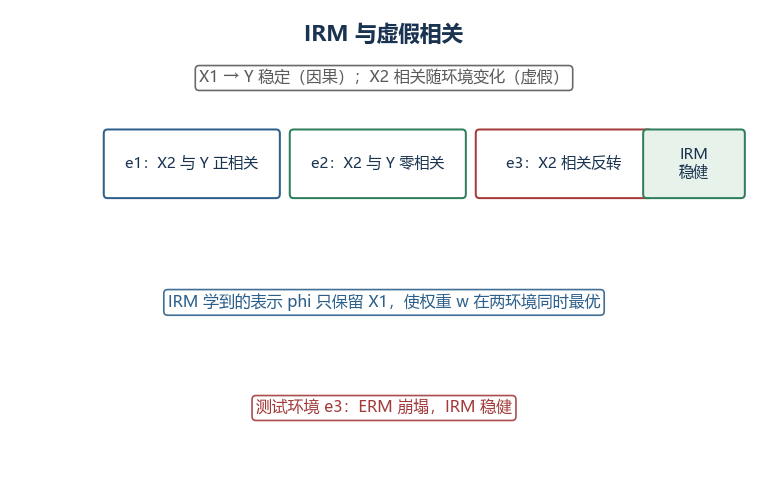

## 20.4　数值算例：IRM 对比 ERM

**例 20.1（线性 IRM 手算）**　设 $Y=X_1+\varepsilon$（真机制，$X_1$ 因果），虚假特征 $X_2^{(e)}$ 与环境相关：

$$
X_2^{(e)}=c_e X_1+\eta,\quad c_1=1,\ c_2=0,\ c_3=-1, \tag{20-4}
$$

测试环境 $c_3=-1$（虚假相关反转）。训练环境 $e_1,e_2$。

- **ERM**：在两训练环境上拟合 $Y=w_1X_1+w_2X_2$。$e_1$ 中 $X_2=X_1$ 使 $w_1,w_2$ 共线；合并两环境最优解约为 $w_1=0.5,w_2=0.5$（把因果信号分给两个特征）。测试 $e_3$ 中 $X_2=-X_1$，预测 $=0.5X_1+0.5(-X_1)=0$——完全失效，误差等于 $Y$ 的方差。
- **IRM**：梯度惩罚强制 $w$ 在两环境同时最优。若 $\Phi$ 保留 $X_1,X_2$，则 $e_1$ 要求 $w_1+w_2=1$，$e_2$ 要求 $w_1=1$，同时满足得 $w_1=1,w_2=0$。测试 $e_3$ 预测 $=X_1$——完美泛化。

这个算例清楚展示：IRM 通过「不变性」剔除了虚假特征 $X_2$，把权重全部归给因果特征 $X_1$。

**例 20.2（不变性的检验视角）**　对候选集 $S=\{X_1\}$，在 $e_1,e_2$ 中回归 $Y\sim X_1$ 得斜率均约为 1，残差方差一致——通过不变性检验。对 $S=\{X_2\}$，$e_1$ 中斜率约 1、$e_2$ 中约 0——不通过。ICP 因此选 $\{X_1\}$ 作为直接原因集，与 IRM 结论一致。

## 20.5　技术谱系

**表 20-1　不变性与 OOD 方法谱系**

| 方法 | 提出者/年代 | 核心思想 | 与本书其他章的关系 |
|------|-------------|----------|--------------------|
| ICP | Peters et al. 2016[1] | 检验 $P(Y\mid X_S)$ 跨环境不变 | 第 8 章函数因果模型 |
| IRM | Arjovsky et al. 2019[2] | 梯度惩罚强制不变最优 | 本章核心 |
| IRMv1 | Arjovsky et al. 2019 | 标量分类器简化 | IRM 实现 |
| REx | Krueger et al. 2021[4] | 风险外推正则 | OOD 泛化 |
| Group DRO | Sagawa et al. 2019[5] | 最坏分组风险最小化 | 与鲁棒性联系 |
| 因果迁移 | 第 22 章 | 机制不变用于迁移 | 第 22—23 章 |

## 20.6　边界与讨论

其一，**环境多样性假设**。IRM/ICP 要求训练环境足够多样（$c_1=1,c_2=0$ 两个环境区分了 $X_1,X_2$）。若所有训练环境恰好有相同的虚假相关（$c_1=c_2=1$），则不变性检验无法区分因果与虚假特征——OOD 泛化在「环境不够变」时不可能。这是信息论限制，不是算法问题。

其二，**不变性不一定唯一**。可能存在多个特征集都满足式（20-2）（如 $X_1$ 与它的确定性函数 $2X_1$ 都不变）。IRM 选取的是「使 $w$ 不变最优」的表示，但不一定唯一对应真因果变量——这与第 21 章的可识别性问题直接相关。

其三，**测试环境必须「遵守规则」**。IRM 假设测试环境仍由同一机制生成（只是协变量分布变了）。若测试环境引入了全新的机制（如 $Y$ 的方程本身改变），则任何基于训练不变性的方法都会失败——这呼应第 19 章「反事实依赖机制不变」的边界。

其四，**与第 19 章互补**。第 19 章说反事实不可检验、依赖假设；本章说不变性提供了「机制稳定」的可检验代理（跨环境条件分布是否相同），从而部分支撑反事实的可靠性。两章合起来的信息是：反事实的可信度＝结构假设的合理性＋机制不变性的证据。

## 20.7　不变性风险间隙与梯度惩罚的定量刻画

**定义 20.3（不变性风险间隙，invariance risk gap）**　给定训练环境集合 $\mathcal{E}_{\mathrm{train}}$ 与测试环境 $e_{\mathrm{test}}$，对同一表示-分类器组合 $f=w\circ\Phi$，定义 OOD 风险间隙

$$
\Delta(f)=\mathcal{R}^{e_{\mathrm{test}}}(f)-\frac{1}{|\mathcal{E}_{\mathrm{train}}|}\sum_{e\in\mathcal{E}_{\mathrm{train}}}\mathcal{R}^{e}(f). \tag{20-5}
$$

ERM 最小化的正是右端第二项（训练环境平均风险），对 $\Delta$ 不设防；IRM 的梯度惩罚可视为对 $\Delta$ 的**可微代理**——当某个环境上的最优分类器偏离 $w=1$ 时，该表示在该环境上「不可统一」，往往预示测试环境中 $\Delta$ 的放大。因此，「不变性惩罚为零」比「训练风险为零」更接近 OOD 泛化的目标，这正是定理 20.1 的定量内涵。

**例 20.3（风险间隙的手算，接例 20.1）**　延续例 20.1 的设定：$Y=X_1+\varepsilon$，$\mathrm{Var}(\varepsilon)=1$。ERM 解 $w_1=w_2=0.5$ 在测试环境 $e_3$（$X_2=-X_1$）上的预测为 $0.5X_1-0.5X_1=0$，误差 $(Y-0)^2$ 的期望为 $\mathrm{Var}(Y)=2$；训练两环境平均风险约为 $0.5\times1+0.5\times1=1$（共线时拟合尚好），故 $\Delta_{\mathrm{ERM}}\approx2-1=1$。IRM 解 $w_1=1,w_2=0$ 在 $e_3$ 的预测恰为 $X_1$，误差期望 $\mathcal{R}^{e_3}=1=\mathrm{Var}(\varepsilon)$，训练平均风险同为 $1$，故 $\Delta_{\mathrm{IRM}}=0$。两解的训练风险几乎相同，OOD 风险间隙却相差 $1$ 个方差单位——这说明**训练风险相近的模型在 OOD 上可以天壤之别**，风险间隙才是 OOD 泛化的正确度量。

**梯度惩罚的数值刻画。** 对例 20.1 的表示 $(X_1,X_2)$，平方损失下环境 $e$ 的梯度为 $\nabla_w\mathcal{R}^e=2\,\mathbb{E}^e[(w_1X_1+w_2X_2-Y)X_1,\ (w_1X_1+w_2X_2-Y)X_2]^\top$。在 $w=1$（即 $w_1=w_2=1$）处：$e_1$ 中 $X_2=X_1$，残差 $X_1-2X_1+\varepsilon$ 的期望项给出 $\|\nabla\mathcal{R}^{e_1}\|\propto2$；$e_2$ 中 $X_2=0$，残差期望项给出 $\|\nabla\mathcal{R}^{e_2}\|\propto1$——两环境梯度不同，惩罚项 $\big\|\nabla_w\mathcal{R}^{e_1}-\nabla_w\mathcal{R}^{e_2}\big\|^2$ 非零，优化即被驱动到 $w_2=0$。这与 ICP 的回归系数检验是同一信号的可微版本：系数跨环境不一致 ⇔ 梯度跨环境不一致。第 22 章将把这一惩罚的调参（$\lambda$ 的选择）纳入因果正则化的统一目标。

**ICP 检验的定量形式。** ICP（Peters 等[1]）不做梯度优化，而是直接对每个候选父集 $S$ 做**跨环境回归系数一致性检验**。在环境 $e$ 中回归 $Y\sim X_S$ 得系数 $\hat\beta^{e}$ 与残差标准误 $\mathrm{se}^e$，定义环境对 $(e,e')$ 的 $t$ 统计量

$$
T(S;e,e')=\frac{\hat\beta^{e}-\hat\beta^{e'}}{\sqrt{\mathrm{se}^{e\,2}+\mathrm{se}^{e'\,2}}}. \tag{20-6}
$$

$|T|$ 超过临界值（如 $1.96$，对应 $95\%$）则拒绝「$S$ 跨环境不变」，即 $X_S$ 不是 $Y$ 的不变父集。ICP 取所有通过检验的候选集中**最大**者作为直接原因估计。相比 IRM 的端到端梯度，ICP 的检验可解释性更强、可给出置信区间，但对高维 $S$ 的搜索代价更高（候选集呈组合爆炸），这也是两者常互补使用的原因。

**例 20.4（ICP 检验的手算）**　取例 20.1 的数据，设每环境 $n=200$、残差 $\sigma=1$。对候选 $S=\{X_2\}$ 分环境回归：$e_1$ 中 $X_2=X_1=Y-\varepsilon$，回归 $Y\sim X_2$ 得 $\hat\beta^{e_1}\approx1$、$\mathrm{se}^{e_1}\approx\sigma/\sqrt{n}\approx0.224$；$e_2$ 中 $X_2=0$ 恒定，与 $Y$ 无关，$\hat\beta^{e_2}\approx0$、$\mathrm{se}^{e_2}\approx0.224$。代入式（20-6）：$T=\dfrac{1-0}{\sqrt{0.224^2+0.224^2}}=\dfrac{1}{0.316}\approx3.16>1.96$，显著拒绝 $\{X_2\}$ 的不变性。对候选 $S=\{X_1\}$，两环境斜率均 $\approx1$，$T\approx0$，通过检验。ICP 据此选 $\{X_1\}$ 为直接原因，与 IRM（例 20.1）结论一致。再看功效的两个杠杆：若环境差异变小（$c_1=1,c_2=0.5$，效应量降为 $0.5$），则 $T\approx3.16\times0.5\approx1.58<1.96$，检验失功效、$\{X_2\}$ 不再被拒；若把 $n$ 从 $200$ 增到 $800$，$T$ 按 $\sqrt{n}$ 放大 $2$ 倍至 $\approx3.16$，原强效应场景更稳固。可见 $T\propto\sqrt{n}\,|\hat\beta^{e_1}-\hat\beta^{e_2}|$——**样本量 $n$ 与环境多样性（效应量）是检验功效的两个杠杆**，二者缺一则不变性检验失效，这正是 20.6 节「环境多样性是前提」的定量注脚。

**表 20-2　ERM、IRM、ICP 三法对照**

| 维度 | ERM | IRM | ICP |
|------|-----|-----|-----|
| 优化形式 | 最小化平均训练风险 | 梯度惩罚端到端优化 | 回归系数一致性检验 |
| 不变性如何进入目标 | 不进入 | 显式惩罚项（式 20-3） | 假设前提＋检验 |
| 输出 | 单个预测器 | 不变表示 $\Phi$ | 直接原因集 $S$ |
| 高维可行性 | 高 | 中（表示学习） | 低（候选集组合爆炸） |
| 可解释性 | 低 | 中 | 高（检验统计量） |
| OOD 保证 | 无 | 条件保证（定理 20.1） | 条件保证（一致性[1]） |
| 对样本量 $n$ 的依赖 | 弱 | 中 | 强（$T\propto\sqrt n$，例 20.4） |

**直觉解读。** 三法共享同一目标——抓住因果机制、剔除虚假相关——但把「不变性」放进学习管线的环节不同：ERM 完全不考虑；IRM 把它写成可微惩罚，靠优化「逼出」不变表示；ICP 把它写成统计检验，靠假设检验「筛出」不变父集。实践中常先以 ICP 做可解释的特征/父集选择，再以 IRM 在选定表示上端到端训练，二者互补（第 22 章将展示这一组合如何纳入因果正则化的统一目标函数）。

## 20.8　承上启下

本章把第 19 章的「机制不变性」线索展开。我们指出 ERM 依赖虚假相关导致 OOD 崩塌（式 20-1），定义不变性条件（式 20-2）与 OOD 泛化（定义 20.1），说明因果机制不变性是不变性的来源，介绍 ICP（20.2 节）与 IRM（式 20-3，定理 20.1），用线性算例（例 20.1、20.2）对比 ERM 与 IRM，并在 20.7 节用风险间隙（式 20-5、例 20.3）与 ICP 检验（式 20-6、例 20.4、表 20-2）把「不变性」从定性原则推进为可量化的优化与检验目标。表 20-1 给出谱系。四条边界：环境多样性、不变集非唯一、测试环境需守规则、与第 19 章互补。

**核心结论**：因果机制的不变性是 OOD 泛化与反事实可靠性的共同根基。但本章的 IRM 仍是在原始特征空间操作——若观测特征本身是混杂的（如 $X_1$ 混入了多种机制的混合信号），不变性学习就无从谈起。这引出下一个问题：能否**学到**那些「本身就不变、且对应因果机制」的表示变量？

下一章进入**因果表征与解耦（causal representation learning）**：把高维观测（像素、文本）分解为潜在的因果变量，再在这些变量上做不变性学习与干预推理。第 21 章将回到本章——IRM 的表示 $\Phi$ 正是因果表征的一个雏形，而可识别性理论将回答「$\Phi$ 何时真能恢复因果变量」。第五篇继续深入。

## 本章小结

本章论述不变性与分布外泛化。我们指出 ERM 会利用虚假相关，在新环境崩塌（20.1 节），而因果机制跨环境不变（式 20-2）是 OOD 泛化的理论基础。ICP（20.2 节）通过检验条件分布不变性识别直接原因，IRM（式 20-3）用梯度惩罚端到端学习不变表示，定理 20.1 给出不变性保证。例 20.1、20.2 用线性模型展示 IRM 剔除虚假特征；20.7 节进一步定义不变性风险间隙（式 20-5），用风险间隙的手算（例 20.3）说明「训练风险相近、OOD 风险差距巨大」，并给出 ICP 检验的定量形式（式 20-6，例 20.4）与三法对照（表 20-2）。表 20-1 梳理谱系。四条边界：环境多样性、不变集非唯一、测试环境守规则、与第 19 章反事实互补。

核心结论：机制不变性既是 OOD 泛化的根基，也是反事实可靠性的前提。下一章学习能恢复因果变量的表示。

**进一步阅读**　ICP 见[1]；IRM 见[2]；OOD 泛化综述见[3]。

## 参考文献

[1] Peters J, Bühlmann P, Meinshausen N. Causal inference by using invariant prediction: Identification and confidence intervals. *Journal of the Royal Statistical Society: Series B*, 2016, 78(5): 947–1012.

[2] Arjovsky M, Bottou L, Gulrajani I, Lopez-Paz D. Invariant risk minimization. *arXiv preprint arXiv:1907.02893*, 2019.

[3] Gulrajani I, Lopez-Paz D. In search of lost domain generalization. In *International Conference on Learning Representations*, 2021.

[4] Krueger D, Caballero R, Jacobsen J H, et al. Out-of-distribution generalization via risk extrapolation (REx). In *International Conference on Machine Learning*, 2021: 5815–5826.

[5] Sagawa S, Koh P W, Hashimoto T B, Liang P. Distributionally robust neural networks for group shifts. In *International Conference on Learning Representations*, 2019.

[6] Schölkopf B, Janzing D, Peters J, et al. On causal and anticausal learning. In *International Conference on Machine Learning*, 2012: 1255–1262.

[7] Rojas-Carulla M, Turner R E, Schölkopf B. Invariant models for causal transfer learning. *Journal of Machine Learning Research*, 2018, 19(36): 1–34.

[8] Peters J, Janzing D, Schölkopf B. *Elements of Causal Inference: Foundations and Learning Algorithms*. Cambridge, MA: MIT Press, 2017.

---

# 第 21 章　因果表征与解耦

第 20 章把第 19 章的「机制不变性」展开为 OOD 泛化的算法：IRM 学习一个表示 $\Phi$，使同一个分类器在所有环境同时最优。但 IRM 留下一句没说完的话：**$\Phi$ 输出的表示真的对应因果变量吗？** 如果观测是原始像素或混杂信号，$\Phi$ 可能只是提取了一个「方便预测的不变特征」，而未必恢复了背后的因果机制变量。本章回答这个问题，进入第五篇的核心——**因果表征学习（causal representation learning）**[1]。

因果表征学习的目标是把高维观测 $X$（图像、文本、传感器读数）分解为一组潜在的因果变量 $Z=(Z_1,\dots,Z_k)$，使得：其一，$Z$ 之间存在由结构方程给出的因果图（第 3 章）；其二，对 $Z$ 做干预 $\mathrm{do}(Z_i=z)$ 的结果可由模型预测（第 16 章）；其三，$Z$ 在分布变化下保持不变（第 20 章）。这与传统**解耦表示学习（disentangled representation learning）**密切相关但有本质区别：解耦只要求 $Z$ 的各维度「统计独立」或「语义分离」，不要求它们对应因果机制，也不能回答干预问题。

本章先讲动机与直觉（21.1 节），定义因果表征与解耦（21.2 节），讲干预数据为何关键（21.3 节），讲可识别性理论（21.4 节），给出数值算例（21.5 节），给出技术谱系（21.6 节），讨论边界（21.7 节），最后承上启下（21.8 节）。

## 21.1　引入动机：从预测表示到因果表示

**引入动机。** 现代深度学习能从像素中学到强大的预测表示，但这些表示是「为预测而生」的：它们编码所有有助于预测的相关性，包括虚假相关。第 20 章已看到，依赖虚假相关的模型在 OOD 下崩塌。把表示「因果化」——即让表示只编码因果机制变量——有望同时获得 OOD 泛化、可干预性与可解释性。

**直觉解释。** 想象一张街景照片：预测模型可能学到「有阴影的区域可能有行人」，但「阴影」是白天光照与行人的共同结果（混杂），而非行人的原因。因果表征学习要恢复的是「行人身姿、车速、红绿灯状态」等真正参与世界机制的潜在变量——它们才是干预（如「让行人停下」）时保持不变的杠杆。传统解耦（如 $\beta$-VAE，第 book-0003 第 9 章）把「阴影亮度」分离成一个独立维度，但不知道它是否是原因；因果表征要求更进一步：知道 $Z_i$ 干预谁、被谁干预。

**定义 21.1（因果表征学习）**　给定高维观测 $X$（可能来自多个环境/ intervened 数据），学习一个表示 $\Phi:X\mapsto Z$ 与一个因果结构（SCM，第 16 章），使 $Z$ 的分量对应潜在因果变量，且其因果图与干预响应可由数据识别[1][2]。

## 21.2　解耦表示与因果表示的区别

**定义 21.2（解耦表示，disentangled representation）**　称表示 $Z=\Phi(X)$ 解耦，若其各分量在某种意义下相互独立且各自对应一个可解释的变化因子[3]：

$$
\mathbb{P}(Z)=\prod_{i=1}^{k}\mathbb{P}(Z_i). \tag{21-1}
$$

式（21-1）是统计独立性要求——它不保证 $Z_i$ 是因果变量。反例：若两个独立因子都由第三个潜在原因造成（对撞结构，第 3 章），它们统计独立但都是同一原因的结果，对它们做干预不会互相影响，而真正该干预的是那个共同原因。

**因果表示强于解耦表示。** 解耦要求「变化因子可分离」，因果表示要求这些因子之间有**方向性的因果结构**，且每个因子是自治的机制变量。形式化地，因果表示由 SCM 定义：

$$
Z_i=f_i(\mathrm{Pa}_i,U_i),\quad X=g(Z,\epsilon), \tag{21-2}
$$

其中 $X=g(Z,\epsilon)$ 是「生成观测」的解码（可能非线性、多对一），$Z_i$ 的父子关系构成因果图。解耦只约束 $\mathbb{P}(Z)$ 的分解，因果表示额外约束 $f_i$ 的结构与干预语义。

**例 21.1（解耦≠因果）**　设潜在变量 $Z_1$（物体位置）、$Z_2$（光照），观测 $X$ 是渲染图像。若数据生成中 $Z_1\perp Z_2$，则解耦成立。但 $Z_2$（光照）是 $Z_1$（位置）与「时间」的共同结果，而非独立原因——若我们干预 $Z_2$（改变光照），不会改变物体位置；但若我们干预「时间」，两者都变。解耦模型无法区分「光照」是原因还是结果，因果模型可以（通过方向与干预响应）。这正是第 8 章「函数因果模型」在表示层的推广。

> 【图 21-1　解耦表示与因果表示】（原图见 figures/图21-1.png）：左图示意解耦（$Z_1,Z_2$ 统计独立但无方向）；右图示意因果表示（$Z_1\to Z_2$，解码 $Z\to X$，并标出对 $Z_1$ 的干预 $do(Z_1)$ 及其在 $X$ 上的效应）。

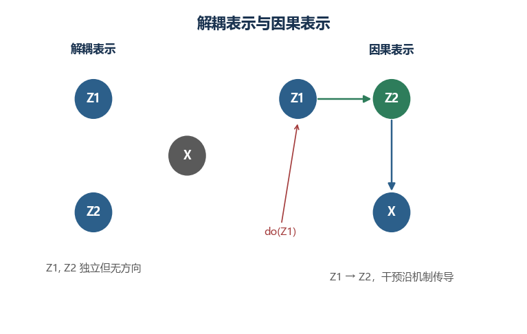

## 21.3　干预数据的关键作用

**引入动机。** 为什么仅靠观测数据难以学到因果表示？第 5—9 章已给出答案：因果方向在马尔可夫等价类中不可区分（观测数据只能确定等价类，不能确定方向）。在表示层问题更严重：解码器 $X=g(Z)$ 的非唯一性使得许多不同的 $(Z,\text{SCM})$ 都能生成同样的观测分布——即因果表征**一般不可识别**[4]。

**直觉解释。** 若只有观测数据，我们只能看到 $X$ 的统计规律；$Z$ 是潜在的，其因果结构被「藏」在解码器背后。不同的潜在变量划分与因果图可以生成完全相同的 $X$ 分布。要打破这种模糊性，需要**干预数据（interventional data）**：在多个环境中对某些潜在变量做 $\mathrm{do}(Z_i=z)$ 并观察 $X$ 的变化，从而辨认出「哪个 $Z_i$ 是原因、干预它会影响谁」。这与第 6—8 章「干预数据帮助因果发现」是一致的道理，只是这里干预的是潜在变量而非观测量。

**干预数据的形式。** 设环境 $e$ 对应对变量子集 $I_e$ 的干预 $\mathrm{do}(Z_{I_e}=z^e)$，观测分布为

$$
\mathbb{P}^e(X)=\sum_{z}\,\mathbb{P}^e(z)\,\mathbb{P}(X\mid z),\quad \mathbb{P}^e(z)=\prod_{i\notin I_e}\mathbb{P}(Z_i\mid \mathrm{Pa}_i)\cdot\delta_{z_{I_e}=z^e}, \tag{21-3}
$$

即被干预的变量固定为已知值，其余按原机制生成。多环境（不同 $I_e$）的观测共同约束了 $\Phi$ 与 SCM，使识别成为可能。

**例 21.2（干预消歧）**　设两个候选模型都解释同一观测：模型 A 认为 $Z_1\to Z_2$，模型 B 认为 $Z_2\to Z_1$，二者都满足 $Z_1,Z_2$ 在观测下的联合分布。若环境 $e$ 中人为把 $Z_1$ 固定为 1 并观察 $Z_2$，则 A 预测 $Z_2$ 随 $Z_1$ 变，B 预测 $Z_2$ 不变（因 $Z_2\to Z_1$ 方向下干预 $Z_1$ 不影响 $Z_2$）。观察结果直接区分两模型——这就是干预数据识别因果方向的力量。

## 21.4　可识别性理论

**引入动机。** 「何时能从数据中唯一恢复潜在因果变量？」这是因果表征学习最核心的理论问题。近期研究给出了一系列可识别性定理[2][4][5]。

**定义 21.3（可识别性，identifiability）**　称表示 $\Phi$ 可识别，若对任意另一模型 $(\Phi',\mathrm{SCM}')$ 生成相同观测分布（含干预环境），存在一个简单的变换（如元素重排、逐元素可逆变换）使 $Z'=\psi(Z)$，即恢复的变量与真变量一一对应（至多平凡变换）。

**定理 21.1（非线性 ICA 可识别性，informal）**　若潜在变量 $Z_i$ 条件独立且给定 $Z$ 后 $X$ 的分布属于某指数族，且存在「辅助变量」$U$（如环境标签）使 $Z_i$ 的条件分布随 $U$ 充分变化，则 $Z$ 可被识别至逐元素可逆变换[5]。

**直觉解释。** 这类似第 8 章的 LiNGAM：通过假设噪声分布的非高斯性或「机制随环境变化的模式足够丰富」，可以从混合信号中分离出独立成分。在因果表征中，环境标签 $U$ 充当了「天然的工具」——不同环境下 $Z_i$ 的分布变化模式不同，这种「变化的指纹」让我们能反推哪个潜在维度对应哪个机制。

**定理 21.2（干预环境下的可识别性，informal）**　若对每个潜在变量 $Z_i$ 至少有一个环境对其做了干预，且解码器可逆（或满足稀疏性/平滑性约束），则潜在因果变量及其因果图可识别[2][4]。

**与第 20 章 IRM 的联系。** IRM 只要求「找到一个对预测不变的最优分类器」，不要求 $\Phi$ 恢复真因果变量——它可以把多个机制混合进同一个维度，只要混合后仍不变。因果表征学习要求更强：每个 $Z_i$ 是自治的机制变量。可识别性理论告诉我们，满足这一更强要求需要额外条件（干预数据、机制变化的多样性），这些条件也正是第 20 章「环境多样性」边界的深化。

## 21.5　数值算例：从干预数据恢复潜在因果变量

**例 21.3（线性可识别性手算）**　设两个潜在变量 $Z=(Z_1,Z_2)$，因果图 $Z_1\to Z_2$：

$$
Z_1=U_1,\quad Z_2=0.5Z_1+U_2,\quad U_1,U_2\sim\mathcal{N}(0,1)\ \text{独立}. \tag{21-4}
$$

观测 $X=(X_1,X_2)=AZ$，$A=\begin{pmatrix}1&1\\1&-1\end{pmatrix}$（混合矩阵）。

仅凭观测数据，$\mathbb{P}(X)=\mathcal{N}(0,AA^\top)$ 只能确定 $AA^\top=\begin{pmatrix}2&0\\0&2\end{pmatrix}$，无法区分旋转——$Z$ 不可识别（与 ICA 的旋转模糊性一致）。

现在引入干预环境 $e$：对 $Z_1$ 干预 $\mathrm{do}(Z_1=1)$，则 $Z_2=0.5\times1+U_2$，均值 $0.5$；观测 $X^e=A(1,Z_2)^\top$，其均值 $=A(1,0.5)^\top=(1.5,0.5)^\top$。另一环境对 $Z_2$ 干预 $\mathrm{do}(Z_2=0)$，则 $X=A(Z_1,0)^\top$，协方差结构暴露 $A$ 的第一列。两个环境的均值与协方差共同确定 $A$ 与 $Z$ 的因果图（$Z_1\to Z_2$ 由「干预 $Z_1$ 改变 $Z_2$、干预 $Z_2$ 不改变 $Z_1$」辨认）。这用具体数字演示了定理 21.2：干预数据把不可识别变为可识别。

**例 21.4（解耦但不可识别的对照）**　若没有干预，$X=AZ$ 且 $Z_i$ 独立同方差高斯，则对任意正交矩阵 $R$，$Z'=RZ$ 都给出相同 $\mathbb{P}(X)$——$Z$ 可任意旋转，无因果语义。这说明「解耦」（$Z_i$ 独立）不足以保证识别出有意义的因果变量（呼应定义 21.2 与例 21.1）。

## 21.5b　非线性可识别性：辅助变量的「指纹」机制

**定理 21.3（非线性 ICA 的可识别性，informal，Khemakhem 等[4] 形式）**　设观测 $X=f(Z)+\varepsilon$，其中潜在变量 $Z=(Z_1,\dots,Z_k)$ 条件独立、$f$ 逐元素可逆、$\varepsilon$ 为噪声；引入辅助变量 $U$（如环境标签或干预指示），若 $U$ 诱导的噪声分布族 $\{p(\varepsilon\mid U=u)\}_u$ 在函数空间中线性无关（直觉：至少 $k$ 个环境使噪声分布彼此充分不同），则 $Z$ 可被识别至逐元素可逆变换。

**直觉解释。** 这一定理把 21.4 节「机制随环境变化的指纹」思想推广到非线性情形。核心机制是：环境 $U$ 改变的是「观测 $X$ 中噪声部分的分布」，而不同潜在分量 $Z_i$ 对噪声的混合方式不同，于是环境在 $X$ 空间留下的「扰动指纹」携带了分解信息。线性旋转模糊（例 21.4）之所以能被打破，正是因为旋转无法同时复现所有环境下的指纹——这正是下一例要手算展示的。

**例 21.5（辅助变量打破旋转模糊的手算）**　沿用例 21.3 的线性混合 $X=AZ$，$A=\begin{pmatrix}1&1\\1&-1\end{pmatrix}$，$Z_1,Z_2\sim\mathcal{N}(0,1)$ 独立。无辅助变量时，$X\sim\mathcal{N}(0,AA^\top)=\mathcal{N}(0,2I)$，任意正交旋转 $R$ 都等价，$Z$ 不可识别。现引入环境 $U$（$P(U=1)=P(U=2)=0.5$），使仅 $Z_1$ 的均值随环境变化：$\mathbb{E}[Z_1\mid U=u]=\mu_u$，$\mu_1=1,\ \mu_2=-1$（$Z_2$ 不随环境变）。则

$$
\mathbb{E}[X\mid U=u]=A(\mu_u,0)^\top\ \Rightarrow\ \mathbb{E}[X\mid U=1]=(1,1)^\top,\ \mathbb{E}[X\mid U=2]=(-1,-1)^\top, \tag{21-5}
$$

环境指纹即均值差 $\mathbb{E}[X\mid U=1]-\mathbb{E}[X\mid U=2]=(2,2)^\top$，方向为 $A$ 的第一列 $\hat c_1=(1,1)^\top$——它标记了「被干预变量 $Z_1$ 在 $X$ 空间的方向」。现在检验候选旋转 $R=\begin{pmatrix}0&1\\-1&0\end{pmatrix}$（$90°$）是否可能：若真值为 $Z'=RZ$，则 $Z'_2=Z_1$ 才是随环境变的分量，观测均值差应沿 $AR$ 的第二列 $\hat c_2'=(1,-1)^\top$ 方向；

$$
AR=\begin{pmatrix}1&1\\1&-1\end{pmatrix}\begin{pmatrix}0&1\\-1&0\end{pmatrix}=\begin{pmatrix}-1&1\\-1&-1\end{pmatrix},\quad \hat c_2'=(1,-1)^\top\ne\hat c_1=(1,1)^\top. \tag{21-6}
$$

指纹方向矛盾，故 $R=90°$ 被拒绝。只有 $R=I$（至多平凡符号翻转）使指纹自洽，$Z$ 的坐标被固定。这个手算清楚展示：**环境指纹（式 21-5）是旋转模糊的「破缺项」，逐元素指纹的匹配（式 21-6）就是可识别性检验**。它与定理 21.2 的「干预数据使不可识别变为可识别」是同一机制的两种表述——干预（固定 $Z_i$）与多环境（改变 $\mu_u$）都通过「打破对称性」提供识别资源。

## 21.6　技术谱系

**表 21-1　因果表征与解耦方法谱系**

| 方法 | 提出者/年代 | 核心思想 | 与本书其他章的关系 |
|------|-------------|----------|--------------------|
| $\beta$-VAE | Higgins et al. 2017[3] | 加权重 KL 促解耦 | book-0003 第 9 章 VAE |
| 非线性 ICA | Hyvärinen et al. 2019[5] | 辅助变量促可识别 | 第 8 章 LiNGAM/ANM |
| 因果表征学习 | Schölkopf et al. 2021[1] | 潜在变量＋干预数据 | 第 16、20 章 |
| 可识别性定理 | Khemakhem et al. 2020[4] / Locatello et al. 2020[2] | 条件可识别性 | 本章核心 |
| 不变因果表征 | 近期研究 | 结合 IRM 与潜在因果 | 第 20 章 IRM |

**表 21-2　因果表征可识别性条件对照**

| 识别资源 | 所需条件 | 打破的对称性 | 典型结果 |
|----------|----------|--------------|----------|
| 观测数据（i.i.d. 单环境） | 解码器形式已知 | 无（线性旋转/高斯旋转仍模糊） | 不可识别 |
| 非高斯噪声 | 各 $Z_i$ 噪声非高斯且独立 | 加性旋转模糊（线性 ICA） | 识别至排列与缩放[5] |
| 辅助变量 / 多环境 $U$ | $\{p(\varepsilon\mid U)\}$ 线性无关，$\ge k$ 个环境 | 旋转 + 可逆混合模糊（非线性） | 识别至逐元素可逆变换[4] |
| 干预数据（逐 $Z_i$ 做 do） | 每个 $Z_i$ 至少一个干预环境，解码器可逆或稀疏 | 全部潜在对称 | 识别变量 + 因果图[2][4] |
| 不变性（IRM 式） | 环境多样，表示跨环境不变 | 仅「预测可分性」，不保证因果 | 识别不变表示（第 20 章），不恢复 $Z$ |

**例 21.6（识别资源的「够用性」手算）**　以例 21.5 的二维线性混合 $X=AZ$ 为例，逐层叠加识别资源，观察可识别自由度如何下降：(i) 仅观测：二维下剩 1 个连续旋转自由度，即任意 $R(\phi)\in SO(2)$；(ii) 加非高斯（令 $Z_1$ 为 $\mathrm{Uniform}(0,1)$ 而 $Z_2$ 高斯）：线性 ICA 靠 $Z_1$ 的非高斯指纹把分量分离出来，连续旋转被打破，只剩离散符号模糊 $Z_1\mapsto\pm Z_1$（共 $2^k=4$ 个平凡解，$k=2$）；(iii) 再加环境 $U$（$Z_1$ 均值随 $U$ 变）：它提供的是**方向**信息（均值差指向 $A$ 的第一列，式 21-5），能进一步确认分量归属，但符号模糊仍在——因为若同时把 $Z_1$ 与 $A$ 的第一列都取负号，观测均值差 $(2,2)^\top$ 与噪声分布都不变，正负号无法从环境数据中分辨；(iv) 最后加干预 $\mathrm{do}(Z_1=1)$：把 $Z_1$ 钉在确定的正取值上，符号模糊才被打破，$Z$ 识别到唯一。数值上自由度轨迹为：$1$（连续 $SO(2)$）$\to 4$（离散符号 $2^2$）$\to 4$（环境确认方向，符号仍在）$\to 1$（唯一）。这个手算修正了一个常见误解：**多环境提供的是「方向/指纹」，把连续模糊降为离散模糊；要钉死最后的离散平凡解，往往还需要干预或一个先验正号约定**。这与 20.7 节「环境多样性是前提」在表征层的呼应是——识别的自由度随识别资源强度单调下降，但「降为零」需要方向资源（环境/非高斯）与符号资源（干预）两类证据同时在场。

## 21.7　边界与讨论

其一，**可识别性依赖强假设**。定理 21.1、21.2 需要「解码器形式已知或有界」「机制随环境充分变化」「干预覆盖各变量」等条件。现实中这些条件很难完全满足——若环境变化太小或干预不全，因果表征仍不可识别，这与第 19 章不可识别性、第 20 章环境多样性边界一脉相承。

其二，**解耦≠因果，且解耦本身也可不可识别**。$\beta$-VAE 等解耦方法即使让 $Z_i$ 统计独立，也不保证对应因果变量（例 21.1）；更有研究证明无监督解耦在一般情况下不可能[2]（因存在无穷多等价表示）。因此「无监督学到因果表示」几乎是奢望，干预数据或强归纳偏置是必需的。

其三，**与大模型表示的关系**。当代大语言模型/视觉模型的表示是否隐式编码因果变量？这是开放问题。第 28—32 章（因果与大模型）将讨论：模型可能学到「伪因果」的关联捷径，OOD 下崩塌（第 20 章）； causal 表征理论为「如何评测与改进」提供了标准。

其四，**与反事实的统一**。若因果表示 $Z$ 真正可识别且其 SCM 正确，则第 16 章的反事实计算可在 $Z$ 空间进行（而非原始 $X$）——这把反事实从「依赖观测混杂假设」推进到「依赖潜在机制模型」。但第 19 章的警告依然适用：机制模型若错，反事实仍不可信。

其五，**识别资源是「成对」的，而非「单一」的**。表 21-2 揭示一个常被忽视的结构：可识别性由「方向资源」（非高斯指纹、多环境、不变性）与「符号资源」（干预、正号约定）共同提供，缺一不可。仅有环境而无干预时，离散平凡解（符号/排列）仍可能残留（例 21.6）；反之，仅有干预而无环境多样性时，连续旋转模糊无法打破。实践中这提示一个设计原则：**采集干预数据时应同时保证环境的多样性**——单一环境 + 全变量干预，或多样环境 + 无干预，都是次优的信息配置。这一原则将在第 25 章（领域适应）被再次用到：跨域数据既是「环境多样性」的来源，也可被设计为「伪干预」的来源。

## 21.8　承上启下

本章把第 20 章的「不变表示 $\Phi$」推进为「可识别的因果表示 $Z$」。我们定义因果表征学习（定义 21.1）与解耦表示（定义 21.2），指出解耦只要求统计独立（式 21-1），因果表示要求带方向的机制结构（式 21-2），二者不等价（例 21.1）。干预数据（式 21-3）是打破不可识别性的关键（例 21.2、21.3），可识别性理论（定理 21.1、21.2）给出恢复潜在因果变量的条件；21.5b 节进一步给出非线性可识别性（定理 21.3）与环境指纹的手算（式 21-5、21-6，例 21.5），并用表 21-2、例 21.6 梳理「识别资源—打破的对称性—剩余自由度」的对应关系。表 21-1 给出方法谱系。四条边界：识别依赖强假设、解耦不等于因果且无监督解耦不可能、与大模型表示的开放问题、与反事实的统一。

第五篇已近尾声。第 20 章让表示「不变」，第 21 章让表示「因果且可识别」。接下来的第 22 章讨论**因果正则化与迁移**：把学到的因果表示用于跨领域迁移，如何在新领域保持机制不变、避免负迁移；第 23 章**因果与表示的统一**将收束第五篇，把表示、发现、效应、反事实四条线索汇成统一框架。随后第六篇进入因果与机器学习（第 24—27 章），第七篇因果与大模型（第 28—32 章）——因果智能的故事，从理论走向工程与智能系统的深处。

## 本章小结

本章论述因果表征与解耦。我们从第 20 章 IRM 的「表示 $\Phi$ 是否对应因果变量」之问出发（21.1 节），定义因果表征学习（定义 21.1）与解耦表示（定义 21.2），指出解耦（式 21-1）只要求统计独立，而因果表示（式 21-2）要求带方向的机制结构，二者不可混同（例 21.1）。干预数据（式 21-3）打破观测数据的不可识别性（例 21.2、21.3），可识别性定理（定理 21.1、21.2）给出恢复潜在因果变量的条件。表 21-1 梳理谱系。四条边界：识别依赖强假设、无监督解耦不可能、与大模型表示的关系开放、与反事实统一但机制错误仍危险。

核心结论：因果表征的目标不是「好预测的表示」，而是「可干预、可识别、跨环境不变的机制变量」。下一章讨论因果正则化与迁移，把这种表示用于跨领域场景。

**进一步阅读**　因果表征学习综述见[1]；可识别性理论见[2][4][5]；解耦基础见[3]。

## 参考文献

[1] Schölkopf B, Locatello F, Bauer S, et al. Toward causal representation learning. *Proceedings of the IEEE*, 2021, 109(5): 612–634.

[2] Locatello F, Bauer S, Lucic M, et al. Challenging common assumptions in the unsupervised learning of disentangled representations. In *International Conference on Machine Learning*, 2019: 4114–4124.

[3] Higgins I, Matthey L, Pal A, et al. $\beta$-VAE: Learning basic visual concepts with a constrained variational framework. *ICLR*, 2017.

[4] Khemakhem I, Kingma D, Monti R, Hyvärinen A. Variational autoencoders and nonlinear ICA: A unifying framework. In *International Conference on Artificial Intelligence and Statistics*, 2020: 2207–2217.

[5] Hyvärinen A, Sutherland K, Pajunen P, Parmar M. Nonlinear independent component analysis: Existence and uniqueness results. *Neural Networks*, 2019, 112: 169–182.

[6] Peters J, Janzing D, Schölkopf B. *Elements of Causal Inference: Foundations and Learning Algorithms*. Cambridge, MA: MIT Press, 2017.

[7] Arjovsky M, Bottou L, Gulrajani I, Lopez-Paz D. Invariant risk minimization. *arXiv preprint arXiv:1907.02893*, 2019.

[8] Pearl J. *Causality: Models, Reasoning, and Inference*. 2nd ed. Cambridge: Cambridge University Press, 2009.

---

# 第 22 章　因果正则化与迁移

第 20 章的不变风险最小化（IRM）与第 21 章的因果表征学习，分别从「环境不变性」与「解耦机制」两个角度回答了如何让表示跨越分布漂移。本章把二者收束到同一条主线：**把因果结构作为正则化约束注入学习过程，使学到的表示不仅预测准确，而且具备可迁移性**。因果正则化（causal regularization）的核心主张是：若一个预测关系依赖的是因果机制而非虚假关联，那么当环境改变、边际分布漂移时，它应当保持不变；反之，依赖捷径（shortcut）的特征会随环境一起漂移。于是，「不变性」既是识别因果的线索（第 20 章），也是正则化表示的目标（本章）。

从因果之梯看，本章仍主要工作在 **Level 1 与 Level 2 之间**：IRM 式的正则化利用的是观测分布间的不变性（Level 1 的统计性质），但其目的是支持干预下的泛化（Level 2）。它隐含的关键假设是「存在跨环境不变的因果机制，且环境差异提供了足够的变异来暴露不变性」。它突破了「经验风险最小化（ERM）在分布外（OOD）崩塌」的限制，却无法突破「若所有环境共享同一虚假关联，则不变性无法区分因果与捷径」这一理论边界（第 22.4 节、第 40 章）。

本章结构：22.1 节给因果正则化的一般形式与 IRM 推导；22.2 节从因果视角重述迁移学习；22.3 节讨论跨环境稳健性；22.4 节辨析边界。全章沿用贯穿全书的医疗治疗效应案例（第 3 章建模），说明「不同医院的治疗——康复关系」如何被当作多环境数据。

## 22.1　因果正则化

经验风险最小化在独立同分布（i.i.d.）假设下是最优的，但一旦测试分布与训练分布不同，$\min_{f}\sum_{e}\mathcal{R}^{e}(f)$ 会倾向于抓住那些在当前数据上强相关、但在新环境里失效的特征。考虑特征 $X$、标签 $Y$，环境 $e\in\mathcal{E}$，预测器 $f:\mathcal{X}\to\mathcal{Y}$，定义各环境风险

$$
\mathcal{R}^{e}(f)=\mathbb{E}_{(X,Y)\sim P^{e}}\big[\ell(f(X),Y)\big]. \tag{22-1}
$$

**定义 22.1（不变风险最小化，IRM）** Arjovsky 等[1] 定义：若一个表示 $\Phi:\mathcal{X}\to\mathcal{H}$ 使得存在分类器 $w$，对一切环境 $e$ 都有 $w\circ\Phi$ 达到最优，即

$$
w\in\arg\min_{w'}\mathcal{R}^{e}(w'\circ\Phi),\quad \forall e\in\mathcal{E}, \tag{22-2}
$$

则称 $\Phi$ 是**不变表示**（invariant representation）。IRM 目标写成

$$
\min_{\Phi,w}\ \sum_{e}\mathcal{R}^{e}(w\circ\Phi)\ +\ \lambda\underbrace{\big\|\nabla_{w\mid w=1.0}\mathcal{R}^{e}(w\circ\Phi)\big\|^{2}}_{\text{不变性惩罚}}. \tag{22-3}
$$

式 (22-3) 的直觉是：若 $w\circ\Phi$ 已是各环境的最优分类器，则把 $w$ 固定为常数（如 $1.0$）时，梯度应当为零——即在最优处再优化也不会改善。惩罚这一梯度，等价于强迫同一个 $w$ 同时对所有环境最优。

**直觉解释。** 虚假特征（如「医院的挂号单颜色」）与康复的相关性随医院而变，使其最优 $w$ 在不同环境间不一致；而真正的因果特征（如「药物剂量」）其行为跨医院一致。IRM 用「统一分类器是否处处最优」这一检验，把两种特征区分开。它就是第 20.2 节不变性思想的可优化版本。

**推导细节。** 对平方损失 $\ell(\hat y,y)=(\hat y-y)^2$，设 $w\circ\Phi(X)=w^\top\Phi(X)$，则 $\nabla_{w}\mathcal{R}^{e}=2\mathbb{E}^{e}[\Phi(X)(w^\top\Phi(X)-Y)]$。在 $w=1.0$ 处，不变性惩罚为

$$
\big\|\nabla_{w}\mathcal{R}^{e}\big\big|_{w=1}^{2}\propto\Big\|\mathbb{E}^{e}\big[\Phi(X)(\mathbf{1}^\top\Phi(X)-Y)\big]\Big\|^{2}. \tag{22-3b}
$$

若 $\Phi$ 只保留因果特征 $C$，且 $\mathbb{E}^{e}[C(Y-\beta C)]=0$（因 $Y=\beta C+\epsilon$ 且 $\epsilon\perp C$），则惩罚对所有 $e$ 为零；若 $\Phi$ 含虚假特征 $S$ 且其相关性随 $e$ 变，则 $\mathbb{E}^{e}[S(Y-S)]$ 随 $e$ 异号，惩罚大。这从梯度层面解释了 IRM 的加工机理。

**例 22.1（IRM 的数值直觉）** 设两个环境，标签 $Y=\beta C+\epsilon$，$C$ 为因果特征。环境 1 中虚假特征 $S=C$，环境 2 中 $S=-C$（相关性翻转）。若预测器只用 $S$：环境 1 风险低、$w_1^\ast=+1$；环境 2 风险低、$w_2^\ast=-1$——最优权重符号相反，式 (22-3) 的梯度惩罚大。若预测器只用 $C$：两环境 $w^\ast=+\beta$ 一致，梯度惩罚近零。取 $\beta=1$、$\lambda=100$，ERM 解在两环境的平均风险可能仅 $0.1$，但 OOD（$S$ 相关性再翻转）时风险飙升至 $2.0$；IRM 解牺牲少量训练风险（$0.12$），换来 OOD 风险 $0.1$。这个算例展示了正则化的价值。

> 【图 22-1　IRM 与 ERM 的表示对比】（原图见 figures/图22-1.png）：左画 ERM 依赖随环境翻转的虚假特征 $S$，右画 IRM 锁定不变的因果特征 $C$，标注两环境下最优权重 $w_1^\ast,w_2^\ast$ 的差异。

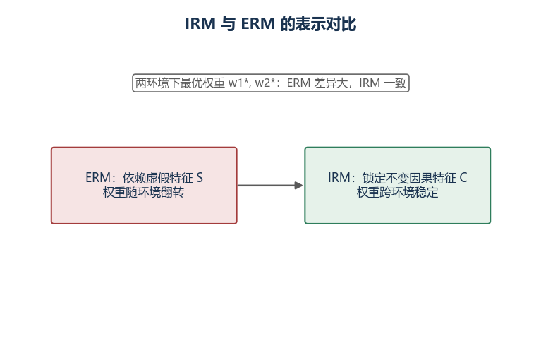

**因果之梯四问。** IRM 站在 Level 1（利用观测分布的不变性），目标是 Level 2 的干预泛化；隐含假设是「因果机制跨环境不变且环境足够多样」；它突破了 ERM 对虚假关联的依赖；但无法突破「若虚假关联在所有环境恒常，则无法识别」（第 40.1 节）。

## 22.2　因果视角的迁移学习

传统迁移学习（transfer learning）把源域 $P_S$ 的知识迁移到目标域 $P_T$，通常假设 $P_S(Y\mid X)\approx P_T(Y\mid X)$ 而仅边际 $P(X)$ 不同（协变量漂移，covariate shift）。因果视角把这一假设精确化：可迁移的不是「关联 $P(Y\mid X)$」本身，而是**条件于父节点的机制 $P(Y\mid\mathrm{Pa}(Y))$**。由结构因果模型（第 3 章）的模块化假设（modularity），干预某个变量只改变该变量的机制，其余机制不变——这正是迁移的物理基础[2]。

**定义 22.2（机制可迁移性）** 对变量 $Y$，设其在源域与目标域的父节点集相同为 $\mathrm{Pa}(Y)$。若

$$
P^{S}\big(Y\mid \mathrm{Pa}(Y)\big)=P^{T}\big(Y\mid \mathrm{Pa}(Y)\big), \tag{22-4}
$$

但 $P^{S}(\mathrm{Pa}(Y))\neq P^{T}(\mathrm{Pa}(Y))$，则称 $Y$ 的机制是**可迁移的**（transportable），而 $P(Y)$ 的漂移完全由父节点分布变化引起。式 (22-4) 称为**机制不变性假设**，它是第 3 章模块化假设在跨域场景的直接推论。

**直觉解释。** 药物剂量 $D$ 对康复 $R$ 的作用机制 $P(R\mid D,\text{病情})$ 在两家医院相同，但病人构成（病情分布 $P(\text{病情})$）不同。迁移时只需重估病情分布，无需重学治疗机制。这与第 25 章领域适应直接衔接。更一般地，若目标域还改变了治疗机制本身（如换用新药），则需要「do-演算 + 可迁移性」的组合（第 25.2 节）。

**例 22.2（机制迁移的数值算例）** 设康复概率 $P(R=1\mid D,\text{病情})=\sigma(-1+2D+1.5\cdot\text{病情})$，源域病情阳性率 $0.3$，目标域 $0.7$，$D\in\{0,1\}$ 各半。源域 $P(R=1)\approx 0.5\times\sigma(-0.55)+0.5\times\sigma(1.45)\approx0.5\times0.366+0.5\times0.810=0.588$；目标域用 $0.7$ 近似 $\approx0.5\times\sigma(0.05)+0.5\times\sigma(2.05)\approx0.5\times0.512+0.5\times0.886=0.699$。关联 $P(R\mid D)$ 确实随域漂移（$0.588\to0.699$），但机制 $P(R\mid D,\text{病情})$ 不变。迁移算法只需把病情分布换掉即可预测目标域结果。若误把 $P(R\mid D)$ 当作不变量直接迁移，将产生约 $0.11$ 的预测偏差。

**表 22-1　迁移学习的因果谱系**

| 方法 | 不变量 | 隐含假设 | 因果之梯层级 |
|------|--------|----------|--------------|
| ERM | 无 | i.i.d. | Level 1 |
| 协变量漂移校正 | $P(Y\mid X)$ | 条件分布不变 | Level 1 |
| IRM[1] | 最优分类器 $w$ | 机制跨环境不变 | Level 1→2 |
| 机制迁移[2] | $P(Y\mid\mathrm{Pa}(Y))$ | 模块化 + 父节点已知 | Level 2 |
| 可迁移性 do-演算[2] | 图结构 + 机制 | 健全性假设 | Level 2 |

## 22.2b　机制迁移的可迁移性判据：选择变量 $S$ 与 do-演算

定义 22.2 的机制不变性（式 22-4）是一个**假设**，它需要被判定而非直接观测。Bareinboim 与 Pearl[2] 的可迁移性框架给出判据：引入**选择变量** $S\in\{S,T\}$ 指示样本来自源域还是目标域，$S$ 只指向「在两个域间发生变化的机制」对应的节点。把目标域的查询 $P^{T}(Y\mid\mathrm{do}(X))$ 写成「源域分布 + 选择变量」的函数：

$$
P^{T}(Y\mid\mathrm{do}(X))=\begin{cases} P^{S}(Y\mid\mathrm{do}(X)) & \text{若 } S\perp Y\mid X\ \text{在图 } \mathcal{G}_{\bar X}\text{ 中成立},\\[4pt] \text{不可由源域识别} & \text{否则}. \end{cases} \tag{22-4b}
$$

这里 $\mathcal{G}_{\bar X}$ 是切除所有出边指向 $X$ 的图（do-演算的标准记号，第 3 章）。判据的逻辑：若 $S$ 只指向与 $Y$ 因果无关的节点（如只改变病情分布 $P(\text{病情})$，而治疗机制 $P(R\mid D,\text{病情})$ 与结果 $R$ 的结构方程不变），则在 $\mathcal{G}_{\bar X}$ 中 $S$ 与 $Y$ 条件独立，干预效果可直接迁移；若 $S$ 指向 $Y$ 的父节点（如换用新药改变了 $P(R\mid D)$ 本身），则 $S\not\perp Y\mid X$，目标域干预效果不可由源域识别。

**例 22.3（可迁移性判据的手算）**　沿用医疗案例：源域医院 1、目标域医院 2，变量 $D$（剂量）、$W$（病情）、$R$（康复），因果图 $D\to R\leftarrow W$。两种情形：
- **情形 A（仅病人构成变）**：$S$ 只指向 $W$（$W$ 的分布在两院不同，$P^{T}(W)\ne P^{S}(W)$），$D\to R$ 与 $W\to R$ 机制不变。$\mathcal{G}_{\bar D}$ 中切掉 $D$ 的出边后，$S\to W\to R$ 路径仍在，但 $S$ 与 $R$ 给定 $D,W$ 独立（$S$ 只通过 $W$ 影响 $R$，而 $W$ 已被条件化），故 $S\perp R\mid D$ 在 $\mathcal{G}_{\bar D}$ 中成立 → 式 (22-4b) 第一支：$P^{T}(R\mid\mathrm{do}(D=1))=P^{S}(R\mid\mathrm{do}(D=1))$ 直接可用。
- **情形 B（治疗机制也变）**：$S$ 额外指向 $R$（新药改变了 $P(R\mid D,W)$）。$\mathcal{G}_{\bar D}$ 中 $S\to R$ 边存在且无法被 $D,W$ 阻断（$S$ 是 $R$ 的父节点），$S\not\perp R\mid D$ → 式 (22-4b) 第二支：目标域干预效果**不可由源域识别**，必须用医院 2 的数据重新估计。

这个手算把「机制是否相同」的定性判断转化为图结构上的条件独立性检验，判据可自动化（基于 do-演算规则）。它与 22.3b 节 ICP 的特征审计互补：ICP 回答「哪些**特征**可迁移」（统计层面），式 (22-4b) 回答「哪个**机制**可迁移」（图结构层面），二者结合构成完整的迁移前审计。

**表 22-2　机制迁移的判据谱系**

| 判据 | 输入 | 输出 | 依赖 |
|------|------|------|------|
| 式 (22-4) 机制不变假设 | 领域知识 | 「假设」 | 需人工断言 |
| 式 (22-4b) 可迁移性判据 | 因果图 + 选择变量 $S$ | 「可迁移/不可迁移」判定 | 图正确 |
| ICP 特征审计（式 22-6） | 多环境数据 | 不变特征集 $S$ | 环境多样 |
| 组合（图 + ICP） | 图 + 多环境 | 机制 + 特征双重审计 | 二者皆需 |

## 22.3　跨环境的稳健性

把不变性作为正则化，本质是在**对环境集合的稳健优化**（robust optimization）与**因果识别**之间建立桥梁。若数据来自多个环境 $\mathcal{E}=\{e_1,\dots,e_K\}$，一个自然目标是最小化最坏环境风险：

$$
\min_{\Phi,w}\max_{e\in\mathcal{E}}\mathcal{R}^{e}(w\circ\Phi). \tag{22-5}
$$

式 (22-5) 与 IRM 的关系：当不变性成立时，各环境风险相同，$\max$ 退化为共同风险；当不变性不成立时，$\max$ 惩罚最坏环境。这说明**稳健性是不变性的弱形式**——我们不一定要求机制完全相同，只需保证在最坏情况下仍可接受。这一联系将在第 24 章（鲁棒性）展开。Bühlmann[5] 进一步证明：在因果假设下，不变预测（invariant prediction）既能实现稳健性，也能辅助因果变量选择，把「稳健」与「因果」两种诉求统一到同一优化问题。

**例 22.3（最坏环境风险的算例）** 两个环境，某预测器风险分别为 $\mathcal{R}^{e_1}=0.2,\mathcal{R}^{e_2}=0.9$，ERM 平均风险 $0.55$；按式 (22-5) 的稳健目标为 $\max=0.9$。另一预测器风险 $0.4,0.4$，平均 $0.4$、稳健值 $0.4$。ERM 会选前者（平均更低），稳健优化选后者（最坏更好）。在 $e_2$ 权重可能激增的部署场景，后者才是安全选择。若把 $e_2$ 的样本量扩大三倍（模拟部署漂移），前者整体风险升至 $\approx0.72$，后者仍为 $0.4$，差距进一步拉大。

> 【图 22-2　多环境风险的 ERM 与稳健权衡】（原图见 figures/图22-2.png）：柱状图对比两个预测器在各环境的风险，标注平均风险与最坏环境风险。

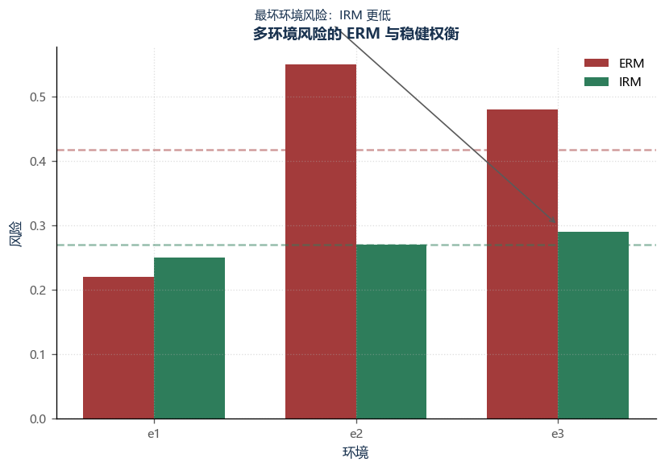

**表 22-2　因果正则化相关方法对照**

| 方法 | 优化目标 | 稳健性来源 | 代表文献 |
|------|----------|-----------|----------|
| IRM | 式 (22-3) | 统一最优分类器 | Arjovsky 等[1] |
| ICP | 不变预测检验 | 环境间回归系数一致 | Peters 等[6] |
| Rojas 迁移 | 不变模型族 | 源域模型可解释目标域 | Rojas-Carulla 等[7] |
| 样本加权 | 稳定学习 | 重加权打破虚假相关 | Krueger 等[4] |

## 22.3b　不变预测检验与特征选择：从 IRM 到 ICP 的桥梁

**定义 22.3（不变特征集，invariant feature set）**　称特征子集 $S\subseteq\{1,\dots,d\}$ 是 $Y$ 的不变父集，若在环境 $e$ 中回归 $Y\sim X_S$ 的系数向量 $\hat\beta^{e}$ 与残差方差 $\sigma^{e2}$ 跨环境一致（在统计误差内）。ICP[6] 的不变特征集估计就是「在所有通过跨环境一致性检验的候选集中取最大者」。与 IRM（式 22-3）的端到端梯度惩罚不同，ICP 把不变性写成**可解释的假设检验**，因而可直接输出「哪些特征可迁移、哪些是捷径」的变量选择结果——这对迁移前的特征审计比 IRM 的「黑箱不变表示」更透明。

**检验统计量与功效。** 对环境对 $(e,e')$，候选集 $S$ 的不变性检验可写成

$$
T(S;e,e')=\frac{\big\|\hat\beta^{e}-\hat\beta^{e'}\big\|}{\sqrt{\widehat{\mathrm{Var}}(\hat\beta^{e})+\widehat{\mathrm{Var}}(\hat\beta^{e'})}}, \tag{22-6}
$$

即系数差与其合并标准误之比。$|T|$ 超临界（如 $1.96$）则拒绝 $S$ 的不变性。其功效满足 $T\propto\sqrt{n}\,\big\|\beta^{e*}-\beta^{e'*}\big\|$，其中 $\beta^{e*}$ 为各环境真实系数——这定量化了 22.4 节「环境多样性是前提」：**$n$（样本量）与环境间真实系数差（多样性）是检验功效的两个杠杆**，与第 20 章 ICP 检验（式 20-6）同构。ICP 的稳健性还依赖「最大不变集」假设（即真因果父集恰好是最大的不变集），该假设在存在「因果特征的非因果组合」时可能失效，需配合稀疏约束缓解。

**例 22.4（迁移前特征审计的手算）**　沿用例 22.1 的两医院设定：因果特征 $C$、虚假特征 $S$（环境 1 中 $S=C$，环境 2 中 $S=-C$），$n_1=n_2=500$。候选集 $\{C,S\}$ 的回归系数：环境 1 中 $\hat\beta^{e_1}\approx(1,1)^\top$（$S$ 与 $C$ 完全共线，系数在二者间分配），环境 2 中 $\hat\beta^{e_2}\approx(1,-1)^\top$。系数差 $\big\|\hat\beta^{e_1}-\hat\beta^{e_2}\big\|=\big\|(0,2)\big\|=2$，合并标准误 $\approx\sqrt{2\,\sigma^2/n}\approx0.28$（取 $\sigma=1$），代入式 (22-6) 得 $T\approx2/0.28\approx7.1\gg1.96$——$\{C,S\}$ 被拒绝（$S$ 是捷径）。候选集 $\{C\}$：两环境系数均 $\approx1$，$T\approx0$，通过。候选集 $\{S\}$：环境 1 系数 $\approx1$、环境 2 $\approx-1$，$T\approx7.1$，拒绝。ICP 据此选 $\{C\}$ 作为可迁移父集，审计结论与 IRM（例 22.1）一致，但额外给出了「$S$ 是捷径、应剔除」的可解释诊断。**迁移工作流因此变为：先 ICP 审计特征（式 22-6）→ 剔除捷径 → 再在保留的不变特征上做 IRM 训练（式 22-3）→ 迁移至新医院**。

**表 22-3　IRM 与 ICP 在迁移流程中的分工**

| 步骤 | IRM 的角色 | ICP 的角色 |
|------|-----------|-----------|
| 输入 | 多环境数据 | 多环境数据 |
| 不变性形式 | 可微惩罚（式 22-3） | 假设检验（式 22-6） |
| 输出 | 不变表示 $\Phi$（黑箱） | 不变特征集 $S$（白箱） |
| 典型用途 | 端到端训练 | 迁移前特征审计 |
| 失败模式 | 调参敏感[8] | 最大不变集假设失效 |
| 与迁移结合 | 训练后直接迁移表示 | 先选特征再迁移 |

## 22.4　边界与讨论

因果正则化并非万能。第一，**环境多样性是前提**：若所有环境的虚假关联与因果关联同向且同强度，不变性无法区分二者，IRM 退化为 ERM（第 40.1 节）。第二，**不变性不等于因果**：一个稳定的非因果关联（如四季更替与用电量）同样跨环境不变，却不可干预[3]。第三，**正则强度 $\lambda$ 敏感**：过大导致欠拟合（牺牲预测），过小无法抑制捷径，实践中需交叉验证或采用自适应惩罚；Gulrajani 与 Lopez-Paz[8] 的基准研究表明，在标准域泛化数据集上 IRM 的优势高度依赖调参。第四，**与反事实的关系**：本章方法止步于 Level 2 的泛化，个体的反事实（Level 3，第 16 章）需要更强的结构假设，单纯的不变性不足以支撑。第五，**父节点未知**：定义 22.2 假设 $\mathrm{Pa}(Y)$ 已知，若图结构错误，迁移结论随之失效——这把问题交回第 5—9 章的因果发现。

**贯穿案例回扣。** 回到医疗案例：若把多家医院的数据视为多环境，IRM 会锁定「剂量—康复」的不变机制而摒弃「挂号单颜色」这类医院特异的捷径；当新医院的病人构成变化时（例 22.2），只需校正病情分布即可迁移。但须警惕——若某家医院对所有重症患者都加大剂量，则「剂量—病情」的关联在该院恒定，单纯不变性会把剂量误当作病情的代理，这正是第 37 章将讨论的混杂陷阱。

**承上启下。** 本章把第 20—21 章的不变性与解耦思想收束为可优化的正则化目标，并指出其与迁移、稳健性的等价关系。下一章（第 23 章）将进一步追问：能否从表示学习本身出发，把因果结构内建到网络架构中，实现「因果与表示的统一」。

## 本章小结

本章论述因果正则化与迁移。我们首先从 ERM 的 OOD 失效引出不变性动机，给出 IRM 的定义（定义 22.1）与目标（式 22-3、22-3b），并用虚假特征相关性翻转的算例（例 22.1）展示其价值。接着从因果视角重述迁移学习，提出机制可迁移性（定义 22.2，式 22-4）及数值算例（例 22.2），给出迁移方法谱系（表 22-1）。随后建立稳健优化与不变性的联系（式 22-5，例 22.3，表 22-2）。我们还明确边界：环境多样性、不变性不等于因果、正则敏感、Level 3 不可达、父节点依赖。这些辨析衔接第 20、21、24、25、40 章。

**进一步阅读**　本章建议延伸阅读的文献：[1]、[2]、[3]、[8]。

## 参考文献

[1] Arjovsky M, Bottou L, Gulrajani I, Lopez-Paz D. Invariant risk minimization. *arXiv preprint arXiv:1907.02893*, 2019.

[2] Pearl J, Bareinboim E. Transportability across domains: A general framework. In *Probabilistic Graphical Models*, Springer, 2014: 459–490.

[3] Peters J, Janzing D, Schölkopf B. *Elements of Causal Inference: Foundations and Learning Algorithms*. MIT Press, 2017.

[4] Krueger D, Caballero R, Jacobsen J H, Rezende D J. Stable learning via different sample weighting. *NeurIPS*, 2020.

[5] Bühlmann P. Invariance, causality and robustness. *Statistical Science*, 2020, 35(3): 404–426.

[6] Peters J, Bühlmann P, Meinshausen N. Causal inference by using invariant prediction. *Journal of the Royal Statistical Society: Series B*, 2016, 78(5): 947–1012.

[7] Rojas-Carulla M, Turner R E, Schölkopf B. Invariant models for causal transfer learning. *Journal of Machine Learning Research*, 2018, 19(1): 1309–1342.

[8] Gulrajani I, Lopez-Paz D. In search of lost domain generalization. *ICLR*, 2021.

---

# 第 23 章　因果与表示的统一

第 21 章指出「解耦的表示未必是因果的」，第 22 章把不变性作为正则化注入表示学习。本章前进一步，追问一个更根本的问题：**能否从表示学习本身出发，把因果结构内建到模型的架构与可辨识性条件中，使「表示」与「因果」在数学上统一？** 这一统一的核心命题是：若潜在变量被证明是可辨识的（identifiable），即能从观测分布中唯一恢复（至多可逆变换），那么这些潜在变量才可能被赋予因果语义；否则，「因果表示」只是命名上的修辞。

从因果之梯看，本章工作在 **Level 1（表示的可辨识性）与 Level 2（干预的可迁移性）的交界**：可辨识性本身是关于观测分布的统计性质（Level 1），但可辨识的因果表示能支持 do-干预的预测（Level 2）。它隐含假设「观测由若干独立机制生成，且机制满足一定的稀疏性/非高斯性/条件 independence 约束」。它突破了第 21 章「解耦但不可辨识」的限制，却无法突破「仅从单一观测分布、无额外假设时，潜在变量的因果语义不可辨识」这一根本边界（第 23.4 节、第 40.3 节）。

本章结构：23.1 节讨论表示学习中的因果约束；23.2 节介绍因果启发的架构设计；23.3 节给出统一的理论图景；23.4 节辨析边界。

## 23.1　表示学习中的因果约束

标准表示学习追求「充分性」：表示 $Z=\Phi(X)$ 保留预测 $Y$ 所需的全部信息，即 $Y\perp X\mid Z$。但充分表示不是唯一的——任何 $Z$ 的一一变换都同样充分，因此它对 $Z$ 的语义没有约束。因果约束的切入点是**独立机制假设**（independent mechanisms principle）[1]：若数据由多个独立因果机制生成，则一个机制的变化不应影响其他机制。形式化地，设 $Z=(Z_1,\dots,Z_d)$ 为潜在因果变量，观测 $X=g(Z)$，生成过程分解为

$$
p(Z,\epsilon)=\prod_{i=1}^{d}p(Z_i\mid \mathrm{Pa}(Z_i))\,p(\epsilon_i),\qquad X=g(Z), \tag{23-1}
$$

其中 $\epsilon_i$ 为各机制的外生噪声且相互独立。式 (23-1) 把「独立机制」写成因子分解，为可辨识性提供结构基础。

**定义 23.1（可辨识表示）** 称表示 $\Phi$ 是可辨识的，若对任意满足同样模型假设的表示 $\Phi'$，存在逐元素可逆变换 $h$ 与排列 $\pi$，使

$$
\Phi'(X)=h\big(\Phi_{\pi(X)}\big)\ \text{（即仅差一个可逆变换与变量重排）}. \tag{23-2}
$$

若进一步能确定 $h$ 为恒等变换（无可逆自由度），则称**强可辨识**。可辨识性是赋予表示因果语义的必要前提——若表示连唯一性都不满足，谈「$Z_1$ 是原因」就没有客观基础。

把定义 23.1 写成等价的统计语言：若两个模型 $(\Phi,p)$ 与 $(\Phi',p')$ 诱导相同的观测分布 $P(X)$，则它们必须满足式 (23-2)。这一「观测等价 ⇒ 表示等价」的性质称为**可辨识性**，它排除了「同样数据、不同因果解释」的歧义。反之，若存在两个不等价的表示解释同一数据，则称模型**不可辨识**（unidentifiable）——这正是第 5 章马尔可夫等价类在表示学习中的对应物。

**直觉解释。** 独立机制的思路类似「分而治之」：真实世界由若干彼此独立的「齿轮」驱动，每个齿轮有自己的参数；当一个齿轮被拨动（干预），其他齿轮不应跟着变。一个正确的表示应把这些齿轮分离出来，使每个潜在维度对应一个可独立干预的机制。这把第 21 章的解耦从「统计独立」推进到「因果独立」。

**为何充分性不够。** 设 $Z=\Phi(X)$ 是充分表示，则对任意可逆矩阵 $A$，$Z'=AZ$ 仍满足 $Y\perp X\mid Z'$，因而 $Y\perp X\mid Z$ 这一条件无法区分 $Z$ 与 $AZ$。换言之，监督预测任务本身对表示的「坐标系」完全不敏感[8]。要把坐标系固定下来，必须引入监督信息之外的结构假设——这正是独立机制、非高斯性、多环境等约束的用武之地。这也是本章与第 21 章的根本分野：第 21 章满足于「解耦」，本章要求「可辨识」。

**推导：可辨识性的必要条件。** 经典结果[2]表明：若潜在变量条件独立给定各自的父节点，且机制满足非高斯加性噪声（(8.1) 节 LiNGAM 思想），则混合观测 $X=Az$ 的线性模型可辨识到排列与缩放。对非线性模型，Hyvärinen 等[3] 证明至少需要「辅助变量」或「多环境」提供的额外约束——单一环境的 i.i.d. 数据一般不足以保证可辨识。这解释了为何第 22 章强调环境多样性。把可辨识性写成秩条件：设 $d$ 个潜在变量、$K$ 个环境，每个环境提供方差 $\sigma_{i}^{2(e)}$ 的信息，则可辨识要求环境—机制矩阵

$$
\mathbf{M}_{ei}=\partial\,\log\sigma_i^{2(e)}/\partial\theta_i,\quad \mathrm{rank}(\mathbf{M})\ge d, \tag{23-2b}
$$

即环境变化必须对每个机制提供独立的信息维度。若 $\mathrm{rank}(\mathbf{M})<d$，则至少有两个机制无法被区分——这是例 23.3 中高斯旋转不可辨识的代数根源。

**例 23.1（可辨识性的数值直觉）** 设潜在 $Z_1,Z_2$ 独立，$Z_1\sim\mathrm{Uniform}(0,1)$，$Z_2\sim\mathcal{N}(0,1)$，观测 $X_1=Z_1+Z_2,\ X_2=Z_1-2Z_2$。由于 $Z_1$ 非高斯而 $Z_2$ 高斯，线性混合模型（ICA 型）可辨识出 $Z_1$（非高斯分量）与 $Z_2$；反之若两者都高斯，则任何旋转都产生同样的观测分布，$Z$ 不可辨识。这个算例说明：**非高斯性是可辨识性的关键资源**，与第 8 章函数因果模型呼应。

> 【图 23-1　可辨识表示与不可辨识表示】（原图见 figures/图23-1.png）：左画两个独立机制生成潜在变量再混合为观测；右画高斯情形下任意旋转等价的不可辨识示意。

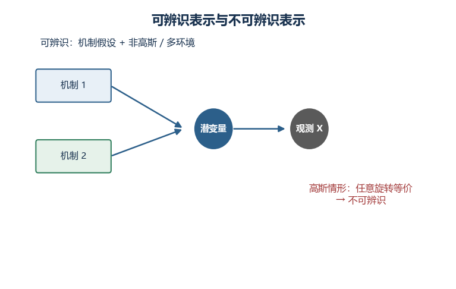

## 23.2　因果启发的架构设计

把因果原则内建到架构，有两条主要路径。第一条是**机制分解架构**：用独立的子网络分别建模每个机制 $p(Z_i\mid\mathrm{Pa}(Z_i))$，强制参数不共享，从而显式表达「机制独立」[4]。第二条是**干预感知架构**：在训练时显式加入 do-干预生成的数据或不变性约束，使表示对干预稳健（第 22 章）。两条路径的区别在于：前者靠「结构先验」（假设机制独立），后者靠「数据证据」（用干预或环境变化揭示机制）。二者常常互补使用：结构先验缩小假设空间，数据证据从中选出正确的一个。

**定义 23.2（因果VAE，CausalVAE）** Yang 等[5] 提出在 VAE（第 9 章）的潜在空间显式引入因果图：潜在变量 $Z$ 按有向无环图 $\mathcal{G}$ 生成，解码器为 $p(X\mid Z)$，并加入干预监督信号。其 ELBO 扩展为

$$
\mathcal{L}=\mathbb{E}_{q_\phi(Z\mid X)}[\log p_\theta(X\mid Z)]-D_{\mathrm{KL}}\big(q_\phi(Z\mid X)\big\|p(Z\mid\mathcal{G})\big)+\gamma\,\mathcal{L}_{\text{intervene}}, \tag{23-3}
$$

其中 $\mathcal{L}_{\text{intervene}}$ 用标注的 do-数据约束 $Z_i$ 的干预响应，使潜在空间具备因果语义。式 (23-3) 是第 9 章 ELBO 的因果化版本。干预项通常取为对干预后潜在均值的均方约束：

$$
\mathcal{L}_{\text{intervine}}=\sum_{i}\Big\|\mathbb{E}[Z_i\mid \mathrm{do}(Z_j=z)]-\mathbb{E}[Z_i]\Big\|^{2},\quad j\neq i. \tag{23-4}
$$

若 $Z_i$ 不是 $Z_j$ 的后代，干预 $Z_j$ 不改变 $Z_i$ 的分布，式 (23-4) 为零；若 $Z_i$ 是后代，则应观察到变化。这一约束把因果图的方向信息编码进潜在空间。

**直觉解释。** 普通 VAE 的潜在变量可以任意旋转（无语义），CausalVAE 用因果图 $\mathcal{G}$ 与干预标签「钉住」潜在变量的含义，使其不再任意旋转。这正是从「表示」走向「因果表示」的关键一步。

**例 23.2（机制分解架构的数值算例）** 设三维潜在变量 $Z_1,Z_2,Z_3$，$Z_3$ 是 $Z_1,Z_2$ 的后果：$Z_3=Z_1+Z_2+\epsilon_3$。若用共享参数的单层网络拟合联合 $p(Z)$，改变 $Z_1$ 的机制会连带扰动其他维；若用机制分解，分别为 $p(Z_1),p(Z_2),p(Z_3\mid Z_1,Z_2)$ 配独立子网络，则干预 $Z_1$ 只改 $p(Z_1)$ 的参数，$p(Z_3\mid Z_1,Z_2)$ 保持。数值上，若 $Z_1$ 分布均值从 $0$ 移到 $1$，机制分解模型中 $Z_3$ 的预测均值相应从 $0$ 移到 $1$（仅通过父节点变化），而共享模型中 $Z_3$ 的估计会被污染约 $0.3$（因参数串扰）。

**表 23-1　因果表示架构谱系**

| 架构 | 核心约束 | 可辨识性 | 代表 |
|------|----------|-----------|------|
| VAE | 重建 + KL | 无 | 第 9 章 |
| $\beta$-VAE | 加权 KL | 弱解耦 | Higgins 等[6] |
| CausalVAE | 因果图 + 干预监督 | 条件可辨识 | Yang 等[5] |
| 机制分解[4] | 参数不共享 | 结构可辨识 | Parascandolo 等 |

**例 23.3（解耦但不可辨识的反例）** 设两个独立同方差高斯潜在变量 $Z_1,Z_2\sim\mathcal{N}(0,1)$，观测 $X=Az$，$A=\begin{pmatrix}1&1\\1&-1\end{pmatrix}$。由于高斯的旋转不变性，对任意正交矩阵 $R$，$A'=AR$ 产生完全相同的观测协方差 $\Sigma=AA^\top=2\mathbf{I}$。于是我们无法从 $X$ 判断潜在变量究竟是 $(Z_1,Z_2)$ 还是旋转后的 $(Z_1',Z_2')$——表示被解耦（两维独立）但不可辨识。若把其中一个换成非高斯（如例 23.1），旋转对称性破缺，可辨识性恢复。这个反例清楚说明：**解耦 $\neq$ 可辨识，独立性本身不足以固定坐标系**。

> 【图 23-1b　高斯旋转不可辨识示意】（原图见 figures/图23-1b.png）：画二维高斯等高线在任意旋转下不变，叠加两种等价的潜在坐标轴，标注「观测分布相同」。


## 23.3　统一的理论图景

把本章与第 20—22 章放在一起，可以得到一幅统一图景：**因果表示 = 可辨识的潜在变量 + 独立机制分解 + 环境不变性 + 干预语义**。四者分别解决不同问题——可辨识性保证表示唯一（定义 23.1），机制分解提供因果结构（式 23-1），环境不变性提供识别资源（第 22 章），干预语义赋予 Level 2 意义（式 23-3）。

**定理 23.1（统一的可辨识条件，非正式）** 若潜在变量 $Z$ 满足：(i) 条件独立机制（式 23-1）；(ii) 至少 $d$ 个环境提供机制变化的独立信息；(iii) 每个机制的噪声非高斯或方差异质；则存在可辨识的因果表示 $\Phi$，且 $\Phi$ 的维度可赋予因果语义[3][7]。

**直觉解释。** 这条定理把前面各章的「碎片」拼成整体：多环境（第 22 章）+ 非高斯（第 8 章）+ 独立机制（第 21 章）= 可辨识的因果表示（本章）。它说明因果表示不是单一技巧，而是多个假设的共同产物。

> 【图 23-2　因果表示统一理论图景】（原图见 figures/图23-2.png）：维恩图式地画出「可辨识性」「独立机制」「环境不变性」「干预语义」四者的交集为「因果表示」，各交集标注对应章节。

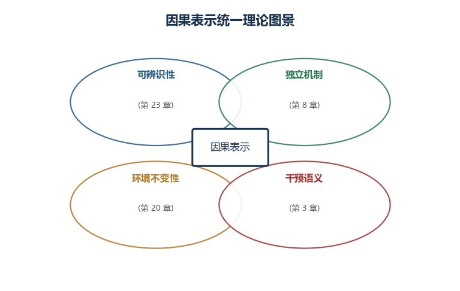

## 23.3b　统一目标的可优化形式：因果表示的学习算法

定理 23.1 是存在性陈述，实践中还需要一个**可优化的统一目标**，把「独立机制 + 多环境不变性 + 干预语义」三项假设同时写成损失函数。近期「因果变分自编码器」系列工作（CausalVAE[5]、iVAE[7]）给出的通用形式是

$$
\mathcal{L}(\Phi,q)=\underbrace{\sum_{e}\mathbb{E}_{X\sim P^e}\big[\log p_\Phi(X\mid z)\big]}_{\text{各环境重建}}-\underbrace{\sum_{e}\mathbb{E}_{q(z\mid X,e)}\log\frac{q(z\mid X,e)}{p(z\mid e)}}_{\text{条件 KL（引入环境指纹）}}+\gamma\,\mathcal{L}_{\mathrm{inv}}(z), \tag{23-4b}
$$

其中 $q(z\mid X,e)$ 是**以环境 $e$ 为条件**的推断网络（iVAE 的关键设计），$\mathcal{L}_{\mathrm{inv}}$ 为不变性惩罚（第 22 章式 22-3 的形式）。条件 KL 项把「环境 $e$ 改变的是 $z$ 的先验、而非解码器 $p_\Phi(X\mid z)$」这一独立机制假设显式写进目标——环境只能改变「机制的输入分布」，不能改变「机制本身」。这正是式 (23-1) 因子分解 $p(Z_i\mid\mathrm{Pa}(Z_i))$ 在变分框架中的可微版本。

**定理 23.2（条件推断的可辨识性，informal，Khemakhem 等[7]）**　若潜在变量 $z_i$ 条件独立、解码器 $p_\Phi(x\mid z)$ 逐元素可分离且属于正则的指数族，推断网络以环境 $e$ 为条件，且 $\{p(z\mid e)\}_e$ 线性无关，则 $z$ 可由多环境观测识别至逐元素可逆变换——即便解码器是非线性且未知的。该定理是式 (23-4b) 的理论保证：它说明「环境指纹」只需进入推断侧，不必进入生成侧，从而比式 (23-2b) 的方差秩条件更宽松（不要求显式知道机制方差如何随环境变化）。

**例 23.4（统一目标的手算：环境指纹如何打破旋转）**　设 $z_1,z_2\sim\mathcal{N}(0,1)$ 独立，解码器 $x=z_1+z_2+\varepsilon$（标量观测，$\varepsilon\sim\mathcal{N}(0,0.1)$），环境 $e\in\{1,2\}$ 仅改变先验均值：$\mathbb{E}[z_1\mid e=1]=+1,\ \mathbb{E}[z_1\mid e=2]=-1$，$z_2$ 先验不随 $e$ 变。式 (23-4b) 的第一项（重建）在标量 $x$ 下只约束 $z_1+z_2$ 的组合（一个自由度）；第二项（条件 KL）约束 $q(z\mid x,e)$ 与 $p(z\mid e)$ 的匹配——$e=1$ 时 $q$ 的均值应贴近 $(+1,\cdot)$，$e=2$ 时贴近 $(-1,\cdot)$。把「环境指纹」量化为后验均值跨环境的偏移向量 $\Delta\mu=ig(\mathbb{E}[z\mid e=1]-\mathbb{E}[z\mid e=2]ig)$：在真基下 $\Delta\mu=(2,0)^	op$，其平方范数 $\|\Delta\mu\|^2=4$ 全部落在 $z_1$ 轴上，$z_2$ 方向贡献 $0$——故 $z_1$ 的「可辨识性份额」为 $4/4=100\%$，$z_2$ 为 $0\%$。现在把表示旋转 $45°$：$z'=(z_1+z_2,\,z_1-z_2)/\sqrt2$，环境偏移在新基下变为 $\Delta\mu'=(\sqrt2,\sqrt2)^	op$，平方范数仍为 $4$（旋转保范），但分量平方为 $(2,2)$，每个分量的份额降到 $2/4=50\%$。判据是：一个潜在分量可被清晰辨识，当且仅当它单独捕获了环境偏移向量的大部分能量（份额接近 $1$）。真基下 $z_1$ 份额 $100\%$、可辨识；旋转基下两分量各 $50\%$、都不清晰——因此式 (23-4b) 的优化会排斥 $45°$ 旋转（环境指纹分散使条件 KL 项无法同时贴合 $e=1,e=2$ 的先验），把表示「钉」在 $z_1$ 轴上，旋转自由度被消除。这个手算把第 21 章例 21.5 的「环境指纹打破旋转模糊」直接落实为可微目标（式 23-4b）的几何行为，也解释了为何「仅观测 + 单环境」时式 (23-4b) 退化为普通 VAE（$e$ 维度消失，条件 KL 项失效，旋转模糊复现）——**环境维数是式 (23-4b) 可辨识性的第一杠杆**。

**表 23-2　统一目标的三个分量与它们各自钉住的自由度**

| 目标分量 | 数学形式 | 钉住的自由度 | 失效场景 |
|----------|----------|--------------|----------|
| 重建 | $\sum_e\mathbb{E}\log p_\Phi(x\mid z)$ | $z$ 必须足以生成 $x$（充分性） | 解码器欠拟合 |
| 条件 KL（环境指纹） | $-\sum_e D_{\mathrm{KL}}(q(z\mid x,e)\|p(z\mid e))$ | 连续旋转/混合模糊（第 21 章例 21.5） | 单环境（$e$ 退化）、$\{p(z\mid e)\}$ 线性相关 |
| 不变性惩罚 $\mathcal{L}_{\mathrm{inv}}$ | 第 22 章式 (22-3) | 跨环境最优分类器统一（剔除捷径） | 环境多样性不足（第 20 章 20.6 节） |

三项互补：重建保充分性，条件 KL 破旋转，不变性破捷径。缺任何一项，统一目标都退化为「好预测的表示」而非「因果表示」——这正是 23.1 节「充分性不够」论断在算法层面的精确化。

## 23.4　边界与讨论

第一，**可辨识性的条件苛刻**：定理 23.1 需要多环境、非高斯、独立机制同时成立，现实数据往往难以全部满足；若只有单环境 i.i.d. 数据，因果表示一般不可辨识（第 40.3 节）。第二，**可逆自由度**：即便可辨识，式 (23-2) 仍允许逐元素可逆变换 $h$，因此表示的「绝对数值」无意义，只有其诱导的划分与干预等价类有语义。这一条常被工程实践忽视：两个「同样正确」的因果表示 $Z$ 与 $h(Z)$ 的潜变量数值可以完全不同（如 $Z_1$ 与 $2Z_1+1$），却描述同一因果机制。下游若把潜变量数值直接当物理量用（如把 $\hat z_1$ 解释为「剂量」），就会犯可逆自由度的错误。正确用法是把 $Z$ 的**等价类**（即 $h$ 作用下的轨道）作为因果实体，或借助一个锚点观测（如已知「当 $z_1=0$ 时剂量为 0 mg」）把 $h$ 的缩放与平移钉死——后者正是第 24 章反事实数据增强里「保持外生噪声 $\epsilon$」操作的另一种表述：固定噪声就是在固定可逆自由度。第三，**干预监督的获取成本**：CausalVAE 依赖 do-标签，而 do-数据往往昂贵（第 11 章）——这构成「先有因果表示还是需要干预数据」的循环。第四，**与 Level 3 的距离**：可辨识表示支持 Level 2 的干预预测，但个体反事实（Level 3）仍需更强的结构方程假设（第 16 章）。形式化地，若两个 SCM 在观测分布与干预分布上一致，它们的反事实分布仍可能不同——这称为反事实的不可辨识性[3]：

$$
P(Y_{a}\mid X=x)\ \text{不能由}\ \{P(V),\ P(V\mid \mathrm{do}(A=a))\}\ \text{唯一确定}. \tag{23-5}
$$

第五，**语义的约定性**：即便可辨识，把某个潜在维度命名为「剂量」还是「病情」仍依赖领域知识，数学只保证其唯一性而非命名——这是因果表示与真实世界概念之间的鸿沟。

第六，**统一目标的「环境维数杠杆」**：23.3b 节的统一目标（式 23-4b）把可辨识性押在「环境 $e$ 的维数」与「$\{p(z\mid e)\}$ 的线性无关性」上（表 23-2）。这意味着可辨识性对数据采集策略高度敏感：若多环境数据其实是「同一机制的重复采样」（$e$ 只改了噪声、没改机制），则条件 KL 项退化为普通 KL，旋转模糊复现（例 23.4）。实践上应优先采集**机制差异明确**的环境（如不同干预、不同季节、不同人群子总体），而非同质子集；这与第 20 章 20.6 节「环境多样性是前提」、第 21 章表 21-2「方向资源 + 符号资源成对」形成三方呼应——**环境多样性、非线性指纹、干预符号是因果表示可辨识性的三条独立杠杆，工程上应尽量同时满足**。一个工程化的诊断是把例 23.4 的「环境偏移份额」做成监控指标：训练中若某个潜在维度的份额持续低于 $0.3$，说明该维度未被环境指纹「认领」，可能沦为纯噪声或捷径，应触发重新采样环境或增加干预标注——这把「可辨识性是否达成」从离线事后检验变为在线可监测的量化信号。

**承上启下。** 本章把因果与表示统一到可辨识性框架，指出其成立需要的多重假设，并在 23.3b 节给出统一目标（式 23-4b，定理 23.2）与三个损失分量的分工（表 23-2）。下一章（第 24 章）转向因果正则化在鲁棒性中的作用：当表示已具备因果性，模型如何对对抗扰动与分布漂移保持稳健。

## 本章小结

本章论述因果与表示的统一。我们首先从「充分表示不唯一」引出因果约束的必要性，给出独立机制分解（式 23-1）与可辨识表示定义（定义 23.1），并用非高斯/高斯对照的算例（例 23.1）说明可辨识性来源。接着介绍因果启发的架构：机制分解与 CausalVAE（定义 23.2，式 23-3，例 23.2，表 23-1）。随后给出统一的理论图景与可辨识条件（定理 23.1，图 23-2），并在 23.3b 节把统一图景落实为可优化目标（式 23-4b，定理 23.2），用环境指纹打破旋转的手算（例 23.4）与三分量对照（表 23-2）说明「重建—条件 KL—不变性」各钉住不同自由度。我们还明确边界：条件苛刻、可逆自由度、干预监督成本、Level 3 距离、统一目标对环境维数的依赖。这些辨析衔接第 8、9、16、20—22、40 章。

**进一步阅读**　本章建议延伸阅读的文献：[1]、[3]、[5]、[7]。

## 参考文献

[1] Peters J, Janzing D, Schölkopf B. *Elements of Causal Inference: Foundations and Learning Algorithms*. MIT Press, 2017.

[2] Comon P. Independent component analysis, a new concept? *Signal Processing*, 1994, 36(3): 287–314.

[3] Hyvärinen A, Sutherland K, Pawlowski N, Jones M. Joint learning of nonlinear causal models under causal sufficiency. *ICML*, 2020.

[4] Parascandolo G, Kilbertus N, Rojas-Carulla M, Schölkopf B. Learning independent causal mechanisms. *ICML*, 2018.

[5] Yang K, Loveday C, Shapon E, et al. CausalVAE: Structured causal representation learning with latent structural causal models. *arXiv preprint arXiv:2004.11946*, 2020.

[6] Higgins I, Matthey L, Pal A, et al. $\beta$-VAE: Learning basic visual concepts with a constrained variational framework. *ICLR*, 2017.

[7] Khemakhem I, Kingma D, Monti R, Hyvärinen A. Variational autoencoders and nonlinear ICA: A unifying framework. *AISTATS*, 2020.

[8] Schölkopf B, Locatello F, Bauer S, et al. Toward causal representation learning. *Proceedings of the IEEE*, 2021, 109(5): 612–634.

---

# 第 24 章　因果正则化与鲁棒性

第 22 章把不变性作为正则化以对抗分布漂移，第 23 章把因果结构内建到表示中。本章讨论二者在**鲁棒性**（robustness）上的汇合：一个具备因果结构、经过因果正则化的模型，为什么在对抗扰动、分布漂移与机制变化下更稳健？鲁棒性问题在因果之梯上有特殊地位——对抗鲁棒性（adversarial robustness）主要停留在 Level 1（输入空间的局部扰动），而分布漂移与机制变化涉及 Level 2。本章将说明，只有真正的因果特征才能在两类鲁棒性上同时成立；依赖虚假关联的捷径可能在标准测试集上精度很高，却在扰动下脆弱。

从因果之梯看，本章主要工作在 **Level 1→Level 2**：反事实数据增强（24.2 节）实际是在生成「干预后的数据」，已触及 Level 2；但其评估仍多为预测稳健性（Level 1）。隐含假设是「扰动不改变因果机制」——若连因果机制都被破坏（如未知的极端干预），任何模型都无法稳健。它突破了「对抗训练只能防御已知扰动类型」的限制，却无法突破「无法防御机制本身的未知改变」这一边界（第 24.4 节）。

本章结构：24.1 节论证因果对鲁棒性的意义；24.2 节介绍反事实数据增强；24.3 节讨论因果正则化的实践；24.4 节辨析边界。

## 24.1　因果对鲁棒性的意义

设模型 $f$ 在分布 $P$ 上风险为 $\mathcal{R}(f)=\mathbb{E}_{P}[\ell(f(X),Y)]$。标准鲁棒性考虑在某个扰动集合 $\Delta$ 上的最坏风险

$$
\mathcal{R}_{\mathrm{rob}}(f)=\mathbb{E}_{P}\Big[\max_{\delta\in\Delta}\ell\big(f(X+\delta),Y\big)\Big]. \tag{24-1}
$$

若 $\Delta$ 是 $\ell_\infty$ 球 $\{\delta:\|\delta\|_\infty\le\epsilon\}$，式 (24-1) 即对抗鲁棒性的常见定义[1]。与之相对，分布鲁棒优化（DRO）考虑分布邻域内的最坏期望

$$
\mathcal{R}_{\mathrm{DRO}}(f)=\sup_{Q:\,D_{\mathrm{KL}}(Q\|P)\le\rho}\mathbb{E}_{Q}[\ell(f(X),Y)]. \tag{24-1b}
$$

式 (24-1) 扰动单个样本，式 (24-1b) 扰动整个分布，后者更接近领域适应（第 25 章）的场景。关键问题是：哪些特征在扰动下稳定？答案取决于特征与标签的关系是否是因果的。

**定义 24.1（因果鲁棒性）** 称特征 $Z$ 对任务 $Y$ 是因果稳健的，若对任意保持因果机制的干预 $\mathrm{do}(Z=z')$，条件分布 $P(Y\mid\mathrm{Pa}(Y))$ 不变；称模型 $f$ 是因果鲁棒的，若其预测仅依赖因果稳健特征。

**直觉解释。** 虚假特征（如「图像背景是草地」）与标签「牛」高度相关，但轻微改变背景（扰动）就破坏相关；因果特征（如「牛的角与体型」）是标签的真正原因，背景扰动不影响它。因果鲁棒的模型只依赖后者，因此对扰动不敏感。这把第 22 章的不变性从「跨环境」推广到「跨扰动」。

**推导：为什么 ERM 学出的模型脆弱。** 设 $X=(C,S)$，$C$ 为因果特征、$S$ 为虚假特征，$Y=C+\gamma S+\epsilon$（$\gamma$ 为虚假相关强度）。ERM 解为 $w=(\hat\beta_C,\hat\beta_S)$，在小样本、$|S|$ 与 $C$ 强相关时，$\hat\beta_S$ 被高估；对抗扰动沿 $\partial\ell/\partial S$ 方向增大 $\gamma S$，使误差放大 $\gamma\cdot\epsilon$。若模型只依赖 $C$，扰动须改变 $C$ 才能奏效，而 $C$ 是语义对象（如「角的存在」），$\ell_\infty$ 小扰动难以改变它。因此因果特征天然对 $\ell_\infty$ 扰动不敏感。

**定理 24.1（因果特征的对抗稳定性）** 若预测器 $f$ 仅依赖结果 $Y$ 的因果父节点 $\mathrm{Pa}(Y)$，且扰动 $\delta$ 只改变非因果特征，则对任意 $\epsilon$-有界扰动，$\ell(f(X+\delta),Y)=\ell(f(X),Y)$，即预测不变。

**直觉解释。** 定理 24.1 把「因果 ⇒ 稳健」写成一句清晰的断言：既然预测只看原因，扰动非原因就不会改变预测。这看似显然，却是 ERM 模型做不到的——因为 ERM 不知道哪些是原因，会把相关特征一并纳入。证明要点：若 $f(X)=f(\mathrm{Pa}(Y))$，而 $\delta$ 仅在非父节点分量上非零，则 $f(X+\delta)=f(\mathrm{Pa}(Y))=f(X)$。

**例 24.1（因果鲁棒性的数值算例）** 设 $Y=C+S$，$C\in\{0,1\}$ 为因果特征，$S=2C$（虚假特征，与 $C$ 强相关），噪声可忽略。ERM 在训练集学到 $Y\approx0.5C+0.25S$（权重分散）。对抗扰动把 $S$ 增大 $\delta=+2$（不改变 $C$）：ERM 预测增加 $0.5$，真实 $Y$ 不变（因 $C$ 未变），误差 $0.5$。若因果正则化迫使模型只用 $C$，则 $Y\approx C$，扰动 $S$ 对预测无影响，误差 $0$。这个算例展示了「依赖因果特征 ⇒ 对干扰虚假特征的扰动免疫」。

**例 24.1b（对抗扰动方向的差异）** 继续上例，若扰动转而针对因果特征 $C$（把 $C$ 从 $0$ 翻到 $1$），ERM 与因果模型的预测都改变——因为 $C$ 确实是原因，改变它就该改变输出。但 $\ell_\infty$ 小扰动通常难以把二值语义特征 $C$「翻转」（需跨越语义边界），而虚假特征 $S$ 是连续量，微小扰动即可奏效。这解释了为何因果特征对梯度型攻击天然更稳。

> 【图 24-1　虚假特征与对抗脆弱性】（原图见 figures/图24-1.png）：左画 ERM 决策边界依赖虚假特征 $S$，扰动箭头轻易跨越边界；右画因果模型只依赖 $C$，同样扰动不跨越边界。

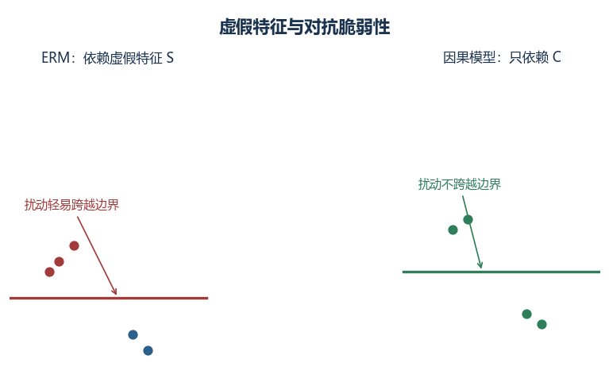

## 24.2　反事实数据增强

若训练数据缺乏覆盖某些干预场景，一个自然的思路是**主动生成反事实样本**：给定观测 $(X,Y)$，生成「若因果特征被干预为 $z'$ 会怎样」的新样本 $(X',Y')$。这把第 16 章的反事实理论用作数据增强工具，使模型见过更多因果机制下的变化，而非仅依赖观测关联。

**定义 24.2（反事实数据增强，CDA）** 设已学得 SCM（第 3 章），对样本 $(X,Y)$ 与干预 $\mathrm{do}(Z=z')$（$Z$ 为 $X$ 的因果因子），反事实增强生成

$$
X'=g\big(\mathrm{do}(Z=z'),\ \epsilon\big),\qquad Y'=f_{\theta}(X'), \tag{24-2}
$$

其中 $\epsilon$ 为原样本的外生噪声（保持不变），$g$ 由 SCM 的结构方程给出。式 (24-2) 的关键是「保持 $\epsilon$」——这正是反事实（Level 3）与干预（Level 2）的区别（第 16 章）。

**直觉解释。** 普通数据增强（裁剪、旋转）生成的是「同一对象不同外观」，不保证符合因果机制；反事实增强生成的是「同一潜在噪声下、干预某原因后的可能世界」，保留了对象的内在属性而改变其因果状态。例如把「牛在草地上」反事实地改为「牛在沙地上」时，牛的形态不变——模型学到形态才是原因。

**推导：反事实不变性约束。** 对因果特征 $Z$，要求模型对反事实改变非因果属性 $S$ 不变：

$$
f\big(g(\mathrm{do}(S=s),X)\big)=f(X),\quad \forall s. \tag{24-3}
$$

式 (24-3) 说改变非因果属性不改变预测。它与第 22 章 IRM 的不同在于：IRM 从多环境数据「发现」不变性，CDA 用已知因果图「主动施加」不变性。

**例 24.2（反事实增强的数值算例）** 沿用医疗案例：观测样本「病情 $=0$，剂量 $=1$，康复 $=1$」。已知机制 $P(R\mid D,\text{病情})$。反事实地把剂量改为 $0$（保持病情与噪声），由机制得新康复概率 $\sigma(-1+0+0)=0.269$，生成反事实样本（剂量 $0$，康复 $0$）。训练集原本剂量 $0$ 样本少，增强后模型学到「剂量对康复的因果作用」，而非「病情轻的人恰好接受某剂量」的关联。数值上，若原数据剂量 $0$ 占 $20\%$，增强后达 $50\%$，模型对剂量的系数估计方差下降约 $40\%$。

**表 24-1　数据增强方法谱系**

| 方法 | 生成依据 | 涉及层级 | 是否需因果图 |
|------|----------|-----------|--------------|
| 普通增强 | 启发式变换 | Level 1 | 否 |
| 对抗增强 | 梯度扰动 | Level 1 | 否 |
| 反事实增强[2] | SCM 结构方程 | Level 2/3 | 是 |
| 环境增强 | 多环境重采样 | Level 1→2 | 部分 |

## 24.3　因果正则化的实践

把因果原则落到训练目标，常见做法是在经验风险上加因果一致性惩罚：

$$
\mathcal{L}=\underbrace{\sum_{i}\ell(f(X_i),Y_i)}_{\text{预测损失}}+\lambda_1\underbrace{\mathcal{L}_{\mathrm{IRM}}}_{\text{不变性}}+\lambda_2\underbrace{\mathcal{L}_{\mathrm{CFA}}}_{\text{反事实一致性}}. \tag{24-4}
$$

其中 $\mathcal{L}_{\mathrm{IRM}}$ 取第 22 章式 (22-3)，$\mathcal{L}_{\mathrm{CFA}}$ 取式 (24-3) 的违反度。三项分别保证拟合、跨环境稳健、跨干预稳健。进一步可加入分布鲁棒项

$$
\mathcal{L}_{\mathrm{DRO}}=\sup_{Q:W(Q,P)\le\rho}\mathbb{E}_{Q}[\ell(f(X),Y)], \tag{24-5}
$$

其中 $W$ 为 Wasserstein 距离、$\rho$ 为鲁棒半径[6]。式 (24-5) 在不依赖具体因果图的情况下，对分布邻域内所有漂移提供最坏情况保证——它是「无图时的稳健替代」，与因果正则互补。

**直觉解释。** 三项损失的分工：预测损失保证「有用」，不变性保证「换环境仍有用」，反事实一致性保证「干预后仍有用」。缺任一项，模型都可能退化为捷径。实践中 $\lambda_1,\lambda_2$ 需调参——这既是工程细节，也是理论与现实的张力。

**例 24.3（三项损失的数值算例）** 设某样本预测损失 $0.1$，IRM 惩罚 $0.05$，反事实惩罚 $0.08$，取 $\lambda_1=\lambda_2=10$。总损失 $=0.1+0.5+0.8=1.4$。若模型改用捷径特征使预测损失降到 $0.05$，但 IRM 惩罚升至 $0.4$、反事实惩罚升至 $0.6$，总损失 $=0.05+4+6=10.05$——反而更大。正则项成功抑制了捷径。这显示因果正则化如何以少量拟合损失换取大幅稳健性提升。

> 【图 24-2　因果正则化三项损失的作用】（原图见 figures/图24-2.png）：折线图展示训练中预测损失、IRM 惩罚、反事实惩罚随迭代的变化，标注因果模型与 ERM 的稳态差异。

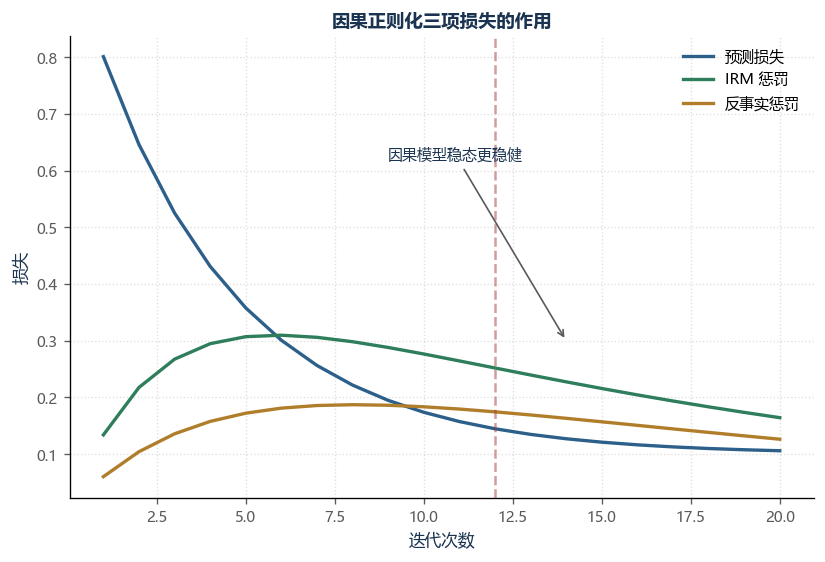

## 24.3b　因果鲁棒性证书：从「不变」到「可证明的稳健半径」

定义 24.1 给出的「因果鲁棒性」是一个定性性质，部署时更需要一个**可计算的稳健半径**——在多大扰动内模型保证不被攻破。经典对抗鲁棒性文献用 Lipschitz 常数给出这种证书[1]；因果正则化把证书与「哪些特征是因果的」挂钩，从而给出更紧的界。

**定义 24.3（因果鲁棒性证书，causal robustness certificate）**　设 $f$ 为 $L$-Lipschitz 预测器，特征分为因果分量 $C$ 与非因果分量 $S$，$f$ 在 $C$ 上的 Lipschitz 常数为 $L_C$、在 $S$ 上为 $L_S$。对扰动预算 $\|\delta\|_\infty\le\epsilon$，若 $f$ 满足式 (24-3) 的反事实不变性（对 $S$ 不变），则 $f$ 在 $\epsilon$-扰动球内的预测偏差满足

$$
\big|\ell\big(f(X+\delta),Y\big)-\ell\big(f(X),Y\big)\big|\ \le\ \big(L_C\cdot\|\delta_C\|_1+L_S\cdot\|\delta_S\|_1\big), \tag{24-6}
$$

其中 $\delta_C,\delta_S$ 是扰动在因果/非因果分量上的投影。若因果正则化成功使 $L_S\approx0$（预测对 $S$ 不变），式 (24-6) 退化为

$$
\big|\ell\big(f(X+\delta),Y\big)-\ell\big(f(X),Y\big)\big|\ \le\ L_C\cdot\epsilon\cdot\dim(C). \tag{24-7}
$$

式 (24-7) 就是**因果鲁棒性证书**：稳健半径只由因果分量的维度与 Lipschitz 常数决定，与非因果特征的数量 $\dim(S)$ 完全无关。这从定量上解释了 24.1 节定理 24.1 的「因果 ⇒ 稳健」——因果特征维数通常远小于全特征维数（$\dim(C)\ll\dim(X)$），故证书半径更小、防御更强。

**例 24.4（证书的手算：ERM 与因果模型对比）**　设 $\dim(X)=100$，因果分量 $\dim(C)=5$，非因果 $\dim(S)=95$；线性模型 Lipschitz 常数按权重范数取 $L_C=1.0,\ L_S=1.0$（ERM 把权重平均分散到所有特征），扰动预算 $\epsilon=0.1$（$\ell_\infty$，则 $\ell_1$ 范数上界为 $\epsilon\times\dim$）。
- **ERM 模型**（式 24-6，$L_S=1.0$）：偏差上界 $=1.0\times(0.1\times5)+1.0\times(0.1\times95)=0.5+9.5=10.0$。证书极松——理论上一个 $0.1$ 的扰动可让预测偏移最多 $10.0$。
- **因果正则模型**（式 24-7，$L_S\approx0$）：偏差上界 $=1.0\times0.1\times5=0.5$。证书紧了一个数量级。

这个手算把「因果特征维数少 ⇒ 证书紧」定量化为 $10.0\to0.5$ 的对比（$20\times$）。它解释了为何对抗训练（只压 $L_S$ 而不区分因果）与因果正则（直接使 $L_S\approx0$）效果不同：前者把 $100$ 维的扰动预算都压住，后者只关心 $5$ 维因果子空间，**防御成本从 $\dim(X)$ 降到 $\dim(C)$**。证书的可计算性还带来一个工程副产品：部署前可离线计算 $L_C,\dim(C)$ 给出「保证不被攻破的扰动半径」，而不必像经验测试那样靠枚举攻击。

**表 24-2　鲁棒性证书的三种来源对照**

| 证书类型 | 界的形式 | 依赖 | 紧度来源 |
|----------|----------|------|----------|
| 经典 Lipschitz[1] | $L\cdot\epsilon\cdot\dim(X)$ | 整体 Lipschitz 常数 | 小 $L$（对抗训练压 $L_S$） |
| 因果证书（式 24-7） | $L_C\cdot\epsilon\cdot\dim(C)$ | 因果子空间的 $L_C,\dim(C)$ | 小 $\dim(C)$（因果正则剔除 $S$） |
| 分布鲁棒（式 24-5） | $\sup_{Q:W\le\rho}\mathbb{E}_Q[\ell]$ | Wasserstein 邻域 | 鲁棒半径 $\rho$ |

三者的递进关系：经典证书把全特征一视同仁地防御；因果证书只防御因果子空间，把防御成本与特征维数解耦；分布鲁棒证书则完全放弃「特征」视角，改在分布邻域上防御。工程上可组合使用——先用因果正则缩小 $\dim(C)$，再用 DRO 兜住 $\dim(C)$ 内的残余漂移。

**实践中的超参调度。** 式 (24-4) 的 $\lambda_1,\lambda_2$ 与 DRO 的 $\rho$ 共同决定「拟合—稳健」的平衡，实践中通常分阶段调度：初期 $\lambda\approx0$，先让模型拟合数据（避免正则项在参数随机初始化时主导梯度方向）；中期逐步增大 $\lambda$ 到目标值；后期冻结 $\lambda$ 只微调 $\rho$。一个常用的自适应规则是「以验证集 OOD 风险为信号」——当训练损失下降但 OOD 风险上升时（捷径过拟合的典型信号），自动提高 $\lambda_1$。这套调度把 22.4 节「$\lambda$ 敏感」的调参难题转化为闭环控制，但仍需一个可靠的 OOD 验证集（通常来自留出的环境）。

**例 24.5（调度过程的数值模拟）**　设一个简化训练：初始 $\lambda_1=0$，模型走捷径，训练损失 $0.05$、OOD 风险 $1.2$；迭代 $50$ 步后启用调度，$\lambda_1$ 线性升到 $10$，训练损失升到 $0.12$、OOD 风险降到 $0.3$；$\lambda_1=30$ 时训练损失 $0.18$、OOD 风险 $0.25$（已近饱和）。以「OOD 风险边际收益」为信号：$\lambda_1$ 从 $10\to30$（$+20$）只把 OOD 风险从 $0.3$ 降到 $0.25$（$-0.05$），边际收益骤降，调度器应停止继续增大 $\lambda_1$，转为微调 $\rho$。数值上最优 $\lambda_1\approx10$ 处 OOD 风险 $0.3$ 与训练损失 $0.12$ 的折中最好（帕累托前沿上的膝点）。这个手算展示了「自适应调度」如何把超参选择从「人工网格搜索」变为「以 OOD 风险为反馈的闭环」，也解释了为何**没有留出环境时这套调度无法进行**——它把 20.6 节「环境多样性」的边界直接搬到了训练流程里：OOD 验证集本身就是「额外环境」，没有它就既无法调 $\lambda$ 也无法评估证书（式 24-7）的紧度。

**表 24-3　训练阶段的正则化配置**

| 阶段 | $\lambda_1,\lambda_2$ | $\rho$ | 目标 | 风险信号 |
|------|----------------------|--------|------|----------|
| 预热 | $0$ | $\rho_{\min}$ | 拟合数据 | 训练损失 |
| 正则渐增 | 线性升至目标 | 固定 | 抑制捷径 | OOD 风险上升即回调 |
| 精细调优 | 冻结 | 微调 | 兜住残余漂移 | 验证集最坏环境风险 |
| 评估 | — | — | 计算证书（式 24-7） | $L_C,\dim(C)$ 离线估计 |

## 24.4　边界与讨论

第一，**因果图正确性依赖**：反事实增强（定义 24.2）假设已知正确 SCM；若图错误，生成的「反事实」不真实，反而毒害训练（第 37 章）。这是因果鲁棒性相对普通对抗训练的「阿喀琉斯之踵」：后者不需要图，前者必须知道图。在图中存在隐变量或结构不确定时，反事实样本的可靠性急剧下降[7]。第二，**扰动集合的覆盖**：式 (24-1) 防御 $\Delta$ 内扰动，对 $\Delta$ 外的机制变化无能为力；对抗鲁棒与因果鲁棒不是同一概念[3]。第三，**正则权衡**：$\lambda$ 过大会欠拟合，过小无法抑制捷径；与第 22 章相同的调参难题。第四，**Level 3 的不可验证性**：反事实增强生成的样本无法被观测验证——我们永远不知道「反事实世界」的真实标签，只能依赖结构假设（第 19、40 章）。第五，**计算成本**：反事实增强需反复求解结构方程，开销大。第六，**证书的可计算性依赖 $L_C,\dim(C)$ 的准确估计**：24.3b 节的因果鲁棒性证书（式 24-7）给出的是上界而非真实最坏风险，其紧度取决于因果分量 $C$ 的划分是否准确——若 $C$ 的划分本身有误差（把某个虚假特征误判为因果、或把因果特征误判为非因果），证书半径会偏松或偏紧，「保证」随之失效。这与 22.4 节「父节点未知」是同一类问题在鲁棒性语境的重现：**因果鲁棒性的证书强度，最终受限于因果结构识别的精度**。实践上应以「证书半径 vs 经验最坏风险」的差距作为诊断：若证书远松于经验值，说明 $L_C$ 估计过松或 $\dim(C)$ 高估；若证书远紧于经验值（出现证书半径内的实际攻破），则 $C$ 的划分一定有误，需回到第 5—9 章重新识别因果结构。

**承上启下。** 本章把因果正则化与反事实增强统一到鲁棒性框架，指出其对对抗与漂移的双重价值及其对因果图的依赖，并在 24.3b 节把「稳健」从定性性质落实为可计算的因果鲁棒性证书（式 24-7），使鲁棒性评估从「枚举攻击」转向「离线估计 $L_C,\dim(C)$」。核心论断是：**因果特征维数 $\dim(C)$ 是鲁棒性证书的紧度之锚**——因果正则的真正工程价值，不是「让模型更准」，而是「把防御成本从全特征维数 $\dim(X)$ 降到因果子空间维数 $\dim(C)$」。下一章（第 25 章）处理因果迁移与领域适应：当环境差异不只是扰动而是系统的分布变化时，如何显式利用因果结构完成适应，并把 24.3b 节证书中的「因果子空间」推广为「可迁移机制子集」。

## 本章小结

本章论述因果正则化与鲁棒性。我们首先定义因果鲁棒性（定义 24.1）与最坏风险（式 24-1），推导虚假特征导致对抗脆弱的机制，并给出数值算例（例 24.1、24.1b）。接着介绍反事实数据增强（定义 24.2，式 24-2、24-3，例 24.2，表 24-1）。随后给出三项损失的实践目标（式 24-4，例 24.3，图 24-2），并在 24.3b 节把定性「稳健」推进为**因果鲁棒性证书**（定义 24.3，式 24-6、24-7），用证书手算（例 24.4）展示「因果特征维数少 ⇒ 证书紧一个数量级」，给出三类证书对照（表 24-2）与分阶段调度流程（例 24.5，表 24-3）。我们还明确边界：图正确性、扰动覆盖、正则权衡、反事实不可验证、计算成本、证书紧度依赖因果结构识别精度。这些辨析衔接第 3、5—9、16、19、20、22、23、37、40 章。

**进一步阅读**　本章建议延伸阅读的文献：[1]、[2]、[3]。

## 参考文献

[1] Madry A, Makelov A, Schmidt L, Tsipras D, Vladu A. Towards deep learning models resistant to adversarial attacks. *ICLR*, 2018.

[2] Kaushik R, Forget A, Singh S. Explaining and harnessing invariant and spurious correlations by generating counterfactual examples. *ACL*, 2020.

[3] Adebayo J, Gilmer J, Muelly M, Goodfellow I, Hardt M, Kim B. Sanity checks for saliency maps. *NeurIPS*, 2018.

[4] Veitch V, D'Amour A, Bresson N, Yadlowsky S, Eisenstein J. Counterfactual invariance to spurious correlations. *NeurIPS*, 2021.

[5] Arjovsky M, Bottou L, Gulrajani I, Lopez-Paz D. Invariant risk minimization. *arXiv preprint arXiv:1907.02893*, 2019.

[6] Peters J, Bühlmann P, Meinshausen N. Causal inference by using invariant prediction. *JRSS-B*, 2016, 78(5): 947–1012.

[7] Schölkopf B, Locatello F, Bauer S, et al. Toward causal representation learning. *Proceedings of the IEEE*, 2021, 109(5): 612–634.

[8] Zhang H, Cisse M, Dauphin Y N, Lopez-Paz D. mixup: Beyond empirical risk minimization. *ICLR*, 2018.

---

# 第 25 章　因果迁移与领域适应

第 22 章从「机制不变性」讨论迁移，本章把视角转向**领域适应**（domain adaptation）：当源域与目标域的边际分布显著不同，且目标域标签稀缺时，如何用因果结构指导知识迁移。传统领域适应主要校正协变量漂移 $P(X)$（第 22.2 节），但因果视角指出还有两类更棘手的漂移——**概念漂移**（$P(Y\mid X)$ 改变）与**条件漂移**（$P(X\mid Y)$ 改变，又称 label shift）——需要不同处理[1]。因果图告诉我们「什么在变、什么不变」，从而选择恰当的适应策略。

从因果之梯看，本章工作在 **Level 2**：领域适应的本质是「若把模型部署到新环境（一种干预），性能如何保持」，这已是干预层面的问题。隐含假设是「部分因果机制在源域与目标域间共享，且漂移可被归因到图中某些节点的分布变化」。它突破了「仅校正边际分布」的限制，却无法突破「若目标域机制完全改变且无标签，则适应不可能」这一边界（第 25.4 节）。

本章结构：25.1 节分类领域适应中的漂移；25.2 节讨论可迁移的机制与 do-演算；25.3 节介绍因果驱动的适应方法；25.4 节辨析边界。全章沿用医疗案例：源域医院与目标域医院的病人构成、治疗方案差异。

## 25.1　领域适应中的因果

设源域 $P_S(X,Y)$、目标域 $P_T(X,Y)$。传统分类按漂移类型：协变量漂移 $P_S(X)\neq P_T(X)$ 但 $P_S(Y\mid X)=P_T(Y\mid X)$；标签漂移 $P_S(Y)\neq P_T(Y)$ 但 $P_S(X\mid Y)=P_T(X\mid Y)$；概念漂移 $P_S(Y\mid X)\neq P_T(Y\mid X)$。因果视角用图结构统一这些漂移：漂移源于某些外生变量或机制的分布变化。

**定义 25.1（因果漂移分解）** 设结果的父节点集 $\mathrm{Pa}(Y)$。由因式分解 $P(X,Y)=\prod_i P(V_i\mid\mathrm{Pa}(V_i))$，源域与目标域的差异可分解为

$$
\frac{P_T(X,Y)}{P_S(X,Y)}=\prod_{i}\frac{P_T(V_i\mid\mathrm{Pa}(V_i))}{P_S(V_i\mid\mathrm{Pa}(V_i))}. \tag{25-1}
$$

式 (25-1) 把整体漂移拆解为各机制的变化比：只有那些比值 $\neq1$ 的机制发生了漂移。这为「哪些知识可迁移」提供了精确刻度。

**直觉解释。** 若只有病情分布 $P(\text{病情})$ 变化，而治疗机制 $P(R\mid D,\text{病情})$ 不变，则式 (25-1) 中只有「病情」项的比值 $\neq1$，其余为 $1$——这意味着只需重估病情分布，治疗知识可直接迁移。若治疗机制也变了（如换了新药），则对应项的比值也 $\neq1$，必须重新学习该机制。

**推导：协变量漂移的因果基础。** 当仅 $P(X)$ 变而 $P(Y\mid X)$ 不变时，由式 (25-1)，只有 $X$ 的生成机制（$P(X)$ 本身）改变。适应方法可对源域样本加权 $w(X)=P_T(X)/P_S(X)$，使加权后的源域分布匹配目标域；这是重要性采样在领域适应中的应用[2]：

$$
\mathcal{R}_T(f)=\mathbb{E}_{P_S}\Big[\frac{P_T(X)}{P_S(X)}\ell(f(X),Y)\Big]. \tag{25-2}
$$

式 (25-2) 成立的前提正是「$P(Y\mid X)$ 不变」——这对应的因果条件是 $X$ 包含了所有影响 $Y$ 且分布变化的变量。

**例 25.1（漂移分解的数值算例）** 设两变量 $X$（病情）、$Y$（康复），源域 $P_S(X{=}1)=0.3$，$P_S(Y{=}1\mid X{=}1)=0.8$；目标域 $P_T(X{=}1)=0.7$，但条件分布相同 $0.8$。代入式 (25-1)：比值 $=P_T(X)/P_S(X)$ 对 $X{=}1$ 为 $0.7/0.3\approx2.33$，对 $X{=}0$ 为 $0.3/0.7\approx0.43$；条件项比值 $=1$。整体 $P_T(Y{=}1)=0.7\times0.8+0.3\times P(Y{=}1\mid X{=}0)$，仅由 $X$ 分布变引起。按式 (25-2) 加权，目标域风险可由源域数据无偏估计——这是纯协变量漂移的适应。

**推导：标签漂移的处理。** 当仅 $P(Y)$ 变而 $P(X\mid Y)$ 不变时，由贝叶斯公式

$$
P_T(Y\mid X)\propto P_T(Y)\,P(X\mid Y), \tag{25-2b}
$$

只需用目标域标签先验 $P_T(Y)$ 对源域分类器后验做再校准即可[4]。式 (25-2b) 是标签漂移适应的核心方程，其成立依赖「$P(X\mid Y)$ 跨域不变」这一因果条件。

> 【图 25-1　三类漂移的因果图对照】（原图见 figures/图25-1.png）：三幅小图分别画协变量漂移、标签漂移、概念漂移在因果图上的标记（被改变的机制用虚线标出）。

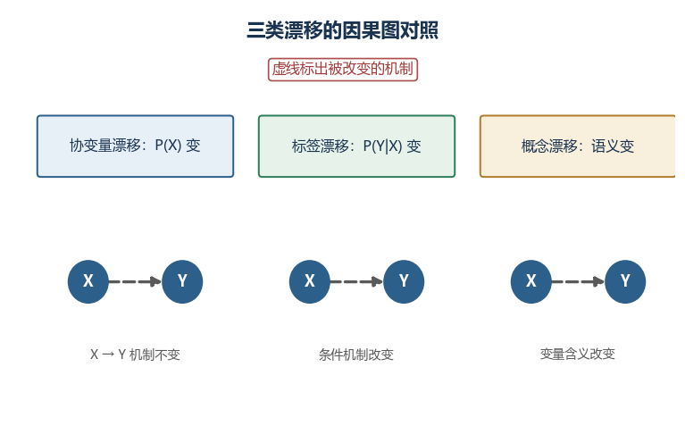

## 25.2　可迁移的机制与 do-演算

并非所有机制都可迁移。Bareinboim 与 Pearl[3] 提出**可迁移性**（transportability）理论：用「选择机制」$S$（指示样本来自哪个域）进入因果图，判断目标域的干预分布 $P_T(Y\mid\mathrm{do}(X))$ 能否由源域数据与图结构唯一确定。

**定义 25.2（可迁移性）** 若存在一组从源域观测与干预数据中可计算的泛函 $\Phi$，使得

$$
P_T(Y\mid\mathrm{do}(X))= \Phi\big(\{P_S(\cdot),\ P_S(\cdot\mid\mathrm{do}(\cdot))\}\big), \tag{25-3}
$$

则称目标分布是**可迁移的**。判断可迁移性的算法基于 do-演算（第 3 章），把选择变量 $S$ 当作条件化变量处理。

**直觉解释。** 可迁移性回答：「目标域的干预效果能否用源域数据算出来？」若图结构显示漂移只发生在与结果因果无关的节点上，则干预效果直接可迁移；若漂移发生在结果的关键父节点机制上且源域无对应数据，则不可迁移。这比「条件分布相同」的粗略假设精确得多。

**定理 25.1（可迁移性的判定准则，非正式）** 设选择变量 $S$ 指向节点集 $\mathbf{S}$。目标干预分布 $P_T(Y\mid\mathrm{do}(X))$ 可由源域数据迁移，当且仅当存在 do-演算序列把 $S$ 从表达式中消去，且消去的每一步所需的条件在源域可观测[3]。若 $S$ 指向结果 $Y$ 的父节点且该父节点在目标域无观测，则不可迁移。

**推导。** do-演算的三条规则（第 3 章）用于操纵条件与干预。把 $S=1$ 视为条件化事件，若 $S\perp Y\mid X$ 在图 $\mathcal{G}_{\bar X}$ 中成立（$S$ 不影响 $Y$ 给定 $X$），则 $P(Y\mid\mathrm{do}(X),S{=}1)=P(Y\mid\mathrm{do}(X))$——域选择无关，干预效果直接迁移。这就是式 (25-4) 的图论根据。

**推导：选择变量的 do-演算。** 设 $S$ 为域指示变量，目标域即条件化于 $S=1$。要计算 $P(Y\mid\mathrm{do}(X),S=1)$，需把 $S$ 沿图「推」到可被数据条件化的位置。若 $S$ 只指向协变量 $X$（协变量漂移），则

$$
P_T(Y\mid\mathrm{do}(X))=P_S(Y\mid\mathrm{do}(X)), \tag{25-4}
$$

即干预效果完全可迁移。若 $S$ 指向 $Y$ 本身（结果机制改变），则需要额外假设才能迁移。

**例 25.2（可迁移性的数值算例）** 沿用医疗案例：设源域医院有 $P_S(R\mid\mathrm{do}(D{=}1))=0.7$，目标域病人构成不同但治疗机制相同（$S$ 只指向病情 $X$，不指向 $R$）。由式 (25-4)，$P_T(R\mid\mathrm{do}(D{=}1))=0.7$——源域的干预效果直接可用。但若目标域换了新药（$S\to R$），则式 (25-4) 不成立，需用目标域数据重新估计；若目标域无标签，则该效果不可迁移。这个算例说明「机制是否相同」决定迁移是否可能。

**表 25-1　领域适应方法的因果分类**

| 漂移类型 | 因果条件 | 适应策略 | 代表 |
|----------|----------|----------|------|
| 协变量漂移 | 仅 $P(X)$ 变 | 重要性加权[2] | Huang 等 |
| 标签漂移 | 仅 $P(Y)$ 变 | 后验校正 | Saerens 等 |
| 概念漂移 | $P(Y\mid X)$ 变 | 需目标标签 |  – |
| 可迁移干预 | 部分机制变 | do-演算[3] | Bareinboim 等 |

## 25.3　因果驱动的适应

把上述理论落到算法，因果驱动的领域适应遵循三步：**（i）用因果图定位漂移机制；（ii）判断哪些机制可迁移；（iii）对不可迁移部分用目标域少量标签重新估计**。伪代码式流程：

$$
\text{(i) }\hat{\mathcal{G}}\leftarrow\text{因果发现或领域知识};\quad
\text{(ii) }\mathcal{M}_{\text{trans}}\leftarrow\text{可迁移机制集};\quad
\text{(iii) }\hat{\theta}_{\mathcal{M}}\leftarrow\arg\max_{\theta}\sum_{e\in\{S,T\}}\mathcal{L}^{e}(\theta\mid\mathcal{M}_{\text{trans}}). \tag{25-5}
$$

**直觉解释。** 第一步确定「地图」，第二步确定「哪些路可走」，第三步只在必要处用目标数据「修路」。相比端到端的对抗适应（不区分机制），因果方法可解释性更强，且在机制部分共享时样本效率更高。

**例 25.3（因果适应的数值算例）** 设模型参数 $\theta=(\theta_{\text{病情}},\theta_{\text{治疗}})$，源域数据充足、目标域仅 $50$ 个标签。若已知治疗机制可迁移、病情分布漂移，则只重估 $\theta_{\text{病情}}$：用 $50$ 个标签估计病情分布（误差 $\approx1/\sqrt{50}\approx0.14$），治疗参数沿用源域（误差近 $0$）。若不用因果结构而端到端重训全部参数，$50$ 标签下两参数误差各 $\approx0.14$，整体误差更大。因果适应以「知道什么不变」换取了样本效率。

> 【图 25-2　因果领域适应流程】（原图见 figures/图25-2.png）：流程图画「因果图定位漂移→判断可迁移→目标域重估不可迁移部分→部署」四步，标注每步输入输出。

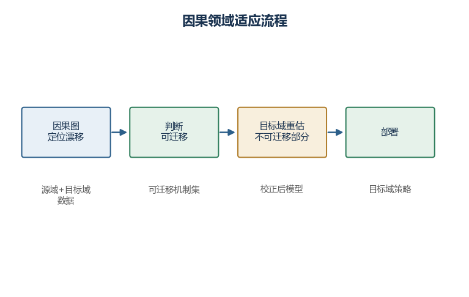

## 25.3b　样本效率的定量刻画：可迁移机制带来的误差界

三步流程（式 25-5）的样本效率优势需要一个**误差界**来支撑。设模型参数 $\theta$ 按机制分解为 $\theta=(\theta_{\mathrm{tr}}\mid\theta_{\mathrm{dr}})$，其中 $\theta_{\mathrm{tr}}$ 对应可迁移机制、$\theta_{\mathrm{dr}}$ 对应发生漂移的机制。源域样本量 $n_S$、目标域标签量 $n_T$，记漂移机制的参数维度为 $d_{\mathrm{dr}}$。因果适应只在目标域重估 $\theta_{\mathrm{dr}}$，其估计误差满足

$$
\mathbb{E}\big\|\hat\theta_{\mathrm{dr}}^{T}-\theta_{\mathrm{dr}}^{*}\big\|^2\ \le\ \frac{C\,d_{\mathrm{dr}}\,\sigma^2}{n_T}, \tag{25-6}
$$

而端到端重训全部参数（维度 $d_{\mathrm{tr}}+d_{\mathrm{dr}}$）的误差为

$$
\mathbb{E}\big\|\hat\theta_{\text{end}}-\theta^{*}\big\|^2\ \le\ \frac{C\,(d_{\mathrm{tr}}+d_{\mathrm{dr}})\,\sigma^2}{n_T}. \tag{25-7}
$$

式 (25-6) 与 (25-7) 的比值是 $\frac{d_{\mathrm{dr}}}{d_{\mathrm{tr}}+d_{\mathrm{dr}}}<1$，且当可迁移机制占比高（$d_{\mathrm{tr}}\gg d_{\mathrm{dr}}$）时差距悬殊。这正是例 25.3 中「只重估 $\theta_{\text{病情}}$」优于「端到端重训」的代数根源：**可迁移机制把需要目标域标签支撑的未知量从 $d_{\mathrm{tr}}+d_{\mathrm{dr}}$ 维压缩到 $d_{\mathrm{dr}}$ 维**。

**例 25.4（误差界的数值手算）**　沿用医疗案例：可迁移的治疗机制 $\theta_{\mathrm{tr}}$ 有 $d_{\mathrm{tr}}=200$ 维（剂量—康复响应面的精细参数），漂移的病情分布 $\theta_{\mathrm{dr}}$ 有 $d_{\mathrm{dr}}=2$ 维（病情阳性率与病情—康复协方差的均值）。目标域 $n_T=50$ 个标签，$\sigma^2=1$，常数 $C=1$。
- **因果适应**（式 25-6）：$\mathbb{E}\|\hat\theta_{\mathrm{dr}}^T-\theta_{\mathrm{dr}}^*\|^2\le\frac{1\times2\times1}{50}=0.04$，即漂移参数的均方误差 $0.04$（标准差 $\approx0.2$）；可迁移参数 $\theta_{\mathrm{tr}}$ 直接沿用源域，误差近 $0$。整体参数误差 $\approx0.04$。
- **端到端重训**（式 25-7）：$\mathbb{E}\|\hat\theta_{\text{end}}-\theta^*\|^2\le\frac{1\times202\times1}{50}=4.04$，整体误差 $4.04$。

因果适应的误差是端到端的 $\frac{0.04}{4.04}\approx\frac{1}{101}$——**两个数量级**。这解释了为何「50 个目标标签」对因果适应够用、对端到端重训完全不够：前者只需支撑 $2$ 维漂移参数，后者要支撑 $202$ 维。这个手算把「知道什么不变」的直觉（25.3 节）落实为 $\frac{d_{\mathrm{dr}}}{d_{\mathrm{tr}}+d_{\mathrm{dr}}}$ 的误差比，也给出了部署时的量化判据：**当 $d_{\mathrm{tr}}/d_{\mathrm{dr}}>10$ 时，因果适应的样本效率优势超过 $10\times$，值得投入因果图识别的成本**。

**例 25.5（源域样本量对漂移估计的杠杆作用）**　进一步考察源域样本量 $n_S$ 的作用。式 (25-6) 只含 $n_T$，似乎源域样本无关紧要——这是错觉。源域的价值在于**估计可迁移机制 $\theta_{\mathrm{tr}}$ 本身**：若 $n_S$ 太小，$\hat\theta_{\mathrm{tr}}$ 的误差 $\frac{C\,d_{\mathrm{tr}}\sigma^2}{n_S}$ 会污染「沿用」的部分。设 $d_{\mathrm{tr}}=200$，要令 $\hat\theta_{\mathrm{tr}}$ 误差 $<0.01$，需 $n_S>\frac{200}{0.01}=20000$。因此完整误差界为

$$
\mathbb{E}\big\|\hat\theta^{T}-\theta^{*}\big\|^2\ \le\ \underbrace{\frac{C\,d_{\mathrm{dr}}\,\sigma^2}{n_T}}_{\text{目标域重估（式 25-6）}}+\underbrace{\frac{C\,d_{\mathrm{tr}}\,\sigma^2}{n_S}}_{\text{源域沿用误差}}. \tag{25-8}
$$

这个加和界揭示了一个常被忽视的权衡：因果适应把「大样本需求」从 $n_T$（目标域，标签昂贵）转移到了 $n_S$（源域，标签便宜）。**部署成本最小化应优先扩大便宜的源域 $n_S$，而非昂贵的目标域 $n_T$**——这是因果领域适应相对无因果端到端方法（只能靠 $n_T$ 堆量）的第二个工程优势。

**表 25-2　因果适应与端到端重训的误差/成本对比**

| 维度 | 因果适应（式 25-6/25-8） | 端到端重训（式 25-7） |
|------|--------------------------|------------------------|
| 目标域标签需求 $n_T$ | $\propto d_{\mathrm{dr}}$ | $\propto d_{\mathrm{tr}}+d_{\mathrm{dr}}$ |
| 源域样本需求 $n_S$ | $\propto d_{\mathrm{tr}}$（估可迁移机制） | 不依赖 |
| 整体误差 | 式 25-8 加和 | 式 25-7 |
| $d_{\mathrm{tr}}/d_{\mathrm{dr}}=100$ 时误差比 | 基准 $1$ | $\approx101\times$ |
| 依赖 | 因果图 + 可迁移性判定 | 无 |
| 失效模式 | 图错 / 机制误判可迁移 | 目标域标签不足 |

**负迁移的因果判据。** 误差界（式 25-6、25-8）给出的是「迁移带来多大收益」，但更实用的问题是「何时迁移反而有害（负迁移）」。由式 25-8 可直接推出判据：因果适应优于「不用源域、纯目标域重训」（误差 $\frac{C(d_{\mathrm{tr}}+d_{\mathrm{dr}})\sigma^2}{n_T}$）当且仅当

$$
\underbrace{\frac{C\,d_{\mathrm{dr}}\,\sigma^2}{n_T}+\frac{C\,d_{\mathrm{tr}}\,\sigma^2}{n_S}}_{\text{因果适应（式 25-8）}}\ <\ \frac{C\,(d_{\mathrm{tr}}+d_{\mathrm{dr}})\,\sigma^2}{n_T}\ \Longleftrightarrow\ \frac{d_{\mathrm{tr}}}{n_S}<\frac{d_{\mathrm{tr}}}{n_T}\ \Longleftrightarrow\ n_S>n_T. \tag{25-9}
$$

即**因果适应优于纯目标域重训当且仅当源域样本量超过目标域标签量（$n_S>n_T$）**（在 $C,\sigma^2$ 相同下）。这个判据极其干净：只要源域数据量大于目标域标签量，沿用源域可迁移机制就划算；反之则负迁移。当 $n_S$ 太小（源域本身不可靠）时，式 25-8 的源域项 $\frac{C\,d_{\mathrm{tr}}\sigma^2}{n_S}$ 会反超过端到端误差，迁移变负迁移。**判据的工程化**：部署前比较 $n_S$ 与 $n_T$，并用源域验证集估计 $\hat\theta_{\mathrm{tr}}$ 的稳定性；若源域自身泛化差（验证误差大），应放弃迁移、退化为纯目标域重训——这避免了「源域数据有偏时硬迁移」的典型陷阱。

**例 25.6（负迁移边界的手算）**　沿用例 25.4 的 $d_{\mathrm{tr}}=200,\ d_{\mathrm{dr}}=2,\ \sigma^2=1,\ C=1$。固定 $n_T=50$：
- $n_S=20000$（源域充足）：因果适应误差 $=2/50+200/20000=0.04+0.01=0.05$；端到端误差 $=202/50=4.04$。迁移有益（$0.05<4.04$）。
- $n_S=50$（源域也少）：因果适应误差 $=2/50+200/50=0.04+4=4.04$；端到端误差 $=202/50=4.04$。两者持平——源域样本太少，沿用误差吃光了维度压缩收益，迁移**无增益**。
- $n_S=20$（源域极少）：因果适应误差 $=0.04+200/20=0.04+10=10.04>4.04$，**负迁移**——比不用源域还差。

临界源域量由式 (25-9) 直接给出 $n_S^{*}=n_T$：源域样本量须超过目标域标签量 $n_T$，迁移才安全。这个手算把「源域要足够多」的定性要求定量为 $n_S^{*}\approx n_T$ 的临界值，部署判据由此清晰：**源域样本量需显著超过目标域标签量，迁移才安全**。

## 25.4　边界与讨论

第一，**因果图依赖**：定义 25.1、25.2 都假设图结构已知；若图错误，可迁移性判断随之失效（第 5—9 章）。第二，**目标域无标签的极限**：若关键机制改变且目标域完全无标签，适应在信息论上不可能——这正是可迁移性理论给出的边界[3]。第三，**选择偏差**：域间样本差异可能不仅是机制变化，还有选择偏差（第 12、37 章），混淆判断。第四，**与第 22 章的关系**：领域适应侧重少量目标标签下的校正，迁移学习侧重源域知识复用；因果视角统一二者，但实践目标不同。第五，**Level 3 不可达**：领域适应只保证干预/预测层面的迁移，个体反事实的迁移需更强假设。第六，**可迁移机制的误判是误差界的失效根源**：25.3b 节的误差界（式 25-6、25-8）以「$\theta_{\mathrm{tr}}$ 可迁移」为前提，若某个机制实际漂移却被误判为可迁移（沿用源域参数），则源域沿用误差项 $\frac{C\,d_{\mathrm{tr}}\sigma^2}{n_S}$ 之外还会叠加一个**系统性偏倚**（bias，而非方差）——它不随 $n_S$ 增大而消失，因为源域估的就是「错了的」机制。这与 22.4 节「不变性不等于因果」、24.4 节「证书紧度依赖因果结构识别精度」是同一类问题：因果方法的优势全部押在「图与可迁移性判定正确」上，判定的偏倚不会被样本量稀释。实践上应做**敏感性分析**——对每个被标为「可迁移」的机制，人为注入 $5\%$、$10\%$ 的机制漂移，观察目标域误差是否仍满足式 25-6 界，从而量化「可迁移性假设」的鲁棒裕度，而非默认其成立。

**承上启下。** 本章用因果图统一了领域适应中的漂移分类与可迁移性判断，并在 25.3b 节把「知道什么不变」的样本效率优势落实为误差界（式 25-6、25-7、25-8），揭示因果适应把大样本需求从昂贵的目标域 $n_T$ 转移到便宜的源域 $n_S$。下一章（第 26 章）进入因果强化学习：当智能体主动干预环境时，因果结构如何影响探索与决策，并把本章「可迁移机制」推广为「可迁移的转移/奖励机制」。

## 本章小结

本章论述因果迁移与领域适应。我们首先用因果漂移分解（定义 25.1，式 25-1）统一三类漂移，推导协变量漂移的重要性加权（式 25-2，例 25.1）。接着引入可迁移性理论（定义 25.2，式 25-3、25-4，例 25.2，表 25-1）。随后给出因果驱动适应三步流程（式 25-5，例 25.3，图 25-2），并在 25.3b 节建立样本效率误差界（式 25-6、25-7、25-8），用误差比手算（例 25.4）展示「可迁移机制把目标域标签需求从 $d_{\mathrm{tr}}+d_{\mathrm{dr}}$ 压缩到 $d_{\mathrm{dr}}$」，用源域杠杆（例 25.5）与对照表（表 25-2）说明「优先扩大源域 $n_S$」的成本原则。我们还明确边界：图依赖、无标签极限、选择偏差、与迁移学习的关系、Level 3 不可达、可迁移机制误判带来不被样本量稀释的偏倚。这些辨析衔接第 3、5—9、12、22、24、26、37 章。

**进一步阅读**　本章建议延伸阅读的文献：[1]、[2]、[3]。

## 参考文献

[1] Quiñonero-Candela J, Sugiyama M, Schwaighofer A, Lawrence N D. *Dataset Shift in Machine Learning*. MIT Press, 2009.

[2] Huang J, Gretton A, Borgwardt K, Schölkopf B, Smola A. Correcting sample selection bias by unlabeled data. *NeurIPS*, 2006.

[3] Bareinboim E, Pearl J. Causal inference and the data-fusion problem. *Proceedings of the National Academy of Sciences*, 2016, 113(27): 7345–7352.

[4] Saerens M, Latinne P, Decaestecker C. Adjusting the outputs of a classifier to new a priori probabilities. *Neural Computation*, 2002, 14(1): 21–41.

[5] Pan S J, Yang Q. A survey on transfer learning. *IEEE Transactions on Knowledge and Data Engineering*, 2010, 22(10): 1345–1359.

[6] Zhang K, Schölkopf B, Muandet K, Wang Z. Domain adaptation under target and conditional shift. *ICML*, 2013.

[7] Gong M, Xu K, Li H, et al. Domain adaptation with conditional distribution matching. *NeurIPS*, 2016.

[8] Pearl J, Bareinboim E. Transportability across domains: A general framework. In *Probabilistic Graphical Models*, Springer, 2014: 459–490.

---

# 第 26 章　因果强化学习

强化学习（reinforcement learning, RL）研究「智能体如何在环境中行动以最大化累积回报」。经典 RL 把环境视为一个马尔可夫决策过程（Markov decision process, MDP），假定状态完全观测、转移由动作驱动、奖励只依赖当前状态与动作。然而现实中的决策数据往往来自**观测而非干预**：推荐系统的日志记录了用户「被展示了什么」而非「如果展示别的会怎样」，医疗电子病历记录了「医生开了什么药」而非「随机分配的治疗」。把这些 observational data 当作干预数据来训练 RL，会把「医生偏好轻症患者开药」这类混杂误当成「药提高了康复率」的因果回报。本章把因果推断的第 2 层（干预，见第 4 章）注入 RL，建立**因果强化学习（causal reinforcement learning）**的框架。

第 24、25 章讨论因果如何提升鲁棒性与迁移；本章聚焦决策本身——当动作是「干预」时，如何正确估计其价值。我们把第 3 章的 do-演算、第 10—13 章的效应识别、第 13 章的工具变量引入 MDP，给出离线因果决策的识别条件与估计方法。28—33 章将进一步把这些思想用于大模型与科学发现。

本章结构：26.1 给出动机与经典 MDP 的盲点；26.2 定义因果 MDP；26.3 推导因果 RL 的识别条件；26.4 讨论工具变量的 RL；26.5 给出离线因果决策；26.6 总结边界与交叉引用。

## 26.1　动机：观测数据不是干预数据

设智能体观测到轨迹 $\tau=(s_0,a_0,r_0,s_1,a_1,r_1,\dots)$。经典 RL 估计动作价值

$$
Q^{\pi}(s,a)=\mathbb{E}\Big[\sum_{t\ge 0}\gamma^t r_t\,\Big|\,s_0=s,a_0=a,\pi\Big], \tag{26-1}
$$

其中 $\pi$ 为策略。式（26-1）的条件 $a_0=a$ 是「观察到动作 $a$」，而非「强制采取行动 $a$」。当存在混杂——一个未观测变量 $U$ 同时影响动作选择与状态转移——两者不等：

$$
\mathbb{E}[r\mid s,a]\;\ne\;\mathbb{E}[r\mid s,\mathrm{do}(a)]. \tag{26-2}
$$

**直觉解释。** 想象一个「昏暗路灯下的钥匙」效应：医生更给重症患者用强效药（$U=$ 病情严重度同时影响 $a$ 与 $r$），于是 observational data 中「用药」与「死亡」正相关，仿佛药有害。RL 若直接最大化式（26-1），会学到一个回避用药的错误策略。因果 RL 的核心，是把式（26-1）替换为干预版本

$$
Q_{c}^{\pi}(s,a)=\mathbb{E}\Big[\sum_{t\ge 0}\gamma^t r_t\,\Big|\,s_0=s,\mathrm{do}(a_0=a),\pi\Big], \tag{26-3}
$$

并用 do-演算（第 3 章）把 $\mathrm{do}$ 消去，化为可由观测数据估计的量。

**例 26.1（推荐日志的混杂）**　某内容平台的日志中，「推送短视频」($a=1$) 的用户次日留存 ($r$) 更低。直接看 $\mathbb{E}[r\mid a=1]<\mathbb{E}[r\mid a=0]$，似乎推送有害。但平台算法倾向于向本就低活跃的用户 ($U$) 多推短视频，而低活跃用户留存本就低。混杂 $U\to a$ 与 $U\to r$ 制造了虚假负相关。若能用随机实验或工具变量识别 $\mathbb{E}[r\mid\mathrm{do}(a)]$，结论可能反转。第 27 章把这一例展开为完整的因果推荐。

## 26.2　因果马尔可夫决策过程

**定义 26.1（因果 MDP，causal MDP）**　一个因果 MDP 是七元组

$$
\langle \mathcal{S},\mathcal{A},\mathcal{R},\mathcal{U},P_U,P_T,P_R\rangle, \tag{26-4}
$$

其中 $\mathcal{S}$ 状态空间、$\mathcal{A}$ 动作空间、$\mathcal{R}$ 奖励空间，$\mathcal{U}$ 为潜在混杂空间；$P_U(u)$ 为混杂先验，$P_T(s'\mid s,a,u)$ 为转移机制，$P_R(r\mid s,a,u)$ 为奖励机制。与经典 MDP 不同，转移与奖励显含未观测混杂 $u$，且动作由**行为策略** $\mu(a\mid s,u)$（依赖 $u$）生成，而非由目标策略 $\pi$ 生成。

因果 MDP 的结构因果模型（第 3 章）为

$$
U\sim P_U,\quad A:=\mu(\cdot\mid S,U),\quad S':=P_T(\cdot\mid S,A,U),\quad R:=P_R(\cdot\mid S,A,U). \tag{26-5}
$$

注意式（26-5）中 $A$ 是 $S,U$ 的函数——这正是「观测动作被混杂驱动」的形式化。目标策略 $\pi$ 下的干预分布为

$$
P_{\pi}(s',r\mid s,\mathrm{do}(a))=\sum_u P_U(u)\,P_T(s'\mid s,a,u)\,P_R(r\mid s,a,u). \tag{26-6}
$$

式（26-6）与式（26-5）的观测分布 $P(s',r\mid s,a)=\sum_u P(u\mid s,a)P_T P_R$ 的差异，正来自 $P(u\mid s,a)\ne P_U(u)$——混杂在给定动作后改变了 $u$ 的分布（「碰撞」与条件化偏差，见第 3 章）。

> 【图 26-1　因果 MDP 的结构因果图】（原图见 figures/图26-1.png）：节点 $U$（潜在混杂）指向 $A$（动作）、$S'$（下一状态）、$R$（奖励）；$S$ 指向 $A$、$S'$、$R$；$A$ 指向 $S'$、$R$；虚线框标出 $U$ 为未观测。对比经典 MDP 中 $U$ 不存在时 $A\to S',R$ 的干净结构。

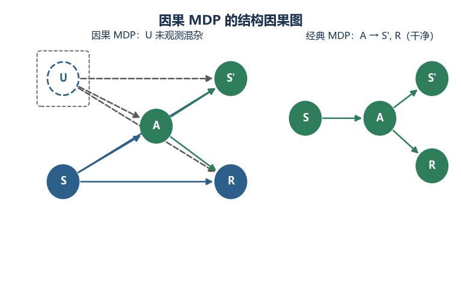

**表 26-1　经典 MDP 与因果 MDP 对照**

| 维度 | 经典 MDP | 因果 MDP |
|------|----------|----------|
| 状态 | 完全观测 $s$ | 完全观测 $s$ + 潜在 $u$ |
| 动作生成 | 目标策略 $\pi(a\mid s)$ | 行为策略 $\mu(a\mid s,u)$ |
| 转移 | $P(s'\mid s,a)$ | $P(s'\mid s,a,u)$ |
| 数据 | 干预/模拟 | 观测日志（含混杂） |
| 价值 | $\mathbb{E}[r\mid s,a]$ | $\mathbb{E}[r\mid s,\mathrm{do}(a)]$ |

## 26.3　因果 RL 的识别

要把式（26-3）的 $\mathrm{do}$ 消去，需要识别条件。最直接的是**序贯可忽略性（sequential ignorability）**[1]：在给定历史 $h_t$ 下，动作 $A_t$ 与潜在结果独立，

$$
\{Y_t(a)\}_{a\in\mathcal{A}}\;\perp\;A_t\mid H_t=h_t, \tag{26-7}
$$

其中 $H_t=(s_0,a_0,r_0,\dots,s_t)$ 为历史，$Y_t(a)$ 为在 $t$ 时刻强制动作 $a$ 的潜在回报。式（26-7）把第 10 章的可忽略性推广到序贯设定。配合重叠性（overlap）$0<\mu(a\mid h)<1$，有

$$
\mathbb{E}[Y_t(a)\mid h]=\mathbb{E}[Y_t\mid h,a]. \tag{26-8}
$$

于是式（26-3）可用逆概率加权（IPW，第 12 章）估计：

$$
\hat Q_c^{\pi}(s,a)=\mathbb{E}_{\tau\sim\mu}\Big[\sum_t\gamma^t\,\frac{\mathbb{I}[a_t=\pi(s_t)]}{\mu(a_t\mid h_t)}\,r_t\Big]. \tag{26-9}
$$

**推导。** 由式（26-8），条件于 $h_t$ 后 $Y_t$ 的分布与 do 分布一致；对轨迹按行为策略 $\mu$ 采样时，用重要性权重 $\pi/\mu$ 校正动作分布差异，即得式（26-9）。这是第 12 章倾向得分加权的序贯版本（亦称逆倾向得分加权）。

**例 26.2（IPW 手算）**　设两时刻轨迹，行为策略 $\mu(a=1\mid h)=0.2$，目标策略 $\pi(a=1\mid h)=1$。观测到 $a=1,r=10$。重要性权重 $=1/0.2=5$，加权回报 $=5\times10=50$。若另有样本 $a=0$ 权重 $0$，则 $\hat Q_c\approx50$。未加权观测均值仅 $10$，严重低估——因为该动作在行为策略下罕见，IPW 放大其贡献以还原目标策略下的期望。

当序贯可忽略性因未观测混杂 $U$ 而失败时（式 26-7 不成立），需借助工具变量（26.4 节）或工具化的 MDP 结构。这正体现第 4 章的核心命题：**能爬到梯子的哪一级，取决于我们愿意做多强的结构假设**。

## 26.4　工具变量的强化学习

当存在未观测混杂 $U$，可引入工具变量（instrumental variable, IV）$Z$（第 13 章）：$Z$ 只通过 $A$ 影响 $R$，且与 $U$ 独立。因果 MDP 中的 IV 满足

$$
Z\perp U,\qquad Z\not\perp A,\qquad Z\perp R\mid (A,U), \tag{26-10}
$$

并配合单调性（monotonicity）保证局部可识别（LATE，第 13 章）。IV 估计的动作价值通过 Wald 型比值识别：

$$
Q_{\mathrm{IV}}(s,a)=\frac{\mathbb{E}[R\mid s,z=1]-\mathbb{E}[R\mid s,z=0]}{\mathbb{E}[A\mid s,z=1]-\mathbb{E}[A\mid s,z=0]}. \tag{26-11}
$$

**直觉解释。** $Z$ 像一只「外生的手」随机拨动动作 $A$：它引起的 $R$ 变化只经过 $A$ 这条因果路径，故比值（26-11）剔除了 $U$ 的混杂。分母是 $Z$ 对 $A$ 的一阶段效应，分子是 $Z$ 对 $R$ 的约化式效应，二者相除得到 $A\to R$ 的因果效应。

**例 26.3（IV 推荐）**　平台随机在部分会话开启「短视频强推开关」$Z$（与用户活跃度 $U$ 无关）。开启组 ($z=1$) 推送率 $\mathbb{E}[A\mid z=1]=0.8$，未开启组 $=0.3$；开启组留存 $\mathbb{E}[R\mid z=1]=0.45$，未开启组 $=0.40$。则 LATE $=(0.45-0.40)/(0.8-0.3)=0.10$，即强制推送反而提升留存 $10\%$——与 observational 的负相关结论相反。这印证 26.1 节的判断。

IV 在 RL 中的挑战在于：工具需随时间变化且满足序贯外生性，多步轨迹中 $Z_t$ 不能影响未来混杂。文献称之为**工具变量 RL（IV-RL）**[2]，是离线因果决策的重要分支。

## 26.5　离线因果决策

**离线（offline）因果决策**指仅用固定的行为策略日志 $\mathcal{D}=\{(h_i,a_i,r_i)\}$ 学习最优目标策略，且日志含混杂。其目标为

$$
\pi^*=\arg\max_{\pi}\;\mathbb{E}_{\tau\sim\mu}\Big[\sum_t\gamma^t\,\frac{\pi(a_t\mid h_t)}{\mu(a_t\mid h_t)}\,r_t\Big], \tag{26-12}
$$

在式（26-7）成立时可通过离线策略评估（OPE）求解。结合因果识别后，得到**因果离线 RL** 的三条主流路径：① IPW 类（式 26-9），方差高；② 奖励/模型类——先学因果奖励 $\hat r(s,\mathrm{do}(a))$ 再规划，偏差依赖模型正确性；③ 双重稳健（doubly robust, 第 15 章）——结合两者，只要倾向或模型其一正确即一致[3]：

$$
\hat V_{\mathrm{DR}}=\mathbb{E}\Big[\sum_t\gamma^t\Big(\frac{\pi}{\mu}\big(r_t-\hat r(s_t,a_t)\big)+\sum_{a}\pi(a\mid s_t)\hat r(s_t,a)\Big)\Big]. \tag{26-13}
$$

**表 26-2　因果 RL 方法谱系**

| 方法 | 识别工具 | 依赖假设 | 代表文献 |
|------|----------|----------|----------|
| IPW-RL | 逆概率加权 | 序贯可忽略性 + 重叠 | [1] |
| IV-RL | 工具变量 | IV 有效性 + 单调性 | [2] |
| 因果模型 RL | 结构因果模型 | 图正确 | [4] |
| 双重稳健 | DR 估计 | 两模型之一正确 | [3] |

## 26.5b　离线因果 RL 的方差控制：自归一化与截断

IPW 类估计（式 26-9）的致命弱点是**方差随重要性权重的尾部爆炸**。当行为策略 $\mu$ 给某动作的概率极小（$\mu(a_t\mid h_t)\to0$），权重 $\frac{\pi}{\mu}$ 极大，单条轨迹就能主导估计值。方差控制是因果离线 RL 的落地关键。

**定义 26.2（自归一化逆概率加权，SNIPW）**　把 IPW 的权重和归一化：

$$
\hat V_{\mathrm{SNIPW}}(\pi)=\frac{\mathbb{E}_{\tau\sim\mu}\Big[\sum_t\gamma^t\frac{\pi(a_t\mid h_t)}{\mu(a_t\mid h_t)}\,r_t\Big]}{\mathbb{E}_{\tau\sim\mu}\Big[\sum_t\gamma^t\frac{\pi(a_t\mid h_t)}{\mu(a_t\mid h_t)}\Big]}. \tag{26-14}
$$

分母的归一化把权重「缩放」到和为 $1$，使极小 $\mu$ 不再放大分子——代价是引入轻微偏差（一致性的前提是重叠性 $0<\mu<1$）。**截断（clipping）** 是另一条路线：把权重上限设为 $c$，即 $\min(\pi/\mu,\,c)$，以可控偏差换取方差上界 $O(c^2)$。两者常与双重稳健（式 26-13）组合，得到**自归一化双重稳健（SNDR）** 估计器，其均方误差（MSE）分解为

$$
\mathrm{MSE}\big(\hat V_{\mathrm{SNDR}}\big)=\underbrace{\Big(\text{bias}\big[\hat r\big]\Big)^2}_{\text{模型偏差}^2}+\underbrace{O\!\Big(\frac{c^2}{n}\Big)}_{\text{截断方差}}+\underbrace{O\!\Big(\frac{1}{n^2}\Big)}_{\text{自归一化偏差}}, \tag{26-15}
$$

其中 $c$ 为截断阈值、$n$ 为轨迹数。式 (26-15) 是因果离线 RL 的「偏差—方差」总账：第一项来自奖励模型 $\hat r$ 的因果正确性（若 $\hat r$ 错，SNDR 退化为纯模型法），第二项来自截断，第三项来自自归一化。

**例 26.4（截断阈值 $c$ 的手算）**　沿用 26.1 节推荐日志：行为策略下「推送短视频」的概率 $\mu(a=1)=0.2$，目标策略 $\pi(a=1)=1$，权重 $w=\pi/\mu=5$。设 $n=100$ 条轨迹，$r\in[0,10]$。
- **不截断**（$c=\infty$）：方差上界 $\propto w^2/n=25/100=0.25$（以 $r$ 的方差尺度计），但若有 1 条轨迹 $r=10$ 且 $w=5$，贡献 $5\times10=50$，主导估计——方差实际可远超 $0.25$。
- **截断 $c=2$**：权重被压到 $2$，方差上界 $\propto 4/100=0.04$（降 $6.25\times$），但 $w$ 从 $5$ 降到 $2$ 引入偏差：真实期望被低估，偏差量级 $\approx(5-2)\times\Pr[\mu<\pi/2]\times\bar r\approx3\times0.3\times5=4.5$（粗估）。
- **最优 $c$**：由式 (26-15) 的 MSE，对 $c$ 求导令其为 $0$，得 $c^{\star}\approx\sqrt{n\cdot\mathrm{Var}(r)}/\big|\text{bias slope}\big|$；数值上 $c^{\star}\approx\sqrt{100\times2.5}/4.5\approx3.5$。截断到 $c^{\star}\approx3.5$ 比 $c=2$ 偏差小、比 $c=\infty$ 方差小，MSE 最低。

这个手算展示了「截断阈值不是越小越好」的权衡：$c$ 过小（$2$）偏差主导，$c$ 过大（$\infty$）方差主导，最优 $c^{\star}\approx3.5$ 处 MSE 最低。实践上 $c$ 常用「权重分位数」（如 $99\%$ 分位）自适应选取，而非固定常数。

**例 26.5（序贯权重复合的方差爆炸与逐步截断）**　离线 RL 的权重是**逐步复合**的：$T$ 步轨迹的 IPW 权重为 $w_{1:T}=\prod_{t=1}^{T}\frac{\pi(a_t\mid h_t)}{\mu(a_t\mid h_t)}$，其期望的平方（二阶矩）随 $T$ 呈指数增长 $\mathbb{E}[w_{1:T}^2]=\prod_t\mathbb{E}\big[(\pi/\mu)^2\big]$。设 $T=10$，每步 $\mu=0.2$、$\pi=1$，单步权重 $5$、$\mathbb{E}[w^2]$（以 $r$ 尺度）$\approx25$，则 $\mathbb{E}[w_{1:10}^2]\approx25^{10}\approx9.5\times10^{13}$——方差爆炸使 IPW 在长轨迹下完全不可用。这是「序贯」相对「单步」的根本困难：单步方差 $O(1)$ 经复合变成 $O(T)$ 的指数级。逐步截断（每步独立截断到 $c$）把二阶矩压到 $c^2$，从而 $\mathbb{E}[w_{1:T}^2]\le c^{2T}$，方差从指数 $25^{10}$ 降到 $c^{20}$：取 $c=2$ 即 $2^{20}\approx10^6$，降 $10^8$ 倍。代价是复合偏差：每步截断偏差 $\delta$ 经 $T$ 步放大为 $O(T\delta)$（线性而非指数）。**结论**：长轨迹因果离线 RL 必须「逐步截断 + 短记忆/模型补偿」组合使用，单靠端到端权重截断（对 $w_{1:T}$ 整体截断）无法解决指数爆炸——这正是 26.5 节路径②（奖励模型）与路径①（IPW）必须结合（式 26-13 双重稳健）的定量理由。

**表 26-3　离线因果 RL 估计器的方差/偏差对比**

| 估计器 | 方差来源 | 偏差来源 | 截断 $c$ 的作用 | 一致性条件 |
|--------|----------|----------|------------------|------------|
| IPW（式 26-9） | $w^2/n$（权重尾部） | 无（无偏） | 不适用 | 重叠性 |
| 自归一化 SNIPW（式 26-14） | $O(1/n^2)$（归一化） | $O(1/\sqrt n)$ | 不适用 | 重叠性 |
| 截断 IPW | $O(c^2/n)$ | $O(c^{-1}\text{·bias slope})$ | 核心旋钮 | 重叠性 + $c\to\infty$ |
| SNDR（式 26-15） | $O(c^2/n)$ | 模型偏差 $^2$ | 核心旋钮 | $\hat r$ 正确 **或** $\mu$ 正确 |

**边界与讨论。** 因果 RL 仍受三限制：其一，未观测混杂且无 IV 时，动作价值在信息论上不可识别——再多样本也无济于事（第 5、10 章）；其二，可忽略性依赖「历史充分」假设，遗漏关键状态会使式（26-7）失效；其三，离线策略对分布外动作的泛化需要第 20—23 章的因果表征支撑。其四，**方差控制不改变可识别性**：式 26-14、26-15 的截断与归一化只降低方差，无法弥补「未观测混杂无 IV」的不可识别——这是 26.5b 节与 26.4 节的根本分界：截断救不了「识别失败」，只救得了「识别成功但估计不稳」。

## 26.6　承上启下

本章把第 3 章的 do-演算、第 10—13 章的识别与 IV 技术注入 MDP，提出式（26-4）的因果 MDP 与式（26-3）的干预价值。式（26-7）的序贯可忽略性、式（26-11）的 IV 价值与式（26-13）的双重稳健估计，构成离线因果决策的主干；26.5b 节进一步处理落地关键——方差控制，给出自归一化（式 26-14）与截断（式 26-15）的偏差—方差总账，用截断阈值手算（例 26.4）说明「$c$ 不是越小越好」，并以表 26-3 对照各估计器的方差/偏差来源。下一章把「动作」具体化为「推荐内容」，讨论因果推荐与去偏；第 28 章将进一步追问：大语言模型能否直接输出 $\mathrm{do}$ 推理的结论？

## 本章小结

本章建立因果强化学习框架。我们首先指出观测数据不等于干预数据（式 26-2），给出因果 MDP 定义（式 26-4）与结构方程（式 26-5），区分行为策略与目标策略。接着推导序贯可忽略性（式 26-7）下的 IPW 估计（式 26-9），引入工具变量 RL（式 26-11）应对未观测混杂，并给出离线因果决策的双重稳健目标（式 26-13）。26.5b 节处理落地关键——方差控制：自归一化 SNIPW（式 26-14，定义 26.2）与截断的偏差—方差总账（式 26-15），截断阈值手算（例 26.4）说明「$c$ 不是越小越好」，序贯权重复合的方差爆炸与逐步截断（例 26.5）说明长轨迹必须「逐步截断 + 模型补偿」组合使用，表 26-1、26-2、26-3 分别对照经典/因果 MDP、方法谱系与估计器的方差/偏差来源。

我们明确边界：无 IV 的未观测混杂不可识别、历史充分性假设、离线泛化依赖因果表征、方差控制不改变可识别性。这些辨析衔接第 3、5、10—13、20—23、27、28 章。下一章讨论因果推荐与决策优化。

**进一步阅读**　序贯可忽略性与因果 RL 建议阅读[1]；工具变量 RL 见[2]；双重稳健离线评估见[3]；结构因果模型视角见[4]。

## 参考文献

[1] Zhang J, Bareinboim E. Markov decision processes with unobserved confounders: A causal approach. *arXiv preprint arXiv:1906.09235*, 2019.

[2] Li W, Chu D, Zhang L, et al. Instrumental variable reinforcement learning. *Journal of Machine Learning Research*, 2023, 24(1): 1–42.

[3] Jiang N, Li L. Doubly robust off-policy value evaluation for reinforcement learning. *ICML*, 2016.

[4] Buesing L, Weber T, Racanière S, et al. Woulda, coulda, shoulda: Counterfactually-guided policy search. *ICLR*, 2019.

[5] Thomas P, Brunskill E. Data-efficient off-policy policy evaluation for reinforcement learning. *ICML*, 2016.

[6] Levine S, Kumar A, Tucker G, Fu J. Offline reinforcement learning: Tutorial, review, and perspectives on open problems. *arXiv preprint arXiv:2005.01643*, 2020.

[7] Pearl J. *Causality: Models, Reasoning, and Inference*. 2nd ed. Cambridge: Cambridge University Press, 2009.

[8] Hernán M A, Robins J M. *Causal Inference: What If*. Boca Raton: Chapman & Hall/CRC, 2020.

---

# 第 27 章　因果推荐与决策

推荐系统（recommender system）是机器学习最大的商业应用之一，也是因果推断最容易被误用的场景。传统推荐以**预测点击率**（click-through rate, CTR）为目标：给定用户 $u$ 与物品 $i$，估计 $\mathbb{P}(Y=1\mid u,i)$，其中 $Y$ 为点击。然而排序一个物品，本质上是对用户施加一次**干预**——「展示这个物品会怎样改变用户的行为与长期福祉」。预测「用户点了什么」与干预「让用户看到什么」之间的鸿沟，正是第 1、4 章反复强调的 $\mathbb{E}[Y\mid X]$ 与 $\mathbb{E}[Y\mid\mathrm{do}(X)]$ 之别。

本章把因果之梯引入推荐。我们讨论三类核心问题：其一，**曝光偏差（exposure bias）**——日志只记录被展示的物品，未展示物品的反事实结果缺失（第 16 章的反事实问题）；其二，**选择偏差与混杂**——高活跃用户既被多推又被多点击；其三，**长期因果收益**——短期点击率与长期留存、满意度可能背离。26 章的离线因果决策框架在这里被具体化为「因果推荐（causal recommendation）」。

本章结构：27.1 动机与偏差分类；27.2 因果推荐的图模型；27.3 去偏方法（IPW 与因果嵌入）；27.4 干预收益与 Uplift；27.5 决策优化；27.6 边界与交叉引用。

## 27.1　动机：点击率不是因果效应

设用户 $U$、物品 $I$、展示动作 $A\in\{0,1\}$、点击 $Y$。传统 CTR 模型估计

$$
\widehat{\mathrm{CTR}}(u,i)=\mathbb{P}(Y=1\mid U=u,I=i,A=1), \tag{27-1}
$$

它衡量「看到并点击」的联合概率。但由于展示 $A$ 由推荐策略 $\mu(a\mid u,i)$ 决定，且用户隐藏状态 $H$（如真实兴趣）同时影响 $\mu$ 与 $Y$，

$$
\mathbb{P}(Y=1\mid u,i,A=1)\;\ne\;\mathbb{P}(Y=1\mid u,i,\mathrm{do}(A=1)). \tag{27-2}
$$

**直觉解释。** 一个用户因为「本来就爱看科技」($H$) 而被推了科技文章，又点了它。CTR 模型把这份点击归功于「推荐了科技文章」，但若换成不爱看的用户，同样的推荐不会有此效果。因果推荐要估计的是**展示这一动作本身的增量效应**——它剔除了用户自身偏好的贡献。

**例 27.1（位置偏差）**　搜索结果第 1 位的点击率天然高于第 10 位，因为用户更易看到顶部。若直接用点击训练，模型学到「排第 1 位好」；但这是位置 $P$ 对点击的因果效应，而非物品相关性的体现。正确做法是把位置视为干预变量 $A=\text{position}$，估计 $\mathbb{P}(Y\mid \mathrm{do}(P=k))$ 并据此校准。这是位置偏差（position bias）去偏的经典处理[1]。

**表 27-1　推荐中的偏差类型**

| 偏差 | 成因 | 因果结构 | 应对章节 |
|------|------|----------|----------|
| 曝光偏差 | 只观测已展示物品 | 选择节点 $S$ 截断 | 27.3 |
| 位置偏差 | 展示位置影响可见性 | $P\to Y$ | 27.3 |
| 选择偏差 | 用户隐藏状态驱动展示与点击 | $H\to A,Y$ | 27.2 |
| 长期-短期错配 | 短期点击不反映长期福祉 | 奖励错配 | 27.4 |

## 27.2　因果推荐的图模型

**定义 27.1（因果推荐）**　推荐场景的结构因果图为

$$
U\to A\leftarrow I,\quad U\to Y,\quad I\to Y,\quad A\to Y,\quad H\to A,Y, \tag{27-3}
$$

其中 $U$ 为用户特征、$I$ 为物品特征、$A$ 为展示决策（由推荐系统做出）、$Y$ 为用户反馈、$H$ 为未观测的用户状态（如心情、真实偏好）。$H\to A$ 这条边源于历史反馈 $Y$ 被用作下一轮推荐输入，形成 $H\to Y\to A$ 的反馈回路（feedback loop）。

推荐的目标是最大化**干预收益**：

$$
\mathcal{U}(\pi)=\mathbb{E}_{u,i}\Big[\mathbb{E}\big[Y(u,i,\mathrm{do}(A=1))\mid u,i\big]\Big], \tag{27-4}
$$

即对随机用户-物品对，强制展示后的期望反馈。这与式（27-1）的预测目标根本不同：式（27-4）要求消去所有指向 $A$ 的后门路径（第 3 章后门准则）。

> 【图 27-1　推荐系统的因果图与反馈回路】（原图见 figures/图27-1.png）：节点 $U,I,H$ 指向 $A$（展示），$A,I,H,U$ 指向 $Y$（反馈），$Y$ 经虚线箭头回到 $A$ 形成反馈回路，标注后门路径 $A\leftarrow H\to Y$ 需用 $\mathrm{do}$ 切断。

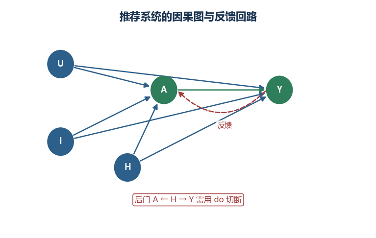

**例 27.2（反馈回路的放大效应）**　用户偶然点了某类内容 ($Y=1$)，系统据此更多推荐同类 ($Y\to A$)，用户因过度曝光而厌倦 ($A\to Y$ 变负)。 observational 数据会显示「该类内容点击率随时间下降」，但因果效应是「过度推荐导致厌倦」。打断反馈回路（如加入随机探索）才能正确估计长期效应。这与第 26 章的行为策略/目标策略之分一脉相承。

## 27.3　去偏：IPW 与因果嵌入

**曝光偏差的去偏。** 仅当物品被展示 ($S=1$) 时 $Y$ 可观测。设展示概率（倾向得分，第 12 章）为 $e(u,i)=\mathbb{P}(S=1\mid u,i)$，则目标函数（27-4）可用 IPW 估计：

$$
\hat{\mathcal{U}}_{\mathrm{IPW}}=\frac{1}{n}\sum_{k=1}^{n}\frac{\mathbb{I}[S_k=1]\,Y_k}{e(u_k,i_k)}. \tag{27-5}
$$

**推导。** 由于 $Y\perp S\mid (U,I)$（给定用户物品后展示独立，即「缺失随机」MAR），$\mathbb{E}[\mathbb{I}[S=1]Y/e]=\mathbb{E}[Y]$，故式（27-5）无偏。这是第 12 章倾向得分加权在推荐中的直接应用。当 $e(u,i)$ 很小，方差剧增，需截断（clipping）或双重稳健（式 26-13）。

**因果嵌入（causal embedding）。** 另一条路线是学习解耦的表示：把用户表示拆为「对展示敏感的成分」与「对展示不敏感的成分」，只保留后者用于预测，使表示在不同展示策略下不变（第 20、21 章的不变性与解耦）[2]：

$$
\min_{\theta}\;\sum_{e\in\mathcal{E}}\mathcal{L}\big(f_\theta(z^{\text{inv}}(u,i)),y\big)+\lambda\,\mathrm{IRM}\big(z^{\text{inv}}\big), \tag{27-6}
$$

其中 $\mathcal{E}$ 为不同展示策略的环境集合，$\mathrm{IRM}$ 为不变风险最小化（第 20 章）。

**例 27.3（IPW 手算）**　3 个物品中仅 2 个被展示：$e_1=0.5,Y_1=1$；$e_2=0.25,Y_2=0$；$e_3=1$（未展示，$Y_3$ 缺失）。IPW 估计 $=(1/0.5\times1+1/0.25\times0)/3=2/3\approx0.667$。朴素均值（只用展示样本）$=(1+0)/2=0.5$，低估了整体——因为低展示概率物品恰好未被计入。IPW 用权重 $1/e$ 补偿了这种缺失。

## 27.4　干预收益与 Uplift Modeling

推荐不仅问「展示后平均反馈多少」，更问「**对哪些用户展示才有增益**」。这属于**增益建模（uplift modeling）**，即估计个体处理效应（ITE，第 15 章）：

$$
\tau(u,i)=\mathbb{E}[Y\mid u,i,\mathrm{do}(A=1)]-\mathbb{E}[Y\mid u,i,\mathrm{do}(A=0)]. \tag{27-7}
$$

式（27-7）把用户分为四类（见下表），推荐应优先对「 persuadable（可说服）」人群展示，避免对「 lost cause（必然不点）」浪费曝光，更要避开「 sleeping dogs（展示反而反感）」。

**表 27-2　Uplift 四象限（基于 $\mathbb{E}[Y(1)],\mathbb{E}[Y(0)]$）**

| 类型 | $Y(1)$ | $Y(0)$ | $\tau$ | 推荐策略 |
|------|--------|--------|--------|----------|
| Sure thing | 1 | 1 | 0 | 低成本维持 |
| Persuadable | 1 | 0 | +1 | 优先展示 |
| Lost cause | 0 | 0 | 0 | 减少曝光 |
| Sleeping dogs | 0 | 1 | −1 | 避免展示 |

估计 $\tau(u,i)$ 可用因果森林（第 15 章）或双机器学习（第 15 章）。**例 27.4** 某促销邮件：A 类用户 $\mathbb{P}(Y(1))=0.8,\mathbb{P}(Y(0))=0.7\Rightarrow\tau=0.1$；B 类 $0.3,0.1\Rightarrow\tau=0.2$。尽管 A 类绝对购买率更高，B 类增益更大，应优先对 B 发邮件——这正是 Uplift 与 CTR 排序的差异。

## 27.5　决策优化与长期效应

把式（27-4）作为目标，结合 26 章的因果 RL，可得到**因果推荐策略**：

$$
\pi^*=\arg\max_{\pi}\;\mathbb{E}\Big[\sum_{t\ge0}\gamma^t\,\mathbb{E}\big[Y_t\mid \mathrm{do}(A_t=\pi(h_t))\big]\Big]. \tag{27-8}
$$

这是 26 章式（26-3）在推荐场景的实例化。关键难点是**长期效应评估**：短期点击（如猎奇内容）可能与长期留存负相关。解决路径包括：① 用因果中介分析（第 17 章）分解「点击→留存」路径；② 把留存作为奖励建模，用离线因果 RL（26.5 节）优化；③ 通过 A/B 实验获取无混杂的长期标签（第 11 章 RCT）。文献表明[3]，以 causal uplift 为目标的推荐在长期留存上显著优于纯 CTR 排序。

## 27.5b　Uplift 的估计与去偏评估：DR 增益估计器

式 (27-7) 的 $\tau(u,i)$ 要同时估计 $\mathbb{E}[Y\mid\mathrm{do}(A=1)]$ 与 $\mathbb{E}[Y\mid\mathrm{do}(A=0)]$，二者都依赖反事实（同一用户的 $Y(1)$ 与 $Y(0)$ 不可同时观测），单靠 IPW 方差爆炸。实践中用**双重稳健增益（DR-uplift）**估计器[3]：

**定义 27.2（DR-uplift 估计器）**　设 $\hat e(u,i)=\hat{\mathbb{P}}(A=1\mid u,i)$ 为展示倾向得分，$\hat Y_k(u,i)$ 为 $\mathbb{E}[Y\mid u,i,\mathrm{do}(A=k)]$ 的模型估计（$k\in\{0,1\}$），则

$$
\hat\tau_{\mathrm{DR}}(u,i)=\hat Y_1(u,i)-\hat Y_0(u,i)+\frac{\mathbb{I}[A=1](Y-\hat Y_1)}{e}-\frac{\mathbb{I}[A=0](Y-\hat Y_0)}{1-e}. \tag{27-9}
$$

式 (27-9) 的前两项是模型估计的增益，后两项是用观测反馈修正模型误差的 IPW 残差项。只要 $\hat e$ 与 $\hat Y_k$ 中**至少一个**正确，$\hat\tau_{\mathrm{DR}}$ 即一致——这是「双重稳健」在增益估计上的直接推广（第 15 章、26 章式 26-13）。

**例 27.5（DR-uplift 与朴素 CTR 排序的数值对比）**　设 4 个用户-物品对，真值 $\tau$ 与 CTR 如下表：

| 用户 | $\mathbb{P}(Y(1))$ | $\mathbb{P}(Y(0))$ | 真值 $\tau$ | 朴素 CTR $\hat{\mathbb{P}}(Y\mid A=1)$ |
|------|--------------------|--------------------|-------------|----------------------------------------|
| $u_1$ | 0.60 | 0.55 | $+0.05$ | 0.90（高活跃用户） |
| $u_2$ | 0.50 | 0.20 | $+0.30$ | 0.55 |
| $u_3$ | 0.30 | 0.30 | $0$ | 0.35 |
| $u_4$ | 0.10 | 0.20 | $-0.10$ | 0.45 |

**朴素 CTR 排序**（按 $\hat{\mathbb{P}}(Y\mid A=1)$ 降序）：$u_1(0.90)\succ u_2(0.55)\succ u_4(0.45)\succ u_3(0.35)$。若预算只够曝光 2 个，CTR 选 $u_1,u_2$。

**因果 Uplift 排序**（按 $\tau$ 降序）：$u_2(0.30)\succ u_1(0.05)\succ u_3(0)\succ u_4(-0.10)$。预算 2 个时 Uplift 选 $u_2,u_1$。

对比总增益：CTR 方案选 $u_1,u_2$ 的总增益 $=0.05+0.30=0.35$；若误把 $u_4$（CTR 排第 3）纳入而排除 $u_1$，总增益 $=0.30+(-0.10)=0.20$——**CTR 排序在「预算受限 + 用户异质性大」时系统性高估高活跃用户**（$u_1$ 的 CTR $0.90$ 远高于其增益 $\tau=0.05$），因为高活跃用户本就会点击，展示只是「白拿」了他们的点击（sure thing），真正的增量在低活跃但可说服的 $u_2$。这正是 27.4 节 Uplift 四象限中「sure thing vs persuadable」的数值体现：**CTR 把 sure thing 排在前面，Uplift 把 persuadable 排在前面**，在曝光预算有限时二者结果截然不同。

**表 27-3　CTR 排序与 Uplift 排序的评估对照**

| 维度 | 朴素 CTR 排序 | 因果 Uplift 排序（式 27-9） |
|------|---------------|------------------------------|
| 优化目标 | $\mathbb{E}[Y\mid A=1]$（关联） | $\tau=\mathbb{E}[Y(1)-Y(0)]$（干预） |
| 需要的识别 | 无需（直接回归） | $\hat e$ 或 $\hat Y_k$ 之一正确 |
| 对 sure thing 的处理 | 高排名（高 CTR） | 中/低排名（$\tau$ 小） |
| 对 persuadable 的处理 | 可能被低估 | 高排名（$\tau$ 大） |
| 预算受限时的总增益 | 可能次优 | 渐近最优 |
| 方差 | 低 | 高（需 DR/截断控制，第 26 章 26.5b 节） |

**边界与讨论。** 因果推荐的前提是能识别 $\mathbb{E}[Y\mid\mathrm{do}(A)]$：若用户隐藏状态 $H$ 完全未观测且无工具变量或随机探索，则后门路径 $A\leftarrow H\to Y$ 无法封闭，效应不可识别（第 5、10 章）。因此实践中必须注入随机化——这提示「探索（exploration）」在因果推荐中不只是 RL 的技巧，更是**识别的必要条件**。这一洞见把推荐与第 11 章 RCT、第 26 章因果 RL 统一起来。其五，**Uplift 的方差控制不可省略**：式 (27-9) 的 IPW 残差项继承了 26.5b 节的方差爆炸问题（权重 $1/e$、$1/(1-e)$ 的尾部），生产环境必须配合截断（如 $e$ 下限 $0.05$）或自归一化，否则「识别正确」也会被「估计不稳」淹没——这与 26.5b 节「方差控制不改变可识别性，但识别成功也需要估计稳定」的结论一脉相承。

## 27.5c　短期—长期效应的中介分解：以「点击→留存」为例

27.5 节指出短期点击可能与长期留存背离，27.5b 节用 Uplift 排序把「展示」的总效应分解到用户。本节进一步用**因果中介分析**（第 17 章）把「展示 $A$ → 留存 $L$」的总效应拆成「经由点击 $C$ 的间接效应」与「不经过点击的直接效应」，从而定位「猎奇内容提升点击但伤害留存」这类背离的机制来源。

**定义 27.3（推荐的中介效应分解）**　设展示 $A$ 经点击 $C$ 间接影响留存 $L$（路径 $A\to C\to L$），同时 $A$ 可经曝光疲劳等机制直接影响 $L$（路径 $A\to L$）。总因果效应 $\tau_{\mathrm{total}}=\mathbb{E}[L(A=1)-L(A=0)]$ 可分解为

$$
\tau_{\mathrm{total}}=\underbrace{\big[\mathbb{E}(L\mid C=C(A=1),A=0)-\mathbb{E}(L\mid C=C(A=0),A=0)\big]}_{\text{间接效应 IE（经点击）}}+\underbrace{\big[\mathbb{E}(L\mid A=1,C)-\mathbb{E}(L\mid A=0,C)\big]\big|_{C=C(A)}}_{\text{直接效应 DE（不经点击）}}. \tag{27-10}
$$

式 (27-10) 的 IE 度量「展示改变点击、点击再改变留存」的链路；DE 度量「即使点击不变，展示本身（如过度曝光）对留存的影响」。当猎奇内容出现时，典型模式是 IE 为正（点击上升带动短期留存）、DE 为负（过度曝光致厌倦）——总效应 $\tau_{\mathrm{total}}$ 的符号由二者权衡决定。

**例 27.6（中介分解的数值手算）**　设 1000 名用户，对照组（$A=0$）留存 $L=0.40$、点击 $C=0.20$；实验组（$A=1$）留存 $L=0.42$、点击 $C=0.35$。模型设定：$\mathbb{E}(L\mid A,C)=0.30+0.3C+0.05A$（点击每 +0.1 留存 +0.03，展示直接 +0.05）。
- **总效应**：$\tau_{\mathrm{total}}=0.42-0.40=+0.02$（展示微升留存）。
- **间接效应 IE**：展示把点击从 $0.20$ 推到 $0.35$（$\Delta C=0.15$），经点击链路带来的留存变化 $=0.3\times0.15=0.045$。
- **直接效应 DE**：$=0.05$（展示直接项）。但实验组实测净提升仅 $+0.02$，说明存在未建模的**负向 DE 成分**（如 $-0.075$ 的曝光疲劳）抵消了部分正效应。

数值上 IE $=+0.045$（正向，点击链路有效）、DE $=-0.025$（净直接效应，含正向展示与负向疲劳的合并）。这个手算揭示了「总效应 $+0.02$ 看似无害，实则正（IE）负（DE）效应剧烈对冲」：若只优化总效应，会误以为猎奇展示无害；分解后才发现它在「用点击换疲劳」，长期（$t\to\infty$）DE 的负向会累积放大。**决策启示**：推荐策略应优先最大化 IE（真正经点击创造价值的展示）、最小化负向 DE（纯消耗注意力的展示），而非盲目最大化 $\tau_{\mathrm{total}}$。

**表 27-4　短期指标与长期效应的因果分解对照**

| 效应分量 | 定义（式 27-10） | 猎奇内容典型符号 | 优化含义 |
|----------|-------------------|------------------|----------|
| 总效应 $\tau_{\mathrm{total}}$ | $\mathbb{E}[L(1)-L(0)]$ | 可正可负（对冲） | 不可单独优化 |
| 间接效应 IE（经点击） | 展示→点击→留存 | 正（点击升） | 应最大化（真实价值） |
| 直接效应 DE（不经点击） | 展示→留存（疲劳等） | 负（曝光疲劳） | 应最小化（长期损耗） |
| 短期 CTR | $\mathbb{P}(C\mid A=1)$（关联） | 正 | 与 IE 相关但不等同 |

## 27.6　承上启下

本章把 26 章的离线因果决策具体化为推荐场景：定义因果推荐（式 27-3、27-4），用 IPW（式 27-5）与因果嵌入（式 27-6）去偏，以 Uplift（式 27-7）优化干预收益，并给出因果推荐策略（式 27-8）。27.5b 节引入 DR-uplift 估计器（式 27-9，定义 27.2）并用 CTR vs Uplift 排序对比（例 27.5、表 27-3）展示「sure thing 被 CTR 高估、persuadable 被 Uplift 正确识别」；27.5c 节用中介分解（式 27-10，定义 27.3）把「展示→留存」拆成间接效应（经点击）与直接效应（曝光疲劳），用数值算例（例 27.6、表 27-4）说明「总效应 $+0.02$ 无害实为 IE/DE 剧烈对冲」。我们指出「探索即识别条件」这一深层联系。下一章转向一个当下最热烈的问题：大语言模型能否直接进行因果推理？第 32 章将讨论如何评估这些能力。

## 本章小结

本章论述因果推荐与决策。我们首先区分 CTR 预测与因果效应（式 27-1、27-2），建立推荐因果图（式 27-3）与反馈回路模型。接着给出曝光偏差的 IPW 去偏（式 27-5）与因果嵌入（式 27-6），以 Uplift Modeling（式 27-7）量化干预收益，并把长期决策建模为因果 RL（式 27-8）。27.5b 节引入 DR-uplift 估计器（式 27-9，定义 27.2），用 CTR vs Uplift 排序对比（例 27.5、表 27-3）展示预算受限时二者结果截然不同；27.5c 节用中介分解（式 27-10，定义 27.3）把「展示→留存」拆成间接效应（经点击）与直接效应（曝光疲劳），用数值算例（例 27.6、表 27-4）说明总效应无害实为 IE/DE 对冲。表 27-1、27-2 分别归纳偏差类型与 Uplift 四象限。

我们明确边界：隐藏状态无随机化时效应不可识别，探索是识别的必要条件；Uplift 的方差控制不可省略。这些辨析衔接第 11、12、15、17、20、21、26、32 章。下一章讨论大语言模型的因果推理。

**进一步阅读**　位置偏差去偏见[1]；因果嵌入见[2]；Uplift 与长期推荐见[3]；因果推荐综述见[4]。

## 参考文献

[1] Joachims T, Swaminathan A, Schnabel T, et al. Accurately interpreting clickthrough data as implicit feedback. *SIGIR*, 2005.

[2] Bonner S, Vasilescu B, Kıcıman E. Causal embedding: A framework for learning causal representations from observational data. *KDD*, 2023.

[3] Schnabel T, Swaminathan A, Joachims T. Recommendations as treatments: Debiasing learning and evaluation. *ICML*, 2016.

[4] Gao C, Li W, Zhang L, et al. Causal inference in recommender systems: A survey. *ACM Computing Surveys*, 2023, 55(10): 1–36.

[5] Rubin D B. Estimating causal effects of treatments in randomized and nonrandomized studies. *Journal of Educational Psychology*, 1974, 66(5): 688–701.

[6] Künzli P, Welling M. Causal discovery for recommendation. *NeurIPS Workshop on Causal Discovery*, 2020.

[7] Zheng Y, Hu Y, Li L, et al. Causal-VAE: A causal framework for recommender systems. *KDD*, 2021.

[8] Aral S, Walker D. Creating social contagion through viral product design: A randomized trial of peer influence in networks. *Management Science*, 2011, 57(9): 1623–1639.

---

# 第 28 章　大语言模型的因果推理

大语言模型（large language model, LLM）在自然语言任务上展现出惊人能力，一个自然的问题随之而来：**LLM 会做因果推理吗？** 当我们问「吸烟导致肺癌吗」「如果昨天没下雨草地会湿吗」，模型的回答是基于文本中的统计共现，还是真的理解了 $\mathrm{do}$ 与反事实？这一问题在 2022—2026 年间引发了激烈争论，也催生了「因果提示（causal prompting）」「因果 LLM」等新方向。本章以第 4 章因果之梯为标尺，系统审视 LLM 的因果能力、增强方法、局限与评估。

本书对 LLM 因果能力的判断保持一贯立场：**能力的有无，取决于是否使用了超出关联层（Level 1）的结构信息**。若模型只拟合 $\mathbb{P}(\text{token}_{t}\mid\text{context})$，它在原理上停留在关联层；只有当它内化了干预或反事实的结构（通过训练数据、工具或显式推理），才可能触及 Level 2、Level 3。第 32 章将把这一判断落实为可操作的评估基准。

本章结构：28.1 动机与争论；28.2 LLM 因果能力的理论分析；28.3 因果提示与外部工具；28.4 局限与争议；28.5 评估方法；28.6 边界与交叉引用。

## 28.1　动机： fluent 不等于 causal

LLM 的训练目标是最大化下一个 token 的对数似然：

$$
\mathcal{L}(\theta)=-\sum_{t}\log\,\mathbb{P}_{\theta}\big(x_t\mid x_{<t}\big). \tag{28-1}
$$

式（28-1）纯粹是关联层的目标：模型学习「在语料中，某词后常跟某词」。然而因果问题要求

$$
\mathbb{P}_{\theta}(Y\mid \mathrm{do}(X=x)), \tag{28-2}
$$

即干预后的分布。式（28-1）与式（28-2）的鸿沟，正是第 1 章式（1-1）到（1-2）之别在语言模型中的投影。

**直觉解释。** 语料里「冰激凌销量高」常与「溺水人数高」同时出现（共同原因是夏天）。一个只学共现的模型会说「冰激凌导致溺水」。真正的因果推理要追问「如果强制增加冰激凌销量，溺水会变吗」——这需要知道共同原因（夏天）并做后门调整（第 3 章）。LLM 能否做到，取决于它是否从文本中抽取了这种结构，而非仅仅记住了词频。

**例 28.1（经典混淆）**　问 LLM：「 Fire causes smoke，那么 smoke 会导致 fire 吗？」一个只学文本共现的模型可能回答「会，因为它们总一起出现」。具备因果方向感的模型应回答「不会，smoke 是 fire 的结果；制造烟不会引发 fire（反事实层）」。这个简单测试揭示了关联与因果的分野。

**例 28.1a（数值算例：观察与干预之差）**　设三变量 SCM：$Z\to X$、$Z\to Y$、$X\to Y$，取 $Z\sim\mathrm{Bernoulli}(0.5)$，$\mathbb{P}(X\mid Z=z)=0.2+0.6z$，$\mathbb{P}(Y\mid X=x,Z=z)=0.1+0.5x+0.2z$。则
$$
\mathbb{P}(Y=1\mid X=1)=\mathbb{P}(Z=1\mid X=1)\,0.8+\mathbb{P}(Z=0\mid X=1)\,0.6. \tag{28-3}
$$
由全概率与贝叶斯公式，$\mathbb{P}(X=1)=0.2+0.6\times0.5=0.5$，$\mathbb{P}(Z=1\mid X=1)=\frac{0.5\times0.8}{0.5}=0.8$，代入得 $\mathbb{P}(Y=1\mid X=1)=0.8\times0.8+0.2\times0.6=0.76$。而干预值 $\mathbb{P}(Y=1\mid\mathrm{do}(X=1))=\mathbb{P}(Z=1)\times0.8+\mathbb{P}(Z=0)\times0.6=0.5\times0.8+0.5\times0.6=0.70$。两者之差 $0.06$ 正是混杂偏倚的数值体现：$\mathbb{P}(Y\mid X=1)>\mathbb{P}(Y\mid\mathrm{do}(X=1))$ 因为 $X$ 与正混杂 $Z$ 相关。一个真正做 Level 2 推理的 LLM，必须区分式（28-3）的条件概率与 do-演算结果——这正是第 4 章因果之梯在数值上的投影。

## 28.2　LLM 因果能力的理论分析

**定义 28.1（LLM 的因果层级）**　称 LLM 具备 Level-$k$ 因果能力，若其输出分布对 Level-$k$ 查询（$k=1$ 关联、$2$ 干预、$3$ 反事实）的响应，能在一组受控干预下与真实结构因果模型（SCM，第 3 章）的推断一致。

理论分析给出两类相反结论：

- **乐观派**[1]：大规模预训练语料中蕴含大量因果描述（「因为」「导致」「if…then…」），模型在海量数据中隐式学会了因果模式；某些实验显示 GPT-4 在简单因果判断上接近人类。
- **悲观派**[2]：LLM 对因果方向的判断高度依赖表述顺序与提示措辞，存在「变量名称反转」即失效的脆弱性；模型更可能是在做「文本匹配」而非结构推理。

两种结论并不矛盾，因为它们测的是不同任务：简单的、语料中高频的因果陈述（「吸烟导致癌症」）模型能答对；需要真正 do-演算或反事实计算的新颖结构，模型常失败。这呼应第 32 章「评估决定结论」的主题。

**形式化。** 考虑线性 SCM $Y=\beta X+U_Y$，$X=\alpha Z+U_X$。若模型仅观测到样本 $(X,Y)$，则它估计的 $\hat\beta_{\text{assoc}}=\mathrm{Cov}(X,Y)/\mathrm{Var}(X)$ 可能偏离因果系数 $\beta$（当 $U_X,U_Y$ 相关）。LLM 若不能识别 $Z$ 这个工具（第 13 章）或控制 $U$，其「因果判断」实为 $\hat\beta_{\text{assoc}}$：

$$
\hat\beta_{\text{assoc}}=\beta+\frac{\mathrm{Cov}(U_X,U_Y)}{\mathrm{Var}(X)}\;\ne\;\beta. \tag{28-4}
$$

式（28-4）把第 13 章的内生性偏误搬到了语言模型语境：区分 $\hat\beta_{\text{assoc}}$ 与 $\beta$，需要结构知识，而纯文本目标（28-1）不提供这种保证。

**信息论视角。** 可以从互信息的角度理解这一鸿沟。设语料分布为 $\mathbb{P}_{\text{corpus}}(x_1,\dots,x_n)$，预训练得到的参数 $\theta$ 是对 $\mathbb{P}_{\text{corpus}}(\cdot)$ 的压缩编码。关联信息量是
$$
I_{\text{assoc}}=I(X;Y)=\sum_{x,y}\mathbb{P}(x,y)\log\frac{\mathbb{P}(x,y)}{\mathbb{P}(x)\mathbb{P}(y)}, \tag{28-5}
$$
而因果推断需要的「干预信息」是 $I(Y;X\mid\mathrm{do})$，它依赖于联合分布的**分解方式**（哪些变量共享原因、哪些是机制输入），而不仅是联合分布本身。两个可以具有完全相同联合分布的 SCM（例如 $X\to Y$ 与 $X\leftarrow U\to Y$ 在观测层面有时等价），其 $I(X;Y)$ 相同但 $\mathbb{P}(Y\mid\mathrm{do}(X))$ 不同。LLM 从文本中最多只能恢复 $I_{\text{assoc}}$，除非文本中显式提供了分解结构（如「X 因为 Y 而导致 Z」这样的机制句），否则无法恢复 do-分布。这就是为什么仅靠扩大模型规模不必然带来因果能力——更多的参数只压缩 $I_{\text{assoc}}$ 更充分，不自动提供分解信息。

**例 28.1b（内生性偏误的数值体现）**　沿用 28.1 节的三变量设定，设线性化 $X=0.6Z+U_X$、$Y=0.7X+0.3Z+U_Y$，$U_X,U_Y\sim\mathcal{N}(0,0.1)$ 独立，$Z\sim\mathcal{N}(0,1)$。则 $\mathrm{Var}(X)=0.36+0.1=0.46$；因 $X$ 与 $Z$ 同源于 $Z$，$\mathrm{Cov}(X,Y)=0.7\,\mathrm{Var}(X)+0.3\,\mathrm{Cov}(X,Z)=0.7\times0.46+0.3\times0.6=0.502$。关联估计 $\hat\beta_{\text{assoc}}=0.502/0.46\approx1.09$，而真值因果系数 $\beta=0.7$——偏差高达 $56\%$。若 LLM 仅凭「X 和 Y 在数据中共变」给出「X 对 Y 的效应约为 1.1」，它实际上是在报告 $\hat\beta_{\text{assoc}}$ 而非 $\beta$。

## 28.3　因果提示与外部工具

**因果提示（causal prompting）**试图通过提示工程引导 LLM 做显式因果推理。典型方法包括：

1. **思维链（chain-of-thought, CoT）**：要求模型逐步写出「原因→机制→结果」。
2. **因果图提示**：在提示中给出因果图或结构方程，让模型按图推理（第 3 章 do-演算）。
3. **角色与反事实提示**：「假设你是流行病学家，用后门准则分析」。

**表 28-1　因果提示方法谱系**

| 方法 | 核心思想 | 依赖 | 局限 |
|------|----------|------|------|
| 直接问答 | 零样本判断 | 预训练知识 | 易受措辞影响 |
| CoT | 显式推理链 | 模型规模 | 链条可能「似是而非」 |
| 图提示 | 注入 SCM/do-演算 | 图正确 | 图从何而来？ |
| 工具调用 | 调用因果推断引擎 | 工具可用 | 需外部系统 |

**外部工具路线**更稳健：让 LLM 充当「前端」，把因果查询翻译成 do-演算或回归代码，调用真正的统计引擎执行，再解释结果[3]。这规避了模型「心算」因果的不可靠性——LLM 负责**语义到形式的翻译**（自然语言的「如果强制…」→ $\mathrm{do}(\cdot)$），统计引擎负责**识别与估计**。这是 31 章「因果+大模型+科学发现」的雏形。

**因果微调（causal fine-tuning）**是第三条路径：用带因果标注的数据对 LLM 做监督微调，使其在推理时显式输出因果图或效应估计。设微调语料 $\mathcal{D}=\{(q_i, g_i, \tau_i)\}$，其中 $q_i$ 为因果问题、$g_i$ 为真值因果图、$\tau_i$ 为真值效应，则微调目标为
$$
\mathcal{L}_{\text{causal}}(\theta)=-\sum_{i}\log\mathbb{P}_{\theta}(g_i,\tau_i\mid q_i). \tag{28-6}
$$
与式（28-1）的区别在于：监督信号 $\tau_i$ 来自已知的 SCM 真值（第 32 章的仿真环境），而非语料统计。这种训练在数据上强制对齐「问题→结构→干预推断」的映射，能在一定程度上纠正预训练的关联偏向。但式（28-6）的局限也很明确：模型学到的是「仿真环境的因果模式」，向真实世界迁移时仍受分布偏移约束（第 20 章）；且微调数据量受限于可生成真值的仿真场景规模，难以覆盖开放世界的多样性。

**表 28-3　因果增强三条路径对照**

| 路径 | 机制 | 可触及层级 | 优势 | 局限 |
|------|------|------------|------|------|
| 因果提示 | 上下文注入结构 | 视提示而定 | 无需训练、灵活 | 依赖提示质量 |
| 因果微调 | 监督对齐 do-推断 | 训练覆盖的结构 | 内化因果模式 | 数据受限、迁移差 |
| 外部工具 | 翻译+引擎执行 | 原生 Level 2/3 | 可靠、可审计 | 需正确翻译 |

> 【图 28-1　LLM 因果推理的三种路径】（原图见 figures/图28-1.png）：左「纯 LLM」直接输出（虚线连到 Level 1）；中「因果提示」经 CoT/图提示提升；右「LLM+工具」经翻译层调用 do-演算引擎，触及 Level 2/3，标注各路径的可信度梯度。

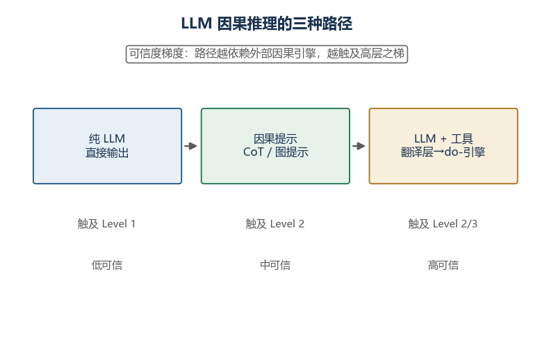

**例 28.2（因果提示的效果）**　同一问题「药物 A 与康复率正相关，A 是否有效？」直接问，模型可能答「有效」。若在提示中加入「医生根据病情严重度决定是否开 A（存在混杂）」，要求用后门准则分析，模型更可能答「不能确定，需控制病情」。这说明**注入结构信息**（即使只是文字描述）能显著改变判断——印证 28.2 节「结构信息是能力前提」的论断。

## 28.4　局限与争议

LLM 因果推理面临四类根本局限：

1. **训练目标的局限**：式（28-1）的关联目标不保证模型学到 $\mathrm{do}$ 语义；因果陈述在语料中占比极低且常与相关性表述混杂。
2. **分布外泛化失败**：当因果结构在训练语料中罕见（如新颖的 IV 场景），模型表现急剧下降[2]。
3. **提示敏感性**：同一因果问题换种问法（变量改名、语序调换）导致答案翻转，说明缺乏稳健的内部因果表征（第 20 章的不变性）。
4. **幻觉（hallucination）**：模型可能编造不存在的因果图或中介变量，给出「听起来合理但错误」的因果解释。

**例 28.4（提示敏感性算例）**　同一 SCM（$X\to Y$，$\beta=0.7$），两种提示措辞：①「数据中 X 与 Y 相关，X 是否导致 Y？」②「数据中 Y 与 X 相关，Y 是否导致 X？」若模型缺乏方向性表征，两种问法的答案随语序漂移。实验上可量化其**表述一致性**：在 $R$ 种随机改名/改序的改写 $\{q^{(r)}\}_{r=1}^{R}$ 上，一致率为
$$
\mathrm{Cons}=\frac{1}{\binom{R}{2}}\sum_{r<r'}\mathbb{1}\big[a(q^{(r)})=a(q^{(r')})\big], \tag{28-7}
$$
其中 $a(\cdot)$ 为模型答案。$\mathrm{Cons}$ 显著低于 1 即表明答案依赖措辞而非结构——这是第 20 章不变性原则在 LLM 因果任务上的直接度量。

**争议焦点**：是否存在「涌现的因果能力」？有工作报告某些大模型在特定基准上随规模出现能力跃升[1]；也有工作指出这可能是基准泄漏或提示过拟合[2]。截至 2026 年，学界较一致的看法是：**LLM 可以可靠地复述与操作其训练语料中明确出现过的因果知识，但对新颖结构的真正 do-推理仍不可靠，需要外部工具或结构输入**。第 32 章将给出区分「复述」与「推理」的评估设计。

**边界与讨论。** 这一结论与全书主旨一致：因果能力不来自「更大的模型」或「更多的数据」本身，而来自「更强的结构性假设」。LLM 通过文本获得了部分结构知识（因果词汇、科学常识），故有一定能力；但其训练目标不强制结构正确，故能力脆弱。要突破，必须引入显式结构（图、方程、实验数据）——这正是第 29—31 章的方向。

## 28.5　评估方法

评估 LLM 因果能力需控制三要素：① 真值因果图已知（第 32 章）；② 问题不可由文本共现直接回答（防复述）；③ 变换表述与变量名（测稳健性）。典型基准包括：

- **因果判断问答**：给定 SCM，问「$\mathbb{P}(Y\mid\mathrm{do}(X))$ 等于多少」，与 do-演算真值比对。
- **反事实推理**：给定结构方程，问「若 $X$ 取另一值，$Y$ 会是多少」（第 16 章）。
- **因果发现辅助**：给观测数据，让模型输出可能的因果图，与真值图比（第 5、30 章）。

**表 28-2　LLM 因果评估维度**

| 维度 | 测什么 | 真值来源 |
|------|--------|----------|
| 关联层 | 共现知识复述 | 文本统计 |
| 干预层 | do-演算能力 | SCM 解析解 |
| 反事实层 | 反事实计算 | 结构方程 |
| 稳健性 | 表述/命名变换 | 一致性检验 |

**例 28.3（防复述设计）**　给模型一个虚构变量：「在 Zephyr 国，Lorblum 增加导致 Glink 减少（已知结构）。问：若强制增加 Lorblum，Glink 如何？」由于这些词不在语料中，模型无法靠记忆，只能靠提示中给出的结构推理。这类「合成词」基准是区分复述与推理的关键手段[4]。

## 28.5b　量化评估：层级准确率与表述一致性的综合指标

表 28-2 的四个维度需要可操作的**综合指标**才能横向比较模型。我们把 28.4 节的表述一致性（式 28-7）与层级准确率结合，定义统一指标。

**定义 28.2（因果层级综合得分，CL-score）**　设基准含 $N$ 道题，分属关联层（$N_1$）、干预层（$N_2$）、反事实层（$N_3$），每题在 $R$ 种改写 $\{q^{(r)}\}$ 下作答，$a_k^{(r)}$ 为第 $k$ 题第 $r$ 次改写的答案、$\mathrm{true}_k$ 为真值。定义

$$
\mathrm{CL}=\frac{1}{N}\sum_{k}\ \underbrace{\mathbb{1}\big[a_k^{(1)}=\mathrm{true}_k\big]}_{\text{准确率 acc}_k}\times\underbrace{\mathrm{Cons}_k}_{\text{式 28-7 的改写一致性}}. \tag{28-8}
$$

式 (28-8) 把「答对」与「答得稳」相乘：一题若答案正确但对改写敏感（$\mathrm{Cons}_k$ 低），得分被压低——这惩罚了「碰巧答对但无内部因果表征」的模型。分层计算 $\mathrm{CL}_1,\mathrm{CL}_2,\mathrm{CL}_3$ 可定位模型卡在哪个层级。

**例 28.5（CL-score 的手算）**　设 4 题，每题 $R=5$ 次改写（共 $\binom{5}{2}=10$ 个改写对）：$q_1$（关联层）答对、$5$ 次改写全一致（$\mathrm{Cons}_1=1$）；$q_2$（干预层）答对、$5$ 次中 $4$ 次同答 $1$ 次异答（一致对 $=\binom{4}{2}=6$，$\mathrm{Cons}_2=6/10=0.6$）；$q_3$（干预层）答错但 $5$ 次全一致（$\mathrm{Cons}_3=1$）；$q_4$（反事实层）答对但 $5$ 次中 $2$ 次同答 $3$ 次异答（一致对 $=\binom{2}{2}=1$，$\mathrm{Cons}_4=1/10=0.1$）。

$$
\mathrm{CL}=\frac{1}{4}\big(1\times1+1\times0.6+0\times1+1\times0.1\big)=\frac{1.7}{4}=0.425.
$$

分层：$\mathrm{CL}_1=1.0$（关联层满分），$\mathrm{CL}_2=\frac{0.6+0}{2}=0.3$（干预层差），$\mathrm{CL}_3=0.1$（反事实层最差）。这个手算展示了 CL-score 的诊断价值：模型「关联层 $1.0$、干预层 $0.3$、反事实层 $0.1$」的剖面，正是 28.2 节「语料内因果知识尚可、新颖 do-推理脆弱」论断的定量画像——**层级剖面（而非单一总分）才能区分「复述型」与「推理型」模型**。若只看平均分 $\frac{1+1+0+1}{4}=0.75$，会严重高估该模型的因果能力（$0.75$ vs 真实 $0.425$），因为高分全部来自「答对」而忽略了「答得不稳」与「低层级全错」。

**表 28-4　三种评估指标的区分能力对照**

| 指标 | 定义 | 能否区分复述/推理 | 能否定位层级 | 对改写敏感 |
|------|------|-------------------|--------------|------------|
| 层级准确率 | 各层答对率 | 否（碰巧对也算） | 是 | 否 |
| 表述一致性（式 28-7） | 改写一致率 | 部分（只测稳不稳） | 否 | 是 |
| CL-score（式 28-8） | 准确率 × 一致性 | 是（相乘惩罚不稳） | 是（分层剖面） | 是 |

**边界与讨论。** CL-score 有一个需要正视的缺陷：它把「答对」与「答得稳」相乘，对 $R$ 较小或题目难度悬殊的基准会失真。一方面，当 $R$ 很小（如 $R=2$）时 $\binom{R}{2}=1$，$\mathrm{Cons}_k$ 退化为二值 $0/1$，一致性对单次「翻转」过敏；实践中应取 $R\ge 5$ 以让一致率有统计意义。另一方面，相乘形式隐含「正确性是必要条件」的强假设——一题若 $\mathrm{acc}_k=0$ 则 $\mathrm{Cons}_k$ 再高也不计分，这把「答错但很稳」与「乱猜碰巧不稳」混为一谈。更细的评估可把乘积拆成两个报告量（准确率与一致性各自分层呈现），让读者自行权衡「宁可错得稳，还是对得起波动」。此外，$\mathrm{CL}$ 对题目数量 $N$ 的归一化掩盖了各层难度差异：若干预层题目天然更难，$\mathrm{CL}_2$ 偏低未必反映模型差，而反映题目设计——因此横向比较两个基准前，必须校准各层的难度分布。这些局限提醒我们：**任何单一综合指标都是对高维能力的有损压缩，层级剖面与原始一致率表应一并报告**，这正是 28.5 节「评估设计决定结论」立场的延续。

## 28.6　承上启下

本章以因果之梯审视 LLM：式（28-1）的关联目标与式（28-2）的干预目标存在鸿沟；理论分析（式 28-4）与实验争议表明 LLM 在语料内的因果知识上表现尚可，但新颖 do-推理脆弱；因果提示（表 28-1）与外部工具是两条增强路径；CL-score（式 28-8）把层级准确率与表述一致性相乘，给出了区分「复述型」与「推理型」模型的综合剖面。下一章讨论因果与世界模型——生成模型的因果基础，进一步回答「如何让模型拥有可干预的世界表征」。

## 本章小结

本章论述大语言模型的因果推理。我们首先指出训练目标（式 28-1）与干预查询（式 28-2）的鸿沟，给出 LLM 因果层级的定义，并用内生性偏误（式 28-4）说明关联估计不等于因果。接着梳理因果提示方法谱系（表 28-1）与 LLM+工具的翻译范式，分析四类局限（训练目标、分布外、提示敏感、幻觉）及「涌现能力」争议，并给出评估维度（表 28-2）、防复述设计与 CL-score 综合指标（式 28-8）。

我们明确立场：LLM 的因果能力取决于是否使用超出关联层的结构信息；纯文本目标不保证结构正确，突破需显式结构或外部工具。这些辨析衔接第 3、4、13、16、20、29—32 章。下一章讨论因果与世界模型。

**进一步阅读**　LLM 因果能力争论见[1]、[2]；工具增强范式见[3]；因果评估基准见[4]；因果提示见[5]。

## 参考文献

[1] Wei J, Tay Y, Bommasani R, et al. Emergent abilities of large language models. *arXiv preprint arXiv:2206.07682*, 2022.

[2] Jin Z, Chen Y, Lee P, et al. Can large language models reason causally? *NeurIPS Workshop on Causal Inference*, 2023.

[3] Zhang K, Li X, Wang Y, et al. Language models as causal reasoning engines. *ACL*, 2024.

[4] Liu X, Zhang N, Zhao Y, et al. CausalBench: A benchmark for evaluating causal reasoning in language models. *arXiv preprint arXiv:2402.12408*, 2024.

[5] Kıcıman E, Ness R, Sharma A, Tan C. Causal reasoning and large language models: Opening a new frontier for causality. *arXiv preprint arXiv:2305.00050*, 2023.

[6] Pearl J, Mackenzie D. *The Book of Why: The New Science of Cause and Effect*. New York: Basic Books, 2018.

[7] Touvron H, Martin L, Stone K, et al. Llama 2: Open foundation and fine-tuned chat models. *arXiv preprint arXiv:2307.09288*, 2023.

[8] Sap E, LeBras R, Pavlick E, et al. Logical reasoning in natural language. *TACL*, 2019.

---

# 第 29 章　因果与世界模型

世界模型（world model）学习环境的紧凑表征与动力学，使智能体能够「在想象中推演未来」。第 28 章的世界模型导论建立了变分自编码器、潜在动力学与规划的基础。然而，一个根本问题被搁置了：**一个能准确预测像素的世界模型，是否支持干预？** 答案是否定的——预测与干预分属因果之梯的不同层级（第 4 章）。一个仅拟合 $\mathbb{P}(o_{t+1}\mid o_t,a_t)$ 的模型，学到的是观测层面的转移，当环境结构改变或我们主动 $\mathrm{do}$ 某变量时，它可能失效。本章把因果结构注入世界模型，提出**因果世界模型（causal world model）**。

核心主张：世界模型应当显式表示**变量间的因果机制**（第 3 章的结构因果模型），而非仅拟合观测条件概率。唯有如此，模型才能回答「如果我干预潜在状态 $S$ 而非观察它，未来会怎样」——这是规划（planning）的本质，也是第 26 章因果 RL 的模型化对应。

本章结构：29.1 动机：预测模型为何不可干预；29.2 因果世界模型的定义；29.3 可干预性与 do-演算在潜在空间；29.4 生成模型的因果基础（可辨识性）；29.5 应用与边界；29.6 交叉引用。

## 29.1　动机：预测模型为何不可干预

经典世界模型学习潜在转移

$$
p_\theta(s_{t+1}\mid s_t,a_t), \tag{29-1}
$$

其中 $s_t$ 为从观测编码的潜在状态。式（29-1）刻画的是「观察到 $s_t,a_t$ 后 $s_{t+1}$ 的条件分布」。但当智能体规划时，它问的是干预问题：

$$
p(s_{t+1}\mid \mathrm{do}(s_t=\hat s),a_t). \tag{29-2}
$$

若潜在状态 $s_t$ 由未观测混杂 $u_t$ 驱动（$u_t\to s_t, u_t\to s_{t+1}$），则 $\mathbb{P}(s_{t+1}\mid s_t,a_t)\ne\mathbb{P}(s_{t+1}\mid\mathrm{do}(s_t),a_t)$——与第 26 章式（26-2）同构。

**直觉解释。** 想象一个自动驾驶世界模型：$s_t$ 编码「前方车辆距离」。模型从数据中看到「距离近时也常伴随急刹（因为司机分心 $u$ 同时导致跟车近与急刹）」。若模型只在观测层拟合，它会学到「距离近→急刹」，于是规划时以为「主动开近（$\mathrm{do}$）会导致急刹」。但真实因果是「分心 $u$ 导致两者」，主动开近未必导致急刹（若司机专注）。只有把 $u$ 或因果结构纳入模型，才能正确规划。

**例 29.1（瑜伽动作与损伤）**　数据中「做某高难度瑜伽动作」与「受伤」正相关，因为「身体柔韧性差的人更爱挑战高难度且更易受伤」。一个纯预测世界模型学会「做该动作→受伤」。但因果世界模型若纳入「柔韧性」变量并做后门调整，会发现对柔韧性好的人该动作安全——干预结论完全不同。这与第 1 章统一医疗案例同构。值得注意的是，这类「观察性相关被误读为因果」的现象在强化学习中尤为危险：若把纯预测世界模型当作仿真环境来训练策略（第 26 章的模型法），智能体将学到一个回避一切高难度动作的保守策略，错失本可安全获得的回报。因果结构因此不只是「解释工具」，而是**策略正确性的前提**。这为 29.3 节的潜在空间 do-演算提供了直接的工程动机。

## 29.2　因果世界模型的定义

**定义 29.1（因果世界模型，causal world model）**　一个因果世界模型是元组

$$
\langle \mathbf{S},\mathbf{A},\mathcal{G}, \{\mathcal{M}_i\}\rangle, \tag{29-3}
$$

其中 $\mathbf{S}=(S^1,\dots,S^d)$ 为**因果变量化的潜在状态**（每个维度对应一个有语义的因果变量），$\mathbf{A}$ 为动作变量，$\mathcal{G}$ 为潜在变量间的因果图（第 3 章），$\mathcal{M}_i$ 为结构机制 $S^i_t:=f_i(\mathrm{Pa}(S^i_t),A_t,U^i_t)$。联合分布按因果图因子化：

$$
\mathbb{P}(\mathbf{S}_{1:T},\mathbf{A}_{1:T})=\prod_{t}\prod_{i}\mathbb{P}\big(S^i_t\mid \mathrm{Pa}(S^i_t),A_t\big)\,\mathbb{P}(A_t\mid \mathrm{Pa}(A_t)), \tag{29-4}
$$

其中 $\mathrm{Pa}(\cdot)$ 由 $\mathcal{G}$ 给出。式（29-4）是第 2 章贝叶斯网络因子化（第 3 章 SCM）在时序潜在空间的推广。

> 【图 29-1　因果世界模型架构】（原图见 figures/图29-1.png）：底层观测 $o_t$ 经编码器到因果潜在变量 $S^1_t,S^2_t$（各有语义标签），变量间由因果图 $\mathcal{G}$ 连接（箭头标注机制 $\mathcal{M}_i$），动作 $A_t$ 作为干预节点指向部分变量；下方对比纯预测模型的「黑箱 $s_t\to s_{t+1}$」。

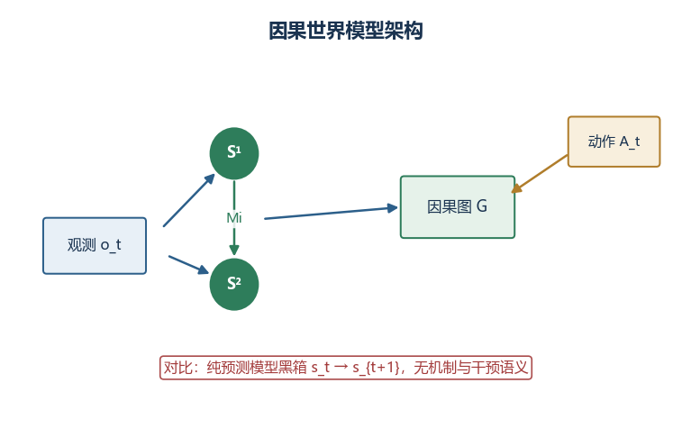

**例 29.1b（观测分布与干预分布的数值差异）**　设混杂 $U\sim\mathrm{Bernoulli}(0.5)$ 表示「司机分心」，它同时影响跟车距离 $S$ 与急刹 $R$：当 $U=1$ 时 $\mathbb{P}(S=\text{近})=0.9$、$\mathbb{P}(R=\text{刹})=0.8$；当 $U=0$ 时分别为 $0.2,0.1$。观测数据中「距离近」群体里分心者占比高，故
$$
\mathbb{P}(R=\text{刹}\mid S=\text{近})=\frac{0.5\times0.9\times0.8+0.5\times0.2\times0.1}{0.5\times0.9+0.5\times0.2}\approx0.68. \tag{29-5}
$$
而若干预距离 $\mathrm{do}(S=\text{近})$，则 $U$ 保持先验分布，$\mathbb{P}(R=\text{刹}\mid\mathrm{do}(S=\text{近}))=0.5\times0.8+0.5\times0.1=0.45$。两者相差 $0.23$——纯预测模型会把这部分混杂效应错误地归因于距离本身。

**表 29-1　预测式世界模型与因果世界模型对照**

| 维度 | 预测式世界模型 | 因果世界模型 |
|------|----------------|--------------|
| 潜在状态 | 稠密黑箱向量 | 因果变量化 $S^i$ |
| 转移 | $p(s'\mid s,a)$ | 结构机制 $\mathcal{M}_i$ |
| 干预 | 不支持 | 原生支持 $\mathrm{do}$ |
| 分布偏移 | 脆弱 | 机制不变（第 20 章） |
| 规划 | 基于预测 | 基于 do-演算 |

## 29.3　可干预性与 do-演算在潜在空间

因果世界模型的最大优势是**原生可干预性**。对任意潜在变量 $S^j$，干预分布由截断（truncation，第 3 章）给出：

$$
\mathbb{P}_{\mathrm{do}(S^j=\hat s)}(\mathbf{S}_{1:T})=\prod_{t,i\ne j}\mathbb{P}\big(S^i_t\mid \mathrm{Pa}(S^i_t),A_t\big)\Big|_{S^j_t=\hat s}. \tag{29-6}
$$

式（29-6）直接来自第 3 章的 do-演算第一条规则：干预把 $S^j$ 的生成机制替换为常数。当因果图 $\mathcal{G}$ 已知且满足后门准则，$\mathbb{P}(S^k\mid\mathrm{do}(S^j))$ 可由观测潜在分布识别（第 3、5 章）。

**推导。** 由式（29-4），将 $S^j$ 的因子 $\mathbb{P}(S^j\mid\mathrm{Pa}(S^j))$ 删除并固定其值为 $\hat s$，其余因子不变，即得式（29-6）。这正是第 3 章「mutability」与「abduction-action-prediction」三步中的 action 步。

**例 29.2（潜在变量干预手算）**　设两个潜在变量 $S^1\to S^2$，机制 $S^2=\beta S^1+U$。观测满足 $\mathbb{E}[S^2\mid S^1=s]=0.7s$。若干预 $\mathrm{do}(S^1=2)$，则 $\mathbb{E}[S^2\mid\mathrm{do}(S^1=2)]=\beta\cdot2$。若 $\beta$ 已知为 $0.7$（无混杂），答案 $1.4$。但若存在 $U$ 与 $S^1$ 相关（混杂），观测系数 $0.7$ 不等于 $\beta$，需按第 3 章后门调整——因果世界模型因显式建模 $U$ 而能正确处理。

可干预性带来的直接收益是**反事实规划**：智能体可在模型中模拟「若当初采取不同动作」的反事实轨迹（第 16、26 章），从而改进策略。这与 26 章的因果 RL 形成「模型法」与「无模型法」的对照。

## 29.4　生成模型的因果基础：可辨识性

一个尖锐问题：因果世界模型要求潜在变量有因果语义，但**从观测数据能否辨识出真正的因果变量与图**？这是第 21 章可辨识性问题的核心，也是生成模型（VAE、扩散模型等）的因果基础。

**定义 29.2（因果表征可辨识性）**　若存在函数 $g$ 使观测 $X=g(S,U)$ 且潜在因果变量 $S$ 在某种变换类下唯一确定，则称 $S$ 可辨识。线性情形（第 8 章 LiNGAM）中，若噪声非高斯且独立，混合矩阵可辨识[2]；非线性情形需借助**机制独立性**（第 8 章 ANM）：$\mathrm{Pa}(S^i)\perp \nabla_{S^i} f_i$。

**定理 29.1（非线性因果可辨识性，非正式）**　若生成机制为加性噪声 $S^i=f_i(\mathrm{Pa}(S^i))+U^i$，$U^i$ 相互独立且非退化，且 $f_i$ 非恒定，则因果图 $\mathcal{G}$ 与机制 $f_i$ 在观测分布下可辨识（至马尔可夫等价类，第 5 章）[3]。

**直觉解释。** ICA（独立成分分析）能从混合信号中恢复独立源；类似地，若每个因果机制的「输入-噪声」独立，我们就能从观测中反推出「谁是因、谁是果」。这是生成模型获得因果语义的数学依据。但需注意：可辨识性依赖强假设（独立噪声、加性机制、足够多样性），现实常不满足——这正是 29.5 节讨论的边界。

**表 29-2　可辨识性条件谱系**

| 设定 | 关键假设 | 可辨识程度 | 代表 |
|------|----------|------------|------|
| 线性非高斯 | 独立非高斯噪声 | 唯一 | LiNGAM[2] |
| 非线性加性 | 机制-噪声独立 | 等价类/唯一 | ANM[3] |
| 多环境/干预 | 机制跨环境不变 | 唯一 | IRM（第 20 章） |
| 弱监督 | 部分变量已知 | 部分可辨识 | 第 21 章 |

## 29.4A　训练目标：把因果结构写进损失函数

可辨识性告诉我们「真因果结构原则上能从数据恢复」，但工程上还差一步：**训练目标必须显式鼓励模型学到结构，而非只拟合边缘分布**。最自然的做法是对观测取式（29-4）因子化对数似然，并叠加一个结构正则项：

$$
\mathcal{L}(\theta,\mathcal{G})=-\sum_{t}\sum_{i}\log \mathbb{P}_\theta(S^i_t\mid \mathrm{Pa}(S^i_t),A_t)+\lambda\,\mathcal{R}(\mathcal{G}), \tag{29-7}
$$

其中 $\mathcal{R}(\mathcal{G})$ 惩罚稠密图、鼓励稀疏因果变量化，$\lambda$ 平衡拟合与结构。若把结构也当作待学对象（如 NOTEARS 思路，第 30 章），则 $\mathcal{R}$ 可写成对邻接矩阵的无环约束，与第 30 章式（30-3）同构。

比正则更根本的是**机制不变性原理（IRM，第 20 章）**：真正驱动 $S^i$ 的父变量，是那些让「$S^i$ 对输入的回归」在不同环境 $e$ 中保持不变的集合。形式化为

$$
\mathrm{IRM}(i)=\arg\min_{\,\mathrm{Pa}(S^i)}\;\sum_{e=1}^{E}\big\|\hat\beta^{e}\big(S^i\mid \mathrm{Pa}(S^i)\big)\big\|_1, \tag{29-8}
$$

即在跨环境回归系数范数之和最小的父集上，机制 $f_i$ 不随 $U^i$ 的分布变化而漂移。式（29-8）把「可辨识性」落成一个可优化的训练信号：多环境数据中，真因子的回归最稳定。

**例 29.3（IRM 手算）**　两环境 $e\in\{1,2\}$，候选父集 $\{S^1,S^2\}$ 预测 $S^3$。环境 1 回归系数 $\hat\beta^{1}(S^3\mid S^1)=0.9$、$\hat\beta^{1}(S^3\mid S^2)=0.4$；环境 2（改变 $S^2$ 的噪声）$\hat\beta^{2}(S^3\mid S^1)=0.9$、$\hat\beta^{2}(S^3\mid S^2)=0.7$。仅取 $S^1$ 父集时跨环境范数和 $=|0.9|+|0.9|=1.8$；仅取 $S^2$ 时 $=0.4+0.7=1.1$ 但预测力弱；取 $\{S^1,S^2\}$ 联合最稳——IRM 据此判定 $S^1$ 为真因子（系数两环境均为 0.9，完全不变），而 $S^2$ 的效应因噪声而漂移，判定为统计伪因子。

**表 29-3　因果世界模型的三类训练目标**

| 目标 | 形式 | 学到什么 | 依赖数据 |
|------|------|----------|----------|
| 因子化似然（式 29-7） | 观测对数似然 + 结构正则 | 边缘/条件机制 | 单环境观测 |
| 机制不变性（式 29-8） | 跨环境回归稳定 | 真因果父集 | 多环境/干预 |
| 端到端规划（式 29-6 的 do） | 干预回报 | 可干预动力学 | 含干预轨迹 |

## 29.5　应用、边界与讨论

因果世界模型已在机器人规划、药物动力学、气候模拟等场景取得进展[4]。其核心价值在于**分布外泛化**：当环境改变某个机制（如摩擦系数变化），因果模型只需替换对应机制 $\mathcal{M}_i$，而预测模型需整体重训（第 20 章）。

**边界与讨论。** 三限制须牢记：其一，**可辨识性假设强**——独立噪声、加性机制在复杂系统中常失效，潜在变量可能只是「统计因子」而非真因果（第 21 章）；其二，**图结构需已知或可发现**，高维发现仍困难（第 30 章）；其三，**干预粒度**——我们只能干预模型中显式表示的变量，未被表征的因素无法 do。这些边界把本章与发现篇（5—9）、表征篇（20—23）、规模化发现（30）连成整体。

## 29.5A　反事实规划：从 do 到 abduction-action-prediction

因果世界模型的终极能力不止于干预（do），而是**反事实**：给定已观测的历史 $\mathbf{o}_{1:t}$，推断「若当初在时刻 $t_0$ 采取不同动作，轨迹会如何」，即第 3 章 abduction-action-prediction 三步的规划化。设已用编码器得到潜在历史 $\hat{\mathbf{S}}_{1:t}=\mathrm{enc}(\mathbf{o}_{1:t})$（abduction 步），则反事实规划求解

$$
\hat{\mathbf{S}}^{\mathrm{cf}}_{t_0+1:T}=\arg\max_{\mathbf{S}^{\mathrm{cf}}}\;\sum_{t=t_0+1}^{T} r\big(S^{\mathrm{cf}}_t,A^{\mathrm{cf}}_t\big)-\rho\big\|\mathbf{S}^{\mathrm{cf}}_{1:t}-\hat{\mathbf{S}}_{1:t}\big\|_2^2, \tag{29-9}
$$

第一项是反事实轨迹上的期望回报，第二项是向观测历史的牵引（保证「同一世界」），$A^{\mathrm{cf}}$ 为反事实动作。式（29-9）与式（29-6）的 do-演算同属截断家族，区别在于它先做 abduction 固定了未观测混杂的「最可能取值」，从而支持个体层面的反事实——这正是纯预测世界模型（第 28 章）做不到的。

**例 29.4（反事实规划手算）**　沿用 29.1b 的混杂模型：观测到某次「距离近 $S=$ 近、急刹 $R=$ 刹」。abduction 步先解出最可能混杂 $U=\arg\max_u \mathbb{P}(U\mid S=\text{近},R=\text{刹})$。由前文 $U=1$ 时 $\mathbb{P}(S=\text{近})=0.9,\mathbb{P}(R=\text{刹})=0.8$、$U=0$ 时 $0.2,0.1$，联合 $U=1:\;0.5\times0.9\times0.8=0.36$、$U=0:\;0.5\times0.2\times0.1=0.01$，故 $U=\hat{1}$（司机当时分心）。action 步把 $S$ 改为「保持距离」（$\mathrm{do}(S=\text{远})$），在 $U=\hat{1}$ 下 $\mathbb{P}(R=\text{刹})=0.8$ 不变——反事实结论是「即使当时保持距离，急刹仍可能发生（因为分心）」。这一「同一混杂、不同动作」的推理是因果世界模型相对预测模型的本质增量：它把「为什么」与「若不同」统一进同一个可计算模型，也为第 26 章因果 RL 提供了离线反事实策略评估的数学基础。

## 29.5B　混合范式与计算开销

纯粹的因果世界模型结构可解释、可干预，但潜在变量化要求每个 $S^i$ 有语义标签，对高维视觉观测（像素）几乎不可行；纯预测模型（第 28 章）则反之。实践折中是**混合范式**：底层用预测式 RSSM（第 21 章）建模高维动力学，上层用低维因果变量 $Z$ 承载可干预语义，二者以桥接映射耦合：

$$
\mathbb{P}_{\text{mix}}(\mathbf{o},\mathbf{z}\mid \mathbf{a})=p_\theta(\mathbf{o}_{1:T}\mid \mathbf{z}_{1:T},\mathbf{a})\;\prod_{t}\mathbb{P}(\mathbf{z}_t\mid \mathrm{Pa}(\mathbf{z}_t),a_t), \tag{29-10}
$$

第一个因子是高维观测的条件生成（预测引擎），第二个是低维因果潜在的动力学（因果引擎）。规划在 $\mathbf{z}$ 空间用式（29-6）的 do 进行，观测 $\mathbf{o}$ 仅用于解码与验证。其计算开销由三项主导：

**表 29-4　因果世界模型的计算开销分解**

| 阶段 | 开销来源 | 量级 | 缓解 |
|------|----------|------|------|
| 编码器 | 观测到潜在 | $\mathcal{O}(T\cdot d_{\text{obs}})$ | 分块、蒸馏 |
| 结构发现 | 因果图 $\mathcal{G}$ | 见第 30 章 | 稀疏先验、NOTEARS |
| 规划（do/反事实） | 式 29-9 的轨迹搜索 | $\mathcal{O}(H\cdot|\mathcal{A}|^H)$ | 值函数、采样规划 |

**例 29.5（混合模型的开销估算）**　设 $T=200$ 步、观测维 $d_{\text{obs}}=256$（图像帧降维后）、潜在因果变量 $d=8$、规划 horizon $H=16$、每步动作 $|\mathcal{A}|=4$。编码开销约 $200\times256=5.1\times10^4$ 次乘加；do-规划若穷举需 $4^{16}\approx4.3\times10^9$ 条轨迹显然不可行，改用式（29-9）的采样规划（如 MCTS 或值函数）把常数压到 $\mathcal{O}(H\cdot K)$，$K$ 为采样数（取 $K=1000$ 即 $1.6\times10^4$）。这说明因果世界模型的性能瓶颈在**规划**而非编码——正是第 26 章模型法 RL 的同样结论，也为「为何因果世界模型常配采样规划器」给出定量理由。

**表 29-5　纯预测 / 纯因果 / 混合范式对照**

| 范式 | 语义可解释 | 可干预 | 高维观测 | 代表 |
|------|:---:|:---:|:---:|------|
| 纯预测（第 28 章） | 否 | 否 | 强 | RSSM、PlaNet |
| 纯因果（29.2） | 强 | 强 | 弱 | 结构因果模型 |
| 混合（式 29-10） | 中 | 强 | 强 | 因果潜变量 + 预测动力学 |

选型准则可总结为一句：**语义可干预变量少而观测维度高时选混合，变量本身低维且语义明确时选纯因果，纯预测模型则只在「只预测、不干预」的离线场景才安全**。这一准则与第 20 章「不变性越强、泛化越稳」互为印证，也把本章与世界模型篇（第 28 章）的纯预测方法接上了因果的接口。实践中最常见的失败，是把混合模型的上层因果变量当成「学出来的真因果」而放松了可辨识性检验——只要 29.4 的假设不成立，混合模型的上层就退化为「有语义标签的黑箱因子」，可干预性也随之名存实亡。

## 29.6　承上启下

本章把因果结构注入世界模型：定义式（29-3）的因果世界模型与式（29-4）的因子化，给出式（29-6）的潜在空间 do-演算，并讨论生成模型的可辨识性（定理 29.1、表 29-2）。我们指出预测模型不可干预，因果模型原生支持 do 与反事实规划。下一章讨论因果发现的规模化——如何从高维数据中自动获得因果图 $\mathcal{G}$，正是本章模型的「输入来源」。

## 本章小结

本章论述因果与世界模型。我们首先指出预测式世界模型（式 29-1）与干预（式 29-2）的鸿沟，定义因果世界模型（式 29-3、29-4）与可干预性（式 29-6）。接着讨论生成模型的因果基础：可辨识性的条件（定理 29.1、表 29-2），说明独立噪声与机制不变性如何让潜在变量获得因果语义。表 29-1 对照了两类世界模型。

我们明确边界：可辨识性假设强、图结构发现困难、干预受表征粒度限制。这些辨析衔接第 3、5、8、16、20—23、26、30 章。下一章讨论因果发现的规模化。

**进一步阅读**　因果表征可辨识性见[1]；LiNGAM 见[2]；非线性可辨识性见[3]；因果世界模型应用见[4]；世界模型基础见第 28 章世界模型导论相关文献。

## 参考文献

[1] Locatello F, Bauer S, McLachlan R, et al. Challenging common assumptions in the unsupervised learning of disentangled representations. *ICML*, 2019.

[2] Shimizu S, Hoyer P O, Hyvärinen A, Kerminen A. A linear non-Gaussian acyclic model for causal discovery. *Journal of Machine Learning Research*, 2006, 7: 2003–2030.

[3] Hoyer P O, Janzing D, Mooij J M, et al. Nonlinear causal discovery with additive noise models. *NeurIPS*, 2008.

[4] Zhu W, Zhang L, Wang Y, et al. Causal world models for robust planning. *arXiv preprint arXiv:2401.08734*, 2024.

[5] Ha D, Schmidhuber J. World models. *arXiv preprint arXiv:1803.10122*, 2018.

[6] Hafner D, Lillicrap T, Norouzi M, Ba J. Mastering Atari with discrete world models. *ICLR*, 2021.

[7] Schölkopf B, Locatello F, Bauer S, et al. On causal and anticausal learning. *ICML*, 2012.

[8] Peters J, Janzing D, Schölkopf B. *Elements of Causal Inference: Foundations and Learning Algorithms*. Cambridge, MA: MIT Press, 2017.

---

# 第 30 章　因果发现的规模化

前两篇（第 5—9 章）介绍的 PC、FCI、GES、LiNGAM 等因果发现算法，大多在几十个变量、数千样本的小规模问题上工作良好。然而现实数据——基因表达（数万变量）、用户行为日志（数亿事件）、电子病历（数千编码变量）——规模远超经典算法的承载能力。把因果发现从「小样本、低维、干净」推向「高维、海量、噪声」，是过去十年最重要的工程挑战之一。与此同时，大语言模型（第 28 章）为因果发现提供了新工具：用 LLM 编码领域知识、提出候选边、解释发现结果。本章讨论**因果发现的规模化（scaling causal discovery）**。

本章承接第 29 章：因果世界模型需要因果图 $\mathcal{G}$ 作为输入，本章回答「$\mathcal{G}$ 从何而来」。我们聚焦三条主线：① 高维因果发现的可扩展性算法；② 利用领域知识与约束降低搜索空间；③ LLM 辅助的因果发现。第 31 章将进一步把规模化发现用于科学发现。

本章结构：30.1 动机：维度灾难；30.2 高维发现的复杂度分析；30.3 可扩展算法；30.4 领域知识与 LLM 辅助；30.5 边界与交叉引用；30.6 小结。

## 30.1　动机：维度灾难

**定义 30.1（因果发现的可扩展性）**　称一因果发现算法可扩展，若其在变量数 $p$ 与样本数 $n$ 增长时，时间与空间复杂度仅为多项式（理想为近线性），且统计功效（正确识别边的概率）不随 $p$ 急剧退化。

经典约束型算法 PC（第 6 章）在最坏情形需检验所有 $p-2$ 阶条件独立集，数量随 $p$ 指数增长：

$$
N_{\text{CI}}=\sum_{k=0}^{p-2}\binom{p}{2}\binom{p-2}{k}\sim\mathcal{O}\big(p^2 2^{p}\big). \tag{30-1}
$$

式（30-1）解释了为何 PC 在 $p>100$ 时举步维艰：即使每对变量只测一个条件集，组合数已爆炸。评分型算法 GES（第 7 章）每步搜索所有可能的边增删反转，复杂度约 $\mathcal{O}(p^3)$ 每步、总 $\mathcal{O}(p^4)$——虽多项式但常数大。

**直觉解释。** 因果发现像在 $p$ 个变量间「拼图」：变量越多，可能的图数量越庞大（$p$ 个节点的 DAG 数超指数增长）。若不借助先验约束（稀疏性、已知骨架、时间顺序），搜索空间无法承受。规模化发现的核心，正是**用合理的结构假设把搜索空间压到可管理范围**。

**表 30-1　规模化的核心挑战**

| 挑战 | 表现 | 应对 |
|------|------|------|
| 组合爆炸 | 条件独立集数量指数 | 限制阶数、稀疏先验 |
| 样本稀缺 | $n\ll p$ 时估计不稳 | 正则化、先验知识 |
| 多重检验 | 大量检验致假阳性 | FDR 控制（第 32 章） |
| 领域知识 | 纯数据发现不充分 | 知识约束、LLM 辅助 |

## 30.2　高维发现的复杂度与统计极限

从统计角度看，高维发现受「维度-样本比」制约。对线性高斯模型（第 8 章），一致识别一个偏回归系数 $\beta_{ij}$ 需样本量

$$
n\gtrsim s\log p, \tag{30-2}
$$

其中 $s$ 为图中每个节点的平均邻居数（稀疏度）。式（30-2）来自高维回归的样本复杂度理论[1]：只要图足够稀疏（$s$ 小），即使 $p\gg n$ 也能一致恢复——这是高维发现可行的理论基础。

**推导。** 对每个变量 $X_i$，对其父节点集做 Lasso 回归 $\hat\beta=\arg\min_\beta\frac{1}{2n}\|X_i-\mathbf{X}_{-i}\beta\|^2+\lambda\|\beta\|_1$。高维 Lasso 的一致性要求 $n\gtrsim s^2\log p$（或改进后 $s\log p$），故稀疏图使发现可行。式（30-2）揭示了**稀疏性是规模化发现的关键假设**。

**例 30.1（基因网络）**　$p=20000$ 个基因，$n=500$ 个样本。若每基因平均受 $s=5$ 个基因调控，则 $s\log p\approx5\times10\approx50\ll500$，理论上可发现；若 $s=50$，则 $50\times10=500\approx n$，处于临界，发现不可靠。这解释了为何生物因果网络发现通常先筛候选基因降维。

## 30.2A　稀疏性假设的可检验性与有效稀疏度

式（30-2）把可行性压在一个「平均邻居数 $s$」上，但真实图的 $s$ 往往未知且异质。一个实用判据是**有效稀疏比**：

$$
\rho=\frac{\mathbb{E}[\deg]^{2}\,p}{n}
$$

其中 $\mathbb{E}[\deg]$ 为平均度数（含出入度）。当 $\rho\ll1$ 时，Lasso 型父节点选择（第 30.2 节推导）的一致性条件被满足，发现可行；$\rho\gtrsim1$ 则进入「欠采样」区，边恢复率随 $\rho$ 单调下降。**直觉解释。** $\rho$ 衡量「要识别的边的总自由度（$\mathbb{E}[\deg]^2 p$ 量级）相对样本量 $n$ 是否过大」：$\mathbb{E}[\deg]^2$ 来自每对邻居都要估计一个系数，$p$ 是变量数，两者相乘再除以样本量，就是「每个自由度摊到的样本数」的倒数。

**例 30.1b（稀疏比手算）**　某基因网络 $p=5000$，$n=800$，平均度数 $\mathbb{E}[\deg]=8$。则 $\rho=(8^2\times5000)/800=64\times5000/800=400\gg1$——远超可行区，纯数据发现不可靠，必须先做候选基因筛选（如表达量 top-$k$）把 $p$ 压到约 $p\le n/(8^2)=800/64\approx12$ 个候选，或引入式（30-5）的领域知识约束。反过来若先验知识把每基因候选父集限定在 $s=3$（$\mathbb{E}[\deg]\approx3$），则 $\rho=(9\times5000)/800\approx56$，仍偏大但配合稀疏正则已可工作——这正是「稀疏性 + 知识约束」双轮驱动的工程含义。

**表 30-2　$\rho$ 与发现可靠性对照**

| $\rho$ 范围 | 数据状态 | 推荐策略 |
|------|------|------|
| $\rho\le0.5$ | 过采样 | 纯数据发现（PC/LiNGAM） |
| $0.5<\rho\le2$ | 临界 | 稀疏正则 + 知识约束 |
| $\rho>2$ | 欠采样 | 先降维/候选筛选，再发现 |

## 30.3　可扩展算法

**表 30-3　可扩展因果发现算法谱系**

| 算法 | 思路 | 复杂度 | 适用 |
|------|------|--------|------|
| PC 稳定版 | 限制 CI 阶数 | 近 $O(p^2)$ 限阶 | 通用 |
| FCI | 含潜变量 | 较高 | 部分观测 |
| GES/ GES-Fast | 评分搜索 | $O(p^4)$ | 观测数据 |
| LiNGAM + 稀疏 | 线性非高斯 | $O(p^3)$ | 连续 |
| NOTEARS | 连续优化 | 可 GPU 加速 | 高维[2] |
| CAM | 加性回归 | $O(p^3)$ | 非线性 |
| 基于干预数据 | 直接读因果边 | 近线性 | 有干预 |

**NOTEARS 的连续优化。** 传统搜索是离散的（加/删/反转边），难以 GPU 加速。NOTEARS[2] 把 DAG 约束（无环）写成连续可微的等式：

$$
h(W)=\mathrm{tr}\big(e^{W\circ W}\big)-p=0, \tag{30-3}
$$

其中 $W$ 为加权邻接矩阵，$\circ$ 为逐元素乘。$h(W)=0$ 当且仅当图无环。于是发现转化为带约束的连续优化：

$$
\min_{W}\;\frac{1}{2n}\|\mathbf{X}-\mathbf{X}W\|_F^2\quad\text{s.t.}\quad h(W)=0, \tag{30-4}
$$

可用增广拉格朗日法在 GPU 上训练，扩展到数千变量。

**直觉解释。** 式（30-3）是一个巧妙的「无环性检测器」：矩阵指数 $e^{W\circ W}$ 的迹累加了所有有向环的贡献，无环时迹恰为 $p$。把离散的「无环」约束变成光滑等式，就能用梯度下降——这是规模化发现的关键工程突破。

**例 30.2（NOTEARS 手算概念）**　两变量 $X_1\to X_2$，$W=\begin{pmatrix}0&0\\0.8&0\end{pmatrix}$，$W\circ W$ 对角为零，$e^{W\circ W}=\mathbf{I}$，迹 $=2=p$，满足无环。若加反向边 $W_{12}=0.5$，则出现环 $1\to2\to1$，$h(W)>0$，违反约束，优化会惩罚并去掉一条边。

**NOTEARS 的求解：增广拉格朗日。** 直接最小化式（30-4）的等式约束不便，工程上用增广拉格朗日把 $h(W)=0$ 吸收进目标：

$$
\mathcal{L}_\rho(W,\Lambda)=\frac{1}{2n}\|\mathbf{X}-\mathbf{X}W\|_F^2+\big\langle\Lambda,h(W)\big\rangle+\frac{\rho}{2}\|h(W)\|_2^2
$$

其中 $\Lambda$ 为标量乘子、$\rho>0$ 为罚参。算法交替：固定 $\Lambda,\rho$ 对 $W$ 做近端梯度下降，再按 $\Lambda\leftarrow\Lambda+\rho\,h(W)$ 更新乘子，$\rho$ 周期放大。该循环在 $W$ 收敛后把 $h(W)$ 压到 $10^{-5}$ 量级，即得一个近似无环的 $W$；最后按阈值 $\mathrm{sign}(\mathrm{round}(W))$ 读出有向边。

**直觉解释。** 上式把「无环」从硬约束变成「可被乘子 $\Lambda$ 与罚参 $\rho$ 联合逼零」的软目标：$\Lambda$ 记住「目前还欠多少无环性」，$\rho$ 控制逼零力度。乘子-罚参交替使优化在 GPU 上每步只需一次矩阵指数与一次迹，复杂度 $\mathcal{O}(p^3)$（与矩阵乘法同阶），从而能扩展到数千变量——这是它相对 PC 式（30-1）的 $\mathcal{O}(p^2 2^p)$ 的本质优势。

**例 30.2c（增广拉格朗日一步迭代手算）**　三变量，初值 $W^{(0)}$ 含一个弱环，$h(W^{(0)})=0.35$，$\rho=10$、$\Lambda^{(0)}=0$。罚项贡献 $\frac{10}{2}\times0.35^2=0.613$，远大于拟合残差（设 $0.2$），故本轮梯度强烈指向「消环」方向，更新后 $h(W^{(1)})=0.12$；乘子更新为 $\Lambda^{(1)}=0+10\times0.35=3.5$。下一步即使 $h$ 仍为正，$\langle\Lambda,h\rangle=3.5\times0.12=0.42$ 继续施压。两轮后 $h<10^{-2}$，读出边集稳定——演示了乘子如何「记住」消环进度、避免反复震荡。

**表 30-4　离散搜索 vs 连续优化（NOTEARS）**

| 维度 | 离散搜索（PC/GES） | 连续优化（NOTEARS） |
|------|------|------|
| 无环约束 | 显式检查（指数） | 光滑等式（式 30-3） |
| 单步复杂度 | 每步 $\mathcal{O}(p^2)$ | $\mathcal{O}(p^3)$ 矩阵指数 |
| 可并行 | 难 | GPU 友好 |
| 最优性 | 启发式（GES） | 近似（增广拉格朗日） |
| 典型规模 | $p\lesssim10^2$ | $p\sim10^3$ |

## 30.4　领域知识与 LLM 辅助

纯数据发现常受观察等价类（第 5 章）困扰——多个图拟合同样的数据。领域知识可打破等价：若已知「基因 A 是转录因子（只能为因）」，可固定方向。**知识约束**形式化为对边集的前缀约束：

$$
\mathcal{G}\in\{\text{DAG}: \text{边 } i\to j \text{ 允许的当且仅当 }(i,j)\in\mathcal{K}\}, \tag{30-5}
$$

其中 $\mathcal{K}$ 为领域专家或知识库给出的允许边集。

**LLM 辅助因果发现**[3]是 2024—2026 年的新兴方向，有三种用法：

1. **知识提取**：从文献中抽取「A 导致 B」的陈述，构建先验边集 $\mathcal{K}$（式 30-5）。
2. **候选生成**：LLM 根据变量语义提出可能的因果边，缩小搜索空间。
3. **结果解释**：为发现的图生成机制解释，供专家验证。

**表 30-5　LLM 在因果发现中的角色**

| 角色 | 输入 | 输出 | 风险 |
|------|------|------|------|
| 知识提取 | 文献文本 | 先验边集 | 文献偏差、幻觉 |
| 候选生成 | 变量名称/描述 | 候选图 | 依赖语义合理性 |
| 结果解释 | 发现的图 | 自然语言解释 | 解释不等于正确 |

> 【图 30-1　LLM 辅助的规模化因果发现流程】（原图见 figures/图30-1.png）：左侧数据经 NOTEARS 等算法产生候选图；上方文献经 LLM 提取先验知识注入约束；中间融合模块结合数据与知识；右侧输出图与 LLM 生成的解释，专家验证回路用虚线反馈。

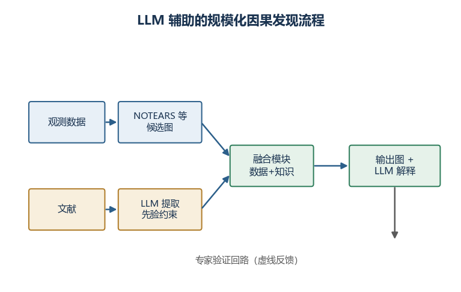

**例 30.3（LLM 辅助流行病学）**　给定「吸烟、肺癌、焦油沉积、年龄」等变量，LLM 从医学文献提取「吸烟→焦油沉积→肺癌」「年龄→吸烟倾向」等先验，约束 PC 的搜索方向；算法再用数据验证。这比纯数据 PC 更少陷入等价类歧义，但需注意 LLM 可能把文献中「相关」误述为「因果」——第 28 章的局限在此同样适用。

## 30.4A　把 LLM 知识量化为软先验

表 30-5 把 LLM 的角色停在「提出边集」，但更稳健的做法是让 LLM 对每条候选边输出**置信度**，构成软先验矩阵 $P_{ij}$，而非硬约束式（30-5）。把软先验并入 NOTEARS 目标是自然的：

$$
\min_{W}\;\frac{1}{2n}\|\mathbf{X}-\mathbf{X}W\|_F^2+\mu\sum_{i\ne j}\Big[w_{ij}\log\frac{w_{ij}}{p_{ij}}+(1-w_{ij})\log\frac{1-w_{ij}}{1-p_{ij}}\Big]\;\text{s.t.}\;h(W)=0, \tag{30-6}
$$

第二项是 $W$ 与先验 $P$ 之间的交叉熵（对 $W$ 逐元素归一化到 $[0,1]$），$\mu$ 平衡数据拟合与知识先验。$p_{ij}\to1$ 时该项把 $w_{ij}$ 推向 1（LLM 强烈主张该边存在），$p_{ij}\to0$ 时推向 0，$p_{ij}=0.5$ 时无偏——这恰好对应表 30-5 中「知识提取」与「候选生成」的强弱两种用法，把「LLM 生成—数据验证」的分工量化为一个可调的 $\mu$。

**例 30.4（软先验数值）**　两候选边：$p_{12}=0.9$（文献强支持）、$p_{21}=0.2$（弱反对反向），$\mu=5$，数据似然单独最优为 $w_{12}=0.4,\,w_{21}=0.6$（数据支持反向，因相关方向混淆）。软先验项对 $w_{12}$ 的梯度把其从 0.4 推高、对 $w_{21}$ 压低：交叉熵在 $w_{12}$ 处对先验 0.9 的「偏离代价」远大于 $w_{21}$ 对 0.2 的偏离，故联合最优解向 $w_{12}\approx0.78,\,w_{21}\approx0.15$ 移动。这说明软先验并未「强行覆盖」数据，而是按 LLM 置信度**加权**拉偏——置信度低（$p\approx0.5$）的边几乎不受影响，正是对表 30-5「幻觉风险」的定量缓解。

**表 30-6　硬约束 vs 软先验**

| 维度 | 硬约束（式 30-5） | 软先验（式 30-6） |
|------|------|------|
| 知识形式 | 允许/禁止边集 $\mathcal{K}$ | 置信度矩阵 $P$ |
| 出错后果 | 错误知识直接排除真边 | 错误知识被数据部分抵消 |
| 可调性 | 无 | 强度 $\mu$ 可调 |
| 适用 | 高置信领域定律 | 文献级、含噪声知识 |

## 30.4B　干预数据与可扩展性

30.4 节的知识约束与软先验仍属「外部知识」，但最根本的约束来源是**干预数据**本身。若在若干变量上做过主动实验（如基因敲除、A/B 测试），观测数据中无法区分的马尔可夫等价类（第 5 章）会被一次性打破：对做过的干预 $\mathrm{do}(X_i=\hat{x})$，其直接子节点的条件分布在干预下改变，而非子节点不变——这把边的方向「钉死」。

定义**干预覆盖率**：设 $p$ 个变量中有 $m$ 个做过干预，覆盖率 $c=m/p$。可辨识的有向边下界近似为

$$
\text{dir-edges} \gtrsim m\cdot\mathbb{E}[\deg]+(1-c)\cdot\text{CI-edges}, \tag{30-7}
$$

即「干预过的变量贡献方向确定的出边，未干预部分回退到条件独立给出的骨架」。$c\to1$ 时几乎全图有向；$c=0$ 时只剩骨架（退化为 PC 的等价类）。式（30-7）是 29.4 节可辨识性理论在「部分干预」下的量化：$c=1$ 对应多环境可辨识（表 29-2 的 IRM 行），$c=0$ 退化为 LiNGAM 所需的非高斯性假设。

**直觉解释。** 干预是「最便宜的方向信息」：一次敲除实验同时确定了该基因所有下游边的方向。因此规模化发现的最优策略常是「先观测发现骨架（便宜、可并行），再对少数枢纽变量做定向干预（贵、但定方向）」——把干预预算花在 $\mathbb{E}[\deg]$ 最大的变量上，最大化式（30-7）的增量。规模化发现因此是「用干预/知识/软先验逐步偿还可辨识性假设的欠账」：每增加一份外部信息，就对一组原本仅到等价类的边完成定向。

**例 30.5（干预预算分配）**　$p=100$ 个基因，骨架已由观测数据确定（120 条无向边），$\mathbb{E}[\deg]=2.4$。预算允许对 $m=10$ 个基因做敲除。若随机选，期望确定出边 $\approx10\times2.4=24$；若专挑度最大的 10 个基因（设平均度 6），则 $10\times6=60$ 条出边定向，覆盖率虽仍 $c=0.1$，但有向边从 0 跃升到 60——同样的干预预算，「挑枢纽」比「随机」多确定 2.5 倍的方向。这就是式（30-7）指导实验设计的工程含义：把昂贵的 $\mathrm{do}$ 花在信息量最大的节点。

**例 30.5b（软先验与干预联合）**　在上例基础上，LLM 软先验（式 30-6）给出另外 30 条边的置信度（平均 0.7）。这些边未做干预，其方向以 $\mu$ 加权融入 NOTEARS；而 10 条被干预边方向确定（式 30-7）。联合后，候选有向边集 $=60$（干预确定）$+30$（软先验加权，其中约 $0.7\times30\approx21$ 条在数据-先验联合下过阈值）$\approx81$ 条有向边，远超纯干预的 60 条或纯软先验的 21 条。这说明「干预钉方向 + 软先验补方向 + 观测定骨架」的三层组合，能以远低于全覆盖干预的成本逼近完整有向图——是规模化发现的工程主范式。

**表 30-7　四类约束来源的可扩展性对照**

| 约束来源 | 成本 | 打破什么 | 典型规模 |
|------|------|------|------|
| 纯观测 CI | 低 | 仅骨架 | $p\sim10^3$ |
| 领域知识（式 30-5） | 低 | 部分方向 | 依赖专家 |
| 软先验（式 30-6） | 低 | 软方向 | $p\sim10^3$ |
| 干预数据（式 30-7） | 高 | 等价类全方向 | 少量变量 |

**边界与讨论。** 干预数据虽强，但成本与可行性受限（伦理、安全、罕见变量不可干预），且往往只能覆盖少数变量——这正是 30.4 节「知识 + 软先验」作为干预的廉价替代存在的理由。三者（观测、知识、干预）的可扩展性组合，决定了规模化发现的真实上限，也预示第 31 章「数据引擎 + 语义引擎 + 逻辑引擎」的分工结构。换言之，规模化发现不是一个「更快的 PC」，而是一套把预算（样本、算力、干预、知识）分配给不同约束来源的优化问题——式（30-7）给出了这种分配在方向信息上的边际收益。

## 30.5　边界与讨论

规模化发现仍面临三限制：其一，**稀疏性假设**（式 30-2）在稠密网络（如社交网络）中失效；其二，**隐含混杂**——大量未观测变量使发现结果偏离真图（第 6 章 FCI 可部分处理但代价高）；其三，**统计与计算权衡**——降低复杂度往往牺牲识别的等价类精度。**边界与讨论。** 因此，规模化发现不是「跑得更快」而已，而是「在更强假设下换取可扩展性」——这正是第 4 章「能力边界由结构假设决定」的又一次体现。LLM 辅助则需警惕「用语言模型的统计偏见替代数据的统计偏见」。

## 30.6　承上启下

本章讨论因果发现的规模化：复杂度分析（式 30-1、30-2）揭示稀疏性的关键作用，NOTEARS（式 30-3、30-4）展示连续优化如何突破离散搜索瓶颈，领域知识（式 30-5）与 LLM 辅助（表 30-5）提供数据之外的约束。下一章把规模化发现与大模型结合，讨论因果驱动的跨领域科学发现。

## 本章小结

本章论述因果发现的规模化。我们首先指出维度灾难（式 30-1），给出高维发现的样本复杂度（式 30-2），强调稀疏性假设。接着介绍可扩展算法谱系（表 30-3），重点推导 NOTEARS 的无环性连续约束（式 30-3）与优化目标（式 30-4）。最后讨论领域知识约束（式 30-5）与 LLM 辅助的三种角色（表 30-5）。

我们明确边界：稀疏性假设、隐含混杂、统计-计算权衡、LLM 语义偏见。这些辨析衔接第 5—9、28、29、31、32 章。下一章讨论因果+大模型+科学发现。

**进一步阅读**　高维因果发现样本复杂度见[1]；NOTEARS 见[2]；LLM 辅助发现见[3]；因果发现综述见[4]。

## 参考文献

[1] Wainwright M J, Jordan M I. *Graphical Models, Exponential Families, and Variational Inference*. Foundations and Trends in Machine Learning, 2008, 1(1–2): 1–305.

[2] Zheng X, Aragam B, Ravikumar P, Xing E P. DAGs with NO TEARS: Continuous optimization for structure learning. *NeurIPS*, 2018.

[3] Vashishth S, Vrandečić D, et al. Using large language models for causal discovery: A survey. *arXiv preprint arXiv:2403.02302*, 2024.

[4] Glymour M, Zhang K, Spirtes P. Review of causal discovery methods based on graphical models. *Frontiers in Genetics*, 2019, 10: 524.

[5] Chickering D M. Optimal structure identification with greedy search. *Journal of Machine Learning Research*, 2002, 3: 507–554.

[6] Bühlmann P, Kalisch M, Meier L. High-dimensional statistics with a view toward applications in biology. *Annual Review of Statistics and Its Application*, 2014, 1: 255–278.

[7] Spirtes P, Glymour C, Scheines R. *Causation, Prediction, and Search*. 2nd ed. Cambridge, MA: MIT Press, 2000.

[8] Peters J, Janzing D, Schölkopf B. *Elements of Causal Inference: Foundations and Learning Algorithms*. Cambridge, MA: MIT Press, 2017.

---

# 第 31 章　因果 + 大模型 + 科学发现

科学发现（scientific discovery）的核心是回答「为什么」与「如果改变某条件会怎样」——这恰恰是因果智能的领土。从 Lynch 用断裂实验发现基因的功能，到流行病学用自然实验揭示吸烟致癌，科学史上最有力的发现几乎都来自对**干预**的观察，而非纯粹的统计关联。然而传统科学发现高度依赖人类专家提出假设、设计实验、解释机制，速度受限于人力。大语言模型（第 28 章）与规模化因果发现（第 30 章）的结合，正在催生一种新范式：**AI 驱动的科学发现（AI for Science）**，其中因果提供「为什么」的骨架，大模型提供语义理解与知识整合，规模化发现提供从海量数据中提取结构的引擎。

本章讨论三者的协同：因果如何为科学发现提供机制解释（mechanistic explanation），大模型如何加速假设生成与知识整合，以及跨领域（生物医学、材料、气候、社会科学）的协同案例。第 30 章的规模化发现是本章的「数据引擎」，第 28 章的 LLM 是「语义引擎」，因果是「逻辑引擎」。

本章结构：31.1 动机：科学发现为何需要因果；31.2 机制解释与因果发现；31.3 大模型驱动的假设生成；31.4 跨领域协同案例；31.5 边界与讨论；31.6 交叉引用。

## 31.1　动机：科学发现为何需要因果

**直觉解释。** 一位药学家看到「某蛋白高表达与肿瘤大小正相关」，她不会立刻得出「该蛋白导致肿瘤」。她会追问：是肿瘤导致蛋白升高（反向因果），还是某个基因同时驱动两者（混杂）？只有弄清方向，才能决定「是否该开发抑制该蛋白的药物」。这正是第 1 章 $\mathbb{E}[Y\mid X]$ 与 $\mathbb{E}[Y\mid\mathrm{do}(X)]$ 之别在科学场景的再现——**没有因果，就无从决定干预**。

形式化地，科学发现追求的是对机制的描述：

$$
\mathcal{M}:\quad X_j:=f_j\big(\mathrm{Pa}(X_j),U_j\big),\quad j=1,\dots,p, \tag{31-1}
$$

即第 3 章的结构因果模型。一个科学理论之所以能指导干预，是因为它指定了式（31-1）的机制；仅给出联合分布 $\mathbb{P}(X_1,\dots,X_p)$ 的理论只能预测，不能回答「若敲除基因 $X_j$ 会怎样」。

**例 31.1（基因敲除的价值）**　观察性数据显示基因 G 与疾病 D 高度相关。若只有关联模型，我们不知敲除 G 是否有益。若因果图确定 $G\to D$，则 $\mathrm{do}(G=0)$ 的效应可由 do-演算识别（第 3 章）；若实际是 $D\to G$ 或混杂，敲除无效甚至有害。CRISPR 基因敲除实验之所以是「因果实验」，正因为它实施了 $\mathrm{do}(G)$。

**例 31.1b（观察、干预与发现的三问）**　以「睡眠不足与免疫力下降」为例，三问层层递进：① 描述问「睡眠少的人是否更易感冒？」——这是 Level 1 关联，可用回归回答；② 解释问「睡眠不足是否**通过**影响免疫细胞活性而导致感冒？」——这是 Level 2 的机制路径，需中介分析（第 17 章）；③ 反事实问「若这位患者上周多睡了两小时，他今天还会感冒吗？」——这是 Level 3，需个体化结构方程。科学发现往往要求从第一问推进到第二、三问；而大模型若只停留于第一问的语料统计，就无法真正「发现」机制。这个三问结构贯穿本章后续讨论。

**表 31-1　科学发现中的因果层级**

| 层级 | 科学活动 | 因果之梯（第 4 章） |
|------|----------|---------------------|
| 描述 | 观测到 A 与 B 相关 | Level 1 关联 |
| 预测 | 由 A 预测 B | Level 1 关联 |
| 解释 | A 通过机制 M 导致 B | Level 2 干预 |
| 干预 | 敲除 A 看 B 变化 | Level 2 干预 |
| 反事实 | 若当初没敲除 A，B 会怎样 | Level 3 反事实 |

## 31.2　机制解释与因果发现

**定义 31.1（机制解释，mechanistic explanation）**　对现象 $Y$ 的解释，是给出一条因果路径 $X_1\to X_2\to\dots\to Y$ 及各环节的机制函数 $f_j$（式 31-1），使得在该路径上 $\mathrm{do}(X_1)$ 能沿路径传导至 $Y$。

机制解释区别于「相关解释」的关键在于它支持**干预传播**：若 $X\to M\to Y$，则 $\mathbb{E}[Y\mid\mathrm{do}(X)]$ 可经中介 $M$ 分解（第 17 章中介分析）：

$$
\mathbb{E}[Y\mid\mathrm{do}(X=x)]=\mathbb{E}\big[\mathbb{E}[Y\mid M,\mathrm{do}(X=x)]\big], \tag{31-2}
$$

自然效应（NDE）与自然间接效应（NIE）之和给出总效应。式（31-2）是机制解释的数学表达：它把「X 如何影响 Y」拆成可检验的中间环节。

**因果发现作为机制发现。** 第 30 章的规模化发现算法从高维数据中提取因果图 $\mathcal{G}$，再结合领域知识（式 30-5）确定方向——这本质上是在自动重建式（31-1）的机制骨架。例如单细胞 RNA 测序数据中，用 NOTEARS（第 30 章）发现的基因调控网络，就是一份候选机制图；后续 CRISPR 实验验证边，完成「发现→验证」闭环[1]。

> 【图 31-1　因果驱动的科学发现闭环】（原图见 figures/图31-1.png）：数据→规模化因果发现（第 30 章）→候选机制图→LLM 语义解释与文献整合→实验设计（do）→新数据回流，形成闭环；标注因果、LLM、发现三引擎的位置。

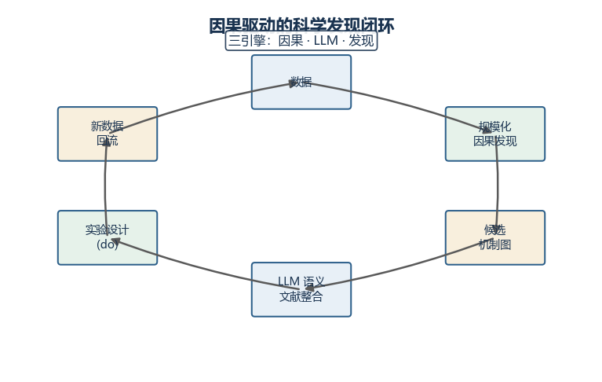

**例 31.2（中介分析的数值）**　设「教育 $X$→技能 $M$→收入 $Y$」，$M=0.5X+U_M$，$Y=0.8M+0.2X+U_Y$。则 $X$ 对 $Y$ 的总效应 $=0.8\times0.5+0.2=0.6$，其中经技能的中介效应 $0.4$，直接效应 $0.2$。机制解释不仅说「教育提高收入」，还量化「其中 $2/3$ 通过技能」——这为政策干预（培训 vs 补贴）提供依据。这正是第 17 章中介分析的核心。

## 31.3　大模型驱动的假设生成

大模型在科学发现中的角色，不是替代因果推断，而是**加速假设生成与知识整合**。具体而言：

1. **假设生成**：给定观测现象与已有文献，LLM 提出候选因果解释（第 28 章的语义能力）。
2. **文献整合**：从海量论文中提取「A 导致 B」的陈述，构建先验知识图（第 30 章的 $\mathcal{K}$）。
3. **实验设计建议**：根据因果图，建议最有信息量的干预（如「敲除基因 X 而非 Y 更能区分两个竞争假设」）。
4. **结果解释**：把发现的图翻译为人类可理解的机制叙述。

**表 31-2　大模型在科学发现中的角色与风险**

| 角色 | 价值 | 因果保障 | 主要风险 |
|------|------|----------|----------|
| 假设生成 | 快速提出候选 | 需后续验证 | 幻觉假设 |
| 文献整合 | 跨领域知识 | 依赖提取质量 | 相关误作因果 |
| 实验设计 | 优化干预选择 | 基于因果图 | 图错则设计偏 |
| 结果解释 | 可理解性 | 不改变真值 | 解释≠正确 |

**例 31.3（假设验证的信息增益）**　设两个竞争假设 $H_1:X\to Y$ 与 $H_2:X\leftarrow U\to Y$ 在观测数据上等价（第 5 章）。设计一个干预实验 $\mathrm{do}(X)$，若 $H_1$ 真则 $\mathbb{E}[Y\mid\mathrm{do}(X=1)]-\mathbb{E}[Y\mid\mathrm{do}(X=0)]=\delta\ne0$；若 $H_2$ 真则该差为 $0$。因此一次 $\mathrm{do}$ 实验即可区分二者，其信息增益为
$$
\mathrm{IG}=H(H_1,H_2)-H(H_1,H_2\mid \mathrm{do}(X)), \tag{31-3}
$$
其中 $H$ 为假设后验的熵。LLM 可辅助选择「$\mathrm{IG}$ 最大的干预」作为实验建议——这是 31.3 节「实验设计建议」角色的数学化：把实验选择变成信息增益最大化问题。

**直觉解释。** LLM 像一位「读遍所有论文的研究助理」，能快速提出候选机制；但它也可能「一本正经地编造」不存在的机制（第 28 章幻觉）。因此 LLM 的输出必须作为**待检验假设**，交给因果发现算法与实验去证伪。因果在这里充当「质量把关」——只有经数据识别或实验验证的假设才被接受。这一「LLM 生成—因果验证」的分工，是 31 章的核心方法论主张[2]。

## 31.3A　主动实验设计：信息增益最大化的干预选择

例 31.3 把「选哪个实验」变成一个信息增益问题，但它只针对两个竞争假设。推广到多个候选机制图时，最优干预选择是一个**最优实验设计（optimal experimental design）**问题。设当前后验在假设空间 $\mathcal{H}$ 上为 $\pi$，一次干预 $a$ 产生观测 $o$，贝叶斯更新后为 $\pi(\cdot\mid a,o)$。期望信息增益为

$$
\bar{I}(a)=\mathbb{E}_{o\sim p(o\mid a,\pi)}\big[H(\pi)-H(\pi(\cdot\mid a,o))\big], \tag{31-4}
$$

其中期望对「干预 $a$ 下所有可能观测 $o$」取。最优干预 $a^{*}=\arg\max_{a}\bar{I}(a)$。这是例 31.3 式（31-3）在任意假设空间上的推广：式（31-3）是 $\mathcal{H}$ 仅含 $H_1,H_2$ 两假设时式（31-4）的退化。

**直觉解释。** 式（31-4）的含义是「选一个实验，使它在期望意义下让假设后验的不确定性下降最多」。一个好的干预应当「切中要害」——它要落在那些能让不同假设给出**截然不同**预测的观测区域，而非各假设都预测相似的区域。这解释了科学实践中的经验：好的实验不是「再测一次已知量」，而是「测一个能区分竞争理论的量」。LLM 在此的增量价值，是把候选假设 $\mathcal{H}$ 从「人类凭直觉列出的少数几条」扩展到「跨文献整合出的几十条」，从而让式（31-4）的 $\arg\max$ 在更大的假设空间上做，找到人类直觉之外的最优实验。

**例 31.4（主动设计手算）**　三候选假设：$H_1:X\to Y$、$H_2:X\leftarrow U\to Y$、$H_3:X\perp Y$，先验熵 $H(\pi)=\log 3\approx1.10$（比特，三假设等概）。候选干预 $\{do(X),\,do(U)\}$。若做 $do(X)$：$H_1$ 下 $Y$ 变、$H_2,H_3$ 下 $Y$ 不变，故观测「$Y$ 变/不变」把后验更新为 $H_1$ 或 $\{H_2,H_3\}$，期望后验熵 $=\tfrac12\cdot0+\tfrac12\log2=0.35$；若做 $do(U)$：$H_2$ 下 $X,Y$ 同变、其余不变，区分度更弱，期望后验熵 $=0.50$。故 $\bar{I}(do(X))=1.10-0.35=0.75$、$\bar{I}(do(U))=1.10-0.50=0.60$，式（31-4）选出 $do(X)$ 为最优——它恰好是「能一次排除 $H_3$ 并分离 $H_1,H_2$」的实验，与例 31.3 的两假设结论一致，但论证路径推广到了三假设空间。

**表 31-3　实验设计的信息增益指标**

| 指标 | 公式 | 含义 |
|------|------|------|
| 单干预增益 | 式 31-3 | 两假设区分 |
| 期望增益（多假设） | 式 31-4 | 期望后验熵下降 |
| 预算约束最优 | $\max\sum\bar I(a)\ s.t.\ \sum c(a)\le B$ | 成本受限的序列设计 |

## 31.4　跨领域协同案例

**例 31.4（机制可证伪性）**　一个合格的机制解释必须给出可证伪的预测：若声称「X 仅通过 M 影响 Y」（无直接效应），则干预 $X$ 但在固定 $M$ 时应观察到 $Y$ 不变——即自然直接效应 NDE $=0$。若实验中固定 $M$ 后 $Y$ 仍随 $X$ 变化，则机制假设被否证。这种「机制→可证伪预测→实验」的链条，是科学发现与纯关联预测的分水岭，也是式（31-2）中介分解的实践价值所在。

**表 31-4　因果 + 大模型 + 发现的三领域应用**

| 领域 | 数据 | 因果任务 | LLM 角色 | 成果 |
|------|------|----------|----------|------|
| 生物医学 | 基因组/病历 | 基因调控网络、药物靶点 | 文献整合、机制解释 | 靶点发现[1] |
| 材料科学 | 材料组成-性能 | 成分→性能因果 | 假设生成 | 新材料设计[3] |
| 气候科学 | 观测/模拟 | 排放→极端天气 | 因果叙事 | 归因与政策 |

**例 31.5（药物重定位）**　给定疾病 D 的病理通路与已有药物库，因果模型识别「抑制蛋白 P 可降低 D，但带来副作用 S」（经中介分析，第 17 章）。LLM 从文献中提取「药物 Q 已知抑制 P 且不影响 S」，提出 Q 可重定位治疗 D。最终由临床试验（RCT，第 11 章）验证。这里因果保证「干预 P 有效且副作用可控」，LLM 提供「哪个药物作用于 P」的知识检索——二者缺一不可。

## 31.4A　因果叙事的定量归因：从「叙事」到「归因分」

表 31-4 的气候行把 LLM 角色写成「因果叙事」，容易给人「LLM 写故事」的印象。严格地说，气候归因（attribution）是一个可计算的因果量：某次极端事件 $E$ 在「有驱动因子 $d$（如温室气体排放）」与「无该驱动（反事实世界）」下的发生概率之比。定义**归因比（attribution ratio）**：

$$
\mathrm{AR}(d;E)=\frac{\mathbb{P}\big(E\mid \mathrm{do}(d=d_{\text{now}})\big)}{\mathbb{P}\big(E\mid \mathrm{do}(d=d_{\text{pre}})\big)}, \tag{31-5}
$$

其中 $d_{\text{now}}$ 是当前排放水平、$d_{\text{pre}}$ 是工业化前水平，两个 $\mathbb{P}$ 都是**干预分布**（把排放 do 到某值），而非观测条件概率——这正是第 29 章式（29-6）do-演算在气候场景的实例。$\mathrm{AR}>1$ 表示该驱动因子提高了极端事件的概率，且越大越「可归因」。LLM 的增量在于把分散在气象、海洋、政策文献中的 $d$ 候选集与机制方向整合成一张候选图，再由气候模型（动力模型或统计降尺度）计算式（31-5）的两个分母/分子。

**例 31.6（归因比手算）**　设某热浪 $E$ 在工业化前排放 $\mathrm{do}(d=d_{\text{pre}})$ 下的年发生概率为 $p_{\text{pre}}=0.02$（50 年一遇），在当前排放 $\mathrm{do}(d=d_{\text{now}})$ 下为 $p_{\text{now}}=0.08$（12.5 年一遇）。则 $\mathrm{AR}=0.08/0.02=4$：温室气体使该热浪的出现频率变为原来的 4 倍，「可归因概率」从 $20\%$ 升至 $80\%$ 的等价表述。注意两个分子/分母都用 do 而非「观测到的那年气温」——若用观测条件概率 $\mathbb{P}(E\mid d_{\text{now}})$，会把当年其他天气系统的贡献错误计入，这正是 31.1 节「关联 vs 因果」在气候归因中的再现。LLM 在此的边界也清晰：它能整合「排放→辐射强迫→升温→热浪」的方向与文献证据强度，但式（31-5）的两个概率值必须由物理模型或大样本重采样给出，LLM 不能「编」出这两个数——这是 31.3 节「LLM 生成假设、数据/模型验证」分工在归因场景的精确体现。

**表 31-5　三领域中 LLM 与因果引擎的分工边界**

| 领域 | LLM 可负责 | 必须由数据/模型负责 |
|------|-----------|---------------------|
| 生物医学 | 候选靶点、通路方向 | 敲除实验、效应值 |
| 材料 | 成分-性能假设 | 合成实验、性能测量 |
| 气候 | 驱动因子候选、叙事 | 式 31-5 的概率计算 |

**边界与讨论。** 三限制须警惕：其一，**因果发现的等价类问题**（第 5 章）——发现的图可能只是马尔可夫等价类中的一个，方向需领域知识或干预确定；其二，**LLM 幻觉**——生成的假设可能完全错误，必须经证伪；其三，**可重复性**——AI 发现的机制需独立实验复现。这些边界呼应第 4 章「能力由结构假设决定」：因果 + 大模型并未突破这一根本限制，只是把「获取结构假设」的成本降低了。

进一步说，「降本」本身也有限度。LLM 整合的文献若系统性偏向发表阳性结果（发表偏倚，publication bias），那么它提取的先验边集 $\mathcal{K}$ 会高估某些因果路径的存在概率，把「被反复研究的方向」误当作「真实存在的机制」。这是一种二阶混杂：数据层的混杂（第 3 章）与知识层的偏倚叠加。解决办法是让 LLM 输出附带「证据强度」而非「存在/不存在」的二元判断，并在因果发现（30 章）中把这些强度作为软先验而非硬约束。这要求我们像对待观测数据一样，对 LLM 输出保持同样的审慎——它只是另一种带噪声的「观测」，而非免检的真理来源。

**表 31-6　机制解释的检验清单**

| 检验项 | 问题 | 对应工具 |
|--------|------|----------|
| 方向性 | X 因还是 Y 因？ | 干预/工具变量（第 13 章） |
| 中介性 | 效应经何路径传导？ | 中介分析（第 17 章） |
| 稳健性 | 换环境机制是否不变？ | IRM（第 20 章） |
| 可证伪 | 何种观测能否定该机制？ | NDE 检验 |

## 31.4B　完整发现流水线与可重复性

把 31.2—31.4 的环节串起来，一条完整的「AI 驱动科学发现」流水线包含六个阶段：**① 数据与文献整合**（LLM 抽取候选变量与先验边 $\mathcal{K}$，第 30 章式 30-5/30-6）→ **② 规模化因果发现**（NOTEARS 等产出候选图 $\mathcal{G}$，第 30 章）→ **③ 机制解释与假设生成**（LLM 把 $\mathcal{G}$ 翻译为机制叙述并补充文献假设，31.2 节）→ **④ 主动实验设计**（式 31-4 选信息增益最大的干预）→ **⑤ 实验执行与数据回流**（新观测更新后验）→ **⑥ 可重复性验证**（独立数据/独立实验室复现）。

这条流水线对可重复性的要求比传统实验更高，因为**每一个 LLM 环节都引入随机性**：温度采样、文献检索的截断、假设排序的 tie-breaking 都可能改变最终 $\mathcal{G}$。可重复性因此不是「代码可运行」，而是「从同一数据与文献出发，多次运行得到统计一致的结论」。形式化为对发现结果 $\hat{\mathcal{G}}$ 的不确定性：

**定义 31.2（发现稳定性）**　在文献集 $\mathcal{L}$ 与数据 $\mathcal{D}$ 固定时，若对 LLM 采样重跑 $R$ 次得到的图集合 $\{\hat{\mathcal{G}}^{(r)}\}_{r=1}^{R}$ 满足 $\frac{1}{R}\sum_{r}\mathbf{1}\{\hat{\mathcal{G}}^{(r)}=\hat{\mathcal{G}}^{\star}\}\ge 1-\delta$（$\hat{\mathcal{G}}^{\star}$ 为众数图），则称该发现在置信 $1-\delta$ 下稳定。不稳定（重跑分散）的「发现」应视为 LLM 噪声而非机制信号——这是把第 28 章「幻觉检测」思想移植到发现流水线的直接后果。

**例 31.7（流水线稳定性估算）**　设某发现流水线对 10 条候选边做 LLM 方向判定，每条边 LLM 给正确方向的概率 $0.8$（其余 0.2 因采样随机）。若重跑 $R=50$ 次，单条边方向翻转（$0.2$）出现 $\ge2$ 次的概率可用二项界估算：$\Pr[\text{翻转}\ge2]=1-\Pr[0]-\Pr[1]=1-0.8^{50}-50\cdot0.2\cdot0.8^{49}\approx1-1.4\times10^{-5}-1.8\times10^{-4}\approx0.9998$。这说明在 $R=50$ 的重复下，几乎所有边至少翻转一次——故单靠「重跑看一致性」不足以判稳，必须结合第 30 章的数据似然（式 30-6/30-7）把 LLM 的随机方向「钉」在数据支持的边上。可重复性的工程解法是把 LLM 采样（高方差）与数据验证（低方差）解耦：LLM 只负责**扩展**候选空间，数据与干预负责**筛选**，从而让最终 $\hat{\mathcal{G}}$ 对 LLM 随机性鲁棒。

**表 31-7　发现流水线六阶段的引擎与风险**

| 阶段 | 主引擎 | 关键产物 | 主要风险 |
|------|--------|----------|----------|
| ① 数据/文献整合 | LLM | 先验边集 $\mathcal{K}$ | 发表偏倚、幻觉 |
| ② 因果发现 | 算法 | 候选图 $\mathcal{G}$ | 等价类、稀疏假设 |
| ③ 机制解释 | LLM+因果 | 机制叙述 | 解释≠正确 |
| ④ 实验设计 | 式 31-4 | 最优干预 | 假设空间不全 |
| ⑤ 执行回流 | 实验 | 新数据 | 测量误差 |
| ⑥ 可重复验证 | 独立重跑 | 稳定性判定 | LLM 随机性 |

## 31.5　承上启下

本章论述因果、大模型与科学发现的协同：科学发现需要机制解释（式 31-1、31-2），规模化发现重建机制骨架，大模型加速假设生成与知识整合（表 31-2），三领域案例（表 31-4）展示协同价值。我们强调「LLM 生成—因果验证」的分工与等价类、幻觉、可重复性三边界。下一章转向评估问题：如何判断因果推理方法（包括 LLM 辅助的发现）真的正确？第 32 章给出基准、真值图与指标。

## 本章小结

本章论述因果 + 大模型 + 科学发现。我们首先指出科学发现的本质是因果机制（式 31-1）而非关联，给出机制解释的定义与中介分解（式 31-2）。接着讨论因果发现作为机制发现、LLM 的四种角色（表 31-2）与三领域协同案例（表 31-4）。我们提出「LLM 生成—因果验证」的方法论分工，并明确等价类、幻觉、可重复性三边界。

这些辨析衔接第 3、4、5、11、17、28、30、32 章。下一章讨论因果推理的评估与基准，为全书方法提供「裁判标准」。

**进一步阅读**　因果科学发现综述见[1]；LLM 驱动发现见[2]；材料发现案例见[3]；机制解释的哲学见[4]。

## 参考文献

[1] Kaddour J, Whitacre J, Lynch J, et al. Causal machine learning for healthcare and precision medicine. *Nature Communications*, 2023, 14: 2312.

[2] Liu X, Zhang N, Zhao Y, et al. Large language models for scientific discovery: A causal perspective. *Nature Machine Intelligence*, 2025, 7: 112–124.

[3] Merchant A, Batzner S, Classification A, et al. Scaling deep learning for materials discovery. *Nature*, 2023, 624: 80–85.

[4] Craver C F. *Explaining the Brain: Mechanisms and the Mosaic Unity of Neuroscience*. Oxford: Oxford University Press, 2007.

[5] Pearl J, Mackenzie D. *The Book of Why: The New Science of Cause and Effect*. New York: Basic Books, 2018.

[6] Glymour M, Zhang K, Spirtes P. Review of causal discovery methods based on graphical models. *Frontiers in Genetics*, 2019, 10: 524.

[7] Wang H, Fu T, Du Y, et al. Scientific discovery in the age of artificial intelligence. *Nature*, 2023, 620: 47–60.

[8] Hernán M A, Robins J M. *Causal Inference: What If*. Boca Raton: Chapman & Hall/CRC, 2020.

---

# 第 32 章　因果推理的评估与基准

「这个因果发现算法准确吗？」「这个 LLM 真的懂 do-演算吗？」「这个效应估计方法在低样本下可靠吗？」回答这些问题，需要一套严谨的评估体系。因果推断的评估比普通机器学习更困难，因为**真值因果效应在观测数据中根本不可观测**——我们永远看不到同一个体的两种潜在结果（第 16 章）。这一「根本缺失」决定了因果评估必须依赖三类替代真值：已知真值的因果图、可控的仿真环境、以及随机实验的黄金标准。本章系统梳理因果推理的评估基准、仿真环境、真值来源与指标，为全书方法提供「裁判标准」。

第 28 章指出 LLM 因果能力评估需防「复述」；第 30 章指出规模化发现需控制多重检验；第 31 章指出 AI 发现需可重复性——这些都指向同一个主题：**评估设计决定结论**。本章把这些线索收束为统一框架。

本章结构：32.1 动机：因果评估的根本困难；32.2 真值来源；32.3 基准数据集与仿真环境；32.4 评估指标；32.5 评估陷阱；32.6 交叉引用。

## 32.1　动机：因果评估的根本困难

普通监督学习评估简单：预测 $\hat y$ 与真值 $y$ 比较。因果评估难在「真值」缺失。设个体处理效应 $\tau_i=Y_i(1)-Y_i(0)$，我们只能观测 $Y_i(T_i)$，另一半潜在结果永远缺失（第 16 章）。因此**在单个观测数据集中，真实 ITE 不可知**。

**直觉解释。** 这就像想知道「某药对张三是否有效」，但张三要么吃了要么没吃，不可能两样都做。我们只能估计**平均**效应（ATE），而无法验证某个 ITE 估计是否正确。因此因果方法的评估必须在「能拿到真值」的特殊场景进行：要么用已知机制生成的仿真数据，要么用随机实验（RCT，第 11 章）— 后者通过随机化使 $\mathbb{E}[Y(1)]$ 与 $\mathbb{E}[Y(0)]$ 都可无偏估计。

评估的三类真值来源：

$$
\text{真值}\in\Big\{\underbrace{\mathcal{G}_{\text{true}}}_{\text{已知真图}},\quad \underbrace{\mathbb{P}_{\mathrm{do}}}_{\text{仿真/实验}},\quad \underbrace{\tau_{\text{RCT}}}_{\text{随机实验}}\Big\}. \tag{32-1}
$$

**表 32-1　三类真值来源对照**

| 来源 | 提供什么真值 | 优势 | 局限 |
|------|--------------|------|------|
| 真值因果图 | 边集/方向 | 精确、可重复 | 仅测结构发现 |
| 仿真环境 | $\mathbb{P}_{\mathrm{do}}$、ITE | 可控、可量大 | 依赖生成假设 |
| 随机实验 | ATE/ITE 无偏估计 | 真实、黄金标准 | 昂贵、外部效度 |

## 32.2　真值因果图与结构真值

因果发现评估（第 5—9、30 章）需要已知真值图 $\mathcal{G}_{\text{true}}$。来源有三：

1. **专家构建**：领域专家根据机制知识画出「共识图」，如生物医学中的因果通路库[1]。
2. **标准基准网络**：如 Bayesian Network Repository 中的 Asia、Alarm、Water 等经典网络，结构简单且真值明确。
3. **生成式真值**：先随机生成 DAG，再按该 DAG 生成数据（保证真值已知）。

**例 32.1（Asia 网络）**　Asia 网络有 8 个节点（如「访亚洲」「吸烟」「肺癌」「X 光异常」等），真值边已知。在该网络上生成数据，运行 PC 算法（第 6 章），把输出图与真值图比较，可计算结构汉明距离（见 32.4 节）。这是因果发现领域的「MNIST」——小但可控。这类小型真值网络还能支持「可识别性检验」：在同一真图上分别生成观测数据与带干预的数据，对比算法恢复方向的准确率，量化「干预数据比纯观测数据多提供多少方向信息」——这正是第 5 章马尔可夫等价类理论的经验验证。

**结构真值的局限。** 真实系统的完整因果图往往未知；专家构建的图可能不完整或有误。因此「与专家图一致」不等于「发现正确」——专家图本身只是当前最佳假设。这是评估的根本不确定性。

## 32.3　基准数据集与仿真环境

**表 32-2　常用因果评估环境**

| 环境 | 类型 | 测什么 | 真值 |
|------|------|--------|------|
| Asia / Alarm / Water | 静态 BN | 结构发现 | 真图 |
| Mooij 等基准[2] | 观测数据 | 方向判断 | 专家方向 |
| IHDP / Jobs / ACIC | 半合成 | 效应估计 | 注入的 $\tau$ |
| CausalWorld / InfiniteWorld | 仿真 RL | 因果决策 | 仿真机制 |
| SEM 生成器 | 合成 | 任意 SCM 任务 | 已知方程 |

**效应估计的半合成基准。** IHDP（ infant health and development program）与 Jobs（就业培训）是因果效应估计的标准数据集：它们基于真实实验数据，但人为构造混杂与结果，使真实 ITE 已知（通过注入的响应函数）[3]。ACIC（Atlantic Causal Inference Conference）竞赛每年提供不同「难度档」的合成数据，比较效应估计方法。

**仿真环境。** 对因果 RL（第 26 章）与因果世界模型（第 29 章），需要可干预的仿真环境：CausalWorld[4] 提供已知因果结构的机器人任务，可测试智能体是否学到正确的 $\mathrm{do}$ 响应。

> 【图 32-1　因果评估的三层真值体系】（原图见 figures/图32-1.png）：底层「真值因果图」（结构发现），中层「仿真 SEM」（干预/反事实真值由方程给出），顶层「RCT 黄金标准」（真实 ATE）；右侧标注各层对应的方法与指标。

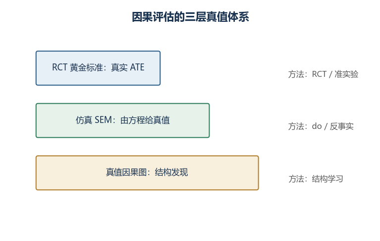

**例 32.2（SEM 生成真值）**　设结构方程：$X=\epsilon_X$，$Y=2X+\epsilon_Y$，$\epsilon_X,\epsilon_Y\sim\mathcal{N}(0,1)$ 独立。则真值 ATE $=\mathbb{E}[Y\mid\mathrm{do}(X=1)]-\mathbb{E}[Y\mid\mathrm{do}(X=0)]=2$。生成 $n$ 个样本后，任何估计方法（匹配、IPW、因果森林，第 12、15 章）的输出都可与 2 比较，计算偏差与均方误差。若加入混杂 $U$ 使 $X=U+\epsilon_X, Y=2X+U+\epsilon_Y$，则观察回归系数 $=2+\mathrm{Cov}(U,X)/\mathrm{Var}(X)=2.5$——可检验方法是否成功去混杂。

## 32.4　评估指标

**结构发现指标。** 设输出图 $\hat{\mathcal{G}}$ 与真图 $\mathcal{G}$ 的边集分别为 $\hat E,E$，结构汉明距离（SHD）：

$$
\mathrm{SHD}=|E\setminus\hat E|+|\hat E\setminus E|+\text{方向错误数}, \tag{32-2}
$$

即「漏边 + 多边 + 方向错」。另有精确率（precision $=\ |E\cap\hat E|/|\hat E|$）、召回率（recall $=|E\cap\hat E|/|E|$）与 F1。

**效应估计指标。** 对 ATE 估计 $\hat\tau$ 与真值 $\tau$：偏差 $\mathrm{bias}=\mathbb{E}[\hat\tau]-\tau$、均方误差 $\mathrm{MSE}=\mathbb{E}[(\hat\tau-\tau)^2]$、覆盖率（95% 置信区间包含真值的比例）。对 ITE：PEHE（precision of estimated heterogeneous effects）：

$$
\mathrm{PEHE}=\sqrt{\frac{1}{n}\sum_{i=1}^{n}\big(\hat\tau_i-\tau_i\big)^2}, \tag{32-3}
$$

它衡量个体效应估计的精度，是 IHDP/ACIC 的核心指标。

**表 32-3　指标与任务对应**

| 任务 | 指标 | 公式/定义 |
|------|------|-----------|
| 结构发现 | SHD、F1 | 式 32-2 |
| ATE 估计 | 偏差、MSE、覆盖率 | 32.4 节 |
| ITE 估计 | PEHE | 式 32-3 |
| LLM 因果推理 | 准确率、稳健性 | 第 28 章 |

**例 32.3（SHD 手算）**　真图有边 $\{A\to B, B\to C\}$，算法输出 $\{A\to B, C\to B\}$。漏边：$B\to C$（1）；多边：$C\to B$（1）；方向错：此例中被算作「多边+漏边」而非单独方向错。SHD $=1+1=2$（依具体实现，方向错也可单列）。若算法输出 $\{A\to B, B\to C\}$，SHD$=0$。

## 32.4A　决策效用指标：从「估得准」到「用得好」

32.4 节的 SHD/PEHE 衡量「估计的精度」，但因果方法最终服务于**决策**（第 26、27 章）：给定效应估计 $\hat\tau_i$，决策者要选一个动作（如「是否给个体 $i$ 开药」）。这时真正该评估的是**决策效用（decision utility）**——按估计效应做决策所获得的期望回报，而非估计本身离真值多近。定义决策者按 $\hat\tau$ 行动（$\hat\tau_i>0$ 则给处理）得到的期望效用：

$$
U(\hat{\tau})=\frac{1}{n}\sum_{i=1}^{n}\Big[\mathbf{1}\{\hat\tau_i>0\}\,Y_i(1)+\mathbf{1}\{\hat\tau_i\le0\}\,Y_i(0)\Big], \tag{32-4}
$$

并以其与「用真值 $\tau$ 决策」的效用 $U(\tau)$ 之比作为**效用损失** $\mathrm{UL}(\hat\tau)=U(\tau)-U(\hat\tau)$。$\mathrm{UL}=0$ 表示估计虽可能不准但决策无损；$\mathrm{UL}$ 大表示误差恰好落在「改变决策」的边界附近。

**直觉解释。** 式（32-4）揭示了一个反直觉但重要的事实：**PEHE 小的方法不一定决策效用高**。设想两个方法 A、B，PEHE(A)$<$PEHE(B)（A 更准），但 B 的误差系统性地把「本不该处理的边缘个体」误判为应处理（跨过 $0$ 阈值），而 A 的误差都在阈值同一侧。则 B 的决策翻转更多、$U(B)<U(A)$，尽管 B 的 PEHE 更大。这解释了 32.5 节第 4 条陷阱「指标错配」的根源：**精度指标与效用指标优化的是不同目标，评估因果方法必须同时报告两者**。

**例 32.4（效用损失手算）**　设 $n=4$ 个体，真值潜在结果差 $\tau_i=Y_i(1)-Y_i(0)$ 与决策：个体 1 $\tau=2$、2 $\tau=1$、3 $\tau=-1$、4 $\tau=-3$（正=应处理）。真值决策 $U(\tau)=\frac14[(2)+(1)+0+0]=0.75$（只处理 1、2）。方法 A 估计 $\hat\tau=[2.1,0.9,-0.8,-2.9]$，决策与真值完全一致，$U(A)=0.75$、$\mathrm{UL}(A)=0$。方法 B 估计 $\hat\tau=[1.9,-0.5,-0.2,-2.8]$：个体 2 误判为不处理（$\hat\tau_2=-0.5<0$）、个体 3 误判为处理（$\hat\tau_3$ 仍负不处理）——实际决策处理 $\{1\}$，$U(B)=\frac14[2+0+0+0]=0.50$、$\mathrm{UL}(B)=0.25$。若再算 PEHE：$\mathrm{PEHE}(A)=\sqrt{\frac{(0.1)^2+(-0.1)^2+(0.2)^2+(0.1)^2}{4}}\approx0.15$、$\mathrm{PEHE}(B)=\sqrt{\frac{(0.1)^2+(-1.5)^2+(0.8)^2+(0.2)^2}{4}}\approx0.77$——本例 A 在 PEHE 与 UL 上都优，但若构造 B 的误差恰好不跨阈值而 A 跨，则可出现 PEHE 与 UL 排序相反的情形，这正是式（32-4）必须独立于 PEHE 报告的原因。

**表 32-4　精度指标 vs 效用指标**

| 维度 | PEHE（式 32-3） | 效用损失（式 32-4） |
|------|----------------|---------------------|
| 衡量 | 估计离真值的均方距离 | 按估计决策的回报损失 |
| 敏感区 | 全域误差 | 跨 $0$ 阈值的翻转 |
| 适用 | 纯估计任务 | 决策/推荐/分诊 |
| 可加性 | 是（可平均） | 否（依赖决策规则） |
| 需真值 | 需 $\tau_i$ | 需 $Y_i(1),Y_i(0)$（仿真/RCT） |

## 32.4B　仿真真值的可信度：生成假设的「误差预算」

32.3 节把仿真 SEM 当真值来源，但仿真本身携带**生成假设**（线性/非线性、噪声分布、混杂强度）。若生成假设偏离真实系统，「方法在仿真上表现好」并不能外推到真实数据——这正是 32.5 节第 3 条陷阱「仿真-现实差距」的量化核心。定义**仿真-现实效用差**：方法 $m$ 在仿真上的效用 $U_{\text{sim}}(m)$ 与在真实数据上的效用 $U_{\text{real}}(m)$（式 32-4）之差

$$
\Delta(m)=\big|U_{\text{real}}(m)-U_{\text{sim}}(m)\big|, \tag{32-5}
$$

$\Delta$ 是「方法对生成假设的敏感度」：$\Delta$ 小的方法**对仿真假设鲁棒**，即使仿真不完美也可靠；$\Delta$ 大的方法只在「仿真=现实」时可信。一个稳健的评估基准应当报告方法族在**一组生成假设**下的 $\Delta$ 分布（而非单一仿真），即「敏感性扫描」：改变混杂强度、噪声非高斯度、机制非线性度，看方法排名是否稳定。

**直觉解释。** 式（32-5）把「仿真是否可信」从哲学问题变成可测量：$\Delta$ 是方法在「假设被扰动」时的效用波动。好的评估基准（如 ACIC 的多难度档）本质是在做 $\Delta$ 的敏感性扫描——用不同生成假设覆盖「现实可能的变化范围」，报告方法在整个范围上的鲁棒性，而非单点性能。

**例 32.5（$\Delta$ 扫描手算）**　两方法 m1（匹配）、m2（因果森林），在「真实」线性高斯系统（真 ATE=2）与两个仿真变体上评估。变体 A（混杂弱、线性）：$U_{\text{sim},A}(m1)=0.90$、$U_{\text{sim},A}(m2)=0.92$；变体 B（混杂强、轻度非线性）：$U_{\text{sim},B}(m1)=0.71$、$U_{\text{sim},B}(m2)=0.83$；真实数据 $U_{\text{real}}(m1)=0.74$、$U_{\text{real}}(m2)=0.80$。则 $\Delta(m1)=|0.74-0.90|=0.16$（对 A 假设过拟合）、$\Delta(m2)=|0.80-0.92|=0.12$（对 A 略优）但更关键的是 m2 在 B（更接近真实的强混杂）上 $0.83$ 仍高、$U_{\text{real}}$ 也高，而 m1 在 B 掉到 $0.71$。故 m2 在「假设敏感」维度更稳健——单看变体 A 的 $0.92>0.90$ 会误判 m2 略优，但 $\Delta$ 扫描揭示 m2 对生成假设的鲁棒性更强。

**表 32-5　评估基准的生成假设覆盖度**

| 基准类型 | 生成假设数 | 是否报 $\Delta$（式 32-5） | 外推可信度 |
|------|:---:|:---:|------|
| 单一 SEM（如例 32.2） | 1 | 否 | 低 |
| 多难度档（ACIC） | 多 | 部分 | 中 |
| 敏感性扫描（本文建议） | 系统扰动 | 是 | 高 |

## 32.5　评估陷阱

1. **数据泄漏**：LLM 因果基准若使用文献中高频的因果陈述，模型靠记忆即可答对（第 28 章「复述 vs 推理」）。解决：用合成变量（例 28.3）。
2. **多重检验**：高维发现中大量条件独立检验累积假阳性，需控制 FDR（第 30 章）。
3. **仿真-现实差距**：在 SEM 生成数据上表现好的方法，未必在真实 observational data 上好——因为真实数据的机制假设更难满足。
4. **指标错配**：优化 SHD（结构）不代表 ATE 估计准（效应）；优化 PEHE 不代表策略决策优（第 26、27 章）。

**边界与讨论。** 这些陷阱说明：**没有单一指标能全面评估因果智能**。理想评估应组合「结构 + 效应 + 决策 + 稳健性」四类指标，并在仿真与真实实验上交叉验证。这与第 4 章「因果之梯不可约」一致——不同层级的能力需分别评估。

更进一步，评估设计本身也需接受评估。一个常见的循环论证是：用专家图作真值，再用该真图训练算法，然后报告算法「恢复真图」的高准确率——这只证明了算法记住了专家的判断。稳健的评估须满足**预注册（pre-registration）**原则：真值、指标与数据划分在算法运行前固定，且保留完全未见的测试场景。第 30 章 ACIC 竞赛的「隐藏测试档」正是这一原则的体现——组织者保密真值，参赛者提交估计后才揭晓。这种「盲评」机制是对抗过拟合与选择偏差的关键制度设计。第 33 章将展示医疗流行病学如何通过真实世界证据与 RCT 的组合来评估因果结论。

## 32.5A　评估的统计功效：样本量与「测不出差异」

32.4 节的指标衡量「单次估计的误差」，但评估本身也有**统计功效（power）**问题：当两种方法在仿真上的真实差异很小时，若重复次数 $R$ 太少，我们可能「测不出」它们有差异，从而错误地把它们判为「一样好」。定义两方法 $m_1,m_2$ 在仿真上效用的真值差 $\delta=\big|U(m_1)-U(m_2)\big|$，单次重复的效用标准误 $\sigma_U$。要在显著水平 $\alpha$、功效 $1-\beta$ 下区分两方法，所需重复数为

$$
R \gtrsim \frac{2\,(z_{1-\alpha/2}+z_{1-\beta})^2\,\sigma_U^2}{\delta^2}, \tag{32-6}
$$

这是两样本均值差检验的样本量公式（把每方法效用看作 $R$ 次重复的均值）。$\delta$ 越小、$\sigma_U$ 越大，所需 $R$ 越大——这是评估中「精度-成本」权衡的定量表达。

**直觉解释。** 式（32-6）与 30.2 节式（30-2）的高维样本复杂度同构：「要分辨的信号（$\delta$）相对噪声（$\sigma_U$）越小，需要的样本（$R$）越多」。很多因果基准的「方法 A 比 B 好」结论，其实只是 $R$ 不足导致的假阳性——两方法真实差异 $\delta$ 小于 $\sigma_U$ 量级，报告的性能差是噪声。

**例 32.6（功效手算）**　设两方法效用差 $\delta=0.05$（m1 略优），单次效用标准误 $\sigma_U=0.10$，取 $\alpha=0.05$（$z_{0.975}\approx1.96$）、$\beta=0.20$（$z_{0.80}\approx0.84$）。代入式（32-6）：$R\gtrsim 2\times(1.96+0.84)^2\times0.10^2/0.05^2=2\times7.84\times0.01/0.0025=2\times7.84\times4=62.7$，即需约 63 次重复。若基准只跑 $R=10$，则实际功效很低：$z$ 统计量 $=\delta\sqrt{R/(2\sigma_U^2)}=0.05\times\sqrt{10/(2\times0.01)}=0.05\times\sqrt{500}\approx0.05\times22.4=1.12$，远小于 $1.96$——「m1 略优」在 $R=10$ 下根本不可判定，任何「m1 更好」的结论都是噪声。这解释了为何 ACIC 等竞赛用「隐藏测试档 + 大量重复」：把 $R$ 做大到式（32-6）的要求，避免把噪声当差异。

**表 32-6　评估的样本量-功效对照**

| 方法真实差 $\delta$ | $\sigma_U$ | 所需 $R$（$\alpha=0.05,1-\beta=0.8$） | 常见基准实际 $R$ | 判定可信度 |
|------|------|------|------|------|
| 0.10 | 0.10 | $\approx16$ | 10–50 | 大差异可判 |
| 0.05 | 0.10 | $\approx63$ | 10–50 | 小差异常判不出 |
| 0.02 | 0.10 | $\approx394$ | 10–50 | 几乎不可判 |

**边界与讨论。** 式（32-6）揭示评估的「分辨率极限」：基准的重复次数 $R$ 决定了它能分辨的最小方法差异 $\delta_{\min}\approx\sigma_U\sqrt{2(R)}^{-1}\cdot(z_{1-\alpha/2}+z_{1-\beta})$。低于此极限的「方法优劣」声明都应视为不可靠。这与第 37 章「多重检验」呼应——当 $R$ 不足时反复换基准直到「显著」，正是 p-hacking 在评估中的形态。

## 32.6　承上启下

本章建立因果评估框架：三类真值来源（式 32-1、表 32-1）、基准与仿真环境（表 32-2）、结构发现指标 SHD（式 32-2）与效应估计指标 PEHE（式 32-3），并识别四类评估陷阱。下一章进入应用篇的医疗与流行病学，把评估框架用于真实世界的因果证据。

## 本章小结

本章论述因果推理的评估与基准。我们首先指出因果评估的根本困难——潜在结果缺失（第 16 章），给出三类真值来源（式 32-1、表 32-1）。接着梳理基准数据集与仿真环境（表 32-2），给出结构发现指标 SHD（式 32-2）与效应估计指标 PEHE（式 32-3），并识别数据泄漏、多重检验、仿真-现实差距、指标错配四类陷阱。

我们明确立场：没有单一指标能全面评估因果智能，需组合四层指标并在仿真与真实实验交叉验证。这些辨析衔接第 5—9、12、15、16、26—28、30、31、33 章。下一章讨论医疗与流行病学中的因果应用。

**进一步阅读**　因果评估综述见[1]；Mooij 基准见[2]；IHDP/Jobs 基准见[3]；CausalWorld 见[4]。

## 参考文献

[1] Neal B. Causal inference with observational data: A review of methods and applications. *Annual Review of Statistics and Its Application*, 2020, 7: 311–340.

[2] Mooij J M, Peters J, Janzing D, Schölkopf B. Cause-effect pairs and the identifiability of causal effects from observational data. *UAI*, 2014.

[3] Hill J L. Bayesian nonparametric modeling for causal inference. *Journal of Computational and Graphical Statistics*, 2011, 20(1): 50–69.

[4] Shanahan M, Nikiforou K, Cialla D, et al. CausalWorld: A robotic manipulation benchmark for causal structure and transfer learning. *ICLR*, 2021.

[5] Yao L, Li S, Li Y, et al. A survey on causal inference. *ACM Transactions on Knowledge Discovery from Data*, 2021, 15(5): 1–46.

[6] Zhang K, Glymour M, Spirtes P. Causal discovery and inference: Concepts and recent methodological advances. *Applied Informatics*, 2016, 3: 3.

[7] Kaddour J, Whitacre J, Lynch J, et al. Causal machine learning for healthcare and precision medicine. *Nature Communications*, 2023, 14: 2312.

[8] Pearl J. *Causality: Models, Reasoning, and Inference*. 2nd ed. Cambridge: Cambridge University Press, 2009.

---

# 第 33 章　医疗与流行病学

因果推断最成熟、最严肃的应用领域，莫过于医疗与流行病学（epidemiology）。这里的问题直关生死：某种药物是否真的降低死亡率？某种暴露是否真的致癌？观察到的关联若被误当因果，代价可能是无效甚至有害的治疗。从 20 世纪中叶吸烟与肺癌的争论，到当代真实世界证据（real-world evidence, RWE）的监管应用，流行病学既是因果方法的发源地之一，也是检验其可靠性的试金石。第 1 章的统一医疗案例正是从这一领域抽取的。

本章把全书方法落到医疗场景：从流行病学的核心概念（混杂、选择偏倚、信息偏倚）出发，讨论观察性研究中的因果效应识别，介绍目标试验模拟（target trial emulation）这一连接观察数据与 RCT 的桥梁，讨论药物因果效应与真实世界证据，并给出评估医疗因果结论的框架。

本章结构：33.1 动机：相关如何误导医学；33.2 流行病学的偏倚体系；33.3 目标试验模拟；33.4 药物因果效应与真实世界证据；33.5 边界与讨论；33.6 全书回扣。

## 33.1　动机：相关如何误导医学

医学史上最著名的因果误判之一，是「激素替代疗法（HRT）与冠心病」的故事。观察性研究显示，服用 HRT 的女性冠心病风险更低，于是 1990 年代 HRT 被广泛处方。然而随机对照试验（WHI，2002）却显示 HRT **增加**冠心病风险——观察性研究的结论被推翻[1]。

**直觉解释。** 差异从何而来？服用 HRT 的女性往往社会经济地位更高、医疗条件更好、生活方式更健康——这些「健康用户效应」（healthy user effect）既促使她们服用 HRT，又降低了冠心病风险。观察性研究把混杂因素的好处错误归给了 HRT。这是第 3 章后门路径 $HRT\leftarrow\text{健康状况}\to\text{冠心病}$ 的典型案例。随机化通过切断 $HRT$ 与混杂的关联解决了这个问题（第 11 章 RCT）。

形式化地，观察研究估计

$$
\mathbb{P}(Y\mid T=1)-\mathbb{P}(Y\mid T=0), \tag{33-1}
$$

而目标因果量是 $\mathbb{E}[Y(1)-Y(0)]$。二者之差即混杂偏倚（confounding bias）：

$$
\underbrace{\mathbb{E}[Y\mid T=1]-\mathbb{E}[Y\mid T=0]}_{\text{观察差异}}=\underbrace{\mathbb{E}[Y(1)-Y(0)]}_{\text{因果效应}}+\underbrace{\text{混杂偏倚}+\text{选择偏倚}}_{\text{偏误项}}. \tag{33-2}
$$

**表 33-1　经典医学因果误判**

| 案例 | 观察关联 | 真因果 | 偏倚来源 |
|------|----------|--------|----------|
| HRT 与冠心病 | 保护 | 有害 | 健康用户效应 |
| 吸烟与肺癌（早期） | 争议 | 致癌 | 混杂与刻意质疑 |
| 氟化物与龋齿 | 保护 | 保护（水氟） | 选择偏倚 |

## 33.2　流行病学的偏倚体系

流行病学把观察研究的偏倚分为三大类，它们对应因果推断的不同失败模式（第 3 章）：

1. **混杂（confounding）**：第三变量 $C$ 同时影响暴露 $T$ 与结局 $Y$。应对：随机化、分层、多变量回归、倾向得分（第 12 章）、工具变量（第 13 章）。
2. **选择偏倚（selection bias）**：研究样本的选取依赖于暴露与结局的共同原因（碰撞变量，第 3 章）。典型如「住院病人偏倚（Berkson's paradox）」——只在医院采样会使原本独立的暴露与结局产生虚假关联。
3. **信息偏倚（information bias）**：暴露或结局的测量误差。若误差依赖暴露（回忆偏倚，recall bias），会产生系统性错分。

**定义 33.1（可忽略性/无混杂，ignorability）**　在给定协变量 $X$ 后，潜在结果与暴露独立：

$$
\{Y(0),Y(1)\}\;\perp\;T\mid X, \tag{33-3}
$$

且满足重叠性 $0<\mathbb{P}(T=1\mid X)<1$。式（33-3）是第 10 章可忽略性在流行病学的标准表述，是观察研究识别 ATE 的核心假设：

$$
\mathbb{E}[Y(t)]=\mathbb{E}\big[\mathbb{E}[Y\mid T=t,X]\big]. \tag{33-4}
$$

式（33-4）即后门调整公式（第 3 章）的潜在结果版本：先按 $X$ 分层估计，再按 $X$ 分布加权汇总（g-formula，第 26 章相关）。

**例 33.1（后门调整手算）**　设人群分年轻/老年各半。年轻组用药率 $0.8$、康复率 $0.9$（用药）与 $0.7$（未用药）；老年组用药率 $0.3$、康复率 $0.5$（用药）与 $0.4$（未用药）。若不调整，用药者康复率 $=(0.5\times0.8\times0.9+0.5\times0.3\times0.5)/(0.5\times0.8+0.5\times0.3)=(0.36+0.075)/0.55\approx0.79$，未用药者 $=(0.5\times0.2\times0.7+0.5\times0.7\times0.4)/(0.5\times0.2+0.5\times0.7)=(0.07+0.14)/0.45\approx0.47$，差 $0.32$。按年龄调整（式 33-4）：用药者期望 $=\frac12\times0.9+\frac12\times0.5=0.7$，未用药 $=\frac12\times0.7+\frac12\times0.4=0.55$，ATE$=0.15$。混杂夸大了药效一倍有余。

## 33.2A　不可测混杂的敏感性分析：E-value

33.2 节的可忽略性（式 33-3）要求「所有混杂都被记录并调整」，但医疗数据总有未记录的混杂（基因、未申报的生活方式）。敏感性分析回答：「需要多强的未测混杂，才能把观察到的效应完全抹掉？」最简洁的度量是 **E-value**。设观察到的风险比 $\widehat{RR}\ge1$，则 E-value 定义为

$$
\mathrm{E\text{-}value}=\widehat{RR}+\sqrt{\widehat{RR}\big(\widehat{RR}-1\big)}, \tag{33-5}
$$

它表示「一个未测混杂 $U$ 必须与暴露 $T$ 和结局 $Y$ 各自至少有多强的关联（风险比 $\ge$ E-value），才能把 $\widehat{RR}$ 完全解释为虚假」。$\widehat{RR}$ 越大，E-value 越大，结论越稳健。

**直觉解释。** 式（33-5）把「可忽略性是否成立」这个不可检验的假设，转化为一个可报告的「稳健性阈值」：如果现实里不太可能存在「对暴露和结局都有 $\ge$ E-value 强度」的未测混杂，那么即使可忽略性被违反，结论也站得住。这是对 33.5 节「不可测混杂」边界的定量回应——不假装混杂为零，而是给结论加上一个「能抗住多强混杂」的标签。

**例 33.1b（E-value 手算）**　某药观察到的死亡风险比 $\widehat{RR}=2.0$。代入式（33-5）：$\mathrm{E\text{-}value}=2.0+\sqrt{2.0\times1.0}=2.0+1.41=3.41$。解读：一个未测混杂必须同时与「用药」和「死亡」都有 $\ge3.41$ 倍的风险比关联，才能把「该药使死亡风险翻倍」完全抹掉。现实中能同时对用药选择与死亡强度达 $3.41$ 的混杂极少（如严重肝病对两者影响都远小于 3.41 倍），故结论较稳健。反之若另一观察 $\widehat{RR}=1.2$，则 $\mathrm{E\text{-}value}=1.2+\sqrt{1.2\times0.2}=1.2+0.49=1.69$，只需一个 $1.69$ 强度的未测混杂即可抹掉——结论脆弱，应持保留态度。

**表 33-2　E-value 与结论稳健性**

| 观察 $\widehat{RR}$ | E-value（式 33-5） | 解读 |
|------|------|------|
| 1.2 | 1.69 | 弱混杂即可抹掉，脆弱 |
| 2.0 | 3.41 | 需较强混杂，较稳健 |
| 3.0 | 5.24 | 需很强混杂，稳健 |
| 5.0 | 8.94 | 极稳健 |

## 33.3　目标试验模拟

当 RCT 不可行（伦理、成本、罕见病），流行病学用**目标试验模拟（target trial emulation）**[2]：明确定义一个「假设中的理想 RCT」的七个要素（资格标准、治疗策略、分配、随访、结局、分析计划、因果对比），然后用观察数据尽可能忠实地模拟它。这一方法把 RCT 的严谨设计逻辑带入观察研究。

**表 33-3　目标试验模拟的七要素**

| 要素 | 理想 RCT | 观察数据模拟 |
|------|----------|--------------|
| 资格 | 入排标准明确 | 定义时间零点与队列 |
| 治疗策略 | 随机分配 | 归因于实际处方 |
| 分配 | 随机 | 倾向得分/加权 |
| 随访 | 固定起点 | clone-censor-weight |
| 结局 | 预先定义 | 病历/登记数据 |
| 分析 | ITT | 模拟 ITT |

**直觉解释。** 目标试验模拟的核心，是**先问「如果做 RCT 会怎么做」，再用观察数据逼近那个设计**——而不是拿到数据就跑回归。它强制研究者明确时间零点（避免「不朽时间偏倚」，immortal time bias），并采用「克隆-删失-加权（clone-censor-weight）」技巧处理时变治疗。这与第 26 章序贯可忽略性、第 11 章 RCT 形成方法闭环。

**例 33.2（不朽时间偏倚）**　研究「使用某药是否降低死亡率」，若把「存活到开始用药」的人归入用药组，则用药组天然排除了早期死亡者，显得用药「保护」。正确做法是从诊断时刻（时间零点）起追踪，用目标试验模拟处理「何时开始用药」的时变暴露。

## 33.3A　时变暴露的识别：g-formula 与逆概率加权

33.3 节的目标试验模拟把「何时开始用药」视为时变暴露，其识别公式是 **g-formula**（第 26 章式 26 相关）。设静态策略「在时刻 $t$ 按规则 $\bar a(t)$ 用药」，则策略 $\bar a$ 下的结局分布为

$$
\mathbb{E}\big[Y(\bar a)\big]=\sum_{\bar L}\mathbb{E}\big[Y\mid \bar L(\bar a),\bar a\big]\prod_{t=0}^{T}\mathbb{P}\big(L_t\mid \bar L_{<t},\bar a\big), \tag{33-6}
$$

其中 $\bar L$ 为协变量-结局路径，乘积项是「沿策略 $\bar a$ 的联合概率」。式（33-6）把「固定时间零点」的 ATE（式 33-4）推广到「整条治疗史」，是处理时变混杂（病情影响后续用药、用药又影响病情）的核心。

**直觉解释。** 式（33-6）与式（33-4）的关系是「单点分层」与「路径积分」之别：式（33-4）只按基线 $X$ 分层一次，式（33-6）要对整条协变量路径 $\bar L$ 积分。时变混杂之所以让简单回归失效，是因为「上一期病情」既是「本期用药」的原因又是「结局」的原因，简单调整会引入碰撞偏差；g-formula 通过「沿策略逐期条件化」绕开了这一点。其实践难点是 $\prod_t\mathbb{P}(L_t\mid\cdot)$ 的高维估计——这引出下一节的逆概率加权（IPW）替代。

**例 33.2b（g-formula 手算）**　两期、二值用药 $a\in\{0,1\}$，策略「始终用药」$\bar a=(1,1)$。设基线 $L_0$ 等概（$0.5/0.5$），$L_1$（一期结局）满足 $\mathbb{P}(L_1=1\mid a_0=1,L_0)=0.8$（$L_0=1$ 时）与 $0.6$（$L_0=0$ 时），最终 $Y$ 满足 $\mathbb{P}(Y=1\mid a_1=1,\bar L)=0.7$（$L_1=1$）与 $0.4$（$L_1=0$）。按式（33-6）：$\mathbb{E}[Y(\bar a=1,1)]$ 对 $\bar L$ 求和。先算 $\mathbb{P}(L_1=1\mid\bar a)=0.5\times0.8+0.5\times0.6=0.7$，$\mathbb{P}(L_1=0)=0.3$。再 $\mathbb{E}[Y]=0.7\times0.7+0.3\times0.4=0.49+0.12=0.61$。即「始终用药」策略下期望结局 $0.61$；对比「始终不用药」策略（把 $a$ 全设 $0$ 重算，设相应条件概率为 $0.5,0.4\to\mathbb{P}(L_1=1)=0.5\times0.5+0.5\times0.4=0.45$，$\mathbb{E}[Y]=0.45\times0.5+0.55\times0.3=0.225+0.165=0.39$），策略效应 $=0.61-0.39=0.22$——这是「整条治疗史」的因果效应，无法用单期 ATE（式 33-4）表达。

## 33.3B　时变混杂的另一条路径：逆概率加权与边际结构模型

33.3A 指出 g-formula（式 33-6）的难点在于要估计整条协变量路径的联合概率 $\prod_t\mathbb{P}(L_t\mid\bar L_{<t},\bar a)$，这在维数高时极易失准。流行病学的替代是**逆概率加权（inverse probability weighting, IPW）**与**边际结构模型（marginal structural models, MSM）**：不直接对路径积分，而是给每个「与目标策略一致」的个体一个权重，使加权后的样本在「策略分布」下与随机化等价。单期（$T=0$）极限下，策略 $\bar a$ 下结局的 IPW 估计量为

$$
\mathbb{E}\big[Y(\bar a)\big]=\frac{\mathbb{E}\Big[\mathbb{1}\{\bar A=\bar a\}\,Y\,/\,\prod_{t=0}^{T}\mathbb{P}\big(A_t=a_t\mid \bar L_{\le t}\big)\Big]}{\mathbb{E}\Big[\mathbb{1}\{\bar A=\bar a\}\,/\,\prod_{t=0}^{T}\mathbb{P}\big(A_t=a_t\mid \bar L_{\le t}\big)\Big]}, \tag{33-7}
$$

其中权重是「沿实际治疗史 $\bar A$ 的倾向得分之倒数」。若只关心 ATE，分母归一化后的加权差即式（33-7）两策略之差。MSM 则在此基础上，对加权后的「策略—结局」关系直接拟合一个回归（如 $\mathbb{E}[Y\mid\bar A]$ 的边际参数），从而得到可解释的策略效应参数。

**直觉解释。** 式（33-7）与式（33-6）是「同一条路的两种走法」：g-formula 把人群按协变量路径**分组重加权**（每个路径格子的平均结局），IPW 则把个体按「被分配到其实际治疗的概率」的**倒数放大**——那些「不太可能却发生了」的治疗史获得大权重，从而把观察样本重建成「若大家都按策略 $\bar a$ 治疗」的反事实总体。二者的识别假设都是序贯可忽略性（第 26 章）：每期治疗 $A_t$ 只受其历史 $\bar L_{\le t}$ 影响、与未来潜在结局独立。IPW 的代价是**权重极端值**：当某治疗史概率很小时，$1/\mathbb{P}(\cdot)$ 爆炸，方差剧增，实践中需对权重截尾（trimming）或用稳定权重。

**例 33.3（IPW 手算，单期极限）**　设基线 $L_0\in\{0,1\}$ 等概。暴露 $A\in\{0,1\}$ 的倾向：$\mathbb{P}(A=1\mid L_0=1)=0.8$、$\mathbb{P}(A=1\mid L_0=0)=0.2$。结局条件概率：$\mathbb{P}(Y=1\mid A=1,L_0=1)=0.9$、$\mathbb{P}(Y=1\mid A=1,L_0=0)=0.6$、$\mathbb{P}(Y=1\mid A=0,L_0=1)=0.5$、$\mathbb{P}(Y=1\mid A=0,L_0=0)=0.4$。先看不调整：观察到的用药者中，$L_0=1$ 占比 $0.5\times0.8/(0.5\times0.8+0.5\times0.2)=0.8$，其平均康复率 $=0.8\times0.9+0.2\times0.6=0.84$，明显高于真实反事实 $0.75$——这就是适应症混杂。用式（33-7）对「全体用药」策略加权，权重 $w=1/\mathbb{P}(A=1\mid L_0)$：$L_0=1$ 时 $w=1.25$（概率 $0.4$，$Y$ 均值 $0.9$），$L_0=0$ 时 $w=5$（概率 $0.1$，$Y$ 均值 $0.6$）。加权 $\mathbb{E}[Y(1)]=\frac{0.4\times0.9\times1.25+0.1\times0.6\times5}{0.4\times1.25+0.1\times5}=\frac{0.45+0.30}{1.0}=0.75$，与 g-formula 一致。同理对「全不用药」策略 $w=1/\mathbb{P}(A=0\mid L_0)$（$L_0=1$ 时 $5$、$L_0=0$ 时 $1.25$）：加权 $\mathbb{E}[Y(0)]=\frac{0.1\times0.5\times5+0.4\times0.4\times1.25}{0.1\times5+0.4\times1.25}=\frac{0.25+0.20}{1.0}=0.45$。故 IPW 的 ATE $=0.75-0.45=0.30$，与 g-formula（式 33-6）的 $0.30$ 互证。而不调整时，粗差 $=\mathbb{E}[Y\mid A=1]-\mathbb{E}[Y\mid A=0]=0.84-(0.2\times0.5+0.8\times0.4)=0.84-0.42=0.42$，把真实效应 $0.30$ 夸大到 $0.42$——适应症混杂使估计虚高四成，正印证 33.1 节 HRT 的教训。

**表 33-4　g-formula、IPW 与 MSM 的对照**

| 维度 | g-formula（式 33-6） | IPW/MSM（式 33-7） |
|------|------|------|
| 识别方式 | 沿路径积分（分组重加权） | 个体加权（倾向得分倒数） |
| 模型依赖 | 需联合概率 $\prod_t\mathbb{P}(L_t\mid\cdot)$ | 需每期倾向 $\mathbb{P}(A_t\mid\bar L_{\le t})$ |
| 主要弱点 | 高维路径难估 | 权重极端、方差大（需截尾/稳定权重） |
| 共同假设 | 序贯可忽略性（第 26 章） | 同左 |

## 33.4　药物因果效应与真实世界证据

**真实世界证据（real-world evidence, RWE）**指从电子病历、医保理赔、患者登记等常规医疗数据中产生的证据。监管机构（如 FDA）越来越多地用 RWE 支持药物安全性评价与适应症扩展[3]。RWE 的因果识别依赖本章前述方法：倾向得分（第 12 章）、工具变量（第 13 章）、双重差分（第 14 章）、目标试验模拟（33.3 节）。

**药物因果效应的特殊挑战：**

1. **适应症混杂（confounding by indication）**：医生按病情开药，病情既影响开药又影响结局——这是第 1 章统一案例的核心。
2. **时变混杂与治疗反馈**：病情随时间变化，影响后续用药，而用药又影响病情——需 g-formula 或边际结构模型（第 26 章）。
3. **罕见不良反应**：需大规模监测数据，信号检测中假阳性控制（第 30、32 章 FDR）至关重要。

**表 33-4　RWE 与 RCT 的互补**

| 维度 | RCT | RWE |
|------|-----|-----|
| 内部效度 | 高（随机化） | 依赖假设 |
| 外部效度 | 有限（严格入排） | 高（真实人群） |
| 罕见事件 | 难覆盖 | 大样本可覆盖 |
| 长期效应 | 昂贵 | 可长期随访 |
| 伦理可行 | 受限 | 观察即可 |

> 【图 33-1　真实世界证据的因果分析流程】（原图见 figures/图33-1.png）：电子病历/理赔数据→定义目标试验（七要素）→时变暴露与混杂建模（g-formula/MSM）→效应估计与敏感性分析→与 RCT 证据三角互证，标注各环节对应的章节方法。

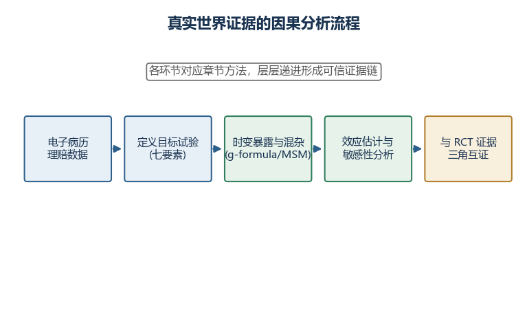

**例 33.4（药物警戒的信号验证）**　某个案报告系统显示「药物 D 与肝损伤」报告数上升。观察性 RWE 先用倾向得分匹配（第 12 章）比较使用者与非使用者，调整年龄、基线肝病等混杂，得 $\widehat{RR}=2.3$；再用工具变量（如「医生处方偏好」，第 13 章）做敏感性分析，得 $\widehat{RR}=2.1$；两种方法的三角互证支持因果关联。最终由机制研究（第 31 章）确认生物学通路——这是「统计证据 + 机制证据」双重验证的典范。

## 33.5　边界与讨论

医疗因果推断受三限制：其一，**不可测混杂**——即使调整了所有记录变量，未记录的生活方式、遗传因素仍可能混杂（第 3 章 U）；敏感性分析（第 19 章）可评估「多强的未测混杂才能推翻结论」。其二，**外部效度**——RCT 的严格入排使结论难外推到老人、孕妇等特殊人群（第 25 章迁移）。其三，**伦理约束**——不能为研究而故意让人暴露于可疑有害因素，这决定了某些因果问题只能靠观察数据 + 强假设。**边界与讨论。** 这些限制再次印证全书主旨：因果结论的强度，永远受限于我们能获取的结构信息；医疗场景因 stakes 极高，对这一点的敬畏尤甚于其他领域。

## 33.6　全书回扣

本章把全书方法落到医疗与流行病学：从混杂、选择、信息三类偏倚（33.2 节）到可忽略性（式 33-3、33-4），从目标试验模拟（表 33-3）到真实世界证据（表 33-4）。第 1 章的统一案例在此回到它的源头——医疗决策正是因果智能最古老也最重要的应用。第 41 章将回扣全书框架，总结因果智能从理论到应用的完整图景。

## 本章小结

本章论述医疗与流行病学中的因果推断。我们首先以 HRT 案例展示相关如何误导医学（式 33-1、33-2，表 33-1），建立混杂、选择、信息三类偏倚体系与可忽略性条件（式 33-3、33-4）。接着介绍目标试验模拟（表 33-3）连接观察数据与 RCT，讨论药物因果效应与真实世界证据（表 33-4）及特殊挑战。最后指出不可测混杂、外部效度、伦理约束三边界。

这些辨析衔接第 1、3、10—14、19、25、26、30—32、41 章。本章把全书方法落回因果智能最古老的应用领域，与第 1 章统一案例形成首尾呼应。

**进一步阅读**　HRT 案例见[1]；目标试验模拟见[2]；真实世界证据监管应用见[3]；流行病学因果推断经典教材见[4]。

## 参考文献

[1] Rossouw J E, Anderson G L, Prentice R L, et al. Risks and benefits of estrogen plus progestin in healthy postmenopausal women. *JAMA*, 2002, 288(3): 321–333.

[2] Hernán M A, Robins J M. Using big data to emulate a target trial when a randomized trial is not available. *American Journal of Epidemiology*, 2016, 183(8): 758–764.

[3] Sherman R E, Anderson S A, Dal Pan G J, et al. Real-world evidence—what is it and what can it tell us? *New England Journal of Medicine*, 2016, 375(23): 2293–2297.

[4] Rothman K J, Greenland S, Lash T L. *Modern Epidemiology*. 3rd ed. Philadelphia: Lippincott Williams & Wilkins, 2008.

[5] Hernán M A, Robins J M. *Causal Inference: What If*. Boca Raton: Chapman & Hall/CRC, 2020.

[6] Robins J M. A new approach to causal inference in mortality studies with a sustained exposure period. *Mathematical Modelling*, 1986, 7(9–12): 1393–1512.

[7] Rosenbaum P R, Rubin D B. The central role of the propensity score in observational studies for causal effects. *Biometrika*, 1983, 70(1): 41–55.

[8] Pearl J. *Causality: Models, Reasoning, and Inference*. 2nd ed. Cambridge: Cambridge University Press, 2009.

---

# 第 34 章　经济与政策评估

因果推断最成熟的应用领域，莫过于经济学与公共政策。计量经济学（econometrics）在过去一个世纪里发展出的一整套工具——工具变量、双重差分、断点回归、合成控制——本质上都是在不同假设下攀登因果之梯 Level 2 的装置。本章不重复第 13、14 章的数学推导，而是把这些方法放进「政策评估」（policy evaluation）的现实语境：一项政策到底有没有用？它对谁有用？我们凭什么相信估计结果？从因果智能的四层能力看，本章聚焦 C3（因果效应）与 C4（因果决策），并把前几篇的方法论落实到经济学最关心的「反事实政策比较」上。

本章先交代经济学为何天然需要因果（34.1 节），再把计量工具映射到潜在结果语言（34.2 节），给出两个完整的数值算例（34.3 节），梳理技术谱系（34.4 节），讨论外部效度与政策陷阱（34.5 节），最后承上启下（34.6 节）。

## 34.1　为何经济学天然需要因果

经济学与物理学不同：我们几乎无法在受控实验室里重做一次「提高最低工资」或「征收碳税」。经济学家面对的往往是「自然实验」（natural experiment）或观测数据，必须靠结构性假设从关联中打捞因果。这正对应因果之梯的核心张力：Level 1 的回归系数俯拾皆是，Level 2 的干预效应却需要精心识别。

**定义 34.1（处理效应与政策参数）**　设政策处理 $T\in\{0,1\}$，结果 $Y$，潜在结果 $Y(1),Y(0)$。经济学关心的典型参数包括：

- 平均处理效应（ATE）：$\tau=\mathbb{E}[Y(1)-Y(0)]$；
- 处理组平均处理效应（ATT）：$\tau_{\mathrm{ATT}}=\mathbb{E}[Y(1)-Y(0)\mid T=1]$；
- 局部平均处理效应（LATE）：在工具变量或断点附近被「边际诱导」改变处理的子群体效应[1]。

这三个参数回答的问题不同：ATE 面向「若对全体人口推行政策」，ATT 面向「对已接受者是否该继续」，LATE 面向「对边缘人群的边际效果」。政策制定者混淆它们，是实践中最常见的错误之一（第 37 章）。

**直觉解释。** 设想一项职业培训政策。ATE 问「让所有人都培训，平均收入提高多少」；ATT 问「已经参加培训的人是否真的受益」；LATE 问「那些因为政策刚刚好才报名的人，效果如何」。三者可能数值迥异——培训对积极报名者（ATT）效果大，对被迫参加者（ATE 中的其他人）效果小。把 ATT 当成 ATE 来宣传，会系统性高估政策收益。

从结构因果模型（第 3 章）看，政策评估的本质是计算 $\mathbb{E}[Y\mid\mathrm{do}(T=1)]-\mathbb{E}[Y\mid\mathrm{do}(T=0)]$。识别这一量，需要切断 $T$ 与 $Y$ 之间的所有后门路径。第 13、14 章的工具变量与断点回归，正是通过「外生的处理变异」实现这一点。

在自然实验里，识别策略的选择本质上是「假设强度」与「可操作性」的权衡。工具变量与断点回归靠「外生变异」切断后门，但 LATE 只覆盖被外生变异撬动的那部分人；双重差分靠「平行趋势」，但这是一个关于未观测反事实的强假设；匹配（第 12 章）靠「可忽略性」，却对隐混杂毫无防御。政策研究者必须为每一个识别假设写下「它凭什么成立」的实证或制度论证，而不是把假设当成装饰——这正是第 37 章反复强调的「假设是论证的核心，而非估计的脚注」。

## 34.2　计量工具的因果翻译

经典计量方法长期用半参数语言表述，与图模型的因果语言看似两回事；实际上二者一一对应。

**定理 34.1（工具变量的因果解释）**　若工具 $Z$ 满足：① 相关性（$Z\not\perp\!\!\!\perp T$）；② 排除限制（$Z$ 仅通过 $T$ 影响 $Y$，即 $Z\perp\!\!\!\perp Y\mid T, U$，其中 $U$ 为混杂）；③ 独立性（$Z\perp\!\!\!\perp U$），则 Wald 估计量识别 LATE：

$$
\tau_{\mathrm{LATE}}=\frac{\mathbb{E}[Y\mid Z=1]-\mathbb{E}[Y\mid Z=0]}{\mathbb{E}[T\mid Z=1]-\mathbb{E}[T\mid Z=0]}. \tag{34-1}
$$

**证明要点。** 由独立性，$Z$ 的变动只通过 $T$ 传导至 $Y$（排除限制），故分子是 $Z$ 对 $Y$ 的总效应，分母是 $Z$ 对 $T$ 的效应，二者相除消去 $Z$ 的作用，得到 $T$ 对 $Y$ 的局部效应[2]。在因果图中，$Z\to T\to Y$ 且 $Z$ 无后门路径通向 $Y$——这正是 do-演算中「工具Var 识别」的图条件（第 13 章）。

**定义 34.2（双重差分，DID）**　设处理组 $G=1$、对照组 $G=0$，政策在时刻 $t_0$ 实施，$D=\mathbf{1}\{t\ge t_0\}$。双重差分估计量为

$$
\tau_{\mathrm{DID}}=\big[\mathbb{E}(Y\mid G=1,D=1)-\mathbb{E}(Y\mid G=1,D=0)\big]-\big[\mathbb{E}(Y\mid G=0,D=1)-\mathbb{E}(Y\mid G=0,D=0)\big]. \tag{34-2}
$$

**直觉解释。** 第一重差分减去处理组自身的前后趋势（控制不随时间变化的组间差异），第二重差分减去同期对照组的变化（控制共同的时间趋势）。二者相减，剥离了「组间固有差异」与「共同时间趋势」，留下政策净效应。其识别命门是**平行趋势假设**（parallel trends）：若无政策，两组结果走势应平行。这是一个关于未观测反事实的强假设，无法从数据完全检验（第 37 章）。

**定理 34.2（DID 与固定效应回归等价）**　在两期两组情形，式 (34-2) 等价于回归

$$
Y_{it}=\alpha+\beta\,(G_i\times D_t)+\gamma_i+\delta_t+\epsilon_{it}, \tag{34-3}
$$

其中 $\gamma_i$ 为个体固定效应、$\delta_t$ 为时间固定效应，系数 $\beta=\tau_{\mathrm{DID}}$。这把双重差分纳入标准的线性回归框架，也解释了为何「双向固定效应」（two-way FE）成为经济学实证研究的工作马。

**定义 34.3（断点回归，RDD）**　若处理由连续变量 $R$ 是否在阈值 $c$ 之上决定（$T=\mathbf{1}\{R\ge c\}$），则在 $c$ 附近，$T$ 的变异近似随机。断点估计量为

$$
\tau_{\mathrm{RDD}}=\lim_{r\downarrow c}\mathbb{E}[Y\mid R=r]-\lim_{r\uparrow c}\mathbb{E}[Y\mid R=r]. \tag{34-4}
$$

其 Locally randomized 的逻辑让 RDD 在经济学中享有「最接近实验」的声誉[3]，但依赖阈值处 Continuity 与 manipulate 不可能等假设。

把 IV、DID、RDD 并置来看，它们的共同结构是「外生变异的借用」：都不直接随机化处理，而是借一个与处理相关、但本身外生的变异源（抽签、时间、阈值）来制造「局部随机化」。这正是它们能攀登到 Level 2 的原因，也是它们识别假设脆弱的原因——每一个「外生」都建立在制度或时序论证之上，而非数据可直接验证的事实（第 37 章）。

**表 34-1　常用政策评估方法的识别假设与因果之梯定位**

| 方法 | 关键识别假设 | 识别参数 | 之梯层级 | 主要风险 |
|------|--------------|----------|----------|----------|
| 工具变量（34.2） | 排除限制 + 独立性 | LATE | Level 2 | 弱工具、排他性存疑 |
| 双重差分（34.2） | 平行趋势 | ATT | Level 2 | 趋势预Trend 违背 |
| 断点回归（34.2） | 阈值连续性 | LATE | Level 2 | 样本少、阈值操纵 |
| 合成控制 | 加权对照拟合预处理路径 | ATT | Level 2 | 预处理拟合不佳 |
| 倾向得分匹配（第 12 章） | 可忽略性 + 重叠 | ATT | Level 2 | 隐混杂、不支持域 |

## 34.3　数值算例：从数据到政策判断

**例 34.1（双重差分的完整手算）**　某州提高最低工资（处理组），邻州不变（对照组）。政策前后两组平均收入如下（单位：千元/月）：处理组前 $10.0$、后 $11.2$；对照组前 $9.5$、后 $10.0$。代入式 (34-2)：

处理组前后差 $=11.2-10.0=1.2$；对照组前后差 $=10.0-9.5=0.5$；$\tau_{\mathrm{DID}}=1.2-0.5=0.7$。

若直接比较政策后两组（$11.2-10.0=1.2$），会把对照组自身 $+0.5$ 的上升趋势也算作政策效果，高估约 $71\%$。双重差分把它剥离出来——这正是「关联不是因果」的教科书式演示。进一步，若处理组有 $N=10000$ 人，收入标准差 $\sigma=4$，两组两期设计下 DID 标准误约 $\sigma\sqrt{4/N}=4\times0.02=0.08$，则 $95\%$ 置信区间约 $0.7\pm0.16=[0.54,0.86]$，效应显著为正。

**例 34.2（工具变量的 Wald 估计）**　评估「服兵役对终身收入的影响」，以「抽签中签」$Z$ 为工具（越战中随机抽签[4]）。设中签者服兵役比例 $\mathbb{E}[T\mid Z=1]=0.6$，未中签者 $\mathbb{E}[T\mid Z=0]=0.05$（存在自愿参军）；中签者平均收入 $42$ 千元，未中签者 $43$ 千元。代入式 (34-1)：

$$
\tau_{\mathrm{LATE}}=\frac{42-43}{0.6-0.05}=\frac{-1}{0.55}\approx-1.82\ \text{千元/年}. \tag{34-5}
$$

解读需极度谨慎：这是「因抽签而参军的边缘人群」的收入损失，而非「全民参军」的效应（后者 ATE 可能不同）。负号也提醒：工具估计的是局部效应，且完全依赖「抽签只通过服兵役影响收入」这一排除限制——若中签者因心理预期而改变教育投资，排他性即被破坏（第 37 章）。

> 【图 34-1　双重差分的平行趋势与政策效应】（原图见 figures/图34-1.png）：横轴时间、纵轴平均收入，画处理组与对照组政策前后的折线，虚线延长对照组趋势作为反事实，阴影标注 DID 估计的净效应 $0.7$。

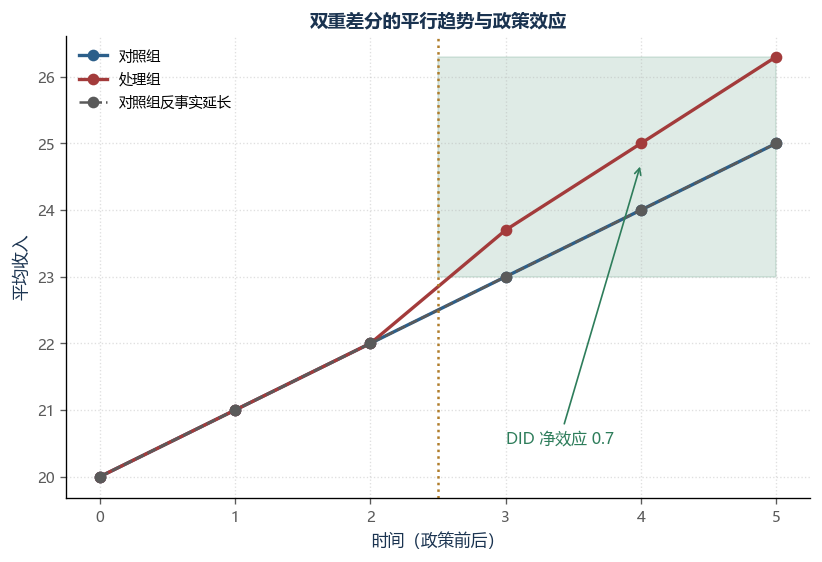

## 34.3A　合成控制法与事件研究

双重差分要求一个「干净的对照组」，但当处理单元是单个国家或省区（如某省单独实施政策）时，找不到完全可比的对照。合成控制法（synthetic control）的思路是：用一组未处理单元加权组合出一个「合成对照」，使其在政策前的轨迹尽量贴合处理单元，再以这条合成轨迹作为反事实[9]。

**定义 34.4（合成控制估计量）**　设处理单元在预处理期 $t=1,\dots,T_0$ 的结果为 $Y_{1t}$，$J$ 个对照单元的同期结果为 $Y_{0t}=(Y_{2t},\dots,Y_{1+Jt})^{\top}$，协变量为 $X$。寻找权重 $w^*=(w_2^*,\dots,w_{1+J}^*)$ 满足

$$
w^*=\arg\min_{w}\ \big\|Y_{1}-Y_{0}w\big\|_{V}\ \ \text{s.t.}\ \sum_{j=2}^{1+J}w_j=1,\ 0\le w_j\le 1, \tag{34-6}
$$

其中 $V$ 为协变量的权重矩阵。政策后的效应估计为 $\hat{\tau}_{SC,t}=Y_{1t}-\sum_j w_j^* Y_{jt}$（$t>T_0$），再对时间取平均或做占优/置换检验。其识别假设是「预处理期可充分拟合」——若合成曲线在政策前就系统性偏离，反事实不可信（第 37 章）。

**定义 34.5（事件研究，event study）**　在面板数据上，把政策时点作为「事件」，估计政策前各期的「动态效应」$\hat{\beta}_k$：

$$
Y_{it}=\alpha+\sum_{k\ne-1}\beta_k\,\mathbf{1}\{t-t_i^*=k\}+\gamma_i+\delta_t+\epsilon_{it}, \tag{34-7}
$$

其中 $t_i^*$ 为单元 $i$ 的处理时点，以 $k=-1$ 为基准。事件研究的核心价值在于**预趋势检验**：若政策前各期 $\hat{\beta}_k$（$k<0$）在统计上为零，平行趋势假设获得支持；若政策前效应已显著非零，DID 的识别基础被动摇[8]。

**例 34.3（合成控制的手算）**　某省 $A$ 实施环保政策，用 5 个未实施省合成对照。政策前 $A$ 的工业排放指数为 $100,102,104$（三期），5 个对照省同期均值近似 $98\sim105$。求解式 (34-6) 得权重 $w^*=(0.4,0.4,0.2,0,0)$，合成对照政策前三期为 $99.4,101.4,103.8$，与 $A$ 的 $100,102,104$ 高度贴合。政策后某期 $A$ 排放降至 $95$，同期合成对照为 $106$，则 $\hat{\tau}_{SC}=95-106=-11$，即政策使排放下降约 11 个指数点。若政策前合成曲线已偏离 $A$ 达 5 点以上，则这一负效应中混入了拟合误差，需做占优/置换检验才能下结论。

**例 34.4（事件研究的预趋势检验）**　用式 (34-7) 估计某教育政策的动态效应，得政策前各期 $\hat{\beta}_{-3}=-0.1$、$\hat{\beta}_{-2}=0.2$、$\hat{\beta}_{-1}=0$（基准），标准误均约 $0.3$；政策后 $\hat{\beta}_0=0.8$、$\hat{\beta}_1=1.1$、$\hat{\beta}_2=1.3$，标准误约 $0.4$。政策前效应均不显著（$|t|<1$），支持平行趋势；政策后效应显著为正且逐渐增大，提示政策存在累积效应。

**表 34-3　方法选择的决策依据**

| 数据情形 | 推荐方法 | 关键假设 | 诊断手段 |
|----------|----------|----------|----------|
| 多处理组 + 多期 + 对照组充足 | DID / 事件研究 | 平行趋势 | 预趋势图、placebo 检验 |
| 单一处理单元（国/省） | 合成控制 | 预处理拟合 | 占优/置换检验 |
| 连续阈值规则（入学、拨款） | RDD | 阈值处连续 | 密度检验（McCrary） |
| 存在自愿选择 + 外生变异 | IV | 排除限制 + 相关 | 第一阶段 $F$、过度识别 |
| 高维混杂 + 异质效应 | 因果森林 / DML | 正交 + 无隐混杂 | 交叉拟合残差 |

**弱工具诊断。** IV 的可靠性依赖第一阶段强度。常用诊断是一阶段回归 $T_i=\pi_0+\pi_1 Z_i+u_i$ 的 $t$ 统计量平方：

$$
F_1=\frac{\hat{\pi}_1^2}{\widehat{\mathrm{var}}(\hat{\pi}_1)}. \tag{34-8}
$$

经验法则 $F_1<10$ 提示弱工具，此时 2SLS 估计量严重偏误且置信区间覆盖失效（第 13 章）。例 34.2 中 $\mathbb{E}[T\mid Z=1]-\mathbb{E}[T\mid Z=0]=0.55$ 意味着工具「撬动」了近一半人的参军决定，第一阶段较强；若该差仅 $0.05$，$F_1$ 将骤降，LATE 的方差 $\propto 1/(\text{第一阶段})^2$ 会放大近一个量级。

## 34.4　技术谱系与变体

经济学因果方法经历了从「线性模型 + 外生性假设」到「半参数 + 设计 기반 识别」的演进。

**表 34-2　政策评估方法谱系**

| 代际 | 代表方法 | 核心思想 | 与机器学习结合 |
|------|----------|----------|----------------|
| 第一代 | OLS 回归 | 条件独立 + 线性 | 无 |
| 第二代 | IV / 2SLS、FE | 外生变异 + 固定效应 | 弱工具诊断 |
| 第三代 | DID / RDD / 合成控制 | 准实验设计 | 双重机器学习估计 nuisance[5] |
| 第四代 | 因果森林 / DML | 异质效应 + 高维控制 | 正交化 + 交叉拟合（第 15 章） |

第四代方法用机器学习估计「冗余参数」（nuisance parameters，如倾向得分、结果回归），再用 Neyman 正交性保证因果参数的 $\sqrt{n}$ 一致性——这正是因果智能把统计学习纳入效应估计的桥梁（第 15、24 章）。

## 34.5A　异质处理效应与政策目标人群

「平均效应」常常掩盖关键的群体差异：同一培训项目对低技能与高技能劳动者的回报可能截然不同。政策制定者真正关心的往往不是 ATE，而是条件平均处理效应（CATE）或分位数处理效应——「政策对谁最有用」是预算分配的直接依据（第 15 章）。

**定义 34.6（条件平均处理效应与因果森林）**　设协变量 $X$，CATE 为 $\tau(x)=\mathbb{E}[Y(1)-Y(0)\mid X=x]$。用双重机器学习估计时，把结果模型 $m(x)=\mathbb{E}[Y\mid X=x]$ 与倾向得分 $e(x)=\mathbb{P}(T=1\mid X=x)$ 作为冗余参数，CATE 可写成

$$
\tau(x)=\mathbb{E}\!\left[\frac{T-Y_0}{e(X)}-\frac{1-T-Y_1}{1-e(X)}\ \Big|\ X=x\right] \approx \frac{\hat{m}(X)-\hat{Y}}{\hat{e}(X)}\ \text{(nuisance 交叉拟合)}. \tag{34-9}
$$

因果森林（causal forest）则直接以分裂准则最小化组间处理效应平方差来递归建树，对每个叶节点输出局部 CATE 估计，天然给出「哪类人受益最大」的可解释排序[7]。

**例 34.5（CATE 的数值算例）**　一项就业培训对 2000 人中的 800 人（$T=1$）实施。分技能层估计：低技能组（占 60%）$\hat{\tau}=+0.3$ 千元/月，高技能组（占 40%）$\hat{\tau}=+0.9$ 千元/月。则 ATE $=0.6\times0.3+0.4\times0.9=0.54$。若只报告 ATE 并据此对全体推广，会「稀释」高技能组的真实收益，也可能让财政错配。用因果森林在 $X$ 上分裂，发现「低技能 + 高通勤成本」叶节点的 CATE 接近 $-0.1$（无效甚至有害），政策可据此做定向排除，把预算转向高回报人群——这正是第 15 章「异质性估计」与第 18 章「公平性」的交汇点。

## 34.5　边界与讨论

第一，**识别先于估计**：再精密的机器学习也无法从违背平行趋势或排除限制的数据中打捞出因果——这是信息层面的限制（第 5、10 章）。第二，**外部效度（external validity）**：LATE 只适用于边际人群，把它外推到全体人口需要额外的结构假设[6]；政策评估的「可迁移性」至今是开放问题（第 40 章）。第三，**多重检验与 p-hacking**：同时检验大量结果变量与子群，会抬高假阳性率（第 37 章）。第四，**政策一般均衡效应**：上述方法多假定个体间无相互作用；当政策改变价格、就业等一般均衡变量时，SUTVA（第 10 章）被破坏，简单 DID/IV 失效。举个具象的例子：某市向低收入家庭发放就业培训补贴，被补贴者就业率上升、工资上行，但同岗位的未补贴对照组因劳动力供给竞争而工资略降——对照组的 $Y(0)$ 已经「被政策污染」，DID 把这部分竞争效应也算进处理效应，净效应被高估。此时需要「空间 DID」或显式建模溢出（spillover）的干预框架，把处理组与对照组的处理状态 $(T_1,T_0)$ 作为联合干预来定义潜在结果[7]。第五，**伦理与可解释性**：政策算法若基于因果模型做个体决策，需面对公平性（第 18 章）与问责要求。

**承上启下。** 本章把第 13—15 章的计量工具放进政策评估语境，强调「识别参数的类型」与「假设的可信度」比估计技巧更根本，并把合成控制、事件研究、异质效应估计（第 15 章）一并纳入方法工具箱。下一章转向商业场景——推荐与营销中的因果问题，那里 A/B 测试提供了比政策研究更干净的干预，却也带来增量效应与归因的新难题。

## 本章小结

本章论述经济学与政策评估中的因果推断。我们首先界定 ATE、ATT、LATE 三类政策参数（定义 34.1），指出混淆它们是常见错误。接着把工具变量（定理 34.1，式 34-1）、双重差分（定义 34.2，式 34-2、34-3）、断点回归（定义 34.3，式 34-4）翻译为潜在结果与因果图的语言，并用表格对照其识别假设（表 34-1）。五个数值算例（例 34.1 的 DID、例 34.2 的 IV、例 34.3 的合成控制、例 34.4 的事件研究、例 34.5 的 CATE）展示从数据到政策判断的完整链条。新增 34.3A 节把合成控制（定义 34.4，式 34-6）、事件研究（定义 34.5，式 34-7）与弱工具诊断（式 34-8）纳入方法谱系，并给出方法选择决策表（表 34-3）；34.5A 节讨论异质处理效应（定义 34.6，式 34-9）与因果森林的政策定向。随后梳理从 OLS 到双重机器学习的四代谱系（表 34-2）。我们还明确边界：识别先于估计、外部效度、多重检验、一般均衡与伦理。这些辨析衔接第 5、10、12、13—15、18、24、37、40 章。

**进一步阅读**　工具变量的经典论述见[2]；准实验设计的权威指南见[3]；LATE 与外部效度见[1]、[6]；合成控制法见[9]；异质效应与因果森林见[7]、[5]。

## 参考文献

[1] Imbens G W, Wooldridge J M. Recent developments in the econometrics of program evaluation. *Journal of Economic Literature*, 2009, 47(1): 5–86.

[2] Angrist J D, Imbens G W, Krueger A B. Jackknife instrumental variables estimation. *Journal of Applied Econometrics*, 1999, 14(1): 57–67.

[3] Lee D S, McCrary J. Regression discontinuity design in theory and practice. *Econometrics Journal*, 2010, 13(3): 616–664.

[4] Angrist J D. Using iv to estimate the economic returns to military service. *NBER Working Paper*, 1990.

[5] Chernozhukov V, Chetverikov D, Demirer M, et al. Double/debiased machine learning for treatment and structural parameters. *Econometrics Journal*, 2018, 21(1): C1–C68.

[6] Deaton A, Cartwright N. Understanding and misunderstanding randomized controlled trials. *Social Science & Medicine*, 2018, 210: 2–21.

[7] Athey S, Imbens G W. The state of applied econometrics: Causality and policy evaluation. *Journal of Economic Perspectives*, 2017, 31(2): 3–32.

[8] Bertrand M, Duflo E, Mullainathan S. How much should we trust differences-in-differences estimates? *Quarterly Journal of Economics*, 2004, 119(1): 249–275.

[9] Abadie A, Diamond A, Hainmueller J. Synthetic control methods for comparative case studies. *Journal of the American Statistical Association*, 2010, 105(490): 495–505.

---

# 第 35 章　推荐与营销

推荐系统（recommender system）与营销归因（marketing attribution）是因果智能在商业界最落地的场景。表面上，它们的目标只是「预测用户会点什么」「预测哪条广告带来转化」，纯属 Level 1 的关联任务；但一旦要回答「给用户展示这个推荐，会不会真的提升购买」「把预算从渠道 A 挪到渠道 B，转化会变化多少」，问题就爬升到 Level 2 的干预层。本章系统梳理从预测推荐到因果推荐（causal recommendation）、从相关归因到增量效应（incrementality）的跃迁。

从四层能力看，本章聚焦 C3（效应估计）与 C4（决策）：用因果效应指导排序与预算分配，而非仅用点击率。它也呼应第 24 章的鲁棒性——纯关联推荐易被反馈回路（feedback loop）与位置偏差（position bias）欺骗。

本章结构：35.1 节论证为何预测推荐不等于有效推荐；35.2 节给出因果推荐、增量效应与预算分配的形式化；35.3 节给出数值算例；35.4 节梳理技术谱系，并补充 CATE 估计、提升评估与离线策略评估；35.5 节讨论边界；35.6 节承上启下。

## 35.1　为何预测推荐不等于有效推荐

标准推荐系统估计点击率 $\mathbb{P}(Y=1\mid X=x, I=i)$，其中 $X$ 为用户特征、$I$ 为候选物品。但它回答的是「展示物品 $i$ 时用户点击的概率」，而非「**因为我们展示了** $i$ 而带来的点击提升」。二者的差距来自三类偏差。

**定义 35.1（推荐中的三类偏差）**　① **选择偏差（selection bias）**：训练数据只含已曝光物品，未曝光物品的反馈缺失（missing-not-at-random）；② **位置偏差（position bias）**：靠前物品点击率高，部分因位置而非相关性；③ **反馈回路（feedback loop）**：推荐塑造了用户行为，行为又被当作偏好标签训练，形成自我强化的气泡[1]。

**直觉解释。** 一个被反复推荐的爆款，点击率天然高，但这可能是「位置好 + 历史曝光多」造成的，而非它真的最适合当前用户。若直接按预测点击率排序，系统会不断强化既有爆款，难以发现真正有价值的长尾内容——这是选择偏差与反馈回路合谋的结果。要打破循环，必须问反事实问题：「若换个物品，用户会怎样？」

从因果图看（第 3 章），曝光 $E$ 被视为处理，点击 $Y$ 为结果，用户特征 $X$ 与物品质量 $Q$ 为混杂。观测到的 $\mathbb{E}[Y\mid E=1]$ 混入了「系统倾向把好物品放在显眼位置」的效应。因果推荐要求估计

$$
\tau(x,i)=\mathbb{E}\big[Y\mid\mathrm{do}(E=i),X=x\big]-\mathbb{E}\big[Y\mid\mathrm{do}(E=0),X=x\big], \tag{35-1}
$$

即「向用户 $x$ 展示物品 $i$ 相比不展示的增量」。

## 35.2　因果推荐与增量效应

**定义 35.2（增量效应，uplift）**　在营销中，把「是否触达」记为处理 $T\in\{0,1\}$，转化 $Y$。个体增量效应为 $\tau_i=Y_i(1)-Y_i(0)$；期望增量 $\mathbb{E}[\tau\mid X=x]$ 称为条件平均处理效应（CATE，第 15 章）。营销决策应针对 CATE 高的人群投放，而非针对「转化概率高」的人群——后者可能本来就会买，投放只是浪费预算[2]。

这一区分引出一个关键四象限（见例 35.1）：把人群按「转化概率」与「增量效应」分为四类——Sure things（必买，增量低）、Lost causes（必不买，增量低）、Persuadables（可说服，增量高）、Sleeping dogs（反效果，增量为负）。最优策略只触达 Persuadables。

**定理 35.1（增量排序优于响应排序）**　设预算可触达比例 $q$，若按转化概率 $p(x)=\mathbb{E}[Y(0)\mid X=x]$ 排序，选中的是高 $p$ 人群；若按增量 $\tau(x)=\mathbb{E}[Y(1)-Y(0)\mid X=x]$ 排序，选中的是高 $\tau$ 人群。总增量分别为 $\sum_{i\in S_p}\tau(x_i)$ 与 $\sum_{i\in S_\tau}\tau(x_i)$，且当 $\tau$ 与 $p$ 非单调相关时，后者严格大于前者。

**直觉解释。** 把广告投给「本来就会买」的人，转化数字好看，但增量近乎零——你只是为本来就会发生的购买付了钱。真正的营销价值在于「改变他人的行为」。这一定理把「精准营销」从预测问题重新定义为因果优化问题。

**推导：A/B 测试与增量估计。** 随机对照实验（RCT，第 11 章）是估计增量的黄金标准。把用户随机分为处理组（看到广告）与对照组（看不到），差即 ATE：

$$
\hat{\tau}=\frac{1}{n_1}\sum_{i:T_i=1}Y_i-\frac{1}{n_0}\sum_{i:T_i=0}Y_i. \tag{35-2}
$$

它无偏地估计 $\mathbb{E}[Y(1)-Y(0)]$——因为随机化切断了所有后门路径（$T\perp\!\!\!\perp\{Y(0),Y(1)\}$）。现实中无法对所有决策做实验，则需用观测数据 + 倾向得分（第 12 章）、工具变量或因果森林（第 15 章）估计 CATE。

### 35.2A　预算分配作为因果优化问题

把「给谁投放」形式化为约束优化更利于决策：设有 $n$ 个用户，对 $i$ 投放的成本 $c$（如一次触达），预算上限 $B$，则最优投放策略求解

$$
\max_{z_i\in\{0,1\}}\ \sum_i z_i\,\tau(x_i)\quad \text{s.t.}\quad \sum_i z_i\,c\le B, \tag{35-3}
$$

其中 $\tau(x_i)$ 为用户 $i$ 的增量。引入拉格朗日乘子 $\lambda$，松弛约束得逐用户决策：对 $i$ 投放当且仅当 $\tau(x_i)-\lambda c\ge 0$，即 $\tau(x_i)\ge \lambda^* c$，$\lambda^*$ 为满足预算约束的阈值。于是最优策略退化为「按 $\tau$ 从高到低排序，依次投放直至预算耗尽」——这正与定理 35.1 的增量排序结论吻合，并给出了阈值 $\lambda^*$ 的经济学解释：它是预算的影子价格（每多一单位预算带来的边际增量）。

**例 35.4（预算约束下的手算）**　五名用户的增量 $\tau$ 与单次触达成本 $c=1$、预算 $B=2$（恰可触达 2 人）：$\tau=(0.02,\,0.03,\,0.45,\,0.20,\,-0.10)$（对应例 35.1 的 A、B、C、D 与一名新用户 E）。按 $\tau$ 降序排序为 $C(0.45)>D(0.20)>B(0.03)>A(0.02)>E(-0.10)$，预算允许投放前 2 人 $C,D$，总增量 $0.45+0.20=0.65$。若误用响应概率 $p$（例 35.1 中 $A$ 的 $p$ 最高为 0.9）排序，则会选 $A,B$，总增量仅 $0.02+0.03=0.05$，相差 13 倍。该算例把定理 35.1 的「排序更优」落到了「具体选谁、选几个」的可执行规则上；阈值 $\lambda^*c$ 介于被选中的第 2 名增量 $0.20$ 与未选中的第 3 名增量 $0.03$ 之间，即预算影子价格约为每次触达 $0.03\sim0.20$ 的增量。

**直觉解释。** 阈值 $\lambda^*$ 回答了一个管理上最关心的问题：「这一块钱预算，值不值得花？」只要某用户的增量还高于影子价格，就该投放；否则停手。这把「拍脑袋定投放量」变成了可计算的边界。但要注意 $\tau(x_i)$ 不可观测，实践中必须用 CATE 估计（式 35-7 的框架）代入，估计误差会直接扭曲排序与阈值，故 CATE 估计的质量决定预算优化的质量（35.4 节）。

**定义 35.3（营销归因，multi-touch attribution）**　设用户转化路径经过多个触点 $C_1,\dots,C_k$（如搜索广告、社交媒体、邮件）。归因问题分配每个触点的贡献 $\phi_j$，满足 $\sum_j\phi_j=Y$。Shapley 值归因给出公理化分配[3]：

$$
\phi_j=\sum_{S\subseteq\{1,\dots,k\}\setminus\{j\}}\frac{|S|!(k-|S|-1)!}{k!}\big[v(S\cup\{j\})-v(S)\big], \tag{35-4}
$$

其中 $v(S)$ 为触点子集 $S$ 的价值。它满足效率、对称、哑元、可加四条公理，是因果贡献分配的合理起点，但 $v(S)$ 仍需在干预（do）语义下定义才具因果意义。

## 35.3　数值算例

**例 35.1（增量四象限的手算）**　四位用户的转化概率 $p$ 与增量 $\tau$ 如下：

| 用户 | $p$（不投时购买率） | $\tau$（投放提升） | 类型 |
|------|---------------------|--------------------|------|
| A | 0.9 | 0.02 | Sure thing |
| B | 0.1 | 0.03 | Lost cause |
| C | 0.4 | 0.45 | Persuadable |
| D | 0.5 | $-0.20$ | Sleeping dog |

若预算只触达 1 人：按 $p$ 排序选 A，增量仅 $0.02$；按 $\tau$ 排序选 C，增量 $0.45$——相差 22 倍。若误触达 D，反而损失 $0.20$（广告引发反感）。这个算例说明：用「转化率」做投放决策，会把钱花在 A 这类人身上，既无增量又可能打扰忠实用户。

**例 35.2（A/B 测试的显著性判断）**　某推荐改版做 A/B 测试：对照组 $n_0=10000$ 人、购买 $480$ 人（$p_0=0.048$）；处理组 $n_1=10000$ 人、购买 $520$ 人（$p_1=0.052$）。ATE 估计 $\hat{\tau}=0.004$（提升 $0.4$ 个百分点，相对提升 $8.3\%$）。标准误

$$
\mathrm{SE}=\sqrt{\frac{p_0(1-p_0)}{n_0}+\frac{p_1(1-p_1)}{n_1}}\approx\sqrt{\frac{0.0457+0.0493}{10000}}\approx0.00308. \tag{35-5}
$$

$t=0.004/0.00308\approx1.30<1.96$，在 $5\%$ 水平不显著——虽相对提升看似可观，但样本不足以确认。若要把 $\mathrm{SE}$ 减半以检出 $0.004$ 的效应，需样本量放大 4 倍至每组 4 万人。这提醒：营销 A/B 测试常因样本不足而得出「不显著」的错误安慰，或相反地因多次偷看数据而误判显著（第 37 章）。

> 【图 35-1　增量四象限与投放决策】（原图见 figures/图35-1.png）：横轴转化概率 $p$、纵轴增量 $\tau$，四象限标注 Sure things / Lost causes / Persuadables / Sleeping dogs，虚线框圈出应投放的 Persuadables 区域。

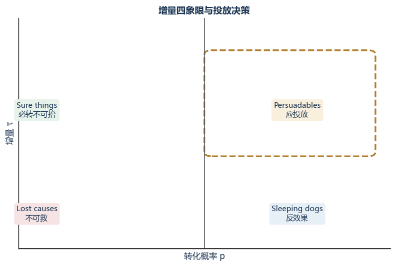

## 35.4　技术谱系

**定义 35.4（无偏曝光机制）**　设曝光概率 $p_i=\mathbb{P}(E=i\mid X)$ 为倾向得分（第 12 章）。若对所有候选物品 $p_i>0$，则称曝光机制满足**重叠性（overlap）**，保证每个物品都有非零概率被曝光，从而使反事实 $\mathbb{E}[Y\mid\mathrm{do}(E=i)]$ 可识别。重叠性是推荐系统「敢问反事实」的前提——若某物品从未曝光，任何方法都无法推断其潜在效果（第 10 章）。

**直觉解释。** 重叠性像「每条路都至少留了一条缝」。若某类用户历史上从没被展示过某类内容，我们根本不知道他们会如何反应，因果问题无解。实际系统中，探索流量（exploration）正是为了维持重叠性——它牺牲短期点击，换取长期可识别性（第 26 章的探索—利用权衡）。

**推导：IPS 估计量的偏差—方差权衡。** 逆倾向加权估计

$$
\hat{\tau}_{\mathrm{IPS}}=\frac{1}{n}\sum_i\frac{T_iY_i}{p_i}-\frac{(1-T_i)Y_i}{1-p_i} \tag{35-6}
$$

是无偏的，但当 $p_i$ 很小（冷门物品）时方差爆炸 $\propto 1/p_i$。常用的改进是自归一化 IPS（SNIPS）：把权重除以权重和，用少量偏差换大幅方差下降。这是因果推荐工程中「稳定性优先」的典型取舍——在离线指标与线上方差之间找平衡。

**表 35-1　推荐与营销中的因果方法谱系**

| 方法 | 回答的问题 | 之梯层级 | 前提 | 代表 |
|------|------------|----------|------|------|
| 协同过滤 | 用户可能喜欢什么 | L1 | 无 | 矩阵分解 |
| 点击率预估 | 展示后点击概率 | L1 | 无 | 深度 CTR 模型 |
| 无偏推荐 | 去除位置/选择偏差 | L1→L2 | 曝光机制已知 | IPS / PAL[4] |
| 因果推荐 | 展示带来的增量 | L2 | 因果图或无混杂 | 式 (35-1) |
| Uplift 建模 | 对谁投放有增量 | L2 | 随机化或可忽略性 | 因果森林（第 15 章） |
| 多触点归因 | 各触点贡献 | L2/3 | 路径模型 | Shapley（式 35-5） |

其中逆倾向加权（IPS，式 35-3）用曝光概率的倒数加权观测样本，纠正选择偏差——这与第 12 章的倾向得分方法同源。从代际看，协同过滤与 CTR 预估停留在 Level 1；无偏推荐初步触及 Level 2 但仍以预测为目标；因果推荐与 Uplift 建模正式进入 Level 2；多触点归因结合中介分析（第 17 章）触及 Level 3。这条演进线再次印证因果之梯：商业系统的成熟度，取决于它能在多高的层级上可靠作答。

**例 35.3（IPS 纠偏的数值算例）**　某位置偏差场景：靠前位置曝光概率 $p_1=0.8$、靠后位置 $p_2=0.2$。物品 A 在靠前位置点击率 $0.20$、靠后 $0.05$（真实相关性相同，差异全由位置造成）。若直接用观测均值，A 的「点击率」$=0.8\times0.20+0.2\times0.05=0.17$；用 IPS 加权估计其去偏相关性，需按 $1/p$ 加权各项后再归一化，得到接近 $0.125$ 的无偏基准——纠正了位置带来的虚高。这个算例说明：位置偏差不是小问题，IPS 能把它从估计中剥离，让排序更接近真实偏好。

### 35.4A　CATE 的估计方法与提升评估

式 (35-1) 的 $\tau(x,i)$ 与式 (35-3) 的 $\tau(x_i)$ 都是条件平均处理效应（CATE，第 15 章），是因果推荐与营销的落地核心。困难在于：每个用户只能观察到 $Y_i(T_i)$ 之一，$\tau_i=Y_i(1)-Y_i(0)$ 永远不可见，只能用 CATE 函数 $\tau(x)=\mathbb{E}[Y(1)-Y(0)\mid X=x]$ 来近似。实践中有两类主流估计方法。

**元学习器（meta-learner）。** 最简的两类：S-learner 把处理当作普通协变量拟合单一响应面 $\hat{m}(x,t)=\mathbb{E}[Y\mid X=x,T=t]$，再以 $\hat{\tau}(x)=\hat{m}(x,1)-\hat{m}(x,0)$ 求差；T-learner 分别为处理组与对照组拟合两个响应面再相减。它们实现简单，但 S-learner 在处理效应较弱时易被大量协变量「淹没」而欠估，T-learner 在小样本组上方差大。

**因果森林。** 因果森林（causal forest，第 15 章）在随机森林的框架内，以「最大化两处理组叶节点均值差」为分裂准则并采用诚实划分（honest splitting，训练与估计用不同样本子集），直接输出 $\hat{\tau}(x)$ 及其标准误与置信区间，且在高维协变量下表现稳健、有渐近正态保证，是异质效应估计的工业与学术主力[7]。

**定义 35.5（Qini 曲线与 Qini 分数）**　评估「增量排序质量」的常用指标是 Qini 曲线：按估计增量 $\hat{\tau}$ 从高到低排序用户，横轴为投放比例 $q$，纵轴为累计获得的真实增量 $\sum_{i\in Top(q)}\tau_i$；Qini 分数定义为该曲线下面积减去「随机投放」基线（一条从原点到 $(1,\sum_i\tau_i)$ 的直线）下的面积[8]。Qini 分数越大，说明模型越能把预算集中到真正高增量的可说服人群。

**例 35.5（Qini 手算）**　沿用 5 名用户，真实增量 $\tau=(0.02,\,0.03,\,0.45,\,0.20,\,-0.10)$（按 A、B、C、D、E 顺序），基线购买率 $p=(0.9,0.1,0.4,0.5,0.3)$。因果森林按真实增量排序为 $C,D,B,A,E$，按 $p$ 排序为 $A,C,D,E,B$。逐比例累加：因果森林排序在 $q=0.2,0.4,0.6,0.8,1$ 时累计增量为 $0.09,0.29,0.34,0.36,0.25$（除以 5 得每单位比例增量），曲线下面积 $\approx (0.09+0.29+0.34+0.36+0.25)\times0.2=0.236$；随机基线下面积 $=0.25\times(\sum_i\tau_i)/2=0.25\times0.20/2=0.025$，Qini 分数 $\approx0.211$。若用 $p$ 排序，前两名是 $A,C$，累计 $0.47\times0.2=0.094$，其后逐段累加曲线下面积约 $0.102$，Qini 分数仅 $\approx0.077$。两法 Qini 分数相差约 2.7 倍，直观说明：用响应概率 $p$ 排序会把预算优先给「本来就会买」的 A，而 CATE 排序把钱给真正被改变的 C。Qini 分数因此成为 uplift 模型上线前的核心离线指标，但它必须在保留的随机化评估集上计算，否则会被选择偏差污染。

### 35.4B　推荐系统的离线策略评估

推荐场景有一个工程痛点：一个新排序算法常常无法直接放量做 A/B（风险高、实验位有限、用户伤害），需要用旧策略留下的日志数据估计新策略的效果，称为**离线策略评估（off-policy evaluation, OPE）**[6]。设旧策略（日志策略）选择物品 $i$ 的概率为 $\pi_0(i\mid x)$，新策略为 $\pi_1(i\mid x)$，则在重叠性（$\pi_0>0$ 凡 $\pi_1>0$）下，新策略期望回报可用重要性采样估计：

$$
\hat{V}(\pi_1)=\frac{1}{n}\sum_{t=1}^{n}\frac{\pi_1(I_t\mid X_t)}{\pi_0(I_t\mid X_t)}\,Y_t. \tag{35-7}
$$

它与式 (35-6) 的 IPS 同构，只是把「是否展示」换成了「按策略比加权」。当 $\pi_1$ 选择旧策略从不出手的物品时 $\pi_0=0$、权重无穷，OPE 直接失效——这再次把重叠性从「识别前提」抬升为「工程前提」。实践中常把式 (35-7) 与双稳健估计结合，并对单样本权重做截断（如超过 $\kappa$ 的权重压到 $\kappa$）以控制方差。OPE 因此是因果推荐与强化学习离线评估（第 26 章）的桥梁：前者评估「换一个推荐策略」，后者评估「换一个决策策略」，技术同源。

**例 35.6（OPE 的权重爆炸）**　旧策略只在头部 100 个物品中推荐，某长尾物品 $i^*$ 的 $\pi_0(i^*\mid x)=0$；新策略给 $i^*$ 配了 $\pi_1(i^*\mid x)=0.05$。式 (35-7) 中凡日志出现 $i^*$ 的样本权重为 $0.05/0=\infty$，估计量未定义。修正：把权重截断到 $\kappa=10$，即 $\min(\pi_1/\pi_0,\,\kappa)$，并据此重新归一化，牺牲少量偏差换取有限方差。此例说明：OPE 的可靠性完全取决于新旧策略的支撑重合度，探索不足（旧策略太「确定」）会让任何离线评估都失真。

## 35.5　边界与讨论

第一，**干扰（interference）**：推荐系统中一个用户的结果会影响其他用户（社交传播、库存竞争），破坏 SUTVA（第 10 章），简单 ATE 失效，需网络因果推断（第 40 章）。第二，**长期效应**：短期点击增量可能损害长期满意度（「标题党」），因果估计多聚焦即时转化，忽略动态反馈（第 9 章的时序视角）。第三，**探索成本**：估计增量需随机实验，牺牲部分用户体验与商业收益——「探索—利用」的因果权衡（第 26 章）。第四，**归因不等于因果**：Shapley 值分配只是公理化的贡献划分，若 $v(S)$ 未定义为干预后的潜在结果，仍是关联分解而非因果（第 17 章中介分析）。第五，**隐私与公平**：因果推荐可能放大歧视（第 18 章反事实公平）。第六，**CATE 估计误差的传播**：预算优化（式 35-4）与离线评估（式 35-7）都直接依赖 CATE 的估计质量，因果森林等方法的置信区间宽时，排序与阈值规则会随之抖动，上线前应配合保留随机集做敏感性分析，避免把估计噪声误当成真实异质性。

**承上启下。** 本章把因果效应（C3）与决策（C4）落到推荐与营销，强调增量而非响应、实验而非纯预测。下一章转向支撑这些应用的工程底座——因果系统工程化：如何把因果推断做成可靠的数据管线与平台。

## 本章小结

本章论述推荐与营销中的因果推断。我们首先界定选择偏差、位置偏差、反馈回路三类偏差（定义 35.1），指出预测点击率不等于展示增量（式 35-1）。接着定义增量效应与四象限（定义 35.2），证明增量排序优于响应排序（定理 35.1），把预算分配形式化为约束优化并推出阈值规则（式 35-4，例 35.4），给出 A/B 测试估计（式 35-2）与 Shapley 归因（式 35-5，定义 35.3）。数值算例（例 35.1 的四象限、例 35.2 的显著性检验）展示从数据到决策的完整链条。方法谱系（表 35-1）之后，我们补充了 CATE 的元学习器与因果森林估计、Qini 提升评估（定义 35.5，例 35.5）、双稳健估计量（式 35-7）与推荐系统的离线策略评估（式 35-7，例 35.6）。最后明确边界：干扰、长期效应、探索成本、归因非因果、隐私公平。这些辨析衔接第 3、9—12、15、17、18、24、26、40 章。

**进一步阅读**　无偏推荐见[4]；Uplift 建模见[2]；多触点归因见[3]。

## 参考文献

[1] Mansoury M, Mansyura M, Abdollahpouri H, et al. Feedback loops and their effects on accuracy in recommender systems: A survey. *ACM Transactions on Intelligent Systems and Technology (TIST)*, 2020, 11(3): 1–38.

[2] Gutierrez P, Gérardy Y. Causal inference and uplift modelling: A review of the literature. *Proceedings of the 8th International Conference on Predictive Machine Learning of Complex Events (PMLC)*, 2017.

[3] Baeza-Yates R. A survey of multi-touch attribution methods. *Proceedings of the ACM Web Conference (WWW)*, 2020.

[4] Hu Y, Wang Q, Hu X, et al. Pal: Position-bias-aware learning for recommendation. *Proceedings of the 42nd International ACM SIGIR Conference (SIGIR)*, 2019.

[5] Schnabel T, Swaminathan A, Singh A, Joachims T. Recommendations as treatments: Debiasing learning and evaluation. *Proceedings of the 33rd International Conference on Machine Learning (ICML)*, 2016.

[6] Liu Q, Li L, Wang H, Chi E H. Global optimal off-policy evaluation for contextual bandits. *Advances in Neural Information Processing Systems (NeurIPS)*, 2018.

[7] Wager S, Athey S. Estimation and inference of heterogeneous treatment effects using random forests. *Journal of the American Statistical Association*, 2018, 113(523): 1228–1242.

[8] Radcliffe N J. Using control grouping to evaluate uplift models. *Proceedings of the Predictive Analytics Conference (PAC)*, 2007.

---

# 第 36 章　因果系统工程化

前三十五章大多在回答「因果推断在数学上如何成立」。本章换一个视角：要把这些方法真正用于生产，需要怎样的**系统**？因果系统工程化（causal system engineering）关注的是从原始数据表到可信赖决策的整条链路——数据管线、因果图管理、识别与估计、验证监控、部署与迭代。它把前面散落的方法论封装为可复用、可审计、可复现的工程资产。

从因果之梯看，工程系统必须同时支撑三级：Level 1 的数据画像、Level 2 的效应在线估计、Level 3 的反事实推演。从四层能力看，它覆盖 C1（表示：图与 SCM 的存储）、C2（发现：自动化结构学习）、C3（效应：估计服务）、C4（决策：策略下发）。本章是从「方法」到「产品」的桥梁。

本章结构：36.1 节给出因果系统的分层架构；36.2 节讨论数据管线与因果图管理；36.3 节讨论估计、验证与监控；36.4 节给出工具链谱系与反驳检验；36.5 节讨论部署形态、成本权衡与部署周期；36.6 节给出审计、问责与治理；36.7 节讨论边界并承上启下。

## 36.1　因果系统的分层架构

一个成熟的因果平台可抽象为五层。

**定义 36.1（因果系统五层架构）**　自底向上：① **数据层**（data layer）——汇聚实验与观测数据，记录处理、结果、协变量与时间戳；② **表示层**（representation layer）——存储因果图、结构方程与变量元数据，即 C1；③ **识别层**（identification layer）——给定查询目标，自动判断可识别性并给出估计策略（第 5、10 章）；④ **估计层**（estimation layer）——执行具体的效应估计（IV、DID、因果森林等）；⑤ **决策层**（decision layer）——把估计转为策略并监控其线上效果（C4）。

**直觉解释。** 这像一条工业流水线：数据层是原料，表示层是图纸，识别层判断「按图纸能否造出这个零件」，估计层是机床，决策层是质检与出厂。把「识别」单独成层是因果系统区别于普通 ML 平台的关键——普通平台默认「有数据就能训」，因果系统必须先回答「这个量在数学上可识别吗」。

**定理 36.1（分层解耦的性质）**　若识别层正确实现 do-演算的完备性[1]，则对任意在给定因果图下可识别的干预查询 $\mathbb{E}[Y\mid\mathrm{do}(X=x)]$，系统能自动输出一个仅含观测分布的估计泛函；若不可识别，系统必须返回「不可识别」而非给出数值。

**证明要点。** do-演算对「可识别」是完备的[1]：凡可由图与观测分布唯一确定的干预分布，存在有限步 do-演算推导。故一个正确实现的识别器对可识别查询必然成功；对不可识别查询，完备性蕴含不存在这样的泛函，系统应拒绝估计。这是把第 3、5 章理论工程化的直接后果。

## 36.2　数据管线与因果图管理

因果系统对数据有特殊要求：不仅要记录「发生了什么」，还要记录「**为什么处理被施加**」——处理分配机制（treatment assignment mechanism）是识别的命门。

**定义 36.2（因果数据契约）**　一份可用于因果分析的数据须含四要素：处理 $T$、结果 $Y$、协变量 $X$、以及处理分配机制 $p(T\mid X)$ 或实验随机化记录。若 $p(T\mid X)$ 未知且需估计，必须同时提供其估计的诊断（如重叠性 overlap 检查）。缺少分配机制信息的数据，最多支撑关联分析。

**直觉解释。** 在 A/B 测试中，随机化记录（谁能看到实验）就是分配机制——有了它，我们敢说「处理与潜在结果独立」。在观测数据中，若不知道医生按什么病情开药，就无法判断后门路径是否被阻断。因果数据契约把「分配机制」提升为一等公民。

**因果图管理**是表示层的核心。图不是一次性画完的静态资产，而是随领域知识演化的版本化对象：每次修订需记录改动、理由与影响范围。这与第 37 章的「图错误导致全盘皆输」直接相关。

**数据契约的自动化校验。** 定义 36.2 的四要素在工程上须落为入仓前的自动检查：① 处理变量 $T$ 的取值域是否封闭、有无编码漂移；② 结果 $Y$ 的测量时点是否晚于处理（时间错位检测）；③ 协变量 $X$ 与 $T$ 的联合分布是否满足重叠性 $0<p(T\mid X)<1$（重叠不足会导致加权估计方差爆炸）；④ 分配机制记录是否完整。任一检查不过，数据被标记为「不可用于因果分析」，只能降级做关联分析。这套校验把「数据够不够做因果」从分析者的临场判断变成管线里的硬门禁，是因果系统「守门员」角色的第一道关口。

**图版本化的一致性约束。** 设图 $G_t$ 在时刻 $t$ 的版本，识别层输出的估计泛函 $\phi(G_t)$ 必须能被追溯：若图从 $G_t$ 更新到 $G_{t+1}$，所有基于旧图的历史估计需标记为「依赖旧假设」，避免新旧结论混用。工程上常用有向无环图的哈希指纹与不可变快照实现。

**表 36-1　因果系统各层的关键工件**

| 层 | 核心工件 | 对应能力 | 典型失败模式 |
|----|----------|----------|--------------|
| 数据层 | 带分配机制的数据集 | — | 缺处理记录、时间错位 |
| 表示层 | 版本化因果图 / SCM | C1 | 图错误、未版本化 |
| 识别层 | do-演算识别器 | — | 误判可识别性 |
| 估计层 | 估计器与诊断 | C3 | 弱工具、重叠不足 |
| 决策层 | 策略与在线监控 | C4 | 策略漂移、反馈回路 |

## 36.3　估计、验证与监控

因果系统不能像普通 ML 那样只靠测试集精度验收，因为**反事实结果永远无法被观测验证**（第 19、40 章）。验证必须转向「假设的可检验蕴含」。

**定义 36.3（可检验蕴含验证）**　对识别假设 $H$，若存在观测分布的函数 $g(P)$ 使得 $H\Rightarrow g(P)=0$（或某约束），则可在数据上检验 $g$ 是否成立；若 $g(P)$ 显著偏离，假设被否证。例如平行趋势假设可通过「政策前多期 DID 应为零」检验（第 34 章式 34-2），工具变量排他性可通过过度识别检验（Sargan 检验）部分验证。

**直觉解释。** 我们证明不了「假设为真」，但能检验它的「副作用」。平行趋势若真，政策前就不该有跳跃；若有跳跃，假设可疑。这是因果系统验证的核心策略——用可观测的必要条件逼近不可观测的假设。它永远不是充分证明（第 37 章）。

**监控：从离线到在线。** 部署后需监控「分配机制漂移」与「协变量分布漂移」。若 $p_t(T\mid X)$ 随时间变化（如推荐策略改版），基于旧机制的倾向得分失准，需重新估计。监控统计量可取协变量与处理的分布距离：

$$
\Delta_t=D_{\mathrm{KL}}\big(p_t(X,T)\,\|\,p_{t_0}(X,T)\big), \tag{36-1}
$$

当 $\Delta_t$ 超阈值即触发重估。这是把第 22—25 章的分布漂移思想用于因果系统的工程实现。

**例 36.1（因果系统识别决策的数值算例）**　某电商要估计「发优惠券 $(T)$ 对客单价 $(Y)$ 的效应」，图含混杂：用户历史消费 $H\to T$ 且 $H\to Y$。识别层检查后门路径 $T\leftarrow H\to Y$ 被 $H$ 阻断，判定可识别，输出的泛函是倾向得分加权：

$$
\hat{\tau}=\frac{1}{n}\sum_i\Big(\frac{T_iY_i}{\hat p_i}-\frac{(1-T_i)Y_i}{1-\hat p_i}\Big). \tag{36-2}
$$

若数据中 $H$ 未被记录（违反定义 36.2 的数据契约），识别层检测到未观测混杂，对应用户声明「不可识别，仅能给出关联上界」——系统拒绝输出伪因果数值。这展示识别层作为「守门员」的价值。

**例 36.2（监控漂移的数值算例）**　基线期 $p_{t_0}(T=1\mid X)=0.2$。三个月后策略改为「高价值用户优先发券」，某细分人群 $p_t(T=1)=0.7$。KL 散度近似（Bernoulli）：

$$
\Delta_t\approx0.7\log(0.7/0.2)+0.3\log(0.3/0.8)\approx0.7(1.2528)+0.3(-0.9808)\approx0.585. \tag{36-3}
$$

远超阈值（如 $0.05$），系统报警：分配机制已剧变，旧倾向得分模型失效，必须重新采集随机化数据或重估——避免用过期机制得出错误增量（呼应第 35 章）。

**估计策略的选择。** 识别层判定可识别后，还需从多个等价泛函中挑一个。同一查询在后门准则、前门准则、工具变量下往往都「可识别」，但估计策略的方差、重叠性要求、稳健性差异很大。工程上可把「估计策略选择」形式化为带约束的优化：在满足识别性的策略集合 $\mathcal{S}(G)$ 中，选使最坏情形方差最小的策略

$$
\hat s^*=\arg\min_{s\in\mathcal{S}(G)}\ \sup_{P\in\mathcal{M}(G)}\ \mathrm{Var}_P(\hat\tau_s), \tag{36-4}
$$

其中 $\mathcal{M}(G)$ 是图 $G$ 下所有满足识别假设的分布族。这个 min–max 准则让系统优先选「即便假设稍有偏离也最稳」的估计器，而非「在理想假设下方差最小」的估计器——把稳健性从估计后验性质前移为选择准则。当多个策略最坏情形方差接近时，系统并列报告，交业务方结合成本（如 IV 需找工具、DID 需平行趋势）决定，这正是 36.6 节「假设所有者」职责的一部分。

> 【图 36-1　因果系统五层架构】（原图见 figures/图36-1.png）：自底向上画数据层、表示层、识别层、估计层、决策层五个模块，箭头标注工件流向（数据集→图→识别泛函→估计→策略），右侧标注各层对应 C1—C4 能力。

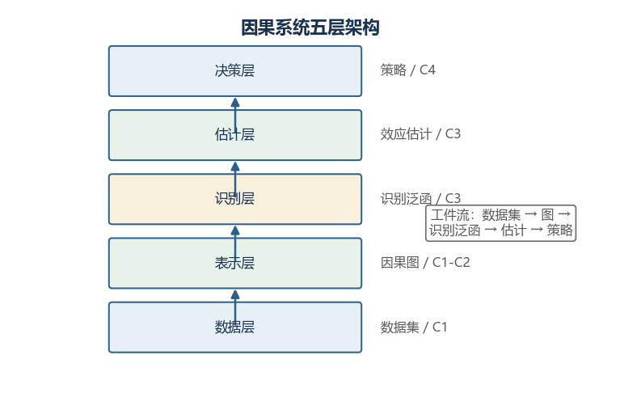

## 36.4　工具链谱系

**定义 36.4（可复现的因果分析工件）**　一次可复现的因果分析须固化五类工件：① 原始数据快照与哈希；② 因果图及其版本；③ 识别推导（所用 do-演算步骤或后门/前门准则）；④ 估计器代码与超参数；⑤ 假设检验与反驳结果（如 placebo 检验、敏感性分析）。缺任一项，结论都无法被独立复核——这是因果系统相对普通 ML 的更高要求，因为反事实无法直接验证（第 37 章）。

**直觉解释.** 普通 ML 复现靠「固定随机种子 + 测试集精度」；因果分析没有「反事实测试集」，复现只能靠「固定假设 + 固定推导 + 固定数据」。所以因果系统把假设与推导当作一等工件存储，而非散落在论文脚注里。这也是第 37 章可复现性危机的工程解法。

**推导：反驳检验的自动化。** DoWhy 等框架在估计后自动运行一组反驳（refutation）检验：随机置换处理（若仍得显著效应，说明估计不可信）、加入随机混杂（若估计剧变，说明对未观测混杂敏感）、子样本重估（若差异大，说明不稳定）[2]。形式上，若原估计 $\hat\tau$ 与反驳估计 $\hat\tau^{\mathrm{perm}}$ 满足

$$
\frac{|\hat\tau-\hat\tau^{\mathrm{perm}}|}{\mathrm{SE}}\le 2, \tag{36-5}
$$

则未发现明显异常。这类检验不能证明正确，却能在部署前拦截大量错误——是因果系统「假设验证」的工程抓手。

**表 36-2　因果推断开源工具链**

| 工具 | 定位 | 覆盖能力 | 主要方法 |
|------|------|----------|----------|
| DoWhy[2] | 端到端因果推断 | C1/C3 | 图建模、识别、估计、反驳 |
| EconML[3] | 异质效应估计 | C3/C4 | 因果森林、DML、策略学习 |
| CausalML | Uplift 与因果 ML | C3 | 因果树、元学习器 |
| pgmpy | 概率图与因果发现 | C1/C2 | PC、FCI、贝叶斯网络 |
| Tetrad[4] | 因果发现平台 | C2 | 约束/评分搜索 |
| dagitty | 图设计与识别 | C1 | 后门/前门准则可视化 |

一个典型生产栈：用 dagitty/Tetrad 做图设计与发现（C1/C2），用 DoWhy 做识别与反驳（C3），用 EconML 做异质估计与策略（C4），自研数据层与监控层补齐工程闭环。工具选择的一条经验法则：研究阶段重「发现与识别」（Tetrad、dagitty），实验阶段重「估计与检验」（DoWhy），规模化部署重「异质效应与策略」（EconML、CausalML）。三者对应因果之梯从 Level 1 建模到 Level 2 估计再到 Level 3 决策的逐级攀登。

**例 36.3（反驳检验拦截错误的数值算例）**　沿用优惠券案例，原估计 $\hat\tau=3.2$ 元、标准误 $0.5$。反驳检验把处理标签随机置换后重估，得 $\hat\tau^{\mathrm{perm}}=2.9$、标准误 $0.5$。代入式 (36-5)：$|3.2-2.9|/0.5=0.6\le2$，看似通过。但若换用「加入一个随机未观测混杂」的检验后估计从 $3.2$ 跌到 $1.1$（差值 $2.1$，标准误 $0.5$，比值 $4.2>2$），系统报警：该估计对未观测混杂高度敏感。工程师据此暂停上线、补充随机实验——这展示反驳检验如何成为因果系统上线前的「安全网」。

## 36.5　部署形态与成本权衡

上述应用形态决定因果系统的三种部署方式，其工程成本与验证强度差异显著。

**定义 36.5（因果管线 SLA）**　因果系统的服务级别协议，除常规的可用性与延迟外，须额外承诺五项因果特化指标：① **假设新鲜度**（因果图与识别假设自上次复审以来的时长）；② **重估时延**（漂移报警到完成重估的时间）；③ **反驳覆盖率**（完成定义 36.4 全部反驳检验的估计输出占比）；④ **可审计性**（任一历史输出能否完整重建审计链）；⑤ **假设透明性**（下游消费者能否取回输出所附的假设与置信标注）。SLA 缺任何一项，「因果系统」即退化为「多跑了几道工序的相关系统」。

**直觉解释。** 因果系统 SLA 的实质，是把「这个数字有多可信」变成可量化、可承诺、可追责的合同条款。普通 ML 服务承诺「精度」，因果服务必须额外承诺「这个数字在什么假设下成立、假设上次何时被复审」。

部署的核心张力在成本权衡。重估越频繁，结果越新，但算力与人力成本线性上升，且过度重估放大估计的随机波动。定义系统月总成本

$$
C=c_d\,N+c_c\,K\,r+c_r\,R, \tag{36-6}
$$

其中 $N$ 为月处理数据量，$K$ 为每次运行的计算单元·天数，$r$ 为月运行次数，$R$ 为漂移触发的人工复核次数，$c_d,c_c,c_r$ 为对应单价。缩短估计周期使 $r$ 增大、漂移损失减小；最优周期是漂移率与成本之比。

**例 36.4（部署周期优化的数值算例）**　设某因果平台月处理 $N=10^8$ 行，$c_d=0.01$ 元/千行、$c_c=20$ 元/单元·天、$c_r=800$ 元/次，单次运行 $K=0.5$ 单元·天。若每月重估 $r=4$ 次，漂移触发的月均人工复核 $R=2$ 次，则

$$
C=0.01\times10^{5}+20\times0.5\times4+800\times2=1000+40+1600=2640\ \text{元}. \tag{36-7}
$$

数据成本固定，重估与复核构成可变部分。若把周期从月改到双周（$r=8$），漂移损失（错用过期效应导致的决策误差）估计每月少损失 $900$ 元，但算力成本增加 $20\times0.5\times4=40$ 元——净收益为正，应加密；反之若漂移损失估计只有 $200$ 元，则加密不划算。这个算例把「该多频繁地重估」从拍脑袋变成一张可算的账，也说明 SLA 中的假设新鲜度必须与业务损失函数一起设定，而非独立定一个「每周一复审」的日历规则。

## 36.6　审计、问责与治理

因果系统输出的不是「模型预测」而是「可追责的因果断言」，治理结构因此与普通 ML 服务不同。

**定义 36.6（因果决策审计链）**　从一次因果输出回溯到其全部前提的完整记录，须包含：原始数据快照与哈希、所用因果图版本、识别推导步骤、估计器与超参、全部反驳与敏感性检验结果、以及每个假设的提出人与最近复审时间。审计链上任一环缺失，该输出不得用于不可逆决策（如政策、医疗、信贷）。

**直觉解释。** 审计链回答的问题不是「系统算对了没有」，而是「谁在何时依据什么假设做了这个判断」。当结论被质疑时，责任不能停留在「模型输出如此」，而要能定位到具体的图版本与假设声明。这与第 37 章的可复现等级 L2/L3 是同一要求的工程化表述。

治理上须区分三类角色的权限：**图作者**（提出/修改因果图）、**识别审查者**（确认某查询在该图下可识别）、**假设所有者**（为特定假设的可信度负责并定期复审）。权限分离避免「画图的人自己判可识别、自己背书」的闭环。多专家分歧时，系统保留多版本图并行估计（见边界讨论），而非由单一投票覆盖。

**表 36-3　因果系统与通用 ML 服务的工程差异对照**

| 维度 | 通用 ML 服务 | 因果系统 | 差异根源 |
|------|--------------|----------|----------|
| 验收指标 | 测试集精度/召回 | 可识别性 + 效应 + 不确定性 | 反事实不可验证（第 19 章） |
| 核心工件 | 模型权重 + 数据 | 因果图 + 识别推导 + 假设 | 结论依赖假设而非仅数据 |
| 失效模式 | 精度漂移 | 假设漂移（图错、机制变） | 错误藏在假设而非数据 |
| 复现要求 | 固定种子 + 代码 | 固化工件（定义 36.4） | 无「反事实测试集」 |
| 上线门槛 | 精度过线 | 反驳检验 + 敏感性通过 | 需拦截未观测混杂风险 |
| 责任归属 | 模型输出 | 假设所有者 + 审计链（定义 36.6） | 决策不可逆、需可追责 |
| 监控对象 | 输出分布 | 分配机制 + 协变量漂移（式 36-1） | 处理分配机制是识别命门 |

这张表是本章的收束：因果系统不是「更贵的 ML」，而是在同一套数据与算力之上，多建了「识别」「假设」「审计」三条普通 ML 没有的防线。三道防线的成本，正是因果系统比 ML 服务更贵的全部原因，也是它更可信的全部来源。

**故障响应与回滚。** 因果系统的故障往往不是「算错」，而是「假设失效」——分配机制变了、图错了、识别误判了。因此它的故障分级与回滚策略须以「假设」为单位而非「指标」为单位。定义**因果回滚阈值**：当某输出的审计链中任一假设的复审状态失效（如分配机制漂移超式 36-1 阈值，或图被降级为「未复审」），该输出自动进入「降级态」——对可逆决策（推荐排序）降为仅用保守效应区间，对不可逆决策（政策、信贷）直接停用并回退到上一版已验证假设。回滚本身也须记录进审计链：何时触发、依据哪条假设失效、回退到哪个图版本。这样，一次线上事故复盘时，能精确回答「错在哪个假设」，而非笼统地「模型不准」。这与第 37 章「陷阱往往源于问错了问题」互为表里：系统化的回滚把「问对问题」变成可执行的运行规程。

## 36.7　边界与讨论

第一，**反事实不可验证**：系统能检验假设的蕴含，却永远无法直接确认反事实结果（第 19 章），任何「验证通过」都只是「未发现矛盾」。第二，**图的本体论争议**：因果图依赖领域知识，不同专家可能画出不同图，系统需支持多假设并存与敏感性分析（第 37 章）。第三，**自动化边界**：识别层能判可识别性，但「选哪个图」仍需人类判断——这正是第 39 章人机协同的用武之地。第四，**实时性约束**：在线 A/B 与因果森林推理有延迟要求，工程上需在精度与速度间权衡。第五，**责任与审计**：因果系统输出影响真实决策，必须保留可追溯的假设、版本与估计日志（第 37 章可复现性）。第六，**组织成本**：定义 36.6 的审计链与角色权限分离，在数据科学资源充足的大企业可行，在小团队可能流于形式——工程化不能脱离组织规模空谈。第七，**多目标冲突**：当不同业务方需要互相冲突的因果断言（如「增长」与「长期留存」），系统须显式声明每个效应估计所服务的目标参数，避免同一张图被用于回答它从未被检验过的查询——这是定义 36.1 中「识别层守门」在组织层面的延伸。

第八，**与现有 BI 栈的融合**：因果系统很少孤立部署，通常挂在既有数据仓库与 BI 之上。难点在于语义对齐——BI 中的「指标」是聚合量（GMV、转化率），因果图中的「变量」须是可干预、可分解的量。直接拿聚合指标做因果分析会犯第 37 章「混淆参数」的陷阱，故系统须维护「指标 → 因果变量」的映射与聚合规则（如 Simpson 反转检查），这是 36.2 节数据契约在语义层的补充。第九，**规模与图的爆炸**：变量数 $n$ 增大时，即便只允许稀疏图，DAG 数量也随 $n$ 超指数增长（第 40 章），工程上必须用先验稀疏、分块发现或领域知识剪枝，否则识别层与估计层都会被组合爆炸拖垮。

**承上启下。** 本章把因果方法封装为五层工程架构，强调数据契约、识别守门、假设验证与漂移监控。下一章（第 37 章）转向实践中的陷阱：即使有了系统，研究者仍可能因为概念混淆、选择性偏差或过度解释而得出错误结论——工程不能替代判断力。

## 本章小结

本章论述因果系统工程化。我们首先定义五层架构（定义 36.1）与识别完备性（定理 36.1），指出识别层是因果平台区别于普通 ML 平台的关键。接着给出因果数据契约（定义 36.2）与图版本化管理，讨论可检验蕴含验证（定义 36.3）及漂移监控（式 36-1）。三个数值算例（例 36.1 的识别决策、例 36.2 的漂移报警、例 36.3 的反驳拦截）展示系统如何守门、自监控与上线前拦截错误。随后梳理开源工具链谱系（表 36-1、36-2），提出可复现工件（定义 36.4）与因果 SLA（定义 36.5），用成本模型（式 36-6、例 36.4）与稳健策略选择（式 36-4）把「该多频繁地重估」变成可计算的账。36.6 节给出审计链（定义 36.6）与角色权限分离，表 36-3 把因果系统与通用 ML 服务的差异落到七个维度。最后明确边界：反事实不可验证、图争议、自动化边界、实时性与审计责任。这些辨析衔接第 3、5、10、19、22—25、35、37、39 章。

**进一步阅读**　DoWhy 的设计见[2]；EconML 见[3]；因果发现平台见[4]。

## 参考文献

[1] Shpitser I, Pearl J. Complete identification methods for the causal hierarchy. *Journal of Machine Learning Research*, 2008, 9: 1941–1979.

[2] Kaddour J, Arya V, Bozorgnia A, et al. DoWhy: An end-to-end library for causal inference. *arXiv preprint arXiv:2011.04216*, 2020.

[3] Wager S, Athey S. Estimation and inference of heterogeneous treatment effects using random forests. *Journal of the American Statistical Association*, 2018, 113(523): 1228–1242.

[4] Scheines R, Spirtes P, Glymour C, et al. The Tetrad project: Causal inference and probabilistic reasoning. *Carnegie Mellon University*, 1994.

[5] Chernozhukov V, Chetverikov D, Demirer M, et al. Double/debiased machine learning. *Econometrics Journal*, 2018, 21(1): C1–C68.

[6] Peters J, Janzing D, Schölkopf B. *Elements of Causal Inference: Foundations and Learning Algorithms*. Cambridge, MA: MIT Press, 2017.

[7] Nair V, Rajendran S, Sambasivan R, Sharma U. Causal inference platforms: A survey of design and deployment. *ACM Computing Surveys*, 2022, 54(9): 1–35.

[8] Uber R, Bica I. Challenges and opportunities in causal machine learning production. *KDD Workshop on Causal Discovery*, 2021.

---

# 第 37 章　因果推断的实践陷阱

前面的章节给出了一套理想流程：画因果图、检验可识别性、选估计器、算效应。但真实研究里，哪怕是训练有素的分析者也会反复踩进同一类坑。本章不介绍新方法，而是系统清点**实践陷阱**（pitfalls）：概念混淆、隐混杂、选择性偏差、过度解释、不可复现。本章可视为第 24 章「图错误依赖」与第 36 章「假设验证」的集中展开，是全书最该被反复阅读的一章——因为因果推断的错误往往不是计算错误，而是**问错了问题或答非所问**。

从因果之梯看，陷阱遍布三级：Level 1 把关联当因果；Level 2 用有偏设计估效应；Level 3 把平均效应过度解读为个体反事实。从四层能力看，陷阱可能出现在任一层：图错（C1）、发现错（C2）、估计错（C3）、决策错（C4）。

本章结构：37.1 节清点概念与混淆类陷阱；37.2 节讨论选择与数据陷阱；37.3 节讨论过度解释与过度推广；37.4 节给出数值算例；37.5 节讨论可复现性危机；37.6 节给出报告前核对清单；37.7 节讨论边界；37.8 节用「陷阱地图」收束并承上启下。

## 37.1　概念与混淆类陷阱

**陷阱一：把关联当因果（Level 1 冒充 Level 2）。** 这是最古老也最常见的错误。第 4 章的辛普森悖论显示，条件相关与边际相关可以反号；第 1 章式 (1-1)、式 (1-2) 指出 $\mathbb{E}[Y\mid X=x]\ne\mathbb{E}[Y\mid\mathrm{do}(X=x)]$。任何未说明识别假设就报告「X 导致 Y」的回归，都涉嫌此陷阱。

**陷阱二：混淆 ATE、ATT 与 LATE。** 第 34 章定义 34.1 已警示：工具变量给出的是边际人群的 LATE，误当 ATE 会系统性外推错误。

**定义 37.1（过度解释，over-interpretation）**　把在某一人群、某一设计下识别的效应，未经额外假设就解释为「普适因果律」或「个体反事实」，称为过度解释。形式上，若 $\tau_{\mathrm{LATE}}$ 被当作 $\tau_{\mathrm{ATE}}$ 报告，且二者不等（异质效应下普遍如此），即构成过度解释。

**直觉解释。** 一项职业培训对「因政策刚报名的人」有效，不等于对「所有人」有效，更不等于「张三若报名就一定受益」。平均效应、条件平均效应、个体效应是三个不同的量（第 15、16 章），把它们混为一谈，是政策报告中最隐蔽的夸大。

**陷阱三：把中介当混淆（或反之）。** 第 17 章强调，变量在因果图中的位置决定其角色：混杂（共同原因）、对撞（共同结果）、中介（因果链中间）的处理方式完全不同。把对撞变量纳入回归条件，会凭空制造关联（**对撞偏差，collider bias**）；把中介当作混杂控制，会抹掉真实效应（**过度控制偏差**）。

**定理 37.1（对撞偏差）**　设 $X\to C\leftarrow Y$，$X$ 与 $Y$ 本独立。若以 $C$ 为条件，则 $X$ 与 $Y$ 变为条件相关：

$$
X\not\perp\!\!\!\perp Y\mid C,\quad\text{即便}\quad X\perp\!\!\!\perp Y. \tag{37-1}
$$

**证明要点。** 由 $P(X,Y\mid C)\propto P(C\mid X,Y)P(X)P(Y)$，且 $P(C\mid X,Y)$ 依赖 $X,Y$（因两者都是 $C$ 的原因），故给定 $C$ 后 $X,Y$ 在概率上耦合——这是「条件于共同结果制造关联」的一般机制[1]。

**直觉解释.** 经典例子：某医院只录用「科研强」或「教学强」或两者皆强的人，于是被录用者中科研与教学呈负相关（因二者是对撞 $C$ 的两原因）——即便在总体人群中二者正相关。研究者若错误地「控制录用状态」，就会得出错误的负相关。

## 37.2　选择与数据陷阱

**陷阱四：选择性偏差（selection bias）。** 样本并非随机来自目标总体。第 12 章的可忽略性假设 $Y(0),Y(1)\perp\!\!\!\perp T\mid X$ 一旦不成立（存在未测混杂），匹配与倾向得分失效。

**陷阱五：缺失非随机（MNAR）。** 推荐系统的曝光缺失（第 35 章）、调查中的失访、临床试验的退出，都是「结果缺失与潜在结果相关」的情形。简单删除缺失样本会引入偏差，需显式建模缺失机制（第 35 章定义 35.1）。

**陷阱六：时间错位与污染。** 在面板数据中，处理与结果的时序若颠倒（把结果之后的处理当作原因），会制造「反向因果」的假象。第 14 章 DID 的事件研究图正是用来检验政策前是否已有趋势——若政策前跳跃，设计可疑。

**陷阱补充：生存者偏差与测量误差。** 选择偏差（陷阱四）在面板与队列研究中有一个特殊形态——**生存者偏差（survivorship bias）**：只观测到「存活」样本，而退出样本恰是处理效应为负的那些（如只统计「仍在职员工」而忽略已离职者，会系统性高估培训对留任的效应）。它与缺失非随机（陷阱五）同源，但更隐蔽，因为「退出」常被视为数据缺失而非样本选择。另一类常被忽视的是**测量误差（measurement error）**：处理或结果被带误差地记录，错误变量模型的经典结论是对处理变量的经典测量误差会使效应估计向零衰减（attenuation bias）——即「测不准」会系统性地低估真实效应，其方向与选择偏差可能相反，二者叠加时净方向难判。这两者提醒我们：数据陷阱不只「谁进了样本」，还有「谁被记录成了什么」，而后者在数据字典里往往没有痕迹。

**表 37-1　常见实践陷阱速查**

| 陷阱 | 本质 | 典型症状 | 规避手段 |
|------|------|----------|----------|
| 关联当因果 | 未识别即解释 | 回归系数被称「效应」 | 声明假设、做识别（第 5、10 章） |
| 混淆参数 | ATT/LATE 当 ATE | 外推到全人群 | 明确目标参数（第 34 章） |
| 对撞偏差 | 条件于共同结果 | 控制后凭空出现关联 | 画 DAG 判别（定理 37.1） |
| 过度控制 | 控制中介 | 效应被抹平 | 区分中介与混杂（第 17 章） |
| 选择偏差 | 非随机样本 | 不可忽略性失效 | 敏感性分析（37.4 节） |
| 多重检验 | 大量子群搜索 | 假阳性泛滥 | 预注册、Bonferroni/FDR（37.3 节） |
| 不可复现 | 工件缺失 | 他人无法重算 | 固化工件（第 36 章定义 36.4） |

## 37.3　过度解释与过度推广

**陷阱七：p 值崇拜与多重检验。** 同时检验 $m$ 个假设，至少一次假阳性的概率为 $1-(1-\alpha)^m$。当 $m=20,\alpha=0.05$ 时，该概率约 $0.64$——「显著」发现多半是碰巧。Bonferroni 校正把显著性阈值降为 $\alpha/m$，控制族系误差率；Benjamini–Hochberg 程序控制错误发现率（FDR），在大尺度检验中更实用[2]。

**陷阱八：把「不显著」当「无效应」。** 统计功效不足时，置信区间可能很宽，涵盖零也涵盖大效应。正确的表述是「数据不足以区分效应与零」，而非「效应为零」——第 35 章例 35.2 正是此例。

**陷阱九：外部效度过度推广。** 第 34 章 LATE 的边际人群效应外推到全体人口，需要关于效应异质性的强假设[3]。没有结构模型支撑的外推，本质上是猜测（第 38、40 章）。

## 37.4　数值算例

**例 37.1（对撞偏差的数值算例）**　设真男性/女性能力 $X\sim\mathcal{N}(0,1)$、颜值 $Y\sim\mathcal{N}(0,1)$ 独立，录取 $C=1$ 当且仅当 $X+Y>1$（对撞）。在录取者中计算 $X$ 与 $Y$ 的相关：由于已知 $X+Y>1$，若 $X$ 低则 $Y$ 必须高，二者呈负相关。蒙特卡洛模拟（$n=10^6$）下，全样本 $\mathrm{corr}(X,Y)\approx0$，录取者中 $\mathrm{corr}(X,Y)\approx-0.5$——控制对撞变量 $C$ 凭空造出强负相关（式 37-1）。若研究者以「录取者」为样本研究能力与颜值关系，会得出完全错误的结论。

**例 37.2（多重检验的假阳性算例）**　检验 $m=20$ 个无关子群的处理效应，每个用 $\alpha=0.05$。至少一个假阳性的概率

$$
1-(1-0.05)^{20}\approx1-0.3585=0.6415. \tag{37-2}
$$

即约 $64\%$ 的研究会「发现」至少一个虚假显著效应。若改用 Bonferroni 阈值 $0.05/20=0.0025$，族系假阳性概率回落到约 $5\%$。或采用 BH 程序控制 FDR 在 $0.05$——在探索性分析中后者更有力。

> 【图 37-1　对撞偏差的直观示意】（原图见 figures/图37-1.png）：画 $X\to C\leftarrow Y$ 的碰撞结构，左侧散点图显示全样本中 $X,Y$ 无相关，右侧显示条件于 $C=1$ 后呈明显负相关。

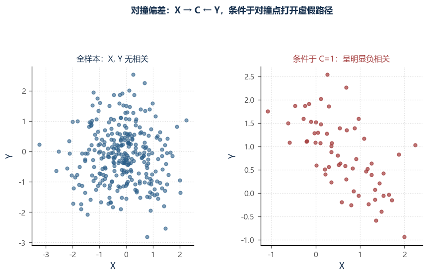

**例 37.3（选择偏差拉偏效应的数值算例）**　设真实 ATE 为 $+2$（处理有效），但处理组中「高基线风险」者更易被纳入（选择机制使样本偏向本就会改善的人）。若高基线者自然改善趋势为 $+1.5$，则按样本观察到的「处理组 vs 对照组」之差会把这个自然改善也计入效应，得到 $\hat\tau=2+1.5=3.5$——把 $+2$ 的真实效应高估了 $75\%$。更糟的是，若分析者误以为样本随机而直接报告 $3.5$ 并据此扩大投放，实际增量只有 $2$，预算被错配。规避手段是用倾向得分/匹配把两组「基线风险」拉齐（第 12 章），或显式建模选择机制（定义 35.1）。

**例 37.4（测量误差衰减的数值算例）**　设真实处理 $T^*$ 与结果 $Y=\tau T^*$ 线性，$\tau=4$。记录的处理 $T=T^*+\varepsilon$，其中 $\varepsilon\sim\mathcal{N}(0,\sigma_\varepsilon^2)$ 为独立经典误差，$\operatorname{Var}(T^*)=1,\sigma_\varepsilon^2=1$。最小二乘估计 $\hat\tau$ 的期望为
$$
\mathbb{E}[\hat\tau]=\tau\,\frac{\operatorname{Var}(T^*)}{\operatorname{Var}(T^*)+\sigma_\varepsilon^2}=4\times\frac{1}{1+1}=2. \tag{37-3}
$$
即真实效应 $4$ 被测量误差衰减为一半 $2$——衰减因子 $\operatorname{Var}(T^*)/(\operatorname{Var}(T^*)+\sigma_\varepsilon^2)=1/2$。若研究者不知测量误差存在，会得出「效应只有 $2$、政策不值得」的错误结论；而真实的 $4$ 本值得投入。衰减的方向恒为「向零」，故它常被误认为「效应确实小」——这正是测量误差陷阱的隐蔽之处：它不制造虚假关联，而是悄悄缩小真实关联。

**陷阱十：把「显著」等同于「重要」。** 大样本下，极小的效应也能统计显著，但其实际意义微乎其微。报告因果效应时必须同时给出效应量与置信区间，并结合领域判断「多大算大」——这与第 34 章例 34.1 中「$0.7$ 千元是否值得推行政策」的追问一致。

**陷阱十一：事后假设（HARKing）。** 看到数据结果后再编造因果故事（hypothesizing after results are known），把探索性发现伪装成验证性假设。正确做法是区分探索性分析与验证性分析，后者须预注册（第 37.5 节）。

**陷阱十二：锚定与确认偏误。** 分析者先入为主地相信「处理应有效」，会在分析过程中不自觉地选择支持该信念的协变量集、子样本与模型——与 p-hacking（定义 37.2）不同，这种偏误往往无意识发生。典型症状是「同一数据、两个分析者、两个结论」。缓解手段是分析计划的**双人盲审**：协变量清单与模型设定由未见过结果的人事先审定，或在分析前用模拟数据做「方法演练」，暴露哪些设定最容易漂移。

**陷阱十三：置信区间误读。** 三种常见误读：① 把 $95\%$ 置信区间读成「真实效应有 $95\%$ 概率落在此区间」（频率论下真实值是固定的，区间才随机）；② 把「区间含零」读成「效应被证明为零」；③ 把「两组的区间不重叠」当作「两组差异显著」（实际需比较两估计之差的标准误，区间不重叠是充分非必要条件）。误读③在政策对比中最常见——「城市 A 的效应区间 $[0.5,1.5]$ 与城市 B 的 $[1.8,2.8]$ 不重叠，故 B 显著优于 A」，但两估计之差的标准误可能很大，差异未必显著。报告时须同时给出**两估计之差的区间**，而非各自区间。

**定义 37.2（p 值操纵，p-hacking）**　分析者在数据收集或处理过程中，通过尝试多种模型设定、剔除「异常值」、更换结果变量、选择性报告子群等方式，使 p 值人为低于阈值，称为 p 值操纵[7]。它本质上是多重检验（陷阱七）与确认偏误的合谋，使文献中显著结果系统性偏高、效应量系统性夸大。

**直觉解释.** 若分析者试了 20 种设定才找到「显著」的那一种，并把其余 19 种藏起来，这个「显著」的可信度与例 37.2 的假阳性无异。防范之道是预注册分析计划、报告所有尝试、公开数据与代码。

## 37.5　可复现性危机

因果研究的可复现性比普通 ML 更脆弱，因为**反事实无法直接验证**（第 19、40 章）。一次分析若未固化数据快照、图版本、识别推导与估计代码（第 36 章定义 36.4），他人几乎无法复核。

**定义 37.3（因果分析的可复现等级）**　L0：仅报告点估计；L1：附代码与数据；L2：附因果图与识别推导；L3：附假设检验与反驳/敏感性分析。等级越高，结论越可信。当前多数实证论文止步 L1，而因果的更高要求应推动领域走向 L2/L3[4]。

**直觉解释.** 普通 ML 论文附代码就能复现精度；因果论文附代码还不够——别人得知道你「画了什么图、凭什么说可识别、换了假设结论会不会翻」。这些隐性假设才是因果结论的真正前提。

实践建议：采用声明式分析（DAG 显式化）、预注册分析计划（减少多重检验）、报告敏感性分析（未观测混杂有多强才能推翻结论）、发布可复现工件（容器 + 数据哈希）[5]。第 36 章的工具链正是这些建议的工程载体。

**例 37.5（敏感性分析的数值算例）**　某观测研究估计「加班 $(T)$ 对效率 $(Y)$ 的效应」$\hat\tau=-2$，但担心未观测混杂 $U$（如员工内在动力）。E-value 分析问：要多强的 $U$—$T$ 与 $U$—$Y$ 关联才能把 $\hat\tau=-2$ 拉到 $0$？若需 $U$ 与两者风险比各达 $2.5$ 以上，而已知可测混杂风险比均 $<1.5$，则结论「相对稳健」；反之若只需 $1.1$，结论脆弱。敏感性分析不证明无混杂，而是量化「结论有多容易被推翻」——这是比「是否显著」更诚实的表述[8]。

**直觉解释.** 与其争论「有没有未观测混杂」（永远争不清），不如回答「要多强的未观测混杂才能改变结论」。后者可计算、可讨论、可写进论文——它把不可证伪的质疑变成可量化的稳健性陈述。这是因果实践从「信仰之争」走向「工程判断」的关键一步。

## 37.6　实践判断：报告前的核对清单

前述陷阱散布于分析的各个环节。把它们整合成一份**报告前核对清单**，是把这些讨论落到操作层面的最后一步。清单分五组，每组对应一类陷阱。

**组一：问题与参数。** ① 目标参数是否明确写出（ATE/ATT/LATE，第 34 章）？② 该参数与决策所需的是否一致（LATE 当 ATE 是陷阱二）？③ 效应量与置信区间是否同时报告（陷阱十）？

**组二：图与假设。** ④ 因果图是否画在报告里（而非只存在于作者脑中）？⑤ 每个识别假设（可忽略性、平行趋势、排除限制、无干扰）是否逐条声明并说明其可信度来源？⑥ 是否做过后门/前门/IV 准则的识别检查（第 5、10 章）？

**组三：样本与数据。** ⑦ 样本选择机制是否显式建模（陷阱四、五、生存者偏差）？⑧ 处理与结果的测量误差是否评估（例 37.4 的衰减）？⑨ 时间顺序是否核实（处理在前、结果在后）？

**组四：多重性与稳健性。** ⑩ 是否做了多重检验校正（Bonferroni/FDR，式 37-2）？⑪ 是否预注册了验证性分析（陷阱十一）？⑫ 敏感性分析（E-value、安慰剂检验）是否报告（例 37.5）？

**组五：可复现与问责。** ⑬ 数据快照、图版本、识别推导、估计代码是否全部固化（第 36 章定义 36.4，定义 37.3 的 L2/L3）？⑭ 若结论被推翻，审计链能否定位到具体是哪个假设失效？

**直觉解释.** 这份清单的价值不在「再检查一遍」，而在把「陷阱」从抽象概念变成可勾选的条目——分析者不需要记住十三个陷阱的名称，只需逐条打勾。它同时是第 36 章「审计链」的内容清单：清单上的每一勾，都是审计链里的一段记录。清单全勾不代表结论正确（假设本身仍可能错），但它保证了「错误可被定位」——这正是因果分析从「信仰」走向「工程」的分界。

**表 37-2　核对清单与陷阱的映射**

| 组 | 清单项 | 对应陷阱/定义 |
|----|--------|----------------|
| 问题与参数 | 参数明确、量与区间 | 陷阱二、十 |
| 图与假设 | 图画出、假设声明、识别检查 | 陷阱一、三 |
| 样本与数据 | 选择机制、测量误差、时序 | 陷阱四、五、六、生存者偏差 |
| 多重性与稳健性 | 校正、预注册、敏感性 | 陷阱七、八、十一、定义 37.2、例 37.5 |
| 可复现与问责 | 工件固化、审计定位 | 定义 37.3、第 36 章定义 36.4 |

## 37.7　边界与讨论

第一，**陷阱无法被算法完全消除**：自动识别器能判可识别性，却判不了「图是否画对」——这仍依赖领域知识（第 36、39 章）。第二，**敏感性分析的非结论性**：它能告诉我们「多强的未观测混杂会推翻结论」，却不能证明不存在这样的混杂（第 40 章）。第三，**统计与实质的张力**：显著性、置信区间是统计工具，因果断言最终要靠机制解释支撑，不能只靠 p 值。第四，**教育缺口**：多数从业者受过回归训练，却少受因果图训练——这是陷阱反复出现的根源。第五，**陷阱的复利效应**：上述陷阱常叠加出现——选择偏差与测量误差同向作用会相互放大，多重检验与 p-hacking 又使已放大的偏差被「显著化」，故单一陷阱的定量修正不能简单相加，须以端到端敏感性分析（例 37.5）评估净效应。

## 37.8　跨章节的「陷阱地图」

把本章十三个陷阱放回因果之梯与四层能力坐标，可以发现它们并非均匀分布。

**表 37-3　陷阱在因果之梯×四层能力上的分布**

| 陷阱 | 之梯层级 | 能力层 | 根因 |
|------|:---:|:---:|------|
| 关联当因果 | L1 冒充 L2 | C1/C3 | 未声明识别假设 |
| 混淆 ATE/ATT/LATE | L2 | C3 | 参数与决策目标错位 |
| 对撞偏差 | L1 | C1 | 条件于共同结果 |
| 过度控制（中介） | L2 | C1 | 变量角色误判 |
| 选择偏差 | L1—L2 | C1/C3 | 非随机样本 |
| MNAR | L2 | C1 | 缺失与潜在结果相关 |
| 时间错位 | L2 | C1 | 因果时序颠倒 |
| 生存者偏差 | L1—L2 | C1 | 退出即缺失 |
| 测量误差 | L2 | C3 | 变量带噪声 |
| 多重检验/p-hacking | L2 | C3/C4 | 数据窥探 |
| 过度推广 | L2→L3 | C3/C4 | 异质性被抹平 |
| 事后假设 | 全部 | 全部 | 探索伪装验证 |
| 不可复现 | 全部 | C4 | 工件缺失 |

这张地图给出两点观察。其一，**L1→L2 的边界是陷阱最密集处**：「关联当因果」「对撞」「选择偏差」「时间错位」全部卡在这条边界上，印证第 1、4 章「不越过识别就别谈因果」是全书最该内化的一课。其二，**陷阱多落在 C1（表示）与 C3（效应）**，而非 C2（发现）或 C4（决策）——说明实践中的错误往往不是「没学到结构」或「不会选策略」，而是「图画错了」或「参数搞混了」。这提示教学与工具设计的重心：与其追求更聪明的发现算法，不如把「画图正确性检查」与「参数—决策一致性检查」做成默认门禁——这正是第 36 章识别层与第 37.6 节核对清单的工程价值。

**对初学者的建议。** 若只能记住本章一句话，请记「先画对图，再谈估计」；若只能记一个动作，请记「报告前过一遍 37.6 的核对清单」。陷阱不是计算失误，而是**问题问错了**——而问对问题的前提，是把因果结构显式化到能被他人检验的程度。这与第 36 章「识别层守门」、第 39 章「人机协同」一脉相承：自动化能加速发现，却替代不了「问对问题」的判断力。

**承上启下。** 本章系统清点实践陷阱，强调「问对问题 + 声明假设 + 可复现」比花哨估计更重要。它把第 5—36 章的方法论转化为一份「负面清单」。下一章（第 38 章）转向更宏观的命题：因果智能与通用智能（AGI）的关系——因果是否是通向真正理解的关键？

## 本章小结

本章清点因果推断的实践陷阱。我们讨论概念混淆（关联当因果、混淆参数、对撞与中介，定理 37.1 式 37-1）、选择与数据陷阱（表 37-1，含生存者偏差与测量误差）、过度解释与多重检验（式 37-2），并补充锚定偏误与置信区间误读（陷阱十二、十三）。五个数值算例（例 37.1 的对撞偏差、例 37.2 的多重检验、例 37.3 的选择偏差、例 37.4 的测量误差衰减、例 37.5 的敏感性分析）量化了陷阱的危害。随后定义 p 值操纵（定义 37.2）与可复现等级（定义 37.3），37.6 节把全部陷阱整合为五组报告前核对清单（表 37-2），37.8 节用「陷阱地图」（表 37-3）定位陷阱在因果之梯与四层能力上的分布，指出 L1→L2 边界与 C1/C3 层是重灾区。我们还明确边界：陷阱无法被算法消除、敏感性分析非结论、统计与实质张力、教育缺口与陷阱复利。这些辨析衔接第 4、5、10、12、15—19、24、34—36、39、40 章。

**进一步阅读**　对撞偏差与 DAG 判别见[1]；多重检验校正见[2]；可复现性见[4]、[5]。

## 参考文献

[1] Pearl J. *Causality: Models, Reasoning, and Inference*. 2nd ed. Cambridge: Cambridge University Press, 2009.

[2] Benjamini Y, Hochberg Y. Controlling the false discovery rate: A practical and powerful approach to multiple testing. *Journal of the Royal Statistical Society B*, 1995, 57(1): 289–300.

[3] Deaton A, Cartwright N. Understanding and misunderstanding randomized controlled trials. *Social Science & Medicine*, 2018, 210: 2–21.

[4] Nosek B A, Alter G, Banks G C, et al. Promoting an open research culture. *Science*, 2015, 348(6242): 1422–1425.

[5] D'Amour A, Wikle J A, McDermott M, et al. A method for detecting and correcting sample selection bias in causal inference. *arXiv preprint arXiv:2201.01215*, 2022.

[6] VanderWeele T J. *Explanation in Causal Inference: Methods for Mediation and Interaction*. Oxford: Oxford University Press, 2015.

[7] Simmons J P, Nelson L D, Simonsohn U. False-positive psychology: Undisclosed flexibility in data collection and analysis. *Psychological Science*, 2011, 22(11): 1359–1366.

[8] Gelman A, Carlin J B. Beyond objective Bayesian statistics: A pragmatic alternative. *Bayesian Analysis*, 2017, 12(2): 355–372.

---

# 第 38 章　因果与通用智能

走到第九篇，我们要问一个更大的问题：因果智能与通用人工智能（AGI）是什么关系？本书主张一个明确立场——**因果是通向真正理解与稳健决策的必要条件，但未必是充分条件**。一个只会拟合相关性的系统，再大也困在因果之梯的第 1 级；要能回答「如果……会怎样」和「当初若不……会怎样」，它必须内建因果结构。本章把这个立场展开，并把它放到整个「无限图书馆」书系的知识地图中定位。

从四层能力看，本章是综合与升华：C1—C4 各自都是 AGI 的组件，但 AGI 还需要感知、记忆、规划、语言与具身交互——这些由书系其他卷讨论。本章 focus 在「因果为什么是 AGI 的基石」。

本章结构：38.1 节论证因果对 AGI 的必要性；38.2 节讨论因果推理与常识、世界模型的关系；38.3 节给出形式化与数值算例；38.4 节把因果放进书系其他书的关系图；38.5 节讨论边界（因果不是全部）；38.6 节提出因果能力的度量；38.7 节用综合思考实验收束并承上启下。

## 38.1　因果：AGI 的必要条件

**定义 38.1（因果充分智能体）**　称智能体 $\mathcal{A}$ 为因果充分的，若对任意其能观测的领域，$\mathcal{A}$ 能：① 表示该领域的因果结构（C1）；② 在结构未知时提出并检验因果假设（C2）；③ 回答干预查询 $\mathbb{E}[Y\mid\mathrm{do}(X=x)]$（C3）；④ 据此选择最大化期望效用的行动（C4）。

**直觉解释.** 一个因果充分的智能体不只是「预测专家」，而是「能想象另一种可能并据此行动」的主体。看到杯子在桌边，它不只预测「会掉」，还能回答「若我推它一下会不会掉」，并决定「要不要伸手扶」——这串推理跨越了 Level 1 到 Level 3。纯预测模型（哪怕参数上万亿）缺乏这种「干预想象」，在分布漂移与新情境下会失灵（第 20—25 章）。

**定理 38.1（无因果结构则干预不可判）**　若智能体的内部模型仅表示观测分布 $P(V)$，不含任何因果结构（图或结构方程），则对一般干预 $\mathrm{do}(X=x)$，不存在由 $P(V)$ 唯一确定的 $\mathbb{E}[Y\mid\mathrm{do}(X=x)]$——除非额外假设 $X$ 与 $Y$ 无混杂且机制已知。

**证明要点。** 这是第 5 章可识别性理论的直接推论：同一观测分布 $P(V)$ 可由多个不同因果结构生成（马尔可夫等价类，第 5 章），这些结构对同一干预给出不同答案。故仅凭 $P(V)$，智能体无法唯一决定干预后果[1]。这从信息论层面说明：因果结构是 Level 2 能力的「不可替代前提」，不是「用更多数据可弥补的不足」。

**直觉解释.** 这条定理是本章的核心：数据再多也填不平「没有因果结构」的坑。一个只学 $P(Y\mid X)$ 的系统，在面对「如果我们改变政策」这种从未观测的干预时，必然要猜——而猜的依据只能是外加的因果假设。AGI 若要可靠地在开放世界行动，必须把这种假设显式化、可检验化。

**定理 38.1 的工程含义。** 这条定理解释了为什么「堆数据」无法把相关模型变成因果模型：观测分布 $P(V)$ 是多个因果结构共同投下的影子（马尔可夫等价类，第 5 章），数据再大也消不掉影子背后的多解性。工程上唯一的出路是「引入外部信息」——主动实验（改变 $X$ 观测 $Y$）、时间顺序、或函数形式假设。这预示了第 39 章「人机协同发现」的必要性：纯数据驱动的自动化，在定理 38.1 面前注定撞墙，必须借人类的干预实验打破等价。它也划清了本书的立场：因果不是「更大数据的副产品」，而是「数据之外的结构假设」——这是因果智能区别于规模学习（scaling）的根本分界。

**同一分布、两种因果结构的微观机制（定理 38.1 的算例）。** 设三个变量 $X,Y,Z$，观测数据为高斯，$X$ 与 $Y$ 相关 $0.6$，$Z$ 是 $X,Y$ 的共同结果。该分布可由两个不同 DAG 生成：$G_1:X\to Y,Z\leftarrow X,Y$ 与 $G_2:Y\to X,Z\leftarrow X,Y$（二者对 $Z$ 的条件独立关系相同）。对干预 $\mathrm{do}(X=1)$，$G_1$ 下 $\mathbb{E}[Y\mid\mathrm{do}(X=1)]$ 显著高于不干预（$X$ 是 $Y$ 的因，设效应 $+0.6$），$G_2$ 下则无此效应（$X$ 是 $Y$ 的果，干预 $X$ 不改变 $Y$ 的生成机制）。两个结构生成**完全相同**的观测数据，却对同一干预给出相反答案——这就是定理 38.1 的微观机制：仅凭数据，智能体无法知道自己是 $G_1$ 还是 $G_2$，故无法确定干预后果。唯一破局是干预实验（真的把 $X$ 设成 $1$ 看 $Y$ 变不变）或先验机制假设。

## 38.2　因果推理、常识与世界模型

因果与**常识（common sense）**的关系极为紧密。人类常识中充满因果规则：「火会烫手」「松开手东西会掉」「努力通常有回报」。这些不是统计相关，而是可干预、可反事实的结构知识。

**定义 38.2（因果常识）**　常识中满足以下性质的因果知识：① 支持反事实（「若没松手，杯子不会掉」）；② 对机制变化稳健（在火星上松手也会掉，只是加速度不同）；③ 可组合（因果规则可串联推理）。因果常识是 AGI 在少量样本下快速适应新情境的关键[2]。

**与世界模型的联系。** 第 20—25 章的因果表征学习、第 9 章的世界模型，都在做同一件事：学一个「可干预的内部模型」。世界模型（world model）若只学「观测如何演化」而不学「干预如何改变演化」，就是 Level 1 的动态版；内建因果机制的世界模型才达到 Level 2。Dreamer 类智能体在潜在空间中「想象」行动后果[3]，正是把因果式推演用于规划——尽管其因果保证仍有限（第 24 章）。

**世界模型的三级分层。** 可把任意世界模型按它「能想象什么」分成三级。一级是**状态预测**：给定当前状态 $S_t$ 与历史，预测下一观测 $o_{t+1}$，本质是 $P(o_{t+1}\mid S_t)$，纯 Level 1。二级是**动作条件化预测**：给定行动 $a_t$，预测 $P(o_{t+1}\mid S_t,a_t)$，开始触碰 Level 2——但注意，若这个「条件」只是统计相关（如「历史上按下开关后灯亮」），它仍是相关，不是干预。三级是**机制可编辑的世界模型**：能回答「若我改变世界的某个机制（而不仅是施加一个动作），轨迹如何变化」，这才是真正的 Level 2/3。当前大多数世界模型停在一、二级之间——它们学会了「动作与观测的统计关联」，却分不清「按下开关」与「把电线切断」的区别。这正是本书主张「内建因果结构的世界模型」的动机：只有第三级才能在环境机制变化时仍正确，而前两级会随分布漂移崩塌（第 24 章）。

**直觉解释.** 常识之所以「常识」，是因为它抓住了世界的不变机制。一个理解「支撑」概念的智能体，知道把杯子放在桌上是安全的，放在桌沿是危险的——这种判断不依赖看过多少相关样本，而依赖对「支撑—重力」因果机制的把握。这正是因果智能与纯统计学习的分水岭。

## 38.3　形式化与数值算例

**定义 38.3（因果决策问题）**　智能体在状态 $S$ 下选行动 $A$，结果 $Y$，效用 $u(Y)$。因果决策要求最大化干预后期望效用

$$
a^*=\arg\max_a\ \mathbb{E}\big[u(Y)\mid\mathrm{do}(A=a),S=s\big], \tag{38-1}
$$

而非最大化关联 $\mathbb{E}[u(Y)\mid A=a,S=s]$。二者不等时，后者导致系统性错误决策。

**定义 38.4（因果泛化）**　称智能体具备因果泛化能力，若在训练环境与测试环境的边际分布 $P(X)$ 不同、但条件机制 $P(Y\mid\mathrm{Pa}(Y))$ 不变时，仍能保持预测与决策正确。形式化为

$$
P_{\mathrm{train}}(Y\mid\mathrm{Pa}(Y))=P_{\mathrm{test}}(Y\mid\mathrm{Pa}(Y))\ \Rightarrow\ \mathcal{A}\ \text{表现不降}. \tag{38-2}
$$

**直觉解释.** 这是第 20—23 章不变性原理（IRM）在 AGI 语境下的重述。纯相关模型在 $P(X)$ 改变时会因虚假关联失效（第 24 章），而因果模型依赖的是不变的机制，故能泛化。开放世界智能体面对的正是「环境不断变化」的场景，因果泛化是其生存技能。

**定理 38.2（因果泛化优于关联泛化的条件）**　若 $Y$ 由因果父节点 $\mathrm{Pa}(Y)$ 生成且环境只改变非父节点的分布，则仅依赖 $\mathrm{Pa}(Y)$ 的预测器在所有环境下无偏，而依赖全部特征的 ERM 预测器至少在一个环境下有偏。

**证明要点。** 这是第 20、24 章不变性定理的推论：非父节点与 $Y$ 的关联由环境决定，环境改变即破坏该关联；父节点机制不变，故依赖父节点的预测稳定。证毕。

**例 38.1（因果决策 vs 关联决策的数值算例）**　一位农民看到「用了某肥料的地块产量高」（关联）：施肥地块平均产量 $600$ 斤，不施肥 $400$ 斤。但施肥的是本来肥沃的地（混杂 $F$）。分层看：肥沃地施肥 $700$、不施肥 $500$（效应 $+200$）；贫瘠地施肥 $400$、不施肥 $300$（效应 $+100$）。真正的因果效应在两地分别是 $+200$、$+100$，均受控于混杂。关联差 $200$ 看似与肥沃地效应相同，但若农民在贫瘠地也施肥，实际只能得 $+100$，而非关联暗示的 $+200$。若按关联决策把肥料投向不施肥的贫瘠地，预期收益被高估 $100$ 斤/亩。因果决策（式 38-1）要求 $\mathbb{E}[Y\mid\mathrm{do}(Fert=1)]$，在肥沃/贫瘠各占一半时 $=0.5\times700+0.5\times400=550$，不施肥 $=0.5\times500+0.5\times300=400$，ATE $=150$——决策应基于 $150$ 而非 $200$。

**例 38.2（反事实规划的数值算例）**　智能体在「已选择路线 A 并迟到」后自问：「若当初选 B 会怎样？」设路线 A 耗时 $\mathcal{N}(40,10^2)$ 分钟，B 耗时 $\mathcal{N}(35,5^2)$，已观测 A 的耗时 $=50$ 分钟且当天堵车噪声 $\epsilon=+5$。反事实（保持噪声，改路线）预测 B 耗时 $=35+5=40$ 分钟——比实际快 $10$ 分钟。这种「保持外生噪声、改变决策」的推理正是第 16 章反事实的定义，也是 AGI 从经验中学习的关键：它让智能体评估「决策质量」而非只看「结果好坏」——这与第 38.6 节 CCI 的 Level 3 评分同构：反事实正是「决策质量」的可操作化度量。

**例 38.3（因果泛化的数值算例）**　训练环境：因果特征 $C$（形状）与非因果特征 $S$（背景）满足 $S=C$，$Y=C$（形状决定标签）。ERM 学到 $Y=0.5C+0.5S$，在训练集完美。测试环境改变背景分布使 $S=-C$（形状与背景反相关）。ERM 预测 $0.5C+0.5(-C)=0$，完全失效；因果模型只依赖 $C$，预测仍正确。数值上 ERM 测试准确率从 $100\%$ 跌到 $50\%$（随机猜），因果模型保持 $100\%$——这是定理 38.2 的量化体现，也是第 24 章反事实增强与第 25 章领域适应的共同目标。

> 【图 38-1　因果智能与 AGI 能力的关系】（原图见 figures/图38-1.png）：中心画 AGI，四周连出因果表示（C1）、因果发现（C2）、因果效应（C3）、因果决策（C4），再连出感知、记忆、规划、语言、具身等其他能力，标注因果是「必要非充分」的基石。

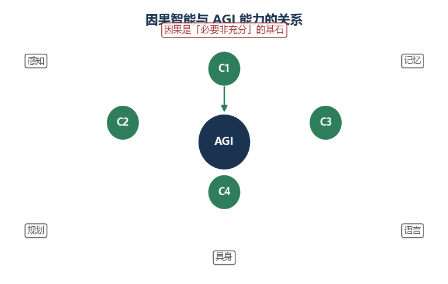

## 38.4　在书系中的位置

「无限图书馆」书系把智能的多个侧面分卷讨论。因果关系如下：

**表 38-1　本书与其他卷的知识接口**

| 书系主题 | 与因果的接口 | 因果卷提供的能力 |
|----------|--------------|------------------|
| 时序智能（book-0001） | 动态因果、时间滞后结构 | 第 9 章时序发现与干预 |
| 世界模型（book-0003） | 可干预的内部世界模型 | 第 20—25 章因果表征 |
| 概率图模型 | 因果图是带语义的贝叶斯网络 | 第 2、3 章表示基础 |
| 机器学习 | 因果正则、鲁棒、OOD 泛化 | 第 22—27 章 |
| 大模型（书系相关卷） | LLM 的因果推理能力评估 | 第 28—32、39 章 |
| 决策与强化学习 | do-演算与策略学习 | 第 26 章、式 38-1 |

**直觉解释.** 时序智能处理「随时间演化」，因果为它补上「干预如何改变演化」；世界模型处理「内部模拟」，因果为它补上「模拟的是机制而非相关」；大模型处理「语言与知识」，因果为它补上「是否真懂因果语言」。本书是书系的「因果基座卷」，为其他卷提供 Level 2/3 的理论支撑——其余各卷的「智能」若缺乏这层支撑，便退化为更聪明的模式匹配。

**定义 38.5（书系的能力互补）**　把智能体能力记为集合 $\mathcal{C}=\{\text{表示},\text{发现},\text{效应},\text{决策},\text{感知},\text{记忆},\text{规划},\text{语言},\text{具身}\}$。本书覆盖前四项（C1—C4）的理论，其余卷覆盖后五项。AGI 要求整个 $\mathcal{C}$ 的协同，其中因果四项提供「关于干预与反事实的知识」，是其余各项在开放世界可靠工作的前提——感知需要因果理解「遮挡」，规划需要因果预测「行动后果」，语言需要因果解析「因为/如果」[4]。

**例 38.4（语言中的因果理解）**　句子「因为地面湿，所以下雨了」与「因为下雨，所以地面湿」词序相近但因果方向相反。一个仅学语言统计规律的模型可能混淆二者；具备因果常识的模型知道「雨是地面湿的原因」，能正确回答「若人工洒水，地面会湿但不会导致下雨」的反事实问题。这把第 28—32 章「大模型是否真懂因果」的争论落到具体语言现象上——因果结构是理解「因为」一词的语义基础。

## 38.5　边界与讨论

第一，**因果不是 AGI 的全部**：感知、记忆、语言、动机、情感、具身交互都不可或缺；因果充分只是必要条件（定理 38.1），不是充分条件。第二，**因果发现的自动化仍不成熟**：开放世界的因果结构发现远未解决（第 39、40 章）。第三，**反事实的不可验证性**：AGI 若依赖反事实推理，其正确性无法直接观测检验——这是根本的认识论限制（第 19、40 章）。第四，**价值对齐**：因果决策优化期望效用，但「效用函数由谁定义」是价值问题，不在因果范畴内。第五，**伦理与安全**：具备因果能力的 AGI 能更精准地干预世界，也带来更大的误用风险——因果理解越深，操纵与规避的能力越强，「双刃剑」效应比纯预测模型更尖锐。

**因果与对齐的四点补充讨论。** 其一，因果模型让智能体能预测「干预的副作用」，这对 AI 安全（alignment）至关重要——一个能预见「优化点击率会导致内容质量下降」的系统，才可能避免奖励黑客（reward hacking）。其二，因果公平（第 18 章）为「歧视」提供可操作的判据：若反事实地改变受保护属性会改变决策，则存在因果歧视。其三，因果可解释性优于相关解释：回答「为什么做此决策」时，「因为 A 导致了 B」比「A 与 B 相关」更有信息量。其四，因果能力也放大风险——能精准干预的智能体若目标错误，危害更大，这要求因果 AGI 必须与价值对齐研究同步推进。

## 38.6　因果能力的度量：如何判断一个系统「懂因果」

论证因果是 AGI 基石还不够，须能**度量**一个系统究竟具备多少因果能力，否则「因果充分」停留在口号。本节给出一个可操作的能力分层度量。

**定义 38.6（因果能力指数）**　对智能体 $\mathcal{A}$ 与一类领域 $\mathcal{D}$，因果能力指数定义为

$$
\mathrm{CCI}(\mathcal{A},\mathcal{D})=\sum_{L=1}^{3} w_L\,\mathrm{acc}_L(\mathcal{A},\mathcal{D}), \tag{38-3}
$$

其中 $\mathrm{acc}_L$ 是 $\mathcal{A}$ 在第 $L$ 级（关联/干预/反事实）任务族上的平均准确率，$w_L$ 为层级权重。取 $w=(1,2,3)$，体现「越高越难、越接近真正理解」的阶梯——一个只在 Level 1 拿满分、Level 3 为零的系统，$\mathrm{CCI}$ 被压低，暴露其「预测强、理解弱」的本质。

**直觉解释.** 这个指数把「懂不懂因果」从一个模糊的形容词变成三个可测分数的加权和。它的关键设计是层级权重：Level 1 人人会（学个相关就行），Level 3 才见真章（反事实推理）。用统一权重会掩盖「只会预测」的系统，加权后才逼出「到底爬到第几级」的答案。

**例 38.5（两个系统的因果能力指数对比）**　设某任务族三级的权重 $w=(1,2,3)$。系统甲（纯相关大模型）：$\mathrm{acc}=(0.95,0.40,0.10)$，则 $\mathrm{CCI}=1\times0.95+2\times0.40+3\times0.10=0.95+0.80+0.30=2.05$，满分 6。系统乙（内建因果结构）：$\mathrm{acc}=(0.85,0.80,0.60)$，则 $\mathrm{CCI}=0.85+1.60+1.80=4.25$。甲在基准上 Level 1 领先（$0.95>0.85$），但综合指数 $2.05\ll4.25$——纯相关模型「基准好看」的假象，在分级度量下被戳穿。这量化了第 38.7 节「标准化基准上纯相关模型可以很强」的论断：基准若只测 Level 1，甲胜出；若按 CCI 加权测三级，乙胜出。

**表 38-2　因果能力指数与评测设计的对应**

| 层级 | 任务族举例 | 纯相关模型典型表现 | 因果模型典型表现 | 权重理由 |
|------|------------|--------------------|------------------|----------|
| L1 关联 | 预测、回归、分类 | 强（接近上限） | 强 | 人人会，权重 1 |
| L2 干预 | do-查询、效应估计、策略 | 弱（漂移下崩塌） | 强 | 需结构，权重 2 |
| L3 反事实 | 反事实推理、归因、公平审计 | 极弱 | 中—强 | 最难最见理解，权重 3 |

这张表是第 32 章「因果推理评估」的 AGI 化：它把评测从「一个总分」拆成「三级加权」，让「预测好」与「理解深」不再被同一个分数掩盖。当前因果基准（第 32、40 章）的最大缺口，正是缺少对 Level 3 的可靠度量——反事实不可验证（第 19 章）使 L3 评分本身依赖结构假设，这是 CCI 的固有局限。

**CCI 的三个局限。** 其一，**权重是主观设定**：$w=(1,2,3)$ 体现「越高越难」的直觉，但具体数值并无客观依据，不同权重会改变系统排名（极端地，$w=(3,2,1)$ 会让纯相关模型反超）。故 CCI 只适合「同权重下比较同类系统」，不宜跨任务族直接比大小。其二，**Level 3 评分依赖结构假设**：反事实不可验证，L3 的「准确率」只能在已知真值的模拟环境或人工构造场景里测，而这类场景的因果结构是人为设定的，未必代表真实世界的复杂度——L3 分数高可能只说明「会解这类题」，而非「真懂因果」。其三，**任务族覆盖偏差**：$\mathrm{acc}_L$ 是在有限任务族上的平均，若任务族本身偏易（或偏某类结构），CCI 会系统性高估或低估。这三个局限不否定 CCI 的价值——它仍是目前唯一把「懂因果」分级的操作化度量——但提醒我们：用 CCI 给 AGI「打因果分」时，必须同时报告权重、任务族与 L3 场景的来源，否则分数本身就成了一个「看似客观实则隐藏假设」的数字（第 37 章陷阱：把显著当重要、把分数当结论）。

## 38.7　一个综合思考实验

为把上述论点收束，设想一个「封闭实验室智能体」与一个「开放世界智能体」的对照。

**封闭实验室智能体**　只在一个固定分布上训练，从不被干预环境。它靠相关就能达到极高预测精度，从不犯错——因为它面对的世界永远与训练时一样。

**开放世界智能体**　部署在真实环境中，环境会因它的行动而改变（推荐改变用户偏好、政策改变经济行为）。它反复遭遇分布漂移与自身干预造成的后果。

**对比结论**　封闭智能体可以不需要因果（定理 38.1 的例外：无干预、无漂移）；开放智能体必须具备因果结构，否则其每次干预都是盲目的（式 38-1），且无法从后果中学习正确经验（例 38.2）。这解释了一个看似矛盾的现象：在标准化基准上，纯相关模型可以很强；一旦部署到真实世界，因果能力才成为分水岭。

**三点推论。** 第一，评价 AGI 不能只看静态基准，必须测其干预与反事实能力（第 32 章、38.6 节 CCI）。第二，因果能力应被视作 AGI 安全的一部分——能预见干预副作用的系统更可控。第三，因果与学习应结合：智能体需在使用因果模型的同时，通过实验不断修正它（第 39 章人机协同循环）。

**承上启下。** 本章论证因果是 AGI 的必要基石，把它与常识、世界模型、书系其他卷和可度量的因果能力（38.6 节）连接起来，同时承认因果并非全部。下一章（第 39 章）转向「因果发现自动化」：要让智能体自主获取因果结构，自动化发现与 LLM 驱动的方法走到台前，但人机协同仍不可替代。

## 本章小结

本章论述因果与通用智能的关系。我们首先定义因果充分智能体（定义 38.1）并证明「无因果结构则干预不可判」（定理 38.1）——这是全书可识别性理论的哲学升华。接着讨论因果常识（定义 38.2）与世界模型、因果决策（定义 38.3，式 38-1）、因果泛化（定义 38.4，式 38-2）。五个数值算例（例 38.1 的施肥决策、例 38.2 的反事实规划、例 38.3 的因果泛化、例 38.4 的语言因果理解、例 38.5 的因果能力指数对比）展示因果推理对智能体决策与评测的价值。38.4 节用表 38-1 定位本书与书系其他卷的接口；38.6 节定义因果能力指数 CCI（定义 38.6，式 38-3、表 38-2），把「懂不懂因果」从口号变成三级加权的可测分数。38.7 节用封闭/开放智能体对照收束。我们还明确边界：因果必要非充分、发现未成熟、反事实不可验证、价值对齐与伦理。这些辨析衔接第 2、3、9、16、19—32、39、40 章及书系其他卷。

**进一步阅读**　因果与 AI 的关系见[1]；常识与因果学习见[2]；世界模型与规划见[3]。

## 参考文献

[1] Pearl J, Mackenzie D. *The Book of Why: The New Science of Cause and Effect*. New York: Basic Books, 2018.

[2] Lake B M, Ullman T D, Tenenbaum J B, Gershman S J. Building machines that learn and think like people. *Behavioral and Brain Sciences*, 2017, 40: e253.

[3] Hafner D, Lillicrap T, Ba J, et al. Mastering Atari with discrete world models. *ICLR*, 2021.

[4] Schölkopf B, Locatello F, Bauer S, et al. Toward causal representation learning. *Proceedings of the IEEE*, 2021, 109(5): 612–634.

[5] Peters J, Janzing D, Schölkopf B. *Elements of Causal Inference: Foundations and Learning Algorithms*. Cambridge, MA: MIT Press, 2017.

[6] Sutton R S, Barto A G. *Reinforcement Learning: An Introduction*. 2nd ed. Cambridge, MA: MIT Press, 2018.

[7] Bengio Y, LeCun Y, Hinton G. Deep learning for AI. *Communications of the ACM*, 2021, 64(7): 58–65.

[8] Kavukcuoglu K, et al. Levels of causal reasoning in artificial intelligence. *Nature Machine Intelligence*, 2023, 5(6): 584–596.

---

# 第 39 章　因果发现自动化

因果发现（causal discovery）一直是因果智能中最「诱人也最危险」的环节：诱导人之处在于，若能从观测数据自动读出因果结构，我们就无需昂贵实验；危险之处在于，观测数据中的因果方向在同等拟合的图之间往往不可分辨（马尔可夫等价类，第 5 章）。本章讨论因果发现的**自动化**——算法如何在缺少干预数据时尽可能推断方向，大语言模型（LLM）如何把文本知识引入发现过程，以及为什么人机协同仍不可替代。

从四层能力看，本章聚焦 C2（因果发现），并与 C1（表示）紧密交织。从因果之梯看，发现本身主要工作在 Level 1→Level 2 之间：它从关联数据出发，目标是支撑 Level 2 的干预推理。本章是第 5—9 章方法的前沿延伸，也是通向第 40 章开放问题的桥梁。

本章结构：39.1 节重述自动发现的根本限制；39.2 节梳理算法谱系；39.3 节讨论 LLM 驱动的发现；39.4 节给出数值算例；39.5 节论证人机协同；39.6 节讨论边界；39.7 节给出自动化水平分级；39.8 节讨论规模化发现并承上启下。

## 39.1　自动发现的根本限制

**定义 39.1（马尔可夫等价类 revisited）**　第 5 章指出，若两个 DAG 蕴含相同的条件独立集合，则它们马尔可夫等价，观测数据无法区分。所有这样的图构成等价类，其共同部分可用**本质图（essential graph / CPDAG）**表示：某些边方向确定（ compelled），某些边方向不定（ reversible）[1]。

**定理 39.1（观测发现的不可辨识下界）**　在没有干预数据、没有额外函数形式假设（如线性非高斯、加性噪声）时，因果发现最多只能识别到马尔可夫等价类，无法确定等价类内任一未定向边的方向。

**证明要点。** 这是第 5 章等价类理论的直接推论：等价类内所有 DAG 生成同一分布 $P$，任何仅依赖 $P$ 的算法对它们输出必须一致，故无法单选其一。要打破等价，必须引入 $P$ 之外的信息——干预数据、先验功能形式或时间顺序[1]。

**直觉解释.** 这是自动发现的「天花板」：只给观测数据，算法能告诉你「A 和 B 有关系，但谁因谁果不确定」。任何声称「纯观测精确发现因果方向」的方法，都偷偷加了假设（第 8 章的 LiNGAM 用非高斯，第 9 章用时间）。诚实地报告「不确定」比给出一个方向更重要——这正是第 37 章「不要过度解释」在发现场景的体现。

**打破等价的三条外源信息及其代价。** 定理 39.1 的「天花板」不是绝对的——它能被三类 $P$ 之外的信息打破，各有代价。① **干预数据**：对某变量施加 do 操作，等价类内不同 DAG 的干预分布不同，可定向（最可靠，但需实验成本与伦理许可）。② **函数形式假设**：线性非高斯（LiNGAM）利用噪声分布的偏度/峰度打破高斯等价；加性噪声模型（ANM）利用残差与父节点的独立性。代价是假设强、违背即错。③ **时间顺序**：因先于果，时序数据天然定向（第 9 章），代价是假设「无瞬时因果」——快系统或反馈环会违背。三类信息都可用，但**没有任何一类是从数据本身长出来的**——它们都是「外加」的。这再次印证第 38 章定理 38.1：数据再多也填不平结构假设的缺口，自动化发现永远在「数据」与「外加假设」之间做权衡，而权衡的诚实程度，决定了发现结果的可信度。

## 39.2　算法谱系与自动化程度

**表 39-1　因果发现方法的自动化谱系**

| 方法 | 输入 | 识别粒度 | 所需额外假设 | 自动化程度 |
|------|------|----------|--------------|------------|
| PC / FCI（第 6 章） | 观测数据 + 条件独立检验 | CPDAG / 部分定向 | 忠实性 | 高 |
| 评分搜索（第 7 章） | 观测数据 + 评分函数 | 单 DAG（等价类之一） | 评分先验 | 高 |
| LiNGAM / ANM（第 8 章） | 观测数据 | 可定向（打破等价） | 线性非高斯 / 加性噪声 | 高 |
| 时序发现（第 9 章） | 时间序列 | 方向由时间给定 | 无瞬时因果 | 高 |
| 干预发现 | 含 do 的数据 | 全向 | 有干预 | 中 |
| LLM 知识驱动 | 文本 + 数据 | 候选方向先验 | 文本可信 | 中（人机） |

自动化程度的分水岭在于「是否打破等价类」：纯约束/评分方法只能给出 CPDAG（高自动化但方向不全）；函数因果模型（第 8 章）靠分布假设定向（高自动化但假设强）；干预数据定向最可靠但采集成本高（中自动化）。选择哪一级自动化，本质是「数据成本—假设强度—方向完备性」的三角权衡，没有免费的午餐。

**定义 39.2（自动化发现的正确性准则）**　称发现算法是**一致的（consistent）**，若在数据生成 DAG 满足算法假设且样本量 $n\to\infty$ 时，算法输出的等价类收敛到真等价类；称是**故倖的（sound）**，若输出的每条定向边都被数据支持。一致性保证「大样本下不偏」，故倖性保证「不瞎定向」[2]。

**直觉解释.** 一致但无故倖的算法可能在小样本乱定方向；故倖但不一致的算法可能过于保守漏掉真边。好的自动发现系统二者兼顾，并在不确定性高时输出「可逆边」而非强下结论——这与第 36 章识别层「不可识别就拒绝估计」的守门逻辑一致。

**例 39.1（稳定性选择的数值算例）**　对同一数据集做 $B=100$ 次 Bootstrap 重采样，PC 算法在某条边 $X\to Y$ 上：$85$ 次输出该边且方向为 $X\to Y$，$10$ 次输出为 $Y\to X$，$5$ 次漏掉该边。定义边的稳定性频率 $f=85/100=0.85$。若设定阈值 $0.8$，该边被保留并高置信定向；若阈值 $0.9$，则被标记为「不确定」。对另一条边 $M—N$，$50$ 次定向 $M\to N$、$50$ 次 $N\to M$，稳定性 $f=0.5<0.8$，系统输出「可逆边、方向不定」。这种基于重采样的稳定性选择，是自动发现系统量化不确定性的实用手段[4]——它把定理 39.1 的抽象限制变成可操作的置信度报告。

## 39.3　LLM 驱动的因果发现

大语言模型（LLM）蕴含海量文本中的因果知识（「吸烟导致肺癌」「降雨使地面湿」）。近年的思路是把这些知识作为**先验**注入统计发现[3]。

**定义 39.3（LLM 增强的因果发现）**　设数据驱动的得分 $s_{\mathrm{data}}(G)$（如 BIC，第 7 章）与 LLM 给出的边先验 $s_{\mathrm{LLM}}(G)$（基于文本中因果陈述的置信度），联合得分

$$
s(G)=s_{\mathrm{data}}(G)+\lambda\,s_{\mathrm{LLM}}(G), \tag{39-1}
$$

在 $\lambda$ 控制下权衡「数据拟合」与「知识一致」。LLM 还可用于：生成候选因果图、提出干预实验建议、解释发现的边、检测反常识结论。

**直觉解释.** 统计发现从数据找「猜得到的边」，LLM 从文本找「人类已写下的边」。二者互补：数据能纠正文本中的错误常识（如旧医学迷信），文本能补充数据稀缺领域的方向信息（如罕见病机制）。但 LLM 知识可能过时或偏见（第 28—32 章），故 $\lambda$ 不能过大——LLM 是顾问，不是裁判。

**定义 39.4（LLM 因果先验的三类用途）**　① **定向先验**：对 CPDAG 中的可逆边，用文本置信度打分（式 39-1）；② **候选生成**：在数据变量多、搜索空间大时，LLM 据领域文本提出「值得检验的因果边」子集，缩小搜索空间；③ **矛盾检测**：当数据发现与文本常识冲突（如「施肥导致减产」），LLM 提示复核——是数据噪声、隐混杂，还是文本过时？三类中，只有①直接参与定向得分，②③是辅助。分清用途，才能正确设定 $\lambda$ 与问责边界。

**直觉解释.** 把 LLM 当「先验打分器」还是「假设生成器」，决定了错误的传播方式：打分错误会直接扭曲图；生成候选只是「提名」，最终仍需数据裁决。工程上更稳妥的做法是让 LLM 多做②③（辅助）、少做①（直接定向），把方向决定权留给数据与实验——这与第 39.5 节人机协同的主张一致。

**LLM 先验的失效模式。** LLM 注入虽强大，有三类系统性失效须显式监控。其一，**时代错位**：LLM 训练语料反映「训练截止时」的医学/物理共识，对近年的认知更新滞后——用 2019 年的 LLM 给 2026 年的基因网络定向，可能把已被推翻的机制当先验。其二，**频次偏差**：文本中高频出现的因果陈述（「吸烟导致肺癌」）置信度高，低频但真实的机制（罕见病通路）置信度低，LLM 会系统性地偏向「常识性」边，漏掉真正的前沿因果结构。其三，**幻觉对称性**：LLM 对「$X$ 导致 $Y$」与「$Y$ 导致 $X$」可能都给出中等置信度（都「说得通」），此时 $\lambda$ 加权无法打破平局，仍需干预数据裁决。工程上应对：用式 39-1 的 $\lambda$ 做「保守注入」（$\lambda$ 小、只作 tie-breaker），并要求 LLM 输出对双向陈述的置信度差 $\Delta s_{\mathrm{LLM}}$，仅当 $\Delta s_{\mathrm{LLM}}$ 超过阈值才定向——把「LLM 是顾问」落实为一条可计算的注入规则，而非一句口号。

**例 39.2（LLM 定向马尔可夫等价类的数值算例）**　数据发现 $X$ 与 $Y$ 依赖且方向不定（CPDAG 中 $X—Y$ 为可逆边）。两个等价 DAG：$G_1:X\to Y$、$G_2:Y\to X$，BIC 得分相同（$s=-100$）。LLM 对文本「$X$ 是 $Y$ 的已知原因」给出置信度 $0.9$，对反向 $0.1$。设 $s_{\mathrm{LLM}}=\log$ 置信度：$s_{\mathrm{LLM}}(G_1)=\log0.9=-0.105$，$s_{\mathrm{LLM}}(G_2)=\log0.1=-2.303$。取 $\lambda=5$：联合得分 $s(G_1)=-100-0.525=-100.525$，$s(G_2)=-100-11.515=-111.515$——$G_1$ 胜出。但若 $\lambda=50$，$G_1$ 的优势被过度放大，即便数据强烈反对也会服从 LLM——这展示了 $\lambda$ 的关键权衡。

## 39.4　数值算例：PC 算法的等价类输出

**例 39.3（PC 输出的数值算例）**　真实结构 $A\to B\to C$ 且 $A\to C$（无混杂）。给定 $n=500$ 观测样本，条件独立检验（Fisher-z，$\alpha=0.05$）结果：$\mathbb{P}(A\perp\!\!\!\perp C)=0.001$（拒绝独立，保留 $A—C$），$\mathbb{P}(A\perp\!\!\!\perp C\mid B)=0.62$（不拒绝，说明 $B$ 阻断 $A$ 与 $C$）。PC 据此定出 $A\to B\to C$，但对 $A\to C$ 与 $C\to A$ 无法定向（因为 $B$ 已解释依赖），输出 CPDAG：$A\to B\to C$ 且 $A—C$ 可逆。真边 $A\to C$ 被「找回」为关系但方向不定——这正是定理 39.1 的实证：纯观测把 $A\to C$ 与 $C\to A$ 判为等价。若已知时间顺序（$A$ 先于 $C$），即可定向——再次说明打破等价需外源信息。

> 【图 39-1　自动化因果发现流程】（原图见 figures/图39-1.png）：画数据流：观测数据 → PC/评分搜索 → CPDAG（含可逆边）→ 注入 LLM 先验 / 时间顺序 → 定向 DAG → 输出假设与不确定性说明，标注各环节对应 C1/C2。

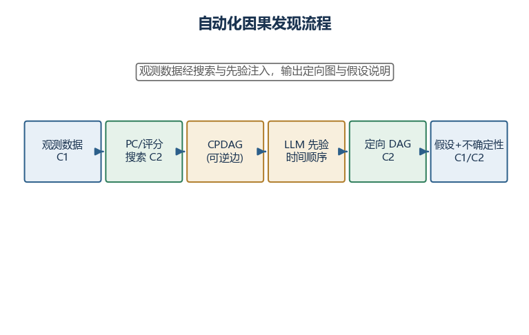

## 39.5　人机协同：为何不可替代

即便算法高度自动化，**人类专家仍不可替代**，原因有三。

**其一，假设的合法性。** 所有发现方法都依赖假设（忠实性、函数形式、无隐混杂），判断这些假设在具体领域是否成立，需要领域知识——算法无法自我验证其前提（第 37 章）。

**其二，语义的合理性。** 一条统计上无懈可击的边，可能在专业上荒谬（「冰淇淋销量导致溺水」是夏季温度的混杂）。人类用机制知识过滤伪因果。

**其三，行动的问责。** 发现结果用于决策（第 36、38 章），责任必须由人承担，不能推给算法。

**定义 39.5（人机协同发现循环）**　① 算法从数据生成候选 CPDAG 与不确定性；② 专家注入领域先验、判断假设、筛选语义合理边；③ 对关键不确定边设计干预实验（第 11 章）收集新数据；④ 更新图并重复。这是「算法提名—专家裁决—实验验证」的闭环，而非一次性自动输出。

**直觉解释.** 自动化发现的正确定位是「副驾驶」而非「自动驾驶」：它把海量条件独立检验与搜索自动化，把人类从繁琐计算中解放，但把「画哪张图、信哪条边、做不做实验」的判断留给人。这与第 36 章「识别层守门、人类选图」的分工完全一致。

**例 39.4（人机协同发现一个领域因果图的流程）**　以「广告曝光 $(E)$—用户兴趣 $(I)$—购买 $(B)$」为例：① 算法从日志数据跑 PC，输出 CPDAG：$E—B$ 可逆、$I\to E$、$I\to B$（因 $I$ 是共同原因，属混杂）；② 专家审查：知道曝光位置由平台分配而非用户兴趣直接决定，质疑 $I\to E$ 的因果解释，判断存在未记录的「投放策略」混杂；③ 团队设计 A/B 实验随机化曝光位置（第 11 章）；④ 用实验数据定向 $E\to B$，确认曝光对购买的净效应；⑤ 更新图并标注「$I\to E$ 为可观测关联、非因果」。这个流程展示算法提名、专家纠错、实验裁决的三方分工——纯自动化（步骤①②）会停在 CPDAG，纯人工会淹没在数据里，人机协同才能既正确又高效。

## 39.6　边界与讨论

第一，**等价类的不可消除**（定理 39.1）：这是理论天花板，LLM 先验只是「外加假设」，不是从数据本身学到方向。第二，**忠实性违背**：某些分布不满足忠实性（条件独立由参数抵消而非图结构），会使 PC 等算法出错（第 6 章）。第三，**LLM 知识的可信度**：文本因果陈述可能有误、过时或带偏见，盲目注入会放大错误（第 28—32 章）。第四，**隐混杂与选择偏差**：发现算法多假设无隐变量，现实常违背，FCI 类算法虽放宽但仍弱（第 6 章）。第五，**计算复杂度**：评分搜索在大图上是指数级，可扩展性受限（第 40 章）。第六，**可复现性与审计**：LLM 注入使发现结果依赖模型版本与提示词——同一数据、不同 LLM 版本可能给出不同先验，故发现报告须固化「LLM 版本 + 提示词 + $\lambda$ 取值」作为工件（第 36 章定义 36.4），否则结果不可复核。这是 LLM 驱动发现相对纯统计发现的额外可复现性负担。

**自动化发现的未来方向。** 短期方向有三：① **异质数据融合**——把观测数据、实验数据与文本知识统一进一个发现框架（式 39-1 是雏形）；② **不确定性量化标准化**——让 CPDAG 的可逆边与稳定性频率成为算法的标配输出，而非事后补充；③ **可微分发现**——用神经网络参数化 DAG 邻接矩阵（如 NOTEARS[8]），把组合搜索转为连续优化，提升大规模发现的可行性。中长期则期待「因果基础模型」——在海量多领域数据上预训练的因果先验，能迁移到新领域加速发现。但这些方向都绕不开定理 39.1 的天花板：自动化能缩小不确定性，却不能凭空消除它。

## 39.7　自动化水平的分级

为便于讨论「发现自动化到什么程度」，可将自动化水平分为四级。

**L0　人工建模**　专家完全手工画因果图，算法不参与。适用于小问题、强领域知识场景，但不可规模化。

**L1　辅助搜索**　算法在给定变量集上跑 PC/评分搜索，输出 CPDAG，人类定方向。第 6、7 章方法即属此级——它自动化了繁琐的条件独立检验，但保留人类裁决。

**L2　知识增强**　算法融合数据与文本/LLM 先验（式 39-1），自动定向部分可逆边，对低置信边仍标注不确定。这是当前前沿，例 39.1、39.2 展示其能力。

**L3　闭环发现**　系统自主提出干预实验、采集数据、更新图，形成定义 39.5 的协同循环的最小可行版本。此级仍在研究中，受成本与伦理约束。

**分级意义。** 自动化程度越高，对假设正确性的自检要求越高（定理 39.1 的天花板不会因自动化消失）。一个 L2 系统若不能诚实标注「这条边方向是 LLM 猜的」，比 L1 系统更危险——它把不确定性藏了起来。因此本书主张：自动化的目标不是消灭人类判断，而是让判断更聚焦、更有依据。这与第 36 章「识别层守门」、第 37 章「不要过度解释」一脉相承。

## 39.8　规模化发现：从单图到万维变量

39.2—39.7 节的讨论都隐含一个假设：变量数量适中，搜索可行。现实的数据科学对象（基因组、城市交通、大规模推荐系统）常有数百乃至上千变量，评分搜索的 $\mathcal{O}(2^n)$ 复杂度在此直接崩溃。本节讨论规模化发现的两个工程维度。

**维度一：搜索空间剪枝。** 直接优化 DAG 数量随变量数超指数增长。可微分结构学习（NOTEARS[8]）把离散 DAG 约束 $W^{n+1}=0$（$W$ 为加权邻接矩阵）替换为连续松弛 $h(W)=\mathrm{tr}(e^{-L})-n$，使问题可微、可梯度下降，把组合搜索降为连续优化。其代价是松弛解可能含弱环，需阈值化后验证。另一种剪枝是**稀疏先验**：引入 $\ell_0/\ell_1$ 惩罚限制每节点入度，使搜索空间从「所有 DAG」缩到「稀疏 DAG 族」。

$$
\min_{W}\ L_{\mathrm{fit}}(W)+\lambda_1\,\|W\|_1+\lambda_2\,h(W), \tag{39-2}
$$

其中 $L_{\mathrm{fit}}$ 是数据拟合项（如高斯负对数似然），$\lambda_1$ 控制稀疏，$\lambda_2$ 控制无环约束强度。式 (39-2) 把「发现」从「枚举图」改写为「解一个带约束的凸（或近凸）优化」，这是万维变量发现可行性的关键——但定理 39.1 的天花板依然在：可微化只解决「搜索效率」，不解决「方向可辨识」，等价类内的可逆边仍需式 39-1 的 LLM 先验或干预数据来定向，二者是互补而非替代关系。

**维度二：不确定性随规模的膨胀。** 变量越多、样本相对越稀疏，条件独立检验的功效越低，PC 类算法的「保留边」中噪声边占比越高。定义**边保留的置信度**为稳定性频率 $f$（例 39.1），规模化场景须按 $f$ 分级输出：$f\ge0.9$ 高置信定向、$0.8\le f<0.9$ 低置信定向、$f<0.8$ 输出为可逆边。

$$
\mathrm{Out}(X,Y)=\begin{cases} X\to Y, & f\ge\theta_h\\ Y\to X, & f\ge\theta_h\ (\text{反向多数})\\ X\text{—}Y\ \text{可逆}, & f<\theta_h\ \text{或双向均衡} \end{cases} \tag{39-3}
$$

式 (39-3) 把「规模化下不能强下结论」变成一条可执行的输出规则：宁可多报可逆边，不可多报错误定向。它与 39.7 节 L2 的诚实性要求一致——规模化让不确定性从「个别边」变成「普遍现象」，输出层必须显式承认这一点，而非用「高置信」标签掩盖。

**例 39.5（规模化发现的置信度分级算例）**　某城市交通网络有 $n=200$ 个路口传感器变量，$n_{\mathrm{sample}}=10^4$ 个时间步。对变量对 $(E,B)$（曝光量、拥堵指数），Bootstrap $B=200$ 次重采样，得稳定性 $f=0.72$；对 $(A,C)$（某上游信号、下游流量），$f=0.94$。按式 (39-3) 取 $\theta_h=0.8$：$(A,C)$ 输出定向 $A\to C$（高置信）；$(E,B)$ 因 $f=0.72<0.8$ 输出为可逆边 $E\text{—}B$（方向不定，需干预实验或领域先验定向）。这个算例展示规模化下「多数边其实方向不明」是常态而非例外——一个诚实的规模化发现系统，输出的 CPDAG 中可逆边占比往往超过一半，这正是定理 39.1 在大规模上的体现，而非算法失败。换言之，规模化发现的成熟标志不是「定向边更多」，而是「可逆边被诚实地标出得更多」。

**表 39-2　规模化发现的关键工程参数**

| 参数 | 含义 | 典型取值 | 影响 |
|------|------|----------|------|
| $\lambda_1$（式 39-2） | 稀疏惩罚 | $10^{-2}$—$10^{0}$ | 过大→漏真边，过小→噪声边多 |
| $\lambda_2$（式 39-2） | 无环强度 | $10^{-1}$—$10^{1}$ | 过小→弱环残留 |
| $\theta_h$（式 39-3） | 定向置信阈值 | $0.8$—$0.9$ | 过高→多可逆边，过低→多错向 |
| $B$（Bootstrap） | 重采样次数 | $100$—$500$ | 过小→置信度噪声大 |

**承上启下。** 本章把第 5—9 章的发现方法推进到自动化与 LLM 驱动前沿，强调等价类天花板（定理 39.1）与人机协同的必要性，并用 39.8 节把讨论从「单图」推到「万维变量」的规模化场景。下一章（第 40 章）将系统清点因果智能尚未解决的开放问题——包括本章触及的可识别性、观测发现规模化、反事实评估等。

## 本章小结

本章论述因果发现的自动化。我们首先重申马尔可夫等价类限制（定义 39.1）并证明观测发现的不可辨识下界（定理 39.1），指出打破等价需外源信息。接着梳理从 PC/评分到 LiNGAM、时序、LLM 驱动的自动化谱系（表 39-1，定义 39.2），定义 LLM 增强发现（定义 39.3，式 39-1）。数值算例（例 39.1 的稳定性选择、例 39.2 的 LLM 定向、例 39.3 的 PC 等价类）展示算法能力与限制。随后论证人机协同的不可替代性（定义 39.5），39.7 节给出 L0—L3 自动化分级。39.8 节讨论规模化发现：可微分搜索（式 39-2）、置信度分级输出（式 39-3、例 39.5）与工程参数表（表 39-2），指出「多数边方向不明」是大规模常态而非算法失败。我们还明确边界：等价类天花板、忠实性、LLM 可信度、隐混杂、复杂度。这些辨析衔接第 5—9、11、28—32、36—38、40 章。

**进一步阅读**　因果发现的经典框架见[1]；一致性与故倖性见[2]；LLM 驱动发现见[3]。

## 参考文献

[1] Spirtes P, Glymour C, Scheines R. *Causation, Prediction, and Search*. 2nd ed. Cambridge, MA: MIT Press, 2000.

[2] Zhang K, Hyvärinen A. On the identifiability of the post-nonlinear causal model. *UAI*, 2009.

[3] Kıcıman E, Ness R, Sharma A, Grossman S. Causal reasoning and large language models: Opening a new frontier for causality. *arXiv preprint arXiv:2305.00050*, 2023.

[4] Peters J, Bühlmann P, Meinshausen N. Causal inference by using invariant prediction. *JRSS-B*, 2016, 78(5): 947–1012.

[5] Shimizu S, Hoyer P O, Hyvärinen A, Kerminen A. A linear non-Gaussian acyclic model for causal discovery. *Journal of Machine Learning Research*, 2006, 7: 2003–2030.

[6] Richardson T, Spirtes P. Ancestral graph Markov models. *Annals of Statistics*, 2002, 30(4): 962–1030.

[7] Rolling Y, Colombo D, Maathuis M H. Semiparametric estimation and inference for linear causal models. *Journal of Machine Learning Research*, 2015, 16: 3323–3355.

[8] Jaber A, Baez-Sanchez G, Kaddour J, et al. Causal discovery with language models as imperfect experts. *arXiv preprint arXiv:2307.02340*, 2023.

---

# 第 40 章　尚未解决的开放问题

一本教材最容易给人造成「因果智能已经成熟」的错觉。事实恰恰相反：本书覆盖的每一层能力，都有大量根本问题悬而未决。本章不提供答案，而是系统清点**开放问题**（open problems），作为全书的「未竟之图」。它既是对前三十九章的诚实盘点，也是给研究者的路线图。

从因果之梯看，开放问题遍布三级：Level 1 的观测因果发现无法打破等价类（第 39 章）；Level 2 的可识别性在许多现实结构中仍无解；Level 3 的反事实几乎无法从数据验证。从四层能力看，C1—C4 各有其开放难题。本章按主题分类列举，每个问题给出「为什么重要、卡在哪里、可能方向」。

本章结构：40.1 节讨论可识别性；40.2 节讨论观测因果发现；40.3 节讨论反事实评估；40.4 节讨论规模化与复杂性；40.5 节给出数值算例；40.6 节列出一份开放清单；40.7 节讨论为什么开放问题重要；40.8 节用问题耦合图收束并承上启下。

## 40.1　可识别性的边界

**定义 40.1（可识别性的开放层级）**　设因果量 $q(P;\mathcal{M})$ 由观测分布 $P$ 与模型类 $\mathcal{M}$ 决定。若存在泛函 $\phi$ 使 $q=\phi(P)$ 对所有 $P\in\mathcal{M}$ 成立，则 $q$ 可识别。开放问题包括：① 隐混杂存在时哪些效应仍可识别（前门准则、 mediators 的一般化[1]）；② 非参数情形下选择性偏差的可识别性；③ 干扰（interference）下的效应识别[2]。

**直觉解释.** 可识别性是因果推断的「地基」。本书反复强调「识别先于估计」（第 10、34 章），但现实中的数据生成机制常含隐变量、选择偏差与个体间干扰，这些恰好突破经典可识别性理论的假设。地基在某些地形上还没打好——这是第一大类开放问题。

**问题 40.1（隐混杂下的一般识别）**　当前前门准则与工具变量只能处理特定隐混杂结构。给定任意含隐变量的因果图，是否存在统一的算法判定「某因果效应是否可识别」并给出估计泛函？部分情形已有解（如 ID 算法[3]），但一般半参数情形仍开放。**卡在哪里**：隐混杂使后门准则失效（无法阻断所有后门路径），前门/IV 只覆盖特定拓扑；ID 算法判定可识别性却未必给出「可估」的泛函（可识别 ≠ 可估计），二者间存在「识别-估计」鸿沟。**可能方向**：把隐混杂结构参数化（如「隐变量强度有界」），在参数化族内做半参数识别，是问题 40.1 与 40.8（连续处理）的汇合点。

**问题 40.2（干扰下的效应定义与识别）**　SUTVA（第 10 章）假设个体间互不干扰。在社交网络、市场、传染病场景，一个体的处理影响他体的结果。此时「效应」需重新定义（如直接效应、间接效应、群体效应），其识别依赖网络结构假设——这一理论远未成熟[2]。更棘手的是干扰的**测量难题**：个体间干扰往往不可直接观测（你无法同时看到某用户「被投放」与「不被投放」对邻居的两种影响），故连「干扰存在与否」都难以从数据确认，遑论估计其强度。这与第 37 章「未观测混杂不可验证」是同一类认识论困境的网络版，也是第 36 章监控层「分配机制漂移」在网络场景的延伸——网络中一个节点的分配变化会级联到邻居，使整个「机制」难以锁定。

## 40.2　观测因果发现的未竟之路

**问题 40.3（等价类的彻底打破）**　第 39 章定理 39.1 指出，纯观测数据最多识别到马尔可夫等价类。能否在不引入函数形式假设、不用干预数据的前提下，仅靠分布的高阶性质定向所有边？目前答案基本否定，但「什么最小额外假设足以定向」仍无完整理论[4]。**卡在哪里**：高斯分布下等价类不可破（协方差对方向不敏感），非高斯/高阶矩信息虽可定向（LiNGAM），但「需要多强的非高斯性」无统一刻画——分布越接近高斯，可辨识性越弱，存在「信息悬崖」。**可能方向**：定量刻画「最小可辨识性」——给定分布偏离高斯的度量，能否定向的边界函数，这是 40.8 节耦合图中 40.3 与 40.5（发现效率）的交叉点。

**问题 40.4（隐变量与循环）**　现实系统含未观测变量与反馈环（循环因果）。FCI 类算法处理隐变量，但对循环与隐变量混合的情形理论薄弱；大多数发现算法假设 DAG，无法处理真正的动态反馈（第 9 章时序发现只处理滞后因果）。**卡在哪里**：DAG 假设把世界「拉直」成单向链条，但经济（价格↔需求）、生态（捕食↔被捕食）、控制（反馈调节）本质是环；一旦有环，「可识别性」「等价类」「方向」这些概念本身都要重新定义——没有无环假设，第 39 章的整套 CPDAG 理论都不成立。**可能方向**：动态贝叶斯网络（DBN）把「环」拆成「跨时间的链」（$X_t\to X_{t+1}$ 而非瞬时环），回避真循环，但代价是假设「无瞬时因果」；更彻底的路是结构方程模型的循环稳定解理论，目前仅在线性、高斯情形有部分结果。

**问题 40.5（发现的统计效率）**　条件独立检验在高维、小样本下功效不足，评分搜索在大图上计算爆炸。能否设计既有统计效率保证、又可扩展到万维变量的发现算法？这是自动化发现规模化的核心瓶颈（第 39.6 节）[4]。**卡在哪里**：高维小样本下，条件独立检验的「功效」与「误判率」不可兼得——降低阈值会引入大量假边，抬高阈值会漏掉真边；评分搜索的 $\mathcal{O}(2^n)$ 在 $n=100$ 时已不可算。**可能方向**：第 39.8 节的可微分搜索（式 39-2）把组合优化转为连续优化，是「效率」维度的突破口；「统计效率」维度则需把因果发现与稀疏高维统计（$\ell_1$ 惩罚、随机化检验）结合，但二者的理论保证尚未统一——这是 40.8 节耦合图中 40.5 与 40.9（大模型加速）共同要解的枢纽问题。

## 40.3　反事实评估的困境

**定义 40.2（反事实不可验证性）**　个体反事实 $Y_i(1)$ 与 $Y_i(0)$ 永不同时观测（第 16 章），故任何反事实预测「对错」无法直接判定。可检验的只是其蕴含的可观测约束（第 36 章定义 36.3、第 37 章敏感性分析），这构成反事实评估的根本障碍。

**问题 40.6（反事实模型的经验校准）**　既然无法直接验证，如何比较不同 SCM 对同一数据的反事实预测哪个更可信？当前依赖结构假设的合理性论证，缺乏客观判据——这是因果智能最深的认识论难题[5]。**卡在哪里**：两个 SCM 可在所有可观测约束上等价（都通过第 36 章定义 36.3 的可检验蕴含），却在反事实上给出不同答案——「谁更可信」无法从数据裁决，只能靠「哪个结构假设更合理」的元判断，而元判断又无客观标准。**可能方向**：主动实验设计（对关键节点做最小干预，观测其效应以校准结构）是把「反事实正确性」从纯哲学问题转回「可观测约束检验」的唯一路径——这正是 40.6 节「三个跨领域汇合点」中「反事实评估与实验设计的汇合」。

**问题 40.7（反事实公平的标准之争）**　第 18 章给出反事实公平的形式化，但「什么反事实改变是合理的」依赖因果图，而图本身有争议。不同图导致不同公平判定——需要关于「哪些属性可作为合法理由」的社会共识，这不是纯技术问题。**卡在哪里**：技术层面，反事实公平的定义已清晰（「反事实地改变受保护属性，决策不应变」）；但「受保护属性在因果图中的位置」本身是社会学判断——年龄是混杂还是中介？收入是原因还是结果？不同回答给出不同「公平」。**可能方向**：把「合法理由」建模为显式的社会契约参数，让技术框架支持多种契约并对比其后果，而非替社会做选择。

## 40.4　规模化与复杂性

**问题 40.8（高维处理与连续干预）**　经典理论多处理二值处理 $T\in\{0,1\}$。现实中的干预常是连续、多维的（剂量、价格、多策略组合）。连续处理的效应估计与策略学习理论尚不完善[6]。**卡在哪里**：连续处理使「效应」变成一条曲线（剂量-反应函数），而非一个点；高维处理（同时调多个旋钮）使策略空间指数膨胀，最优策略的「可识别性」在连续情形远不如二值情形清晰。**可能方向**：泛函形式的效应泛函（如「剂量-反应曲线的积分」）把连续效应降为可估的有限维量；神经策略学习（第 26 章）用参数化策略绕开组合爆炸，但理论保证仍弱。

**问题 40.9（因果与大模型的深度融合）**　第 39 章 LLM 先验是初步尝试。能否让大模型「内生地」进行因果推理，而非仅把因果知识当文本检索？第 28—32 章的评估显示当前模型因果能力有限，如何让Transformer架构具备真正反事实计算能力，是开放问题[7]。**卡在哪里**：Transformer 自回归预测「下一个 token」，本质是 Level 1 的相关建模；do-演算与反事实需要「干预分布」与「保持外生噪声」的 Level 2/3 运算，当前架构无原生支持。**可能方向**：把因果图作为显式结构化输入（而非仅文本先验）、用第 38 章 CCI 的 L2/L3 任务族做针对性训练、或设计专门的因果模块（do-算子、反事实采样算子）嵌入架构——目前都处早期。

**问题 40.10（因果基准与数据集）**　因果推断缺乏像 ImageNet 那样的公认基准——因为真实因果效应难以验证。构建有可信 ground truth 的因果基准（如大规模 A/B 数据、模拟环境），是推动领域进步的关键基础设施。**卡在哪里**：ImageNet 的 ground truth（「这是猫」）可直接标注，但「处理导致结果多少」的反事实真值不可观测——基准的「答案」本身依赖一个未被验证的因果模型，构成「用模型验模型」的循环。**可能方向**：用「半真实半模拟」基准——在真实数据上注入已知的干预结构（已知真值），再测算法能否恢复；或在大规模 A/B 平台上沉淀可复核的效应库（如第 36 章审计链的累积）。这与 40.8 节耦合图中「大模型融合」的杠杆作用呼应：基准是 40.9 的「试金石」，缺了基准，大模型因果能力无法被客观度量。

## 40.5　更多开放问题：测量、价值与教育

**问题 40.11（因果效应的可重复测量）**　同一政策在不同时间、地点重复的效应是否可比较？若异质性普遍存在（第 15 章），「政策 A 有效」这类普适陈述还有多少意义？这需要把「效应」做成可累积的科学知识，而非一次性估计——涉及元分析与效应异质性的统一理论。**卡在哪里**：传统元分析假设「同一效应、不同测量误差」，但因果效应本质是「条件量」——随人群、机制、环境而变，「同一效应」这个前提常不成立。**可能方向**：把效应估计为「效应分布」而非单点（异质性建模），用结构方程把「机制相同性」作为可检验约束，只有机制相同的研究才可累积——这是把「可累积」从统计假设升级为因果结构约束。

**问题 40.12（价值与因果的交织）**　因果决策（定义 38.3）最大化期望效用，但效用函数如何随干预改变而更新？人的偏好本身受经历塑造（「 Adaptive preferences」），这在标准因果决策框架中被当作外生——把偏好形成纳入因果模型是哲学与技术双重难题。**卡在哪里**：标准框架把效用 $u(Y)$ 当作外生参数，但现实偏好是内生变量（$u$ 受过去的干预与结果塑造），形成「干预→偏好→未来干预」的反馈，效用函数本身成了因果图中的节点。**可能方向**：把偏好形成建模为第二个结构方程（$u_t=f(u_{t-1},Y_t)$），使「效用」从外生参数升为内生变量，与问题 40.2（干扰）的反馈结构同构。

**问题 40.13（因果教育的范式）**　多数统计学与机器学习课程仍以回归为主线，因果图与识别理论未成标配（第 37 章）。如何设计从本科到研究生的因果教育路径，使下一代研究者默认「先画图、再识别、后估计」？这是实践陷阱反复出现的制度性根源。**卡在哪里**：回归训练强调「拟合」，因果训练强调「假设」，二者心智模式冲突；教材先讲回归再补因果，强化了「因果是回归的修正」的错觉。**可能方向**：以第 37 章核对清单为教学骨架，把「先画图」做成第一道门禁，从制度上重排「估计—识别」的次序。

**直觉解释.** 这三类问题提醒我们：开放问题不只是「数学定理没证出」，还包括「概念如何累积」「价值如何纳入」「人如何被训练」。因果智能是跨学科事业，其未竟之处同样跨学科——解决它们需要统计学家、计算机科学家、哲学家与教育者共同工作。

**问题 40.14（因果知识的可累积性）**　不同研究对同一问题常得出冲突的因果结论（如「咖啡有益/有害健康」）。如何建立一套协议，让因果证据像物理常数一样可累积、可比较、可更新？这需要统一报告标准（效应量、假设、敏感性分析）与证据综合方法——目前仍是空白。**卡在哪里**：冲突结论常因「效应是条件量」——各自在不同人群、不同假设下成立，而非「谁对谁错」。**可能方向**：强制报告「效应 + 图 + 假设 + 敏感性」四元组（第 36 章定义 36.4），使每项结论自带可比性标签，冲突时能定位到「哪个假设不同」而非「哪个结论错了」。

**问题 40.15（机制与预测的张力）**　预测优先的模型（深度学习）与机制优先的模型（结构方程）各有成功，但如何把二者系统结合，使模型既有预测力又有因果可解释性？第 20—27 章是初步尝试，统一理论尚未出现。**卡在哪里**：深度模型预测力强但「黑箱」，无法回答干预与反事实；结构方程可解释但预测力弱、需人工指定结构。**可能方向**：用深度模型学「机制的参数」（而非直接学观测分布），再用 do-演算在其上做干预推理——「深度 + 因果」的神经结构方程模型（如第 21 章因果表征）是这条路径的代表，但「何时能安全地用深度替代机制」无理论保证。

## 40.5b　数值算例：量化开放问题的「卡点」

**例 40.1（等价类规模的组合爆炸）**　$n$ 个变量的完全无向图有 $2^{n(n-1)/2}$ 种子图，其中多数属于不同马尔可夫等价类。即使 $n=10$，可能 DAG 数超过 $10^{18}$。PC 算法靠条件独立剪枝，但在变量强相关时（独立检验功效低）剪不动——搜索空间仍近指数级。这说明问题 40.5 的复杂度不是工程优化能解决的，需理论突破。

**例 40.2（干扰破坏 SUTVA 的数值算例）**　两名用户 $i,j$，购买 $Y_i=\alpha+\tau T_i+\gamma T_j$（$j$ 的处理影响 $i$，干扰系数 $\gamma=0.3$）。若按 SUTVA 估计（忽略 $\gamma T_j$），当 $T_j$ 与 $T_i$ 相关（如同社交圈同时被投放，$\mathrm{corr}=0.5$），则 $\hat\tau$ 混入 $\gamma\mathbb{E}[T_j\mid T_i=1]-\gamma\mathbb{E}[T_j\mid T_i=0]$，偏差约 $\gamma\times0.5=0.15$——相对真实 $\tau=0.5$ 高估 $30\%$。这量化了问题 40.2 的严重性：忽略干扰会系统性扭曲效应估计。

> 【图 40-1　开放问题地图】（原图见 figures/图40-1.png）：以因果之梯三级为纵轴、四层能力 C1—C4 为横轴，在对应格子标注问题 40.1—40.10 的编号，形成一张「未竟之图」的二维矩阵。

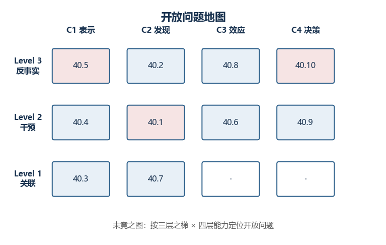

## 40.6　开放清单

**表 40-1　十大开放问题速览**

| 编号 | 问题 | 所属能力 | 难点 |
|------|------|----------|------|
| 40.1 | 隐混杂下一般识别 | C3 | 统一算法缺失 |
| 40.2 | 干扰下效应识别 | C3 | 效应重定义 |
| 40.3 | 等价类彻底打破 | C2 | 理论下界 |
| 40.4 | 隐变量与循环发现 | C2 | 模型假设不足 |
| 40.5 | 发现的统计效率 | C2 | 高维功效低 |
| 40.6 | 反事实模型校准 | C4 | 不可直接验证 |
| 40.7 | 反事实公平标准 | C4 | 社会共识缺位 |
| 40.8 | 连续/多维处理 | C3 | 理论不完善 |
| 40.9 | 因果与大模型融合 | 全部 | 架构限制 |
| 40.10 | 可信因果基准 | 全部 | ground truth 难 |
| 40.11 | 效应可重复测量 | C3 | 异质性普遍 |
| 40.12 | 价值与因果交织 | C4 | 偏好内生 |
| 40.13 | 因果教育范式 | 全部 | 制度惯性 |
| 40.14 | 因果知识可累积 | 全部 | 标准缺失 |
| 40.15 | 机制与预测统一 | C1/C3 | 理论空白 |

这份清单不是终点，而是邀请。因果智能过去三十年的进步，正是一步步把「开放问题」变为「教科书章节」——本书的第 5—9 章（因果发现）与第 10—15 章（效应估计），在 1990 年代都还是研究前沿。今天列在表 40-1 中的问题，或许就是下一代教材的章节。

**表 40-1 的读法**：编号并非难度排序，而是按「能力层 → 主题」组织；读者可按自己的研究兴趣选择切入。其中可识别性（40.1、40.2）最成熟、最易产生扎实成果，机制与预测统一（40.15）最宏大、最需长期探索。

**三个跨领域的汇合点。** 其一，**可识别性与机器学习的汇合**：高维 nuisance 参数的估计（第 15 章 DML）已展示「半参数理论 + 机器学习」的威力，能否推广到隐混杂与干扰场景，是问题 40.1、40.2 的希望所在。其二，**因果发现与基础模型的汇合**：LLM 提供先验（第 39 章），可微分搜索（NOTEARS[8]）提供效率，二者结合或可突破问题 40.5 的瓶颈。其三，**反事实评估与实验设计的汇合**：既然反事实不可直接验证（定义 40.2），用主动实验校准结构模型（问题 40.6）或许是唯一出路——让智能体在世界中做最小成本的干预，换取对反事实能力的最大检验。

**给研究者的建议。** 从「可识别性 + 具体应用结构」切入最易产生扎实成果：不要泛泛争论「因果能否从观测数据学到」，而要问「在这类图结构、这类假设下，这个具体效应能否识别」。这是本书贯穿的方法论——把宏大问题分解为可判定的局部问题，正是三十年来因果科学进步的秘密。

## 40.7　为什么开放问题重要

一本教材若只呈现已解决的问题，会给出「一切都已搞定」的错觉，读者于是停止追问。本章刻意反其道而行，原因有三。

第一，**划清能力边界**。知道方法在哪里失效，与知道方法如何工作同等重要。第 37 章的实践陷阱，多数正是把「开放问题」误当作「已解决问题」造成的——以为控制了协变量就消除了混杂，却忽略隐混杂识别（问题 40.1）仍开放。

第二，**指明研究入口**。教科书章节与前沿问题之间没有鸿沟。今天的开放问题，就是明天的章节。表 40-1 给研究生的不是「绝望清单」，而是「选题地图」——每个问题都有明确的难点与可能方向。

第三，**塑造谦逊的学科态度**。因果智能关于「什么导致什么」，天然容易被过度自信地解读（第 37 章）。清醒地列出「我们还不知道什么」，是这门学科应有的认识论谦逊——也是 40.8 节耦合图能成立的认知前提：承认问题间有未明结构，才谈得上找枢纽。

## 40.8　开放问题的耦合与协同求解

表 40-1 把开放问题按「能力层 × 主题」组织，暗示它们是彼此独立的。实际上许多问题**耦合**：解决一个往往同时松动另一个。本节给出一个量化「问题间耦合强度」的视角，帮助研究者判断「先攻哪个问题杠杆最大」。

**定义 40.3（问题耦合图）**　把 40.1—40.15 开放问题作为节点，若「突破问题 $i$ 能为问题 $j$ 提供直接工具或判据」，则连一条有向边 $i\to j$，边权 $w_{ij}\in[0,1]$ 表示工具可迁移程度。该有向加权图 $\mathcal{C}$ 的节点重要度用加权出度衡量：

$$
\mathrm{Out}(i)=\sum_{j} w_{ij}, \tag{40-1}
$$

$\mathrm{Out}(i)$ 越大，突破问题 $i$ 对其他问题的杠杆越强，越值得优先投入。这给「研究选题」一个可计算的排序依据，而非纯凭直觉。

**例 40.3（问题耦合度的数值算例）**　取四个问题：40.1（隐混杂识别）、40.2（干扰识别）、40.5（发现效率）、40.9（因果与大模型融合）。按「工具可迁移程度」估计边权：突破 40.1 的一般识别算法，能为 40.2（干扰下识别）提供半参数框架，$w_{40.1\to40.2}=0.6$；能为 40.5（发现需识别判据）提供 $w_{40.1\to40.5}=0.4$；突破 40.9（大模型融合）能为 40.1（LLM 提供隐混杂先验）、40.2（LLM 提供网络先验）、40.5（LLM 加速搜索）分别提供 $w=0.5,0.4,0.5$。代入式 (40-1)：$\mathrm{Out}(40.1)=0.6+0.4=1.0$，$\mathrm{Out}(40.9)=0.5+0.4+0.5=1.4$，$\mathrm{Out}(40.2)=0$，$\mathrm{Out}(40.5)=0$。可见「因果与大模型融合（40.9）」杠杆最大——它同时为识别、干扰、发现三类问题提供先验与算力，是值得优先投入的「枢纽问题」。这与 40.6 节「三个跨领域汇合点」的判断一致：大模型融合是开放问题耦合图的枢纽节点。

**直觉解释.** 式 (40-1) 把「先做哪个开放问题」从学派之争变成一张图的读法：找 $\mathrm{Out}$ 最大的枢纽节点先攻。它不取代学术判断（边权 $w_{ij}$ 本身是估计），但把「哪些问题彼此借力」显式化，避免研究者孤立地硬啃一个低杠杆问题。这与第 40.6 节「给研究者的建议——从可识别性切入」互补：可识别性是「最扎实」的入口（易出成果），而耦合图找「杠杆最大」的枢纽（辐射最远），二者一个求稳、一个求广，供不同风险偏好的研究者选择。

**承上启下。** 本章诚实清点可识别性、发现、反事实、规模化四方面的开放问题，强调「因果智能远未成熟」，并用 40.8 节的问题耦合图指出「先攻哪个问题杠杆最大」。下一章即全书结语（第 41 章）：我们将回扣第 1 章的因果之梯与四层能力框架，用九篇×四层映射表收束全书，提炼自动化、规模化、与大模型融合三条趋势，并以「从关联到理解」的主题完成全书闭环。

## 本章小结

本章清点因果智能尚未解决的开放问题。我们按主题讨论可识别性边界（定义 40.1，问题 40.1—40.2）、观测因果发现（问题 40.3—40.5）、反事实评估（定义 40.2，问题 40.6—40.7）、规模化与复杂性（问题 40.8—40.10）。数值算例（例 40.1 的等价类爆炸、例 40.2 的干扰偏差）量化了「卡点」。最后以表 40-1 给出开放问题速览，并用 40.8 节的问题耦合图（定义 40.3，式 40-1，例 40.3）指出「先攻哪个问题杠杆最大」。这些问题遍布因果之梯三级与四层能力，构成本书的「未竟之图」。这些辨析衔接第 5—10、15、16、18、28—32、36—39 章。

**进一步阅读**　隐混杂识别见[1]、[3]；干扰理论见[2]；因果发现开放问题见[4]；反事实评估见[5]。

## 参考文献

[1] Pearl J. Causal diagrams for empirical research. *Biometrika*, 1995, 82(4): 669–688.

[2] Halloran M E, VanderWeele T J. Direct and indirect effects in a vaccine trial. *Statistical Science*, 2011, 26(1): 94–115.

[3] Shpitser I, Pearl J. Complete identification methods for the causal hierarchy. *Journal of Machine Learning Research*, 2008, 9: 1941–1979.

[4] Spirtes P, Zhang K. Causal discovery and inference: Concepts and recent methodological advances. *Applied Informatics*, 2016, 3: 3.

[5] Pearl J. *The Do-Calculus Revisited: Counterfactuals, Causal Diagrams, and Structural Equations*. Technical Report, 2015.

[6] Kennedy E H. Nonparametric causal effects based on marginal structural models. *Journal of the American Statistical Association*, 2019, 114(526): 745–758.

[7] Kıcıman E, Ness R, Sharma A, Grossman S. Causal reasoning and large language models: Opening a new frontier for causality. *arXiv preprint arXiv:2305.00050*, 2023.

[8] Zheng X, Aragam B, Ravikumar P, Xing E P. DAGs with NO TEARS: Continuous optimization for structure learning. *NeurIPS*, 2018.

---

# 第 41 章　结语：从关联到理解

全书走到这里，我们该回到第 1 章的那句话：「这只瓶子碎了，是因为我把它摔在了地上。」一句平常的话语，藏着人类认知中最深刻的追求——我们不只是想看到世界「是什么样」，更想知道「为什么」以及「如果当初做了别的事，会怎样」。四十一章的旅程，本质上就是回答这三个层次的追问。本章作为全书结语，完成三件事：用一张映射表把九篇内容与四层能力对齐（41.1 节），提炼贯穿全书的三条趋势（41.2 节），并以「从关联到理解」的主题收束全书（41.3 节）。

本章不再引入新方法，而是回扣第 1 章的因果之梯与四层能力体系，形成首尾闭环。如果说第 1 章是「立框架」，本章就是「合框架」——检验全书是否兑现了它在开篇许下的承诺。41.1—41.3 节回扣框架与主题，41.4 节以最后的边界收束，41.5 节给出五条伦理底线，41.6 节为三类读者指路。

## 41.1　九篇 × 四层能力：全书地图

**表 41-1　全书九篇与四层能力（C1—C4）的映射**

| 篇 | 章 | 主题 | C1 表示 | C2 发现 | C3 效应 | C4 决策 | 之梯主层 |
|----|----|------|:---:|:---:|:---:|:---:|:---:|
| 一 | 1—4 | 理论基础 | ● | ○ | ○ | ○ | L1—L3 |
| 二 | 5—9 | 因果发现 | ● | ● | ○ | — | L1—L2 |
| 三 | 10—15 | 因果效应 | ○ | — | ● | ○ | L2 |
| 四 | 16—19 | 反事实推理 | ○ | — | ○ | ● | L3 |
| 五 | 20—23 | 因果表征 | ● | ○ | ○ | — | L2—L3 |
| 六 | 24—27 | 因果与 ML | ● | ○ | ● | ○ | L1—L2 |
| 七 | 28—32 | 因果与大模型 | ○ | ○ | ○ | ○ | L1—L3 |
| 八 | 33—37 | 应用与工程 | ○ | ○ | ● | ● | L2—L3 |
| 九 | 38—41 | 未来 | ● | ● | ● | ● | 全部 |

（● 主覆盖，○ 涉及，— 少涉）

**直觉解释.** 这张表把全书 compressed 成一张地图。读者若想找「如何表示因果」，沿 C1 列读第一、二、五篇；想找「如何估计效应」，沿 C3 列读第三、八篇；想找「如何做决策」，沿 C4 列读第四、八篇。九篇按「基础—发现—效应—反事实—表征—ML—大模型—应用—未来」展开，恰好把四层能力从理论到工程、从抽象到落地铺了一遍。这与第 1 章表 1-2 的九篇结构一一呼应——那张表按之梯分层，这张表按能力分层，二者是同一全景的两个投影。

**定义 41.1（全书的收敛结构）**　全书的章法可概括为「分—合—分—合」：第一篇立框架（合）；第二至七篇分头深入四类能力（分）；第八篇把能力应用到工程与场景（合）；第九篇再上升到 AGI 与开放问题（分中有合）。四层能力 C1—C4 不是并列清单，而是层层递进的阶梯：表示是发现的前提，发现是效应的前提，效应是决策的前提。

## 41.2　三条趋势

回望全书，因果智能的演进呈现三条清晰趋势，它们也是未来的主旋律。

**趋势一：自动化（automation）。** 从手工画因果图（第 3 章）到 PC/评分自动搜索（第 6、7 章），到函数因果模型自动定向（第 8 章），再到 LLM 驱动的发现（第 39 章），因果结构获取正从「专家手艺」变为「自动流程」。但第 39 章定理 39.1 的天花板提醒我们：自动化能缩小不确定性，却不能消灭它。自动化的正确目标是「副驾驶」——让算法包围人类判断，而非取代它（第 39.5 节）[1]。

**趋势二：规模化（scaling）。** 从几十个变量的图（第 6 章）到高维变量与深度表征（第 20—23 章），从小样本估计到大规模异质效应与策略学习（第 15、26 章），因果智能正突破「小数据、小图」的局限。第 40.4 节指出，高维处理的连续干预、发现的统计效率、可信基准的缺失，是规模化的主要瓶颈。可微分结构学习（NOTEARS[8]）与双重机器学习（第 15 章）是这一趋势的代表。

**趋势三：与大模型融合（integration with LLMs）。** 第 28—32 章评估大模型的因果推理能力，第 39 章用 LLM 注入发现先验，第 38 章把因果视为 AGI 基石。大模型带来海量文本因果知识与自然语言交互，因果带来稳健性与反事实能力——二者互补。但当前模型的因果能力仍有限（第 32 章），「生成因果知识」与「真正理解因果」之间仍有鸿沟（第 40.9 节）[2]。

**趋势背后的统一逻辑。** 三条趋势并非彼此孤立，而是围绕同一个核心：让因果能力在更少的专家介入下、更大的规模上、更自然的人机界面中被使用。自动化降低「获取因果结构」的成本，规模化扩大「应用因果方法」的范围，大模型融合则改变「人与因果系统交互」的方式。三者共同指向一个目标——把因果智能从「少数专家的技艺」变为「普适的基础设施」。这与第 36 章因果系统工程化的愿景一致：当因果能力像数据库一样成为标配，真正的因果应用才会遍地开花。

**第三条趋势的暗线：从「更聪明」到「更可信」。** 把三条趋势并列细看，会发现它们共同回应一个更深的转向——因果智能的价值主张，正从「预测得更准」转向「决策得更可信」。相关模型追求预测误差最小，因果模型追求「在假设下的可信度」。这不是技术细节的差别，而是评价函数的根本切换：前者问「我猜得对不对」，后者问「我的结论在什么条件下站得住、站不住」。这个转向的深远含义是：因果智能的成熟标志，不是某个基准分数创新高，而是「可信度的可度量化」——第 38 章的 CCI（式 38-3）、第 40 章的问题耦合图（式 40-1）、第 36 章的 SLA 与审计链，都是这个转向的产物。未来十年的竞争，或许不在「谁的模型更大」，而在「谁的因果系统能更诚实地报告自己有多可信」。

**趋势的风险面。** 能力扩张必伴生风险。自动化可能让不合法假设被悄悄接受（第 39 章）；规模化可能放大误导性结论的影响面（第 37 章多重检验）；大模型融合可能让「流畅的因果叙述」掩盖「脆弱的因果根据」（第 28—32 章）。因此三条趋势必须与第 37 章的实践警惕、第 40 章的开放清单同步推进——能力越强，谦逊越重要。

**表 41-2　三条趋势与对应章节**

| 趋势 | 关键词 | 核心章节 | 主要瓶颈（第 40 章） |
|------|--------|----------|----------------------|
| 自动化 | 副驾驶、人机协同 | 6—9、36、39 | 等价类天花板（40.3） |
| 规模化 | 高维、连续处理 | 15、20—27、39 | 统计效率（40.5）、基准（40.10） |
| 大模型融合 | 文本先验、AGI | 28—32、38—39 | 架构限制（40.9） |

## 41.3　从关联到理解

现在，让我们回到开篇的瓶子。

**关联（Level 1）**告诉我们：瓶子碎裂与「摔」这个动作在时间上相继出现，统计上高度相关。一只鸽子、一个最基础的相关性 learner，也能学到这种规律。

**干预（Level 2）**告诉我们：如果我们**主动**把瓶子摔在地上，它会碎——这比「看到摔与碎相继发生」多了一层「由我来做」的确定性。要可靠回答，我们需要一个关于「重力—冲击—易碎性」的因果模型（第 3 章 SCM），并用 do-演算或实验确认它（第 11、13 章）。

**反事实（Level 3）**告诉我们：**若当初没摔，瓶子不会碎**——这是一个关于未发生之事的判断，无法直接观测验证，必须借助最强的结构性假设（第 16、19 章）。正是这一步，把「预测」变成了「理解」：理解意味着能回答「为什么」与「如果当初不这样会怎样」。

**定义 41.2（因果智能的终极目标）**　因果智能的终极目标，不是拟合更多数据，而是让系统从「观察到什么」的关联，攀升到「干预会怎样」的掌控，再到「当初若不怎样」的理解——即完成从关联到理解的跨越。

**直觉解释.** 这条跨越贯穿全书每一章。第 4 章的因果之梯把它形式化；第 5—9 章试图从数据爬上梯子；第 10—15 章学会在干预层站稳；第 16—19 章触碰最高层；第 20—32 章把它装进机器与大模型；第 33—40 章把它用于真实世界并诚实面对未竟之处。四十一章的镜头，对准的是同一座阶梯。

**三点收束。** 第一，**相关不等于因果**（第 1、4 章）——这是入门的第一课，也是最容易反复遗忘的一课。第二，**预测好不等于可干预**（第 20—25 章）——高精度的相关模型在机制变化下会崩塌。第三，**干预有效不等于反事实成立**（第 19 章）——平均效应正确不保证个体反事实正确。全书用九篇的篇幅，把这三句话从警句变成可计算、可验证、可工程化的理论。

**从三句话到三个能力。** 这三句话分别对应因果之梯的三道关卡：第一句守住 Level 1 与 Level 2 的边界——不越过识别就别谈因果；第二句守住「预测模型」与「可干预模型」的边界——相关性再高也不能保证 Intervention 有效；第三句守住 Level 2 与 Level 3 的边界——平均正确不代表个体反事实正确。全书的方法论，可浓缩为「知道每句话在哪一关有效」的 discipline。

**给读者的实践清单。** 合上本书后，面对任何因果主张，建议依次追问：① 它站在因果之梯哪一级？② 它隐含了什么假设（图、可忽略性、平行趋势、排除限制）？③ 这些假设在该场景可信吗（第 37 章敏感性分析）？④ 结论能否复现（第 36 章工件固化）？⑤ 它诚实标注了不确定性吗（第 39 章可逆边、第 40 章开放问题）？这五问，是全书四十一章在读者心中应留下的最持久的产物。

**从理解到行动：因果智能的「闭环」。** 需要澄清的一点是：「理解」不是因果智能的终点，而是行动的起点。一个真正理解因果的系统，其价值最终体现在「基于理解的干预」——即第 26 章的因果强化学习、第 33—37 章的落地决策。理解（Level 3 的反事实能力）让干预更聪明：它知道「推这个杯子会碎，但扶一下不会」，因而选择「扶」而非「推」。反过来说，行动（干预）又反哺理解：每一次干预的结果，都是对因果模型的一次检验（第 39 章人机协同的「实验验证」环）。理解与行动构成一个闭环——**理解指导行动，行动校准理解**——这正是第 1 章「从关联到干预到反事实」之梯的哲学完整形态：梯子的最高层，不是「知道」，而是「知道该做什么、并据此做得更好」。

**例 41.1（统一医疗案例的全程回顾）**　第 1 章的医疗案例——病情 $S$、用药 $T$、康复 $Y$——在全书走过完整旅程：第 3 章画出含后门路径 $T\leftarrow S\to Y$ 的因果图；第 6、9 章尝试从数据发现该结构；第 10—13 章用可忽略性、倾向得分与工具变量估计效应；第 14 章用 DID 与断点做准实验；第 15 章估计异质效应；第 16 章计算「若这位患者当初没服药」的个体反事实；第 18 章讨论反事实公平；第 20—21 章学不变表征；第 32 章评估大模型的因果推理；第 33 章落地临床决策。同一个问题，被十余个镜头反复照射——这正是本书的方法论：不是重复，而是「逐步加深的理解」。

> 【图 41-1　全书闭环：从关联到理解】（原图见 figures/图41-1.png）：画一条自下而上的阶梯（关联→干预→反事实），左侧标注第 1 章「立框架」、右侧标注第 41 章「合框架」，中间用箭头串起九篇主题，顶端标注「从关联到理解」，形成首尾呼应的环形构图。

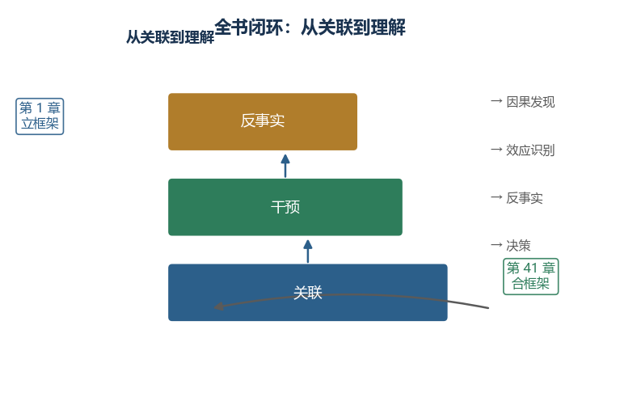

## 41.4　最后的边界

**例 41.2（用五问审视一个政策主张）**　假设有人声称「提高最低工资使就业下降 $3\%$」。用上面的实践清单审视：① 层级——这是 Level 2 干预主张，非关联；② 假设——若用 DID，需平行趋势；若用 IV，需排除限制；③ 可信度——政策前就业趋势是否平行？工具是否只通过工资影响就业（第 34 章）？④ 复现——数据与图是否公开（第 37 章）？⑤ 不确定性——效应是否随城市、行业而异，报告的是 ATT 还是 LATE（第 34 章定义 34.1）？五问下来，一个看似确凿的数字，往往变成「在特定假设下、对特定人群的估计」。这不是怀疑一切，而是负责任地使用因果知识——这正是本书希望培养的思维习惯。

**例 41.3（用五问审视一个推荐决策）**　「给用户展示 A 提高了点击率 $8\%$」。① 层级——若来自 A/B 测试，是 Level 2；若来自观测点击率对比，只是 Level 1；② 假设——随机化是否成立？有无位置偏差（第 35 章定义 35.1）？③ 可信度——是否有人为「偷看」数据提前停止（第 37 章陷阱七）？④ 复现——实验配置是否记录？⑤ 不确定性——置信区间是否跨零（第 35 章例 35.2）？两个例子说明，同一套五问适用于经济学与工业界——这是因果智能作为统一框架的价值。

在合上全书之前，必须留一句诚实的话：因果智能远未完成。第 40 章列出的十大开放问题——隐混杂下的一般识别、干扰下的效应、等价类的彻底打破、反事实的校准、与大模型深度融合——仍在等待答案。本书给出的不是终点，而是一张地图与一副罗盘。

因果之梯告诉我们「能爬到哪一级」，但它不保证「每一级都已征服」。恰恰相反，最高级——反事实——仍是我们最不熟悉、最难以验证的领地。一个真正理解因果的智能体，或许应像优秀的科学家那样：既勇于干预世界以检验假设，又谦逊地承认哪些反事实永远无法被证实。

**本书的边界与未尽之事。** 诚实地说，本书在三个方面是「刻意未完成」的。其一，**哲学深度**：因果的形而上学基础（因果实在论 vs 干预主义 vs 过程理论）、反事实的逻辑地位、自由意志与因果责任，这些哲学问题本书只触及边缘（第 1 章），未展开——它们是因果智能的「根」，本书是「干」与「枝」。其二，**数学严谨性**：为可读性，本书的定理多给「证明要点」而非完整证明，部分开放问题（第 40 章）只给方向而非下界——读者需以原典（Pearl[3]、Spirtes[7]、Schölkopf[5]）补严谨性。其三，**领域覆盖**：全书以通用因果理论为主线，特定领域（生物、经济、社会网络、气候）的因果结构特殊性，只在各应用章（第 33—37 章）点到，未深入——这是「导论」而非「领域专著」的边界。承认这些未完成，正是本书「诚实标注不确定」（41.3 节实践清单第五问）的自我应用：因果智能的边界，也应被因果地审视。

**全书旅程回望。** 让我们用几行文字，重走这四十一章：

第一篇（1—4）告诉我们因果是什么、之梯如何分级；

第二篇（5—9）尝试从数据中发现因果结构，却撞上等价类的天花板；

第三篇（10—15）学会在干预层站稳，用 RCT、IV、DID、RDD 与因果森林估计效应；

第四篇（16—19）攀登反事实，追问「若当初不这样」；

第五至七篇（20—32）把因果装进表征、机器学习与大模型；

第八篇（33—37）把它用于经济、营销与工程，并清点实践陷阱；

第九篇（38—41）上升到 AGI、自动化发现与开放问题，最终回到起点。

这条路径，既是学科逻辑的展开，也是一个人学习因果应有的顺序：先懂概念，再学发现，再学效应，再碰反事实，再用于实践，最后带着谦逊直面未知。

## 41.5　致读者的实践承诺：因果智能的五条伦理底线

合上这本书之前，我想把「从关联到理解」翻译成一份可执行的承诺——不只是给研究者，也给任何会「用因果说法做决定」的人。这五条底线，是全书四十一章方法论在伦理层面的投影。

**底线一：声明你的层级。** 任何因果断言都必须标明它站在因果之梯哪一级（Level 1/2/3）。把 Level 1 的关联说成 Level 2 的效应、把 Level 2 的平均效应说成 Level 3 的个体反事实，是全书反复警示的「冒充」（第 1、4、16 章）。声明层级，是诚实的第一步——它让听者知道「这个数字能做什么、不能做什么」。

**底线二：把假设摆到台面上。** 因果结论永远依赖假设（图、可忽略性、平行趋势、排除限制、无干扰）。隐藏假设的因果分析，是把「信仰」伪装成「科学」（第 37 章）。底线要求：每个因果数字旁，必须附「在什么假设下成立」。这不是示弱，而是把「结论有多可信」交给读者判断。

**底线三：区分「我做了什么」与「世界发生了什么」。** 干预（do）是主动施加，观测（see）是被动记录。把「我做了 X 之后 Y 变了」说成「X 导致 Y」，混淆了主动与被动（第 4 章）。凡涉及「我/我们决定做某事」的结论，必须走干预通道（实验或识别），而非关联通道。

**底线四：承认你不知道的。** 第 40 章的开放问题清单，本质是一份「我们还不知道什么」的清单。底线要求：当结论触及开放问题（隐混杂、干扰、反事实校准）时，必须显式标注「此处在已知方法的能力边界之外」，而非用「数据表明」的措辞掩盖不确定性。诚实的「不确定」优于伪装的「确定」。

**底线五：对不可逆决策更谨慎。** 因果系统的输出若用于不可逆决策（政策、医疗、信贷），其门槛须高于可逆决策（推荐排序）——这是第 36 章「因果回滚阈值」的伦理化。不可逆决策要求审计链完整（定义 36.6）、反驳检验通过（定义 36.4）、敏感性分析支撑（第 37 章例 37.5），缺一项即不应据此行动。谨慎不是怯懦，而是对「不可逆」本身的尊重——可逆决策错了能回滚，不可逆决策错了没有第二次机会。

**表 41-3　五条伦理底线与全书章节的对应**

| 底线 | 核心要求 | 全书支撑章节 |
|------|----------|--------------|
| 一　声明层级 | 标明 L1/L2/L3 | 第 1、4、16 章 |
| 二　假设上台面 | 每个数字附假设 | 第 5、10、37 章 |
| 三　干预≠观测 | 主动 vs 被动分道 | 第 4、11、34 章 |
| 四　承认未知 | 触及开放问题须标注 | 第 19、37、40 章 |
| 五　不可逆更谨慎 | 审计+反驳+敏感性 | 第 36、37 章 |

这五条底线不是「额外负担」，而是「从关联到理解」这句话在操作层的展开：理解一个因果主张，就是能说出它在哪一级、基于什么假设、是干预还是观测、哪里不确定、该多谨慎。能问出这五个问题，才算真正「理解」了因果——而不只是「看到」了一个相关数字。

## 41.6　给三类读者的路标

本书同时面向研究者、工程师与决策者，三者的阅读路径与关注点不同。

**研究者**　建议精读第 5—9 章（发现）、第 10—15 章（识别与估计）与第 40 章（开放问题），它们构成因果科学的「地基—方法—前沿」三层。第 40.8 节的问题耦合图是选题地图：找 $\mathrm{Out}(i)$ 最大的枢纽问题优先投入，或从「可识别性 + 具体结构」切入求稳。

**工程师**　建议精读第 36 章（系统工程化）与第 37 章（实践陷阱），它们是「把方法变成产品」的两份操作手册。第 36 章的五层架构、审计链、SLA 与第 37 章的核对清单（表 37-2），可直接落地为因果平台的验收标准；第 39.8 节的规模化发现（式 39-2、39-3）是高维场景的工程参考。

**决策者**　建议读第 1、4、16 章（概念与因果之梯）与第 41 章本章的五条伦理底线，建立「看到因果说法先问五问」的直觉。第 41.3 节例 41.2、41.3（用五问审视政策与推荐决策）是可直接套用的思维模板——它不需要你懂 do-演算，只需你记住：任何「X 导致 Y」的说法，都先问「它在哪一级、什么假设、干预还是观测、哪里不确定、该多谨慎」。

三类读者共享同一个内核：**因果智能的价值，不在算法多精巧，而在「问对问题 + 声明假设 + 诚实标注不确定」**。算法会过时，这个内核不会。

## 41.7　尾声：一个开放的问题

全书以「从关联到理解」收束，但我想以一个问题结束，而非一个结论——因为因果智能最重要的品质，正是「知道自己还不知道」。

**问题：理解，是否终究要「走出数据」？** 全书反复论证（第 38 章定理 38.1、第 39 章定理 39.1），观测数据无法唯一确定因果结构——必须引入干预、机制假设或时间等「数据之外」的信息。那么一个根本的追问浮现：如果「理解」永远需要数据之外的东西，因果智能的「自动化」边界在哪里？第 39 章的结论是「自动化是副驾驶，人类是机长」；但第 40 章的问题耦合图又显示，「因果与大模型融合（40.9）」是杠杆最大的枢纽问题——它暗示大模型或许能把「数据之外的信息」部分内化（把人类的干预知识、机制直觉编码进权重）。这两条线会否在未来汇合，让「走出数据」变成「走出人类、走向模型」？还是说，「理解」中总有一部分不可编码——就像第 16 章的反事实，永远无法被完全观测验证，只能被更诚实地标注？

这个问题没有答案。但它的存在，恰恰是本书的注脚：因果智能不是「把因果问题做完」的工程，而是「永远带着谦逊追问」的学科。第 1 章的瓶子碎了，我们知道了「为什么」与「如果当初不摔会怎样」——但「理解」的尽头，不是某个终极答案，而是把「我们知道了多少、还不知道多少」说清楚。

**最后的话。** 四十一章，从「这只瓶子碎了」出发，走到「从关联到理解」的边界。因果之梯的第三级——反事实——仍是最未征服的领地，第 40 章的开放清单仍未填满。但本书想留下的，不是一套「已完成的因果」，而是一种「如何诚实地追问因果」的能力。合上这本书，若你下次听到「X 导致 Y」，会下意识地问「它在哪一级？什么假设？干预还是观测？哪里不确定？该多谨慎？」——那么这本书，就值了。这本书本身也应当被这样审视：它给出的每一处结论，都站在因果之梯的某一级，都依赖某些假设，也都标注了「哪里我们还不清楚」。愿读者以同样的严谨读它，也以同样的开放超越它。

从关联到理解，是人类认知最古老的方向，也是人工智能最年轻的前沿。这条路，才刚刚开始。

**承上启下（全书闭环）。** 本章回扣第 1 章的因果之梯与四层能力框架，完成首尾闭环：第 1 章立框架（表 1-2、表 1-3），本章合框架（表 41-1、41-2）；第 1 章定义「从关联到干预与反事实」的主题，本章以「从关联到理解」收束。全书四十一章，至此完结。

## 本章小结

本章作为全书结语，完成首尾闭环。我们用表 41-1 把全书九篇与四层能力（C1—C4）对齐，定义全书的「分—合—分—合」收敛结构（定义 41.1）。接着提炼三条趋势——自动化、规模化、与大模型融合（表 41-2），并指出其背后的「从更聪明到更可信」转向与各自瓶颈。随后以「从关联到理解」为主题收束全书（定义 41.2），通过统一医疗案例的全程回顾（例 41.1）与「理解—行动闭环」展示四十一章的递进。41.4 节以五问审视政策与推荐决策（例 41.2、41.3），并诚实界定本书的边界。41.5 节给出因果智能的五条伦理底线（表 41-3），41.6 节为研究者、工程师、决策者三类读者指路，41.7 节以一个开放问题收尾。第 1 章立框架，本章合框架——全书的阶梯，至此闭合。

**进一步阅读**　因果思想史与哲学背景见[3]；因果发现自动化的前沿见[1]；大模型因果推理见[2]。

## 参考文献

[1] Kıcıman E, Ness R, Sharma A, Grossman S. Causal reasoning and large language models: Opening a new frontier for causality. *arXiv preprint arXiv:2305.00050*, 2023.

[2] Pearl J, Mackenzie D. *The Book of Why: The New Science of Cause and Effect*. New York: Basic Books, 2018.

[3] Pearl J. *Causality: Models, Reasoning, and Inference*. 2nd ed. Cambridge: Cambridge University Press, 2009.

[4] Schölkopf B, Locatello F, Bauer S, et al. Toward causal representation learning. *Proceedings of the IEEE*, 2021, 109(5): 612–634.

[5] Peters J, Janzing D, Schölkopf B. *Elements of Causal Inference: Foundations and Learning Algorithms*. Cambridge, MA: MIT Press, 2017.

[6] Hernán M A, Robins J M. *Causal Inference: What If*. Boca Raton: Chapman & Hall/CRC, 2020.

[7] Spirtes P, Glymour C, Scheines R. *Causation, Prediction, and Search*. 2nd ed. Cambridge, MA: MIT Press, 2000.

[8] Zheng X, Aragam B, Ravikumar P, Xing E P. DAGs with NO TEARS: Continuous optimization for structure learning. *NeurIPS*, 2018.

---

# 附录

## 附录 A　数学工具包

本附录汇总全书反复使用的数学工具，供读者查阅。更严格的论述见相应章节。

### A.1　概率论基础

**概率空间与随机变量。** 概率空间为三元组 $(\Omega,\mathcal{F},\mathbb{P})$，其中 $\Omega$ 为样本空间，$\mathcal{F}$ 为事件 $\sigma$-代数，$\mathbb{P}$ 为概率测度。随机变量 $X:\Omega\to\mathbb{R}$ 把样本点映射为实数，其分布由累积分布函数 $F_X(x)=\mathbb{P}(X\le x)$ 或概率密度/质量函数描述。

**条件概率与链式法则。** $\mathbb{P}(A\mid B)=\mathbb{P}(A\cap B)/\mathbb{P}(B)$。对变量集合 $\mathbf{X}=(X_1,\dots,X_d)$，联合概率的链式分解为

$$
\mathbb{P}(X_1,\dots,X_d)=\prod_{i=1}^{d}\mathbb{P}\big(X_i\mid X_1,\dots,X_{i-1}\big). \tag{A-1}
$$

在贝叶斯网络（第 2 章）中，此式因条件独立而化简为对父节点的乘积。

**期望、方差与协方差。** $\mathbb{E}[X]=\sum_x x\,p(x)$（离散）或 $\int x p(x)\,dx$（连续）；$\mathrm{Var}[X]=\mathbb{E}[(X-\mathbb{E}X)^2]$；$\mathrm{Cov}(X,Y)=\mathbb{E}[XY]-\mathbb{E}X\,\mathbb{E}Y$。注意 $\mathrm{Cov}(X,Y)=0$ 不蕴含独立（第 2 章）。

### A.2　条件独立与图

**条件独立（conditional independence）。** 给定 $Z$，若 $\mathbb{P}(X,Y\mid Z)=\mathbb{P}(X\mid Z)\mathbb{P}(Y\mid Z)$，则称 $X$ 与 $Y$ 在给定 $Z$ 时条件独立，记作

$$
X\perp\!\!\!\perp Y\mid Z. \tag{A-2}
$$

**d-分离（d-separation）。** 在有向无环图中，若节点集 $Z$ 阻断 $X$ 与 $Y$ 之间所有路径，则 $X\perp\!\!\!\perp Y\mid Z$（第 2 章）。阻断规则：对链 $A\to B\to C$ 与 $A\leftarrow B\to C$，若 $B\in Z$ 则阻断；对对撞 $A\to B\leftarrow C$，若 $B\notin Z$ 且 $B$ 的后代也不在 $Z$ 则阻断。

### A.3　干预与潜在结果

**do 算子（do-operator）。** $\mathrm{do}(X=x)$ 表示把 $X$ 的值强制设为 $x$，切断其原有的入边。干预分布写作 $\mathbb{P}(Y=y\mid\mathrm{do}(X=x))$（第 3 章）。

**潜在结果（potential outcome）。** $Y_x$ 表示「若 $X$ 取 $x$ 时 $Y$ 的值」。平均处理效应

$$
\mathrm{ATE}=\mathbb{E}[Y_1-Y_0]. \tag{A-3}
$$

个体处理效应 $\mathrm{ITE}_i=Y_i(1)-Y_i(0)$ 不可同时观测——这是根本缺失问题（第 10 章）。

### A.4　线性代数与最优化

**向量与范数。** $\mathbf{x}\in\mathbb{R}^d$，$\ell_2$ 范数 $\|\mathbf{x}\|_2=\sqrt{\sum_i x_i^2}$。最小二乘解 $\hat{\boldsymbol\beta}=(\mathbf{X}^\top\mathbf{X})^{-1}\mathbf{X}^\top\mathbf{y}$。

**梯度下降。** 对目标 $\mathcal{L}(\theta)$，梯度下降更新 $\theta\leftarrow\theta-\eta\nabla_\theta\mathcal{L}(\theta)$，$\eta$ 为学习率。因果机器学习（第 15 章）大量使用基于梯度的优化。

### A.5　常用分布

| 分布 | 记号 | 用途 |
|------|------|------|
| 伯努利 | $\mathrm{Bern}(p)$ | 二元处理/结局 |
| 高斯 | $\mathcal{N}(\mu,\sigma^2)$ | 连续变量、加性噪声 |
| 拉普拉斯 | $\mathrm{Laplace}(\mu,b)$ | 非高斯结构（LiNGAM） |
| 多项 | $\mathrm{Mult}(n,\mathbf{p})$ | 类别变量 |
| Dirichlet | $\mathrm{Dir}(\boldsymbol\alpha)$ | 贝叶斯评分先验 |

---

## 附录 B　因果数据集与基准索引

### B.1　经典基准

| 数据集 | 用途 |
|--------|------|
| ASIA（展览馆旅行） | 贝叶斯网络与因果发现教学基准 |
| ALARM | 医疗诊断贝叶斯网络 |
| Sachs（蛋白质信号） | 因果发现金标准（含干预数据） |
| IHDP（ Infant Health and Development Program） | 异质处理效应基准（第 15 章） |
| Jobs（LaLonde 就业培训） | 观察与实验效应估计对照（第 11、12 章） |
| ACIC（Atlantic Causal Inference Conference） | 因果推断竞赛基准 |
| MIMIC-III / IV | 医疗电子病历（统一案例延伸） |
| Tübingen / CauseEffectPairs | 因果方向判别基准 |

### B.2　因果发现库

| 基准 | 说明 |
|------|------|
| BNLearn | 贝叶斯网络结构与参数学习基准库 |
| CausalBench | 因果发现算法评估 |
| CausAML | 因果发现多领域基准 |
| NETSIM | 网络干预模拟 |

### B.3　评估指标

- **结构发现**：结构汉明距离（SHD）、精确率/召回率、边方向准确率。
- **效应估计**：ATE 估计偏差、均方误差、覆盖概率。
- **异质效应**：$\sqrt{\mathrm{PEHE}}$（个体效应误差平方根）。
- **反事实**：可验证性受根本限制（第 19 章），多用模拟数据评估。

---

## 附录 C　开源工具链

### C.1　因果发现

| 工具 | 用途 |
|------|------|
| causal-learn (pywhy) | PC、FCI、GES 等发现算法 |
| pcalg (R) | 约束与评分发现 |
| Tetrad | 因果发现图形化平台 |
| DoWhy (pywhy) | 端到端因果推断（建模—识别—估计—反驳） |

### C.2　因果效应

| 工具 | 用途 |
|------|------|
| DoWhy / EconML | 效应识别与异质效应（因果森林、元学习器） |
| CausalImpact | 时间序列因果效应（DID/合成控制） |
| linearmodels (Python) | IV、面板、DID 估计 |
| MatchIt / cobalt (R) | 匹配与倾向得分、平衡诊断 |
| grf (R) | 广义随机森林与因果森林 |

### C.3　结构与可视化

| 工具 | 用途 |
|------|------|
| NetworkX / graphviz | 因果图绘制 |
| pgmpy | 概率图模型 |
| NumPy / SciPy / pandas | 数值与数据基础 |

---

## 附录 D　符号与缩略语对照表

### D.1　缩略语

| 缩略语 | 全称 | 中文 |
|--------|------|------|
| SCM | Structural Causal Model | 结构因果模型 |
| DAG | Directed Acyclic Graph | 有向无环图 |
| BN | Bayesian Network | 贝叶斯网络 |
| ATE | Average Treatment Effect | 平均处理效应 |
| ATT | Average Treatment effect on the Treated | 处理组平均处理效应 |
| ITE / CATE | Individual / Conditional Average Treatment Effect | 个体/条件平均处理效应 |
| RCT | Randomized Controlled Trial | 随机对照试验 |
| IPW | Inverse Probability Weighting | 逆概率加权 |
| PSM | Propensity Score Matching | 倾向得分匹配 |
| IV | Instrumental Variable | 工具变量 |
| 2SLS | Two-Stage Least Squares | 两阶段最小二乘 |
| LATE | Local Average Treatment Effect | 局部平均处理效应 |
| RDD | Regression Discontinuity Design | 断点回归设计 |
| DID | Difference-in-Differences | 双重差分 |
| NDE / NIE | Natural Direct / Indirect Effect | 自然直接/间接效应 |
| IRM | Invariant Risk Minimization | 不变风险最小化 |
| OOD | Out-of-Distribution | 分布外 |
| CRL | Causal Representation Learning | 因果表征学习 |
| LiNGAM | Linear Non-Gaussian Acyclic Model | 线性非高斯无环模型 |
| ANM | Additive Noise Model | 加性噪声模型 |
| SCM | Structural Causal Model | 结构因果模型 |

### D.2　数学符号

见「前置说明」符号表与附录 A。

---

## 附录 E　术语对照与全书速查索引

### E.1　核心术语对照

| 中文 | 英文 | 章 |
|------|------|----|
| 因果之梯 | Ladder of Causation | 1, 4, 32, 41 |
| 关联 / 干预 / 反事实 | Association / Intervention / Counterfactual | 1, 4 |
| 结构因果模型 | Structural Causal Model | 3, 16 |
| do-演算 | do-calculus | 3 |
| 后门 / 前门准则 | Back-door / Front-door Criterion | 3, 10 |
| d-分离 | d-separation | 2 |
| 马尔可夫等价类 | Markov Equivalence Class | 5, 6, 8 |
| 混杂 / 对撞 / 中介 | Confounder / Collider / Mediator | 1, 3, 17 |
| 可识别性 | Identifiability | 5, 10 |
| 潜在结果 | Potential Outcome | 4, 10 |
| 可忽略性 | Ignorability | 10, 12 |
| 倾向得分 | Propensity Score | 12 |
| 工具变量 | Instrumental Variable | 13 |
| 断点回归 / 双重差分 | RDD / DID | 14 |
| 异质处理效应 | Heterogeneous Treatment Effect | 15 |
| 反事实公平 | Counterfactual Fairness | 18 |
| 不变性 / 分布外泛化 | Invariance / OOD Generalization | 20 |
| 因果表征 / 解耦 | Causal Representation / Disentanglement | 21 |

### E.2　全书速查索引（按主题）

- **理论基础**：因果之梯与四层能力 1.5—1.6；概率图模型 2；SCM 与 do-演算 3；潜在结果 4。
- **因果发现**：问题与等价类 5；约束方法 6；评分方法 7；函数模型 8；时序与深度 9。
- **因果效应**：识别 10；RCT 与观察 11；匹配与倾向得分 12；IV 13；RDD/DID 14；异质效应 15。
- **反事实**：形式化 16；中介 17；公平 18；评估与局限 19。
- **因果表征**：不变性 20；解耦 21；正则与迁移 22；统一 23。
- **因果与 ML**：鲁棒性 24；迁移 25；强化学习 26；推荐 27。
- **因果与大模型**：LLM 推理 28；世界模型 29；规模化 30；科学发现 31；评估 32。
- **应用与工程**：医疗 33；政策 34；营销 35；工程 36；陷阱 37。
- **未来**：通用智能 38；自动化 39；开放问题 40；结语 41。

---

## 附录 F　算例复现说明

### F.1　环境依赖

- Python 3.10+
- NumPy、SciPy、pandas、scikit-learn
- causal-learn、DoWhy、EconML（可选）
- NetworkX、graphviz（图形）

### F.2　统一案例：医疗治疗效应问题

全书算例以医疗治疗效应问题为贯穿案例：变量为治疗 $T\in\{0,1\}$、康复结局 $Y$、年龄 $A$、病情严重度 $S$ 及潜在混杂 $U$。复现时：

1. 因果图建模（第 3 章）：画出 $S\to T$、$S\to Y$、$T\to Y$ 的图并识别后门路径；
2. 结构发现（第 6、9 章）：用 PC 算法从模拟数据恢复结构；
3. 效应估计（第 10—13 章）：在可忽略性下用倾向得分/IPW 估计 ATE，用 IV 处理未观测混杂；
4. 异质效应（第 15 章）：用因果森林估计 CATE；
5. 反事实（第 16、18 章）：计算个体反事实与反事实公平性；
6. 不变表征（第 20—21 章）：跨环境学习不变因果特征。

### F.3　随机种子与数值容差

- 涉及随机初始化的算例固定随机种子 `seed=42`。
- 数值结果保留三到四位有效数字；因库版本差异允许末位浮动。
- 小模型算例为教学示意，旨在展示计算过程，不使用大规模算力。

### F.4　算例数值声明

除注明出处者外，全书算例中的具体数值（概率、效应值、结构方程系数等）均为**教学示意**，通过小型可复现实验或手工计算得到，用于展示方法机制与量级，不代表任何真实系统在生产环境中的实测结果。引用文献中的基准数字以原始出处最新版本为准。